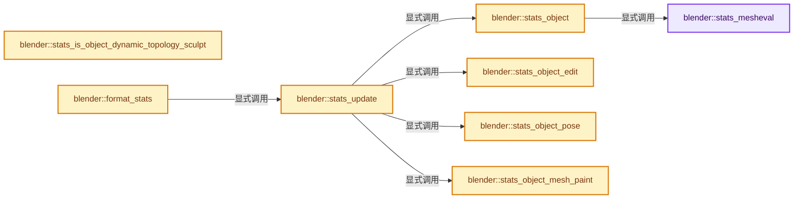
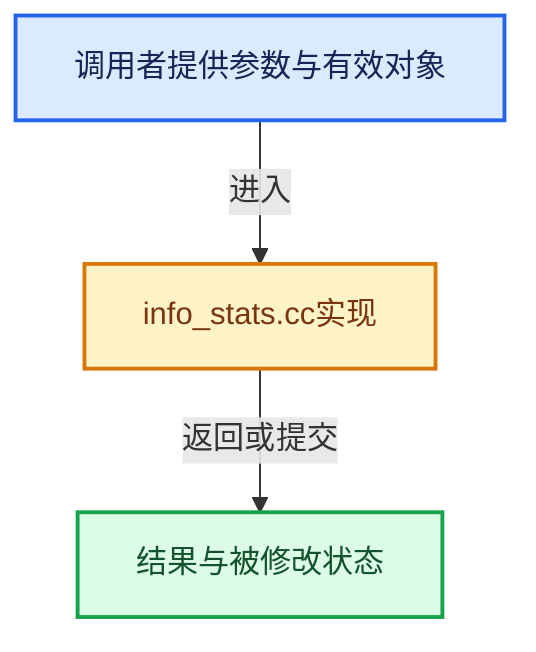

# 实现依赖专题：source/blender/editors/space_info/info_stats.cc

[方向导航](README.md) · [符号索引](../%E7%AC%A6%E5%8F%B7%E4%BE%9D%E8%B5%96%E4%B8%8E%E5%AE%9E%E7%8E%B0%E7%B4%A2%E5%BC%95.md)

本专题从正文实际调用进入，集中保存共享实现。函数有稳定锚点，可从调用处直接跳到对应完整函数；递归与互相调用通过回链组织。

## 本文件的实现关系






## 完整成员与函数实现

<a id="f-357409c603d3a27c"></a>

### `blender::stats_mesheval`

实现位置：[source/blender/editors/space_info/info_stats.cc](../../../../../source/blender/editors/space_info/info_stats.cc) · L108—L162。

接口参数：

- `const Mesh *mesh_eval`
- `bool is_selected`
- `SceneStats *stats`

**教学注释版**

<!-- annotated:6e770e42bf9483 -->

```cpp
static bool stats_mesheval(const Mesh *mesh_eval, bool is_selected, SceneStats *stats)
{
  if (mesh_eval == nullptr) {
    return false;
  }

  int totvert, totedge, totface, totloop;

  /* Get multires stats. */
  if (const std::unique_ptr<SubdivCCG> &subdiv_ccg = mesh_eval->runtime->subdiv_ccg) {
    BKE_subdiv_ccg_topology_counters(*subdiv_ccg, totvert, totedge, totface, totloop);
  }
  else {
    /* Get CPU subdivided mesh if it exists. */
    const SubsurfRuntimeData *subsurf_runtime_data = nullptr;
    if (mesh_eval->runtime->mesh_eval) {
      mesh_eval = mesh_eval->runtime->mesh_eval;
    }
    else {
      subsurf_runtime_data = mesh_eval->runtime->subsurf_runtime_data;
    }

    /* Get GPU subdivision stats if they exist. If there is no 3D viewport or the mesh is
     * hidden it will not be subdivided, fall back to unsubdivided in that case. */
    if (subsurf_runtime_data && subsurf_runtime_data->has_gpu_subdiv &&
        subsurf_runtime_data->stats_totvert)
    {
      totvert = subsurf_runtime_data->stats_totvert;
      totedge = subsurf_runtime_data->stats_totedge;
      totface = subsurf_runtime_data->stats_faces_num;
      totloop = subsurf_runtime_data->stats_totloop;
    }
    else {
      totvert = mesh_eval->verts_num;
      totedge = mesh_eval->edges_num;
      totface = mesh_eval->faces_num;
      totloop = mesh_eval->corners_num;
    }
  }

  stats->totvert += totvert;
  stats->totedge += totedge;
  stats->totface += totface;

  const int tottri = poly_to_tri_count(totface, totloop);
  stats->tottri += tottri;

  if (is_selected) {
    stats->totvertsel += totvert;
    stats->totedgesel += totedge;
    stats->totfacesel += totface;
    stats->tottrisel += tottri;
  }
  return true;
}
```

<details>
<summary>核对原始源码：source/blender/editors/space_info/info_stats.cc · L108—L162</summary>

<!-- original:6e770e42bf9483:source/blender/editors/space_info/info_stats.cc:108:162 -->

```cpp
static bool stats_mesheval(const Mesh *mesh_eval, bool is_selected, SceneStats *stats)
{
  if (mesh_eval == nullptr) {
    return false;
  }

  int totvert, totedge, totface, totloop;

  /* Get multires stats. */
  if (const std::unique_ptr<SubdivCCG> &subdiv_ccg = mesh_eval->runtime->subdiv_ccg) {
    BKE_subdiv_ccg_topology_counters(*subdiv_ccg, totvert, totedge, totface, totloop);
  }
  else {
    /* Get CPU subdivided mesh if it exists. */
    const SubsurfRuntimeData *subsurf_runtime_data = nullptr;
    if (mesh_eval->runtime->mesh_eval) {
      mesh_eval = mesh_eval->runtime->mesh_eval;
    }
    else {
      subsurf_runtime_data = mesh_eval->runtime->subsurf_runtime_data;
    }

    /* Get GPU subdivision stats if they exist. If there is no 3D viewport or the mesh is
     * hidden it will not be subdivided, fall back to unsubdivided in that case. */
    if (subsurf_runtime_data && subsurf_runtime_data->has_gpu_subdiv &&
        subsurf_runtime_data->stats_totvert)
    {
      totvert = subsurf_runtime_data->stats_totvert;
      totedge = subsurf_runtime_data->stats_totedge;
      totface = subsurf_runtime_data->stats_faces_num;
      totloop = subsurf_runtime_data->stats_totloop;
    }
    else {
      totvert = mesh_eval->verts_num;
      totedge = mesh_eval->edges_num;
      totface = mesh_eval->faces_num;
      totloop = mesh_eval->corners_num;
    }
  }

  stats->totvert += totvert;
  stats->totedge += totedge;
  stats->totface += totface;

  const int tottri = poly_to_tri_count(totface, totloop);
  stats->tottri += tottri;

  if (is_selected) {
    stats->totvertsel += totvert;
    stats->totedgesel += totedge;
    stats->totfacesel += totface;
    stats->tottrisel += tottri;
  }
  return true;
}
```

</details>

**沿实际写入检查状态**

- `mesh_eval = mesh_eval->runtime->mesh_eval;`
- `subsurf_runtime_data = mesh_eval->runtime->subsurf_runtime_data;`
- `totvert = subsurf_runtime_data->stats_totvert;`
- `totedge = subsurf_runtime_data->stats_totedge;`
- `totface = subsurf_runtime_data->stats_faces_num;`
- `totloop = subsurf_runtime_data->stats_totloop;`
- `totvert = mesh_eval->verts_num;`
- `totedge = mesh_eval->edges_num;`
- `totface = mesh_eval->faces_num;`
- `totloop = mesh_eval->corners_num;`
- `stats->totvert += totvert;`
- `stats->totedge += totedge;`
- `stats->totface += totface;`
- `stats->tottri += tottri;`
- `stats->totvertsel += totvert;`
- `stats->totedgesel += totedge;`
- `stats->totfacesel += totface;`
- `stats->tottrisel += tottri;`

**结果出口**

- `return false;`
- `return true;`

**继续追踪实现**

- `BKE_subdiv_ccg_topology_counters` → [blender::BKE_subdiv_ccg_topology_counters · L890](%E4%BE%9D%E8%B5%96-subdiv_ccg-2071ed.md#f-1126967ba29fc093)。
- `poly_to_tri_count` → [blender::poly_to_tri_count · L118](../12-%E7%A9%BA%E9%97%B4%E6%95%B0%E6%8D%AE%E7%BB%93%E6%9E%84%E4%B8%8E%E5%87%A0%E4%BD%95%E7%AE%97%E6%B3%95/%E4%BE%9D%E8%B5%96-math_geom_inline-672303.md#f-fd5a0e76d62e3b0b)。

<a id="f-24e070947cf1b34a"></a>

### `blender::stats_object`

实现位置：[source/blender/editors/space_info/info_stats.cc](../../../../../source/blender/editors/space_info/info_stats.cc) · L164—L236。

接口参数：

- `Object *ob`
- `const View3D *v3d_local`
- `SceneStats *stats`
- `Set<const Mesh *> &objects_gset`

**教学注释版**

<!-- annotated:d2fcf182db69c7 -->

```cpp
static void stats_object(Object *ob,
                         const View3D *v3d_local,
                         SceneStats *stats,
                         Set<const Mesh *> &objects_gset)
{
  if ((ob->base_flag & BASE_ENABLED_AND_VISIBLE_IN_DEFAULT_VIEWPORT) == 0) {
    return;
  }

  if (v3d_local && !BKE_object_is_visible_in_viewport(v3d_local, ob)) {
    return;
  }

  const bool is_selected = (ob->base_flag & BASE_SELECTED) != 0;

  stats->totobj++;
  if (is_selected) {
    stats->totobjsel++;
  }

  switch (ob->type) {
    case OB_MESH: {
      /* we assume evaluated mesh is already built, this strictly does stats now. */
      const Mesh *mesh_eval = BKE_object_get_evaluated_mesh_no_subsurf(ob);
      // [讲解] objects_gset.add：按哈希与相等关系加入键或键值。
      if (!objects_gset.add(mesh_eval)) {
        break;
      }
      stats_mesheval(mesh_eval, is_selected, stats);
      break;
    }
    case OB_LAMP:
      stats->totlamp++;
      if (is_selected) {
        stats->totlampsel++;
      }
      break;
    case OB_GREASE_PENCIL: {
      if (!is_selected) {
        break;
      }

      const GreasePencil *grease_pencil = id_cast<GreasePencil *>(ob->data);

      for (const GreasePencilDrawingBase *drawing_base : grease_pencil->drawings()) {
        const GreasePencilDrawing *drawing = reinterpret_cast<const GreasePencilDrawing *>(
            drawing_base);
        const bke::CurvesGeometry &curves = drawing->wrap().strokes();

        stats->totpoints += curves.points_num();
        stats->totgpstroke += curves.curves_num();
      }

      for (const bke::greasepencil::Layer *layer : grease_pencil->layers()) {
        stats->totgpframe += layer->frames().size();
      }

      stats->totgplayer += grease_pencil->layers().size();
      break;
    }
    case OB_CURVES: {
      const Curves &curves_id = *id_cast<Curves *>(ob->data);
      const bke::CurvesGeometry &curves = curves_id.geometry.wrap();
      stats->totpoints += curves.points_num();
      break;
    }
    case OB_POINTCLOUD:
    case OB_VOLUME: {
      break;
    }
    default:
      break;
  }
}
```

<details>
<summary>核对原始源码：source/blender/editors/space_info/info_stats.cc · L164—L236</summary>

<!-- original:d2fcf182db69c7:source/blender/editors/space_info/info_stats.cc:164:236 -->

```cpp
static void stats_object(Object *ob,
                         const View3D *v3d_local,
                         SceneStats *stats,
                         Set<const Mesh *> &objects_gset)
{
  if ((ob->base_flag & BASE_ENABLED_AND_VISIBLE_IN_DEFAULT_VIEWPORT) == 0) {
    return;
  }

  if (v3d_local && !BKE_object_is_visible_in_viewport(v3d_local, ob)) {
    return;
  }

  const bool is_selected = (ob->base_flag & BASE_SELECTED) != 0;

  stats->totobj++;
  if (is_selected) {
    stats->totobjsel++;
  }

  switch (ob->type) {
    case OB_MESH: {
      /* we assume evaluated mesh is already built, this strictly does stats now. */
      const Mesh *mesh_eval = BKE_object_get_evaluated_mesh_no_subsurf(ob);
      if (!objects_gset.add(mesh_eval)) {
        break;
      }
      stats_mesheval(mesh_eval, is_selected, stats);
      break;
    }
    case OB_LAMP:
      stats->totlamp++;
      if (is_selected) {
        stats->totlampsel++;
      }
      break;
    case OB_GREASE_PENCIL: {
      if (!is_selected) {
        break;
      }

      const GreasePencil *grease_pencil = id_cast<GreasePencil *>(ob->data);

      for (const GreasePencilDrawingBase *drawing_base : grease_pencil->drawings()) {
        const GreasePencilDrawing *drawing = reinterpret_cast<const GreasePencilDrawing *>(
            drawing_base);
        const bke::CurvesGeometry &curves = drawing->wrap().strokes();

        stats->totpoints += curves.points_num();
        stats->totgpstroke += curves.curves_num();
      }

      for (const bke::greasepencil::Layer *layer : grease_pencil->layers()) {
        stats->totgpframe += layer->frames().size();
      }

      stats->totgplayer += grease_pencil->layers().size();
      break;
    }
    case OB_CURVES: {
      const Curves &curves_id = *id_cast<Curves *>(ob->data);
      const bke::CurvesGeometry &curves = curves_id.geometry.wrap();
      stats->totpoints += curves.points_num();
      break;
    }
    case OB_POINTCLOUD:
    case OB_VOLUME: {
      break;
    }
    default:
      break;
  }
}
```

</details>

**沿实际写入检查状态**

- `stats->totpoints += curves.points_num();`
- `stats->totgpstroke += curves.curves_num();`
- `stats->totgpframe += layer->frames().size();`
- `stats->totgplayer += grease_pencil->layers().size();`

**继续追踪实现**

- `BKE_object_is_visible_in_viewport` → [blender::BKE_object_is_visible_in_viewport · L1702](%E4%BE%9D%E8%B5%96-layer-0bc136.md#f-6be42a129fa5e016)。
- `BKE_object_get_evaluated_mesh_no_subsurf` → [blender::BKE_object_get_evaluated_mesh_no_subsurf · L4419](%E4%BE%9D%E8%B5%96-object-843689.md#f-7f352b57780250ef)。
- `objects_gset.add` → [blender::Set::add · L248](../02-%E5%93%88%E5%B8%8C%E8%A1%A8%E4%B8%8E%E5%85%B3%E8%81%94%E6%95%B0%E6%8D%AE%E7%BB%93%E6%9E%84/08-Set%E4%B8%8E%E9%9B%86%E5%90%88%E8%AF%AD%E4%B9%89.md#f-c7498809c2327fba)；[blender::Set::add · L252](../02-%E5%93%88%E5%B8%8C%E8%A1%A8%E4%B8%8E%E5%85%B3%E8%81%94%E6%95%B0%E6%8D%AE%E7%BB%93%E6%9E%84/08-Set%E4%B8%8E%E9%9B%86%E5%90%88%E8%AF%AD%E4%B9%89.md#f-e3ac8d1c52c03c2b)。同名重载需按实参类型选择。
- `stats_mesheval` → [blender::stats_mesheval · L108](%E4%BE%9D%E8%B5%96-info_stats-e8136a.md#f-357409c603d3a27c)。
- `id_cast<GreasePencil *>` → [blender::id_cast · L1417](%E4%BE%9D%E8%B5%96-DNA_ID-3eb091.md#f-6c8ac6412850ac5a)。
- `grease_pencil->drawings` → [blender::GreasePencil::drawings · L3338](%E4%BE%9D%E8%B5%96-grease_pencil-f750d6.md#f-4a9381efc430533a)；[blender::GreasePencil::drawings · L3343](%E4%BE%9D%E8%B5%96-grease_pencil-f750d6.md#f-75a528a69126428b)。同名重载需按实参类型选择。
- `drawing->wrap().strokes` → [调用协议](../%E6%A8%A1%E6%9D%BF%E5%AE%8F%E4%B8%8E%E5%8A%A8%E6%80%81%E5%88%86%E6%B4%BE%E5%8D%8F%E8%AE%AE.md)：接收对象类型依赖auto、返回值或模板实例；不按同名猜测目标。调用位置L210。
- `drawing->wrap` → [blender::GreasePencilDrawing::wrap · L1059](%E4%BE%9D%E8%B5%96-BKE_grease_pencil-42a7a1.md#f-566c8db236585685)；[blender::GreasePencilDrawing::wrap · L1063](%E4%BE%9D%E8%B5%96-BKE_grease_pencil-42a7a1.md#f-696df207288f4617)。同名重载需按实参类型选择。
- `curves.points_num` → [blender::bke::CurvesGeometry::points_num · L1001](04-CurvesGeometry%E5%AD%98%E5%82%A8.md#f-049421b1f643c700)。
- `curves.curves_num` → [blender::bke::CurvesGeometry::curves_num · L1005](04-CurvesGeometry%E5%AD%98%E5%82%A8.md#f-eabb3f0e5d3c57be)。
- `grease_pencil->layers` → [blender::GreasePencil::layers · L3983](%E4%BE%9D%E8%B5%96-grease_pencil-f750d6.md#f-15d64ed11a2babc0)。
- `layer->frames().size` → [调用协议](../%E6%A8%A1%E6%9D%BF%E5%AE%8F%E4%B8%8E%E5%8A%A8%E6%80%81%E5%88%86%E6%B4%BE%E5%8D%8F%E8%AE%AE.md)：接收对象类型依赖auto、返回值或模板实例；不按同名猜测目标。调用位置L217。
- `layer->frames` → [调用协议](../%E6%A8%A1%E6%9D%BF%E5%AE%8F%E4%B8%8E%E5%8A%A8%E6%80%81%E5%88%86%E6%B4%BE%E5%8D%8F%E8%AE%AE.md)：接收对象类型依赖auto、返回值或模板实例；不按同名猜测目标。调用位置L217。
- `grease_pencil->layers().size` → [调用协议](../%E6%A8%A1%E6%9D%BF%E5%AE%8F%E4%B8%8E%E5%8A%A8%E6%80%81%E5%88%86%E6%B4%BE%E5%8D%8F%E8%AE%AE.md)：接收对象类型依赖auto、返回值或模板实例；不按同名猜测目标。调用位置L220。
- `id_cast<Curves *>` → [blender::id_cast · L1417](%E4%BE%9D%E8%B5%96-DNA_ID-3eb091.md#f-6c8ac6412850ac5a)。
- `curves_id.geometry.wrap` → [调用协议](../%E6%A8%A1%E6%9D%BF%E5%AE%8F%E4%B8%8E%E5%8A%A8%E6%80%81%E5%88%86%E6%B4%BE%E5%8D%8F%E8%AE%AE.md)：接收对象类型依赖auto、返回值或模板实例；不按同名猜测目标。调用位置L225。

<a id="f-3b77c4dc123e782e"></a>

### `blender::stats_object_edit`

实现位置：[source/blender/editors/space_info/info_stats.cc](../../../../../source/blender/editors/space_info/info_stats.cc) · L238—L409。

接口参数：

- `Object *obedit`
- `SceneStats *stats`

**教学注释版**

<!-- annotated:c013b7722ef202 -->

```cpp
static void stats_object_edit(Object *obedit, SceneStats *stats)
{
  if (obedit->type == OB_MESH) {
    const BMesh *bm = BKE_editmesh_bmesh_get(obedit);

    stats->totvert += bm->totvert;
    stats->totvertsel += bm->totvertsel;

    stats->totedge += bm->totedge;
    stats->totedgesel += bm->totedgesel;

    stats->totface += bm->totface;
    stats->totfacesel += bm->totfacesel;

    stats->tottri += poly_to_tri_count(bm->totface, bm->totloop);
  }
  else if (obedit->type == OB_ARMATURE) {
    /* Armature Edit */
    bArmature *arm = id_cast<bArmature *>(obedit->data);

    for (EditBone &ebo : *arm->edbo) {
      stats->totbone++;

      if ((ebo.flag & BONE_CONNECTED) && ebo.parent) {
        stats->totvert--;
      }

      if (ebo.flag & BONE_TIPSEL) {
        stats->totvertsel++;
      }
      if (ebo.flag & BONE_ROOTSEL) {
        stats->totvertsel++;
      }

      if (ebo.flag & BONE_SELECTED) {
        stats->totbonesel++;
      }

      /* if this is a connected child and its parent is being moved, remove our root */
      if ((ebo.flag & BONE_CONNECTED) && (ebo.flag & BONE_ROOTSEL) && ebo.parent &&
          (ebo.parent->flag & BONE_TIPSEL))
      {
        stats->totvertsel--;
      }

      stats->totvert += 2;
    }
  }
  else if (ELEM(obedit->type, OB_CURVES_LEGACY, OB_SURF)) { /* OB_FONT has no cu->editnurb */
    /* Curve Edit */
    Curve *cu = id_cast<Curve *>(obedit->data);
    BezTriple *bezt;
    BPoint *bp;
    int a;
    ListBaseT<Nurb> *nurbs = BKE_curve_editNurbs_get(cu);

    for (Nurb &nu : *nurbs) {
      int selection_count = stats->totpointsel;
      if (nu.type == CU_BEZIER) {
        bezt = nu.bezt;
        a = nu.pntsu;
        while (a--) {
          stats->totpoints += 3;
          if (bezt->f1 & SELECT) {
            stats->totpointsel++;
          }
          if (bezt->f2 & SELECT) {
            stats->totpointsel++;
          }
          if (bezt->f3 & SELECT) {
            stats->totpointsel++;
          }
          bezt++;
        }
        selection_count = (stats->totpointsel - selection_count) == (nu.pntsu * 3);
      }
      else {
        bp = nu.bp;
        a = nu.pntsu * nu.pntsv;
        while (a--) {
          stats->totpoints++;
          if (bp->f1 & SELECT) {
            stats->totpointsel++;
          }
          bp++;
        }
        selection_count = (stats->totpointsel - selection_count) == (nu.pntsu * nu.pntsv);
      }
      stats->totcurves++;
      stats->totcurvesel += selection_count;
    }
  }
  else if (obedit->type == OB_MBALL) {
    /* MetaBall Edit */
    MetaBall *mball = id_cast<MetaBall *>(obedit->data);

    for (MetaElem &ml : *mball->editelems) {
      stats->totvert++;
      if (ml.flag & SELECT) {
        stats->totvertsel++;
      }
    }
  }
  else if (obedit->type == OB_LATTICE) {
    /* Lattice Edit */
    Lattice *lt = id_cast<Lattice *>(obedit->data);
    Lattice *editlatt = lt->editlatt->latt;
    BPoint *bp;
    int a;

    bp = editlatt->def;

    a = editlatt->pntsu * editlatt->pntsv * editlatt->pntsw;
    while (a--) {
      stats->totvert++;
      if (bp->f1 & SELECT) {
        stats->totvertsel++;
      }
      bp++;
    }
  }
  else if (obedit->type == OB_CURVES) {
    const Curves &curves_id = *id_cast<Curves *>(obedit->data);
    const bke::CurvesGeometry &curves = curves_id.geometry.wrap();
    if (const bke::AttributeReader selection = curves.attributes().lookup<bool>(".selection")) {
      const OffsetIndices points_by_curve = curves.points_by_curve();
      struct SelectionCounts {
        int point;
        int curve;
      };
      const SelectionCounts counts = threading::parallel_reduce(
          points_by_curve.index_range(),
          2048,
          SelectionCounts{0, 0},
          [&](const IndexRange range, SelectionCounts value) {
            for (const int curve : range) {
              if (selection.domain == bke::AttrDomain::Point) {
                const int selected_points = array_utils::count_booleans(*selection,
                                                                        points_by_curve[curve]);
                value.point += selected_points;
                value.curve += (selected_points > 0);
              }
              else {
                const bool selected = selection.varray[curve];
                value.point += selected ? points_by_curve[curve].size() : 0;
                value.curve += selected;
              }
            }
            return value;
          },
          [&](const SelectionCounts &a, const SelectionCounts &b) {
            return SelectionCounts{a.point + b.point, a.curve + b.curve};
          });
      stats->totpointsel += counts.point;
      stats->totcurvesel += counts.curve;
    }
    else {
      stats->totpointsel += curves.points_num();
      stats->totcurvesel += curves.curves_num();
    }

    stats->totpoints += curves.points_num();
    stats->totcurves += curves.curves_num();
  }
  else if (obedit->type == OB_POINTCLOUD) {
    PointCloud &pointcloud = *id_cast<PointCloud *>(obedit->data);
    const VArray<bool> selection = *pointcloud.attributes().lookup_or_default<bool>(
        ".selection", bke::AttrDomain::Point, true);
    stats->totvertsel = array_utils::count_booleans(selection);
    stats->totpoints = pointcloud.totpoint;
  }
}
```

<details>
<summary>核对原始源码：source/blender/editors/space_info/info_stats.cc · L238—L409</summary>

<!-- original:c013b7722ef202:source/blender/editors/space_info/info_stats.cc:238:409 -->

```cpp
static void stats_object_edit(Object *obedit, SceneStats *stats)
{
  if (obedit->type == OB_MESH) {
    const BMesh *bm = BKE_editmesh_bmesh_get(obedit);

    stats->totvert += bm->totvert;
    stats->totvertsel += bm->totvertsel;

    stats->totedge += bm->totedge;
    stats->totedgesel += bm->totedgesel;

    stats->totface += bm->totface;
    stats->totfacesel += bm->totfacesel;

    stats->tottri += poly_to_tri_count(bm->totface, bm->totloop);
  }
  else if (obedit->type == OB_ARMATURE) {
    /* Armature Edit */
    bArmature *arm = id_cast<bArmature *>(obedit->data);

    for (EditBone &ebo : *arm->edbo) {
      stats->totbone++;

      if ((ebo.flag & BONE_CONNECTED) && ebo.parent) {
        stats->totvert--;
      }

      if (ebo.flag & BONE_TIPSEL) {
        stats->totvertsel++;
      }
      if (ebo.flag & BONE_ROOTSEL) {
        stats->totvertsel++;
      }

      if (ebo.flag & BONE_SELECTED) {
        stats->totbonesel++;
      }

      /* if this is a connected child and its parent is being moved, remove our root */
      if ((ebo.flag & BONE_CONNECTED) && (ebo.flag & BONE_ROOTSEL) && ebo.parent &&
          (ebo.parent->flag & BONE_TIPSEL))
      {
        stats->totvertsel--;
      }

      stats->totvert += 2;
    }
  }
  else if (ELEM(obedit->type, OB_CURVES_LEGACY, OB_SURF)) { /* OB_FONT has no cu->editnurb */
    /* Curve Edit */
    Curve *cu = id_cast<Curve *>(obedit->data);
    BezTriple *bezt;
    BPoint *bp;
    int a;
    ListBaseT<Nurb> *nurbs = BKE_curve_editNurbs_get(cu);

    for (Nurb &nu : *nurbs) {
      int selection_count = stats->totpointsel;
      if (nu.type == CU_BEZIER) {
        bezt = nu.bezt;
        a = nu.pntsu;
        while (a--) {
          stats->totpoints += 3;
          if (bezt->f1 & SELECT) {
            stats->totpointsel++;
          }
          if (bezt->f2 & SELECT) {
            stats->totpointsel++;
          }
          if (bezt->f3 & SELECT) {
            stats->totpointsel++;
          }
          bezt++;
        }
        selection_count = (stats->totpointsel - selection_count) == (nu.pntsu * 3);
      }
      else {
        bp = nu.bp;
        a = nu.pntsu * nu.pntsv;
        while (a--) {
          stats->totpoints++;
          if (bp->f1 & SELECT) {
            stats->totpointsel++;
          }
          bp++;
        }
        selection_count = (stats->totpointsel - selection_count) == (nu.pntsu * nu.pntsv);
      }
      stats->totcurves++;
      stats->totcurvesel += selection_count;
    }
  }
  else if (obedit->type == OB_MBALL) {
    /* MetaBall Edit */
    MetaBall *mball = id_cast<MetaBall *>(obedit->data);

    for (MetaElem &ml : *mball->editelems) {
      stats->totvert++;
      if (ml.flag & SELECT) {
        stats->totvertsel++;
      }
    }
  }
  else if (obedit->type == OB_LATTICE) {
    /* Lattice Edit */
    Lattice *lt = id_cast<Lattice *>(obedit->data);
    Lattice *editlatt = lt->editlatt->latt;
    BPoint *bp;
    int a;

    bp = editlatt->def;

    a = editlatt->pntsu * editlatt->pntsv * editlatt->pntsw;
    while (a--) {
      stats->totvert++;
      if (bp->f1 & SELECT) {
        stats->totvertsel++;
      }
      bp++;
    }
  }
  else if (obedit->type == OB_CURVES) {
    const Curves &curves_id = *id_cast<Curves *>(obedit->data);
    const bke::CurvesGeometry &curves = curves_id.geometry.wrap();
    if (const bke::AttributeReader selection = curves.attributes().lookup<bool>(".selection")) {
      const OffsetIndices points_by_curve = curves.points_by_curve();
      struct SelectionCounts {
        int point;
        int curve;
      };
      const SelectionCounts counts = threading::parallel_reduce(
          points_by_curve.index_range(),
          2048,
          SelectionCounts{0, 0},
          [&](const IndexRange range, SelectionCounts value) {
            for (const int curve : range) {
              if (selection.domain == bke::AttrDomain::Point) {
                const int selected_points = array_utils::count_booleans(*selection,
                                                                        points_by_curve[curve]);
                value.point += selected_points;
                value.curve += (selected_points > 0);
              }
              else {
                const bool selected = selection.varray[curve];
                value.point += selected ? points_by_curve[curve].size() : 0;
                value.curve += selected;
              }
            }
            return value;
          },
          [&](const SelectionCounts &a, const SelectionCounts &b) {
            return SelectionCounts{a.point + b.point, a.curve + b.curve};
          });
      stats->totpointsel += counts.point;
      stats->totcurvesel += counts.curve;
    }
    else {
      stats->totpointsel += curves.points_num();
      stats->totcurvesel += curves.curves_num();
    }

    stats->totpoints += curves.points_num();
    stats->totcurves += curves.curves_num();
  }
  else if (obedit->type == OB_POINTCLOUD) {
    PointCloud &pointcloud = *id_cast<PointCloud *>(obedit->data);
    const VArray<bool> selection = *pointcloud.attributes().lookup_or_default<bool>(
        ".selection", bke::AttrDomain::Point, true);
    stats->totvertsel = array_utils::count_booleans(selection);
    stats->totpoints = pointcloud.totpoint;
  }
}
```

</details>

**沿实际写入检查状态**

- `stats->totvert += bm->totvert;`
- `stats->totvertsel += bm->totvertsel;`
- `stats->totedge += bm->totedge;`
- `stats->totedgesel += bm->totedgesel;`
- `stats->totface += bm->totface;`
- `stats->totfacesel += bm->totfacesel;`
- `stats->tottri += poly_to_tri_count(bm->totface, bm->totloop);`
- `stats->totvert += 2;`
- `bezt = nu.bezt;`
- `a = nu.pntsu;`
- `stats->totpoints += 3;`
- `selection_count = (stats->totpointsel - selection_count) == (nu.pntsu * 3);`
- `bp = nu.bp;`
- `a = nu.pntsu * nu.pntsv;`
- `selection_count = (stats->totpointsel - selection_count) == (nu.pntsu * nu.pntsv);`
- `stats->totcurvesel += selection_count;`
- `bp = editlatt->def;`
- `a = editlatt->pntsu * editlatt->pntsv * editlatt->pntsw;`
- `value.point += selected_points;`
- `value.curve += (selected_points > 0);`
- `value.point += selected ? points_by_curve[curve].size() : 0;`
- `value.curve += selected;`
- `stats->totpointsel += counts.point;`
- `stats->totcurvesel += counts.curve;`
- `stats->totpointsel += curves.points_num();`
- `stats->totcurvesel += curves.curves_num();`
- `stats->totpoints += curves.points_num();`
- `stats->totcurves += curves.curves_num();`
- `stats->totvertsel = array_utils::count_booleans(selection);`
- `stats->totpoints = pointcloud.totpoint;`

**结果出口**

- `return value;`
- `return SelectionCounts{a.point + b.point, a.curve + b.curve};`

**继续追踪实现**

- `BKE_editmesh_bmesh_get` → [blender::BKE_editmesh_bmesh_get · L65](%E4%BE%9D%E8%B5%96-editmesh-1ee56f.md#f-2afdd2773d3f0d88)；[blender::BKE_editmesh_bmesh_get · L71](%E4%BE%9D%E8%B5%96-editmesh-1ee56f.md#f-80631d704a7e9947)。同名重载需按实参类型选择。
- `poly_to_tri_count` → [blender::poly_to_tri_count · L118](../12-%E7%A9%BA%E9%97%B4%E6%95%B0%E6%8D%AE%E7%BB%93%E6%9E%84%E4%B8%8E%E5%87%A0%E4%BD%95%E7%AE%97%E6%B3%95/%E4%BE%9D%E8%B5%96-math_geom_inline-672303.md#f-fd5a0e76d62e3b0b)。
- `id_cast<bArmature *>` → [blender::id_cast · L1417](%E4%BE%9D%E8%B5%96-DNA_ID-3eb091.md#f-6c8ac6412850ac5a)。
- `ELEM` → [ELEM · L88](%E4%BE%9D%E8%B5%96-GHOST_utildefines-34b996.md#m-d28724a15928)；[ELEM · L135](../01-%E5%9F%BA%E7%A1%80%E5%AE%B9%E5%99%A8%E4%B8%8E%E7%8E%B0%E4%BB%A3CPP/%E4%BE%9D%E8%B5%96-BLI_utildefines-293a0a.md#m-d6572de7cae0)。宏定义由构建条件选择。
- `id_cast<Curve *>` → [blender::id_cast · L1417](%E4%BE%9D%E8%B5%96-DNA_ID-3eb091.md#f-6c8ac6412850ac5a)。
- `BKE_curve_editNurbs_get` → [blender::BKE_curve_editNurbs_get · L441](%E4%BE%9D%E8%B5%96-curve-ae13d5.md#f-6e9579f439d8d1b1)。
- `id_cast<MetaBall *>` → [blender::id_cast · L1417](%E4%BE%9D%E8%B5%96-DNA_ID-3eb091.md#f-6c8ac6412850ac5a)。
- `id_cast<Lattice *>` → [blender::id_cast · L1417](%E4%BE%9D%E8%B5%96-DNA_ID-3eb091.md#f-6c8ac6412850ac5a)。
- `id_cast<Curves *>` → [blender::id_cast · L1417](%E4%BE%9D%E8%B5%96-DNA_ID-3eb091.md#f-6c8ac6412850ac5a)。
- `curves_id.geometry.wrap` → [调用协议](../%E6%A8%A1%E6%9D%BF%E5%AE%8F%E4%B8%8E%E5%8A%A8%E6%80%81%E5%88%86%E6%B4%BE%E5%8D%8F%E8%AE%AE.md)：接收对象类型依赖auto、返回值或模板实例；不按同名猜测目标。调用位置L361。
- `curves.attributes().lookup<bool>` → [调用协议](../%E6%A8%A1%E6%9D%BF%E5%AE%8F%E4%B8%8E%E5%8A%A8%E6%80%81%E5%88%86%E6%B4%BE%E5%8D%8F%E8%AE%AE.md)：接收对象类型依赖auto、返回值或模板实例；不按同名猜测目标。调用位置L362。
- `curves.attributes` → [blender::bke::CurvesGeometry::attributes · L1908](%E4%BE%9D%E8%B5%96-curves_geometry-ad7f9f.md#f-8e24fbf758862a22)。
- `curves.points_by_curve` → [blender::bke::CurvesGeometry::points_by_curve · L1058](04-CurvesGeometry%E5%AD%98%E5%82%A8.md#f-a0416697e10ec205)。
- `threading::parallel_reduce` → [blender::threading::parallel_reduce · L126](../11-Depsgraph%E4%B8%8E%E5%B9%B6%E8%A1%8C%E4%BB%BB%E5%8A%A1%E7%B3%BB%E7%BB%9F/07-%E4%BB%BB%E5%8A%A1%E6%B1%A0%E4%B8%8ETBB%E6%8E%A5%E5%85%A5.md#f-9225ddb5efb97fcc)。
- `points_by_curve.index_range` → [blender::offset_indices::OffsetIndices::index_range · L77](02-OffsetIndices%E5%AE%8C%E6%95%B4%E6%8E%A5%E5%8F%A3.md#f-19b5ca1456de007d)。
- `array_utils::count_booleans` → [blender::array_utils::count_booleans · L345](../01-%E5%9F%BA%E7%A1%80%E5%AE%B9%E5%99%A8%E4%B8%8E%E7%8E%B0%E4%BB%A3CPP/%E4%BE%9D%E8%B5%96-array_utils-cbb70f.md#f-1640c4115bd9bbf5)；[blender::array_utils::count_booleans · L477](../01-%E5%9F%BA%E7%A1%80%E5%AE%B9%E5%99%A8%E4%B8%8E%E7%8E%B0%E4%BB%A3CPP/%E4%BE%9D%E8%B5%96-array_utils-cbb70f.md#f-25e7ff6bc3c5eedf)。同名重载需按实参类型选择。
- `points_by_curve[curve].size` → [调用协议](../%E6%A8%A1%E6%9D%BF%E5%AE%8F%E4%B8%8E%E5%8A%A8%E6%80%81%E5%88%86%E6%B4%BE%E5%8D%8F%E8%AE%AE.md)：接收对象类型依赖auto、返回值或模板实例；不按同名猜测目标。调用位置L382。
- `curves.points_num` → [blender::bke::CurvesGeometry::points_num · L1001](04-CurvesGeometry%E5%AD%98%E5%82%A8.md#f-049421b1f643c700)。
- `curves.curves_num` → [blender::bke::CurvesGeometry::curves_num · L1005](04-CurvesGeometry%E5%AD%98%E5%82%A8.md#f-eabb3f0e5d3c57be)。
- `id_cast<PointCloud *>` → [blender::id_cast · L1417](%E4%BE%9D%E8%B5%96-DNA_ID-3eb091.md#f-6c8ac6412850ac5a)。
- `pointcloud.attributes().lookup_or_default<bool>` → [调用协议](../%E6%A8%A1%E6%9D%BF%E5%AE%8F%E4%B8%8E%E5%8A%A8%E6%80%81%E5%88%86%E6%B4%BE%E5%8D%8F%E8%AE%AE.md)：接收对象类型依赖auto、返回值或模板实例；不按同名猜测目标。调用位置L404。
- `pointcloud.attributes` → [blender::PointCloud::attributes · L307](%E4%BE%9D%E8%B5%96-pointcloud-49a366.md#f-bf2e5928a63a6e15)。

<a id="f-b9dee896158f5de7"></a>

### `blender::stats_object_pose`

实现位置：[source/blender/editors/space_info/info_stats.cc](../../../../../source/blender/editors/space_info/info_stats.cc) · L411—L425。

接口参数：

- `const Object *ob`
- `SceneStats *stats`

**教学注释版**

<!-- annotated:dfae592acc5bbc -->

```cpp
static void stats_object_pose(const Object *ob, SceneStats *stats)
{
  if (ob->pose) {
    bArmature *arm = id_cast<bArmature *>(ob->data);

    for (bPoseChannel &pchan : ob->pose->chanbase) {
      stats->totbone++;
      if ((pchan.flag & POSE_SELECTED)) {
        if (BKE_pose_is_bonecoll_visible(arm, &pchan)) {
          stats->totbonesel++;
        }
      }
    }
  }
}
```

<details>
<summary>核对原始源码：source/blender/editors/space_info/info_stats.cc · L411—L425</summary>

<!-- original:dfae592acc5bbc:source/blender/editors/space_info/info_stats.cc:411:425 -->

```cpp
static void stats_object_pose(const Object *ob, SceneStats *stats)
{
  if (ob->pose) {
    bArmature *arm = id_cast<bArmature *>(ob->data);

    for (bPoseChannel &pchan : ob->pose->chanbase) {
      stats->totbone++;
      if ((pchan.flag & POSE_SELECTED)) {
        if (BKE_pose_is_bonecoll_visible(arm, &pchan)) {
          stats->totbonesel++;
        }
      }
    }
  }
}
```

</details>

**继续追踪实现**

- `id_cast<bArmature *>` → [blender::id_cast · L1417](%E4%BE%9D%E8%B5%96-DNA_ID-3eb091.md#f-6c8ac6412850ac5a)。
- `BKE_pose_is_bonecoll_visible` → [blender::BKE_pose_is_bonecoll_visible · L981](%E4%BE%9D%E8%B5%96-action-b3a47a.md#f-8e96971f63db2ead)。

<a id="f-69d1d979a6347dc0"></a>

### `blender::stats_is_object_dynamic_topology_sculpt`

实现位置：[source/blender/editors/space_info/info_stats.cc](../../../../../source/blender/editors/space_info/info_stats.cc) · L427—L431。

接口参数：

- `const Object *ob`

**教学注释版**

<!-- annotated:e6d3066fca813b -->

```cpp
static bool stats_is_object_dynamic_topology_sculpt(const Object *ob)
{
  return (ob->mode == OB_MODE_SCULPT && ob->runtime->sculpt_session &&
          ob->runtime->sculpt_session->bm);
}
```

<details>
<summary>核对原始源码：source/blender/editors/space_info/info_stats.cc · L427—L431</summary>

<!-- original:e6d3066fca813b:source/blender/editors/space_info/info_stats.cc:427:431 -->

```cpp
static bool stats_is_object_dynamic_topology_sculpt(const Object *ob)
{
  return (ob->mode == OB_MODE_SCULPT && ob->runtime->sculpt_session &&
          ob->runtime->sculpt_session->bm);
}
```

</details>

**结果出口**

- `return (ob->mode == OB_MODE_SCULPT && ob->runtime->sculpt_session &&`

**继续追踪实现**

本实现没有需要继续展开的显式调用；检查返回表达式、对象转换和调用者前置条件。

<a id="f-7ace60727623ec65"></a>

### `blender::stats_object_mesh_paint`

实现位置：[source/blender/editors/space_info/info_stats.cc](../../../../../source/blender/editors/space_info/info_stats.cc) · L433—L457。

接口参数：

- `const Object *ob`
- `SceneStats *stats`

**教学注释版**

<!-- annotated:17bab9b8b789d1 -->

```cpp
static void stats_object_mesh_paint(const Object *ob, SceneStats *stats)
{
  const SculptSession *ss = ob->runtime->sculpt_session;
  const bke::pbvh::Tree *pbvh = bke::object::pbvh_get(*ob);
  if (ss == nullptr || pbvh == nullptr) {
    return;
  }

  switch (pbvh->type()) {
    case bke::pbvh::Type::Mesh: {
      const Mesh &mesh = *id_cast<const Mesh *>(ob->data);
      stats->totvertactive = mesh.verts_num;
      stats->totfaceactive = mesh.faces_num;
      break;
    }
    case bke::pbvh::Type::BMesh:
      stats->totvertactive = ob->runtime->sculpt_session->bm->totvert;
      stats->tottriactive = ob->runtime->sculpt_session->bm->totface;
      break;
    case bke::pbvh::Type::Grids:
      stats->totvertactive = BKE_sculpt_get_grid_num_verts(*ob);
      stats->totfaceactive = BKE_sculpt_get_grid_num_faces(*ob);
      break;
  }
}
```

<details>
<summary>核对原始源码：source/blender/editors/space_info/info_stats.cc · L433—L457</summary>

<!-- original:17bab9b8b789d1:source/blender/editors/space_info/info_stats.cc:433:457 -->

```cpp
static void stats_object_mesh_paint(const Object *ob, SceneStats *stats)
{
  const SculptSession *ss = ob->runtime->sculpt_session;
  const bke::pbvh::Tree *pbvh = bke::object::pbvh_get(*ob);
  if (ss == nullptr || pbvh == nullptr) {
    return;
  }

  switch (pbvh->type()) {
    case bke::pbvh::Type::Mesh: {
      const Mesh &mesh = *id_cast<const Mesh *>(ob->data);
      stats->totvertactive = mesh.verts_num;
      stats->totfaceactive = mesh.faces_num;
      break;
    }
    case bke::pbvh::Type::BMesh:
      stats->totvertactive = ob->runtime->sculpt_session->bm->totvert;
      stats->tottriactive = ob->runtime->sculpt_session->bm->totface;
      break;
    case bke::pbvh::Type::Grids:
      stats->totvertactive = BKE_sculpt_get_grid_num_verts(*ob);
      stats->totfaceactive = BKE_sculpt_get_grid_num_faces(*ob);
      break;
  }
}
```

</details>

**沿实际写入检查状态**

- `stats->totvertactive = mesh.verts_num;`
- `stats->totfaceactive = mesh.faces_num;`
- `stats->totvertactive = ob->runtime->sculpt_session->bm->totvert;`
- `stats->tottriactive = ob->runtime->sculpt_session->bm->totface;`
- `stats->totvertactive = BKE_sculpt_get_grid_num_verts(*ob);`
- `stats->totfaceactive = BKE_sculpt_get_grid_num_faces(*ob);`

**继续追踪实现**

- `bke::object::pbvh_get` → [blender::bke::object::pbvh_get · L2727](%E4%BE%9D%E8%B5%96-paint-dbafe0.md#f-39f0e75a118b3d6a)；[blender::bke::object::pbvh_get · L2735](%E4%BE%9D%E8%B5%96-paint-dbafe0.md#f-bf5e56d6c516443a)。同名重载需按实参类型选择。
- `pbvh->type` → [blender::bke::pbvh::Tree::type · L673](%E4%BE%9D%E8%B5%96-BKE_paint_bvh-80f563.md#f-137ce3483b4da62c)。
- `id_cast<const Mesh *>` → [blender::id_cast · L1417](%E4%BE%9D%E8%B5%96-DNA_ID-3eb091.md#f-6c8ac6412850ac5a)。
- `BKE_sculpt_get_grid_num_verts` → [blender::BKE_sculpt_get_grid_num_verts · L2299](%E4%BE%9D%E8%B5%96-paint-dbafe0.md#f-f6b84eb6497ffe26)。
- `BKE_sculpt_get_grid_num_faces` → [blender::BKE_sculpt_get_grid_num_faces · L2307](%E4%BE%9D%E8%B5%96-paint-dbafe0.md#f-bb573aae2c547ae0)。

<a id="f-f249dee1437dba1b"></a>

### `blender::stats_update`

实现位置：[source/blender/editors/space_info/info_stats.cc](../../../../../source/blender/editors/space_info/info_stats.cc) · L460—L531。

接口参数：

- `const Main *bmain`
- `Depsgraph *depsgraph`
- `const Scene *scene`
- `ViewLayer *view_layer`
- `View3D *v3d_local`
- `SceneStats *stats`

**教学注释版**

<!-- annotated:5030acf2d7e050 -->

```cpp
static void stats_update(const Main *bmain,
                         Depsgraph *depsgraph,
                         const Scene *scene,
                         ViewLayer *view_layer,
                         View3D *v3d_local,
                         SceneStats *stats)
{
  BKE_view_layer_synced_ensure(*bmain, scene, view_layer);
  const Object *ob = BKE_view_layer_active_object_get(view_layer);
  const Object *obedit = BKE_view_layer_edit_object_get(view_layer);

  // [讲解] memset：填充字节，不调用T构造函数，也不保证任意类型的全零表示是合法或期望值。
  memset(stats, 0x0, sizeof(*stats));

  if (obedit && (ob->type != OB_GREASE_PENCIL)) {
    /* Edit Mode. */
    FOREACH_OBJECT_BEGIN (bmain, scene, view_layer, ob_iter) {
      if (ob_iter->base_flag & BASE_ENABLED_AND_VISIBLE_IN_DEFAULT_VIEWPORT) {
        if (ob_iter->mode & OB_MODE_EDIT) {
          stats_object_edit(ob_iter, stats);
          stats->totobjsel++;
        }
        else {
          /* Skip hidden objects in local view that are not in edit-mode,
           * an exception for edit-mode, in most other modes these would be considered hidden. */
          if (v3d_local && !BKE_object_is_visible_in_viewport(v3d_local, ob_iter)) {
            continue;
          }
        }
        stats->totobj++;
      }
    }
    FOREACH_OBJECT_END;
  }
  else if (ob && (ob->mode & OB_MODE_POSE)) {
    /* Pose Mode. */
    FOREACH_OBJECT_BEGIN (bmain, scene, view_layer, ob_iter) {
      if (ob_iter->base_flag & BASE_ENABLED_AND_VISIBLE_IN_DEFAULT_VIEWPORT) {
        if (ob_iter->mode & OB_MODE_POSE) {
          stats_object_pose(ob_iter, stats);
          stats->totobjsel++;
        }
        else {
          /* See comment for edit-mode. */
          if (v3d_local && !BKE_object_is_visible_in_viewport(v3d_local, ob_iter)) {
            continue;
          }
        }
        stats->totobj++;
      }
    }
    FOREACH_OBJECT_END;
  }
  else if (ob && BKE_object_use_sculptsession(ob->mode)) {
    stats_object_mesh_paint(ob, stats);
  }
  else if (ob && ob->mode == OB_MODE_SCULPT_CURVES) {
    const Curves &curves_id = *id_cast<Curves *>(ob->data);
    const bke::CurvesGeometry &curves = curves_id.geometry.wrap();
    stats->totvertactive += curves.points_num();
  }
  else {
    /* Objects. */
    Set<const Mesh *> objects_gset;
    DEGObjectIterSettings deg_iter_settings{};
    deg_iter_settings.depsgraph = depsgraph;
    deg_iter_settings.flags = DEG_OBJECT_ITER_FOR_RENDER_ENGINE_FLAGS;
    DEG_OBJECT_ITER_BEGIN (&deg_iter_settings, ob_iter) {
      stats_object(ob_iter, v3d_local, stats, objects_gset);
    }
    DEG_OBJECT_ITER_END;
  }
}
```

<details>
<summary>核对原始源码：source/blender/editors/space_info/info_stats.cc · L460—L531</summary>

<!-- original:5030acf2d7e050:source/blender/editors/space_info/info_stats.cc:460:531 -->

```cpp
static void stats_update(const Main *bmain,
                         Depsgraph *depsgraph,
                         const Scene *scene,
                         ViewLayer *view_layer,
                         View3D *v3d_local,
                         SceneStats *stats)
{
  BKE_view_layer_synced_ensure(*bmain, scene, view_layer);
  const Object *ob = BKE_view_layer_active_object_get(view_layer);
  const Object *obedit = BKE_view_layer_edit_object_get(view_layer);

  memset(stats, 0x0, sizeof(*stats));

  if (obedit && (ob->type != OB_GREASE_PENCIL)) {
    /* Edit Mode. */
    FOREACH_OBJECT_BEGIN (bmain, scene, view_layer, ob_iter) {
      if (ob_iter->base_flag & BASE_ENABLED_AND_VISIBLE_IN_DEFAULT_VIEWPORT) {
        if (ob_iter->mode & OB_MODE_EDIT) {
          stats_object_edit(ob_iter, stats);
          stats->totobjsel++;
        }
        else {
          /* Skip hidden objects in local view that are not in edit-mode,
           * an exception for edit-mode, in most other modes these would be considered hidden. */
          if (v3d_local && !BKE_object_is_visible_in_viewport(v3d_local, ob_iter)) {
            continue;
          }
        }
        stats->totobj++;
      }
    }
    FOREACH_OBJECT_END;
  }
  else if (ob && (ob->mode & OB_MODE_POSE)) {
    /* Pose Mode. */
    FOREACH_OBJECT_BEGIN (bmain, scene, view_layer, ob_iter) {
      if (ob_iter->base_flag & BASE_ENABLED_AND_VISIBLE_IN_DEFAULT_VIEWPORT) {
        if (ob_iter->mode & OB_MODE_POSE) {
          stats_object_pose(ob_iter, stats);
          stats->totobjsel++;
        }
        else {
          /* See comment for edit-mode. */
          if (v3d_local && !BKE_object_is_visible_in_viewport(v3d_local, ob_iter)) {
            continue;
          }
        }
        stats->totobj++;
      }
    }
    FOREACH_OBJECT_END;
  }
  else if (ob && BKE_object_use_sculptsession(ob->mode)) {
    stats_object_mesh_paint(ob, stats);
  }
  else if (ob && ob->mode == OB_MODE_SCULPT_CURVES) {
    const Curves &curves_id = *id_cast<Curves *>(ob->data);
    const bke::CurvesGeometry &curves = curves_id.geometry.wrap();
    stats->totvertactive += curves.points_num();
  }
  else {
    /* Objects. */
    Set<const Mesh *> objects_gset;
    DEGObjectIterSettings deg_iter_settings{};
    deg_iter_settings.depsgraph = depsgraph;
    deg_iter_settings.flags = DEG_OBJECT_ITER_FOR_RENDER_ENGINE_FLAGS;
    DEG_OBJECT_ITER_BEGIN (&deg_iter_settings, ob_iter) {
      stats_object(ob_iter, v3d_local, stats, objects_gset);
    }
    DEG_OBJECT_ITER_END;
  }
}
```

</details>

**沿实际写入检查状态**

- `stats->totvertactive += curves.points_num();`
- `deg_iter_settings.depsgraph = depsgraph;`
- `deg_iter_settings.flags = DEG_OBJECT_ITER_FOR_RENDER_ENGINE_FLAGS;`

**继续追踪实现**

- `BKE_view_layer_synced_ensure` → [blender::BKE_view_layer_synced_ensure · L1035](%E4%BE%9D%E8%B5%96-layer-0bc136.md#f-602c088654ebcb63)。
- `BKE_view_layer_active_object_get` → [blender::BKE_view_layer_active_object_get · L286](%E4%BE%9D%E8%B5%96-layer_utils-31ba6d.md#f-aa39df7416329726)。
- `BKE_view_layer_edit_object_get` → [blender::BKE_view_layer_edit_object_get · L292](%E4%BE%9D%E8%B5%96-layer_utils-31ba6d.md#f-c8613cfff236cca1)。
- `memset` → [外部契约](https://eel.is/c++draft/cstring.syn)：填充字节，不调用T构造函数，也不保证任意类型的全零表示是合法或期望值。
- `stats_object_edit` → [blender::stats_object_edit · L238](%E4%BE%9D%E8%B5%96-info_stats-e8136a.md#f-3b77c4dc123e782e)。
- `BKE_object_is_visible_in_viewport` → [blender::BKE_object_is_visible_in_viewport · L1702](%E4%BE%9D%E8%B5%96-layer-0bc136.md#f-6be42a129fa5e016)。
- `stats_object_pose` → [blender::stats_object_pose · L411](%E4%BE%9D%E8%B5%96-info_stats-e8136a.md#f-b9dee896158f5de7)。
- `BKE_object_use_sculptsession` → [blender::BKE_object_use_sculptsession · L4328](%E4%BE%9D%E8%B5%96-object-843689.md#f-295e9e178b4df6bc)。
- `stats_object_mesh_paint` → [blender::stats_object_mesh_paint · L433](%E4%BE%9D%E8%B5%96-info_stats-e8136a.md#f-7ace60727623ec65)。
- `id_cast<Curves *>` → [blender::id_cast · L1417](%E4%BE%9D%E8%B5%96-DNA_ID-3eb091.md#f-6c8ac6412850ac5a)。
- `curves_id.geometry.wrap` → [调用协议](../%E6%A8%A1%E6%9D%BF%E5%AE%8F%E4%B8%8E%E5%8A%A8%E6%80%81%E5%88%86%E6%B4%BE%E5%8D%8F%E8%AE%AE.md)：接收对象类型依赖auto、返回值或模板实例；不按同名猜测目标。调用位置L517。
- `curves.points_num` → [blender::bke::CurvesGeometry::points_num · L1001](04-CurvesGeometry%E5%AD%98%E5%82%A8.md#f-049421b1f643c700)。
- `DEG_OBJECT_ITER_BEGIN` → [DEG_OBJECT_ITER_BEGIN · L301](../11-Depsgraph%E4%B8%8E%E5%B9%B6%E8%A1%8C%E4%BB%BB%E5%8A%A1%E7%B3%BB%E7%BB%9F/%E4%BE%9D%E8%B5%96-DEG_depsgraph_query-db0d31.md#m-b026ee27aef3)。宏定义由构建条件选择。
- `stats_object` → [blender::stats_object · L164](%E4%BE%9D%E8%B5%96-info_stats-e8136a.md#f-24e070947cf1b34a)。

<a id="f-51dcb7b269284f05"></a>

### `blender::format_stats`

实现位置：[source/blender/editors/space_info/info_stats.cc](../../../../../source/blender/editors/space_info/info_stats.cc) · L559—L615。

接口参数：

- `Main *bmain`
- `Scene *scene`
- `ViewLayer *view_layer`
- `View3D *v3d_local`
- `SceneStatsFmt *stats_fmt`

**教学注释版**

<!-- annotated:6c7c0ed442d8c1 -->

```cpp
static bool format_stats(
    Main *bmain, Scene *scene, ViewLayer *view_layer, View3D *v3d_local, SceneStatsFmt *stats_fmt)
{
  /* Create stats if they don't already exist. */
  SceneStats **stats_p = (v3d_local) ? &v3d_local->runtime.local_stats : &view_layer->stats;
  if (*stats_p == nullptr) {
    /* Don't access dependency graph if interface is marked as locked. */
    wmWindowManager *wm = bmain->wm.first();
    if (wm->runtime->is_interface_locked) {
      return false;
    }
    Depsgraph *depsgraph = BKE_scene_ensure_depsgraph(bmain, scene, view_layer);
    *stats_p = MEM_new_uninitialized<SceneStats>(__func__);
    stats_update(bmain, depsgraph, scene, view_layer, v3d_local, *stats_p);
  }

  SceneStats *stats = *stats_p;

  /* Generate formatted numbers. */
#define SCENE_STATS_FMT_INT(_id) BLI_str_format_uint64_grouped(stats_fmt->_id, stats->_id)

  SCENE_STATS_FMT_INT(totvert);
  SCENE_STATS_FMT_INT(totvertsel);
  SCENE_STATS_FMT_INT(totvertactive);

  SCENE_STATS_FMT_INT(totedge);
  SCENE_STATS_FMT_INT(totedgesel);

  SCENE_STATS_FMT_INT(totface);
  SCENE_STATS_FMT_INT(totfacesel);
  SCENE_STATS_FMT_INT(totfaceactive);

  SCENE_STATS_FMT_INT(totbone);
  SCENE_STATS_FMT_INT(totbonesel);

  SCENE_STATS_FMT_INT(totobj);
  SCENE_STATS_FMT_INT(totobjsel);

  SCENE_STATS_FMT_INT(totlamp);
  SCENE_STATS_FMT_INT(totlampsel);

  SCENE_STATS_FMT_INT(tottri);
  SCENE_STATS_FMT_INT(tottrisel);
  SCENE_STATS_FMT_INT(tottriactive);

  SCENE_STATS_FMT_INT(totgplayer);
  SCENE_STATS_FMT_INT(totgpframe);
  SCENE_STATS_FMT_INT(totgpstroke);

  SCENE_STATS_FMT_INT(totpoints);
  SCENE_STATS_FMT_INT(totpointsel);
  SCENE_STATS_FMT_INT(totcurves);
  SCENE_STATS_FMT_INT(totcurvesel);

#undef SCENE_STATS_FMT_INT
  return true;
}
```

<details>
<summary>核对原始源码：source/blender/editors/space_info/info_stats.cc · L559—L615</summary>

<!-- original:6c7c0ed442d8c1:source/blender/editors/space_info/info_stats.cc:559:615 -->

```cpp
static bool format_stats(
    Main *bmain, Scene *scene, ViewLayer *view_layer, View3D *v3d_local, SceneStatsFmt *stats_fmt)
{
  /* Create stats if they don't already exist. */
  SceneStats **stats_p = (v3d_local) ? &v3d_local->runtime.local_stats : &view_layer->stats;
  if (*stats_p == nullptr) {
    /* Don't access dependency graph if interface is marked as locked. */
    wmWindowManager *wm = bmain->wm.first();
    if (wm->runtime->is_interface_locked) {
      return false;
    }
    Depsgraph *depsgraph = BKE_scene_ensure_depsgraph(bmain, scene, view_layer);
    *stats_p = MEM_new_uninitialized<SceneStats>(__func__);
    stats_update(bmain, depsgraph, scene, view_layer, v3d_local, *stats_p);
  }

  SceneStats *stats = *stats_p;

  /* Generate formatted numbers. */
#define SCENE_STATS_FMT_INT(_id) BLI_str_format_uint64_grouped(stats_fmt->_id, stats->_id)

  SCENE_STATS_FMT_INT(totvert);
  SCENE_STATS_FMT_INT(totvertsel);
  SCENE_STATS_FMT_INT(totvertactive);

  SCENE_STATS_FMT_INT(totedge);
  SCENE_STATS_FMT_INT(totedgesel);

  SCENE_STATS_FMT_INT(totface);
  SCENE_STATS_FMT_INT(totfacesel);
  SCENE_STATS_FMT_INT(totfaceactive);

  SCENE_STATS_FMT_INT(totbone);
  SCENE_STATS_FMT_INT(totbonesel);

  SCENE_STATS_FMT_INT(totobj);
  SCENE_STATS_FMT_INT(totobjsel);

  SCENE_STATS_FMT_INT(totlamp);
  SCENE_STATS_FMT_INT(totlampsel);

  SCENE_STATS_FMT_INT(tottri);
  SCENE_STATS_FMT_INT(tottrisel);
  SCENE_STATS_FMT_INT(tottriactive);

  SCENE_STATS_FMT_INT(totgplayer);
  SCENE_STATS_FMT_INT(totgpframe);
  SCENE_STATS_FMT_INT(totgpstroke);

  SCENE_STATS_FMT_INT(totpoints);
  SCENE_STATS_FMT_INT(totpointsel);
  SCENE_STATS_FMT_INT(totcurves);
  SCENE_STATS_FMT_INT(totcurvesel);

#undef SCENE_STATS_FMT_INT
  return true;
}
```

</details>

**结果出口**

- `return false;`
- `return true;`

**继续追踪实现**

- `bmain->wm.first` → [调用协议](../%E6%A8%A1%E6%9D%BF%E5%AE%8F%E4%B8%8E%E5%8A%A8%E6%80%81%E5%88%86%E6%B4%BE%E5%8D%8F%E8%AE%AE.md)：接收对象类型依赖auto、返回值或模板实例；不按同名猜测目标。调用位置L566。
- `BKE_scene_ensure_depsgraph` → [blender::BKE_scene_ensure_depsgraph · L3654](%E4%BE%9D%E8%B5%96-scene-94f43c.md#f-eb26d00ccbfb6c0a)。
- `MEM_new_uninitialized<SceneStats>` → [MEM_new_uninitialized · L590](../03-%E5%86%85%E5%AD%98%E5%88%86%E9%85%8D%E4%B8%8E%E8%BF%90%E8%A1%8C%E6%97%B6%E7%B1%BB%E5%9E%8B/%E4%BE%9D%E8%B5%96-MEM_guardedalloc-b54eca.md#f-c773b2e5b8fe70e4)；[MEM_new_uninitialized · L124](../03-%E5%86%85%E5%AD%98%E5%88%86%E9%85%8D%E4%B8%8E%E8%BF%90%E8%A1%8C%E6%97%B6%E7%B1%BB%E5%9E%8B/%E4%BE%9D%E8%B5%96-mallocn-afdcd4.md#f-28a7e00a1e67f699)。同名重载需按实参类型选择。
- `stats_update` → [blender::stats_update · L460](%E4%BE%9D%E8%B5%96-info_stats-e8136a.md#f-f249dee1437dba1b)。
- `SCENE_STATS_FMT_INT` → [调用协议](../%E6%A8%A1%E6%9D%BF%E5%AE%8F%E4%B8%8E%E5%8A%A8%E6%80%81%E5%88%86%E6%B4%BE%E5%8D%8F%E8%AE%AE.md)：函数指针、局部可调用对象或未展开的宏；必须结合调用者环境。调用位置L580。

<a id="f-2ba7a04d756ba5ef"></a>

### `blender::stats_row`

实现位置：[source/blender/editors/space_info/info_stats.cc](../../../../../source/blender/editors/space_info/info_stats.cc) · L853—L866。

接口参数：

- `int col1`
- `const char *key`
- `int col2`
- `const char *value1`
- `const char *value2`
- `int *y`
- `int height`

**教学注释版**

<!-- annotated:030778e5d0dda9 -->

```cpp
static void stats_row(int col1,
                      const char *key,
                      int col2,
                      const char *value1,
                      const char *value2,
                      int *y,
                      int height)
{
  *y -= height;
  BLF_draw_default(col1, *y, 0.0f, key, 128);
  char values[128];
  SNPRINTF_UTF8(values, (value2) ? "%s / %s" : "%s", value1, value2);
  BLF_draw_default(col2, *y, 0.0f, values, sizeof(values));
}
```

<details>
<summary>核对原始源码：source/blender/editors/space_info/info_stats.cc · L853—L866</summary>

<!-- original:030778e5d0dda9:source/blender/editors/space_info/info_stats.cc:853:866 -->

```cpp
static void stats_row(int col1,
                      const char *key,
                      int col2,
                      const char *value1,
                      const char *value2,
                      int *y,
                      int height)
{
  *y -= height;
  BLF_draw_default(col1, *y, 0.0f, key, 128);
  char values[128];
  SNPRINTF_UTF8(values, (value2) ? "%s / %s" : "%s", value1, value2);
  BLF_draw_default(col2, *y, 0.0f, values, sizeof(values));
}
```

</details>

**继续追踪实现**

- `BLF_draw_default` → [blender::BLF_draw_default · L54](%E4%BE%9D%E8%B5%96-blf_default-2ce71d.md#f-81cd8e5978455a73)。
- `SNPRINTF_UTF8` → [SNPRINTF_UTF8 · L340](../01-%E5%9F%BA%E7%A1%80%E5%AE%B9%E5%99%A8%E4%B8%8E%E7%8E%B0%E4%BB%A3CPP/%E4%BE%9D%E8%B5%96-BLI_string_utf8-bcc961.md#m-5e57d7a30c64)。宏定义由构建条件选择。

<a id="f-686d31a24af941f5"></a>

### `blender::ED_info_draw_stats`

实现位置：[source/blender/editors/space_info/info_stats.cc](../../../../../source/blender/editors/space_info/info_stats.cc) · L868—L1001。

接口参数：

- `Main *bmain`
- `Scene *scene`
- `ViewLayer *view_layer`
- `View3D *v3d_local`
- `int x`
- `int *y`
- `int height`

**教学注释版**

<!-- annotated:55d088b2641ff0 -->

```cpp
void ED_info_draw_stats(
    Main *bmain, Scene *scene, ViewLayer *view_layer, View3D *v3d_local, int x, int *y, int height)
{
  BLI_assert(v3d_local == nullptr || v3d_local->localvd != nullptr);
  SceneStatsFmt stats_fmt;
  if (!format_stats(bmain, scene, view_layer, v3d_local, &stats_fmt)) {
    return;
  }

  BKE_view_layer_synced_ensure(*bmain, scene, view_layer);
  Object *ob = BKE_view_layer_active_object_get(view_layer);
  eObjectMode object_mode = ob ? ob->mode : OB_MODE_OBJECT;
  const int font_id = BLF_default();

  /* Translated labels for each stat row. */
  enum {
    OBJ,
    VERTS,
    EDGES,
    FACES,
    TRIS,
    JOINTS,
    BONES,
    LAYERS,
    FRAMES,
    STROKES,
    POINTS,
    LIGHTS,
    CURVES,
    MAX_LABELS_COUNT
  };
  char labels[MAX_LABELS_COUNT][64];

  STRNCPY_UTF8(labels[OBJ], IFACE_("Objects"));
  STRNCPY_UTF8(labels[VERTS], IFACE_("Vertices"));
  STRNCPY_UTF8(labels[EDGES], IFACE_("Edges"));
  STRNCPY_UTF8(labels[FACES], IFACE_("Faces"));
  STRNCPY_UTF8(labels[TRIS], IFACE_("Triangles"));
  STRNCPY_UTF8(labels[JOINTS], IFACE_("Joints"));
  STRNCPY_UTF8(labels[BONES], IFACE_("Bones"));
  STRNCPY_UTF8(labels[LAYERS], IFACE_("Layers"));
  STRNCPY_UTF8(labels[FRAMES], IFACE_("Frames"));
  STRNCPY_UTF8(labels[STROKES], IFACE_("Strokes"));
  STRNCPY_UTF8(labels[POINTS], IFACE_("Points"));
  STRNCPY_UTF8(labels[LIGHTS], IFACE_("Lights"));
  STRNCPY_UTF8(labels[CURVES], IFACE_("Curves"));

  int longest_label = 0;
  for (int i = 0; i < MAX_LABELS_COUNT; ++i) {
    longest_label = max_ii(longest_label, BLF_width(font_id, labels[i], sizeof(labels[i])));
  }

  int col1 = x;
  int col2 = x + longest_label + (0.5f * U.widget_unit);

  /* Add some extra margin above this section. */
  *y -= (0.6f * height);

  bool any_objects = !STREQ(&stats_fmt.totobj[0], "0");
  bool any_selected = !STREQ(&stats_fmt.totobjsel[0], "0");

  if (any_selected) {
    stats_row(col1, labels[OBJ], col2, stats_fmt.totobjsel, stats_fmt.totobj, y, height);
  }
  else if (any_objects) {
    stats_row(col1, labels[OBJ], col2, stats_fmt.totobj, nullptr, y, height);
    /* Show scene totals if nothing is selected. */
    stats_row(col1, labels[VERTS], col2, stats_fmt.totvert, nullptr, y, height);
    stats_row(col1, labels[EDGES], col2, stats_fmt.totedge, nullptr, y, height);
    stats_row(col1, labels[FACES], col2, stats_fmt.totface, nullptr, y, height);
    stats_row(col1, labels[TRIS], col2, stats_fmt.tottri, nullptr, y, height);
    return;
  }
  else if (object_mode != OB_MODE_SCULPT_CURVES && !BKE_object_use_sculptsession(object_mode)) {
    /* No objects in scene. */
    stats_row(col1, labels[OBJ], col2, stats_fmt.totobj, nullptr, y, height);
    return;
  }

  if ((ob) && ob->type == OB_GREASE_PENCIL) {
    stats_row(col1, labels[LAYERS], col2, stats_fmt.totgplayer, nullptr, y, height);
    stats_row(col1, labels[FRAMES], col2, stats_fmt.totgpframe, nullptr, y, height);
    stats_row(col1, labels[STROKES], col2, stats_fmt.totgpstroke, nullptr, y, height);
    stats_row(col1, labels[POINTS], col2, stats_fmt.totpoints, nullptr, y, height);
  }
  else if (ob && ob->mode == OB_MODE_EDIT) {
    if (ob->type == OB_MESH) {
      stats_row(col1, labels[VERTS], col2, stats_fmt.totvertsel, stats_fmt.totvert, y, height);
      stats_row(col1, labels[EDGES], col2, stats_fmt.totedgesel, stats_fmt.totedge, y, height);
      stats_row(col1, labels[FACES], col2, stats_fmt.totfacesel, stats_fmt.totface, y, height);
      stats_row(col1, labels[TRIS], col2, stats_fmt.tottri, nullptr, y, height);
    }
    else if (ob->type == OB_ARMATURE) {
      stats_row(col1, labels[JOINTS], col2, stats_fmt.totvertsel, stats_fmt.totvert, y, height);
      stats_row(col1, labels[BONES], col2, stats_fmt.totbonesel, stats_fmt.totbone, y, height);
    }
    else if (ob->type == OB_POINTCLOUD) {
      stats_row(col1, labels[POINTS], col2, stats_fmt.totvertsel, stats_fmt.totpoints, y, height);
    }
    else if (ELEM(ob->type, OB_CURVES_LEGACY, OB_SURF, OB_CURVES)) {
      stats_row(col1, labels[POINTS], col2, stats_fmt.totpointsel, stats_fmt.totpoints, y, height);
      stats_row(col1, labels[CURVES], col2, stats_fmt.totcurvesel, stats_fmt.totcurves, y, height);
    }
    else if (ob->type != OB_FONT) {
      stats_row(col1, labels[VERTS], col2, stats_fmt.totvertsel, stats_fmt.totvert, y, height);
    }
  }
  else if (ob && BKE_object_use_sculptsession(object_mode)) {
    if (stats_is_object_dynamic_topology_sculpt(ob)) {
      stats_row(col1, labels[VERTS], col2, stats_fmt.totvertactive, nullptr, y, height);
      stats_row(col1, labels[TRIS], col2, stats_fmt.tottriactive, nullptr, y, height);
    }
    else {
      stats_row(col1, labels[VERTS], col2, stats_fmt.totvertactive, nullptr, y, height);
      stats_row(col1, labels[FACES], col2, stats_fmt.totfaceactive, nullptr, y, height);
    }
  }
  else if (ob && (object_mode & OB_MODE_SCULPT_CURVES)) {
    stats_row(col1, labels[VERTS], col2, stats_fmt.totvertactive, nullptr, y, height);
  }
  else if (ob && (object_mode & OB_MODE_POSE)) {
    stats_row(col1, labels[BONES], col2, stats_fmt.totbonesel, stats_fmt.totbone, y, height);
  }
  else if ((ob) && (ob->type == OB_LAMP)) {
    stats_row(col1, labels[LIGHTS], col2, stats_fmt.totlampsel, stats_fmt.totlamp, y, height);
  }
  else if ((object_mode == OB_MODE_OBJECT) && ob && ELEM(ob->type, OB_MESH, OB_FONT)) {
    /* Object mode with the active object a mesh or text object. */
    stats_row(col1, labels[VERTS], col2, stats_fmt.totvertsel, stats_fmt.totvert, y, height);
    stats_row(col1, labels[EDGES], col2, stats_fmt.totedgesel, stats_fmt.totedge, y, height);
    stats_row(col1, labels[FACES], col2, stats_fmt.totfacesel, stats_fmt.totface, y, height);
    stats_row(col1, labels[TRIS], col2, stats_fmt.tottrisel, stats_fmt.tottri, y, height);
  }
}
```

<details>
<summary>核对原始源码：source/blender/editors/space_info/info_stats.cc · L868—L1001</summary>

<!-- original:55d088b2641ff0:source/blender/editors/space_info/info_stats.cc:868:1001 -->

```cpp
void ED_info_draw_stats(
    Main *bmain, Scene *scene, ViewLayer *view_layer, View3D *v3d_local, int x, int *y, int height)
{
  BLI_assert(v3d_local == nullptr || v3d_local->localvd != nullptr);
  SceneStatsFmt stats_fmt;
  if (!format_stats(bmain, scene, view_layer, v3d_local, &stats_fmt)) {
    return;
  }

  BKE_view_layer_synced_ensure(*bmain, scene, view_layer);
  Object *ob = BKE_view_layer_active_object_get(view_layer);
  eObjectMode object_mode = ob ? ob->mode : OB_MODE_OBJECT;
  const int font_id = BLF_default();

  /* Translated labels for each stat row. */
  enum {
    OBJ,
    VERTS,
    EDGES,
    FACES,
    TRIS,
    JOINTS,
    BONES,
    LAYERS,
    FRAMES,
    STROKES,
    POINTS,
    LIGHTS,
    CURVES,
    MAX_LABELS_COUNT
  };
  char labels[MAX_LABELS_COUNT][64];

  STRNCPY_UTF8(labels[OBJ], IFACE_("Objects"));
  STRNCPY_UTF8(labels[VERTS], IFACE_("Vertices"));
  STRNCPY_UTF8(labels[EDGES], IFACE_("Edges"));
  STRNCPY_UTF8(labels[FACES], IFACE_("Faces"));
  STRNCPY_UTF8(labels[TRIS], IFACE_("Triangles"));
  STRNCPY_UTF8(labels[JOINTS], IFACE_("Joints"));
  STRNCPY_UTF8(labels[BONES], IFACE_("Bones"));
  STRNCPY_UTF8(labels[LAYERS], IFACE_("Layers"));
  STRNCPY_UTF8(labels[FRAMES], IFACE_("Frames"));
  STRNCPY_UTF8(labels[STROKES], IFACE_("Strokes"));
  STRNCPY_UTF8(labels[POINTS], IFACE_("Points"));
  STRNCPY_UTF8(labels[LIGHTS], IFACE_("Lights"));
  STRNCPY_UTF8(labels[CURVES], IFACE_("Curves"));

  int longest_label = 0;
  for (int i = 0; i < MAX_LABELS_COUNT; ++i) {
    longest_label = max_ii(longest_label, BLF_width(font_id, labels[i], sizeof(labels[i])));
  }

  int col1 = x;
  int col2 = x + longest_label + (0.5f * U.widget_unit);

  /* Add some extra margin above this section. */
  *y -= (0.6f * height);

  bool any_objects = !STREQ(&stats_fmt.totobj[0], "0");
  bool any_selected = !STREQ(&stats_fmt.totobjsel[0], "0");

  if (any_selected) {
    stats_row(col1, labels[OBJ], col2, stats_fmt.totobjsel, stats_fmt.totobj, y, height);
  }
  else if (any_objects) {
    stats_row(col1, labels[OBJ], col2, stats_fmt.totobj, nullptr, y, height);
    /* Show scene totals if nothing is selected. */
    stats_row(col1, labels[VERTS], col2, stats_fmt.totvert, nullptr, y, height);
    stats_row(col1, labels[EDGES], col2, stats_fmt.totedge, nullptr, y, height);
    stats_row(col1, labels[FACES], col2, stats_fmt.totface, nullptr, y, height);
    stats_row(col1, labels[TRIS], col2, stats_fmt.tottri, nullptr, y, height);
    return;
  }
  else if (object_mode != OB_MODE_SCULPT_CURVES && !BKE_object_use_sculptsession(object_mode)) {
    /* No objects in scene. */
    stats_row(col1, labels[OBJ], col2, stats_fmt.totobj, nullptr, y, height);
    return;
  }

  if ((ob) && ob->type == OB_GREASE_PENCIL) {
    stats_row(col1, labels[LAYERS], col2, stats_fmt.totgplayer, nullptr, y, height);
    stats_row(col1, labels[FRAMES], col2, stats_fmt.totgpframe, nullptr, y, height);
    stats_row(col1, labels[STROKES], col2, stats_fmt.totgpstroke, nullptr, y, height);
    stats_row(col1, labels[POINTS], col2, stats_fmt.totpoints, nullptr, y, height);
  }
  else if (ob && ob->mode == OB_MODE_EDIT) {
    if (ob->type == OB_MESH) {
      stats_row(col1, labels[VERTS], col2, stats_fmt.totvertsel, stats_fmt.totvert, y, height);
      stats_row(col1, labels[EDGES], col2, stats_fmt.totedgesel, stats_fmt.totedge, y, height);
      stats_row(col1, labels[FACES], col2, stats_fmt.totfacesel, stats_fmt.totface, y, height);
      stats_row(col1, labels[TRIS], col2, stats_fmt.tottri, nullptr, y, height);
    }
    else if (ob->type == OB_ARMATURE) {
      stats_row(col1, labels[JOINTS], col2, stats_fmt.totvertsel, stats_fmt.totvert, y, height);
      stats_row(col1, labels[BONES], col2, stats_fmt.totbonesel, stats_fmt.totbone, y, height);
    }
    else if (ob->type == OB_POINTCLOUD) {
      stats_row(col1, labels[POINTS], col2, stats_fmt.totvertsel, stats_fmt.totpoints, y, height);
    }
    else if (ELEM(ob->type, OB_CURVES_LEGACY, OB_SURF, OB_CURVES)) {
      stats_row(col1, labels[POINTS], col2, stats_fmt.totpointsel, stats_fmt.totpoints, y, height);
      stats_row(col1, labels[CURVES], col2, stats_fmt.totcurvesel, stats_fmt.totcurves, y, height);
    }
    else if (ob->type != OB_FONT) {
      stats_row(col1, labels[VERTS], col2, stats_fmt.totvertsel, stats_fmt.totvert, y, height);
    }
  }
  else if (ob && BKE_object_use_sculptsession(object_mode)) {
    if (stats_is_object_dynamic_topology_sculpt(ob)) {
      stats_row(col1, labels[VERTS], col2, stats_fmt.totvertactive, nullptr, y, height);
      stats_row(col1, labels[TRIS], col2, stats_fmt.tottriactive, nullptr, y, height);
    }
    else {
      stats_row(col1, labels[VERTS], col2, stats_fmt.totvertactive, nullptr, y, height);
      stats_row(col1, labels[FACES], col2, stats_fmt.totfaceactive, nullptr, y, height);
    }
  }
  else if (ob && (object_mode & OB_MODE_SCULPT_CURVES)) {
    stats_row(col1, labels[VERTS], col2, stats_fmt.totvertactive, nullptr, y, height);
  }
  else if (ob && (object_mode & OB_MODE_POSE)) {
    stats_row(col1, labels[BONES], col2, stats_fmt.totbonesel, stats_fmt.totbone, y, height);
  }
  else if ((ob) && (ob->type == OB_LAMP)) {
    stats_row(col1, labels[LIGHTS], col2, stats_fmt.totlampsel, stats_fmt.totlamp, y, height);
  }
  else if ((object_mode == OB_MODE_OBJECT) && ob && ELEM(ob->type, OB_MESH, OB_FONT)) {
    /* Object mode with the active object a mesh or text object. */
    stats_row(col1, labels[VERTS], col2, stats_fmt.totvertsel, stats_fmt.totvert, y, height);
    stats_row(col1, labels[EDGES], col2, stats_fmt.totedgesel, stats_fmt.totedge, y, height);
    stats_row(col1, labels[FACES], col2, stats_fmt.totfacesel, stats_fmt.totface, y, height);
    stats_row(col1, labels[TRIS], col2, stats_fmt.tottrisel, stats_fmt.tottri, y, height);
  }
}
```

</details>

**沿实际写入检查状态**

- `longest_label = max_ii(longest_label, BLF_width(font_id, labels[i], sizeof(labels[i])));`

**继续追踪实现**

- `BLI_assert` → [BLI_assert · L48](../01-%E5%9F%BA%E7%A1%80%E5%AE%B9%E5%99%A8%E4%B8%8E%E7%8E%B0%E4%BB%A3CPP/%E4%BE%9D%E8%B5%96-BLI_assert-cc98e8.md#m-57a88495704d)；[BLI_assert · L63](../01-%E5%9F%BA%E7%A1%80%E5%AE%B9%E5%99%A8%E4%B8%8E%E7%8E%B0%E4%BB%A3CPP/%E4%BE%9D%E8%B5%96-BLI_assert-cc98e8.md#m-d07050020cb5)。宏定义由构建条件选择。
- `format_stats` → [blender::format_stats · L559](%E4%BE%9D%E8%B5%96-info_stats-e8136a.md#f-51dcb7b269284f05)。
- `BKE_view_layer_synced_ensure` → [blender::BKE_view_layer_synced_ensure · L1035](%E4%BE%9D%E8%B5%96-layer-0bc136.md#f-602c088654ebcb63)。
- `BKE_view_layer_active_object_get` → [blender::BKE_view_layer_active_object_get · L286](%E4%BE%9D%E8%B5%96-layer_utils-31ba6d.md#f-aa39df7416329726)。
- `BLF_default` → [blender::BLF_default · L39](%E4%BE%9D%E8%B5%96-blf_default-2ce71d.md#f-bf89d50f903b84ce)。
- `STRNCPY_UTF8` → [STRNCPY_UTF8 · L335](../01-%E5%9F%BA%E7%A1%80%E5%AE%B9%E5%99%A8%E4%B8%8E%E7%8E%B0%E4%BB%A3CPP/%E4%BE%9D%E8%B5%96-BLI_string_utf8-bcc961.md#m-222967f0ab6a)。宏定义由构建条件选择。
- `IFACE_` → [IFACE_ · L49](%E4%BE%9D%E8%B5%96-BLT_translation-c89e58.md#m-378ed115fdc8)。宏定义由构建条件选择。
- `max_ii` → [blender::max_ii · L368](../12-%E7%A9%BA%E9%97%B4%E6%95%B0%E6%8D%AE%E7%BB%93%E6%9E%84%E4%B8%8E%E5%87%A0%E4%BD%95%E7%AE%97%E6%B3%95/%E4%BE%9D%E8%B5%96-math_base_inline-546b00.md#f-c45aa7b373adb94c)。
- `BLF_width` → [blender::BLF_width · L835](%E4%BE%9D%E8%B5%96-blf-1ee3d6.md#f-5a3d5b80e418409f)。
- `STREQ` → [STREQ · L112](%E4%BE%9D%E8%B5%96-GHOST_utildefines-34b996.md#m-9549fb6aafd2)；[STREQ · L451](../01-%E5%9F%BA%E7%A1%80%E5%AE%B9%E5%99%A8%E4%B8%8E%E7%8E%B0%E4%BB%A3CPP/%E4%BE%9D%E8%B5%96-BLI_utildefines-293a0a.md#m-c7b745bcfad2)；[STREQ · L55](%E4%BE%9D%E8%B5%96-clog-a0bec8.md#m-96e78f386894)。宏定义由构建条件选择。
- `stats_row` → [blender::stats_row · L853](%E4%BE%9D%E8%B5%96-info_stats-e8136a.md#f-2ba7a04d756ba5ef)。
- `BKE_object_use_sculptsession` → [blender::BKE_object_use_sculptsession · L4328](%E4%BE%9D%E8%B5%96-object-843689.md#f-295e9e178b4df6bc)。
- `ELEM` → [ELEM · L88](%E4%BE%9D%E8%B5%96-GHOST_utildefines-34b996.md#m-d28724a15928)；[ELEM · L135](../01-%E5%9F%BA%E7%A1%80%E5%AE%B9%E5%99%A8%E4%B8%8E%E7%8E%B0%E4%BB%A3CPP/%E4%BE%9D%E8%B5%96-BLI_utildefines-293a0a.md#m-d6572de7cae0)。宏定义由构建条件选择。
- `stats_is_object_dynamic_topology_sculpt` → [blender::stats_is_object_dynamic_topology_sculpt · L427](%E4%BE%9D%E8%B5%96-info_stats-e8136a.md#f-69d1d979a6347dc0)。
