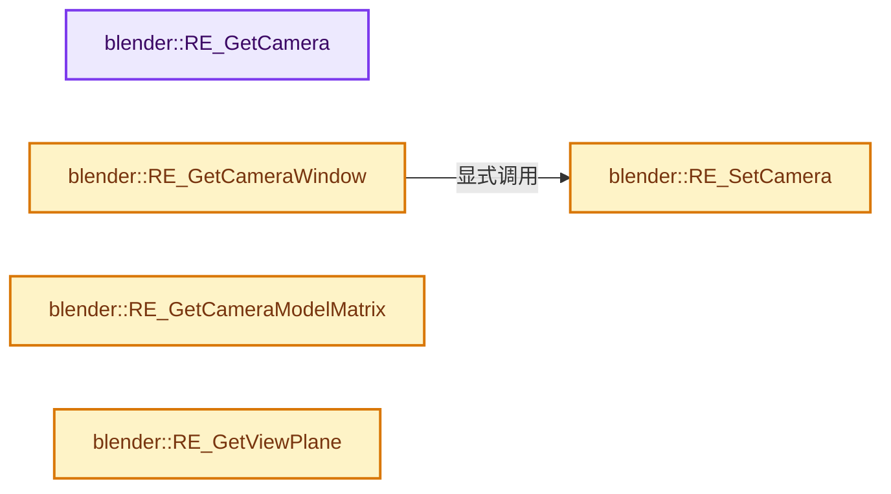
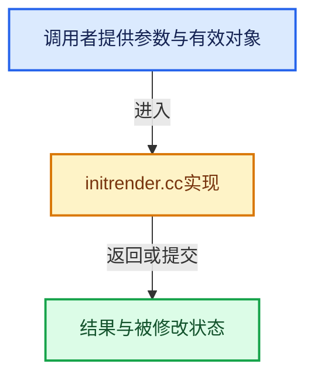

# 实现依赖专题：source/blender/render/intern/initrender.cc

[方向导航](README.md) · [符号索引](../%E7%AC%A6%E5%8F%B7%E4%BE%9D%E8%B5%96%E4%B8%8E%E5%AE%9E%E7%8E%B0%E7%B4%A2%E5%BC%95.md)

本专题从正文实际调用进入，集中保存共享实现。函数有稳定锚点，可从调用处直接跳到对应完整函数；递归与互相调用通过回链组织。

## 本文件的实现关系






## 完整成员与函数实现

<a id="f-c1bdb70ff4bf97c0"></a>

### `blender::RE_GetCamera`

实现位置：[source/blender/render/intern/initrender.cc](../../../../../source/blender/render/intern/initrender.cc) · L31—L35。

接口参数：

- `Render *re`

**教学注释版**

<!-- annotated:19f90b1682d8e1 -->

```cpp
Object *RE_GetCamera(Render *re)
{
  Object *camera = re->camera_override ? re->camera_override : re->scene->camera;
  return BKE_camera_multiview_render(*re->main, re->scene, camera, re->viewname);
}
```

<details>
<summary>核对原始源码：source/blender/render/intern/initrender.cc · L31—L35</summary>

<!-- original:19f90b1682d8e1:source/blender/render/intern/initrender.cc:31:35 -->

```cpp
Object *RE_GetCamera(Render *re)
{
  Object *camera = re->camera_override ? re->camera_override : re->scene->camera;
  return BKE_camera_multiview_render(*re->main, re->scene, camera, re->viewname);
}
```

</details>

**结果出口**

- `return BKE_camera_multiview_render(*re->main, re->scene, camera, re->viewname);`

**继续追踪实现**

- `BKE_camera_multiview_render` → [blender::BKE_camera_multiview_render · L1333](%E4%BE%9D%E8%B5%96-camera-dbe667.md#f-73007bf40bc5a706)。

<a id="f-77e5985544841338"></a>

### `blender::RE_SetCamera`

实现位置：[source/blender/render/intern/initrender.cc](../../../../../source/blender/render/intern/initrender.cc) · L42—L60。

接口参数：

- `Render *re`
- `const Object *cam_ob`

**教学注释版**

<!-- annotated:f803de6334886b -->

```cpp
void RE_SetCamera(Render *re, const Object *cam_ob)
{
  CameraParams params;

  /* setup parameters */
  BKE_camera_params_init(&params);
  BKE_camera_params_from_object(&params, cam_ob);
  BKE_camera_multiview_params(&re->r, &params, cam_ob, re->viewname);

  /* Compute matrix, view-plane, etc. */
  BKE_camera_params_compute_viewplane(&params, re->winx, re->winy, re->r.xasp, re->r.yasp);
  BKE_camera_params_compute_matrix(&params);

  /* extract results */
  copy_m4_m4(re->winmat, params.winmat);
  re->clip_start = params.clip_start;
  re->clip_end = params.clip_end;
  re->viewplane = params.viewplane;
}
```

<details>
<summary>核对原始源码：source/blender/render/intern/initrender.cc · L42—L60</summary>

<!-- original:f803de6334886b:source/blender/render/intern/initrender.cc:42:60 -->

```cpp
void RE_SetCamera(Render *re, const Object *cam_ob)
{
  CameraParams params;

  /* setup parameters */
  BKE_camera_params_init(&params);
  BKE_camera_params_from_object(&params, cam_ob);
  BKE_camera_multiview_params(&re->r, &params, cam_ob, re->viewname);

  /* Compute matrix, view-plane, etc. */
  BKE_camera_params_compute_viewplane(&params, re->winx, re->winy, re->r.xasp, re->r.yasp);
  BKE_camera_params_compute_matrix(&params);

  /* extract results */
  copy_m4_m4(re->winmat, params.winmat);
  re->clip_start = params.clip_start;
  re->clip_end = params.clip_end;
  re->viewplane = params.viewplane;
}
```

</details>

**沿实际写入检查状态**

- `re->clip_start = params.clip_start;`
- `re->clip_end = params.clip_end;`
- `re->viewplane = params.viewplane;`

**继续追踪实现**

- `BKE_camera_params_init` → [blender::BKE_camera_params_init · L365](%E4%BE%9D%E8%B5%96-camera-dbe667.md#f-01921b9d54f56ab2)。
- `BKE_camera_params_from_object` → [blender::BKE_camera_params_from_object · L381](%E4%BE%9D%E8%B5%96-camera-dbe667.md#f-8105a1058cdbd883)。
- `BKE_camera_multiview_params` → [blender::BKE_camera_multiview_params · L1412](%E4%BE%9D%E8%B5%96-camera-dbe667.md#f-56bf04ed9486a614)。
- `BKE_camera_params_compute_viewplane` → [blender::BKE_camera_params_compute_viewplane · L483](%E4%BE%9D%E8%B5%96-camera-dbe667.md#f-27e265da4ca74d77)。
- `BKE_camera_params_compute_matrix` → [blender::BKE_camera_params_compute_matrix · L567](%E4%BE%9D%E8%B5%96-camera-dbe667.md#f-b7c25e1f7e6601c3)。
- `copy_m4_m4` → [blender::copy_m4_m4 · L84](../12-%E7%A9%BA%E9%97%B4%E6%95%B0%E6%8D%AE%E7%BB%93%E6%9E%84%E4%B8%8E%E5%87%A0%E4%BD%95%E7%AE%97%E6%B3%95/%E4%BE%9D%E8%B5%96-math_matrix_c-004123.md#f-b4390cf8c94710f5)。

<a id="f-01c1ec9fe7ee7242"></a>

### `blender::RE_GetCameraWindow`

实现位置：[source/blender/render/intern/initrender.cc](../../../../../source/blender/render/intern/initrender.cc) · L62—L66。

接口参数：

- `Render *re`
- `const Object *camera`
- `float r_winmat[4][4]`

**教学注释版**

<!-- annotated:5949ba236edd3e -->

```cpp
void RE_GetCameraWindow(Render *re, const Object *camera, float r_winmat[4][4])
{
  RE_SetCamera(re, camera);
  copy_m4_m4(r_winmat, re->winmat);
}
```

<details>
<summary>核对原始源码：source/blender/render/intern/initrender.cc · L62—L66</summary>

<!-- original:5949ba236edd3e:source/blender/render/intern/initrender.cc:62:66 -->

```cpp
void RE_GetCameraWindow(Render *re, const Object *camera, float r_winmat[4][4])
{
  RE_SetCamera(re, camera);
  copy_m4_m4(r_winmat, re->winmat);
}
```

</details>

**继续追踪实现**

- `RE_SetCamera` → [blender::RE_SetCamera · L42](%E4%BE%9D%E8%B5%96-initrender-a27eba.md#f-77e5985544841338)。
- `copy_m4_m4` → [blender::copy_m4_m4 · L84](../12-%E7%A9%BA%E9%97%B4%E6%95%B0%E6%8D%AE%E7%BB%93%E6%9E%84%E4%B8%8E%E5%87%A0%E4%BD%95%E7%AE%97%E6%B3%95/%E4%BE%9D%E8%B5%96-math_matrix_c-004123.md#f-b4390cf8c94710f5)。

<a id="f-c87579d9293cf439"></a>

### `blender::RE_GetCameraModelMatrix`

实现位置：[source/blender/render/intern/initrender.cc](../../../../../source/blender/render/intern/initrender.cc) · L74—L77。

接口参数：

- `const Render *re`
- `const Object *camera`
- `float r_modelmat[4][4]`

**教学注释版**

<!-- annotated:173519089bc7d1 -->

```cpp
void RE_GetCameraModelMatrix(const Render *re, const Object *camera, float r_modelmat[4][4])
{
  BKE_camera_multiview_model_matrix(&re->r, camera, re->viewname, r_modelmat);
}
```

<details>
<summary>核对原始源码：source/blender/render/intern/initrender.cc · L74—L77</summary>

<!-- original:173519089bc7d1:source/blender/render/intern/initrender.cc:74:77 -->

```cpp
void RE_GetCameraModelMatrix(const Render *re, const Object *camera, float r_modelmat[4][4])
{
  BKE_camera_multiview_model_matrix(&re->r, camera, re->viewname, r_modelmat);
}
```

</details>

**继续追踪实现**

- `BKE_camera_multiview_model_matrix` → [blender::BKE_camera_multiview_model_matrix · L1226](%E4%BE%9D%E8%B5%96-camera-dbe667.md#f-4a6d6e4c219db253)。

<a id="f-e4d8c6817735dbb7"></a>

### `blender::RE_GetViewPlane`

实现位置：[source/blender/render/intern/initrender.cc](../../../../../source/blender/render/intern/initrender.cc) · L102—L113。

接口参数：

- `Render *re`
- `rctf *r_viewplane`
- `rcti *r_disprect`

**教学注释版**

<!-- annotated:361463b22e0846 -->

```cpp
void RE_GetViewPlane(Render *re, rctf *r_viewplane, rcti *r_disprect)
{
  *r_viewplane = re->viewplane;

  /* make disprect zero when no border render, is needed to detect changes in 3d view render */
  if (re->r.mode & R_BORDER) {
    *r_disprect = re->disprect;
  }
  else {
    BLI_rcti_init(r_disprect, 0, 0, 0, 0);
  }
}
```

<details>
<summary>核对原始源码：source/blender/render/intern/initrender.cc · L102—L113</summary>

<!-- original:361463b22e0846:source/blender/render/intern/initrender.cc:102:113 -->

```cpp
void RE_GetViewPlane(Render *re, rctf *r_viewplane, rcti *r_disprect)
{
  *r_viewplane = re->viewplane;

  /* make disprect zero when no border render, is needed to detect changes in 3d view render */
  if (re->r.mode & R_BORDER) {
    *r_disprect = re->disprect;
  }
  else {
    BLI_rcti_init(r_disprect, 0, 0, 0, 0);
  }
}
```

</details>

**继续追踪实现**

- `BLI_rcti_init` → [blender::BLI_rcti_init · L428](../01-%E5%9F%BA%E7%A1%80%E5%AE%B9%E5%99%A8%E4%B8%8E%E7%8E%B0%E4%BB%A3CPP/%E4%BE%9D%E8%B5%96-rct-6e7349.md#f-c75659264970b4d1)。
