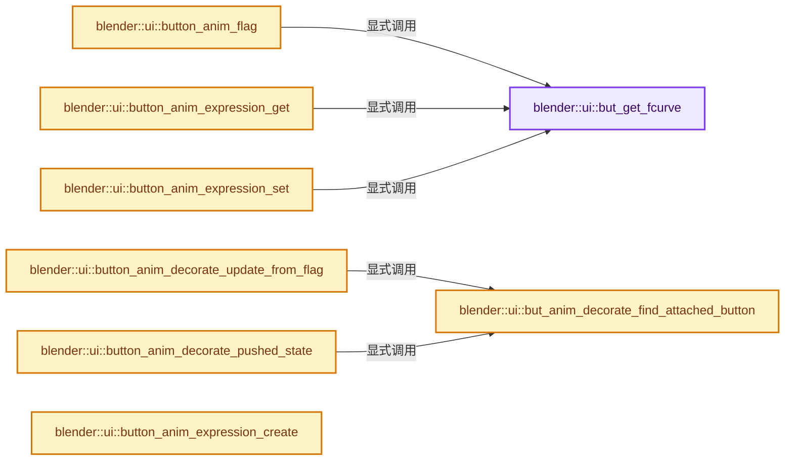

# 实现依赖专题：source/blender/editors/interface/interface_anim.cc

[方向导航](README.md) · [符号索引](../%E7%AC%A6%E5%8F%B7%E4%BE%9D%E8%B5%96%E4%B8%8E%E5%AE%9E%E7%8E%B0%E7%B4%A2%E5%BC%95.md)

本专题从正文实际调用进入，集中保存共享实现。函数有稳定锚点，可从调用处直接跳到对应完整函数；递归与互相调用通过回链组织。

## 本文件的实现关系




## 完整成员与函数实现

<a id="f-3aa5ad0ce017e37a"></a>

### `blender::ui::but_get_fcurve`

实现位置：[source/blender/editors/interface/interface_anim.cc](../../../../../source/blender/editors/interface/interface_anim.cc) · L45—L60。

接口参数：

- `Button *but`
- `AnimData **adt`
- `bAction **action`
- `bool *r_driven`
- `bool *r_special`

**教学注释版**

<!-- annotated:86e4739056ad70 -->

```cpp
static FCurve *but_get_fcurve(
    Button *but, AnimData **adt, bAction **action, bool *r_driven, bool *r_special)
{
  /* for entire array buttons we check the first component, it's not perfect
   * but works well enough in typical cases */
  const int rnaindex = (but->rnaindex == -1) ? 0 : but->rnaindex;

  return BKE_fcurve_find_by_rna_context_ui(static_cast<bContext *>(but->block->evil_C),
                                           &but->rnapoin,
                                           but->rnaprop,
                                           rnaindex,
                                           adt,
                                           action,
                                           r_driven,
                                           r_special);
}
```

<details>
<summary>核对原始源码：source/blender/editors/interface/interface_anim.cc · L45—L60</summary>

<!-- original:86e4739056ad70:source/blender/editors/interface/interface_anim.cc:45:60 -->

```cpp
static FCurve *but_get_fcurve(
    Button *but, AnimData **adt, bAction **action, bool *r_driven, bool *r_special)
{
  /* for entire array buttons we check the first component, it's not perfect
   * but works well enough in typical cases */
  const int rnaindex = (but->rnaindex == -1) ? 0 : but->rnaindex;

  return BKE_fcurve_find_by_rna_context_ui(static_cast<bContext *>(but->block->evil_C),
                                           &but->rnapoin,
                                           but->rnaprop,
                                           rnaindex,
                                           adt,
                                           action,
                                           r_driven,
                                           r_special);
}
```

</details>

**结果出口**

- `return BKE_fcurve_find_by_rna_context_ui(static_cast<bContext *>(but->block->evil_C),`

**继续追踪实现**

- `BKE_fcurve_find_by_rna_context_ui` → [blender::BKE_fcurve_find_by_rna_context_ui · L383](%E4%BE%9D%E8%B5%96-fcurve-593e2e.md#f-ac8daff42475301f)。

<a id="f-ecf7f08536fcc3df"></a>

### `blender::ui::button_anim_flag`

实现位置：[source/blender/editors/interface/interface_anim.cc](../../../../../source/blender/editors/interface/interface_anim.cc) · L62—L124。

接口参数：

- `Button *but`
- `const AnimationEvalContext *anim_eval_context`

**教学注释版**

<!-- annotated:e854638d584ab8 -->

```cpp
void button_anim_flag(Button *but, const AnimationEvalContext *anim_eval_context)
{
  /* Clear the flags that this function might set. */
  but->flag &= ~(BUT_ANIMATED | BUT_ANIMATED_KEY | BUT_DRIVEN);
  but->drawflag &= ~BUT_ANIMATED_CHANGED;

  /* NOTE: "special" is reserved for special F-Curves stored on the animation data
   *        itself (which are used to animate properties of the animation data).
   *        We count those as "animated" too for now
   */
  AnimData *adt;
  bAction *act;
  bool driven;
  bool special;
  FCurve *fcu = but_get_fcurve(but, &adt, &act, &driven, &special);

  if (!fcu) {
    return;
  }
  if (driven) {
    but->flag |= BUT_DRIVEN;
    return;
  }

  /* Empty curves are ignored by the animation evaluation system. */
  if (BKE_fcurve_is_empty(fcu)) {
    return;
  }

  but->flag |= BUT_ANIMATED;

  /* #41525 - When the active action is a NLA strip being edited,
   * we need to correct the frame number to "look inside" the
   * remapped action
   */
  float cfra = anim_eval_context->eval_time;
  if (adt) {
    cfra = BKE_nla_tweakedit_remap(adt, cfra, NLATIME_CONVERT_UNMAP);
  }

  if (animrig::fcurve_frame_has_keyframe(fcu, cfra)) {
    but->flag |= BUT_ANIMATED_KEY;
  }

  /* This feature is not implemented at all for the NLA. However, if the NLA just consists of
   * stashed (i.e. deactivated) Actions, it doesn't do anything, and we can treat it as
   * non-existent here. Note that this is mostly to play nice with stashed Actions, and doesn't
   * fully look at all the track & strip flags. */
  if (adt) {
    for (NlaTrack &nla_track : adt->nla_tracks) {
      if (!(nla_track.flag & NLATRACK_MUTED)) {
        /* Found a non-muted track, so this NLA is not purely for stashing Actions. */
        return;
      }
    }
  }

  const AnimationEvalContext remapped_context = BKE_animsys_eval_context_construct_at(
      anim_eval_context, cfra);
  if (fcurve_is_changed(but->rnapoin, but->rnaprop, fcu, &remapped_context)) {
    but->drawflag |= BUT_ANIMATED_CHANGED;
  }
}
```

<details>
<summary>核对原始源码：source/blender/editors/interface/interface_anim.cc · L62—L124</summary>

<!-- original:e854638d584ab8:source/blender/editors/interface/interface_anim.cc:62:124 -->

```cpp
void button_anim_flag(Button *but, const AnimationEvalContext *anim_eval_context)
{
  /* Clear the flags that this function might set. */
  but->flag &= ~(BUT_ANIMATED | BUT_ANIMATED_KEY | BUT_DRIVEN);
  but->drawflag &= ~BUT_ANIMATED_CHANGED;

  /* NOTE: "special" is reserved for special F-Curves stored on the animation data
   *        itself (which are used to animate properties of the animation data).
   *        We count those as "animated" too for now
   */
  AnimData *adt;
  bAction *act;
  bool driven;
  bool special;
  FCurve *fcu = but_get_fcurve(but, &adt, &act, &driven, &special);

  if (!fcu) {
    return;
  }
  if (driven) {
    but->flag |= BUT_DRIVEN;
    return;
  }

  /* Empty curves are ignored by the animation evaluation system. */
  if (BKE_fcurve_is_empty(fcu)) {
    return;
  }

  but->flag |= BUT_ANIMATED;

  /* #41525 - When the active action is a NLA strip being edited,
   * we need to correct the frame number to "look inside" the
   * remapped action
   */
  float cfra = anim_eval_context->eval_time;
  if (adt) {
    cfra = BKE_nla_tweakedit_remap(adt, cfra, NLATIME_CONVERT_UNMAP);
  }

  if (animrig::fcurve_frame_has_keyframe(fcu, cfra)) {
    but->flag |= BUT_ANIMATED_KEY;
  }

  /* This feature is not implemented at all for the NLA. However, if the NLA just consists of
   * stashed (i.e. deactivated) Actions, it doesn't do anything, and we can treat it as
   * non-existent here. Note that this is mostly to play nice with stashed Actions, and doesn't
   * fully look at all the track & strip flags. */
  if (adt) {
    for (NlaTrack &nla_track : adt->nla_tracks) {
      if (!(nla_track.flag & NLATRACK_MUTED)) {
        /* Found a non-muted track, so this NLA is not purely for stashing Actions. */
        return;
      }
    }
  }

  const AnimationEvalContext remapped_context = BKE_animsys_eval_context_construct_at(
      anim_eval_context, cfra);
  if (fcurve_is_changed(but->rnapoin, but->rnaprop, fcu, &remapped_context)) {
    but->drawflag |= BUT_ANIMATED_CHANGED;
  }
}
```

</details>

**沿实际写入检查状态**

- `but->flag &= ~(BUT_ANIMATED | BUT_ANIMATED_KEY | BUT_DRIVEN);`
- `but->drawflag &= ~BUT_ANIMATED_CHANGED;`
- `but->flag |= BUT_DRIVEN;`
- `but->flag |= BUT_ANIMATED;`
- `cfra = BKE_nla_tweakedit_remap(adt, cfra, NLATIME_CONVERT_UNMAP);`
- `but->flag |= BUT_ANIMATED_KEY;`
- `but->drawflag |= BUT_ANIMATED_CHANGED;`

**继续追踪实现**

- `but_get_fcurve` → [blender::ui::but_get_fcurve · L45](%E4%BE%9D%E8%B5%96-interface_anim-9d3469.md#f-3aa5ad0ce017e37a)。
- `BKE_fcurve_is_empty` → [blender::BKE_fcurve_is_empty · L2492](%E4%BE%9D%E8%B5%96-fcurve-593e2e.md#f-d6df9e9e77afd03e)。
- `BKE_nla_tweakedit_remap` → [blender::BKE_nla_tweakedit_remap · L807](%E4%BE%9D%E8%B5%96-nla-763f5d.md#f-9074bdbe8cd2f2c6)。
- `animrig::fcurve_frame_has_keyframe` → [blender::animrig::fcurve_frame_has_keyframe · L695](%E4%BE%9D%E8%B5%96-fcurve-53c215.md#f-a95ea42ae89eb5ac)。
- `BKE_animsys_eval_context_construct_at` → [blender::BKE_animsys_eval_context_construct_at · L610](%E4%BE%9D%E8%B5%96-anim_sys-5a63db.md#f-14ac59b6d9afad82)。
- `fcurve_is_changed` → [blender::fcurve_is_changed · L1656](%E4%BE%9D%E8%B5%96-keyframing-67aa70.md#f-7d947a40c626bb3d)。

<a id="f-d832cc879a0353ad"></a>

### `blender::ui::but_anim_decorate_find_attached_button`

实现位置：[source/blender/editors/interface/interface_anim.cc](../../../../../source/blender/editors/interface/interface_anim.cc) · L126—L150。

接口参数：

- `ButtonDecorator *but`

**教学注释版**

<!-- annotated:b6711d81fe5d9c -->

```cpp
static Button *but_anim_decorate_find_attached_button(ButtonDecorator *but)
{
  Button *but_iter = nullptr;

  BLI_assert(button_is_decorator(but));
  BLI_assert(but->decorated_rnapoin && but->decorated_rnaprop);
  if (but->block->buttons_ptrs.is_empty()) {
    return nullptr;
  }
  int i = but->block->but_index(but);
  i = i > 0 ? i - 1 : but->block->buttons_ptrs.size() - 1;
  const int start = i;
  do {
    but_iter = but->block->buttons_ptrs[i].get();
    if (but_iter != but &&
        button_rna_equals_ex(
            but_iter, &but->decorated_rnapoin, but->decorated_rnaprop, but->decorated_rnaindex))
    {
      return but_iter;
    }
    i = i > 0 ? i - 1 : but->block->buttons_ptrs.size() - 1;
  } while (i != start);

  return nullptr;
}
```

<details>
<summary>核对原始源码：source/blender/editors/interface/interface_anim.cc · L126—L150</summary>

<!-- original:b6711d81fe5d9c:source/blender/editors/interface/interface_anim.cc:126:150 -->

```cpp
static Button *but_anim_decorate_find_attached_button(ButtonDecorator *but)
{
  Button *but_iter = nullptr;

  BLI_assert(button_is_decorator(but));
  BLI_assert(but->decorated_rnapoin && but->decorated_rnaprop);
  if (but->block->buttons_ptrs.is_empty()) {
    return nullptr;
  }
  int i = but->block->but_index(but);
  i = i > 0 ? i - 1 : but->block->buttons_ptrs.size() - 1;
  const int start = i;
  do {
    but_iter = but->block->buttons_ptrs[i].get();
    if (but_iter != but &&
        button_rna_equals_ex(
            but_iter, &but->decorated_rnapoin, but->decorated_rnaprop, but->decorated_rnaindex))
    {
      return but_iter;
    }
    i = i > 0 ? i - 1 : but->block->buttons_ptrs.size() - 1;
  } while (i != start);

  return nullptr;
}
```

</details>

**沿实际写入检查状态**

- `i = i > 0 ? i - 1 : but->block->buttons_ptrs.size() - 1;`
- `but_iter = but->block->buttons_ptrs[i].get();`

**结果出口**

- `return nullptr;`
- `return but_iter;`

**继续追踪实现**

- `BLI_assert` → [BLI_assert · L48](../01-%E5%9F%BA%E7%A1%80%E5%AE%B9%E5%99%A8%E4%B8%8E%E7%8E%B0%E4%BB%A3CPP/%E4%BE%9D%E8%B5%96-BLI_assert-cc98e8.md#m-57a88495704d)；[BLI_assert · L63](../01-%E5%9F%BA%E7%A1%80%E5%AE%B9%E5%99%A8%E4%B8%8E%E7%8E%B0%E4%BB%A3CPP/%E4%BE%9D%E8%B5%96-BLI_assert-cc98e8.md#m-d07050020cb5)。宏定义由构建条件选择。
- `button_is_decorator` → [button_is_decorator · L895](%E4%BE%9D%E8%B5%96-UI_interface_c-54f196.md#m-4958d35ca4c1)。宏定义由构建条件选择。
- `but->block->buttons_ptrs.is_empty` → [调用协议](../%E6%A8%A1%E6%9D%BF%E5%AE%8F%E4%B8%8E%E5%8A%A8%E6%80%81%E5%88%86%E6%B4%BE%E5%8D%8F%E8%AE%AE.md)：接收对象类型依赖auto、返回值或模板实例；不按同名猜测目标。调用位置L132。
- `but->block->but_index` → [调用协议](../%E6%A8%A1%E6%9D%BF%E5%AE%8F%E4%B8%8E%E5%8A%A8%E6%80%81%E5%88%86%E6%B4%BE%E5%8D%8F%E8%AE%AE.md)：接收对象类型依赖auto、返回值或模板实例；不按同名猜测目标。调用位置L135。
- `but->block->buttons_ptrs.size` → [调用协议](../%E6%A8%A1%E6%9D%BF%E5%AE%8F%E4%B8%8E%E5%8A%A8%E6%80%81%E5%88%86%E6%B4%BE%E5%8D%8F%E8%AE%AE.md)：接收对象类型依赖auto、返回值或模板实例；不按同名猜测目标。调用位置L136。
- `but->block->buttons_ptrs[i].get` → [调用协议](../%E6%A8%A1%E6%9D%BF%E5%AE%8F%E4%B8%8E%E5%8A%A8%E6%80%81%E5%88%86%E6%B4%BE%E5%8D%8F%E8%AE%AE.md)：接收对象类型依赖auto、返回值或模板实例；不按同名猜测目标。调用位置L139。
- `button_rna_equals_ex` → [blender::ui::button_rna_equals_ex · L795](%E4%BE%9D%E8%B5%96-interface-11578b.md#f-f9a4827961167ec1)。

<a id="f-5f9950372b30535e"></a>

### `blender::ui::button_anim_decorate_update_from_flag`

实现位置：[source/blender/editors/interface/interface_anim.cc](../../../../../source/blender/editors/interface/interface_anim.cc) · L152—L193。

接口参数：

- `ButtonDecorator *but`

**教学注释版**

<!-- annotated:67208b149e11c8 -->

```cpp
void button_anim_decorate_update_from_flag(ButtonDecorator *but)
{
  if (!but->decorated_rnapoin || !but->decorated_rnaprop) {
    /* Nothing to do. */
    return;
  }

  const Button *but_anim = but_anim_decorate_find_attached_button(but);

  if (!but_anim) {
    printf("Could not find button with matching property to decorate (%s.%s)\n",
           RNA_struct_identifier(but->decorated_rnapoin.type),
           RNA_property_identifier(but->decorated_rnaprop));
    return;
  }

  const int64_t flag = but_anim->flag;

  if (flag & BUT_DRIVEN) {
    but->icon = ICON_DECORATE_DRIVER;
    but->toggle_keyframe_on_click = false;
  }
  else if (flag & BUT_ANIMATED_KEY) {
    but->icon = ICON_DECORATE_KEYFRAME;
    but->toggle_keyframe_on_click = true;
  }
  else if (flag & BUT_ANIMATED) {
    but->icon = ICON_DECORATE_ANIMATE;
    but->toggle_keyframe_on_click = true;
  }
  else if (flag & BUT_OVERRIDDEN) {
    but->icon = ICON_DECORATE_OVERRIDE;
    but->toggle_keyframe_on_click = false;
  }
  else {
    but->icon = ICON_DECORATE;
    but->toggle_keyframe_on_click = true;
  }

  const int64_t flag_copy = (BUT_DISABLED | BUT_INACTIVE);
  but->flag = (but->flag & ~flag_copy) | (flag & flag_copy);
}
```

<details>
<summary>核对原始源码：source/blender/editors/interface/interface_anim.cc · L152—L193</summary>

<!-- original:67208b149e11c8:source/blender/editors/interface/interface_anim.cc:152:193 -->

```cpp
void button_anim_decorate_update_from_flag(ButtonDecorator *but)
{
  if (!but->decorated_rnapoin || !but->decorated_rnaprop) {
    /* Nothing to do. */
    return;
  }

  const Button *but_anim = but_anim_decorate_find_attached_button(but);

  if (!but_anim) {
    printf("Could not find button with matching property to decorate (%s.%s)\n",
           RNA_struct_identifier(but->decorated_rnapoin.type),
           RNA_property_identifier(but->decorated_rnaprop));
    return;
  }

  const int64_t flag = but_anim->flag;

  if (flag & BUT_DRIVEN) {
    but->icon = ICON_DECORATE_DRIVER;
    but->toggle_keyframe_on_click = false;
  }
  else if (flag & BUT_ANIMATED_KEY) {
    but->icon = ICON_DECORATE_KEYFRAME;
    but->toggle_keyframe_on_click = true;
  }
  else if (flag & BUT_ANIMATED) {
    but->icon = ICON_DECORATE_ANIMATE;
    but->toggle_keyframe_on_click = true;
  }
  else if (flag & BUT_OVERRIDDEN) {
    but->icon = ICON_DECORATE_OVERRIDE;
    but->toggle_keyframe_on_click = false;
  }
  else {
    but->icon = ICON_DECORATE;
    but->toggle_keyframe_on_click = true;
  }

  const int64_t flag_copy = (BUT_DISABLED | BUT_INACTIVE);
  but->flag = (but->flag & ~flag_copy) | (flag & flag_copy);
}
```

</details>

**沿实际写入检查状态**

- `but->icon = ICON_DECORATE_DRIVER;`
- `but->toggle_keyframe_on_click = false;`
- `but->icon = ICON_DECORATE_KEYFRAME;`
- `but->toggle_keyframe_on_click = true;`
- `but->icon = ICON_DECORATE_ANIMATE;`
- `but->icon = ICON_DECORATE_OVERRIDE;`
- `but->icon = ICON_DECORATE;`
- `but->flag = (but->flag & ~flag_copy) | (flag & flag_copy);`

**继续追踪实现**

- `but_anim_decorate_find_attached_button` → [blender::ui::but_anim_decorate_find_attached_button · L126](%E4%BE%9D%E8%B5%96-interface_anim-9d3469.md#f-d832cc879a0353ad)。
- `printf` → [外部契约](https://eel.is/c++draft/)：这个边界按实际表达式及所属类型核对参数、返回值、寿命与失败行为。这里提供接口入口，不声称已解释该第三方版本的内部实现。
- `RNA_struct_identifier` → [blender::RNA_struct_identifier · L711](%E4%BE%9D%E8%B5%96-rna_access-706bea.md#f-754de32877e73311)。
- `RNA_property_identifier` → [blender::RNA_property_identifier · L1275](%E4%BE%9D%E8%B5%96-rna_access-706bea.md#f-67de6dc6c76092df)。

<a id="f-acbdf105a5095f78"></a>

### `blender::ui::button_anim_decorate_pushed_state`

实现位置：[source/blender/editors/interface/interface_anim.cc](../../../../../source/blender/editors/interface/interface_anim.cc) · L195—L202。

接口参数：

- `ButtonDecorator *but`

**教学注释版**

<!-- annotated:1bda1a1289b6cd -->

```cpp
bool button_anim_decorate_pushed_state(ButtonDecorator *but)
{
  const Button *but_anim = but_anim_decorate_find_attached_button(but);
  if (but_anim == nullptr) [[unlikely]] {
    return false;
  }
  return (but_anim->flag & BUT_ANIMATED_KEY) != 0;
}
```

<details>
<summary>核对原始源码：source/blender/editors/interface/interface_anim.cc · L195—L202</summary>

<!-- original:1bda1a1289b6cd:source/blender/editors/interface/interface_anim.cc:195:202 -->

```cpp
bool button_anim_decorate_pushed_state(ButtonDecorator *but)
{
  const Button *but_anim = but_anim_decorate_find_attached_button(but);
  if (but_anim == nullptr) [[unlikely]] {
    return false;
  }
  return (but_anim->flag & BUT_ANIMATED_KEY) != 0;
}
```

</details>

**结果出口**

- `return false;`
- `return (but_anim->flag & BUT_ANIMATED_KEY) != 0;`

**继续追踪实现**

- `but_anim_decorate_find_attached_button` → [blender::ui::but_anim_decorate_find_attached_button · L126](%E4%BE%9D%E8%B5%96-interface_anim-9d3469.md#f-d832cc879a0353ad)。

<a id="f-320a8a2c7728ffa4"></a>

### `blender::ui::button_anim_expression_get`

实现位置：[source/blender/editors/interface/interface_anim.cc](../../../../../source/blender/editors/interface/interface_anim.cc) · L204—L224。

接口参数：

- `Button *but`
- `char *str`
- `size_t str_maxncpy`

**教学注释版**

<!-- annotated:b3a6ce8f1c34c4 -->

```cpp
bool button_anim_expression_get(Button *but, char *str, size_t str_maxncpy)
{
  FCurve *fcu;
  ChannelDriver *driver;
  bool driven, special;

  fcu = but_get_fcurve(but, nullptr, nullptr, &driven, &special);

  if (fcu && driven) {
    driver = fcu->driver;

    if (driver && driver->type == DRIVER_TYPE_PYTHON) {
      if (str) {
        BLI_strncpy_utf8(str, driver->expression, str_maxncpy);
      }
      return true;
    }
  }

  return false;
}
```

<details>
<summary>核对原始源码：source/blender/editors/interface/interface_anim.cc · L204—L224</summary>

<!-- original:b3a6ce8f1c34c4:source/blender/editors/interface/interface_anim.cc:204:224 -->

```cpp
bool button_anim_expression_get(Button *but, char *str, size_t str_maxncpy)
{
  FCurve *fcu;
  ChannelDriver *driver;
  bool driven, special;

  fcu = but_get_fcurve(but, nullptr, nullptr, &driven, &special);

  if (fcu && driven) {
    driver = fcu->driver;

    if (driver && driver->type == DRIVER_TYPE_PYTHON) {
      if (str) {
        BLI_strncpy_utf8(str, driver->expression, str_maxncpy);
      }
      return true;
    }
  }

  return false;
}
```

</details>

**沿实际写入检查状态**

- `fcu = but_get_fcurve(but, nullptr, nullptr, &driven, &special);`
- `driver = fcu->driver;`

**结果出口**

- `return true;`
- `return false;`

**继续追踪实现**

- `but_get_fcurve` → [blender::ui::but_get_fcurve · L45](%E4%BE%9D%E8%B5%96-interface_anim-9d3469.md#f-3aa5ad0ce017e37a)。
- `BLI_strncpy_utf8` → [blender::BLI_strncpy_utf8 · L404](../01-%E5%9F%BA%E7%A1%80%E5%AE%B9%E5%99%A8%E4%B8%8E%E7%8E%B0%E4%BB%A3CPP/%E4%BE%9D%E8%B5%96-string_utf8-3c62ca.md#f-ff7c5f28742085a0)。

<a id="f-e78d6805a503aa3f"></a>

### `blender::ui::button_anim_expression_set`

实现位置：[source/blender/editors/interface/interface_anim.cc](../../../../../source/blender/editors/interface/interface_anim.cc) · L226—L259。

接口参数：

- `Button *but`
- `const char *str`

**教学注释版**

<!-- annotated:ba620d7502cda5 -->

```cpp
bool button_anim_expression_set(Button *but, const char *str)
{
  FCurve *fcu;
  ChannelDriver *driver;
  bool driven, special;

  fcu = but_get_fcurve(but, nullptr, nullptr, &driven, &special);

  if (fcu && driven) {
    driver = fcu->driver;

    if (driver && (driver->type == DRIVER_TYPE_PYTHON)) {
      bContext *C = static_cast<bContext *>(but->block->evil_C);

      STRNCPY_UTF8(driver->expression, str);

      /* tag driver as needing to be recompiled */
      BKE_driver_invalidate_expression(driver, true, false);

      /* clear invalid flags which may prevent this from working */
      driver->flag &= ~DRIVER_FLAG_INVALID;
      fcu->flag &= ~FCURVE_DISABLED;

      /* this notifier should update the Graph Editor and trigger depsgraph refresh? */
      WM_event_add_notifier(C, NC_ANIMATION | ND_KEYFRAME, nullptr);

      DEG_relations_tag_update(CTX_data_main(C));

      return true;
    }
  }

  return false;
}
```

<details>
<summary>核对原始源码：source/blender/editors/interface/interface_anim.cc · L226—L259</summary>

<!-- original:ba620d7502cda5:source/blender/editors/interface/interface_anim.cc:226:259 -->

```cpp
bool button_anim_expression_set(Button *but, const char *str)
{
  FCurve *fcu;
  ChannelDriver *driver;
  bool driven, special;

  fcu = but_get_fcurve(but, nullptr, nullptr, &driven, &special);

  if (fcu && driven) {
    driver = fcu->driver;

    if (driver && (driver->type == DRIVER_TYPE_PYTHON)) {
      bContext *C = static_cast<bContext *>(but->block->evil_C);

      STRNCPY_UTF8(driver->expression, str);

      /* tag driver as needing to be recompiled */
      BKE_driver_invalidate_expression(driver, true, false);

      /* clear invalid flags which may prevent this from working */
      driver->flag &= ~DRIVER_FLAG_INVALID;
      fcu->flag &= ~FCURVE_DISABLED;

      /* this notifier should update the Graph Editor and trigger depsgraph refresh? */
      WM_event_add_notifier(C, NC_ANIMATION | ND_KEYFRAME, nullptr);

      DEG_relations_tag_update(CTX_data_main(C));

      return true;
    }
  }

  return false;
}
```

</details>

**沿实际写入检查状态**

- `fcu = but_get_fcurve(but, nullptr, nullptr, &driven, &special);`
- `driver = fcu->driver;`
- `driver->flag &= ~DRIVER_FLAG_INVALID;`
- `fcu->flag &= ~FCURVE_DISABLED;`

**结果出口**

- `return true;`
- `return false;`

**继续追踪实现**

- `but_get_fcurve` → [blender::ui::but_get_fcurve · L45](%E4%BE%9D%E8%B5%96-interface_anim-9d3469.md#f-3aa5ad0ce017e37a)。
- `STRNCPY_UTF8` → [STRNCPY_UTF8 · L335](../01-%E5%9F%BA%E7%A1%80%E5%AE%B9%E5%99%A8%E4%B8%8E%E7%8E%B0%E4%BB%A3CPP/%E4%BE%9D%E8%B5%96-BLI_string_utf8-bcc961.md#m-222967f0ab6a)。宏定义由构建条件选择。
- `BKE_driver_invalidate_expression` → [blender::BKE_driver_invalidate_expression · L1262](%E4%BE%9D%E8%B5%96-fcurve_driver-ac5bc2.md#f-116c340c20708513)。
- `WM_event_add_notifier` → [blender::WM_event_add_notifier · L396](%E4%BE%9D%E8%B5%96-wm_event_system-a0fa4f.md#f-a1b32e7f4a69b28f)。
- `DEG_relations_tag_update` → [blender::DEG_relations_tag_update · L350](../11-Depsgraph%E4%B8%8E%E5%B9%B6%E8%A1%8C%E4%BB%BB%E5%8A%A1%E7%B3%BB%E7%BB%9F/%E4%BE%9D%E8%B5%96-depsgraph_build-ea2fc8.md#f-2910c78540652980)。
- `CTX_data_main` → [blender::CTX_data_main · L1313](%E4%BE%9D%E8%B5%96-context-a929d9.md#f-6d4ba24a62a80b94)。

<a id="f-8a79628ec90f362b"></a>

### `blender::ui::button_anim_expression_create`

实现位置：[source/blender/editors/interface/interface_anim.cc](../../../../../source/blender/editors/interface/interface_anim.cc) · L261—L325。

接口参数：

- `Button *but`
- `const char *str`

**教学注释版**

<!-- annotated:bf038c5559fe84 -->

```cpp
bool button_anim_expression_create(Button *but, const char *str)
{
  bContext *C = static_cast<bContext *>(but->block->evil_C);
  ID *id;
  FCurve *fcu;
  bool ok = false;

  /* button must have RNA-pointer to a numeric-capable property */
  if (!but->rnapoin || !but->rnaprop) {
    if (G.debug & G_DEBUG) {
      printf("ERROR: create expression failed - button has no RNA info attached\n");
    }
    return false;
  }

  if (RNA_property_array_check(but->rnaprop) != 0) {
    if (but->rnaindex == -1) {
      if (G.debug & G_DEBUG) {
        printf("ERROR: create expression failed - cannot create expression for entire array\n");
      }
      return false;
    }
  }

  /* Make sure we have animation-data for this. */
  /* FIXME: until materials can be handled by depsgraph,
   * don't allow drivers to be created for them. */
  id = but->rnapoin.owner_id;
  if ((id == nullptr) || (GS(id->name) == ID_MA) || (GS(id->name) == ID_TE)) {
    if (G.debug & G_DEBUG) {
      printf("ERROR: create expression failed - invalid data-block for adding drivers (%p)\n", id);
    }
    return false;
  }

  /* get path */
  const std::optional<std::string> path = RNA_path_from_ID_to_property(&but->rnapoin,
                                                                       but->rnaprop);
  if (!path) {
    return false;
  }

  /* create driver */
  fcu = verify_driver_fcurve(id, path->c_str(), but->rnaindex, DRIVER_FCURVE_KEYFRAMES);
  if (fcu) {
    ChannelDriver *driver = fcu->driver;

    if (driver) {
      /* set type of driver */
      driver->type = DRIVER_TYPE_PYTHON;

      /* set the expression */
      /* TODO: need some way of identifying variables used */
      STRNCPY_UTF8(driver->expression, str);

      /* updates */
      BKE_driver_invalidate_expression(driver, true, false);
      DEG_relations_tag_update(CTX_data_main(C));
      WM_event_add_notifier(C, NC_ANIMATION | ND_KEYFRAME, nullptr);
      ok = true;
    }
  }

  return ok;
}
```

<details>
<summary>核对原始源码：source/blender/editors/interface/interface_anim.cc · L261—L325</summary>

<!-- original:bf038c5559fe84:source/blender/editors/interface/interface_anim.cc:261:325 -->

```cpp
bool button_anim_expression_create(Button *but, const char *str)
{
  bContext *C = static_cast<bContext *>(but->block->evil_C);
  ID *id;
  FCurve *fcu;
  bool ok = false;

  /* button must have RNA-pointer to a numeric-capable property */
  if (!but->rnapoin || !but->rnaprop) {
    if (G.debug & G_DEBUG) {
      printf("ERROR: create expression failed - button has no RNA info attached\n");
    }
    return false;
  }

  if (RNA_property_array_check(but->rnaprop) != 0) {
    if (but->rnaindex == -1) {
      if (G.debug & G_DEBUG) {
        printf("ERROR: create expression failed - cannot create expression for entire array\n");
      }
      return false;
    }
  }

  /* Make sure we have animation-data for this. */
  /* FIXME: until materials can be handled by depsgraph,
   * don't allow drivers to be created for them. */
  id = but->rnapoin.owner_id;
  if ((id == nullptr) || (GS(id->name) == ID_MA) || (GS(id->name) == ID_TE)) {
    if (G.debug & G_DEBUG) {
      printf("ERROR: create expression failed - invalid data-block for adding drivers (%p)\n", id);
    }
    return false;
  }

  /* get path */
  const std::optional<std::string> path = RNA_path_from_ID_to_property(&but->rnapoin,
                                                                       but->rnaprop);
  if (!path) {
    return false;
  }

  /* create driver */
  fcu = verify_driver_fcurve(id, path->c_str(), but->rnaindex, DRIVER_FCURVE_KEYFRAMES);
  if (fcu) {
    ChannelDriver *driver = fcu->driver;

    if (driver) {
      /* set type of driver */
      driver->type = DRIVER_TYPE_PYTHON;

      /* set the expression */
      /* TODO: need some way of identifying variables used */
      STRNCPY_UTF8(driver->expression, str);

      /* updates */
      BKE_driver_invalidate_expression(driver, true, false);
      DEG_relations_tag_update(CTX_data_main(C));
      WM_event_add_notifier(C, NC_ANIMATION | ND_KEYFRAME, nullptr);
      ok = true;
    }
  }

  return ok;
}
```

</details>

**沿实际写入检查状态**

- `id = but->rnapoin.owner_id;`
- `fcu = verify_driver_fcurve(id, path->c_str(), but->rnaindex, DRIVER_FCURVE_KEYFRAMES);`
- `driver->type = DRIVER_TYPE_PYTHON;`
- `ok = true;`

**结果出口**

- `return false;`
- `return ok;`

**继续追踪实现**

- `printf` → [外部契约](https://eel.is/c++draft/)：这个边界按实际表达式及所属类型核对参数、返回值、寿命与失败行为。这里提供接口入口，不声称已解释该第三方版本的内部实现。
- `RNA_property_array_check` → [blender::RNA_property_array_check · L1376](%E4%BE%9D%E8%B5%96-rna_access-706bea.md#f-efbdada33e42c28c)。
- `GS` → [blender::GS · L410](%E4%BE%9D%E8%B5%96-DNA_ID-3eb091.md#f-c3ff509f79f21b05)。
- `RNA_path_from_ID_to_property` → [blender::RNA_path_from_ID_to_property · L1234](%E4%BE%9D%E8%B5%96-rna_path-495878.md#f-ef329046496e4c69)。
- `verify_driver_fcurve` → [blender::verify_driver_fcurve · L53](%E4%BE%9D%E8%B5%96-drivers-fb92e9.md#f-51ddebb3aff3cbd6)。
- `path->c_str` → [外部契约](https://eel.is/c++draft/)：这个边界按实际表达式及所属类型核对参数、返回值、寿命与失败行为。这里提供接口入口，不声称已解释该第三方版本的内部实现。
- `STRNCPY_UTF8` → [STRNCPY_UTF8 · L335](../01-%E5%9F%BA%E7%A1%80%E5%AE%B9%E5%99%A8%E4%B8%8E%E7%8E%B0%E4%BB%A3CPP/%E4%BE%9D%E8%B5%96-BLI_string_utf8-bcc961.md#m-222967f0ab6a)。宏定义由构建条件选择。
- `BKE_driver_invalidate_expression` → [blender::BKE_driver_invalidate_expression · L1262](%E4%BE%9D%E8%B5%96-fcurve_driver-ac5bc2.md#f-116c340c20708513)。
- `DEG_relations_tag_update` → [blender::DEG_relations_tag_update · L350](../11-Depsgraph%E4%B8%8E%E5%B9%B6%E8%A1%8C%E4%BB%BB%E5%8A%A1%E7%B3%BB%E7%BB%9F/%E4%BE%9D%E8%B5%96-depsgraph_build-ea2fc8.md#f-2910c78540652980)。
- `CTX_data_main` → [blender::CTX_data_main · L1313](%E4%BE%9D%E8%B5%96-context-a929d9.md#f-6d4ba24a62a80b94)。
- `WM_event_add_notifier` → [blender::WM_event_add_notifier · L396](%E4%BE%9D%E8%B5%96-wm_event_system-a0fa4f.md#f-a1b32e7f4a69b28f)。

<a id="f-609d3fe1cd087354"></a>

### `blender::ui::button_anim_autokey`

实现位置：[source/blender/editors/interface/interface_anim.cc](../../../../../source/blender/editors/interface/interface_anim.cc) · L327—L330。

接口参数：

- `bContext *C`
- `Button *but`
- `Scene *scene`
- `float cfra`

**教学注释版**

<!-- annotated:931e08a1bf997b -->

```cpp
void button_anim_autokey(bContext *C, Button *but, Scene *scene, float cfra)
{
  animrig::autokeyframe_property(C, scene, &but->rnapoin, but->rnaprop, but->rnaindex, cfra, true);
}
```

<details>
<summary>核对原始源码：source/blender/editors/interface/interface_anim.cc · L327—L330</summary>

<!-- original:931e08a1bf997b:source/blender/editors/interface/interface_anim.cc:327:330 -->

```cpp
void button_anim_autokey(bContext *C, Button *but, Scene *scene, float cfra)
{
  animrig::autokeyframe_property(C, scene, &but->rnapoin, but->rnaprop, but->rnaindex, cfra, true);
}
```

</details>

**继续追踪实现**

- `animrig::autokeyframe_property` → [blender::animrig::autokeyframe_property · L260](%E4%BE%9D%E8%B5%96-keyframing_auto-71b185.md#f-cb6b378c1c479685)。
