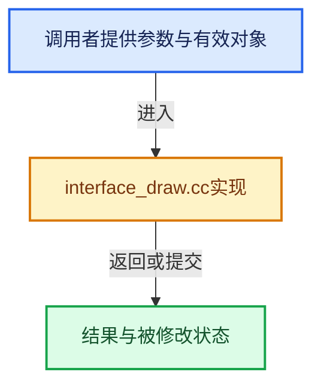

# 实现依赖专题：source/blender/editors/interface/interface_draw.cc

[方向导航](README.md) · [符号索引](../%E7%AC%A6%E5%8F%B7%E4%BE%9D%E8%B5%96%E4%B8%8E%E5%AE%9E%E7%8E%B0%E7%B4%A2%E5%BC%95.md)

本专题从正文实际调用进入，集中保存共享实现。函数有稳定锚点，可从调用处直接跳到对应完整函数；递归与互相调用通过回链组织。

## 本文件的实现关系





## 完整成员与函数实现

<a id="f-4da42aaeb8eb3e3f"></a>

### `blender::ui::draw_safe_areas`

实现位置：[source/blender/editors/interface/interface_draw.cc](../../../../../source/blender/editors/interface/interface_draw.cc) · L389—L413。

接口参数：

- `uint pos`
- `const rctf *rect`
- `const float title_aspect[2]`
- `const float action_aspect[2]`

**教学注释版**

<!-- annotated:874e83aa227d75 -->

```cpp
void draw_safe_areas(uint pos,
                     const rctf *rect,
                     const float title_aspect[2],
                     const float action_aspect[2])
{
  const float size_x_half = (rect->xmax - rect->xmin) * 0.5f;
  const float size_y_half = (rect->ymax - rect->ymin) * 0.5f;

  const float *safe_areas[] = {title_aspect, action_aspect};
  const int safe_len = ARRAY_SIZE(safe_areas);

  for (int i = 0; i < safe_len; i++) {
    if (safe_areas[i][0] || safe_areas[i][1]) {
      const float margin_x = safe_areas[i][0] * size_x_half;
      const float margin_y = safe_areas[i][1] * size_y_half;

      const float minx = rect->xmin + margin_x;
      const float miny = rect->ymin + margin_y;
      const float maxx = rect->xmax - margin_x;
      const float maxy = rect->ymax - margin_y;

      imm_draw_box_wire_2d(pos, minx, miny, maxx, maxy);
    }
  }
}
```

<details>
<summary>核对原始源码：source/blender/editors/interface/interface_draw.cc · L389—L413</summary>

<!-- original:874e83aa227d75:source/blender/editors/interface/interface_draw.cc:389:413 -->

```cpp
void draw_safe_areas(uint pos,
                     const rctf *rect,
                     const float title_aspect[2],
                     const float action_aspect[2])
{
  const float size_x_half = (rect->xmax - rect->xmin) * 0.5f;
  const float size_y_half = (rect->ymax - rect->ymin) * 0.5f;

  const float *safe_areas[] = {title_aspect, action_aspect};
  const int safe_len = ARRAY_SIZE(safe_areas);

  for (int i = 0; i < safe_len; i++) {
    if (safe_areas[i][0] || safe_areas[i][1]) {
      const float margin_x = safe_areas[i][0] * size_x_half;
      const float margin_y = safe_areas[i][1] * size_y_half;

      const float minx = rect->xmin + margin_x;
      const float miny = rect->ymin + margin_y;
      const float maxx = rect->xmax - margin_x;
      const float maxy = rect->ymax - margin_y;

      imm_draw_box_wire_2d(pos, minx, miny, maxx, maxy);
    }
  }
}
```

</details>

**继续追踪实现**

- `ARRAY_SIZE` → [ARRAY_SIZE · L24](%E4%BE%9D%E8%B5%96-rna_test-e441db.md#m-4f7358f7629e)。宏定义由构建条件选择。
- `imm_draw_box_wire_2d` → [blender::imm_draw_box_wire_2d · L636](%E4%BE%9D%E8%B5%96-gpu_immediate_util-34d2c1.md#f-4916e373908b75f2)。
