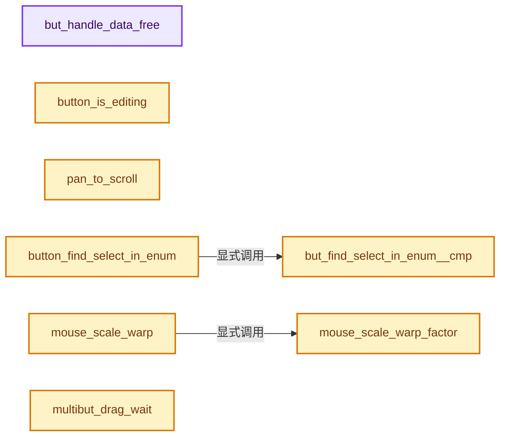

# 实现依赖专题：source/blender/editors/interface/interface_handlers.cc

[方向导航](README.md) · [符号索引](../%E7%AC%A6%E5%8F%B7%E4%BE%9D%E8%B5%96%E4%B8%8E%E5%AE%9E%E7%8E%B0%E7%B4%A2%E5%BC%95.md)

本专题从正文实际调用进入，集中保存共享实现。函数有稳定锚点，可从调用处直接跳到对应完整函数；递归与互相调用通过回链组织。

## 本文件的实现关系




<a id="m-0cdd885678cb"></a>

## 宏 `IS_ALLSELECT_EVENT`

<!-- annotated:e7941efc3da466 -->

```cpp
#  define IS_ALLSELECT_EVENT(event) (((event)->modifier & KM_ALT) != 0)

```

<details>
<summary>核对原始源码：source/blender/editors/interface/interface_handlers.cc · L311—L312</summary>

<!-- original:e7941efc3da466:source/blender/editors/interface/interface_handlers.cc:311:312 -->

```cpp
#  define IS_ALLSELECT_EVENT(event) (((event)->modifier & KM_ALT) != 0)

```

</details>

宏在预处理阶段展开，参数替换、重复求值和条件编译应直接从该定义检查。与普通函数不同，宏不会自动提供参数类型检查；构建配置选择哪个定义需结合外围条件。

## 完整成员与函数实现

<a id="f-c82740f78c7e95ce"></a>

### `but_handle_data_free`

实现位置：[source/blender/editors/interface/interface_handlers.cc](../../../../../source/blender/editors/interface/interface_handlers.cc) · L608—L612。

接口参数：

- `HandleButtonData **data`

**教学注释版**

<!-- annotated:b8d7fbe9045672 -->

```cpp
void but_handle_data_free(HandleButtonData **data)
{
  MEM_delete(*data);
  *data = nullptr;
}
```

<details>
<summary>核对原始源码：source/blender/editors/interface/interface_handlers.cc · L608—L612</summary>

<!-- original:b8d7fbe9045672:source/blender/editors/interface/interface_handlers.cc:608:612 -->

```cpp
void but_handle_data_free(HandleButtonData **data)
{
  MEM_delete(*data);
  *data = nullptr;
}
```

</details>

**继续追踪实现**

- `MEM_delete` → [MEM_delete · L400](../03-%E5%86%85%E5%AD%98%E5%88%86%E9%85%8D%E4%B8%8E%E8%BF%90%E8%A1%8C%E6%97%B6%E7%B1%BB%E5%9E%8B/%E4%BE%9D%E8%B5%96-MEM_guardedalloc-b54eca.md#f-9049ffdd1682887c)。

<a id="f-cf29a43214f5312e"></a>

### `button_is_editing`

实现位置：[source/blender/editors/interface/interface_handlers.cc](../../../../../source/blender/editors/interface/interface_handlers.cc) · L620—L624。

接口参数：

- `const Button *but`

**教学注释版**

<!-- annotated:2ee6f5f149e938 -->

```cpp
bool button_is_editing(const Button *but)
{
  const HandleButtonData *data = but->active;
  return (data && ELEM(data->state, BUTTON_STATE_TEXT_EDITING, BUTTON_STATE_NUM_EDITING));
}
```

<details>
<summary>核对原始源码：source/blender/editors/interface/interface_handlers.cc · L620—L624</summary>

<!-- original:2ee6f5f149e938:source/blender/editors/interface/interface_handlers.cc:620:624 -->

```cpp
bool button_is_editing(const Button *but)
{
  const HandleButtonData *data = but->active;
  return (data && ELEM(data->state, BUTTON_STATE_TEXT_EDITING, BUTTON_STATE_NUM_EDITING));
}
```

</details>

**结果出口**

- `return (data && ELEM(data->state, BUTTON_STATE_TEXT_EDITING, BUTTON_STATE_NUM_EDITING));`

**继续追踪实现**

- `ELEM` → [ELEM · L88](%E4%BE%9D%E8%B5%96-GHOST_utildefines-34b996.md#m-d28724a15928)；[ELEM · L135](../01-%E5%9F%BA%E7%A1%80%E5%AE%B9%E5%99%A8%E4%B8%8E%E7%8E%B0%E4%BB%A3CPP/%E4%BE%9D%E8%B5%96-BLI_utildefines-293a0a.md#m-d6572de7cae0)。宏定义由构建条件选择。

<a id="f-2da43c1c56180b26"></a>

### `pan_to_scroll`

实现位置：[source/blender/editors/interface/interface_handlers.cc](../../../../../source/blender/editors/interface/interface_handlers.cc) · L626—L655。

接口参数：

- `const wmEvent *event`
- `int *type`
- `int *val`

**教学注释版**

<!-- annotated:cae991fe8c836c -->

```cpp
void pan_to_scroll(const wmEvent *event, int *type, int *val)
{
  static int lastdy = 0;
  const int dy = WM_event_absolute_delta_y(event);

  /* This event should be originally from event->type,
   * converting wrong event into wheel is bad, see #33803. */
  BLI_assert(*type == MOUSEPAN);

  /* sign differs, reset */
  if ((dy > 0 && lastdy < 0) || (dy < 0 && lastdy > 0)) {
    lastdy = dy;
  }
  else {
    lastdy += dy;

    if (abs(lastdy) > int(UI_UNIT_Y)) {
      *val = KM_PRESS;

      if (dy > 0) {
        *type = WHEELUPMOUSE;
      }
      else {
        *type = WHEELDOWNMOUSE;
      }

      lastdy = 0;
    }
  }
}
```

<details>
<summary>核对原始源码：source/blender/editors/interface/interface_handlers.cc · L626—L655</summary>

<!-- original:cae991fe8c836c:source/blender/editors/interface/interface_handlers.cc:626:655 -->

```cpp
void pan_to_scroll(const wmEvent *event, int *type, int *val)
{
  static int lastdy = 0;
  const int dy = WM_event_absolute_delta_y(event);

  /* This event should be originally from event->type,
   * converting wrong event into wheel is bad, see #33803. */
  BLI_assert(*type == MOUSEPAN);

  /* sign differs, reset */
  if ((dy > 0 && lastdy < 0) || (dy < 0 && lastdy > 0)) {
    lastdy = dy;
  }
  else {
    lastdy += dy;

    if (abs(lastdy) > int(UI_UNIT_Y)) {
      *val = KM_PRESS;

      if (dy > 0) {
        *type = WHEELUPMOUSE;
      }
      else {
        *type = WHEELDOWNMOUSE;
      }

      lastdy = 0;
    }
  }
}
```

</details>

**沿实际写入检查状态**

- `lastdy = dy;`
- `lastdy += dy;`
- `lastdy = 0;`

**继续追踪实现**

- `WM_event_absolute_delta_y` → [blender::WM_event_absolute_delta_y · L666](%E4%BE%9D%E8%B5%96-wm_event_query-3f5652.md#f-16053d03de44f715)。
- `BLI_assert` → [BLI_assert · L48](../01-%E5%9F%BA%E7%A1%80%E5%AE%B9%E5%99%A8%E4%B8%8E%E7%8E%B0%E4%BB%A3CPP/%E4%BE%9D%E8%B5%96-BLI_assert-cc98e8.md#m-57a88495704d)；[BLI_assert · L63](../01-%E5%9F%BA%E7%A1%80%E5%AE%B9%E5%99%A8%E4%B8%8E%E7%8E%B0%E4%BB%A3CPP/%E4%BE%9D%E8%B5%96-BLI_assert-cc98e8.md#m-d07050020cb5)。宏定义由构建条件选择。
- `abs` → [abs · L462](%E4%BE%9D%E8%B5%96-rall2d-144372.md#f-81abb9af901caddd)；[abs · L129](%E4%BE%9D%E8%B5%96-math_base-b01ba9.md#f-f9539991b305db43)。同名重载需按实参类型选择。

<a id="f-fb071b88c3583a37"></a>

### `but_find_select_in_enum__cmp`

实现位置：[source/blender/editors/interface/interface_handlers.cc](../../../../../source/blender/editors/interface/interface_handlers.cc) · L657—L662。

接口参数：

- `const Button *but_a`
- `const Button *but_b`

**教学注释版**

<!-- annotated:fb233dbe938a5b -->

```cpp
static bool but_find_select_in_enum__cmp(const Button *but_a, const Button *but_b)
{
  return ((but_a->type == but_b->type) && (but_a->alignnr == but_b->alignnr) &&
          (but_a->poin == but_b->poin) && (but_a->rnapoin.type == but_b->rnapoin.type) &&
          (but_a->rnaprop == but_b->rnaprop));
}
```

<details>
<summary>核对原始源码：source/blender/editors/interface/interface_handlers.cc · L657—L662</summary>

<!-- original:fb233dbe938a5b:source/blender/editors/interface/interface_handlers.cc:657:662 -->

```cpp
static bool but_find_select_in_enum__cmp(const Button *but_a, const Button *but_b)
{
  return ((but_a->type == but_b->type) && (but_a->alignnr == but_b->alignnr) &&
          (but_a->poin == but_b->poin) && (but_a->rnapoin.type == but_b->rnapoin.type) &&
          (but_a->rnaprop == but_b->rnaprop));
}
```

</details>

**结果出口**

- `return ((but_a->type == but_b->type) && (but_a->alignnr == but_b->alignnr) &&`

**继续追踪实现**

本实现没有需要继续展开的显式调用；检查返回表达式、对象转换和调用者前置条件。

<a id="f-ef27f1189a835438"></a>

### `button_find_select_in_enum`

实现位置：[source/blender/editors/interface/interface_handlers.cc](../../../../../source/blender/editors/interface/interface_handlers.cc) · L664—L688。

接口参数：

- `Button *but`
- `int direction`

**教学注释版**

<!-- annotated:7df63b29e8d479 -->

```cpp
Button *button_find_select_in_enum(Button *but, int direction)
{
  Block *block = but->block;
  int i = block->but_index(but);
  Button *but_found = nullptr;
  BLI_assert(ELEM(direction, -1, 1));

  while (i > 0 && but_find_select_in_enum__cmp(block->buttons_ptrs[i - 1].get(), but)) {
    i--;
  }

  while (i < block->buttons_ptrs.size() &&
         but_find_select_in_enum__cmp(block->buttons_ptrs[i].get(), but))
  {
    if (block->buttons_ptrs[i]->flag & UI_SELECT) {
      but_found = block->buttons_ptrs[i].get();
      if (direction == 1) {
        break;
      }
    }
    i++;
  }

  return but_found;
}
```

<details>
<summary>核对原始源码：source/blender/editors/interface/interface_handlers.cc · L664—L688</summary>

<!-- original:7df63b29e8d479:source/blender/editors/interface/interface_handlers.cc:664:688 -->

```cpp
Button *button_find_select_in_enum(Button *but, int direction)
{
  Block *block = but->block;
  int i = block->but_index(but);
  Button *but_found = nullptr;
  BLI_assert(ELEM(direction, -1, 1));

  while (i > 0 && but_find_select_in_enum__cmp(block->buttons_ptrs[i - 1].get(), but)) {
    i--;
  }

  while (i < block->buttons_ptrs.size() &&
         but_find_select_in_enum__cmp(block->buttons_ptrs[i].get(), but))
  {
    if (block->buttons_ptrs[i]->flag & UI_SELECT) {
      but_found = block->buttons_ptrs[i].get();
      if (direction == 1) {
        break;
      }
    }
    i++;
  }

  return but_found;
}
```

</details>

**沿实际写入检查状态**

- `but_found = block->buttons_ptrs[i].get();`

**结果出口**

- `return but_found;`

**继续追踪实现**

- `block->but_index` → [blender::ui::Block::but_index · L276](%E4%BE%9D%E8%B5%96-interface-11578b.md#f-e2b673705e150427)。
- `BLI_assert` → [BLI_assert · L48](../01-%E5%9F%BA%E7%A1%80%E5%AE%B9%E5%99%A8%E4%B8%8E%E7%8E%B0%E4%BB%A3CPP/%E4%BE%9D%E8%B5%96-BLI_assert-cc98e8.md#m-57a88495704d)；[BLI_assert · L63](../01-%E5%9F%BA%E7%A1%80%E5%AE%B9%E5%99%A8%E4%B8%8E%E7%8E%B0%E4%BB%A3CPP/%E4%BE%9D%E8%B5%96-BLI_assert-cc98e8.md#m-d07050020cb5)。宏定义由构建条件选择。
- `ELEM` → [ELEM · L88](%E4%BE%9D%E8%B5%96-GHOST_utildefines-34b996.md#m-d28724a15928)；[ELEM · L135](../01-%E5%9F%BA%E7%A1%80%E5%AE%B9%E5%99%A8%E4%B8%8E%E7%8E%B0%E4%BB%A3CPP/%E4%BE%9D%E8%B5%96-BLI_utildefines-293a0a.md#m-d6572de7cae0)。宏定义由构建条件选择。
- `but_find_select_in_enum__cmp` → [but_find_select_in_enum__cmp · L657](%E4%BE%9D%E8%B5%96-interface_handlers-892571.md#f-fb071b88c3583a37)。
- `block->buttons_ptrs[i - 1].get` → [调用协议](../%E6%A8%A1%E6%9D%BF%E5%AE%8F%E4%B8%8E%E5%8A%A8%E6%80%81%E5%88%86%E6%B4%BE%E5%8D%8F%E8%AE%AE.md)：接收对象类型依赖auto、返回值或模板实例；不按同名猜测目标。调用位置L671。
- `block->buttons_ptrs.size` → [调用协议](../%E6%A8%A1%E6%9D%BF%E5%AE%8F%E4%B8%8E%E5%8A%A8%E6%80%81%E5%88%86%E6%B4%BE%E5%8D%8F%E8%AE%AE.md)：接收对象类型依赖auto、返回值或模板实例；不按同名猜测目标。调用位置L675。
- `block->buttons_ptrs[i].get` → [调用协议](../%E6%A8%A1%E6%9D%BF%E5%AE%8F%E4%B8%8E%E5%8A%A8%E6%80%81%E5%88%86%E6%B4%BE%E5%8D%8F%E8%AE%AE.md)：接收对象类型依赖auto、返回值或模板实例；不按同名猜测目标。调用位置L676。

<a id="f-70f5a8afadbeacff"></a>

### `mouse_scale_warp_factor`

实现位置：[source/blender/editors/interface/interface_handlers.cc](../../../../../source/blender/editors/interface/interface_handlers.cc) · L690—L693。

接口参数：

- `const bool shift`

**教学注释版**

<!-- annotated:cd68e38aa08ba1 -->

```cpp
static float mouse_scale_warp_factor(const bool shift)
{
  return shift ? 0.05f : 1.0f;
}
```

<details>
<summary>核对原始源码：source/blender/editors/interface/interface_handlers.cc · L690—L693</summary>

<!-- original:cd68e38aa08ba1:source/blender/editors/interface/interface_handlers.cc:690:693 -->

```cpp
static float mouse_scale_warp_factor(const bool shift)
{
  return shift ? 0.05f : 1.0f;
}
```

</details>

**结果出口**

- `return shift ? 0.05f : 1.0f;`

**继续追踪实现**

本实现没有需要继续展开的显式调用；检查返回表达式、对象转换和调用者前置条件。

<a id="f-00423c930e66844f"></a>

### `mouse_scale_warp`

实现位置：[source/blender/editors/interface/interface_handlers.cc](../../../../../source/blender/editors/interface/interface_handlers.cc) · L695—L707。

接口参数：

- `HandleButtonData *data`
- `const float mx`
- `const float my`
- `float *r_mx`
- `float *r_my`
- `const bool shift`

**教学注释版**

<!-- annotated:2fe2db4c6b5378 -->

```cpp
static void mouse_scale_warp(HandleButtonData *data,
                             const float mx,
                             const float my,
                             float *r_mx,
                             float *r_my,
                             const bool shift)
{
  const float fac = mouse_scale_warp_factor(shift);

  /* slow down the mouse, this is fairly picky */
  *r_mx = (data->dragstartx * (1.0f - fac) + mx * fac);
  *r_my = (data->dragstarty * (1.0f - fac) + my * fac);
}
```

<details>
<summary>核对原始源码：source/blender/editors/interface/interface_handlers.cc · L695—L707</summary>

<!-- original:2fe2db4c6b5378:source/blender/editors/interface/interface_handlers.cc:695:707 -->

```cpp
static void mouse_scale_warp(HandleButtonData *data,
                             const float mx,
                             const float my,
                             float *r_mx,
                             float *r_my,
                             const bool shift)
{
  const float fac = mouse_scale_warp_factor(shift);

  /* slow down the mouse, this is fairly picky */
  *r_mx = (data->dragstartx * (1.0f - fac) + mx * fac);
  *r_my = (data->dragstarty * (1.0f - fac) + my * fac);
}
```

</details>

**继续追踪实现**

- `mouse_scale_warp_factor` → [mouse_scale_warp_factor · L690](%E4%BE%9D%E8%B5%96-interface_handlers-892571.md#f-70f5a8afadbeacff)。

<a id="f-cf9f13234e1734f1"></a>

### `multibut_drag_wait`

实现位置：[source/blender/editors/interface/interface_handlers.cc](../../../../../source/blender/editors/interface/interface_handlers.cc) · L716—L724。

接口参数：

- `const HandleButtonMulti &multi_data`

**教学注释版**

<!-- annotated:a30b4b23eb19b1 -->

```cpp
static bool multibut_drag_wait(const HandleButtonMulti &multi_data)
{
  const bool initializing = ELEM(
      multi_data.init, HandleButtonMulti::INIT_UNSET, HandleButtonMulti::INIT_SETUP);
  const bool vertical_dragging = abs(multi_data.drag_dir[1]) > abs(multi_data.drag_dir[0]);

  /* Continue waiting if we are dragging vertically but have not yet detected gesture. */
  return (initializing && vertical_dragging);
}
```

<details>
<summary>核对原始源码：source/blender/editors/interface/interface_handlers.cc · L716—L724</summary>

<!-- original:a30b4b23eb19b1:source/blender/editors/interface/interface_handlers.cc:716:724 -->

```cpp
static bool multibut_drag_wait(const HandleButtonMulti &multi_data)
{
  const bool initializing = ELEM(
      multi_data.init, HandleButtonMulti::INIT_UNSET, HandleButtonMulti::INIT_SETUP);
  const bool vertical_dragging = abs(multi_data.drag_dir[1]) > abs(multi_data.drag_dir[0]);

  /* Continue waiting if we are dragging vertically but have not yet detected gesture. */
  return (initializing && vertical_dragging);
}
```

</details>

**结果出口**

- `return (initializing && vertical_dragging);`

**继续追踪实现**

- `ELEM` → [ELEM · L88](%E4%BE%9D%E8%B5%96-GHOST_utildefines-34b996.md#m-d28724a15928)；[ELEM · L135](../01-%E5%9F%BA%E7%A1%80%E5%AE%B9%E5%99%A8%E4%B8%8E%E7%8E%B0%E4%BB%A3CPP/%E4%BE%9D%E8%B5%96-BLI_utildefines-293a0a.md#m-d6572de7cae0)。宏定义由构建条件选择。
- `abs` → [abs · L462](%E4%BE%9D%E8%B5%96-rall2d-144372.md#f-81abb9af901caddd)；[abs · L129](%E4%BE%9D%E8%B5%96-math_base-b01ba9.md#f-f9539991b305db43)。同名重载需按实参类型选择。

<a id="f-33cdde2920c7ed79"></a>

### `but_dragedit_update_mval`

实现位置：[source/blender/editors/interface/interface_handlers.cc](../../../../../source/blender/editors/interface/interface_handlers.cc) · L730—L750。

接口参数：

- `HandleButtonData *data`
- `int mx`
- `FunctionRef<int()> drag_threshold_fn`

**教学注释版**

<!-- annotated:51be19fe40e72a -->

```cpp
static bool but_dragedit_update_mval(HandleButtonData *data,
                                     int mx,
                                     FunctionRef<int()> drag_threshold_fn)
{
  if (data->draglock) {
    const int threshold = drag_threshold_fn();
    if (abs(mx - data->dragstartx) < threshold) {
      return false;
    }
#ifdef USE_DRAG_MULTINUM
    /* Continue to wait for multibut drag initialization if dragging vertically. */
    if (multibut_drag_wait(data->multi_data)) {
      return false;
    }
#endif
    data->draglock = false;
    data->dragstartx = mx; /* ignore mouse movement within drag-lock */
  }

  return true;
}
```

<details>
<summary>核对原始源码：source/blender/editors/interface/interface_handlers.cc · L730—L750</summary>

<!-- original:51be19fe40e72a:source/blender/editors/interface/interface_handlers.cc:730:750 -->

```cpp
static bool but_dragedit_update_mval(HandleButtonData *data,
                                     int mx,
                                     FunctionRef<int()> drag_threshold_fn)
{
  if (data->draglock) {
    const int threshold = drag_threshold_fn();
    if (abs(mx - data->dragstartx) < threshold) {
      return false;
    }
#ifdef USE_DRAG_MULTINUM
    /* Continue to wait for multibut drag initialization if dragging vertically. */
    if (multibut_drag_wait(data->multi_data)) {
      return false;
    }
#endif
    data->draglock = false;
    data->dragstartx = mx; /* ignore mouse movement within drag-lock */
  }

  return true;
}
```

</details>

**沿实际写入检查状态**

- `data->draglock = false;`
- `data->dragstartx = mx; /* ignore mouse movement within drag-lock */`

**结果出口**

- `return false;`
- `return true;`

**继续追踪实现**

- `drag_threshold_fn` → [调用协议](../%E6%A8%A1%E6%9D%BF%E5%AE%8F%E4%B8%8E%E5%8A%A8%E6%80%81%E5%88%86%E6%B4%BE%E5%8D%8F%E8%AE%AE.md)：局部可调用对象，须结合其初始化与捕获环境。调用位置L735。
- `abs` → [abs · L462](%E4%BE%9D%E8%B5%96-rall2d-144372.md#f-81abb9af901caddd)；[abs · L129](%E4%BE%9D%E8%B5%96-math_base-b01ba9.md#f-f9539991b305db43)。同名重载需按实参类型选择。
- `multibut_drag_wait` → [multibut_drag_wait · L716](%E4%BE%9D%E8%B5%96-interface_handlers-892571.md#f-cf9f13234e1734f1)。

<a id="f-e0f06ae625110203"></a>

### `rna_is_userdef`

实现位置：[source/blender/editors/interface/interface_handlers.cc](../../../../../source/blender/editors/interface/interface_handlers.cc) · L752—L807。

接口参数：

- `PointerRNA *ptr`
- `PropertyRNA *prop`

**教学注释版**

<!-- annotated:b1d1c0268fa841 -->

```cpp
static bool rna_is_userdef(PointerRNA *ptr, PropertyRNA *prop)
{
  /* Not very elegant, but ensures preference changes force re-save. */

  if (!prop) {
    return false;
  }
  if (RNA_property_flag(prop) & PROP_NO_DEG_UPDATE) {
    return false;
  }

  if (RNA_struct_is_a(ptr->type, RNA_ProjectAssetLibrary)) {
    return false;
  }

  StructRNA *base = RNA_struct_base(ptr->type);
  if (base == nullptr) {
    base = ptr->type;
  }

  bool is_userdef = false;
  if (ELEM(base,
           RNA_AddonPreferences,
           RNA_KeyConfigPreferences,
           RNA_KeyMapItem,
           RNA_UserAssetLibrary))
  {
    is_userdef = true;
  }
  else if (ptr->owner_id) {
    switch (ptr->owner_id->id_type()) {
      case ID_WM: {
        for (const AncestorPointerRNA &ancestor : ptr->ancestors) {
          if (RNA_struct_is_a(ancestor.type, RNA_KeyConfigPreferences)) {
            is_userdef = true;
            break;
          }
        }
        break;
      }
      default: {
        break;
      }
    }
  }
  else if (ptr->owner_id == nullptr) {
    for (const AncestorPointerRNA &ancestor : ptr->ancestors) {
      if (RNA_struct_is_a(ancestor.type, RNA_AddonPreferences)) {
        is_userdef = true;
        break;
      }
    }
  }

  return is_userdef;
}
```

<details>
<summary>核对原始源码：source/blender/editors/interface/interface_handlers.cc · L752—L807</summary>

<!-- original:b1d1c0268fa841:source/blender/editors/interface/interface_handlers.cc:752:807 -->

```cpp
static bool rna_is_userdef(PointerRNA *ptr, PropertyRNA *prop)
{
  /* Not very elegant, but ensures preference changes force re-save. */

  if (!prop) {
    return false;
  }
  if (RNA_property_flag(prop) & PROP_NO_DEG_UPDATE) {
    return false;
  }

  if (RNA_struct_is_a(ptr->type, RNA_ProjectAssetLibrary)) {
    return false;
  }

  StructRNA *base = RNA_struct_base(ptr->type);
  if (base == nullptr) {
    base = ptr->type;
  }

  bool is_userdef = false;
  if (ELEM(base,
           RNA_AddonPreferences,
           RNA_KeyConfigPreferences,
           RNA_KeyMapItem,
           RNA_UserAssetLibrary))
  {
    is_userdef = true;
  }
  else if (ptr->owner_id) {
    switch (ptr->owner_id->id_type()) {
      case ID_WM: {
        for (const AncestorPointerRNA &ancestor : ptr->ancestors) {
          if (RNA_struct_is_a(ancestor.type, RNA_KeyConfigPreferences)) {
            is_userdef = true;
            break;
          }
        }
        break;
      }
      default: {
        break;
      }
    }
  }
  else if (ptr->owner_id == nullptr) {
    for (const AncestorPointerRNA &ancestor : ptr->ancestors) {
      if (RNA_struct_is_a(ancestor.type, RNA_AddonPreferences)) {
        is_userdef = true;
        break;
      }
    }
  }

  return is_userdef;
}
```

</details>

**沿实际写入检查状态**

- `base = ptr->type;`
- `is_userdef = true;`

**结果出口**

- `return false;`
- `return is_userdef;`

**继续追踪实现**

- `RNA_property_flag` → [blender::RNA_property_flag · L1342](%E4%BE%9D%E8%B5%96-rna_access-706bea.md#f-c36ad8058f3a533e)。
- `RNA_struct_is_a` → [blender::RNA_struct_is_a · L833](%E4%BE%9D%E8%B5%96-rna_access-706bea.md#f-9eaabe3c6e731ea5)。
- `RNA_struct_base` → [blender::RNA_struct_base · L777](%E4%BE%9D%E8%B5%96-rna_access-706bea.md#f-10bc7f177f9be908)。
- `ELEM` → [ELEM · L88](%E4%BE%9D%E8%B5%96-GHOST_utildefines-34b996.md#m-d28724a15928)；[ELEM · L135](../01-%E5%9F%BA%E7%A1%80%E5%AE%B9%E5%99%A8%E4%B8%8E%E7%8E%B0%E4%BB%A3CPP/%E4%BE%9D%E8%B5%96-BLI_utildefines-293a0a.md#m-d6572de7cae0)。宏定义由构建条件选择。
- `ptr->owner_id->id_type` → [调用协议](../%E6%A8%A1%E6%9D%BF%E5%AE%8F%E4%B8%8E%E5%8A%A8%E6%80%81%E5%88%86%E6%B4%BE%E5%8D%8F%E8%AE%AE.md)：接收对象类型依赖auto、返回值或模板实例；不按同名猜测目标。调用位置L782。

<a id="f-070487b2669d9fc8"></a>

### `rna_update_preferences_dirty`

实现位置：[source/blender/editors/interface/interface_handlers.cc](../../../../../source/blender/editors/interface/interface_handlers.cc) · L815—L821。

接口参数：

- `PointerRNA *ptr`
- `PropertyRNA *prop`

**教学注释版**

<!-- annotated:9c708e99f6e327 -->

```cpp
static void rna_update_preferences_dirty(PointerRNA *ptr, PropertyRNA *prop)
{
  if (rna_is_userdef(ptr, prop)) {
    U.runtime.is_dirty = true;
    WM_main_add_notifier(NC_WINDOW, nullptr);
  }
}
```

<details>
<summary>核对原始源码：source/blender/editors/interface/interface_handlers.cc · L815—L821</summary>

<!-- original:9c708e99f6e327:source/blender/editors/interface/interface_handlers.cc:815:821 -->

```cpp
static void rna_update_preferences_dirty(PointerRNA *ptr, PropertyRNA *prop)
{
  if (rna_is_userdef(ptr, prop)) {
    U.runtime.is_dirty = true;
    WM_main_add_notifier(NC_WINDOW, nullptr);
  }
}
```

</details>

**沿实际写入检查状态**

- `U.runtime.is_dirty = true;`

**继续追踪实现**

- `rna_is_userdef` → [rna_is_userdef · L752](%E4%BE%9D%E8%B5%96-interface_handlers-892571.md#f-e0f06ae625110203)。
- `WM_main_add_notifier` → [blender::WM_main_add_notifier · L403](%E4%BE%9D%E8%B5%96-wm_event_system-a0fa4f.md#f-29a090eae8ebe51c)。

<a id="f-cf687c4f55c5c08a"></a>

### `but_update_preferences_dirty`

实现位置：[source/blender/editors/interface/interface_handlers.cc](../../../../../source/blender/editors/interface/interface_handlers.cc) · L823—L826。

接口参数：

- `Button *but`

**教学注释版**

<!-- annotated:0eaaad595ef9e7 -->

```cpp
static void but_update_preferences_dirty(Button *but)
{
  rna_update_preferences_dirty(&but->rnapoin, but->rnaprop);
}
```

<details>
<summary>核对原始源码：source/blender/editors/interface/interface_handlers.cc · L823—L826</summary>

<!-- original:0eaaad595ef9e7:source/blender/editors/interface/interface_handlers.cc:823:826 -->

```cpp
static void but_update_preferences_dirty(Button *but)
{
  rna_update_preferences_dirty(&but->rnapoin, but->rnaprop);
}
```

</details>

**继续追踪实现**

- `rna_update_preferences_dirty` → [rna_update_preferences_dirty · L815](%E4%BE%9D%E8%B5%96-interface_handlers-892571.md#f-070487b2669d9fc8)。

<a id="f-4c0a6a4dbc8cfbd8"></a>

### `event_to_snap`

实现位置：[source/blender/editors/interface/interface_handlers.cc](../../../../../source/blender/editors/interface/interface_handlers.cc) · L845—L849。

接口参数：

- `const wmEvent *event`

**教学注释版**

<!-- annotated:0305ec4a379194 -->

```cpp
static eSnapType event_to_snap(const wmEvent *event)
{
  return (event->modifier & KM_CTRL) ? (event->modifier & KM_SHIFT) ? SNAP_ON_SMALL : SNAP_ON :
                                       SNAP_OFF;
}
```

<details>
<summary>核对原始源码：source/blender/editors/interface/interface_handlers.cc · L845—L849</summary>

<!-- original:0305ec4a379194:source/blender/editors/interface/interface_handlers.cc:845:849 -->

```cpp
static eSnapType event_to_snap(const wmEvent *event)
{
  return (event->modifier & KM_CTRL) ? (event->modifier & KM_SHIFT) ? SNAP_ON_SMALL : SNAP_ON :
                                       SNAP_OFF;
}
```

</details>

**结果出口**

- `return (event->modifier & KM_CTRL) ? (event->modifier & KM_SHIFT) ? SNAP_ON_SMALL : SNAP_ON :`

**继续追踪实现**

本实现没有需要继续展开的显式调用；检查返回表达式、对象转换和调用者前置条件。

<a id="f-43f73cb21d6a0075"></a>

### `event_is_snap`

实现位置：[source/blender/editors/interface/interface_handlers.cc](../../../../../source/blender/editors/interface/interface_handlers.cc) · L851—L855。

接口参数：

- `const wmEvent *event`

**教学注释版**

<!-- annotated:f8b023cf3f0c1a -->

```cpp
static bool event_is_snap(const wmEvent *event)
{
  return (ELEM(event->type, EVT_LEFTCTRLKEY, EVT_RIGHTCTRLKEY) ||
          ELEM(event->type, EVT_LEFTSHIFTKEY, EVT_RIGHTSHIFTKEY));
}
```

<details>
<summary>核对原始源码：source/blender/editors/interface/interface_handlers.cc · L851—L855</summary>

<!-- original:f8b023cf3f0c1a:source/blender/editors/interface/interface_handlers.cc:851:855 -->

```cpp
static bool event_is_snap(const wmEvent *event)
{
  return (ELEM(event->type, EVT_LEFTCTRLKEY, EVT_RIGHTCTRLKEY) ||
          ELEM(event->type, EVT_LEFTSHIFTKEY, EVT_RIGHTSHIFTKEY));
}
```

</details>

**结果出口**

- `return (ELEM(event->type, EVT_LEFTCTRLKEY, EVT_RIGHTCTRLKEY) ||`

**继续追踪实现**

- `ELEM` → [ELEM · L88](%E4%BE%9D%E8%B5%96-GHOST_utildefines-34b996.md#m-d28724a15928)；[ELEM · L135](../01-%E5%9F%BA%E7%A1%80%E5%AE%B9%E5%99%A8%E4%B8%8E%E7%8E%B0%E4%BB%A3CPP/%E4%BE%9D%E8%B5%96-BLI_utildefines-293a0a.md#m-d6572de7cae0)。宏定义由构建条件选择。

<a id="f-25ebf9d2f1bdadbe"></a>

### `color_snap_hue`

实现位置：[source/blender/editors/interface/interface_handlers.cc](../../../../../source/blender/editors/interface/interface_handlers.cc) · L857—L862。

接口参数：

- `const eSnapType snap`
- `float *r_hue`

**教学注释版**

<!-- annotated:7c0659f01ea0ea -->

```cpp
static void color_snap_hue(const eSnapType snap, float *r_hue)
{
  const float snap_increment = (snap == SNAP_ON_SMALL) ? 24 : 12;
  BLI_assert(snap != SNAP_OFF);
  *r_hue = roundf((*r_hue) * snap_increment) / snap_increment;
}
```

<details>
<summary>核对原始源码：source/blender/editors/interface/interface_handlers.cc · L857—L862</summary>

<!-- original:7c0659f01ea0ea:source/blender/editors/interface/interface_handlers.cc:857:862 -->

```cpp
static void color_snap_hue(const eSnapType snap, float *r_hue)
{
  const float snap_increment = (snap == SNAP_ON_SMALL) ? 24 : 12;
  BLI_assert(snap != SNAP_OFF);
  *r_hue = roundf((*r_hue) * snap_increment) / snap_increment;
}
```

</details>

**继续追踪实现**

- `BLI_assert` → [BLI_assert · L48](../01-%E5%9F%BA%E7%A1%80%E5%AE%B9%E5%99%A8%E4%B8%8E%E7%8E%B0%E4%BB%A3CPP/%E4%BE%9D%E8%B5%96-BLI_assert-cc98e8.md#m-57a88495704d)；[BLI_assert · L63](../01-%E5%9F%BA%E7%A1%80%E5%AE%B9%E5%99%A8%E4%B8%8E%E7%8E%B0%E4%BB%A3CPP/%E4%BE%9D%E8%B5%96-BLI_assert-cc98e8.md#m-d07050020cb5)。宏定义由构建条件选择。
- `roundf` → [roundf · L174](%E4%BE%9D%E8%B5%96-compat-56205c.md#m-bdf6eb01f4f1)；[roundf · L272](%E4%BE%9D%E8%B5%96-compat-efe0e9.md#m-97b17e1586c9)。宏定义由构建条件选择。

<a id="f-f373a4dc5153931d"></a>

### `afterfunc_new`

实现位置：[source/blender/editors/interface/interface_handlers.cc](../../../../../source/blender/editors/interface/interface_handlers.cc) · L872—L882。

**教学注释版**

<!-- annotated:dfc649d1e01b80 -->

```cpp
static AfterFunc *afterfunc_new()
{
  AfterFunc *after = MEM_new<AfterFunc>(__func__);
  /* Safety asserts to check if members were 0 initialized properly. */
  BLI_assert(after->next == nullptr && after->prev == nullptr);
  BLI_assert(after->undostr[0] == '\0');

  BLI_addtail(&UIAfterFuncs, after);

  return after;
}
```

<details>
<summary>核对原始源码：source/blender/editors/interface/interface_handlers.cc · L872—L882</summary>

<!-- original:dfc649d1e01b80:source/blender/editors/interface/interface_handlers.cc:872:882 -->

```cpp
static AfterFunc *afterfunc_new()
{
  AfterFunc *after = MEM_new<AfterFunc>(__func__);
  /* Safety asserts to check if members were 0 initialized properly. */
  BLI_assert(after->next == nullptr && after->prev == nullptr);
  BLI_assert(after->undostr[0] == '\0');

  BLI_addtail(&UIAfterFuncs, after);

  return after;
}
```

</details>

**结果出口**

- `return after;`

**继续追踪实现**

- `MEM_new<AfterFunc>` → [MEM_new · L351](../03-%E5%86%85%E5%AD%98%E5%88%86%E9%85%8D%E4%B8%8E%E8%BF%90%E8%A1%8C%E6%97%B6%E7%B1%BB%E5%9E%8B/%E4%BE%9D%E8%B5%96-MEM_guardedalloc-b54eca.md#f-115f9b6784f89912)。
- `BLI_assert` → [BLI_assert · L48](../01-%E5%9F%BA%E7%A1%80%E5%AE%B9%E5%99%A8%E4%B8%8E%E7%8E%B0%E4%BB%A3CPP/%E4%BE%9D%E8%B5%96-BLI_assert-cc98e8.md#m-57a88495704d)；[BLI_assert · L63](../01-%E5%9F%BA%E7%A1%80%E5%AE%B9%E5%99%A8%E4%B8%8E%E7%8E%B0%E4%BB%A3CPP/%E4%BE%9D%E8%B5%96-BLI_assert-cc98e8.md#m-d07050020cb5)。宏定义由构建条件选择。
- `BLI_addtail` → [blender::BLI_addtail · L118](../01-%E5%9F%BA%E7%A1%80%E5%AE%B9%E5%99%A8%E4%B8%8E%E7%8E%B0%E4%BB%A3CPP/%E4%BE%9D%E8%B5%96-listbase-2816d9.md#f-4fb027713fa3115b)。

<a id="f-4a3672b6311ea0b5"></a>

### `handle_afterfunc_add_operator_ex`

实现位置：[source/blender/editors/interface/interface_handlers.cc](../../../../../source/blender/editors/interface/interface_handlers.cc) · L894—L918。

接口参数：

- `wmOperatorType *ot`
- `PointerRNA **properties`
- `wm::OpCallContext opcontext`
- `const Button *context_but`

**教学注释版**

<!-- annotated:a15ff3bb30619c -->

```cpp
static void handle_afterfunc_add_operator_ex(wmOperatorType *ot,
                                             PointerRNA **properties,
                                             wm::OpCallContext opcontext,
                                             const Button *context_but)
{
  AfterFunc *after = afterfunc_new();

  after->optype = ot;
  after->opcontext = opcontext;
  if (properties) {
    after->opptr = *properties;
    *properties = nullptr;
  }

  if (context_but && context_but->context) {
    after->context = *context_but->context;
  }
  if (context_but && context_but->block->handle) {
    after->region_popup = context_but->block->handle->ctx_region_popup;
  }

  if (context_but) {
    after->drawstr = button_drawstr_without_sep_char(context_but);
  }
}
```

<details>
<summary>核对原始源码：source/blender/editors/interface/interface_handlers.cc · L894—L918</summary>

<!-- original:a15ff3bb30619c:source/blender/editors/interface/interface_handlers.cc:894:918 -->

```cpp
static void handle_afterfunc_add_operator_ex(wmOperatorType *ot,
                                             PointerRNA **properties,
                                             wm::OpCallContext opcontext,
                                             const Button *context_but)
{
  AfterFunc *after = afterfunc_new();

  after->optype = ot;
  after->opcontext = opcontext;
  if (properties) {
    after->opptr = *properties;
    *properties = nullptr;
  }

  if (context_but && context_but->context) {
    after->context = *context_but->context;
  }
  if (context_but && context_but->block->handle) {
    after->region_popup = context_but->block->handle->ctx_region_popup;
  }

  if (context_but) {
    after->drawstr = button_drawstr_without_sep_char(context_but);
  }
}
```

</details>

**沿实际写入检查状态**

- `after->optype = ot;`
- `after->opcontext = opcontext;`
- `after->opptr = *properties;`
- `after->context = *context_but->context;`
- `after->region_popup = context_but->block->handle->ctx_region_popup;`
- `after->drawstr = button_drawstr_without_sep_char(context_but);`

**继续追踪实现**

- `afterfunc_new` → [afterfunc_new · L872](%E4%BE%9D%E8%B5%96-interface_handlers-892571.md#f-f373a4dc5153931d)。
- `button_drawstr_without_sep_char` → [blender::ui::button_drawstr_without_sep_char · L641](%E4%BE%9D%E8%B5%96-interface_query-cff19b.md#f-d05ae8f548002cfa)。

<a id="f-af6ebd9a44c39b84"></a>

### `handle_afterfunc_add_operator`

实现位置：[source/blender/editors/interface/interface_handlers.cc](../../../../../source/blender/editors/interface/interface_handlers.cc) · L920—L923。

接口参数：

- `wmOperatorType *ot`
- `wm::OpCallContext opcontext`

**教学注释版**

<!-- annotated:47b646e2f6ada3 -->

```cpp
void handle_afterfunc_add_operator(wmOperatorType *ot, wm::OpCallContext opcontext)
{
  handle_afterfunc_add_operator_ex(ot, nullptr, opcontext, nullptr);
}
```

<details>
<summary>核对原始源码：source/blender/editors/interface/interface_handlers.cc · L920—L923</summary>

<!-- original:47b646e2f6ada3:source/blender/editors/interface/interface_handlers.cc:920:923 -->

```cpp
void handle_afterfunc_add_operator(wmOperatorType *ot, wm::OpCallContext opcontext)
{
  handle_afterfunc_add_operator_ex(ot, nullptr, opcontext, nullptr);
}
```

</details>

**继续追踪实现**

- `handle_afterfunc_add_operator_ex` → [handle_afterfunc_add_operator_ex · L894](%E4%BE%9D%E8%B5%96-interface_handlers-892571.md#f-4a3672b6311ea0b5)。

<a id="f-6d99e47e37182f27"></a>

### `afterfunc_check`

实现位置：[source/blender/editors/interface/interface_handlers.cc](../../../../../source/blender/editors/interface/interface_handlers.cc) · L935—L943。

接口参数：

- `const Block *block`
- `const Button *but`

**教学注释版**

<!-- annotated:423a5cdc9b4b91 -->

```cpp
static bool afterfunc_check(const Block *block, const Button *but)
{
  auto *text_button = but->type == ButtonType::Text ? static_cast<const ButtonText *>(but) :
                                                      nullptr;
  return (but->func || but->apply_func || but->funcN ||
          (text_button && (text_button->rename_func || text_button->rename_full_func)) ||
          but->optype || but->rnaprop || block->handle_func ||
          (block->handle && block->handle->popup_op));
}
```

<details>
<summary>核对原始源码：source/blender/editors/interface/interface_handlers.cc · L935—L943</summary>

<!-- original:423a5cdc9b4b91:source/blender/editors/interface/interface_handlers.cc:935:943 -->

```cpp
static bool afterfunc_check(const Block *block, const Button *but)
{
  auto *text_button = but->type == ButtonType::Text ? static_cast<const ButtonText *>(but) :
                                                      nullptr;
  return (but->func || but->apply_func || but->funcN ||
          (text_button && (text_button->rename_func || text_button->rename_full_func)) ||
          but->optype || but->rnaprop || block->handle_func ||
          (block->handle && block->handle->popup_op));
}
```

</details>

**结果出口**

- `return (but->func || but->apply_func || but->funcN ||`

**继续追踪实现**

本实现没有需要继续展开的显式调用；检查返回表达式、对象转换和调用者前置条件。

<a id="f-86f9c1c570b27126"></a>

### `apply_but_func`

实现位置：[source/blender/editors/interface/interface_handlers.cc](../../../../../source/blender/editors/interface/interface_handlers.cc) · L950—L1043。

接口参数：

- `bContext *C`
- `Button *but`

**教学注释版**

<!-- annotated:8b81d7a527ab31 -->

```cpp
static void apply_but_func(bContext *C, Button *but)
{
  Block *block = but->block;
  if (!afterfunc_check(block, but)) {
    return;
  }

  AfterFunc *after = afterfunc_new();

  if (but->func && ELEM(but, but->func_arg1, but->func_arg2)) {
    /* exception, this will crash due to removed button otherwise */
    but->func(C, but->func_arg1, but->func_arg2);
  }
  else {
    after->func = but->func;
  }

  after->func_arg1 = but->func_arg1;
  after->func_arg2 = but->func_arg2;

  after->apply_func = but->apply_func;

  after->funcN = but->funcN;
  after->func_argN = (but->func_argN) ? but->func_argN_copy_fn(but->func_argN) : nullptr;
  after->func_argN_free_fn = but->func_argN_free_fn;
  /* but->func_argN_copy_fn is not needed for #uiAfterFunc. */

  if (but->type == ButtonType::Text) {
    auto *text_button = static_cast<ButtonText *>(but);

    // [讲解] std::move：把表达式转换成可供移动重载选择的值类别；不保证真的移动，不结束源对象寿命，对const值可能选择复制。
    after->rename_func = std::move(text_button->rename_func);
    after->rename_orig = text_button->rename_orig; /* needs free! */

    after->rename_full_func = std::move(text_button->rename_full_func);
    after->rename_full_new = std::move(text_button->rename_full_new);
    text_button->rename_full_new = "";
  }

  after->handle_func = block->handle_func;
  after->handle_func_arg = block->handle_func_arg;
  after->retval = but->retval;

  if (block->handle) {
    after->popup_op = block->handle->popup_op;
  }

  if (!but->operator_never_call) {
    after->optype = but->optype;
    after->opcontext = but->opcontext;
    after->opptr = but->opptr;

    but->optype = nullptr;
    but->opcontext = wm::OpCallContext(0);
    but->opptr = nullptr;
  }

  after->rnapoin = but->rnapoin;
  after->rnaprop = but->rnaprop;

  if (but->type == ButtonType::SearchMenu) {
    ButtonSearch *search_but = static_cast<ButtonSearch *>(but);
    after->search_arg = search_but->arg;
  }

  if (but->active != nullptr) {
    HandleButtonData *data = but->active;
    if (data->custom_interaction_handle != nullptr) {
      after->custom_interaction_callbacks = block->custom_interaction_callbacks;
      after->custom_interaction_handle = data->custom_interaction_handle;

      /* Ensure this callback runs once and last. */
      AfterFunc *after_prev = after->prev;
      if (after_prev && (after_prev->custom_interaction_handle == data->custom_interaction_handle))
      {
        after_prev->custom_interaction_handle = nullptr;
        // [讲解] memset：填充字节，不调用T构造函数，也不保证任意类型的全零表示是合法或期望值。
        memset(&after_prev->custom_interaction_callbacks,
               0x0,
               sizeof(after_prev->custom_interaction_callbacks));
      }
      else {
        after->custom_interaction_handle->user_count++;
      }
    }
  }

  if (but->context) {
    after->context = *but->context;
  }
  if (but->block->handle) {
    after->region_popup = but->block->handle->ctx_region_popup;
  }

  after->drawstr = button_drawstr_without_sep_char(but);
}
```

<details>
<summary>核对原始源码：source/blender/editors/interface/interface_handlers.cc · L950—L1043</summary>

<!-- original:8b81d7a527ab31:source/blender/editors/interface/interface_handlers.cc:950:1043 -->

```cpp
static void apply_but_func(bContext *C, Button *but)
{
  Block *block = but->block;
  if (!afterfunc_check(block, but)) {
    return;
  }

  AfterFunc *after = afterfunc_new();

  if (but->func && ELEM(but, but->func_arg1, but->func_arg2)) {
    /* exception, this will crash due to removed button otherwise */
    but->func(C, but->func_arg1, but->func_arg2);
  }
  else {
    after->func = but->func;
  }

  after->func_arg1 = but->func_arg1;
  after->func_arg2 = but->func_arg2;

  after->apply_func = but->apply_func;

  after->funcN = but->funcN;
  after->func_argN = (but->func_argN) ? but->func_argN_copy_fn(but->func_argN) : nullptr;
  after->func_argN_free_fn = but->func_argN_free_fn;
  /* but->func_argN_copy_fn is not needed for #uiAfterFunc. */

  if (but->type == ButtonType::Text) {
    auto *text_button = static_cast<ButtonText *>(but);

    after->rename_func = std::move(text_button->rename_func);
    after->rename_orig = text_button->rename_orig; /* needs free! */

    after->rename_full_func = std::move(text_button->rename_full_func);
    after->rename_full_new = std::move(text_button->rename_full_new);
    text_button->rename_full_new = "";
  }

  after->handle_func = block->handle_func;
  after->handle_func_arg = block->handle_func_arg;
  after->retval = but->retval;

  if (block->handle) {
    after->popup_op = block->handle->popup_op;
  }

  if (!but->operator_never_call) {
    after->optype = but->optype;
    after->opcontext = but->opcontext;
    after->opptr = but->opptr;

    but->optype = nullptr;
    but->opcontext = wm::OpCallContext(0);
    but->opptr = nullptr;
  }

  after->rnapoin = but->rnapoin;
  after->rnaprop = but->rnaprop;

  if (but->type == ButtonType::SearchMenu) {
    ButtonSearch *search_but = static_cast<ButtonSearch *>(but);
    after->search_arg = search_but->arg;
  }

  if (but->active != nullptr) {
    HandleButtonData *data = but->active;
    if (data->custom_interaction_handle != nullptr) {
      after->custom_interaction_callbacks = block->custom_interaction_callbacks;
      after->custom_interaction_handle = data->custom_interaction_handle;

      /* Ensure this callback runs once and last. */
      AfterFunc *after_prev = after->prev;
      if (after_prev && (after_prev->custom_interaction_handle == data->custom_interaction_handle))
      {
        after_prev->custom_interaction_handle = nullptr;
        memset(&after_prev->custom_interaction_callbacks,
               0x0,
               sizeof(after_prev->custom_interaction_callbacks));
      }
      else {
        after->custom_interaction_handle->user_count++;
      }
    }
  }

  if (but->context) {
    after->context = *but->context;
  }
  if (but->block->handle) {
    after->region_popup = but->block->handle->ctx_region_popup;
  }

  after->drawstr = button_drawstr_without_sep_char(but);
}
```

</details>

**沿实际写入检查状态**

- `after->func = but->func;`
- `after->func_arg1 = but->func_arg1;`
- `after->func_arg2 = but->func_arg2;`
- `after->apply_func = but->apply_func;`
- `after->funcN = but->funcN;`
- `after->func_argN = (but->func_argN) ? but->func_argN_copy_fn(but->func_argN) : nullptr;`
- `after->func_argN_free_fn = but->func_argN_free_fn;`
- `after->rename_func = std::move(text_button->rename_func);`
- `after->rename_orig = text_button->rename_orig; /* needs free! */`
- `after->rename_full_func = std::move(text_button->rename_full_func);`
- `after->rename_full_new = std::move(text_button->rename_full_new);`
- `text_button->rename_full_new = "";`
- `after->handle_func = block->handle_func;`
- `after->handle_func_arg = block->handle_func_arg;`
- `after->retval = but->retval;`
- `after->popup_op = block->handle->popup_op;`
- `after->optype = but->optype;`
- `after->opcontext = but->opcontext;`
- `after->opptr = but->opptr;`
- `but->optype = nullptr;`
- `but->opcontext = wm::OpCallContext(0);`
- `but->opptr = nullptr;`
- `after->rnapoin = but->rnapoin;`
- `after->rnaprop = but->rnaprop;`
- `after->search_arg = search_but->arg;`
- `after->custom_interaction_callbacks = block->custom_interaction_callbacks;`
- `after->custom_interaction_handle = data->custom_interaction_handle;`
- `after_prev->custom_interaction_handle = nullptr;`
- `after->context = *but->context;`
- `after->region_popup = but->block->handle->ctx_region_popup;`
- `after->drawstr = button_drawstr_without_sep_char(but);`

**继续追踪实现**

- `afterfunc_check` → [afterfunc_check · L935](%E4%BE%9D%E8%B5%96-interface_handlers-892571.md#f-6d99e47e37182f27)。
- `afterfunc_new` → [afterfunc_new · L872](%E4%BE%9D%E8%B5%96-interface_handlers-892571.md#f-f373a4dc5153931d)。
- `ELEM` → [ELEM · L88](%E4%BE%9D%E8%B5%96-GHOST_utildefines-34b996.md#m-d28724a15928)；[ELEM · L135](../01-%E5%9F%BA%E7%A1%80%E5%AE%B9%E5%99%A8%E4%B8%8E%E7%8E%B0%E4%BB%A3CPP/%E4%BE%9D%E8%B5%96-BLI_utildefines-293a0a.md#m-d6572de7cae0)。宏定义由构建条件选择。
- `but->func` → [调用协议](../%E6%A8%A1%E6%9D%BF%E5%AE%8F%E4%B8%8E%E5%8A%A8%E6%80%81%E5%88%86%E6%B4%BE%E5%8D%8F%E8%AE%AE.md)：由接收对象具体类型或运行时策略提供实现。调用位置L961。
- `but->func_argN_copy_fn` → [调用协议](../%E6%A8%A1%E6%9D%BF%E5%AE%8F%E4%B8%8E%E5%8A%A8%E6%80%81%E5%88%86%E6%B4%BE%E5%8D%8F%E8%AE%AE.md)：由接收对象具体类型或运行时策略提供实现。调用位置L973。
- `std::move` → [外部契约](https://eel.is/c++draft/utility.forward)：把表达式转换成可供移动重载选择的值类别；不保证真的移动，不结束源对象寿命，对const值可能选择复制。
- `wm::OpCallContext` → [blender::wm::OpCallContext](%E4%BE%9D%E8%B5%96-WM_types-f7314c.md#t-f5ff138e2144)；[blender::wm::OpCallContext](%E4%BE%9D%E8%B5%96-wm_event_system-d79291.md#t-dc2dbe24233c)；[blender::wm::OpCallContext](%E4%BE%9D%E8%B5%96-UI_interface_layout-955c31.md#t-504aef6f2569)。
- `memset` → [外部契约](https://eel.is/c++draft/cstring.syn)：填充字节，不调用T构造函数，也不保证任意类型的全零表示是合法或期望值。
- `button_drawstr_without_sep_char` → [blender::ui::button_drawstr_without_sep_char · L641](%E4%BE%9D%E8%B5%96-interface_query-cff19b.md#f-d05ae8f548002cfa)。

<a id="f-29ebe691824a9f6c"></a>

### `apply_but_undo`

实现位置：[source/blender/editors/interface/interface_handlers.cc](../../../../../source/blender/editors/interface/interface_handlers.cc) · L1046—L1119。

接口参数：

- `Button *but`
- `bool use_undo_grouped = false`

**教学注释版**

<!-- annotated:fdfa5f71d32014 -->

```cpp
static void apply_but_undo(Button *but, bool use_undo_grouped = false)
{
  if (!(but->flag & BUT_UNDO)) {
    return;
  }

  /* Skip undo push for buttons in redo panel, see: #134505. */
  const ARegion *region = CTX_wm_region(static_cast<bContext *>(but->block->evil_C));
  if (region && region->regiontype == RGN_TYPE_HUD) {
    return;
  }

  std::optional<StringRef> str;
  size_t str_len_clip = SIZE_MAX - 1;

  /* define which string to use for undo */
  if (but->type == ButtonType::Menu) {
    if (!but->drawstr.empty()) {
      str = but->drawstr;
    }
    str_len_clip = button_drawstr_len_without_sep_char(but);
  }
  else if (!but->drawstr.empty()) {
    str = but->drawstr;
    str_len_clip = button_drawstr_len_without_sep_char(but);
  }
  else {
    str = but->tip;
    str_len_clip = button_tip_len_only_first_line(but);
  }

  /* fallback, else we don't get an undo! */
  if (!str || str->is_empty() || str_len_clip == 0) {
    str = "Unknown Action";
    str_len_clip = str->size();
  }

  /* Optionally override undo when undo system doesn't support storing properties. */
  std::optional<UndoEncodeHints> undo_hints_or_none = UndoEncodeHints::None;
  if (but->rnapoin.owner_id) {
    /* Exception for renaming ID data, we always need undo pushes in this case,
     * because undo systems track data by their ID, see: #67002. */
    /* Exception for active shape-key, since changing this in edit-mode updates
     * the shape key from object mode data. */
    if (ELEM(but->rnaprop, &rna_ID_name, &rna_Object_active_shape_key_index)) {
      /* pass */
    }
    else if (but->rnaprop) {
      ID *id = but->rnapoin.owner_id;
      undo_hints_or_none = ED_undo_is_legacy_compatible_for_property(
          static_cast<bContext *>(but->block->evil_C), id, but->rnapoin, *but->rnaprop);
    }
  }

  if (undo_hints_or_none.has_value()) {
    /* XXX: disable all undo pushes from UI changes from sculpt mode as they cause memfile undo
     * steps to be written which cause lag: #71434. */
    if (BKE_paintmode_get_active_from_context(static_cast<bContext *>(but->block->evil_C)) ==
        PaintMode::Sculpt)
    {
      undo_hints_or_none = std::nullopt;
    }
  }

  if (!undo_hints_or_none.has_value()) {
    str = "";
  }

  /* Delayed, after all other functions run, popups are closed, etc. */
  AfterFunc *after = afterfunc_new();
  str->copy_utf8_truncated(after->undostr, min_zz(str_len_clip + 1, sizeof(after->undostr)));
  after->use_undo_grouped = use_undo_grouped;
  after->undo_hints = undo_hints_or_none.value_or(UndoEncodeHints::None);
}
```

<details>
<summary>核对原始源码：source/blender/editors/interface/interface_handlers.cc · L1046—L1119</summary>

<!-- original:fdfa5f71d32014:source/blender/editors/interface/interface_handlers.cc:1046:1119 -->

```cpp
static void apply_but_undo(Button *but, bool use_undo_grouped = false)
{
  if (!(but->flag & BUT_UNDO)) {
    return;
  }

  /* Skip undo push for buttons in redo panel, see: #134505. */
  const ARegion *region = CTX_wm_region(static_cast<bContext *>(but->block->evil_C));
  if (region && region->regiontype == RGN_TYPE_HUD) {
    return;
  }

  std::optional<StringRef> str;
  size_t str_len_clip = SIZE_MAX - 1;

  /* define which string to use for undo */
  if (but->type == ButtonType::Menu) {
    if (!but->drawstr.empty()) {
      str = but->drawstr;
    }
    str_len_clip = button_drawstr_len_without_sep_char(but);
  }
  else if (!but->drawstr.empty()) {
    str = but->drawstr;
    str_len_clip = button_drawstr_len_without_sep_char(but);
  }
  else {
    str = but->tip;
    str_len_clip = button_tip_len_only_first_line(but);
  }

  /* fallback, else we don't get an undo! */
  if (!str || str->is_empty() || str_len_clip == 0) {
    str = "Unknown Action";
    str_len_clip = str->size();
  }

  /* Optionally override undo when undo system doesn't support storing properties. */
  std::optional<UndoEncodeHints> undo_hints_or_none = UndoEncodeHints::None;
  if (but->rnapoin.owner_id) {
    /* Exception for renaming ID data, we always need undo pushes in this case,
     * because undo systems track data by their ID, see: #67002. */
    /* Exception for active shape-key, since changing this in edit-mode updates
     * the shape key from object mode data. */
    if (ELEM(but->rnaprop, &rna_ID_name, &rna_Object_active_shape_key_index)) {
      /* pass */
    }
    else if (but->rnaprop) {
      ID *id = but->rnapoin.owner_id;
      undo_hints_or_none = ED_undo_is_legacy_compatible_for_property(
          static_cast<bContext *>(but->block->evil_C), id, but->rnapoin, *but->rnaprop);
    }
  }

  if (undo_hints_or_none.has_value()) {
    /* XXX: disable all undo pushes from UI changes from sculpt mode as they cause memfile undo
     * steps to be written which cause lag: #71434. */
    if (BKE_paintmode_get_active_from_context(static_cast<bContext *>(but->block->evil_C)) ==
        PaintMode::Sculpt)
    {
      undo_hints_or_none = std::nullopt;
    }
  }

  if (!undo_hints_or_none.has_value()) {
    str = "";
  }

  /* Delayed, after all other functions run, popups are closed, etc. */
  AfterFunc *after = afterfunc_new();
  str->copy_utf8_truncated(after->undostr, min_zz(str_len_clip + 1, sizeof(after->undostr)));
  after->use_undo_grouped = use_undo_grouped;
  after->undo_hints = undo_hints_or_none.value_or(UndoEncodeHints::None);
}
```

</details>

**沿实际写入检查状态**

- `str = but->drawstr;`
- `str_len_clip = button_drawstr_len_without_sep_char(but);`
- `str = but->tip;`
- `str_len_clip = button_tip_len_only_first_line(but);`
- `str = "Unknown Action";`
- `str_len_clip = str->size();`
- `undo_hints_or_none = ED_undo_is_legacy_compatible_for_property(`
- `undo_hints_or_none = std::nullopt;`
- `str = "";`
- `after->use_undo_grouped = use_undo_grouped;`
- `after->undo_hints = undo_hints_or_none.value_or(UndoEncodeHints::None);`

**继续追踪实现**

- `CTX_wm_region` → [blender::CTX_wm_region · L965](%E4%BE%9D%E8%B5%96-context-a929d9.md#f-6cc0a26bc4539ae0)。
- `but->drawstr.empty` → [调用协议](../%E6%A8%A1%E6%9D%BF%E5%AE%8F%E4%B8%8E%E5%8A%A8%E6%80%81%E5%88%86%E6%B4%BE%E5%8D%8F%E8%AE%AE.md)：接收对象类型依赖auto、返回值或模板实例；不按同名猜测目标。调用位置L1063。
- `button_drawstr_len_without_sep_char` → [blender::ui::button_drawstr_len_without_sep_char · L630](%E4%BE%9D%E8%B5%96-interface_query-cff19b.md#f-8b975866590a4bc8)。
- `button_tip_len_only_first_line` → [blender::ui::button_tip_len_only_first_line · L647](%E4%BE%9D%E8%B5%96-interface_query-cff19b.md#f-5c83bace6983dd60)。
- `str->is_empty` → [外部契约](https://eel.is/c++draft/)：这个边界按实际表达式及所属类型核对参数、返回值、寿命与失败行为。这里提供接口入口，不声称已解释该第三方版本的内部实现。
- `str->size` → [外部契约](https://eel.is/c++draft/)：这个边界按实际表达式及所属类型核对参数、返回值、寿命与失败行为。这里提供接口入口，不声称已解释该第三方版本的内部实现。
- `ELEM` → [ELEM · L88](%E4%BE%9D%E8%B5%96-GHOST_utildefines-34b996.md#m-d28724a15928)；[ELEM · L135](../01-%E5%9F%BA%E7%A1%80%E5%AE%B9%E5%99%A8%E4%B8%8E%E7%8E%B0%E4%BB%A3CPP/%E4%BE%9D%E8%B5%96-BLI_utildefines-293a0a.md#m-d6572de7cae0)。宏定义由构建条件选择。
- `ED_undo_is_legacy_compatible_for_property` → [blender::ED_undo_is_legacy_compatible_for_property · L607](%E4%BE%9D%E8%B5%96-ed_undo-0195cf.md#f-3d21d30cc5dcadfd)。
- `undo_hints_or_none.has_value` → [外部契约](https://eel.is/c++draft/)：这个边界按实际表达式及所属类型核对参数、返回值、寿命与失败行为。这里提供接口入口，不声称已解释该第三方版本的内部实现。
- `BKE_paintmode_get_active_from_context` → [blender::BKE_paintmode_get_active_from_context · L539](%E4%BE%9D%E8%B5%96-paint-dbafe0.md#f-9a276acfdd437be8)。
- `afterfunc_new` → [afterfunc_new · L872](%E4%BE%9D%E8%B5%96-interface_handlers-892571.md#f-f373a4dc5153931d)。
- `str->copy_utf8_truncated` → [外部契约](https://eel.is/c++draft/)：这个边界按实际表达式及所属类型核对参数、返回值、寿命与失败行为。这里提供接口入口，不声称已解释该第三方版本的内部实现。
- `min_zz` → [blender::min_zz · L391](../12-%E7%A9%BA%E9%97%B4%E6%95%B0%E6%8D%AE%E7%BB%93%E6%9E%84%E4%B8%8E%E5%87%A0%E4%BD%95%E7%AE%97%E6%B3%95/%E4%BE%9D%E8%B5%96-math_base_inline-546b00.md#f-d7599c2d5b88a3e2)。
- `undo_hints_or_none.value_or` → [外部契约](https://eel.is/c++draft/)：这个边界按实际表达式及所属类型核对参数、返回值、寿命与失败行为。这里提供接口入口，不声称已解释该第三方版本的内部实现。

<a id="f-17f30d7e32da8ad2"></a>

### `apply_but_autokey`

实现位置：[source/blender/editors/interface/interface_handlers.cc](../../../../../source/blender/editors/interface/interface_handlers.cc) · L1121—L1144。

接口参数：

- `bContext *C`
- `Button *but`

**教学注释版**

<!-- annotated:ac35ef089ce98c -->

```cpp
static void apply_but_autokey(bContext *C, Button *but)
{
  Scene *scene = CTX_data_scene(C);

  /* try autokey */
  button_anim_autokey(C, but, scene, BKE_scene_frame_get(scene));

  if (!but->rnaprop) {
    return;
  }

  if (RNA_property_subtype(but->rnaprop) == PROP_PASSWORD) {
    return;
  }

  /* make a little report about what we've done! */
  std::optional<const std::string> str = WM_prop_pystring_assign(
      C, &but->rnapoin, but->rnaprop, but->rnaindex);
  if (!str.has_value()) {
    return;
  }
  BKE_report(CTX_wm_reports(C), RPT_PROPERTY, str.value().c_str());
  WM_event_add_notifier(C, NC_SPACE | ND_SPACE_INFO_REPORT, nullptr);
}
```

<details>
<summary>核对原始源码：source/blender/editors/interface/interface_handlers.cc · L1121—L1144</summary>

<!-- original:ac35ef089ce98c:source/blender/editors/interface/interface_handlers.cc:1121:1144 -->

```cpp
static void apply_but_autokey(bContext *C, Button *but)
{
  Scene *scene = CTX_data_scene(C);

  /* try autokey */
  button_anim_autokey(C, but, scene, BKE_scene_frame_get(scene));

  if (!but->rnaprop) {
    return;
  }

  if (RNA_property_subtype(but->rnaprop) == PROP_PASSWORD) {
    return;
  }

  /* make a little report about what we've done! */
  std::optional<const std::string> str = WM_prop_pystring_assign(
      C, &but->rnapoin, but->rnaprop, but->rnaindex);
  if (!str.has_value()) {
    return;
  }
  BKE_report(CTX_wm_reports(C), RPT_PROPERTY, str.value().c_str());
  WM_event_add_notifier(C, NC_SPACE | ND_SPACE_INFO_REPORT, nullptr);
}
```

</details>

**继续追踪实现**

- `CTX_data_scene` → [blender::CTX_data_scene · L1329](%E4%BE%9D%E8%B5%96-context-a929d9.md#f-6a2fb518a7aa2eee)。
- `button_anim_autokey` → [blender::ui::button_anim_autokey · L327](%E4%BE%9D%E8%B5%96-interface_anim-9d3469.md#f-609d3fe1cd087354)。
- `BKE_scene_frame_get` → [blender::BKE_scene_frame_get · L2605](%E4%BE%9D%E8%B5%96-scene-94f43c.md#f-f5a9b57ad7195b79)。
- `RNA_property_subtype` → [blender::RNA_property_subtype · L1298](%E4%BE%9D%E8%B5%96-rna_access-706bea.md#f-993b1583bfe2d18a)。
- `WM_prop_pystring_assign` → [blender::WM_prop_pystring_assign · L724](%E4%BE%9D%E8%B5%96-wm_operators-6f9715.md#f-746f1c62298547d9)。
- `str.has_value` → [外部契约](https://eel.is/c++draft/)：这个边界按实际表达式及所属类型核对参数、返回值、寿命与失败行为。这里提供接口入口，不声称已解释该第三方版本的内部实现。
- `BKE_report` → [blender::BKE_report · L162](%E4%BE%9D%E8%B5%96-report-f916fd.md#f-56816f68adfe537b)。
- `CTX_wm_reports` → [blender::CTX_wm_reports · L991](%E4%BE%9D%E8%B5%96-context-a929d9.md#f-ada8e83c6b09fb3a)。
- `str.value().c_str` → [调用协议](../%E6%A8%A1%E6%9D%BF%E5%AE%8F%E4%B8%8E%E5%8A%A8%E6%80%81%E5%88%86%E6%B4%BE%E5%8D%8F%E8%AE%AE.md)：接收对象类型依赖auto、返回值或模板实例；不按同名猜测目标。调用位置L1142。
- `str.value` → [外部契约](https://eel.is/c++draft/)：这个边界按实际表达式及所属类型核对参数、返回值、寿命与失败行为。这里提供接口入口，不声称已解释该第三方版本的内部实现。
- `WM_event_add_notifier` → [blender::WM_event_add_notifier · L396](%E4%BE%9D%E8%B5%96-wm_event_system-a0fa4f.md#f-a1b32e7f4a69b28f)。

<a id="f-fc2415a99613705b"></a>

### `apply_but_BUT`

实现位置：[source/blender/editors/interface/interface_handlers.cc](../../../../../source/blender/editors/interface/interface_handlers.cc) · L1275—L1281。

接口参数：

- `bContext *C`
- `Button *but`
- `HandleButtonData *data`

**教学注释版**

<!-- annotated:8e6018a41cc9b4 -->

```cpp
static void apply_but_BUT(bContext *C, Button *but, HandleButtonData *data)
{
  apply_but_func(C, but);

  data->retval = but->retval;
  data->applied = true;
}
```

<details>
<summary>核对原始源码：source/blender/editors/interface/interface_handlers.cc · L1275—L1281</summary>

<!-- original:8e6018a41cc9b4:source/blender/editors/interface/interface_handlers.cc:1275:1281 -->

```cpp
static void apply_but_BUT(bContext *C, Button *but, HandleButtonData *data)
{
  apply_but_func(C, but);

  data->retval = but->retval;
  data->applied = true;
}
```

</details>

**沿实际写入检查状态**

- `data->retval = but->retval;`
- `data->applied = true;`

**继续追踪实现**

- `apply_but_func` → [apply_but_func · L950](%E4%BE%9D%E8%B5%96-interface_handlers-892571.md#f-86f9c1c570b27126)。

<a id="f-a5fc248cec139519"></a>

### `apply_but_BUTM`

实现位置：[source/blender/editors/interface/interface_handlers.cc](../../../../../source/blender/editors/interface/interface_handlers.cc) · L1283—L1290。

接口参数：

- `bContext *C`
- `Button *but`
- `HandleButtonData *data`

**教学注释版**

<!-- annotated:be1354bb9050c3 -->

```cpp
static void apply_but_BUTM(bContext *C, Button *but, HandleButtonData *data)
{
  button_value_set(but, double(but->retval));
  apply_but_func(C, but);

  data->retval = but->retval;
  data->applied = true;
}
```

<details>
<summary>核对原始源码：source/blender/editors/interface/interface_handlers.cc · L1283—L1290</summary>

<!-- original:be1354bb9050c3:source/blender/editors/interface/interface_handlers.cc:1283:1290 -->

```cpp
static void apply_but_BUTM(bContext *C, Button *but, HandleButtonData *data)
{
  button_value_set(but, double(but->retval));
  apply_but_func(C, but);

  data->retval = but->retval;
  data->applied = true;
}
```

</details>

**沿实际写入检查状态**

- `data->retval = but->retval;`
- `data->applied = true;`

**继续追踪实现**

- `button_value_set` → [blender::ui::button_value_set · L2949](%E4%BE%9D%E8%B5%96-interface-11578b.md#f-71f896775719023d)。
- `apply_but_func` → [apply_but_func · L950](%E4%BE%9D%E8%B5%96-interface_handlers-892571.md#f-86f9c1c570b27126)。

<a id="f-f4367d1582ee0a78"></a>

### `apply_but_BLOCK`

实现位置：[source/blender/editors/interface/interface_handlers.cc](../../../../../source/blender/editors/interface/interface_handlers.cc) · L1292—L1302。

接口参数：

- `bContext *C`
- `Button *but`
- `HandleButtonData *data`

**教学注释版**

<!-- annotated:6a6e1087c7f295 -->

```cpp
static void apply_but_BLOCK(bContext *C, Button *but, HandleButtonData *data)
{
  if (but->type == ButtonType::Menu) {
    button_value_set(but, data->value);
  }

  button_update_edited(but);
  apply_but_func(C, but);
  data->retval = but->retval;
  data->applied = true;
}
```

<details>
<summary>核对原始源码：source/blender/editors/interface/interface_handlers.cc · L1292—L1302</summary>

<!-- original:6a6e1087c7f295:source/blender/editors/interface/interface_handlers.cc:1292:1302 -->

```cpp
static void apply_but_BLOCK(bContext *C, Button *but, HandleButtonData *data)
{
  if (but->type == ButtonType::Menu) {
    button_value_set(but, data->value);
  }

  button_update_edited(but);
  apply_but_func(C, but);
  data->retval = but->retval;
  data->applied = true;
}
```

</details>

**沿实际写入检查状态**

- `data->retval = but->retval;`
- `data->applied = true;`

**继续追踪实现**

- `button_value_set` → [blender::ui::button_value_set · L2949](%E4%BE%9D%E8%B5%96-interface-11578b.md#f-71f896775719023d)。
- `button_update_edited` → [blender::ui::button_update_edited · L4400](%E4%BE%9D%E8%B5%96-interface-11578b.md#f-e6ab7609d7dcc3eb)。
- `apply_but_func` → [apply_but_func · L950](%E4%BE%9D%E8%B5%96-interface_handlers-892571.md#f-86f9c1c570b27126)。

<a id="f-fe4af71de9ce1222"></a>

### `apply_but_TOG`

实现位置：[source/blender/editors/interface/interface_handlers.cc](../../../../../source/blender/editors/interface/interface_handlers.cc) · L1304—L1324。

接口参数：

- `bContext *C`
- `Button *but`
- `HandleButtonData *data`

**教学注释版**

<!-- annotated:0b73e05a9e6dec -->

```cpp
static void apply_but_TOG(bContext *C, Button *but, HandleButtonData *data)
{
  const double value = button_value_get(but);
  int value_toggle;
  if (but->bit) {
    value_toggle = UI_BITBUT_VALUE_TOGGLED(int(value), but->bitnr);
  }
  else {
    value_toggle = (value == 0.0);
  }

  button_value_set(but, double(value_toggle));
  if (ELEM(but->type, ButtonType::IconToggle, ButtonType::IconToggleN)) {
    button_update_edited(but);
  }

  apply_but_func(C, but);

  data->retval = but->retval;
  data->applied = true;
}
```

<details>
<summary>核对原始源码：source/blender/editors/interface/interface_handlers.cc · L1304—L1324</summary>

<!-- original:0b73e05a9e6dec:source/blender/editors/interface/interface_handlers.cc:1304:1324 -->

```cpp
static void apply_but_TOG(bContext *C, Button *but, HandleButtonData *data)
{
  const double value = button_value_get(but);
  int value_toggle;
  if (but->bit) {
    value_toggle = UI_BITBUT_VALUE_TOGGLED(int(value), but->bitnr);
  }
  else {
    value_toggle = (value == 0.0);
  }

  button_value_set(but, double(value_toggle));
  if (ELEM(but->type, ButtonType::IconToggle, ButtonType::IconToggleN)) {
    button_update_edited(but);
  }

  apply_but_func(C, but);

  data->retval = but->retval;
  data->applied = true;
}
```

</details>

**沿实际写入检查状态**

- `value_toggle = UI_BITBUT_VALUE_TOGGLED(int(value), but->bitnr);`
- `value_toggle = (value == 0.0);`
- `data->retval = but->retval;`
- `data->applied = true;`

**继续追踪实现**

- `button_value_get` → [blender::ui::button_value_get · L2884](%E4%BE%9D%E8%B5%96-interface-11578b.md#f-5863ab42b46401c6)。
- `UI_BITBUT_VALUE_TOGGLED` → [UI_BITBUT_VALUE_TOGGLED · L160](%E4%BE%9D%E8%B5%96-interface_intern-60addc.md#m-40e10dffff7b)。宏定义由构建条件选择。
- `button_value_set` → [blender::ui::button_value_set · L2949](%E4%BE%9D%E8%B5%96-interface-11578b.md#f-71f896775719023d)。
- `ELEM` → [ELEM · L88](%E4%BE%9D%E8%B5%96-GHOST_utildefines-34b996.md#m-d28724a15928)；[ELEM · L135](../01-%E5%9F%BA%E7%A1%80%E5%AE%B9%E5%99%A8%E4%B8%8E%E7%8E%B0%E4%BB%A3CPP/%E4%BE%9D%E8%B5%96-BLI_utildefines-293a0a.md#m-d6572de7cae0)。宏定义由构建条件选择。
- `button_update_edited` → [blender::ui::button_update_edited · L4400](%E4%BE%9D%E8%B5%96-interface-11578b.md#f-e6ab7609d7dcc3eb)。
- `apply_but_func` → [apply_but_func · L950](%E4%BE%9D%E8%B5%96-interface_handlers-892571.md#f-86f9c1c570b27126)。

<a id="f-35b45dc54a1b94c1"></a>

### `apply_but_ROW`

实现位置：[source/blender/editors/interface/interface_handlers.cc](../../../../../source/blender/editors/interface/interface_handlers.cc) · L1326—L1342。

接口参数：

- `bContext *C`
- `Block *block`
- `Button *but`
- `HandleButtonData *data`

**教学注释版**

<!-- annotated:e60cbc5dd8a17d -->

```cpp
static void apply_but_ROW(bContext *C, Block *block, Button *but, HandleButtonData *data)
{
  button_value_set(but, but->hardmax);

  apply_but_func(C, but);

  /* states of other row buttons */
  for (Button &bt : block->buttons()) {
    if (&bt != but && bt.poin == but->poin && ELEM(bt.type, ButtonType::Row, ButtonType::ListRow))
    {
      button_update_edited(&bt);
    }
  }

  data->retval = but->retval;
  data->applied = true;
}
```

<details>
<summary>核对原始源码：source/blender/editors/interface/interface_handlers.cc · L1326—L1342</summary>

<!-- original:e60cbc5dd8a17d:source/blender/editors/interface/interface_handlers.cc:1326:1342 -->

```cpp
static void apply_but_ROW(bContext *C, Block *block, Button *but, HandleButtonData *data)
{
  button_value_set(but, but->hardmax);

  apply_but_func(C, but);

  /* states of other row buttons */
  for (Button &bt : block->buttons()) {
    if (&bt != but && bt.poin == but->poin && ELEM(bt.type, ButtonType::Row, ButtonType::ListRow))
    {
      button_update_edited(&bt);
    }
  }

  data->retval = but->retval;
  data->applied = true;
}
```

</details>

**沿实际写入检查状态**

- `data->retval = but->retval;`
- `data->applied = true;`

**继续追踪实现**

- `button_value_set` → [blender::ui::button_value_set · L2949](%E4%BE%9D%E8%B5%96-interface-11578b.md#f-71f896775719023d)。
- `apply_but_func` → [apply_but_func · L950](%E4%BE%9D%E8%B5%96-interface_handlers-892571.md#f-86f9c1c570b27126)。
- `block->buttons` → [blender::ui::Block::buttons · L836](%E4%BE%9D%E8%B5%96-interface_intern-60addc.md#f-5296ad5fd22b5505)。
- `ELEM` → [ELEM · L88](%E4%BE%9D%E8%B5%96-GHOST_utildefines-34b996.md#m-d28724a15928)；[ELEM · L135](../01-%E5%9F%BA%E7%A1%80%E5%AE%B9%E5%99%A8%E4%B8%8E%E7%8E%B0%E4%BB%A3CPP/%E4%BE%9D%E8%B5%96-BLI_utildefines-293a0a.md#m-d6572de7cae0)。宏定义由构建条件选择。
- `button_update_edited` → [blender::ui::button_update_edited · L4400](%E4%BE%9D%E8%B5%96-interface-11578b.md#f-e6ab7609d7dcc3eb)。

<a id="f-3da080415e6a229a"></a>

### `apply_but_VIEW_ITEM`

实现位置：[source/blender/editors/interface/interface_handlers.cc](../../../../../source/blender/editors/interface/interface_handlers.cc) · L1344—L1352。

接口参数：

- `bContext *C`
- `Block *block`
- `Button *but`
- `HandleButtonData *data`

**教学注释版**

<!-- annotated:46d86ed0aa3c7c -->

```cpp
static void apply_but_VIEW_ITEM(bContext *C, Block *block, Button *but, HandleButtonData *data)
{
  if (data->apply_through_extra_icon) {
    /* Don't apply this, it would cause unintended tree-row toggling when clicking on extra icons.
     */
    return;
  }
  apply_but_ROW(C, block, but, data);
}
```

<details>
<summary>核对原始源码：source/blender/editors/interface/interface_handlers.cc · L1344—L1352</summary>

<!-- original:46d86ed0aa3c7c:source/blender/editors/interface/interface_handlers.cc:1344:1352 -->

```cpp
static void apply_but_VIEW_ITEM(bContext *C, Block *block, Button *but, HandleButtonData *data)
{
  if (data->apply_through_extra_icon) {
    /* Don't apply this, it would cause unintended tree-row toggling when clicking on extra icons.
     */
    return;
  }
  apply_but_ROW(C, block, but, data);
}
```

</details>

**继续追踪实现**

- `apply_but_ROW` → [apply_but_ROW · L1326](%E4%BE%9D%E8%B5%96-interface_handlers-892571.md#f-35b45dc54a1b94c1)。

<a id="f-02889f0e60e47430"></a>

### `apply_but_TEX`

实现位置：[source/blender/editors/interface/interface_handlers.cc](../../../../../source/blender/editors/interface/interface_handlers.cc) · L1354—L1398。

接口参数：

- `bContext *C`
- `Button *but`
- `HandleButtonData *data`

**教学注释版**

<!-- annotated:7d085b8cc924c3 -->

```cpp
static void apply_but_TEX(bContext *C, Button *but, HandleButtonData *data)
{
  if (!data->text_edit.edit_string) {
    return;
  }

  button_string_set(C, but, data->text_edit.edit_string);
  button_update_edited(but);

  ButtonText *text_button = but->type == ButtonType::Text ? static_cast<ButtonText *>(but) :
                                                            nullptr;
  /* only if there are afterfuncs, otherwise 'rename_orig' isn't freed */
  if (text_button && afterfunc_check(but->block, but)) {
    /* give butfunc a copy of the original text too.
     * feature used for bone renaming, channels, etc.
     * afterfunc frees rename_orig */
    if (data->text_edit.original_string && (but->flag & BUT_TEXTEDIT_UPDATE)) {
      /* In this case, we need to keep `original_string` available,
       * to restore real org string in case we cancel after having typed something already. */
      text_button->rename_orig = BLI_strdup(data->text_edit.original_string);
    }
    else {
      text_button->rename_orig = data->text_edit.original_string;
      data->text_edit.original_string = nullptr;
    }
  }

  void *orig_arg2 = but->func_arg2;

  /* If arg2 isn't in use already, pass the active search item through it. */
  if ((but->func_arg2 == nullptr) && (but->type == ButtonType::SearchMenu)) {
    ButtonSearch *search_but = static_cast<ButtonSearch *>(but);
    but->func_arg2 = search_but->item_active;
    if ((U.flag & USER_FLAG_RECENT_SEARCHES_DISABLE) == 0) {
      string_search::add_recent_search(search_but->item_active_str);
    }
  }

  apply_but_func(C, but);

  but->func_arg2 = orig_arg2;

  data->retval = but->retval;
  data->applied = true;
}
```

<details>
<summary>核对原始源码：source/blender/editors/interface/interface_handlers.cc · L1354—L1398</summary>

<!-- original:7d085b8cc924c3:source/blender/editors/interface/interface_handlers.cc:1354:1398 -->

```cpp
static void apply_but_TEX(bContext *C, Button *but, HandleButtonData *data)
{
  if (!data->text_edit.edit_string) {
    return;
  }

  button_string_set(C, but, data->text_edit.edit_string);
  button_update_edited(but);

  ButtonText *text_button = but->type == ButtonType::Text ? static_cast<ButtonText *>(but) :
                                                            nullptr;
  /* only if there are afterfuncs, otherwise 'rename_orig' isn't freed */
  if (text_button && afterfunc_check(but->block, but)) {
    /* give butfunc a copy of the original text too.
     * feature used for bone renaming, channels, etc.
     * afterfunc frees rename_orig */
    if (data->text_edit.original_string && (but->flag & BUT_TEXTEDIT_UPDATE)) {
      /* In this case, we need to keep `original_string` available,
       * to restore real org string in case we cancel after having typed something already. */
      text_button->rename_orig = BLI_strdup(data->text_edit.original_string);
    }
    else {
      text_button->rename_orig = data->text_edit.original_string;
      data->text_edit.original_string = nullptr;
    }
  }

  void *orig_arg2 = but->func_arg2;

  /* If arg2 isn't in use already, pass the active search item through it. */
  if ((but->func_arg2 == nullptr) && (but->type == ButtonType::SearchMenu)) {
    ButtonSearch *search_but = static_cast<ButtonSearch *>(but);
    but->func_arg2 = search_but->item_active;
    if ((U.flag & USER_FLAG_RECENT_SEARCHES_DISABLE) == 0) {
      string_search::add_recent_search(search_but->item_active_str);
    }
  }

  apply_but_func(C, but);

  but->func_arg2 = orig_arg2;

  data->retval = but->retval;
  data->applied = true;
}
```

</details>

**沿实际写入检查状态**

- `text_button->rename_orig = BLI_strdup(data->text_edit.original_string);`
- `text_button->rename_orig = data->text_edit.original_string;`
- `data->text_edit.original_string = nullptr;`
- `but->func_arg2 = search_but->item_active;`
- `but->func_arg2 = orig_arg2;`
- `data->retval = but->retval;`
- `data->applied = true;`

**继续追踪实现**

- `button_string_set` → [blender::ui::button_string_set · L3515](%E4%BE%9D%E8%B5%96-interface-11578b.md#f-b6f449c274e8cee6)。
- `button_update_edited` → [blender::ui::button_update_edited · L4400](%E4%BE%9D%E8%B5%96-interface-11578b.md#f-e6ab7609d7dcc3eb)。
- `afterfunc_check` → [afterfunc_check · L935](%E4%BE%9D%E8%B5%96-interface_handlers-892571.md#f-6d99e47e37182f27)。
- `BLI_strdup` → [blender::BLI_strdup · L43](../01-%E5%9F%BA%E7%A1%80%E5%AE%B9%E5%99%A8%E4%B8%8E%E7%8E%B0%E4%BB%A3CPP/%E4%BE%9D%E8%B5%96-string-1d986f.md#f-7e6d5c696c20c0e1)。
- `string_search::add_recent_search` → [blender::ui::string_search::add_recent_search · L39](%E4%BE%9D%E8%B5%96-interface_string_search-98444f.md#f-170acec7b9ed44ff)。
- `apply_but_func` → [apply_but_func · L950](%E4%BE%9D%E8%B5%96-interface_handlers-892571.md#f-86f9c1c570b27126)。

<a id="f-4befcf3c379106e6"></a>

### `apply_but_TAB`

实现位置：[source/blender/editors/interface/interface_handlers.cc](../../../../../source/blender/editors/interface/interface_handlers.cc) · L1400—L1413。

接口参数：

- `bContext *C`
- `Button *but`
- `HandleButtonData *data`

**教学注释版**

<!-- annotated:055f053c1999d0 -->

```cpp
static void apply_but_TAB(bContext *C, Button *but, HandleButtonData *data)
{
  if (data->text_edit.edit_string) {
    button_string_set(C, but, data->text_edit.edit_string);
    button_update_edited(but);
  }
  else {
    button_value_set(but, but->hardmax);
    apply_but_func(C, but);
  }

  data->retval = but->retval;
  data->applied = true;
}
```

<details>
<summary>核对原始源码：source/blender/editors/interface/interface_handlers.cc · L1400—L1413</summary>

<!-- original:055f053c1999d0:source/blender/editors/interface/interface_handlers.cc:1400:1413 -->

```cpp
static void apply_but_TAB(bContext *C, Button *but, HandleButtonData *data)
{
  if (data->text_edit.edit_string) {
    button_string_set(C, but, data->text_edit.edit_string);
    button_update_edited(but);
  }
  else {
    button_value_set(but, but->hardmax);
    apply_but_func(C, but);
  }

  data->retval = but->retval;
  data->applied = true;
}
```

</details>

**沿实际写入检查状态**

- `data->retval = but->retval;`
- `data->applied = true;`

**继续追踪实现**

- `button_string_set` → [blender::ui::button_string_set · L3515](%E4%BE%9D%E8%B5%96-interface-11578b.md#f-b6f449c274e8cee6)。
- `button_update_edited` → [blender::ui::button_update_edited · L4400](%E4%BE%9D%E8%B5%96-interface-11578b.md#f-e6ab7609d7dcc3eb)。
- `button_value_set` → [blender::ui::button_value_set · L2949](%E4%BE%9D%E8%B5%96-interface-11578b.md#f-71f896775719023d)。
- `apply_but_func` → [apply_but_func · L950](%E4%BE%9D%E8%B5%96-interface_handlers-892571.md#f-86f9c1c570b27126)。

<a id="f-3e065e8912849ee1"></a>

### `apply_but_NUM`

实现位置：[source/blender/editors/interface/interface_handlers.cc](../../../../../source/blender/editors/interface/interface_handlers.cc) · L1415—L1452。

接口参数：

- `bContext *C`
- `Button *but`
- `HandleButtonData *data`

**教学注释版**

<!-- annotated:9efec2f7428a5c -->

```cpp
static void apply_but_NUM(bContext *C, Button *but, HandleButtonData *data)
{
  if (data->text_edit.edit_string) {
    /* This is intended to avoid unnecessary updates when the value stays the same, however there
     * are issues with the current implementation. It does not work with multi-button editing
     * (#89996) or operator popups where a number button requires an update even if the value is
     * unchanged (#89996).
     *
     * Trying to detect changes at this level is not reliable. Instead it could be done at the
     * level of RNA update/set, skipping RNA update if RNA set did not change anything, instead
     * of skipping all button updates. */
#if 0
    double value;
    /* Check if the string value is a number and cancel if it's equal to the startvalue. */
    if (button_string_eval_number(C, but, data->str, &value) && (value == data->startvalue)) {
      data->cancel = true;
      return;
    }
#endif

    if (button_string_set(C, but, data->text_edit.edit_string)) {
      data->value = button_value_get(but);
    }
    else {
      data->cancel = true;
      return;
    }
  }
  else {
    button_value_set(but, data->value);
  }

  button_update_edited(but);
  apply_but_func(C, but);

  data->retval = but->retval;
  data->applied = true;
}
```

<details>
<summary>核对原始源码：source/blender/editors/interface/interface_handlers.cc · L1415—L1452</summary>

<!-- original:9efec2f7428a5c:source/blender/editors/interface/interface_handlers.cc:1415:1452 -->

```cpp
static void apply_but_NUM(bContext *C, Button *but, HandleButtonData *data)
{
  if (data->text_edit.edit_string) {
    /* This is intended to avoid unnecessary updates when the value stays the same, however there
     * are issues with the current implementation. It does not work with multi-button editing
     * (#89996) or operator popups where a number button requires an update even if the value is
     * unchanged (#89996).
     *
     * Trying to detect changes at this level is not reliable. Instead it could be done at the
     * level of RNA update/set, skipping RNA update if RNA set did not change anything, instead
     * of skipping all button updates. */
#if 0
    double value;
    /* Check if the string value is a number and cancel if it's equal to the startvalue. */
    if (button_string_eval_number(C, but, data->str, &value) && (value == data->startvalue)) {
      data->cancel = true;
      return;
    }
#endif

    if (button_string_set(C, but, data->text_edit.edit_string)) {
      data->value = button_value_get(but);
    }
    else {
      data->cancel = true;
      return;
    }
  }
  else {
    button_value_set(but, data->value);
  }

  button_update_edited(but);
  apply_but_func(C, but);

  data->retval = but->retval;
  data->applied = true;
}
```

</details>

**沿实际写入检查状态**

- `data->cancel = true;`
- `data->value = button_value_get(but);`
- `data->retval = but->retval;`
- `data->applied = true;`

**继续追踪实现**

- `button_string_eval_number` → [blender::ui::button_string_eval_number · L3488](%E4%BE%9D%E8%B5%96-interface-11578b.md#f-c1016125d12b90a8)。
- `button_string_set` → [blender::ui::button_string_set · L3515](%E4%BE%9D%E8%B5%96-interface-11578b.md#f-b6f449c274e8cee6)。
- `button_value_get` → [blender::ui::button_value_get · L2884](%E4%BE%9D%E8%B5%96-interface-11578b.md#f-5863ab42b46401c6)。
- `button_value_set` → [blender::ui::button_value_set · L2949](%E4%BE%9D%E8%B5%96-interface-11578b.md#f-71f896775719023d)。
- `button_update_edited` → [blender::ui::button_update_edited · L4400](%E4%BE%9D%E8%B5%96-interface-11578b.md#f-e6ab7609d7dcc3eb)。
- `apply_but_func` → [apply_but_func · L950](%E4%BE%9D%E8%B5%96-interface_handlers-892571.md#f-86f9c1c570b27126)。

<a id="f-919d52f63bc0d56d"></a>

### `apply_but_VEC`

实现位置：[source/blender/editors/interface/interface_handlers.cc](../../../../../source/blender/editors/interface/interface_handlers.cc) · L1454—L1462。

接口参数：

- `bContext *C`
- `Button *but`
- `HandleButtonData *data`

**教学注释版**

<!-- annotated:d8abeae6d7ede8 -->

```cpp
static void apply_but_VEC(bContext *C, Button *but, HandleButtonData *data)
{
  button_v3_set(but, data->vec);
  button_update_edited(but);
  apply_but_func(C, but);

  data->retval = but->retval;
  data->applied = true;
}
```

<details>
<summary>核对原始源码：source/blender/editors/interface/interface_handlers.cc · L1454—L1462</summary>

<!-- original:d8abeae6d7ede8:source/blender/editors/interface/interface_handlers.cc:1454:1462 -->

```cpp
static void apply_but_VEC(bContext *C, Button *but, HandleButtonData *data)
{
  button_v3_set(but, data->vec);
  button_update_edited(but);
  apply_but_func(C, but);

  data->retval = but->retval;
  data->applied = true;
}
```

</details>

**沿实际写入检查状态**

- `data->retval = but->retval;`
- `data->applied = true;`

**继续追踪实现**

- `button_v3_set` → [blender::ui::button_v3_set · L2674](%E4%BE%9D%E8%B5%96-interface-11578b.md#f-2c8ef0b7ab624e48)。
- `button_update_edited` → [blender::ui::button_update_edited · L4400](%E4%BE%9D%E8%B5%96-interface-11578b.md#f-e6ab7609d7dcc3eb)。
- `apply_but_func` → [apply_but_func · L950](%E4%BE%9D%E8%B5%96-interface_handlers-892571.md#f-86f9c1c570b27126)。

<a id="f-669a579eb41046b9"></a>

### `apply_but_COLORBAND`

实现位置：[source/blender/editors/interface/interface_handlers.cc](../../../../../source/blender/editors/interface/interface_handlers.cc) · L1464—L1469。

接口参数：

- `bContext *C`
- `Button *but`
- `HandleButtonData *data`

**教学注释版**

<!-- annotated:b7b8147440e742 -->

```cpp
static void apply_but_COLORBAND(bContext *C, Button *but, HandleButtonData *data)
{
  apply_but_func(C, but);
  data->retval = but->retval;
  data->applied = true;
}
```

<details>
<summary>核对原始源码：source/blender/editors/interface/interface_handlers.cc · L1464—L1469</summary>

<!-- original:b7b8147440e742:source/blender/editors/interface/interface_handlers.cc:1464:1469 -->

```cpp
static void apply_but_COLORBAND(bContext *C, Button *but, HandleButtonData *data)
{
  apply_but_func(C, but);
  data->retval = but->retval;
  data->applied = true;
}
```

</details>

**沿实际写入检查状态**

- `data->retval = but->retval;`
- `data->applied = true;`

**继续追踪实现**

- `apply_but_func` → [apply_but_func · L950](%E4%BE%9D%E8%B5%96-interface_handlers-892571.md#f-86f9c1c570b27126)。

<a id="f-e998fbe06a852939"></a>

### `apply_but_CURVE`

实现位置：[source/blender/editors/interface/interface_handlers.cc](../../../../../source/blender/editors/interface/interface_handlers.cc) · L1471—L1476。

接口参数：

- `bContext *C`
- `Button *but`
- `HandleButtonData *data`

**教学注释版**

<!-- annotated:d83be93113a256 -->

```cpp
static void apply_but_CURVE(bContext *C, Button *but, HandleButtonData *data)
{
  apply_but_func(C, but);
  data->retval = but->retval;
  data->applied = true;
}
```

<details>
<summary>核对原始源码：source/blender/editors/interface/interface_handlers.cc · L1471—L1476</summary>

<!-- original:d83be93113a256:source/blender/editors/interface/interface_handlers.cc:1471:1476 -->

```cpp
static void apply_but_CURVE(bContext *C, Button *but, HandleButtonData *data)
{
  apply_but_func(C, but);
  data->retval = but->retval;
  data->applied = true;
}
```

</details>

**沿实际写入检查状态**

- `data->retval = but->retval;`
- `data->applied = true;`

**继续追踪实现**

- `apply_but_func` → [apply_but_func · L950](%E4%BE%9D%E8%B5%96-interface_handlers-892571.md#f-86f9c1c570b27126)。

<a id="f-b631f28d48f67e3c"></a>

### `apply_but_CURVEPROFILE`

实现位置：[source/blender/editors/interface/interface_handlers.cc](../../../../../source/blender/editors/interface/interface_handlers.cc) · L1478—L1483。

接口参数：

- `bContext *C`
- `Button *but`
- `HandleButtonData *data`

**教学注释版**

<!-- annotated:48d006c7038c3a -->

```cpp
static void apply_but_CURVEPROFILE(bContext *C, Button *but, HandleButtonData *data)
{
  apply_but_func(C, but);
  data->retval = but->retval;
  data->applied = true;
}
```

<details>
<summary>核对原始源码：source/blender/editors/interface/interface_handlers.cc · L1478—L1483</summary>

<!-- original:48d006c7038c3a:source/blender/editors/interface/interface_handlers.cc:1478:1483 -->

```cpp
static void apply_but_CURVEPROFILE(bContext *C, Button *but, HandleButtonData *data)
{
  apply_but_func(C, but);
  data->retval = but->retval;
  data->applied = true;
}
```

</details>

**沿实际写入检查状态**

- `data->retval = but->retval;`
- `data->applied = true;`

**继续追踪实现**

- `apply_but_func` → [apply_but_func · L950](%E4%BE%9D%E8%B5%96-interface_handlers-892571.md#f-86f9c1c570b27126)。

<a id="f-2850676295f61b4f"></a>

### `multibut_add`

实现位置：[source/blender/editors/interface/interface_handlers.cc](../../../../../source/blender/editors/interface/interface_handlers.cc) · L1494—L1509。

接口参数：

- `HandleButtonData *data`
- `Button *but`

**教学注释版**

<!-- annotated:7f64d56035dd13 -->

```cpp
static void multibut_add(HandleButtonData *data, Button *but)
{
  BLI_assert(but->flag & BUT_DRAG_MULTI);
  BLI_assert(data->multi_data.has_mbuts);

  ButtonMultiState *mbut_state = MEM_new<ButtonMultiState>(__func__);
  mbut_state->but = but;
  mbut_state->origvalue = button_value_get(but);
#  ifdef USE_ALLSELECT
  mbut_state->select_others.is_copy = data->select_others.is_copy;
#  endif

  BLI_linklist_prepend(&data->multi_data.mbuts, mbut_state);

  butstore_register(data->multi_data.bs_mbuts, &mbut_state->but);
}
```

<details>
<summary>核对原始源码：source/blender/editors/interface/interface_handlers.cc · L1494—L1509</summary>

<!-- original:7f64d56035dd13:source/blender/editors/interface/interface_handlers.cc:1494:1509 -->

```cpp
static void multibut_add(HandleButtonData *data, Button *but)
{
  BLI_assert(but->flag & BUT_DRAG_MULTI);
  BLI_assert(data->multi_data.has_mbuts);

  ButtonMultiState *mbut_state = MEM_new<ButtonMultiState>(__func__);
  mbut_state->but = but;
  mbut_state->origvalue = button_value_get(but);
#  ifdef USE_ALLSELECT
  mbut_state->select_others.is_copy = data->select_others.is_copy;
#  endif

  BLI_linklist_prepend(&data->multi_data.mbuts, mbut_state);

  butstore_register(data->multi_data.bs_mbuts, &mbut_state->but);
}
```

</details>

**沿实际写入检查状态**

- `mbut_state->but = but;`
- `mbut_state->origvalue = button_value_get(but);`
- `mbut_state->select_others.is_copy = data->select_others.is_copy;`

**继续追踪实现**

- `BLI_assert` → [BLI_assert · L48](../01-%E5%9F%BA%E7%A1%80%E5%AE%B9%E5%99%A8%E4%B8%8E%E7%8E%B0%E4%BB%A3CPP/%E4%BE%9D%E8%B5%96-BLI_assert-cc98e8.md#m-57a88495704d)；[BLI_assert · L63](../01-%E5%9F%BA%E7%A1%80%E5%AE%B9%E5%99%A8%E4%B8%8E%E7%8E%B0%E4%BB%A3CPP/%E4%BE%9D%E8%B5%96-BLI_assert-cc98e8.md#m-d07050020cb5)。宏定义由构建条件选择。
- `MEM_new<ButtonMultiState>` → [MEM_new · L351](../03-%E5%86%85%E5%AD%98%E5%88%86%E9%85%8D%E4%B8%8E%E8%BF%90%E8%A1%8C%E6%97%B6%E7%B1%BB%E5%9E%8B/%E4%BE%9D%E8%B5%96-MEM_guardedalloc-b54eca.md#f-115f9b6784f89912)。
- `button_value_get` → [blender::ui::button_value_get · L2884](%E4%BE%9D%E8%B5%96-interface-11578b.md#f-5863ab42b46401c6)。
- `BLI_linklist_prepend` → [blender::BLI_linklist_prepend · L163](../01-%E5%9F%BA%E7%A1%80%E5%AE%B9%E5%99%A8%E4%B8%8E%E7%8E%B0%E4%BB%A3CPP/%E4%BE%9D%E8%B5%96-BLI_linklist-23c475.md#f-b35d8489bdf7cbce)。
- `butstore_register` → [blender::ui::butstore_register · L964](%E4%BE%9D%E8%B5%96-interface_utils-7934bd.md#f-7d5f0cde4ed8a383)。

<a id="f-1227ef70642724b3"></a>

### `multibut_lookup`

实现位置：[source/blender/editors/interface/interface_handlers.cc](../../../../../source/blender/editors/interface/interface_handlers.cc) · L1511—L1522。

接口参数：

- `HandleButtonData *data`
- `const Button *but`

**教学注释版**

<!-- annotated:cee5cf1f8c955e -->

```cpp
static ButtonMultiState *multibut_lookup(HandleButtonData *data, const Button *but)
{
  for (LinkNode *l = data->multi_data.mbuts; l; l = l->next) {
    ButtonMultiState *mbut_state = static_cast<ButtonMultiState *>(l->link);

    if (mbut_state->but == but) {
      return mbut_state;
    }
  }

  return nullptr;
}
```

<details>
<summary>核对原始源码：source/blender/editors/interface/interface_handlers.cc · L1511—L1522</summary>

<!-- original:cee5cf1f8c955e:source/blender/editors/interface/interface_handlers.cc:1511:1522 -->

```cpp
static ButtonMultiState *multibut_lookup(HandleButtonData *data, const Button *but)
{
  for (LinkNode *l = data->multi_data.mbuts; l; l = l->next) {
    ButtonMultiState *mbut_state = static_cast<ButtonMultiState *>(l->link);

    if (mbut_state->but == but) {
      return mbut_state;
    }
  }

  return nullptr;
}
```

</details>

**结果出口**

- `return mbut_state;`
- `return nullptr;`

**继续追踪实现**

本实现没有需要继续展开的显式调用；检查返回表达式、对象转换和调用者前置条件。

<a id="f-110a0085d466e428"></a>

### `multibut_restore`

实现位置：[source/blender/editors/interface/interface_handlers.cc](../../../../../source/blender/editors/interface/interface_handlers.cc) · L1524—L1543。

接口参数：

- `bContext *C`
- `HandleButtonData *data`
- `Block *block`

**教学注释版**

<!-- annotated:4bb393314ab321 -->

```cpp
static void multibut_restore(bContext *C, HandleButtonData *data, Block *block)
{
  for (Button &but : block->buttons()) {
    if (but.flag & BUT_DRAG_MULTI) {
      ButtonMultiState *mbut_state = multibut_lookup(data, &but);
      if (mbut_state) {
        button_value_set(&but, mbut_state->origvalue);

#  ifdef USE_ALLSELECT
        if (!mbut_state->select_others.elems.is_empty()) {
          selectcontext_apply(
              C, &but, &mbut_state->select_others, mbut_state->origvalue, mbut_state->origvalue);
        }
#  else
        UNUSED_VARS(C);
#  endif
      }
    }
  }
}
```

<details>
<summary>核对原始源码：source/blender/editors/interface/interface_handlers.cc · L1524—L1543</summary>

<!-- original:4bb393314ab321:source/blender/editors/interface/interface_handlers.cc:1524:1543 -->

```cpp
static void multibut_restore(bContext *C, HandleButtonData *data, Block *block)
{
  for (Button &but : block->buttons()) {
    if (but.flag & BUT_DRAG_MULTI) {
      ButtonMultiState *mbut_state = multibut_lookup(data, &but);
      if (mbut_state) {
        button_value_set(&but, mbut_state->origvalue);

#  ifdef USE_ALLSELECT
        if (!mbut_state->select_others.elems.is_empty()) {
          selectcontext_apply(
              C, &but, &mbut_state->select_others, mbut_state->origvalue, mbut_state->origvalue);
        }
#  else
        UNUSED_VARS(C);
#  endif
      }
    }
  }
}
```

</details>

**继续追踪实现**

- `block->buttons` → [blender::ui::Block::buttons · L836](%E4%BE%9D%E8%B5%96-interface_intern-60addc.md#f-5296ad5fd22b5505)。
- `multibut_lookup` → [multibut_lookup · L1511](%E4%BE%9D%E8%B5%96-interface_handlers-892571.md#f-1227ef70642724b3)。
- `button_value_set` → [blender::ui::button_value_set · L2949](%E4%BE%9D%E8%B5%96-interface-11578b.md#f-71f896775719023d)。
- `mbut_state->select_others.elems.is_empty` → [调用协议](../%E6%A8%A1%E6%9D%BF%E5%AE%8F%E4%B8%8E%E5%8A%A8%E6%80%81%E5%88%86%E6%B4%BE%E5%8D%8F%E8%AE%AE.md)：接收对象类型依赖auto、返回值或模板实例；不按同名猜测目标。调用位置L1533。
- `selectcontext_apply` → [selectcontext_apply · L2057](%E4%BE%9D%E8%B5%96-interface_handlers-892571.md#f-232eec1d1d64c1c2)。
- `UNUSED_VARS` → [UNUSED_VARS · L522](../01-%E5%9F%BA%E7%A1%80%E5%AE%B9%E5%99%A8%E4%B8%8E%E7%8E%B0%E4%BB%A3CPP/%E4%BE%9D%E8%B5%96-BLI_utildefines-293a0a.md#m-013582537634)；[UNUSED_VARS · L41](%E4%BE%9D%E8%B5%96-GPU_shader_shared_utils-0adda3.md#m-05d9d7a33da0)；[UNUSED_VARS · L62](%E4%BE%9D%E8%B5%96-GPU_shader_shared_utils-0adda3.md#m-e12c683a4aca)。宏定义由构建条件选择。

<a id="f-d4b223159c843b5f"></a>

### `multibut_free`

实现位置：[source/blender/editors/interface/interface_handlers.cc](../../../../../source/blender/editors/interface/interface_handlers.cc) · L1545—L1568。

接口参数：

- `HandleButtonData *data`
- `Block *block`

**教学注释版**

<!-- annotated:0dec96b8846bbb -->

```cpp
static void multibut_free(HandleButtonData *data, Block *block)
{
#  ifdef USE_ALLSELECT
  if (data->multi_data.mbuts) {
    LinkNode *list = data->multi_data.mbuts;
    while (list) {
      LinkNode *next = list->next;
      ButtonMultiState *mbut_state = static_cast<ButtonMultiState *>(list->link);
      MEM_delete(mbut_state);
      MEM_delete(list);
      list = next;
    }
  }
#  else
  BLI_linklist_freeN(data->multi_data.mbuts);
#  endif

  data->multi_data.mbuts = nullptr;

  if (data->multi_data.bs_mbuts) {
    butstore_free(block, data->multi_data.bs_mbuts);
    data->multi_data.bs_mbuts = nullptr;
  }
}
```

<details>
<summary>核对原始源码：source/blender/editors/interface/interface_handlers.cc · L1545—L1568</summary>

<!-- original:0dec96b8846bbb:source/blender/editors/interface/interface_handlers.cc:1545:1568 -->

```cpp
static void multibut_free(HandleButtonData *data, Block *block)
{
#  ifdef USE_ALLSELECT
  if (data->multi_data.mbuts) {
    LinkNode *list = data->multi_data.mbuts;
    while (list) {
      LinkNode *next = list->next;
      ButtonMultiState *mbut_state = static_cast<ButtonMultiState *>(list->link);
      MEM_delete(mbut_state);
      MEM_delete(list);
      list = next;
    }
  }
#  else
  BLI_linklist_freeN(data->multi_data.mbuts);
#  endif

  data->multi_data.mbuts = nullptr;

  if (data->multi_data.bs_mbuts) {
    butstore_free(block, data->multi_data.bs_mbuts);
    data->multi_data.bs_mbuts = nullptr;
  }
}
```

</details>

**沿实际写入检查状态**

- `list = next;`
- `data->multi_data.mbuts = nullptr;`
- `data->multi_data.bs_mbuts = nullptr;`

**继续追踪实现**

- `MEM_delete` → [MEM_delete · L400](../03-%E5%86%85%E5%AD%98%E5%88%86%E9%85%8D%E4%B8%8E%E8%BF%90%E8%A1%8C%E6%97%B6%E7%B1%BB%E5%9E%8B/%E4%BE%9D%E8%B5%96-MEM_guardedalloc-b54eca.md#f-9049ffdd1682887c)。
- `BLI_linklist_freeN` → [blender::BLI_linklist_freeN · L285](../01-%E5%9F%BA%E7%A1%80%E5%AE%B9%E5%99%A8%E4%B8%8E%E7%8E%B0%E4%BB%A3CPP/%E4%BE%9D%E8%B5%96-BLI_linklist-23c475.md#f-a6bee34b8fdcdf5a)。
- `butstore_free` → [blender::ui::butstore_free · L925](%E4%BE%9D%E8%B5%96-interface_utils-7934bd.md#f-5a8638daabb4483b)。

<a id="f-b1ee48d1a01ceb6c"></a>

### `multibut_states_tag`

实现位置：[source/blender/editors/interface/interface_handlers.cc](../../../../../source/blender/editors/interface/interface_handlers.cc) · L1570—L1622。

接口参数：

- `Button *but_active`
- `HandleButtonData *data`
- `const wmEvent *event`

**教学注释版**

<!-- annotated:7801c3d3523ed4 -->

```cpp
static bool multibut_states_tag(Button *but_active, HandleButtonData *data, const wmEvent *event)
{
  float seg[2][2];
  bool changed = false;

  seg[0][0] = data->multi_data.drag_start[0];
  seg[0][1] = data->multi_data.drag_start[1];

  seg[1][0] = event->xy[0];
  seg[1][1] = event->xy[1];

  BLI_assert(data->multi_data.init == HandleButtonMulti::INIT_SETUP);

  window_to_block_fl(data->region, but_active->block, &seg[0][0], &seg[0][1]);
  window_to_block_fl(data->region, but_active->block, &seg[1][0], &seg[1][1]);

  data->multi_data.has_mbuts = false;

  /* follow but_find_mouse_over_ex logic */
  for (Button &but : but_active->block->buttons()) {
    bool drag_prev = false;
    bool drag_curr = false;

    /* re-set each time */
    if (but.flag & BUT_DRAG_MULTI) {
      but.flag &= ~BUT_DRAG_MULTI;
      drag_prev = true;
    }

    if (button_is_interactive(&but, false)) {

      /* drag checks */
      if (but_active != &but) {
        if (button_is_compatible(but_active, &but)) {

          BLI_assert(but.active == nullptr);

          /* finally check for overlap */
          if (BLI_rctf_isect_segment(&but.rect, seg[0], seg[1])) {

            but.flag |= BUT_DRAG_MULTI;
            data->multi_data.has_mbuts = true;
            drag_curr = true;
          }
        }
      }
    }

    changed |= (drag_prev != drag_curr);
  }

  return changed;
}
```

<details>
<summary>核对原始源码：source/blender/editors/interface/interface_handlers.cc · L1570—L1622</summary>

<!-- original:7801c3d3523ed4:source/blender/editors/interface/interface_handlers.cc:1570:1622 -->

```cpp
static bool multibut_states_tag(Button *but_active, HandleButtonData *data, const wmEvent *event)
{
  float seg[2][2];
  bool changed = false;

  seg[0][0] = data->multi_data.drag_start[0];
  seg[0][1] = data->multi_data.drag_start[1];

  seg[1][0] = event->xy[0];
  seg[1][1] = event->xy[1];

  BLI_assert(data->multi_data.init == HandleButtonMulti::INIT_SETUP);

  window_to_block_fl(data->region, but_active->block, &seg[0][0], &seg[0][1]);
  window_to_block_fl(data->region, but_active->block, &seg[1][0], &seg[1][1]);

  data->multi_data.has_mbuts = false;

  /* follow but_find_mouse_over_ex logic */
  for (Button &but : but_active->block->buttons()) {
    bool drag_prev = false;
    bool drag_curr = false;

    /* re-set each time */
    if (but.flag & BUT_DRAG_MULTI) {
      but.flag &= ~BUT_DRAG_MULTI;
      drag_prev = true;
    }

    if (button_is_interactive(&but, false)) {

      /* drag checks */
      if (but_active != &but) {
        if (button_is_compatible(but_active, &but)) {

          BLI_assert(but.active == nullptr);

          /* finally check for overlap */
          if (BLI_rctf_isect_segment(&but.rect, seg[0], seg[1])) {

            but.flag |= BUT_DRAG_MULTI;
            data->multi_data.has_mbuts = true;
            drag_curr = true;
          }
        }
      }
    }

    changed |= (drag_prev != drag_curr);
  }

  return changed;
}
```

</details>

**沿实际写入检查状态**

- `seg[0][0] = data->multi_data.drag_start[0];`
- `seg[0][1] = data->multi_data.drag_start[1];`
- `seg[1][0] = event->xy[0];`
- `seg[1][1] = event->xy[1];`
- `data->multi_data.has_mbuts = false;`
- `but.flag &= ~BUT_DRAG_MULTI;`
- `drag_prev = true;`
- `but.flag |= BUT_DRAG_MULTI;`
- `data->multi_data.has_mbuts = true;`
- `drag_curr = true;`
- `changed |= (drag_prev != drag_curr);`

**结果出口**

- `return changed;`

**继续追踪实现**

- `BLI_assert` → [BLI_assert · L48](../01-%E5%9F%BA%E7%A1%80%E5%AE%B9%E5%99%A8%E4%B8%8E%E7%8E%B0%E4%BB%A3CPP/%E4%BE%9D%E8%B5%96-BLI_assert-cc98e8.md#m-57a88495704d)；[BLI_assert · L63](../01-%E5%9F%BA%E7%A1%80%E5%AE%B9%E5%99%A8%E4%B8%8E%E7%8E%B0%E4%BB%A3CPP/%E4%BE%9D%E8%B5%96-BLI_assert-cc98e8.md#m-d07050020cb5)。宏定义由构建条件选择。
- `window_to_block_fl` → [blender::ui::window_to_block_fl · L193](%E4%BE%9D%E8%B5%96-interface-11578b.md#f-f9f0f1e8cbd36965)。
- `but_active->block->buttons` → [调用协议](../%E6%A8%A1%E6%9D%BF%E5%AE%8F%E4%B8%8E%E5%8A%A8%E6%80%81%E5%88%86%E6%B4%BE%E5%8D%8F%E8%AE%AE.md)：接收对象类型依赖auto、返回值或模板实例；不按同名猜测目标。调用位置L1589。
- `button_is_interactive` → [blender::ui::button_is_interactive · L126](%E4%BE%9D%E8%B5%96-interface_query-cff19b.md#f-0f562b98fb3b0ff2)。
- `button_is_compatible` → [blender::ui::button_is_compatible · L2841](%E4%BE%9D%E8%B5%96-interface-11578b.md#f-0703c789b54fd2a7)。
- `BLI_rctf_isect_segment` → [blender::BLI_rctf_isect_segment · L286](../01-%E5%9F%BA%E7%A1%80%E5%AE%B9%E5%99%A8%E4%B8%8E%E7%8E%B0%E4%BB%A3CPP/%E4%BE%9D%E8%B5%96-rct-6e7349.md#f-9d6e18bf365d3f21)。

<a id="f-c62b605a9b05c255"></a>

### `multibut_states_create`

实现位置：[source/blender/editors/interface/interface_handlers.cc](../../../../../source/blender/editors/interface/interface_handlers.cc) · L1624—L1647。

接口参数：

- `Button *but_active`
- `HandleButtonData *data`

**教学注释版**

<!-- annotated:72e9c82bb7734b -->

```cpp
static void multibut_states_create(Button *but_active, HandleButtonData *data)
{
  BLI_assert(data->multi_data.init == HandleButtonMulti::INIT_SETUP);
  BLI_assert(data->multi_data.has_mbuts);

  data->multi_data.bs_mbuts = butstore_create(but_active->block);

  for (Button &but : but_active->block->buttons()) {
    if (but.flag & BUT_DRAG_MULTI) {
      multibut_add(data, &but);
    }
  }

  /* Edit buttons proportionally to each other.
   * NOTE: if we mix buttons which are proportional and others which are not,
   * this may work a bit strangely. */
  if ((but_active->rnaprop && (RNA_property_flag(but_active->rnaprop) & PROP_PROPORTIONAL)) ||
      ELEM(but_active->unit_type, RNA_SUBTYPE_UNIT_VALUE(PROP_UNIT_LENGTH)))
  {
    if (data->origvalue != 0.0) {
      data->multi_data.is_proportional = true;
    }
  }
}
```

<details>
<summary>核对原始源码：source/blender/editors/interface/interface_handlers.cc · L1624—L1647</summary>

<!-- original:72e9c82bb7734b:source/blender/editors/interface/interface_handlers.cc:1624:1647 -->

```cpp
static void multibut_states_create(Button *but_active, HandleButtonData *data)
{
  BLI_assert(data->multi_data.init == HandleButtonMulti::INIT_SETUP);
  BLI_assert(data->multi_data.has_mbuts);

  data->multi_data.bs_mbuts = butstore_create(but_active->block);

  for (Button &but : but_active->block->buttons()) {
    if (but.flag & BUT_DRAG_MULTI) {
      multibut_add(data, &but);
    }
  }

  /* Edit buttons proportionally to each other.
   * NOTE: if we mix buttons which are proportional and others which are not,
   * this may work a bit strangely. */
  if ((but_active->rnaprop && (RNA_property_flag(but_active->rnaprop) & PROP_PROPORTIONAL)) ||
      ELEM(but_active->unit_type, RNA_SUBTYPE_UNIT_VALUE(PROP_UNIT_LENGTH)))
  {
    if (data->origvalue != 0.0) {
      data->multi_data.is_proportional = true;
    }
  }
}
```

</details>

**沿实际写入检查状态**

- `data->multi_data.bs_mbuts = butstore_create(but_active->block);`
- `data->multi_data.is_proportional = true;`

**继续追踪实现**

- `BLI_assert` → [BLI_assert · L48](../01-%E5%9F%BA%E7%A1%80%E5%AE%B9%E5%99%A8%E4%B8%8E%E7%8E%B0%E4%BB%A3CPP/%E4%BE%9D%E8%B5%96-BLI_assert-cc98e8.md#m-57a88495704d)；[BLI_assert · L63](../01-%E5%9F%BA%E7%A1%80%E5%AE%B9%E5%99%A8%E4%B8%8E%E7%8E%B0%E4%BB%A3CPP/%E4%BE%9D%E8%B5%96-BLI_assert-cc98e8.md#m-d07050020cb5)。宏定义由构建条件选择。
- `butstore_create` → [blender::ui::butstore_create · L915](%E4%BE%9D%E8%B5%96-interface_utils-7934bd.md#f-bcc94c04a1e6c622)。
- `but_active->block->buttons` → [调用协议](../%E6%A8%A1%E6%9D%BF%E5%AE%8F%E4%B8%8E%E5%8A%A8%E6%80%81%E5%88%86%E6%B4%BE%E5%8D%8F%E8%AE%AE.md)：接收对象类型依赖auto、返回值或模板实例；不按同名猜测目标。调用位置L1631。
- `multibut_add` → [multibut_add · L1494](%E4%BE%9D%E8%B5%96-interface_handlers-892571.md#f-2850676295f61b4f)。
- `RNA_property_flag` → [blender::RNA_property_flag · L1342](%E4%BE%9D%E8%B5%96-rna_access-706bea.md#f-c36ad8058f3a533e)。
- `ELEM` → [ELEM · L88](%E4%BE%9D%E8%B5%96-GHOST_utildefines-34b996.md#m-d28724a15928)；[ELEM · L135](../01-%E5%9F%BA%E7%A1%80%E5%AE%B9%E5%99%A8%E4%B8%8E%E7%8E%B0%E4%BB%A3CPP/%E4%BE%9D%E8%B5%96-BLI_utildefines-293a0a.md#m-d6572de7cae0)。宏定义由构建条件选择。
- `RNA_SUBTYPE_UNIT_VALUE` → [RNA_SUBTYPE_UNIT_VALUE · L268](%E4%BE%9D%E8%B5%96-RNA_types-240f9f.md#m-3bd609e7d4c8)。宏定义由构建条件选择。

<a id="f-da063f3578929d9b"></a>

### `multibut_states_apply`

实现位置：[source/blender/editors/interface/interface_handlers.cc](../../../../../source/blender/editors/interface/interface_handlers.cc) · L1649—L1716。

接口参数：

- `bContext *C`
- `HandleButtonData *data`
- `Block *block`

**教学注释版**

<!-- annotated:780bc680a33523 -->

```cpp
static void multibut_states_apply(bContext *C, HandleButtonData *data, Block *block)
{
  ARegion *region = data->region;
  const double value_delta = data->value - data->origvalue;
  const double value_scale = data->multi_data.is_proportional ? (data->value / data->origvalue) :
                                                                0.0;

  BLI_assert(data->multi_data.init == HandleButtonMulti::INIT_ENABLE);
  BLI_assert(data->multi_data.skip == false);

  for (Button &but : block->buttons()) {
    if (!(but.flag & BUT_DRAG_MULTI)) {
      continue;
    }

    ButtonMultiState *mbut_state = multibut_lookup(data, &but);

    if (mbut_state == nullptr) {
      /* Highly unlikely. */
      CLOG_WARN(&LOG, "%s: Can't find button", __func__);
      /* While this avoids crashing, multi-button dragging will fail,
       * which is still a bug from the user perspective. See #83651. */
      continue;
    }

    void *active_back;
    button_execute_begin(C, region, &but, &active_back);

#  ifdef USE_ALLSELECT
    if (data->select_others.is_enabled) {
      /* init once! */
      if (mbut_state->select_others.elems.is_empty()) {
        selectcontext_begin(C, &but, &mbut_state->select_others);
      }
      if (mbut_state->select_others.elems.is_empty()) {
        mbut_state->select_others.elems.clear();
      }
    }

    /* Needed so we apply the right deltas. */
    but.active->origvalue = mbut_state->origvalue;
    but.active->select_others = mbut_state->select_others;
    but.active->select_others.do_free = false;
#  endif

    BLI_assert(active_back == nullptr);
    /* No need to check 'data->state' here. */
    if (data->text_edit.edit_string) {
      /* Entering text (set all). */
      but.active->value = data->value;
      button_string_set(C, &but, data->text_edit.edit_string);
    }
    else {
      /* Dragging (use delta). */
      if (data->multi_data.is_proportional) {
        but.active->value = mbut_state->origvalue * value_scale;
      }
      else {
        but.active->value = mbut_state->origvalue + value_delta;
      }

      /* Clamp based on soft limits, see #40154. */
      CLAMP(but.active->value, double(but.softmin), double(but.softmax));
    }

    button_execute_end(C, region, &but, active_back);
  }
}
```

<details>
<summary>核对原始源码：source/blender/editors/interface/interface_handlers.cc · L1649—L1716</summary>

<!-- original:780bc680a33523:source/blender/editors/interface/interface_handlers.cc:1649:1716 -->

```cpp
static void multibut_states_apply(bContext *C, HandleButtonData *data, Block *block)
{
  ARegion *region = data->region;
  const double value_delta = data->value - data->origvalue;
  const double value_scale = data->multi_data.is_proportional ? (data->value / data->origvalue) :
                                                                0.0;

  BLI_assert(data->multi_data.init == HandleButtonMulti::INIT_ENABLE);
  BLI_assert(data->multi_data.skip == false);

  for (Button &but : block->buttons()) {
    if (!(but.flag & BUT_DRAG_MULTI)) {
      continue;
    }

    ButtonMultiState *mbut_state = multibut_lookup(data, &but);

    if (mbut_state == nullptr) {
      /* Highly unlikely. */
      CLOG_WARN(&LOG, "%s: Can't find button", __func__);
      /* While this avoids crashing, multi-button dragging will fail,
       * which is still a bug from the user perspective. See #83651. */
      continue;
    }

    void *active_back;
    button_execute_begin(C, region, &but, &active_back);

#  ifdef USE_ALLSELECT
    if (data->select_others.is_enabled) {
      /* init once! */
      if (mbut_state->select_others.elems.is_empty()) {
        selectcontext_begin(C, &but, &mbut_state->select_others);
      }
      if (mbut_state->select_others.elems.is_empty()) {
        mbut_state->select_others.elems.clear();
      }
    }

    /* Needed so we apply the right deltas. */
    but.active->origvalue = mbut_state->origvalue;
    but.active->select_others = mbut_state->select_others;
    but.active->select_others.do_free = false;
#  endif

    BLI_assert(active_back == nullptr);
    /* No need to check 'data->state' here. */
    if (data->text_edit.edit_string) {
      /* Entering text (set all). */
      but.active->value = data->value;
      button_string_set(C, &but, data->text_edit.edit_string);
    }
    else {
      /* Dragging (use delta). */
      if (data->multi_data.is_proportional) {
        but.active->value = mbut_state->origvalue * value_scale;
      }
      else {
        but.active->value = mbut_state->origvalue + value_delta;
      }

      /* Clamp based on soft limits, see #40154. */
      CLAMP(but.active->value, double(but.softmin), double(but.softmax));
    }

    button_execute_end(C, region, &but, active_back);
  }
}
```

</details>

**沿实际写入检查状态**

- `but.active->origvalue = mbut_state->origvalue;`
- `but.active->select_others = mbut_state->select_others;`
- `but.active->select_others.do_free = false;`
- `but.active->value = data->value;`
- `but.active->value = mbut_state->origvalue * value_scale;`
- `but.active->value = mbut_state->origvalue + value_delta;`

**继续追踪实现**

- `BLI_assert` → [BLI_assert · L48](../01-%E5%9F%BA%E7%A1%80%E5%AE%B9%E5%99%A8%E4%B8%8E%E7%8E%B0%E4%BB%A3CPP/%E4%BE%9D%E8%B5%96-BLI_assert-cc98e8.md#m-57a88495704d)；[BLI_assert · L63](../01-%E5%9F%BA%E7%A1%80%E5%AE%B9%E5%99%A8%E4%B8%8E%E7%8E%B0%E4%BB%A3CPP/%E4%BE%9D%E8%B5%96-BLI_assert-cc98e8.md#m-d07050020cb5)。宏定义由构建条件选择。
- `block->buttons` → [blender::ui::Block::buttons · L836](%E4%BE%9D%E8%B5%96-interface_intern-60addc.md#f-5296ad5fd22b5505)。
- `multibut_lookup` → [multibut_lookup · L1511](%E4%BE%9D%E8%B5%96-interface_handlers-892571.md#f-1227ef70642724b3)。
- `CLOG_WARN` → [CLOG_WARN · L189](%E4%BE%9D%E8%B5%96-CLG_log-e9051b.md#m-9da21a06cdbe)。宏定义由构建条件选择。
- `button_execute_begin` → [button_execute_begin · L10297](%E4%BE%9D%E8%B5%96-interface_handlers-892571.md#f-685b5e41c3a1287f)。
- `mbut_state->select_others.elems.is_empty` → [调用协议](../%E6%A8%A1%E6%9D%BF%E5%AE%8F%E4%B8%8E%E5%8A%A8%E6%80%81%E5%88%86%E6%B4%BE%E5%8D%8F%E8%AE%AE.md)：接收对象类型依赖auto、返回值或模板实例；不按同名猜测目标。调用位置L1680。
- `selectcontext_begin` → [selectcontext_begin · L1953](%E4%BE%9D%E8%B5%96-interface_handlers-892571.md#f-485e2fe146e1409f)。
- `mbut_state->select_others.elems.clear` → [调用协议](../%E6%A8%A1%E6%9D%BF%E5%AE%8F%E4%B8%8E%E5%8A%A8%E6%80%81%E5%88%86%E6%B4%BE%E5%8D%8F%E8%AE%AE.md)：接收对象类型依赖auto、返回值或模板实例；不按同名猜测目标。调用位置L1684。
- `button_string_set` → [blender::ui::button_string_set · L3515](%E4%BE%9D%E8%B5%96-interface-11578b.md#f-b6f449c274e8cee6)。
- `CLAMP` → [CLAMP · L200](../01-%E5%9F%BA%E7%A1%80%E5%AE%B9%E5%99%A8%E4%B8%8E%E7%8E%B0%E4%BB%A3CPP/%E4%BE%9D%E8%B5%96-BLI_utildefines-293a0a.md#m-69703e497120)。宏定义由构建条件选择。
- `button_execute_end` → [button_execute_end · L10311](%E4%BE%9D%E8%B5%96-interface_handlers-892571.md#f-2f04d1692fd86d08)。

<a id="f-23079835368751b1"></a>

### `drag_toggle_but_is_supported`

实现位置：[source/blender/editors/interface/interface_handlers.cc](../../../../../source/blender/editors/interface/interface_handlers.cc) · L1730—L1743。

接口参数：

- `const Button *but`

**教学注释版**

<!-- annotated:8c0f99065db49e -->

```cpp
static bool drag_toggle_but_is_supported(const Button *but)
{
  if (but->flag & BUT_DISABLED) {
    return false;
  }
  if (button_is_bool(but)) {
    return true;
  }
  if (button_is_decorator(but)) {
    const auto *but_decorate = static_cast<const ButtonDecorator *>(but);
    return but_decorate->toggle_keyframe_on_click;
  }
  return false;
}
```

<details>
<summary>核对原始源码：source/blender/editors/interface/interface_handlers.cc · L1730—L1743</summary>

<!-- original:8c0f99065db49e:source/blender/editors/interface/interface_handlers.cc:1730:1743 -->

```cpp
static bool drag_toggle_but_is_supported(const Button *but)
{
  if (but->flag & BUT_DISABLED) {
    return false;
  }
  if (button_is_bool(but)) {
    return true;
  }
  if (button_is_decorator(but)) {
    const auto *but_decorate = static_cast<const ButtonDecorator *>(but);
    return but_decorate->toggle_keyframe_on_click;
  }
  return false;
}
```

</details>

**结果出口**

- `return false;`
- `return true;`
- `return but_decorate->toggle_keyframe_on_click;`

**继续追踪实现**

- `button_is_bool` → [blender::ui::button_is_bool · L2783](%E4%BE%9D%E8%B5%96-interface-11578b.md#f-685cd25bc74a109c)。
- `button_is_decorator` → [button_is_decorator · L895](%E4%BE%9D%E8%B5%96-UI_interface_c-54f196.md#m-4958d35ca4c1)。宏定义由构建条件选择。

<a id="f-77238c3d8298a5f3"></a>

### `drag_toggle_but_pushed_state`

实现位置：[source/blender/editors/interface/interface_handlers.cc](../../../../../source/blender/editors/interface/interface_handlers.cc) · L1748—L1759。

接口参数：

- `Button *but`

**教学注释版**

<!-- annotated:f201b86cdf6abc -->

```cpp
static bool drag_toggle_but_pushed_state(Button *but)
{
  BLI_assert(drag_toggle_but_is_supported(but));
  if (button_is_decorator(but)) {
    return button_anim_decorate_pushed_state(static_cast<ButtonDecorator *>(but));
  }
  if (button_is_bool(but)) {
    return button_is_pushed(but);
  }
  BLI_assert_unreachable();
  return false;
}
```

<details>
<summary>核对原始源码：source/blender/editors/interface/interface_handlers.cc · L1748—L1759</summary>

<!-- original:f201b86cdf6abc:source/blender/editors/interface/interface_handlers.cc:1748:1759 -->

```cpp
static bool drag_toggle_but_pushed_state(Button *but)
{
  BLI_assert(drag_toggle_but_is_supported(but));
  if (button_is_decorator(but)) {
    return button_anim_decorate_pushed_state(static_cast<ButtonDecorator *>(but));
  }
  if (button_is_bool(but)) {
    return button_is_pushed(but);
  }
  BLI_assert_unreachable();
  return false;
}
```

</details>

**结果出口**

- `return button_anim_decorate_pushed_state(static_cast<ButtonDecorator *>(but));`
- `return button_is_pushed(but);`
- `return false;`

**继续追踪实现**

- `BLI_assert` → [BLI_assert · L48](../01-%E5%9F%BA%E7%A1%80%E5%AE%B9%E5%99%A8%E4%B8%8E%E7%8E%B0%E4%BB%A3CPP/%E4%BE%9D%E8%B5%96-BLI_assert-cc98e8.md#m-57a88495704d)；[BLI_assert · L63](../01-%E5%9F%BA%E7%A1%80%E5%AE%B9%E5%99%A8%E4%B8%8E%E7%8E%B0%E4%BB%A3CPP/%E4%BE%9D%E8%B5%96-BLI_assert-cc98e8.md#m-d07050020cb5)。宏定义由构建条件选择。
- `drag_toggle_but_is_supported` → [drag_toggle_but_is_supported · L1730](%E4%BE%9D%E8%B5%96-interface_handlers-892571.md#f-23079835368751b1)。
- `button_is_decorator` → [button_is_decorator · L895](%E4%BE%9D%E8%B5%96-UI_interface_c-54f196.md#m-4958d35ca4c1)。宏定义由构建条件选择。
- `button_anim_decorate_pushed_state` → [blender::ui::button_anim_decorate_pushed_state · L195](%E4%BE%9D%E8%B5%96-interface_anim-9d3469.md#f-acbdf105a5095f78)。
- `button_is_bool` → [blender::ui::button_is_bool · L2783](%E4%BE%9D%E8%B5%96-interface-11578b.md#f-685cd25bc74a109c)。
- `button_is_pushed` → [blender::ui::button_is_pushed · L2589](%E4%BE%9D%E8%B5%96-interface-11578b.md#f-77630931f865a2ff)。
- `BLI_assert_unreachable` → [BLI_assert_unreachable · L77](../01-%E5%9F%BA%E7%A1%80%E5%AE%B9%E5%99%A8%E4%B8%8E%E7%8E%B0%E4%BB%A3CPP/%E4%BE%9D%E8%B5%96-BLI_assert-cc98e8.md#m-7a2d91a67d8e)。宏定义由构建条件选择。

<a id="f-9074c506b41d2dd6"></a>

### `but_is_drag_toggle`

实现位置：[source/blender/editors/interface/interface_handlers.cc](../../../../../source/blender/editors/interface/interface_handlers.cc) · L1942—L1947。

接口参数：

- `const Button *but`

**教学注释版**

<!-- annotated:2ad533b03c0c00 -->

```cpp
static bool but_is_drag_toggle(const Button *but)
{
  return ((drag_toggle_but_is_supported(but) == true) &&
          /* Menu check is important so the button dragged over isn't removed instantly. */
          (block_is_menu(but->block) == false));
}
```

<details>
<summary>核对原始源码：source/blender/editors/interface/interface_handlers.cc · L1942—L1947</summary>

<!-- original:2ad533b03c0c00:source/blender/editors/interface/interface_handlers.cc:1942:1947 -->

```cpp
static bool but_is_drag_toggle(const Button *but)
{
  return ((drag_toggle_but_is_supported(but) == true) &&
          /* Menu check is important so the button dragged over isn't removed instantly. */
          (block_is_menu(but->block) == false));
}
```

</details>

**结果出口**

- `return ((drag_toggle_but_is_supported(but) == true) &&`

**继续追踪实现**

- `drag_toggle_but_is_supported` → [drag_toggle_but_is_supported · L1730](%E4%BE%9D%E8%B5%96-interface_handlers-892571.md#f-23079835368751b1)。
- `block_is_menu` → [blender::ui::block_is_menu · L676](%E4%BE%9D%E8%B5%96-interface_query-cff19b.md#f-e7139d01e3147419)。

<a id="f-485e2fe146e1409f"></a>

### `selectcontext_begin`

实现位置：[source/blender/editors/interface/interface_handlers.cc](../../../../../source/blender/editors/interface/interface_handlers.cc) · L1953—L2046。

接口参数：

- `bContext *C`
- `Button *but`
- `uiSelectContextStore *selctx_data`

**教学注释版**

<!-- annotated:357c72a5db860a -->

```cpp
static bool selectcontext_begin(bContext *C, Button *but, uiSelectContextStore *selctx_data)
{
  PointerRNA lptr;
  PropertyRNA *lprop;
  bool success = false;

  Vector<PointerRNA> lb;

  PointerRNA ptr = but->rnapoin;
  PropertyRNA *prop = but->rnaprop;
  const int index = but->rnaindex;

  /* for now don't support whole colors */
  if (index == -1) {
    return false;
  }

  /* if there is a valid property that is editable... */
  if (ptr && prop) {
    bool use_path_from_id;

    /* some facts we want to know */
    const bool is_array = RNA_property_array_check(prop);
    const int rna_type = RNA_property_type(prop);

    std::optional<std::string> path;
    if (context_copy_to_selected_list(C, &ptr, prop, &lb, &use_path_from_id, &path) &&
        !lb.is_empty())
    {
      // [讲解] lb.size：用end_减begin_得到活元素数量。
      selctx_data->elems.resize(lb.size());

      int i;
      PointerRNA *link;
      // [讲解] lb.data：提供当前存储或有效范围的地址。
      for (i = 0, link = lb.data(); i < selctx_data->elems.size(); i++, link++) {
        if (!context_copy_to_selected_check(&ptr,
                                            link,
                                            prop,
                                            path.has_value() ? path->c_str() : nullptr,
                                            use_path_from_id,
                                            &lptr,
                                            &lprop))
        {
          selctx_data->elems.pop_last();
          i -= 1;
          continue;
        }

        uiSelectContextElem *other = &selctx_data->elems[i];
        other->ptr = lptr;
        if (is_array) {
          if (rna_type == PROP_FLOAT) {
            other->val_f = RNA_property_float_get_index(&lptr, lprop, index);
          }
          else if (rna_type == PROP_INT) {
            other->val_i = RNA_property_int_get_index(&lptr, lprop, index);
          }
          /* ignored for now */
#  if 0
          else if (rna_type == PROP_BOOLEAN) {
            other->val_b = RNA_property_boolean_get_index(&lptr, lprop, index);
          }
#  endif
        }
        else {
          if (rna_type == PROP_FLOAT) {
            other->val_f = RNA_property_float_get(&lptr, lprop);
          }
          else if (rna_type == PROP_INT) {
            other->val_i = RNA_property_int_get(&lptr, lprop);
          }
          /* ignored for now */
#  if 0
          else if (rna_type == PROP_BOOLEAN) {
            other->val_b = RNA_property_boolean_get(&lptr, lprop);
          }
          else if (rna_type == PROP_ENUM) {
            other->val_i = RNA_property_enum_get(&lptr, lprop);
          }
#  endif
        }
      }
      success = !selctx_data->elems.is_empty();
    }
  }

  /* caller can clear */
  selctx_data->do_free = true;

  if (success) {
    but->flag |= BUT_IS_SELECT_CONTEXT;
  }

  return success;
}
```

<details>
<summary>核对原始源码：source/blender/editors/interface/interface_handlers.cc · L1953—L2046</summary>

<!-- original:357c72a5db860a:source/blender/editors/interface/interface_handlers.cc:1953:2046 -->

```cpp
static bool selectcontext_begin(bContext *C, Button *but, uiSelectContextStore *selctx_data)
{
  PointerRNA lptr;
  PropertyRNA *lprop;
  bool success = false;

  Vector<PointerRNA> lb;

  PointerRNA ptr = but->rnapoin;
  PropertyRNA *prop = but->rnaprop;
  const int index = but->rnaindex;

  /* for now don't support whole colors */
  if (index == -1) {
    return false;
  }

  /* if there is a valid property that is editable... */
  if (ptr && prop) {
    bool use_path_from_id;

    /* some facts we want to know */
    const bool is_array = RNA_property_array_check(prop);
    const int rna_type = RNA_property_type(prop);

    std::optional<std::string> path;
    if (context_copy_to_selected_list(C, &ptr, prop, &lb, &use_path_from_id, &path) &&
        !lb.is_empty())
    {
      selctx_data->elems.resize(lb.size());

      int i;
      PointerRNA *link;
      for (i = 0, link = lb.data(); i < selctx_data->elems.size(); i++, link++) {
        if (!context_copy_to_selected_check(&ptr,
                                            link,
                                            prop,
                                            path.has_value() ? path->c_str() : nullptr,
                                            use_path_from_id,
                                            &lptr,
                                            &lprop))
        {
          selctx_data->elems.pop_last();
          i -= 1;
          continue;
        }

        uiSelectContextElem *other = &selctx_data->elems[i];
        other->ptr = lptr;
        if (is_array) {
          if (rna_type == PROP_FLOAT) {
            other->val_f = RNA_property_float_get_index(&lptr, lprop, index);
          }
          else if (rna_type == PROP_INT) {
            other->val_i = RNA_property_int_get_index(&lptr, lprop, index);
          }
          /* ignored for now */
#  if 0
          else if (rna_type == PROP_BOOLEAN) {
            other->val_b = RNA_property_boolean_get_index(&lptr, lprop, index);
          }
#  endif
        }
        else {
          if (rna_type == PROP_FLOAT) {
            other->val_f = RNA_property_float_get(&lptr, lprop);
          }
          else if (rna_type == PROP_INT) {
            other->val_i = RNA_property_int_get(&lptr, lprop);
          }
          /* ignored for now */
#  if 0
          else if (rna_type == PROP_BOOLEAN) {
            other->val_b = RNA_property_boolean_get(&lptr, lprop);
          }
          else if (rna_type == PROP_ENUM) {
            other->val_i = RNA_property_enum_get(&lptr, lprop);
          }
#  endif
        }
      }
      success = !selctx_data->elems.is_empty();
    }
  }

  /* caller can clear */
  selctx_data->do_free = true;

  if (success) {
    but->flag |= BUT_IS_SELECT_CONTEXT;
  }

  return success;
}
```

</details>

**沿实际写入检查状态**

- `i -= 1;`
- `other->ptr = lptr;`
- `other->val_f = RNA_property_float_get_index(&lptr, lprop, index);`
- `other->val_i = RNA_property_int_get_index(&lptr, lprop, index);`
- `other->val_b = RNA_property_boolean_get_index(&lptr, lprop, index);`
- `other->val_f = RNA_property_float_get(&lptr, lprop);`
- `other->val_i = RNA_property_int_get(&lptr, lprop);`
- `other->val_b = RNA_property_boolean_get(&lptr, lprop);`
- `other->val_i = RNA_property_enum_get(&lptr, lprop);`
- `success = !selctx_data->elems.is_empty();`
- `selctx_data->do_free = true;`
- `but->flag |= BUT_IS_SELECT_CONTEXT;`

**结果出口**

- `return false;`
- `return success;`

**继续追踪实现**

- `RNA_property_array_check` → [blender::RNA_property_array_check · L1376](%E4%BE%9D%E8%B5%96-rna_access-706bea.md#f-efbdada33e42c28c)。
- `RNA_property_type` → [blender::RNA_property_type · L1293](%E4%BE%9D%E8%B5%96-rna_access-706bea.md#f-4465a90d55f022df)。
- `context_copy_to_selected_list` → [blender::ui::context_copy_to_selected_list · L1121](%E4%BE%9D%E8%B5%96-interface_ops-528e7c.md#f-c034cc76542fc263)。
- `lb.is_empty` → [blender::Vector::is_empty · L792](../01-%E5%9F%BA%E7%A1%80%E5%AE%B9%E5%99%A8%E4%B8%8E%E7%8E%B0%E4%BB%A3CPP/11-Vector%E6%8F%92%E5%85%A5%E5%88%A0%E9%99%A4%E4%B8%8E%E9%87%8D%E6%8E%92.md#f-937bbd9cb80bdcc8)。
- `selctx_data->elems.resize` → [调用协议](../%E6%A8%A1%E6%9D%BF%E5%AE%8F%E4%B8%8E%E5%8A%A8%E6%80%81%E5%88%86%E6%B4%BE%E5%8D%8F%E8%AE%AE.md)：接收对象类型依赖auto、返回值或模板实例；不按同名猜测目标。调用位置L1982。
- `lb.size` → [blender::Vector::size · L780](../01-%E5%9F%BA%E7%A1%80%E5%AE%B9%E5%99%A8%E4%B8%8E%E7%8E%B0%E4%BB%A3CPP/11-Vector%E6%8F%92%E5%85%A5%E5%88%A0%E9%99%A4%E4%B8%8E%E9%87%8D%E6%8E%92.md#f-714773731767349c)。
- `lb.data` → [blender::Vector::data · L954](../01-%E5%9F%BA%E7%A1%80%E5%AE%B9%E5%99%A8%E4%B8%8E%E7%8E%B0%E4%BB%A3CPP/12-Vector%E5%BC%82%E5%B8%B8%E5%AE%89%E5%85%A8%E4%B8%8E%E8%BE%B9%E7%95%8C.md#f-6e441591404715bc)；[blender::Vector::data · L962](../01-%E5%9F%BA%E7%A1%80%E5%AE%B9%E5%99%A8%E4%B8%8E%E7%8E%B0%E4%BB%A3CPP/12-Vector%E5%BC%82%E5%B8%B8%E5%AE%89%E5%85%A8%E4%B8%8E%E8%BE%B9%E7%95%8C.md#f-4bc78d4954c1021a)。同名重载需按实参类型选择。
- `selctx_data->elems.size` → [调用协议](../%E6%A8%A1%E6%9D%BF%E5%AE%8F%E4%B8%8E%E5%8A%A8%E6%80%81%E5%88%86%E6%B4%BE%E5%8D%8F%E8%AE%AE.md)：接收对象类型依赖auto、返回值或模板实例；不按同名猜测目标。调用位置L1986。
- `context_copy_to_selected_check` → [blender::ui::context_copy_to_selected_check · L1479](%E4%BE%9D%E8%B5%96-interface_ops-528e7c.md#f-54424ee56c3ae75c)。
- `path.has_value` → [外部契约](https://eel.is/c++draft/)：这个边界按实际表达式及所属类型核对参数、返回值、寿命与失败行为。这里提供接口入口，不声称已解释该第三方版本的内部实现。
- `path->c_str` → [外部契约](https://eel.is/c++draft/)：这个边界按实际表达式及所属类型核对参数、返回值、寿命与失败行为。这里提供接口入口，不声称已解释该第三方版本的内部实现。
- `selctx_data->elems.pop_last` → [调用协议](../%E6%A8%A1%E6%9D%BF%E5%AE%8F%E4%B8%8E%E5%8A%A8%E6%80%81%E5%88%86%E6%B4%BE%E5%8D%8F%E8%AE%AE.md)：接收对象类型依赖auto、返回值或模板实例；不按同名猜测目标。调用位置L1995。
- `RNA_property_float_get_index` → [blender::RNA_property_float_get_index · L3894](%E4%BE%9D%E8%B5%96-rna_access-706bea.md#f-be851c32bd58e17b)。
- `RNA_property_int_get_index` → [blender::RNA_property_int_get_index · L3404](%E4%BE%9D%E8%B5%96-rna_access-706bea.md#f-0f7616199232ca55)。
- `RNA_property_boolean_get_index` → [blender::RNA_property_boolean_get_index · L2887](%E4%BE%9D%E8%B5%96-rna_access-706bea.md#f-e8d48870c3e2ceac)。
- `RNA_property_float_get` → [blender::RNA_property_float_get · L3656](%E4%BE%9D%E8%B5%96-rna_access-706bea.md#f-715b911efa49b6ab)。
- `RNA_property_int_get` → [blender::RNA_property_int_get · L3198](%E4%BE%9D%E8%B5%96-rna_access-706bea.md#f-09c89e28122fa344)。
- `RNA_property_boolean_get` → [blender::RNA_property_boolean_get · L2682](%E4%BE%9D%E8%B5%96-rna_access-706bea.md#f-16ebc777a7f8eb66)。
- `RNA_property_enum_get` → [blender::RNA_property_enum_get · L4499](%E4%BE%9D%E8%B5%96-rna_access-706bea.md#f-7921c83822683274)。
- `selctx_data->elems.is_empty` → [调用协议](../%E6%A8%A1%E6%9D%BF%E5%AE%8F%E4%B8%8E%E5%8A%A8%E6%80%81%E5%88%86%E6%B4%BE%E5%8D%8F%E8%AE%AE.md)：接收对象类型依赖auto、返回值或模板实例；不按同名猜测目标。调用位置L2034。

<a id="f-b584b2b656dfc923"></a>

### `selectcontext_end`

实现位置：[source/blender/editors/interface/interface_handlers.cc](../../../../../source/blender/editors/interface/interface_handlers.cc) · L2048—L2055。

接口参数：

- `Button *but`
- `uiSelectContextStore *selctx_data`

**教学注释版**

<!-- annotated:a53229d8629cf2 -->

```cpp
static void selectcontext_end(Button *but, uiSelectContextStore *selctx_data)
{
  if (selctx_data->do_free) {
    selctx_data->elems.clear();
  }

  but->flag &= ~BUT_IS_SELECT_CONTEXT;
}
```

<details>
<summary>核对原始源码：source/blender/editors/interface/interface_handlers.cc · L2048—L2055</summary>

<!-- original:a53229d8629cf2:source/blender/editors/interface/interface_handlers.cc:2048:2055 -->

```cpp
static void selectcontext_end(Button *but, uiSelectContextStore *selctx_data)
{
  if (selctx_data->do_free) {
    selctx_data->elems.clear();
  }

  but->flag &= ~BUT_IS_SELECT_CONTEXT;
}
```

</details>

**沿实际写入检查状态**

- `but->flag &= ~BUT_IS_SELECT_CONTEXT;`

**继续追踪实现**

- `selctx_data->elems.clear` → [调用协议](../%E6%A8%A1%E6%9D%BF%E5%AE%8F%E4%B8%8E%E5%8A%A8%E6%80%81%E5%88%86%E6%B4%BE%E5%8D%8F%E8%AE%AE.md)：接收对象类型依赖auto、返回值或模板实例；不按同名猜测目标。调用位置L2051。

<a id="f-232eec1d1d64c1c2"></a>

### `selectcontext_apply`

实现位置：[source/blender/editors/interface/interface_handlers.cc](../../../../../source/blender/editors/interface/interface_handlers.cc) · L2057—L2190。

接口参数：

- `bContext *C`
- `Button *but`
- `uiSelectContextStore *selctx_data`
- `const double value`
- `const double value_orig`

**教学注释版**

<!-- annotated:a035284702ebf0 -->

```cpp
static void selectcontext_apply(bContext *C,
                                Button *but,
                                uiSelectContextStore *selctx_data,
                                const double value,
                                const double value_orig)
{
  if (!selctx_data->elems.is_empty()) {
    PropertyRNA *prop = but->rnaprop;
    PropertyRNA *lprop = but->rnaprop;
    const int index = but->rnaindex;
    const bool use_delta = (selctx_data->is_copy == false);

    std::variant<bool, int, float, std::string, PointerRNA> delta, min, max;

    const bool is_array = RNA_property_array_check(prop);
    const int rna_type = RNA_property_type(prop);

    if (rna_type == PROP_FLOAT) {
      delta.emplace<float>(use_delta ? (value - value_orig) : value);
      float min_v, max_v;
      RNA_property_float_range(&but->rnapoin, prop, &min_v, &max_v);
      min.emplace<float>(min_v);
      max.emplace<float>(max_v);
    }
    else if (rna_type == PROP_INT) {
      delta.emplace<int>(int(use_delta ? (value - value_orig) : value));
      int min_v, max_v;
      RNA_property_int_range(&but->rnapoin, prop, &min_v, &max_v);
      min.emplace<int>(min_v);
      max.emplace<int>(max_v);
    }
    else if (rna_type == PROP_ENUM) {
      /* Not a delta in fact. */
      delta.emplace<int>(RNA_property_enum_get(&but->rnapoin, prop));
    }
    else if (rna_type == PROP_BOOLEAN) {
      if (is_array) {
        /* Not a delta in fact. */
        delta.emplace<bool>(RNA_property_boolean_get_index(&but->rnapoin, prop, index));
      }
      else {
        /* Not a delta in fact. */
        delta.emplace<bool>(RNA_property_boolean_get(&but->rnapoin, prop));
      }
    }
    else if (rna_type == PROP_POINTER) {
      /* Not a delta in fact. */
      delta.emplace<PointerRNA>(RNA_property_pointer_get(&but->rnapoin, prop));
    }
    else if (rna_type == PROP_STRING) {
      /* Not a delta in fact. */
      delta.emplace<std::string>(RNA_property_string_get(&but->rnapoin, prop));
    }

#  ifdef USE_ALLSELECT_LAYER_HACK
    /* make up for not having 'handle_layer_buttons' */
    {
      const PropertySubType subtype = RNA_property_subtype(prop);

      if ((rna_type == PROP_BOOLEAN) && ELEM(subtype, PROP_LAYER, PROP_LAYER_MEMBER) && is_array &&
          /* could check for 'handle_layer_buttons' */
          but->func)
      {
        wmWindow *win = CTX_wm_window(C);
        if ((win->runtime->eventstate->modifier & KM_SHIFT) == 0) {
          const int len = RNA_property_array_length(&but->rnapoin, prop);
          bool *tmparray = MEM_new_array_zeroed<bool>(len, __func__);

          tmparray[index] = true;

          for (uiSelectContextElem &other : selctx_data->elems) {
            PointerRNA lptr = other.ptr;
            RNA_property_boolean_set_array(&lptr, lprop, tmparray);
            RNA_property_update(C, &lptr, lprop);
          }

          MEM_delete(tmparray);

          return;
        }
      }
    }
#  endif

    for (uiSelectContextElem &other : selctx_data->elems) {
      PointerRNA lptr = other.ptr;

      if (rna_type == PROP_FLOAT) {
        float other_value = std::get<float>(delta) + (use_delta ? other.val_f : 0.0f);
        CLAMP(other_value, std::get<float>(min), std::get<float>(max));
        if (is_array) {
          RNA_property_float_set_index(&lptr, lprop, index, other_value);
        }
        else {
          RNA_property_float_set(&lptr, lprop, other_value);
        }
      }
      else if (rna_type == PROP_INT) {
        int other_value = std::get<int>(delta) + (use_delta ? other.val_i : 0);
        CLAMP(other_value, std::get<int>(min), std::get<int>(max));
        if (is_array) {
          RNA_property_int_set_index(&lptr, lprop, index, other_value);
        }
        else {
          RNA_property_int_set(&lptr, lprop, other_value);
        }
      }
      else if (rna_type == PROP_BOOLEAN) {
        const bool other_value = std::get<bool>(delta);
        if (is_array) {
          RNA_property_boolean_set_index(&lptr, lprop, index, other_value);
        }
        else {
          RNA_property_boolean_set(&lptr, lprop, other_value);
        }
      }
      else if (rna_type == PROP_ENUM) {
        const int other_value = std::get<int>(delta);
        BLI_assert(!is_array);
        RNA_property_enum_set(&lptr, lprop, other_value);
      }
      else if (rna_type == PROP_POINTER) {
        const PointerRNA &other_value = std::get<PointerRNA>(delta);
        RNA_property_pointer_set(&lptr, lprop, other_value, nullptr);
      }
      else if (rna_type == PROP_STRING) {
        const std::string &other_value = std::get<std::string>(delta);
        RNA_property_string_set(&lptr, lprop, other_value.c_str());
      }

      RNA_property_update(C, &lptr, prop);
    }
  }
}
```

<details>
<summary>核对原始源码：source/blender/editors/interface/interface_handlers.cc · L2057—L2190</summary>

<!-- original:a035284702ebf0:source/blender/editors/interface/interface_handlers.cc:2057:2190 -->

```cpp
static void selectcontext_apply(bContext *C,
                                Button *but,
                                uiSelectContextStore *selctx_data,
                                const double value,
                                const double value_orig)
{
  if (!selctx_data->elems.is_empty()) {
    PropertyRNA *prop = but->rnaprop;
    PropertyRNA *lprop = but->rnaprop;
    const int index = but->rnaindex;
    const bool use_delta = (selctx_data->is_copy == false);

    std::variant<bool, int, float, std::string, PointerRNA> delta, min, max;

    const bool is_array = RNA_property_array_check(prop);
    const int rna_type = RNA_property_type(prop);

    if (rna_type == PROP_FLOAT) {
      delta.emplace<float>(use_delta ? (value - value_orig) : value);
      float min_v, max_v;
      RNA_property_float_range(&but->rnapoin, prop, &min_v, &max_v);
      min.emplace<float>(min_v);
      max.emplace<float>(max_v);
    }
    else if (rna_type == PROP_INT) {
      delta.emplace<int>(int(use_delta ? (value - value_orig) : value));
      int min_v, max_v;
      RNA_property_int_range(&but->rnapoin, prop, &min_v, &max_v);
      min.emplace<int>(min_v);
      max.emplace<int>(max_v);
    }
    else if (rna_type == PROP_ENUM) {
      /* Not a delta in fact. */
      delta.emplace<int>(RNA_property_enum_get(&but->rnapoin, prop));
    }
    else if (rna_type == PROP_BOOLEAN) {
      if (is_array) {
        /* Not a delta in fact. */
        delta.emplace<bool>(RNA_property_boolean_get_index(&but->rnapoin, prop, index));
      }
      else {
        /* Not a delta in fact. */
        delta.emplace<bool>(RNA_property_boolean_get(&but->rnapoin, prop));
      }
    }
    else if (rna_type == PROP_POINTER) {
      /* Not a delta in fact. */
      delta.emplace<PointerRNA>(RNA_property_pointer_get(&but->rnapoin, prop));
    }
    else if (rna_type == PROP_STRING) {
      /* Not a delta in fact. */
      delta.emplace<std::string>(RNA_property_string_get(&but->rnapoin, prop));
    }

#  ifdef USE_ALLSELECT_LAYER_HACK
    /* make up for not having 'handle_layer_buttons' */
    {
      const PropertySubType subtype = RNA_property_subtype(prop);

      if ((rna_type == PROP_BOOLEAN) && ELEM(subtype, PROP_LAYER, PROP_LAYER_MEMBER) && is_array &&
          /* could check for 'handle_layer_buttons' */
          but->func)
      {
        wmWindow *win = CTX_wm_window(C);
        if ((win->runtime->eventstate->modifier & KM_SHIFT) == 0) {
          const int len = RNA_property_array_length(&but->rnapoin, prop);
          bool *tmparray = MEM_new_array_zeroed<bool>(len, __func__);

          tmparray[index] = true;

          for (uiSelectContextElem &other : selctx_data->elems) {
            PointerRNA lptr = other.ptr;
            RNA_property_boolean_set_array(&lptr, lprop, tmparray);
            RNA_property_update(C, &lptr, lprop);
          }

          MEM_delete(tmparray);

          return;
        }
      }
    }
#  endif

    for (uiSelectContextElem &other : selctx_data->elems) {
      PointerRNA lptr = other.ptr;

      if (rna_type == PROP_FLOAT) {
        float other_value = std::get<float>(delta) + (use_delta ? other.val_f : 0.0f);
        CLAMP(other_value, std::get<float>(min), std::get<float>(max));
        if (is_array) {
          RNA_property_float_set_index(&lptr, lprop, index, other_value);
        }
        else {
          RNA_property_float_set(&lptr, lprop, other_value);
        }
      }
      else if (rna_type == PROP_INT) {
        int other_value = std::get<int>(delta) + (use_delta ? other.val_i : 0);
        CLAMP(other_value, std::get<int>(min), std::get<int>(max));
        if (is_array) {
          RNA_property_int_set_index(&lptr, lprop, index, other_value);
        }
        else {
          RNA_property_int_set(&lptr, lprop, other_value);
        }
      }
      else if (rna_type == PROP_BOOLEAN) {
        const bool other_value = std::get<bool>(delta);
        if (is_array) {
          RNA_property_boolean_set_index(&lptr, lprop, index, other_value);
        }
        else {
          RNA_property_boolean_set(&lptr, lprop, other_value);
        }
      }
      else if (rna_type == PROP_ENUM) {
        const int other_value = std::get<int>(delta);
        BLI_assert(!is_array);
        RNA_property_enum_set(&lptr, lprop, other_value);
      }
      else if (rna_type == PROP_POINTER) {
        const PointerRNA &other_value = std::get<PointerRNA>(delta);
        RNA_property_pointer_set(&lptr, lprop, other_value, nullptr);
      }
      else if (rna_type == PROP_STRING) {
        const std::string &other_value = std::get<std::string>(delta);
        RNA_property_string_set(&lptr, lprop, other_value.c_str());
      }

      RNA_property_update(C, &lptr, prop);
    }
  }
}
```

</details>

**沿实际写入检查状态**

- `tmparray[index] = true;`

**继续追踪实现**

- `selctx_data->elems.is_empty` → [调用协议](../%E6%A8%A1%E6%9D%BF%E5%AE%8F%E4%B8%8E%E5%8A%A8%E6%80%81%E5%88%86%E6%B4%BE%E5%8D%8F%E8%AE%AE.md)：接收对象类型依赖auto、返回值或模板实例；不按同名猜测目标。调用位置L2063。
- `RNA_property_array_check` → [blender::RNA_property_array_check · L1376](%E4%BE%9D%E8%B5%96-rna_access-706bea.md#f-efbdada33e42c28c)。
- `RNA_property_type` → [blender::RNA_property_type · L1293](%E4%BE%9D%E8%B5%96-rna_access-706bea.md#f-4465a90d55f022df)。
- `delta.emplace<float>` → [外部契约](https://eel.is/c++draft/)：这个边界按实际表达式及所属类型核对参数、返回值、寿命与失败行为。这里提供接口入口，不声称已解释该第三方版本的内部实现。
- `RNA_property_float_range` → [blender::RNA_property_float_range · L1574](%E4%BE%9D%E8%B5%96-rna_access-706bea.md#f-97b5ad9eecc6a4d0)。
- `min.emplace<float>` → [调用协议](../%E6%A8%A1%E6%9D%BF%E5%AE%8F%E4%B8%8E%E5%8A%A8%E6%80%81%E5%88%86%E6%B4%BE%E5%8D%8F%E8%AE%AE.md)：接收对象类型依赖auto、返回值或模板实例；不按同名猜测目标。调用位置L2078。
- `max.emplace<float>` → [调用协议](../%E6%A8%A1%E6%9D%BF%E5%AE%8F%E4%B8%8E%E5%8A%A8%E6%80%81%E5%88%86%E6%B4%BE%E5%8D%8F%E8%AE%AE.md)：接收对象类型依赖auto、返回值或模板实例；不按同名猜测目标。调用位置L2079。
- `delta.emplace<int>` → [外部契约](https://eel.is/c++draft/)：这个边界按实际表达式及所属类型核对参数、返回值、寿命与失败行为。这里提供接口入口，不声称已解释该第三方版本的内部实现。
- `RNA_property_int_range` → [blender::RNA_property_int_range · L1490](%E4%BE%9D%E8%B5%96-rna_access-706bea.md#f-facf33062e9751c4)。
- `min.emplace<int>` → [调用协议](../%E6%A8%A1%E6%9D%BF%E5%AE%8F%E4%B8%8E%E5%8A%A8%E6%80%81%E5%88%86%E6%B4%BE%E5%8D%8F%E8%AE%AE.md)：接收对象类型依赖auto、返回值或模板实例；不按同名猜测目标。调用位置L2085。
- `max.emplace<int>` → [调用协议](../%E6%A8%A1%E6%9D%BF%E5%AE%8F%E4%B8%8E%E5%8A%A8%E6%80%81%E5%88%86%E6%B4%BE%E5%8D%8F%E8%AE%AE.md)：接收对象类型依赖auto、返回值或模板实例；不按同名猜测目标。调用位置L2086。
- `RNA_property_enum_get` → [blender::RNA_property_enum_get · L4499](%E4%BE%9D%E8%B5%96-rna_access-706bea.md#f-7921c83822683274)。
- `delta.emplace<bool>` → [外部契约](https://eel.is/c++draft/)：这个边界按实际表达式及所属类型核对参数、返回值、寿命与失败行为。这里提供接口入口，不声称已解释该第三方版本的内部实现。
- `RNA_property_boolean_get_index` → [blender::RNA_property_boolean_get_index · L2887](%E4%BE%9D%E8%B5%96-rna_access-706bea.md#f-e8d48870c3e2ceac)。
- `RNA_property_boolean_get` → [blender::RNA_property_boolean_get · L2682](%E4%BE%9D%E8%B5%96-rna_access-706bea.md#f-16ebc777a7f8eb66)。
- `delta.emplace<PointerRNA>` → [外部契约](https://eel.is/c++draft/)：这个边界按实际表达式及所属类型核对参数、返回值、寿命与失败行为。这里提供接口入口，不声称已解释该第三方版本的内部实现。
- `RNA_property_pointer_get` → [blender::RNA_property_pointer_get · L4660](%E4%BE%9D%E8%B5%96-rna_access-706bea.md#f-bca774eb7a868daa)。
- `delta.emplace<std::string>` → [外部契约](https://eel.is/c++draft/)：这个边界按实际表达式及所属类型核对参数、返回值、寿命与失败行为。这里提供接口入口，不声称已解释该第三方版本的内部实现。
- `RNA_property_string_get` → [blender::RNA_property_string_get · L4192](%E4%BE%9D%E8%B5%96-rna_access-706bea.md#f-0072eaedbd1115b6)；[blender::RNA_property_string_get · L4213](%E4%BE%9D%E8%B5%96-rna_access-706bea.md#f-3a3ddf8f06c35121)。同名重载需按实参类型选择。
- `RNA_property_subtype` → [blender::RNA_property_subtype · L1298](%E4%BE%9D%E8%B5%96-rna_access-706bea.md#f-993b1583bfe2d18a)。
- `ELEM` → [ELEM · L88](%E4%BE%9D%E8%B5%96-GHOST_utildefines-34b996.md#m-d28724a15928)；[ELEM · L135](../01-%E5%9F%BA%E7%A1%80%E5%AE%B9%E5%99%A8%E4%B8%8E%E7%8E%B0%E4%BB%A3CPP/%E4%BE%9D%E8%B5%96-BLI_utildefines-293a0a.md#m-d6572de7cae0)。宏定义由构建条件选择。
- `CTX_wm_window` → [blender::CTX_wm_window · L938](%E4%BE%9D%E8%B5%96-context-a929d9.md#f-a1996003b2409854)。
- `RNA_property_array_length` → [blender::RNA_property_array_length · L1371](%E4%BE%9D%E8%B5%96-rna_access-706bea.md#f-2258ce063a075147)。
- `MEM_new_array_zeroed<bool>` → [MEM_new_array_zeroed · L566](../03-%E5%86%85%E5%AD%98%E5%88%86%E9%85%8D%E4%B8%8E%E8%BF%90%E8%A1%8C%E6%97%B6%E7%B1%BB%E5%9E%8B/%E4%BE%9D%E8%B5%96-MEM_guardedalloc-b54eca.md#f-3a0cf63fb5216500)；[MEM_new_array_zeroed · L119](../03-%E5%86%85%E5%AD%98%E5%88%86%E9%85%8D%E4%B8%8E%E8%BF%90%E8%A1%8C%E6%97%B6%E7%B1%BB%E5%9E%8B/%E4%BE%9D%E8%B5%96-mallocn-afdcd4.md#f-6825557da566fdbe)。同名重载需按实参类型选择。
- `RNA_property_boolean_set_array` → [blender::RNA_property_boolean_set_array · L2916](%E4%BE%9D%E8%B5%96-rna_access-706bea.md#f-d1d7d6accfeff5c5)。
- `RNA_property_update` → [blender::RNA_property_update · L2648](%E4%BE%9D%E8%B5%96-rna_access-706bea.md#f-516b8fd97db039ff)。
- `MEM_delete` → [MEM_delete · L400](../03-%E5%86%85%E5%AD%98%E5%88%86%E9%85%8D%E4%B8%8E%E8%BF%90%E8%A1%8C%E6%97%B6%E7%B1%BB%E5%9E%8B/%E4%BE%9D%E8%B5%96-MEM_guardedalloc-b54eca.md#f-9049ffdd1682887c)。
- `std::get<float>` → [外部契约](https://eel.is/c++draft/)：这个边界按实际表达式及所属类型核对参数、返回值、寿命与失败行为。这里提供接口入口，不声称已解释该第三方版本的内部实现。
- `CLAMP` → [CLAMP · L200](../01-%E5%9F%BA%E7%A1%80%E5%AE%B9%E5%99%A8%E4%B8%8E%E7%8E%B0%E4%BB%A3CPP/%E4%BE%9D%E8%B5%96-BLI_utildefines-293a0a.md#m-69703e497120)。宏定义由构建条件选择。
- `RNA_property_float_set_index` → [blender::RNA_property_float_set_index · L4015](%E4%BE%9D%E8%B5%96-rna_access-706bea.md#f-10aea6161fe56513)。
- `RNA_property_float_set` → [blender::RNA_property_float_set · L3676](%E4%BE%9D%E8%B5%96-rna_access-706bea.md#f-ce4c60d317da9180)。
- `std::get<int>` → [外部契约](https://eel.is/c++draft/)：这个边界按实际表达式及所属类型核对参数、返回值、寿命与失败行为。这里提供接口入口，不声称已解释该第三方版本的内部实现。
- `RNA_property_int_set_index` → [blender::RNA_property_int_set_index · L3514](%E4%BE%9D%E8%B5%96-rna_access-706bea.md#f-725a754cf7481b1f)。
- `RNA_property_int_set` → [blender::RNA_property_int_set · L3218](%E4%BE%9D%E8%B5%96-rna_access-706bea.md#f-56cfd6d117befeec)。
- `std::get<bool>` → [外部契约](https://eel.is/c++draft/)：这个边界按实际表达式及所属类型核对参数、返回值、寿命与失败行为。这里提供接口入口，不声称已解释该第三方版本的内部实现。
- `RNA_property_boolean_set_index` → [blender::RNA_property_boolean_set_index · L3035](%E4%BE%9D%E8%B5%96-rna_access-706bea.md#f-989d2bdfc8b70995)。
- `RNA_property_boolean_set` → [blender::RNA_property_boolean_set · L2702](%E4%BE%9D%E8%B5%96-rna_access-706bea.md#f-cedecdc71f9b74f3)。
- `BLI_assert` → [BLI_assert · L48](../01-%E5%9F%BA%E7%A1%80%E5%AE%B9%E5%99%A8%E4%B8%8E%E7%8E%B0%E4%BB%A3CPP/%E4%BE%9D%E8%B5%96-BLI_assert-cc98e8.md#m-57a88495704d)；[BLI_assert · L63](../01-%E5%9F%BA%E7%A1%80%E5%AE%B9%E5%99%A8%E4%B8%8E%E7%8E%B0%E4%BB%A3CPP/%E4%BE%9D%E8%B5%96-BLI_assert-cc98e8.md#m-d07050020cb5)。宏定义由构建条件选择。
- `RNA_property_enum_set` → [blender::RNA_property_enum_set · L4519](%E4%BE%9D%E8%B5%96-rna_access-706bea.md#f-2b121636a1ef1c59)。
- `std::get<PointerRNA>` → [外部契约](https://eel.is/c++draft/)：这个边界按实际表达式及所属类型核对参数、返回值、寿命与失败行为。这里提供接口入口，不声称已解释该第三方版本的内部实现。
- `RNA_property_pointer_set` → [blender::RNA_property_pointer_set · L4670](%E4%BE%9D%E8%B5%96-rna_access-706bea.md#f-95df1517c6bc88ce)。
- `std::get<std::string>` → [外部契约](https://eel.is/c++draft/)：这个边界按实际表达式及所属类型核对参数、返回值、寿命与失败行为。这里提供接口入口，不声称已解释该第三方版本的内部实现。
- `RNA_property_string_set` → [blender::RNA_property_string_set · L4268](%E4%BE%9D%E8%B5%96-rna_access-706bea.md#f-6942e88786e7aaad)。
- `other_value.c_str` → [外部契约](https://eel.is/c++draft/)：这个边界按实际表达式及所属类型核对参数、返回值、寿命与失败行为。这里提供接口入口，不声称已解释该第三方版本的内部实现。

<a id="f-ca2d805cd60e4a6f"></a>

### `but_drag_init`

实现位置：[source/blender/editors/interface/interface_handlers.cc](../../../../../source/blender/editors/interface/interface_handlers.cc) · L2200—L2324。

接口参数：

- `bContext *C`
- `Button *but`
- `HandleButtonData *data`
- `const wmEvent *event`

**教学注释版**

<!-- annotated:004f62c214f870 -->

```cpp
static bool but_drag_init(bContext *C, Button *but, HandleButtonData *data, const wmEvent *event)
{
  /* Prevent #TIMER events from initializing drag events which can overlap with #KM_PRESS_DRAG
   * events, see #161044.  */
  if (ISTIMER(event->type)) {
    return false;
  }

  /* prevent other WM gestures to start while we try to drag */
  WM_gestures_remove(CTX_wm_window(C));

  /* Clamp the maximum to half the UI unit size so a high user preference
   * doesn't require the user to drag more than half the default button height. */
  const int drag_threshold = min_ii(
      WM_event_drag_threshold(event),
      int((UI_UNIT_Y / 2) * block_to_window_scale(data->region, but->block)));

  if (abs(data->dragstartx - event->xy[0]) + abs(data->dragstarty - event->xy[1]) > drag_threshold)
  {
    button_activate_state(C, but, BUTTON_STATE_EXIT);
    data->cancel = true;
#ifdef USE_DRAG_TOGGLE
    if (drag_toggle_but_is_supported(but)) {
      uiDragToggleHandle *drag_info = MEM_new_zeroed<uiDragToggleHandle>(__func__);
      ARegion *region_prev;

      /* call here because regular mouse-up event won't run,
       * typically 'button_activate_exit()' handles this */
      apply_but_autokey(C, but);

      drag_info->pushed_state = drag_toggle_but_pushed_state(but);
      drag_info->but_cent_start[0] = BLI_rctf_cent_x(&but->rect);
      drag_info->but_cent_start[1] = BLI_rctf_cent_y(&but->rect);
      if ((but->flag & BUT_DRAG_LOCK_X) == BUT_DRAG_LOCK_X) {
        drag_info->xy_lock[0] = true;
      }
      copy_v2_v2_int(drag_info->xy_init, event->xy);
      copy_v2_v2_int(drag_info->xy_last, event->xy);

      /* needed for toggle drag on popups */
      region_prev = CTX_wm_region(C);
      CTX_wm_region_set(C, data->region);

      WM_event_add_ui_handler(C,
                              &data->window->runtime->modalhandlers,
                              handler_region_drag_toggle,
                              handler_region_drag_toggle_remove,
                              drag_info,
                              WM_HANDLER_BLOCKING);

      CTX_wm_region_set(C, region_prev);

      /* Initialize alignment for single row/column regions,
       * otherwise we use the relative position of the first other button dragged over. */
      if (ELEM(data->region->regiontype,
               RGN_TYPE_NAV_BAR,
               RGN_TYPE_HEADER,
               RGN_TYPE_TOOL_HEADER,
               RGN_TYPE_FOOTER,
               RGN_TYPE_ASSET_SHELF_HEADER))
      {
        const int region_alignment = RGN_ALIGN_ENUM_FROM_MASK(data->region->alignment);
        int lock_axis = -1;

        if (ELEM(region_alignment, RGN_ALIGN_LEFT, RGN_ALIGN_RIGHT)) {
          lock_axis = 0;
        }
        else if (ELEM(region_alignment, RGN_ALIGN_TOP, RGN_ALIGN_BOTTOM)) {
          lock_axis = 1;
        }
        if (lock_axis != -1) {
          drag_info->xy_lock[lock_axis] = true;
          drag_info->is_xy_lock_init = true;
        }
      }
    }
    else
#endif
        if (but->type == ButtonType::Color)
    {
      bool valid = false;
      DragColorHandle *drag_info = MEM_new_zeroed<DragColorHandle>(__func__);

      drag_info->has_alpha = button_color_has_alpha(but);

      /* TODO: support more button pointer types. */
      if (but->rnaprop && RNA_property_subtype(but->rnaprop) == PROP_COLOR_GAMMA) {
        button_v4_get(but, drag_info->color);
        drag_info->gamma_corrected = true;
        valid = true;
      }
      else if (but->rnaprop && RNA_property_subtype(but->rnaprop) == PROP_COLOR) {
        button_v4_get(but, drag_info->color);
        drag_info->gamma_corrected = false;
        valid = true;
      }
      else if (ELEM(but->pointype, ButPointerType::Float, ButPointerType::Char)) {
        button_v4_get(but, drag_info->color);
        copy_v4_v4(drag_info->color, reinterpret_cast<float *>(but->poin));
        drag_info->gamma_corrected = false;
        valid = true;
      }

      if (valid) {
        WM_event_start_drag(C, ICON_COLOR, WM_DRAG_COLOR, drag_info, WM_DRAG_FREE_DATA);
      }
      else {
        MEM_delete(drag_info);
        return false;
      }
    }
    else if (but->type == ButtonType::ViewItem) {
      const auto *view_item_but = static_cast<ButtonViewItem *>(but);
      if (view_item_but->view_item) {
        return view_item_drag_start(*C, *view_item_but->view_item);
      }
    }
    else {
      button_drag_start(C, but);
    }
    return true;
  }

  return false;
}
```

<details>
<summary>核对原始源码：source/blender/editors/interface/interface_handlers.cc · L2200—L2324</summary>

<!-- original:004f62c214f870:source/blender/editors/interface/interface_handlers.cc:2200:2324 -->

```cpp
static bool but_drag_init(bContext *C, Button *but, HandleButtonData *data, const wmEvent *event)
{
  /* Prevent #TIMER events from initializing drag events which can overlap with #KM_PRESS_DRAG
   * events, see #161044.  */
  if (ISTIMER(event->type)) {
    return false;
  }

  /* prevent other WM gestures to start while we try to drag */
  WM_gestures_remove(CTX_wm_window(C));

  /* Clamp the maximum to half the UI unit size so a high user preference
   * doesn't require the user to drag more than half the default button height. */
  const int drag_threshold = min_ii(
      WM_event_drag_threshold(event),
      int((UI_UNIT_Y / 2) * block_to_window_scale(data->region, but->block)));

  if (abs(data->dragstartx - event->xy[0]) + abs(data->dragstarty - event->xy[1]) > drag_threshold)
  {
    button_activate_state(C, but, BUTTON_STATE_EXIT);
    data->cancel = true;
#ifdef USE_DRAG_TOGGLE
    if (drag_toggle_but_is_supported(but)) {
      uiDragToggleHandle *drag_info = MEM_new_zeroed<uiDragToggleHandle>(__func__);
      ARegion *region_prev;

      /* call here because regular mouse-up event won't run,
       * typically 'button_activate_exit()' handles this */
      apply_but_autokey(C, but);

      drag_info->pushed_state = drag_toggle_but_pushed_state(but);
      drag_info->but_cent_start[0] = BLI_rctf_cent_x(&but->rect);
      drag_info->but_cent_start[1] = BLI_rctf_cent_y(&but->rect);
      if ((but->flag & BUT_DRAG_LOCK_X) == BUT_DRAG_LOCK_X) {
        drag_info->xy_lock[0] = true;
      }
      copy_v2_v2_int(drag_info->xy_init, event->xy);
      copy_v2_v2_int(drag_info->xy_last, event->xy);

      /* needed for toggle drag on popups */
      region_prev = CTX_wm_region(C);
      CTX_wm_region_set(C, data->region);

      WM_event_add_ui_handler(C,
                              &data->window->runtime->modalhandlers,
                              handler_region_drag_toggle,
                              handler_region_drag_toggle_remove,
                              drag_info,
                              WM_HANDLER_BLOCKING);

      CTX_wm_region_set(C, region_prev);

      /* Initialize alignment for single row/column regions,
       * otherwise we use the relative position of the first other button dragged over. */
      if (ELEM(data->region->regiontype,
               RGN_TYPE_NAV_BAR,
               RGN_TYPE_HEADER,
               RGN_TYPE_TOOL_HEADER,
               RGN_TYPE_FOOTER,
               RGN_TYPE_ASSET_SHELF_HEADER))
      {
        const int region_alignment = RGN_ALIGN_ENUM_FROM_MASK(data->region->alignment);
        int lock_axis = -1;

        if (ELEM(region_alignment, RGN_ALIGN_LEFT, RGN_ALIGN_RIGHT)) {
          lock_axis = 0;
        }
        else if (ELEM(region_alignment, RGN_ALIGN_TOP, RGN_ALIGN_BOTTOM)) {
          lock_axis = 1;
        }
        if (lock_axis != -1) {
          drag_info->xy_lock[lock_axis] = true;
          drag_info->is_xy_lock_init = true;
        }
      }
    }
    else
#endif
        if (but->type == ButtonType::Color)
    {
      bool valid = false;
      DragColorHandle *drag_info = MEM_new_zeroed<DragColorHandle>(__func__);

      drag_info->has_alpha = button_color_has_alpha(but);

      /* TODO: support more button pointer types. */
      if (but->rnaprop && RNA_property_subtype(but->rnaprop) == PROP_COLOR_GAMMA) {
        button_v4_get(but, drag_info->color);
        drag_info->gamma_corrected = true;
        valid = true;
      }
      else if (but->rnaprop && RNA_property_subtype(but->rnaprop) == PROP_COLOR) {
        button_v4_get(but, drag_info->color);
        drag_info->gamma_corrected = false;
        valid = true;
      }
      else if (ELEM(but->pointype, ButPointerType::Float, ButPointerType::Char)) {
        button_v4_get(but, drag_info->color);
        copy_v4_v4(drag_info->color, reinterpret_cast<float *>(but->poin));
        drag_info->gamma_corrected = false;
        valid = true;
      }

      if (valid) {
        WM_event_start_drag(C, ICON_COLOR, WM_DRAG_COLOR, drag_info, WM_DRAG_FREE_DATA);
      }
      else {
        MEM_delete(drag_info);
        return false;
      }
    }
    else if (but->type == ButtonType::ViewItem) {
      const auto *view_item_but = static_cast<ButtonViewItem *>(but);
      if (view_item_but->view_item) {
        return view_item_drag_start(*C, *view_item_but->view_item);
      }
    }
    else {
      button_drag_start(C, but);
    }
    return true;
  }

  return false;
}
```

</details>

**沿实际写入检查状态**

- `data->cancel = true;`
- `drag_info->pushed_state = drag_toggle_but_pushed_state(but);`
- `drag_info->but_cent_start[0] = BLI_rctf_cent_x(&but->rect);`
- `drag_info->but_cent_start[1] = BLI_rctf_cent_y(&but->rect);`
- `drag_info->xy_lock[0] = true;`
- `region_prev = CTX_wm_region(C);`
- `lock_axis = 0;`
- `lock_axis = 1;`
- `drag_info->xy_lock[lock_axis] = true;`
- `drag_info->is_xy_lock_init = true;`
- `drag_info->has_alpha = button_color_has_alpha(but);`
- `drag_info->gamma_corrected = true;`
- `valid = true;`
- `drag_info->gamma_corrected = false;`

**结果出口**

- `return false;`
- `return view_item_drag_start(*C, *view_item_but->view_item);`
- `return true;`

**继续追踪实现**

- `ISTIMER` → [ISTIMER · L390](%E4%BE%9D%E8%B5%96-wm_event_types-1eaf8f.md#m-c49069802f97)。宏定义由构建条件选择。
- `WM_gestures_remove` → [blender::WM_gestures_remove · L117](%E4%BE%9D%E8%B5%96-wm_gesture-528e91.md#f-5030de55e4326345)。
- `CTX_wm_window` → [blender::CTX_wm_window · L938](%E4%BE%9D%E8%B5%96-context-a929d9.md#f-a1996003b2409854)。
- `min_ii` → [blender::min_ii · L364](../12-%E7%A9%BA%E9%97%B4%E6%95%B0%E6%8D%AE%E7%BB%93%E6%9E%84%E4%B8%8E%E5%87%A0%E4%BD%95%E7%AE%97%E6%B3%95/%E4%BE%9D%E8%B5%96-math_base_inline-546b00.md#f-30336db35b2810b8)。
- `WM_event_drag_threshold` → [blender::WM_event_drag_threshold · L407](%E4%BE%9D%E8%B5%96-wm_event_query-3f5652.md#f-1065f10e02e67852)。
- `block_to_window_scale` → [blender::ui::block_to_window_scale · L182](%E4%BE%9D%E8%B5%96-interface-11578b.md#f-59dbf628cea4df48)。
- `abs` → [abs · L462](%E4%BE%9D%E8%B5%96-rall2d-144372.md#f-81abb9af901caddd)；[abs · L129](%E4%BE%9D%E8%B5%96-math_base-b01ba9.md#f-f9539991b305db43)。同名重载需按实参类型选择。
- `button_activate_state` → [button_activate_state · L9454](%E4%BE%9D%E8%B5%96-interface_handlers-892571.md#f-db5536c4991f801e)。
- `drag_toggle_but_is_supported` → [drag_toggle_but_is_supported · L1730](%E4%BE%9D%E8%B5%96-interface_handlers-892571.md#f-23079835368751b1)。
- `MEM_new_zeroed<uiDragToggleHandle>` → [MEM_new_zeroed · L550](../03-%E5%86%85%E5%AD%98%E5%88%86%E9%85%8D%E4%B8%8E%E8%BF%90%E8%A1%8C%E6%97%B6%E7%B1%BB%E5%9E%8B/%E4%BE%9D%E8%B5%96-MEM_guardedalloc-b54eca.md#f-eeb1e2a7f57dd231)；[MEM_new_zeroed · L114](../03-%E5%86%85%E5%AD%98%E5%88%86%E9%85%8D%E4%B8%8E%E8%BF%90%E8%A1%8C%E6%97%B6%E7%B1%BB%E5%9E%8B/%E4%BE%9D%E8%B5%96-mallocn-afdcd4.md#f-e04cf01c64c8b180)。同名重载需按实参类型选择。
- `apply_but_autokey` → [apply_but_autokey · L1121](%E4%BE%9D%E8%B5%96-interface_handlers-892571.md#f-17f30d7e32da8ad2)。
- `drag_toggle_but_pushed_state` → [drag_toggle_but_pushed_state · L1748](%E4%BE%9D%E8%B5%96-interface_handlers-892571.md#f-77238c3d8298a5f3)。
- `BLI_rctf_cent_x` → [blender::BLI_rctf_cent_x · L194](../01-%E5%9F%BA%E7%A1%80%E5%AE%B9%E5%99%A8%E4%B8%8E%E7%8E%B0%E4%BB%A3CPP/%E4%BE%9D%E8%B5%96-BLI_rect-2996c6.md#f-521da0a7a262e5c8)。
- `BLI_rctf_cent_y` → [blender::BLI_rctf_cent_y · L198](../01-%E5%9F%BA%E7%A1%80%E5%AE%B9%E5%99%A8%E4%B8%8E%E7%8E%B0%E4%BB%A3CPP/%E4%BE%9D%E8%B5%96-BLI_rect-2996c6.md#f-5881beee11bc3403)。
- `copy_v2_v2_int` → [blender::copy_v2_v2_int · L129](../12-%E7%A9%BA%E9%97%B4%E6%95%B0%E6%8D%AE%E7%BB%93%E6%9E%84%E4%B8%8E%E5%87%A0%E4%BD%95%E7%AE%97%E6%B3%95/%E4%BE%9D%E8%B5%96-math_vector_inline-0c8541.md#f-80f68f9495f4b7b8)。
- `CTX_wm_region` → [blender::CTX_wm_region · L965](%E4%BE%9D%E8%B5%96-context-a929d9.md#f-6cc0a26bc4539ae0)。
- `CTX_wm_region_set` → [blender::CTX_wm_region_set · L1240](%E4%BE%9D%E8%B5%96-context-a929d9.md#f-7c17937537b1c2fc)。
- `WM_event_add_ui_handler` → [blender::WM_event_add_ui_handler · L5215](%E4%BE%9D%E8%B5%96-wm_event_system-a0fa4f.md#f-e5ee26cda5f50d50)。
- `ELEM` → [ELEM · L88](%E4%BE%9D%E8%B5%96-GHOST_utildefines-34b996.md#m-d28724a15928)；[ELEM · L135](../01-%E5%9F%BA%E7%A1%80%E5%AE%B9%E5%99%A8%E4%B8%8E%E7%8E%B0%E4%BB%A3CPP/%E4%BE%9D%E8%B5%96-BLI_utildefines-293a0a.md#m-d6572de7cae0)。宏定义由构建条件选择。
- `RGN_ALIGN_ENUM_FROM_MASK` → [RGN_ALIGN_ENUM_FROM_MASK · L747](%E4%BE%9D%E8%B5%96-DNA_screen_types-7eab90.md#m-7267b0776dc7)。宏定义由构建条件选择。
- `MEM_new_zeroed<DragColorHandle>` → [MEM_new_zeroed · L550](../03-%E5%86%85%E5%AD%98%E5%88%86%E9%85%8D%E4%B8%8E%E8%BF%90%E8%A1%8C%E6%97%B6%E7%B1%BB%E5%9E%8B/%E4%BE%9D%E8%B5%96-MEM_guardedalloc-b54eca.md#f-eeb1e2a7f57dd231)；[MEM_new_zeroed · L114](../03-%E5%86%85%E5%AD%98%E5%88%86%E9%85%8D%E4%B8%8E%E8%BF%90%E8%A1%8C%E6%97%B6%E7%B1%BB%E5%9E%8B/%E4%BE%9D%E8%B5%96-mallocn-afdcd4.md#f-e04cf01c64c8b180)。同名重载需按实参类型选择。
- `button_color_has_alpha` → [blender::ui::button_color_has_alpha · L121](%E4%BE%9D%E8%B5%96-interface_region_color_picker-948bcb.md#f-ef4a80792338c21a)。
- `RNA_property_subtype` → [blender::RNA_property_subtype · L1298](%E4%BE%9D%E8%B5%96-rna_access-706bea.md#f-993b1583bfe2d18a)。
- `button_v4_get` → [blender::ui::button_v4_get · L2700](%E4%BE%9D%E8%B5%96-interface-11578b.md#f-36b1ba4dfc1710a7)。
- `copy_v4_v4` → [copy_v4_v4 · L666](%E4%BE%9D%E8%B5%96-math_float4-2d91ea.md#f-b54003768ffb0606)。
- `WM_event_start_drag` → [blender::WM_event_start_drag · L355](%E4%BE%9D%E8%B5%96-wm_dragdrop-8d9d4e.md#f-1cc22b3125da160c)。
- `MEM_delete` → [MEM_delete · L400](../03-%E5%86%85%E5%AD%98%E5%88%86%E9%85%8D%E4%B8%8E%E8%BF%90%E8%A1%8C%E6%97%B6%E7%B1%BB%E5%9E%8B/%E4%BE%9D%E8%B5%96-MEM_guardedalloc-b54eca.md#f-9049ffdd1682887c)。
- `view_item_drag_start` → [blender::ui::view_item_drag_start · L442](%E4%BE%9D%E8%B5%96-abstract_view_item-cb1cf2.md#f-20fb2bcf06668caf)。
- `button_drag_start` → [blender::ui::button_drag_start · L104](%E4%BE%9D%E8%B5%96-interface_drag-77d766.md#f-844d3b44db7c8e19)。

<a id="f-b793ba832bf0686d"></a>

### `apply_but_IMAGE`

实现位置：[source/blender/editors/interface/interface_handlers.cc](../../../../../source/blender/editors/interface/interface_handlers.cc) · L2332—L2337。

接口参数：

- `bContext *C`
- `Button *but`
- `HandleButtonData *data`

**教学注释版**

<!-- annotated:4a10ed3031b64d -->

```cpp
static void apply_but_IMAGE(bContext *C, Button *but, HandleButtonData *data)
{
  apply_but_func(C, but);
  data->retval = but->retval;
  data->applied = true;
}
```

<details>
<summary>核对原始源码：source/blender/editors/interface/interface_handlers.cc · L2332—L2337</summary>

<!-- original:4a10ed3031b64d:source/blender/editors/interface/interface_handlers.cc:2332:2337 -->

```cpp
static void apply_but_IMAGE(bContext *C, Button *but, HandleButtonData *data)
{
  apply_but_func(C, but);
  data->retval = but->retval;
  data->applied = true;
}
```

</details>

**沿实际写入检查状态**

- `data->retval = but->retval;`
- `data->applied = true;`

**继续追踪实现**

- `apply_but_func` → [apply_but_func · L950](%E4%BE%9D%E8%B5%96-interface_handlers-892571.md#f-86f9c1c570b27126)。

<a id="f-5ba986b75242868c"></a>

### `apply_but_HISTOGRAM`

实现位置：[source/blender/editors/interface/interface_handlers.cc](../../../../../source/blender/editors/interface/interface_handlers.cc) · L2339—L2344。

接口参数：

- `bContext *C`
- `Button *but`
- `HandleButtonData *data`

**教学注释版**

<!-- annotated:34e11be6fdda83 -->

```cpp
static void apply_but_HISTOGRAM(bContext *C, Button *but, HandleButtonData *data)
{
  apply_but_func(C, but);
  data->retval = but->retval;
  data->applied = true;
}
```

<details>
<summary>核对原始源码：source/blender/editors/interface/interface_handlers.cc · L2339—L2344</summary>

<!-- original:34e11be6fdda83:source/blender/editors/interface/interface_handlers.cc:2339:2344 -->

```cpp
static void apply_but_HISTOGRAM(bContext *C, Button *but, HandleButtonData *data)
{
  apply_but_func(C, but);
  data->retval = but->retval;
  data->applied = true;
}
```

</details>

**沿实际写入检查状态**

- `data->retval = but->retval;`
- `data->applied = true;`

**继续追踪实现**

- `apply_but_func` → [apply_but_func · L950](%E4%BE%9D%E8%B5%96-interface_handlers-892571.md#f-86f9c1c570b27126)。

<a id="f-94981213a73f61bf"></a>

### `apply_but_WAVEFORM`

实现位置：[source/blender/editors/interface/interface_handlers.cc](../../../../../source/blender/editors/interface/interface_handlers.cc) · L2346—L2351。

接口参数：

- `bContext *C`
- `Button *but`
- `HandleButtonData *data`

**教学注释版**

<!-- annotated:b67d7d0fc72e1c -->

```cpp
static void apply_but_WAVEFORM(bContext *C, Button *but, HandleButtonData *data)
{
  apply_but_func(C, but);
  data->retval = but->retval;
  data->applied = true;
}
```

<details>
<summary>核对原始源码：source/blender/editors/interface/interface_handlers.cc · L2346—L2351</summary>

<!-- original:b67d7d0fc72e1c:source/blender/editors/interface/interface_handlers.cc:2346:2351 -->

```cpp
static void apply_but_WAVEFORM(bContext *C, Button *but, HandleButtonData *data)
{
  apply_but_func(C, but);
  data->retval = but->retval;
  data->applied = true;
}
```

</details>

**沿实际写入检查状态**

- `data->retval = but->retval;`
- `data->applied = true;`

**继续追踪实现**

- `apply_but_func` → [apply_but_func · L950](%E4%BE%9D%E8%B5%96-interface_handlers-892571.md#f-86f9c1c570b27126)。

<a id="f-60270756805a62a8"></a>

### `apply_but_TRACKPREVIEW`

实现位置：[source/blender/editors/interface/interface_handlers.cc](../../../../../source/blender/editors/interface/interface_handlers.cc) · L2353—L2358。

接口参数：

- `bContext *C`
- `Button *but`
- `HandleButtonData *data`

**教学注释版**

<!-- annotated:21da93510948a9 -->

```cpp
static void apply_but_TRACKPREVIEW(bContext *C, Button *but, HandleButtonData *data)
{
  apply_but_func(C, but);
  data->retval = but->retval;
  data->applied = true;
}
```

<details>
<summary>核对原始源码：source/blender/editors/interface/interface_handlers.cc · L2353—L2358</summary>

<!-- original:21da93510948a9:source/blender/editors/interface/interface_handlers.cc:2353:2358 -->

```cpp
static void apply_but_TRACKPREVIEW(bContext *C, Button *but, HandleButtonData *data)
{
  apply_but_func(C, but);
  data->retval = but->retval;
  data->applied = true;
}
```

</details>

**沿实际写入检查状态**

- `data->retval = but->retval;`
- `data->applied = true;`

**继续追踪实现**

- `apply_but_func` → [apply_but_func · L950](%E4%BE%9D%E8%B5%96-interface_handlers-892571.md#f-86f9c1c570b27126)。

<a id="f-2f4d7a1ff24858c2"></a>

### `apply_but`

实现位置：[source/blender/editors/interface/interface_handlers.cc](../../../../../source/blender/editors/interface/interface_handlers.cc) · L2360—L2589。

接口参数：

- `bContext *C`
- `Block *block`
- `Button *but`
- `HandleButtonData *data`
- `const bool interactive`

**教学注释版**

<!-- annotated:6d0280b103ff71 -->

```cpp
static void apply_but(
    bContext *C, Block *block, Button *but, HandleButtonData *data, const bool interactive)
{
  const ButtonType but_type = but->type; /* Store as const to quiet maybe uninitialized warning. */

  data->retval = 0;

  /* if we cancel and have not applied yet, there is nothing to do,
   * otherwise we have to restore the original value again */
  if (data->cancel) {
    if (!data->applied) {
      return;
    }

    if (data->text_edit.edit_string) {
      MEM_delete(data->text_edit.edit_string);
    }
    data->text_edit.edit_string = data->text_edit.original_string;
    data->text_edit.original_string = nullptr;
    data->value = data->origvalue;
    copy_v3_v3(data->vec, data->origvec);
    /* postpone clearing origdata */
  }
  else {
    /* We avoid applying interactive edits a second time
     * at the end with the #HandleButtonData.applied_interactive flag. */
    if (interactive) {
      data->applied_interactive = true;
    }
    else if (data->applied_interactive) {
      return;
    }

#ifdef USE_ALLSELECT
#  ifdef USE_DRAG_MULTINUM
    if (but->flag & BUT_DRAG_MULTI) {
      /* pass */
    }
    else
#  endif
        if (data->select_others.elems.is_empty())
    {
      wmWindow *win = CTX_wm_window(C);
      const wmEvent *event = win->runtime->eventstate;
      /* May have been enabled before activating, don't do for array pasting. */
      if (data->select_others.is_enabled || IS_ALLSELECT_EVENT(event)) {
        /* See comment for #IS_ALLSELECT_EVENT why this needs to be filtered here. */
        const bool is_array_paste = (event->val == KM_PRESS) &&
                                    (event->modifier & (KM_CTRL | KM_OSKEY)) &&
                                    (event->modifier & KM_SHIFT) == 0 && (event->type == EVT_VKEY);
        if (!is_array_paste) {
          selectcontext_begin(C, but, &data->select_others);
          data->select_others.is_enabled = true;
        }
      }
    }
    if (data->select_others.elems.is_empty()) {
      /* Don't check again. */
      data->select_others.elems.clear();
    }
#endif
  }

  /* ensures we are writing actual values */
  char *editstr = but->editstr;
  double *editval = but->editval;
  float *editvec = but->editvec;
  ColorBand *editcoba;
  CurveMapping *editcumap;
  CurveProfile *editprofile;
  if (but_type == ButtonType::ColorBand) {
    ButtonColorBand *but_coba = static_cast<ButtonColorBand *>(but);
    editcoba = but_coba->edit_coba;
  }
  else if (but_type == ButtonType::Curve) {
    ButtonCurveMapping *but_cumap = static_cast<ButtonCurveMapping *>(but);
    editcumap = but_cumap->edit_cumap;
  }
  else if (but_type == ButtonType::CurveProfile) {
    ButtonCurveProfile *but_profile = static_cast<ButtonCurveProfile *>(but);
    editprofile = but_profile->edit_profile;
  }
  but->editstr = nullptr;
  but->editval = nullptr;
  but->editvec = nullptr;
  if (but_type == ButtonType::ColorBand) {
    ButtonColorBand *but_coba = static_cast<ButtonColorBand *>(but);
    but_coba->edit_coba = nullptr;
  }
  else if (but_type == ButtonType::Curve) {
    ButtonCurveMapping *but_cumap = static_cast<ButtonCurveMapping *>(but);
    but_cumap->edit_cumap = nullptr;
  }
  else if (but_type == ButtonType::CurveProfile) {
    ButtonCurveProfile *but_profile = static_cast<ButtonCurveProfile *>(but);
    but_profile->edit_profile = nullptr;
  }

  /* handle different types */
  switch (but_type) {
    case ButtonType::But:
    case ButtonType::Decorator:
    case ButtonType::PreviewTile:
      apply_but_BUT(C, but, data);
      break;
    case ButtonType::Text:
    case ButtonType::TextBox:
    case ButtonType::SearchMenu:
      apply_but_TEX(C, but, data);
      break;
    case ButtonType::ButToggle:
    case ButtonType::Toggle:
    case ButtonType::ToggleN:
    case ButtonType::IconToggle:
    case ButtonType::IconToggleN:
    case ButtonType::Checkbox:
    case ButtonType::CheckboxN:
      apply_but_TOG(C, but, data);
      break;
    case ButtonType::ListRow:
    case ButtonType::Row:
      apply_but_ROW(C, block, but, data);
      break;
    case ButtonType::ViewItem:
      apply_but_VIEW_ITEM(C, block, but, data);
      break;
    case ButtonType::Tab:
      apply_but_TAB(C, but, data);
      break;
    case ButtonType::Scroll:
    case ButtonType::Grip:
    case ButtonType::Num:
    case ButtonType::NumSlider:
      apply_but_NUM(C, but, data);
      break;
    case ButtonType::Menu:
    case ButtonType::Block:
    case ButtonType::Pulldown:
      apply_but_BLOCK(C, but, data);
      break;
    case ButtonType::Color:
      if (data->cancel) {
        apply_but_VEC(C, but, data);
      }
      else {
        apply_but_BLOCK(C, but, data);
      }
      break;
    case ButtonType::ButMenu:
      apply_but_BUTM(C, but, data);
      break;
    case ButtonType::Unitvec:
    case ButtonType::HsvCube:
    case ButtonType::HsvCircle:
      apply_but_VEC(C, but, data);
      break;
    case ButtonType::ColorBand:
      apply_but_COLORBAND(C, but, data);
      break;
    case ButtonType::Curve:
      apply_but_CURVE(C, but, data);
      break;
    case ButtonType::CurveProfile:
      apply_but_CURVEPROFILE(C, but, data);
      break;
    case ButtonType::KeyEvent:
    case ButtonType::HotkeyEvent:
      apply_but_BUT(C, but, data);
      break;
    case ButtonType::Image:
      apply_but_IMAGE(C, but, data);
      break;
    case ButtonType::Histogram:
      apply_but_HISTOGRAM(C, but, data);
      break;
    case ButtonType::Waveform:
      apply_but_WAVEFORM(C, but, data);
      break;
    case ButtonType::TrackPreview:
      apply_but_TRACKPREVIEW(C, but, data);
      break;
    default:
      break;
  }

#ifdef USE_DRAG_MULTINUM
  if (data->multi_data.has_mbuts) {
    if ((data->multi_data.init == HandleButtonMulti::INIT_ENABLE) &&
        (data->multi_data.skip == false))
    {
      if (data->cancel) {
        multibut_restore(C, data, block);
      }
      else {
        multibut_states_apply(C, data, block);
      }
    }
  }
#endif

#ifdef USE_ALLSELECT
  selectcontext_apply(C, but, &data->select_others, data->value, data->origvalue);
#endif

  if (data->cancel) {
    data->origvalue = 0.0;
    zero_v3(data->origvec);
  }

  but->editstr = editstr;
  but->editval = editval;
  but->editvec = editvec;
  if (but_type == ButtonType::ColorBand) {
    ButtonColorBand *but_coba = static_cast<ButtonColorBand *>(but);
    but_coba->edit_coba = editcoba;
  }
  else if (but_type == ButtonType::Curve) {
    ButtonCurveMapping *but_cumap = static_cast<ButtonCurveMapping *>(but);
    but_cumap->edit_cumap = editcumap;
  }
  else if (but_type == ButtonType::CurveProfile) {
    ButtonCurveProfile *but_profile = static_cast<ButtonCurveProfile *>(but);
    but_profile->edit_profile = editprofile;
  }

  if (data->custom_interaction_handle != nullptr) {
    block_interaction_update(
        C, &block->custom_interaction_callbacks, data->custom_interaction_handle);
  }
}
```

<details>
<summary>核对原始源码：source/blender/editors/interface/interface_handlers.cc · L2360—L2589</summary>

<!-- original:6d0280b103ff71:source/blender/editors/interface/interface_handlers.cc:2360:2589 -->

```cpp
static void apply_but(
    bContext *C, Block *block, Button *but, HandleButtonData *data, const bool interactive)
{
  const ButtonType but_type = but->type; /* Store as const to quiet maybe uninitialized warning. */

  data->retval = 0;

  /* if we cancel and have not applied yet, there is nothing to do,
   * otherwise we have to restore the original value again */
  if (data->cancel) {
    if (!data->applied) {
      return;
    }

    if (data->text_edit.edit_string) {
      MEM_delete(data->text_edit.edit_string);
    }
    data->text_edit.edit_string = data->text_edit.original_string;
    data->text_edit.original_string = nullptr;
    data->value = data->origvalue;
    copy_v3_v3(data->vec, data->origvec);
    /* postpone clearing origdata */
  }
  else {
    /* We avoid applying interactive edits a second time
     * at the end with the #HandleButtonData.applied_interactive flag. */
    if (interactive) {
      data->applied_interactive = true;
    }
    else if (data->applied_interactive) {
      return;
    }

#ifdef USE_ALLSELECT
#  ifdef USE_DRAG_MULTINUM
    if (but->flag & BUT_DRAG_MULTI) {
      /* pass */
    }
    else
#  endif
        if (data->select_others.elems.is_empty())
    {
      wmWindow *win = CTX_wm_window(C);
      const wmEvent *event = win->runtime->eventstate;
      /* May have been enabled before activating, don't do for array pasting. */
      if (data->select_others.is_enabled || IS_ALLSELECT_EVENT(event)) {
        /* See comment for #IS_ALLSELECT_EVENT why this needs to be filtered here. */
        const bool is_array_paste = (event->val == KM_PRESS) &&
                                    (event->modifier & (KM_CTRL | KM_OSKEY)) &&
                                    (event->modifier & KM_SHIFT) == 0 && (event->type == EVT_VKEY);
        if (!is_array_paste) {
          selectcontext_begin(C, but, &data->select_others);
          data->select_others.is_enabled = true;
        }
      }
    }
    if (data->select_others.elems.is_empty()) {
      /* Don't check again. */
      data->select_others.elems.clear();
    }
#endif
  }

  /* ensures we are writing actual values */
  char *editstr = but->editstr;
  double *editval = but->editval;
  float *editvec = but->editvec;
  ColorBand *editcoba;
  CurveMapping *editcumap;
  CurveProfile *editprofile;
  if (but_type == ButtonType::ColorBand) {
    ButtonColorBand *but_coba = static_cast<ButtonColorBand *>(but);
    editcoba = but_coba->edit_coba;
  }
  else if (but_type == ButtonType::Curve) {
    ButtonCurveMapping *but_cumap = static_cast<ButtonCurveMapping *>(but);
    editcumap = but_cumap->edit_cumap;
  }
  else if (but_type == ButtonType::CurveProfile) {
    ButtonCurveProfile *but_profile = static_cast<ButtonCurveProfile *>(but);
    editprofile = but_profile->edit_profile;
  }
  but->editstr = nullptr;
  but->editval = nullptr;
  but->editvec = nullptr;
  if (but_type == ButtonType::ColorBand) {
    ButtonColorBand *but_coba = static_cast<ButtonColorBand *>(but);
    but_coba->edit_coba = nullptr;
  }
  else if (but_type == ButtonType::Curve) {
    ButtonCurveMapping *but_cumap = static_cast<ButtonCurveMapping *>(but);
    but_cumap->edit_cumap = nullptr;
  }
  else if (but_type == ButtonType::CurveProfile) {
    ButtonCurveProfile *but_profile = static_cast<ButtonCurveProfile *>(but);
    but_profile->edit_profile = nullptr;
  }

  /* handle different types */
  switch (but_type) {
    case ButtonType::But:
    case ButtonType::Decorator:
    case ButtonType::PreviewTile:
      apply_but_BUT(C, but, data);
      break;
    case ButtonType::Text:
    case ButtonType::TextBox:
    case ButtonType::SearchMenu:
      apply_but_TEX(C, but, data);
      break;
    case ButtonType::ButToggle:
    case ButtonType::Toggle:
    case ButtonType::ToggleN:
    case ButtonType::IconToggle:
    case ButtonType::IconToggleN:
    case ButtonType::Checkbox:
    case ButtonType::CheckboxN:
      apply_but_TOG(C, but, data);
      break;
    case ButtonType::ListRow:
    case ButtonType::Row:
      apply_but_ROW(C, block, but, data);
      break;
    case ButtonType::ViewItem:
      apply_but_VIEW_ITEM(C, block, but, data);
      break;
    case ButtonType::Tab:
      apply_but_TAB(C, but, data);
      break;
    case ButtonType::Scroll:
    case ButtonType::Grip:
    case ButtonType::Num:
    case ButtonType::NumSlider:
      apply_but_NUM(C, but, data);
      break;
    case ButtonType::Menu:
    case ButtonType::Block:
    case ButtonType::Pulldown:
      apply_but_BLOCK(C, but, data);
      break;
    case ButtonType::Color:
      if (data->cancel) {
        apply_but_VEC(C, but, data);
      }
      else {
        apply_but_BLOCK(C, but, data);
      }
      break;
    case ButtonType::ButMenu:
      apply_but_BUTM(C, but, data);
      break;
    case ButtonType::Unitvec:
    case ButtonType::HsvCube:
    case ButtonType::HsvCircle:
      apply_but_VEC(C, but, data);
      break;
    case ButtonType::ColorBand:
      apply_but_COLORBAND(C, but, data);
      break;
    case ButtonType::Curve:
      apply_but_CURVE(C, but, data);
      break;
    case ButtonType::CurveProfile:
      apply_but_CURVEPROFILE(C, but, data);
      break;
    case ButtonType::KeyEvent:
    case ButtonType::HotkeyEvent:
      apply_but_BUT(C, but, data);
      break;
    case ButtonType::Image:
      apply_but_IMAGE(C, but, data);
      break;
    case ButtonType::Histogram:
      apply_but_HISTOGRAM(C, but, data);
      break;
    case ButtonType::Waveform:
      apply_but_WAVEFORM(C, but, data);
      break;
    case ButtonType::TrackPreview:
      apply_but_TRACKPREVIEW(C, but, data);
      break;
    default:
      break;
  }

#ifdef USE_DRAG_MULTINUM
  if (data->multi_data.has_mbuts) {
    if ((data->multi_data.init == HandleButtonMulti::INIT_ENABLE) &&
        (data->multi_data.skip == false))
    {
      if (data->cancel) {
        multibut_restore(C, data, block);
      }
      else {
        multibut_states_apply(C, data, block);
      }
    }
  }
#endif

#ifdef USE_ALLSELECT
  selectcontext_apply(C, but, &data->select_others, data->value, data->origvalue);
#endif

  if (data->cancel) {
    data->origvalue = 0.0;
    zero_v3(data->origvec);
  }

  but->editstr = editstr;
  but->editval = editval;
  but->editvec = editvec;
  if (but_type == ButtonType::ColorBand) {
    ButtonColorBand *but_coba = static_cast<ButtonColorBand *>(but);
    but_coba->edit_coba = editcoba;
  }
  else if (but_type == ButtonType::Curve) {
    ButtonCurveMapping *but_cumap = static_cast<ButtonCurveMapping *>(but);
    but_cumap->edit_cumap = editcumap;
  }
  else if (but_type == ButtonType::CurveProfile) {
    ButtonCurveProfile *but_profile = static_cast<ButtonCurveProfile *>(but);
    but_profile->edit_profile = editprofile;
  }

  if (data->custom_interaction_handle != nullptr) {
    block_interaction_update(
        C, &block->custom_interaction_callbacks, data->custom_interaction_handle);
  }
}
```

</details>

**沿实际写入检查状态**

- `data->retval = 0;`
- `data->text_edit.edit_string = data->text_edit.original_string;`
- `data->text_edit.original_string = nullptr;`
- `data->value = data->origvalue;`
- `data->applied_interactive = true;`
- `data->select_others.is_enabled = true;`
- `editcoba = but_coba->edit_coba;`
- `editcumap = but_cumap->edit_cumap;`
- `editprofile = but_profile->edit_profile;`
- `but->editstr = nullptr;`
- `but->editval = nullptr;`
- `but->editvec = nullptr;`
- `but_coba->edit_coba = nullptr;`
- `but_cumap->edit_cumap = nullptr;`
- `but_profile->edit_profile = nullptr;`
- `data->origvalue = 0.0;`
- `but->editstr = editstr;`
- `but->editval = editval;`
- `but->editvec = editvec;`
- `but_coba->edit_coba = editcoba;`
- `but_cumap->edit_cumap = editcumap;`
- `but_profile->edit_profile = editprofile;`

**继续追踪实现**

- `MEM_delete` → [MEM_delete · L400](../03-%E5%86%85%E5%AD%98%E5%88%86%E9%85%8D%E4%B8%8E%E8%BF%90%E8%A1%8C%E6%97%B6%E7%B1%BB%E5%9E%8B/%E4%BE%9D%E8%B5%96-MEM_guardedalloc-b54eca.md#f-9049ffdd1682887c)。
- `copy_v3_v3` → [copy_v3_v3 · L828](%E4%BE%9D%E8%B5%96-math_float3-eb3e6f.md#f-5c67e0fefe437332)。
- `data->select_others.elems.is_empty` → [调用协议](../%E6%A8%A1%E6%9D%BF%E5%AE%8F%E4%B8%8E%E5%8A%A8%E6%80%81%E5%88%86%E6%B4%BE%E5%8D%8F%E8%AE%AE.md)：接收对象类型依赖auto、返回值或模板实例；不按同名猜测目标。调用位置L2400。
- `CTX_wm_window` → [blender::CTX_wm_window · L938](%E4%BE%9D%E8%B5%96-context-a929d9.md#f-a1996003b2409854)。
- `IS_ALLSELECT_EVENT` → [IS_ALLSELECT_EVENT · L311](%E4%BE%9D%E8%B5%96-interface_handlers-892571.md#m-0cdd885678cb)。宏定义由构建条件选择。
- `selectcontext_begin` → [selectcontext_begin · L1953](%E4%BE%9D%E8%B5%96-interface_handlers-892571.md#f-485e2fe146e1409f)。
- `data->select_others.elems.clear` → [调用协议](../%E6%A8%A1%E6%9D%BF%E5%AE%8F%E4%B8%8E%E5%8A%A8%E6%80%81%E5%88%86%E6%B4%BE%E5%8D%8F%E8%AE%AE.md)：接收对象类型依赖auto、返回值或模板实例；不按同名猜测目标。调用位置L2418。
- `apply_but_BUT` → [apply_but_BUT · L1275](%E4%BE%9D%E8%B5%96-interface_handlers-892571.md#f-fc2415a99613705b)。
- `apply_but_TEX` → [apply_but_TEX · L1354](%E4%BE%9D%E8%B5%96-interface_handlers-892571.md#f-02889f0e60e47430)。
- `apply_but_TOG` → [apply_but_TOG · L1304](%E4%BE%9D%E8%B5%96-interface_handlers-892571.md#f-fe4af71de9ce1222)。
- `apply_but_ROW` → [apply_but_ROW · L1326](%E4%BE%9D%E8%B5%96-interface_handlers-892571.md#f-35b45dc54a1b94c1)。
- `apply_but_VIEW_ITEM` → [apply_but_VIEW_ITEM · L1344](%E4%BE%9D%E8%B5%96-interface_handlers-892571.md#f-3da080415e6a229a)。
- `apply_but_TAB` → [apply_but_TAB · L1400](%E4%BE%9D%E8%B5%96-interface_handlers-892571.md#f-4befcf3c379106e6)。
- `apply_but_NUM` → [apply_but_NUM · L1415](%E4%BE%9D%E8%B5%96-interface_handlers-892571.md#f-3e065e8912849ee1)。
- `apply_but_BLOCK` → [apply_but_BLOCK · L1292](%E4%BE%9D%E8%B5%96-interface_handlers-892571.md#f-f4367d1582ee0a78)。
- `apply_but_VEC` → [apply_but_VEC · L1454](%E4%BE%9D%E8%B5%96-interface_handlers-892571.md#f-919d52f63bc0d56d)。
- `apply_but_BUTM` → [apply_but_BUTM · L1283](%E4%BE%9D%E8%B5%96-interface_handlers-892571.md#f-a5fc248cec139519)。
- `apply_but_COLORBAND` → [apply_but_COLORBAND · L1464](%E4%BE%9D%E8%B5%96-interface_handlers-892571.md#f-669a579eb41046b9)。
- `apply_but_CURVE` → [apply_but_CURVE · L1471](%E4%BE%9D%E8%B5%96-interface_handlers-892571.md#f-e998fbe06a852939)。
- `apply_but_CURVEPROFILE` → [apply_but_CURVEPROFILE · L1478](%E4%BE%9D%E8%B5%96-interface_handlers-892571.md#f-b631f28d48f67e3c)。
- `apply_but_IMAGE` → [apply_but_IMAGE · L2332](%E4%BE%9D%E8%B5%96-interface_handlers-892571.md#f-b793ba832bf0686d)。
- `apply_but_HISTOGRAM` → [apply_but_HISTOGRAM · L2339](%E4%BE%9D%E8%B5%96-interface_handlers-892571.md#f-5ba986b75242868c)。
- `apply_but_WAVEFORM` → [apply_but_WAVEFORM · L2346](%E4%BE%9D%E8%B5%96-interface_handlers-892571.md#f-94981213a73f61bf)。
- `apply_but_TRACKPREVIEW` → [apply_but_TRACKPREVIEW · L2353](%E4%BE%9D%E8%B5%96-interface_handlers-892571.md#f-60270756805a62a8)。
- `multibut_restore` → [multibut_restore · L1524](%E4%BE%9D%E8%B5%96-interface_handlers-892571.md#f-110a0085d466e428)。
- `multibut_states_apply` → [multibut_states_apply · L1649](%E4%BE%9D%E8%B5%96-interface_handlers-892571.md#f-da063f3578929d9b)。
- `selectcontext_apply` → [selectcontext_apply · L2057](%E4%BE%9D%E8%B5%96-interface_handlers-892571.md#f-232eec1d1d64c1c2)。
- `zero_v3` → [blender::zero_v3 · L26](../12-%E7%A9%BA%E9%97%B4%E6%95%B0%E6%8D%AE%E7%BB%93%E6%9E%84%E4%B8%8E%E5%87%A0%E4%BD%95%E7%AE%97%E6%B3%95/%E4%BE%9D%E8%B5%96-math_vector_inline-0c8541.md#f-13235b08fdecb098)。
- `block_interaction_update` → [block_interaction_update · L13700](%E4%BE%9D%E8%B5%96-interface_handlers-892571.md#f-b909521c6530f45b)。

<a id="f-866c44c2acfb8edc"></a>

### `but_get_pasted_text_from_clipboard`

实现位置：[source/blender/editors/interface/interface_handlers.cc](../../../../../source/blender/editors/interface/interface_handlers.cc) · L2597—L2615。

接口参数：

- `const bool ensure_utf8`
- `char **r_buf_paste`
- `int *r_buf_len`
- `bool paste_all_lines`

**教学注释版**

<!-- annotated:e9d20b3c08d5fb -->

```cpp
static void but_get_pasted_text_from_clipboard(const bool ensure_utf8,
                                               char **r_buf_paste,
                                               int *r_buf_len,
                                               bool paste_all_lines)
{
  /* get only first line even if the clipboard contains multiple lines */
  int length;
  char *text = paste_all_lines ? WM_clipboard_text_get(false, ensure_utf8, &length) :
                                 WM_clipboard_text_get_firstline(false, ensure_utf8, &length);

  if (text) {
    *r_buf_paste = text;
    *r_buf_len = length;
  }
  else {
    *r_buf_paste = MEM_new_zeroed<char>(__func__);
    *r_buf_len = 0;
  }
}
```

<details>
<summary>核对原始源码：source/blender/editors/interface/interface_handlers.cc · L2597—L2615</summary>

<!-- original:e9d20b3c08d5fb:source/blender/editors/interface/interface_handlers.cc:2597:2615 -->

```cpp
static void but_get_pasted_text_from_clipboard(const bool ensure_utf8,
                                               char **r_buf_paste,
                                               int *r_buf_len,
                                               bool paste_all_lines)
{
  /* get only first line even if the clipboard contains multiple lines */
  int length;
  char *text = paste_all_lines ? WM_clipboard_text_get(false, ensure_utf8, &length) :
                                 WM_clipboard_text_get_firstline(false, ensure_utf8, &length);

  if (text) {
    *r_buf_paste = text;
    *r_buf_len = length;
  }
  else {
    *r_buf_paste = MEM_new_zeroed<char>(__func__);
    *r_buf_len = 0;
  }
}
```

</details>

**继续追踪实现**

- `WM_clipboard_text_get` → [blender::WM_clipboard_text_get · L2782](%E4%BE%9D%E8%B5%96-wm_window-b2a158.md#f-b2227b3e755fc22e)。
- `WM_clipboard_text_get_firstline` → [blender::WM_clipboard_text_get_firstline · L2787](%E4%BE%9D%E8%B5%96-wm_window-b2a158.md#f-f5a3cc502e9cc872)。
- `MEM_new_zeroed<char>` → [MEM_new_zeroed · L550](../03-%E5%86%85%E5%AD%98%E5%88%86%E9%85%8D%E4%B8%8E%E8%BF%90%E8%A1%8C%E6%97%B6%E7%B1%BB%E5%9E%8B/%E4%BE%9D%E8%B5%96-MEM_guardedalloc-b54eca.md#f-eeb1e2a7f57dd231)；[MEM_new_zeroed · L114](../03-%E5%86%85%E5%AD%98%E5%88%86%E9%85%8D%E4%B8%8E%E8%BF%90%E8%A1%8C%E6%97%B6%E7%B1%BB%E5%9E%8B/%E4%BE%9D%E8%B5%96-mallocn-afdcd4.md#f-e04cf01c64c8b180)。同名重载需按实参类型选择。

<a id="f-c086d76e858bf81e"></a>

### `get_but_property_array_length`

实现位置：[source/blender/editors/interface/interface_handlers.cc](../../../../../source/blender/editors/interface/interface_handlers.cc) · L2617—L2620。

接口参数：

- `Button *but`

**教学注释版**

<!-- annotated:3c44b98a67b6d5 -->

```cpp
static int get_but_property_array_length(Button *but)
{
  return RNA_property_array_length(&but->rnapoin, but->rnaprop);
}
```

<details>
<summary>核对原始源码：source/blender/editors/interface/interface_handlers.cc · L2617—L2620</summary>

<!-- original:3c44b98a67b6d5:source/blender/editors/interface/interface_handlers.cc:2617:2620 -->

```cpp
static int get_but_property_array_length(Button *but)
{
  return RNA_property_array_length(&but->rnapoin, but->rnaprop);
}
```

</details>

**结果出口**

- `return RNA_property_array_length(&but->rnapoin, but->rnaprop);`

**继续追踪实现**

- `RNA_property_array_length` → [blender::RNA_property_array_length · L1371](%E4%BE%9D%E8%B5%96-rna_access-706bea.md#f-2258ce063a075147)。

<a id="f-fd66749f6cdf7183"></a>

### `but_set_float_array`

实现位置：[source/blender/editors/interface/interface_handlers.cc](../../../../../source/blender/editors/interface/interface_handlers.cc) · L2622—L2639。

接口参数：

- `bContext *C`
- `Button *but`
- `HandleButtonData *data`
- `const float *values`
- `const int values_len`

**教学注释版**

<!-- annotated:34c9180b437896 -->

```cpp
static void but_set_float_array(
    bContext *C, Button *but, HandleButtonData *data, const float *values, const int values_len)
{
  button_activate_state(C, but, BUTTON_STATE_NUM_EDITING);

  RNA_property_float_set_array_at_most(&but->rnapoin, but->rnaprop, values, values_len);
  if (data) {
    if (but->type == ButtonType::Unitvec) {
      BLI_assert(values_len == 3);
      copy_v3_v3(data->vec, values);
    }
    else {
      data->value = values[but->rnaindex];
    }
  }

  button_activate_state(C, but, BUTTON_STATE_EXIT);
}
```

<details>
<summary>核对原始源码：source/blender/editors/interface/interface_handlers.cc · L2622—L2639</summary>

<!-- original:34c9180b437896:source/blender/editors/interface/interface_handlers.cc:2622:2639 -->

```cpp
static void but_set_float_array(
    bContext *C, Button *but, HandleButtonData *data, const float *values, const int values_len)
{
  button_activate_state(C, but, BUTTON_STATE_NUM_EDITING);

  RNA_property_float_set_array_at_most(&but->rnapoin, but->rnaprop, values, values_len);
  if (data) {
    if (but->type == ButtonType::Unitvec) {
      BLI_assert(values_len == 3);
      copy_v3_v3(data->vec, values);
    }
    else {
      data->value = values[but->rnaindex];
    }
  }

  button_activate_state(C, but, BUTTON_STATE_EXIT);
}
```

</details>

**沿实际写入检查状态**

- `data->value = values[but->rnaindex];`

**继续追踪实现**

- `button_activate_state` → [button_activate_state · L9454](%E4%BE%9D%E8%B5%96-interface_handlers-892571.md#f-db5536c4991f801e)。
- `RNA_property_float_set_array_at_most` → [blender::RNA_property_float_set_array_at_most · L3997](%E4%BE%9D%E8%B5%96-rna_access-706bea.md#f-59d47e1bf9f5f804)。
- `BLI_assert` → [BLI_assert · L48](../01-%E5%9F%BA%E7%A1%80%E5%AE%B9%E5%99%A8%E4%B8%8E%E7%8E%B0%E4%BB%A3CPP/%E4%BE%9D%E8%B5%96-BLI_assert-cc98e8.md#m-57a88495704d)；[BLI_assert · L63](../01-%E5%9F%BA%E7%A1%80%E5%AE%B9%E5%99%A8%E4%B8%8E%E7%8E%B0%E4%BB%A3CPP/%E4%BE%9D%E8%B5%96-BLI_assert-cc98e8.md#m-d07050020cb5)。宏定义由构建条件选择。
- `copy_v3_v3` → [copy_v3_v3 · L828](%E4%BE%9D%E8%B5%96-math_float3-eb3e6f.md#f-5c67e0fefe437332)。

<a id="f-52bd099d644195b6"></a>

### `float_array_to_string`

实现位置：[source/blender/editors/interface/interface_handlers.cc](../../../../../source/blender/editors/interface/interface_handlers.cc) · L2641—L2653。

接口参数：

- `const float *values`
- `const int values_len`
- `char *output`
- `int output_maxncpy`

**教学注释版**

<!-- annotated:f7db26462661ed -->

```cpp
static void float_array_to_string(const float *values,
                                  const int values_len,
                                  char *output,
                                  int output_maxncpy)
{
  const int values_end = values_len - 1;
  int ofs = 0;
  output[ofs++] = '[';
  for (int i = 0; i < values_len; i++) {
    ofs += BLI_snprintf_utf8_rlen(
        output + ofs, output_maxncpy - ofs, (i != values_end) ? "%f, " : "%f]", values[i]);
  }
}
```

<details>
<summary>核对原始源码：source/blender/editors/interface/interface_handlers.cc · L2641—L2653</summary>

<!-- original:f7db26462661ed:source/blender/editors/interface/interface_handlers.cc:2641:2653 -->

```cpp
static void float_array_to_string(const float *values,
                                  const int values_len,
                                  char *output,
                                  int output_maxncpy)
{
  const int values_end = values_len - 1;
  int ofs = 0;
  output[ofs++] = '[';
  for (int i = 0; i < values_len; i++) {
    ofs += BLI_snprintf_utf8_rlen(
        output + ofs, output_maxncpy - ofs, (i != values_end) ? "%f, " : "%f]", values[i]);
  }
}
```

</details>

**沿实际写入检查状态**

- `ofs += BLI_snprintf_utf8_rlen(`

**继续追踪实现**

- `BLI_snprintf_utf8_rlen` → [blender::BLI_snprintf_utf8_rlen · L612](../01-%E5%9F%BA%E7%A1%80%E5%AE%B9%E5%99%A8%E4%B8%8E%E7%8E%B0%E4%BB%A3CPP/%E4%BE%9D%E8%B5%96-string_utf8-3c62ca.md#f-b6486dd9f346e964)。

<a id="f-da4c868e1e6d1598"></a>

### `but_copy_numeric_array`

实现位置：[source/blender/editors/interface/interface_handlers.cc](../../../../../source/blender/editors/interface/interface_handlers.cc) · L2655—L2661。

接口参数：

- `Button *but`
- `char *output`
- `int output_maxncpy`

**教学注释版**

<!-- annotated:2c86fd7d152ea0 -->

```cpp
static void but_copy_numeric_array(Button *but, char *output, int output_maxncpy)
{
  const int values_len = get_but_property_array_length(but);
  Array<float, 16> values(values_len);
  // [讲解] values.data：提供数组的借用访问入口。
  RNA_property_float_get_array(&but->rnapoin, but->rnaprop, values.data());
  float_array_to_string(values.data(), values_len, output, output_maxncpy);
}
```

<details>
<summary>核对原始源码：source/blender/editors/interface/interface_handlers.cc · L2655—L2661</summary>

<!-- original:2c86fd7d152ea0:source/blender/editors/interface/interface_handlers.cc:2655:2661 -->

```cpp
static void but_copy_numeric_array(Button *but, char *output, int output_maxncpy)
{
  const int values_len = get_but_property_array_length(but);
  Array<float, 16> values(values_len);
  RNA_property_float_get_array(&but->rnapoin, but->rnaprop, values.data());
  float_array_to_string(values.data(), values_len, output, output_maxncpy);
}
```

</details>

**继续追踪实现**

- `get_but_property_array_length` → [get_but_property_array_length · L2617](%E4%BE%9D%E8%B5%96-interface_handlers-892571.md#f-c086d76e858bf81e)。
- `RNA_property_float_get_array` → [blender::RNA_property_float_get_array · L3813](%E4%BE%9D%E8%B5%96-rna_access-706bea.md#f-c757b16ab20791de)。
- `values.data` → [blender::Array::data · L323](../01-%E5%9F%BA%E7%A1%80%E5%AE%B9%E5%99%A8%E4%B8%8E%E7%8E%B0%E4%BB%A3CPP/08-Array%E5%A4%8D%E5%88%B6%E7%A7%BB%E5%8A%A8%E4%B8%8E%E9%94%80%E6%AF%81.md#f-95648c799002f4ba)；[blender::Array::data · L327](../01-%E5%9F%BA%E7%A1%80%E5%AE%B9%E5%99%A8%E4%B8%8E%E7%8E%B0%E4%BB%A3CPP/08-Array%E5%A4%8D%E5%88%B6%E7%A7%BB%E5%8A%A8%E4%B8%8E%E9%94%80%E6%AF%81.md#f-50c18301f8c40f9e)。同名重载需按实参类型选择。
- `float_array_to_string` → [float_array_to_string · L2641](%E4%BE%9D%E8%B5%96-interface_handlers-892571.md#f-52bd099d644195b6)。

<a id="f-5b06b4f97383f7eb"></a>

### `parse_float_array`

实现位置：[source/blender/editors/interface/interface_handlers.cc](../../../../../source/blender/editors/interface/interface_handlers.cc) · L2663—L2677。

接口参数：

- `char *text`
- `float *values`
- `int values_len_expected`

**教学注释版**

<!-- annotated:204b4a640da50f -->

```cpp
static bool parse_float_array(char *text, float *values, int values_len_expected)
{
  /* can parse max 4 floats for now */
  BLI_assert(0 <= values_len_expected && values_len_expected <= 4);

  float v[5];
  const int values_len_actual = sscanf(
      text, "[%f, %f, %f, %f, %f]", &v[0], &v[1], &v[2], &v[3], &v[4]);

  if (values_len_actual == values_len_expected) {
    // [讲解] memcpy：复制字节，源与目标不应重叠。类型生命周期、对齐和可复制表示须由调用者证明，不是任意对象的复制构造。
    memcpy(values, v, sizeof(float) * values_len_expected);
    return true;
  }
  return false;
}
```

<details>
<summary>核对原始源码：source/blender/editors/interface/interface_handlers.cc · L2663—L2677</summary>

<!-- original:204b4a640da50f:source/blender/editors/interface/interface_handlers.cc:2663:2677 -->

```cpp
static bool parse_float_array(char *text, float *values, int values_len_expected)
{
  /* can parse max 4 floats for now */
  BLI_assert(0 <= values_len_expected && values_len_expected <= 4);

  float v[5];
  const int values_len_actual = sscanf(
      text, "[%f, %f, %f, %f, %f]", &v[0], &v[1], &v[2], &v[3], &v[4]);

  if (values_len_actual == values_len_expected) {
    memcpy(values, v, sizeof(float) * values_len_expected);
    return true;
  }
  return false;
}
```

</details>

**结果出口**

- `return true;`
- `return false;`

**继续追踪实现**

- `BLI_assert` → [BLI_assert · L48](../01-%E5%9F%BA%E7%A1%80%E5%AE%B9%E5%99%A8%E4%B8%8E%E7%8E%B0%E4%BB%A3CPP/%E4%BE%9D%E8%B5%96-BLI_assert-cc98e8.md#m-57a88495704d)；[BLI_assert · L63](../01-%E5%9F%BA%E7%A1%80%E5%AE%B9%E5%99%A8%E4%B8%8E%E7%8E%B0%E4%BB%A3CPP/%E4%BE%9D%E8%B5%96-BLI_assert-cc98e8.md#m-d07050020cb5)。宏定义由构建条件选择。
- `sscanf` → [调用协议](../%E6%A8%A1%E6%9D%BF%E5%AE%8F%E4%B8%8E%E5%8A%A8%E6%80%81%E5%88%86%E6%B4%BE%E5%8D%8F%E8%AE%AE.md)：函数指针、局部可调用对象或未展开的宏；必须结合调用者环境。调用位置L2669。
- `memcpy` → [外部契约](https://eel.is/c++draft/cstring.syn)：复制字节，源与目标不应重叠。类型生命周期、对齐和可复制表示须由调用者证明，不是任意对象的复制构造。

<a id="f-b623b27bc832d8e5"></a>

### `but_paste_numeric_array`

实现位置：[source/blender/editors/interface/interface_handlers.cc](../../../../../source/blender/editors/interface/interface_handlers.cc) · L2679—L2698。

接口参数：

- `bContext *C`
- `Button *but`
- `HandleButtonData *data`
- `char *buf_paste`

**教学注释版**

<!-- annotated:b104e4a793e07a -->

```cpp
static void but_paste_numeric_array(bContext *C,
                                    Button *but,
                                    HandleButtonData *data,
                                    char *buf_paste)
{
  const int values_len = get_but_property_array_length(but);
  if (values_len > 4) {
    /* not supported for now */
    return;
  }

  Array<float, 16> values(values_len);

  // [讲解] values.data：提供数组的借用访问入口。
  if (parse_float_array(buf_paste, values.data(), values_len)) {
    but_set_float_array(C, but, data, values.data(), values_len);
  }
  else {
    WM_global_report(RPT_ERROR, "Expected an array of numbers: [n, n, ...]");
  }
}
```

<details>
<summary>核对原始源码：source/blender/editors/interface/interface_handlers.cc · L2679—L2698</summary>

<!-- original:b104e4a793e07a:source/blender/editors/interface/interface_handlers.cc:2679:2698 -->

```cpp
static void but_paste_numeric_array(bContext *C,
                                    Button *but,
                                    HandleButtonData *data,
                                    char *buf_paste)
{
  const int values_len = get_but_property_array_length(but);
  if (values_len > 4) {
    /* not supported for now */
    return;
  }

  Array<float, 16> values(values_len);

  if (parse_float_array(buf_paste, values.data(), values_len)) {
    but_set_float_array(C, but, data, values.data(), values_len);
  }
  else {
    WM_global_report(RPT_ERROR, "Expected an array of numbers: [n, n, ...]");
  }
}
```

</details>

**继续追踪实现**

- `get_but_property_array_length` → [get_but_property_array_length · L2617](%E4%BE%9D%E8%B5%96-interface_handlers-892571.md#f-c086d76e858bf81e)。
- `parse_float_array` → [parse_float_array · L2663](%E4%BE%9D%E8%B5%96-interface_handlers-892571.md#f-5b06b4f97383f7eb)。
- `values.data` → [blender::Array::data · L323](../01-%E5%9F%BA%E7%A1%80%E5%AE%B9%E5%99%A8%E4%B8%8E%E7%8E%B0%E4%BB%A3CPP/08-Array%E5%A4%8D%E5%88%B6%E7%A7%BB%E5%8A%A8%E4%B8%8E%E9%94%80%E6%AF%81.md#f-95648c799002f4ba)；[blender::Array::data · L327](../01-%E5%9F%BA%E7%A1%80%E5%AE%B9%E5%99%A8%E4%B8%8E%E7%8E%B0%E4%BB%A3CPP/08-Array%E5%A4%8D%E5%88%B6%E7%A7%BB%E5%8A%A8%E4%B8%8E%E9%94%80%E6%AF%81.md#f-50c18301f8c40f9e)。同名重载需按实参类型选择。
- `but_set_float_array` → [but_set_float_array · L2622](%E4%BE%9D%E8%B5%96-interface_handlers-892571.md#f-fd66749f6cdf7183)。
- `WM_global_report` → [blender::WM_global_report · L1056](%E4%BE%9D%E8%B5%96-wm_event_system-a0fa4f.md#f-f195580dc7d88000)。

<a id="f-59b5b6d80a6284c5"></a>

### `but_copy_numeric_value`

实现位置：[source/blender/editors/interface/interface_handlers.cc](../../../../../source/blender/editors/interface/interface_handlers.cc) · L2700—L2706。

接口参数：

- `Button *but`
- `char *output`
- `int output_maxncpy`

**教学注释版**

<!-- annotated:334a04e7ec06c5 -->

```cpp
static void but_copy_numeric_value(Button *but, char *output, int output_maxncpy)
{
  /* Get many decimal places, then strip trailing zeros.
   * NOTE: too high values start to give strange results. */
  button_string_get_ex(but, output, output_maxncpy, UI_PRECISION_FLOAT_MAX, false, nullptr);
  BLI_str_rstrip_float_zero(output, '\0');
}
```

<details>
<summary>核对原始源码：source/blender/editors/interface/interface_handlers.cc · L2700—L2706</summary>

<!-- original:334a04e7ec06c5:source/blender/editors/interface/interface_handlers.cc:2700:2706 -->

```cpp
static void but_copy_numeric_value(Button *but, char *output, int output_maxncpy)
{
  /* Get many decimal places, then strip trailing zeros.
   * NOTE: too high values start to give strange results. */
  button_string_get_ex(but, output, output_maxncpy, UI_PRECISION_FLOAT_MAX, false, nullptr);
  BLI_str_rstrip_float_zero(output, '\0');
}
```

</details>

**继续追踪实现**

- `button_string_get_ex` → [blender::ui::button_string_get_ex · L3207](%E4%BE%9D%E8%B5%96-interface-11578b.md#f-0ee79f58c22e76bb)。
- `BLI_str_rstrip_float_zero` → [blender::BLI_str_rstrip_float_zero · L998](../01-%E5%9F%BA%E7%A1%80%E5%AE%B9%E5%99%A8%E4%B8%8E%E7%8E%B0%E4%BB%A3CPP/%E4%BE%9D%E8%B5%96-string-1d986f.md#f-448dad0f7b1f2ea7)。

<a id="f-dd929717ef4494b1"></a>

### `but_paste_numeric_value`

实现位置：[source/blender/editors/interface/interface_handlers.cc](../../../../../source/blender/editors/interface/interface_handlers.cc) · L2708—L2723。

接口参数：

- `bContext *C`
- `Button *but`
- `HandleButtonData *data`
- `char *buf_paste`

**教学注释版**

<!-- annotated:bc31839f726b3f -->

```cpp
static void but_paste_numeric_value(bContext *C,
                                    Button *but,
                                    HandleButtonData *data,
                                    char *buf_paste)
{
  double value;
  if (button_string_eval_number(C, but, buf_paste, &value)) {
    button_activate_state(C, but, BUTTON_STATE_NUM_EDITING);
    data->value = value;
    button_string_set(C, but, buf_paste);
    button_activate_state(C, but, BUTTON_STATE_EXIT);
  }
  else {
    WM_global_report(RPT_ERROR, "Expected a number");
  }
}
```

<details>
<summary>核对原始源码：source/blender/editors/interface/interface_handlers.cc · L2708—L2723</summary>

<!-- original:bc31839f726b3f:source/blender/editors/interface/interface_handlers.cc:2708:2723 -->

```cpp
static void but_paste_numeric_value(bContext *C,
                                    Button *but,
                                    HandleButtonData *data,
                                    char *buf_paste)
{
  double value;
  if (button_string_eval_number(C, but, buf_paste, &value)) {
    button_activate_state(C, but, BUTTON_STATE_NUM_EDITING);
    data->value = value;
    button_string_set(C, but, buf_paste);
    button_activate_state(C, but, BUTTON_STATE_EXIT);
  }
  else {
    WM_global_report(RPT_ERROR, "Expected a number");
  }
}
```

</details>

**沿实际写入检查状态**

- `data->value = value;`

**继续追踪实现**

- `button_string_eval_number` → [blender::ui::button_string_eval_number · L3488](%E4%BE%9D%E8%B5%96-interface-11578b.md#f-c1016125d12b90a8)。
- `button_activate_state` → [button_activate_state · L9454](%E4%BE%9D%E8%B5%96-interface_handlers-892571.md#f-db5536c4991f801e)。
- `button_string_set` → [blender::ui::button_string_set · L3515](%E4%BE%9D%E8%B5%96-interface-11578b.md#f-b6f449c274e8cee6)。
- `WM_global_report` → [blender::WM_global_report · L1056](%E4%BE%9D%E8%B5%96-wm_event_system-a0fa4f.md#f-f195580dc7d88000)。

<a id="f-7098fb4d9739a9f2"></a>

### `but_paste_normalized_vector`

实现位置：[source/blender/editors/interface/interface_handlers.cc](../../../../../source/blender/editors/interface/interface_handlers.cc) · L2725—L2741。

接口参数：

- `bContext *C`
- `Button *but`
- `HandleButtonData *data`
- `char *buf_paste`

**教学注释版**

<!-- annotated:b96eb191169af3 -->

```cpp
static void but_paste_normalized_vector(bContext *C,
                                        Button *but,
                                        HandleButtonData *data,
                                        char *buf_paste)
{
  float xyz[3];
  if (parse_float_array(buf_paste, xyz, 3)) {
    if (normalize_v3(xyz) == 0.0f) {
      /* better set Z up then have a zero vector */
      xyz[2] = 1.0;
    }
    but_set_float_array(C, but, data, xyz, 3);
  }
  else {
    WM_global_report(RPT_ERROR, "Paste expected 3 numbers, formatted: '[n, n, n]'");
  }
}
```

<details>
<summary>核对原始源码：source/blender/editors/interface/interface_handlers.cc · L2725—L2741</summary>

<!-- original:b96eb191169af3:source/blender/editors/interface/interface_handlers.cc:2725:2741 -->

```cpp
static void but_paste_normalized_vector(bContext *C,
                                        Button *but,
                                        HandleButtonData *data,
                                        char *buf_paste)
{
  float xyz[3];
  if (parse_float_array(buf_paste, xyz, 3)) {
    if (normalize_v3(xyz) == 0.0f) {
      /* better set Z up then have a zero vector */
      xyz[2] = 1.0;
    }
    but_set_float_array(C, but, data, xyz, 3);
  }
  else {
    WM_global_report(RPT_ERROR, "Paste expected 3 numbers, formatted: '[n, n, n]'");
  }
}
```

</details>

**沿实际写入检查状态**

- `xyz[2] = 1.0;`

**继续追踪实现**

- `parse_float_array` → [parse_float_array · L2663](%E4%BE%9D%E8%B5%96-interface_handlers-892571.md#f-5b06b4f97383f7eb)。
- `normalize_v3` → [blender::normalize_v3 · L933](../12-%E7%A9%BA%E9%97%B4%E6%95%B0%E6%8D%AE%E7%BB%93%E6%9E%84%E4%B8%8E%E5%87%A0%E4%BD%95%E7%AE%97%E6%B3%95/%E4%BE%9D%E8%B5%96-math_vector_inline-0c8541.md#f-5f3257e657ef732c)。
- `but_set_float_array` → [but_set_float_array · L2622](%E4%BE%9D%E8%B5%96-interface_handlers-892571.md#f-fd66749f6cdf7183)。
- `WM_global_report` → [blender::WM_global_report · L1056](%E4%BE%9D%E8%B5%96-wm_event_system-a0fa4f.md#f-f195580dc7d88000)。

<a id="f-7abcdf2e80024795"></a>

### `but_copy_color`

实现位置：[source/blender/editors/interface/interface_handlers.cc](../../../../../source/blender/editors/interface/interface_handlers.cc) · L2743—L2762。

接口参数：

- `Button *but`
- `char *output`
- `int output_maxncpy`

**教学注释版**

<!-- annotated:cd18d3634c6f09 -->

```cpp
static void but_copy_color(Button *but, char *output, int output_maxncpy)
{
  float rgba[4];

  if (but->rnaprop && get_but_property_array_length(but) >= 4) {
    rgba[3] = RNA_property_float_get_index(&but->rnapoin, but->rnaprop, 3);
  }
  else {
    rgba[3] = 1.0f;
  }

  button_v3_get(but, rgba);

  /* convert to linear color to do compatible copy between gamma and non-gamma */
  if (but->rnaprop && RNA_property_subtype(but->rnaprop) == PROP_COLOR_GAMMA) {
    srgb_to_linearrgb_v3_v3(rgba, rgba);
  }

  float_array_to_string(rgba, 4, output, output_maxncpy);
}
```

<details>
<summary>核对原始源码：source/blender/editors/interface/interface_handlers.cc · L2743—L2762</summary>

<!-- original:cd18d3634c6f09:source/blender/editors/interface/interface_handlers.cc:2743:2762 -->

```cpp
static void but_copy_color(Button *but, char *output, int output_maxncpy)
{
  float rgba[4];

  if (but->rnaprop && get_but_property_array_length(but) >= 4) {
    rgba[3] = RNA_property_float_get_index(&but->rnapoin, but->rnaprop, 3);
  }
  else {
    rgba[3] = 1.0f;
  }

  button_v3_get(but, rgba);

  /* convert to linear color to do compatible copy between gamma and non-gamma */
  if (but->rnaprop && RNA_property_subtype(but->rnaprop) == PROP_COLOR_GAMMA) {
    srgb_to_linearrgb_v3_v3(rgba, rgba);
  }

  float_array_to_string(rgba, 4, output, output_maxncpy);
}
```

</details>

**沿实际写入检查状态**

- `rgba[3] = RNA_property_float_get_index(&but->rnapoin, but->rnaprop, 3);`
- `rgba[3] = 1.0f;`

**继续追踪实现**

- `get_but_property_array_length` → [get_but_property_array_length · L2617](%E4%BE%9D%E8%B5%96-interface_handlers-892571.md#f-c086d76e858bf81e)。
- `RNA_property_float_get_index` → [blender::RNA_property_float_get_index · L3894](%E4%BE%9D%E8%B5%96-rna_access-706bea.md#f-be851c32bd58e17b)。
- `button_v3_get` → [blender::ui::button_v3_get · L2636](%E4%BE%9D%E8%B5%96-interface-11578b.md#f-0c50935ca3f51ca3)。
- `RNA_property_subtype` → [blender::RNA_property_subtype · L1298](%E4%BE%9D%E8%B5%96-rna_access-706bea.md#f-993b1583bfe2d18a)。
- `srgb_to_linearrgb_v3_v3` → [blender::srgb_to_linearrgb_v3_v3 · L634](../12-%E7%A9%BA%E9%97%B4%E6%95%B0%E6%8D%AE%E7%BB%93%E6%9E%84%E4%B8%8E%E5%87%A0%E4%BD%95%E7%AE%97%E6%B3%95/%E4%BE%9D%E8%B5%96-math_color-98507f.md#f-726cc9f39ac13d69)；[blender::srgb_to_linearrgb_v3_v3 · L785](../12-%E7%A9%BA%E9%97%B4%E6%95%B0%E6%8D%AE%E7%BB%93%E6%9E%84%E4%B8%8E%E5%87%A0%E4%BD%95%E7%AE%97%E6%B3%95/%E4%BE%9D%E8%B5%96-math_color-98507f.md#f-6e6e32feab47a3b3)。同名重载需按实参类型选择。
- `float_array_to_string` → [float_array_to_string · L2641](%E4%BE%9D%E8%B5%96-interface_handlers-892571.md#f-52bd099d644195b6)。

<a id="f-ae1d7f6dac211b7a"></a>

### `but_paste_color`

实现位置：[source/blender/editors/interface/interface_handlers.cc](../../../../../source/blender/editors/interface/interface_handlers.cc) · L2764—L2792。

接口参数：

- `bContext *C`
- `Button *but`
- `char *buf_paste`

**教学注释版**

<!-- annotated:0d81b3d8d27945 -->

```cpp
static void but_paste_color(bContext *C, Button *but, char *buf_paste)
{
  float rgba[4] = {0.0, 0.0, 0.0, 1.0};
  bool is_parsed = false;

  if (parse_float_array(buf_paste, rgba, 4)) {
    is_parsed = true;
  }
  else if (hex_to_rgba(buf_paste, &rgba[0], &rgba[1], &rgba[2], &rgba[3])) {
    IMB_colormanagement_srgb_to_scene_linear_v3(rgba, rgba);
    is_parsed = true;
  }

  if (is_parsed) {
    if (but->rnaprop) {
      /* Assume linear colors in buffer. */
      if (RNA_property_subtype(but->rnaprop) == PROP_COLOR_GAMMA) {
        linearrgb_to_srgb_v3_v3(rgba, rgba);
      }

      /* Some color properties are RGB, not RGBA. */
      const int array_len = get_but_property_array_length(but);
      // [讲解] std::min：按比较关系选取较小值；截断范围时还需先满足非负和可表示范围，min本身不会证明边界安全。
      but_set_float_array(C, but, nullptr, rgba, std::min(array_len, int(ARRAY_SIZE(rgba))));
    }
  }
  else {
    WM_global_report(RPT_ERROR, "Paste expected hex code or 4 numbers, formatted: '[n, n, n, n]'");
  }
}
```

<details>
<summary>核对原始源码：source/blender/editors/interface/interface_handlers.cc · L2764—L2792</summary>

<!-- original:0d81b3d8d27945:source/blender/editors/interface/interface_handlers.cc:2764:2792 -->

```cpp
static void but_paste_color(bContext *C, Button *but, char *buf_paste)
{
  float rgba[4] = {0.0, 0.0, 0.0, 1.0};
  bool is_parsed = false;

  if (parse_float_array(buf_paste, rgba, 4)) {
    is_parsed = true;
  }
  else if (hex_to_rgba(buf_paste, &rgba[0], &rgba[1], &rgba[2], &rgba[3])) {
    IMB_colormanagement_srgb_to_scene_linear_v3(rgba, rgba);
    is_parsed = true;
  }

  if (is_parsed) {
    if (but->rnaprop) {
      /* Assume linear colors in buffer. */
      if (RNA_property_subtype(but->rnaprop) == PROP_COLOR_GAMMA) {
        linearrgb_to_srgb_v3_v3(rgba, rgba);
      }

      /* Some color properties are RGB, not RGBA. */
      const int array_len = get_but_property_array_length(but);
      but_set_float_array(C, but, nullptr, rgba, std::min(array_len, int(ARRAY_SIZE(rgba))));
    }
  }
  else {
    WM_global_report(RPT_ERROR, "Paste expected hex code or 4 numbers, formatted: '[n, n, n, n]'");
  }
}
```

</details>

**沿实际写入检查状态**

- `is_parsed = true;`

**继续追踪实现**

- `parse_float_array` → [parse_float_array · L2663](%E4%BE%9D%E8%B5%96-interface_handlers-892571.md#f-5b06b4f97383f7eb)。
- `hex_to_rgba` → [blender::hex_to_rgba · L204](../12-%E7%A9%BA%E9%97%B4%E6%95%B0%E6%8D%AE%E7%BB%93%E6%9E%84%E4%B8%8E%E5%87%A0%E4%BD%95%E7%AE%97%E6%B3%95/%E4%BE%9D%E8%B5%96-math_color-98507f.md#f-75dcd9c5ae91a505)。
- `IMB_colormanagement_srgb_to_scene_linear_v3` → [blender::IMB_colormanagement_srgb_to_scene_linear_v3 · L81](%E4%BE%9D%E8%B5%96-colormanagement_inline-85361a.md#f-9b87d146aec4cd28)。
- `RNA_property_subtype` → [blender::RNA_property_subtype · L1298](%E4%BE%9D%E8%B5%96-rna_access-706bea.md#f-993b1583bfe2d18a)。
- `linearrgb_to_srgb_v3_v3` → [blender::linearrgb_to_srgb_v3_v3 · L644](../12-%E7%A9%BA%E9%97%B4%E6%95%B0%E6%8D%AE%E7%BB%93%E6%9E%84%E4%B8%8E%E5%87%A0%E4%BD%95%E7%AE%97%E6%B3%95/%E4%BE%9D%E8%B5%96-math_color-98507f.md#f-9d7c5f410b641e3a)；[blender::linearrgb_to_srgb_v3_v3 · L792](../12-%E7%A9%BA%E9%97%B4%E6%95%B0%E6%8D%AE%E7%BB%93%E6%9E%84%E4%B8%8E%E5%87%A0%E4%BD%95%E7%AE%97%E6%B3%95/%E4%BE%9D%E8%B5%96-math_color-98507f.md#f-b52b246673840133)。同名重载需按实参类型选择。
- `get_but_property_array_length` → [get_but_property_array_length · L2617](%E4%BE%9D%E8%B5%96-interface_handlers-892571.md#f-c086d76e858bf81e)。
- `but_set_float_array` → [but_set_float_array · L2622](%E4%BE%9D%E8%B5%96-interface_handlers-892571.md#f-fd66749f6cdf7183)。
- `std::min` → [外部契约](https://eel.is/c++draft/alg.min.max)：按比较关系选取较小值；截断范围时还需先满足非负和可表示范围，min本身不会证明边界安全。
- `ARRAY_SIZE` → [ARRAY_SIZE · L37](%E4%BE%9D%E8%B5%96-GHOST_utildefines-34b996.md#f-60392d045ee4c602)。
- `WM_global_report` → [blender::WM_global_report · L1056](%E4%BE%9D%E8%B5%96-wm_event_system-a0fa4f.md#f-f195580dc7d88000)。

<a id="f-f863ae2a1423e831"></a>

### `but_copy_text`

实现位置：[source/blender/editors/interface/interface_handlers.cc](../../../../../source/blender/editors/interface/interface_handlers.cc) · L2794—L2797。

接口参数：

- `Button *but`
- `char *output`
- `int output_maxncpy`

**教学注释版**

<!-- annotated:71a134a129a938 -->

```cpp
static void but_copy_text(Button *but, char *output, int output_maxncpy)
{
  button_string_get(but, output, output_maxncpy);
}
```

<details>
<summary>核对原始源码：source/blender/editors/interface/interface_handlers.cc · L2794—L2797</summary>

<!-- original:71a134a129a938:source/blender/editors/interface/interface_handlers.cc:2794:2797 -->

```cpp
static void but_copy_text(Button *but, char *output, int output_maxncpy)
{
  button_string_get(but, output, output_maxncpy);
}
```

</details>

**继续追踪实现**

- `button_string_get` → [blender::ui::button_string_get · L3349](%E4%BE%9D%E8%B5%96-interface-11578b.md#f-7e232229781a08ad)。

<a id="f-f79fb717c3044451"></a>

### `but_paste_text`

实现位置：[source/blender/editors/interface/interface_handlers.cc](../../../../../source/blender/editors/interface/interface_handlers.cc) · L2799—L2804。

接口参数：

- `bContext *C`
- `Button *but`
- `HandleButtonData *data`
- `char *buf_paste`

**教学注释版**

<!-- annotated:21c4d292fedcfd -->

```cpp
static void but_paste_text(bContext *C, Button *but, HandleButtonData *data, char *buf_paste)
{
  BLI_assert(but->active == data);
  UNUSED_VARS_NDEBUG(data);
  button_set_string_interactive(C, but, buf_paste);
}
```

<details>
<summary>核对原始源码：source/blender/editors/interface/interface_handlers.cc · L2799—L2804</summary>

<!-- original:21c4d292fedcfd:source/blender/editors/interface/interface_handlers.cc:2799:2804 -->

```cpp
static void but_paste_text(bContext *C, Button *but, HandleButtonData *data, char *buf_paste)
{
  BLI_assert(but->active == data);
  UNUSED_VARS_NDEBUG(data);
  button_set_string_interactive(C, but, buf_paste);
}
```

</details>

**继续追踪实现**

- `BLI_assert` → [BLI_assert · L48](../01-%E5%9F%BA%E7%A1%80%E5%AE%B9%E5%99%A8%E4%B8%8E%E7%8E%B0%E4%BB%A3CPP/%E4%BE%9D%E8%B5%96-BLI_assert-cc98e8.md#m-57a88495704d)；[BLI_assert · L63](../01-%E5%9F%BA%E7%A1%80%E5%AE%B9%E5%99%A8%E4%B8%8E%E7%8E%B0%E4%BB%A3CPP/%E4%BE%9D%E8%B5%96-BLI_assert-cc98e8.md#m-d07050020cb5)。宏定义由构建条件选择。
- `UNUSED_VARS_NDEBUG` → [UNUSED_VARS_NDEBUG · L526](../01-%E5%9F%BA%E7%A1%80%E5%AE%B9%E5%99%A8%E4%B8%8E%E7%8E%B0%E4%BB%A3CPP/%E4%BE%9D%E8%B5%96-BLI_utildefines-293a0a.md#m-fea439f7d366)；[UNUSED_VARS_NDEBUG · L528](../01-%E5%9F%BA%E7%A1%80%E5%AE%B9%E5%99%A8%E4%B8%8E%E7%8E%B0%E4%BB%A3CPP/%E4%BE%9D%E8%B5%96-BLI_utildefines-293a0a.md#m-a8f8cfac06c0)。宏定义由构建条件选择。
- `button_set_string_interactive` → [button_set_string_interactive · L3229](%E4%BE%9D%E8%B5%96-interface_handlers-892571.md#f-a939fffb8a5715d0)。

<a id="f-9e83b98a151fef97"></a>

### `but_copy_colorband`

实现位置：[source/blender/editors/interface/interface_handlers.cc](../../../../../source/blender/editors/interface/interface_handlers.cc) · L2806—L2811。

接口参数：

- `Button *but`

**教学注释版**

<!-- annotated:d394fb4f8572dc -->

```cpp
static void but_copy_colorband(Button *but)
{
  if (but->poin != nullptr) {
    // [讲解] memcpy：复制字节，源与目标不应重叠。类型生命周期、对齐和可复制表示须由调用者证明，不是任意对象的复制构造。
    memcpy(&but_copypaste_coba, but->poin, sizeof(ColorBand));
  }
}
```

<details>
<summary>核对原始源码：source/blender/editors/interface/interface_handlers.cc · L2806—L2811</summary>

<!-- original:d394fb4f8572dc:source/blender/editors/interface/interface_handlers.cc:2806:2811 -->

```cpp
static void but_copy_colorband(Button *but)
{
  if (but->poin != nullptr) {
    memcpy(&but_copypaste_coba, but->poin, sizeof(ColorBand));
  }
}
```

</details>

**继续追踪实现**

- `memcpy` → [外部契约](https://eel.is/c++draft/cstring.syn)：复制字节，源与目标不应重叠。类型生命周期、对齐和可复制表示须由调用者证明，不是任意对象的复制构造。

<a id="f-2d61f40e8a899861"></a>

### `but_paste_colorband`

实现位置：[source/blender/editors/interface/interface_handlers.cc](../../../../../source/blender/editors/interface/interface_handlers.cc) · L2813—L2820。

接口参数：

- `bContext *C`
- `Button *but`
- `HandleButtonData *data`

**教学注释版**

<!-- annotated:0a63eeb995b4ff -->

```cpp
static void but_paste_colorband(bContext *C, Button *but, HandleButtonData *data)
{
  if (but_copypaste_coba.tot != 0 && but->poin != nullptr) {
    button_activate_state(C, but, BUTTON_STATE_NUM_EDITING);
    // [讲解] memcpy：复制字节，源与目标不应重叠。类型生命周期、对齐和可复制表示须由调用者证明，不是任意对象的复制构造。
    memcpy(data->coba, &but_copypaste_coba, sizeof(ColorBand));
    button_activate_state(C, but, BUTTON_STATE_EXIT);
  }
}
```

<details>
<summary>核对原始源码：source/blender/editors/interface/interface_handlers.cc · L2813—L2820</summary>

<!-- original:0a63eeb995b4ff:source/blender/editors/interface/interface_handlers.cc:2813:2820 -->

```cpp
static void but_paste_colorband(bContext *C, Button *but, HandleButtonData *data)
{
  if (but_copypaste_coba.tot != 0 && but->poin != nullptr) {
    button_activate_state(C, but, BUTTON_STATE_NUM_EDITING);
    memcpy(data->coba, &but_copypaste_coba, sizeof(ColorBand));
    button_activate_state(C, but, BUTTON_STATE_EXIT);
  }
}
```

</details>

**继续追踪实现**

- `button_activate_state` → [button_activate_state · L9454](%E4%BE%9D%E8%B5%96-interface_handlers-892571.md#f-db5536c4991f801e)。
- `memcpy` → [外部契约](https://eel.is/c++draft/cstring.syn)：复制字节，源与目标不应重叠。类型生命周期、对齐和可复制表示须由调用者证明，不是任意对象的复制构造。

<a id="f-2b5eb588328ac727"></a>

### `but_copy_curvemapping`

实现位置：[source/blender/editors/interface/interface_handlers.cc](../../../../../source/blender/editors/interface/interface_handlers.cc) · L2822—L2829。

接口参数：

- `Button *but`

**教学注释版**

<!-- annotated:a044d782d011b1 -->

```cpp
static void but_copy_curvemapping(Button *but)
{
  if (but->poin != nullptr) {
    but_copypaste_curve_alive = true;
    BKE_curvemapping_free_data(&but_copypaste_curve);
    BKE_curvemapping_copy_data(&but_copypaste_curve, reinterpret_cast<CurveMapping *>(but->poin));
  }
}
```

<details>
<summary>核对原始源码：source/blender/editors/interface/interface_handlers.cc · L2822—L2829</summary>

<!-- original:a044d782d011b1:source/blender/editors/interface/interface_handlers.cc:2822:2829 -->

```cpp
static void but_copy_curvemapping(Button *but)
{
  if (but->poin != nullptr) {
    but_copypaste_curve_alive = true;
    BKE_curvemapping_free_data(&but_copypaste_curve);
    BKE_curvemapping_copy_data(&but_copypaste_curve, reinterpret_cast<CurveMapping *>(but->poin));
  }
}
```

</details>

**沿实际写入检查状态**

- `but_copypaste_curve_alive = true;`

**继续追踪实现**

- `BKE_curvemapping_free_data` → [blender::BKE_curvemapping_free_data · L126](%E4%BE%9D%E8%B5%96-colortools-8bc37a.md#f-01d23d2310845327)。
- `BKE_curvemapping_copy_data` → [blender::BKE_curvemapping_copy_data · L164](%E4%BE%9D%E8%B5%96-colortools-8bc37a.md#f-75ef85bc493a6195)。

<a id="f-ed2ae1c6648ac380"></a>

### `but_paste_curvemapping`

实现位置：[source/blender/editors/interface/interface_handlers.cc](../../../../../source/blender/editors/interface/interface_handlers.cc) · L2831—L2853。

接口参数：

- `bContext *C`
- `Button *but`

**教学注释版**

<!-- annotated:30d90cb8a7b4df -->

```cpp
static void but_paste_curvemapping(bContext *C, Button *but)
{
  if (but_copypaste_curve_alive && but->poin != nullptr) {
    button_activate_state(C, but, BUTTON_STATE_NUM_EDITING);

    CurveMapping *dest = reinterpret_cast<CurveMapping *>(but->poin);

    int source_channels = BKE_curvemapping_num_channels(&but_copypaste_curve);
    int dest_channels = BKE_curvemapping_num_channels(dest);

    if (source_channels == dest_channels) {
      BKE_curvemapping_free_data(dest);
      BKE_curvemapping_copy_data(dest, &but_copypaste_curve);
    }
    else {
      BKE_curvemapping_free_data_single(dest, dest->cur);
      BKE_curvemapping_copy_data_single(
          dest, &but_copypaste_curve, dest->cur, but_copypaste_curve.cur, true);
    }

    button_activate_state(C, but, BUTTON_STATE_EXIT);
  }
}
```

<details>
<summary>核对原始源码：source/blender/editors/interface/interface_handlers.cc · L2831—L2853</summary>

<!-- original:30d90cb8a7b4df:source/blender/editors/interface/interface_handlers.cc:2831:2853 -->

```cpp
static void but_paste_curvemapping(bContext *C, Button *but)
{
  if (but_copypaste_curve_alive && but->poin != nullptr) {
    button_activate_state(C, but, BUTTON_STATE_NUM_EDITING);

    CurveMapping *dest = reinterpret_cast<CurveMapping *>(but->poin);

    int source_channels = BKE_curvemapping_num_channels(&but_copypaste_curve);
    int dest_channels = BKE_curvemapping_num_channels(dest);

    if (source_channels == dest_channels) {
      BKE_curvemapping_free_data(dest);
      BKE_curvemapping_copy_data(dest, &but_copypaste_curve);
    }
    else {
      BKE_curvemapping_free_data_single(dest, dest->cur);
      BKE_curvemapping_copy_data_single(
          dest, &but_copypaste_curve, dest->cur, but_copypaste_curve.cur, true);
    }

    button_activate_state(C, but, BUTTON_STATE_EXIT);
  }
}
```

</details>

**继续追踪实现**

- `button_activate_state` → [button_activate_state · L9454](%E4%BE%9D%E8%B5%96-interface_handlers-892571.md#f-db5536c4991f801e)。
- `BKE_curvemapping_num_channels` → [blender::BKE_curvemapping_num_channels · L1493](%E4%BE%9D%E8%B5%96-colortools-8bc37a.md#f-2eb63dc1c9d123b9)。
- `BKE_curvemapping_free_data` → [blender::BKE_curvemapping_free_data · L126](%E4%BE%9D%E8%B5%96-colortools-8bc37a.md#f-01d23d2310845327)。
- `BKE_curvemapping_copy_data` → [blender::BKE_curvemapping_copy_data · L164](%E4%BE%9D%E8%B5%96-colortools-8bc37a.md#f-75ef85bc493a6195)。
- `BKE_curvemapping_free_data_single` → [blender::BKE_curvemapping_free_data_single · L110](%E4%BE%9D%E8%B5%96-colortools-8bc37a.md#f-2f4d77f6e78e323a)。
- `BKE_curvemapping_copy_data_single` → [blender::BKE_curvemapping_copy_data_single · L143](%E4%BE%9D%E8%B5%96-colortools-8bc37a.md#f-e5a55b7728691025)。

<a id="f-67da3b60c22ba893"></a>

### `but_copy_CurveProfile`

实现位置：[source/blender/editors/interface/interface_handlers.cc](../../../../../source/blender/editors/interface/interface_handlers.cc) · L2855—L2863。

接口参数：

- `Button *but`

**教学注释版**

<!-- annotated:5ae3c1ac2d261c -->

```cpp
static void but_copy_CurveProfile(Button *but)
{
  if (but->poin != nullptr) {
    but_copypaste_profile_alive = true;
    BKE_curveprofile_free_data(&but_copypaste_profile);
    BKE_curveprofile_copy_data(&but_copypaste_profile,
                               reinterpret_cast<CurveProfile *>(but->poin));
  }
}
```

<details>
<summary>核对原始源码：source/blender/editors/interface/interface_handlers.cc · L2855—L2863</summary>

<!-- original:5ae3c1ac2d261c:source/blender/editors/interface/interface_handlers.cc:2855:2863 -->

```cpp
static void but_copy_CurveProfile(Button *but)
{
  if (but->poin != nullptr) {
    but_copypaste_profile_alive = true;
    BKE_curveprofile_free_data(&but_copypaste_profile);
    BKE_curveprofile_copy_data(&but_copypaste_profile,
                               reinterpret_cast<CurveProfile *>(but->poin));
  }
}
```

</details>

**沿实际写入检查状态**

- `but_copypaste_profile_alive = true;`

**继续追踪实现**

- `BKE_curveprofile_free_data` → [blender::BKE_curveprofile_free_data · L47](%E4%BE%9D%E8%B5%96-curveprofile-85268d.md#f-a3d61386b3c36d75)。
- `BKE_curveprofile_copy_data` → [blender::BKE_curveprofile_copy_data · L62](%E4%BE%9D%E8%B5%96-curveprofile-85268d.md#f-479bef2ee71cad77)。

<a id="f-68636c7a2078bb0b"></a>

### `but_paste_CurveProfile`

实现位置：[source/blender/editors/interface/interface_handlers.cc](../../../../../source/blender/editors/interface/interface_handlers.cc) · L2865—L2874。

接口参数：

- `bContext *C`
- `Button *but`

**教学注释版**

<!-- annotated:4b1da98eb8c165 -->

```cpp
static void but_paste_CurveProfile(bContext *C, Button *but)
{
  if (but_copypaste_profile_alive && but->poin != nullptr) {
    button_activate_state(C, but, BUTTON_STATE_NUM_EDITING);
    BKE_curveprofile_free_data(reinterpret_cast<CurveProfile *>(but->poin));
    BKE_curveprofile_copy_data(reinterpret_cast<CurveProfile *>(but->poin),
                               &but_copypaste_profile);
    button_activate_state(C, but, BUTTON_STATE_EXIT);
  }
}
```

<details>
<summary>核对原始源码：source/blender/editors/interface/interface_handlers.cc · L2865—L2874</summary>

<!-- original:4b1da98eb8c165:source/blender/editors/interface/interface_handlers.cc:2865:2874 -->

```cpp
static void but_paste_CurveProfile(bContext *C, Button *but)
{
  if (but_copypaste_profile_alive && but->poin != nullptr) {
    button_activate_state(C, but, BUTTON_STATE_NUM_EDITING);
    BKE_curveprofile_free_data(reinterpret_cast<CurveProfile *>(but->poin));
    BKE_curveprofile_copy_data(reinterpret_cast<CurveProfile *>(but->poin),
                               &but_copypaste_profile);
    button_activate_state(C, but, BUTTON_STATE_EXIT);
  }
}
```

</details>

**继续追踪实现**

- `button_activate_state` → [button_activate_state · L9454](%E4%BE%9D%E8%B5%96-interface_handlers-892571.md#f-db5536c4991f801e)。
- `BKE_curveprofile_free_data` → [blender::BKE_curveprofile_free_data · L47](%E4%BE%9D%E8%B5%96-curveprofile-85268d.md#f-a3d61386b3c36d75)。
- `BKE_curveprofile_copy_data` → [blender::BKE_curveprofile_copy_data · L62](%E4%BE%9D%E8%B5%96-curveprofile-85268d.md#f-479bef2ee71cad77)。

<a id="f-8768a582151bf070"></a>

### `but_copy_operator`

实现位置：[source/blender/editors/interface/interface_handlers.cc](../../../../../source/blender/editors/interface/interface_handlers.cc) · L2876—L2882。

接口参数：

- `bContext *C`
- `Button *but`
- `char *output`
- `int output_maxncpy`

**教学注释版**

<!-- annotated:e4630cf4f80855 -->

```cpp
static void but_copy_operator(bContext *C, Button *but, char *output, int output_maxncpy)
{
  PointerRNA *opptr = button_operator_ptr_ensure(but);

  std::string str = WM_operator_pystring_ex(C, nullptr, false, true, but->optype, opptr);
  BLI_strncpy_utf8(output, str.c_str(), output_maxncpy);
}
```

<details>
<summary>核对原始源码：source/blender/editors/interface/interface_handlers.cc · L2876—L2882</summary>

<!-- original:e4630cf4f80855:source/blender/editors/interface/interface_handlers.cc:2876:2882 -->

```cpp
static void but_copy_operator(bContext *C, Button *but, char *output, int output_maxncpy)
{
  PointerRNA *opptr = button_operator_ptr_ensure(but);

  std::string str = WM_operator_pystring_ex(C, nullptr, false, true, but->optype, opptr);
  BLI_strncpy_utf8(output, str.c_str(), output_maxncpy);
}
```

</details>

**继续追踪实现**

- `button_operator_ptr_ensure` → [blender::ui::button_operator_ptr_ensure · L5912](%E4%BE%9D%E8%B5%96-interface-11578b.md#f-eb9dfc3bb7da3301)。
- `WM_operator_pystring_ex` → [blender::WM_operator_pystring_ex · L266](%E4%BE%9D%E8%B5%96-wm_operators-6f9715.md#f-c57fe69901486d91)。
- `BLI_strncpy_utf8` → [blender::BLI_strncpy_utf8 · L404](../01-%E5%9F%BA%E7%A1%80%E5%AE%B9%E5%99%A8%E4%B8%8E%E7%8E%B0%E4%BB%A3CPP/%E4%BE%9D%E8%B5%96-string_utf8-3c62ca.md#f-ff7c5f28742085a0)。
- `str.c_str` → [外部契约](https://eel.is/c++draft/)：这个边界按实际表达式及所属类型核对参数、返回值、寿命与失败行为。这里提供接口入口，不声称已解释该第三方版本的内部实现。

<a id="f-361766fdbe28a01a"></a>

### `but_copy_menu`

实现位置：[source/blender/editors/interface/interface_handlers.cc](../../../../../source/blender/editors/interface/interface_handlers.cc) · L2884—L2919。

接口参数：

- `bContext *C`
- `Button *but`
- `char *output`
- `int output_maxncpy`

**教学注释版**

<!-- annotated:adc34fccb45a42 -->

```cpp
static bool but_copy_menu(bContext *C, Button *but, char *output, int output_maxncpy)
{
  MenuType *mt = button_menutype_get(but);
  if (mt) {
    BLI_snprintf_utf8(output, output_maxncpy, "bpy.ops.wm.call_menu(name=\"%s\")", mt->idname);
    return true;
  }

  PropertyRNA *prop = but->rnaprop;
  if (prop == nullptr) {
    return false;
  }

  const int type = RNA_property_type(prop);
  if (type != PROP_ENUM) {
    return false;
  }

  const int active_item = RNA_property_enum_get(&but->rnapoin, prop);
  EnumPropertyItem item;
  const bool found = RNA_property_enum_item_from_value(C, &but->rnapoin, prop, active_item, &item);
  if (!found) {
    return false;
  }

  if (item.identifier == nullptr) {
    return false;
  }

  if (item.identifier == StringRef("")) {
    return false;
  }

  BLI_strncpy_utf8(output, item.identifier, output_maxncpy);
  return true;
}
```

<details>
<summary>核对原始源码：source/blender/editors/interface/interface_handlers.cc · L2884—L2919</summary>

<!-- original:adc34fccb45a42:source/blender/editors/interface/interface_handlers.cc:2884:2919 -->

```cpp
static bool but_copy_menu(bContext *C, Button *but, char *output, int output_maxncpy)
{
  MenuType *mt = button_menutype_get(but);
  if (mt) {
    BLI_snprintf_utf8(output, output_maxncpy, "bpy.ops.wm.call_menu(name=\"%s\")", mt->idname);
    return true;
  }

  PropertyRNA *prop = but->rnaprop;
  if (prop == nullptr) {
    return false;
  }

  const int type = RNA_property_type(prop);
  if (type != PROP_ENUM) {
    return false;
  }

  const int active_item = RNA_property_enum_get(&but->rnapoin, prop);
  EnumPropertyItem item;
  const bool found = RNA_property_enum_item_from_value(C, &but->rnapoin, prop, active_item, &item);
  if (!found) {
    return false;
  }

  if (item.identifier == nullptr) {
    return false;
  }

  if (item.identifier == StringRef("")) {
    return false;
  }

  BLI_strncpy_utf8(output, item.identifier, output_maxncpy);
  return true;
}
```

</details>

**结果出口**

- `return true;`
- `return false;`

**继续追踪实现**

- `button_menutype_get` → [blender::ui::button_menutype_get · L6261](%E4%BE%9D%E8%B5%96-interface_layout-7cc3aa.md#f-3c85ab297edae0d4)。
- `BLI_snprintf_utf8` → [blender::BLI_snprintf_utf8 · L597](../01-%E5%9F%BA%E7%A1%80%E5%AE%B9%E5%99%A8%E4%B8%8E%E7%8E%B0%E4%BB%A3CPP/%E4%BE%9D%E8%B5%96-string_utf8-3c62ca.md#f-47c5b052ec665ff6)。
- `RNA_property_type` → [blender::RNA_property_type · L1293](%E4%BE%9D%E8%B5%96-rna_access-706bea.md#f-4465a90d55f022df)。
- `RNA_property_enum_get` → [blender::RNA_property_enum_get · L4499](%E4%BE%9D%E8%B5%96-rna_access-706bea.md#f-7921c83822683274)。
- `RNA_property_enum_item_from_value` → [blender::RNA_property_enum_item_from_value · L2217](%E4%BE%9D%E8%B5%96-rna_access-706bea.md#f-228adc3c7bd379aa)。
- `StringRef` → [blender::StringRef::StringRef · L555](../01-%E5%9F%BA%E7%A1%80%E5%AE%B9%E5%99%A8%E4%B8%8E%E7%8E%B0%E4%BB%A3CPP/15-StringRef%E5%AD%97%E7%AC%A6%E4%B8%B2%E8%A7%86%E5%9B%BE.md#f-f6aca324a36faa7e)；[blender::StringRef::StringRef · L560](../01-%E5%9F%BA%E7%A1%80%E5%AE%B9%E5%99%A8%E4%B8%8E%E7%8E%B0%E4%BB%A3CPP/15-StringRef%E5%AD%97%E7%AC%A6%E4%B8%B2%E8%A7%86%E5%9B%BE.md#f-ab9714781ca51bac)；[blender::StringRef::StringRef · L565](../01-%E5%9F%BA%E7%A1%80%E5%AE%B9%E5%99%A8%E4%B8%8E%E7%8E%B0%E4%BB%A3CPP/15-StringRef%E5%AD%97%E7%AC%A6%E4%B8%B2%E8%A7%86%E5%9B%BE.md#f-95f0b483bbdd7739)；[blender::StringRef::StringRef · L570](../01-%E5%9F%BA%E7%A1%80%E5%AE%B9%E5%99%A8%E4%B8%8E%E7%8E%B0%E4%BB%A3CPP/15-StringRef%E5%AD%97%E7%AC%A6%E4%B8%B2%E8%A7%86%E5%9B%BE.md#f-808d05699cb33334)；[blender::StringRef::StringRef · L631](../01-%E5%9F%BA%E7%A1%80%E5%AE%B9%E5%99%A8%E4%B8%8E%E7%8E%B0%E4%BB%A3CPP/15-StringRef%E5%AD%97%E7%AC%A6%E4%B8%B2%E8%A7%86%E5%9B%BE.md#f-37788e5f3fa3b736)；[blender::StringRef::StringRef · L641](../01-%E5%9F%BA%E7%A1%80%E5%AE%B9%E5%99%A8%E4%B8%8E%E7%8E%B0%E4%BB%A3CPP/15-StringRef%E5%AD%97%E7%AC%A6%E4%B8%B2%E8%A7%86%E5%9B%BE.md#f-11abd0510fb6b926)；[blender::StringRef::StringRef · L646](../01-%E5%9F%BA%E7%A1%80%E5%AE%B9%E5%99%A8%E4%B8%8E%E7%8E%B0%E4%BB%A3CPP/15-StringRef%E5%AD%97%E7%AC%A6%E4%B8%B2%E8%A7%86%E5%9B%BE.md#f-8437dbd8a582eefd)；[blender::StringRef::StringRef · L651](../01-%E5%9F%BA%E7%A1%80%E5%AE%B9%E5%99%A8%E4%B8%8E%E7%8E%B0%E4%BB%A3CPP/15-StringRef%E5%AD%97%E7%AC%A6%E4%B8%B2%E8%A7%86%E5%9B%BE.md#f-70bcb338de0db978)。同名重载需按实参类型选择。
- `BLI_strncpy_utf8` → [blender::BLI_strncpy_utf8 · L404](../01-%E5%9F%BA%E7%A1%80%E5%AE%B9%E5%99%A8%E4%B8%8E%E7%8E%B0%E4%BB%A3CPP/%E4%BE%9D%E8%B5%96-string_utf8-3c62ca.md#f-ff7c5f28742085a0)。

<a id="f-7834d8bd883ea7ad"></a>

### `but_paste_menu`

实现位置：[source/blender/editors/interface/interface_handlers.cc](../../../../../source/blender/editors/interface/interface_handlers.cc) · L2921—L2951。

接口参数：

- `bContext *C`
- `Button *but`
- `const StringRef value`

**教学注释版**

<!-- annotated:43d0de6ff845bb -->

```cpp
static void but_paste_menu(bContext *C, Button *but, const StringRef value)
{
  if (button_menutype_get(but) != nullptr) {
    return;
  }

  if (value.is_empty()) {
    return;
  }

  PropertyRNA *prop = but->rnaprop;
  if (prop == nullptr) {
    return;
  }

  const int type = RNA_property_type(prop);
  if (type != PROP_ENUM) {
    return;
  }

  int item_index;
  const bool found = RNA_property_enum_value(
      C, &but->rnapoin, prop, std::string(value).c_str(), &item_index);
  if (!found) {
    WM_global_reportf(
        RPT_ERROR, "Paste of \"%s\": cannot assign value to property", std::string(value).c_str());
    return;
  }
  RNA_property_enum_set(&but->rnapoin, prop, item_index);
  RNA_property_update(C, &but->rnapoin, prop);
}
```

<details>
<summary>核对原始源码：source/blender/editors/interface/interface_handlers.cc · L2921—L2951</summary>

<!-- original:43d0de6ff845bb:source/blender/editors/interface/interface_handlers.cc:2921:2951 -->

```cpp
static void but_paste_menu(bContext *C, Button *but, const StringRef value)
{
  if (button_menutype_get(but) != nullptr) {
    return;
  }

  if (value.is_empty()) {
    return;
  }

  PropertyRNA *prop = but->rnaprop;
  if (prop == nullptr) {
    return;
  }

  const int type = RNA_property_type(prop);
  if (type != PROP_ENUM) {
    return;
  }

  int item_index;
  const bool found = RNA_property_enum_value(
      C, &but->rnapoin, prop, std::string(value).c_str(), &item_index);
  if (!found) {
    WM_global_reportf(
        RPT_ERROR, "Paste of \"%s\": cannot assign value to property", std::string(value).c_str());
    return;
  }
  RNA_property_enum_set(&but->rnapoin, prop, item_index);
  RNA_property_update(C, &but->rnapoin, prop);
}
```

</details>

**继续追踪实现**

- `button_menutype_get` → [blender::ui::button_menutype_get · L6261](%E4%BE%9D%E8%B5%96-interface_layout-7cc3aa.md#f-3c85ab297edae0d4)。
- `value.is_empty` → [GraphicsInteropBuffer::is_empty · L30](%E4%BE%9D%E8%B5%96-display_driver-7f7844.md#f-b5ec16e52880859c)。
- `RNA_property_type` → [blender::RNA_property_type · L1293](%E4%BE%9D%E8%B5%96-rna_access-706bea.md#f-4465a90d55f022df)。
- `RNA_property_enum_value` → [blender::RNA_property_enum_value · L2016](%E4%BE%9D%E8%B5%96-rna_access-706bea.md#f-e247e58714cd3aac)。
- `std::string(value).c_str` → [外部契约](https://eel.is/c++draft/)：这个边界按实际表达式及所属类型核对参数、返回值、寿命与失败行为。这里提供接口入口，不声称已解释该第三方版本的内部实现。
- `std::string` → [外部契约](https://eel.is/c++draft/)：这个边界按实际表达式及所属类型核对参数、返回值、寿命与失败行为。这里提供接口入口，不声称已解释该第三方版本的内部实现。
- `WM_global_reportf` → [blender::WM_global_reportf · L1069](%E4%BE%9D%E8%B5%96-wm_event_system-a0fa4f.md#f-bebcdbebb52fae1d)。
- `RNA_property_enum_set` → [blender::RNA_property_enum_set · L4519](%E4%BE%9D%E8%B5%96-rna_access-706bea.md#f-2b121636a1ef1c59)。
- `RNA_property_update` → [blender::RNA_property_update · L2648](%E4%BE%9D%E8%B5%96-rna_access-706bea.md#f-516b8fd97db039ff)。

<a id="f-5309be8c78b06e85"></a>

### `but_copy_popover`

实现位置：[source/blender/editors/interface/interface_handlers.cc](../../../../../source/blender/editors/interface/interface_handlers.cc) · L2953—L2961。

接口参数：

- `Button *but`
- `char *output`
- `int output_maxncpy`

**教学注释版**

<!-- annotated:7f050c656ead9e -->

```cpp
static bool but_copy_popover(Button *but, char *output, int output_maxncpy)
{
  PanelType *pt = button_paneltype_get(but);
  if (pt) {
    BLI_snprintf_utf8(output, output_maxncpy, "bpy.ops.wm.call_panel(name=\"%s\")", pt->idname);
    return true;
  }
  return false;
}
```

<details>
<summary>核对原始源码：source/blender/editors/interface/interface_handlers.cc · L2953—L2961</summary>

<!-- original:7f050c656ead9e:source/blender/editors/interface/interface_handlers.cc:2953:2961 -->

```cpp
static bool but_copy_popover(Button *but, char *output, int output_maxncpy)
{
  PanelType *pt = button_paneltype_get(but);
  if (pt) {
    BLI_snprintf_utf8(output, output_maxncpy, "bpy.ops.wm.call_panel(name=\"%s\")", pt->idname);
    return true;
  }
  return false;
}
```

</details>

**结果出口**

- `return true;`
- `return false;`

**继续追踪实现**

- `button_paneltype_get` → [blender::ui::button_paneltype_get · L6269](%E4%BE%9D%E8%B5%96-interface_layout-7cc3aa.md#f-ac4513f9c219a28b)。
- `BLI_snprintf_utf8` → [blender::BLI_snprintf_utf8 · L597](../01-%E5%9F%BA%E7%A1%80%E5%AE%B9%E5%99%A8%E4%B8%8E%E7%8E%B0%E4%BB%A3CPP/%E4%BE%9D%E8%B5%96-string_utf8-3c62ca.md#f-47c5b052ec665ff6)。

<a id="f-2ea1c7e66df9f790"></a>

### `but_copy`

实现位置：[source/blender/editors/interface/interface_handlers.cc](../../../../../source/blender/editors/interface/interface_handlers.cc) · L2964—L3067。

接口参数：

- `bContext *C`
- `Button *but`
- `const bool copy_array`

**教学注释版**

<!-- annotated:c720af0a67b205 -->

```cpp
static bool but_copy(bContext *C, Button *but, const bool copy_array)
{
  if (but_contains_password(but)) {
    return false;
  }

  /* Arbitrary large value (allow for paths: 'PATH_MAX') */
  char buf[4096] = {0};
  const int buf_maxncpy = sizeof(buf);

  /* Left false for copying internal data (color-band for eg). */
  bool is_buf_set = false;

  const bool has_required_data = but->poin || but->rnapoin;

  switch (but->type) {
    case ButtonType::Num:
    case ButtonType::NumSlider:
      if (!has_required_data) {
        break;
      }
      if (copy_array && button_has_array_value(but)) {
        but_copy_numeric_array(but, buf, buf_maxncpy);
      }
      else {
        but_copy_numeric_value(but, buf, buf_maxncpy);
      }
      is_buf_set = true;
      break;

    case ButtonType::Unitvec:
      if (!has_required_data) {
        break;
      }
      but_copy_numeric_array(but, buf, buf_maxncpy);
      is_buf_set = true;
      break;

    case ButtonType::Color:
      if (!has_required_data) {
        break;
      }
      but_copy_color(but, buf, buf_maxncpy);
      is_buf_set = true;
      break;

    case ButtonType::Text:
    case ButtonType::TextBox:
    case ButtonType::SearchMenu:
      if (!has_required_data) {
        break;
      }
      but_copy_text(but, buf, buf_maxncpy);
      is_buf_set = true;
      break;

    case ButtonType::ColorBand:
      but_copy_colorband(but);
      break;

    case ButtonType::Curve:
      but_copy_curvemapping(but);
      break;

    case ButtonType::CurveProfile:
      but_copy_CurveProfile(but);
      break;

    case ButtonType::But:
      if (!but->optype) {
        break;
      }
      but_copy_operator(C, but, buf, buf_maxncpy);
      is_buf_set = true;
      break;

    case ButtonType::Row:
    case ButtonType::Menu:
    case ButtonType::Pulldown:
      if (but_copy_menu(C, but, buf, buf_maxncpy)) {
        is_buf_set = true;
      }
      break;
    case ButtonType::Popover:
      if (but_copy_popover(but, buf, buf_maxncpy)) {
        is_buf_set = true;
      }
      break;
    case ButtonType::ViewItem: {
      ButtonViewItem *viewitem_but = static_cast<ButtonViewItem *>(but);
      const StringRef name = viewitem_but->view_item->get_rename_string();
      name.copy_utf8_truncated(buf);
      is_buf_set = true;
      break;
    }
    default:
      break;
  }

  if (is_buf_set) {
    WM_clipboard_text_set(buf, false);
  }
  return is_buf_set;
}
```

<details>
<summary>核对原始源码：source/blender/editors/interface/interface_handlers.cc · L2964—L3067</summary>

<!-- original:c720af0a67b205:source/blender/editors/interface/interface_handlers.cc:2964:3067 -->

```cpp
static bool but_copy(bContext *C, Button *but, const bool copy_array)
{
  if (but_contains_password(but)) {
    return false;
  }

  /* Arbitrary large value (allow for paths: 'PATH_MAX') */
  char buf[4096] = {0};
  const int buf_maxncpy = sizeof(buf);

  /* Left false for copying internal data (color-band for eg). */
  bool is_buf_set = false;

  const bool has_required_data = but->poin || but->rnapoin;

  switch (but->type) {
    case ButtonType::Num:
    case ButtonType::NumSlider:
      if (!has_required_data) {
        break;
      }
      if (copy_array && button_has_array_value(but)) {
        but_copy_numeric_array(but, buf, buf_maxncpy);
      }
      else {
        but_copy_numeric_value(but, buf, buf_maxncpy);
      }
      is_buf_set = true;
      break;

    case ButtonType::Unitvec:
      if (!has_required_data) {
        break;
      }
      but_copy_numeric_array(but, buf, buf_maxncpy);
      is_buf_set = true;
      break;

    case ButtonType::Color:
      if (!has_required_data) {
        break;
      }
      but_copy_color(but, buf, buf_maxncpy);
      is_buf_set = true;
      break;

    case ButtonType::Text:
    case ButtonType::TextBox:
    case ButtonType::SearchMenu:
      if (!has_required_data) {
        break;
      }
      but_copy_text(but, buf, buf_maxncpy);
      is_buf_set = true;
      break;

    case ButtonType::ColorBand:
      but_copy_colorband(but);
      break;

    case ButtonType::Curve:
      but_copy_curvemapping(but);
      break;

    case ButtonType::CurveProfile:
      but_copy_CurveProfile(but);
      break;

    case ButtonType::But:
      if (!but->optype) {
        break;
      }
      but_copy_operator(C, but, buf, buf_maxncpy);
      is_buf_set = true;
      break;

    case ButtonType::Row:
    case ButtonType::Menu:
    case ButtonType::Pulldown:
      if (but_copy_menu(C, but, buf, buf_maxncpy)) {
        is_buf_set = true;
      }
      break;
    case ButtonType::Popover:
      if (but_copy_popover(but, buf, buf_maxncpy)) {
        is_buf_set = true;
      }
      break;
    case ButtonType::ViewItem: {
      ButtonViewItem *viewitem_but = static_cast<ButtonViewItem *>(but);
      const StringRef name = viewitem_but->view_item->get_rename_string();
      name.copy_utf8_truncated(buf);
      is_buf_set = true;
      break;
    }
    default:
      break;
  }

  if (is_buf_set) {
    WM_clipboard_text_set(buf, false);
  }
  return is_buf_set;
}
```

</details>

**沿实际写入检查状态**

- `is_buf_set = true;`

**结果出口**

- `return false;`
- `return is_buf_set;`

**继续追踪实现**

- `but_contains_password` → [blender::ui::but_contains_password · L619](%E4%BE%9D%E8%B5%96-interface_query-cff19b.md#f-7fb78220c75fc36d)。
- `button_has_array_value` → [blender::ui::button_has_array_value · L146](%E4%BE%9D%E8%B5%96-interface_query-cff19b.md#f-a8b107bdc273b39f)。
- `but_copy_numeric_array` → [but_copy_numeric_array · L2655](%E4%BE%9D%E8%B5%96-interface_handlers-892571.md#f-da4c868e1e6d1598)。
- `but_copy_numeric_value` → [but_copy_numeric_value · L2700](%E4%BE%9D%E8%B5%96-interface_handlers-892571.md#f-59b5b6d80a6284c5)。
- `but_copy_color` → [but_copy_color · L2743](%E4%BE%9D%E8%B5%96-interface_handlers-892571.md#f-7abcdf2e80024795)。
- `but_copy_text` → [but_copy_text · L2794](%E4%BE%9D%E8%B5%96-interface_handlers-892571.md#f-f863ae2a1423e831)。
- `but_copy_colorband` → [but_copy_colorband · L2806](%E4%BE%9D%E8%B5%96-interface_handlers-892571.md#f-9e83b98a151fef97)。
- `but_copy_curvemapping` → [but_copy_curvemapping · L2822](%E4%BE%9D%E8%B5%96-interface_handlers-892571.md#f-2b5eb588328ac727)。
- `but_copy_CurveProfile` → [but_copy_CurveProfile · L2855](%E4%BE%9D%E8%B5%96-interface_handlers-892571.md#f-67da3b60c22ba893)。
- `but_copy_operator` → [but_copy_operator · L2876](%E4%BE%9D%E8%B5%96-interface_handlers-892571.md#f-8768a582151bf070)。
- `but_copy_menu` → [but_copy_menu · L2884](%E4%BE%9D%E8%B5%96-interface_handlers-892571.md#f-361766fdbe28a01a)。
- `but_copy_popover` → [but_copy_popover · L2953](%E4%BE%9D%E8%B5%96-interface_handlers-892571.md#f-5309be8c78b06e85)。
- `viewitem_but->view_item->get_rename_string` → [调用协议](../%E6%A8%A1%E6%9D%BF%E5%AE%8F%E4%B8%8E%E5%8A%A8%E6%80%81%E5%88%86%E6%B4%BE%E5%8D%8F%E8%AE%AE.md)：接收对象类型依赖auto、返回值或模板实例；不按同名猜测目标。调用位置L3054。
- `name.copy_utf8_truncated` → [blender::StringRefBase::copy_utf8_truncated · L28](../01-%E5%9F%BA%E7%A1%80%E5%AE%B9%E5%99%A8%E4%B8%8E%E7%8E%B0%E4%BB%A3CPP/%E4%BE%9D%E8%B5%96-string_ref-ed6905.md#f-5d01486bac37768d)；[blender::StringRefBase::copy_utf8_truncated · L256](../01-%E5%9F%BA%E7%A1%80%E5%AE%B9%E5%99%A8%E4%B8%8E%E7%8E%B0%E4%BB%A3CPP/15-StringRef%E5%AD%97%E7%AC%A6%E4%B8%B2%E8%A7%86%E5%9B%BE.md#f-b2a0157cbe286321)。同名重载需按实参类型选择。
- `WM_clipboard_text_set` → [blender::WM_clipboard_text_set · L2792](%E4%BE%9D%E8%B5%96-wm_window-b2a158.md#f-32d06caacea3ed09)。

<a id="f-50b59631bcd38379"></a>

### `but_paste`

实现位置：[source/blender/editors/interface/interface_handlers.cc](../../../../../source/blender/editors/interface/interface_handlers.cc) · L3069—L3145。

接口参数：

- `bContext *C`
- `Button *but`
- `HandleButtonData *data`
- `const bool paste_array`

**教学注释版**

<!-- annotated:1f03a4b618ac82 -->

```cpp
static void but_paste(bContext *C, Button *but, HandleButtonData *data, const bool paste_array)
{
  BLI_assert((but->flag & BUT_DISABLED) == 0); /* caller should check */

  int buf_paste_len = 0;
  char *buf_paste;
  but_get_pasted_text_from_clipboard(
      but_is_utf8(but), &buf_paste, &buf_paste_len, but->type == ButtonType::TextBox);

  const bool has_required_data = but->poin || but->rnapoin;

  switch (but->type) {
    case ButtonType::Num:
    case ButtonType::NumSlider:
      if (!has_required_data) {
        break;
      }
      if (paste_array && button_has_array_value(but)) {
        but_paste_numeric_array(C, but, data, buf_paste);
      }
      else {
        but_paste_numeric_value(C, but, data, buf_paste);
      }
      break;

    case ButtonType::Unitvec:
      if (!has_required_data) {
        break;
      }
      but_paste_normalized_vector(C, but, data, buf_paste);
      break;

    case ButtonType::Color:
      if (!has_required_data) {
        break;
      }
      but_paste_color(C, but, buf_paste);
      break;

    case ButtonType::Text:
    case ButtonType::TextBox:
    case ButtonType::SearchMenu:
      if (!has_required_data) {
        break;
      }
      but_paste_text(C, but, data, buf_paste);
      break;

    case ButtonType::ColorBand:
      but_paste_colorband(C, but, data);
      break;

    case ButtonType::Curve:
      but_paste_curvemapping(C, but);
      break;

    case ButtonType::CurveProfile:
      but_paste_CurveProfile(C, but);
      break;

    case ButtonType::Row:
    case ButtonType::Menu:
      but_paste_menu(C, but, {buf_paste, buf_paste_len});
      break;

    case ButtonType::ViewItem: {
      ButtonViewItem *viewitem_but = static_cast<ButtonViewItem *>(but);
      viewitem_but->view_item->rename(*C, buf_paste);
      ED_region_tag_redraw_no_rebuild(data->region);
      break;
    }
    default:
      break;
  }

  MEM_delete(buf_paste);
}
```

<details>
<summary>核对原始源码：source/blender/editors/interface/interface_handlers.cc · L3069—L3145</summary>

<!-- original:1f03a4b618ac82:source/blender/editors/interface/interface_handlers.cc:3069:3145 -->

```cpp
static void but_paste(bContext *C, Button *but, HandleButtonData *data, const bool paste_array)
{
  BLI_assert((but->flag & BUT_DISABLED) == 0); /* caller should check */

  int buf_paste_len = 0;
  char *buf_paste;
  but_get_pasted_text_from_clipboard(
      but_is_utf8(but), &buf_paste, &buf_paste_len, but->type == ButtonType::TextBox);

  const bool has_required_data = but->poin || but->rnapoin;

  switch (but->type) {
    case ButtonType::Num:
    case ButtonType::NumSlider:
      if (!has_required_data) {
        break;
      }
      if (paste_array && button_has_array_value(but)) {
        but_paste_numeric_array(C, but, data, buf_paste);
      }
      else {
        but_paste_numeric_value(C, but, data, buf_paste);
      }
      break;

    case ButtonType::Unitvec:
      if (!has_required_data) {
        break;
      }
      but_paste_normalized_vector(C, but, data, buf_paste);
      break;

    case ButtonType::Color:
      if (!has_required_data) {
        break;
      }
      but_paste_color(C, but, buf_paste);
      break;

    case ButtonType::Text:
    case ButtonType::TextBox:
    case ButtonType::SearchMenu:
      if (!has_required_data) {
        break;
      }
      but_paste_text(C, but, data, buf_paste);
      break;

    case ButtonType::ColorBand:
      but_paste_colorband(C, but, data);
      break;

    case ButtonType::Curve:
      but_paste_curvemapping(C, but);
      break;

    case ButtonType::CurveProfile:
      but_paste_CurveProfile(C, but);
      break;

    case ButtonType::Row:
    case ButtonType::Menu:
      but_paste_menu(C, but, {buf_paste, buf_paste_len});
      break;

    case ButtonType::ViewItem: {
      ButtonViewItem *viewitem_but = static_cast<ButtonViewItem *>(but);
      viewitem_but->view_item->rename(*C, buf_paste);
      ED_region_tag_redraw_no_rebuild(data->region);
      break;
    }
    default:
      break;
  }

  MEM_delete(buf_paste);
}
```

</details>

**继续追踪实现**

- `BLI_assert` → [BLI_assert · L48](../01-%E5%9F%BA%E7%A1%80%E5%AE%B9%E5%99%A8%E4%B8%8E%E7%8E%B0%E4%BB%A3CPP/%E4%BE%9D%E8%B5%96-BLI_assert-cc98e8.md#m-57a88495704d)；[BLI_assert · L63](../01-%E5%9F%BA%E7%A1%80%E5%AE%B9%E5%99%A8%E4%B8%8E%E7%8E%B0%E4%BB%A3CPP/%E4%BE%9D%E8%B5%96-BLI_assert-cc98e8.md#m-d07050020cb5)。宏定义由构建条件选择。
- `but_get_pasted_text_from_clipboard` → [but_get_pasted_text_from_clipboard · L2597](%E4%BE%9D%E8%B5%96-interface_handlers-892571.md#f-866c44c2acfb8edc)。
- `but_is_utf8` → [blender::ui::but_is_utf8 · L131](%E4%BE%9D%E8%B5%96-interface_query-cff19b.md#f-8c08f5fa20f1887a)。
- `button_has_array_value` → [blender::ui::button_has_array_value · L146](%E4%BE%9D%E8%B5%96-interface_query-cff19b.md#f-a8b107bdc273b39f)。
- `but_paste_numeric_array` → [but_paste_numeric_array · L2679](%E4%BE%9D%E8%B5%96-interface_handlers-892571.md#f-b623b27bc832d8e5)。
- `but_paste_numeric_value` → [but_paste_numeric_value · L2708](%E4%BE%9D%E8%B5%96-interface_handlers-892571.md#f-dd929717ef4494b1)。
- `but_paste_normalized_vector` → [but_paste_normalized_vector · L2725](%E4%BE%9D%E8%B5%96-interface_handlers-892571.md#f-7098fb4d9739a9f2)。
- `but_paste_color` → [but_paste_color · L2764](%E4%BE%9D%E8%B5%96-interface_handlers-892571.md#f-ae1d7f6dac211b7a)。
- `but_paste_text` → [but_paste_text · L2799](%E4%BE%9D%E8%B5%96-interface_handlers-892571.md#f-f79fb717c3044451)。
- `but_paste_colorband` → [but_paste_colorband · L2813](%E4%BE%9D%E8%B5%96-interface_handlers-892571.md#f-2d61f40e8a899861)。
- `but_paste_curvemapping` → [but_paste_curvemapping · L2831](%E4%BE%9D%E8%B5%96-interface_handlers-892571.md#f-ed2ae1c6648ac380)。
- `but_paste_CurveProfile` → [but_paste_CurveProfile · L2865](%E4%BE%9D%E8%B5%96-interface_handlers-892571.md#f-68636c7a2078bb0b)。
- `but_paste_menu` → [but_paste_menu · L2921](%E4%BE%9D%E8%B5%96-interface_handlers-892571.md#f-7834d8bd883ea7ad)。
- `viewitem_but->view_item->rename` → [调用协议](../%E6%A8%A1%E6%9D%BF%E5%AE%8F%E4%B8%8E%E5%8A%A8%E6%80%81%E5%88%86%E6%B4%BE%E5%8D%8F%E8%AE%AE.md)：接收对象类型依赖auto、返回值或模板实例；不按同名猜测目标。调用位置L3136。
- `ED_region_tag_redraw_no_rebuild` → [blender::ED_region_tag_redraw_no_rebuild · L727](%E4%BE%9D%E8%B5%96-area-87d68a.md#f-6b4eceb5338d6969)。
- `MEM_delete` → [MEM_delete · L400](../03-%E5%86%85%E5%AD%98%E5%88%86%E9%85%8D%E4%B8%8E%E8%BF%90%E8%A1%8C%E6%97%B6%E7%B1%BB%E5%9E%8B/%E4%BE%9D%E8%B5%96-MEM_guardedalloc-b54eca.md#f-9049ffdd1682887c)。

<a id="f-ee22bf9ce8c2d0af"></a>

### `text_position_from_hidden`

实现位置：[source/blender/editors/interface/interface_handlers.cc](../../../../../source/blender/editors/interface/interface_handlers.cc) · L3168—L3178。

接口参数：

- `Button *but`
- `int pos`

**教学注释版**

<!-- annotated:1a09a7d0838d3f -->

```cpp
static int text_position_from_hidden(Button *but, int pos)
{
  const char *butstr = (but->editstr) ? but->editstr : but->drawstr.c_str();
  const char *strpos = butstr;
  const char *str_end = butstr + strlen(butstr);
  for (int i = 0; i < pos; i++) {
    strpos = BLI_str_find_next_char_utf8(strpos, str_end);
  }

  return (strpos - butstr);
}
```

<details>
<summary>核对原始源码：source/blender/editors/interface/interface_handlers.cc · L3168—L3178</summary>

<!-- original:1a09a7d0838d3f:source/blender/editors/interface/interface_handlers.cc:3168:3178 -->

```cpp
static int text_position_from_hidden(Button *but, int pos)
{
  const char *butstr = (but->editstr) ? but->editstr : but->drawstr.c_str();
  const char *strpos = butstr;
  const char *str_end = butstr + strlen(butstr);
  for (int i = 0; i < pos; i++) {
    strpos = BLI_str_find_next_char_utf8(strpos, str_end);
  }

  return (strpos - butstr);
}
```

</details>

**沿实际写入检查状态**

- `strpos = BLI_str_find_next_char_utf8(strpos, str_end);`

**结果出口**

- `return (strpos - butstr);`

**继续追踪实现**

- `but->drawstr.c_str` → [调用协议](../%E6%A8%A1%E6%9D%BF%E5%AE%8F%E4%B8%8E%E5%8A%A8%E6%80%81%E5%88%86%E6%B4%BE%E5%8D%8F%E8%AE%AE.md)：接收对象类型依赖auto、返回值或模板实例；不按同名猜测目标。调用位置L3170。
- `strlen` → [外部契约](https://eel.is/c++draft/)：这个边界按实际表达式及所属类型核对参数、返回值、寿命与失败行为。这里提供接口入口，不声称已解释该第三方版本的内部实现。
- `BLI_str_find_next_char_utf8` → [blender::BLI_str_find_next_char_utf8 · L1307](../01-%E5%9F%BA%E7%A1%80%E5%AE%B9%E5%99%A8%E4%B8%8E%E7%8E%B0%E4%BB%A3CPP/%E4%BE%9D%E8%B5%96-string_utf8-3c62ca.md#f-3b613eab29a8a503)。

<a id="f-868ec4fcf7a0d4fb"></a>

### `text_position_to_hidden`

实现位置：[source/blender/editors/interface/interface_handlers.cc](../../../../../source/blender/editors/interface/interface_handlers.cc) · L3180—L3184。

接口参数：

- `Button *but`
- `int pos`

**教学注释版**

<!-- annotated:41a713b4a60c48 -->

```cpp
static int text_position_to_hidden(Button *but, int pos)
{
  const char *butstr = (but->editstr) ? but->editstr : but->drawstr.c_str();
  return BLI_strnlen_utf8(butstr, pos);
}
```

<details>
<summary>核对原始源码：source/blender/editors/interface/interface_handlers.cc · L3180—L3184</summary>

<!-- original:41a713b4a60c48:source/blender/editors/interface/interface_handlers.cc:3180:3184 -->

```cpp
static int text_position_to_hidden(Button *but, int pos)
{
  const char *butstr = (but->editstr) ? but->editstr : but->drawstr.c_str();
  return BLI_strnlen_utf8(butstr, pos);
}
```

</details>

**结果出口**

- `return BLI_strnlen_utf8(butstr, pos);`

**继续追踪实现**

- `but->drawstr.c_str` → [调用协议](../%E6%A8%A1%E6%9D%BF%E5%AE%8F%E4%B8%8E%E5%8A%A8%E6%80%81%E5%88%86%E6%B4%BE%E5%8D%8F%E8%AE%AE.md)：接收对象类型依赖auto、返回值或模板实例；不按同名猜测目标。调用位置L3182。
- `BLI_strnlen_utf8` → [blender::BLI_strnlen_utf8 · L530](../01-%E5%9F%BA%E7%A1%80%E5%AE%B9%E5%99%A8%E4%B8%8E%E7%8E%B0%E4%BB%A3CPP/%E4%BE%9D%E8%B5%96-string_utf8-3c62ca.md#f-208947d9b3303d64)。

<a id="f-d499962576fffaf4"></a>

### `button_text_password_hide`

实现位置：[source/blender/editors/interface/interface_handlers.cc](../../../../../source/blender/editors/interface/interface_handlers.cc) · L3186—L3221。

接口参数：

- `std::string &password_str`
- `Button *but`
- `const bool restore`

**教学注释版**

<!-- annotated:b1baaa0fec8358 -->

```cpp
void button_text_password_hide(std::string &password_str, Button *but, const bool restore)
{
  if (!(but->rnaprop && RNA_property_subtype(but->rnaprop) == PROP_PASSWORD)) {
    return;
  }

  char *butstr = (but->editstr) ? but->editstr : but->drawstr.data();

  if (restore) {
    /* restore original string */
    // [讲解] memcpy：复制字节，源与目标不应重叠。类型生命周期、对齐和可复制表示须由调用者证明，不是任意对象的复制构造。
    memcpy(butstr, password_str.data(), password_str.length() + 1);

    /* remap cursor positions */
    if (but->pos >= 0) {
      but->pos = text_position_from_hidden(but, but->pos);
      but->selsta = text_position_from_hidden(but, but->selsta);
      but->selend = text_position_from_hidden(but, but->selend);
    }
  }
  else {
    /* convert text to hidden text using asterisks (e.g. pass -> ****) */
    const size_t len = BLI_strlen_utf8(butstr);

    /* remap cursor positions */
    if (but->pos >= 0) {
      but->pos = text_position_to_hidden(but, but->pos);
      but->selsta = text_position_to_hidden(but, but->selsta);
      but->selend = text_position_to_hidden(but, but->selend);
    }

    /* save original string */
    password_str = butstr;
    // [讲解] memset：填充字节，不调用T构造函数，也不保证任意类型的全零表示是合法或期望值。
    memset(butstr, '*', len);
    butstr[len] = '\0';
  }
}
```

<details>
<summary>核对原始源码：source/blender/editors/interface/interface_handlers.cc · L3186—L3221</summary>

<!-- original:b1baaa0fec8358:source/blender/editors/interface/interface_handlers.cc:3186:3221 -->

```cpp
void button_text_password_hide(std::string &password_str, Button *but, const bool restore)
{
  if (!(but->rnaprop && RNA_property_subtype(but->rnaprop) == PROP_PASSWORD)) {
    return;
  }

  char *butstr = (but->editstr) ? but->editstr : but->drawstr.data();

  if (restore) {
    /* restore original string */
    memcpy(butstr, password_str.data(), password_str.length() + 1);

    /* remap cursor positions */
    if (but->pos >= 0) {
      but->pos = text_position_from_hidden(but, but->pos);
      but->selsta = text_position_from_hidden(but, but->selsta);
      but->selend = text_position_from_hidden(but, but->selend);
    }
  }
  else {
    /* convert text to hidden text using asterisks (e.g. pass -> ****) */
    const size_t len = BLI_strlen_utf8(butstr);

    /* remap cursor positions */
    if (but->pos >= 0) {
      but->pos = text_position_to_hidden(but, but->pos);
      but->selsta = text_position_to_hidden(but, but->selsta);
      but->selend = text_position_to_hidden(but, but->selend);
    }

    /* save original string */
    password_str = butstr;
    memset(butstr, '*', len);
    butstr[len] = '\0';
  }
}
```

</details>

**沿实际写入检查状态**

- `but->pos = text_position_from_hidden(but, but->pos);`
- `but->selsta = text_position_from_hidden(but, but->selsta);`
- `but->selend = text_position_from_hidden(but, but->selend);`
- `but->pos = text_position_to_hidden(but, but->pos);`
- `but->selsta = text_position_to_hidden(but, but->selsta);`
- `but->selend = text_position_to_hidden(but, but->selend);`
- `password_str = butstr;`
- `butstr[len] = '\0';`

**继续追踪实现**

- `RNA_property_subtype` → [blender::RNA_property_subtype · L1298](%E4%BE%9D%E8%B5%96-rna_access-706bea.md#f-993b1583bfe2d18a)。
- `but->drawstr.data` → [调用协议](../%E6%A8%A1%E6%9D%BF%E5%AE%8F%E4%B8%8E%E5%8A%A8%E6%80%81%E5%88%86%E6%B4%BE%E5%8D%8F%E8%AE%AE.md)：接收对象类型依赖auto、返回值或模板实例；不按同名猜测目标。调用位置L3192。
- `memcpy` → [外部契约](https://eel.is/c++draft/cstring.syn)：复制字节，源与目标不应重叠。类型生命周期、对齐和可复制表示须由调用者证明，不是任意对象的复制构造。
- `password_str.data` → [外部契约](https://eel.is/c++draft/)：这个边界按实际表达式及所属类型核对参数、返回值、寿命与失败行为。这里提供接口入口，不声称已解释该第三方版本的内部实现。
- `password_str.length` → [外部契约](https://eel.is/c++draft/)：这个边界按实际表达式及所属类型核对参数、返回值、寿命与失败行为。这里提供接口入口，不声称已解释该第三方版本的内部实现。
- `text_position_from_hidden` → [text_position_from_hidden · L3168](%E4%BE%9D%E8%B5%96-interface_handlers-892571.md#f-ee22bf9ce8c2d0af)。
- `BLI_strlen_utf8` → [blender::BLI_strlen_utf8 · L496](../01-%E5%9F%BA%E7%A1%80%E5%AE%B9%E5%99%A8%E4%B8%8E%E7%8E%B0%E4%BB%A3CPP/%E4%BE%9D%E8%B5%96-string_utf8-3c62ca.md#f-bc30e6eb8f81798c)。
- `text_position_to_hidden` → [text_position_to_hidden · L3180](%E4%BE%9D%E8%B5%96-interface_handlers-892571.md#f-868ec4fcf7a0d4fb)。
- `memset` → [外部契约](https://eel.is/c++draft/cstring.syn)：填充字节，不调用T构造函数，也不保证任意类型的全零表示是合法或期望值。

<a id="f-a939fffb8a5715d0"></a>

### `button_set_string_interactive`

实现位置：[source/blender/editors/interface/interface_handlers.cc](../../../../../source/blender/editors/interface/interface_handlers.cc) · L3229—L3243。

接口参数：

- `bContext *C`
- `Button *but`
- `const char *value`

**教学注释版**

<!-- annotated:9c3aabae092c9b -->

```cpp
void button_set_string_interactive(bContext *C, Button *but, const char *value)
{
  /* Caller should check. */
  BLI_assert((but->flag & BUT_DISABLED) == 0);

  button_activate_state(C, but, BUTTON_STATE_TEXT_EDITING);
  textedit_string_set(but, but->active->text_edit, value);

  if (but->type == ButtonType::SearchMenu && but->active) {
    but->changed = true;
    searchbox_update(C, but->active->searchbox, but, true);
  }

  button_activate_state(C, but, BUTTON_STATE_EXIT);
}
```

<details>
<summary>核对原始源码：source/blender/editors/interface/interface_handlers.cc · L3229—L3243</summary>

<!-- original:9c3aabae092c9b:source/blender/editors/interface/interface_handlers.cc:3229:3243 -->

```cpp
void button_set_string_interactive(bContext *C, Button *but, const char *value)
{
  /* Caller should check. */
  BLI_assert((but->flag & BUT_DISABLED) == 0);

  button_activate_state(C, but, BUTTON_STATE_TEXT_EDITING);
  textedit_string_set(but, but->active->text_edit, value);

  if (but->type == ButtonType::SearchMenu && but->active) {
    but->changed = true;
    searchbox_update(C, but->active->searchbox, but, true);
  }

  button_activate_state(C, but, BUTTON_STATE_EXIT);
}
```

</details>

**沿实际写入检查状态**

- `but->changed = true;`

**继续追踪实现**

- `BLI_assert` → [BLI_assert · L48](../01-%E5%9F%BA%E7%A1%80%E5%AE%B9%E5%99%A8%E4%B8%8E%E7%8E%B0%E4%BB%A3CPP/%E4%BE%9D%E8%B5%96-BLI_assert-cc98e8.md#m-57a88495704d)；[BLI_assert · L63](../01-%E5%9F%BA%E7%A1%80%E5%AE%B9%E5%99%A8%E4%B8%8E%E7%8E%B0%E4%BB%A3CPP/%E4%BE%9D%E8%B5%96-BLI_assert-cc98e8.md#m-d07050020cb5)。宏定义由构建条件选择。
- `button_activate_state` → [button_activate_state · L9454](%E4%BE%9D%E8%B5%96-interface_handlers-892571.md#f-db5536c4991f801e)。
- `textedit_string_set` → [textedit_string_set · L3273](%E4%BE%9D%E8%B5%96-interface_handlers-892571.md#f-16ddbd5b365ce7a5)。
- `searchbox_update` → [blender::ui::searchbox_update · L515](%E4%BE%9D%E8%B5%96-interface_region_search-b212a3.md#f-969e9bc4c4bbeb76)。

<a id="f-05136da3b95d1c92"></a>

### `textedit_string_ensure_max_length`

实现位置：[source/blender/editors/interface/interface_handlers.cc](../../../../../source/blender/editors/interface/interface_handlers.cc) · L3261—L3271。

接口参数：

- `Button *but`
- `TextEdit &text_edit`
- `int str_maxncpy`

**教学注释版**

<!-- annotated:d0ae2b7e79414c -->

```cpp
static void textedit_string_ensure_max_length(Button *but, TextEdit &text_edit, int str_maxncpy)
{
  BLI_assert(text_edit.is_str_dynamic);
  BLI_assert(text_edit.edit_string == but->editstr);

  if (str_maxncpy > text_edit.max_string_size) {
    text_edit.edit_string = but->editstr = static_cast<char *>(
        MEM_realloc_uninitialized(text_edit.edit_string, sizeof(char) * str_maxncpy));
    text_edit.max_string_size = str_maxncpy;
  }
}
```

<details>
<summary>核对原始源码：source/blender/editors/interface/interface_handlers.cc · L3261—L3271</summary>

<!-- original:d0ae2b7e79414c:source/blender/editors/interface/interface_handlers.cc:3261:3271 -->

```cpp
static void textedit_string_ensure_max_length(Button *but, TextEdit &text_edit, int str_maxncpy)
{
  BLI_assert(text_edit.is_str_dynamic);
  BLI_assert(text_edit.edit_string == but->editstr);

  if (str_maxncpy > text_edit.max_string_size) {
    text_edit.edit_string = but->editstr = static_cast<char *>(
        MEM_realloc_uninitialized(text_edit.edit_string, sizeof(char) * str_maxncpy));
    text_edit.max_string_size = str_maxncpy;
  }
}
```

</details>

**沿实际写入检查状态**

- `text_edit.edit_string = but->editstr = static_cast<char *>(`
- `text_edit.max_string_size = str_maxncpy;`

**继续追踪实现**

- `BLI_assert` → [BLI_assert · L48](../01-%E5%9F%BA%E7%A1%80%E5%AE%B9%E5%99%A8%E4%B8%8E%E7%8E%B0%E4%BB%A3CPP/%E4%BE%9D%E8%B5%96-BLI_assert-cc98e8.md#m-57a88495704d)；[BLI_assert · L63](../01-%E5%9F%BA%E7%A1%80%E5%AE%B9%E5%99%A8%E4%B8%8E%E7%8E%B0%E4%BB%A3CPP/%E4%BE%9D%E8%B5%96-BLI_assert-cc98e8.md#m-d07050020cb5)。宏定义由构建条件选择。
- `MEM_realloc_uninitialized` → [MEM_realloc_uninitialized · L118](../03-%E5%86%85%E5%AD%98%E5%88%86%E9%85%8D%E4%B8%8E%E8%BF%90%E8%A1%8C%E6%97%B6%E7%B1%BB%E5%9E%8B/%E4%BE%9D%E8%B5%96-MEM_guardedalloc-b54eca.md#m-813b7cd3fcff)。宏定义由构建条件选择。

<a id="f-16ddbd5b365ce7a5"></a>

### `textedit_string_set`

实现位置：[source/blender/editors/interface/interface_handlers.cc](../../../../../source/blender/editors/interface/interface_handlers.cc) · L3273—L3285。

接口参数：

- `Button *but`
- `TextEdit &text_edit`
- `const char *str`

**教学注释版**

<!-- annotated:bd02b867e8bd98 -->

```cpp
static void textedit_string_set(Button *but, TextEdit &text_edit, const char *str)
{
  if (text_edit.is_str_dynamic) {
    textedit_string_ensure_max_length(but, text_edit, strlen(str) + 1);
  }

  if (but_is_utf8(but)) {
    BLI_strncpy_utf8(text_edit.edit_string, str, text_edit.max_string_size);
  }
  else {
    BLI_strncpy(text_edit.edit_string, str, text_edit.max_string_size);
  }
}
```

<details>
<summary>核对原始源码：source/blender/editors/interface/interface_handlers.cc · L3273—L3285</summary>

<!-- original:bd02b867e8bd98:source/blender/editors/interface/interface_handlers.cc:3273:3285 -->

```cpp
static void textedit_string_set(Button *but, TextEdit &text_edit, const char *str)
{
  if (text_edit.is_str_dynamic) {
    textedit_string_ensure_max_length(but, text_edit, strlen(str) + 1);
  }

  if (but_is_utf8(but)) {
    BLI_strncpy_utf8(text_edit.edit_string, str, text_edit.max_string_size);
  }
  else {
    BLI_strncpy(text_edit.edit_string, str, text_edit.max_string_size);
  }
}
```

</details>

**继续追踪实现**

- `textedit_string_ensure_max_length` → [textedit_string_ensure_max_length · L3261](%E4%BE%9D%E8%B5%96-interface_handlers-892571.md#f-05136da3b95d1c92)。
- `strlen` → [外部契约](https://eel.is/c++draft/)：这个边界按实际表达式及所属类型核对参数、返回值、寿命与失败行为。这里提供接口入口，不声称已解释该第三方版本的内部实现。
- `but_is_utf8` → [blender::ui::but_is_utf8 · L131](%E4%BE%9D%E8%B5%96-interface_query-cff19b.md#f-8c08f5fa20f1887a)。
- `BLI_strncpy_utf8` → [blender::BLI_strncpy_utf8 · L404](../01-%E5%9F%BA%E7%A1%80%E5%AE%B9%E5%99%A8%E4%B8%8E%E7%8E%B0%E4%BB%A3CPP/%E4%BE%9D%E8%B5%96-string_utf8-3c62ca.md#f-ff7c5f28742085a0)。
- `BLI_strncpy` → [blender::BLI_strncpy · L70](../01-%E5%9F%BA%E7%A1%80%E5%AE%B9%E5%99%A8%E4%B8%8E%E7%8E%B0%E4%BB%A3CPP/%E4%BE%9D%E8%B5%96-string-1d986f.md#f-6324147b0d116da1)。

<a id="f-b0abdfcf8440dee4"></a>

### `textedit_set_cursor_pos`

实现位置：[source/blender/editors/interface/interface_handlers.cc](../../../../../source/blender/editors/interface/interface_handlers.cc) · L3313—L3400。

接口参数：

- `Button *but`
- `const ARegion *region`
- `const float2 xy`

**教学注释版**

<!-- annotated:8a3f5b0509b1c1 -->

```cpp
static void textedit_set_cursor_pos(Button *but, const ARegion *region, const float2 xy)
{
  if (but->type == ButtonType::TextBox) {
    textbox_textedit_set_cursor_pos(static_cast<ButtonTextBox *>(but), region, xy);
    return;
  }
  /* XXX pass on as arg. */
  uiFontStyle fstyle = style_get()->widget;
  const float aspect = but->block->aspect;

  float startx = but->rect.xmin;
  float endx = but->rect.xmax;
  float starty_dummy = 0.0f;
  std::string password_str;
  /* treat 'str_last' as null terminator for str, no need to modify in-place */
  const char *str = but->editstr, *str_last;

  /* Compute padding in block space. */
  bool right_aligned = !(but->drawflag & BUT_TEXT_LEFT) && but->drawflag & BUT_TEXT_RIGHT;

  if (ELEM(but->type, ButtonType::Text, ButtonType::SearchMenu)) {
    if (but->flag & UI_HAS_ICON) {
      startx += UI_ICON_SIZE;
    }
  }
  if (!(but->drawflag & BUT_NO_TEXT_PADDING)) {
    if (right_aligned) {
      startx += U.pixelsize;
      endx -= UI_TEXT_MARGIN_X * U.widget_unit;
    }
    else {
      startx += UI_TEXT_MARGIN_X * U.widget_unit;
      endx -= U.pixelsize;
    }
  }
  else if (right_aligned) {
    endx -= U.pixelsize;
  }
  else {
    startx += U.pixelsize;
  }

  /* Transform startx and endx to screen space. */
  block_to_window_fl(region, but->block, &startx, &starty_dummy);
  block_to_window_fl(region, but->block, &endx, &starty_dummy);

  fontscale(&fstyle.points, aspect);

  fontstyle_set(&fstyle);

  button_text_password_hide(password_str, but, false);

  /* Compute shift due to right-alignment after password filter. */
  if (right_aligned) {
    int width = BLF_width(fstyle.uifont_id, str + but->ofs, strlen(str + but->ofs));
    const float align_x_ofs = endx - startx - width;
    startx += max_ff(0.0f, align_x_ofs);
  }

  /* mouse dragged outside the widget to the left */
  if (xy.x < startx) {
    int i = but->ofs;

    str_last = &str[but->ofs];

    while (i > 0) {
      if (BLI_str_cursor_step_prev_utf8(str, but->ofs, &i)) {
        /* 0.25 == scale factor for less sensitivity */
        if (BLF_width(fstyle.uifont_id, str + i, (str_last - str) - i) > (startx - xy.x) * 0.25f) {
          break;
        }
      }
      else {
        break; /* unlikely but possible */
      }
    }
    but->ofs = i;
    but->pos = but->ofs;
  }
  /* mouse inside the widget, mouse coords mapped in widget space */
  else {
    but->pos = but->ofs +
               BLF_str_offset_from_cursor_position(
                   fstyle.uifont_id, str + but->ofs, strlen(str + but->ofs), int(xy.x - startx));
  }

  button_text_password_hide(password_str, but, true);
}
```

<details>
<summary>核对原始源码：source/blender/editors/interface/interface_handlers.cc · L3313—L3400</summary>

<!-- original:8a3f5b0509b1c1:source/blender/editors/interface/interface_handlers.cc:3313:3400 -->

```cpp
static void textedit_set_cursor_pos(Button *but, const ARegion *region, const float2 xy)
{
  if (but->type == ButtonType::TextBox) {
    textbox_textedit_set_cursor_pos(static_cast<ButtonTextBox *>(but), region, xy);
    return;
  }
  /* XXX pass on as arg. */
  uiFontStyle fstyle = style_get()->widget;
  const float aspect = but->block->aspect;

  float startx = but->rect.xmin;
  float endx = but->rect.xmax;
  float starty_dummy = 0.0f;
  std::string password_str;
  /* treat 'str_last' as null terminator for str, no need to modify in-place */
  const char *str = but->editstr, *str_last;

  /* Compute padding in block space. */
  bool right_aligned = !(but->drawflag & BUT_TEXT_LEFT) && but->drawflag & BUT_TEXT_RIGHT;

  if (ELEM(but->type, ButtonType::Text, ButtonType::SearchMenu)) {
    if (but->flag & UI_HAS_ICON) {
      startx += UI_ICON_SIZE;
    }
  }
  if (!(but->drawflag & BUT_NO_TEXT_PADDING)) {
    if (right_aligned) {
      startx += U.pixelsize;
      endx -= UI_TEXT_MARGIN_X * U.widget_unit;
    }
    else {
      startx += UI_TEXT_MARGIN_X * U.widget_unit;
      endx -= U.pixelsize;
    }
  }
  else if (right_aligned) {
    endx -= U.pixelsize;
  }
  else {
    startx += U.pixelsize;
  }

  /* Transform startx and endx to screen space. */
  block_to_window_fl(region, but->block, &startx, &starty_dummy);
  block_to_window_fl(region, but->block, &endx, &starty_dummy);

  fontscale(&fstyle.points, aspect);

  fontstyle_set(&fstyle);

  button_text_password_hide(password_str, but, false);

  /* Compute shift due to right-alignment after password filter. */
  if (right_aligned) {
    int width = BLF_width(fstyle.uifont_id, str + but->ofs, strlen(str + but->ofs));
    const float align_x_ofs = endx - startx - width;
    startx += max_ff(0.0f, align_x_ofs);
  }

  /* mouse dragged outside the widget to the left */
  if (xy.x < startx) {
    int i = but->ofs;

    str_last = &str[but->ofs];

    while (i > 0) {
      if (BLI_str_cursor_step_prev_utf8(str, but->ofs, &i)) {
        /* 0.25 == scale factor for less sensitivity */
        if (BLF_width(fstyle.uifont_id, str + i, (str_last - str) - i) > (startx - xy.x) * 0.25f) {
          break;
        }
      }
      else {
        break; /* unlikely but possible */
      }
    }
    but->ofs = i;
    but->pos = but->ofs;
  }
  /* mouse inside the widget, mouse coords mapped in widget space */
  else {
    but->pos = but->ofs +
               BLF_str_offset_from_cursor_position(
                   fstyle.uifont_id, str + but->ofs, strlen(str + but->ofs), int(xy.x - startx));
  }

  button_text_password_hide(password_str, but, true);
}
```

</details>

**沿实际写入检查状态**

- `startx += UI_ICON_SIZE;`
- `startx += U.pixelsize;`
- `endx -= UI_TEXT_MARGIN_X * U.widget_unit;`
- `startx += UI_TEXT_MARGIN_X * U.widget_unit;`
- `endx -= U.pixelsize;`
- `startx += max_ff(0.0f, align_x_ofs);`
- `str_last = &str[but->ofs];`
- `but->ofs = i;`
- `but->pos = but->ofs;`
- `but->pos = but->ofs +`

**继续追踪实现**

- `textbox_textedit_set_cursor_pos` → [blender::ui::textbox_textedit_set_cursor_pos · L90](%E4%BE%9D%E8%B5%96-interface_textbox-44b37d.md#f-8d6ca3559a92d012)。
- `style_get` → [blender::ui::style_get · L412](%E4%BE%9D%E8%B5%96-interface_style-ef9218.md#f-aa005d800e55d1e4)。
- `ELEM` → [ELEM · L88](%E4%BE%9D%E8%B5%96-GHOST_utildefines-34b996.md#m-d28724a15928)；[ELEM · L135](../01-%E5%9F%BA%E7%A1%80%E5%AE%B9%E5%99%A8%E4%B8%8E%E7%8E%B0%E4%BB%A3CPP/%E4%BE%9D%E8%B5%96-BLI_utildefines-293a0a.md#m-d6572de7cae0)。宏定义由构建条件选择。
- `block_to_window_fl` → [blender::ui::block_to_window_fl · L144](%E4%BE%9D%E8%B5%96-interface-11578b.md#f-ccf934fed5ff1ad4)。
- `fontscale` → [blender::ui::fontscale · L2307](%E4%BE%9D%E8%B5%96-interface-11578b.md#f-8eaaf210a6e27303)。
- `fontstyle_set` → [blender::ui::fontstyle_set · L608](%E4%BE%9D%E8%B5%96-interface_style-ef9218.md#f-7c01423f2db0ca8b)。
- `button_text_password_hide` → [button_text_password_hide · L3186](%E4%BE%9D%E8%B5%96-interface_handlers-892571.md#f-d499962576fffaf4)。
- `BLF_width` → [blender::BLF_width · L835](%E4%BE%9D%E8%B5%96-blf-1ee3d6.md#f-5a3d5b80e418409f)。
- `strlen` → [外部契约](https://eel.is/c++draft/)：这个边界按实际表达式及所属类型核对参数、返回值、寿命与失败行为。这里提供接口入口，不声称已解释该第三方版本的内部实现。
- `max_ff` → [blender::max_ff · L325](../12-%E7%A9%BA%E9%97%B4%E6%95%B0%E6%8D%AE%E7%BB%93%E6%9E%84%E4%B8%8E%E5%87%A0%E4%BD%95%E7%AE%97%E6%B3%95/%E4%BE%9D%E8%B5%96-math_base_inline-546b00.md#f-05a351a3afd7dc2a)。
- `BLI_str_cursor_step_prev_utf8` → [blender::BLI_str_cursor_step_prev_utf8 · L162](../01-%E5%9F%BA%E7%A1%80%E5%AE%B9%E5%99%A8%E4%B8%8E%E7%8E%B0%E4%BB%A3CPP/%E4%BE%9D%E8%B5%96-string_cursor_utf8-8eefe2.md#f-a1e64edfe848a3ef)。
- `BLF_str_offset_from_cursor_position` → [blender::BLF_str_offset_from_cursor_position · L713](%E4%BE%9D%E8%B5%96-blf-1ee3d6.md#f-e48aedaae99a9c66)。

<a id="f-3c8991b5a085e6c8"></a>

### `textedit_set_cursor_select`

实现位置：[source/blender/editors/interface/interface_handlers.cc](../../../../../source/blender/editors/interface/interface_handlers.cc) · L3402—L3413。

接口参数：

- `Button *but`
- `HandleButtonData *data`
- `const float2 xy`

**教学注释版**

<!-- annotated:6a67b9bd6e0bdb -->

```cpp
static void textedit_set_cursor_select(Button *but, HandleButtonData *data, const float2 xy)
{
  textedit_set_cursor_pos(but, data->region, xy);

  but->selsta = but->pos;
  but->selend = data->text_edit.sel_pos_init;
  if (but->selend < but->selsta) {
    std::swap(but->selsta, but->selend);
  }

  button_update(but);
}
```

<details>
<summary>核对原始源码：source/blender/editors/interface/interface_handlers.cc · L3402—L3413</summary>

<!-- original:6a67b9bd6e0bdb:source/blender/editors/interface/interface_handlers.cc:3402:3413 -->

```cpp
static void textedit_set_cursor_select(Button *but, HandleButtonData *data, const float2 xy)
{
  textedit_set_cursor_pos(but, data->region, xy);

  but->selsta = but->pos;
  but->selend = data->text_edit.sel_pos_init;
  if (but->selend < but->selsta) {
    std::swap(but->selsta, but->selend);
  }

  button_update(but);
}
```

</details>

**沿实际写入检查状态**

- `but->selsta = but->pos;`
- `but->selend = data->text_edit.sel_pos_init;`

**继续追踪实现**

- `textedit_set_cursor_pos` → [textedit_set_cursor_pos · L3313](%E4%BE%9D%E8%B5%96-interface_handlers-892571.md#f-b0abdfcf8440dee4)。
- `std::swap` → [外部契约](https://eel.is/c++draft/)：这个边界按实际表达式及所属类型核对参数、返回值、寿命与失败行为。这里提供接口入口，不声称已解释该第三方版本的内部实现。
- `button_update` → [blender::ui::button_update · L4395](%E4%BE%9D%E8%B5%96-interface-11578b.md#f-9d3f997a4952204a)。

<a id="f-43f2caa907aaf21e"></a>

### `textedit_ime_begin`

实现位置：[source/blender/editors/interface/interface_handlers.cc](../../../../../source/blender/editors/interface/interface_handlers.cc) · L3654—L3672。

接口参数：

- `wmWindow *win`
- `Button *but`

**教学注释版**

<!-- annotated:b54b0284dc045b -->

```cpp
static void textedit_ime_begin(wmWindow *win, Button *but)
{
  if (ELEM(but->type, ButtonType::Num, ButtonType::NumSlider)) {
    return;
  }

  /* XXX Is this really needed? */
  int x, y;

  /* If we were in an IME elsewhere, end it so we can start fresh. */
  WM_window_IME_end(win);

  /* enable IME and position to cursor, it's a trick */
  x = win->runtime->eventstate->xy[0];
  /* flip y and move down a bit, prevent the IME panel cover the edit button */
  y = win->runtime->eventstate->xy[1] - 12;

  WM_window_IME_begin(win, x, y, 0, 0, bke::wmIMEOwnerType::Button);
}
```

<details>
<summary>核对原始源码：source/blender/editors/interface/interface_handlers.cc · L3654—L3672</summary>

<!-- original:b54b0284dc045b:source/blender/editors/interface/interface_handlers.cc:3654:3672 -->

```cpp
static void textedit_ime_begin(wmWindow *win, Button *but)
{
  if (ELEM(but->type, ButtonType::Num, ButtonType::NumSlider)) {
    return;
  }

  /* XXX Is this really needed? */
  int x, y;

  /* If we were in an IME elsewhere, end it so we can start fresh. */
  WM_window_IME_end(win);

  /* enable IME and position to cursor, it's a trick */
  x = win->runtime->eventstate->xy[0];
  /* flip y and move down a bit, prevent the IME panel cover the edit button */
  y = win->runtime->eventstate->xy[1] - 12;

  WM_window_IME_begin(win, x, y, 0, 0, bke::wmIMEOwnerType::Button);
}
```

</details>

**沿实际写入检查状态**

- `x = win->runtime->eventstate->xy[0];`
- `y = win->runtime->eventstate->xy[1] - 12;`

**继续追踪实现**

- `ELEM` → [ELEM · L88](%E4%BE%9D%E8%B5%96-GHOST_utildefines-34b996.md#m-d28724a15928)；[ELEM · L135](../01-%E5%9F%BA%E7%A1%80%E5%AE%B9%E5%99%A8%E4%B8%8E%E7%8E%B0%E4%BB%A3CPP/%E4%BE%9D%E8%B5%96-BLI_utildefines-293a0a.md#m-d6572de7cae0)。宏定义由构建条件选择。
- `WM_window_IME_end` → [blender::WM_window_IME_end · L3504](%E4%BE%9D%E8%B5%96-wm_window-b2a158.md#f-62c1be58f1f156dc)。
- `WM_window_IME_begin` → [blender::WM_window_IME_begin · L3483](%E4%BE%9D%E8%B5%96-wm_window-b2a158.md#f-c0668f3cfd9f9c9c)。

<a id="f-7743775a0129ca40"></a>

### `textedit_ime_end`

实现位置：[source/blender/editors/interface/interface_handlers.cc](../../../../../source/blender/editors/interface/interface_handlers.cc) · L3675—L3681。

接口参数：

- `wmWindow *win`
- `Button *but`

**教学注释版**

<!-- annotated:506ffa633c1c05 -->

```cpp
static void textedit_ime_end(wmWindow *win, Button *but)
{
  if (ELEM(but->type, ButtonType::Num, ButtonType::NumSlider)) {
    return;
  }
  WM_window_IME_end(win);
}
```

<details>
<summary>核对原始源码：source/blender/editors/interface/interface_handlers.cc · L3675—L3681</summary>

<!-- original:506ffa633c1c05:source/blender/editors/interface/interface_handlers.cc:3675:3681 -->

```cpp
static void textedit_ime_end(wmWindow *win, Button *but)
{
  if (ELEM(but->type, ButtonType::Num, ButtonType::NumSlider)) {
    return;
  }
  WM_window_IME_end(win);
}
```

</details>

**继续追踪实现**

- `ELEM` → [ELEM · L88](%E4%BE%9D%E8%B5%96-GHOST_utildefines-34b996.md#m-d28724a15928)；[ELEM · L135](../01-%E5%9F%BA%E7%A1%80%E5%AE%B9%E5%99%A8%E4%B8%8E%E7%8E%B0%E4%BB%A3CPP/%E4%BE%9D%E8%B5%96-BLI_utildefines-293a0a.md#m-d6572de7cae0)。宏定义由构建条件选择。
- `WM_window_IME_end` → [blender::WM_window_IME_end · L3504](%E4%BE%9D%E8%B5%96-wm_window-b2a158.md#f-62c1be58f1f156dc)。

<a id="f-ffb5cf8ffbf4d351"></a>

### `button_ime_data_get`

实现位置：[source/blender/editors/interface/interface_handlers.cc](../../../../../source/blender/editors/interface/interface_handlers.cc) · L3705—L3717。

接口参数：

- `Button *but`

**教学注释版**

<!-- annotated:c4eb5765733ace -->

```cpp
const wmIMEData *button_ime_data_get(Button *but)
{
  HandleButtonData *data = but->semi_modal_state ? but->semi_modal_state : but->active;

  /* The IME state is per-window, so don't use a composition a region owns,
   * see #wmIMEOwnerType. */
  if (data && data->window && data->window->runtime->ime_data_is_composing &&
      (data->window->runtime->ime_owner == bke::wmIMEOwnerType::Button))
  {
    return data->window->runtime->ime_data;
  }
  return nullptr;
}
```

<details>
<summary>核对原始源码：source/blender/editors/interface/interface_handlers.cc · L3705—L3717</summary>

<!-- original:c4eb5765733ace:source/blender/editors/interface/interface_handlers.cc:3705:3717 -->

```cpp
const wmIMEData *button_ime_data_get(Button *but)
{
  HandleButtonData *data = but->semi_modal_state ? but->semi_modal_state : but->active;

  /* The IME state is per-window, so don't use a composition a region owns,
   * see #wmIMEOwnerType. */
  if (data && data->window && data->window->runtime->ime_data_is_composing &&
      (data->window->runtime->ime_owner == bke::wmIMEOwnerType::Button))
  {
    return data->window->runtime->ime_data;
  }
  return nullptr;
}
```

</details>

**结果出口**

- `return data->window->runtime->ime_data;`
- `return nullptr;`

**继续追踪实现**

本实现没有需要继续展开的显式调用；检查返回表达式、对象转换和调用者前置条件。

<a id="f-4ec373fc5b8c4b19"></a>

### `button_edit_unit_hint_get_from_prop_subtype`

实现位置：[source/blender/editors/interface/interface_handlers.cc](../../../../../source/blender/editors/interface/interface_handlers.cc) · L3731—L3743。

接口参数：

- `const PropertySubType subtype`

**教学注释版**

<!-- annotated:ba3b339355b6ad -->

```cpp
static std::optional<StringRef> button_edit_unit_hint_get_from_prop_subtype(
    const PropertySubType subtype)
{
  switch (subtype) {
    case PROP_PIXEL:
      return "px";
    case PROP_PERCENTAGE:
      return "%";
    default:
      return {};
  }
  return {};
}
```

<details>
<summary>核对原始源码：source/blender/editors/interface/interface_handlers.cc · L3731—L3743</summary>

<!-- original:ba3b339355b6ad:source/blender/editors/interface/interface_handlers.cc:3731:3743 -->

```cpp
static std::optional<StringRef> button_edit_unit_hint_get_from_prop_subtype(
    const PropertySubType subtype)
{
  switch (subtype) {
    case PROP_PIXEL:
      return "px";
    case PROP_PERCENTAGE:
      return "%";
    default:
      return {};
  }
  return {};
}
```

</details>

**结果出口**

- `return "px";`
- `return "%";`
- `return {};`

**继续追踪实现**

本实现没有需要继续展开的显式调用；检查返回表达式、对象转换和调用者前置条件。

<a id="f-359a5e76863ce748"></a>

### `button_edit_unit_hint_refresh`

实现位置：[source/blender/editors/interface/interface_handlers.cc](../../../../../source/blender/editors/interface/interface_handlers.cc) · L3745—L3808。

接口参数：

- `bContext *C`
- `Button *but`
- `HandleButtonData *data`

**教学注释版**

<!-- annotated:72550673147d34 -->

```cpp
static void button_edit_unit_hint_refresh(bContext *C, Button *but, HandleButtonData *data)
{
  /* Unit completion (hint) is only done for buttons with a unit or with a property such as
   * percentage or pixel for e.g. For everything else, we reset the completion to an empty string.
   */
  const PropertySubType subtype = but->rnaprop ? RNA_property_subtype(but->rnaprop) : PROP_NONE;
  const std::optional<StringRef> subtype_hint = button_edit_unit_hint_get_from_prop_subtype(
      subtype);
  if (!button_is_unit(but) && !subtype_hint.has_value()) {
    data->text_edit_unit_hint.clear();
    return;
  }

  /* Set the completion text (hint) to the unit that is used by this value. */
  std::string name_short;
  const int unit_type = RNA_SUBTYPE_UNIT_VALUE(button_unit_type_get(but));
  if (unit_type != PROP_NONE) {
    /* If the string contains the unit already, don't add it as a hint. */
    if (BKE_unit_string_contains_unit(data->text_edit.edit_string, unit_type)) {
      data->text_edit_unit_hint.clear();
      return;
    }

    /* If the expression we're entering is not valid, don't show the hint. */
    if (!BPY_string_compile_check(data->text_edit.edit_string)) {
      data->text_edit_unit_hint.clear();
      return;
    }

    const void *usys;
    int len;
    UnitSettings &unit_settings = CTX_data_scene(C)->unit;
    BKE_unit_system_get(unit_settings.system, unit_type, &usys, &len);
    const int unit_index = BKE_preffered_unit_of_type_or_base_get(unit_settings, unit_type);
    name_short = BKE_unit_display_name_short_get(usys, unit_index);
    BLI_assert(!name_short.empty());
  }
  else if (subtype_hint) {
    /* Special handling for some subtypes. */
    name_short = *subtype_hint;
    /* If the string contains the unit already, don't add it as a hint.
     * Note: This is a simple sub-string check and may fail at times. */
    const StringRefNull str(data->text_edit.edit_string);
    BLI_assert(!name_short.empty());
    if (str.find(name_short) != StringRef::not_found) {
      data->text_edit_unit_hint.clear();
      return;
    }

    /* If the expression we're entering is not valid, don't show the hint. */
    if (!BPY_string_compile_check(data->text_edit.edit_string)) {
      data->text_edit_unit_hint.clear();
      return;
    }
  }

  if (name_short.empty()) {
    data->text_edit_unit_hint.clear();
    return;
  }

  /* Add a space before the short unit name. */
  data->text_edit_unit_hint = " " + name_short;
}
```

<details>
<summary>核对原始源码：source/blender/editors/interface/interface_handlers.cc · L3745—L3808</summary>

<!-- original:72550673147d34:source/blender/editors/interface/interface_handlers.cc:3745:3808 -->

```cpp
static void button_edit_unit_hint_refresh(bContext *C, Button *but, HandleButtonData *data)
{
  /* Unit completion (hint) is only done for buttons with a unit or with a property such as
   * percentage or pixel for e.g. For everything else, we reset the completion to an empty string.
   */
  const PropertySubType subtype = but->rnaprop ? RNA_property_subtype(but->rnaprop) : PROP_NONE;
  const std::optional<StringRef> subtype_hint = button_edit_unit_hint_get_from_prop_subtype(
      subtype);
  if (!button_is_unit(but) && !subtype_hint.has_value()) {
    data->text_edit_unit_hint.clear();
    return;
  }

  /* Set the completion text (hint) to the unit that is used by this value. */
  std::string name_short;
  const int unit_type = RNA_SUBTYPE_UNIT_VALUE(button_unit_type_get(but));
  if (unit_type != PROP_NONE) {
    /* If the string contains the unit already, don't add it as a hint. */
    if (BKE_unit_string_contains_unit(data->text_edit.edit_string, unit_type)) {
      data->text_edit_unit_hint.clear();
      return;
    }

    /* If the expression we're entering is not valid, don't show the hint. */
    if (!BPY_string_compile_check(data->text_edit.edit_string)) {
      data->text_edit_unit_hint.clear();
      return;
    }

    const void *usys;
    int len;
    UnitSettings &unit_settings = CTX_data_scene(C)->unit;
    BKE_unit_system_get(unit_settings.system, unit_type, &usys, &len);
    const int unit_index = BKE_preffered_unit_of_type_or_base_get(unit_settings, unit_type);
    name_short = BKE_unit_display_name_short_get(usys, unit_index);
    BLI_assert(!name_short.empty());
  }
  else if (subtype_hint) {
    /* Special handling for some subtypes. */
    name_short = *subtype_hint;
    /* If the string contains the unit already, don't add it as a hint.
     * Note: This is a simple sub-string check and may fail at times. */
    const StringRefNull str(data->text_edit.edit_string);
    BLI_assert(!name_short.empty());
    if (str.find(name_short) != StringRef::not_found) {
      data->text_edit_unit_hint.clear();
      return;
    }

    /* If the expression we're entering is not valid, don't show the hint. */
    if (!BPY_string_compile_check(data->text_edit.edit_string)) {
      data->text_edit_unit_hint.clear();
      return;
    }
  }

  if (name_short.empty()) {
    data->text_edit_unit_hint.clear();
    return;
  }

  /* Add a space before the short unit name. */
  data->text_edit_unit_hint = " " + name_short;
}
```

</details>

**沿实际写入检查状态**

- `name_short = BKE_unit_display_name_short_get(usys, unit_index);`
- `name_short = *subtype_hint;`
- `data->text_edit_unit_hint = " " + name_short;`

**继续追踪实现**

- `RNA_property_subtype` → [blender::RNA_property_subtype · L1298](%E4%BE%9D%E8%B5%96-rna_access-706bea.md#f-993b1583bfe2d18a)。
- `button_edit_unit_hint_get_from_prop_subtype` → [button_edit_unit_hint_get_from_prop_subtype · L3731](%E4%BE%9D%E8%B5%96-interface_handlers-892571.md#f-4ec373fc5b8c4b19)。
- `button_is_unit` → [blender::ui::button_is_unit · L2811](%E4%BE%9D%E8%B5%96-interface-11578b.md#f-88416d18005e7e05)。
- `subtype_hint.has_value` → [外部契约](https://eel.is/c++draft/)：这个边界按实际表达式及所属类型核对参数、返回值、寿命与失败行为。这里提供接口入口，不声称已解释该第三方版本的内部实现。
- `data->text_edit_unit_hint.clear` → [调用协议](../%E6%A8%A1%E6%9D%BF%E5%AE%8F%E4%B8%8E%E5%8A%A8%E6%80%81%E5%88%86%E6%B4%BE%E5%8D%8F%E8%AE%AE.md)：接收对象类型依赖auto、返回值或模板实例；不按同名猜测目标。调用位置L3754。
- `RNA_SUBTYPE_UNIT_VALUE` → [RNA_SUBTYPE_UNIT_VALUE · L268](%E4%BE%9D%E8%B5%96-RNA_types-240f9f.md#m-3bd609e7d4c8)。宏定义由构建条件选择。
- `button_unit_type_get` → [blender::ui::button_unit_type_get · L5974](%E4%BE%9D%E8%B5%96-interface-11578b.md#f-1ceca8a57d05f255)。
- `BKE_unit_string_contains_unit` → [blender::BKE_unit_string_contains_unit · L2388](%E4%BE%9D%E8%B5%96-unit-b8ceb8.md#f-26b6903a5e86de4e)。
- `BPY_string_compile_check` → [blender::BPY_string_compile_check · L254](%E4%BE%9D%E8%B5%96-bpy_interface_run-b959e2.md#f-601baf4936781061)。
- `CTX_data_scene` → [blender::CTX_data_scene · L1329](%E4%BE%9D%E8%B5%96-context-a929d9.md#f-6a2fb518a7aa2eee)。
- `BKE_unit_system_get` → [blender::BKE_unit_system_get · L2576](%E4%BE%9D%E8%B5%96-unit-b8ceb8.md#f-feae7f9968affc2a)。
- `BKE_preffered_unit_of_type_or_base_get` → [blender::BKE_preffered_unit_of_type_or_base_get · L2599](%E4%BE%9D%E8%B5%96-unit-b8ceb8.md#f-4d63e01427ed201b)。
- `BKE_unit_display_name_short_get` → [blender::BKE_unit_display_name_short_get · L2621](%E4%BE%9D%E8%B5%96-unit-b8ceb8.md#f-288ec07adbf16068)。
- `BLI_assert` → [BLI_assert · L48](../01-%E5%9F%BA%E7%A1%80%E5%AE%B9%E5%99%A8%E4%B8%8E%E7%8E%B0%E4%BB%A3CPP/%E4%BE%9D%E8%B5%96-BLI_assert-cc98e8.md#m-57a88495704d)；[BLI_assert · L63](../01-%E5%9F%BA%E7%A1%80%E5%AE%B9%E5%99%A8%E4%B8%8E%E7%8E%B0%E4%BB%A3CPP/%E4%BE%9D%E8%B5%96-BLI_assert-cc98e8.md#m-d07050020cb5)。宏定义由构建条件选择。
- `name_short.empty` → [外部契约](https://eel.is/c++draft/)：这个边界按实际表达式及所属类型核对参数、返回值、寿命与失败行为。这里提供接口入口，不声称已解释该第三方版本的内部实现。
- `str.find` → [Pass::find · L417](%E4%BE%9D%E8%B5%96-pass-d31598.md#f-5790211f6a2bccf8)；[Pass::find · L428](%E4%BE%9D%E8%B5%96-pass-d31598.md#f-67d38f50d42f7e97)；[AttributeSet::find · L733](%E4%BE%9D%E8%B5%96-attribute-dd7b4e.md#f-1abdfebd06a9755e)；[AttributeSet::find · L1024](%E4%BE%9D%E8%B5%96-attribute-dd7b4e.md#f-841245f99847ca8e)；[AttributeSet::find · L1071](%E4%BE%9D%E8%B5%96-attribute-dd7b4e.md#f-2a3006325f341af6)；[AttributeRequestSet::find · L1328](%E4%BE%9D%E8%B5%96-attribute-dd7b4e.md#f-6c5fcdb7b505ba71)；[AttributeRequestSet::find · L1339](%E4%BE%9D%E8%B5%96-attribute-dd7b4e.md#f-a03e9c618a7981b6)；[NodeType::find · L282](%E4%BE%9D%E8%B5%96-node_type-7c58a3.md#f-d36e072b702c2243)；[find · L42](%E4%BE%9D%E8%B5%96-id_map-959220.md#f-65595fd9e9a28169)。同名重载需按实参类型选择。

<a id="f-b069f201fa3fd074"></a>

### `textedit_begin`

实现位置：[source/blender/editors/interface/interface_handlers.cc](../../../../../source/blender/editors/interface/interface_handlers.cc) · L3810—L3964。

接口参数：

- `bContext *C`
- `Button *but`
- `HandleButtonData *data`

**教学注释版**

<!-- annotated:378b7418698b2f -->

```cpp
static void textedit_begin(bContext *C, Button *but, HandleButtonData *data)
{
  TextEdit &text_edit = data->text_edit;
  wmWindow *win = data->window;
  const bool is_num_but = ELEM(but->type, ButtonType::Num, ButtonType::NumSlider);
  const bool is_textbox = ELEM(but->type, ButtonType::TextBox);

  bool no_zero_strip = false;

  MEM_SAFE_DELETE(text_edit.edit_string);

  WorkspaceStatus status(C);

#if defined(__APPLE__)
  const int ctrl_icon = ICON_KEY_COMMAND;
#else
  const int ctrl_icon = ICON_EVENT_CTRL;
#endif

  status.item(IFACE_("Confirm"), ICON_EVENT_RETURN);
  if (is_textbox) {
    status.item(IFACE_("New Line"), ICON_EVENT_SHIFT, ICON_EVENT_RETURN);
  }

  status.item(IFACE_("Cancel"), ICON_EVENT_ESC);

  if (!is_num_but) {
    status.item(IFACE_("Select All"), ctrl_icon, ICON_EVENT_A);
    status.item(IFACE_("Copy"), ctrl_icon, ICON_EVENT_C);
    status.item(IFACE_("Paste"), ctrl_icon, ICON_EVENT_V);
  }

  if (but->autocomplete_func || data->searchbox) {
    status.item(IFACE_("Autocomplete"), ICON_EVENT_TAB);
  }

#ifdef USE_DRAG_MULTINUM
  /* this can happen from multi-drag */
  if (data->applied_interactive) {
    /* remove any small changes so canceling edit doesn't restore invalid value: #40538 */
    data->cancel = true;
    apply_but(C, but->block, but, data, true);
    data->cancel = false;

    data->applied_interactive = false;
  }
#endif

#ifdef USE_ALLSELECT
  if (is_num_but) {
    if (IS_ALLSELECT_EVENT(win->runtime->eventstate)) {
      data->select_others.is_enabled = true;
      data->select_others.is_copy = true;
    }
  }
#endif

  /* retrieve string */
  text_edit.max_string_size = button_string_get_maxncpy(but);
  if (text_edit.max_string_size != 0) {
    text_edit.edit_string = MEM_new_array_zeroed<char>(text_edit.max_string_size, "textedit str");
    /* We do not want to truncate precision to default here, it's nice to show value,
     * not to edit it - way too much precision is lost then. */
    button_string_get_ex(but,
                         text_edit.edit_string,
                         text_edit.max_string_size,
                         UI_PRECISION_FLOAT_MAX,
                         true,
                         &no_zero_strip);
  }
  else {
    text_edit.is_str_dynamic = true;
    text_edit.edit_string = button_string_get_dynamic(but, &text_edit.max_string_size);
  }

  if (button_is_float(but) && !button_is_unit(but) &&
      !button_anim_expression_get(but, nullptr, 0) && !no_zero_strip)
  {
    BLI_str_rstrip_float_zero(text_edit.edit_string, '\0');
  }

  if (is_num_but) {
    BLI_assert(text_edit.is_str_dynamic == false);
    button_convert_to_unit_alt_name(but, text_edit.edit_string, text_edit.max_string_size);

    numedit_begin_set_values(but, data);
  }

  /* won't change from now on */
  const int len = strlen(text_edit.edit_string);

  text_edit.original_string = BLI_strdupn(text_edit.edit_string, len);
  text_edit.sel_pos_init = 0;

  /* set cursor pos to the end of the text */
  but->editstr = text_edit.edit_string;
  but->pos = len;
  if (bool(but->flag & BUT_ACTIVATE_ON_INIT_NO_SELECT)) {
    but->selsta = len;
  }
  else {
    but->selsta = 0;
  }
  but->selend = len;

  /* Initialize undo history tracking. */
  text_edit.undo_stack_text = textedit_undo_stack_create();
  textedit_undo_push(text_edit.undo_stack_text, but->editstr, but->pos);

  /* optional searchbox */
  if (but->type == ButtonType::SearchMenu) {
    ButtonSearch *search_but = static_cast<ButtonSearch *>(but);

    data->searchbox = search_but->popup_create_fn(C, data->region, search_but);
    searchbox_update(C, data->searchbox, but, true); /* true = reset */
  }

  /* reset alert flag (avoid confusion, will refresh on exit) */
  but->flag &= ~BUT_REDALERT;

  button_update(but);

  /* Set the edit unit hint if needed. */
  button_edit_unit_hint_refresh(C, but, data);

  /* Make sure the edited button is in view. */
  if (data->searchbox) {
    /* Popup blocks don't support moving after creation, so don't change the view for them. */
  }
  else if (block_layout_needs_resolving(but->block)) {
    /* Layout isn't resolved yet (may happen when activating while drawing through
     * #button_active_only()), so can't move it into view yet. This causes
     * #but_update_view_for_active() to run after the layout is resolved. */
    but->changed = true;
  }
  else if ((but->block->flag & BLOCK_CLIP_EVENTS) == 0) {
    /* Blocks with BLOCK_CLIP_EVENTS are overlapping their region, so scrolling
     * that region to ensure it is in view can't work and causes issues. #97530 */
    but_ensure_in_view(C, data->region, but);
  }
  /* Text buttons already shows text exit cursor. */
  if (but->type != ButtonType::TextBox) {
    WM_cursor_modal_set(win, WM_CURSOR_TEXT_EDIT);
  }

  /* Temporarily turn off window auto-focus on platforms that support it. */
  GHOST_ISystem *ghost_system = GHOST_ISystem::getSystem();
  ghost_system->setAutoFocus(false);

#ifdef WITH_INPUT_IME
  if (!is_num_but) {
    textedit_ime_begin(win, but);
  }
#endif
}
```

<details>
<summary>核对原始源码：source/blender/editors/interface/interface_handlers.cc · L3810—L3964</summary>

<!-- original:378b7418698b2f:source/blender/editors/interface/interface_handlers.cc:3810:3964 -->

```cpp
static void textedit_begin(bContext *C, Button *but, HandleButtonData *data)
{
  TextEdit &text_edit = data->text_edit;
  wmWindow *win = data->window;
  const bool is_num_but = ELEM(but->type, ButtonType::Num, ButtonType::NumSlider);
  const bool is_textbox = ELEM(but->type, ButtonType::TextBox);

  bool no_zero_strip = false;

  MEM_SAFE_DELETE(text_edit.edit_string);

  WorkspaceStatus status(C);

#if defined(__APPLE__)
  const int ctrl_icon = ICON_KEY_COMMAND;
#else
  const int ctrl_icon = ICON_EVENT_CTRL;
#endif

  status.item(IFACE_("Confirm"), ICON_EVENT_RETURN);
  if (is_textbox) {
    status.item(IFACE_("New Line"), ICON_EVENT_SHIFT, ICON_EVENT_RETURN);
  }

  status.item(IFACE_("Cancel"), ICON_EVENT_ESC);

  if (!is_num_but) {
    status.item(IFACE_("Select All"), ctrl_icon, ICON_EVENT_A);
    status.item(IFACE_("Copy"), ctrl_icon, ICON_EVENT_C);
    status.item(IFACE_("Paste"), ctrl_icon, ICON_EVENT_V);
  }

  if (but->autocomplete_func || data->searchbox) {
    status.item(IFACE_("Autocomplete"), ICON_EVENT_TAB);
  }

#ifdef USE_DRAG_MULTINUM
  /* this can happen from multi-drag */
  if (data->applied_interactive) {
    /* remove any small changes so canceling edit doesn't restore invalid value: #40538 */
    data->cancel = true;
    apply_but(C, but->block, but, data, true);
    data->cancel = false;

    data->applied_interactive = false;
  }
#endif

#ifdef USE_ALLSELECT
  if (is_num_but) {
    if (IS_ALLSELECT_EVENT(win->runtime->eventstate)) {
      data->select_others.is_enabled = true;
      data->select_others.is_copy = true;
    }
  }
#endif

  /* retrieve string */
  text_edit.max_string_size = button_string_get_maxncpy(but);
  if (text_edit.max_string_size != 0) {
    text_edit.edit_string = MEM_new_array_zeroed<char>(text_edit.max_string_size, "textedit str");
    /* We do not want to truncate precision to default here, it's nice to show value,
     * not to edit it - way too much precision is lost then. */
    button_string_get_ex(but,
                         text_edit.edit_string,
                         text_edit.max_string_size,
                         UI_PRECISION_FLOAT_MAX,
                         true,
                         &no_zero_strip);
  }
  else {
    text_edit.is_str_dynamic = true;
    text_edit.edit_string = button_string_get_dynamic(but, &text_edit.max_string_size);
  }

  if (button_is_float(but) && !button_is_unit(but) &&
      !button_anim_expression_get(but, nullptr, 0) && !no_zero_strip)
  {
    BLI_str_rstrip_float_zero(text_edit.edit_string, '\0');
  }

  if (is_num_but) {
    BLI_assert(text_edit.is_str_dynamic == false);
    button_convert_to_unit_alt_name(but, text_edit.edit_string, text_edit.max_string_size);

    numedit_begin_set_values(but, data);
  }

  /* won't change from now on */
  const int len = strlen(text_edit.edit_string);

  text_edit.original_string = BLI_strdupn(text_edit.edit_string, len);
  text_edit.sel_pos_init = 0;

  /* set cursor pos to the end of the text */
  but->editstr = text_edit.edit_string;
  but->pos = len;
  if (bool(but->flag & BUT_ACTIVATE_ON_INIT_NO_SELECT)) {
    but->selsta = len;
  }
  else {
    but->selsta = 0;
  }
  but->selend = len;

  /* Initialize undo history tracking. */
  text_edit.undo_stack_text = textedit_undo_stack_create();
  textedit_undo_push(text_edit.undo_stack_text, but->editstr, but->pos);

  /* optional searchbox */
  if (but->type == ButtonType::SearchMenu) {
    ButtonSearch *search_but = static_cast<ButtonSearch *>(but);

    data->searchbox = search_but->popup_create_fn(C, data->region, search_but);
    searchbox_update(C, data->searchbox, but, true); /* true = reset */
  }

  /* reset alert flag (avoid confusion, will refresh on exit) */
  but->flag &= ~BUT_REDALERT;

  button_update(but);

  /* Set the edit unit hint if needed. */
  button_edit_unit_hint_refresh(C, but, data);

  /* Make sure the edited button is in view. */
  if (data->searchbox) {
    /* Popup blocks don't support moving after creation, so don't change the view for them. */
  }
  else if (block_layout_needs_resolving(but->block)) {
    /* Layout isn't resolved yet (may happen when activating while drawing through
     * #button_active_only()), so can't move it into view yet. This causes
     * #but_update_view_for_active() to run after the layout is resolved. */
    but->changed = true;
  }
  else if ((but->block->flag & BLOCK_CLIP_EVENTS) == 0) {
    /* Blocks with BLOCK_CLIP_EVENTS are overlapping their region, so scrolling
     * that region to ensure it is in view can't work and causes issues. #97530 */
    but_ensure_in_view(C, data->region, but);
  }
  /* Text buttons already shows text exit cursor. */
  if (but->type != ButtonType::TextBox) {
    WM_cursor_modal_set(win, WM_CURSOR_TEXT_EDIT);
  }

  /* Temporarily turn off window auto-focus on platforms that support it. */
  GHOST_ISystem *ghost_system = GHOST_ISystem::getSystem();
  ghost_system->setAutoFocus(false);

#ifdef WITH_INPUT_IME
  if (!is_num_but) {
    textedit_ime_begin(win, but);
  }
#endif
}
```

</details>

**沿实际写入检查状态**

- `data->cancel = true;`
- `data->cancel = false;`
- `data->applied_interactive = false;`
- `data->select_others.is_enabled = true;`
- `data->select_others.is_copy = true;`
- `text_edit.max_string_size = button_string_get_maxncpy(but);`
- `text_edit.edit_string = MEM_new_array_zeroed<char>(text_edit.max_string_size, "textedit str");`
- `text_edit.is_str_dynamic = true;`
- `text_edit.edit_string = button_string_get_dynamic(but, &text_edit.max_string_size);`
- `text_edit.original_string = BLI_strdupn(text_edit.edit_string, len);`
- `text_edit.sel_pos_init = 0;`
- `but->editstr = text_edit.edit_string;`
- `but->pos = len;`
- `but->selsta = len;`
- `but->selsta = 0;`
- `but->selend = len;`
- `text_edit.undo_stack_text = textedit_undo_stack_create();`
- `data->searchbox = search_but->popup_create_fn(C, data->region, search_but);`
- `but->flag &= ~BUT_REDALERT;`
- `but->changed = true;`

**继续追踪实现**

- `ELEM` → [ELEM · L88](%E4%BE%9D%E8%B5%96-GHOST_utildefines-34b996.md#m-d28724a15928)；[ELEM · L135](../01-%E5%9F%BA%E7%A1%80%E5%AE%B9%E5%99%A8%E4%B8%8E%E7%8E%B0%E4%BB%A3CPP/%E4%BE%9D%E8%B5%96-BLI_utildefines-293a0a.md#m-d6572de7cae0)。宏定义由构建条件选择。
- `MEM_SAFE_DELETE` → [MEM_SAFE_DELETE · L436](../03-%E5%86%85%E5%AD%98%E5%88%86%E9%85%8D%E4%B8%8E%E8%BF%90%E8%A1%8C%E6%97%B6%E7%B1%BB%E5%9E%8B/%E4%BE%9D%E8%B5%96-MEM_guardedalloc-b54eca.md#m-eadb3bc5b902)。宏定义由构建条件选择。
- `status.item` → [blender::WorkspaceStatus::item · L1076](%E4%BE%9D%E8%B5%96-area-87d68a.md#f-91ac007b3084f829)。
- `IFACE_` → [IFACE_ · L49](%E4%BE%9D%E8%B5%96-BLT_translation-c89e58.md#m-378ed115fdc8)。宏定义由构建条件选择。
- `apply_but` → [apply_but · L2360](%E4%BE%9D%E8%B5%96-interface_handlers-892571.md#f-2f4d7a1ff24858c2)。
- `IS_ALLSELECT_EVENT` → [IS_ALLSELECT_EVENT · L311](%E4%BE%9D%E8%B5%96-interface_handlers-892571.md#m-0cdd885678cb)。宏定义由构建条件选择。
- `button_string_get_maxncpy` → [blender::ui::button_string_get_maxncpy · L3045](%E4%BE%9D%E8%B5%96-interface-11578b.md#f-1a6f16540c5bd5ff)。
- `MEM_new_array_zeroed<char>` → [MEM_new_array_zeroed · L566](../03-%E5%86%85%E5%AD%98%E5%88%86%E9%85%8D%E4%B8%8E%E8%BF%90%E8%A1%8C%E6%97%B6%E7%B1%BB%E5%9E%8B/%E4%BE%9D%E8%B5%96-MEM_guardedalloc-b54eca.md#f-3a0cf63fb5216500)；[MEM_new_array_zeroed · L119](../03-%E5%86%85%E5%AD%98%E5%88%86%E9%85%8D%E4%B8%8E%E8%BF%90%E8%A1%8C%E6%97%B6%E7%B1%BB%E5%9E%8B/%E4%BE%9D%E8%B5%96-mallocn-afdcd4.md#f-6825557da566fdbe)。同名重载需按实参类型选择。
- `button_string_get_ex` → [blender::ui::button_string_get_ex · L3207](%E4%BE%9D%E8%B5%96-interface-11578b.md#f-0ee79f58c22e76bb)。
- `button_string_get_dynamic` → [blender::ui::button_string_get_dynamic · L3354](%E4%BE%9D%E8%B5%96-interface-11578b.md#f-3f258e024049a51d)。
- `button_is_float` → [blender::ui::button_is_float · L2762](%E4%BE%9D%E8%B5%96-interface-11578b.md#f-1d87cd1ebc5d7dd2)。
- `button_is_unit` → [blender::ui::button_is_unit · L2811](%E4%BE%9D%E8%B5%96-interface-11578b.md#f-88416d18005e7e05)。
- `button_anim_expression_get` → [blender::ui::button_anim_expression_get · L204](%E4%BE%9D%E8%B5%96-interface_anim-9d3469.md#f-320a8a2c7728ffa4)。
- `BLI_str_rstrip_float_zero` → [blender::BLI_str_rstrip_float_zero · L998](../01-%E5%9F%BA%E7%A1%80%E5%AE%B9%E5%99%A8%E4%B8%8E%E7%8E%B0%E4%BB%A3CPP/%E4%BE%9D%E8%B5%96-string-1d986f.md#f-448dad0f7b1f2ea7)。
- `BLI_assert` → [BLI_assert · L48](../01-%E5%9F%BA%E7%A1%80%E5%AE%B9%E5%99%A8%E4%B8%8E%E7%8E%B0%E4%BB%A3CPP/%E4%BE%9D%E8%B5%96-BLI_assert-cc98e8.md#m-57a88495704d)；[BLI_assert · L63](../01-%E5%9F%BA%E7%A1%80%E5%AE%B9%E5%99%A8%E4%B8%8E%E7%8E%B0%E4%BB%A3CPP/%E4%BE%9D%E8%B5%96-BLI_assert-cc98e8.md#m-d07050020cb5)。宏定义由构建条件选择。
- `button_convert_to_unit_alt_name` → [blender::ui::button_convert_to_unit_alt_name · L3082](%E4%BE%9D%E8%B5%96-interface-11578b.md#f-6f25a52c2cd984e7)。
- `numedit_begin_set_values` → [numedit_begin_set_values · L4656](%E4%BE%9D%E8%B5%96-interface_handlers-892571.md#f-656565f21e8d2989)。
- `strlen` → [外部契约](https://eel.is/c++draft/)：这个边界按实际表达式及所属类型核对参数、返回值、寿命与失败行为。这里提供接口入口，不声称已解释该第三方版本的内部实现。
- `BLI_strdupn` → [blender::BLI_strdupn · L32](../01-%E5%9F%BA%E7%A1%80%E5%AE%B9%E5%99%A8%E4%B8%8E%E7%8E%B0%E4%BB%A3CPP/%E4%BE%9D%E8%B5%96-string-1d986f.md#f-65dc033cf6e67cff)。
- `textedit_undo_stack_create` → [blender::ui::textedit_undo_stack_create · L101](%E4%BE%9D%E8%B5%96-interface_undo-a6cb29.md#f-12faabb336afe076)。
- `textedit_undo_push` → [blender::ui::textedit_undo_push · L81](%E4%BE%9D%E8%B5%96-interface_undo-a6cb29.md#f-81b4f306ee437db8)。
- `search_but->popup_create_fn` → [调用协议](../%E6%A8%A1%E6%9D%BF%E5%AE%8F%E4%B8%8E%E5%8A%A8%E6%80%81%E5%88%86%E6%B4%BE%E5%8D%8F%E8%AE%AE.md)：由接收对象具体类型或运行时策略提供实现。调用位置L3923。
- `searchbox_update` → [blender::ui::searchbox_update · L515](%E4%BE%9D%E8%B5%96-interface_region_search-b212a3.md#f-969e9bc4c4bbeb76)。
- `button_update` → [blender::ui::button_update · L4395](%E4%BE%9D%E8%B5%96-interface-11578b.md#f-9d3f997a4952204a)。
- `button_edit_unit_hint_refresh` → [button_edit_unit_hint_refresh · L3745](%E4%BE%9D%E8%B5%96-interface_handlers-892571.md#f-359a5e76863ce748)。
- `block_layout_needs_resolving` → [blender::ui::block_layout_needs_resolving · L6112](%E4%BE%9D%E8%B5%96-interface_layout-7cc3aa.md#f-8cc5af219404798e)。
- `but_ensure_in_view` → [blender::ui::but_ensure_in_view · L868](%E4%BE%9D%E8%B5%96-interface_utils-7934bd.md#f-1a5b0843bf39ccab)。
- `WM_cursor_modal_set` → [blender::WM_cursor_modal_set · L474](%E4%BE%9D%E8%B5%96-wm_cursors-5883bf.md#f-e25ae32808b6a3fe)。
- `GHOST_ISystem::getSystem` → [GHOST_ISystem::getSystem · L267](%E4%BE%9D%E8%B5%96-GHOST_ISystem-75010f.md#f-0483b05f8dc0805c)。
- `ghost_system->setAutoFocus` → [GHOST_System::setAutoFocus · L357](%E4%BE%9D%E8%B5%96-GHOST_System-94cdd0.md#f-24effde853168390)。
- `textedit_ime_begin` → [textedit_ime_begin · L3654](%E4%BE%9D%E8%B5%96-interface_handlers-892571.md#f-43f2caa907aaf21e)。

<a id="f-37e491910a31a2b6"></a>

### `textedit_end`

实现位置：[source/blender/editors/interface/interface_handlers.cc](../../../../../source/blender/editors/interface/interface_handlers.cc) · L3966—L4034。

接口参数：

- `bContext *C`
- `Button *but`
- `HandleButtonData *data`

**教学注释版**

<!-- annotated:2375c5708b4ec5 -->

```cpp
static void textedit_end(bContext *C, Button *but, HandleButtonData *data)
{
  TextEdit &text_edit = data->text_edit;
  wmWindow *win = data->window;

  ED_workspace_status_text(C, nullptr);

  if (but) {
    if (but_is_utf8(but)) {
      const int strip = BLI_str_utf8_invalid_strip(but->editstr, strlen(but->editstr));
      /* Strip non-UTF8 characters unless buttons support this.
       * This should never happen as all text input should be valid UTF8,
       * there is a small chance existing data contains invalid sequences.
       * This could check could be made into an assertion if `but->editstr`
       * is valid UTF8 when #textedit_begin assigns the string. */
      if (strip) {
        CLOG_INFO_NOCHECK(&LOG, "%s: invalid utf8 - stripped chars %d", __func__, strip);
      }
    }

    if (data->searchbox) {
      if (data->cancel == false) {
        BLI_assert(but->type == ButtonType::SearchMenu);
        ButtonSearch *but_search = static_cast<ButtonSearch *>(but);

        if ((searchbox_apply(but, data->searchbox) == false) &&
            (searchbox_find_index(data->searchbox, but->editstr) == -1) &&
            !but_search->results_are_suggestions)
        {

          if (but->flag & BUT_VALUE_CLEAR) {
            /* It is valid for _VALUE_CLEAR flavor to have no active element
             * (it's a valid way to unlink). */
            but->editstr[0] = '\0';
          }
          data->cancel = true;

          /* ensure menu (popup) too is closed! */
          data->escapecancel = true;

          if (but->editstr[0]) {
            WM_global_reportf(RPT_ERROR, "Failed to find '%s'", but->editstr);
            WM_report_banner_show(CTX_wm_manager(C), win);
          }
        }
      }

      searchbox_free(C, data->searchbox);
      data->searchbox = nullptr;
    }

    but->editstr = nullptr;
    but->pos = -1;
  }

  WM_cursor_modal_restore(win);

  /* Turn back on the auto-focusing of windows. */
  GHOST_ISystem *ghost_system = GHOST_ISystem::getSystem();
  ghost_system->setAutoFocus(true);

  /* Free text undo history text blocks. */
  textedit_undo_stack_destroy(text_edit.undo_stack_text);
  text_edit.undo_stack_text = nullptr;

#ifdef WITH_INPUT_IME
  textedit_ime_end(win, but);
#endif
}
```

<details>
<summary>核对原始源码：source/blender/editors/interface/interface_handlers.cc · L3966—L4034</summary>

<!-- original:2375c5708b4ec5:source/blender/editors/interface/interface_handlers.cc:3966:4034 -->

```cpp
static void textedit_end(bContext *C, Button *but, HandleButtonData *data)
{
  TextEdit &text_edit = data->text_edit;
  wmWindow *win = data->window;

  ED_workspace_status_text(C, nullptr);

  if (but) {
    if (but_is_utf8(but)) {
      const int strip = BLI_str_utf8_invalid_strip(but->editstr, strlen(but->editstr));
      /* Strip non-UTF8 characters unless buttons support this.
       * This should never happen as all text input should be valid UTF8,
       * there is a small chance existing data contains invalid sequences.
       * This could check could be made into an assertion if `but->editstr`
       * is valid UTF8 when #textedit_begin assigns the string. */
      if (strip) {
        CLOG_INFO_NOCHECK(&LOG, "%s: invalid utf8 - stripped chars %d", __func__, strip);
      }
    }

    if (data->searchbox) {
      if (data->cancel == false) {
        BLI_assert(but->type == ButtonType::SearchMenu);
        ButtonSearch *but_search = static_cast<ButtonSearch *>(but);

        if ((searchbox_apply(but, data->searchbox) == false) &&
            (searchbox_find_index(data->searchbox, but->editstr) == -1) &&
            !but_search->results_are_suggestions)
        {

          if (but->flag & BUT_VALUE_CLEAR) {
            /* It is valid for _VALUE_CLEAR flavor to have no active element
             * (it's a valid way to unlink). */
            but->editstr[0] = '\0';
          }
          data->cancel = true;

          /* ensure menu (popup) too is closed! */
          data->escapecancel = true;

          if (but->editstr[0]) {
            WM_global_reportf(RPT_ERROR, "Failed to find '%s'", but->editstr);
            WM_report_banner_show(CTX_wm_manager(C), win);
          }
        }
      }

      searchbox_free(C, data->searchbox);
      data->searchbox = nullptr;
    }

    but->editstr = nullptr;
    but->pos = -1;
  }

  WM_cursor_modal_restore(win);

  /* Turn back on the auto-focusing of windows. */
  GHOST_ISystem *ghost_system = GHOST_ISystem::getSystem();
  ghost_system->setAutoFocus(true);

  /* Free text undo history text blocks. */
  textedit_undo_stack_destroy(text_edit.undo_stack_text);
  text_edit.undo_stack_text = nullptr;

#ifdef WITH_INPUT_IME
  textedit_ime_end(win, but);
#endif
}
```

</details>

**沿实际写入检查状态**

- `but->editstr[0] = '\0';`
- `data->cancel = true;`
- `data->escapecancel = true;`
- `data->searchbox = nullptr;`
- `but->editstr = nullptr;`
- `but->pos = -1;`
- `text_edit.undo_stack_text = nullptr;`

**继续追踪实现**

- `ED_workspace_status_text` → [blender::ED_workspace_status_text · L1153](%E4%BE%9D%E8%B5%96-area-87d68a.md#f-3c6c6d4c4cd867ef)。
- `but_is_utf8` → [blender::ui::but_is_utf8 · L131](%E4%BE%9D%E8%B5%96-interface_query-cff19b.md#f-8c08f5fa20f1887a)。
- `BLI_str_utf8_invalid_strip` → [blender::BLI_str_utf8_invalid_strip · L289](../01-%E5%9F%BA%E7%A1%80%E5%AE%B9%E5%99%A8%E4%B8%8E%E7%8E%B0%E4%BB%A3CPP/%E4%BE%9D%E8%B5%96-string_utf8-3c62ca.md#f-1870ea2045c820fa)。
- `strlen` → [外部契约](https://eel.is/c++draft/)：这个边界按实际表达式及所属类型核对参数、返回值、寿命与失败行为。这里提供接口入口，不声称已解释该第三方版本的内部实现。
- `CLOG_INFO_NOCHECK` → [CLOG_INFO_NOCHECK · L204](%E4%BE%9D%E8%B5%96-CLG_log-e9051b.md#m-0ee99c46381d)。宏定义由构建条件选择。
- `BLI_assert` → [BLI_assert · L48](../01-%E5%9F%BA%E7%A1%80%E5%AE%B9%E5%99%A8%E4%B8%8E%E7%8E%B0%E4%BB%A3CPP/%E4%BE%9D%E8%B5%96-BLI_assert-cc98e8.md#m-57a88495704d)；[BLI_assert · L63](../01-%E5%9F%BA%E7%A1%80%E5%AE%B9%E5%99%A8%E4%B8%8E%E7%8E%B0%E4%BB%A3CPP/%E4%BE%9D%E8%B5%96-BLI_assert-cc98e8.md#m-d07050020cb5)。宏定义由构建条件选择。
- `searchbox_apply` → [blender::ui::searchbox_apply · L335](%E4%BE%9D%E8%B5%96-interface_region_search-b212a3.md#f-c6535ab45ffc8846)。
- `searchbox_find_index` → [blender::ui::searchbox_find_index · L322](%E4%BE%9D%E8%B5%96-interface_region_search-b212a3.md#f-1b6456f842c1fff1)。
- `WM_global_reportf` → [blender::WM_global_reportf · L1069](%E4%BE%9D%E8%B5%96-wm_event_system-a0fa4f.md#f-bebcdbebb52fae1d)。
- `WM_report_banner_show` → [blender::WM_report_banner_show · L1003](%E4%BE%9D%E8%B5%96-wm_event_system-a0fa4f.md#f-a9c784d86512c6e0)。
- `CTX_wm_manager` → [blender::CTX_wm_manager · L928](%E4%BE%9D%E8%B5%96-context-a929d9.md#f-158f36db7379fbe8)。
- `searchbox_free` → [blender::ui::searchbox_free · L1199](%E4%BE%9D%E8%B5%96-interface_region_search-b212a3.md#f-5cceb781da7e6a00)。
- `WM_cursor_modal_restore` → [blender::WM_cursor_modal_restore · L483](%E4%BE%9D%E8%B5%96-wm_cursors-5883bf.md#f-20c332ff739d555c)。
- `GHOST_ISystem::getSystem` → [GHOST_ISystem::getSystem · L267](%E4%BE%9D%E8%B5%96-GHOST_ISystem-75010f.md#f-0483b05f8dc0805c)。
- `ghost_system->setAutoFocus` → [GHOST_System::setAutoFocus · L357](%E4%BE%9D%E8%B5%96-GHOST_System-94cdd0.md#f-24effde853168390)。
- `textedit_undo_stack_destroy` → [blender::ui::textedit_undo_stack_destroy · L110](%E4%BE%9D%E8%B5%96-interface_undo-a6cb29.md#f-3b2053aebe645335)。
- `textedit_ime_end` → [textedit_ime_end · L3675](%E4%BE%9D%E8%B5%96-interface_handlers-892571.md#f-7743775a0129ca40)。

<a id="f-f89fb1e10981fbbf"></a>

### `do_but_textedit_select`

实现位置：[source/blender/editors/interface/interface_handlers.cc](../../../../../source/blender/editors/interface/interface_handlers.cc) · L4579—L4648。

接口参数：

- `bContext *C`
- `Block *block`
- `Button *but`
- `HandleButtonData *data`
- `const wmEvent *event`

**教学注释版**

<!-- annotated:0b388d9462717d -->

```cpp
static int do_but_textedit_select(
    bContext *C, Block *block, Button *but, HandleButtonData *data, const wmEvent *event)
{
  int retval = WM_UI_HANDLER_CONTINUE;
  ButtonTextBox *textbox = but->type == ButtonType::TextBox ? static_cast<ButtonTextBox *>(but) :
                                                              nullptr;

  switch (event->type) {
    case TIMER: {
      if (!textbox || event->customdata != data->text_select_auto_scroll) {
        break;
      }

      const wmTimer *timer = static_cast<const wmTimer *>(event->customdata);
      if (timer->time_duration == data->text_select_auto_scroll_last_time) {
        retval = WM_UI_HANDLER_BREAK;
        break;
      }
      data->text_select_auto_scroll_last_time = timer->time_duration;

      rctf rect;
      block_to_window_rctf(data->region, block, &rect, &but->rect);

      rect.ymax -= textbox_vertical_padding() / block->aspect;
      rect.ymin += textbox_vertical_padding() / block->aspect;

      if (BLI_rctf_isect_y(&rect, event->xy[1])) {
        break;
      }
      retval = WM_UI_HANDLER_BREAK;
      textbox_add_scroll(textbox, (rect.ymax < event->xy[1] ? -1 : 1));
      textedit_set_cursor_select(but, data, float2(event->xy));
      break;
    }
    case WHEELUPMOUSE:
    case WHEELDOWNMOUSE: {
      if (!textbox) {
        break;
      }
      textbox_add_scroll(textbox, (event->type == WHEELUPMOUSE ? -1 : 1));
      textedit_set_cursor_select(but, data, float2(event->xy));
      retval = WM_UI_HANDLER_BREAK;
      break;
    }
    case MOUSEMOVE: {
      textedit_set_cursor_select(but, data, float2(event->xy));
      retval = WM_UI_HANDLER_BREAK;
      break;
    }
    case LEFTMOUSE:
      if (event->val == KM_RELEASE) {
        if (textbox) {
          textbox_scroll_to_cursor(textbox);
        }
        button_activate_state(C, but, BUTTON_STATE_TEXT_EDITING);
      }
      retval = WM_UI_HANDLER_BREAK;
      break;
    default: {
      break;
    }
  }

  if (retval == WM_UI_HANDLER_BREAK) {
    button_update(but);
    ED_region_tag_redraw(data->region);
  }

  return retval;
}
```

<details>
<summary>核对原始源码：source/blender/editors/interface/interface_handlers.cc · L4579—L4648</summary>

<!-- original:0b388d9462717d:source/blender/editors/interface/interface_handlers.cc:4579:4648 -->

```cpp
static int do_but_textedit_select(
    bContext *C, Block *block, Button *but, HandleButtonData *data, const wmEvent *event)
{
  int retval = WM_UI_HANDLER_CONTINUE;
  ButtonTextBox *textbox = but->type == ButtonType::TextBox ? static_cast<ButtonTextBox *>(but) :
                                                              nullptr;

  switch (event->type) {
    case TIMER: {
      if (!textbox || event->customdata != data->text_select_auto_scroll) {
        break;
      }

      const wmTimer *timer = static_cast<const wmTimer *>(event->customdata);
      if (timer->time_duration == data->text_select_auto_scroll_last_time) {
        retval = WM_UI_HANDLER_BREAK;
        break;
      }
      data->text_select_auto_scroll_last_time = timer->time_duration;

      rctf rect;
      block_to_window_rctf(data->region, block, &rect, &but->rect);

      rect.ymax -= textbox_vertical_padding() / block->aspect;
      rect.ymin += textbox_vertical_padding() / block->aspect;

      if (BLI_rctf_isect_y(&rect, event->xy[1])) {
        break;
      }
      retval = WM_UI_HANDLER_BREAK;
      textbox_add_scroll(textbox, (rect.ymax < event->xy[1] ? -1 : 1));
      textedit_set_cursor_select(but, data, float2(event->xy));
      break;
    }
    case WHEELUPMOUSE:
    case WHEELDOWNMOUSE: {
      if (!textbox) {
        break;
      }
      textbox_add_scroll(textbox, (event->type == WHEELUPMOUSE ? -1 : 1));
      textedit_set_cursor_select(but, data, float2(event->xy));
      retval = WM_UI_HANDLER_BREAK;
      break;
    }
    case MOUSEMOVE: {
      textedit_set_cursor_select(but, data, float2(event->xy));
      retval = WM_UI_HANDLER_BREAK;
      break;
    }
    case LEFTMOUSE:
      if (event->val == KM_RELEASE) {
        if (textbox) {
          textbox_scroll_to_cursor(textbox);
        }
        button_activate_state(C, but, BUTTON_STATE_TEXT_EDITING);
      }
      retval = WM_UI_HANDLER_BREAK;
      break;
    default: {
      break;
    }
  }

  if (retval == WM_UI_HANDLER_BREAK) {
    button_update(but);
    ED_region_tag_redraw(data->region);
  }

  return retval;
}
```

</details>

**沿实际写入检查状态**

- `retval = WM_UI_HANDLER_BREAK;`
- `data->text_select_auto_scroll_last_time = timer->time_duration;`
- `rect.ymax -= textbox_vertical_padding() / block->aspect;`
- `rect.ymin += textbox_vertical_padding() / block->aspect;`

**结果出口**

- `return retval;`

**继续追踪实现**

- `block_to_window_rctf` → [blender::ui::block_to_window_rctf · L172](%E4%BE%9D%E8%B5%96-interface-11578b.md#f-9ea1ffd4d684d7e5)。
- `textbox_vertical_padding` → [blender::ui::textbox_vertical_padding · L320](%E4%BE%9D%E8%B5%96-interface_textbox-44b37d.md#f-e769bfffeb739de3)。
- `BLI_rctf_isect_y` → [blender::BLI_rctf_isect_y · L106](../01-%E5%9F%BA%E7%A1%80%E5%AE%B9%E5%99%A8%E4%B8%8E%E7%8E%B0%E4%BB%A3CPP/%E4%BE%9D%E8%B5%96-rct-6e7349.md#f-e657e202e7509e10)。
- `textbox_add_scroll` → [blender::ui::textbox_add_scroll · L51](%E4%BE%9D%E8%B5%96-interface_textbox-44b37d.md#f-d97748eb0c1ef4dc)。
- `textedit_set_cursor_select` → [textedit_set_cursor_select · L3402](%E4%BE%9D%E8%B5%96-interface_handlers-892571.md#f-3c8991b5a085e6c8)。
- `float2` → [float2::float2 · L45](%E4%BE%9D%E8%B5%96-sky_math-8091a6.md#f-04c2783f21f996aa)；[float2::float2 · L47](%E4%BE%9D%E8%B5%96-sky_math-8091a6.md#f-dba79c4c10e5ea46)；[float2::float2 · L49](%E4%BE%9D%E8%B5%96-sky_math-8091a6.md#f-920ca90efa37bf0b)；[float2::float2 · L51](%E4%BE%9D%E8%B5%96-sky_math-8091a6.md#f-4b3fbf848d719a63)；[float2::float2 · L53](%E4%BE%9D%E8%B5%96-sky_math-8091a6.md#f-9b2acd8475cc2843)；[float2::float2 · L55](%E4%BE%9D%E8%B5%96-sky_math-8091a6.md#f-1e9233a9a231be51)。同名重载需按实参类型选择。
- `textbox_scroll_to_cursor` → [blender::ui::textbox_scroll_to_cursor · L57](%E4%BE%9D%E8%B5%96-interface_textbox-44b37d.md#f-fa16ac33d07e72ab)。
- `button_activate_state` → [button_activate_state · L9454](%E4%BE%9D%E8%B5%96-interface_handlers-892571.md#f-db5536c4991f801e)。
- `button_update` → [blender::ui::button_update · L4395](%E4%BE%9D%E8%B5%96-interface-11578b.md#f-9d3f997a4952204a)。
- `ED_region_tag_redraw` → [blender::ED_region_tag_redraw · L681](%E4%BE%9D%E8%B5%96-area-87d68a.md#f-8ff5d58c52a4a6e3)。

<a id="f-656565f21e8d2989"></a>

### `numedit_begin_set_values`

实现位置：[source/blender/editors/interface/interface_handlers.cc](../../../../../source/blender/editors/interface/interface_handlers.cc) · L4656—L4661。

接口参数：

- `Button *but`
- `HandleButtonData *data`

**教学注释版**

<!-- annotated:5eabe8cae543af -->

```cpp
static void numedit_begin_set_values(Button *but, HandleButtonData *data)
{
  data->startvalue = button_value_get(but);
  data->origvalue = data->startvalue;
  data->value = data->origvalue;
}
```

<details>
<summary>核对原始源码：source/blender/editors/interface/interface_handlers.cc · L4656—L4661</summary>

<!-- original:5eabe8cae543af:source/blender/editors/interface/interface_handlers.cc:4656:4661 -->

```cpp
static void numedit_begin_set_values(Button *but, HandleButtonData *data)
{
  data->startvalue = button_value_get(but);
  data->origvalue = data->startvalue;
  data->value = data->origvalue;
}
```

</details>

**沿实际写入检查状态**

- `data->startvalue = button_value_get(but);`
- `data->origvalue = data->startvalue;`
- `data->value = data->origvalue;`

**继续追踪实现**

- `button_value_get` → [blender::ui::button_value_get · L2884](%E4%BE%9D%E8%B5%96-interface-11578b.md#f-5863ab42b46401c6)。

<a id="f-125a0ee7e235c918"></a>

### `numedit_begin`

实现位置：[source/blender/editors/interface/interface_handlers.cc](../../../../../source/blender/editors/interface/interface_handlers.cc) · L4663—L4790。

接口参数：

- `Button *but`
- `HandleButtonData *data`

**教学注释版**

<!-- annotated:55c98c00449939 -->

```cpp
static void numedit_begin(Button *but, HandleButtonData *data)
{
#ifdef WITH_INPUT_IME
  WM_window_IME_end(data->window);
#endif

  if (but->type == ButtonType::Curve) {
    ButtonCurveMapping *but_cumap = static_cast<ButtonCurveMapping *>(but);
    but_cumap->edit_cumap = reinterpret_cast<CurveMapping *>(but->poin);
  }
  else if (but->type == ButtonType::CurveProfile) {
    ButtonCurveProfile *but_profile = static_cast<ButtonCurveProfile *>(but);
    but_profile->edit_profile = reinterpret_cast<CurveProfile *>(but->poin);
  }
  else if (but->type == ButtonType::ColorBand) {
    ButtonColorBand *but_coba = static_cast<ButtonColorBand *>(but);
    data->coba = reinterpret_cast<ColorBand *>(but->poin);
    but_coba->edit_coba = data->coba;
  }
  else if (ELEM(but->type,
                ButtonType::Unitvec,
                ButtonType::HsvCube,
                ButtonType::HsvCircle,
                ButtonType::Color))
  {
    button_v3_get(but, data->origvec);
    copy_v3_v3(data->vec, data->origvec);
    but->editvec = data->vec;
  }
  else {
    numedit_begin_set_values(but, data);
    but->editval = &data->value;

    float softmin = but->softmin;
    float softmax = but->softmax;
    float softrange = softmax - softmin;
    const PropertyScaleType scale_type = button_scale_type(but);

    float log_min = (scale_type == PROP_SCALE_LOG) ? max_ff(softmin, UI_PROP_SCALE_LOG_MIN) : 0.0f;

    if ((but->type == ButtonType::Num) && (button_is_cursor_warp(but) == false)) {
      ButtonNumber *number_but = static_cast<ButtonNumber *>(but);

      if (scale_type == PROP_SCALE_LOG) {
        log_min = max_ff(log_min, powf(10, -number_but->precision) * 0.5f);
      }
      /* Use a minimum so we have a predictable range,
       * otherwise some float buttons get a large range. */
      const float value_step_float_min = 0.1f;
      const bool is_float = button_is_float(but);
      const double value_step = is_float ?
                                    double(number_but->step_size * UI_PRECISION_FLOAT_SCALE) :
                                    int(number_but->step_size);
      const float drag_map_softrange_max = UI_DRAG_MAP_SOFT_RANGE_PIXEL_MAX * UI_SCALE_FAC;
      const float softrange_max = min_ff(
          softrange,
          2 * (is_float ? min_ff(value_step, value_step_float_min) *
                              (drag_map_softrange_max / value_step_float_min) :
                          drag_map_softrange_max));

      if (softrange > softrange_max) {
        /* Center around the value, keeping in the real soft min/max range. */
        softmin = data->origvalue - (softrange_max / 2);
        softmax = data->origvalue + (softrange_max / 2);
        if (!isfinite(softmin)) {
          softmin = (data->origvalue > 0.0f ? FLT_MAX : -FLT_MAX);
        }
        if (!isfinite(softmax)) {
          softmax = (data->origvalue > 0.0f ? FLT_MAX : -FLT_MAX);
        }

        if (softmin < but->softmin) {
          softmin = but->softmin;
          softmax = softmin + softrange_max;
        }
        else if (softmax > but->softmax) {
          softmax = but->softmax;
          softmin = softmax - softrange_max;
        }

        /* Can happen at extreme values. */
        if (softmin == softmax) [[unlikely]] {
          if (data->origvalue > 0.0) {
            softmin = nextafterf(softmin, -FLT_MAX);
          }
          else {
            softmax = nextafterf(softmax, FLT_MAX);
          }
        }

        softrange = softmax - softmin;
      }
    }

    if (softrange == 0.0f) {
      data->dragfstart = 0.0f;
    }
    else {
      switch (scale_type) {
        case PROP_SCALE_LINEAR: {
          data->dragfstart = (float(data->value) - softmin) / softrange;
          break;
        }
        case PROP_SCALE_LOG: {
          BLI_assert(log_min != 0.0f);
          const float base = softmax / log_min;
          data->dragfstart = logf(float(data->value) / log_min) / logf(base);
          break;
        }
        case PROP_SCALE_CUBIC: {
          const float cubic_min = cube_f(softmin);
          const float cubic_max = cube_f(softmax);
          const float cubic_range = cubic_max - cubic_min;
          const float f = (float(data->value) - softmin) * cubic_range / softrange + cubic_min;
          data->dragfstart = (cbrtf(f) - softmin) / softrange;
          break;
        }
      }
    }
    data->dragf = data->dragfstart;

    data->drag_map_soft_min = softmin;
    data->drag_map_soft_max = softmax;
  }

  data->dragchange = false;
  data->draglock = true;
}
```

<details>
<summary>核对原始源码：source/blender/editors/interface/interface_handlers.cc · L4663—L4790</summary>

<!-- original:55c98c00449939:source/blender/editors/interface/interface_handlers.cc:4663:4790 -->

```cpp
static void numedit_begin(Button *but, HandleButtonData *data)
{
#ifdef WITH_INPUT_IME
  WM_window_IME_end(data->window);
#endif

  if (but->type == ButtonType::Curve) {
    ButtonCurveMapping *but_cumap = static_cast<ButtonCurveMapping *>(but);
    but_cumap->edit_cumap = reinterpret_cast<CurveMapping *>(but->poin);
  }
  else if (but->type == ButtonType::CurveProfile) {
    ButtonCurveProfile *but_profile = static_cast<ButtonCurveProfile *>(but);
    but_profile->edit_profile = reinterpret_cast<CurveProfile *>(but->poin);
  }
  else if (but->type == ButtonType::ColorBand) {
    ButtonColorBand *but_coba = static_cast<ButtonColorBand *>(but);
    data->coba = reinterpret_cast<ColorBand *>(but->poin);
    but_coba->edit_coba = data->coba;
  }
  else if (ELEM(but->type,
                ButtonType::Unitvec,
                ButtonType::HsvCube,
                ButtonType::HsvCircle,
                ButtonType::Color))
  {
    button_v3_get(but, data->origvec);
    copy_v3_v3(data->vec, data->origvec);
    but->editvec = data->vec;
  }
  else {
    numedit_begin_set_values(but, data);
    but->editval = &data->value;

    float softmin = but->softmin;
    float softmax = but->softmax;
    float softrange = softmax - softmin;
    const PropertyScaleType scale_type = button_scale_type(but);

    float log_min = (scale_type == PROP_SCALE_LOG) ? max_ff(softmin, UI_PROP_SCALE_LOG_MIN) : 0.0f;

    if ((but->type == ButtonType::Num) && (button_is_cursor_warp(but) == false)) {
      ButtonNumber *number_but = static_cast<ButtonNumber *>(but);

      if (scale_type == PROP_SCALE_LOG) {
        log_min = max_ff(log_min, powf(10, -number_but->precision) * 0.5f);
      }
      /* Use a minimum so we have a predictable range,
       * otherwise some float buttons get a large range. */
      const float value_step_float_min = 0.1f;
      const bool is_float = button_is_float(but);
      const double value_step = is_float ?
                                    double(number_but->step_size * UI_PRECISION_FLOAT_SCALE) :
                                    int(number_but->step_size);
      const float drag_map_softrange_max = UI_DRAG_MAP_SOFT_RANGE_PIXEL_MAX * UI_SCALE_FAC;
      const float softrange_max = min_ff(
          softrange,
          2 * (is_float ? min_ff(value_step, value_step_float_min) *
                              (drag_map_softrange_max / value_step_float_min) :
                          drag_map_softrange_max));

      if (softrange > softrange_max) {
        /* Center around the value, keeping in the real soft min/max range. */
        softmin = data->origvalue - (softrange_max / 2);
        softmax = data->origvalue + (softrange_max / 2);
        if (!isfinite(softmin)) {
          softmin = (data->origvalue > 0.0f ? FLT_MAX : -FLT_MAX);
        }
        if (!isfinite(softmax)) {
          softmax = (data->origvalue > 0.0f ? FLT_MAX : -FLT_MAX);
        }

        if (softmin < but->softmin) {
          softmin = but->softmin;
          softmax = softmin + softrange_max;
        }
        else if (softmax > but->softmax) {
          softmax = but->softmax;
          softmin = softmax - softrange_max;
        }

        /* Can happen at extreme values. */
        if (softmin == softmax) [[unlikely]] {
          if (data->origvalue > 0.0) {
            softmin = nextafterf(softmin, -FLT_MAX);
          }
          else {
            softmax = nextafterf(softmax, FLT_MAX);
          }
        }

        softrange = softmax - softmin;
      }
    }

    if (softrange == 0.0f) {
      data->dragfstart = 0.0f;
    }
    else {
      switch (scale_type) {
        case PROP_SCALE_LINEAR: {
          data->dragfstart = (float(data->value) - softmin) / softrange;
          break;
        }
        case PROP_SCALE_LOG: {
          BLI_assert(log_min != 0.0f);
          const float base = softmax / log_min;
          data->dragfstart = logf(float(data->value) / log_min) / logf(base);
          break;
        }
        case PROP_SCALE_CUBIC: {
          const float cubic_min = cube_f(softmin);
          const float cubic_max = cube_f(softmax);
          const float cubic_range = cubic_max - cubic_min;
          const float f = (float(data->value) - softmin) * cubic_range / softrange + cubic_min;
          data->dragfstart = (cbrtf(f) - softmin) / softrange;
          break;
        }
      }
    }
    data->dragf = data->dragfstart;

    data->drag_map_soft_min = softmin;
    data->drag_map_soft_max = softmax;
  }

  data->dragchange = false;
  data->draglock = true;
}
```

</details>

**沿实际写入检查状态**

- `but_cumap->edit_cumap = reinterpret_cast<CurveMapping *>(but->poin);`
- `but_profile->edit_profile = reinterpret_cast<CurveProfile *>(but->poin);`
- `data->coba = reinterpret_cast<ColorBand *>(but->poin);`
- `but_coba->edit_coba = data->coba;`
- `but->editvec = data->vec;`
- `but->editval = &data->value;`
- `log_min = max_ff(log_min, powf(10, -number_but->precision) * 0.5f);`
- `softmin = data->origvalue - (softrange_max / 2);`
- `softmax = data->origvalue + (softrange_max / 2);`
- `softmin = (data->origvalue > 0.0f ? FLT_MAX : -FLT_MAX);`
- `softmax = (data->origvalue > 0.0f ? FLT_MAX : -FLT_MAX);`
- `softmin = but->softmin;`
- `softmax = softmin + softrange_max;`
- `softmax = but->softmax;`
- `softmin = softmax - softrange_max;`
- `softmin = nextafterf(softmin, -FLT_MAX);`
- `softmax = nextafterf(softmax, FLT_MAX);`
- `softrange = softmax - softmin;`
- `data->dragfstart = 0.0f;`
- `data->dragfstart = (float(data->value) - softmin) / softrange;`
- `data->dragfstart = logf(float(data->value) / log_min) / logf(base);`
- `data->dragfstart = (cbrtf(f) - softmin) / softrange;`
- `data->dragf = data->dragfstart;`
- `data->drag_map_soft_min = softmin;`
- `data->drag_map_soft_max = softmax;`
- `data->dragchange = false;`
- `data->draglock = true;`

**继续追踪实现**

- `WM_window_IME_end` → [blender::WM_window_IME_end · L3504](%E4%BE%9D%E8%B5%96-wm_window-b2a158.md#f-62c1be58f1f156dc)。
- `ELEM` → [ELEM · L88](%E4%BE%9D%E8%B5%96-GHOST_utildefines-34b996.md#m-d28724a15928)；[ELEM · L135](../01-%E5%9F%BA%E7%A1%80%E5%AE%B9%E5%99%A8%E4%B8%8E%E7%8E%B0%E4%BB%A3CPP/%E4%BE%9D%E8%B5%96-BLI_utildefines-293a0a.md#m-d6572de7cae0)。宏定义由构建条件选择。
- `button_v3_get` → [blender::ui::button_v3_get · L2636](%E4%BE%9D%E8%B5%96-interface-11578b.md#f-0c50935ca3f51ca3)。
- `copy_v3_v3` → [copy_v3_v3 · L828](%E4%BE%9D%E8%B5%96-math_float3-eb3e6f.md#f-5c67e0fefe437332)。
- `numedit_begin_set_values` → [numedit_begin_set_values · L4656](%E4%BE%9D%E8%B5%96-interface_handlers-892571.md#f-656565f21e8d2989)。
- `button_scale_type` → [blender::ui::button_scale_type · L2775](%E4%BE%9D%E8%B5%96-interface-11578b.md#f-7b53a894e52aefae)。
- `max_ff` → [blender::max_ff · L325](../12-%E7%A9%BA%E9%97%B4%E6%95%B0%E6%8D%AE%E7%BB%93%E6%9E%84%E4%B8%8E%E5%87%A0%E4%BD%95%E7%AE%97%E6%B3%95/%E4%BE%9D%E8%B5%96-math_base_inline-546b00.md#f-05a351a3afd7dc2a)。
- `button_is_cursor_warp` → [blender::ui::button_is_cursor_warp · L600](%E4%BE%9D%E8%B5%96-interface_query-cff19b.md#f-9d1fc0bdccf5c288)。
- `powf` → [powf · L188](%E4%BE%9D%E8%B5%96-compat-56205c.md#m-d8a2a165b5d3)；[powf · L264](%E4%BE%9D%E8%B5%96-compat-efe0e9.md#m-3de6a9230b53)；[powf · L95](%E4%BE%9D%E8%B5%96-compat-9e0a25.md#m-22a964b66221)；[powf · L93](%E4%BE%9D%E8%B5%96-compat-e9eab7.md#m-64340c9f6eb3)。宏定义由构建条件选择。
- `button_is_float` → [blender::ui::button_is_float · L2762](%E4%BE%9D%E8%B5%96-interface-11578b.md#f-1d87cd1ebc5d7dd2)。
- `min_ff` → [blender::min_ff · L321](../12-%E7%A9%BA%E9%97%B4%E6%95%B0%E6%8D%AE%E7%BB%93%E6%9E%84%E4%B8%8E%E5%87%A0%E4%BD%95%E7%AE%97%E6%B3%95/%E4%BE%9D%E8%B5%96-math_base_inline-546b00.md#f-5b8d83d6f191be1a)。
- `isfinite` → [isfinite · L125](%E4%BE%9D%E8%B5%96-math_base-b01ba9.md#m-ec002db2e0ff)。宏定义由构建条件选择。
- `nextafterf` → [调用协议](../%E6%A8%A1%E6%9D%BF%E5%AE%8F%E4%B8%8E%E5%8A%A8%E6%80%81%E5%88%86%E6%B4%BE%E5%8D%8F%E8%AE%AE.md)：函数指针、局部可调用对象或未展开的宏；必须结合调用者环境。调用位置L4746。
- `BLI_assert` → [BLI_assert · L48](../01-%E5%9F%BA%E7%A1%80%E5%AE%B9%E5%99%A8%E4%B8%8E%E7%8E%B0%E4%BB%A3CPP/%E4%BE%9D%E8%B5%96-BLI_assert-cc98e8.md#m-57a88495704d)；[BLI_assert · L63](../01-%E5%9F%BA%E7%A1%80%E5%AE%B9%E5%99%A8%E4%B8%8E%E7%8E%B0%E4%BB%A3CPP/%E4%BE%9D%E8%B5%96-BLI_assert-cc98e8.md#m-d07050020cb5)。宏定义由构建条件选择。
- `logf` → [logf · L190](%E4%BE%9D%E8%B5%96-compat-56205c.md#m-f53da009c50d)；[logf · L292](%E4%BE%9D%E8%B5%96-compat-efe0e9.md#m-be890a2167de)；[logf · L97](%E4%BE%9D%E8%B5%96-compat-9e0a25.md#m-f421a8b23778)；[logf · L95](%E4%BE%9D%E8%B5%96-compat-e9eab7.md#m-3a440f80084c)。宏定义由构建条件选择。
- `cube_f` → [blender::cube_f · L314](../12-%E7%A9%BA%E9%97%B4%E6%95%B0%E6%8D%AE%E7%BB%93%E6%9E%84%E4%B8%8E%E5%87%A0%E4%BD%95%E7%AE%97%E6%B3%95/%E4%BE%9D%E8%B5%96-math_base_inline-546b00.md#f-2363a2fb6d920449)。
- `cbrtf` → [调用协议](../%E6%A8%A1%E6%9D%BF%E5%AE%8F%E4%B8%8E%E5%8A%A8%E6%80%81%E5%88%86%E6%B4%BE%E5%8D%8F%E8%AE%AE.md)：函数指针、局部可调用对象或未展开的宏；必须结合调用者环境。调用位置L4777。

<a id="f-2458501bd2599a08"></a>

### `numedit_end`

实现位置：[source/blender/editors/interface/interface_handlers.cc](../../../../../source/blender/editors/interface/interface_handlers.cc) · L4792—L4813。

接口参数：

- `Button *but`
- `HandleButtonData *data`

**教学注释版**

<!-- annotated:1c0cbc0862f937 -->

```cpp
static void numedit_end(Button *but, HandleButtonData *data)
{
  but->editval = nullptr;
  but->editvec = nullptr;
  if (but->type == ButtonType::ColorBand) {
    ButtonColorBand *but_coba = static_cast<ButtonColorBand *>(but);
    but_coba->edit_coba = nullptr;
  }
  else if (but->type == ButtonType::Curve) {
    ButtonCurveMapping *but_cumap = static_cast<ButtonCurveMapping *>(but);
    but_cumap->edit_cumap = nullptr;
  }
  else if (but->type == ButtonType::CurveProfile) {
    ButtonCurveProfile *but_profile = static_cast<ButtonCurveProfile *>(but);
    but_profile->edit_profile = nullptr;
  }
  data->dragstartx = 0;
  data->draglastx = 0;
  data->dragchange = false;
  data->dragcbd = nullptr;
  data->dragsel = 0;
}
```

<details>
<summary>核对原始源码：source/blender/editors/interface/interface_handlers.cc · L4792—L4813</summary>

<!-- original:1c0cbc0862f937:source/blender/editors/interface/interface_handlers.cc:4792:4813 -->

```cpp
static void numedit_end(Button *but, HandleButtonData *data)
{
  but->editval = nullptr;
  but->editvec = nullptr;
  if (but->type == ButtonType::ColorBand) {
    ButtonColorBand *but_coba = static_cast<ButtonColorBand *>(but);
    but_coba->edit_coba = nullptr;
  }
  else if (but->type == ButtonType::Curve) {
    ButtonCurveMapping *but_cumap = static_cast<ButtonCurveMapping *>(but);
    but_cumap->edit_cumap = nullptr;
  }
  else if (but->type == ButtonType::CurveProfile) {
    ButtonCurveProfile *but_profile = static_cast<ButtonCurveProfile *>(but);
    but_profile->edit_profile = nullptr;
  }
  data->dragstartx = 0;
  data->draglastx = 0;
  data->dragchange = false;
  data->dragcbd = nullptr;
  data->dragsel = 0;
}
```

</details>

**沿实际写入检查状态**

- `but->editval = nullptr;`
- `but->editvec = nullptr;`
- `but_coba->edit_coba = nullptr;`
- `but_cumap->edit_cumap = nullptr;`
- `but_profile->edit_profile = nullptr;`
- `data->dragstartx = 0;`
- `data->draglastx = 0;`
- `data->dragchange = false;`
- `data->dragcbd = nullptr;`
- `data->dragsel = 0;`

**继续追踪实现**

本实现没有需要继续展开的显式调用；检查返回表达式、对象转换和调用者前置条件。

<a id="f-d72b27f9330bcae7"></a>

### `numedit_apply`

实现位置：[source/blender/editors/interface/interface_handlers.cc](../../../../../source/blender/editors/interface/interface_handlers.cc) · L4815—L4825。

接口参数：

- `bContext *C`
- `Block *block`
- `Button *but`
- `HandleButtonData *data`

**教学注释版**

<!-- annotated:9d2cd2b854d1f2 -->

```cpp
static void numedit_apply(bContext *C, Block *block, Button *but, HandleButtonData *data)
{
  if (data->interactive) {
    apply_but(C, block, but, data, true);
  }
  else {
    button_update(but);
  }

  ED_region_tag_redraw(data->region);
}
```

<details>
<summary>核对原始源码：source/blender/editors/interface/interface_handlers.cc · L4815—L4825</summary>

<!-- original:9d2cd2b854d1f2:source/blender/editors/interface/interface_handlers.cc:4815:4825 -->

```cpp
static void numedit_apply(bContext *C, Block *block, Button *but, HandleButtonData *data)
{
  if (data->interactive) {
    apply_but(C, block, but, data, true);
  }
  else {
    button_update(but);
  }

  ED_region_tag_redraw(data->region);
}
```

</details>

**继续追踪实现**

- `apply_but` → [apply_but · L2360](%E4%BE%9D%E8%B5%96-interface_handlers-892571.md#f-2f4d7a1ff24858c2)。
- `button_update` → [blender::ui::button_update · L4395](%E4%BE%9D%E8%B5%96-interface-11578b.md#f-9d3f997a4952204a)。
- `ED_region_tag_redraw` → [blender::ED_region_tag_redraw · L681](%E4%BE%9D%E8%B5%96-area-87d68a.md#f-8ff5d58c52a4a6e3)。

<a id="f-b7f00d3ed97dd412"></a>

### `but_extra_operator_icon_apply`

实现位置：[source/blender/editors/interface/interface_handlers.cc](../../../../../source/blender/editors/interface/interface_handlers.cc) · L4827—L4846。

接口参数：

- `bContext *C`
- `Button *but`
- `ButtonExtraOpIcon *op_icon`

**教学注释版**

<!-- annotated:9dc85cb1ae5242 -->

```cpp
static void but_extra_operator_icon_apply(bContext *C, Button *but, ButtonExtraOpIcon *op_icon)
{
  but->active->apply_through_extra_icon = true;

  if (but->active->interactive) {
    apply_but(C, but->block, but, but->active, true);
  }
  button_activate_state(C, but, BUTTON_STATE_EXIT);
  WM_operator_name_call_ptr_with_depends_on_cursor(C,
                                                   op_icon->optype_params->optype,
                                                   op_icon->optype_params->opcontext,
                                                   op_icon->optype_params->opptr,
                                                   nullptr,
                                                   "");

  /* Force recreation of extra operator icons (pseudo update). */
  button_extra_operator_icons_free(but);

  WM_event_add_mousemove(CTX_wm_window(C));
}
```

<details>
<summary>核对原始源码：source/blender/editors/interface/interface_handlers.cc · L4827—L4846</summary>

<!-- original:9dc85cb1ae5242:source/blender/editors/interface/interface_handlers.cc:4827:4846 -->

```cpp
static void but_extra_operator_icon_apply(bContext *C, Button *but, ButtonExtraOpIcon *op_icon)
{
  but->active->apply_through_extra_icon = true;

  if (but->active->interactive) {
    apply_but(C, but->block, but, but->active, true);
  }
  button_activate_state(C, but, BUTTON_STATE_EXIT);
  WM_operator_name_call_ptr_with_depends_on_cursor(C,
                                                   op_icon->optype_params->optype,
                                                   op_icon->optype_params->opcontext,
                                                   op_icon->optype_params->opptr,
                                                   nullptr,
                                                   "");

  /* Force recreation of extra operator icons (pseudo update). */
  button_extra_operator_icons_free(but);

  WM_event_add_mousemove(CTX_wm_window(C));
}
```

</details>

**沿实际写入检查状态**

- `but->active->apply_through_extra_icon = true;`

**继续追踪实现**

- `apply_but` → [apply_but · L2360](%E4%BE%9D%E8%B5%96-interface_handlers-892571.md#f-2f4d7a1ff24858c2)。
- `button_activate_state` → [button_activate_state · L9454](%E4%BE%9D%E8%B5%96-interface_handlers-892571.md#f-db5536c4991f801e)。
- `WM_operator_name_call_ptr_with_depends_on_cursor` → [blender::WM_operator_name_call_ptr_with_depends_on_cursor · L2137](%E4%BE%9D%E8%B5%96-wm_event_system-a0fa4f.md#f-533d3b2dec29273a)。
- `button_extra_operator_icons_free` → [blender::ui::button_extra_operator_icons_free · L1874](%E4%BE%9D%E8%B5%96-interface-11578b.md#f-251f704a39f2ac47)。
- `WM_event_add_mousemove` → [blender::WM_event_add_mousemove · L5349](%E4%BE%9D%E8%B5%96-wm_event_system-a0fa4f.md#f-43a2db8eab31c4e2)。
- `CTX_wm_window` → [blender::CTX_wm_window · L938](%E4%BE%9D%E8%B5%96-context-a929d9.md#f-a1996003b2409854)。

<a id="f-d904acca5a652223"></a>

### `block_open_begin`

实现位置：[source/blender/editors/interface/interface_handlers.cc](../../../../../source/blender/editors/interface/interface_handlers.cc) · L4854—L4973。

接口参数：

- `bContext *C`
- `Button *but`
- `HandleButtonData *data`

**教学注释版**

<!-- annotated:b02c7d7d13137d -->

```cpp
static void block_open_begin(bContext *C, Button *but, HandleButtonData *data)
{
  BlockCreateFunc func = nullptr;
  BlockHandleCreateFunc handlefunc = nullptr;
  MenuCreateFunc menufunc = nullptr;
  MenuCreateFunc popoverfunc = nullptr;
  /* The checks for the panel type being null are for exceptional cases where script
   * authors intentionally unregister built-in panels for example.
   * While this should only ever happen rarely, it shouldn't crash, see #144716. */
  PanelType *popover_panel_type = nullptr;
  void *arg = nullptr;

  if (but->type != ButtonType::Pulldown) {
    /* Clear the status bar. */
    WorkspaceStatus status(C);
    status.item(" ", ICON_NONE);
  }

  switch (but->type) {
    case ButtonType::Block:
    case ButtonType::Pulldown:
      if (but->menu_create_func) {
        menufunc = but->menu_create_func;
        arg = but->poin;
      }
      else {
        func = but->block_create_func;
        arg = but->poin ? but->poin : but->func_argN;
      }
      break;
    case ButtonType::Menu:
      BLI_assert(but->menu_create_func);
      if (button_menu_draw_as_popover(but)) {
        const std::string &idname = *static_cast<const std::string *>(but->func_argN);
        popover_panel_type = WM_paneltype_find(idname, false);
      }

      if (popover_panel_type) {
        popoverfunc = but->menu_create_func;
      }
      else {
        menufunc = but->menu_create_func;
        arg = but->poin;
      }
      break;
    case ButtonType::Popover:
      BLI_assert(but->menu_create_func);
      popoverfunc = but->menu_create_func;
      popover_panel_type = reinterpret_cast<PanelType *>(but->poin);
      break;
    case ButtonType::Color:
      button_v3_get(but, data->origvec);
      copy_v3_v3(data->vec, data->origvec);
      but->editvec = data->vec;

      if (button_menu_draw_as_popover(but)) {
        const std::string &idname = *static_cast<const std::string *>(but->func_argN);
        popover_panel_type = WM_paneltype_find(idname, false);
      }

      if (popover_panel_type) {
        popoverfunc = but->menu_create_func;
      }
      else {
        handlefunc = block_func_COLOR;
      }
      arg = but;
      break;

      /* quiet warnings for unhandled types */
    default:
      break;
  }

  if (func || handlefunc) {
    data->menu = popup_block_create(C, data->region, but, func, handlefunc, arg, nullptr, false);
    if (but->block->handle) {
      data->menu->popup = but->block->handle->popup;
    }
  }
  else if (menufunc) {
    data->menu = popup_menu_create(
        C,
        data->region,
        but,
        menufunc,
        arg,
        /* Inherit the `can_refresh` flag from the parent menu, if any. */
        but->block->handle ? but->block->handle->can_refresh : false);
    if (MenuType *mt = button_menutype_get(but)) {
      STRNCPY_UTF8(data->menu->menu_idname, mt->idname);
    }
    if (but->block->handle) {
      data->menu->popup = but->block->handle->popup;
    }
  }
  else if (popoverfunc) {
    data->menu = popover_panel_create(C, data->region, but, popoverfunc, popover_panel_type);
    if (but->block->handle) {
      data->menu->popup = but->block->handle->popup;
    }
  }

#ifdef USE_ALLSELECT
  {
    if (IS_ALLSELECT_EVENT(data->window->runtime->eventstate)) {
      data->select_others.is_enabled = true;
    }
  }
#endif

  /* Force new region handler to run, in case that needs to activate some state (e.g. to handle
   * #BUT_FORCE_SEMI_MODAL_ACTIVE). */
  WM_event_add_mousemove(data->window);

  /* this makes adjacent blocks auto open from now on */
  // if (but->block->auto_open == 0) {
  //  but->block->auto_open = 1;
  //}
}
```

<details>
<summary>核对原始源码：source/blender/editors/interface/interface_handlers.cc · L4854—L4973</summary>

<!-- original:b02c7d7d13137d:source/blender/editors/interface/interface_handlers.cc:4854:4973 -->

```cpp
static void block_open_begin(bContext *C, Button *but, HandleButtonData *data)
{
  BlockCreateFunc func = nullptr;
  BlockHandleCreateFunc handlefunc = nullptr;
  MenuCreateFunc menufunc = nullptr;
  MenuCreateFunc popoverfunc = nullptr;
  /* The checks for the panel type being null are for exceptional cases where script
   * authors intentionally unregister built-in panels for example.
   * While this should only ever happen rarely, it shouldn't crash, see #144716. */
  PanelType *popover_panel_type = nullptr;
  void *arg = nullptr;

  if (but->type != ButtonType::Pulldown) {
    /* Clear the status bar. */
    WorkspaceStatus status(C);
    status.item(" ", ICON_NONE);
  }

  switch (but->type) {
    case ButtonType::Block:
    case ButtonType::Pulldown:
      if (but->menu_create_func) {
        menufunc = but->menu_create_func;
        arg = but->poin;
      }
      else {
        func = but->block_create_func;
        arg = but->poin ? but->poin : but->func_argN;
      }
      break;
    case ButtonType::Menu:
      BLI_assert(but->menu_create_func);
      if (button_menu_draw_as_popover(but)) {
        const std::string &idname = *static_cast<const std::string *>(but->func_argN);
        popover_panel_type = WM_paneltype_find(idname, false);
      }

      if (popover_panel_type) {
        popoverfunc = but->menu_create_func;
      }
      else {
        menufunc = but->menu_create_func;
        arg = but->poin;
      }
      break;
    case ButtonType::Popover:
      BLI_assert(but->menu_create_func);
      popoverfunc = but->menu_create_func;
      popover_panel_type = reinterpret_cast<PanelType *>(but->poin);
      break;
    case ButtonType::Color:
      button_v3_get(but, data->origvec);
      copy_v3_v3(data->vec, data->origvec);
      but->editvec = data->vec;

      if (button_menu_draw_as_popover(but)) {
        const std::string &idname = *static_cast<const std::string *>(but->func_argN);
        popover_panel_type = WM_paneltype_find(idname, false);
      }

      if (popover_panel_type) {
        popoverfunc = but->menu_create_func;
      }
      else {
        handlefunc = block_func_COLOR;
      }
      arg = but;
      break;

      /* quiet warnings for unhandled types */
    default:
      break;
  }

  if (func || handlefunc) {
    data->menu = popup_block_create(C, data->region, but, func, handlefunc, arg, nullptr, false);
    if (but->block->handle) {
      data->menu->popup = but->block->handle->popup;
    }
  }
  else if (menufunc) {
    data->menu = popup_menu_create(
        C,
        data->region,
        but,
        menufunc,
        arg,
        /* Inherit the `can_refresh` flag from the parent menu, if any. */
        but->block->handle ? but->block->handle->can_refresh : false);
    if (MenuType *mt = button_menutype_get(but)) {
      STRNCPY_UTF8(data->menu->menu_idname, mt->idname);
    }
    if (but->block->handle) {
      data->menu->popup = but->block->handle->popup;
    }
  }
  else if (popoverfunc) {
    data->menu = popover_panel_create(C, data->region, but, popoverfunc, popover_panel_type);
    if (but->block->handle) {
      data->menu->popup = but->block->handle->popup;
    }
  }

#ifdef USE_ALLSELECT
  {
    if (IS_ALLSELECT_EVENT(data->window->runtime->eventstate)) {
      data->select_others.is_enabled = true;
    }
  }
#endif

  /* Force new region handler to run, in case that needs to activate some state (e.g. to handle
   * #BUT_FORCE_SEMI_MODAL_ACTIVE). */
  WM_event_add_mousemove(data->window);

  /* this makes adjacent blocks auto open from now on */
  // if (but->block->auto_open == 0) {
  //  but->block->auto_open = 1;
  //}
}
```

</details>

**沿实际写入检查状态**

- `menufunc = but->menu_create_func;`
- `arg = but->poin;`
- `func = but->block_create_func;`
- `arg = but->poin ? but->poin : but->func_argN;`
- `popover_panel_type = WM_paneltype_find(idname, false);`
- `popoverfunc = but->menu_create_func;`
- `popover_panel_type = reinterpret_cast<PanelType *>(but->poin);`
- `but->editvec = data->vec;`
- `handlefunc = block_func_COLOR;`
- `arg = but;`
- `data->menu = popup_block_create(C, data->region, but, func, handlefunc, arg, nullptr, false);`
- `data->menu->popup = but->block->handle->popup;`
- `data->menu = popup_menu_create(`
- `data->menu = popover_panel_create(C, data->region, but, popoverfunc, popover_panel_type);`
- `data->select_others.is_enabled = true;`

**继续追踪实现**

- `status.item` → [blender::WorkspaceStatus::item · L1076](%E4%BE%9D%E8%B5%96-area-87d68a.md#f-91ac007b3084f829)。
- `BLI_assert` → [BLI_assert · L48](../01-%E5%9F%BA%E7%A1%80%E5%AE%B9%E5%99%A8%E4%B8%8E%E7%8E%B0%E4%BB%A3CPP/%E4%BE%9D%E8%B5%96-BLI_assert-cc98e8.md#m-57a88495704d)；[BLI_assert · L63](../01-%E5%9F%BA%E7%A1%80%E5%AE%B9%E5%99%A8%E4%B8%8E%E7%8E%B0%E4%BB%A3CPP/%E4%BE%9D%E8%B5%96-BLI_assert-cc98e8.md#m-d07050020cb5)。宏定义由构建条件选择。
- `button_menu_draw_as_popover` → [blender::ui::button_menu_draw_as_popover · L4974](%E4%BE%9D%E8%B5%96-interface-11578b.md#f-ac7ffd7fd663dc4c)。
- `WM_paneltype_find` → [blender::WM_paneltype_find · L40](%E4%BE%9D%E8%B5%96-wm_panel_type-1b2644.md#f-59e91ce8bd7dd519)。
- `button_v3_get` → [blender::ui::button_v3_get · L2636](%E4%BE%9D%E8%B5%96-interface-11578b.md#f-0c50935ca3f51ca3)。
- `copy_v3_v3` → [copy_v3_v3 · L828](%E4%BE%9D%E8%B5%96-math_float3-eb3e6f.md#f-5c67e0fefe437332)。
- `popup_block_create` → [blender::ui::popup_block_create · L924](%E4%BE%9D%E8%B5%96-interface_region_popup-366dbf.md#f-3fa47eb33567b22b)。
- `popup_menu_create` → [blender::ui::popup_menu_create · L436](%E4%BE%9D%E8%B5%96-interface_region_menu_popup-cde996.md#f-1b93f76bdd9b0550)。
- `button_menutype_get` → [blender::ui::button_menutype_get · L6261](%E4%BE%9D%E8%B5%96-interface_layout-7cc3aa.md#f-3c85ab297edae0d4)。
- `STRNCPY_UTF8` → [STRNCPY_UTF8 · L335](../01-%E5%9F%BA%E7%A1%80%E5%AE%B9%E5%99%A8%E4%B8%8E%E7%8E%B0%E4%BB%A3CPP/%E4%BE%9D%E8%B5%96-BLI_string_utf8-bcc961.md#m-222967f0ab6a)。宏定义由构建条件选择。
- `popover_panel_create` → [blender::ui::popover_panel_create · L268](%E4%BE%9D%E8%B5%96-interface_region_popover-6a3452.md#f-34f5507726c89fdd)。
- `IS_ALLSELECT_EVENT` → [IS_ALLSELECT_EVENT · L311](%E4%BE%9D%E8%B5%96-interface_handlers-892571.md#m-0cdd885678cb)。宏定义由构建条件选择。
- `WM_event_add_mousemove` → [blender::WM_event_add_mousemove · L5349](%E4%BE%9D%E8%B5%96-wm_event_system-a0fa4f.md#f-43a2db8eab31c4e2)。

<a id="f-3ab012ea527bda04"></a>

### `block_open_end`

实现位置：[source/blender/editors/interface/interface_handlers.cc](../../../../../source/blender/editors/interface/interface_handlers.cc) · L4975—L4990。

接口参数：

- `bContext *C`
- `Button *but`
- `HandleButtonData *data`

**教学注释版**

<!-- annotated:8f77ce00a99265 -->

```cpp
static void block_open_end(bContext *C, Button *but, HandleButtonData *data)
{
  if (but) {
    but->editval = nullptr;
    but->editvec = nullptr;

    but->block->auto_open_last = BLI_time_now_seconds();
  }

  ED_workspace_status_text(C, nullptr);

  if (data->menu) {
    popup_block_free(C, data->menu);
    data->menu = nullptr;
  }
}
```

<details>
<summary>核对原始源码：source/blender/editors/interface/interface_handlers.cc · L4975—L4990</summary>

<!-- original:8f77ce00a99265:source/blender/editors/interface/interface_handlers.cc:4975:4990 -->

```cpp
static void block_open_end(bContext *C, Button *but, HandleButtonData *data)
{
  if (but) {
    but->editval = nullptr;
    but->editvec = nullptr;

    but->block->auto_open_last = BLI_time_now_seconds();
  }

  ED_workspace_status_text(C, nullptr);

  if (data->menu) {
    popup_block_free(C, data->menu);
    data->menu = nullptr;
  }
}
```

</details>

**沿实际写入检查状态**

- `but->editval = nullptr;`
- `but->editvec = nullptr;`
- `but->block->auto_open_last = BLI_time_now_seconds();`
- `data->menu = nullptr;`

**继续追踪实现**

- `BLI_time_now_seconds` → [blender::BLI_time_now_seconds · L30](../01-%E5%9F%BA%E7%A1%80%E5%AE%B9%E5%99%A8%E4%B8%8E%E7%8E%B0%E4%BB%A3CPP/%E4%BE%9D%E8%B5%96-time-be4317.md#f-78479f031bcc3c53)。
- `ED_workspace_status_text` → [blender::ED_workspace_status_text · L1153](%E4%BE%9D%E8%B5%96-area-87d68a.md#f-3c6c6d4c4cd867ef)。
- `popup_block_free` → [blender::ui::popup_block_free · L1023](%E4%BE%9D%E8%B5%96-interface_region_popup-366dbf.md#f-fb14e111481b668f)。

<a id="f-2d9acc580ef310ad"></a>

### `but_list_row_text_activate`

实现位置：[source/blender/editors/interface/interface_handlers.cc](../../../../../source/blender/editors/interface/interface_handlers.cc) · L5007—L5027。

接口参数：

- `bContext *C`
- `Button *but`
- `HandleButtonData *data`
- `const wmEvent *event`
- `ButtonActivateType activate_type`

**教学注释版**

<!-- annotated:e77b9b358405ca -->

```cpp
static Button *but_list_row_text_activate(bContext *C,
                                          Button *but,
                                          HandleButtonData *data,
                                          const wmEvent *event,
                                          ButtonActivateType activate_type)
{
  ARegion *region = data->region;
  Button *labelbut = button_find_mouse_over_ex(region, event->xy, true, false, nullptr, nullptr);

  if (labelbut && labelbut->type == ButtonType::Text && !(labelbut->flag & BUT_DISABLED)) {
    /* Exit list-row. */
    data->cancel = true;
    button_activate_exit(C, but, data, false, false);

    /* Activate the text button. */
    button_activate_init(C, region, labelbut, activate_type);

    return labelbut;
  }
  return nullptr;
}
```

<details>
<summary>核对原始源码：source/blender/editors/interface/interface_handlers.cc · L5007—L5027</summary>

<!-- original:e77b9b358405ca:source/blender/editors/interface/interface_handlers.cc:5007:5027 -->

```cpp
static Button *but_list_row_text_activate(bContext *C,
                                          Button *but,
                                          HandleButtonData *data,
                                          const wmEvent *event,
                                          ButtonActivateType activate_type)
{
  ARegion *region = data->region;
  Button *labelbut = button_find_mouse_over_ex(region, event->xy, true, false, nullptr, nullptr);

  if (labelbut && labelbut->type == ButtonType::Text && !(labelbut->flag & BUT_DISABLED)) {
    /* Exit list-row. */
    data->cancel = true;
    button_activate_exit(C, but, data, false, false);

    /* Activate the text button. */
    button_activate_init(C, region, labelbut, activate_type);

    return labelbut;
  }
  return nullptr;
}
```

</details>

**沿实际写入检查状态**

- `data->cancel = true;`

**结果出口**

- `return labelbut;`
- `return nullptr;`

**继续追踪实现**

- `button_find_mouse_over_ex` → [blender::ui::button_find_mouse_over_ex · L339](%E4%BE%9D%E8%B5%96-interface_query-cff19b.md#f-16679eaf4bc6219c)。
- `button_activate_exit` → [button_activate_exit · L9795](%E4%BE%9D%E8%B5%96-interface_handlers-892571.md#f-3756893093b7555b)。
- `button_activate_init` → [button_activate_init · L9693](%E4%BE%9D%E8%B5%96-interface_handlers-892571.md#f-fafc1212954aff41)。

<a id="f-72b908249ddbac65"></a>

### `but_extra_operator_icon_mouse_over_get`

实现位置：[source/blender/editors/interface/interface_handlers.cc](../../../../../source/blender/editors/interface/interface_handlers.cc) · L5035—L5068。

接口参数：

- `Button *but`
- `ARegion *region`
- `const wmEvent *event`

**教学注释版**

<!-- annotated:bb1eb844c4d1c8 -->

```cpp
static ButtonExtraOpIcon *but_extra_operator_icon_mouse_over_get(Button *but,
                                                                 ARegion *region,
                                                                 const wmEvent *event)
{
  if (but->extra_op_icons.is_empty()) {
    return nullptr;
  }

  int x = event->xy[0], y = event->xy[1];
  window_to_block(region, but->block, &x, &y);
  if (!BLI_rctf_isect_pt(&but->rect, x, y)) {
    return nullptr;
  }

  const float icon_size = 0.8f * BLI_rctf_size_y(&but->rect); /* ICON_SIZE_FROM_BUTRECT */
  float xmax = but->rect.xmax;
  /* Same as in 'widget_draw_extra_icons', icon padding from the right edge. */
  xmax -= 0.2 * icon_size;

  /* Handle the padding space from the right edge as the last button. */
  if (x > xmax) {
    return but->extra_op_icons.last();
  }

  /* Inverse order, from right to left. */
  for (ButtonExtraOpIcon &op_icon : but->extra_op_icons.items_reversed()) {
    if ((x > (xmax - icon_size)) && x <= xmax) {
      return &op_icon;
    }
    xmax -= icon_size;
  }

  return nullptr;
}
```

<details>
<summary>核对原始源码：source/blender/editors/interface/interface_handlers.cc · L5035—L5068</summary>

<!-- original:bb1eb844c4d1c8:source/blender/editors/interface/interface_handlers.cc:5035:5068 -->

```cpp
static ButtonExtraOpIcon *but_extra_operator_icon_mouse_over_get(Button *but,
                                                                 ARegion *region,
                                                                 const wmEvent *event)
{
  if (but->extra_op_icons.is_empty()) {
    return nullptr;
  }

  int x = event->xy[0], y = event->xy[1];
  window_to_block(region, but->block, &x, &y);
  if (!BLI_rctf_isect_pt(&but->rect, x, y)) {
    return nullptr;
  }

  const float icon_size = 0.8f * BLI_rctf_size_y(&but->rect); /* ICON_SIZE_FROM_BUTRECT */
  float xmax = but->rect.xmax;
  /* Same as in 'widget_draw_extra_icons', icon padding from the right edge. */
  xmax -= 0.2 * icon_size;

  /* Handle the padding space from the right edge as the last button. */
  if (x > xmax) {
    return but->extra_op_icons.last();
  }

  /* Inverse order, from right to left. */
  for (ButtonExtraOpIcon &op_icon : but->extra_op_icons.items_reversed()) {
    if ((x > (xmax - icon_size)) && x <= xmax) {
      return &op_icon;
    }
    xmax -= icon_size;
  }

  return nullptr;
}
```

</details>

**沿实际写入检查状态**

- `xmax -= 0.2 * icon_size;`
- `xmax -= icon_size;`

**结果出口**

- `return nullptr;`
- `return but->extra_op_icons.last();`
- `return &op_icon;`

**继续追踪实现**

- `but->extra_op_icons.is_empty` → [调用协议](../%E6%A8%A1%E6%9D%BF%E5%AE%8F%E4%B8%8E%E5%8A%A8%E6%80%81%E5%88%86%E6%B4%BE%E5%8D%8F%E8%AE%AE.md)：接收对象类型依赖auto、返回值或模板实例；不按同名猜测目标。调用位置L5039。
- `window_to_block` → [blender::ui::window_to_block · L230](%E4%BE%9D%E8%B5%96-interface-11578b.md#f-9e1403f8936ce644)。
- `BLI_rctf_isect_pt` → [blender::BLI_rctf_isect_pt · L117](../01-%E5%9F%BA%E7%A1%80%E5%AE%B9%E5%99%A8%E4%B8%8E%E7%8E%B0%E4%BB%A3CPP/%E4%BE%9D%E8%B5%96-rct-6e7349.md#f-b77b2af9325e2cfe)。
- `BLI_rctf_size_y` → [blender::BLI_rctf_size_y · L215](../01-%E5%9F%BA%E7%A1%80%E5%AE%B9%E5%99%A8%E4%B8%8E%E7%8E%B0%E4%BB%A3CPP/%E4%BE%9D%E8%B5%96-BLI_rect-2996c6.md#f-6d179bc3c1b71b0e)。
- `but->extra_op_icons.last` → [调用协议](../%E6%A8%A1%E6%9D%BF%E5%AE%8F%E4%B8%8E%E5%8A%A8%E6%80%81%E5%88%86%E6%B4%BE%E5%8D%8F%E8%AE%AE.md)：接收对象类型依赖auto、返回值或模板实例；不按同名猜测目标。调用位置L5056。
- `but->extra_op_icons.items_reversed` → [调用协议](../%E6%A8%A1%E6%9D%BF%E5%AE%8F%E4%B8%8E%E5%8A%A8%E6%80%81%E5%88%86%E6%B4%BE%E5%8D%8F%E8%AE%AE.md)：接收对象类型依赖auto、返回值或模板实例；不按同名猜测目标。调用位置L5060。

<a id="f-f5c0cd29fd526469"></a>

### `do_but_extra_operator_icon`

实现位置：[source/blender/editors/interface/interface_handlers.cc](../../../../../source/blender/editors/interface/interface_handlers.cc) · L5070—L5101。

接口参数：

- `bContext *C`
- `Button *but`
- `HandleButtonData *data`
- `const wmEvent *event`

**教学注释版**

<!-- annotated:c34d24b2cf3014 -->

```cpp
static bool do_but_extra_operator_icon(bContext *C,
                                       Button *but,
                                       HandleButtonData *data,
                                       const wmEvent *event)
{
  ButtonExtraOpIcon *op_icon = but_extra_operator_icon_mouse_over_get(but, data->region, event);

  if (!op_icon) {
    return false;
  }

  /* Only act on release, avoids some glitches. */
  if (event->val != KM_RELEASE) {
    /* Still swallow events on the icon. */
    return true;
  }
  if (event->type == event->prev_press_type) {
    /* Release should be close to the press. #151371. */
    const float icon_size = 0.8f * BLI_rctf_size_y(&but->rect);
    if (abs(event->prev_press_xy[0] - event->xy[0]) > icon_size) {
      return true;
    }
  }

  ED_region_tag_redraw(data->region);
  button_tooltip_timer_reset(C, but);

  but_extra_operator_icon_apply(C, but, op_icon);
  /* NOTE: 'but', 'data' may now be freed, don't access. */

  return true;
}
```

<details>
<summary>核对原始源码：source/blender/editors/interface/interface_handlers.cc · L5070—L5101</summary>

<!-- original:c34d24b2cf3014:source/blender/editors/interface/interface_handlers.cc:5070:5101 -->

```cpp
static bool do_but_extra_operator_icon(bContext *C,
                                       Button *but,
                                       HandleButtonData *data,
                                       const wmEvent *event)
{
  ButtonExtraOpIcon *op_icon = but_extra_operator_icon_mouse_over_get(but, data->region, event);

  if (!op_icon) {
    return false;
  }

  /* Only act on release, avoids some glitches. */
  if (event->val != KM_RELEASE) {
    /* Still swallow events on the icon. */
    return true;
  }
  if (event->type == event->prev_press_type) {
    /* Release should be close to the press. #151371. */
    const float icon_size = 0.8f * BLI_rctf_size_y(&but->rect);
    if (abs(event->prev_press_xy[0] - event->xy[0]) > icon_size) {
      return true;
    }
  }

  ED_region_tag_redraw(data->region);
  button_tooltip_timer_reset(C, but);

  but_extra_operator_icon_apply(C, but, op_icon);
  /* NOTE: 'but', 'data' may now be freed, don't access. */

  return true;
}
```

</details>

**结果出口**

- `return false;`
- `return true;`

**继续追踪实现**

- `but_extra_operator_icon_mouse_over_get` → [but_extra_operator_icon_mouse_over_get · L5035](%E4%BE%9D%E8%B5%96-interface_handlers-892571.md#f-72b908249ddbac65)。
- `BLI_rctf_size_y` → [blender::BLI_rctf_size_y · L215](../01-%E5%9F%BA%E7%A1%80%E5%AE%B9%E5%99%A8%E4%B8%8E%E7%8E%B0%E4%BB%A3CPP/%E4%BE%9D%E8%B5%96-BLI_rect-2996c6.md#f-6d179bc3c1b71b0e)。
- `abs` → [abs · L462](%E4%BE%9D%E8%B5%96-rall2d-144372.md#f-81abb9af901caddd)；[abs · L129](%E4%BE%9D%E8%B5%96-math_base-b01ba9.md#f-f9539991b305db43)。同名重载需按实参类型选择。
- `ED_region_tag_redraw` → [blender::ED_region_tag_redraw · L681](%E4%BE%9D%E8%B5%96-area-87d68a.md#f-8ff5d58c52a4a6e3)。
- `button_tooltip_timer_reset` → [button_tooltip_timer_reset · L9410](%E4%BE%9D%E8%B5%96-interface_handlers-892571.md#f-61a5b8c63eef7a7d)。
- `but_extra_operator_icon_apply` → [but_extra_operator_icon_apply · L4827](%E4%BE%9D%E8%B5%96-interface_handlers-892571.md#f-b7f00d3ed97dd412)。

<a id="f-24be4f79bc47549c"></a>

### `do_but_ANY_drag_toggle`

实现位置：[source/blender/editors/interface/interface_handlers.cc](../../../../../source/blender/editors/interface/interface_handlers.cc) · L5130—L5151。

接口参数：

- `bContext *C`
- `Button *but`
- `HandleButtonData *data`
- `const wmEvent *event`
- `int *r_retval`

**教学注释版**

<!-- annotated:3664c89005b993 -->

```cpp
static bool do_but_ANY_drag_toggle(
    bContext *C, Button *but, HandleButtonData *data, const wmEvent *event, int *r_retval)
{
  if (data->state == BUTTON_STATE_HIGHLIGHT) {
    if (event->type == LEFTMOUSE && event->val == KM_PRESS && but_is_drag_toggle(but)) {
      apply_but(C, but->block, but, data, true);
      button_activate_state(C, but, BUTTON_STATE_WAIT_DRAG);
      data->dragstartx = event->xy[0];
      data->dragstarty = event->xy[1];
      *r_retval = WM_UI_HANDLER_BREAK;
      return true;
    }
  }
  else if (data->state == BUTTON_STATE_WAIT_DRAG) {
    /* NOTE: the 'BUTTON_STATE_WAIT_DRAG' part of 'do_but_EXIT' could be refactored into
     * its own function */
    data->applied = false;
    *r_retval = do_but_EXIT(C, but, data, event);
    return true;
  }
  return false;
}
```

<details>
<summary>核对原始源码：source/blender/editors/interface/interface_handlers.cc · L5130—L5151</summary>

<!-- original:3664c89005b993:source/blender/editors/interface/interface_handlers.cc:5130:5151 -->

```cpp
static bool do_but_ANY_drag_toggle(
    bContext *C, Button *but, HandleButtonData *data, const wmEvent *event, int *r_retval)
{
  if (data->state == BUTTON_STATE_HIGHLIGHT) {
    if (event->type == LEFTMOUSE && event->val == KM_PRESS && but_is_drag_toggle(but)) {
      apply_but(C, but->block, but, data, true);
      button_activate_state(C, but, BUTTON_STATE_WAIT_DRAG);
      data->dragstartx = event->xy[0];
      data->dragstarty = event->xy[1];
      *r_retval = WM_UI_HANDLER_BREAK;
      return true;
    }
  }
  else if (data->state == BUTTON_STATE_WAIT_DRAG) {
    /* NOTE: the 'BUTTON_STATE_WAIT_DRAG' part of 'do_but_EXIT' could be refactored into
     * its own function */
    data->applied = false;
    *r_retval = do_but_EXIT(C, but, data, event);
    return true;
  }
  return false;
}
```

</details>

**沿实际写入检查状态**

- `data->dragstartx = event->xy[0];`
- `data->dragstarty = event->xy[1];`
- `data->applied = false;`

**结果出口**

- `return true;`
- `return false;`

**继续追踪实现**

- `but_is_drag_toggle` → [but_is_drag_toggle · L1942](%E4%BE%9D%E8%B5%96-interface_handlers-892571.md#f-9074c506b41d2dd6)。
- `apply_but` → [apply_but · L2360](%E4%BE%9D%E8%B5%96-interface_handlers-892571.md#f-2f4d7a1ff24858c2)。
- `button_activate_state` → [button_activate_state · L9454](%E4%BE%9D%E8%B5%96-interface_handlers-892571.md#f-db5536c4991f801e)。
- `do_but_EXIT` → [do_but_EXIT · L5820](%E4%BE%9D%E8%B5%96-interface_handlers-892571.md#f-e46918746b2bbd81)。

<a id="f-1bece5eebd29cf8a"></a>

### `do_but_BUT`

实现位置：[source/blender/editors/interface/interface_handlers.cc](../../../../../source/blender/editors/interface/interface_handlers.cc) · L5154—L5204。

接口参数：

- `bContext *C`
- `Button *but`
- `HandleButtonData *data`
- `const wmEvent *event`

**教学注释版**

<!-- annotated:fbd1d86e18f07f -->

```cpp
static int do_but_BUT(bContext *C, Button *but, HandleButtonData *data, const wmEvent *event)
{
#ifdef USE_DRAG_TOGGLE
  {
    int retval;
    if (do_but_ANY_drag_toggle(C, but, data, event, &retval)) {
      return retval;
    }
  }
#endif
  if (button_draw_as_link(but)) {
    if (data->window->cursor != WM_CURSOR_HAND_POINT) {
      WM_cursor_modal_set(data->window, WM_CURSOR_HAND_POINT);
    }
    data->changed_cursor = true;
  }
  if (button_opens_link(but) && !data->changed_wokspace_status) {
    WorkspaceStatus status(C);
    status.item(button_get_link(but, C), ICON_NONE);
    data->changed_wokspace_status = true;
  }
  if (data->state == BUTTON_STATE_HIGHLIGHT) {
    if (event->type == LEFTMOUSE && event->val == KM_PRESS) {
      button_activate_state(C, but, BUTTON_STATE_WAIT_RELEASE);
      return WM_UI_HANDLER_BREAK;
    }
    if (event->type == LEFTMOUSE && event->val == KM_RELEASE && but->block->handle) {
      /* regular buttons will be 'UI_SELECT', menu items 'UI_HOVER' */
      if (!(but->flag & (UI_SELECT | UI_HOVER))) {
        data->cancel = true;
      }
      button_activate_state(C, but, BUTTON_STATE_EXIT);
      return WM_UI_HANDLER_BREAK;
    }
    if (ELEM(event->type, EVT_PADENTER, EVT_RETKEY) && event->val == KM_PRESS) {
      button_activate_state(C, but, BUTTON_STATE_WAIT_FLASH);
      return WM_UI_HANDLER_BREAK;
    }
  }
  else if (data->state == BUTTON_STATE_WAIT_RELEASE) {
    if (event->type == LEFTMOUSE && event->val == KM_RELEASE) {
      if (!(but->flag & UI_SELECT)) {
        data->cancel = true;
      }
      button_activate_state(C, but, BUTTON_STATE_EXIT);
      return WM_UI_HANDLER_BREAK;
    }
  }

  return WM_UI_HANDLER_CONTINUE;
}
```

<details>
<summary>核对原始源码：source/blender/editors/interface/interface_handlers.cc · L5154—L5204</summary>

<!-- original:fbd1d86e18f07f:source/blender/editors/interface/interface_handlers.cc:5154:5204 -->

```cpp
static int do_but_BUT(bContext *C, Button *but, HandleButtonData *data, const wmEvent *event)
{
#ifdef USE_DRAG_TOGGLE
  {
    int retval;
    if (do_but_ANY_drag_toggle(C, but, data, event, &retval)) {
      return retval;
    }
  }
#endif
  if (button_draw_as_link(but)) {
    if (data->window->cursor != WM_CURSOR_HAND_POINT) {
      WM_cursor_modal_set(data->window, WM_CURSOR_HAND_POINT);
    }
    data->changed_cursor = true;
  }
  if (button_opens_link(but) && !data->changed_wokspace_status) {
    WorkspaceStatus status(C);
    status.item(button_get_link(but, C), ICON_NONE);
    data->changed_wokspace_status = true;
  }
  if (data->state == BUTTON_STATE_HIGHLIGHT) {
    if (event->type == LEFTMOUSE && event->val == KM_PRESS) {
      button_activate_state(C, but, BUTTON_STATE_WAIT_RELEASE);
      return WM_UI_HANDLER_BREAK;
    }
    if (event->type == LEFTMOUSE && event->val == KM_RELEASE && but->block->handle) {
      /* regular buttons will be 'UI_SELECT', menu items 'UI_HOVER' */
      if (!(but->flag & (UI_SELECT | UI_HOVER))) {
        data->cancel = true;
      }
      button_activate_state(C, but, BUTTON_STATE_EXIT);
      return WM_UI_HANDLER_BREAK;
    }
    if (ELEM(event->type, EVT_PADENTER, EVT_RETKEY) && event->val == KM_PRESS) {
      button_activate_state(C, but, BUTTON_STATE_WAIT_FLASH);
      return WM_UI_HANDLER_BREAK;
    }
  }
  else if (data->state == BUTTON_STATE_WAIT_RELEASE) {
    if (event->type == LEFTMOUSE && event->val == KM_RELEASE) {
      if (!(but->flag & UI_SELECT)) {
        data->cancel = true;
      }
      button_activate_state(C, but, BUTTON_STATE_EXIT);
      return WM_UI_HANDLER_BREAK;
    }
  }

  return WM_UI_HANDLER_CONTINUE;
}
```

</details>

**沿实际写入检查状态**

- `data->changed_cursor = true;`
- `data->changed_wokspace_status = true;`
- `data->cancel = true;`

**结果出口**

- `return retval;`
- `return WM_UI_HANDLER_BREAK;`
- `return WM_UI_HANDLER_CONTINUE;`

**继续追踪实现**

- `do_but_ANY_drag_toggle` → [do_but_ANY_drag_toggle · L5130](%E4%BE%9D%E8%B5%96-interface_handlers-892571.md#f-24be4f79bc47549c)。
- `button_draw_as_link` → [blender::ui::button_draw_as_link · L1802](%E4%BE%9D%E8%B5%96-interface_widgets-5d01d0.md#f-d3be867aedaf3b87)。
- `WM_cursor_modal_set` → [blender::WM_cursor_modal_set · L474](%E4%BE%9D%E8%B5%96-wm_cursors-5883bf.md#f-e25ae32808b6a3fe)。
- `button_opens_link` → [blender::ui::button_opens_link · L914](%E4%BE%9D%E8%B5%96-interface_query-cff19b.md#f-71b21796151a3f46)。
- `status.item` → [blender::WorkspaceStatus::item · L1076](%E4%BE%9D%E8%B5%96-area-87d68a.md#f-91ac007b3084f829)。
- `button_get_link` → [blender::ui::button_get_link · L6934](%E4%BE%9D%E8%B5%96-interface-11578b.md#f-cf04be0f7f7115e8)。
- `button_activate_state` → [button_activate_state · L9454](%E4%BE%9D%E8%B5%96-interface_handlers-892571.md#f-db5536c4991f801e)。
- `ELEM` → [ELEM · L88](%E4%BE%9D%E8%B5%96-GHOST_utildefines-34b996.md#m-d28724a15928)；[ELEM · L135](../01-%E5%9F%BA%E7%A1%80%E5%AE%B9%E5%99%A8%E4%B8%8E%E7%8E%B0%E4%BB%A3CPP/%E4%BE%9D%E8%B5%96-BLI_utildefines-293a0a.md#m-d6572de7cae0)。宏定义由构建条件选择。

<a id="f-c8a08f33327f6e22"></a>

### `do_but_HOTKEYEVT`

实现位置：[source/blender/editors/interface/interface_handlers.cc](../../../../../source/blender/editors/interface/interface_handlers.cc) · L5206—L5274。

接口参数：

- `bContext *C`
- `Button *but`
- `HandleButtonData *data`
- `const wmEvent *event`

**教学注释版**

<!-- annotated:7fd04a39d35e25 -->

```cpp
static int do_but_HOTKEYEVT(bContext *C, Button *but, HandleButtonData *data, const wmEvent *event)
{
  ButtonHotkeyEvent *hotkey_but = static_cast<ButtonHotkeyEvent *>(but);
  BLI_assert(but->type == ButtonType::HotkeyEvent);

  if (data->state == BUTTON_STATE_HIGHLIGHT) {
    if (ELEM(event->type, LEFTMOUSE, EVT_PADENTER, EVT_RETKEY, EVT_BUT_OPEN) &&
        (event->val == KM_PRESS))
    {
      but->drawstr.clear();
      hotkey_but->modifier_key = wmEventModifierFlag(0);
      button_activate_state(C, but, BUTTON_STATE_WAIT_KEY_EVENT);
      return WM_UI_HANDLER_BREAK;
    }
  }
  else if (data->state == BUTTON_STATE_WAIT_KEY_EVENT) {
    if (ISMOUSE_MOTION(event->type)) {
      return WM_UI_HANDLER_CONTINUE;
    }
    if (event->type == EVT_UNKNOWNKEY) {
      WM_global_report(RPT_WARNING, "Unsupported key: Unknown");
      return WM_UI_HANDLER_CONTINUE;
    }
    if (event->type == EVT_CAPSLOCKKEY) {
      WM_global_report(RPT_WARNING, "Unsupported key: CapsLock");
      return WM_UI_HANDLER_CONTINUE;
    }

    if (event->type == LEFTMOUSE && event->val == KM_PRESS) {
      /* only cancel if click outside the button */
      if (button_contains_point_px(but, but->active->region, event->xy) == false) {
        data->cancel = true;
        /* Close the containing popup (if any). */
        data->escapecancel = true;
        button_activate_state(C, but, BUTTON_STATE_EXIT);
        return WM_UI_HANDLER_BREAK;
      }
    }

    /* always set */
    hotkey_but->modifier_key = event->modifier;

    button_update(but);
    ED_region_tag_redraw(data->region);

    if (event->val == KM_PRESS) {
      if (ISHOTKEY(event->type) && (event->type != EVT_ESCKEY)) {
        if (WM_key_event_string(event->type, false)[0]) {
          button_value_set(but, event->type);
        }
        else {
          data->cancel = true;
        }

        button_activate_state(C, but, BUTTON_STATE_EXIT);
        return WM_UI_HANDLER_BREAK;
      }
      if (event->type == EVT_ESCKEY) {
        if (event->val == KM_PRESS) {
          data->cancel = true;
          data->escapecancel = true;
          button_activate_state(C, but, BUTTON_STATE_EXIT);
        }
      }
    }
  }

  return WM_UI_HANDLER_CONTINUE;
}
```

<details>
<summary>核对原始源码：source/blender/editors/interface/interface_handlers.cc · L5206—L5274</summary>

<!-- original:7fd04a39d35e25:source/blender/editors/interface/interface_handlers.cc:5206:5274 -->

```cpp
static int do_but_HOTKEYEVT(bContext *C, Button *but, HandleButtonData *data, const wmEvent *event)
{
  ButtonHotkeyEvent *hotkey_but = static_cast<ButtonHotkeyEvent *>(but);
  BLI_assert(but->type == ButtonType::HotkeyEvent);

  if (data->state == BUTTON_STATE_HIGHLIGHT) {
    if (ELEM(event->type, LEFTMOUSE, EVT_PADENTER, EVT_RETKEY, EVT_BUT_OPEN) &&
        (event->val == KM_PRESS))
    {
      but->drawstr.clear();
      hotkey_but->modifier_key = wmEventModifierFlag(0);
      button_activate_state(C, but, BUTTON_STATE_WAIT_KEY_EVENT);
      return WM_UI_HANDLER_BREAK;
    }
  }
  else if (data->state == BUTTON_STATE_WAIT_KEY_EVENT) {
    if (ISMOUSE_MOTION(event->type)) {
      return WM_UI_HANDLER_CONTINUE;
    }
    if (event->type == EVT_UNKNOWNKEY) {
      WM_global_report(RPT_WARNING, "Unsupported key: Unknown");
      return WM_UI_HANDLER_CONTINUE;
    }
    if (event->type == EVT_CAPSLOCKKEY) {
      WM_global_report(RPT_WARNING, "Unsupported key: CapsLock");
      return WM_UI_HANDLER_CONTINUE;
    }

    if (event->type == LEFTMOUSE && event->val == KM_PRESS) {
      /* only cancel if click outside the button */
      if (button_contains_point_px(but, but->active->region, event->xy) == false) {
        data->cancel = true;
        /* Close the containing popup (if any). */
        data->escapecancel = true;
        button_activate_state(C, but, BUTTON_STATE_EXIT);
        return WM_UI_HANDLER_BREAK;
      }
    }

    /* always set */
    hotkey_but->modifier_key = event->modifier;

    button_update(but);
    ED_region_tag_redraw(data->region);

    if (event->val == KM_PRESS) {
      if (ISHOTKEY(event->type) && (event->type != EVT_ESCKEY)) {
        if (WM_key_event_string(event->type, false)[0]) {
          button_value_set(but, event->type);
        }
        else {
          data->cancel = true;
        }

        button_activate_state(C, but, BUTTON_STATE_EXIT);
        return WM_UI_HANDLER_BREAK;
      }
      if (event->type == EVT_ESCKEY) {
        if (event->val == KM_PRESS) {
          data->cancel = true;
          data->escapecancel = true;
          button_activate_state(C, but, BUTTON_STATE_EXIT);
        }
      }
    }
  }

  return WM_UI_HANDLER_CONTINUE;
}
```

</details>

**沿实际写入检查状态**

- `hotkey_but->modifier_key = wmEventModifierFlag(0);`
- `data->cancel = true;`
- `data->escapecancel = true;`
- `hotkey_but->modifier_key = event->modifier;`

**结果出口**

- `return WM_UI_HANDLER_BREAK;`
- `return WM_UI_HANDLER_CONTINUE;`

**继续追踪实现**

- `BLI_assert` → [BLI_assert · L48](../01-%E5%9F%BA%E7%A1%80%E5%AE%B9%E5%99%A8%E4%B8%8E%E7%8E%B0%E4%BB%A3CPP/%E4%BE%9D%E8%B5%96-BLI_assert-cc98e8.md#m-57a88495704d)；[BLI_assert · L63](../01-%E5%9F%BA%E7%A1%80%E5%AE%B9%E5%99%A8%E4%B8%8E%E7%8E%B0%E4%BB%A3CPP/%E4%BE%9D%E8%B5%96-BLI_assert-cc98e8.md#m-d07050020cb5)。宏定义由构建条件选择。
- `ELEM` → [ELEM · L88](%E4%BE%9D%E8%B5%96-GHOST_utildefines-34b996.md#m-d28724a15928)；[ELEM · L135](../01-%E5%9F%BA%E7%A1%80%E5%AE%B9%E5%99%A8%E4%B8%8E%E7%8E%B0%E4%BB%A3CPP/%E4%BE%9D%E8%B5%96-BLI_utildefines-293a0a.md#m-d6572de7cae0)。宏定义由构建条件选择。
- `but->drawstr.clear` → [调用协议](../%E6%A8%A1%E6%9D%BF%E5%AE%8F%E4%B8%8E%E5%8A%A8%E6%80%81%E5%88%86%E6%B4%BE%E5%8D%8F%E8%AE%AE.md)：接收对象类型依赖auto、返回值或模板实例；不按同名猜测目标。调用位置L5215。
- `wmEventModifierFlag` → [blender::wmEventModifierFlag](%E4%BE%9D%E8%B5%96-WM_types-f7314c.md#t-27b582991a64)。
- `button_activate_state` → [button_activate_state · L9454](%E4%BE%9D%E8%B5%96-interface_handlers-892571.md#f-db5536c4991f801e)。
- `ISMOUSE_MOTION` → [ISMOUSE_MOTION · L422](%E4%BE%9D%E8%B5%96-wm_event_types-1eaf8f.md#m-dd3ea9938bde)。宏定义由构建条件选择。
- `WM_global_report` → [blender::WM_global_report · L1056](%E4%BE%9D%E8%B5%96-wm_event_system-a0fa4f.md#f-f195580dc7d88000)。
- `button_contains_point_px` → [blender::ui::button_contains_point_px · L277](%E4%BE%9D%E8%B5%96-interface_query-cff19b.md#f-b6c5a9f3017ee120)。
- `button_update` → [blender::ui::button_update · L4395](%E4%BE%9D%E8%B5%96-interface-11578b.md#f-9d3f997a4952204a)。
- `ED_region_tag_redraw` → [blender::ED_region_tag_redraw · L681](%E4%BE%9D%E8%B5%96-area-87d68a.md#f-8ff5d58c52a4a6e3)。
- `ISHOTKEY` → [ISHOTKEY · L461](%E4%BE%9D%E8%B5%96-wm_event_types-1eaf8f.md#m-b2053a79667e)。宏定义由构建条件选择。
- `WM_key_event_string` → [blender::WM_key_event_string · L1135](%E4%BE%9D%E8%B5%96-wm_keymap-7a630e.md#f-5ead108fbe91b735)。
- `button_value_set` → [blender::ui::button_value_set · L2949](%E4%BE%9D%E8%B5%96-interface-11578b.md#f-71f896775719023d)。

<a id="f-505143388c3a0fdf"></a>

### `do_but_KEYEVT`

实现位置：[source/blender/editors/interface/interface_handlers.cc](../../../../../source/blender/editors/interface/interface_handlers.cc) · L5276—L5302。

接口参数：

- `bContext *C`
- `Button *but`
- `HandleButtonData *data`
- `const wmEvent *event`

**教学注释版**

<!-- annotated:2eb35508aec7ff -->

```cpp
static int do_but_KEYEVT(bContext *C, Button *but, HandleButtonData *data, const wmEvent *event)
{
  if (data->state == BUTTON_STATE_HIGHLIGHT) {
    if (ELEM(event->type, LEFTMOUSE, EVT_PADENTER, EVT_RETKEY) && event->val == KM_PRESS) {
      button_activate_state(C, but, BUTTON_STATE_WAIT_KEY_EVENT);
      return WM_UI_HANDLER_BREAK;
    }
  }
  else if (data->state == BUTTON_STATE_WAIT_KEY_EVENT) {
    if (ISMOUSE_MOTION(event->type)) {
      return WM_UI_HANDLER_CONTINUE;
    }

    if (event->val == KM_PRESS) {
      if (WM_key_event_string(event->type, false)[0]) {
        button_value_set(but, event->type);
      }
      else {
        data->cancel = true;
      }

      button_activate_state(C, but, BUTTON_STATE_EXIT);
    }
  }

  return WM_UI_HANDLER_CONTINUE;
}
```

<details>
<summary>核对原始源码：source/blender/editors/interface/interface_handlers.cc · L5276—L5302</summary>

<!-- original:2eb35508aec7ff:source/blender/editors/interface/interface_handlers.cc:5276:5302 -->

```cpp
static int do_but_KEYEVT(bContext *C, Button *but, HandleButtonData *data, const wmEvent *event)
{
  if (data->state == BUTTON_STATE_HIGHLIGHT) {
    if (ELEM(event->type, LEFTMOUSE, EVT_PADENTER, EVT_RETKEY) && event->val == KM_PRESS) {
      button_activate_state(C, but, BUTTON_STATE_WAIT_KEY_EVENT);
      return WM_UI_HANDLER_BREAK;
    }
  }
  else if (data->state == BUTTON_STATE_WAIT_KEY_EVENT) {
    if (ISMOUSE_MOTION(event->type)) {
      return WM_UI_HANDLER_CONTINUE;
    }

    if (event->val == KM_PRESS) {
      if (WM_key_event_string(event->type, false)[0]) {
        button_value_set(but, event->type);
      }
      else {
        data->cancel = true;
      }

      button_activate_state(C, but, BUTTON_STATE_EXIT);
    }
  }

  return WM_UI_HANDLER_CONTINUE;
}
```

</details>

**沿实际写入检查状态**

- `data->cancel = true;`

**结果出口**

- `return WM_UI_HANDLER_BREAK;`
- `return WM_UI_HANDLER_CONTINUE;`

**继续追踪实现**

- `ELEM` → [ELEM · L88](%E4%BE%9D%E8%B5%96-GHOST_utildefines-34b996.md#m-d28724a15928)；[ELEM · L135](../01-%E5%9F%BA%E7%A1%80%E5%AE%B9%E5%99%A8%E4%B8%8E%E7%8E%B0%E4%BB%A3CPP/%E4%BE%9D%E8%B5%96-BLI_utildefines-293a0a.md#m-d6572de7cae0)。宏定义由构建条件选择。
- `button_activate_state` → [button_activate_state · L9454](%E4%BE%9D%E8%B5%96-interface_handlers-892571.md#f-db5536c4991f801e)。
- `ISMOUSE_MOTION` → [ISMOUSE_MOTION · L422](%E4%BE%9D%E8%B5%96-wm_event_types-1eaf8f.md#m-dd3ea9938bde)。宏定义由构建条件选择。
- `WM_key_event_string` → [blender::WM_key_event_string · L1135](%E4%BE%9D%E8%B5%96-wm_keymap-7a630e.md#f-5ead108fbe91b735)。
- `button_value_set` → [blender::ui::button_value_set · L2949](%E4%BE%9D%E8%B5%96-interface-11578b.md#f-71f896775719023d)。

<a id="f-c513d3b253aef110"></a>

### `do_but_TAB`

实现位置：[source/blender/editors/interface/interface_handlers.cc](../../../../../source/blender/editors/interface/interface_handlers.cc) · L5304—L5346。

接口参数：

- `bContext *C`
- `Block *block`
- `Button *but`
- `HandleButtonData *data`
- `const wmEvent *event`

**教学注释版**

<!-- annotated:1529658a75a5f6 -->

```cpp
static int do_but_TAB(
    bContext *C, Block *block, Button *but, HandleButtonData *data, const wmEvent *event)
{
  const bool is_property = (but->rnaprop != nullptr);

#ifdef USE_DRAG_TOGGLE
  if (is_property) {
    int retval;
    if (do_but_ANY_drag_toggle(C, but, data, event, &retval)) {
      return retval;
    }
  }
#endif

  if (data->state == BUTTON_STATE_HIGHLIGHT) {
    const int rna_type = but->rnaprop ? RNA_property_type(but->rnaprop) : 0;

    if (is_property && ELEM(rna_type, PROP_POINTER, PROP_STRING) &&
        (but->custom_data != nullptr) && (event->type == LEFTMOUSE) &&
        ((event->val == KM_DBL_CLICK) || (event->modifier & KM_CTRL)))
    {
      button_activate_state(C, but, BUTTON_STATE_TEXT_EDITING);
      return WM_UI_HANDLER_BREAK;
    }
    if (ELEM(event->type, LEFTMOUSE, EVT_PADENTER, EVT_RETKEY)) {
      const int event_val = (is_property) ? KM_PRESS : KM_CLICK;
      if (event->val == event_val) {
        button_activate_state(C, but, BUTTON_STATE_EXIT);
        return WM_UI_HANDLER_BREAK;
      }
    }
  }
  else if (data->state == BUTTON_STATE_TEXT_EDITING) {
    do_but_textedit(C, block, but, data, event);
    return WM_UI_HANDLER_BREAK;
  }
  else if (data->state == BUTTON_STATE_TEXT_SELECTING) {
    do_but_textedit_select(C, block, but, data, event);
    return WM_UI_HANDLER_BREAK;
  }

  return WM_UI_HANDLER_CONTINUE;
}
```

<details>
<summary>核对原始源码：source/blender/editors/interface/interface_handlers.cc · L5304—L5346</summary>

<!-- original:1529658a75a5f6:source/blender/editors/interface/interface_handlers.cc:5304:5346 -->

```cpp
static int do_but_TAB(
    bContext *C, Block *block, Button *but, HandleButtonData *data, const wmEvent *event)
{
  const bool is_property = (but->rnaprop != nullptr);

#ifdef USE_DRAG_TOGGLE
  if (is_property) {
    int retval;
    if (do_but_ANY_drag_toggle(C, but, data, event, &retval)) {
      return retval;
    }
  }
#endif

  if (data->state == BUTTON_STATE_HIGHLIGHT) {
    const int rna_type = but->rnaprop ? RNA_property_type(but->rnaprop) : 0;

    if (is_property && ELEM(rna_type, PROP_POINTER, PROP_STRING) &&
        (but->custom_data != nullptr) && (event->type == LEFTMOUSE) &&
        ((event->val == KM_DBL_CLICK) || (event->modifier & KM_CTRL)))
    {
      button_activate_state(C, but, BUTTON_STATE_TEXT_EDITING);
      return WM_UI_HANDLER_BREAK;
    }
    if (ELEM(event->type, LEFTMOUSE, EVT_PADENTER, EVT_RETKEY)) {
      const int event_val = (is_property) ? KM_PRESS : KM_CLICK;
      if (event->val == event_val) {
        button_activate_state(C, but, BUTTON_STATE_EXIT);
        return WM_UI_HANDLER_BREAK;
      }
    }
  }
  else if (data->state == BUTTON_STATE_TEXT_EDITING) {
    do_but_textedit(C, block, but, data, event);
    return WM_UI_HANDLER_BREAK;
  }
  else if (data->state == BUTTON_STATE_TEXT_SELECTING) {
    do_but_textedit_select(C, block, but, data, event);
    return WM_UI_HANDLER_BREAK;
  }

  return WM_UI_HANDLER_CONTINUE;
}
```

</details>

**结果出口**

- `return retval;`
- `return WM_UI_HANDLER_BREAK;`
- `return WM_UI_HANDLER_CONTINUE;`

**继续追踪实现**

- `do_but_ANY_drag_toggle` → [do_but_ANY_drag_toggle · L5130](%E4%BE%9D%E8%B5%96-interface_handlers-892571.md#f-24be4f79bc47549c)。
- `RNA_property_type` → [blender::RNA_property_type · L1293](%E4%BE%9D%E8%B5%96-rna_access-706bea.md#f-4465a90d55f022df)。
- `ELEM` → [ELEM · L88](%E4%BE%9D%E8%B5%96-GHOST_utildefines-34b996.md#m-d28724a15928)；[ELEM · L135](../01-%E5%9F%BA%E7%A1%80%E5%AE%B9%E5%99%A8%E4%B8%8E%E7%8E%B0%E4%BB%A3CPP/%E4%BE%9D%E8%B5%96-BLI_utildefines-293a0a.md#m-d6572de7cae0)。宏定义由构建条件选择。
- `button_activate_state` → [button_activate_state · L9454](%E4%BE%9D%E8%B5%96-interface_handlers-892571.md#f-db5536c4991f801e)。
- `do_but_textedit` → [调用协议](../%E6%A8%A1%E6%9D%BF%E5%AE%8F%E4%B8%8E%E5%8A%A8%E6%80%81%E5%88%86%E6%B4%BE%E5%8D%8F%E8%AE%AE.md)：函数指针、局部可调用对象或未展开的宏；必须结合调用者环境。调用位置L5337。
- `do_but_textedit_select` → [do_but_textedit_select · L4579](%E4%BE%9D%E8%B5%96-interface_handlers-892571.md#f-f89fb1e10981fbbf)。

<a id="f-ae8711e71aa45d6d"></a>

### `do_but_text_value_cycle`

实现位置：[source/blender/editors/interface/interface_handlers.cc](../../../../../source/blender/editors/interface/interface_handlers.cc) · L5352—L5414。

接口参数：

- `bContext *C`
- `Button *but`
- `HandleButtonData *data`
- `const int inc_value`

**教学注释版**

<!-- annotated:c6c5d97c65d5c1 -->

```cpp
static int do_but_text_value_cycle(bContext *C,
                                   Button *but,
                                   HandleButtonData *data,
                                   const int inc_value)
{
  /* The allocated string only increases in length by 1,
   * only support incrementing by one. */
  BLI_assert(ELEM(inc_value, -1, 1));

  if (data->state != BUTTON_STATE_HIGHLIGHT) {
    /* This function assumes the mouse is only hovering over the input. */
    return WM_UI_HANDLER_CONTINUE;
  }

  /* Retrieve the string. */
  char *but_string;
  int str_maxncpy = button_string_get_maxncpy(but);
  bool no_zero_strip = false;
  if (str_maxncpy != 0) {
    but_string = MEM_new_array_zeroed<char>(str_maxncpy, __func__);
    button_string_get_ex(
        but, but_string, str_maxncpy, UI_PRECISION_FLOAT_MAX, true, &no_zero_strip);
  }
  else {
    but_string = button_string_get_dynamic(but, &str_maxncpy);
  }

  if (but_string[0] == '\0') {
    /* Don't append a number to an empty string. */
    MEM_delete(but_string);
    return WM_UI_HANDLER_CONTINUE;
  }

  /* More space needed for an added digit. */
  str_maxncpy += 1;
  char *head = MEM_new_array_zeroed<char>(str_maxncpy, __func__);
  char *tail = MEM_new_array_zeroed<char>(str_maxncpy, __func__);
  ushort digits;

  /* Decode the string, parsing head, digits, tail. */
  int num = BLI_path_sequence_decode(but_string, head, str_maxncpy, tail, str_maxncpy, &digits);
  MEM_delete(but_string);
  if (num == 0 && digits == 0) {
    BLI_str_rstrip_digits(head);
  }

  /* Increase or decrease the value. */
  num += inc_value;

  /* Encode the new string with the changed value. */
  char *string = MEM_new_array_zeroed<char>(str_maxncpy, __func__);
  BLI_path_sequence_encode(string, str_maxncpy, head, tail, digits, num);

  /* Save this new string to the button. */
  button_set_string_interactive(C, but, string);

  /* Free the strings. */
  MEM_delete(string);
  MEM_delete(head);
  MEM_delete(tail);

  return WM_UI_HANDLER_BREAK;
}
```

<details>
<summary>核对原始源码：source/blender/editors/interface/interface_handlers.cc · L5352—L5414</summary>

<!-- original:c6c5d97c65d5c1:source/blender/editors/interface/interface_handlers.cc:5352:5414 -->

```cpp
static int do_but_text_value_cycle(bContext *C,
                                   Button *but,
                                   HandleButtonData *data,
                                   const int inc_value)
{
  /* The allocated string only increases in length by 1,
   * only support incrementing by one. */
  BLI_assert(ELEM(inc_value, -1, 1));

  if (data->state != BUTTON_STATE_HIGHLIGHT) {
    /* This function assumes the mouse is only hovering over the input. */
    return WM_UI_HANDLER_CONTINUE;
  }

  /* Retrieve the string. */
  char *but_string;
  int str_maxncpy = button_string_get_maxncpy(but);
  bool no_zero_strip = false;
  if (str_maxncpy != 0) {
    but_string = MEM_new_array_zeroed<char>(str_maxncpy, __func__);
    button_string_get_ex(
        but, but_string, str_maxncpy, UI_PRECISION_FLOAT_MAX, true, &no_zero_strip);
  }
  else {
    but_string = button_string_get_dynamic(but, &str_maxncpy);
  }

  if (but_string[0] == '\0') {
    /* Don't append a number to an empty string. */
    MEM_delete(but_string);
    return WM_UI_HANDLER_CONTINUE;
  }

  /* More space needed for an added digit. */
  str_maxncpy += 1;
  char *head = MEM_new_array_zeroed<char>(str_maxncpy, __func__);
  char *tail = MEM_new_array_zeroed<char>(str_maxncpy, __func__);
  ushort digits;

  /* Decode the string, parsing head, digits, tail. */
  int num = BLI_path_sequence_decode(but_string, head, str_maxncpy, tail, str_maxncpy, &digits);
  MEM_delete(but_string);
  if (num == 0 && digits == 0) {
    BLI_str_rstrip_digits(head);
  }

  /* Increase or decrease the value. */
  num += inc_value;

  /* Encode the new string with the changed value. */
  char *string = MEM_new_array_zeroed<char>(str_maxncpy, __func__);
  BLI_path_sequence_encode(string, str_maxncpy, head, tail, digits, num);

  /* Save this new string to the button. */
  button_set_string_interactive(C, but, string);

  /* Free the strings. */
  MEM_delete(string);
  MEM_delete(head);
  MEM_delete(tail);

  return WM_UI_HANDLER_BREAK;
}
```

</details>

**沿实际写入检查状态**

- `but_string = MEM_new_array_zeroed<char>(str_maxncpy, __func__);`
- `but_string = button_string_get_dynamic(but, &str_maxncpy);`
- `str_maxncpy += 1;`
- `num += inc_value;`

**结果出口**

- `return WM_UI_HANDLER_CONTINUE;`
- `return WM_UI_HANDLER_BREAK;`

**继续追踪实现**

- `BLI_assert` → [BLI_assert · L48](../01-%E5%9F%BA%E7%A1%80%E5%AE%B9%E5%99%A8%E4%B8%8E%E7%8E%B0%E4%BB%A3CPP/%E4%BE%9D%E8%B5%96-BLI_assert-cc98e8.md#m-57a88495704d)；[BLI_assert · L63](../01-%E5%9F%BA%E7%A1%80%E5%AE%B9%E5%99%A8%E4%B8%8E%E7%8E%B0%E4%BB%A3CPP/%E4%BE%9D%E8%B5%96-BLI_assert-cc98e8.md#m-d07050020cb5)。宏定义由构建条件选择。
- `ELEM` → [ELEM · L88](%E4%BE%9D%E8%B5%96-GHOST_utildefines-34b996.md#m-d28724a15928)；[ELEM · L135](../01-%E5%9F%BA%E7%A1%80%E5%AE%B9%E5%99%A8%E4%B8%8E%E7%8E%B0%E4%BB%A3CPP/%E4%BE%9D%E8%B5%96-BLI_utildefines-293a0a.md#m-d6572de7cae0)。宏定义由构建条件选择。
- `button_string_get_maxncpy` → [blender::ui::button_string_get_maxncpy · L3045](%E4%BE%9D%E8%B5%96-interface-11578b.md#f-1a6f16540c5bd5ff)。
- `MEM_new_array_zeroed<char>` → [MEM_new_array_zeroed · L566](../03-%E5%86%85%E5%AD%98%E5%88%86%E9%85%8D%E4%B8%8E%E8%BF%90%E8%A1%8C%E6%97%B6%E7%B1%BB%E5%9E%8B/%E4%BE%9D%E8%B5%96-MEM_guardedalloc-b54eca.md#f-3a0cf63fb5216500)；[MEM_new_array_zeroed · L119](../03-%E5%86%85%E5%AD%98%E5%88%86%E9%85%8D%E4%B8%8E%E8%BF%90%E8%A1%8C%E6%97%B6%E7%B1%BB%E5%9E%8B/%E4%BE%9D%E8%B5%96-mallocn-afdcd4.md#f-6825557da566fdbe)。同名重载需按实参类型选择。
- `button_string_get_ex` → [blender::ui::button_string_get_ex · L3207](%E4%BE%9D%E8%B5%96-interface-11578b.md#f-0ee79f58c22e76bb)。
- `button_string_get_dynamic` → [blender::ui::button_string_get_dynamic · L3354](%E4%BE%9D%E8%B5%96-interface-11578b.md#f-3f258e024049a51d)。
- `MEM_delete` → [MEM_delete · L400](../03-%E5%86%85%E5%AD%98%E5%88%86%E9%85%8D%E4%B8%8E%E8%BF%90%E8%A1%8C%E6%97%B6%E7%B1%BB%E5%9E%8B/%E4%BE%9D%E8%B5%96-MEM_guardedalloc-b54eca.md#f-9049ffdd1682887c)。
- `BLI_path_sequence_decode` → [BLI_path_sequence_decode · L61](../01-%E5%9F%BA%E7%A1%80%E5%AE%B9%E5%99%A8%E4%B8%8E%E7%8E%B0%E4%BB%A3CPP/%E4%BE%9D%E8%B5%96-path_utils-b4d26a.md#f-4ad3eb43842c6c22)。
- `BLI_str_rstrip_digits` → [blender::BLI_str_rstrip_digits · L1018](../01-%E5%9F%BA%E7%A1%80%E5%AE%B9%E5%99%A8%E4%B8%8E%E7%8E%B0%E4%BB%A3CPP/%E4%BE%9D%E8%B5%96-string-1d986f.md#f-ae9f19be9c3dfcec)。
- `BLI_path_sequence_encode` → [BLI_path_sequence_encode · L131](../01-%E5%9F%BA%E7%A1%80%E5%AE%B9%E5%99%A8%E4%B8%8E%E7%8E%B0%E4%BB%A3CPP/%E4%BE%9D%E8%B5%96-path_utils-b4d26a.md#f-0ce71e15b7dc0658)。
- `button_set_string_interactive` → [button_set_string_interactive · L3229](%E4%BE%9D%E8%B5%96-interface_handlers-892571.md#f-a939fffb8a5715d0)。

<a id="f-ef8351f3bbe7be2b"></a>

### `do_but_TEX`

实现位置：[source/blender/editors/interface/interface_handlers.cc](../../../../../source/blender/editors/interface/interface_handlers.cc) · L5416—L5467。

接口参数：

- `bContext *C`
- `Block *block`
- `Button *but`
- `HandleButtonData *data`
- `const wmEvent *event`

**教学注释版**

<!-- annotated:54f2f641508834 -->

```cpp
static int do_but_TEX(
    bContext *C, Block *block, Button *but, HandleButtonData *data, const wmEvent *event)
{
  if (data->state == BUTTON_STATE_HIGHLIGHT) {
    if (ELEM(event->type, LEFTMOUSE, EVT_BUT_OPEN, EVT_PADENTER, EVT_RETKEY) &&
        event->val == KM_PRESS)
    {
      if (ELEM(event->type, EVT_PADENTER, EVT_RETKEY) && !but_is_utf8(but)) {
        /* Pass, allow file-selector, enter to execute. */
      }
      else if (ELEM(but->emboss, EmbossType::None, EmbossType::NoneOrStatus) &&
               (event->modifier != KM_CTRL))
      {
        /* Pass. */
      }
      else {
        if (!but_extra_operator_icon_mouse_over_get(but, data->region, event)) {
          HandleButtonData *data = but->active;
          button_activate_state(C, but, BUTTON_STATE_TEXT_EDITING);
          if (event->type == LEFTMOUSE && but->type == ButtonType::TextBox) {
            /* Text-box buttons allows to scroll its content even when they are not in text-edit
             * state, let the user to place the text cursor under the mouse and to immediately
             * start selecting text without requiring to activate the text-box with an extra click.
             */
            textedit_set_cursor_pos(but, data->region, float2(event->xy));
            but->selsta = but->selend = data->text_edit.sel_pos_init = but->pos;
            button_activate_state(C, but, BUTTON_STATE_TEXT_SELECTING);
          }
        }
        return WM_UI_HANDLER_BREAK;
      }
    }
    else if (event->type == LEFTMOUSE && event->val == KM_DBL_CLICK &&
             but->type == ButtonType::Text && static_cast<ButtonText *>(but)->use_label_style)
    {
      button_activate_state(C, but, BUTTON_STATE_TEXT_EDITING);
      return WM_UI_HANDLER_BREAK;
    }
    else if (ELEM(event->type, WHEELUPMOUSE, WHEELDOWNMOUSE) && (event->modifier & KM_CTRL)) {
      const int inc_value = (event->type == WHEELUPMOUSE) ? 1 : -1;
      return do_but_text_value_cycle(C, but, data, inc_value);
    }
  }
  else if (data->state == BUTTON_STATE_TEXT_EDITING) {
    return do_but_textedit(C, block, but, data, event);
  }
  else if (data->state == BUTTON_STATE_TEXT_SELECTING) {
    return do_but_textedit_select(C, block, but, data, event);
  }

  return WM_UI_HANDLER_CONTINUE;
}
```

<details>
<summary>核对原始源码：source/blender/editors/interface/interface_handlers.cc · L5416—L5467</summary>

<!-- original:54f2f641508834:source/blender/editors/interface/interface_handlers.cc:5416:5467 -->

```cpp
static int do_but_TEX(
    bContext *C, Block *block, Button *but, HandleButtonData *data, const wmEvent *event)
{
  if (data->state == BUTTON_STATE_HIGHLIGHT) {
    if (ELEM(event->type, LEFTMOUSE, EVT_BUT_OPEN, EVT_PADENTER, EVT_RETKEY) &&
        event->val == KM_PRESS)
    {
      if (ELEM(event->type, EVT_PADENTER, EVT_RETKEY) && !but_is_utf8(but)) {
        /* Pass, allow file-selector, enter to execute. */
      }
      else if (ELEM(but->emboss, EmbossType::None, EmbossType::NoneOrStatus) &&
               (event->modifier != KM_CTRL))
      {
        /* Pass. */
      }
      else {
        if (!but_extra_operator_icon_mouse_over_get(but, data->region, event)) {
          HandleButtonData *data = but->active;
          button_activate_state(C, but, BUTTON_STATE_TEXT_EDITING);
          if (event->type == LEFTMOUSE && but->type == ButtonType::TextBox) {
            /* Text-box buttons allows to scroll its content even when they are not in text-edit
             * state, let the user to place the text cursor under the mouse and to immediately
             * start selecting text without requiring to activate the text-box with an extra click.
             */
            textedit_set_cursor_pos(but, data->region, float2(event->xy));
            but->selsta = but->selend = data->text_edit.sel_pos_init = but->pos;
            button_activate_state(C, but, BUTTON_STATE_TEXT_SELECTING);
          }
        }
        return WM_UI_HANDLER_BREAK;
      }
    }
    else if (event->type == LEFTMOUSE && event->val == KM_DBL_CLICK &&
             but->type == ButtonType::Text && static_cast<ButtonText *>(but)->use_label_style)
    {
      button_activate_state(C, but, BUTTON_STATE_TEXT_EDITING);
      return WM_UI_HANDLER_BREAK;
    }
    else if (ELEM(event->type, WHEELUPMOUSE, WHEELDOWNMOUSE) && (event->modifier & KM_CTRL)) {
      const int inc_value = (event->type == WHEELUPMOUSE) ? 1 : -1;
      return do_but_text_value_cycle(C, but, data, inc_value);
    }
  }
  else if (data->state == BUTTON_STATE_TEXT_EDITING) {
    return do_but_textedit(C, block, but, data, event);
  }
  else if (data->state == BUTTON_STATE_TEXT_SELECTING) {
    return do_but_textedit_select(C, block, but, data, event);
  }

  return WM_UI_HANDLER_CONTINUE;
}
```

</details>

**沿实际写入检查状态**

- `but->selsta = but->selend = data->text_edit.sel_pos_init = but->pos;`

**结果出口**

- `return WM_UI_HANDLER_BREAK;`
- `return do_but_text_value_cycle(C, but, data, inc_value);`
- `return do_but_textedit(C, block, but, data, event);`
- `return do_but_textedit_select(C, block, but, data, event);`
- `return WM_UI_HANDLER_CONTINUE;`

**继续追踪实现**

- `ELEM` → [ELEM · L88](%E4%BE%9D%E8%B5%96-GHOST_utildefines-34b996.md#m-d28724a15928)；[ELEM · L135](../01-%E5%9F%BA%E7%A1%80%E5%AE%B9%E5%99%A8%E4%B8%8E%E7%8E%B0%E4%BB%A3CPP/%E4%BE%9D%E8%B5%96-BLI_utildefines-293a0a.md#m-d6572de7cae0)。宏定义由构建条件选择。
- `but_is_utf8` → [blender::ui::but_is_utf8 · L131](%E4%BE%9D%E8%B5%96-interface_query-cff19b.md#f-8c08f5fa20f1887a)。
- `but_extra_operator_icon_mouse_over_get` → [but_extra_operator_icon_mouse_over_get · L5035](%E4%BE%9D%E8%B5%96-interface_handlers-892571.md#f-72b908249ddbac65)。
- `button_activate_state` → [button_activate_state · L9454](%E4%BE%9D%E8%B5%96-interface_handlers-892571.md#f-db5536c4991f801e)。
- `textedit_set_cursor_pos` → [textedit_set_cursor_pos · L3313](%E4%BE%9D%E8%B5%96-interface_handlers-892571.md#f-b0abdfcf8440dee4)。
- `float2` → [float2::float2 · L45](%E4%BE%9D%E8%B5%96-sky_math-8091a6.md#f-04c2783f21f996aa)；[float2::float2 · L47](%E4%BE%9D%E8%B5%96-sky_math-8091a6.md#f-dba79c4c10e5ea46)；[float2::float2 · L49](%E4%BE%9D%E8%B5%96-sky_math-8091a6.md#f-920ca90efa37bf0b)；[float2::float2 · L51](%E4%BE%9D%E8%B5%96-sky_math-8091a6.md#f-4b3fbf848d719a63)；[float2::float2 · L53](%E4%BE%9D%E8%B5%96-sky_math-8091a6.md#f-9b2acd8475cc2843)；[float2::float2 · L55](%E4%BE%9D%E8%B5%96-sky_math-8091a6.md#f-1e9233a9a231be51)。同名重载需按实参类型选择。
- `do_but_text_value_cycle` → [do_but_text_value_cycle · L5352](%E4%BE%9D%E8%B5%96-interface_handlers-892571.md#f-ae8711e71aa45d6d)。
- `do_but_textedit` → [调用协议](../%E6%A8%A1%E6%9D%BF%E5%AE%8F%E4%B8%8E%E5%8A%A8%E6%80%81%E5%88%86%E6%B4%BE%E5%8D%8F%E8%AE%AE.md)：函数指针、局部可调用对象或未展开的宏；必须结合调用者环境。调用位置L5460。
- `do_but_textedit_select` → [do_but_textedit_select · L4579](%E4%BE%9D%E8%B5%96-interface_handlers-892571.md#f-f89fb1e10981fbbf)。

<a id="f-6f93dc3f838f7320"></a>

### `do_but_TEXTBOX`

实现位置：[source/blender/editors/interface/interface_handlers.cc](../../../../../source/blender/editors/interface/interface_handlers.cc) · L5469—L5631。

接口参数：

- `bContext *C`
- `Block *block`
- `ButtonTextBox *textbox`
- `HandleButtonData *data`
- `const wmEvent *event`

**教学注释版**

<!-- annotated:61dab3e75d7186 -->

```cpp
static int do_but_TEXTBOX(bContext *C,
                          Block *block,
                          ButtonTextBox *textbox,
                          HandleButtonData *data,
                          const wmEvent *event)
{
  wmWindow *win = CTX_wm_window(C);
  const bool is_disabled = textbox->flag & BUT_DISABLED || data->disable_force;

  switch (data->state) {
    case BUTTON_STATE_TEXT_EDITING:
    case BUTTON_STATE_HIGHLIGHT: {
      if (event->type == MOUSEPAN && textbox->last_total_lines > textbox->visible_lines()) {
        int type = event->type;
        int value = event->val;

        pan_to_scroll(event, &type, &value);
        int scroll_dir = 1;
        if (event->flag & WM_EVENT_SCROLL_INVERT) {
          scroll_dir = -1;
        }
        if (type != MOUSEPAN) {
          textbox_add_scroll(textbox, (type == WHEELUPMOUSE ? -1 : 1) * scroll_dir);
          ED_region_tag_redraw(data->region);
        }
        return WM_UI_HANDLER_BREAK;
      }
      if (ELEM(event->type, WHEELUPMOUSE, WHEELDOWNMOUSE)) {
        if (textbox->last_total_lines > textbox->visible_lines()) {
          textbox_add_scroll(textbox, (event->type == WHEELUPMOUSE ? -1 : 1));
          ED_region_tag_redraw(data->region);
          return WM_UI_HANDLER_BREAK;
        }
        return data->state == BUTTON_STATE_HIGHLIGHT ? WM_UI_HANDLER_CONTINUE :
                                                       WM_UI_HANDLER_BREAK;
      }
      rctf rect;
      block_to_window_rctf(data->region, block, &rect, &textbox->rect);

      rctf scroll_rect = rect;
      scroll_rect.xmin = rect.xmax - button_text_padding(textbox);
      scroll_rect.ymin += textbox_grip_height() / block->aspect;

      rctf grip_rect = rect;
      grip_rect.xmin = grip_rect.xmax - button_text_padding(textbox) - (2.0f / block->aspect);
      grip_rect.ymax = grip_rect.ymin + textbox_grip_height() / block->aspect;

      /* Update mouse cursor on mouse move. */
      if (ELEM(event->type, MOUSEMOVE, INBETWEEN_MOUSEMOVE)) {
        if (BLI_rctf_isect_pt(&scroll_rect, UNPACK2(event->xy))) {
          if (textbox->last_total_lines > textbox->visible_lines()) {
            WM_cursor_modal_restore(win);
            WM_cursor_set(win, WM_CURSOR_DEFAULT);
            data->changed_cursor = false;
            break;
          }
        }
        if (BLI_rctf_isect_pt(&grip_rect, UNPACK2(event->xy))) {
          if (win->cursor != WM_CURSOR_NS_SCROLL) {
            WM_cursor_modal_set(win, WM_CURSOR_NS_SCROLL);
            data->changed_cursor = true;
          }
          break;
        }
        /* Set text-edit cursor only if the button is not disabled, otherwise reset the mouse
         * cursor. */
        if (is_disabled) {
          if (win->cursor != WM_CURSOR_DEFAULT) {
            WM_cursor_modal_restore(win);
            WM_cursor_set(win, WM_CURSOR_DEFAULT);
            data->changed_cursor = false;
          }
        }
        else if (win->cursor != WM_CURSOR_TEXT_EDIT) {
          WM_cursor_modal_set(win, WM_CURSOR_TEXT_EDIT);
          data->changed_cursor = true;
        }
        break;
      }

      if (!(event->val == KM_PRESS && event->type == LEFTMOUSE)) {
        break;
      }
      /* Try activate the text-box scroll-bar. */
      if (textbox->last_total_lines > textbox->visible_lines() &&
          BLI_rctf_isect_pt(&scroll_rect, UNPACK2(event->xy)))
      {
        WM_cursor_modal_restore(win);
        WM_cursor_set(win, WM_CURSOR_DEFAULT);
        data->changed_cursor = false;
        button_activate_state(C, textbox, BUTTON_STATE_TEXTBOX_SCROLLING);
        /* Scroll to mouse cursor with mouse move. */
        WM_event_add_mousemove(win);
        return WM_UI_HANDLER_BREAK;
      }
      /* Try activate the text-box grip button. */
      if (BLI_rctf_isect_pt(&grip_rect, UNPACK2(event->xy))) {
        button_activate_state(C, textbox, BUTTON_STATE_TEXTBOX_RESIZING);
        WM_cursor_modal_set(win, WM_CURSOR_NS_SCROLL);
        data->changed_cursor = true;
        data->dragstarty = event->xy[1];
        data->origvalue = textbox->visible_lines();
        return WM_UI_HANDLER_BREAK;
      }
      break;
    }
    case BUTTON_STATE_TEXTBOX_SCROLLING: {
      if (event->type == LEFTMOUSE && event->val == KM_RELEASE) {
        button_activate_state(
            C, textbox, textbox->editstr ? BUTTON_STATE_TEXT_EDITING : BUTTON_STATE_HIGHLIGHT);
        return WM_UI_HANDLER_BREAK;
      }
      if (event->type == MOUSEMOVE) {
        int mx = event->xy[0];
        int my = event->xy[1];
        window_to_block(data->region, block, &mx, &my);
        const float ymin = textbox->rect.ymin + textbox_grip_height();
        const float range = textbox->rect.ymax - ymin;
        const int scroll = round_fl_to_int(
            (range - (my - ymin)) / range *
            (textbox->last_total_lines - textbox->state->visible_lines));

        if (textbox->line_scroll() != scroll) {
          ED_region_tag_redraw(data->region);
        }
        textbox->line_scroll_set(scroll);
        return WM_UI_HANDLER_BREAK;
      }
      break;
    }
    case BUTTON_STATE_TEXTBOX_RESIZING: {
      if (event->type == LEFTMOUSE && event->val == KM_RELEASE) {
        button_activate_state(
            C, textbox, textbox->editstr ? BUTTON_STATE_TEXT_EDITING : BUTTON_STATE_HIGHLIGHT);
        return WM_UI_HANDLER_BREAK;
      }
      if (event->type == MOUSEMOVE) {
        int visible_lines = data->origvalue +
                            ((data->dragstarty - event->xy[1]) /
                             (fontstyle_height_max(UI_FSTYLE_WIDGET) / block->aspect));
        // [讲解] std::max：按比较关系选取较大值。本讲解中的增长公式同时满足最低请求和几何增长；若保存返回引用，还需注意实参寿命。
        visible_lines = std::max(textbox_minimum_visible_lines, visible_lines);

        if (textbox->state->visible_lines != visible_lines) {
          ED_region_tag_redraw(data->region);
          if (block_is_popup_any(block)) {
            ED_region_tag_refresh_ui(data->region);
          }
        }
        textbox->state->visible_lines = visible_lines;
        return WM_UI_HANDLER_BREAK;
      }
      break;
    }
    default:
      break;
  }
  /* When disabled text-box buttons only can be scrolled/resized. */
  if (is_disabled) {
    return WM_UI_HANDLER_CONTINUE;
  }
  /* Handle regular text buttons events. */
  return do_but_TEX(C, block, textbox, data, event);
}
```

<details>
<summary>核对原始源码：source/blender/editors/interface/interface_handlers.cc · L5469—L5631</summary>

<!-- original:61dab3e75d7186:source/blender/editors/interface/interface_handlers.cc:5469:5631 -->

```cpp
static int do_but_TEXTBOX(bContext *C,
                          Block *block,
                          ButtonTextBox *textbox,
                          HandleButtonData *data,
                          const wmEvent *event)
{
  wmWindow *win = CTX_wm_window(C);
  const bool is_disabled = textbox->flag & BUT_DISABLED || data->disable_force;

  switch (data->state) {
    case BUTTON_STATE_TEXT_EDITING:
    case BUTTON_STATE_HIGHLIGHT: {
      if (event->type == MOUSEPAN && textbox->last_total_lines > textbox->visible_lines()) {
        int type = event->type;
        int value = event->val;

        pan_to_scroll(event, &type, &value);
        int scroll_dir = 1;
        if (event->flag & WM_EVENT_SCROLL_INVERT) {
          scroll_dir = -1;
        }
        if (type != MOUSEPAN) {
          textbox_add_scroll(textbox, (type == WHEELUPMOUSE ? -1 : 1) * scroll_dir);
          ED_region_tag_redraw(data->region);
        }
        return WM_UI_HANDLER_BREAK;
      }
      if (ELEM(event->type, WHEELUPMOUSE, WHEELDOWNMOUSE)) {
        if (textbox->last_total_lines > textbox->visible_lines()) {
          textbox_add_scroll(textbox, (event->type == WHEELUPMOUSE ? -1 : 1));
          ED_region_tag_redraw(data->region);
          return WM_UI_HANDLER_BREAK;
        }
        return data->state == BUTTON_STATE_HIGHLIGHT ? WM_UI_HANDLER_CONTINUE :
                                                       WM_UI_HANDLER_BREAK;
      }
      rctf rect;
      block_to_window_rctf(data->region, block, &rect, &textbox->rect);

      rctf scroll_rect = rect;
      scroll_rect.xmin = rect.xmax - button_text_padding(textbox);
      scroll_rect.ymin += textbox_grip_height() / block->aspect;

      rctf grip_rect = rect;
      grip_rect.xmin = grip_rect.xmax - button_text_padding(textbox) - (2.0f / block->aspect);
      grip_rect.ymax = grip_rect.ymin + textbox_grip_height() / block->aspect;

      /* Update mouse cursor on mouse move. */
      if (ELEM(event->type, MOUSEMOVE, INBETWEEN_MOUSEMOVE)) {
        if (BLI_rctf_isect_pt(&scroll_rect, UNPACK2(event->xy))) {
          if (textbox->last_total_lines > textbox->visible_lines()) {
            WM_cursor_modal_restore(win);
            WM_cursor_set(win, WM_CURSOR_DEFAULT);
            data->changed_cursor = false;
            break;
          }
        }
        if (BLI_rctf_isect_pt(&grip_rect, UNPACK2(event->xy))) {
          if (win->cursor != WM_CURSOR_NS_SCROLL) {
            WM_cursor_modal_set(win, WM_CURSOR_NS_SCROLL);
            data->changed_cursor = true;
          }
          break;
        }
        /* Set text-edit cursor only if the button is not disabled, otherwise reset the mouse
         * cursor. */
        if (is_disabled) {
          if (win->cursor != WM_CURSOR_DEFAULT) {
            WM_cursor_modal_restore(win);
            WM_cursor_set(win, WM_CURSOR_DEFAULT);
            data->changed_cursor = false;
          }
        }
        else if (win->cursor != WM_CURSOR_TEXT_EDIT) {
          WM_cursor_modal_set(win, WM_CURSOR_TEXT_EDIT);
          data->changed_cursor = true;
        }
        break;
      }

      if (!(event->val == KM_PRESS && event->type == LEFTMOUSE)) {
        break;
      }
      /* Try activate the text-box scroll-bar. */
      if (textbox->last_total_lines > textbox->visible_lines() &&
          BLI_rctf_isect_pt(&scroll_rect, UNPACK2(event->xy)))
      {
        WM_cursor_modal_restore(win);
        WM_cursor_set(win, WM_CURSOR_DEFAULT);
        data->changed_cursor = false;
        button_activate_state(C, textbox, BUTTON_STATE_TEXTBOX_SCROLLING);
        /* Scroll to mouse cursor with mouse move. */
        WM_event_add_mousemove(win);
        return WM_UI_HANDLER_BREAK;
      }
      /* Try activate the text-box grip button. */
      if (BLI_rctf_isect_pt(&grip_rect, UNPACK2(event->xy))) {
        button_activate_state(C, textbox, BUTTON_STATE_TEXTBOX_RESIZING);
        WM_cursor_modal_set(win, WM_CURSOR_NS_SCROLL);
        data->changed_cursor = true;
        data->dragstarty = event->xy[1];
        data->origvalue = textbox->visible_lines();
        return WM_UI_HANDLER_BREAK;
      }
      break;
    }
    case BUTTON_STATE_TEXTBOX_SCROLLING: {
      if (event->type == LEFTMOUSE && event->val == KM_RELEASE) {
        button_activate_state(
            C, textbox, textbox->editstr ? BUTTON_STATE_TEXT_EDITING : BUTTON_STATE_HIGHLIGHT);
        return WM_UI_HANDLER_BREAK;
      }
      if (event->type == MOUSEMOVE) {
        int mx = event->xy[0];
        int my = event->xy[1];
        window_to_block(data->region, block, &mx, &my);
        const float ymin = textbox->rect.ymin + textbox_grip_height();
        const float range = textbox->rect.ymax - ymin;
        const int scroll = round_fl_to_int(
            (range - (my - ymin)) / range *
            (textbox->last_total_lines - textbox->state->visible_lines));

        if (textbox->line_scroll() != scroll) {
          ED_region_tag_redraw(data->region);
        }
        textbox->line_scroll_set(scroll);
        return WM_UI_HANDLER_BREAK;
      }
      break;
    }
    case BUTTON_STATE_TEXTBOX_RESIZING: {
      if (event->type == LEFTMOUSE && event->val == KM_RELEASE) {
        button_activate_state(
            C, textbox, textbox->editstr ? BUTTON_STATE_TEXT_EDITING : BUTTON_STATE_HIGHLIGHT);
        return WM_UI_HANDLER_BREAK;
      }
      if (event->type == MOUSEMOVE) {
        int visible_lines = data->origvalue +
                            ((data->dragstarty - event->xy[1]) /
                             (fontstyle_height_max(UI_FSTYLE_WIDGET) / block->aspect));
        visible_lines = std::max(textbox_minimum_visible_lines, visible_lines);

        if (textbox->state->visible_lines != visible_lines) {
          ED_region_tag_redraw(data->region);
          if (block_is_popup_any(block)) {
            ED_region_tag_refresh_ui(data->region);
          }
        }
        textbox->state->visible_lines = visible_lines;
        return WM_UI_HANDLER_BREAK;
      }
      break;
    }
    default:
      break;
  }
  /* When disabled text-box buttons only can be scrolled/resized. */
  if (is_disabled) {
    return WM_UI_HANDLER_CONTINUE;
  }
  /* Handle regular text buttons events. */
  return do_but_TEX(C, block, textbox, data, event);
}
```

</details>

**沿实际写入检查状态**

- `scroll_dir = -1;`
- `scroll_rect.xmin = rect.xmax - button_text_padding(textbox);`
- `scroll_rect.ymin += textbox_grip_height() / block->aspect;`
- `grip_rect.xmin = grip_rect.xmax - button_text_padding(textbox) - (2.0f / block->aspect);`
- `grip_rect.ymax = grip_rect.ymin + textbox_grip_height() / block->aspect;`
- `data->changed_cursor = false;`
- `data->changed_cursor = true;`
- `data->dragstarty = event->xy[1];`
- `data->origvalue = textbox->visible_lines();`
- `visible_lines = std::max(textbox_minimum_visible_lines, visible_lines);`
- `textbox->state->visible_lines = visible_lines;`

**结果出口**

- `return WM_UI_HANDLER_BREAK;`
- `return data->state == BUTTON_STATE_HIGHLIGHT ? WM_UI_HANDLER_CONTINUE :`
- `return WM_UI_HANDLER_CONTINUE;`
- `return do_but_TEX(C, block, textbox, data, event);`

**继续追踪实现**

- `CTX_wm_window` → [blender::CTX_wm_window · L938](%E4%BE%9D%E8%B5%96-context-a929d9.md#f-a1996003b2409854)。
- `textbox->visible_lines` → [blender::ui::ButtonTextBox::visible_lines · L348](%E4%BE%9D%E8%B5%96-interface_textbox-44b37d.md#f-f567619b0ff46f9d)。
- `pan_to_scroll` → [pan_to_scroll · L626](%E4%BE%9D%E8%B5%96-interface_handlers-892571.md#f-2da43c1c56180b26)。
- `textbox_add_scroll` → [blender::ui::textbox_add_scroll · L51](%E4%BE%9D%E8%B5%96-interface_textbox-44b37d.md#f-d97748eb0c1ef4dc)。
- `ED_region_tag_redraw` → [blender::ED_region_tag_redraw · L681](%E4%BE%9D%E8%B5%96-area-87d68a.md#f-8ff5d58c52a4a6e3)。
- `ELEM` → [ELEM · L88](%E4%BE%9D%E8%B5%96-GHOST_utildefines-34b996.md#m-d28724a15928)；[ELEM · L135](../01-%E5%9F%BA%E7%A1%80%E5%AE%B9%E5%99%A8%E4%B8%8E%E7%8E%B0%E4%BB%A3CPP/%E4%BE%9D%E8%B5%96-BLI_utildefines-293a0a.md#m-d6572de7cae0)。宏定义由构建条件选择。
- `block_to_window_rctf` → [blender::ui::block_to_window_rctf · L172](%E4%BE%9D%E8%B5%96-interface-11578b.md#f-9ea1ffd4d684d7e5)。
- `button_text_padding` → [blender::ui::button_text_padding · L6929](%E4%BE%9D%E8%B5%96-interface-11578b.md#f-c1039761a3362b80)。
- `textbox_grip_height` → [blender::ui::textbox_grip_height · L308](%E4%BE%9D%E8%B5%96-interface_textbox-44b37d.md#f-06a1295953059a36)。
- `BLI_rctf_isect_pt` → [blender::BLI_rctf_isect_pt · L117](../01-%E5%9F%BA%E7%A1%80%E5%AE%B9%E5%99%A8%E4%B8%8E%E7%8E%B0%E4%BB%A3CPP/%E4%BE%9D%E8%B5%96-rct-6e7349.md#f-b77b2af9325e2cfe)。
- `UNPACK2` → [UNPACK2 · L22](%E4%BE%9D%E8%B5%96-GHOST_utildefines-34b996.md#m-00ad768fe1c1)；[UNPACK2 · L234](../01-%E5%9F%BA%E7%A1%80%E5%AE%B9%E5%99%A8%E4%B8%8E%E7%8E%B0%E4%BB%A3CPP/%E4%BE%9D%E8%B5%96-BLI_utildefines-293a0a.md#m-96ff8266d239)；[UNPACK2 · L13](%E4%BE%9D%E8%B5%96-gpu_shader_utildefines.bsl-e9f199.md#m-8316603fb9a6)。宏定义由构建条件选择。
- `WM_cursor_modal_restore` → [blender::WM_cursor_modal_restore · L483](%E4%BE%9D%E8%B5%96-wm_cursors-5883bf.md#f-20c332ff739d555c)。
- `WM_cursor_set` → [blender::WM_cursor_set · L391](%E4%BE%9D%E8%B5%96-wm_cursors-5883bf.md#f-0a91dda40c8ffe9e)。
- `WM_cursor_modal_set` → [blender::WM_cursor_modal_set · L474](%E4%BE%9D%E8%B5%96-wm_cursors-5883bf.md#f-e25ae32808b6a3fe)。
- `button_activate_state` → [button_activate_state · L9454](%E4%BE%9D%E8%B5%96-interface_handlers-892571.md#f-db5536c4991f801e)。
- `WM_event_add_mousemove` → [blender::WM_event_add_mousemove · L5349](%E4%BE%9D%E8%B5%96-wm_event_system-a0fa4f.md#f-43a2db8eab31c4e2)。
- `window_to_block` → [blender::ui::window_to_block · L230](%E4%BE%9D%E8%B5%96-interface-11578b.md#f-9e1403f8936ce644)。
- `round_fl_to_int` → [blender::round_fl_to_int · L193](../12-%E7%A9%BA%E9%97%B4%E6%95%B0%E6%8D%AE%E7%BB%93%E6%9E%84%E4%B8%8E%E5%87%A0%E4%BD%95%E7%AE%97%E6%B3%95/%E4%BE%9D%E8%B5%96-math_base_inline-546b00.md#f-ce88de51b67ea3e6)。
- `textbox->line_scroll` → [blender::ui::ButtonTextBox::line_scroll · L342](%E4%BE%9D%E8%B5%96-interface_textbox-44b37d.md#f-adac7156d4d69de3)。
- `textbox->line_scroll_set` → [blender::ui::ButtonTextBox::line_scroll_set · L313](%E4%BE%9D%E8%B5%96-interface_textbox-44b37d.md#f-c9fd4c5b13bde8fe)。
- `fontstyle_height_max` → [blender::ui::fontstyle_height_max · L467](%E4%BE%9D%E8%B5%96-interface_style-ef9218.md#f-35e320b3cd6fff5b)。
- `std::max` → [外部契约](https://eel.is/c++draft/alg.min.max)：按比较关系选取较大值。本讲解中的增长公式同时满足最低请求和几何增长；若保存返回引用，还需注意实参寿命。
- `block_is_popup_any` → [blender::ui::block_is_popup_any · L693](%E4%BE%9D%E8%B5%96-interface_query-cff19b.md#f-7fa188f90ebca14b)。
- `ED_region_tag_refresh_ui` → [blender::ED_region_tag_refresh_ui · L738](%E4%BE%9D%E8%B5%96-area-87d68a.md#f-fec3f537791fe9b1)。
- `do_but_TEX` → [do_but_TEX · L5416](%E4%BE%9D%E8%B5%96-interface_handlers-892571.md#f-ef8351f3bbe7be2b)。

<a id="f-b3273152c0470a43"></a>

### `do_but_SEARCH_UNLINK`

实现位置：[source/blender/editors/interface/interface_handlers.cc](../../../../../source/blender/editors/interface/interface_handlers.cc) · L5633—L5644。

接口参数：

- `bContext *C`
- `Block *block`
- `Button *but`
- `HandleButtonData *data`
- `const wmEvent *event`

**教学注释版**

<!-- annotated:f38cd69f187e8a -->

```cpp
static int do_but_SEARCH_UNLINK(
    bContext *C, Block *block, Button *but, HandleButtonData *data, const wmEvent *event)
{
  /* unlink icon is on right */
  if (ELEM(event->type, LEFTMOUSE, EVT_BUT_OPEN, EVT_PADENTER, EVT_RETKEY)) {
    /* doing this on KM_PRESS calls eyedropper after clicking unlink icon */
    if ((event->val == KM_RELEASE) && do_but_extra_operator_icon(C, but, data, event)) {
      return WM_UI_HANDLER_BREAK;
    }
  }
  return do_but_TEX(C, block, but, data, event);
}
```

<details>
<summary>核对原始源码：source/blender/editors/interface/interface_handlers.cc · L5633—L5644</summary>

<!-- original:f38cd69f187e8a:source/blender/editors/interface/interface_handlers.cc:5633:5644 -->

```cpp
static int do_but_SEARCH_UNLINK(
    bContext *C, Block *block, Button *but, HandleButtonData *data, const wmEvent *event)
{
  /* unlink icon is on right */
  if (ELEM(event->type, LEFTMOUSE, EVT_BUT_OPEN, EVT_PADENTER, EVT_RETKEY)) {
    /* doing this on KM_PRESS calls eyedropper after clicking unlink icon */
    if ((event->val == KM_RELEASE) && do_but_extra_operator_icon(C, but, data, event)) {
      return WM_UI_HANDLER_BREAK;
    }
  }
  return do_but_TEX(C, block, but, data, event);
}
```

</details>

**结果出口**

- `return WM_UI_HANDLER_BREAK;`
- `return do_but_TEX(C, block, but, data, event);`

**继续追踪实现**

- `ELEM` → [ELEM · L88](%E4%BE%9D%E8%B5%96-GHOST_utildefines-34b996.md#m-d28724a15928)；[ELEM · L135](../01-%E5%9F%BA%E7%A1%80%E5%AE%B9%E5%99%A8%E4%B8%8E%E7%8E%B0%E4%BB%A3CPP/%E4%BE%9D%E8%B5%96-BLI_utildefines-293a0a.md#m-d6572de7cae0)。宏定义由构建条件选择。
- `do_but_extra_operator_icon` → [do_but_extra_operator_icon · L5070](%E4%BE%9D%E8%B5%96-interface_handlers-892571.md#f-f5c0cd29fd526469)。
- `do_but_TEX` → [do_but_TEX · L5416](%E4%BE%9D%E8%B5%96-interface_handlers-892571.md#f-ef8351f3bbe7be2b)。

<a id="f-9428c5216a832aae"></a>

### `do_but_TOG`

实现位置：[source/blender/editors/interface/interface_handlers.cc](../../../../../source/blender/editors/interface/interface_handlers.cc) · L5646—L5739。

接口参数：

- `bContext *C`
- `Button *but`
- `HandleButtonData *data`
- `const wmEvent *event`

**教学注释版**

<!-- annotated:45a6d586fe58ae -->

```cpp
static int do_but_TOG(bContext *C, Button *but, HandleButtonData *data, const wmEvent *event)
{
#ifdef USE_DRAG_TOGGLE
  {
    int retval;
    if (do_but_ANY_drag_toggle(C, but, data, event, &retval)) {
      return retval;
    }
  }
#endif

  if (data->state == BUTTON_STATE_HIGHLIGHT) {
    bool do_activate = false;
    if (ELEM(event->type, EVT_PADENTER, EVT_RETKEY)) {
      if (event->val == KM_PRESS) {
        do_activate = true;
      }
    }
    else if (event->type == LEFTMOUSE) {
      if (block_is_menu(but->block)) {
        /* Behave like other menu items. */
        do_activate = (event->val == KM_RELEASE);
      }
      else if (!do_but_extra_operator_icon(C, but, data, event)) {
        /* Also use double-clicks to prevent fast clicks to leak to other handlers (#76481). */
        do_activate = ELEM(event->val, KM_PRESS, KM_DBL_CLICK);
      }
    }

    if (do_activate) {
      button_activate_state(C, but, BUTTON_STATE_EXIT);
      return WM_UI_HANDLER_BREAK;
    }
    if (ELEM(event->type, MOUSEPAN, WHEELDOWNMOUSE, WHEELUPMOUSE) && (event->modifier & KM_CTRL)) {
      if (ELEM(but->type,
               ButtonType::Toggle,
               ButtonType::ToggleN,
               ButtonType::IconToggle,
               ButtonType::IconToggleN,
               ButtonType::ButToggle,
               ButtonType::Checkbox,
               ButtonType::CheckboxN))
      {
        /* Support Ctrl-Wheel to cycle toggles and check-boxes. */
        button_activate_state(C, but, BUTTON_STATE_EXIT);
        return WM_UI_HANDLER_BREAK;
      }
      if (but->type == ButtonType::Row) {
        /* Support Ctrl-Wheel to cycle values on expanded enum rows. */
        int type = event->type;
        int val = event->val;

        /* Convert pan to scroll-wheel. */
        if (type == MOUSEPAN) {
          pan_to_scroll(event, &type, &val);

          if (type == MOUSEPAN) {
            return WM_UI_HANDLER_BREAK;
          }
        }

        const int direction = (type == WHEELDOWNMOUSE) ? -1 : 1;
        Button *but_select = button_find_select_in_enum(but, direction);
        if (but_select) {
          Button *but_other = (direction == -1) ? but_select->block->next_but(but_select) :
                                                  but_select->block->prev_but(but_select);
          if (but_other && but_find_select_in_enum__cmp(but, but_other)) {
            ARegion *region = data->region;

            data->cancel = true;
            button_activate_exit(C, but, data, false, false);

            /* Activate the text button. */
            button_activate_init(C, region, but_other, BUTTON_ACTIVATE_OVER);
            data = but_other->active;
            if (data) {
              apply_but(C, but->block, but_other, but_other->active, true);
              button_activate_exit(C, but_other, data, false, false);

              /* restore active button */
              button_activate_init(C, region, but, BUTTON_ACTIVATE_OVER);
            }
            else {
              /* shouldn't happen */
              BLI_assert(0);
            }
          }
        }
        return WM_UI_HANDLER_BREAK;
      }
    }
  }
  return WM_UI_HANDLER_CONTINUE;
}
```

<details>
<summary>核对原始源码：source/blender/editors/interface/interface_handlers.cc · L5646—L5739</summary>

<!-- original:45a6d586fe58ae:source/blender/editors/interface/interface_handlers.cc:5646:5739 -->

```cpp
static int do_but_TOG(bContext *C, Button *but, HandleButtonData *data, const wmEvent *event)
{
#ifdef USE_DRAG_TOGGLE
  {
    int retval;
    if (do_but_ANY_drag_toggle(C, but, data, event, &retval)) {
      return retval;
    }
  }
#endif

  if (data->state == BUTTON_STATE_HIGHLIGHT) {
    bool do_activate = false;
    if (ELEM(event->type, EVT_PADENTER, EVT_RETKEY)) {
      if (event->val == KM_PRESS) {
        do_activate = true;
      }
    }
    else if (event->type == LEFTMOUSE) {
      if (block_is_menu(but->block)) {
        /* Behave like other menu items. */
        do_activate = (event->val == KM_RELEASE);
      }
      else if (!do_but_extra_operator_icon(C, but, data, event)) {
        /* Also use double-clicks to prevent fast clicks to leak to other handlers (#76481). */
        do_activate = ELEM(event->val, KM_PRESS, KM_DBL_CLICK);
      }
    }

    if (do_activate) {
      button_activate_state(C, but, BUTTON_STATE_EXIT);
      return WM_UI_HANDLER_BREAK;
    }
    if (ELEM(event->type, MOUSEPAN, WHEELDOWNMOUSE, WHEELUPMOUSE) && (event->modifier & KM_CTRL)) {
      if (ELEM(but->type,
               ButtonType::Toggle,
               ButtonType::ToggleN,
               ButtonType::IconToggle,
               ButtonType::IconToggleN,
               ButtonType::ButToggle,
               ButtonType::Checkbox,
               ButtonType::CheckboxN))
      {
        /* Support Ctrl-Wheel to cycle toggles and check-boxes. */
        button_activate_state(C, but, BUTTON_STATE_EXIT);
        return WM_UI_HANDLER_BREAK;
      }
      if (but->type == ButtonType::Row) {
        /* Support Ctrl-Wheel to cycle values on expanded enum rows. */
        int type = event->type;
        int val = event->val;

        /* Convert pan to scroll-wheel. */
        if (type == MOUSEPAN) {
          pan_to_scroll(event, &type, &val);

          if (type == MOUSEPAN) {
            return WM_UI_HANDLER_BREAK;
          }
        }

        const int direction = (type == WHEELDOWNMOUSE) ? -1 : 1;
        Button *but_select = button_find_select_in_enum(but, direction);
        if (but_select) {
          Button *but_other = (direction == -1) ? but_select->block->next_but(but_select) :
                                                  but_select->block->prev_but(but_select);
          if (but_other && but_find_select_in_enum__cmp(but, but_other)) {
            ARegion *region = data->region;

            data->cancel = true;
            button_activate_exit(C, but, data, false, false);

            /* Activate the text button. */
            button_activate_init(C, region, but_other, BUTTON_ACTIVATE_OVER);
            data = but_other->active;
            if (data) {
              apply_but(C, but->block, but_other, but_other->active, true);
              button_activate_exit(C, but_other, data, false, false);

              /* restore active button */
              button_activate_init(C, region, but, BUTTON_ACTIVATE_OVER);
            }
            else {
              /* shouldn't happen */
              BLI_assert(0);
            }
          }
        }
        return WM_UI_HANDLER_BREAK;
      }
    }
  }
  return WM_UI_HANDLER_CONTINUE;
}
```

</details>

**沿实际写入检查状态**

- `do_activate = true;`
- `do_activate = (event->val == KM_RELEASE);`
- `do_activate = ELEM(event->val, KM_PRESS, KM_DBL_CLICK);`
- `data->cancel = true;`
- `data = but_other->active;`

**结果出口**

- `return retval;`
- `return WM_UI_HANDLER_BREAK;`
- `return WM_UI_HANDLER_CONTINUE;`

**继续追踪实现**

- `do_but_ANY_drag_toggle` → [do_but_ANY_drag_toggle · L5130](%E4%BE%9D%E8%B5%96-interface_handlers-892571.md#f-24be4f79bc47549c)。
- `ELEM` → [ELEM · L88](%E4%BE%9D%E8%B5%96-GHOST_utildefines-34b996.md#m-d28724a15928)；[ELEM · L135](../01-%E5%9F%BA%E7%A1%80%E5%AE%B9%E5%99%A8%E4%B8%8E%E7%8E%B0%E4%BB%A3CPP/%E4%BE%9D%E8%B5%96-BLI_utildefines-293a0a.md#m-d6572de7cae0)。宏定义由构建条件选择。
- `block_is_menu` → [blender::ui::block_is_menu · L676](%E4%BE%9D%E8%B5%96-interface_query-cff19b.md#f-e7139d01e3147419)。
- `do_but_extra_operator_icon` → [do_but_extra_operator_icon · L5070](%E4%BE%9D%E8%B5%96-interface_handlers-892571.md#f-f5c0cd29fd526469)。
- `button_activate_state` → [button_activate_state · L9454](%E4%BE%9D%E8%B5%96-interface_handlers-892571.md#f-db5536c4991f801e)。
- `pan_to_scroll` → [pan_to_scroll · L626](%E4%BE%9D%E8%B5%96-interface_handlers-892571.md#f-2da43c1c56180b26)。
- `button_find_select_in_enum` → [button_find_select_in_enum · L664](%E4%BE%9D%E8%B5%96-interface_handlers-892571.md#f-ef27f1189a835438)。
- `but_select->block->next_but` → [调用协议](../%E6%A8%A1%E6%9D%BF%E5%AE%8F%E4%B8%8E%E5%8A%A8%E6%80%81%E5%88%86%E6%B4%BE%E5%8D%8F%E8%AE%AE.md)：接收对象类型依赖auto、返回值或模板实例；不按同名猜测目标。调用位置L5710。
- `but_select->block->prev_but` → [调用协议](../%E6%A8%A1%E6%9D%BF%E5%AE%8F%E4%B8%8E%E5%8A%A8%E6%80%81%E5%88%86%E6%B4%BE%E5%8D%8F%E8%AE%AE.md)：接收对象类型依赖auto、返回值或模板实例；不按同名猜测目标。调用位置L5711。
- `but_find_select_in_enum__cmp` → [but_find_select_in_enum__cmp · L657](%E4%BE%9D%E8%B5%96-interface_handlers-892571.md#f-fb071b88c3583a37)。
- `button_activate_exit` → [button_activate_exit · L9795](%E4%BE%9D%E8%B5%96-interface_handlers-892571.md#f-3756893093b7555b)。
- `button_activate_init` → [button_activate_init · L9693](%E4%BE%9D%E8%B5%96-interface_handlers-892571.md#f-fafc1212954aff41)。
- `apply_but` → [apply_but · L2360](%E4%BE%9D%E8%B5%96-interface_handlers-892571.md#f-2f4d7a1ff24858c2)。
- `BLI_assert` → [BLI_assert · L48](../01-%E5%9F%BA%E7%A1%80%E5%AE%B9%E5%99%A8%E4%B8%8E%E7%8E%B0%E4%BB%A3CPP/%E4%BE%9D%E8%B5%96-BLI_assert-cc98e8.md#m-57a88495704d)；[BLI_assert · L63](../01-%E5%9F%BA%E7%A1%80%E5%AE%B9%E5%99%A8%E4%B8%8E%E7%8E%B0%E4%BB%A3CPP/%E4%BE%9D%E8%B5%96-BLI_assert-cc98e8.md#m-d07050020cb5)。宏定义由构建条件选择。

<a id="f-ae394cf27899a826"></a>

### `force_activate_view_item_but`

实现位置：[source/blender/editors/interface/interface_handlers.cc](../../../../../source/blender/editors/interface/interface_handlers.cc) · L5748—L5768。

接口参数：

- `bContext *C`
- `ARegion *region`
- `ButtonViewItem *but`
- `const bool close_popup = true`

**教学注释版**

<!-- annotated:07f7a670707d45 -->

```cpp
static void force_activate_view_item_but(bContext *C,
                                         ARegion *region,
                                         ButtonViewItem *but,
                                         const bool close_popup = true)
{

  /* For popups. Other abstract view instances correctly calls the select operator, see:
   * #141235. */
  if (but->context) {
    CTX_store_set(C, but->context);
  }
  but->view_item->activate(*C);
  CTX_store_set(C, nullptr);

  ED_region_tag_redraw_no_rebuild(region);
  ED_region_tag_refresh_ui(region);

  if (close_popup && !view_item_popup_keep_open(*but->view_item)) {
    popup_menu_close_from_but(but);
  }
}
```

<details>
<summary>核对原始源码：source/blender/editors/interface/interface_handlers.cc · L5748—L5768</summary>

<!-- original:07f7a670707d45:source/blender/editors/interface/interface_handlers.cc:5748:5768 -->

```cpp
static void force_activate_view_item_but(bContext *C,
                                         ARegion *region,
                                         ButtonViewItem *but,
                                         const bool close_popup = true)
{

  /* For popups. Other abstract view instances correctly calls the select operator, see:
   * #141235. */
  if (but->context) {
    CTX_store_set(C, but->context);
  }
  but->view_item->activate(*C);
  CTX_store_set(C, nullptr);

  ED_region_tag_redraw_no_rebuild(region);
  ED_region_tag_refresh_ui(region);

  if (close_popup && !view_item_popup_keep_open(*but->view_item)) {
    popup_menu_close_from_but(but);
  }
}
```

</details>

**继续追踪实现**

- `CTX_store_set` → [blender::CTX_store_set · L203](%E4%BE%9D%E8%B5%96-context-a929d9.md#f-7afda6dfa8323e15)。
- `but->view_item->activate` → [调用协议](../%E6%A8%A1%E6%9D%BF%E5%AE%8F%E4%B8%8E%E5%8A%A8%E6%80%81%E5%88%86%E6%B4%BE%E5%8D%8F%E8%AE%AE.md)：接收对象类型依赖auto、返回值或模板实例；不按同名猜测目标。调用位置L5759。
- `ED_region_tag_redraw_no_rebuild` → [blender::ED_region_tag_redraw_no_rebuild · L727](%E4%BE%9D%E8%B5%96-area-87d68a.md#f-6b4eceb5338d6969)。
- `ED_region_tag_refresh_ui` → [blender::ED_region_tag_refresh_ui · L738](%E4%BE%9D%E8%B5%96-area-87d68a.md#f-fec3f537791fe9b1)。
- `view_item_popup_keep_open` → [blender::ui::view_item_popup_keep_open · L437](%E4%BE%9D%E8%B5%96-abstract_view_item-cb1cf2.md#f-dad46026c4eaf96c)。
- `popup_menu_close_from_but` → [blender::ui::popup_menu_close_from_but · L916](%E4%BE%9D%E8%B5%96-interface_region_menu_popup-cde996.md#f-a4e254b0765cd47a)。

<a id="f-3f2a8083af1bd28f"></a>

### `do_but_VIEW_ITEM`

实现位置：[source/blender/editors/interface/interface_handlers.cc](../../../../../source/blender/editors/interface/interface_handlers.cc) · L5770—L5818。

接口参数：

- `bContext *C`
- `Button *but`
- `HandleButtonData *data`
- `const wmEvent *event`

**教学注释版**

<!-- annotated:377e3dbe4b5d17 -->

```cpp
static int do_but_VIEW_ITEM(bContext *C, Button *but, HandleButtonData *data, const wmEvent *event)
{
  ButtonViewItem *view_item_but = static_cast<ButtonViewItem *>(but);
  BLI_assert(view_item_but->type == ButtonType::ViewItem);

  if (data->state == BUTTON_STATE_HIGHLIGHT) {
    if (event->type == LEFTMOUSE) {
      switch (event->val) {
        case KM_PRESS:
          /* Extra icons have priority, don't mess with them. */
          if (but_extra_operator_icon_mouse_over_get(but, data->region, event)) {
            return WM_UI_HANDLER_BREAK;
          }

          if (block_is_popup_any(but->block)) {
            /* TODO(!147047): This should be handled in selection operator. */
            force_activate_view_item_but(C, data->region, view_item_but, false);
            return WM_UI_HANDLER_BREAK;
          }

          if (view_item_supports_drag(*view_item_but->view_item)) {
            button_activate_state(C, but, BUTTON_STATE_WAIT_DRAG);
            data->dragstartx = event->xy[0];
            data->dragstarty = event->xy[1];
          }

          /* Always continue for drag and drop handling. Also for cases where keymap items are
           * registered to add custom activate or drag operators (the pose library does this for
           * example). */
          return WM_UI_HANDLER_CONTINUE;
        case KM_DBL_CLICK:
          if (view_item_can_rename(*view_item_but->view_item)) {
            data->cancel = true;
            view_item_begin_rename(*view_item_but->view_item);
            ED_region_tag_redraw(data->region);
            ED_region_tag_refresh_ui(data->region);
            return WM_UI_HANDLER_BREAK;
          }
          return WM_UI_HANDLER_CONTINUE;
      }
    }
  }
  else if (data->state == BUTTON_STATE_WAIT_DRAG) {
    /* Let "default" button handling take care of the drag logic. */
    return do_but_EXIT(C, but, data, event);
  }

  return WM_UI_HANDLER_CONTINUE;
}
```

<details>
<summary>核对原始源码：source/blender/editors/interface/interface_handlers.cc · L5770—L5818</summary>

<!-- original:377e3dbe4b5d17:source/blender/editors/interface/interface_handlers.cc:5770:5818 -->

```cpp
static int do_but_VIEW_ITEM(bContext *C, Button *but, HandleButtonData *data, const wmEvent *event)
{
  ButtonViewItem *view_item_but = static_cast<ButtonViewItem *>(but);
  BLI_assert(view_item_but->type == ButtonType::ViewItem);

  if (data->state == BUTTON_STATE_HIGHLIGHT) {
    if (event->type == LEFTMOUSE) {
      switch (event->val) {
        case KM_PRESS:
          /* Extra icons have priority, don't mess with them. */
          if (but_extra_operator_icon_mouse_over_get(but, data->region, event)) {
            return WM_UI_HANDLER_BREAK;
          }

          if (block_is_popup_any(but->block)) {
            /* TODO(!147047): This should be handled in selection operator. */
            force_activate_view_item_but(C, data->region, view_item_but, false);
            return WM_UI_HANDLER_BREAK;
          }

          if (view_item_supports_drag(*view_item_but->view_item)) {
            button_activate_state(C, but, BUTTON_STATE_WAIT_DRAG);
            data->dragstartx = event->xy[0];
            data->dragstarty = event->xy[1];
          }

          /* Always continue for drag and drop handling. Also for cases where keymap items are
           * registered to add custom activate or drag operators (the pose library does this for
           * example). */
          return WM_UI_HANDLER_CONTINUE;
        case KM_DBL_CLICK:
          if (view_item_can_rename(*view_item_but->view_item)) {
            data->cancel = true;
            view_item_begin_rename(*view_item_but->view_item);
            ED_region_tag_redraw(data->region);
            ED_region_tag_refresh_ui(data->region);
            return WM_UI_HANDLER_BREAK;
          }
          return WM_UI_HANDLER_CONTINUE;
      }
    }
  }
  else if (data->state == BUTTON_STATE_WAIT_DRAG) {
    /* Let "default" button handling take care of the drag logic. */
    return do_but_EXIT(C, but, data, event);
  }

  return WM_UI_HANDLER_CONTINUE;
}
```

</details>

**沿实际写入检查状态**

- `data->dragstartx = event->xy[0];`
- `data->dragstarty = event->xy[1];`
- `data->cancel = true;`

**结果出口**

- `return WM_UI_HANDLER_BREAK;`
- `return WM_UI_HANDLER_CONTINUE;`
- `return do_but_EXIT(C, but, data, event);`

**继续追踪实现**

- `BLI_assert` → [BLI_assert · L48](../01-%E5%9F%BA%E7%A1%80%E5%AE%B9%E5%99%A8%E4%B8%8E%E7%8E%B0%E4%BB%A3CPP/%E4%BE%9D%E8%B5%96-BLI_assert-cc98e8.md#m-57a88495704d)；[BLI_assert · L63](../01-%E5%9F%BA%E7%A1%80%E5%AE%B9%E5%99%A8%E4%B8%8E%E7%8E%B0%E4%BB%A3CPP/%E4%BE%9D%E8%B5%96-BLI_assert-cc98e8.md#m-d07050020cb5)。宏定义由构建条件选择。
- `but_extra_operator_icon_mouse_over_get` → [but_extra_operator_icon_mouse_over_get · L5035](%E4%BE%9D%E8%B5%96-interface_handlers-892571.md#f-72b908249ddbac65)。
- `block_is_popup_any` → [blender::ui::block_is_popup_any · L693](%E4%BE%9D%E8%B5%96-interface_query-cff19b.md#f-7fa188f90ebca14b)。
- `force_activate_view_item_but` → [force_activate_view_item_but · L5748](%E4%BE%9D%E8%B5%96-interface_handlers-892571.md#f-ae394cf27899a826)。
- `view_item_supports_drag` → [blender::ui::view_item_supports_drag · L432](%E4%BE%9D%E8%B5%96-abstract_view_item-cb1cf2.md#f-ef5b780132cdf5c6)。
- `button_activate_state` → [button_activate_state · L9454](%E4%BE%9D%E8%B5%96-interface_handlers-892571.md#f-db5536c4991f801e)。
- `view_item_can_rename` → [blender::ui::view_item_can_rename · L421](%E4%BE%9D%E8%B5%96-abstract_view_item-cb1cf2.md#f-00f7a1b612bcb1f4)。
- `view_item_begin_rename` → [blender::ui::view_item_begin_rename · L427](%E4%BE%9D%E8%B5%96-abstract_view_item-cb1cf2.md#f-da4e031ebbf16d5d)。
- `ED_region_tag_redraw` → [blender::ED_region_tag_redraw · L681](%E4%BE%9D%E8%B5%96-area-87d68a.md#f-8ff5d58c52a4a6e3)。
- `ED_region_tag_refresh_ui` → [blender::ED_region_tag_refresh_ui · L738](%E4%BE%9D%E8%B5%96-area-87d68a.md#f-fec3f537791fe9b1)。
- `do_but_EXIT` → [do_but_EXIT · L5820](%E4%BE%9D%E8%B5%96-interface_handlers-892571.md#f-e46918746b2bbd81)。

<a id="f-e46918746b2bbd81"></a>

### `do_but_EXIT`

实现位置：[source/blender/editors/interface/interface_handlers.cc](../../../../../source/blender/editors/interface/interface_handlers.cc) · L5820—L5881。

接口参数：

- `bContext *C`
- `Button *but`
- `HandleButtonData *data`
- `const wmEvent *event`

**教学注释版**

<!-- annotated:89c87074795c7a -->

```cpp
static int do_but_EXIT(bContext *C, Button *but, HandleButtonData *data, const wmEvent *event)
{
  if (data->state == BUTTON_STATE_HIGHLIGHT) {

    /* First handle click on icon-drag type button. */
    if ((event->type == LEFTMOUSE) && (event->val == KM_PRESS) && button_drag_is_draggable(but)) {
      if (but_contains_point_px_icon(but, data->region, event)) {

        /* tell the button to wait and keep checking further events to
         * see if it should start dragging */
        button_activate_state(C, but, BUTTON_STATE_WAIT_DRAG);
        data->dragstartx = event->xy[0];
        data->dragstarty = event->xy[1];
        return WM_UI_HANDLER_CONTINUE;
      }
    }
#ifdef USE_DRAG_TOGGLE
    if ((event->type == LEFTMOUSE) && (event->val == KM_PRESS) && but_is_drag_toggle(but)) {
      button_activate_state(C, but, BUTTON_STATE_WAIT_DRAG);
      data->dragstartx = event->xy[0];
      data->dragstarty = event->xy[1];
      return WM_UI_HANDLER_CONTINUE;
    }
#endif

    if (ELEM(event->type, LEFTMOUSE, EVT_PADENTER, EVT_RETKEY) && event->val == KM_PRESS) {
      int ret = WM_UI_HANDLER_BREAK;
      /* XXX: (a bit ugly) Special case handling for file-browser drag buttons (icon and filename
       * label). */
      if (button_drag_is_draggable(but) && but_contains_point_px_icon(but, data->region, event)) {
        ret = WM_UI_HANDLER_CONTINUE;
      }
      const Button *view_but = view_item_find_mouse_over(data->region, event->xy);
      if (view_but) {
        ret = WM_UI_HANDLER_CONTINUE;
      }
      button_activate_state(C, but, BUTTON_STATE_EXIT);
      return ret;
    }
  }
  else if (data->state == BUTTON_STATE_WAIT_DRAG) {

    /* this function also ends state */
    if (but_drag_init(C, but, data, event)) {
      return WM_UI_HANDLER_BREAK;
    }

    /* If the mouse has been pressed and released, getting to
     * this point without triggering a drag, then clear the
     * drag state for this button and continue to pass on the event */
    if (event->type == LEFTMOUSE && event->val == KM_RELEASE) {
      button_activate_state(C, but, BUTTON_STATE_EXIT);
      return WM_UI_HANDLER_CONTINUE;
    }

    /* while waiting for a drag to be triggered, always block
     * other events from getting handled */
    return WM_UI_HANDLER_BREAK;
  }

  return WM_UI_HANDLER_CONTINUE;
}
```

<details>
<summary>核对原始源码：source/blender/editors/interface/interface_handlers.cc · L5820—L5881</summary>

<!-- original:89c87074795c7a:source/blender/editors/interface/interface_handlers.cc:5820:5881 -->

```cpp
static int do_but_EXIT(bContext *C, Button *but, HandleButtonData *data, const wmEvent *event)
{
  if (data->state == BUTTON_STATE_HIGHLIGHT) {

    /* First handle click on icon-drag type button. */
    if ((event->type == LEFTMOUSE) && (event->val == KM_PRESS) && button_drag_is_draggable(but)) {
      if (but_contains_point_px_icon(but, data->region, event)) {

        /* tell the button to wait and keep checking further events to
         * see if it should start dragging */
        button_activate_state(C, but, BUTTON_STATE_WAIT_DRAG);
        data->dragstartx = event->xy[0];
        data->dragstarty = event->xy[1];
        return WM_UI_HANDLER_CONTINUE;
      }
    }
#ifdef USE_DRAG_TOGGLE
    if ((event->type == LEFTMOUSE) && (event->val == KM_PRESS) && but_is_drag_toggle(but)) {
      button_activate_state(C, but, BUTTON_STATE_WAIT_DRAG);
      data->dragstartx = event->xy[0];
      data->dragstarty = event->xy[1];
      return WM_UI_HANDLER_CONTINUE;
    }
#endif

    if (ELEM(event->type, LEFTMOUSE, EVT_PADENTER, EVT_RETKEY) && event->val == KM_PRESS) {
      int ret = WM_UI_HANDLER_BREAK;
      /* XXX: (a bit ugly) Special case handling for file-browser drag buttons (icon and filename
       * label). */
      if (button_drag_is_draggable(but) && but_contains_point_px_icon(but, data->region, event)) {
        ret = WM_UI_HANDLER_CONTINUE;
      }
      const Button *view_but = view_item_find_mouse_over(data->region, event->xy);
      if (view_but) {
        ret = WM_UI_HANDLER_CONTINUE;
      }
      button_activate_state(C, but, BUTTON_STATE_EXIT);
      return ret;
    }
  }
  else if (data->state == BUTTON_STATE_WAIT_DRAG) {

    /* this function also ends state */
    if (but_drag_init(C, but, data, event)) {
      return WM_UI_HANDLER_BREAK;
    }

    /* If the mouse has been pressed and released, getting to
     * this point without triggering a drag, then clear the
     * drag state for this button and continue to pass on the event */
    if (event->type == LEFTMOUSE && event->val == KM_RELEASE) {
      button_activate_state(C, but, BUTTON_STATE_EXIT);
      return WM_UI_HANDLER_CONTINUE;
    }

    /* while waiting for a drag to be triggered, always block
     * other events from getting handled */
    return WM_UI_HANDLER_BREAK;
  }

  return WM_UI_HANDLER_CONTINUE;
}
```

</details>

**沿实际写入检查状态**

- `data->dragstartx = event->xy[0];`
- `data->dragstarty = event->xy[1];`
- `ret = WM_UI_HANDLER_CONTINUE;`

**结果出口**

- `return WM_UI_HANDLER_CONTINUE;`
- `return ret;`
- `return WM_UI_HANDLER_BREAK;`

**继续追踪实现**

- `button_drag_is_draggable` → [blender::ui::button_drag_is_draggable · L99](%E4%BE%9D%E8%B5%96-interface_drag-77d766.md#f-758333ecb87927b1)。
- `but_contains_point_px_icon` → [blender::ui::but_contains_point_px_icon · L299](%E4%BE%9D%E8%B5%96-interface_query-cff19b.md#f-189cf9ebf1fcdbba)。
- `button_activate_state` → [button_activate_state · L9454](%E4%BE%9D%E8%B5%96-interface_handlers-892571.md#f-db5536c4991f801e)。
- `but_is_drag_toggle` → [but_is_drag_toggle · L1942](%E4%BE%9D%E8%B5%96-interface_handlers-892571.md#f-9074c506b41d2dd6)。
- `ELEM` → [ELEM · L88](%E4%BE%9D%E8%B5%96-GHOST_utildefines-34b996.md#m-d28724a15928)；[ELEM · L135](../01-%E5%9F%BA%E7%A1%80%E5%AE%B9%E5%99%A8%E4%B8%8E%E7%8E%B0%E4%BB%A3CPP/%E4%BE%9D%E8%B5%96-BLI_utildefines-293a0a.md#m-d6572de7cae0)。宏定义由构建条件选择。
- `view_item_find_mouse_over` → [blender::ui::view_item_find_mouse_over · L516](%E4%BE%9D%E8%B5%96-interface_query-cff19b.md#f-7e2b5b5a95becf78)。
- `but_drag_init` → [but_drag_init · L2200](%E4%BE%9D%E8%B5%96-interface_handlers-892571.md#f-ca2d805cd60e4a6f)。

<a id="f-7770fb09fb452680"></a>

### `numedit_apply_snapf`

实现位置：[source/blender/editors/interface/interface_handlers.cc](../../../../../source/blender/editors/interface/interface_handlers.cc) · L5884—L5960。

接口参数：

- `Button *but`
- `float tempf`
- `float softmin`
- `float softmax`
- `const eSnapType snap`

**教学注释版**

<!-- annotated:cd756c7dd2ce4e -->

```cpp
static float numedit_apply_snapf(
    Button *but, float tempf, float softmin, float softmax, const eSnapType snap)
{
  if (tempf == softmin || tempf == softmax || snap == SNAP_OFF) {
    /* pass */
  }
  else {
    const PropertyScaleType scale_type = button_scale_type(but);
    float softrange = softmax - softmin;
    float fac = 1.0f;

    if (button_is_unit(but)) {
      const UnitSettings *unit = but->block->unit;
      const int unit_type = RNA_SUBTYPE_UNIT_VALUE(button_unit_type_get(but));

      if (BKE_unit_is_valid(unit->system, unit_type)) {
        fac = float(BKE_unit_base_scalar(unit->system, unit_type));
        if (ELEM(unit_type, B_UNIT_LENGTH, B_UNIT_AREA, B_UNIT_VOLUME)) {
          fac /= unit->scale_length;
        }
      }
    }

    if (fac != 1.0f) {
      /* snap in unit-space */
      tempf /= fac;
      // softmin /= fac; /* UNUSED */
      // softmax /= fac; /* UNUSED */
      softrange /= fac;
    }

    /* workaround, too high snapping values */
    /* snapping by 10's for float buttons is quite annoying (location, scale...),
     * but allow for rotations */
    if (softrange >= 21.0f) {
      const UnitSettings *unit = but->block->unit;
      const int unit_type = button_unit_type_get(but);
      if ((unit_type == PROP_UNIT_ROTATION) && (unit->system_rotation != USER_UNIT_ROT_RADIANS)) {
        /* Pass (degrees). */
      }
      else {
        softrange = 20.0f;
      }
    }

    BLI_assert(ELEM(snap, SNAP_ON, SNAP_ON_SMALL));
    switch (scale_type) {
      case PROP_SCALE_LINEAR:
      case PROP_SCALE_CUBIC: {
        const float snap_fac = (snap == SNAP_ON_SMALL ? 0.1f : 1.0f);
        if (softrange < 2.10f) {
          tempf = roundf(tempf * 10.0f / snap_fac) * 0.1f * snap_fac;
        }
        else if (softrange < 21.0f) {
          tempf = roundf(tempf / snap_fac) * snap_fac;
        }
        else {
          tempf = roundf(tempf * 0.1f / snap_fac) * 10.0f * snap_fac;
        }
        break;
      }
      case PROP_SCALE_LOG: {
        const float snap_fac = powf(10.0f,
                                    roundf(log10f(tempf) + UI_PROP_SCALE_LOG_SNAP_OFFSET) -
                                        (snap == SNAP_ON_SMALL ? 2.0f : 1.0f));
        tempf = roundf(tempf / snap_fac) * snap_fac;
        break;
      }
    }

    if (fac != 1.0f) {
      tempf *= fac;
    }
  }

  return tempf;
}
```

<details>
<summary>核对原始源码：source/blender/editors/interface/interface_handlers.cc · L5884—L5960</summary>

<!-- original:cd756c7dd2ce4e:source/blender/editors/interface/interface_handlers.cc:5884:5960 -->

```cpp
static float numedit_apply_snapf(
    Button *but, float tempf, float softmin, float softmax, const eSnapType snap)
{
  if (tempf == softmin || tempf == softmax || snap == SNAP_OFF) {
    /* pass */
  }
  else {
    const PropertyScaleType scale_type = button_scale_type(but);
    float softrange = softmax - softmin;
    float fac = 1.0f;

    if (button_is_unit(but)) {
      const UnitSettings *unit = but->block->unit;
      const int unit_type = RNA_SUBTYPE_UNIT_VALUE(button_unit_type_get(but));

      if (BKE_unit_is_valid(unit->system, unit_type)) {
        fac = float(BKE_unit_base_scalar(unit->system, unit_type));
        if (ELEM(unit_type, B_UNIT_LENGTH, B_UNIT_AREA, B_UNIT_VOLUME)) {
          fac /= unit->scale_length;
        }
      }
    }

    if (fac != 1.0f) {
      /* snap in unit-space */
      tempf /= fac;
      // softmin /= fac; /* UNUSED */
      // softmax /= fac; /* UNUSED */
      softrange /= fac;
    }

    /* workaround, too high snapping values */
    /* snapping by 10's for float buttons is quite annoying (location, scale...),
     * but allow for rotations */
    if (softrange >= 21.0f) {
      const UnitSettings *unit = but->block->unit;
      const int unit_type = button_unit_type_get(but);
      if ((unit_type == PROP_UNIT_ROTATION) && (unit->system_rotation != USER_UNIT_ROT_RADIANS)) {
        /* Pass (degrees). */
      }
      else {
        softrange = 20.0f;
      }
    }

    BLI_assert(ELEM(snap, SNAP_ON, SNAP_ON_SMALL));
    switch (scale_type) {
      case PROP_SCALE_LINEAR:
      case PROP_SCALE_CUBIC: {
        const float snap_fac = (snap == SNAP_ON_SMALL ? 0.1f : 1.0f);
        if (softrange < 2.10f) {
          tempf = roundf(tempf * 10.0f / snap_fac) * 0.1f * snap_fac;
        }
        else if (softrange < 21.0f) {
          tempf = roundf(tempf / snap_fac) * snap_fac;
        }
        else {
          tempf = roundf(tempf * 0.1f / snap_fac) * 10.0f * snap_fac;
        }
        break;
      }
      case PROP_SCALE_LOG: {
        const float snap_fac = powf(10.0f,
                                    roundf(log10f(tempf) + UI_PROP_SCALE_LOG_SNAP_OFFSET) -
                                        (snap == SNAP_ON_SMALL ? 2.0f : 1.0f));
        tempf = roundf(tempf / snap_fac) * snap_fac;
        break;
      }
    }

    if (fac != 1.0f) {
      tempf *= fac;
    }
  }

  return tempf;
}
```

</details>

**沿实际写入检查状态**

- `fac = float(BKE_unit_base_scalar(unit->system, unit_type));`
- `softrange = 20.0f;`
- `tempf = roundf(tempf * 10.0f / snap_fac) * 0.1f * snap_fac;`
- `tempf = roundf(tempf / snap_fac) * snap_fac;`
- `tempf = roundf(tempf * 0.1f / snap_fac) * 10.0f * snap_fac;`
- `tempf *= fac;`

**结果出口**

- `return tempf;`

**继续追踪实现**

- `button_scale_type` → [blender::ui::button_scale_type · L2775](%E4%BE%9D%E8%B5%96-interface-11578b.md#f-7b53a894e52aefae)。
- `button_is_unit` → [blender::ui::button_is_unit · L2811](%E4%BE%9D%E8%B5%96-interface-11578b.md#f-88416d18005e7e05)。
- `RNA_SUBTYPE_UNIT_VALUE` → [RNA_SUBTYPE_UNIT_VALUE · L268](%E4%BE%9D%E8%B5%96-RNA_types-240f9f.md#m-3bd609e7d4c8)。宏定义由构建条件选择。
- `button_unit_type_get` → [blender::ui::button_unit_type_get · L5974](%E4%BE%9D%E8%B5%96-interface-11578b.md#f-1ceca8a57d05f255)。
- `BKE_unit_is_valid` → [blender::BKE_unit_is_valid · L2571](%E4%BE%9D%E8%B5%96-unit-b8ceb8.md#f-9586c9ab1e704364)。
- `BKE_unit_base_scalar` → [blender::BKE_unit_base_scalar · L2561](%E4%BE%9D%E8%B5%96-unit-b8ceb8.md#f-22fd4d55a4347bb3)。
- `ELEM` → [ELEM · L88](%E4%BE%9D%E8%B5%96-GHOST_utildefines-34b996.md#m-d28724a15928)；[ELEM · L135](../01-%E5%9F%BA%E7%A1%80%E5%AE%B9%E5%99%A8%E4%B8%8E%E7%8E%B0%E4%BB%A3CPP/%E4%BE%9D%E8%B5%96-BLI_utildefines-293a0a.md#m-d6572de7cae0)。宏定义由构建条件选择。
- `BLI_assert` → [BLI_assert · L48](../01-%E5%9F%BA%E7%A1%80%E5%AE%B9%E5%99%A8%E4%B8%8E%E7%8E%B0%E4%BB%A3CPP/%E4%BE%9D%E8%B5%96-BLI_assert-cc98e8.md#m-57a88495704d)；[BLI_assert · L63](../01-%E5%9F%BA%E7%A1%80%E5%AE%B9%E5%99%A8%E4%B8%8E%E7%8E%B0%E4%BB%A3CPP/%E4%BE%9D%E8%B5%96-BLI_assert-cc98e8.md#m-d07050020cb5)。宏定义由构建条件选择。
- `roundf` → [roundf · L174](%E4%BE%9D%E8%B5%96-compat-56205c.md#m-bdf6eb01f4f1)；[roundf · L272](%E4%BE%9D%E8%B5%96-compat-efe0e9.md#m-97b17e1586c9)。宏定义由构建条件选择。
- `powf` → [powf · L188](%E4%BE%9D%E8%B5%96-compat-56205c.md#m-d8a2a165b5d3)；[powf · L264](%E4%BE%9D%E8%B5%96-compat-efe0e9.md#m-3de6a9230b53)；[powf · L95](%E4%BE%9D%E8%B5%96-compat-9e0a25.md#m-22a964b66221)；[powf · L93](%E4%BE%9D%E8%B5%96-compat-e9eab7.md#m-64340c9f6eb3)。宏定义由构建条件选择。
- `log10f` → [调用协议](../%E6%A8%A1%E6%9D%BF%E5%AE%8F%E4%B8%8E%E5%8A%A8%E6%80%81%E5%88%86%E6%B4%BE%E5%8D%8F%E8%AE%AE.md)：函数指针、局部可调用对象或未展开的宏；必须结合调用者环境。调用位置L5947。

<a id="f-05569efd1ee94dab"></a>

### `numedit_apply_snap`

实现位置：[source/blender/editors/interface/interface_handlers.cc](../../../../../source/blender/editors/interface/interface_handlers.cc) · L5962—L5980。

接口参数：

- `int temp`
- `float softmin`
- `float softmax`
- `const eSnapType snap`

**教学注释版**

<!-- annotated:8766ddbe04990b -->

```cpp
static float numedit_apply_snap(int temp, float softmin, float softmax, const eSnapType snap)
{
  if (ELEM(temp, softmin, softmax)) {
    return temp;
  }

  switch (snap) {
    case SNAP_OFF:
      break;
    case SNAP_ON:
      temp = 10 * (temp / 10);
      break;
    case SNAP_ON_SMALL:
      temp = 100 * (temp / 100);
      break;
  }

  return temp;
}
```

<details>
<summary>核对原始源码：source/blender/editors/interface/interface_handlers.cc · L5962—L5980</summary>

<!-- original:8766ddbe04990b:source/blender/editors/interface/interface_handlers.cc:5962:5980 -->

```cpp
static float numedit_apply_snap(int temp, float softmin, float softmax, const eSnapType snap)
{
  if (ELEM(temp, softmin, softmax)) {
    return temp;
  }

  switch (snap) {
    case SNAP_OFF:
      break;
    case SNAP_ON:
      temp = 10 * (temp / 10);
      break;
    case SNAP_ON_SMALL:
      temp = 100 * (temp / 100);
      break;
  }

  return temp;
}
```

</details>

**沿实际写入检查状态**

- `temp = 10 * (temp / 10);`
- `temp = 100 * (temp / 100);`

**结果出口**

- `return temp;`

**继续追踪实现**

- `ELEM` → [ELEM · L88](%E4%BE%9D%E8%B5%96-GHOST_utildefines-34b996.md#m-d28724a15928)；[ELEM · L135](../01-%E5%9F%BA%E7%A1%80%E5%AE%B9%E5%99%A8%E4%B8%8E%E7%8E%B0%E4%BB%A3CPP/%E4%BE%9D%E8%B5%96-BLI_utildefines-293a0a.md#m-d6572de7cae0)。宏定义由构建条件选择。

<a id="f-ad8acf20fd162e29"></a>

### `numedit_but_NUM`

实现位置：[source/blender/editors/interface/interface_handlers.cc](../../../../../source/blender/editors/interface/interface_handlers.cc) · L5982—L6239。

接口参数：

- `ButtonNumber *but`
- `HandleButtonData *data`
- `int mx`
- `FunctionRef<int()> drag_threshold_fn`
- `const bool is_motion`
- `const eSnapType snap`
- `float fac`

**教学注释版**

<!-- annotated:53da7a28086d73 -->

```cpp
static bool numedit_but_NUM(ButtonNumber *but,
                            HandleButtonData *data,
                            int mx,
                            FunctionRef<int()> drag_threshold_fn,
                            const bool is_motion,
                            const eSnapType snap,
                            float fac)
{
  float deler, tempf;
  int lvalue, temp;
  bool changed = false;
  const bool is_float = button_is_float(but);
  const PropertyScaleType scale_type = button_scale_type(but);

  /* prevent unwanted drag adjustments, test motion so modifier keys refresh. */
  if ((is_motion || data->draglock) &&
      (but_dragedit_update_mval(data, mx, drag_threshold_fn) == false))
  {
    return changed;
  }

  block_interaction_begin_ensure(
      static_cast<bContext *>(but->block->evil_C), but->block, data, false);

  if (button_is_cursor_warp(but)) {
    const float softmin = but->softmin;
    const float softmax = but->softmax;
    const float softrange = softmax - softmin;

    const float log_min = (scale_type == PROP_SCALE_LOG) ?
                              max_ff(max_ff(softmin, UI_PROP_SCALE_LOG_MIN),
                                     powf(10, -but->precision) * 0.5f) :
                              0;

    /* Mouse location isn't screen clamped to the screen so use a linear mapping
     * 2px == 1-int, or 1px == 1-ClickStep */
    if (is_float) {
      fac *= 0.01f * but->step_size;
      switch (scale_type) {
        case PROP_SCALE_LINEAR: {
          tempf = float(data->startvalue) + float(mx - data->dragstartx) * fac;
          break;
        }
        case PROP_SCALE_LOG: {
          const float startvalue = max_ff(float(data->startvalue), log_min);
          tempf = expf(float(mx - data->dragstartx) * fac) * startvalue;
          if (tempf <= log_min) {
            tempf = 0.0f;
          }
          break;
        }
        case PROP_SCALE_CUBIC: {
          tempf = cbrtf(float(data->startvalue)) + float(mx - data->dragstartx) * fac;
          tempf *= tempf * tempf;
          break;
        }
      }

      tempf = numedit_apply_snapf(but, tempf, softmin, softmax, snap);

#if 1 /* fake moving the click start, nicer for dragging back after passing the limit */
      switch (scale_type) {
        case PROP_SCALE_LINEAR: {
          if (tempf < softmin) {
            data->dragstartx -= (softmin - tempf) / fac;
            tempf = softmin;
          }
          else if (tempf > softmax) {
            data->dragstartx -= (softmax - tempf) / fac;
            tempf = softmax;
          }
          break;
        }
        case PROP_SCALE_LOG: {
          const float startvalue = max_ff(float(data->startvalue), log_min);
          if (tempf < log_min) {
            data->dragstartx -= logf(log_min / startvalue) / fac - float(mx - data->dragstartx);
            tempf = softmin;
          }
          else if (tempf > softmax) {
            data->dragstartx -= logf(softmax / startvalue) / fac - float(mx - data->dragstartx);
            tempf = softmax;
          }
          break;
        }
        case PROP_SCALE_CUBIC: {
          if (tempf < softmin) {
            data->dragstartx = mx - int((cbrtf(softmin) - cbrtf(float(data->startvalue))) / fac);
            tempf = softmin;
          }
          else if (tempf > softmax) {
            data->dragstartx = mx - int((cbrtf(softmax) - cbrtf(float(data->startvalue))) / fac);
            tempf = softmax;
          }
          break;
        }
      }
#else
      CLAMP(tempf, softmin, softmax);
#endif

      if (tempf != float(data->value)) {
        data->dragchange = true;
        data->value = tempf;
        changed = true;
      }
    }
    else {
      if (softrange > 256) {
        fac = 1.0;
      } /* 1px == 1 */
      else if (softrange > 32) {
        fac = 1.0 / 2.0;
      } /* 2px == 1 */
      else {
        fac = 1.0 / 16.0;
      } /* 16px == 1? */

      temp = data->startvalue + ((double(mx) - data->dragstartx) * double(fac));
      temp = numedit_apply_snap(temp, softmin, softmax, snap);

#if 1 /* fake moving the click start, nicer for dragging back after passing the limit */
      if (temp < softmin) {
        data->dragstartx -= (softmin - temp) / fac;
        temp = softmin;
      }
      else if (temp > softmax) {
        data->dragstartx += (temp - softmax) / fac;
        temp = softmax;
      }
#else
      CLAMP(temp, softmin, softmax);
#endif

      if (temp != data->value) {
        data->dragchange = true;
        data->value = temp;
        changed = true;
      }
    }

    data->draglastx = mx;
  }
  else {
    /* Use 'but->softmin', 'but->softmax' when clamping values. */
    const float softmin = data->drag_map_soft_min;
    const float softmax = data->drag_map_soft_max;
    const float softrange = softmax - softmin;

    float non_linear_range_limit;
    float non_linear_pixel_map;
    float non_linear_scale;

    /* Use a non-linear mapping of the mouse drag especially for large floats
     * (normal behavior) */
    deler = 500;
    if (is_float) {
      /* not needed for smaller float buttons */
      non_linear_range_limit = 11.0f;
      non_linear_pixel_map = 500.0f;
    }
    else {
      /* only scale large int buttons */
      non_linear_range_limit = 129.0f;
      /* Larger for ints, we don't need to fine tune them. */
      non_linear_pixel_map = 250.0f;

      /* prevent large ranges from getting too out of control */
      if (softrange > 600) {
        deler = powf(softrange, 0.75f);
      }
      else if (softrange < 25) {
        deler = 50.0;
      }
      else if (softrange < 100) {
        deler = 100.0;
      }
    }
    deler /= fac;

    if (softrange > non_linear_range_limit) {
      non_linear_scale = float(abs(mx - data->dragstartx)) / non_linear_pixel_map;
    }
    else {
      non_linear_scale = 1.0f;
    }

    if (is_float == false) {
      /* at minimum, moving cursor 2 pixels should change an int button. */
      CLAMP_MIN(non_linear_scale, 0.5f * UI_SCALE_FAC);
    }

    data->dragf += (float(mx - data->draglastx) / deler) * non_linear_scale;

    if (but->softmin == softmin) {
      CLAMP_MIN(data->dragf, 0.0f);
    }
    if (but->softmax == softmax) {
      CLAMP_MAX(data->dragf, 1.0f);
    }

    data->draglastx = mx;

    switch (scale_type) {
      case PROP_SCALE_LINEAR: {
        tempf = (softmin + data->dragf * softrange);
        break;
      }
      case PROP_SCALE_LOG: {
        const float log_min = max_ff(max_ff(softmin, UI_PROP_SCALE_LOG_MIN),
                                     powf(10.0f, -but->precision) * 0.5f);
        const float base = softmax / log_min;
        tempf = powf(base, data->dragf) * log_min;
        if (tempf <= log_min) {
          tempf = 0.0f;
        }
        break;
      }
      case PROP_SCALE_CUBIC: {
        tempf = (softmin + data->dragf * softrange);
        tempf *= tempf * tempf;
        float cubic_min = softmin * softmin * softmin;
        float cubic_max = softmax * softmax * softmax;
        tempf = (tempf - cubic_min) / (cubic_max - cubic_min) * softrange + softmin;
        break;
      }
    }

    if (!is_float) {
      temp = round_fl_to_int(tempf);

      temp = numedit_apply_snap(temp, but->softmin, but->softmax, snap);

      CLAMP(temp, but->softmin, but->softmax);
      lvalue = int(data->value);

      if (temp != lvalue) {
        data->dragchange = true;
        data->value = double(temp);
        changed = true;
      }
    }
    else {
      temp = 0;
      tempf = numedit_apply_snapf(but, tempf, but->softmin, but->softmax, snap);

      CLAMP(tempf, but->softmin, but->softmax);

      if (tempf != float(data->value)) {
        data->dragchange = true;
        data->value = tempf;
        changed = true;
      }
    }
  }

  return changed;
}
```

<details>
<summary>核对原始源码：source/blender/editors/interface/interface_handlers.cc · L5982—L6239</summary>

<!-- original:53da7a28086d73:source/blender/editors/interface/interface_handlers.cc:5982:6239 -->

```cpp
static bool numedit_but_NUM(ButtonNumber *but,
                            HandleButtonData *data,
                            int mx,
                            FunctionRef<int()> drag_threshold_fn,
                            const bool is_motion,
                            const eSnapType snap,
                            float fac)
{
  float deler, tempf;
  int lvalue, temp;
  bool changed = false;
  const bool is_float = button_is_float(but);
  const PropertyScaleType scale_type = button_scale_type(but);

  /* prevent unwanted drag adjustments, test motion so modifier keys refresh. */
  if ((is_motion || data->draglock) &&
      (but_dragedit_update_mval(data, mx, drag_threshold_fn) == false))
  {
    return changed;
  }

  block_interaction_begin_ensure(
      static_cast<bContext *>(but->block->evil_C), but->block, data, false);

  if (button_is_cursor_warp(but)) {
    const float softmin = but->softmin;
    const float softmax = but->softmax;
    const float softrange = softmax - softmin;

    const float log_min = (scale_type == PROP_SCALE_LOG) ?
                              max_ff(max_ff(softmin, UI_PROP_SCALE_LOG_MIN),
                                     powf(10, -but->precision) * 0.5f) :
                              0;

    /* Mouse location isn't screen clamped to the screen so use a linear mapping
     * 2px == 1-int, or 1px == 1-ClickStep */
    if (is_float) {
      fac *= 0.01f * but->step_size;
      switch (scale_type) {
        case PROP_SCALE_LINEAR: {
          tempf = float(data->startvalue) + float(mx - data->dragstartx) * fac;
          break;
        }
        case PROP_SCALE_LOG: {
          const float startvalue = max_ff(float(data->startvalue), log_min);
          tempf = expf(float(mx - data->dragstartx) * fac) * startvalue;
          if (tempf <= log_min) {
            tempf = 0.0f;
          }
          break;
        }
        case PROP_SCALE_CUBIC: {
          tempf = cbrtf(float(data->startvalue)) + float(mx - data->dragstartx) * fac;
          tempf *= tempf * tempf;
          break;
        }
      }

      tempf = numedit_apply_snapf(but, tempf, softmin, softmax, snap);

#if 1 /* fake moving the click start, nicer for dragging back after passing the limit */
      switch (scale_type) {
        case PROP_SCALE_LINEAR: {
          if (tempf < softmin) {
            data->dragstartx -= (softmin - tempf) / fac;
            tempf = softmin;
          }
          else if (tempf > softmax) {
            data->dragstartx -= (softmax - tempf) / fac;
            tempf = softmax;
          }
          break;
        }
        case PROP_SCALE_LOG: {
          const float startvalue = max_ff(float(data->startvalue), log_min);
          if (tempf < log_min) {
            data->dragstartx -= logf(log_min / startvalue) / fac - float(mx - data->dragstartx);
            tempf = softmin;
          }
          else if (tempf > softmax) {
            data->dragstartx -= logf(softmax / startvalue) / fac - float(mx - data->dragstartx);
            tempf = softmax;
          }
          break;
        }
        case PROP_SCALE_CUBIC: {
          if (tempf < softmin) {
            data->dragstartx = mx - int((cbrtf(softmin) - cbrtf(float(data->startvalue))) / fac);
            tempf = softmin;
          }
          else if (tempf > softmax) {
            data->dragstartx = mx - int((cbrtf(softmax) - cbrtf(float(data->startvalue))) / fac);
            tempf = softmax;
          }
          break;
        }
      }
#else
      CLAMP(tempf, softmin, softmax);
#endif

      if (tempf != float(data->value)) {
        data->dragchange = true;
        data->value = tempf;
        changed = true;
      }
    }
    else {
      if (softrange > 256) {
        fac = 1.0;
      } /* 1px == 1 */
      else if (softrange > 32) {
        fac = 1.0 / 2.0;
      } /* 2px == 1 */
      else {
        fac = 1.0 / 16.0;
      } /* 16px == 1? */

      temp = data->startvalue + ((double(mx) - data->dragstartx) * double(fac));
      temp = numedit_apply_snap(temp, softmin, softmax, snap);

#if 1 /* fake moving the click start, nicer for dragging back after passing the limit */
      if (temp < softmin) {
        data->dragstartx -= (softmin - temp) / fac;
        temp = softmin;
      }
      else if (temp > softmax) {
        data->dragstartx += (temp - softmax) / fac;
        temp = softmax;
      }
#else
      CLAMP(temp, softmin, softmax);
#endif

      if (temp != data->value) {
        data->dragchange = true;
        data->value = temp;
        changed = true;
      }
    }

    data->draglastx = mx;
  }
  else {
    /* Use 'but->softmin', 'but->softmax' when clamping values. */
    const float softmin = data->drag_map_soft_min;
    const float softmax = data->drag_map_soft_max;
    const float softrange = softmax - softmin;

    float non_linear_range_limit;
    float non_linear_pixel_map;
    float non_linear_scale;

    /* Use a non-linear mapping of the mouse drag especially for large floats
     * (normal behavior) */
    deler = 500;
    if (is_float) {
      /* not needed for smaller float buttons */
      non_linear_range_limit = 11.0f;
      non_linear_pixel_map = 500.0f;
    }
    else {
      /* only scale large int buttons */
      non_linear_range_limit = 129.0f;
      /* Larger for ints, we don't need to fine tune them. */
      non_linear_pixel_map = 250.0f;

      /* prevent large ranges from getting too out of control */
      if (softrange > 600) {
        deler = powf(softrange, 0.75f);
      }
      else if (softrange < 25) {
        deler = 50.0;
      }
      else if (softrange < 100) {
        deler = 100.0;
      }
    }
    deler /= fac;

    if (softrange > non_linear_range_limit) {
      non_linear_scale = float(abs(mx - data->dragstartx)) / non_linear_pixel_map;
    }
    else {
      non_linear_scale = 1.0f;
    }

    if (is_float == false) {
      /* at minimum, moving cursor 2 pixels should change an int button. */
      CLAMP_MIN(non_linear_scale, 0.5f * UI_SCALE_FAC);
    }

    data->dragf += (float(mx - data->draglastx) / deler) * non_linear_scale;

    if (but->softmin == softmin) {
      CLAMP_MIN(data->dragf, 0.0f);
    }
    if (but->softmax == softmax) {
      CLAMP_MAX(data->dragf, 1.0f);
    }

    data->draglastx = mx;

    switch (scale_type) {
      case PROP_SCALE_LINEAR: {
        tempf = (softmin + data->dragf * softrange);
        break;
      }
      case PROP_SCALE_LOG: {
        const float log_min = max_ff(max_ff(softmin, UI_PROP_SCALE_LOG_MIN),
                                     powf(10.0f, -but->precision) * 0.5f);
        const float base = softmax / log_min;
        tempf = powf(base, data->dragf) * log_min;
        if (tempf <= log_min) {
          tempf = 0.0f;
        }
        break;
      }
      case PROP_SCALE_CUBIC: {
        tempf = (softmin + data->dragf * softrange);
        tempf *= tempf * tempf;
        float cubic_min = softmin * softmin * softmin;
        float cubic_max = softmax * softmax * softmax;
        tempf = (tempf - cubic_min) / (cubic_max - cubic_min) * softrange + softmin;
        break;
      }
    }

    if (!is_float) {
      temp = round_fl_to_int(tempf);

      temp = numedit_apply_snap(temp, but->softmin, but->softmax, snap);

      CLAMP(temp, but->softmin, but->softmax);
      lvalue = int(data->value);

      if (temp != lvalue) {
        data->dragchange = true;
        data->value = double(temp);
        changed = true;
      }
    }
    else {
      temp = 0;
      tempf = numedit_apply_snapf(but, tempf, but->softmin, but->softmax, snap);

      CLAMP(tempf, but->softmin, but->softmax);

      if (tempf != float(data->value)) {
        data->dragchange = true;
        data->value = tempf;
        changed = true;
      }
    }
  }

  return changed;
}
```

</details>

**沿实际写入检查状态**

- `fac *= 0.01f * but->step_size;`
- `tempf = float(data->startvalue) + float(mx - data->dragstartx) * fac;`
- `tempf = expf(float(mx - data->dragstartx) * fac) * startvalue;`
- `tempf = 0.0f;`
- `tempf = cbrtf(float(data->startvalue)) + float(mx - data->dragstartx) * fac;`
- `tempf *= tempf * tempf;`
- `tempf = numedit_apply_snapf(but, tempf, softmin, softmax, snap);`
- `data->dragstartx -= (softmin - tempf) / fac;`
- `tempf = softmin;`
- `data->dragstartx -= (softmax - tempf) / fac;`
- `tempf = softmax;`
- `data->dragstartx -= logf(log_min / startvalue) / fac - float(mx - data->dragstartx);`
- `data->dragstartx -= logf(softmax / startvalue) / fac - float(mx - data->dragstartx);`
- `data->dragstartx = mx - int((cbrtf(softmin) - cbrtf(float(data->startvalue))) / fac);`
- `data->dragstartx = mx - int((cbrtf(softmax) - cbrtf(float(data->startvalue))) / fac);`
- `data->dragchange = true;`
- `data->value = tempf;`
- `changed = true;`
- `fac = 1.0;`
- `fac = 1.0 / 2.0;`
- `fac = 1.0 / 16.0;`
- `temp = data->startvalue + ((double(mx) - data->dragstartx) * double(fac));`
- `temp = numedit_apply_snap(temp, softmin, softmax, snap);`
- `data->dragstartx -= (softmin - temp) / fac;`
- `temp = softmin;`
- `data->dragstartx += (temp - softmax) / fac;`
- `temp = softmax;`
- `data->value = temp;`
- `data->draglastx = mx;`
- `deler = 500;`
- `non_linear_range_limit = 11.0f;`
- `non_linear_pixel_map = 500.0f;`
- `non_linear_range_limit = 129.0f;`
- `non_linear_pixel_map = 250.0f;`
- `deler = powf(softrange, 0.75f);`
- `deler = 50.0;`
- `deler = 100.0;`
- `non_linear_scale = float(abs(mx - data->dragstartx)) / non_linear_pixel_map;`
- `non_linear_scale = 1.0f;`
- `data->dragf += (float(mx - data->draglastx) / deler) * non_linear_scale;`
- `tempf = (softmin + data->dragf * softrange);`
- `tempf = powf(base, data->dragf) * log_min;`
- `tempf = (tempf - cubic_min) / (cubic_max - cubic_min) * softrange + softmin;`
- `temp = round_fl_to_int(tempf);`
- `temp = numedit_apply_snap(temp, but->softmin, but->softmax, snap);`
- `lvalue = int(data->value);`
- `data->value = double(temp);`
- `temp = 0;`
- `tempf = numedit_apply_snapf(but, tempf, but->softmin, but->softmax, snap);`

**结果出口**

- `return changed;`

**继续追踪实现**

- `button_is_float` → [blender::ui::button_is_float · L2762](%E4%BE%9D%E8%B5%96-interface-11578b.md#f-1d87cd1ebc5d7dd2)。
- `button_scale_type` → [blender::ui::button_scale_type · L2775](%E4%BE%9D%E8%B5%96-interface-11578b.md#f-7b53a894e52aefae)。
- `but_dragedit_update_mval` → [but_dragedit_update_mval · L730](%E4%BE%9D%E8%B5%96-interface_handlers-892571.md#f-33cdde2920c7ed79)。
- `block_interaction_begin_ensure` → [block_interaction_begin_ensure · L13719](%E4%BE%9D%E8%B5%96-interface_handlers-892571.md#f-8e1df5ae3882602e)。
- `button_is_cursor_warp` → [blender::ui::button_is_cursor_warp · L600](%E4%BE%9D%E8%B5%96-interface_query-cff19b.md#f-9d1fc0bdccf5c288)。
- `max_ff` → [blender::max_ff · L325](../12-%E7%A9%BA%E9%97%B4%E6%95%B0%E6%8D%AE%E7%BB%93%E6%9E%84%E4%B8%8E%E5%87%A0%E4%BD%95%E7%AE%97%E6%B3%95/%E4%BE%9D%E8%B5%96-math_base_inline-546b00.md#f-05a351a3afd7dc2a)。
- `powf` → [powf · L188](%E4%BE%9D%E8%B5%96-compat-56205c.md#m-d8a2a165b5d3)；[powf · L264](%E4%BE%9D%E8%B5%96-compat-efe0e9.md#m-3de6a9230b53)；[powf · L95](%E4%BE%9D%E8%B5%96-compat-9e0a25.md#m-22a964b66221)；[powf · L93](%E4%BE%9D%E8%B5%96-compat-e9eab7.md#m-64340c9f6eb3)。宏定义由构建条件选择。
- `expf` → [expf · L191](%E4%BE%9D%E8%B5%96-compat-56205c.md#m-666ba7d423f9)；[expf · L290](%E4%BE%9D%E8%B5%96-compat-efe0e9.md#m-fd388a772c4f)；[expf · L98](%E4%BE%9D%E8%B5%96-compat-9e0a25.md#m-b7645a57fd6d)；[expf · L96](%E4%BE%9D%E8%B5%96-compat-e9eab7.md#m-2f79e4fe4305)；[expf · L52](%E4%BE%9D%E8%B5%96-GPU_shader_shared_utils-0adda3.md#m-84f40d996637)；[expf · L73](%E4%BE%9D%E8%B5%96-GPU_shader_shared_utils-0adda3.md#m-396d23c747d0)。宏定义由构建条件选择。
- `cbrtf` → [调用协议](../%E6%A8%A1%E6%9D%BF%E5%AE%8F%E4%B8%8E%E5%8A%A8%E6%80%81%E5%88%86%E6%B4%BE%E5%8D%8F%E8%AE%AE.md)：函数指针、局部可调用对象或未展开的宏；必须结合调用者环境。调用位置L6034。
- `numedit_apply_snapf` → [numedit_apply_snapf · L5884](%E4%BE%9D%E8%B5%96-interface_handlers-892571.md#f-7770fb09fb452680)。
- `logf` → [logf · L190](%E4%BE%9D%E8%B5%96-compat-56205c.md#m-f53da009c50d)；[logf · L292](%E4%BE%9D%E8%B5%96-compat-efe0e9.md#m-be890a2167de)；[logf · L97](%E4%BE%9D%E8%B5%96-compat-9e0a25.md#m-f421a8b23778)；[logf · L95](%E4%BE%9D%E8%B5%96-compat-e9eab7.md#m-3a440f80084c)。宏定义由构建条件选择。
- `CLAMP` → [CLAMP · L200](../01-%E5%9F%BA%E7%A1%80%E5%AE%B9%E5%99%A8%E4%B8%8E%E7%8E%B0%E4%BB%A3CPP/%E4%BE%9D%E8%B5%96-BLI_utildefines-293a0a.md#m-69703e497120)。宏定义由构建条件选择。
- `numedit_apply_snap` → [numedit_apply_snap · L5962](%E4%BE%9D%E8%B5%96-interface_handlers-892571.md#f-05569efd1ee94dab)。
- `abs` → [abs · L462](%E4%BE%9D%E8%B5%96-rall2d-144372.md#f-81abb9af901caddd)；[abs · L129](%E4%BE%9D%E8%B5%96-math_base-b01ba9.md#f-f9539991b305db43)。同名重载需按实参类型选择。
- `CLAMP_MIN` → [CLAMP_MIN · L219](../01-%E5%9F%BA%E7%A1%80%E5%AE%B9%E5%99%A8%E4%B8%8E%E7%8E%B0%E4%BB%A3CPP/%E4%BE%9D%E8%B5%96-BLI_utildefines-293a0a.md#m-fd63318fbafb)。宏定义由构建条件选择。
- `CLAMP_MAX` → [CLAMP_MAX · L211](../01-%E5%9F%BA%E7%A1%80%E5%AE%B9%E5%99%A8%E4%B8%8E%E7%8E%B0%E4%BB%A3CPP/%E4%BE%9D%E8%B5%96-BLI_utildefines-293a0a.md#m-ff513c0bdcc5)。宏定义由构建条件选择。
- `round_fl_to_int` → [blender::round_fl_to_int · L193](../12-%E7%A9%BA%E9%97%B4%E6%95%B0%E6%8D%AE%E7%BB%93%E6%9E%84%E4%B8%8E%E5%87%A0%E4%BD%95%E7%AE%97%E6%B3%95/%E4%BE%9D%E8%B5%96-math_base_inline-546b00.md#f-ce88de51b67ea3e6)。

<a id="f-a0a3b10fbd04fd6b"></a>

### `numedit_set_active`

实现位置：[source/blender/editors/interface/interface_handlers.cc](../../../../../source/blender/editors/interface/interface_handlers.cc) · L6241—L6291。

接口参数：

- `Button *but`

**教学注释版**

<!-- annotated:e62dfe780ecf45 -->

```cpp
static void numedit_set_active(Button *but)
{
  const int oldflag = but->drawflag;
  but->drawflag &= ~(BUT_HOVER_LEFT | BUT_HOVER_RIGHT);

  HandleButtonData *data = but->active;
  if (!data) {
    return;
  }

  /* Ignore once we start dragging. */
  if (data->dragchange == false) {
    const float handle_width = min_ff(BLI_rctf_size_x(&but->rect) / 3,
                                      BLI_rctf_size_y(&but->rect) * 0.7f);
    /* we can click on the side arrows to increment/decrement,
     * or click inside to edit the value directly */
    int mx = data->window->runtime->eventstate->xy[0];
    int my = data->window->runtime->eventstate->xy[1];
    window_to_block(data->region, but->block, &mx, &my);

    if (mx < (but->rect.xmin + handle_width)) {
      but->drawflag |= BUT_HOVER_LEFT;
    }
    else if (mx > (but->rect.xmax - handle_width)) {
      but->drawflag |= BUT_HOVER_RIGHT;
    }
  }

  /* Don't change the cursor once pressed or if a modal operator is running.
   * If a modal operator is running, the number edit input will be ignored,
   * so do not try to change the cursor if this is the case.
   */
  if ((but->flag & UI_SELECT) == 0 && WM_cursor_modal_is_set_ok(data->window)) {
    if ((but->drawflag & BUT_HOVER_LEFT) || (but->drawflag & BUT_HOVER_RIGHT)) {
      if (data->changed_cursor) {
        WM_cursor_set(data->window, WM_CURSOR_DEFAULT);
        data->changed_cursor = false;
      }
    }
    else {
      if (data->changed_cursor == false) {
        WM_cursor_set(data->window, WM_CURSOR_X_MOVE);
        data->changed_cursor = true;
      }
    }
  }

  if (but->drawflag != oldflag) {
    ED_region_tag_redraw(data->region);
  }
}
```

<details>
<summary>核对原始源码：source/blender/editors/interface/interface_handlers.cc · L6241—L6291</summary>

<!-- original:e62dfe780ecf45:source/blender/editors/interface/interface_handlers.cc:6241:6291 -->

```cpp
static void numedit_set_active(Button *but)
{
  const int oldflag = but->drawflag;
  but->drawflag &= ~(BUT_HOVER_LEFT | BUT_HOVER_RIGHT);

  HandleButtonData *data = but->active;
  if (!data) {
    return;
  }

  /* Ignore once we start dragging. */
  if (data->dragchange == false) {
    const float handle_width = min_ff(BLI_rctf_size_x(&but->rect) / 3,
                                      BLI_rctf_size_y(&but->rect) * 0.7f);
    /* we can click on the side arrows to increment/decrement,
     * or click inside to edit the value directly */
    int mx = data->window->runtime->eventstate->xy[0];
    int my = data->window->runtime->eventstate->xy[1];
    window_to_block(data->region, but->block, &mx, &my);

    if (mx < (but->rect.xmin + handle_width)) {
      but->drawflag |= BUT_HOVER_LEFT;
    }
    else if (mx > (but->rect.xmax - handle_width)) {
      but->drawflag |= BUT_HOVER_RIGHT;
    }
  }

  /* Don't change the cursor once pressed or if a modal operator is running.
   * If a modal operator is running, the number edit input will be ignored,
   * so do not try to change the cursor if this is the case.
   */
  if ((but->flag & UI_SELECT) == 0 && WM_cursor_modal_is_set_ok(data->window)) {
    if ((but->drawflag & BUT_HOVER_LEFT) || (but->drawflag & BUT_HOVER_RIGHT)) {
      if (data->changed_cursor) {
        WM_cursor_set(data->window, WM_CURSOR_DEFAULT);
        data->changed_cursor = false;
      }
    }
    else {
      if (data->changed_cursor == false) {
        WM_cursor_set(data->window, WM_CURSOR_X_MOVE);
        data->changed_cursor = true;
      }
    }
  }

  if (but->drawflag != oldflag) {
    ED_region_tag_redraw(data->region);
  }
}
```

</details>

**沿实际写入检查状态**

- `but->drawflag &= ~(BUT_HOVER_LEFT | BUT_HOVER_RIGHT);`
- `but->drawflag |= BUT_HOVER_LEFT;`
- `but->drawflag |= BUT_HOVER_RIGHT;`
- `data->changed_cursor = false;`
- `data->changed_cursor = true;`

**继续追踪实现**

- `min_ff` → [blender::min_ff · L321](../12-%E7%A9%BA%E9%97%B4%E6%95%B0%E6%8D%AE%E7%BB%93%E6%9E%84%E4%B8%8E%E5%87%A0%E4%BD%95%E7%AE%97%E6%B3%95/%E4%BE%9D%E8%B5%96-math_base_inline-546b00.md#f-5b8d83d6f191be1a)。
- `BLI_rctf_size_x` → [blender::BLI_rctf_size_x · L211](../01-%E5%9F%BA%E7%A1%80%E5%AE%B9%E5%99%A8%E4%B8%8E%E7%8E%B0%E4%BB%A3CPP/%E4%BE%9D%E8%B5%96-BLI_rect-2996c6.md#f-017b86a9d189e3ba)。
- `BLI_rctf_size_y` → [blender::BLI_rctf_size_y · L215](../01-%E5%9F%BA%E7%A1%80%E5%AE%B9%E5%99%A8%E4%B8%8E%E7%8E%B0%E4%BB%A3CPP/%E4%BE%9D%E8%B5%96-BLI_rect-2996c6.md#f-6d179bc3c1b71b0e)。
- `window_to_block` → [blender::ui::window_to_block · L230](%E4%BE%9D%E8%B5%96-interface-11578b.md#f-9e1403f8936ce644)。
- `WM_cursor_modal_is_set_ok` → [blender::WM_cursor_modal_is_set_ok · L469](%E4%BE%9D%E8%B5%96-wm_cursors-5883bf.md#f-f7971415a672ab47)。
- `WM_cursor_set` → [blender::WM_cursor_set · L391](%E4%BE%9D%E8%B5%96-wm_cursors-5883bf.md#f-0a91dda40c8ffe9e)。
- `ED_region_tag_redraw` → [blender::ED_region_tag_redraw · L681](%E4%BE%9D%E8%B5%96-area-87d68a.md#f-8ff5d58c52a4a6e3)。

<a id="f-2f7325f178d3fe22"></a>

### `do_but_NUM`

实现位置：[source/blender/editors/interface/interface_handlers.cc](../../../../../source/blender/editors/interface/interface_handlers.cc) · L6293—L6522。

接口参数：

- `bContext *C`
- `Block *block`
- `Button *but`
- `HandleButtonData *data`
- `const wmEvent *event`

**教学注释版**

<!-- annotated:5e6870a4cca41e -->

```cpp
static int do_but_NUM(
    bContext *C, Block *block, Button *but, HandleButtonData *data, const wmEvent *event)
{
  ButtonNumber *number_but = static_cast<ButtonNumber *>(but);
  int click = 0;
  int retval = WM_UI_HANDLER_CONTINUE;

  /* mouse location scaled to fit the UI */
  int mx = event->xy[0];
  int my = event->xy[1];
  /* mouse location kept at screen pixel coords */
  const int screen_mx = event->xy[0];

  /* Defer evaluation as it's rarely needed. */
  auto drag_threshold_fn = [event]() -> int { return WM_event_drag_threshold(event); };

  BLI_assert(but->type == ButtonType::Num);

  window_to_block(data->region, block, &mx, &my);
  numedit_set_active(but);

  if (data->state == BUTTON_STATE_HIGHLIGHT) {
    int type = event->type, val = event->val;

    if (type == MOUSEPAN) {
      pan_to_scroll(event, &type, &val);
    }

    /* XXX hardcoded keymap check.... */
    if (type == MOUSEPAN && (event->modifier & KM_CTRL)) {
      /* allow accumulating values, otherwise scrolling gets preference */
      retval = WM_UI_HANDLER_BREAK;
    }
    else if (type == WHEELDOWNMOUSE && (event->modifier & KM_CTRL)) {
      mx = but->rect.xmin;
      but->drawflag &= ~BUT_HOVER_RIGHT;
      but->drawflag |= BUT_HOVER_LEFT;
      click = 1;
    }
    else if ((type == WHEELUPMOUSE) && (event->modifier & KM_CTRL)) {
      mx = but->rect.xmax;
      but->drawflag &= ~BUT_HOVER_LEFT;
      but->drawflag |= BUT_HOVER_RIGHT;
      click = 1;
    }
    else if (event->val == KM_PRESS) {
      if (ELEM(event->type, EVT_PADENTER, EVT_RETKEY) && (event->modifier & KM_CTRL)) {
        button_activate_state(C, but, BUTTON_STATE_TEXT_EDITING);
        retval = WM_UI_HANDLER_BREAK;
      }
      else if (event->type == LEFTMOUSE) {
        data->dragstartx = data->draglastx = button_is_cursor_warp(but) ? screen_mx : mx;
        button_activate_state(C, but, BUTTON_STATE_NUM_EDITING);
        retval = WM_UI_HANDLER_BREAK;
      }
      else if (ELEM(event->type, EVT_PADENTER, EVT_RETKEY) && event->val == KM_PRESS) {
        click = 1;
      }
      else if (event->type == EVT_BUT_OPEN) {
        /* Handle button_focus_on_enter_event. */
        button_activate_state(C, but, BUTTON_STATE_TEXT_EDITING);
        retval = WM_UI_HANDLER_BREAK;
      }
      else if (event->type == EVT_MINUSKEY && event->val == KM_PRESS) {
        button_activate_state(C, but, BUTTON_STATE_NUM_EDITING);
        data->value = -data->value;
        button_activate_state(C, but, BUTTON_STATE_EXIT);
        retval = WM_UI_HANDLER_BREAK;
      }

#ifdef USE_DRAG_MULTINUM
      copy_v2_v2_int(data->multi_data.drag_start, event->xy);
      data->multi_data.drag_dir_prev[0] = mx;
      data->multi_data.drag_dir_prev[1] = my;
#endif
    }
  }
  else if (data->state == BUTTON_STATE_NUM_EDITING) {
    if (ELEM(event->type, EVT_ESCKEY, RIGHTMOUSE)) {
      if (event->val == KM_PRESS) {
        data->cancel = true;
        data->escapecancel = true;
        button_activate_state(C, but, BUTTON_STATE_EXIT);
      }
    }
    else if (event->type == LEFTMOUSE && event->val == KM_RELEASE) {
      if (data->dragchange) {
#ifdef USE_DRAG_MULTINUM
        /* If we started multi-button but didn't drag, then edit. */
        if (data->multi_data.init == HandleButtonMulti::INIT_SETUP) {
          click = 1;
        }
        else
#endif
        {
          button_activate_state(C, but, BUTTON_STATE_EXIT);
        }
      }
      else {
        click = 1;
      }
    }
    else if ((event->type == MOUSEMOVE) || event_is_snap(event)) {
      const bool is_motion = (event->type == MOUSEMOVE);
      const eSnapType snap = event_to_snap(event);
      float fac;

#ifdef USE_DRAG_MULTINUM
      data->multi_data.drag_dir[0] += abs(data->multi_data.drag_dir_prev[0] - mx);
      data->multi_data.drag_dir[1] += abs(data->multi_data.drag_dir_prev[1] - my);
      data->multi_data.drag_dir_prev[0] = mx;
      data->multi_data.drag_dir_prev[1] = my;
#endif

      fac = 1.0f;
      if (event->modifier & KM_SHIFT) {
        fac /= 10.0f;
      }

      if (numedit_but_NUM(number_but,
                          data,
                          (button_is_cursor_warp(but) ? screen_mx : mx),
                          drag_threshold_fn,
                          is_motion,
                          snap,
                          fac))
      {
        numedit_apply(C, block, but, data);
      }
#ifdef USE_DRAG_MULTINUM
      else if (data->multi_data.has_mbuts) {
        if (data->multi_data.init == HandleButtonMulti::INIT_ENABLE) {
          multibut_states_apply(C, data, block);
        }
      }
#endif
    }
    retval = WM_UI_HANDLER_BREAK;
  }
  else if (data->state == BUTTON_STATE_TEXT_EDITING) {
    do_but_textedit(C, block, but, data, event);
    retval = WM_UI_HANDLER_BREAK;
  }
  else if (data->state == BUTTON_STATE_TEXT_SELECTING) {
    do_but_textedit_select(C, block, but, data, event);
    retval = WM_UI_HANDLER_BREAK;
  }

  if (click) {
    /* we can click on the side arrows to increment/decrement,
     * or click inside to edit the value directly */

    if (!button_is_float(but)) {
      /* Integer Value. */
      if (but->drawflag & (BUT_HOVER_LEFT | BUT_HOVER_RIGHT)) {
        button_activate_state(C, but, BUTTON_STATE_NUM_EDITING);

        const int step = number_but->step_size * (event->modifier & KM_SHIFT ? 0.1 : 1);
        // [讲解] std::max：按比较关系选取较大值。本讲解中的增长公式同时满足最低请求和几何增长；若保存返回引用，还需注意实参寿命。
        const int value_step = std::max(1, step);
        BLI_assert(value_step > 0);
        const int softmin = round_fl_to_int_clamp(but->softmin);
        const int softmax = round_fl_to_int_clamp(but->softmax);
        const double value_test = (but->drawflag & BUT_HOVER_LEFT) ?
                                      double(max_ii(softmin, int(data->value) - value_step)) :
                                      double(min_ii(softmax, int(data->value) + value_step));
        if (value_test != data->value) {
          data->value = double(value_test);
        }
        else {
          data->cancel = true;
        }
        button_activate_state(C, but, BUTTON_STATE_EXIT);
      }
      else {
        button_activate_state(C, but, BUTTON_STATE_TEXT_EDITING);
      }
    }
    else {
      /* Float Value. */
      if (but->drawflag & (BUT_HOVER_LEFT | BUT_HOVER_RIGHT)) {
        const PropertyScaleType scale_type = button_scale_type(but);

        button_activate_state(C, but, BUTTON_STATE_NUM_EDITING);

        double value_step;
        if (scale_type == PROP_SCALE_LOG) {
          double precision = (roundf(log10f(data->value) + UI_PROP_SCALE_LOG_SNAP_OFFSET) - 1.0f) +
                             log10f(number_but->step_size);
          /* Non-finite when `data->value` is zero. */
          if (!isfinite(precision)) [[unlikely]] {
            precision = -FLT_MAX; /* Ignore this value. */
          }
          value_step = powf(10.0f, max_ff(precision, -number_but->precision));
        }
        else {
          value_step = double(number_but->step_size * UI_PRECISION_FLOAT_SCALE);
        }

        const eSnapType snap = ISMOUSE_BUTTON(event->type) ? event_to_snap(event) : SNAP_OFF;
        value_step = (snap == SNAP_OFF) ? value_step : number_but->step_size;
        if (event->modifier & KM_SHIFT) {
          value_step *= 0.1;
        }

        BLI_assert(value_step > 0.0f);
        const double value_test =
            (but->drawflag & BUT_HOVER_LEFT) ?
                double(max_ff(but->softmin, float(data->value - value_step))) :
                double(min_ff(but->softmax, float(data->value + value_step)));
        if (value_test != data->value) {
          data->value = numedit_apply_snapf(but, value_test, but->softmin, but->softmax, snap);
        }
        else {
          data->cancel = true;
        }
        button_activate_state(C, but, BUTTON_STATE_EXIT);
      }
      else {
        button_activate_state(C, but, BUTTON_STATE_TEXT_EDITING);
      }
    }

    retval = WM_UI_HANDLER_BREAK;
  }

  data->draglastx = mx;
  data->draglasty = my;

  return retval;
}
```

<details>
<summary>核对原始源码：source/blender/editors/interface/interface_handlers.cc · L6293—L6522</summary>

<!-- original:5e6870a4cca41e:source/blender/editors/interface/interface_handlers.cc:6293:6522 -->

```cpp
static int do_but_NUM(
    bContext *C, Block *block, Button *but, HandleButtonData *data, const wmEvent *event)
{
  ButtonNumber *number_but = static_cast<ButtonNumber *>(but);
  int click = 0;
  int retval = WM_UI_HANDLER_CONTINUE;

  /* mouse location scaled to fit the UI */
  int mx = event->xy[0];
  int my = event->xy[1];
  /* mouse location kept at screen pixel coords */
  const int screen_mx = event->xy[0];

  /* Defer evaluation as it's rarely needed. */
  auto drag_threshold_fn = [event]() -> int { return WM_event_drag_threshold(event); };

  BLI_assert(but->type == ButtonType::Num);

  window_to_block(data->region, block, &mx, &my);
  numedit_set_active(but);

  if (data->state == BUTTON_STATE_HIGHLIGHT) {
    int type = event->type, val = event->val;

    if (type == MOUSEPAN) {
      pan_to_scroll(event, &type, &val);
    }

    /* XXX hardcoded keymap check.... */
    if (type == MOUSEPAN && (event->modifier & KM_CTRL)) {
      /* allow accumulating values, otherwise scrolling gets preference */
      retval = WM_UI_HANDLER_BREAK;
    }
    else if (type == WHEELDOWNMOUSE && (event->modifier & KM_CTRL)) {
      mx = but->rect.xmin;
      but->drawflag &= ~BUT_HOVER_RIGHT;
      but->drawflag |= BUT_HOVER_LEFT;
      click = 1;
    }
    else if ((type == WHEELUPMOUSE) && (event->modifier & KM_CTRL)) {
      mx = but->rect.xmax;
      but->drawflag &= ~BUT_HOVER_LEFT;
      but->drawflag |= BUT_HOVER_RIGHT;
      click = 1;
    }
    else if (event->val == KM_PRESS) {
      if (ELEM(event->type, EVT_PADENTER, EVT_RETKEY) && (event->modifier & KM_CTRL)) {
        button_activate_state(C, but, BUTTON_STATE_TEXT_EDITING);
        retval = WM_UI_HANDLER_BREAK;
      }
      else if (event->type == LEFTMOUSE) {
        data->dragstartx = data->draglastx = button_is_cursor_warp(but) ? screen_mx : mx;
        button_activate_state(C, but, BUTTON_STATE_NUM_EDITING);
        retval = WM_UI_HANDLER_BREAK;
      }
      else if (ELEM(event->type, EVT_PADENTER, EVT_RETKEY) && event->val == KM_PRESS) {
        click = 1;
      }
      else if (event->type == EVT_BUT_OPEN) {
        /* Handle button_focus_on_enter_event. */
        button_activate_state(C, but, BUTTON_STATE_TEXT_EDITING);
        retval = WM_UI_HANDLER_BREAK;
      }
      else if (event->type == EVT_MINUSKEY && event->val == KM_PRESS) {
        button_activate_state(C, but, BUTTON_STATE_NUM_EDITING);
        data->value = -data->value;
        button_activate_state(C, but, BUTTON_STATE_EXIT);
        retval = WM_UI_HANDLER_BREAK;
      }

#ifdef USE_DRAG_MULTINUM
      copy_v2_v2_int(data->multi_data.drag_start, event->xy);
      data->multi_data.drag_dir_prev[0] = mx;
      data->multi_data.drag_dir_prev[1] = my;
#endif
    }
  }
  else if (data->state == BUTTON_STATE_NUM_EDITING) {
    if (ELEM(event->type, EVT_ESCKEY, RIGHTMOUSE)) {
      if (event->val == KM_PRESS) {
        data->cancel = true;
        data->escapecancel = true;
        button_activate_state(C, but, BUTTON_STATE_EXIT);
      }
    }
    else if (event->type == LEFTMOUSE && event->val == KM_RELEASE) {
      if (data->dragchange) {
#ifdef USE_DRAG_MULTINUM
        /* If we started multi-button but didn't drag, then edit. */
        if (data->multi_data.init == HandleButtonMulti::INIT_SETUP) {
          click = 1;
        }
        else
#endif
        {
          button_activate_state(C, but, BUTTON_STATE_EXIT);
        }
      }
      else {
        click = 1;
      }
    }
    else if ((event->type == MOUSEMOVE) || event_is_snap(event)) {
      const bool is_motion = (event->type == MOUSEMOVE);
      const eSnapType snap = event_to_snap(event);
      float fac;

#ifdef USE_DRAG_MULTINUM
      data->multi_data.drag_dir[0] += abs(data->multi_data.drag_dir_prev[0] - mx);
      data->multi_data.drag_dir[1] += abs(data->multi_data.drag_dir_prev[1] - my);
      data->multi_data.drag_dir_prev[0] = mx;
      data->multi_data.drag_dir_prev[1] = my;
#endif

      fac = 1.0f;
      if (event->modifier & KM_SHIFT) {
        fac /= 10.0f;
      }

      if (numedit_but_NUM(number_but,
                          data,
                          (button_is_cursor_warp(but) ? screen_mx : mx),
                          drag_threshold_fn,
                          is_motion,
                          snap,
                          fac))
      {
        numedit_apply(C, block, but, data);
      }
#ifdef USE_DRAG_MULTINUM
      else if (data->multi_data.has_mbuts) {
        if (data->multi_data.init == HandleButtonMulti::INIT_ENABLE) {
          multibut_states_apply(C, data, block);
        }
      }
#endif
    }
    retval = WM_UI_HANDLER_BREAK;
  }
  else if (data->state == BUTTON_STATE_TEXT_EDITING) {
    do_but_textedit(C, block, but, data, event);
    retval = WM_UI_HANDLER_BREAK;
  }
  else if (data->state == BUTTON_STATE_TEXT_SELECTING) {
    do_but_textedit_select(C, block, but, data, event);
    retval = WM_UI_HANDLER_BREAK;
  }

  if (click) {
    /* we can click on the side arrows to increment/decrement,
     * or click inside to edit the value directly */

    if (!button_is_float(but)) {
      /* Integer Value. */
      if (but->drawflag & (BUT_HOVER_LEFT | BUT_HOVER_RIGHT)) {
        button_activate_state(C, but, BUTTON_STATE_NUM_EDITING);

        const int step = number_but->step_size * (event->modifier & KM_SHIFT ? 0.1 : 1);
        const int value_step = std::max(1, step);
        BLI_assert(value_step > 0);
        const int softmin = round_fl_to_int_clamp(but->softmin);
        const int softmax = round_fl_to_int_clamp(but->softmax);
        const double value_test = (but->drawflag & BUT_HOVER_LEFT) ?
                                      double(max_ii(softmin, int(data->value) - value_step)) :
                                      double(min_ii(softmax, int(data->value) + value_step));
        if (value_test != data->value) {
          data->value = double(value_test);
        }
        else {
          data->cancel = true;
        }
        button_activate_state(C, but, BUTTON_STATE_EXIT);
      }
      else {
        button_activate_state(C, but, BUTTON_STATE_TEXT_EDITING);
      }
    }
    else {
      /* Float Value. */
      if (but->drawflag & (BUT_HOVER_LEFT | BUT_HOVER_RIGHT)) {
        const PropertyScaleType scale_type = button_scale_type(but);

        button_activate_state(C, but, BUTTON_STATE_NUM_EDITING);

        double value_step;
        if (scale_type == PROP_SCALE_LOG) {
          double precision = (roundf(log10f(data->value) + UI_PROP_SCALE_LOG_SNAP_OFFSET) - 1.0f) +
                             log10f(number_but->step_size);
          /* Non-finite when `data->value` is zero. */
          if (!isfinite(precision)) [[unlikely]] {
            precision = -FLT_MAX; /* Ignore this value. */
          }
          value_step = powf(10.0f, max_ff(precision, -number_but->precision));
        }
        else {
          value_step = double(number_but->step_size * UI_PRECISION_FLOAT_SCALE);
        }

        const eSnapType snap = ISMOUSE_BUTTON(event->type) ? event_to_snap(event) : SNAP_OFF;
        value_step = (snap == SNAP_OFF) ? value_step : number_but->step_size;
        if (event->modifier & KM_SHIFT) {
          value_step *= 0.1;
        }

        BLI_assert(value_step > 0.0f);
        const double value_test =
            (but->drawflag & BUT_HOVER_LEFT) ?
                double(max_ff(but->softmin, float(data->value - value_step))) :
                double(min_ff(but->softmax, float(data->value + value_step)));
        if (value_test != data->value) {
          data->value = numedit_apply_snapf(but, value_test, but->softmin, but->softmax, snap);
        }
        else {
          data->cancel = true;
        }
        button_activate_state(C, but, BUTTON_STATE_EXIT);
      }
      else {
        button_activate_state(C, but, BUTTON_STATE_TEXT_EDITING);
      }
    }

    retval = WM_UI_HANDLER_BREAK;
  }

  data->draglastx = mx;
  data->draglasty = my;

  return retval;
}
```

</details>

**沿实际写入检查状态**

- `retval = WM_UI_HANDLER_BREAK;`
- `mx = but->rect.xmin;`
- `but->drawflag &= ~BUT_HOVER_RIGHT;`
- `but->drawflag |= BUT_HOVER_LEFT;`
- `click = 1;`
- `mx = but->rect.xmax;`
- `but->drawflag &= ~BUT_HOVER_LEFT;`
- `but->drawflag |= BUT_HOVER_RIGHT;`
- `data->dragstartx = data->draglastx = button_is_cursor_warp(but) ? screen_mx : mx;`
- `data->value = -data->value;`
- `data->multi_data.drag_dir_prev[0] = mx;`
- `data->multi_data.drag_dir_prev[1] = my;`
- `data->cancel = true;`
- `data->escapecancel = true;`
- `data->multi_data.drag_dir[0] += abs(data->multi_data.drag_dir_prev[0] - mx);`
- `data->multi_data.drag_dir[1] += abs(data->multi_data.drag_dir_prev[1] - my);`
- `fac = 1.0f;`
- `data->value = double(value_test);`
- `precision = -FLT_MAX; /* Ignore this value. */`
- `value_step = powf(10.0f, max_ff(precision, -number_but->precision));`
- `value_step = double(number_but->step_size * UI_PRECISION_FLOAT_SCALE);`
- `value_step = (snap == SNAP_OFF) ? value_step : number_but->step_size;`
- `value_step *= 0.1;`
- `data->value = numedit_apply_snapf(but, value_test, but->softmin, but->softmax, snap);`
- `data->draglastx = mx;`
- `data->draglasty = my;`

**结果出口**

- `return retval;`

**继续追踪实现**

- `WM_event_drag_threshold` → [blender::WM_event_drag_threshold · L407](%E4%BE%9D%E8%B5%96-wm_event_query-3f5652.md#f-1065f10e02e67852)。
- `BLI_assert` → [BLI_assert · L48](../01-%E5%9F%BA%E7%A1%80%E5%AE%B9%E5%99%A8%E4%B8%8E%E7%8E%B0%E4%BB%A3CPP/%E4%BE%9D%E8%B5%96-BLI_assert-cc98e8.md#m-57a88495704d)；[BLI_assert · L63](../01-%E5%9F%BA%E7%A1%80%E5%AE%B9%E5%99%A8%E4%B8%8E%E7%8E%B0%E4%BB%A3CPP/%E4%BE%9D%E8%B5%96-BLI_assert-cc98e8.md#m-d07050020cb5)。宏定义由构建条件选择。
- `window_to_block` → [blender::ui::window_to_block · L230](%E4%BE%9D%E8%B5%96-interface-11578b.md#f-9e1403f8936ce644)。
- `numedit_set_active` → [numedit_set_active · L6241](%E4%BE%9D%E8%B5%96-interface_handlers-892571.md#f-a0a3b10fbd04fd6b)。
- `pan_to_scroll` → [pan_to_scroll · L626](%E4%BE%9D%E8%B5%96-interface_handlers-892571.md#f-2da43c1c56180b26)。
- `ELEM` → [ELEM · L88](%E4%BE%9D%E8%B5%96-GHOST_utildefines-34b996.md#m-d28724a15928)；[ELEM · L135](../01-%E5%9F%BA%E7%A1%80%E5%AE%B9%E5%99%A8%E4%B8%8E%E7%8E%B0%E4%BB%A3CPP/%E4%BE%9D%E8%B5%96-BLI_utildefines-293a0a.md#m-d6572de7cae0)。宏定义由构建条件选择。
- `button_activate_state` → [button_activate_state · L9454](%E4%BE%9D%E8%B5%96-interface_handlers-892571.md#f-db5536c4991f801e)。
- `button_is_cursor_warp` → [blender::ui::button_is_cursor_warp · L600](%E4%BE%9D%E8%B5%96-interface_query-cff19b.md#f-9d1fc0bdccf5c288)。
- `copy_v2_v2_int` → [blender::copy_v2_v2_int · L129](../12-%E7%A9%BA%E9%97%B4%E6%95%B0%E6%8D%AE%E7%BB%93%E6%9E%84%E4%B8%8E%E5%87%A0%E4%BD%95%E7%AE%97%E6%B3%95/%E4%BE%9D%E8%B5%96-math_vector_inline-0c8541.md#f-80f68f9495f4b7b8)。
- `event_is_snap` → [event_is_snap · L851](%E4%BE%9D%E8%B5%96-interface_handlers-892571.md#f-43f73cb21d6a0075)。
- `event_to_snap` → [event_to_snap · L845](%E4%BE%9D%E8%B5%96-interface_handlers-892571.md#f-4c0a6a4dbc8cfbd8)。
- `abs` → [abs · L462](%E4%BE%9D%E8%B5%96-rall2d-144372.md#f-81abb9af901caddd)；[abs · L129](%E4%BE%9D%E8%B5%96-math_base-b01ba9.md#f-f9539991b305db43)。同名重载需按实参类型选择。
- `numedit_but_NUM` → [numedit_but_NUM · L5982](%E4%BE%9D%E8%B5%96-interface_handlers-892571.md#f-ad8acf20fd162e29)。
- `numedit_apply` → [numedit_apply · L4815](%E4%BE%9D%E8%B5%96-interface_handlers-892571.md#f-d72b27f9330bcae7)。
- `multibut_states_apply` → [multibut_states_apply · L1649](%E4%BE%9D%E8%B5%96-interface_handlers-892571.md#f-da063f3578929d9b)。
- `do_but_textedit` → [调用协议](../%E6%A8%A1%E6%9D%BF%E5%AE%8F%E4%B8%8E%E5%8A%A8%E6%80%81%E5%88%86%E6%B4%BE%E5%8D%8F%E8%AE%AE.md)：函数指针、局部可调用对象或未展开的宏；必须结合调用者环境。调用位置L6433。
- `do_but_textedit_select` → [do_but_textedit_select · L4579](%E4%BE%9D%E8%B5%96-interface_handlers-892571.md#f-f89fb1e10981fbbf)。
- `button_is_float` → [blender::ui::button_is_float · L2762](%E4%BE%9D%E8%B5%96-interface-11578b.md#f-1d87cd1ebc5d7dd2)。
- `std::max` → [外部契约](https://eel.is/c++draft/alg.min.max)：按比较关系选取较大值。本讲解中的增长公式同时满足最低请求和几何增长；若保存返回引用，还需注意实参寿命。
- `round_fl_to_int_clamp` → [blender::round_fl_to_int_clamp · L202](../12-%E7%A9%BA%E9%97%B4%E6%95%B0%E6%8D%AE%E7%BB%93%E6%9E%84%E4%B8%8E%E5%87%A0%E4%BD%95%E7%AE%97%E6%B3%95/%E4%BE%9D%E8%B5%96-math_base_inline-546b00.md#f-2df4e45a2c4113b0)。
- `max_ii` → [blender::max_ii · L368](../12-%E7%A9%BA%E9%97%B4%E6%95%B0%E6%8D%AE%E7%BB%93%E6%9E%84%E4%B8%8E%E5%87%A0%E4%BD%95%E7%AE%97%E6%B3%95/%E4%BE%9D%E8%B5%96-math_base_inline-546b00.md#f-c45aa7b373adb94c)。
- `min_ii` → [blender::min_ii · L364](../12-%E7%A9%BA%E9%97%B4%E6%95%B0%E6%8D%AE%E7%BB%93%E6%9E%84%E4%B8%8E%E5%87%A0%E4%BD%95%E7%AE%97%E6%B3%95/%E4%BE%9D%E8%B5%96-math_base_inline-546b00.md#f-30336db35b2810b8)。
- `button_scale_type` → [blender::ui::button_scale_type · L2775](%E4%BE%9D%E8%B5%96-interface-11578b.md#f-7b53a894e52aefae)。
- `roundf` → [roundf · L174](%E4%BE%9D%E8%B5%96-compat-56205c.md#m-bdf6eb01f4f1)；[roundf · L272](%E4%BE%9D%E8%B5%96-compat-efe0e9.md#m-97b17e1586c9)。宏定义由构建条件选择。
- `log10f` → [调用协议](../%E6%A8%A1%E6%9D%BF%E5%AE%8F%E4%B8%8E%E5%8A%A8%E6%80%81%E5%88%86%E6%B4%BE%E5%8D%8F%E8%AE%AE.md)：函数指针、局部可调用对象或未展开的宏；必须结合调用者环境。调用位置L6479。
- `isfinite` → [isfinite · L125](%E4%BE%9D%E8%B5%96-math_base-b01ba9.md#m-ec002db2e0ff)。宏定义由构建条件选择。
- `powf` → [powf · L188](%E4%BE%9D%E8%B5%96-compat-56205c.md#m-d8a2a165b5d3)；[powf · L264](%E4%BE%9D%E8%B5%96-compat-efe0e9.md#m-3de6a9230b53)；[powf · L95](%E4%BE%9D%E8%B5%96-compat-9e0a25.md#m-22a964b66221)；[powf · L93](%E4%BE%9D%E8%B5%96-compat-e9eab7.md#m-64340c9f6eb3)。宏定义由构建条件选择。
- `max_ff` → [blender::max_ff · L325](../12-%E7%A9%BA%E9%97%B4%E6%95%B0%E6%8D%AE%E7%BB%93%E6%9E%84%E4%B8%8E%E5%87%A0%E4%BD%95%E7%AE%97%E6%B3%95/%E4%BE%9D%E8%B5%96-math_base_inline-546b00.md#f-05a351a3afd7dc2a)。
- `ISMOUSE_BUTTON` → [ISMOUSE_BUTTON · L424](%E4%BE%9D%E8%B5%96-wm_event_types-1eaf8f.md#m-81751ae40f08)。宏定义由构建条件选择。
- `min_ff` → [blender::min_ff · L321](../12-%E7%A9%BA%E9%97%B4%E6%95%B0%E6%8D%AE%E7%BB%93%E6%9E%84%E4%B8%8E%E5%87%A0%E4%BD%95%E7%AE%97%E6%B3%95/%E4%BE%9D%E8%B5%96-math_base_inline-546b00.md#f-5b8d83d6f191be1a)。
- `numedit_apply_snapf` → [numedit_apply_snapf · L5884](%E4%BE%9D%E8%B5%96-interface_handlers-892571.md#f-7770fb09fb452680)。

<a id="f-06e18d5793490dc3"></a>

### `numedit_but_SLI`

实现位置：[source/blender/editors/interface/interface_handlers.cc](../../../../../source/blender/editors/interface/interface_handlers.cc) · L6524—L6671。

接口参数：

- `Button *but`
- `HandleButtonData *data`
- `int mx`
- `FunctionRef<int()> drag_threshold_fn`
- `const bool is_horizontal`
- `const bool is_motion`
- `const bool snap`
- `const bool shift`

**教学注释版**

<!-- annotated:cdfc00cbde8b7f -->

```cpp
static bool numedit_but_SLI(Button *but,
                            HandleButtonData *data,
                            int mx,
                            FunctionRef<int()> drag_threshold_fn,
                            const bool is_horizontal,
                            const bool is_motion,
                            const bool snap,
                            const bool shift)
{
  float cursor_x_range, f, tempf, softmin, softmax, softrange;
  int temp, lvalue;
  bool changed = false;
  float mx_fl, my_fl;

  /* prevent unwanted drag adjustments, test motion so modifier keys refresh. */
  if ((but->type != ButtonType::Scroll) && (is_motion || data->draglock) &&
      (but_dragedit_update_mval(data, mx, drag_threshold_fn) == false))
  {
    return changed;
  }

  block_interaction_begin_ensure(
      static_cast<bContext *>(but->block->evil_C), but->block, data, false);

  const PropertyScaleType scale_type = button_scale_type(but);

  softmin = but->softmin;
  softmax = but->softmax;
  softrange = softmax - softmin;

  /* yes, 'mx' as both x/y is intentional */
  mouse_scale_warp(data, mx, mx, &mx_fl, &my_fl, shift);

  if (but->type == ButtonType::NumSlider) {
    cursor_x_range = BLI_rctf_size_x(&but->rect);
  }
  else if (but->type == ButtonType::Scroll) {
    auto *scroll_but = reinterpret_cast<ButtonScrollBar *>(but);
    const float size = (is_horizontal) ? BLI_rctf_size_x(&but->rect) :
                                         -BLI_rctf_size_y(&but->rect);
    cursor_x_range = size * (but->softmax - but->softmin) /
                     (but->softmax - but->softmin + scroll_but->visual_height);
  }
  else {
    const float ofs = (BLI_rctf_size_y(&but->rect) / 2.0f);
    cursor_x_range = (BLI_rctf_size_x(&but->rect) - ofs);
  }

  f = (mx_fl - data->dragstartx) / cursor_x_range + data->dragfstart;
  CLAMP(f, 0.0f, 1.0f);

  /* deal with mouse correction */
#ifdef USE_CONT_MOUSE_CORRECT
  if (button_is_cursor_warp(but)) {
    /* OK but can go outside bounds */
    if (is_horizontal) {
      data->ungrab_mval[0] = but->rect.xmin + (f * cursor_x_range);
      data->ungrab_mval[1] = BLI_rctf_cent_y(&but->rect);
    }
    else {
      data->ungrab_mval[1] = but->rect.ymin + (f * cursor_x_range);
      data->ungrab_mval[0] = BLI_rctf_cent_x(&but->rect);
    }
    BLI_rctf_clamp_pt_v(&but->rect, data->ungrab_mval);
  }
#endif
  /* done correcting mouse */

  switch (scale_type) {
    case PROP_SCALE_LINEAR: {
      tempf = softmin + f * softrange;
      break;
    }
    case PROP_SCALE_LOG: {
      tempf = powf(softmax / softmin, f) * softmin;
      break;
    }
    case PROP_SCALE_CUBIC: {
      const float cubicmin = cube_f(softmin);
      const float cubicmax = cube_f(softmax);
      const float cubicrange = cubicmax - cubicmin;
      tempf = cube_f(softmin + f * softrange);
      tempf = (tempf - cubicmin) / cubicrange * softrange + softmin;
      break;
    }
  }
  temp = round_fl_to_int(tempf);

  if (snap) {
    if (ELEM(tempf, softmin, softmax)) {
      /* pass */
    }
    else if (button_is_float(but)) {

      if (shift) {
        if (ELEM(tempf, softmin, softmax)) {
        }
        else if (softrange < 2.10f) {
          tempf = roundf(tempf * 100.0f) * 0.01f;
        }
        else if (softrange < 21.0f) {
          tempf = roundf(tempf * 10.0f) * 0.1f;
        }
        else {
          tempf = roundf(tempf);
        }
      }
      else {
        if (softrange < 2.10f) {
          tempf = roundf(tempf * 10.0f) * 0.1f;
        }
        else if (softrange < 21.0f) {
          tempf = roundf(tempf);
        }
        else {
          tempf = roundf(tempf * 0.1f) * 10.0f;
        }
      }
    }
    else {
      temp = 10 * (temp / 10);
      tempf = temp;
    }
  }

  if (!button_is_float(but)) {
    lvalue = round(data->value);

    CLAMP(temp, softmin, softmax);

    if (temp != lvalue) {
      data->value = temp;
      data->dragchange = true;
      changed = true;
    }
  }
  else {
    CLAMP(tempf, softmin, softmax);

    if (tempf != float(data->value)) {
      data->value = tempf;
      data->dragchange = true;
      changed = true;
    }
  }

  return changed;
}
```

<details>
<summary>核对原始源码：source/blender/editors/interface/interface_handlers.cc · L6524—L6671</summary>

<!-- original:cdfc00cbde8b7f:source/blender/editors/interface/interface_handlers.cc:6524:6671 -->

```cpp
static bool numedit_but_SLI(Button *but,
                            HandleButtonData *data,
                            int mx,
                            FunctionRef<int()> drag_threshold_fn,
                            const bool is_horizontal,
                            const bool is_motion,
                            const bool snap,
                            const bool shift)
{
  float cursor_x_range, f, tempf, softmin, softmax, softrange;
  int temp, lvalue;
  bool changed = false;
  float mx_fl, my_fl;

  /* prevent unwanted drag adjustments, test motion so modifier keys refresh. */
  if ((but->type != ButtonType::Scroll) && (is_motion || data->draglock) &&
      (but_dragedit_update_mval(data, mx, drag_threshold_fn) == false))
  {
    return changed;
  }

  block_interaction_begin_ensure(
      static_cast<bContext *>(but->block->evil_C), but->block, data, false);

  const PropertyScaleType scale_type = button_scale_type(but);

  softmin = but->softmin;
  softmax = but->softmax;
  softrange = softmax - softmin;

  /* yes, 'mx' as both x/y is intentional */
  mouse_scale_warp(data, mx, mx, &mx_fl, &my_fl, shift);

  if (but->type == ButtonType::NumSlider) {
    cursor_x_range = BLI_rctf_size_x(&but->rect);
  }
  else if (but->type == ButtonType::Scroll) {
    auto *scroll_but = reinterpret_cast<ButtonScrollBar *>(but);
    const float size = (is_horizontal) ? BLI_rctf_size_x(&but->rect) :
                                         -BLI_rctf_size_y(&but->rect);
    cursor_x_range = size * (but->softmax - but->softmin) /
                     (but->softmax - but->softmin + scroll_but->visual_height);
  }
  else {
    const float ofs = (BLI_rctf_size_y(&but->rect) / 2.0f);
    cursor_x_range = (BLI_rctf_size_x(&but->rect) - ofs);
  }

  f = (mx_fl - data->dragstartx) / cursor_x_range + data->dragfstart;
  CLAMP(f, 0.0f, 1.0f);

  /* deal with mouse correction */
#ifdef USE_CONT_MOUSE_CORRECT
  if (button_is_cursor_warp(but)) {
    /* OK but can go outside bounds */
    if (is_horizontal) {
      data->ungrab_mval[0] = but->rect.xmin + (f * cursor_x_range);
      data->ungrab_mval[1] = BLI_rctf_cent_y(&but->rect);
    }
    else {
      data->ungrab_mval[1] = but->rect.ymin + (f * cursor_x_range);
      data->ungrab_mval[0] = BLI_rctf_cent_x(&but->rect);
    }
    BLI_rctf_clamp_pt_v(&but->rect, data->ungrab_mval);
  }
#endif
  /* done correcting mouse */

  switch (scale_type) {
    case PROP_SCALE_LINEAR: {
      tempf = softmin + f * softrange;
      break;
    }
    case PROP_SCALE_LOG: {
      tempf = powf(softmax / softmin, f) * softmin;
      break;
    }
    case PROP_SCALE_CUBIC: {
      const float cubicmin = cube_f(softmin);
      const float cubicmax = cube_f(softmax);
      const float cubicrange = cubicmax - cubicmin;
      tempf = cube_f(softmin + f * softrange);
      tempf = (tempf - cubicmin) / cubicrange * softrange + softmin;
      break;
    }
  }
  temp = round_fl_to_int(tempf);

  if (snap) {
    if (ELEM(tempf, softmin, softmax)) {
      /* pass */
    }
    else if (button_is_float(but)) {

      if (shift) {
        if (ELEM(tempf, softmin, softmax)) {
        }
        else if (softrange < 2.10f) {
          tempf = roundf(tempf * 100.0f) * 0.01f;
        }
        else if (softrange < 21.0f) {
          tempf = roundf(tempf * 10.0f) * 0.1f;
        }
        else {
          tempf = roundf(tempf);
        }
      }
      else {
        if (softrange < 2.10f) {
          tempf = roundf(tempf * 10.0f) * 0.1f;
        }
        else if (softrange < 21.0f) {
          tempf = roundf(tempf);
        }
        else {
          tempf = roundf(tempf * 0.1f) * 10.0f;
        }
      }
    }
    else {
      temp = 10 * (temp / 10);
      tempf = temp;
    }
  }

  if (!button_is_float(but)) {
    lvalue = round(data->value);

    CLAMP(temp, softmin, softmax);

    if (temp != lvalue) {
      data->value = temp;
      data->dragchange = true;
      changed = true;
    }
  }
  else {
    CLAMP(tempf, softmin, softmax);

    if (tempf != float(data->value)) {
      data->value = tempf;
      data->dragchange = true;
      changed = true;
    }
  }

  return changed;
}
```

</details>

**沿实际写入检查状态**

- `softmin = but->softmin;`
- `softmax = but->softmax;`
- `softrange = softmax - softmin;`
- `cursor_x_range = BLI_rctf_size_x(&but->rect);`
- `cursor_x_range = size * (but->softmax - but->softmin) /`
- `cursor_x_range = (BLI_rctf_size_x(&but->rect) - ofs);`
- `f = (mx_fl - data->dragstartx) / cursor_x_range + data->dragfstart;`
- `data->ungrab_mval[0] = but->rect.xmin + (f * cursor_x_range);`
- `data->ungrab_mval[1] = BLI_rctf_cent_y(&but->rect);`
- `data->ungrab_mval[1] = but->rect.ymin + (f * cursor_x_range);`
- `data->ungrab_mval[0] = BLI_rctf_cent_x(&but->rect);`
- `tempf = softmin + f * softrange;`
- `tempf = powf(softmax / softmin, f) * softmin;`
- `tempf = cube_f(softmin + f * softrange);`
- `tempf = (tempf - cubicmin) / cubicrange * softrange + softmin;`
- `temp = round_fl_to_int(tempf);`
- `tempf = roundf(tempf * 100.0f) * 0.01f;`
- `tempf = roundf(tempf * 10.0f) * 0.1f;`
- `tempf = roundf(tempf);`
- `tempf = roundf(tempf * 0.1f) * 10.0f;`
- `temp = 10 * (temp / 10);`
- `tempf = temp;`
- `lvalue = round(data->value);`
- `data->value = temp;`
- `data->dragchange = true;`
- `changed = true;`
- `data->value = tempf;`

**结果出口**

- `return changed;`

**继续追踪实现**

- `but_dragedit_update_mval` → [but_dragedit_update_mval · L730](%E4%BE%9D%E8%B5%96-interface_handlers-892571.md#f-33cdde2920c7ed79)。
- `block_interaction_begin_ensure` → [block_interaction_begin_ensure · L13719](%E4%BE%9D%E8%B5%96-interface_handlers-892571.md#f-8e1df5ae3882602e)。
- `button_scale_type` → [blender::ui::button_scale_type · L2775](%E4%BE%9D%E8%B5%96-interface-11578b.md#f-7b53a894e52aefae)。
- `mouse_scale_warp` → [mouse_scale_warp · L695](%E4%BE%9D%E8%B5%96-interface_handlers-892571.md#f-00423c930e66844f)。
- `BLI_rctf_size_x` → [blender::BLI_rctf_size_x · L211](../01-%E5%9F%BA%E7%A1%80%E5%AE%B9%E5%99%A8%E4%B8%8E%E7%8E%B0%E4%BB%A3CPP/%E4%BE%9D%E8%B5%96-BLI_rect-2996c6.md#f-017b86a9d189e3ba)。
- `BLI_rctf_size_y` → [blender::BLI_rctf_size_y · L215](../01-%E5%9F%BA%E7%A1%80%E5%AE%B9%E5%99%A8%E4%B8%8E%E7%8E%B0%E4%BB%A3CPP/%E4%BE%9D%E8%B5%96-BLI_rect-2996c6.md#f-6d179bc3c1b71b0e)。
- `CLAMP` → [CLAMP · L200](../01-%E5%9F%BA%E7%A1%80%E5%AE%B9%E5%99%A8%E4%B8%8E%E7%8E%B0%E4%BB%A3CPP/%E4%BE%9D%E8%B5%96-BLI_utildefines-293a0a.md#m-69703e497120)。宏定义由构建条件选择。
- `button_is_cursor_warp` → [blender::ui::button_is_cursor_warp · L600](%E4%BE%9D%E8%B5%96-interface_query-cff19b.md#f-9d1fc0bdccf5c288)。
- `BLI_rctf_cent_y` → [blender::BLI_rctf_cent_y · L198](../01-%E5%9F%BA%E7%A1%80%E5%AE%B9%E5%99%A8%E4%B8%8E%E7%8E%B0%E4%BB%A3CPP/%E4%BE%9D%E8%B5%96-BLI_rect-2996c6.md#f-5881beee11bc3403)。
- `BLI_rctf_cent_x` → [blender::BLI_rctf_cent_x · L194](../01-%E5%9F%BA%E7%A1%80%E5%AE%B9%E5%99%A8%E4%B8%8E%E7%8E%B0%E4%BB%A3CPP/%E4%BE%9D%E8%B5%96-BLI_rect-2996c6.md#f-521da0a7a262e5c8)。
- `BLI_rctf_clamp_pt_v` → [blender::BLI_rctf_clamp_pt_v · L754](../01-%E5%9F%BA%E7%A1%80%E5%AE%B9%E5%99%A8%E4%B8%8E%E7%8E%B0%E4%BB%A3CPP/%E4%BE%9D%E8%B5%96-rct-6e7349.md#f-934a9f369450f8d5)。
- `powf` → [powf · L188](%E4%BE%9D%E8%B5%96-compat-56205c.md#m-d8a2a165b5d3)；[powf · L264](%E4%BE%9D%E8%B5%96-compat-efe0e9.md#m-3de6a9230b53)；[powf · L95](%E4%BE%9D%E8%B5%96-compat-9e0a25.md#m-22a964b66221)；[powf · L93](%E4%BE%9D%E8%B5%96-compat-e9eab7.md#m-64340c9f6eb3)。宏定义由构建条件选择。
- `cube_f` → [blender::cube_f · L314](../12-%E7%A9%BA%E9%97%B4%E6%95%B0%E6%8D%AE%E7%BB%93%E6%9E%84%E4%B8%8E%E5%87%A0%E4%BD%95%E7%AE%97%E6%B3%95/%E4%BE%9D%E8%B5%96-math_base_inline-546b00.md#f-2363a2fb6d920449)。
- `round_fl_to_int` → [blender::round_fl_to_int · L193](../12-%E7%A9%BA%E9%97%B4%E6%95%B0%E6%8D%AE%E7%BB%93%E6%9E%84%E4%B8%8E%E5%87%A0%E4%BD%95%E7%AE%97%E6%B3%95/%E4%BE%9D%E8%B5%96-math_base_inline-546b00.md#f-ce88de51b67ea3e6)。
- `ELEM` → [ELEM · L88](%E4%BE%9D%E8%B5%96-GHOST_utildefines-34b996.md#m-d28724a15928)；[ELEM · L135](../01-%E5%9F%BA%E7%A1%80%E5%AE%B9%E5%99%A8%E4%B8%8E%E7%8E%B0%E4%BB%A3CPP/%E4%BE%9D%E8%B5%96-BLI_utildefines-293a0a.md#m-d6572de7cae0)。宏定义由构建条件选择。
- `button_is_float` → [blender::ui::button_is_float · L2762](%E4%BE%9D%E8%B5%96-interface-11578b.md#f-1d87cd1ebc5d7dd2)。
- `roundf` → [roundf · L174](%E4%BE%9D%E8%B5%96-compat-56205c.md#m-bdf6eb01f4f1)；[roundf · L272](%E4%BE%9D%E8%B5%96-compat-efe0e9.md#m-97b17e1586c9)。宏定义由构建条件选择。
- `round` → [round · L53](%E4%BE%9D%E8%B5%96-numeric-03255c.md#f-91ec2681e5d3a786)；[round · L422](%E4%BE%9D%E8%B5%96-math_float3-eb3e6f.md#f-2c909fab6800292f)；[round · L95](%E4%BE%9D%E8%B5%96-node_math-ec728a.md#f-c8ba3c6f694065a3)；[round · L100](%E4%BE%9D%E8%B5%96-node_math-ec728a.md#f-040ec15a432d600c)。同名重载需按实参类型选择。

<a id="f-716dca48ef09fe48"></a>

### `do_but_SLI`

实现位置：[source/blender/editors/interface/interface_handlers.cc](../../../../../source/blender/editors/interface/interface_handlers.cc) · L6673—L6905。

接口参数：

- `bContext *C`
- `Block *block`
- `Button *but`
- `HandleButtonData *data`
- `const wmEvent *event`

**教学注释版**

<!-- annotated:0d045088c5e82c -->

```cpp
static int do_but_SLI(
    bContext *C, Block *block, Button *but, HandleButtonData *data, const wmEvent *event)
{
  int click = 0;
  int retval = WM_UI_HANDLER_CONTINUE;

  int mx = event->xy[0];
  int my = event->xy[1];
  window_to_block(data->region, block, &mx, &my);

  /* Defer evaluation as it's rarely needed. */
  auto drag_threshold_fn = [event]() -> int { return WM_event_drag_threshold(event); };

  if (data->state == BUTTON_STATE_HIGHLIGHT) {
    int type = event->type, val = event->val;

    if (type == MOUSEPAN) {
      pan_to_scroll(event, &type, &val);
    }

    /* XXX hardcoded keymap check.... */
    if ((type == MOUSEPAN) && (event->modifier & KM_CTRL)) {
      /* allow accumulating values, otherwise scrolling gets preference */
      retval = WM_UI_HANDLER_BREAK;
    }
    else if ((type == WHEELDOWNMOUSE) && (event->modifier & KM_CTRL)) {
      mx = but->rect.xmin;
      click = 2;
    }
    else if ((type == WHEELUPMOUSE) && (event->modifier & KM_CTRL)) {
      mx = but->rect.xmax;
      click = 2;
    }
    else if (event->val == KM_PRESS) {
      if (ELEM(event->type, LEFTMOUSE, EVT_PADENTER, EVT_RETKEY) && (event->modifier & KM_CTRL)) {
        button_activate_state(C, but, BUTTON_STATE_TEXT_EDITING);
        retval = WM_UI_HANDLER_BREAK;
      }
#ifndef USE_ALLSELECT
      /* alt-click on sides to get "arrows" like in ButtonType::Num buttons,
       * and match wheel usage above */
      else if ((event->type == LEFTMOUSE) && (event->modifier & KM_ALT)) {
        int halfpos = BLI_rctf_cent_x(&but->rect);
        click = 2;
        if (mx < halfpos) {
          mx = but->rect.xmin;
        }
        else {
          mx = but->rect.xmax;
        }
      }
#endif
      else if (event->type == LEFTMOUSE) {
        data->dragstartx = mx;
        data->draglastx = mx;
        button_activate_state(C, but, BUTTON_STATE_NUM_EDITING);
        retval = WM_UI_HANDLER_BREAK;
      }
      else if (ELEM(event->type, EVT_PADENTER, EVT_RETKEY) && event->val == KM_PRESS) {
        click = 1;
      }
      else if (event->type == EVT_MINUSKEY && event->val == KM_PRESS) {
        button_activate_state(C, but, BUTTON_STATE_NUM_EDITING);
        data->value = -data->value;
        button_activate_state(C, but, BUTTON_STATE_EXIT);
        retval = WM_UI_HANDLER_BREAK;
      }
    }
#ifdef USE_DRAG_MULTINUM
    copy_v2_v2_int(data->multi_data.drag_start, event->xy);
    data->multi_data.drag_dir_prev[0] = mx;
    data->multi_data.drag_dir_prev[1] = my;
#endif
  }
  else if (data->state == BUTTON_STATE_NUM_EDITING) {
    if (ELEM(event->type, EVT_ESCKEY, RIGHTMOUSE)) {
      if (event->val == KM_PRESS) {
        data->cancel = true;
        data->escapecancel = true;
        button_activate_state(C, but, BUTTON_STATE_EXIT);
      }
    }
    else if (event->type == LEFTMOUSE && event->val == KM_RELEASE) {
      if (data->dragchange) {
#ifdef USE_DRAG_MULTINUM
        /* If we started multi-button but didn't drag, then edit. */
        if (data->multi_data.init == HandleButtonMulti::INIT_SETUP) {
          click = 1;
        }
        else
#endif
        {
          button_activate_state(C, but, BUTTON_STATE_EXIT);
        }
      }
      else {
#ifdef USE_CONT_MOUSE_CORRECT
        /* reset! */
        copy_v2_fl(data->ungrab_mval, FLT_MAX);
#endif
        click = 1;
      }
    }
    else if ((event->type == MOUSEMOVE) || event_is_snap(event)) {
      const bool is_motion = (event->type == MOUSEMOVE);
#ifdef USE_DRAG_MULTINUM
      data->multi_data.drag_dir[0] += abs(data->multi_data.drag_dir_prev[0] - mx);
      data->multi_data.drag_dir[1] += abs(data->multi_data.drag_dir_prev[1] - my);
      data->multi_data.drag_dir_prev[0] = mx;
      data->multi_data.drag_dir_prev[1] = my;
#endif
      if (numedit_but_SLI(but,
                          data,
                          mx,
                          drag_threshold_fn,
                          true,
                          is_motion,
                          event->modifier & KM_CTRL,
                          event->modifier & KM_SHIFT))
      {
        numedit_apply(C, block, but, data);
      }

#ifdef USE_DRAG_MULTINUM
      else if (data->multi_data.has_mbuts) {
        if (data->multi_data.init == HandleButtonMulti::INIT_ENABLE) {
          multibut_states_apply(C, data, block);
        }
      }
#endif
    }
    retval = WM_UI_HANDLER_BREAK;
  }
  else if (data->state == BUTTON_STATE_TEXT_EDITING) {
    do_but_textedit(C, block, but, data, event);
    retval = WM_UI_HANDLER_BREAK;
  }
  else if (data->state == BUTTON_STATE_TEXT_SELECTING) {
    do_but_textedit_select(C, block, but, data, event);
    retval = WM_UI_HANDLER_BREAK;
  }

  if (click) {
    if (click == 2) {
      const PropertyScaleType scale_type = button_scale_type(but);

      /* nudge slider to the left or right */
      float f, tempf, softmin, softmax, softrange;
      int temp;

      button_activate_state(C, but, BUTTON_STATE_NUM_EDITING);

      softmin = but->softmin;
      softmax = but->softmax;
      softrange = softmax - softmin;

      tempf = data->value;
      temp = int(data->value);

#if 0
      if (but->type == SLI) {
        /* same as below */
        f = float(mx - but->rect.xmin) / (BLI_rctf_size_x(&but->rect));
      }
      else
#endif
      {
        f = float(mx - but->rect.xmin) / BLI_rctf_size_x(&but->rect);
      }

      if (scale_type == PROP_SCALE_LOG) {
        f = powf(softmax / softmin, f) * softmin;
      }
      else {
        f = softmin + f * softrange;
      }

      if (!button_is_float(but)) {
        int value_step = 1;
        if (f < temp) {
          temp -= value_step;
        }
        else {
          temp += value_step;
        }

        if (temp >= softmin && temp <= softmax) {
          data->value = temp;
        }
        else {
          data->cancel = true;
        }
      }
      else {
        if (tempf >= softmin && tempf <= softmax) {
          float value_step;
          if (scale_type == PROP_SCALE_LOG) {
            value_step = powf(10.0f, roundf(log10f(tempf) + UI_PROP_SCALE_LOG_SNAP_OFFSET) - 1.0f);
          }
          else {
            value_step = 0.01f;
          }

          if (f < tempf) {
            tempf -= value_step;
          }
          else {
            tempf += value_step;
          }

          CLAMP(tempf, softmin, softmax);
          data->value = tempf;
        }
        else {
          data->cancel = true;
        }
      }

      button_activate_state(C, but, BUTTON_STATE_EXIT);
      retval = WM_UI_HANDLER_BREAK;
    }
    else {
      /* edit the value directly */
      button_activate_state(C, but, BUTTON_STATE_TEXT_EDITING);
      retval = WM_UI_HANDLER_BREAK;
    }
  }

  data->draglastx = mx;
  data->draglasty = my;

  return retval;
}
```

<details>
<summary>核对原始源码：source/blender/editors/interface/interface_handlers.cc · L6673—L6905</summary>

<!-- original:0d045088c5e82c:source/blender/editors/interface/interface_handlers.cc:6673:6905 -->

```cpp
static int do_but_SLI(
    bContext *C, Block *block, Button *but, HandleButtonData *data, const wmEvent *event)
{
  int click = 0;
  int retval = WM_UI_HANDLER_CONTINUE;

  int mx = event->xy[0];
  int my = event->xy[1];
  window_to_block(data->region, block, &mx, &my);

  /* Defer evaluation as it's rarely needed. */
  auto drag_threshold_fn = [event]() -> int { return WM_event_drag_threshold(event); };

  if (data->state == BUTTON_STATE_HIGHLIGHT) {
    int type = event->type, val = event->val;

    if (type == MOUSEPAN) {
      pan_to_scroll(event, &type, &val);
    }

    /* XXX hardcoded keymap check.... */
    if ((type == MOUSEPAN) && (event->modifier & KM_CTRL)) {
      /* allow accumulating values, otherwise scrolling gets preference */
      retval = WM_UI_HANDLER_BREAK;
    }
    else if ((type == WHEELDOWNMOUSE) && (event->modifier & KM_CTRL)) {
      mx = but->rect.xmin;
      click = 2;
    }
    else if ((type == WHEELUPMOUSE) && (event->modifier & KM_CTRL)) {
      mx = but->rect.xmax;
      click = 2;
    }
    else if (event->val == KM_PRESS) {
      if (ELEM(event->type, LEFTMOUSE, EVT_PADENTER, EVT_RETKEY) && (event->modifier & KM_CTRL)) {
        button_activate_state(C, but, BUTTON_STATE_TEXT_EDITING);
        retval = WM_UI_HANDLER_BREAK;
      }
#ifndef USE_ALLSELECT
      /* alt-click on sides to get "arrows" like in ButtonType::Num buttons,
       * and match wheel usage above */
      else if ((event->type == LEFTMOUSE) && (event->modifier & KM_ALT)) {
        int halfpos = BLI_rctf_cent_x(&but->rect);
        click = 2;
        if (mx < halfpos) {
          mx = but->rect.xmin;
        }
        else {
          mx = but->rect.xmax;
        }
      }
#endif
      else if (event->type == LEFTMOUSE) {
        data->dragstartx = mx;
        data->draglastx = mx;
        button_activate_state(C, but, BUTTON_STATE_NUM_EDITING);
        retval = WM_UI_HANDLER_BREAK;
      }
      else if (ELEM(event->type, EVT_PADENTER, EVT_RETKEY) && event->val == KM_PRESS) {
        click = 1;
      }
      else if (event->type == EVT_MINUSKEY && event->val == KM_PRESS) {
        button_activate_state(C, but, BUTTON_STATE_NUM_EDITING);
        data->value = -data->value;
        button_activate_state(C, but, BUTTON_STATE_EXIT);
        retval = WM_UI_HANDLER_BREAK;
      }
    }
#ifdef USE_DRAG_MULTINUM
    copy_v2_v2_int(data->multi_data.drag_start, event->xy);
    data->multi_data.drag_dir_prev[0] = mx;
    data->multi_data.drag_dir_prev[1] = my;
#endif
  }
  else if (data->state == BUTTON_STATE_NUM_EDITING) {
    if (ELEM(event->type, EVT_ESCKEY, RIGHTMOUSE)) {
      if (event->val == KM_PRESS) {
        data->cancel = true;
        data->escapecancel = true;
        button_activate_state(C, but, BUTTON_STATE_EXIT);
      }
    }
    else if (event->type == LEFTMOUSE && event->val == KM_RELEASE) {
      if (data->dragchange) {
#ifdef USE_DRAG_MULTINUM
        /* If we started multi-button but didn't drag, then edit. */
        if (data->multi_data.init == HandleButtonMulti::INIT_SETUP) {
          click = 1;
        }
        else
#endif
        {
          button_activate_state(C, but, BUTTON_STATE_EXIT);
        }
      }
      else {
#ifdef USE_CONT_MOUSE_CORRECT
        /* reset! */
        copy_v2_fl(data->ungrab_mval, FLT_MAX);
#endif
        click = 1;
      }
    }
    else if ((event->type == MOUSEMOVE) || event_is_snap(event)) {
      const bool is_motion = (event->type == MOUSEMOVE);
#ifdef USE_DRAG_MULTINUM
      data->multi_data.drag_dir[0] += abs(data->multi_data.drag_dir_prev[0] - mx);
      data->multi_data.drag_dir[1] += abs(data->multi_data.drag_dir_prev[1] - my);
      data->multi_data.drag_dir_prev[0] = mx;
      data->multi_data.drag_dir_prev[1] = my;
#endif
      if (numedit_but_SLI(but,
                          data,
                          mx,
                          drag_threshold_fn,
                          true,
                          is_motion,
                          event->modifier & KM_CTRL,
                          event->modifier & KM_SHIFT))
      {
        numedit_apply(C, block, but, data);
      }

#ifdef USE_DRAG_MULTINUM
      else if (data->multi_data.has_mbuts) {
        if (data->multi_data.init == HandleButtonMulti::INIT_ENABLE) {
          multibut_states_apply(C, data, block);
        }
      }
#endif
    }
    retval = WM_UI_HANDLER_BREAK;
  }
  else if (data->state == BUTTON_STATE_TEXT_EDITING) {
    do_but_textedit(C, block, but, data, event);
    retval = WM_UI_HANDLER_BREAK;
  }
  else if (data->state == BUTTON_STATE_TEXT_SELECTING) {
    do_but_textedit_select(C, block, but, data, event);
    retval = WM_UI_HANDLER_BREAK;
  }

  if (click) {
    if (click == 2) {
      const PropertyScaleType scale_type = button_scale_type(but);

      /* nudge slider to the left or right */
      float f, tempf, softmin, softmax, softrange;
      int temp;

      button_activate_state(C, but, BUTTON_STATE_NUM_EDITING);

      softmin = but->softmin;
      softmax = but->softmax;
      softrange = softmax - softmin;

      tempf = data->value;
      temp = int(data->value);

#if 0
      if (but->type == SLI) {
        /* same as below */
        f = float(mx - but->rect.xmin) / (BLI_rctf_size_x(&but->rect));
      }
      else
#endif
      {
        f = float(mx - but->rect.xmin) / BLI_rctf_size_x(&but->rect);
      }

      if (scale_type == PROP_SCALE_LOG) {
        f = powf(softmax / softmin, f) * softmin;
      }
      else {
        f = softmin + f * softrange;
      }

      if (!button_is_float(but)) {
        int value_step = 1;
        if (f < temp) {
          temp -= value_step;
        }
        else {
          temp += value_step;
        }

        if (temp >= softmin && temp <= softmax) {
          data->value = temp;
        }
        else {
          data->cancel = true;
        }
      }
      else {
        if (tempf >= softmin && tempf <= softmax) {
          float value_step;
          if (scale_type == PROP_SCALE_LOG) {
            value_step = powf(10.0f, roundf(log10f(tempf) + UI_PROP_SCALE_LOG_SNAP_OFFSET) - 1.0f);
          }
          else {
            value_step = 0.01f;
          }

          if (f < tempf) {
            tempf -= value_step;
          }
          else {
            tempf += value_step;
          }

          CLAMP(tempf, softmin, softmax);
          data->value = tempf;
        }
        else {
          data->cancel = true;
        }
      }

      button_activate_state(C, but, BUTTON_STATE_EXIT);
      retval = WM_UI_HANDLER_BREAK;
    }
    else {
      /* edit the value directly */
      button_activate_state(C, but, BUTTON_STATE_TEXT_EDITING);
      retval = WM_UI_HANDLER_BREAK;
    }
  }

  data->draglastx = mx;
  data->draglasty = my;

  return retval;
}
```

</details>

**沿实际写入检查状态**

- `retval = WM_UI_HANDLER_BREAK;`
- `mx = but->rect.xmin;`
- `click = 2;`
- `mx = but->rect.xmax;`
- `data->dragstartx = mx;`
- `data->draglastx = mx;`
- `click = 1;`
- `data->value = -data->value;`
- `data->multi_data.drag_dir_prev[0] = mx;`
- `data->multi_data.drag_dir_prev[1] = my;`
- `data->cancel = true;`
- `data->escapecancel = true;`
- `data->multi_data.drag_dir[0] += abs(data->multi_data.drag_dir_prev[0] - mx);`
- `data->multi_data.drag_dir[1] += abs(data->multi_data.drag_dir_prev[1] - my);`
- `softmin = but->softmin;`
- `softmax = but->softmax;`
- `softrange = softmax - softmin;`
- `tempf = data->value;`
- `temp = int(data->value);`
- `f = float(mx - but->rect.xmin) / (BLI_rctf_size_x(&but->rect));`
- `f = float(mx - but->rect.xmin) / BLI_rctf_size_x(&but->rect);`
- `f = powf(softmax / softmin, f) * softmin;`
- `f = softmin + f * softrange;`
- `temp -= value_step;`
- `temp += value_step;`
- `data->value = temp;`
- `value_step = powf(10.0f, roundf(log10f(tempf) + UI_PROP_SCALE_LOG_SNAP_OFFSET) - 1.0f);`
- `value_step = 0.01f;`
- `tempf -= value_step;`
- `tempf += value_step;`
- `data->value = tempf;`
- `data->draglasty = my;`

**结果出口**

- `return retval;`

**继续追踪实现**

- `window_to_block` → [blender::ui::window_to_block · L230](%E4%BE%9D%E8%B5%96-interface-11578b.md#f-9e1403f8936ce644)。
- `WM_event_drag_threshold` → [blender::WM_event_drag_threshold · L407](%E4%BE%9D%E8%B5%96-wm_event_query-3f5652.md#f-1065f10e02e67852)。
- `pan_to_scroll` → [pan_to_scroll · L626](%E4%BE%9D%E8%B5%96-interface_handlers-892571.md#f-2da43c1c56180b26)。
- `ELEM` → [ELEM · L88](%E4%BE%9D%E8%B5%96-GHOST_utildefines-34b996.md#m-d28724a15928)；[ELEM · L135](../01-%E5%9F%BA%E7%A1%80%E5%AE%B9%E5%99%A8%E4%B8%8E%E7%8E%B0%E4%BB%A3CPP/%E4%BE%9D%E8%B5%96-BLI_utildefines-293a0a.md#m-d6572de7cae0)。宏定义由构建条件选择。
- `button_activate_state` → [button_activate_state · L9454](%E4%BE%9D%E8%B5%96-interface_handlers-892571.md#f-db5536c4991f801e)。
- `BLI_rctf_cent_x` → [blender::BLI_rctf_cent_x · L194](../01-%E5%9F%BA%E7%A1%80%E5%AE%B9%E5%99%A8%E4%B8%8E%E7%8E%B0%E4%BB%A3CPP/%E4%BE%9D%E8%B5%96-BLI_rect-2996c6.md#f-521da0a7a262e5c8)。
- `copy_v2_v2_int` → [blender::copy_v2_v2_int · L129](../12-%E7%A9%BA%E9%97%B4%E6%95%B0%E6%8D%AE%E7%BB%93%E6%9E%84%E4%B8%8E%E5%87%A0%E4%BD%95%E7%AE%97%E6%B3%95/%E4%BE%9D%E8%B5%96-math_vector_inline-0c8541.md#f-80f68f9495f4b7b8)。
- `copy_v2_fl` → [blender::copy_v2_fl · L62](../12-%E7%A9%BA%E9%97%B4%E6%95%B0%E6%8D%AE%E7%BB%93%E6%9E%84%E4%B8%8E%E5%87%A0%E4%BD%95%E7%AE%97%E6%B3%95/%E4%BE%9D%E8%B5%96-math_vector_inline-0c8541.md#f-cf07ce4f241d3a3c)。
- `event_is_snap` → [event_is_snap · L851](%E4%BE%9D%E8%B5%96-interface_handlers-892571.md#f-43f73cb21d6a0075)。
- `abs` → [abs · L462](%E4%BE%9D%E8%B5%96-rall2d-144372.md#f-81abb9af901caddd)；[abs · L129](%E4%BE%9D%E8%B5%96-math_base-b01ba9.md#f-f9539991b305db43)。同名重载需按实参类型选择。
- `numedit_but_SLI` → [numedit_but_SLI · L6524](%E4%BE%9D%E8%B5%96-interface_handlers-892571.md#f-06e18d5793490dc3)。
- `numedit_apply` → [numedit_apply · L4815](%E4%BE%9D%E8%B5%96-interface_handlers-892571.md#f-d72b27f9330bcae7)。
- `multibut_states_apply` → [multibut_states_apply · L1649](%E4%BE%9D%E8%B5%96-interface_handlers-892571.md#f-da063f3578929d9b)。
- `do_but_textedit` → [调用协议](../%E6%A8%A1%E6%9D%BF%E5%AE%8F%E4%B8%8E%E5%8A%A8%E6%80%81%E5%88%86%E6%B4%BE%E5%8D%8F%E8%AE%AE.md)：函数指针、局部可调用对象或未展开的宏；必须结合调用者环境。调用位置L6807。
- `do_but_textedit_select` → [do_but_textedit_select · L4579](%E4%BE%9D%E8%B5%96-interface_handlers-892571.md#f-f89fb1e10981fbbf)。
- `button_scale_type` → [blender::ui::button_scale_type · L2775](%E4%BE%9D%E8%B5%96-interface-11578b.md#f-7b53a894e52aefae)。
- `BLI_rctf_size_x` → [blender::BLI_rctf_size_x · L211](../01-%E5%9F%BA%E7%A1%80%E5%AE%B9%E5%99%A8%E4%B8%8E%E7%8E%B0%E4%BB%A3CPP/%E4%BE%9D%E8%B5%96-BLI_rect-2996c6.md#f-017b86a9d189e3ba)。
- `powf` → [powf · L188](%E4%BE%9D%E8%B5%96-compat-56205c.md#m-d8a2a165b5d3)；[powf · L264](%E4%BE%9D%E8%B5%96-compat-efe0e9.md#m-3de6a9230b53)；[powf · L95](%E4%BE%9D%E8%B5%96-compat-9e0a25.md#m-22a964b66221)；[powf · L93](%E4%BE%9D%E8%B5%96-compat-e9eab7.md#m-64340c9f6eb3)。宏定义由构建条件选择。
- `button_is_float` → [blender::ui::button_is_float · L2762](%E4%BE%9D%E8%B5%96-interface-11578b.md#f-1d87cd1ebc5d7dd2)。
- `roundf` → [roundf · L174](%E4%BE%9D%E8%B5%96-compat-56205c.md#m-bdf6eb01f4f1)；[roundf · L272](%E4%BE%9D%E8%B5%96-compat-efe0e9.md#m-97b17e1586c9)。宏定义由构建条件选择。
- `log10f` → [调用协议](../%E6%A8%A1%E6%9D%BF%E5%AE%8F%E4%B8%8E%E5%8A%A8%E6%80%81%E5%88%86%E6%B4%BE%E5%8D%8F%E8%AE%AE.md)：函数指针、局部可调用对象或未展开的宏；必须结合调用者环境。调用位置L6870。
- `CLAMP` → [CLAMP · L200](../01-%E5%9F%BA%E7%A1%80%E5%AE%B9%E5%99%A8%E4%B8%8E%E7%8E%B0%E4%BB%A3CPP/%E4%BE%9D%E8%B5%96-BLI_utildefines-293a0a.md#m-69703e497120)。宏定义由构建条件选择。

<a id="f-ea6e3fd20838563f"></a>

### `do_but_SCROLL`

实现位置：[source/blender/editors/interface/interface_handlers.cc](../../../../../source/blender/editors/interface/interface_handlers.cc) · L6907—L6970。

接口参数：

- `bContext *C`
- `Block *block`
- `Button *but`
- `HandleButtonData *data`
- `const wmEvent *event`

**教学注释版**

<!-- annotated:2dc4c045ae3e91 -->

```cpp
static int do_but_SCROLL(
    bContext *C, Block *block, Button *but, HandleButtonData *data, const wmEvent *event)
{
  int retval = WM_UI_HANDLER_CONTINUE;
  const bool horizontal = (BLI_rctf_size_x(&but->rect) > BLI_rctf_size_y(&but->rect));

  int mx = event->xy[0];
  int my = event->xy[1];
  window_to_block(data->region, block, &mx, &my);

  /* Defer evaluation as it's rarely needed. */
  auto drag_threshold_fn = [event]() -> int { return WM_event_drag_threshold(event); };

  if (data->state == BUTTON_STATE_HIGHLIGHT) {
    if (event->val == KM_PRESS) {
      if (event->type == LEFTMOUSE) {
        if (horizontal) {
          data->dragstartx = mx;
          data->draglastx = mx;
        }
        else {
          data->dragstartx = my;
          data->draglastx = my;
        }
        button_activate_state(C, but, BUTTON_STATE_NUM_EDITING);
        retval = WM_UI_HANDLER_BREAK;
      }
    }
  }
  else if (data->state == BUTTON_STATE_NUM_EDITING) {
    if (event->type == EVT_ESCKEY) {
      if (event->val == KM_PRESS) {
        data->cancel = true;
        data->escapecancel = true;
        button_activate_state(C, but, BUTTON_STATE_EXIT);
      }
    }
    else if (event->type == LEFTMOUSE && event->val == KM_RELEASE) {
      button_activate_state(C, but, BUTTON_STATE_EXIT);
    }
    else if (event->type == MOUSEMOVE) {
      const bool is_motion = true;
      if (numedit_but_SLI(but,
                          data,
                          (horizontal) ? mx : my,
                          drag_threshold_fn,
                          horizontal,
                          is_motion,
                          false,
                          false))
      {
        /* Scroll-bars in popups need UI layout refresh to update the right items to show. */
        if (block_is_popup_any(but->block)) {
          ED_region_tag_refresh_ui(data->region);
        }
        numedit_apply(C, block, but, data);
      }
    }

    retval = WM_UI_HANDLER_BREAK;
  }

  return retval;
}
```

<details>
<summary>核对原始源码：source/blender/editors/interface/interface_handlers.cc · L6907—L6970</summary>

<!-- original:2dc4c045ae3e91:source/blender/editors/interface/interface_handlers.cc:6907:6970 -->

```cpp
static int do_but_SCROLL(
    bContext *C, Block *block, Button *but, HandleButtonData *data, const wmEvent *event)
{
  int retval = WM_UI_HANDLER_CONTINUE;
  const bool horizontal = (BLI_rctf_size_x(&but->rect) > BLI_rctf_size_y(&but->rect));

  int mx = event->xy[0];
  int my = event->xy[1];
  window_to_block(data->region, block, &mx, &my);

  /* Defer evaluation as it's rarely needed. */
  auto drag_threshold_fn = [event]() -> int { return WM_event_drag_threshold(event); };

  if (data->state == BUTTON_STATE_HIGHLIGHT) {
    if (event->val == KM_PRESS) {
      if (event->type == LEFTMOUSE) {
        if (horizontal) {
          data->dragstartx = mx;
          data->draglastx = mx;
        }
        else {
          data->dragstartx = my;
          data->draglastx = my;
        }
        button_activate_state(C, but, BUTTON_STATE_NUM_EDITING);
        retval = WM_UI_HANDLER_BREAK;
      }
    }
  }
  else if (data->state == BUTTON_STATE_NUM_EDITING) {
    if (event->type == EVT_ESCKEY) {
      if (event->val == KM_PRESS) {
        data->cancel = true;
        data->escapecancel = true;
        button_activate_state(C, but, BUTTON_STATE_EXIT);
      }
    }
    else if (event->type == LEFTMOUSE && event->val == KM_RELEASE) {
      button_activate_state(C, but, BUTTON_STATE_EXIT);
    }
    else if (event->type == MOUSEMOVE) {
      const bool is_motion = true;
      if (numedit_but_SLI(but,
                          data,
                          (horizontal) ? mx : my,
                          drag_threshold_fn,
                          horizontal,
                          is_motion,
                          false,
                          false))
      {
        /* Scroll-bars in popups need UI layout refresh to update the right items to show. */
        if (block_is_popup_any(but->block)) {
          ED_region_tag_refresh_ui(data->region);
        }
        numedit_apply(C, block, but, data);
      }
    }

    retval = WM_UI_HANDLER_BREAK;
  }

  return retval;
}
```

</details>

**沿实际写入检查状态**

- `data->dragstartx = mx;`
- `data->draglastx = mx;`
- `data->dragstartx = my;`
- `data->draglastx = my;`
- `retval = WM_UI_HANDLER_BREAK;`
- `data->cancel = true;`
- `data->escapecancel = true;`

**结果出口**

- `return retval;`

**继续追踪实现**

- `BLI_rctf_size_x` → [blender::BLI_rctf_size_x · L211](../01-%E5%9F%BA%E7%A1%80%E5%AE%B9%E5%99%A8%E4%B8%8E%E7%8E%B0%E4%BB%A3CPP/%E4%BE%9D%E8%B5%96-BLI_rect-2996c6.md#f-017b86a9d189e3ba)。
- `BLI_rctf_size_y` → [blender::BLI_rctf_size_y · L215](../01-%E5%9F%BA%E7%A1%80%E5%AE%B9%E5%99%A8%E4%B8%8E%E7%8E%B0%E4%BB%A3CPP/%E4%BE%9D%E8%B5%96-BLI_rect-2996c6.md#f-6d179bc3c1b71b0e)。
- `window_to_block` → [blender::ui::window_to_block · L230](%E4%BE%9D%E8%B5%96-interface-11578b.md#f-9e1403f8936ce644)。
- `WM_event_drag_threshold` → [blender::WM_event_drag_threshold · L407](%E4%BE%9D%E8%B5%96-wm_event_query-3f5652.md#f-1065f10e02e67852)。
- `button_activate_state` → [button_activate_state · L9454](%E4%BE%9D%E8%B5%96-interface_handlers-892571.md#f-db5536c4991f801e)。
- `numedit_but_SLI` → [numedit_but_SLI · L6524](%E4%BE%9D%E8%B5%96-interface_handlers-892571.md#f-06e18d5793490dc3)。
- `block_is_popup_any` → [blender::ui::block_is_popup_any · L693](%E4%BE%9D%E8%B5%96-interface_query-cff19b.md#f-7fa188f90ebca14b)。
- `ED_region_tag_refresh_ui` → [blender::ED_region_tag_refresh_ui · L738](%E4%BE%9D%E8%B5%96-area-87d68a.md#f-fec3f537791fe9b1)。
- `numedit_apply` → [numedit_apply · L4815](%E4%BE%9D%E8%B5%96-interface_handlers-892571.md#f-d72b27f9330bcae7)。

<a id="f-e7b850ef890836a6"></a>

### `do_but_GRIP`

实现位置：[source/blender/editors/interface/interface_handlers.cc](../../../../../source/blender/editors/interface/interface_handlers.cc) · L6972—L7024。

接口参数：

- `bContext *C`
- `Block *block`
- `Button *but`
- `HandleButtonData *data`
- `const wmEvent *event`

**教学注释版**

<!-- annotated:abae4568cf1078 -->

```cpp
static int do_but_GRIP(
    bContext *C, Block *block, Button *but, HandleButtonData *data, const wmEvent *event)
{
  int retval = WM_UI_HANDLER_CONTINUE;
  const bool horizontal = (BLI_rctf_size_x(&but->rect) < BLI_rctf_size_y(&but->rect));

  /* NOTE: Having to store org point in window space and recompute it to block "space" each time
   *       is not ideal, but this is a way to hack around behavior of window_to_block(), which
   *       returns different results when the block is inside a panel or not...
   *       See #37739.
   */

  int mx = event->xy[0];
  int my = event->xy[1];
  window_to_block(data->region, block, &mx, &my);

  if (data->state == BUTTON_STATE_HIGHLIGHT) {
    if (event->val == KM_PRESS) {
      if (event->type == LEFTMOUSE) {
        data->dragstartx = event->xy[0];
        data->dragstarty = event->xy[1];
        button_activate_state(C, but, BUTTON_STATE_NUM_EDITING);
        retval = WM_UI_HANDLER_BREAK;
      }
    }
  }
  else if (data->state == BUTTON_STATE_NUM_EDITING) {
    if (event->type == EVT_ESCKEY) {
      if (event->val == KM_PRESS) {
        data->cancel = true;
        data->escapecancel = true;
        button_activate_state(C, but, BUTTON_STATE_EXIT);
      }
    }
    else if (event->type == LEFTMOUSE && event->val == KM_RELEASE) {
      button_activate_state(C, but, BUTTON_STATE_EXIT);
    }
    else if (event->type == MOUSEMOVE) {
      int dragstartx = data->dragstartx;
      int dragstarty = data->dragstarty;
      window_to_block(data->region, block, &dragstartx, &dragstarty);
      data->value = data->origvalue + (horizontal ? mx - dragstartx : dragstarty - my);
      numedit_apply(C, block, but, data);
      if (block_is_popup_any(block)) {
        ED_region_tag_refresh_ui(data->region);
      }
    }

    retval = WM_UI_HANDLER_BREAK;
  }

  return retval;
}
```

<details>
<summary>核对原始源码：source/blender/editors/interface/interface_handlers.cc · L6972—L7024</summary>

<!-- original:abae4568cf1078:source/blender/editors/interface/interface_handlers.cc:6972:7024 -->

```cpp
static int do_but_GRIP(
    bContext *C, Block *block, Button *but, HandleButtonData *data, const wmEvent *event)
{
  int retval = WM_UI_HANDLER_CONTINUE;
  const bool horizontal = (BLI_rctf_size_x(&but->rect) < BLI_rctf_size_y(&but->rect));

  /* NOTE: Having to store org point in window space and recompute it to block "space" each time
   *       is not ideal, but this is a way to hack around behavior of window_to_block(), which
   *       returns different results when the block is inside a panel or not...
   *       See #37739.
   */

  int mx = event->xy[0];
  int my = event->xy[1];
  window_to_block(data->region, block, &mx, &my);

  if (data->state == BUTTON_STATE_HIGHLIGHT) {
    if (event->val == KM_PRESS) {
      if (event->type == LEFTMOUSE) {
        data->dragstartx = event->xy[0];
        data->dragstarty = event->xy[1];
        button_activate_state(C, but, BUTTON_STATE_NUM_EDITING);
        retval = WM_UI_HANDLER_BREAK;
      }
    }
  }
  else if (data->state == BUTTON_STATE_NUM_EDITING) {
    if (event->type == EVT_ESCKEY) {
      if (event->val == KM_PRESS) {
        data->cancel = true;
        data->escapecancel = true;
        button_activate_state(C, but, BUTTON_STATE_EXIT);
      }
    }
    else if (event->type == LEFTMOUSE && event->val == KM_RELEASE) {
      button_activate_state(C, but, BUTTON_STATE_EXIT);
    }
    else if (event->type == MOUSEMOVE) {
      int dragstartx = data->dragstartx;
      int dragstarty = data->dragstarty;
      window_to_block(data->region, block, &dragstartx, &dragstarty);
      data->value = data->origvalue + (horizontal ? mx - dragstartx : dragstarty - my);
      numedit_apply(C, block, but, data);
      if (block_is_popup_any(block)) {
        ED_region_tag_refresh_ui(data->region);
      }
    }

    retval = WM_UI_HANDLER_BREAK;
  }

  return retval;
}
```

</details>

**沿实际写入检查状态**

- `data->dragstartx = event->xy[0];`
- `data->dragstarty = event->xy[1];`
- `retval = WM_UI_HANDLER_BREAK;`
- `data->cancel = true;`
- `data->escapecancel = true;`
- `data->value = data->origvalue + (horizontal ? mx - dragstartx : dragstarty - my);`

**结果出口**

- `return retval;`

**继续追踪实现**

- `BLI_rctf_size_x` → [blender::BLI_rctf_size_x · L211](../01-%E5%9F%BA%E7%A1%80%E5%AE%B9%E5%99%A8%E4%B8%8E%E7%8E%B0%E4%BB%A3CPP/%E4%BE%9D%E8%B5%96-BLI_rect-2996c6.md#f-017b86a9d189e3ba)。
- `BLI_rctf_size_y` → [blender::BLI_rctf_size_y · L215](../01-%E5%9F%BA%E7%A1%80%E5%AE%B9%E5%99%A8%E4%B8%8E%E7%8E%B0%E4%BB%A3CPP/%E4%BE%9D%E8%B5%96-BLI_rect-2996c6.md#f-6d179bc3c1b71b0e)。
- `window_to_block` → [blender::ui::window_to_block · L230](%E4%BE%9D%E8%B5%96-interface-11578b.md#f-9e1403f8936ce644)。
- `button_activate_state` → [button_activate_state · L9454](%E4%BE%9D%E8%B5%96-interface_handlers-892571.md#f-db5536c4991f801e)。
- `numedit_apply` → [numedit_apply · L4815](%E4%BE%9D%E8%B5%96-interface_handlers-892571.md#f-d72b27f9330bcae7)。
- `block_is_popup_any` → [blender::ui::block_is_popup_any · L693](%E4%BE%9D%E8%B5%96-interface_query-cff19b.md#f-7fa188f90ebca14b)。
- `ED_region_tag_refresh_ui` → [blender::ED_region_tag_refresh_ui · L738](%E4%BE%9D%E8%B5%96-area-87d68a.md#f-fec3f537791fe9b1)。

<a id="f-d6af9b009f80aae4"></a>

### `do_but_LISTROW`

实现位置：[source/blender/editors/interface/interface_handlers.cc](../../../../../source/blender/editors/interface/interface_handlers.cc) · L7026—L7046。

接口参数：

- `bContext *C`
- `Button *but`
- `HandleButtonData *data`
- `const wmEvent *event`

**教学注释版**

<!-- annotated:4a9ba53722738b -->

```cpp
static int do_but_LISTROW(bContext *C, Button *but, HandleButtonData *data, const wmEvent *event)
{
  if (data->state == BUTTON_STATE_HIGHLIGHT) {
    /* hack to pass on ctrl+click and double click to overlapping text
     * editing field for editing list item names
     */
    if ((ELEM(event->type, LEFTMOUSE, EVT_PADENTER, EVT_RETKEY) && (event->val == KM_PRESS) &&
         (event->modifier & KM_CTRL)) ||
        (event->type == LEFTMOUSE && event->val == KM_DBL_CLICK))
    {
      Button *labelbut = but_list_row_text_activate(
          C, but, data, event, BUTTON_ACTIVATE_TEXT_EDITING);
      if (labelbut) {
        /* Nothing else to do. */
        return WM_UI_HANDLER_BREAK;
      }
    }
  }

  return do_but_EXIT(C, but, data, event);
}
```

<details>
<summary>核对原始源码：source/blender/editors/interface/interface_handlers.cc · L7026—L7046</summary>

<!-- original:4a9ba53722738b:source/blender/editors/interface/interface_handlers.cc:7026:7046 -->

```cpp
static int do_but_LISTROW(bContext *C, Button *but, HandleButtonData *data, const wmEvent *event)
{
  if (data->state == BUTTON_STATE_HIGHLIGHT) {
    /* hack to pass on ctrl+click and double click to overlapping text
     * editing field for editing list item names
     */
    if ((ELEM(event->type, LEFTMOUSE, EVT_PADENTER, EVT_RETKEY) && (event->val == KM_PRESS) &&
         (event->modifier & KM_CTRL)) ||
        (event->type == LEFTMOUSE && event->val == KM_DBL_CLICK))
    {
      Button *labelbut = but_list_row_text_activate(
          C, but, data, event, BUTTON_ACTIVATE_TEXT_EDITING);
      if (labelbut) {
        /* Nothing else to do. */
        return WM_UI_HANDLER_BREAK;
      }
    }
  }

  return do_but_EXIT(C, but, data, event);
}
```

</details>

**结果出口**

- `return WM_UI_HANDLER_BREAK;`
- `return do_but_EXIT(C, but, data, event);`

**继续追踪实现**

- `ELEM` → [ELEM · L88](%E4%BE%9D%E8%B5%96-GHOST_utildefines-34b996.md#m-d28724a15928)；[ELEM · L135](../01-%E5%9F%BA%E7%A1%80%E5%AE%B9%E5%99%A8%E4%B8%8E%E7%8E%B0%E4%BB%A3CPP/%E4%BE%9D%E8%B5%96-BLI_utildefines-293a0a.md#m-d6572de7cae0)。宏定义由构建条件选择。
- `but_list_row_text_activate` → [but_list_row_text_activate · L5007](%E4%BE%9D%E8%B5%96-interface_handlers-892571.md#f-2d9acc580ef310ad)。
- `do_but_EXIT` → [do_but_EXIT · L5820](%E4%BE%9D%E8%B5%96-interface_handlers-892571.md#f-e46918746b2bbd81)。

<a id="f-a79e3138ce881372"></a>

### `do_but_BLOCK`

实现位置：[source/blender/editors/interface/interface_handlers.cc](../../../../../source/blender/editors/interface/interface_handlers.cc) · L7048—L7142。

接口参数：

- `bContext *C`
- `Button *but`
- `HandleButtonData *data`
- `const wmEvent *event`

**教学注释版**

<!-- annotated:60b73f67fa8de4 -->

```cpp
static int do_but_BLOCK(bContext *C, Button *but, HandleButtonData *data, const wmEvent *event)
{
  if (data->state == BUTTON_STATE_HIGHLIGHT) {

    /* First handle click on icon-drag type button. */
    if (event->type == LEFTMOUSE && button_drag_is_draggable(but) && event->val == KM_PRESS) {
      if (but_contains_point_px_icon(but, data->region, event)) {
        button_activate_state(C, but, BUTTON_STATE_WAIT_DRAG);
        data->dragstartx = event->xy[0];
        data->dragstarty = event->xy[1];
        return WM_UI_HANDLER_BREAK;
      }
    }
#ifdef USE_DRAG_TOGGLE
    if (event->type == LEFTMOUSE && event->val == KM_PRESS && but_is_drag_toggle(but)) {
      button_activate_state(C, but, BUTTON_STATE_WAIT_DRAG);
      data->dragstartx = event->xy[0];
      data->dragstarty = event->xy[1];
      return WM_UI_HANDLER_BREAK;
    }
#endif
    /* regular open menu */
    if (ELEM(event->type, LEFTMOUSE, EVT_PADENTER, EVT_RETKEY) && event->val == KM_PRESS) {
      button_activate_state(C, but, BUTTON_STATE_MENU_OPEN);
      return WM_UI_HANDLER_BREAK;
    }
    if (button_supports_cycling(but)) {
      if (ELEM(event->type, MOUSEPAN, WHEELDOWNMOUSE, WHEELUPMOUSE) && (event->modifier & KM_CTRL))
      {
        int type = event->type;
        int val = event->val;

        /* Convert pan to scroll-wheel. */
        if (type == MOUSEPAN) {
          pan_to_scroll(event, &type, &val);

          if (type == MOUSEPAN) {
            return WM_UI_HANDLER_BREAK;
          }
        }

        const int direction = (type == WHEELDOWNMOUSE) ? 1 : -1;

        data->value = button_menu_step(but, direction);

        button_activate_state(C, but, BUTTON_STATE_EXIT);
        apply_but(C, but->block, but, data, true);

        /* Button's state need to be changed to EXIT so moving mouse away from this mouse
         * wouldn't lead to cancel changes made to this button, but changing state to EXIT also
         * makes no button active for a while which leads to triggering operator when doing fast
         * scrolling mouse wheel. using post activate stuff from button allows to make button be
         * active again after checking for all that mouse leave and cancel stuff, so quick
         * scroll wouldn't be an issue anymore. Same goes for scrolling wheel in another
         * direction below (sergey).
         */
        data->postbut = but;
        data->posttype = BUTTON_ACTIVATE_OVER;

        /* without this, a new interface that draws as result of the menu change
         * won't register that the mouse is over it, eg:
         * Alt+MouseWheel over the render slots, without this,
         * the slot menu fails to switch a second time.
         *
         * The active state of the button could be maintained some other way
         * and remove this mouse-move event.
         */
        WM_event_add_mousemove(data->window);

        return WM_UI_HANDLER_BREAK;
      }
    }
  }
  else if (data->state == BUTTON_STATE_WAIT_DRAG) {

    /* this function also ends state */
    if (but_drag_init(C, but, data, event)) {
      return WM_UI_HANDLER_BREAK;
    }

    /* outside icon quit, not needed if drag activated */
    if (0 == but_contains_point_px_icon(but, data->region, event)) {
      button_activate_state(C, but, BUTTON_STATE_EXIT);
      data->cancel = true;
      return WM_UI_HANDLER_BREAK;
    }

    if (event->type == LEFTMOUSE && event->val == KM_RELEASE) {
      button_activate_state(C, but, BUTTON_STATE_MENU_OPEN);
      return WM_UI_HANDLER_BREAK;
    }
  }

  return WM_UI_HANDLER_CONTINUE;
}
```

<details>
<summary>核对原始源码：source/blender/editors/interface/interface_handlers.cc · L7048—L7142</summary>

<!-- original:60b73f67fa8de4:source/blender/editors/interface/interface_handlers.cc:7048:7142 -->

```cpp
static int do_but_BLOCK(bContext *C, Button *but, HandleButtonData *data, const wmEvent *event)
{
  if (data->state == BUTTON_STATE_HIGHLIGHT) {

    /* First handle click on icon-drag type button. */
    if (event->type == LEFTMOUSE && button_drag_is_draggable(but) && event->val == KM_PRESS) {
      if (but_contains_point_px_icon(but, data->region, event)) {
        button_activate_state(C, but, BUTTON_STATE_WAIT_DRAG);
        data->dragstartx = event->xy[0];
        data->dragstarty = event->xy[1];
        return WM_UI_HANDLER_BREAK;
      }
    }
#ifdef USE_DRAG_TOGGLE
    if (event->type == LEFTMOUSE && event->val == KM_PRESS && but_is_drag_toggle(but)) {
      button_activate_state(C, but, BUTTON_STATE_WAIT_DRAG);
      data->dragstartx = event->xy[0];
      data->dragstarty = event->xy[1];
      return WM_UI_HANDLER_BREAK;
    }
#endif
    /* regular open menu */
    if (ELEM(event->type, LEFTMOUSE, EVT_PADENTER, EVT_RETKEY) && event->val == KM_PRESS) {
      button_activate_state(C, but, BUTTON_STATE_MENU_OPEN);
      return WM_UI_HANDLER_BREAK;
    }
    if (button_supports_cycling(but)) {
      if (ELEM(event->type, MOUSEPAN, WHEELDOWNMOUSE, WHEELUPMOUSE) && (event->modifier & KM_CTRL))
      {
        int type = event->type;
        int val = event->val;

        /* Convert pan to scroll-wheel. */
        if (type == MOUSEPAN) {
          pan_to_scroll(event, &type, &val);

          if (type == MOUSEPAN) {
            return WM_UI_HANDLER_BREAK;
          }
        }

        const int direction = (type == WHEELDOWNMOUSE) ? 1 : -1;

        data->value = button_menu_step(but, direction);

        button_activate_state(C, but, BUTTON_STATE_EXIT);
        apply_but(C, but->block, but, data, true);

        /* Button's state need to be changed to EXIT so moving mouse away from this mouse
         * wouldn't lead to cancel changes made to this button, but changing state to EXIT also
         * makes no button active for a while which leads to triggering operator when doing fast
         * scrolling mouse wheel. using post activate stuff from button allows to make button be
         * active again after checking for all that mouse leave and cancel stuff, so quick
         * scroll wouldn't be an issue anymore. Same goes for scrolling wheel in another
         * direction below (sergey).
         */
        data->postbut = but;
        data->posttype = BUTTON_ACTIVATE_OVER;

        /* without this, a new interface that draws as result of the menu change
         * won't register that the mouse is over it, eg:
         * Alt+MouseWheel over the render slots, without this,
         * the slot menu fails to switch a second time.
         *
         * The active state of the button could be maintained some other way
         * and remove this mouse-move event.
         */
        WM_event_add_mousemove(data->window);

        return WM_UI_HANDLER_BREAK;
      }
    }
  }
  else if (data->state == BUTTON_STATE_WAIT_DRAG) {

    /* this function also ends state */
    if (but_drag_init(C, but, data, event)) {
      return WM_UI_HANDLER_BREAK;
    }

    /* outside icon quit, not needed if drag activated */
    if (0 == but_contains_point_px_icon(but, data->region, event)) {
      button_activate_state(C, but, BUTTON_STATE_EXIT);
      data->cancel = true;
      return WM_UI_HANDLER_BREAK;
    }

    if (event->type == LEFTMOUSE && event->val == KM_RELEASE) {
      button_activate_state(C, but, BUTTON_STATE_MENU_OPEN);
      return WM_UI_HANDLER_BREAK;
    }
  }

  return WM_UI_HANDLER_CONTINUE;
}
```

</details>

**沿实际写入检查状态**

- `data->dragstartx = event->xy[0];`
- `data->dragstarty = event->xy[1];`
- `data->value = button_menu_step(but, direction);`
- `data->postbut = but;`
- `data->posttype = BUTTON_ACTIVATE_OVER;`
- `data->cancel = true;`

**结果出口**

- `return WM_UI_HANDLER_BREAK;`
- `return WM_UI_HANDLER_CONTINUE;`

**继续追踪实现**

- `button_drag_is_draggable` → [blender::ui::button_drag_is_draggable · L99](%E4%BE%9D%E8%B5%96-interface_drag-77d766.md#f-758333ecb87927b1)。
- `but_contains_point_px_icon` → [blender::ui::but_contains_point_px_icon · L299](%E4%BE%9D%E8%B5%96-interface_query-cff19b.md#f-189cf9ebf1fcdbba)。
- `button_activate_state` → [button_activate_state · L9454](%E4%BE%9D%E8%B5%96-interface_handlers-892571.md#f-db5536c4991f801e)。
- `but_is_drag_toggle` → [but_is_drag_toggle · L1942](%E4%BE%9D%E8%B5%96-interface_handlers-892571.md#f-9074c506b41d2dd6)。
- `ELEM` → [ELEM · L88](%E4%BE%9D%E8%B5%96-GHOST_utildefines-34b996.md#m-d28724a15928)；[ELEM · L135](../01-%E5%9F%BA%E7%A1%80%E5%AE%B9%E5%99%A8%E4%B8%8E%E7%8E%B0%E4%BB%A3CPP/%E4%BE%9D%E8%B5%96-BLI_utildefines-293a0a.md#m-d6572de7cae0)。宏定义由构建条件选择。
- `button_supports_cycling` → [blender::ui::button_supports_cycling · L2871](%E4%BE%9D%E8%B5%96-interface-11578b.md#f-610213838c291937)。
- `pan_to_scroll` → [pan_to_scroll · L626](%E4%BE%9D%E8%B5%96-interface_handlers-892571.md#f-2da43c1c56180b26)。
- `button_menu_step` → [blender::ui::button_menu_step · L61](%E4%BE%9D%E8%B5%96-interface_region_menu_popup-cde996.md#f-9c4bfe2a5a95f04c)。
- `apply_but` → [apply_but · L2360](%E4%BE%9D%E8%B5%96-interface_handlers-892571.md#f-2f4d7a1ff24858c2)。
- `WM_event_add_mousemove` → [blender::WM_event_add_mousemove · L5349](%E4%BE%9D%E8%B5%96-wm_event_system-a0fa4f.md#f-43a2db8eab31c4e2)。
- `but_drag_init` → [but_drag_init · L2200](%E4%BE%9D%E8%B5%96-interface_handlers-892571.md#f-ca2d805cd60e4a6f)。

<a id="f-0ea92c5b687af433"></a>

### `numedit_but_UNITVEC`

实现位置：[source/blender/editors/interface/interface_handlers.cc](../../../../../source/blender/editors/interface/interface_handlers.cc) · L7144—L7221。

接口参数：

- `Button *but`
- `HandleButtonData *data`
- `int mx`
- `int my`
- `const eSnapType snap`

**教学注释版**

<!-- annotated:2ce3bceeadcbdf -->

```cpp
static bool numedit_but_UNITVEC(
    Button *but, HandleButtonData *data, int mx, int my, const eSnapType snap)
{
  float mrad;
  bool changed = true;

  /* button is presumed square */
  /* if mouse moves outside of sphere, it does negative normal */

  /* note that both data->vec and data->origvec should be normalized
   * else we'll get a harmless but annoying jump when first clicking */

  float *fp = data->origvec;
  const float rad = BLI_rctf_size_x(&but->rect);
  const float radsq = rad * rad;

  int mdx, mdy;
  if (fp[2] > 0.0f) {
    mdx = (rad * fp[0]);
    mdy = (rad * fp[1]);
  }
  else if (fp[2] > -1.0f) {
    mrad = rad / sqrtf(fp[0] * fp[0] + fp[1] * fp[1]);

    mdx = 2.0f * mrad * fp[0] - (rad * fp[0]);
    mdy = 2.0f * mrad * fp[1] - (rad * fp[1]);
  }
  else {
    mdx = mdy = 0;
  }

  float dx = float(mx + mdx - data->dragstartx);
  float dy = float(my + mdy - data->dragstarty);

  fp = data->vec;
  mrad = dx * dx + dy * dy;
  if (mrad < radsq) { /* inner circle */
    fp[0] = dx;
    fp[1] = dy;
    fp[2] = sqrtf(radsq - dx * dx - dy * dy);
  }
  else { /* outer circle */

    mrad = rad / sqrtf(mrad); /* veclen */

    dx *= (2.0f * mrad - 1.0f);
    dy *= (2.0f * mrad - 1.0f);

    mrad = dx * dx + dy * dy;
    if (mrad < radsq) {
      fp[0] = dx;
      fp[1] = dy;
      fp[2] = -sqrtf(radsq - dx * dx - dy * dy);
    }
  }
  normalize_v3(fp);

  if (snap != SNAP_OFF) {
    const int snap_steps = (snap == SNAP_ON) ? 4 : 12; /* 45 or 15 degree increments */
    const float snap_steps_angle = M_PI / snap_steps;
    float angle, angle_snap;

    /* round each axis of 'fp' to the next increment
     * do this in "angle" space - this gives increments of same size */
    for (int i = 0; i < 3; i++) {
      angle = asinf(fp[i]);
      angle_snap = roundf(angle / snap_steps_angle) * snap_steps_angle;
      fp[i] = sinf(angle_snap);
    }
    normalize_v3(fp);
    changed = !compare_v3v3(fp, data->origvec, FLT_EPSILON);
  }

  data->draglastx = mx;
  data->draglasty = my;

  return changed;
}
```

<details>
<summary>核对原始源码：source/blender/editors/interface/interface_handlers.cc · L7144—L7221</summary>

<!-- original:2ce3bceeadcbdf:source/blender/editors/interface/interface_handlers.cc:7144:7221 -->

```cpp
static bool numedit_but_UNITVEC(
    Button *but, HandleButtonData *data, int mx, int my, const eSnapType snap)
{
  float mrad;
  bool changed = true;

  /* button is presumed square */
  /* if mouse moves outside of sphere, it does negative normal */

  /* note that both data->vec and data->origvec should be normalized
   * else we'll get a harmless but annoying jump when first clicking */

  float *fp = data->origvec;
  const float rad = BLI_rctf_size_x(&but->rect);
  const float radsq = rad * rad;

  int mdx, mdy;
  if (fp[2] > 0.0f) {
    mdx = (rad * fp[0]);
    mdy = (rad * fp[1]);
  }
  else if (fp[2] > -1.0f) {
    mrad = rad / sqrtf(fp[0] * fp[0] + fp[1] * fp[1]);

    mdx = 2.0f * mrad * fp[0] - (rad * fp[0]);
    mdy = 2.0f * mrad * fp[1] - (rad * fp[1]);
  }
  else {
    mdx = mdy = 0;
  }

  float dx = float(mx + mdx - data->dragstartx);
  float dy = float(my + mdy - data->dragstarty);

  fp = data->vec;
  mrad = dx * dx + dy * dy;
  if (mrad < radsq) { /* inner circle */
    fp[0] = dx;
    fp[1] = dy;
    fp[2] = sqrtf(radsq - dx * dx - dy * dy);
  }
  else { /* outer circle */

    mrad = rad / sqrtf(mrad); /* veclen */

    dx *= (2.0f * mrad - 1.0f);
    dy *= (2.0f * mrad - 1.0f);

    mrad = dx * dx + dy * dy;
    if (mrad < radsq) {
      fp[0] = dx;
      fp[1] = dy;
      fp[2] = -sqrtf(radsq - dx * dx - dy * dy);
    }
  }
  normalize_v3(fp);

  if (snap != SNAP_OFF) {
    const int snap_steps = (snap == SNAP_ON) ? 4 : 12; /* 45 or 15 degree increments */
    const float snap_steps_angle = M_PI / snap_steps;
    float angle, angle_snap;

    /* round each axis of 'fp' to the next increment
     * do this in "angle" space - this gives increments of same size */
    for (int i = 0; i < 3; i++) {
      angle = asinf(fp[i]);
      angle_snap = roundf(angle / snap_steps_angle) * snap_steps_angle;
      fp[i] = sinf(angle_snap);
    }
    normalize_v3(fp);
    changed = !compare_v3v3(fp, data->origvec, FLT_EPSILON);
  }

  data->draglastx = mx;
  data->draglasty = my;

  return changed;
}
```

</details>

**沿实际写入检查状态**

- `mdx = (rad * fp[0]);`
- `mdy = (rad * fp[1]);`
- `mrad = rad / sqrtf(fp[0] * fp[0] + fp[1] * fp[1]);`
- `mdx = 2.0f * mrad * fp[0] - (rad * fp[0]);`
- `mdy = 2.0f * mrad * fp[1] - (rad * fp[1]);`
- `mdx = mdy = 0;`
- `fp = data->vec;`
- `mrad = dx * dx + dy * dy;`
- `fp[0] = dx;`
- `fp[1] = dy;`
- `fp[2] = sqrtf(radsq - dx * dx - dy * dy);`
- `mrad = rad / sqrtf(mrad); /* veclen */`
- `dx *= (2.0f * mrad - 1.0f);`
- `dy *= (2.0f * mrad - 1.0f);`
- `fp[2] = -sqrtf(radsq - dx * dx - dy * dy);`
- `angle = asinf(fp[i]);`
- `angle_snap = roundf(angle / snap_steps_angle) * snap_steps_angle;`
- `fp[i] = sinf(angle_snap);`
- `changed = !compare_v3v3(fp, data->origvec, FLT_EPSILON);`
- `data->draglastx = mx;`
- `data->draglasty = my;`

**结果出口**

- `return changed;`

**继续追踪实现**

- `BLI_rctf_size_x` → [blender::BLI_rctf_size_x · L211](../01-%E5%9F%BA%E7%A1%80%E5%AE%B9%E5%99%A8%E4%B8%8E%E7%8E%B0%E4%BB%A3CPP/%E4%BE%9D%E8%B5%96-BLI_rect-2996c6.md#f-017b86a9d189e3ba)。
- `sqrtf` → [外部契约](https://eel.is/c++draft/)：这个边界按实际表达式及所属类型核对参数、返回值、寿命与失败行为。这里提供接口入口，不声称已解释该第三方版本的内部实现。
- `normalize_v3` → [blender::normalize_v3 · L933](../12-%E7%A9%BA%E9%97%B4%E6%95%B0%E6%8D%AE%E7%BB%93%E6%9E%84%E4%B8%8E%E5%87%A0%E4%BD%95%E7%AE%97%E6%B3%95/%E4%BE%9D%E8%B5%96-math_vector_inline-0c8541.md#f-5f3257e657ef732c)。
- `asinf` → [asinf · L169](%E4%BE%9D%E8%B5%96-compat-56205c.md#m-dd90417fae94)；[asinf · L267](%E4%BE%9D%E8%B5%96-compat-efe0e9.md#m-e1a6a02d64f4)；[asinf · L47](%E4%BE%9D%E8%B5%96-GPU_shader_shared_utils-0adda3.md#m-8482af44681f)；[asinf · L68](%E4%BE%9D%E8%B5%96-GPU_shader_shared_utils-0adda3.md#m-8f1d94fadcd2)。宏定义由构建条件选择。
- `roundf` → [roundf · L174](%E4%BE%9D%E8%B5%96-compat-56205c.md#m-bdf6eb01f4f1)；[roundf · L272](%E4%BE%9D%E8%B5%96-compat-efe0e9.md#m-97b17e1586c9)。宏定义由构建条件选择。
- `sinf` → [sinf · L27](%E4%BE%9D%E8%B5%96-radial_tiling_shared-98abf9.md#m-40547e913688)；[sinf · L49](%E4%BE%9D%E8%B5%96-radial_tiling_shared-98abf9.md#m-8908e5f49833)；[sinf · L80](%E4%BE%9D%E8%B5%96-radial_tiling_shared-98abf9.md#m-71130f6adcc4)；[sinf · L31](../01-%E5%9F%BA%E7%A1%80%E5%AE%B9%E5%99%A8%E4%B8%8E%E7%8E%B0%E4%BB%A3CPP/%E4%BE%9D%E8%B5%96-radial_tiling_shared-7989a4.md#m-a51a6c88deca)；[sinf · L53](../01-%E5%9F%BA%E7%A1%80%E5%AE%B9%E5%99%A8%E4%B8%8E%E7%8E%B0%E4%BB%A3CPP/%E4%BE%9D%E8%B5%96-radial_tiling_shared-7989a4.md#m-9a4db95358ff)；[sinf · L84](../01-%E5%9F%BA%E7%A1%80%E5%AE%B9%E5%99%A8%E4%B8%8E%E7%8E%B0%E4%BB%A3CPP/%E4%BE%9D%E8%B5%96-radial_tiling_shared-7989a4.md#m-d26cdafe5b93)；[sinf · L27](%E4%BE%9D%E8%B5%96-node_radial_tiling_shared-b14bc2.md#m-9f80b4d363af)；[sinf · L49](%E4%BE%9D%E8%B5%96-node_radial_tiling_shared-b14bc2.md#m-f52c29b37ed1)；[sinf · L80](%E4%BE%9D%E8%B5%96-node_radial_tiling_shared-b14bc2.md#m-7f1f234ef9ec)；[sinf · L187](%E4%BE%9D%E8%B5%96-compat-56205c.md#m-aab07e522dda)；[sinf · L287](%E4%BE%9D%E8%B5%96-compat-efe0e9.md#m-7009b99c07ca)；[sinf · L94](%E4%BE%9D%E8%B5%96-compat-9e0a25.md#m-4a1f5d760325)；[sinf · L92](%E4%BE%9D%E8%B5%96-compat-e9eab7.md#m-e63872738f13)；[sinf · L44](%E4%BE%9D%E8%B5%96-GPU_shader_shared_utils-0adda3.md#m-a916f31e38c4)；[sinf · L65](%E4%BE%9D%E8%B5%96-GPU_shader_shared_utils-0adda3.md#m-268edbf6d41e)。宏定义由构建条件选择。
- `compare_v3v3` → [blender::compare_v3v3 · L1026](../12-%E7%A9%BA%E9%97%B4%E6%95%B0%E6%8D%AE%E7%BB%93%E6%9E%84%E4%B8%8E%E5%87%A0%E4%BD%95%E7%AE%97%E6%B3%95/%E4%BE%9D%E8%B5%96-math_vector_inline-0c8541.md#f-201177e3ff1f8b64)。

<a id="f-8f04b2ef8117a681"></a>

### `palette_set_active`

实现位置：[source/blender/editors/interface/interface_handlers.cc](../../../../../source/blender/editors/interface/interface_handlers.cc) · L7223—L7230。

接口参数：

- `ButtonColor *color_but`

**教学注释版**

<!-- annotated:45bae3797e806e -->

```cpp
static void palette_set_active(ButtonColor *color_but)
{
  if (color_but->is_pallete_color) {
    Palette *palette = id_cast<Palette *>(color_but->rnapoin.owner_id);
    const PaletteColor *color = static_cast<const PaletteColor *>(color_but->rnapoin.data);
    palette->active_color = BLI_findindex(&palette->colors, color);
  }
}
```

<details>
<summary>核对原始源码：source/blender/editors/interface/interface_handlers.cc · L7223—L7230</summary>

<!-- original:45bae3797e806e:source/blender/editors/interface/interface_handlers.cc:7223:7230 -->

```cpp
static void palette_set_active(ButtonColor *color_but)
{
  if (color_but->is_pallete_color) {
    Palette *palette = id_cast<Palette *>(color_but->rnapoin.owner_id);
    const PaletteColor *color = static_cast<const PaletteColor *>(color_but->rnapoin.data);
    palette->active_color = BLI_findindex(&palette->colors, color);
  }
}
```

</details>

**沿实际写入检查状态**

- `palette->active_color = BLI_findindex(&palette->colors, color);`

**继续追踪实现**

- `id_cast<Palette *>` → [blender::id_cast · L1417](%E4%BE%9D%E8%B5%96-DNA_ID-3eb091.md#f-6c8ac6412850ac5a)。
- `BLI_findindex` → [blender::BLI_findindex · L593](../01-%E5%9F%BA%E7%A1%80%E5%AE%B9%E5%99%A8%E4%B8%8E%E7%8E%B0%E4%BB%A3CPP/%E4%BE%9D%E8%B5%96-listbase-2816d9.md#f-cb9036f12bd486b7)。

<a id="f-55d456a714330cbb"></a>

### `do_but_COLOR`

实现位置：[source/blender/editors/interface/interface_handlers.cc](../../../../../source/blender/editors/interface/interface_handlers.cc) · L7232—L7384。

接口参数：

- `bContext *C`
- `Button *but`
- `HandleButtonData *data`
- `const wmEvent *event`

**教学注释版**

<!-- annotated:e202e7567b0dba -->

```cpp
static int do_but_COLOR(bContext *C, Button *but, HandleButtonData *data, const wmEvent *event)
{
  BLI_assert(but->type == ButtonType::Color);
  ButtonColor *color_but = static_cast<ButtonColor *>(but);

  if (data->state == BUTTON_STATE_HIGHLIGHT) {
    /* First handle click on icon-drag type button. */
    if (event->type == LEFTMOUSE && button_drag_is_draggable(but) && event->val == KM_PRESS) {
      palette_set_active(color_but);
      if (but_contains_point_px_icon(but, data->region, event)) {
        button_activate_state(C, but, BUTTON_STATE_WAIT_DRAG);
        data->dragstartx = event->xy[0];
        data->dragstarty = event->xy[1];
        return WM_UI_HANDLER_BREAK;
      }
    }
#ifdef USE_DRAG_TOGGLE
    if (event->type == LEFTMOUSE && event->val == KM_PRESS) {
      palette_set_active(color_but);
      button_activate_state(C, but, BUTTON_STATE_WAIT_DRAG);
      data->dragstartx = event->xy[0];
      data->dragstarty = event->xy[1];
      return WM_UI_HANDLER_BREAK;
    }
#endif
    /* regular open menu */
    if (ELEM(event->type, LEFTMOUSE, EVT_PADENTER, EVT_RETKEY) && event->val == KM_PRESS) {
      palette_set_active(color_but);
      button_activate_state(C, but, BUTTON_STATE_MENU_OPEN);
      return WM_UI_HANDLER_BREAK;
    }
    if (ELEM(event->type, MOUSEPAN, WHEELDOWNMOUSE, WHEELUPMOUSE) && (event->modifier & KM_CTRL)) {
      ColorPicker *cpicker = static_cast<ColorPicker *>(but->custom_data);
      float hsv_static[3] = {0.0f};
      float *hsv = cpicker ? cpicker->hsv_perceptual : hsv_static;
      float col[3];

      button_v3_get(but, col);
      rgb_to_hsv_compat_v(col, hsv);

      if (event->type == WHEELDOWNMOUSE) {
        hsv[2] = clamp_f(hsv[2] - 0.05f, 0.0f, 1.0f);
      }
      else if (event->type == WHEELUPMOUSE) {
        hsv[2] = clamp_f(hsv[2] + 0.05f, 0.0f, 1.0f);
      }
      else {
        const float fac = 0.005 * (event->xy[1] - event->prev_xy[1]);
        hsv[2] = clamp_f(hsv[2] + fac, 0.0f, 1.0f);
      }

      hsv_to_rgb_v(hsv, data->vec);
      button_v3_set(but, data->vec);

      button_activate_state(C, but, BUTTON_STATE_EXIT);
      apply_but(C, but->block, but, data, true);
      return WM_UI_HANDLER_BREAK;
    }
    if (color_but->is_pallete_color && (event->type == EVT_DELKEY) && (event->val == KM_PRESS)) {
      Palette *palette = id_cast<Palette *>(but->rnapoin.owner_id);
      PaletteColor *color = static_cast<PaletteColor *>(but->rnapoin.data);

      BKE_palette_color_remove(palette, color);

      button_activate_state(C, but, BUTTON_STATE_EXIT);

      /* this is risky. it works OK for now,
       * but if it gives trouble we should delay execution */
      but->rnapoin = {};
      but->rnaprop = nullptr;

      return WM_UI_HANDLER_BREAK;
    }
  }
  else if (data->state == BUTTON_STATE_WAIT_DRAG) {

    /* this function also ends state */
    if (but_drag_init(C, but, data, event)) {
      return WM_UI_HANDLER_BREAK;
    }

    /* outside icon quit, not needed if drag activated */
    if (0 == but_contains_point_px_icon(but, data->region, event)) {
      button_activate_state(C, but, BUTTON_STATE_EXIT);
      data->cancel = true;
      return WM_UI_HANDLER_BREAK;
    }

    if (event->type == LEFTMOUSE && event->val == KM_RELEASE) {
      if (color_but->is_pallete_color) {
        if ((event->modifier & KM_CTRL) == 0) {
          float color[3];
          Paint *paint = BKE_paint_get_active_from_context(C);
          if (paint != nullptr) {
            Brush *brush = BKE_paint_brush(paint);

            if (brush == nullptr) {
              /* Pass. */
            }
            else if (brush->flag & BRUSH_USE_GRADIENT) {
              float *target = &brush->gradient->data[brush->gradient->cur].r;

              if (but->rnaprop && RNA_property_subtype(but->rnaprop) == PROP_COLOR_GAMMA) {
                RNA_property_float_get_array_at_most(&but->rnapoin, but->rnaprop, target, 3);
                IMB_colormanagement_srgb_to_scene_linear_v3(target, target);
              }
              else if (but->rnaprop && RNA_property_subtype(but->rnaprop) == PROP_COLOR) {
                RNA_property_float_get_array_at_most(&but->rnapoin, but->rnaprop, target, 3);
              }
              BKE_brush_tag_unsaved_changes(brush);
            }
            else {
              bool updated = false;

              if (but->rnaprop && RNA_property_subtype(but->rnaprop) == PROP_COLOR_GAMMA) {
                RNA_property_float_get_array_at_most(
                    &but->rnapoin, but->rnaprop, color, ARRAY_SIZE(color));
                IMB_colormanagement_srgb_to_scene_linear_v3(color, color);
                BKE_brush_color_set(paint, brush, color);
                updated = true;
              }
              else if (but->rnaprop && RNA_property_subtype(but->rnaprop) == PROP_COLOR) {
                RNA_property_float_get_array_at_most(
                    &but->rnapoin, but->rnaprop, color, ARRAY_SIZE(color));
                BKE_brush_color_set(paint, brush, color);
                updated = true;
              }

              if (updated) {
                PropertyRNA *brush_color_prop;

                PointerRNA brush_ptr = RNA_id_pointer_create(&brush->id);
                brush_color_prop = RNA_struct_find_property(&brush_ptr, "color");
                RNA_property_update(C, &brush_ptr, brush_color_prop);
              }
            }
          }

          button_activate_state(C, but, BUTTON_STATE_EXIT);
        }
        else {
          button_activate_state(C, but, BUTTON_STATE_MENU_OPEN);
        }
      }
      else {
        button_activate_state(C, but, BUTTON_STATE_MENU_OPEN);
      }
      return WM_UI_HANDLER_BREAK;
    }
  }

  return WM_UI_HANDLER_CONTINUE;
}
```

<details>
<summary>核对原始源码：source/blender/editors/interface/interface_handlers.cc · L7232—L7384</summary>

<!-- original:e202e7567b0dba:source/blender/editors/interface/interface_handlers.cc:7232:7384 -->

```cpp
static int do_but_COLOR(bContext *C, Button *but, HandleButtonData *data, const wmEvent *event)
{
  BLI_assert(but->type == ButtonType::Color);
  ButtonColor *color_but = static_cast<ButtonColor *>(but);

  if (data->state == BUTTON_STATE_HIGHLIGHT) {
    /* First handle click on icon-drag type button. */
    if (event->type == LEFTMOUSE && button_drag_is_draggable(but) && event->val == KM_PRESS) {
      palette_set_active(color_but);
      if (but_contains_point_px_icon(but, data->region, event)) {
        button_activate_state(C, but, BUTTON_STATE_WAIT_DRAG);
        data->dragstartx = event->xy[0];
        data->dragstarty = event->xy[1];
        return WM_UI_HANDLER_BREAK;
      }
    }
#ifdef USE_DRAG_TOGGLE
    if (event->type == LEFTMOUSE && event->val == KM_PRESS) {
      palette_set_active(color_but);
      button_activate_state(C, but, BUTTON_STATE_WAIT_DRAG);
      data->dragstartx = event->xy[0];
      data->dragstarty = event->xy[1];
      return WM_UI_HANDLER_BREAK;
    }
#endif
    /* regular open menu */
    if (ELEM(event->type, LEFTMOUSE, EVT_PADENTER, EVT_RETKEY) && event->val == KM_PRESS) {
      palette_set_active(color_but);
      button_activate_state(C, but, BUTTON_STATE_MENU_OPEN);
      return WM_UI_HANDLER_BREAK;
    }
    if (ELEM(event->type, MOUSEPAN, WHEELDOWNMOUSE, WHEELUPMOUSE) && (event->modifier & KM_CTRL)) {
      ColorPicker *cpicker = static_cast<ColorPicker *>(but->custom_data);
      float hsv_static[3] = {0.0f};
      float *hsv = cpicker ? cpicker->hsv_perceptual : hsv_static;
      float col[3];

      button_v3_get(but, col);
      rgb_to_hsv_compat_v(col, hsv);

      if (event->type == WHEELDOWNMOUSE) {
        hsv[2] = clamp_f(hsv[2] - 0.05f, 0.0f, 1.0f);
      }
      else if (event->type == WHEELUPMOUSE) {
        hsv[2] = clamp_f(hsv[2] + 0.05f, 0.0f, 1.0f);
      }
      else {
        const float fac = 0.005 * (event->xy[1] - event->prev_xy[1]);
        hsv[2] = clamp_f(hsv[2] + fac, 0.0f, 1.0f);
      }

      hsv_to_rgb_v(hsv, data->vec);
      button_v3_set(but, data->vec);

      button_activate_state(C, but, BUTTON_STATE_EXIT);
      apply_but(C, but->block, but, data, true);
      return WM_UI_HANDLER_BREAK;
    }
    if (color_but->is_pallete_color && (event->type == EVT_DELKEY) && (event->val == KM_PRESS)) {
      Palette *palette = id_cast<Palette *>(but->rnapoin.owner_id);
      PaletteColor *color = static_cast<PaletteColor *>(but->rnapoin.data);

      BKE_palette_color_remove(palette, color);

      button_activate_state(C, but, BUTTON_STATE_EXIT);

      /* this is risky. it works OK for now,
       * but if it gives trouble we should delay execution */
      but->rnapoin = {};
      but->rnaprop = nullptr;

      return WM_UI_HANDLER_BREAK;
    }
  }
  else if (data->state == BUTTON_STATE_WAIT_DRAG) {

    /* this function also ends state */
    if (but_drag_init(C, but, data, event)) {
      return WM_UI_HANDLER_BREAK;
    }

    /* outside icon quit, not needed if drag activated */
    if (0 == but_contains_point_px_icon(but, data->region, event)) {
      button_activate_state(C, but, BUTTON_STATE_EXIT);
      data->cancel = true;
      return WM_UI_HANDLER_BREAK;
    }

    if (event->type == LEFTMOUSE && event->val == KM_RELEASE) {
      if (color_but->is_pallete_color) {
        if ((event->modifier & KM_CTRL) == 0) {
          float color[3];
          Paint *paint = BKE_paint_get_active_from_context(C);
          if (paint != nullptr) {
            Brush *brush = BKE_paint_brush(paint);

            if (brush == nullptr) {
              /* Pass. */
            }
            else if (brush->flag & BRUSH_USE_GRADIENT) {
              float *target = &brush->gradient->data[brush->gradient->cur].r;

              if (but->rnaprop && RNA_property_subtype(but->rnaprop) == PROP_COLOR_GAMMA) {
                RNA_property_float_get_array_at_most(&but->rnapoin, but->rnaprop, target, 3);
                IMB_colormanagement_srgb_to_scene_linear_v3(target, target);
              }
              else if (but->rnaprop && RNA_property_subtype(but->rnaprop) == PROP_COLOR) {
                RNA_property_float_get_array_at_most(&but->rnapoin, but->rnaprop, target, 3);
              }
              BKE_brush_tag_unsaved_changes(brush);
            }
            else {
              bool updated = false;

              if (but->rnaprop && RNA_property_subtype(but->rnaprop) == PROP_COLOR_GAMMA) {
                RNA_property_float_get_array_at_most(
                    &but->rnapoin, but->rnaprop, color, ARRAY_SIZE(color));
                IMB_colormanagement_srgb_to_scene_linear_v3(color, color);
                BKE_brush_color_set(paint, brush, color);
                updated = true;
              }
              else if (but->rnaprop && RNA_property_subtype(but->rnaprop) == PROP_COLOR) {
                RNA_property_float_get_array_at_most(
                    &but->rnapoin, but->rnaprop, color, ARRAY_SIZE(color));
                BKE_brush_color_set(paint, brush, color);
                updated = true;
              }

              if (updated) {
                PropertyRNA *brush_color_prop;

                PointerRNA brush_ptr = RNA_id_pointer_create(&brush->id);
                brush_color_prop = RNA_struct_find_property(&brush_ptr, "color");
                RNA_property_update(C, &brush_ptr, brush_color_prop);
              }
            }
          }

          button_activate_state(C, but, BUTTON_STATE_EXIT);
        }
        else {
          button_activate_state(C, but, BUTTON_STATE_MENU_OPEN);
        }
      }
      else {
        button_activate_state(C, but, BUTTON_STATE_MENU_OPEN);
      }
      return WM_UI_HANDLER_BREAK;
    }
  }

  return WM_UI_HANDLER_CONTINUE;
}
```

</details>

**沿实际写入检查状态**

- `data->dragstartx = event->xy[0];`
- `data->dragstarty = event->xy[1];`
- `hsv[2] = clamp_f(hsv[2] - 0.05f, 0.0f, 1.0f);`
- `hsv[2] = clamp_f(hsv[2] + 0.05f, 0.0f, 1.0f);`
- `hsv[2] = clamp_f(hsv[2] + fac, 0.0f, 1.0f);`
- `but->rnapoin = {};`
- `but->rnaprop = nullptr;`
- `data->cancel = true;`
- `updated = true;`
- `brush_color_prop = RNA_struct_find_property(&brush_ptr, "color");`

**结果出口**

- `return WM_UI_HANDLER_BREAK;`
- `return WM_UI_HANDLER_CONTINUE;`

**继续追踪实现**

- `BLI_assert` → [BLI_assert · L48](../01-%E5%9F%BA%E7%A1%80%E5%AE%B9%E5%99%A8%E4%B8%8E%E7%8E%B0%E4%BB%A3CPP/%E4%BE%9D%E8%B5%96-BLI_assert-cc98e8.md#m-57a88495704d)；[BLI_assert · L63](../01-%E5%9F%BA%E7%A1%80%E5%AE%B9%E5%99%A8%E4%B8%8E%E7%8E%B0%E4%BB%A3CPP/%E4%BE%9D%E8%B5%96-BLI_assert-cc98e8.md#m-d07050020cb5)。宏定义由构建条件选择。
- `button_drag_is_draggable` → [blender::ui::button_drag_is_draggable · L99](%E4%BE%9D%E8%B5%96-interface_drag-77d766.md#f-758333ecb87927b1)。
- `palette_set_active` → [palette_set_active · L7223](%E4%BE%9D%E8%B5%96-interface_handlers-892571.md#f-8f04b2ef8117a681)。
- `but_contains_point_px_icon` → [blender::ui::but_contains_point_px_icon · L299](%E4%BE%9D%E8%B5%96-interface_query-cff19b.md#f-189cf9ebf1fcdbba)。
- `button_activate_state` → [button_activate_state · L9454](%E4%BE%9D%E8%B5%96-interface_handlers-892571.md#f-db5536c4991f801e)。
- `ELEM` → [ELEM · L88](%E4%BE%9D%E8%B5%96-GHOST_utildefines-34b996.md#m-d28724a15928)；[ELEM · L135](../01-%E5%9F%BA%E7%A1%80%E5%AE%B9%E5%99%A8%E4%B8%8E%E7%8E%B0%E4%BB%A3CPP/%E4%BE%9D%E8%B5%96-BLI_utildefines-293a0a.md#m-d6572de7cae0)。宏定义由构建条件选择。
- `button_v3_get` → [blender::ui::button_v3_get · L2636](%E4%BE%9D%E8%B5%96-interface-11578b.md#f-0c50935ca3f51ca3)。
- `rgb_to_hsv_compat_v` → [blender::rgb_to_hsv_compat_v · L427](../12-%E7%A9%BA%E9%97%B4%E6%95%B0%E6%8D%AE%E7%BB%93%E6%9E%84%E4%B8%8E%E5%87%A0%E4%BD%95%E7%AE%97%E6%B3%95/%E4%BE%9D%E8%B5%96-math_color-98507f.md#f-6bf049b3a593ac35)。
- `clamp_f` → [blender::clamp_f · L405](../12-%E7%A9%BA%E9%97%B4%E6%95%B0%E6%8D%AE%E7%BB%93%E6%9E%84%E4%B8%8E%E5%87%A0%E4%BD%95%E7%AE%97%E6%B3%95/%E4%BE%9D%E8%B5%96-math_base_inline-546b00.md#f-abaf19ee32d97de2)。
- `hsv_to_rgb_v` → [blender::hsv_to_rgb_v · L61](../12-%E7%A9%BA%E9%97%B4%E6%95%B0%E6%8D%AE%E7%BB%93%E6%9E%84%E4%B8%8E%E5%87%A0%E4%BD%95%E7%AE%97%E6%B3%95/%E4%BE%9D%E8%B5%96-math_color-98507f.md#f-d78b8d5b93aafd9e)。
- `button_v3_set` → [blender::ui::button_v3_set · L2674](%E4%BE%9D%E8%B5%96-interface-11578b.md#f-2c8ef0b7ab624e48)。
- `apply_but` → [apply_but · L2360](%E4%BE%9D%E8%B5%96-interface_handlers-892571.md#f-2f4d7a1ff24858c2)。
- `id_cast<Palette *>` → [blender::id_cast · L1417](%E4%BE%9D%E8%B5%96-DNA_ID-3eb091.md#f-6c8ac6412850ac5a)。
- `BKE_palette_color_remove` → [blender::BKE_palette_color_remove · L1291](%E4%BE%9D%E8%B5%96-paint-dbafe0.md#f-8a979d674bf9811e)。
- `but_drag_init` → [but_drag_init · L2200](%E4%BE%9D%E8%B5%96-interface_handlers-892571.md#f-ca2d805cd60e4a6f)。
- `BKE_paint_get_active_from_context` → [blender::BKE_paint_get_active_from_context · L509](%E4%BE%9D%E8%B5%96-paint-dbafe0.md#f-1703df37377f7b57)。
- `BKE_paint_brush` → [blender::BKE_paint_brush · L670](%E4%BE%9D%E8%B5%96-paint-dbafe0.md#f-8c2061b5547f93ad)。
- `RNA_property_subtype` → [blender::RNA_property_subtype · L1298](%E4%BE%9D%E8%B5%96-rna_access-706bea.md#f-993b1583bfe2d18a)。
- `RNA_property_float_get_array_at_most` → [blender::RNA_property_float_get_array_at_most · L3840](%E4%BE%9D%E8%B5%96-rna_access-706bea.md#f-eb475202f9190efe)。
- `IMB_colormanagement_srgb_to_scene_linear_v3` → [blender::IMB_colormanagement_srgb_to_scene_linear_v3 · L81](%E4%BE%9D%E8%B5%96-colormanagement_inline-85361a.md#f-9b87d146aec4cd28)。
- `BKE_brush_tag_unsaved_changes` → [blender::BKE_brush_tag_unsaved_changes · L843](%E4%BE%9D%E8%B5%96-brush-7c0efe.md#f-fa9014fa1a675f1b)。
- `ARRAY_SIZE` → [ARRAY_SIZE · L37](%E4%BE%9D%E8%B5%96-GHOST_utildefines-34b996.md#f-60392d045ee4c602)。
- `BKE_brush_color_set` → [blender::BKE_brush_color_set · L1305](%E4%BE%9D%E8%B5%96-brush-7c0efe.md#f-edf67cc55d00293b)。
- `RNA_id_pointer_create` → [blender::RNA_id_pointer_create · L170](%E4%BE%9D%E8%B5%96-rna_access-706bea.md#f-d41a2d612ae3a7b6)。
- `RNA_struct_find_property` → [blender::RNA_struct_find_property · L855](%E4%BE%9D%E8%B5%96-rna_access-706bea.md#f-75b0f3b3cc89dd4c)；[blender::RNA_struct_find_property · L874](%E4%BE%9D%E8%B5%96-rna_access-706bea.md#f-7fb7ab238d64680f)。同名重载需按实参类型选择。
- `RNA_property_update` → [blender::RNA_property_update · L2648](%E4%BE%9D%E8%B5%96-rna_access-706bea.md#f-516b8fd97db039ff)。

<a id="f-29adad7aebb01c0d"></a>

### `do_but_UNITVEC`

实现位置：[source/blender/editors/interface/interface_handlers.cc](../../../../../source/blender/editors/interface/interface_handlers.cc) · L7386—L7434。

接口参数：

- `bContext *C`
- `Block *block`
- `Button *but`
- `HandleButtonData *data`
- `const wmEvent *event`

**教学注释版**

<!-- annotated:35322434a81b3c -->

```cpp
static int do_but_UNITVEC(
    bContext *C, Block *block, Button *but, HandleButtonData *data, const wmEvent *event)
{
  int mx = event->xy[0];
  int my = event->xy[1];
  window_to_block(data->region, block, &mx, &my);

  if (data->state == BUTTON_STATE_HIGHLIGHT) {
    if (event->type == LEFTMOUSE && event->val == KM_PRESS) {
      const eSnapType snap = event_to_snap(event);
      data->dragstartx = mx;
      data->dragstarty = my;
      data->draglastx = mx;
      data->draglasty = my;
      button_activate_state(C, but, BUTTON_STATE_NUM_EDITING);

      /* also do drag the first time */
      if (numedit_but_UNITVEC(but, data, mx, my, snap)) {
        numedit_apply(C, block, but, data);
      }

      return WM_UI_HANDLER_BREAK;
    }
  }
  else if (data->state == BUTTON_STATE_NUM_EDITING) {
    if ((event->type == MOUSEMOVE) || event_is_snap(event)) {
      if (mx != data->draglastx || my != data->draglasty || event->type != MOUSEMOVE) {
        const eSnapType snap = event_to_snap(event);
        if (numedit_but_UNITVEC(but, data, mx, my, snap)) {
          numedit_apply(C, block, but, data);
        }
      }
    }
    else if (ELEM(event->type, EVT_ESCKEY, RIGHTMOUSE)) {
      if (event->val == KM_PRESS) {
        data->cancel = true;
        data->escapecancel = true;
        button_activate_state(C, but, BUTTON_STATE_EXIT);
      }
    }
    else if (event->type == LEFTMOUSE && event->val == KM_RELEASE) {
      button_activate_state(C, but, BUTTON_STATE_EXIT);
    }

    return WM_UI_HANDLER_BREAK;
  }

  return WM_UI_HANDLER_CONTINUE;
}
```

<details>
<summary>核对原始源码：source/blender/editors/interface/interface_handlers.cc · L7386—L7434</summary>

<!-- original:35322434a81b3c:source/blender/editors/interface/interface_handlers.cc:7386:7434 -->

```cpp
static int do_but_UNITVEC(
    bContext *C, Block *block, Button *but, HandleButtonData *data, const wmEvent *event)
{
  int mx = event->xy[0];
  int my = event->xy[1];
  window_to_block(data->region, block, &mx, &my);

  if (data->state == BUTTON_STATE_HIGHLIGHT) {
    if (event->type == LEFTMOUSE && event->val == KM_PRESS) {
      const eSnapType snap = event_to_snap(event);
      data->dragstartx = mx;
      data->dragstarty = my;
      data->draglastx = mx;
      data->draglasty = my;
      button_activate_state(C, but, BUTTON_STATE_NUM_EDITING);

      /* also do drag the first time */
      if (numedit_but_UNITVEC(but, data, mx, my, snap)) {
        numedit_apply(C, block, but, data);
      }

      return WM_UI_HANDLER_BREAK;
    }
  }
  else if (data->state == BUTTON_STATE_NUM_EDITING) {
    if ((event->type == MOUSEMOVE) || event_is_snap(event)) {
      if (mx != data->draglastx || my != data->draglasty || event->type != MOUSEMOVE) {
        const eSnapType snap = event_to_snap(event);
        if (numedit_but_UNITVEC(but, data, mx, my, snap)) {
          numedit_apply(C, block, but, data);
        }
      }
    }
    else if (ELEM(event->type, EVT_ESCKEY, RIGHTMOUSE)) {
      if (event->val == KM_PRESS) {
        data->cancel = true;
        data->escapecancel = true;
        button_activate_state(C, but, BUTTON_STATE_EXIT);
      }
    }
    else if (event->type == LEFTMOUSE && event->val == KM_RELEASE) {
      button_activate_state(C, but, BUTTON_STATE_EXIT);
    }

    return WM_UI_HANDLER_BREAK;
  }

  return WM_UI_HANDLER_CONTINUE;
}
```

</details>

**沿实际写入检查状态**

- `data->dragstartx = mx;`
- `data->dragstarty = my;`
- `data->draglastx = mx;`
- `data->draglasty = my;`
- `data->cancel = true;`
- `data->escapecancel = true;`

**结果出口**

- `return WM_UI_HANDLER_BREAK;`
- `return WM_UI_HANDLER_CONTINUE;`

**继续追踪实现**

- `window_to_block` → [blender::ui::window_to_block · L230](%E4%BE%9D%E8%B5%96-interface-11578b.md#f-9e1403f8936ce644)。
- `event_to_snap` → [event_to_snap · L845](%E4%BE%9D%E8%B5%96-interface_handlers-892571.md#f-4c0a6a4dbc8cfbd8)。
- `button_activate_state` → [button_activate_state · L9454](%E4%BE%9D%E8%B5%96-interface_handlers-892571.md#f-db5536c4991f801e)。
- `numedit_but_UNITVEC` → [numedit_but_UNITVEC · L7144](%E4%BE%9D%E8%B5%96-interface_handlers-892571.md#f-0ea92c5b687af433)。
- `numedit_apply` → [numedit_apply · L4815](%E4%BE%9D%E8%B5%96-interface_handlers-892571.md#f-d72b27f9330bcae7)。
- `event_is_snap` → [event_is_snap · L851](%E4%BE%9D%E8%B5%96-interface_handlers-892571.md#f-43f73cb21d6a0075)。
- `ELEM` → [ELEM · L88](%E4%BE%9D%E8%B5%96-GHOST_utildefines-34b996.md#m-d28724a15928)；[ELEM · L135](../01-%E5%9F%BA%E7%A1%80%E5%AE%B9%E5%99%A8%E4%B8%8E%E7%8E%B0%E4%BB%A3CPP/%E4%BE%9D%E8%B5%96-BLI_utildefines-293a0a.md#m-d6572de7cae0)。宏定义由构建条件选择。

<a id="f-9a8f3d096024496c"></a>

### `clamp_axis_max_v3`

实现位置：[source/blender/editors/interface/interface_handlers.cc](../../../../../source/blender/editors/interface/interface_handlers.cc) · L7438—L7447。

接口参数：

- `float v[3]`
- `const float max`

**教学注释版**

<!-- annotated:2487c6b5fdd85c -->

```cpp
static void clamp_axis_max_v3(float v[3], const float max)
{
  // [讲解] std::max：按比较关系选取较大值。本讲解中的增长公式同时满足最低请求和几何增长；若保存返回引用，还需注意实参寿命。
  const float v_max = std::max({v[0], v[1], v[2]});
  if (v_max > max) {
    mul_v3_fl(v, max / v_max);
    // [讲解] std::min：按比较关系选取较小值；截断范围时还需先满足非负和可表示范围，min本身不会证明边界安全。
    v[0] = std::min(v[0], max);
    v[1] = std::min(v[1], max);
    v[2] = std::min(v[2], max);
  }
}
```

<details>
<summary>核对原始源码：source/blender/editors/interface/interface_handlers.cc · L7438—L7447</summary>

<!-- original:2487c6b5fdd85c:source/blender/editors/interface/interface_handlers.cc:7438:7447 -->

```cpp
static void clamp_axis_max_v3(float v[3], const float max)
{
  const float v_max = std::max({v[0], v[1], v[2]});
  if (v_max > max) {
    mul_v3_fl(v, max / v_max);
    v[0] = std::min(v[0], max);
    v[1] = std::min(v[1], max);
    v[2] = std::min(v[2], max);
  }
}
```

</details>

**沿实际写入检查状态**

- `v[0] = std::min(v[0], max);`
- `v[1] = std::min(v[1], max);`
- `v[2] = std::min(v[2], max);`

**继续追踪实现**

- `std::max` → [外部契约](https://eel.is/c++draft/alg.min.max)：按比较关系选取较大值。本讲解中的增长公式同时满足最低请求和几何增长；若保存返回引用，还需注意实参寿命。
- `mul_v3_fl` → [blender::mul_v3_fl · L414](../12-%E7%A9%BA%E9%97%B4%E6%95%B0%E6%8D%AE%E7%BB%93%E6%9E%84%E4%B8%8E%E5%87%A0%E4%BD%95%E7%AE%97%E6%B3%95/%E4%BE%9D%E8%B5%96-math_vector_inline-0c8541.md#f-00165156a06d1224)。
- `std::min` → [外部契约](https://eel.is/c++draft/alg.min.max)：按比较关系选取较小值；截断范围时还需先满足非负和可表示范围，min本身不会证明边界安全。

<a id="f-8ee56aba0234fe36"></a>

### `rgb_to_color_picker_HSVCUBE_compat_v`

实现位置：[source/blender/editors/interface/interface_handlers.cc](../../../../../source/blender/editors/interface/interface_handlers.cc) · L7449—L7459。

接口参数：

- `const ButtonHSVCube *hsv_but`
- `const float rgb[3]`
- `float hsv[3]`

**教学注释版**

<!-- annotated:02e86d1acba62c -->

```cpp
static void rgb_to_color_picker_HSVCUBE_compat_v(const ButtonHSVCube *hsv_but,
                                                 const float rgb[3],
                                                 float hsv[3])
{
  if (hsv_but->gradient_type == GRAD_L_ALT) {
    rgb_to_hsl_compat_v(rgb, hsv);
  }
  else {
    rgb_to_hsv_compat_v(rgb, hsv);
  }
}
```

<details>
<summary>核对原始源码：source/blender/editors/interface/interface_handlers.cc · L7449—L7459</summary>

<!-- original:02e86d1acba62c:source/blender/editors/interface/interface_handlers.cc:7449:7459 -->

```cpp
static void rgb_to_color_picker_HSVCUBE_compat_v(const ButtonHSVCube *hsv_but,
                                                 const float rgb[3],
                                                 float hsv[3])
{
  if (hsv_but->gradient_type == GRAD_L_ALT) {
    rgb_to_hsl_compat_v(rgb, hsv);
  }
  else {
    rgb_to_hsv_compat_v(rgb, hsv);
  }
}
```

</details>

**继续追踪实现**

- `rgb_to_hsl_compat_v` → [blender::rgb_to_hsl_compat_v · L387](../12-%E7%A9%BA%E9%97%B4%E6%95%B0%E6%8D%AE%E7%BB%93%E6%9E%84%E4%B8%8E%E5%87%A0%E4%BD%95%E7%AE%97%E6%B3%95/%E4%BE%9D%E8%B5%96-math_color-98507f.md#f-d4fad3d4e59f44b3)。
- `rgb_to_hsv_compat_v` → [blender::rgb_to_hsv_compat_v · L427](../12-%E7%A9%BA%E9%97%B4%E6%95%B0%E6%8D%AE%E7%BB%93%E6%9E%84%E4%B8%8E%E5%87%A0%E4%BD%95%E7%AE%97%E6%B3%95/%E4%BE%9D%E8%B5%96-math_color-98507f.md#f-6bf049b3a593ac35)。

<a id="f-29082c17e0af56c1"></a>

### `rgb_to_color_picker_HSVCUBE_v`

实现位置：[source/blender/editors/interface/interface_handlers.cc](../../../../../source/blender/editors/interface/interface_handlers.cc) · L7461—L7471。

接口参数：

- `const ButtonHSVCube *hsv_but`
- `const float rgb[3]`
- `float hsv[3]`

**教学注释版**

<!-- annotated:f1366ebe1ea351 -->

```cpp
static void rgb_to_color_picker_HSVCUBE_v(const ButtonHSVCube *hsv_but,
                                          const float rgb[3],
                                          float hsv[3])
{
  if (hsv_but->gradient_type == GRAD_L_ALT) {
    rgb_to_hsl_v(rgb, hsv);
  }
  else {
    rgb_to_hsv_v(rgb, hsv);
  }
}
```

<details>
<summary>核对原始源码：source/blender/editors/interface/interface_handlers.cc · L7461—L7471</summary>

<!-- original:f1366ebe1ea351:source/blender/editors/interface/interface_handlers.cc:7461:7471 -->

```cpp
static void rgb_to_color_picker_HSVCUBE_v(const ButtonHSVCube *hsv_but,
                                          const float rgb[3],
                                          float hsv[3])
{
  if (hsv_but->gradient_type == GRAD_L_ALT) {
    rgb_to_hsl_v(rgb, hsv);
  }
  else {
    rgb_to_hsv_v(rgb, hsv);
  }
}
```

</details>

**继续追踪实现**

- `rgb_to_hsl_v` → [blender::rgb_to_hsl_v · L392](../12-%E7%A9%BA%E9%97%B4%E6%95%B0%E6%8D%AE%E7%BB%93%E6%9E%84%E4%B8%8E%E5%87%A0%E4%BD%95%E7%AE%97%E6%B3%95/%E4%BE%9D%E8%B5%96-math_color-98507f.md#f-16d9ab741e7d9a8b)。
- `rgb_to_hsv_v` → [blender::rgb_to_hsv_v · L322](../12-%E7%A9%BA%E9%97%B4%E6%95%B0%E6%8D%AE%E7%BB%93%E6%9E%84%E4%B8%8E%E5%87%A0%E4%BD%95%E7%AE%97%E6%B3%95/%E4%BE%9D%E8%B5%96-math_color-98507f.md#f-7312a69cee7c11bb)。

<a id="f-fbc1f99d89382daa"></a>

### `color_picker_to_rgb_HSVCUBE_v`

实现位置：[source/blender/editors/interface/interface_handlers.cc](../../../../../source/blender/editors/interface/interface_handlers.cc) · L7473—L7483。

接口参数：

- `const ButtonHSVCube *hsv_but`
- `const float hsv[3]`
- `float rgb[3]`

**教学注释版**

<!-- annotated:f759afc857e7af -->

```cpp
static void color_picker_to_rgb_HSVCUBE_v(const ButtonHSVCube *hsv_but,
                                          const float hsv[3],
                                          float rgb[3])
{
  if (hsv_but->gradient_type == GRAD_L_ALT) {
    hsl_to_rgb_v(hsv, rgb);
  }
  else {
    hsv_to_rgb_v(hsv, rgb);
  }
}
```

<details>
<summary>核对原始源码：source/blender/editors/interface/interface_handlers.cc · L7473—L7483</summary>

<!-- original:f759afc857e7af:source/blender/editors/interface/interface_handlers.cc:7473:7483 -->

```cpp
static void color_picker_to_rgb_HSVCUBE_v(const ButtonHSVCube *hsv_but,
                                          const float hsv[3],
                                          float rgb[3])
{
  if (hsv_but->gradient_type == GRAD_L_ALT) {
    hsl_to_rgb_v(hsv, rgb);
  }
  else {
    hsv_to_rgb_v(hsv, rgb);
  }
}
```

</details>

**继续追踪实现**

- `hsl_to_rgb_v` → [blender::hsl_to_rgb_v · L66](../12-%E7%A9%BA%E9%97%B4%E6%95%B0%E6%8D%AE%E7%BB%93%E6%9E%84%E4%B8%8E%E5%87%A0%E4%BD%95%E7%AE%97%E6%B3%95/%E4%BE%9D%E8%B5%96-math_color-98507f.md#f-87d85e7be1bc56e8)。
- `hsv_to_rgb_v` → [blender::hsv_to_rgb_v · L61](../12-%E7%A9%BA%E9%97%B4%E6%95%B0%E6%8D%AE%E7%BB%93%E6%9E%84%E4%B8%8E%E5%87%A0%E4%BD%95%E7%AE%97%E6%B3%95/%E4%BE%9D%E8%B5%96-math_color-98507f.md#f-d78b8d5b93aafd9e)。

<a id="f-0967db08220c729a"></a>

### `numedit_but_HSVCUBE`

实现位置：[source/blender/editors/interface/interface_handlers.cc](../../../../../source/blender/editors/interface/interface_handlers.cc) · L7485—L7610。

接口参数：

- `Button *but`
- `HandleButtonData *data`
- `int mx`
- `int my`
- `const eSnapType snap`
- `const bool shift`
- `const bool use_continuous_grab`
- `bool start_drag = false`

**教学注释版**

<!-- annotated:3105815a2aaf7d -->

```cpp
static bool numedit_but_HSVCUBE(Button *but,
                                HandleButtonData *data,
                                int mx,
                                int my,
                                const eSnapType snap,
                                const bool shift,
                                const bool use_continuous_grab,
                                bool start_drag = false)
{
  const ButtonHSVCube *hsv_but = static_cast<ButtonHSVCube *>(but);
  ColorPicker *cpicker = static_cast<ColorPicker *>(but->custom_data);
  float *hsv = cpicker->hsv_perceptual;
  float rgb[3];
  float x, y;
  const bool changed = true;
  if (start_drag) {
    if (shift) {
      rcti rect_i;
      float xpos, ypos, hsvo[3];

      BLI_rcti_rctf_copy(&rect_i, &but->rect);
      copy_v3_v3(rgb, data->vec);
      scene_linear_to_perceptual_space(but, rgb);
      copy_v3_v3(hsvo, hsv);

      rgb_to_color_picker_HSVCUBE_compat_v(hsv_but, rgb, hsvo);

      /* Get original position. */
      hsvcube_pos_from_vals(hsv_but, &rect_i, hsvo, &xpos, &ypos);
      data->relative_drag = {xpos, ypos};
    }
    else {
      data->relative_drag = {float(mx), float(my)};
    }
  }

  if (use_continuous_grab || shift) {
    rcti rect;
    BLI_rcti_rctf_copy(&rect, &but->rect);

    const float fac = mouse_scale_warp_factor(shift);
    data->relative_drag.x += float(mx - data->draglastx) * fac;
    data->relative_drag.y += float(my - data->draglasty) * fac;
    BLI_rctf_clamp_pt_v(&but->rect, data->relative_drag);
  }
  else {
    data->relative_drag.x = mx;
    data->relative_drag.y = my;
  }

#ifdef USE_CONT_MOUSE_CORRECT
  if (use_continuous_grab) {
    data->ungrab_mval[0] = data->relative_drag.x;
    data->ungrab_mval[1] = data->relative_drag.y;
  }
#endif

  copy_v3_v3(rgb, data->origvec);
  scene_linear_to_perceptual_space(but, rgb);

  rgb_to_color_picker_HSVCUBE_compat_v(hsv_but, rgb, hsv);

  /* relative position within box */
  x = (float(data->relative_drag.x) - but->rect.xmin) / BLI_rctf_size_x(&but->rect);
  y = (float(data->relative_drag.y) - but->rect.ymin) / BLI_rctf_size_y(&but->rect);
  CLAMP(x, 0.0f, 1.0f);
  CLAMP(y, 0.0f, 1.0f);

  switch (hsv_but->gradient_type) {
    case GRAD_SV:
      hsv[1] = x;
      hsv[2] = y;
      break;
    case GRAD_HV:
      hsv[0] = x;
      hsv[2] = y;
      break;
    case GRAD_HS:
      hsv[0] = x;
      hsv[1] = y;
      break;
    case GRAD_H:
      hsv[0] = x;
      break;
    case GRAD_S:
      hsv[1] = x;
      break;
    case GRAD_V:
      hsv[2] = x;
      break;
    case GRAD_L_ALT:
      hsv[2] = y;
      break;
    case GRAD_V_ALT: {
      /* vertical 'value' strip */
      const float min = but->softmin, max = but->softmax;
      /* exception only for value strip - use the range set in but->min/max */
      hsv[2] = y * (max - min) + min;
      break;
    }
    default:
      BLI_assert(0);
      break;
  }

  if (snap != SNAP_OFF) {
    if (ELEM(hsv_but->gradient_type, GRAD_HV, GRAD_HS, GRAD_H)) {
      color_snap_hue(snap, &hsv[0]);
    }
  }

  color_picker_to_rgb_HSVCUBE_v(hsv_but, hsv, rgb);
  perceptual_to_scene_linear_space(but, rgb);

  /* clamp because with color conversion we can exceed range #34295. */
  if (hsv_but->gradient_type == GRAD_V_ALT) {
    clamp_axis_max_v3(rgb, but->softmax);
  }

  copy_v3_v3(data->vec, rgb);

  data->draglastx = mx;
  data->draglasty = my;

  return changed;
}
```

<details>
<summary>核对原始源码：source/blender/editors/interface/interface_handlers.cc · L7485—L7610</summary>

<!-- original:3105815a2aaf7d:source/blender/editors/interface/interface_handlers.cc:7485:7610 -->

```cpp
static bool numedit_but_HSVCUBE(Button *but,
                                HandleButtonData *data,
                                int mx,
                                int my,
                                const eSnapType snap,
                                const bool shift,
                                const bool use_continuous_grab,
                                bool start_drag = false)
{
  const ButtonHSVCube *hsv_but = static_cast<ButtonHSVCube *>(but);
  ColorPicker *cpicker = static_cast<ColorPicker *>(but->custom_data);
  float *hsv = cpicker->hsv_perceptual;
  float rgb[3];
  float x, y;
  const bool changed = true;
  if (start_drag) {
    if (shift) {
      rcti rect_i;
      float xpos, ypos, hsvo[3];

      BLI_rcti_rctf_copy(&rect_i, &but->rect);
      copy_v3_v3(rgb, data->vec);
      scene_linear_to_perceptual_space(but, rgb);
      copy_v3_v3(hsvo, hsv);

      rgb_to_color_picker_HSVCUBE_compat_v(hsv_but, rgb, hsvo);

      /* Get original position. */
      hsvcube_pos_from_vals(hsv_but, &rect_i, hsvo, &xpos, &ypos);
      data->relative_drag = {xpos, ypos};
    }
    else {
      data->relative_drag = {float(mx), float(my)};
    }
  }

  if (use_continuous_grab || shift) {
    rcti rect;
    BLI_rcti_rctf_copy(&rect, &but->rect);

    const float fac = mouse_scale_warp_factor(shift);
    data->relative_drag.x += float(mx - data->draglastx) * fac;
    data->relative_drag.y += float(my - data->draglasty) * fac;
    BLI_rctf_clamp_pt_v(&but->rect, data->relative_drag);
  }
  else {
    data->relative_drag.x = mx;
    data->relative_drag.y = my;
  }

#ifdef USE_CONT_MOUSE_CORRECT
  if (use_continuous_grab) {
    data->ungrab_mval[0] = data->relative_drag.x;
    data->ungrab_mval[1] = data->relative_drag.y;
  }
#endif

  copy_v3_v3(rgb, data->origvec);
  scene_linear_to_perceptual_space(but, rgb);

  rgb_to_color_picker_HSVCUBE_compat_v(hsv_but, rgb, hsv);

  /* relative position within box */
  x = (float(data->relative_drag.x) - but->rect.xmin) / BLI_rctf_size_x(&but->rect);
  y = (float(data->relative_drag.y) - but->rect.ymin) / BLI_rctf_size_y(&but->rect);
  CLAMP(x, 0.0f, 1.0f);
  CLAMP(y, 0.0f, 1.0f);

  switch (hsv_but->gradient_type) {
    case GRAD_SV:
      hsv[1] = x;
      hsv[2] = y;
      break;
    case GRAD_HV:
      hsv[0] = x;
      hsv[2] = y;
      break;
    case GRAD_HS:
      hsv[0] = x;
      hsv[1] = y;
      break;
    case GRAD_H:
      hsv[0] = x;
      break;
    case GRAD_S:
      hsv[1] = x;
      break;
    case GRAD_V:
      hsv[2] = x;
      break;
    case GRAD_L_ALT:
      hsv[2] = y;
      break;
    case GRAD_V_ALT: {
      /* vertical 'value' strip */
      const float min = but->softmin, max = but->softmax;
      /* exception only for value strip - use the range set in but->min/max */
      hsv[2] = y * (max - min) + min;
      break;
    }
    default:
      BLI_assert(0);
      break;
  }

  if (snap != SNAP_OFF) {
    if (ELEM(hsv_but->gradient_type, GRAD_HV, GRAD_HS, GRAD_H)) {
      color_snap_hue(snap, &hsv[0]);
    }
  }

  color_picker_to_rgb_HSVCUBE_v(hsv_but, hsv, rgb);
  perceptual_to_scene_linear_space(but, rgb);

  /* clamp because with color conversion we can exceed range #34295. */
  if (hsv_but->gradient_type == GRAD_V_ALT) {
    clamp_axis_max_v3(rgb, but->softmax);
  }

  copy_v3_v3(data->vec, rgb);

  data->draglastx = mx;
  data->draglasty = my;

  return changed;
}
```

</details>

**沿实际写入检查状态**

- `data->relative_drag = {xpos, ypos};`
- `data->relative_drag = {float(mx), float(my)};`
- `data->relative_drag.x += float(mx - data->draglastx) * fac;`
- `data->relative_drag.y += float(my - data->draglasty) * fac;`
- `data->relative_drag.x = mx;`
- `data->relative_drag.y = my;`
- `data->ungrab_mval[0] = data->relative_drag.x;`
- `data->ungrab_mval[1] = data->relative_drag.y;`
- `x = (float(data->relative_drag.x) - but->rect.xmin) / BLI_rctf_size_x(&but->rect);`
- `y = (float(data->relative_drag.y) - but->rect.ymin) / BLI_rctf_size_y(&but->rect);`
- `hsv[1] = x;`
- `hsv[2] = y;`
- `hsv[0] = x;`
- `hsv[1] = y;`
- `hsv[2] = x;`
- `hsv[2] = y * (max - min) + min;`
- `data->draglastx = mx;`
- `data->draglasty = my;`

**结果出口**

- `return changed;`

**继续追踪实现**

- `BLI_rcti_rctf_copy` → [blender::BLI_rcti_rctf_copy · L1050](../01-%E5%9F%BA%E7%A1%80%E5%AE%B9%E5%99%A8%E4%B8%8E%E7%8E%B0%E4%BB%A3CPP/%E4%BE%9D%E8%B5%96-rct-6e7349.md#f-cfa441661841e72d)。
- `copy_v3_v3` → [copy_v3_v3 · L828](%E4%BE%9D%E8%B5%96-math_float3-eb3e6f.md#f-5c67e0fefe437332)。
- `scene_linear_to_perceptual_space` → [blender::ui::scene_linear_to_perceptual_space · L136](%E4%BE%9D%E8%B5%96-interface_region_color_picker-948bcb.md#f-88952e57c2ba3737)；[blender::ui::scene_linear_to_perceptual_space · L155](%E4%BE%9D%E8%B5%96-interface_region_color_picker-948bcb.md#f-3d8a32fe7c5805cd)。同名重载需按实参类型选择。
- `rgb_to_color_picker_HSVCUBE_compat_v` → [rgb_to_color_picker_HSVCUBE_compat_v · L7449](%E4%BE%9D%E8%B5%96-interface_handlers-892571.md#f-8ee56aba0234fe36)。
- `hsvcube_pos_from_vals` → [blender::ui::hsvcube_pos_from_vals · L4062](%E4%BE%9D%E8%B5%96-interface_widgets-5d01d0.md#f-6ff4d809202ff7f2)。
- `mouse_scale_warp_factor` → [mouse_scale_warp_factor · L690](%E4%BE%9D%E8%B5%96-interface_handlers-892571.md#f-70f5a8afadbeacff)。
- `BLI_rctf_clamp_pt_v` → [blender::BLI_rctf_clamp_pt_v · L754](../01-%E5%9F%BA%E7%A1%80%E5%AE%B9%E5%99%A8%E4%B8%8E%E7%8E%B0%E4%BB%A3CPP/%E4%BE%9D%E8%B5%96-rct-6e7349.md#f-934a9f369450f8d5)。
- `BLI_rctf_size_x` → [blender::BLI_rctf_size_x · L211](../01-%E5%9F%BA%E7%A1%80%E5%AE%B9%E5%99%A8%E4%B8%8E%E7%8E%B0%E4%BB%A3CPP/%E4%BE%9D%E8%B5%96-BLI_rect-2996c6.md#f-017b86a9d189e3ba)。
- `BLI_rctf_size_y` → [blender::BLI_rctf_size_y · L215](../01-%E5%9F%BA%E7%A1%80%E5%AE%B9%E5%99%A8%E4%B8%8E%E7%8E%B0%E4%BB%A3CPP/%E4%BE%9D%E8%B5%96-BLI_rect-2996c6.md#f-6d179bc3c1b71b0e)。
- `CLAMP` → [CLAMP · L200](../01-%E5%9F%BA%E7%A1%80%E5%AE%B9%E5%99%A8%E4%B8%8E%E7%8E%B0%E4%BB%A3CPP/%E4%BE%9D%E8%B5%96-BLI_utildefines-293a0a.md#m-69703e497120)。宏定义由构建条件选择。
- `BLI_assert` → [BLI_assert · L48](../01-%E5%9F%BA%E7%A1%80%E5%AE%B9%E5%99%A8%E4%B8%8E%E7%8E%B0%E4%BB%A3CPP/%E4%BE%9D%E8%B5%96-BLI_assert-cc98e8.md#m-57a88495704d)；[BLI_assert · L63](../01-%E5%9F%BA%E7%A1%80%E5%AE%B9%E5%99%A8%E4%B8%8E%E7%8E%B0%E4%BB%A3CPP/%E4%BE%9D%E8%B5%96-BLI_assert-cc98e8.md#m-d07050020cb5)。宏定义由构建条件选择。
- `ELEM` → [ELEM · L88](%E4%BE%9D%E8%B5%96-GHOST_utildefines-34b996.md#m-d28724a15928)；[ELEM · L135](../01-%E5%9F%BA%E7%A1%80%E5%AE%B9%E5%99%A8%E4%B8%8E%E7%8E%B0%E4%BB%A3CPP/%E4%BE%9D%E8%B5%96-BLI_utildefines-293a0a.md#m-d6572de7cae0)。宏定义由构建条件选择。
- `color_snap_hue` → [color_snap_hue · L857](%E4%BE%9D%E8%B5%96-interface_handlers-892571.md#f-25ebf9d2f1bdadbe)。
- `color_picker_to_rgb_HSVCUBE_v` → [color_picker_to_rgb_HSVCUBE_v · L7473](%E4%BE%9D%E8%B5%96-interface_handlers-892571.md#f-fbc1f99d89382daa)。
- `perceptual_to_scene_linear_space` → [blender::ui::perceptual_to_scene_linear_space · L147](%E4%BE%9D%E8%B5%96-interface_region_color_picker-948bcb.md#f-7058ea25ae8c2807)；[blender::ui::perceptual_to_scene_linear_space · L160](%E4%BE%9D%E8%B5%96-interface_region_color_picker-948bcb.md#f-56cd165da501fb30)。同名重载需按实参类型选择。
- `clamp_axis_max_v3` → [clamp_axis_max_v3 · L7438](%E4%BE%9D%E8%B5%96-interface_handlers-892571.md#f-9a8f3d096024496c)。

<a id="f-3cc43c006723c161"></a>

### `ndofedit_but_HSVCUBE`

实现位置：[source/blender/editors/interface/interface_handlers.cc](../../../../../source/blender/editors/interface/interface_handlers.cc) · L7613—L7679。

接口参数：

- `ButtonHSVCube *hsv_but`
- `HandleButtonData *data`
- `const wmNDOFMotionData &ndof`
- `const eSnapType snap`
- `const bool shift`

**教学注释版**

<!-- annotated:2b5fc7998c8de3 -->

```cpp
static void ndofedit_but_HSVCUBE(ButtonHSVCube *hsv_but,
                                 HandleButtonData *data,
                                 const wmNDOFMotionData &ndof,
                                 const eSnapType snap,
                                 const bool shift)
{
  ColorPicker *cpicker = static_cast<ColorPicker *>(hsv_but->custom_data);
  float *hsv = cpicker->hsv_perceptual;
  const float hsv_v_max = max_ff(hsv[2], hsv_but->softmax);
  float rgb[3];
  const float sensitivity = (shift ? 0.15f : 0.3f) * ndof.time_delta;

  button_v3_get(hsv_but, rgb);
  scene_linear_to_perceptual_space(hsv_but, rgb);
  rgb_to_color_picker_HSVCUBE_compat_v(hsv_but, rgb, hsv);

  switch (hsv_but->gradient_type) {
    case GRAD_SV:
      hsv[1] += ndof.rvec[2] * sensitivity;
      hsv[2] += ndof.rvec[0] * sensitivity;
      break;
    case GRAD_HV:
      hsv[0] += ndof.rvec[2] * sensitivity;
      hsv[2] += ndof.rvec[0] * sensitivity;
      break;
    case GRAD_HS:
      hsv[0] += ndof.rvec[2] * sensitivity;
      hsv[1] += ndof.rvec[0] * sensitivity;
      break;
    case GRAD_H:
      hsv[0] += ndof.rvec[2] * sensitivity;
      break;
    case GRAD_S:
      hsv[1] += ndof.rvec[2] * sensitivity;
      break;
    case GRAD_V:
      hsv[2] += ndof.rvec[2] * sensitivity;
      break;
    case GRAD_V_ALT:
    case GRAD_L_ALT:
      /* vertical 'value' strip */

      /* exception only for value strip - use the range set in but->min/max */
      hsv[2] += ndof.rvec[0] * sensitivity;

      CLAMP(hsv[2], hsv_but->softmin, hsv_but->softmax);
      break;
    default:
      BLI_assert_msg(0, "invalid hsv type");
      break;
  }

  if (snap != SNAP_OFF) {
    if (ELEM(hsv_but->gradient_type, GRAD_HV, GRAD_HS, GRAD_H)) {
      color_snap_hue(snap, &hsv[0]);
    }
  }

  /* ndof specific: the changes above aren't clamping */
  hsv_clamp_v(hsv, hsv_v_max);

  color_picker_to_rgb_HSVCUBE_v(hsv_but, hsv, rgb);
  perceptual_to_scene_linear_space(hsv_but, rgb);

  copy_v3_v3(data->vec, rgb);
  button_v3_set(hsv_but, data->vec);
}
```

<details>
<summary>核对原始源码：source/blender/editors/interface/interface_handlers.cc · L7613—L7679</summary>

<!-- original:2b5fc7998c8de3:source/blender/editors/interface/interface_handlers.cc:7613:7679 -->

```cpp
static void ndofedit_but_HSVCUBE(ButtonHSVCube *hsv_but,
                                 HandleButtonData *data,
                                 const wmNDOFMotionData &ndof,
                                 const eSnapType snap,
                                 const bool shift)
{
  ColorPicker *cpicker = static_cast<ColorPicker *>(hsv_but->custom_data);
  float *hsv = cpicker->hsv_perceptual;
  const float hsv_v_max = max_ff(hsv[2], hsv_but->softmax);
  float rgb[3];
  const float sensitivity = (shift ? 0.15f : 0.3f) * ndof.time_delta;

  button_v3_get(hsv_but, rgb);
  scene_linear_to_perceptual_space(hsv_but, rgb);
  rgb_to_color_picker_HSVCUBE_compat_v(hsv_but, rgb, hsv);

  switch (hsv_but->gradient_type) {
    case GRAD_SV:
      hsv[1] += ndof.rvec[2] * sensitivity;
      hsv[2] += ndof.rvec[0] * sensitivity;
      break;
    case GRAD_HV:
      hsv[0] += ndof.rvec[2] * sensitivity;
      hsv[2] += ndof.rvec[0] * sensitivity;
      break;
    case GRAD_HS:
      hsv[0] += ndof.rvec[2] * sensitivity;
      hsv[1] += ndof.rvec[0] * sensitivity;
      break;
    case GRAD_H:
      hsv[0] += ndof.rvec[2] * sensitivity;
      break;
    case GRAD_S:
      hsv[1] += ndof.rvec[2] * sensitivity;
      break;
    case GRAD_V:
      hsv[2] += ndof.rvec[2] * sensitivity;
      break;
    case GRAD_V_ALT:
    case GRAD_L_ALT:
      /* vertical 'value' strip */

      /* exception only for value strip - use the range set in but->min/max */
      hsv[2] += ndof.rvec[0] * sensitivity;

      CLAMP(hsv[2], hsv_but->softmin, hsv_but->softmax);
      break;
    default:
      BLI_assert_msg(0, "invalid hsv type");
      break;
  }

  if (snap != SNAP_OFF) {
    if (ELEM(hsv_but->gradient_type, GRAD_HV, GRAD_HS, GRAD_H)) {
      color_snap_hue(snap, &hsv[0]);
    }
  }

  /* ndof specific: the changes above aren't clamping */
  hsv_clamp_v(hsv, hsv_v_max);

  color_picker_to_rgb_HSVCUBE_v(hsv_but, hsv, rgb);
  perceptual_to_scene_linear_space(hsv_but, rgb);

  copy_v3_v3(data->vec, rgb);
  button_v3_set(hsv_but, data->vec);
}
```

</details>

**沿实际写入检查状态**

- `hsv[1] += ndof.rvec[2] * sensitivity;`
- `hsv[2] += ndof.rvec[0] * sensitivity;`
- `hsv[0] += ndof.rvec[2] * sensitivity;`
- `hsv[1] += ndof.rvec[0] * sensitivity;`
- `hsv[2] += ndof.rvec[2] * sensitivity;`

**继续追踪实现**

- `max_ff` → [blender::max_ff · L325](../12-%E7%A9%BA%E9%97%B4%E6%95%B0%E6%8D%AE%E7%BB%93%E6%9E%84%E4%B8%8E%E5%87%A0%E4%BD%95%E7%AE%97%E6%B3%95/%E4%BE%9D%E8%B5%96-math_base_inline-546b00.md#f-05a351a3afd7dc2a)。
- `button_v3_get` → [blender::ui::button_v3_get · L2636](%E4%BE%9D%E8%B5%96-interface-11578b.md#f-0c50935ca3f51ca3)。
- `scene_linear_to_perceptual_space` → [blender::ui::scene_linear_to_perceptual_space · L136](%E4%BE%9D%E8%B5%96-interface_region_color_picker-948bcb.md#f-88952e57c2ba3737)；[blender::ui::scene_linear_to_perceptual_space · L155](%E4%BE%9D%E8%B5%96-interface_region_color_picker-948bcb.md#f-3d8a32fe7c5805cd)。同名重载需按实参类型选择。
- `rgb_to_color_picker_HSVCUBE_compat_v` → [rgb_to_color_picker_HSVCUBE_compat_v · L7449](%E4%BE%9D%E8%B5%96-interface_handlers-892571.md#f-8ee56aba0234fe36)。
- `CLAMP` → [CLAMP · L200](../01-%E5%9F%BA%E7%A1%80%E5%AE%B9%E5%99%A8%E4%B8%8E%E7%8E%B0%E4%BB%A3CPP/%E4%BE%9D%E8%B5%96-BLI_utildefines-293a0a.md#m-69703e497120)。宏定义由构建条件选择。
- `BLI_assert_msg` → [BLI_assert_msg · L55](../01-%E5%9F%BA%E7%A1%80%E5%AE%B9%E5%99%A8%E4%B8%8E%E7%8E%B0%E4%BB%A3CPP/%E4%BE%9D%E8%B5%96-BLI_assert-cc98e8.md#m-695eed20dceb)；[BLI_assert_msg · L64](../01-%E5%9F%BA%E7%A1%80%E5%AE%B9%E5%99%A8%E4%B8%8E%E7%8E%B0%E4%BB%A3CPP/%E4%BE%9D%E8%B5%96-BLI_assert-cc98e8.md#m-7de5563de4db)。宏定义由构建条件选择。
- `ELEM` → [ELEM · L88](%E4%BE%9D%E8%B5%96-GHOST_utildefines-34b996.md#m-d28724a15928)；[ELEM · L135](../01-%E5%9F%BA%E7%A1%80%E5%AE%B9%E5%99%A8%E4%B8%8E%E7%8E%B0%E4%BB%A3CPP/%E4%BE%9D%E8%B5%96-BLI_utildefines-293a0a.md#m-d6572de7cae0)。宏定义由构建条件选择。
- `color_snap_hue` → [color_snap_hue · L857](%E4%BE%9D%E8%B5%96-interface_handlers-892571.md#f-25ebf9d2f1bdadbe)。
- `hsv_clamp_v` → [blender::hsv_clamp_v · L432](../12-%E7%A9%BA%E9%97%B4%E6%95%B0%E6%8D%AE%E7%BB%93%E6%9E%84%E4%B8%8E%E5%87%A0%E4%BD%95%E7%AE%97%E6%B3%95/%E4%BE%9D%E8%B5%96-math_color-98507f.md#f-8f19383158b14184)。
- `color_picker_to_rgb_HSVCUBE_v` → [color_picker_to_rgb_HSVCUBE_v · L7473](%E4%BE%9D%E8%B5%96-interface_handlers-892571.md#f-fbc1f99d89382daa)。
- `perceptual_to_scene_linear_space` → [blender::ui::perceptual_to_scene_linear_space · L147](%E4%BE%9D%E8%B5%96-interface_region_color_picker-948bcb.md#f-7058ea25ae8c2807)；[blender::ui::perceptual_to_scene_linear_space · L160](%E4%BE%9D%E8%B5%96-interface_region_color_picker-948bcb.md#f-56cd165da501fb30)。同名重载需按实参类型选择。
- `copy_v3_v3` → [copy_v3_v3 · L828](%E4%BE%9D%E8%B5%96-math_float3-eb3e6f.md#f-5c67e0fefe437332)。
- `button_v3_set` → [blender::ui::button_v3_set · L2674](%E4%BE%9D%E8%B5%96-interface-11578b.md#f-2c8ef0b7ab624e48)。

<a id="f-6a1e9800a3b56076"></a>

### `do_but_HSVCUBE`

实现位置：[source/blender/editors/interface/interface_handlers.cc](../../../../../source/blender/editors/interface/interface_handlers.cc) · L7682—L7784。

接口参数：

- `bContext *C`
- `Block *block`
- `Button *but`
- `HandleButtonData *data`
- `const wmEvent *event`

**教学注释版**

<!-- annotated:761a6f5fe95c4a -->

```cpp
static int do_but_HSVCUBE(
    bContext *C, Block *block, Button *but, HandleButtonData *data, const wmEvent *event)
{
  ButtonHSVCube *hsv_but = static_cast<ButtonHSVCube *>(but);
  int mx = event->xy[0];
  int my = event->xy[1];
  window_to_block(data->region, block, &mx, &my);

  if (data->state == BUTTON_STATE_HIGHLIGHT) {
    if (event->type == LEFTMOUSE && event->val == KM_PRESS) {
      const eSnapType snap = event_to_snap(event);

      data->dragstartx = mx;
      data->dragstarty = my;
      data->draglastx = mx;
      data->draglasty = my;
      button_activate_state(C, but, BUTTON_STATE_NUM_EDITING);

      /* also do drag the first time */
      const bool shift = event->modifier & KM_SHIFT;
      const bool use_continuous_grab = button_is_cursor_warp(but) &&
                                       event->tablet.active == EVT_TABLET_NONE;
      if (numedit_but_HSVCUBE(but, data, mx, my, snap, shift, use_continuous_grab, true)) {
        numedit_apply(C, block, but, data);
      }

      return WM_UI_HANDLER_BREAK;
    }
#ifdef WITH_INPUT_NDOF
    if (event->type == NDOF_MOTION) {
      const wmNDOFMotionData &ndof = *static_cast<const wmNDOFMotionData *>(event->customdata);
      const eSnapType snap = event_to_snap(event);

      ndofedit_but_HSVCUBE(hsv_but, data, ndof, snap, event->modifier & KM_SHIFT);

      button_activate_state(C, but, BUTTON_STATE_EXIT);
      apply_but(C, but->block, but, data, true);

      return WM_UI_HANDLER_BREAK;
    }
#endif /* WITH_INPUT_NDOF */
    /* XXX hardcoded keymap check.... */
    if (event->type == EVT_BACKSPACEKEY && event->val == KM_PRESS) {
      if (ELEM(hsv_but->gradient_type, GRAD_V_ALT, GRAD_L_ALT)) {
        int len;

        /* reset only value */

        len = RNA_property_array_length(&but->rnapoin, but->rnaprop);
        if (ELEM(len, 3, 4)) {
          float rgb[3], def_hsv[3];
          float def[4];
          ColorPicker *cpicker = static_cast<ColorPicker *>(but->custom_data);
          float *hsv = cpicker->hsv_perceptual;

          RNA_property_float_get_default_array(&but->rnapoin, but->rnaprop, def);
          rgb_to_color_picker_HSVCUBE_v(hsv_but, def, def_hsv);

          button_v3_get(but, rgb);
          rgb_to_color_picker_HSVCUBE_compat_v(hsv_but, rgb, hsv);

          def_hsv[0] = hsv[0];
          def_hsv[1] = hsv[1];

          color_picker_to_rgb_HSVCUBE_v(hsv_but, def_hsv, rgb);
          button_v3_set(but, rgb);
          apply_but_func(C, but);

          RNA_property_update(C, &but->rnapoin, but->rnaprop);
          return WM_UI_HANDLER_BREAK;
        }
      }
    }
  }
  else if (data->state == BUTTON_STATE_NUM_EDITING) {
    if (ELEM(event->type, EVT_ESCKEY, RIGHTMOUSE)) {
      if (event->val == KM_PRESS) {
        data->cancel = true;
        data->escapecancel = true;
        button_activate_state(C, but, BUTTON_STATE_EXIT);
      }
    }
    else if ((event->type == MOUSEMOVE) || event_is_snap(event)) {
      if (mx != data->draglastx || my != data->draglasty || event->type != MOUSEMOVE) {
        const eSnapType snap = event_to_snap(event);

        const bool shift = event->modifier & KM_SHIFT;
        const bool use_continuous_grab = button_is_cursor_warp(but) &&
                                         event->tablet.active == EVT_TABLET_NONE;
        if (numedit_but_HSVCUBE(but, data, mx, my, snap, shift, use_continuous_grab)) {
          numedit_apply(C, block, but, data);
        }
      }
    }
    else if (event->type == LEFTMOUSE && event->val == KM_RELEASE) {
      button_activate_state(C, but, BUTTON_STATE_EXIT);
    }

    return WM_UI_HANDLER_BREAK;
  }

  return WM_UI_HANDLER_CONTINUE;
}
```

<details>
<summary>核对原始源码：source/blender/editors/interface/interface_handlers.cc · L7682—L7784</summary>

<!-- original:761a6f5fe95c4a:source/blender/editors/interface/interface_handlers.cc:7682:7784 -->

```cpp
static int do_but_HSVCUBE(
    bContext *C, Block *block, Button *but, HandleButtonData *data, const wmEvent *event)
{
  ButtonHSVCube *hsv_but = static_cast<ButtonHSVCube *>(but);
  int mx = event->xy[0];
  int my = event->xy[1];
  window_to_block(data->region, block, &mx, &my);

  if (data->state == BUTTON_STATE_HIGHLIGHT) {
    if (event->type == LEFTMOUSE && event->val == KM_PRESS) {
      const eSnapType snap = event_to_snap(event);

      data->dragstartx = mx;
      data->dragstarty = my;
      data->draglastx = mx;
      data->draglasty = my;
      button_activate_state(C, but, BUTTON_STATE_NUM_EDITING);

      /* also do drag the first time */
      const bool shift = event->modifier & KM_SHIFT;
      const bool use_continuous_grab = button_is_cursor_warp(but) &&
                                       event->tablet.active == EVT_TABLET_NONE;
      if (numedit_but_HSVCUBE(but, data, mx, my, snap, shift, use_continuous_grab, true)) {
        numedit_apply(C, block, but, data);
      }

      return WM_UI_HANDLER_BREAK;
    }
#ifdef WITH_INPUT_NDOF
    if (event->type == NDOF_MOTION) {
      const wmNDOFMotionData &ndof = *static_cast<const wmNDOFMotionData *>(event->customdata);
      const eSnapType snap = event_to_snap(event);

      ndofedit_but_HSVCUBE(hsv_but, data, ndof, snap, event->modifier & KM_SHIFT);

      button_activate_state(C, but, BUTTON_STATE_EXIT);
      apply_but(C, but->block, but, data, true);

      return WM_UI_HANDLER_BREAK;
    }
#endif /* WITH_INPUT_NDOF */
    /* XXX hardcoded keymap check.... */
    if (event->type == EVT_BACKSPACEKEY && event->val == KM_PRESS) {
      if (ELEM(hsv_but->gradient_type, GRAD_V_ALT, GRAD_L_ALT)) {
        int len;

        /* reset only value */

        len = RNA_property_array_length(&but->rnapoin, but->rnaprop);
        if (ELEM(len, 3, 4)) {
          float rgb[3], def_hsv[3];
          float def[4];
          ColorPicker *cpicker = static_cast<ColorPicker *>(but->custom_data);
          float *hsv = cpicker->hsv_perceptual;

          RNA_property_float_get_default_array(&but->rnapoin, but->rnaprop, def);
          rgb_to_color_picker_HSVCUBE_v(hsv_but, def, def_hsv);

          button_v3_get(but, rgb);
          rgb_to_color_picker_HSVCUBE_compat_v(hsv_but, rgb, hsv);

          def_hsv[0] = hsv[0];
          def_hsv[1] = hsv[1];

          color_picker_to_rgb_HSVCUBE_v(hsv_but, def_hsv, rgb);
          button_v3_set(but, rgb);
          apply_but_func(C, but);

          RNA_property_update(C, &but->rnapoin, but->rnaprop);
          return WM_UI_HANDLER_BREAK;
        }
      }
    }
  }
  else if (data->state == BUTTON_STATE_NUM_EDITING) {
    if (ELEM(event->type, EVT_ESCKEY, RIGHTMOUSE)) {
      if (event->val == KM_PRESS) {
        data->cancel = true;
        data->escapecancel = true;
        button_activate_state(C, but, BUTTON_STATE_EXIT);
      }
    }
    else if ((event->type == MOUSEMOVE) || event_is_snap(event)) {
      if (mx != data->draglastx || my != data->draglasty || event->type != MOUSEMOVE) {
        const eSnapType snap = event_to_snap(event);

        const bool shift = event->modifier & KM_SHIFT;
        const bool use_continuous_grab = button_is_cursor_warp(but) &&
                                         event->tablet.active == EVT_TABLET_NONE;
        if (numedit_but_HSVCUBE(but, data, mx, my, snap, shift, use_continuous_grab)) {
          numedit_apply(C, block, but, data);
        }
      }
    }
    else if (event->type == LEFTMOUSE && event->val == KM_RELEASE) {
      button_activate_state(C, but, BUTTON_STATE_EXIT);
    }

    return WM_UI_HANDLER_BREAK;
  }

  return WM_UI_HANDLER_CONTINUE;
}
```

</details>

**沿实际写入检查状态**

- `data->dragstartx = mx;`
- `data->dragstarty = my;`
- `data->draglastx = mx;`
- `data->draglasty = my;`
- `len = RNA_property_array_length(&but->rnapoin, but->rnaprop);`
- `def_hsv[0] = hsv[0];`
- `def_hsv[1] = hsv[1];`
- `data->cancel = true;`
- `data->escapecancel = true;`

**结果出口**

- `return WM_UI_HANDLER_BREAK;`
- `return WM_UI_HANDLER_CONTINUE;`

**继续追踪实现**

- `window_to_block` → [blender::ui::window_to_block · L230](%E4%BE%9D%E8%B5%96-interface-11578b.md#f-9e1403f8936ce644)。
- `event_to_snap` → [event_to_snap · L845](%E4%BE%9D%E8%B5%96-interface_handlers-892571.md#f-4c0a6a4dbc8cfbd8)。
- `button_activate_state` → [button_activate_state · L9454](%E4%BE%9D%E8%B5%96-interface_handlers-892571.md#f-db5536c4991f801e)。
- `button_is_cursor_warp` → [blender::ui::button_is_cursor_warp · L600](%E4%BE%9D%E8%B5%96-interface_query-cff19b.md#f-9d1fc0bdccf5c288)。
- `numedit_but_HSVCUBE` → [numedit_but_HSVCUBE · L7485](%E4%BE%9D%E8%B5%96-interface_handlers-892571.md#f-0967db08220c729a)。
- `numedit_apply` → [numedit_apply · L4815](%E4%BE%9D%E8%B5%96-interface_handlers-892571.md#f-d72b27f9330bcae7)。
- `ndofedit_but_HSVCUBE` → [ndofedit_but_HSVCUBE · L7613](%E4%BE%9D%E8%B5%96-interface_handlers-892571.md#f-3cc43c006723c161)。
- `apply_but` → [apply_but · L2360](%E4%BE%9D%E8%B5%96-interface_handlers-892571.md#f-2f4d7a1ff24858c2)。
- `ELEM` → [ELEM · L88](%E4%BE%9D%E8%B5%96-GHOST_utildefines-34b996.md#m-d28724a15928)；[ELEM · L135](../01-%E5%9F%BA%E7%A1%80%E5%AE%B9%E5%99%A8%E4%B8%8E%E7%8E%B0%E4%BB%A3CPP/%E4%BE%9D%E8%B5%96-BLI_utildefines-293a0a.md#m-d6572de7cae0)。宏定义由构建条件选择。
- `RNA_property_array_length` → [blender::RNA_property_array_length · L1371](%E4%BE%9D%E8%B5%96-rna_access-706bea.md#f-2258ce063a075147)。
- `RNA_property_float_get_default_array` → [blender::RNA_property_float_get_default_array · L4080](%E4%BE%9D%E8%B5%96-rna_access-706bea.md#f-671a75e9caa5f915)。
- `rgb_to_color_picker_HSVCUBE_v` → [rgb_to_color_picker_HSVCUBE_v · L7461](%E4%BE%9D%E8%B5%96-interface_handlers-892571.md#f-29082c17e0af56c1)。
- `button_v3_get` → [blender::ui::button_v3_get · L2636](%E4%BE%9D%E8%B5%96-interface-11578b.md#f-0c50935ca3f51ca3)。
- `rgb_to_color_picker_HSVCUBE_compat_v` → [rgb_to_color_picker_HSVCUBE_compat_v · L7449](%E4%BE%9D%E8%B5%96-interface_handlers-892571.md#f-8ee56aba0234fe36)。
- `color_picker_to_rgb_HSVCUBE_v` → [color_picker_to_rgb_HSVCUBE_v · L7473](%E4%BE%9D%E8%B5%96-interface_handlers-892571.md#f-fbc1f99d89382daa)。
- `button_v3_set` → [blender::ui::button_v3_set · L2674](%E4%BE%9D%E8%B5%96-interface-11578b.md#f-2c8ef0b7ab624e48)。
- `apply_but_func` → [apply_but_func · L950](%E4%BE%9D%E8%B5%96-interface_handlers-892571.md#f-86f9c1c570b27126)。
- `RNA_property_update` → [blender::RNA_property_update · L2648](%E4%BE%9D%E8%B5%96-rna_access-706bea.md#f-516b8fd97db039ff)。
- `event_is_snap` → [event_is_snap · L851](%E4%BE%9D%E8%B5%96-interface_handlers-892571.md#f-43f73cb21d6a0075)。

<a id="f-bf3a25ca6635813e"></a>

### `numedit_but_HSVCIRCLE`

实现位置：[source/blender/editors/interface/interface_handlers.cc](../../../../../source/blender/editors/interface/interface_handlers.cc) · L7786—L7893。

接口参数：

- `Button *but`
- `HandleButtonData *data`
- `float mx`
- `float my`
- `const eSnapType snap`
- `const bool shift`
- `const bool use_continuous_grab`
- `const bool start_drag = false`

**教学注释版**

<!-- annotated:3c7b977e23c8c4 -->

```cpp
static bool numedit_but_HSVCIRCLE(Button *but,
                                  HandleButtonData *data,
                                  float mx,
                                  float my,
                                  const eSnapType snap,
                                  const bool shift,
                                  const bool use_continuous_grab,
                                  const bool start_drag = false)
{
  const bool changed = true;
  ColorPicker *cpicker = static_cast<ColorPicker *>(but->custom_data);
  float *hsv = cpicker->hsv_perceptual;

  rcti rect;
  BLI_rcti_rctf_copy(&rect, &but->rect);
  if (start_drag) {
    /* Allow start editing the original color if shift is pressed at start. */
    if (shift) {
      float hsvo[3], rgbo[3];

      /* Get original hsv. */
      copy_v3_v3(hsvo, hsv);
      copy_v3_v3(rgbo, data->origvec);
      scene_linear_to_perceptual_space(but, rgbo);
      color_picker_rgb_to_hsv_compat(rgbo, hsvo);

      /* Get original color pick position within the circle. */
      hsvcircle_pos_from_vals(
          cpicker, &rect, hsvo, &data->relative_drag.x, &data->relative_drag.y);
    }
    else {
      data->relative_drag.x = mx;
      data->relative_drag.y = my;
    }
  }

  float rgb[3];
  copy_v3_v3(rgb, data->origvec);
  scene_linear_to_perceptual_space(but, rgb);
  color_picker_rgb_to_hsv_compat(rgb, hsv);

  if (use_continuous_grab || shift) {
    const float fac = mouse_scale_warp_factor(shift);
    data->relative_drag.x += (mx - float(data->draglastx)) * fac;
    data->relative_drag.y += (my - float(data->draglasty)) * fac;

    const float radius = min_ff(BLI_rctf_size_x(&but->rect), BLI_rctf_size_y(&but->rect)) / 2.0f;
    const float cent[2] = {BLI_rctf_cent_x(&but->rect), BLI_rctf_cent_y(&but->rect)};
    const float len = len_v2v2(cent, data->relative_drag);

    if (len > radius) {
      dist_ensure_v2_v2fl(data->relative_drag, cent, radius);
    }
  }
  else {
    data->relative_drag.x = mx;
    data->relative_drag.y = my;
  }

#ifdef USE_CONT_MOUSE_CORRECT
  if (use_continuous_grab) {
    /* OK but can go outside bounds */
    data->ungrab_mval[0] = data->relative_drag.x;
    data->ungrab_mval[1] = data->relative_drag.y;
  }
#endif
  /* exception, when using color wheel in 'locked' value state:
   * allow choosing a hue for black values, by giving a tiny increment */
  if (cpicker->use_color_lock) {
    if (U.color_picker_type == USER_CP_CIRCLE_HSV) { /* lock */
      if (hsv[2] == 0.0f) {
        hsv[2] = 0.0001f;
      }
    }
    else {
      if (hsv[2] == 0.0f) {
        hsv[2] = 0.0001f;
      }
      // [讲解] std::min：按比较关系选取较小值；截断范围时还需先满足非负和可表示范围，min本身不会证明边界安全。
      hsv[2] = std::min(hsv[2], 0.9999f);
    }
  }

  hsvcircle_vals_from_pos(&rect, data->relative_drag.x, data->relative_drag.y, hsv, hsv + 1);

  if ((cpicker->use_color_cubic) && (U.color_picker_type == USER_CP_CIRCLE_HSV)) {
    hsv[1] = 1.0f - sqrt3f(1.0f - hsv[1]);
  }

  if (snap != SNAP_OFF) {
    color_snap_hue(snap, &hsv[0]);
  }

  color_picker_hsv_to_rgb(hsv, rgb);

  if (cpicker->use_luminosity_lock) {
    if (!is_zero_v3(rgb)) {
      normalize_v3_length(rgb, cpicker->luminosity_lock_value);
    }
  }

  perceptual_to_scene_linear_space(but, rgb);
  button_v3_set(but, rgb);

  data->draglastx = mx;
  data->draglasty = my;

  return changed;
}
```

<details>
<summary>核对原始源码：source/blender/editors/interface/interface_handlers.cc · L7786—L7893</summary>

<!-- original:3c7b977e23c8c4:source/blender/editors/interface/interface_handlers.cc:7786:7893 -->

```cpp
static bool numedit_but_HSVCIRCLE(Button *but,
                                  HandleButtonData *data,
                                  float mx,
                                  float my,
                                  const eSnapType snap,
                                  const bool shift,
                                  const bool use_continuous_grab,
                                  const bool start_drag = false)
{
  const bool changed = true;
  ColorPicker *cpicker = static_cast<ColorPicker *>(but->custom_data);
  float *hsv = cpicker->hsv_perceptual;

  rcti rect;
  BLI_rcti_rctf_copy(&rect, &but->rect);
  if (start_drag) {
    /* Allow start editing the original color if shift is pressed at start. */
    if (shift) {
      float hsvo[3], rgbo[3];

      /* Get original hsv. */
      copy_v3_v3(hsvo, hsv);
      copy_v3_v3(rgbo, data->origvec);
      scene_linear_to_perceptual_space(but, rgbo);
      color_picker_rgb_to_hsv_compat(rgbo, hsvo);

      /* Get original color pick position within the circle. */
      hsvcircle_pos_from_vals(
          cpicker, &rect, hsvo, &data->relative_drag.x, &data->relative_drag.y);
    }
    else {
      data->relative_drag.x = mx;
      data->relative_drag.y = my;
    }
  }

  float rgb[3];
  copy_v3_v3(rgb, data->origvec);
  scene_linear_to_perceptual_space(but, rgb);
  color_picker_rgb_to_hsv_compat(rgb, hsv);

  if (use_continuous_grab || shift) {
    const float fac = mouse_scale_warp_factor(shift);
    data->relative_drag.x += (mx - float(data->draglastx)) * fac;
    data->relative_drag.y += (my - float(data->draglasty)) * fac;

    const float radius = min_ff(BLI_rctf_size_x(&but->rect), BLI_rctf_size_y(&but->rect)) / 2.0f;
    const float cent[2] = {BLI_rctf_cent_x(&but->rect), BLI_rctf_cent_y(&but->rect)};
    const float len = len_v2v2(cent, data->relative_drag);

    if (len > radius) {
      dist_ensure_v2_v2fl(data->relative_drag, cent, radius);
    }
  }
  else {
    data->relative_drag.x = mx;
    data->relative_drag.y = my;
  }

#ifdef USE_CONT_MOUSE_CORRECT
  if (use_continuous_grab) {
    /* OK but can go outside bounds */
    data->ungrab_mval[0] = data->relative_drag.x;
    data->ungrab_mval[1] = data->relative_drag.y;
  }
#endif
  /* exception, when using color wheel in 'locked' value state:
   * allow choosing a hue for black values, by giving a tiny increment */
  if (cpicker->use_color_lock) {
    if (U.color_picker_type == USER_CP_CIRCLE_HSV) { /* lock */
      if (hsv[2] == 0.0f) {
        hsv[2] = 0.0001f;
      }
    }
    else {
      if (hsv[2] == 0.0f) {
        hsv[2] = 0.0001f;
      }
      hsv[2] = std::min(hsv[2], 0.9999f);
    }
  }

  hsvcircle_vals_from_pos(&rect, data->relative_drag.x, data->relative_drag.y, hsv, hsv + 1);

  if ((cpicker->use_color_cubic) && (U.color_picker_type == USER_CP_CIRCLE_HSV)) {
    hsv[1] = 1.0f - sqrt3f(1.0f - hsv[1]);
  }

  if (snap != SNAP_OFF) {
    color_snap_hue(snap, &hsv[0]);
  }

  color_picker_hsv_to_rgb(hsv, rgb);

  if (cpicker->use_luminosity_lock) {
    if (!is_zero_v3(rgb)) {
      normalize_v3_length(rgb, cpicker->luminosity_lock_value);
    }
  }

  perceptual_to_scene_linear_space(but, rgb);
  button_v3_set(but, rgb);

  data->draglastx = mx;
  data->draglasty = my;

  return changed;
}
```

</details>

**沿实际写入检查状态**

- `data->relative_drag.x = mx;`
- `data->relative_drag.y = my;`
- `data->relative_drag.x += (mx - float(data->draglastx)) * fac;`
- `data->relative_drag.y += (my - float(data->draglasty)) * fac;`
- `data->ungrab_mval[0] = data->relative_drag.x;`
- `data->ungrab_mval[1] = data->relative_drag.y;`
- `hsv[2] = 0.0001f;`
- `hsv[2] = std::min(hsv[2], 0.9999f);`
- `hsv[1] = 1.0f - sqrt3f(1.0f - hsv[1]);`
- `data->draglastx = mx;`
- `data->draglasty = my;`

**结果出口**

- `return changed;`

**继续追踪实现**

- `BLI_rcti_rctf_copy` → [blender::BLI_rcti_rctf_copy · L1050](../01-%E5%9F%BA%E7%A1%80%E5%AE%B9%E5%99%A8%E4%B8%8E%E7%8E%B0%E4%BB%A3CPP/%E4%BE%9D%E8%B5%96-rct-6e7349.md#f-cfa441661841e72d)。
- `copy_v3_v3` → [copy_v3_v3 · L828](%E4%BE%9D%E8%B5%96-math_float3-eb3e6f.md#f-5c67e0fefe437332)。
- `scene_linear_to_perceptual_space` → [blender::ui::scene_linear_to_perceptual_space · L136](%E4%BE%9D%E8%B5%96-interface_region_color_picker-948bcb.md#f-88952e57c2ba3737)；[blender::ui::scene_linear_to_perceptual_space · L155](%E4%BE%9D%E8%B5%96-interface_region_color_picker-948bcb.md#f-3d8a32fe7c5805cd)。同名重载需按实参类型选择。
- `color_picker_rgb_to_hsv_compat` → [blender::ui::color_picker_rgb_to_hsv_compat · L72](%E4%BE%9D%E8%B5%96-interface_region_color_picker-948bcb.md#f-a767ac3d17407ab6)。
- `hsvcircle_pos_from_vals` → [blender::ui::hsvcircle_pos_from_vals · L3757](%E4%BE%9D%E8%B5%96-interface_widgets-5d01d0.md#f-490ebaa9c88d9931)。
- `mouse_scale_warp_factor` → [mouse_scale_warp_factor · L690](%E4%BE%9D%E8%B5%96-interface_handlers-892571.md#f-70f5a8afadbeacff)。
- `min_ff` → [blender::min_ff · L321](../12-%E7%A9%BA%E9%97%B4%E6%95%B0%E6%8D%AE%E7%BB%93%E6%9E%84%E4%B8%8E%E5%87%A0%E4%BD%95%E7%AE%97%E6%B3%95/%E4%BE%9D%E8%B5%96-math_base_inline-546b00.md#f-5b8d83d6f191be1a)。
- `BLI_rctf_size_x` → [blender::BLI_rctf_size_x · L211](../01-%E5%9F%BA%E7%A1%80%E5%AE%B9%E5%99%A8%E4%B8%8E%E7%8E%B0%E4%BB%A3CPP/%E4%BE%9D%E8%B5%96-BLI_rect-2996c6.md#f-017b86a9d189e3ba)。
- `BLI_rctf_size_y` → [blender::BLI_rctf_size_y · L215](../01-%E5%9F%BA%E7%A1%80%E5%AE%B9%E5%99%A8%E4%B8%8E%E7%8E%B0%E4%BB%A3CPP/%E4%BE%9D%E8%B5%96-BLI_rect-2996c6.md#f-6d179bc3c1b71b0e)。
- `BLI_rctf_cent_x` → [blender::BLI_rctf_cent_x · L194](../01-%E5%9F%BA%E7%A1%80%E5%AE%B9%E5%99%A8%E4%B8%8E%E7%8E%B0%E4%BB%A3CPP/%E4%BE%9D%E8%B5%96-BLI_rect-2996c6.md#f-521da0a7a262e5c8)。
- `BLI_rctf_cent_y` → [blender::BLI_rctf_cent_y · L198](../01-%E5%9F%BA%E7%A1%80%E5%AE%B9%E5%99%A8%E4%B8%8E%E7%8E%B0%E4%BB%A3CPP/%E4%BE%9D%E8%B5%96-BLI_rect-2996c6.md#f-5881beee11bc3403)。
- `len_v2v2` → [blender::len_v2v2 · L754](../12-%E7%A9%BA%E9%97%B4%E6%95%B0%E6%8D%AE%E7%BB%93%E6%9E%84%E4%B8%8E%E5%87%A0%E4%BD%95%E7%AE%97%E6%B3%95/%E4%BE%9D%E8%B5%96-math_vector_inline-0c8541.md#f-e133b1d4b907e65b)。
- `dist_ensure_v2_v2fl` → [blender::dist_ensure_v2_v2fl · L747](../12-%E7%A9%BA%E9%97%B4%E6%95%B0%E6%8D%AE%E7%BB%93%E6%9E%84%E4%B8%8E%E5%87%A0%E4%BD%95%E7%AE%97%E6%B3%95/%E4%BE%9D%E8%B5%96-math_vector-5f35fa.md#f-b562a894bd6723e3)。
- `std::min` → [外部契约](https://eel.is/c++draft/alg.min.max)：按比较关系选取较小值；截断范围时还需先满足非负和可表示范围，min本身不会证明边界安全。
- `hsvcircle_vals_from_pos` → [blender::ui::hsvcircle_vals_from_pos · L3743](%E4%BE%9D%E8%B5%96-interface_widgets-5d01d0.md#f-4e175fbc8eb16521)。
- `sqrt3f` → [blender::sqrt3f · L51](../12-%E7%A9%BA%E9%97%B4%E6%95%B0%E6%8D%AE%E7%BB%93%E6%9E%84%E4%B8%8E%E5%87%A0%E4%BD%95%E7%AE%97%E6%B3%95/%E4%BE%9D%E8%B5%96-math_base_inline-546b00.md#f-8d52de4da4a67168)。
- `color_snap_hue` → [color_snap_hue · L857](%E4%BE%9D%E8%B5%96-interface_handlers-892571.md#f-25ebf9d2f1bdadbe)。
- `color_picker_hsv_to_rgb` → [blender::ui::color_picker_hsv_to_rgb · L98](%E4%BE%9D%E8%B5%96-interface_region_color_picker-948bcb.md#f-5d78c8a224216bc9)。
- `is_zero_v3` → [blender::is_zero_v3 · L963](../12-%E7%A9%BA%E9%97%B4%E6%95%B0%E6%8D%AE%E7%BB%93%E6%9E%84%E4%B8%8E%E5%87%A0%E4%BD%95%E7%AE%97%E6%B3%95/%E4%BE%9D%E8%B5%96-math_vector_inline-0c8541.md#f-80d0c8ecffdfad5b)。
- `normalize_v3_length` → [blender::normalize_v3_length · L928](../12-%E7%A9%BA%E9%97%B4%E6%95%B0%E6%8D%AE%E7%BB%93%E6%9E%84%E4%B8%8E%E5%87%A0%E4%BD%95%E7%AE%97%E6%B3%95/%E4%BE%9D%E8%B5%96-math_vector_inline-0c8541.md#f-1438a0c9967461de)。
- `perceptual_to_scene_linear_space` → [blender::ui::perceptual_to_scene_linear_space · L147](%E4%BE%9D%E8%B5%96-interface_region_color_picker-948bcb.md#f-7058ea25ae8c2807)；[blender::ui::perceptual_to_scene_linear_space · L160](%E4%BE%9D%E8%B5%96-interface_region_color_picker-948bcb.md#f-56cd165da501fb30)。同名重载需按实参类型选择。
- `button_v3_set` → [blender::ui::button_v3_set · L2674](%E4%BE%9D%E8%B5%96-interface-11578b.md#f-2c8ef0b7ab624e48)。

<a id="f-8d1ef8e11a1a5a5b"></a>

### `ndofedit_but_HSVCIRCLE`

实现位置：[source/blender/editors/interface/interface_handlers.cc](../../../../../source/blender/editors/interface/interface_handlers.cc) · L7896—L7970。

接口参数：

- `Button *but`
- `HandleButtonData *data`
- `const wmNDOFMotionData &ndof`
- `const eSnapType snap`
- `const bool shift`

**教学注释版**

<!-- annotated:f94cebc521312f -->

```cpp
static void ndofedit_but_HSVCIRCLE(Button *but,
                                   HandleButtonData *data,
                                   const wmNDOFMotionData &ndof,
                                   const eSnapType snap,
                                   const bool shift)
{
  ColorPicker *cpicker = static_cast<ColorPicker *>(but->custom_data);
  float *hsv = cpicker->hsv_perceptual;
  float rgb[3];
  float phi, r, v[2];
  const float sensitivity = (shift ? 0.06f : 0.3f) * ndof.time_delta;

  button_v3_get(but, rgb);
  scene_linear_to_perceptual_space(but, rgb);
  color_picker_rgb_to_hsv_compat(rgb, hsv);

  /* Convert current color on hue/sat disc to circular coordinates phi, r */
  phi = fmodf(hsv[0] + 0.25f, 1.0f) * -2.0f * float(M_PI);
  r = hsv[1];
  // const float sqr = r > 0.0f ? sqrtf(r) : 1; /* UNUSED */

  /* Convert to 2d vectors */
  v[0] = r * cosf(phi);
  v[1] = r * sinf(phi);

  /* Use ndof device y and x rotation to move the vector in 2d space */
  v[0] += ndof.rvec[2] * sensitivity;
  v[1] += ndof.rvec[0] * sensitivity;

  /* convert back to polar coords on circle */
  phi = atan2f(v[0], v[1]) / (2.0f * float(M_PI)) + 0.5f;

  /* use ndof Y rotation to additionally rotate hue */
  phi += ndof.rvec[1] * sensitivity * 0.5f;
  r = len_v2(v);

  /* convert back to hsv values, in range [0,1] */
  hsv[0] = phi;
  hsv[1] = r;

  /* exception, when using color wheel in 'locked' value state:
   * allow choosing a hue for black values, by giving a tiny increment */
  if (cpicker->use_color_lock) {
    if (U.color_picker_type == USER_CP_CIRCLE_HSV) { /* lock */
      if (hsv[2] == 0.0f) {
        hsv[2] = 0.0001f;
      }
    }
    else {
      if (hsv[2] == 0.0f) {
        hsv[2] = 0.0001f;
      }
      if (hsv[2] == 1.0f) {
        hsv[2] = 0.9999f;
      }
    }
  }

  if (snap != SNAP_OFF) {
    color_snap_hue(snap, &hsv[0]);
  }

  hsv_clamp_v(hsv, FLT_MAX);

  color_picker_hsv_to_rgb(hsv, data->vec);

  if (cpicker->use_luminosity_lock) {
    if (!is_zero_v3(data->vec)) {
      normalize_v3_length(data->vec, cpicker->luminosity_lock_value);
    }
  }

  perceptual_to_scene_linear_space(but, data->vec);
  button_v3_set(but, data->vec);
}
```

<details>
<summary>核对原始源码：source/blender/editors/interface/interface_handlers.cc · L7896—L7970</summary>

<!-- original:f94cebc521312f:source/blender/editors/interface/interface_handlers.cc:7896:7970 -->

```cpp
static void ndofedit_but_HSVCIRCLE(Button *but,
                                   HandleButtonData *data,
                                   const wmNDOFMotionData &ndof,
                                   const eSnapType snap,
                                   const bool shift)
{
  ColorPicker *cpicker = static_cast<ColorPicker *>(but->custom_data);
  float *hsv = cpicker->hsv_perceptual;
  float rgb[3];
  float phi, r, v[2];
  const float sensitivity = (shift ? 0.06f : 0.3f) * ndof.time_delta;

  button_v3_get(but, rgb);
  scene_linear_to_perceptual_space(but, rgb);
  color_picker_rgb_to_hsv_compat(rgb, hsv);

  /* Convert current color on hue/sat disc to circular coordinates phi, r */
  phi = fmodf(hsv[0] + 0.25f, 1.0f) * -2.0f * float(M_PI);
  r = hsv[1];
  // const float sqr = r > 0.0f ? sqrtf(r) : 1; /* UNUSED */

  /* Convert to 2d vectors */
  v[0] = r * cosf(phi);
  v[1] = r * sinf(phi);

  /* Use ndof device y and x rotation to move the vector in 2d space */
  v[0] += ndof.rvec[2] * sensitivity;
  v[1] += ndof.rvec[0] * sensitivity;

  /* convert back to polar coords on circle */
  phi = atan2f(v[0], v[1]) / (2.0f * float(M_PI)) + 0.5f;

  /* use ndof Y rotation to additionally rotate hue */
  phi += ndof.rvec[1] * sensitivity * 0.5f;
  r = len_v2(v);

  /* convert back to hsv values, in range [0,1] */
  hsv[0] = phi;
  hsv[1] = r;

  /* exception, when using color wheel in 'locked' value state:
   * allow choosing a hue for black values, by giving a tiny increment */
  if (cpicker->use_color_lock) {
    if (U.color_picker_type == USER_CP_CIRCLE_HSV) { /* lock */
      if (hsv[2] == 0.0f) {
        hsv[2] = 0.0001f;
      }
    }
    else {
      if (hsv[2] == 0.0f) {
        hsv[2] = 0.0001f;
      }
      if (hsv[2] == 1.0f) {
        hsv[2] = 0.9999f;
      }
    }
  }

  if (snap != SNAP_OFF) {
    color_snap_hue(snap, &hsv[0]);
  }

  hsv_clamp_v(hsv, FLT_MAX);

  color_picker_hsv_to_rgb(hsv, data->vec);

  if (cpicker->use_luminosity_lock) {
    if (!is_zero_v3(data->vec)) {
      normalize_v3_length(data->vec, cpicker->luminosity_lock_value);
    }
  }

  perceptual_to_scene_linear_space(but, data->vec);
  button_v3_set(but, data->vec);
}
```

</details>

**沿实际写入检查状态**

- `phi = fmodf(hsv[0] + 0.25f, 1.0f) * -2.0f * float(M_PI);`
- `r = hsv[1];`
- `v[0] = r * cosf(phi);`
- `v[1] = r * sinf(phi);`
- `v[0] += ndof.rvec[2] * sensitivity;`
- `v[1] += ndof.rvec[0] * sensitivity;`
- `phi = atan2f(v[0], v[1]) / (2.0f * float(M_PI)) + 0.5f;`
- `phi += ndof.rvec[1] * sensitivity * 0.5f;`
- `r = len_v2(v);`
- `hsv[0] = phi;`
- `hsv[1] = r;`
- `hsv[2] = 0.0001f;`
- `hsv[2] = 0.9999f;`

**继续追踪实现**

- `button_v3_get` → [blender::ui::button_v3_get · L2636](%E4%BE%9D%E8%B5%96-interface-11578b.md#f-0c50935ca3f51ca3)。
- `scene_linear_to_perceptual_space` → [blender::ui::scene_linear_to_perceptual_space · L136](%E4%BE%9D%E8%B5%96-interface_region_color_picker-948bcb.md#f-88952e57c2ba3737)；[blender::ui::scene_linear_to_perceptual_space · L155](%E4%BE%9D%E8%B5%96-interface_region_color_picker-948bcb.md#f-3d8a32fe7c5805cd)。同名重载需按实参类型选择。
- `color_picker_rgb_to_hsv_compat` → [blender::ui::color_picker_rgb_to_hsv_compat · L72](%E4%BE%9D%E8%B5%96-interface_region_color_picker-948bcb.md#f-a767ac3d17407ab6)。
- `fmodf` → [fmodf · L182](%E4%BE%9D%E8%B5%96-compat-56205c.md#m-56e5993ab048)；[fmodf · L277](%E4%BE%9D%E8%B5%96-compat-efe0e9.md#m-d7e7e2616aed)。宏定义由构建条件选择。
- `cosf` → [cosf · L20](%E4%BE%9D%E8%B5%96-radial_tiling_shared-98abf9.md#m-cee9ebf67d86)；[cosf · L42](%E4%BE%9D%E8%B5%96-radial_tiling_shared-98abf9.md#m-346533627567)；[cosf · L73](%E4%BE%9D%E8%B5%96-radial_tiling_shared-98abf9.md#m-e01b94a43b72)；[cosf · L24](../01-%E5%9F%BA%E7%A1%80%E5%AE%B9%E5%99%A8%E4%B8%8E%E7%8E%B0%E4%BB%A3CPP/%E4%BE%9D%E8%B5%96-radial_tiling_shared-7989a4.md#m-c317cb08dec6)；[cosf · L46](../01-%E5%9F%BA%E7%A1%80%E5%AE%B9%E5%99%A8%E4%B8%8E%E7%8E%B0%E4%BB%A3CPP/%E4%BE%9D%E8%B5%96-radial_tiling_shared-7989a4.md#m-93325b515297)；[cosf · L77](../01-%E5%9F%BA%E7%A1%80%E5%AE%B9%E5%99%A8%E4%B8%8E%E7%8E%B0%E4%BB%A3CPP/%E4%BE%9D%E8%B5%96-radial_tiling_shared-7989a4.md#m-d3058af0b490)；[cosf · L20](%E4%BE%9D%E8%B5%96-node_radial_tiling_shared-b14bc2.md#m-4c6aea22a560)；[cosf · L42](%E4%BE%9D%E8%B5%96-node_radial_tiling_shared-b14bc2.md#m-1fd6a5414477)；[cosf · L73](%E4%BE%9D%E8%B5%96-node_radial_tiling_shared-b14bc2.md#m-de2402f85270)；[cosf · L186](%E4%BE%9D%E8%B5%96-compat-56205c.md#m-7fdbd99009e0)；[cosf · L288](%E4%BE%9D%E8%B5%96-compat-efe0e9.md#m-68fe984e8b68)；[cosf · L93](%E4%BE%9D%E8%B5%96-compat-9e0a25.md#m-21bb557a23f1)；[cosf · L91](%E4%BE%9D%E8%B5%96-compat-e9eab7.md#m-7721be419a49)；[cosf · L43](%E4%BE%9D%E8%B5%96-GPU_shader_shared_utils-0adda3.md#m-25d02fd11b3b)；[cosf · L64](%E4%BE%9D%E8%B5%96-GPU_shader_shared_utils-0adda3.md#m-698fc51ccda3)。宏定义由构建条件选择。
- `sinf` → [sinf · L27](%E4%BE%9D%E8%B5%96-radial_tiling_shared-98abf9.md#m-40547e913688)；[sinf · L49](%E4%BE%9D%E8%B5%96-radial_tiling_shared-98abf9.md#m-8908e5f49833)；[sinf · L80](%E4%BE%9D%E8%B5%96-radial_tiling_shared-98abf9.md#m-71130f6adcc4)；[sinf · L31](../01-%E5%9F%BA%E7%A1%80%E5%AE%B9%E5%99%A8%E4%B8%8E%E7%8E%B0%E4%BB%A3CPP/%E4%BE%9D%E8%B5%96-radial_tiling_shared-7989a4.md#m-a51a6c88deca)；[sinf · L53](../01-%E5%9F%BA%E7%A1%80%E5%AE%B9%E5%99%A8%E4%B8%8E%E7%8E%B0%E4%BB%A3CPP/%E4%BE%9D%E8%B5%96-radial_tiling_shared-7989a4.md#m-9a4db95358ff)；[sinf · L84](../01-%E5%9F%BA%E7%A1%80%E5%AE%B9%E5%99%A8%E4%B8%8E%E7%8E%B0%E4%BB%A3CPP/%E4%BE%9D%E8%B5%96-radial_tiling_shared-7989a4.md#m-d26cdafe5b93)；[sinf · L27](%E4%BE%9D%E8%B5%96-node_radial_tiling_shared-b14bc2.md#m-9f80b4d363af)；[sinf · L49](%E4%BE%9D%E8%B5%96-node_radial_tiling_shared-b14bc2.md#m-f52c29b37ed1)；[sinf · L80](%E4%BE%9D%E8%B5%96-node_radial_tiling_shared-b14bc2.md#m-7f1f234ef9ec)；[sinf · L187](%E4%BE%9D%E8%B5%96-compat-56205c.md#m-aab07e522dda)；[sinf · L287](%E4%BE%9D%E8%B5%96-compat-efe0e9.md#m-7009b99c07ca)；[sinf · L94](%E4%BE%9D%E8%B5%96-compat-9e0a25.md#m-4a1f5d760325)；[sinf · L92](%E4%BE%9D%E8%B5%96-compat-e9eab7.md#m-e63872738f13)；[sinf · L44](%E4%BE%9D%E8%B5%96-GPU_shader_shared_utils-0adda3.md#m-a916f31e38c4)；[sinf · L65](%E4%BE%9D%E8%B5%96-GPU_shader_shared_utils-0adda3.md#m-268edbf6d41e)。宏定义由构建条件选择。
- `atan2f` → [atan2f · L18](%E4%BE%9D%E8%B5%96-radial_tiling_shared-98abf9.md#m-a77af3382db2)；[atan2f · L40](%E4%BE%9D%E8%B5%96-radial_tiling_shared-98abf9.md#m-cec47b2ce998)；[atan2f · L71](%E4%BE%9D%E8%B5%96-radial_tiling_shared-98abf9.md#m-bd31b1779092)；[atan2f · L22](../01-%E5%9F%BA%E7%A1%80%E5%AE%B9%E5%99%A8%E4%B8%8E%E7%8E%B0%E4%BB%A3CPP/%E4%BE%9D%E8%B5%96-radial_tiling_shared-7989a4.md#m-9b9c2a707484)；[atan2f · L44](../01-%E5%9F%BA%E7%A1%80%E5%AE%B9%E5%99%A8%E4%B8%8E%E7%8E%B0%E4%BB%A3CPP/%E4%BE%9D%E8%B5%96-radial_tiling_shared-7989a4.md#m-63f49b7d81dc)；[atan2f · L75](../01-%E5%9F%BA%E7%A1%80%E5%AE%B9%E5%99%A8%E4%B8%8E%E7%8E%B0%E4%BB%A3CPP/%E4%BE%9D%E8%B5%96-radial_tiling_shared-7989a4.md#m-4201e8b4c423)；[atan2f · L18](%E4%BE%9D%E8%B5%96-node_radial_tiling_shared-b14bc2.md#m-ec4f8238af32)；[atan2f · L40](%E4%BE%9D%E8%B5%96-node_radial_tiling_shared-b14bc2.md#m-980162d675e3)；[atan2f · L71](%E4%BE%9D%E8%B5%96-node_radial_tiling_shared-b14bc2.md#m-bcd4c102a83d)；[atan2f · L179](%E4%BE%9D%E8%B5%96-compat-56205c.md#m-5be26d38bfa7)；[atan2f · L274](%E4%BE%9D%E8%B5%96-compat-efe0e9.md#m-1b9636d3b02f)。宏定义由构建条件选择。
- `len_v2` → [blender::len_v2 · L744](../12-%E7%A9%BA%E9%97%B4%E6%95%B0%E6%8D%AE%E7%BB%93%E6%9E%84%E4%B8%8E%E5%87%A0%E4%BD%95%E7%AE%97%E6%B3%95/%E4%BE%9D%E8%B5%96-math_vector_inline-0c8541.md#f-5cbb0955da676dd1)。
- `color_snap_hue` → [color_snap_hue · L857](%E4%BE%9D%E8%B5%96-interface_handlers-892571.md#f-25ebf9d2f1bdadbe)。
- `hsv_clamp_v` → [blender::hsv_clamp_v · L432](../12-%E7%A9%BA%E9%97%B4%E6%95%B0%E6%8D%AE%E7%BB%93%E6%9E%84%E4%B8%8E%E5%87%A0%E4%BD%95%E7%AE%97%E6%B3%95/%E4%BE%9D%E8%B5%96-math_color-98507f.md#f-8f19383158b14184)。
- `color_picker_hsv_to_rgb` → [blender::ui::color_picker_hsv_to_rgb · L98](%E4%BE%9D%E8%B5%96-interface_region_color_picker-948bcb.md#f-5d78c8a224216bc9)。
- `is_zero_v3` → [blender::is_zero_v3 · L963](../12-%E7%A9%BA%E9%97%B4%E6%95%B0%E6%8D%AE%E7%BB%93%E6%9E%84%E4%B8%8E%E5%87%A0%E4%BD%95%E7%AE%97%E6%B3%95/%E4%BE%9D%E8%B5%96-math_vector_inline-0c8541.md#f-80d0c8ecffdfad5b)。
- `normalize_v3_length` → [blender::normalize_v3_length · L928](../12-%E7%A9%BA%E9%97%B4%E6%95%B0%E6%8D%AE%E7%BB%93%E6%9E%84%E4%B8%8E%E5%87%A0%E4%BD%95%E7%AE%97%E6%B3%95/%E4%BE%9D%E8%B5%96-math_vector_inline-0c8541.md#f-1438a0c9967461de)。
- `perceptual_to_scene_linear_space` → [blender::ui::perceptual_to_scene_linear_space · L147](%E4%BE%9D%E8%B5%96-interface_region_color_picker-948bcb.md#f-7058ea25ae8c2807)；[blender::ui::perceptual_to_scene_linear_space · L160](%E4%BE%9D%E8%B5%96-interface_region_color_picker-948bcb.md#f-56cd165da501fb30)。同名重载需按实参类型选择。
- `button_v3_set` → [blender::ui::button_v3_set · L2674](%E4%BE%9D%E8%B5%96-interface-11578b.md#f-2c8ef0b7ab624e48)。

<a id="f-614824259613706c"></a>

### `do_but_HSVCIRCLE`

实现位置：[source/blender/editors/interface/interface_handlers.cc](../../../../../source/blender/editors/interface/interface_handlers.cc) · L7973—L8081。

接口参数：

- `bContext *C`
- `Block *block`
- `Button *but`
- `HandleButtonData *data`
- `const wmEvent *event`

**教学注释版**

<!-- annotated:08cdfb66bc9540 -->

```cpp
static int do_but_HSVCIRCLE(
    bContext *C, Block *block, Button *but, HandleButtonData *data, const wmEvent *event)
{
  ColorPicker *cpicker = static_cast<ColorPicker *>(but->custom_data);
  float *hsv = cpicker->hsv_perceptual;
  int mx = event->xy[0];
  int my = event->xy[1];
  window_to_block(data->region, block, &mx, &my);

  if (data->state == BUTTON_STATE_HIGHLIGHT) {
    if (event->type == LEFTMOUSE && event->val == KM_PRESS) {
      const eSnapType snap = event_to_snap(event);
      data->dragstartx = mx;
      data->dragstarty = my;
      data->draglastx = mx;
      data->draglasty = my;
      button_activate_state(C, but, BUTTON_STATE_NUM_EDITING);
      const bool shift = event->modifier & KM_SHIFT;
      const bool use_continuous_grab = button_is_cursor_warp(but) &&
                                       event->tablet.active == EVT_TABLET_NONE;
      /* also do drag the first time */
      if (numedit_but_HSVCIRCLE(but, data, mx, my, snap, shift, use_continuous_grab, true)) {
        numedit_apply(C, block, but, data);
      }

      return WM_UI_HANDLER_BREAK;
    }
#ifdef WITH_INPUT_NDOF
    if (event->type == NDOF_MOTION) {
      const eSnapType snap = event_to_snap(event);
      const wmNDOFMotionData &ndof = *static_cast<const wmNDOFMotionData *>(event->customdata);

      ndofedit_but_HSVCIRCLE(but, data, ndof, snap, event->modifier & KM_SHIFT);

      button_activate_state(C, but, BUTTON_STATE_EXIT);
      apply_but(C, but->block, but, data, true);

      return WM_UI_HANDLER_BREAK;
    }
#endif /* WITH_INPUT_NDOF */
    /* XXX hardcoded keymap check.... */
    if (event->type == EVT_BACKSPACEKEY && event->val == KM_PRESS) {
      int len;

      /* reset only saturation */

      len = RNA_property_array_length(&but->rnapoin, but->rnaprop);
      if (len >= 3) {
        float rgb[3], def_hsv[3];
        float *def = MEM_new_array_zeroed<float>(len, __func__);

        RNA_property_float_get_default_array(&but->rnapoin, but->rnaprop, def);
        color_picker_hsv_to_rgb(def, def_hsv);

        button_v3_get(but, rgb);
        color_picker_rgb_to_hsv_compat(rgb, hsv);

        def_hsv[0] = hsv[0];
        def_hsv[2] = hsv[2];

        hsv_to_rgb_v(def_hsv, rgb);
        button_v3_set(but, rgb);
        apply_but_func(C, but);

        RNA_property_update(C, &but->rnapoin, but->rnaprop);

        MEM_delete(def);
      }
      return WM_UI_HANDLER_BREAK;
    }
  }
  else if (data->state == BUTTON_STATE_NUM_EDITING) {
    if (ELEM(event->type, EVT_ESCKEY, RIGHTMOUSE)) {
      if (event->val == KM_PRESS) {
        data->cancel = true;
        data->escapecancel = true;
        button_activate_state(C, but, BUTTON_STATE_EXIT);
      }
    }
    /* XXX hardcoded keymap check.... */
    else if (event->type == WHEELDOWNMOUSE) {
      hsv[2] = clamp_f(hsv[2] - 0.05f, 0.0f, 1.0f);
      button_hsv_set(but); /* converts to rgb */
      numedit_apply(C, block, but, data);
    }
    else if (event->type == WHEELUPMOUSE) {
      hsv[2] = clamp_f(hsv[2] + 0.05f, 0.0f, 1.0f);
      button_hsv_set(but); /* converts to rgb */
      numedit_apply(C, block, but, data);
    }
    else if ((event->type == MOUSEMOVE) || event_is_snap(event)) {
      if (mx != data->draglastx || my != data->draglasty || event->type != MOUSEMOVE) {
        const eSnapType snap = event_to_snap(event);
        const bool shift = event->modifier & KM_SHIFT;
        const bool use_continuous_grab = button_is_cursor_warp(but) &&
                                         event->tablet.active == EVT_TABLET_NONE;
        if (numedit_but_HSVCIRCLE(but, data, mx, my, snap, shift, use_continuous_grab)) {
          numedit_apply(C, block, but, data);
        }
      }
    }
    else if (event->type == LEFTMOUSE && event->val == KM_RELEASE) {
      button_activate_state(C, but, BUTTON_STATE_EXIT);
    }
    return WM_UI_HANDLER_BREAK;
  }

  return WM_UI_HANDLER_CONTINUE;
}
```

<details>
<summary>核对原始源码：source/blender/editors/interface/interface_handlers.cc · L7973—L8081</summary>

<!-- original:08cdfb66bc9540:source/blender/editors/interface/interface_handlers.cc:7973:8081 -->

```cpp
static int do_but_HSVCIRCLE(
    bContext *C, Block *block, Button *but, HandleButtonData *data, const wmEvent *event)
{
  ColorPicker *cpicker = static_cast<ColorPicker *>(but->custom_data);
  float *hsv = cpicker->hsv_perceptual;
  int mx = event->xy[0];
  int my = event->xy[1];
  window_to_block(data->region, block, &mx, &my);

  if (data->state == BUTTON_STATE_HIGHLIGHT) {
    if (event->type == LEFTMOUSE && event->val == KM_PRESS) {
      const eSnapType snap = event_to_snap(event);
      data->dragstartx = mx;
      data->dragstarty = my;
      data->draglastx = mx;
      data->draglasty = my;
      button_activate_state(C, but, BUTTON_STATE_NUM_EDITING);
      const bool shift = event->modifier & KM_SHIFT;
      const bool use_continuous_grab = button_is_cursor_warp(but) &&
                                       event->tablet.active == EVT_TABLET_NONE;
      /* also do drag the first time */
      if (numedit_but_HSVCIRCLE(but, data, mx, my, snap, shift, use_continuous_grab, true)) {
        numedit_apply(C, block, but, data);
      }

      return WM_UI_HANDLER_BREAK;
    }
#ifdef WITH_INPUT_NDOF
    if (event->type == NDOF_MOTION) {
      const eSnapType snap = event_to_snap(event);
      const wmNDOFMotionData &ndof = *static_cast<const wmNDOFMotionData *>(event->customdata);

      ndofedit_but_HSVCIRCLE(but, data, ndof, snap, event->modifier & KM_SHIFT);

      button_activate_state(C, but, BUTTON_STATE_EXIT);
      apply_but(C, but->block, but, data, true);

      return WM_UI_HANDLER_BREAK;
    }
#endif /* WITH_INPUT_NDOF */
    /* XXX hardcoded keymap check.... */
    if (event->type == EVT_BACKSPACEKEY && event->val == KM_PRESS) {
      int len;

      /* reset only saturation */

      len = RNA_property_array_length(&but->rnapoin, but->rnaprop);
      if (len >= 3) {
        float rgb[3], def_hsv[3];
        float *def = MEM_new_array_zeroed<float>(len, __func__);

        RNA_property_float_get_default_array(&but->rnapoin, but->rnaprop, def);
        color_picker_hsv_to_rgb(def, def_hsv);

        button_v3_get(but, rgb);
        color_picker_rgb_to_hsv_compat(rgb, hsv);

        def_hsv[0] = hsv[0];
        def_hsv[2] = hsv[2];

        hsv_to_rgb_v(def_hsv, rgb);
        button_v3_set(but, rgb);
        apply_but_func(C, but);

        RNA_property_update(C, &but->rnapoin, but->rnaprop);

        MEM_delete(def);
      }
      return WM_UI_HANDLER_BREAK;
    }
  }
  else if (data->state == BUTTON_STATE_NUM_EDITING) {
    if (ELEM(event->type, EVT_ESCKEY, RIGHTMOUSE)) {
      if (event->val == KM_PRESS) {
        data->cancel = true;
        data->escapecancel = true;
        button_activate_state(C, but, BUTTON_STATE_EXIT);
      }
    }
    /* XXX hardcoded keymap check.... */
    else if (event->type == WHEELDOWNMOUSE) {
      hsv[2] = clamp_f(hsv[2] - 0.05f, 0.0f, 1.0f);
      button_hsv_set(but); /* converts to rgb */
      numedit_apply(C, block, but, data);
    }
    else if (event->type == WHEELUPMOUSE) {
      hsv[2] = clamp_f(hsv[2] + 0.05f, 0.0f, 1.0f);
      button_hsv_set(but); /* converts to rgb */
      numedit_apply(C, block, but, data);
    }
    else if ((event->type == MOUSEMOVE) || event_is_snap(event)) {
      if (mx != data->draglastx || my != data->draglasty || event->type != MOUSEMOVE) {
        const eSnapType snap = event_to_snap(event);
        const bool shift = event->modifier & KM_SHIFT;
        const bool use_continuous_grab = button_is_cursor_warp(but) &&
                                         event->tablet.active == EVT_TABLET_NONE;
        if (numedit_but_HSVCIRCLE(but, data, mx, my, snap, shift, use_continuous_grab)) {
          numedit_apply(C, block, but, data);
        }
      }
    }
    else if (event->type == LEFTMOUSE && event->val == KM_RELEASE) {
      button_activate_state(C, but, BUTTON_STATE_EXIT);
    }
    return WM_UI_HANDLER_BREAK;
  }

  return WM_UI_HANDLER_CONTINUE;
}
```

</details>

**沿实际写入检查状态**

- `data->dragstartx = mx;`
- `data->dragstarty = my;`
- `data->draglastx = mx;`
- `data->draglasty = my;`
- `len = RNA_property_array_length(&but->rnapoin, but->rnaprop);`
- `def_hsv[0] = hsv[0];`
- `def_hsv[2] = hsv[2];`
- `data->cancel = true;`
- `data->escapecancel = true;`
- `hsv[2] = clamp_f(hsv[2] - 0.05f, 0.0f, 1.0f);`
- `hsv[2] = clamp_f(hsv[2] + 0.05f, 0.0f, 1.0f);`

**结果出口**

- `return WM_UI_HANDLER_BREAK;`
- `return WM_UI_HANDLER_CONTINUE;`

**继续追踪实现**

- `window_to_block` → [blender::ui::window_to_block · L230](%E4%BE%9D%E8%B5%96-interface-11578b.md#f-9e1403f8936ce644)。
- `event_to_snap` → [event_to_snap · L845](%E4%BE%9D%E8%B5%96-interface_handlers-892571.md#f-4c0a6a4dbc8cfbd8)。
- `button_activate_state` → [button_activate_state · L9454](%E4%BE%9D%E8%B5%96-interface_handlers-892571.md#f-db5536c4991f801e)。
- `button_is_cursor_warp` → [blender::ui::button_is_cursor_warp · L600](%E4%BE%9D%E8%B5%96-interface_query-cff19b.md#f-9d1fc0bdccf5c288)。
- `numedit_but_HSVCIRCLE` → [numedit_but_HSVCIRCLE · L7786](%E4%BE%9D%E8%B5%96-interface_handlers-892571.md#f-bf3a25ca6635813e)。
- `numedit_apply` → [numedit_apply · L4815](%E4%BE%9D%E8%B5%96-interface_handlers-892571.md#f-d72b27f9330bcae7)。
- `ndofedit_but_HSVCIRCLE` → [ndofedit_but_HSVCIRCLE · L7896](%E4%BE%9D%E8%B5%96-interface_handlers-892571.md#f-8d1ef8e11a1a5a5b)。
- `apply_but` → [apply_but · L2360](%E4%BE%9D%E8%B5%96-interface_handlers-892571.md#f-2f4d7a1ff24858c2)。
- `RNA_property_array_length` → [blender::RNA_property_array_length · L1371](%E4%BE%9D%E8%B5%96-rna_access-706bea.md#f-2258ce063a075147)。
- `MEM_new_array_zeroed<float>` → [MEM_new_array_zeroed · L566](../03-%E5%86%85%E5%AD%98%E5%88%86%E9%85%8D%E4%B8%8E%E8%BF%90%E8%A1%8C%E6%97%B6%E7%B1%BB%E5%9E%8B/%E4%BE%9D%E8%B5%96-MEM_guardedalloc-b54eca.md#f-3a0cf63fb5216500)；[MEM_new_array_zeroed · L119](../03-%E5%86%85%E5%AD%98%E5%88%86%E9%85%8D%E4%B8%8E%E8%BF%90%E8%A1%8C%E6%97%B6%E7%B1%BB%E5%9E%8B/%E4%BE%9D%E8%B5%96-mallocn-afdcd4.md#f-6825557da566fdbe)。同名重载需按实参类型选择。
- `RNA_property_float_get_default_array` → [blender::RNA_property_float_get_default_array · L4080](%E4%BE%9D%E8%B5%96-rna_access-706bea.md#f-671a75e9caa5f915)。
- `color_picker_hsv_to_rgb` → [blender::ui::color_picker_hsv_to_rgb · L98](%E4%BE%9D%E8%B5%96-interface_region_color_picker-948bcb.md#f-5d78c8a224216bc9)。
- `button_v3_get` → [blender::ui::button_v3_get · L2636](%E4%BE%9D%E8%B5%96-interface-11578b.md#f-0c50935ca3f51ca3)。
- `color_picker_rgb_to_hsv_compat` → [blender::ui::color_picker_rgb_to_hsv_compat · L72](%E4%BE%9D%E8%B5%96-interface_region_color_picker-948bcb.md#f-a767ac3d17407ab6)。
- `hsv_to_rgb_v` → [blender::hsv_to_rgb_v · L61](../12-%E7%A9%BA%E9%97%B4%E6%95%B0%E6%8D%AE%E7%BB%93%E6%9E%84%E4%B8%8E%E5%87%A0%E4%BD%95%E7%AE%97%E6%B3%95/%E4%BE%9D%E8%B5%96-math_color-98507f.md#f-d78b8d5b93aafd9e)。
- `button_v3_set` → [blender::ui::button_v3_set · L2674](%E4%BE%9D%E8%B5%96-interface-11578b.md#f-2c8ef0b7ab624e48)。
- `apply_but_func` → [apply_but_func · L950](%E4%BE%9D%E8%B5%96-interface_handlers-892571.md#f-86f9c1c570b27126)。
- `RNA_property_update` → [blender::RNA_property_update · L2648](%E4%BE%9D%E8%B5%96-rna_access-706bea.md#f-516b8fd97db039ff)。
- `MEM_delete` → [MEM_delete · L400](../03-%E5%86%85%E5%AD%98%E5%88%86%E9%85%8D%E4%B8%8E%E8%BF%90%E8%A1%8C%E6%97%B6%E7%B1%BB%E5%9E%8B/%E4%BE%9D%E8%B5%96-MEM_guardedalloc-b54eca.md#f-9049ffdd1682887c)。
- `ELEM` → [ELEM · L88](%E4%BE%9D%E8%B5%96-GHOST_utildefines-34b996.md#m-d28724a15928)；[ELEM · L135](../01-%E5%9F%BA%E7%A1%80%E5%AE%B9%E5%99%A8%E4%B8%8E%E7%8E%B0%E4%BB%A3CPP/%E4%BE%9D%E8%B5%96-BLI_utildefines-293a0a.md#m-d6572de7cae0)。宏定义由构建条件选择。
- `clamp_f` → [blender::clamp_f · L405](../12-%E7%A9%BA%E9%97%B4%E6%95%B0%E6%8D%AE%E7%BB%93%E6%9E%84%E4%B8%8E%E5%87%A0%E4%BD%95%E7%AE%97%E6%B3%95/%E4%BE%9D%E8%B5%96-math_base_inline-546b00.md#f-abaf19ee32d97de2)。
- `button_hsv_set` → [blender::ui::button_hsv_set · L229](%E4%BE%9D%E8%B5%96-interface_region_color_picker-948bcb.md#f-ff9db9ff38a11adb)。
- `event_is_snap` → [event_is_snap · L851](%E4%BE%9D%E8%B5%96-interface_handlers-892571.md#f-43f73cb21d6a0075)。

<a id="f-a547b38e00835a72"></a>

### `numedit_but_COLORBAND`

实现位置：[source/blender/editors/interface/interface_handlers.cc](../../../../../source/blender/editors/interface/interface_handlers.cc) · L8083—L8106。

接口参数：

- `Button *but`
- `HandleButtonData *data`
- `int mx`

**教学注释版**

<!-- annotated:64994106b0c4fb -->

```cpp
static bool numedit_but_COLORBAND(Button *but, HandleButtonData *data, int mx)
{
  bool changed = false;

  if (data->draglastx == mx) {
    return changed;
  }

  if (data->coba->tot == 0) {
    return changed;
  }

  const float dx = float(mx - data->draglastx) / BLI_rctf_size_x(&but->rect);
  data->dragcbd->pos += dx;
  CLAMP(data->dragcbd->pos, 0.0f, 1.0f);

  BKE_colorband_update_sort(data->coba);
  data->dragcbd = data->coba->data + data->coba->cur; /* because qsort */

  data->draglastx = mx;
  changed = true;

  return changed;
}
```

<details>
<summary>核对原始源码：source/blender/editors/interface/interface_handlers.cc · L8083—L8106</summary>

<!-- original:64994106b0c4fb:source/blender/editors/interface/interface_handlers.cc:8083:8106 -->

```cpp
static bool numedit_but_COLORBAND(Button *but, HandleButtonData *data, int mx)
{
  bool changed = false;

  if (data->draglastx == mx) {
    return changed;
  }

  if (data->coba->tot == 0) {
    return changed;
  }

  const float dx = float(mx - data->draglastx) / BLI_rctf_size_x(&but->rect);
  data->dragcbd->pos += dx;
  CLAMP(data->dragcbd->pos, 0.0f, 1.0f);

  BKE_colorband_update_sort(data->coba);
  data->dragcbd = data->coba->data + data->coba->cur; /* because qsort */

  data->draglastx = mx;
  changed = true;

  return changed;
}
```

</details>

**沿实际写入检查状态**

- `data->dragcbd->pos += dx;`
- `data->dragcbd = data->coba->data + data->coba->cur; /* because qsort */`
- `data->draglastx = mx;`
- `changed = true;`

**结果出口**

- `return changed;`

**继续追踪实现**

- `BLI_rctf_size_x` → [blender::BLI_rctf_size_x · L211](../01-%E5%9F%BA%E7%A1%80%E5%AE%B9%E5%99%A8%E4%B8%8E%E7%8E%B0%E4%BB%A3CPP/%E4%BE%9D%E8%B5%96-BLI_rect-2996c6.md#f-017b86a9d189e3ba)。
- `CLAMP` → [CLAMP · L200](../01-%E5%9F%BA%E7%A1%80%E5%AE%B9%E5%99%A8%E4%B8%8E%E7%8E%B0%E4%BB%A3CPP/%E4%BE%9D%E8%B5%96-BLI_utildefines-293a0a.md#m-69703e497120)。宏定义由构建条件选择。
- `BKE_colorband_update_sort` → [blender::BKE_colorband_update_sort · L587](%E4%BE%9D%E8%B5%96-colorband-8196f8.md#f-3357075560fd7fc1)。

<a id="f-9a7b9a6749f552e1"></a>

### `do_but_COLORBAND`

实现位置：[source/blender/editors/interface/interface_handlers.cc](../../../../../source/blender/editors/interface/interface_handlers.cc) · L8108—L8182。

接口参数：

- `bContext *C`
- `Block *block`
- `Button *but`
- `HandleButtonData *data`
- `const wmEvent *event`

**教学注释版**

<!-- annotated:c18f048d813000 -->

```cpp
static int do_but_COLORBAND(
    bContext *C, Block *block, Button *but, HandleButtonData *data, const wmEvent *event)
{
  int mx = event->xy[0];
  int my = event->xy[1];
  window_to_block(data->region, block, &mx, &my);

  if (data->state == BUTTON_STATE_HIGHLIGHT) {
    if (event->type == LEFTMOUSE && event->val == KM_PRESS) {
      ColorBand *coba = reinterpret_cast<ColorBand *>(but->poin);

      if (event->modifier & KM_CTRL) {
        /* insert new key on mouse location */
        const float pos = float(mx - but->rect.xmin) / BLI_rctf_size_x(&but->rect);
        BKE_colorband_element_add(coba, pos);
        button_activate_state(C, but, BUTTON_STATE_EXIT);
      }
      else {
        CBData *cbd;
        /* ignore zoom-level for mindist */
        int mindist = (50 * UI_SCALE_FAC) * block->aspect;
        int xco;
        data->dragstartx = mx;
        data->dragstarty = my;
        data->draglastx = mx;
        data->draglasty = my;

        /* activate new key when mouse is close */
        int a;
        for (a = 0, cbd = coba->data; a < coba->tot; a++, cbd++) {
          xco = but->rect.xmin + (cbd->pos * BLI_rctf_size_x(&but->rect));
          xco = abs(xco - mx);
          if (a == coba->cur) {
            /* Selected one disadvantage. */
            xco += 5;
          }
          if (xco < mindist) {
            coba->cur = a;
            mindist = xco;
          }
        }

        data->dragcbd = coba->data + coba->cur;
        data->dragfstart = data->dragcbd->pos;
        button_activate_state(C, but, BUTTON_STATE_NUM_EDITING);
      }

      return WM_UI_HANDLER_BREAK;
    }
  }
  else if (data->state == BUTTON_STATE_NUM_EDITING) {
    if (event->type == MOUSEMOVE) {
      if (mx != data->draglastx || my != data->draglasty) {
        if (numedit_but_COLORBAND(but, data, mx)) {
          numedit_apply(C, block, but, data);
        }
      }
    }
    else if (event->type == LEFTMOUSE && event->val == KM_RELEASE) {
      button_activate_state(C, but, BUTTON_STATE_EXIT);
    }
    else if (ELEM(event->type, EVT_ESCKEY, RIGHTMOUSE)) {
      if (event->val == KM_PRESS) {
        data->dragcbd->pos = data->dragfstart;
        BKE_colorband_update_sort(data->coba);
        data->cancel = true;
        data->escapecancel = true;
        button_activate_state(C, but, BUTTON_STATE_EXIT);
      }
    }
    return WM_UI_HANDLER_BREAK;
  }

  return WM_UI_HANDLER_CONTINUE;
}
```

<details>
<summary>核对原始源码：source/blender/editors/interface/interface_handlers.cc · L8108—L8182</summary>

<!-- original:c18f048d813000:source/blender/editors/interface/interface_handlers.cc:8108:8182 -->

```cpp
static int do_but_COLORBAND(
    bContext *C, Block *block, Button *but, HandleButtonData *data, const wmEvent *event)
{
  int mx = event->xy[0];
  int my = event->xy[1];
  window_to_block(data->region, block, &mx, &my);

  if (data->state == BUTTON_STATE_HIGHLIGHT) {
    if (event->type == LEFTMOUSE && event->val == KM_PRESS) {
      ColorBand *coba = reinterpret_cast<ColorBand *>(but->poin);

      if (event->modifier & KM_CTRL) {
        /* insert new key on mouse location */
        const float pos = float(mx - but->rect.xmin) / BLI_rctf_size_x(&but->rect);
        BKE_colorband_element_add(coba, pos);
        button_activate_state(C, but, BUTTON_STATE_EXIT);
      }
      else {
        CBData *cbd;
        /* ignore zoom-level for mindist */
        int mindist = (50 * UI_SCALE_FAC) * block->aspect;
        int xco;
        data->dragstartx = mx;
        data->dragstarty = my;
        data->draglastx = mx;
        data->draglasty = my;

        /* activate new key when mouse is close */
        int a;
        for (a = 0, cbd = coba->data; a < coba->tot; a++, cbd++) {
          xco = but->rect.xmin + (cbd->pos * BLI_rctf_size_x(&but->rect));
          xco = abs(xco - mx);
          if (a == coba->cur) {
            /* Selected one disadvantage. */
            xco += 5;
          }
          if (xco < mindist) {
            coba->cur = a;
            mindist = xco;
          }
        }

        data->dragcbd = coba->data + coba->cur;
        data->dragfstart = data->dragcbd->pos;
        button_activate_state(C, but, BUTTON_STATE_NUM_EDITING);
      }

      return WM_UI_HANDLER_BREAK;
    }
  }
  else if (data->state == BUTTON_STATE_NUM_EDITING) {
    if (event->type == MOUSEMOVE) {
      if (mx != data->draglastx || my != data->draglasty) {
        if (numedit_but_COLORBAND(but, data, mx)) {
          numedit_apply(C, block, but, data);
        }
      }
    }
    else if (event->type == LEFTMOUSE && event->val == KM_RELEASE) {
      button_activate_state(C, but, BUTTON_STATE_EXIT);
    }
    else if (ELEM(event->type, EVT_ESCKEY, RIGHTMOUSE)) {
      if (event->val == KM_PRESS) {
        data->dragcbd->pos = data->dragfstart;
        BKE_colorband_update_sort(data->coba);
        data->cancel = true;
        data->escapecancel = true;
        button_activate_state(C, but, BUTTON_STATE_EXIT);
      }
    }
    return WM_UI_HANDLER_BREAK;
  }

  return WM_UI_HANDLER_CONTINUE;
}
```

</details>

**沿实际写入检查状态**

- `data->dragstartx = mx;`
- `data->dragstarty = my;`
- `data->draglastx = mx;`
- `data->draglasty = my;`
- `xco = but->rect.xmin + (cbd->pos * BLI_rctf_size_x(&but->rect));`
- `xco = abs(xco - mx);`
- `xco += 5;`
- `coba->cur = a;`
- `mindist = xco;`
- `data->dragcbd = coba->data + coba->cur;`
- `data->dragfstart = data->dragcbd->pos;`
- `data->dragcbd->pos = data->dragfstart;`
- `data->cancel = true;`
- `data->escapecancel = true;`

**结果出口**

- `return WM_UI_HANDLER_BREAK;`
- `return WM_UI_HANDLER_CONTINUE;`

**继续追踪实现**

- `window_to_block` → [blender::ui::window_to_block · L230](%E4%BE%9D%E8%B5%96-interface-11578b.md#f-9e1403f8936ce644)。
- `BLI_rctf_size_x` → [blender::BLI_rctf_size_x · L211](../01-%E5%9F%BA%E7%A1%80%E5%AE%B9%E5%99%A8%E4%B8%8E%E7%8E%B0%E4%BB%A3CPP/%E4%BE%9D%E8%B5%96-BLI_rect-2996c6.md#f-017b86a9d189e3ba)。
- `BKE_colorband_element_add` → [blender::BKE_colorband_element_add · L609](%E4%BE%9D%E8%B5%96-colorband-8196f8.md#f-de7b6bf0150ef698)。
- `button_activate_state` → [button_activate_state · L9454](%E4%BE%9D%E8%B5%96-interface_handlers-892571.md#f-db5536c4991f801e)。
- `abs` → [abs · L462](%E4%BE%9D%E8%B5%96-rall2d-144372.md#f-81abb9af901caddd)；[abs · L129](%E4%BE%9D%E8%B5%96-math_base-b01ba9.md#f-f9539991b305db43)。同名重载需按实参类型选择。
- `numedit_but_COLORBAND` → [numedit_but_COLORBAND · L8083](%E4%BE%9D%E8%B5%96-interface_handlers-892571.md#f-a547b38e00835a72)。
- `numedit_apply` → [numedit_apply · L4815](%E4%BE%9D%E8%B5%96-interface_handlers-892571.md#f-d72b27f9330bcae7)。
- `ELEM` → [ELEM · L88](%E4%BE%9D%E8%B5%96-GHOST_utildefines-34b996.md#m-d28724a15928)；[ELEM · L135](../01-%E5%9F%BA%E7%A1%80%E5%AE%B9%E5%99%A8%E4%B8%8E%E7%8E%B0%E4%BB%A3CPP/%E4%BE%9D%E8%B5%96-BLI_utildefines-293a0a.md#m-d6572de7cae0)。宏定义由构建条件选择。
- `BKE_colorband_update_sort` → [blender::BKE_colorband_update_sort · L587](%E4%BE%9D%E8%B5%96-colorband-8196f8.md#f-3357075560fd7fc1)。

<a id="f-e4bc7e3c2fee8906"></a>

### `numedit_but_CURVE`

实现位置：[source/blender/editors/interface/interface_handlers.cc](../../../../../source/blender/editors/interface/interface_handlers.cc) · L8184—L8298。

接口参数：

- `Block *block`
- `Button *but`
- `HandleButtonData *data`
- `int evtx`
- `int evty`
- `bool snap`
- `const bool shift`

**教学注释版**

<!-- annotated:e3ec249b578b9d -->

```cpp
static bool numedit_but_CURVE(Block *block,
                              Button *but,
                              HandleButtonData *data,
                              int evtx,
                              int evty,
                              bool snap,
                              const bool shift)
{
  CurveMapping *cumap = reinterpret_cast<CurveMapping *>(but->poin);
  CurveMap *cuma = cumap->cm + cumap->cur;
  CurveMapPoint *cmp = cuma->curve;
  bool changed = false;

  /* evtx evty and drag coords are absolute mouse-coords,
   * prevents errors when editing when layout changes. */
  int mx = evtx;
  int my = evty;
  window_to_block(data->region, block, &mx, &my);
  int dragx = data->draglastx;
  int dragy = data->draglasty;
  window_to_block(data->region, block, &dragx, &dragy);

  const float zoomx = BLI_rctf_size_x(&but->rect) / BLI_rctf_size_x(&cumap->curr);
  const float zoomy = BLI_rctf_size_y(&but->rect) / BLI_rctf_size_y(&cumap->curr);

  if (snap) {
    float d[2];

    d[0] = mx - data->dragstartx;
    d[1] = my - data->dragstarty;

    if (len_squared_v2(d) < (3.0f * 3.0f)) {
      snap = false;
    }
  }

  float fx = (mx - dragx) / zoomx;
  float fy = (my - dragy) / zoomy;

  if (data->dragsel != -1) {
    CurveMapPoint *cmp_last = nullptr;
    const float mval_factor = mouse_scale_warp_factor(shift);
    bool moved_point = false; /* for ctrl grid, can't use orig coords because of sorting */

    fx *= mval_factor;
    fy *= mval_factor;

    for (int a = 0; a < cuma->totpoint; a++) {
      if (cmp[a].flag & CUMA_SELECT) {
        const float origx = cmp[a].x, origy = cmp[a].y;
        cmp[a].x += fx;
        cmp[a].y += fy;
        if (snap) {
          cmp[a].x = 0.125f * roundf(8.0f * cmp[a].x);
          cmp[a].y = 0.125f * roundf(8.0f * cmp[a].y);
        }
        if (cmp[a].x != origx || cmp[a].y != origy) {
          moved_point = true;
        }

        cmp_last = &cmp[a];
      }
    }

    BKE_curvemapping_changed(cumap, false);

    if (moved_point) {
      data->draglastx = evtx;
      data->draglasty = evty;
      changed = true;

#ifdef USE_CONT_MOUSE_CORRECT
      /* NOTE: using 'cmp_last' is weak since there may be multiple points selected,
       * but in practice this isn't really an issue */
      if (button_is_cursor_warp(but)) {
        /* OK but can go outside bounds */
        data->ungrab_mval[0] = but->rect.xmin + ((cmp_last->x - cumap->curr.xmin) * zoomx);
        data->ungrab_mval[1] = but->rect.ymin + ((cmp_last->y - cumap->curr.ymin) * zoomy);
        BLI_rctf_clamp_pt_v(&but->rect, data->ungrab_mval);
      }
#endif
    }

    data->dragchange = true; /* mark for selection */
  }
  else {
    /* clamp for clip */
    if (cumap->flag & CUMA_DO_CLIP) {
      if (cumap->curr.xmin - fx < cumap->clipr.xmin) {
        fx = cumap->curr.xmin - cumap->clipr.xmin;
      }
      else if (cumap->curr.xmax - fx > cumap->clipr.xmax) {
        fx = cumap->curr.xmax - cumap->clipr.xmax;
      }
      if (cumap->curr.ymin - fy < cumap->clipr.ymin) {
        fy = cumap->curr.ymin - cumap->clipr.ymin;
      }
      else if (cumap->curr.ymax - fy > cumap->clipr.ymax) {
        fy = cumap->curr.ymax - cumap->clipr.ymax;
      }
    }

    cumap->curr.xmin -= fx;
    cumap->curr.ymin -= fy;
    cumap->curr.xmax -= fx;
    cumap->curr.ymax -= fy;

    data->draglastx = evtx;
    data->draglasty = evty;

    changed = true;
  }

  return changed;
}
```

<details>
<summary>核对原始源码：source/blender/editors/interface/interface_handlers.cc · L8184—L8298</summary>

<!-- original:e3ec249b578b9d:source/blender/editors/interface/interface_handlers.cc:8184:8298 -->

```cpp
static bool numedit_but_CURVE(Block *block,
                              Button *but,
                              HandleButtonData *data,
                              int evtx,
                              int evty,
                              bool snap,
                              const bool shift)
{
  CurveMapping *cumap = reinterpret_cast<CurveMapping *>(but->poin);
  CurveMap *cuma = cumap->cm + cumap->cur;
  CurveMapPoint *cmp = cuma->curve;
  bool changed = false;

  /* evtx evty and drag coords are absolute mouse-coords,
   * prevents errors when editing when layout changes. */
  int mx = evtx;
  int my = evty;
  window_to_block(data->region, block, &mx, &my);
  int dragx = data->draglastx;
  int dragy = data->draglasty;
  window_to_block(data->region, block, &dragx, &dragy);

  const float zoomx = BLI_rctf_size_x(&but->rect) / BLI_rctf_size_x(&cumap->curr);
  const float zoomy = BLI_rctf_size_y(&but->rect) / BLI_rctf_size_y(&cumap->curr);

  if (snap) {
    float d[2];

    d[0] = mx - data->dragstartx;
    d[1] = my - data->dragstarty;

    if (len_squared_v2(d) < (3.0f * 3.0f)) {
      snap = false;
    }
  }

  float fx = (mx - dragx) / zoomx;
  float fy = (my - dragy) / zoomy;

  if (data->dragsel != -1) {
    CurveMapPoint *cmp_last = nullptr;
    const float mval_factor = mouse_scale_warp_factor(shift);
    bool moved_point = false; /* for ctrl grid, can't use orig coords because of sorting */

    fx *= mval_factor;
    fy *= mval_factor;

    for (int a = 0; a < cuma->totpoint; a++) {
      if (cmp[a].flag & CUMA_SELECT) {
        const float origx = cmp[a].x, origy = cmp[a].y;
        cmp[a].x += fx;
        cmp[a].y += fy;
        if (snap) {
          cmp[a].x = 0.125f * roundf(8.0f * cmp[a].x);
          cmp[a].y = 0.125f * roundf(8.0f * cmp[a].y);
        }
        if (cmp[a].x != origx || cmp[a].y != origy) {
          moved_point = true;
        }

        cmp_last = &cmp[a];
      }
    }

    BKE_curvemapping_changed(cumap, false);

    if (moved_point) {
      data->draglastx = evtx;
      data->draglasty = evty;
      changed = true;

#ifdef USE_CONT_MOUSE_CORRECT
      /* NOTE: using 'cmp_last' is weak since there may be multiple points selected,
       * but in practice this isn't really an issue */
      if (button_is_cursor_warp(but)) {
        /* OK but can go outside bounds */
        data->ungrab_mval[0] = but->rect.xmin + ((cmp_last->x - cumap->curr.xmin) * zoomx);
        data->ungrab_mval[1] = but->rect.ymin + ((cmp_last->y - cumap->curr.ymin) * zoomy);
        BLI_rctf_clamp_pt_v(&but->rect, data->ungrab_mval);
      }
#endif
    }

    data->dragchange = true; /* mark for selection */
  }
  else {
    /* clamp for clip */
    if (cumap->flag & CUMA_DO_CLIP) {
      if (cumap->curr.xmin - fx < cumap->clipr.xmin) {
        fx = cumap->curr.xmin - cumap->clipr.xmin;
      }
      else if (cumap->curr.xmax - fx > cumap->clipr.xmax) {
        fx = cumap->curr.xmax - cumap->clipr.xmax;
      }
      if (cumap->curr.ymin - fy < cumap->clipr.ymin) {
        fy = cumap->curr.ymin - cumap->clipr.ymin;
      }
      else if (cumap->curr.ymax - fy > cumap->clipr.ymax) {
        fy = cumap->curr.ymax - cumap->clipr.ymax;
      }
    }

    cumap->curr.xmin -= fx;
    cumap->curr.ymin -= fy;
    cumap->curr.xmax -= fx;
    cumap->curr.ymax -= fy;

    data->draglastx = evtx;
    data->draglasty = evty;

    changed = true;
  }

  return changed;
}
```

</details>

**沿实际写入检查状态**

- `d[0] = mx - data->dragstartx;`
- `d[1] = my - data->dragstarty;`
- `snap = false;`
- `fx *= mval_factor;`
- `fy *= mval_factor;`
- `cmp[a].x += fx;`
- `cmp[a].y += fy;`
- `cmp[a].x = 0.125f * roundf(8.0f * cmp[a].x);`
- `cmp[a].y = 0.125f * roundf(8.0f * cmp[a].y);`
- `moved_point = true;`
- `cmp_last = &cmp[a];`
- `data->draglastx = evtx;`
- `data->draglasty = evty;`
- `changed = true;`
- `data->ungrab_mval[0] = but->rect.xmin + ((cmp_last->x - cumap->curr.xmin) * zoomx);`
- `data->ungrab_mval[1] = but->rect.ymin + ((cmp_last->y - cumap->curr.ymin) * zoomy);`
- `data->dragchange = true; /* mark for selection */`
- `fx = cumap->curr.xmin - cumap->clipr.xmin;`
- `fx = cumap->curr.xmax - cumap->clipr.xmax;`
- `fy = cumap->curr.ymin - cumap->clipr.ymin;`
- `fy = cumap->curr.ymax - cumap->clipr.ymax;`
- `cumap->curr.xmin -= fx;`
- `cumap->curr.ymin -= fy;`
- `cumap->curr.xmax -= fx;`
- `cumap->curr.ymax -= fy;`

**结果出口**

- `return changed;`

**继续追踪实现**

- `window_to_block` → [blender::ui::window_to_block · L230](%E4%BE%9D%E8%B5%96-interface-11578b.md#f-9e1403f8936ce644)。
- `BLI_rctf_size_x` → [blender::BLI_rctf_size_x · L211](../01-%E5%9F%BA%E7%A1%80%E5%AE%B9%E5%99%A8%E4%B8%8E%E7%8E%B0%E4%BB%A3CPP/%E4%BE%9D%E8%B5%96-BLI_rect-2996c6.md#f-017b86a9d189e3ba)。
- `BLI_rctf_size_y` → [blender::BLI_rctf_size_y · L215](../01-%E5%9F%BA%E7%A1%80%E5%AE%B9%E5%99%A8%E4%B8%8E%E7%8E%B0%E4%BB%A3CPP/%E4%BE%9D%E8%B5%96-BLI_rect-2996c6.md#f-6d179bc3c1b71b0e)。
- `len_squared_v2` → [blender::len_squared_v2 · L719](../12-%E7%A9%BA%E9%97%B4%E6%95%B0%E6%8D%AE%E7%BB%93%E6%9E%84%E4%B8%8E%E5%87%A0%E4%BD%95%E7%AE%97%E6%B3%95/%E4%BE%9D%E8%B5%96-math_vector_inline-0c8541.md#f-e3d6c1f38ab4a6f6)。
- `mouse_scale_warp_factor` → [mouse_scale_warp_factor · L690](%E4%BE%9D%E8%B5%96-interface_handlers-892571.md#f-70f5a8afadbeacff)。
- `roundf` → [roundf · L174](%E4%BE%9D%E8%B5%96-compat-56205c.md#m-bdf6eb01f4f1)；[roundf · L272](%E4%BE%9D%E8%B5%96-compat-efe0e9.md#m-97b17e1586c9)。宏定义由构建条件选择。
- `BKE_curvemapping_changed` → [blender::BKE_curvemapping_changed · L1049](%E4%BE%9D%E8%B5%96-colortools-8bc37a.md#f-32891a25dc0d6fd9)。
- `button_is_cursor_warp` → [blender::ui::button_is_cursor_warp · L600](%E4%BE%9D%E8%B5%96-interface_query-cff19b.md#f-9d1fc0bdccf5c288)。
- `BLI_rctf_clamp_pt_v` → [blender::BLI_rctf_clamp_pt_v · L754](../01-%E5%9F%BA%E7%A1%80%E5%AE%B9%E5%99%A8%E4%B8%8E%E7%8E%B0%E4%BB%A3CPP/%E4%BE%9D%E8%B5%96-rct-6e7349.md#f-934a9f369450f8d5)。

<a id="f-aa6204529e498b22"></a>

### `do_but_CURVE`

实现位置：[source/blender/editors/interface/interface_handlers.cc](../../../../../source/blender/editors/interface/interface_handlers.cc) · L8300—L8468。

接口参数：

- `bContext *C`
- `Block *block`
- `Button *but`
- `HandleButtonData *data`
- `const wmEvent *event`

**教学注释版**

<!-- annotated:cb6324a3353811 -->

```cpp
static int do_but_CURVE(
    bContext *C, Block *block, Button *but, HandleButtonData *data, const wmEvent *event)
{
  bool changed = false;
  Scene *scene = CTX_data_scene(C);

  int mx = event->xy[0];
  int my = event->xy[1];
  window_to_block(data->region, block, &mx, &my);

  if (data->state == BUTTON_STATE_HIGHLIGHT) {
    if (event->type == LEFTMOUSE && event->val == KM_PRESS) {
      CurveMapping *cumap = reinterpret_cast<CurveMapping *>(but->poin);
      CurveMap *cuma = cumap->cm + cumap->cur;
      const float m_xy[2] = {float(mx), float(my)};
      float dist_min_sq = square_f(UI_SCALE_FAC * 14.0f); /* 14 pixels radius */
      int sel = -1;

      if (event->modifier & KM_CTRL) {
        float f_xy[2];
        BLI_rctf_transform_pt_v(&cumap->curr, &but->rect, f_xy, m_xy);

        BKE_curvemap_insert(cuma, f_xy[0], f_xy[1]);
        BKE_curvemapping_changed(cumap, false);
        changed = true;
      }

      /* check for selecting of a point */
      CurveMapPoint *cmp = cuma->curve; /* ctrl adds point, new malloc */
      for (int a = 0; a < cuma->totpoint; a++) {
        float f_xy[2];
        BLI_rctf_transform_pt_v(&but->rect, &cumap->curr, f_xy, &cmp[a].x);
        const float dist_sq = len_squared_v2v2(m_xy, f_xy);
        if (dist_sq < dist_min_sq) {
          sel = a;
          dist_min_sq = dist_sq;
        }
      }

      if (sel == -1) {
        float f_xy[2], f_xy_prev[2];

        /* if the click didn't select anything, check if it's clicked on the
         * curve itself, and if so, add a point */
        cmp = cuma->table;

        BLI_rctf_transform_pt_v(&but->rect, &cumap->curr, f_xy, &cmp[0].x);

        /* with 160px height 8px should translate to the old 0.05 coefficient at no zoom */
        dist_min_sq = square_f(UI_SCALE_FAC * 8.0f);

        /* loop through the curve segment table and find what's near the mouse. */
        for (int i = 1; i <= CM_TABLE; i++) {
          copy_v2_v2(f_xy_prev, f_xy);
          BLI_rctf_transform_pt_v(&but->rect, &cumap->curr, f_xy, &cmp[i].x);

          if (dist_squared_to_line_segment_v2(m_xy, f_xy_prev, f_xy) < dist_min_sq) {
            BLI_rctf_transform_pt_v(&cumap->curr, &but->rect, f_xy, m_xy);

            CurveMapPoint *new_pt = BKE_curvemap_insert(cuma, f_xy[0], f_xy[1]);
            new_pt->flag &= ~CUMA_SELECT; /* deselect new point for now */
            BKE_curvemapping_changed(cumap, false);

            changed = true;

            /* reset cmp back to the curve points again,
             * rather than drawing segments */
            cmp = cuma->curve;

            /* find newly added point and make it 'sel' */
            for (int a = 0; a < cuma->totpoint; a++) {
              if (cmp[a].x == f_xy[0]) {
                sel = a;
              }
            }
            break;
          }
        }
      }

      cmp = cuma->curve;
      if (sel != -1) {
        /* ok, we move a point */
        /* deselect all if this one is deselect. except if we hold shift */
        if (event->modifier & KM_SHIFT) {    /* If holding shift. */
          if (cmp[sel].flag & CUMA_SELECT) { /* if the current point is selected. */
            if (cmp[sel].flag & CUMA_ACTIVE) {
              BKE_curvemap_activate_nearest_point(cuma, sel);
            }
            cmp[sel].flag &= ~(CUMA_SELECT | CUMA_ACTIVE);
          }
          else {
            for (int a = 0; a < cuma->totpoint; a++) {
              cmp[a].flag &= ~CUMA_ACTIVE;
            }
            cmp[sel].flag |= (CUMA_SELECT | CUMA_ACTIVE);
          }
        }
        else { /* If not holding shift. */
          for (int a = 0; a < cuma->totpoint; a++) {
            cmp[a].flag &= ~(CUMA_SELECT | CUMA_ACTIVE);
          }
          cmp[sel].flag |= (CUMA_SELECT | CUMA_ACTIVE);
        }
      }
      else {
        /* move the view */
        data->cancel = true;
      }

      data->dragsel = sel;

      data->dragstartx = event->xy[0];
      data->dragstarty = event->xy[1];
      data->draglastx = event->xy[0];
      data->draglasty = event->xy[1];

      button_activate_state(C, but, BUTTON_STATE_NUM_EDITING);
      return WM_UI_HANDLER_BREAK;
    }
  }
  else if (data->state == BUTTON_STATE_NUM_EDITING) {
    if (event->type == MOUSEMOVE) {
      if (event->xy[0] != data->draglastx || event->xy[1] != data->draglasty) {

        if (numedit_but_CURVE(block,
                              but,
                              data,
                              event->xy[0],
                              event->xy[1],
                              event->modifier & KM_CTRL,
                              event->modifier & KM_SHIFT))
        {
          numedit_apply(C, block, but, data);
        }
      }
    }
    else if (event->type == LEFTMOUSE && event->val == KM_RELEASE) {
      if (data->dragsel != -1) {
        CurveMapping *cumap = reinterpret_cast<CurveMapping *>(but->poin);
        CurveMap *cuma = cumap->cm + cumap->cur;
        CurveMapPoint *cmp = cuma->curve;

        if (data->dragchange == false) {
          /* deselect all, select one */
          if ((event->modifier & KM_SHIFT) == 0) {
            for (int a = 0; a < cuma->totpoint; a++) {
              cmp[a].flag &= ~(CUMA_SELECT | CUMA_ACTIVE);
            }
            cmp[data->dragsel].flag |= (CUMA_SELECT | CUMA_ACTIVE);
          }
        }
        else {
          BKE_curvemapping_changed(cumap, true); /* remove doubles */
          bke::paint::invalidate_cursor_overlay(*scene, cumap);
        }
      }

      button_activate_state(C, but, BUTTON_STATE_EXIT);
    }

    return WM_UI_HANDLER_BREAK;
  }

  /* UNUSED but keep for now */
  (void)changed;

  return WM_UI_HANDLER_CONTINUE;
}
```

<details>
<summary>核对原始源码：source/blender/editors/interface/interface_handlers.cc · L8300—L8468</summary>

<!-- original:cb6324a3353811:source/blender/editors/interface/interface_handlers.cc:8300:8468 -->

```cpp
static int do_but_CURVE(
    bContext *C, Block *block, Button *but, HandleButtonData *data, const wmEvent *event)
{
  bool changed = false;
  Scene *scene = CTX_data_scene(C);

  int mx = event->xy[0];
  int my = event->xy[1];
  window_to_block(data->region, block, &mx, &my);

  if (data->state == BUTTON_STATE_HIGHLIGHT) {
    if (event->type == LEFTMOUSE && event->val == KM_PRESS) {
      CurveMapping *cumap = reinterpret_cast<CurveMapping *>(but->poin);
      CurveMap *cuma = cumap->cm + cumap->cur;
      const float m_xy[2] = {float(mx), float(my)};
      float dist_min_sq = square_f(UI_SCALE_FAC * 14.0f); /* 14 pixels radius */
      int sel = -1;

      if (event->modifier & KM_CTRL) {
        float f_xy[2];
        BLI_rctf_transform_pt_v(&cumap->curr, &but->rect, f_xy, m_xy);

        BKE_curvemap_insert(cuma, f_xy[0], f_xy[1]);
        BKE_curvemapping_changed(cumap, false);
        changed = true;
      }

      /* check for selecting of a point */
      CurveMapPoint *cmp = cuma->curve; /* ctrl adds point, new malloc */
      for (int a = 0; a < cuma->totpoint; a++) {
        float f_xy[2];
        BLI_rctf_transform_pt_v(&but->rect, &cumap->curr, f_xy, &cmp[a].x);
        const float dist_sq = len_squared_v2v2(m_xy, f_xy);
        if (dist_sq < dist_min_sq) {
          sel = a;
          dist_min_sq = dist_sq;
        }
      }

      if (sel == -1) {
        float f_xy[2], f_xy_prev[2];

        /* if the click didn't select anything, check if it's clicked on the
         * curve itself, and if so, add a point */
        cmp = cuma->table;

        BLI_rctf_transform_pt_v(&but->rect, &cumap->curr, f_xy, &cmp[0].x);

        /* with 160px height 8px should translate to the old 0.05 coefficient at no zoom */
        dist_min_sq = square_f(UI_SCALE_FAC * 8.0f);

        /* loop through the curve segment table and find what's near the mouse. */
        for (int i = 1; i <= CM_TABLE; i++) {
          copy_v2_v2(f_xy_prev, f_xy);
          BLI_rctf_transform_pt_v(&but->rect, &cumap->curr, f_xy, &cmp[i].x);

          if (dist_squared_to_line_segment_v2(m_xy, f_xy_prev, f_xy) < dist_min_sq) {
            BLI_rctf_transform_pt_v(&cumap->curr, &but->rect, f_xy, m_xy);

            CurveMapPoint *new_pt = BKE_curvemap_insert(cuma, f_xy[0], f_xy[1]);
            new_pt->flag &= ~CUMA_SELECT; /* deselect new point for now */
            BKE_curvemapping_changed(cumap, false);

            changed = true;

            /* reset cmp back to the curve points again,
             * rather than drawing segments */
            cmp = cuma->curve;

            /* find newly added point and make it 'sel' */
            for (int a = 0; a < cuma->totpoint; a++) {
              if (cmp[a].x == f_xy[0]) {
                sel = a;
              }
            }
            break;
          }
        }
      }

      cmp = cuma->curve;
      if (sel != -1) {
        /* ok, we move a point */
        /* deselect all if this one is deselect. except if we hold shift */
        if (event->modifier & KM_SHIFT) {    /* If holding shift. */
          if (cmp[sel].flag & CUMA_SELECT) { /* if the current point is selected. */
            if (cmp[sel].flag & CUMA_ACTIVE) {
              BKE_curvemap_activate_nearest_point(cuma, sel);
            }
            cmp[sel].flag &= ~(CUMA_SELECT | CUMA_ACTIVE);
          }
          else {
            for (int a = 0; a < cuma->totpoint; a++) {
              cmp[a].flag &= ~CUMA_ACTIVE;
            }
            cmp[sel].flag |= (CUMA_SELECT | CUMA_ACTIVE);
          }
        }
        else { /* If not holding shift. */
          for (int a = 0; a < cuma->totpoint; a++) {
            cmp[a].flag &= ~(CUMA_SELECT | CUMA_ACTIVE);
          }
          cmp[sel].flag |= (CUMA_SELECT | CUMA_ACTIVE);
        }
      }
      else {
        /* move the view */
        data->cancel = true;
      }

      data->dragsel = sel;

      data->dragstartx = event->xy[0];
      data->dragstarty = event->xy[1];
      data->draglastx = event->xy[0];
      data->draglasty = event->xy[1];

      button_activate_state(C, but, BUTTON_STATE_NUM_EDITING);
      return WM_UI_HANDLER_BREAK;
    }
  }
  else if (data->state == BUTTON_STATE_NUM_EDITING) {
    if (event->type == MOUSEMOVE) {
      if (event->xy[0] != data->draglastx || event->xy[1] != data->draglasty) {

        if (numedit_but_CURVE(block,
                              but,
                              data,
                              event->xy[0],
                              event->xy[1],
                              event->modifier & KM_CTRL,
                              event->modifier & KM_SHIFT))
        {
          numedit_apply(C, block, but, data);
        }
      }
    }
    else if (event->type == LEFTMOUSE && event->val == KM_RELEASE) {
      if (data->dragsel != -1) {
        CurveMapping *cumap = reinterpret_cast<CurveMapping *>(but->poin);
        CurveMap *cuma = cumap->cm + cumap->cur;
        CurveMapPoint *cmp = cuma->curve;

        if (data->dragchange == false) {
          /* deselect all, select one */
          if ((event->modifier & KM_SHIFT) == 0) {
            for (int a = 0; a < cuma->totpoint; a++) {
              cmp[a].flag &= ~(CUMA_SELECT | CUMA_ACTIVE);
            }
            cmp[data->dragsel].flag |= (CUMA_SELECT | CUMA_ACTIVE);
          }
        }
        else {
          BKE_curvemapping_changed(cumap, true); /* remove doubles */
          bke::paint::invalidate_cursor_overlay(*scene, cumap);
        }
      }

      button_activate_state(C, but, BUTTON_STATE_EXIT);
    }

    return WM_UI_HANDLER_BREAK;
  }

  /* UNUSED but keep for now */
  (void)changed;

  return WM_UI_HANDLER_CONTINUE;
}
```

</details>

**沿实际写入检查状态**

- `changed = true;`
- `sel = a;`
- `dist_min_sq = dist_sq;`
- `cmp = cuma->table;`
- `dist_min_sq = square_f(UI_SCALE_FAC * 8.0f);`
- `new_pt->flag &= ~CUMA_SELECT; /* deselect new point for now */`
- `cmp = cuma->curve;`
- `cmp[sel].flag &= ~(CUMA_SELECT | CUMA_ACTIVE);`
- `cmp[a].flag &= ~CUMA_ACTIVE;`
- `cmp[sel].flag |= (CUMA_SELECT | CUMA_ACTIVE);`
- `cmp[a].flag &= ~(CUMA_SELECT | CUMA_ACTIVE);`
- `data->cancel = true;`
- `data->dragsel = sel;`
- `data->dragstartx = event->xy[0];`
- `data->dragstarty = event->xy[1];`
- `data->draglastx = event->xy[0];`
- `data->draglasty = event->xy[1];`
- `cmp[data->dragsel].flag |= (CUMA_SELECT | CUMA_ACTIVE);`

**结果出口**

- `return WM_UI_HANDLER_BREAK;`
- `return WM_UI_HANDLER_CONTINUE;`

**继续追踪实现**

- `CTX_data_scene` → [blender::CTX_data_scene · L1329](%E4%BE%9D%E8%B5%96-context-a929d9.md#f-6a2fb518a7aa2eee)。
- `window_to_block` → [blender::ui::window_to_block · L230](%E4%BE%9D%E8%B5%96-interface-11578b.md#f-9e1403f8936ce644)。
- `square_f` → [blender::square_f · L302](../12-%E7%A9%BA%E9%97%B4%E6%95%B0%E6%8D%AE%E7%BB%93%E6%9E%84%E4%B8%8E%E5%87%A0%E4%BD%95%E7%AE%97%E6%B3%95/%E4%BE%9D%E8%B5%96-math_base_inline-546b00.md#f-30f1dde493a37e0d)。
- `BLI_rctf_transform_pt_v` → [blender::BLI_rctf_transform_pt_v · L540](../01-%E5%9F%BA%E7%A1%80%E5%AE%B9%E5%99%A8%E4%B8%8E%E7%8E%B0%E4%BB%A3CPP/%E4%BE%9D%E8%B5%96-rct-6e7349.md#f-5a2e903df9abfc95)。
- `BKE_curvemap_insert` → [blender::BKE_curvemap_insert · L267](%E4%BE%9D%E8%B5%96-colortools-8bc37a.md#f-5f2da34151e0d25a)。
- `BKE_curvemapping_changed` → [blender::BKE_curvemapping_changed · L1049](%E4%BE%9D%E8%B5%96-colortools-8bc37a.md#f-32891a25dc0d6fd9)。
- `len_squared_v2v2` → [blender::len_squared_v2v2 · L786](../12-%E7%A9%BA%E9%97%B4%E6%95%B0%E6%8D%AE%E7%BB%93%E6%9E%84%E4%B8%8E%E5%87%A0%E4%BD%95%E7%AE%97%E6%B3%95/%E4%BE%9D%E8%B5%96-math_vector_inline-0c8541.md#f-58f946d5a3fd1414)。
- `copy_v2_v2` → [blender::copy_v2_v2 · L41](../12-%E7%A9%BA%E9%97%B4%E6%95%B0%E6%8D%AE%E7%BB%93%E6%9E%84%E4%B8%8E%E5%87%A0%E4%BD%95%E7%AE%97%E6%B3%95/%E4%BE%9D%E8%B5%96-math_vector_inline-0c8541.md#f-e736ee2dd71cd821)。
- `dist_squared_to_line_segment_v2` → [blender::dist_squared_to_line_segment_v2 · L307](../12-%E7%A9%BA%E9%97%B4%E6%95%B0%E6%8D%AE%E7%BB%93%E6%9E%84%E4%B8%8E%E5%87%A0%E4%BD%95%E7%AE%97%E6%B3%95/%E4%BE%9D%E8%B5%96-math_geom-8d91a3.md#f-91a340dc0d5d5a38)。
- `BKE_curvemap_activate_nearest_point` → [blender::BKE_curvemap_activate_nearest_point · L526](%E4%BE%9D%E8%B5%96-colortools-8bc37a.md#f-31a626c610170cae)。
- `button_activate_state` → [button_activate_state · L9454](%E4%BE%9D%E8%B5%96-interface_handlers-892571.md#f-db5536c4991f801e)。
- `numedit_but_CURVE` → [numedit_but_CURVE · L8184](%E4%BE%9D%E8%B5%96-interface_handlers-892571.md#f-e4bc7e3c2fee8906)。
- `numedit_apply` → [numedit_apply · L4815](%E4%BE%9D%E8%B5%96-interface_handlers-892571.md#f-d72b27f9330bcae7)。
- `bke::paint::invalidate_cursor_overlay` → [blender::bke::paint::invalidate_cursor_overlay · L281](%E4%BE%9D%E8%B5%96-paint-dbafe0.md#f-d45fb86d35cec649)。

<a id="f-1f6df30adb62eb65"></a>

### `numedit_but_CURVEPROFILE`

实现位置：[source/blender/editors/interface/interface_handlers.cc](../../../../../source/blender/editors/interface/interface_handlers.cc) · L8471—L8585。

接口参数：

- `Block *block`
- `Button *but`
- `HandleButtonData *data`
- `int evtx`
- `int evty`
- `bool snap`
- `const bool shift`

**教学注释版**

<!-- annotated:29c43d56f842c4 -->

```cpp
static bool numedit_but_CURVEPROFILE(Block *block,
                                     Button *but,
                                     HandleButtonData *data,
                                     int evtx,
                                     int evty,
                                     bool snap,
                                     const bool shift)
{
  CurveProfile *profile = reinterpret_cast<CurveProfile *>(but->poin);
  CurveProfilePoint *pts = profile->path;
  bool changed = false;

  /* evtx evty and drag coords are absolute mouse-coords,
   * prevents errors when editing when layout changes. */
  int mx = evtx;
  int my = evty;
  window_to_block(data->region, block, &mx, &my);
  int dragx = data->draglastx;
  int dragy = data->draglasty;
  window_to_block(data->region, block, &dragx, &dragy);

  const float zoomx = BLI_rctf_size_x(&but->rect) / BLI_rctf_size_x(&profile->view_rect);
  const float zoomy = BLI_rctf_size_y(&but->rect) / BLI_rctf_size_y(&profile->view_rect);

  if (snap) {
    const float d[2] = {float(mx - data->dragstartx), float(data->dragstarty)};
    if (len_squared_v2(d) < (9.0f * UI_SCALE_FAC)) {
      snap = false;
    }
  }

  float fx = (mx - dragx) / zoomx;
  float fy = (my - dragy) / zoomy;

  if (data->dragsel != -1) {
    float last_x, last_y;
    const float mval_factor = mouse_scale_warp_factor(shift);
    bool moved_point = false; /* for ctrl grid, can't use orig coords because of sorting */

    fx *= mval_factor;
    fy *= mval_factor;

    /* Move all selected points. */
    const float delta[2] = {fx, fy};
    for (int a = 0; a < profile->path_len; a++) {
      /* Don't move the last and first control points. */
      if (pts[a].flag & PROF_SELECT) {
        moved_point |= BKE_curveprofile_move_point(profile, &pts[a], snap, delta);
        last_x = pts[a].x;
        last_y = pts[a].y;
      }
      else {
        /* Move handles when they're selected but the control point isn't. */
        if (ELEM(pts[a].h2, HD_FREE, HD_ALIGN) && (pts[a].flag & PROF_H1_SELECT)) {
          moved_point |= BKE_curveprofile_move_handle(&pts[a], true, snap, delta);
          last_x = pts[a].h1_loc[0];
          last_y = pts[a].h1_loc[1];
        }
        if (ELEM(pts[a].h2, HD_FREE, HD_ALIGN) && (pts[a].flag & PROF_H2_SELECT)) {
          moved_point |= BKE_curveprofile_move_handle(&pts[a], false, snap, delta);
          last_x = pts[a].h2_loc[0];
          last_y = pts[a].h2_loc[1];
        }
      }
    }

    BKE_curveprofile_update(profile, PROF_UPDATE_NONE);

    if (moved_point) {
      data->draglastx = evtx;
      data->draglasty = evty;
      changed = true;
#ifdef USE_CONT_MOUSE_CORRECT
      /* NOTE: using 'cmp_last' is weak since there may be multiple points selected,
       * but in practice this isn't really an issue */
      if (button_is_cursor_warp(but)) {
        /* OK but can go outside bounds */
        data->ungrab_mval[0] = but->rect.xmin + ((last_x - profile->view_rect.xmin) * zoomx);
        data->ungrab_mval[1] = but->rect.ymin + ((last_y - profile->view_rect.ymin) * zoomy);
        BLI_rctf_clamp_pt_v(&but->rect, data->ungrab_mval);
      }
#endif
    }
    data->dragchange = true; /* mark for selection */
  }
  else {
    /* Clamp the view rect when clipping is on. */
    if (profile->flag & PROF_USE_CLIP) {
      if (profile->view_rect.xmin - fx < profile->clip_rect.xmin) {
        fx = profile->view_rect.xmin - profile->clip_rect.xmin;
      }
      else if (profile->view_rect.xmax - fx > profile->clip_rect.xmax) {
        fx = profile->view_rect.xmax - profile->clip_rect.xmax;
      }
      if (profile->view_rect.ymin - fy < profile->clip_rect.ymin) {
        fy = profile->view_rect.ymin - profile->clip_rect.ymin;
      }
      else if (profile->view_rect.ymax - fy > profile->clip_rect.ymax) {
        fy = profile->view_rect.ymax - profile->clip_rect.ymax;
      }
    }

    profile->view_rect.xmin -= fx;
    profile->view_rect.ymin -= fy;
    profile->view_rect.xmax -= fx;
    profile->view_rect.ymax -= fy;

    data->draglastx = evtx;
    data->draglasty = evty;

    changed = true;
  }

  return changed;
}
```

<details>
<summary>核对原始源码：source/blender/editors/interface/interface_handlers.cc · L8471—L8585</summary>

<!-- original:29c43d56f842c4:source/blender/editors/interface/interface_handlers.cc:8471:8585 -->

```cpp
static bool numedit_but_CURVEPROFILE(Block *block,
                                     Button *but,
                                     HandleButtonData *data,
                                     int evtx,
                                     int evty,
                                     bool snap,
                                     const bool shift)
{
  CurveProfile *profile = reinterpret_cast<CurveProfile *>(but->poin);
  CurveProfilePoint *pts = profile->path;
  bool changed = false;

  /* evtx evty and drag coords are absolute mouse-coords,
   * prevents errors when editing when layout changes. */
  int mx = evtx;
  int my = evty;
  window_to_block(data->region, block, &mx, &my);
  int dragx = data->draglastx;
  int dragy = data->draglasty;
  window_to_block(data->region, block, &dragx, &dragy);

  const float zoomx = BLI_rctf_size_x(&but->rect) / BLI_rctf_size_x(&profile->view_rect);
  const float zoomy = BLI_rctf_size_y(&but->rect) / BLI_rctf_size_y(&profile->view_rect);

  if (snap) {
    const float d[2] = {float(mx - data->dragstartx), float(data->dragstarty)};
    if (len_squared_v2(d) < (9.0f * UI_SCALE_FAC)) {
      snap = false;
    }
  }

  float fx = (mx - dragx) / zoomx;
  float fy = (my - dragy) / zoomy;

  if (data->dragsel != -1) {
    float last_x, last_y;
    const float mval_factor = mouse_scale_warp_factor(shift);
    bool moved_point = false; /* for ctrl grid, can't use orig coords because of sorting */

    fx *= mval_factor;
    fy *= mval_factor;

    /* Move all selected points. */
    const float delta[2] = {fx, fy};
    for (int a = 0; a < profile->path_len; a++) {
      /* Don't move the last and first control points. */
      if (pts[a].flag & PROF_SELECT) {
        moved_point |= BKE_curveprofile_move_point(profile, &pts[a], snap, delta);
        last_x = pts[a].x;
        last_y = pts[a].y;
      }
      else {
        /* Move handles when they're selected but the control point isn't. */
        if (ELEM(pts[a].h2, HD_FREE, HD_ALIGN) && (pts[a].flag & PROF_H1_SELECT)) {
          moved_point |= BKE_curveprofile_move_handle(&pts[a], true, snap, delta);
          last_x = pts[a].h1_loc[0];
          last_y = pts[a].h1_loc[1];
        }
        if (ELEM(pts[a].h2, HD_FREE, HD_ALIGN) && (pts[a].flag & PROF_H2_SELECT)) {
          moved_point |= BKE_curveprofile_move_handle(&pts[a], false, snap, delta);
          last_x = pts[a].h2_loc[0];
          last_y = pts[a].h2_loc[1];
        }
      }
    }

    BKE_curveprofile_update(profile, PROF_UPDATE_NONE);

    if (moved_point) {
      data->draglastx = evtx;
      data->draglasty = evty;
      changed = true;
#ifdef USE_CONT_MOUSE_CORRECT
      /* NOTE: using 'cmp_last' is weak since there may be multiple points selected,
       * but in practice this isn't really an issue */
      if (button_is_cursor_warp(but)) {
        /* OK but can go outside bounds */
        data->ungrab_mval[0] = but->rect.xmin + ((last_x - profile->view_rect.xmin) * zoomx);
        data->ungrab_mval[1] = but->rect.ymin + ((last_y - profile->view_rect.ymin) * zoomy);
        BLI_rctf_clamp_pt_v(&but->rect, data->ungrab_mval);
      }
#endif
    }
    data->dragchange = true; /* mark for selection */
  }
  else {
    /* Clamp the view rect when clipping is on. */
    if (profile->flag & PROF_USE_CLIP) {
      if (profile->view_rect.xmin - fx < profile->clip_rect.xmin) {
        fx = profile->view_rect.xmin - profile->clip_rect.xmin;
      }
      else if (profile->view_rect.xmax - fx > profile->clip_rect.xmax) {
        fx = profile->view_rect.xmax - profile->clip_rect.xmax;
      }
      if (profile->view_rect.ymin - fy < profile->clip_rect.ymin) {
        fy = profile->view_rect.ymin - profile->clip_rect.ymin;
      }
      else if (profile->view_rect.ymax - fy > profile->clip_rect.ymax) {
        fy = profile->view_rect.ymax - profile->clip_rect.ymax;
      }
    }

    profile->view_rect.xmin -= fx;
    profile->view_rect.ymin -= fy;
    profile->view_rect.xmax -= fx;
    profile->view_rect.ymax -= fy;

    data->draglastx = evtx;
    data->draglasty = evty;

    changed = true;
  }

  return changed;
}
```

</details>

**沿实际写入检查状态**

- `snap = false;`
- `fx *= mval_factor;`
- `fy *= mval_factor;`
- `moved_point |= BKE_curveprofile_move_point(profile, &pts[a], snap, delta);`
- `last_x = pts[a].x;`
- `last_y = pts[a].y;`
- `moved_point |= BKE_curveprofile_move_handle(&pts[a], true, snap, delta);`
- `last_x = pts[a].h1_loc[0];`
- `last_y = pts[a].h1_loc[1];`
- `moved_point |= BKE_curveprofile_move_handle(&pts[a], false, snap, delta);`
- `last_x = pts[a].h2_loc[0];`
- `last_y = pts[a].h2_loc[1];`
- `data->draglastx = evtx;`
- `data->draglasty = evty;`
- `changed = true;`
- `data->ungrab_mval[0] = but->rect.xmin + ((last_x - profile->view_rect.xmin) * zoomx);`
- `data->ungrab_mval[1] = but->rect.ymin + ((last_y - profile->view_rect.ymin) * zoomy);`
- `data->dragchange = true; /* mark for selection */`
- `fx = profile->view_rect.xmin - profile->clip_rect.xmin;`
- `fx = profile->view_rect.xmax - profile->clip_rect.xmax;`
- `fy = profile->view_rect.ymin - profile->clip_rect.ymin;`
- `fy = profile->view_rect.ymax - profile->clip_rect.ymax;`
- `profile->view_rect.xmin -= fx;`
- `profile->view_rect.ymin -= fy;`
- `profile->view_rect.xmax -= fx;`
- `profile->view_rect.ymax -= fy;`

**结果出口**

- `return changed;`

**继续追踪实现**

- `window_to_block` → [blender::ui::window_to_block · L230](%E4%BE%9D%E8%B5%96-interface-11578b.md#f-9e1403f8936ce644)。
- `BLI_rctf_size_x` → [blender::BLI_rctf_size_x · L211](../01-%E5%9F%BA%E7%A1%80%E5%AE%B9%E5%99%A8%E4%B8%8E%E7%8E%B0%E4%BB%A3CPP/%E4%BE%9D%E8%B5%96-BLI_rect-2996c6.md#f-017b86a9d189e3ba)。
- `BLI_rctf_size_y` → [blender::BLI_rctf_size_y · L215](../01-%E5%9F%BA%E7%A1%80%E5%AE%B9%E5%99%A8%E4%B8%8E%E7%8E%B0%E4%BB%A3CPP/%E4%BE%9D%E8%B5%96-BLI_rect-2996c6.md#f-6d179bc3c1b71b0e)。
- `len_squared_v2` → [blender::len_squared_v2 · L719](../12-%E7%A9%BA%E9%97%B4%E6%95%B0%E6%8D%AE%E7%BB%93%E6%9E%84%E4%B8%8E%E5%87%A0%E4%BD%95%E7%AE%97%E6%B3%95/%E4%BE%9D%E8%B5%96-math_vector_inline-0c8541.md#f-e3d6c1f38ab4a6f6)。
- `mouse_scale_warp_factor` → [mouse_scale_warp_factor · L690](%E4%BE%9D%E8%B5%96-interface_handlers-892571.md#f-70f5a8afadbeacff)。
- `BKE_curveprofile_move_point` → [blender::BKE_curveprofile_move_point · L156](%E4%BE%9D%E8%B5%96-curveprofile-85268d.md#f-4c31cccad42ac331)。
- `ELEM` → [ELEM · L88](%E4%BE%9D%E8%B5%96-GHOST_utildefines-34b996.md#m-d28724a15928)；[ELEM · L135](../01-%E5%9F%BA%E7%A1%80%E5%AE%B9%E5%99%A8%E4%B8%8E%E7%8E%B0%E4%BB%A3CPP/%E4%BE%9D%E8%B5%96-BLI_utildefines-293a0a.md#m-d6572de7cae0)。宏定义由构建条件选择。
- `BKE_curveprofile_move_handle` → [blender::BKE_curveprofile_move_handle · L116](%E4%BE%9D%E8%B5%96-curveprofile-85268d.md#f-12fb76eed2f1eccb)。
- `BKE_curveprofile_update` → [blender::BKE_curveprofile_update · L1025](%E4%BE%9D%E8%B5%96-curveprofile-85268d.md#f-d6b3ba8a69c29f89)。
- `button_is_cursor_warp` → [blender::ui::button_is_cursor_warp · L600](%E4%BE%9D%E8%B5%96-interface_query-cff19b.md#f-9d1fc0bdccf5c288)。
- `BLI_rctf_clamp_pt_v` → [blender::BLI_rctf_clamp_pt_v · L754](../01-%E5%9F%BA%E7%A1%80%E5%AE%B9%E5%99%A8%E4%B8%8E%E7%8E%B0%E4%BB%A3CPP/%E4%BE%9D%E8%B5%96-rct-6e7349.md#f-934a9f369450f8d5)。

<a id="f-41c77d532ac1d5c9"></a>

### `point_draw_handles`

实现位置：[source/blender/editors/interface/interface_handlers.cc](../../../../../source/blender/editors/interface/interface_handlers.cc) · L8590—L8595。

接口参数：

- `CurveProfilePoint *point`

**教学注释版**

<!-- annotated:09b97a993d5289 -->

```cpp
static bool point_draw_handles(CurveProfilePoint *point)
{
  return (point->flag & PROF_SELECT &&
          (ELEM(point->h1, HD_FREE, HD_ALIGN) || ELEM(point->h2, HD_FREE, HD_ALIGN))) ||
         point->flag & PROF_H1_SELECT || point->flag & PROF_H2_SELECT;
}
```

<details>
<summary>核对原始源码：source/blender/editors/interface/interface_handlers.cc · L8590—L8595</summary>

<!-- original:09b97a993d5289:source/blender/editors/interface/interface_handlers.cc:8590:8595 -->

```cpp
static bool point_draw_handles(CurveProfilePoint *point)
{
  return (point->flag & PROF_SELECT &&
          (ELEM(point->h1, HD_FREE, HD_ALIGN) || ELEM(point->h2, HD_FREE, HD_ALIGN))) ||
         point->flag & PROF_H1_SELECT || point->flag & PROF_H2_SELECT;
}
```

</details>

**结果出口**

- `return (point->flag & PROF_SELECT &&`

**继续追踪实现**

- `ELEM` → [ELEM · L88](%E4%BE%9D%E8%B5%96-GHOST_utildefines-34b996.md#m-d28724a15928)；[ELEM · L135](../01-%E5%9F%BA%E7%A1%80%E5%AE%B9%E5%99%A8%E4%B8%8E%E7%8E%B0%E4%BB%A3CPP/%E4%BE%9D%E8%B5%96-BLI_utildefines-293a0a.md#m-d6572de7cae0)。宏定义由构建条件选择。

<a id="f-fa84c3caa8c0515b"></a>

### `profile_select_to_active`

实现位置：[source/blender/editors/interface/interface_handlers.cc](../../../../../source/blender/editors/interface/interface_handlers.cc) · L8597—L8605。

接口参数：

- `eCurveProfilePoint_Flag selection_type`

**教学注释版**

<!-- annotated:c2b587f9ce032c -->

```cpp
static eCurveProfilePoint_Flag profile_select_to_active(eCurveProfilePoint_Flag selection_type)
{
  /* Active flags are the select flags multiplied by #PROF_ACTIVE.
   * Static asserts ensure this relationship holds if flag values change. */
  static_assert(PROF_ACTIVE == PROF_SELECT * 8);
  static_assert(PROF_H1_ACTIVE == PROF_H1_SELECT * 8);
  static_assert(PROF_H2_ACTIVE == PROF_H2_SELECT * 8);
  return eCurveProfilePoint_Flag(int(selection_type) * int(PROF_ACTIVE));
}
```

<details>
<summary>核对原始源码：source/blender/editors/interface/interface_handlers.cc · L8597—L8605</summary>

<!-- original:c2b587f9ce032c:source/blender/editors/interface/interface_handlers.cc:8597:8605 -->

```cpp
static eCurveProfilePoint_Flag profile_select_to_active(eCurveProfilePoint_Flag selection_type)
{
  /* Active flags are the select flags multiplied by #PROF_ACTIVE.
   * Static asserts ensure this relationship holds if flag values change. */
  static_assert(PROF_ACTIVE == PROF_SELECT * 8);
  static_assert(PROF_H1_ACTIVE == PROF_H1_SELECT * 8);
  static_assert(PROF_H2_ACTIVE == PROF_H2_SELECT * 8);
  return eCurveProfilePoint_Flag(int(selection_type) * int(PROF_ACTIVE));
}
```

</details>

**结果出口**

- `return eCurveProfilePoint_Flag(int(selection_type) * int(PROF_ACTIVE));`

**继续追踪实现**

- `eCurveProfilePoint_Flag` → [blender::eCurveProfilePoint_Flag](%E4%BE%9D%E8%B5%96-DNA_curveprofile_types-d97845.md#t-29f46bf700b3)。

<a id="f-4b5da88a33f00dc7"></a>

### `do_but_CURVEPROFILE`

实现位置：[source/blender/editors/interface/interface_handlers.cc](../../../../../source/blender/editors/interface/interface_handlers.cc) · L8611—L8809。

接口参数：

- `bContext *C`
- `Block *block`
- `Button *but`
- `HandleButtonData *data`
- `const wmEvent *event`

**教学注释版**

<!-- annotated:6d3822f7adc1b1 -->

```cpp
static int do_but_CURVEPROFILE(
    bContext *C, Block *block, Button *but, HandleButtonData *data, const wmEvent *event)
{
  CurveProfile *profile = reinterpret_cast<CurveProfile *>(but->poin);
  int mx = event->xy[0];
  int my = event->xy[1];

  window_to_block(data->region, block, &mx, &my);

  /* Move selected control points. */
  if (event->type == EVT_GKEY && event->val == KM_RELEASE) {
    data->dragstartx = mx;
    data->dragstarty = my;
    data->draglastx = mx;
    data->draglasty = my;
    button_activate_state(C, but, BUTTON_STATE_NUM_EDITING);
    return WM_UI_HANDLER_BREAK;
  }

  /* Delete selected control points. */
  if (event->type == EVT_XKEY && event->val == KM_RELEASE) {
    BKE_curveprofile_remove_by_flag(profile, PROF_SELECT);
    BKE_curveprofile_update(profile, PROF_UPDATE_NONE);
    button_activate_state(C, but, BUTTON_STATE_EXIT);
    return WM_UI_HANDLER_BREAK;
  }

  /* Selecting, adding, and starting point movements. */
  if (data->state == BUTTON_STATE_HIGHLIGHT) {
    if (event->type == LEFTMOUSE && event->val == KM_PRESS) {
      const float m_xy[2] = {float(mx), float(my)};

      if (event->modifier & KM_CTRL) {
        float f_xy[2];
        BLI_rctf_transform_pt_v(&profile->view_rect, &but->rect, f_xy, m_xy);

        BKE_curveprofile_insert(profile, f_xy[0], f_xy[1]);
        BKE_curveprofile_update(profile, PROF_UPDATE_CLIP);
      }

      /* Check for selecting of a point by finding closest point in radius. */
      CurveProfilePoint *pts = profile->path;
      /* 14 pixels radius for selecting points. */
      float dist_min_sq = square_f(UI_SCALE_FAC * 14.0f);
      int i_selected = -1;
      eCurveProfilePoint_Flag selection_type = {}; /* For handle selection. */
      for (int i = 0; i < profile->path_len; i++) {
        float f_xy[2];
        BLI_rctf_transform_pt_v(&but->rect, &profile->view_rect, f_xy, &pts[i].x);
        float dist_sq = len_squared_v2v2(m_xy, f_xy);
        if (dist_sq < dist_min_sq) {
          i_selected = i;
          selection_type = PROF_SELECT;
          dist_min_sq = dist_sq;
        }

        /* Also select handles if the point is selected and it has the right handle type. */
        if (point_draw_handles(&pts[i])) {
          if (ELEM(profile->path[i].h1, HD_FREE, HD_ALIGN)) {
            BLI_rctf_transform_pt_v(&but->rect, &profile->view_rect, f_xy, pts[i].h1_loc);
            dist_sq = len_squared_v2v2(m_xy, f_xy);
            if (dist_sq < dist_min_sq) {
              i_selected = i;
              selection_type = PROF_H1_SELECT;
              dist_min_sq = dist_sq;
            }
          }
          if (ELEM(profile->path[i].h2, HD_FREE, HD_ALIGN)) {
            BLI_rctf_transform_pt_v(&but->rect, &profile->view_rect, f_xy, pts[i].h2_loc);
            dist_sq = len_squared_v2v2(m_xy, f_xy);
            if (dist_sq < dist_min_sq) {
              i_selected = i;
              selection_type = PROF_H2_SELECT;
              dist_min_sq = dist_sq;
            }
          }
        }
      }

      /* Add a point if the click was close to the path but not a control point or handle. */
      if (i_selected == -1) {
        float f_xy[2], f_xy_prev[2];
        CurveProfilePoint *table = profile->table;
        BLI_rctf_transform_pt_v(&but->rect, &profile->view_rect, f_xy, &table[0].x);

        dist_min_sq = square_f(UI_SCALE_FAC * 8.0f); /* 8 pixel radius from each table point. */

        /* Loop through the path's high resolution table and find what's near the click. */
        for (int i = 1; i <= BKE_curveprofile_table_size(profile); i++) {
          copy_v2_v2(f_xy_prev, f_xy);
          BLI_rctf_transform_pt_v(&but->rect, &profile->view_rect, f_xy, &table[i].x);

          if (dist_squared_to_line_segment_v2(m_xy, f_xy_prev, f_xy) < dist_min_sq) {
            BLI_rctf_transform_pt_v(&profile->view_rect, &but->rect, f_xy, m_xy);

            CurveProfilePoint *new_pt = BKE_curveprofile_insert(profile, f_xy[0], f_xy[1]);
            new_pt->flag &= ~PROF_SELECT; /* Deselect new point for now. */
            BKE_curveprofile_update(profile, PROF_UPDATE_CLIP);

            /* Get the index of the newly added point. */
            i_selected = int(new_pt - profile->path);
            BLI_assert(i_selected >= 0 && i_selected <= profile->path_len);
            selection_type = PROF_SELECT;
            break;
          }
        }
      }

      /* Change the flag for the point(s) if one was selected or added. */
      /* Offset the selection type to get the active type. */
      const eCurveProfilePoint_Flag active_type = profile_select_to_active(selection_type);
      pts = profile->path;
      if (i_selected != -1) {
        /* Deselect all if this one is deselected, except if we hold shift. */
        if (event->modifier & KM_SHIFT) {
          if (pts[i_selected].flag & selection_type) {
            /* If the current point or handle is selected. */
            pts[i_selected].flag ^= selection_type;

            if (pts[i_selected].flag & active_type) {
              /* If the current point or handle is active. */
              pts[i_selected].flag &= ~(PROF_ACTIVE | PROF_H1_ACTIVE | PROF_H2_ACTIVE);
              if (pts[i_selected].flag & PROF_SELECT) {
                pts[i_selected].flag |= PROF_ACTIVE;
              }
              else if (pts[i_selected].flag & PROF_H1_SELECT) {
                pts[i_selected].flag |= PROF_H1_ACTIVE;
              }
              else if (pts[i_selected].flag & PROF_H2_SELECT) {
                pts[i_selected].flag |= PROF_H2_ACTIVE;
              }
              else {
                /* If the current point including its handles are d, activate the nearest
                 * point. */
                BKE_curveprofile_activate_nearest_point(profile, i_selected);
              }
            }
          }
          else {
            for (int a = 0; a < profile->path_len; a++) {
              pts[a].flag &= ~(PROF_ACTIVE | PROF_H1_ACTIVE | PROF_H2_ACTIVE);
            }
            pts[i_selected].flag |= (selection_type | active_type);
          }
        }
        else {
          for (int i = 0; i < profile->path_len; i++) {
            // pts[i].flag &= ~(PROF_SELECT | PROF_H1_SELECT | PROF_H2_SELECT);
            profile->path[i].flag &= ~(PROF_SELECT | PROF_H1_SELECT | PROF_H2_SELECT |
                                       PROF_ACTIVE | PROF_H1_ACTIVE | PROF_H2_ACTIVE);
          }
          profile->path[i_selected].flag |= (selection_type | active_type);
        }
      }
      else {
        /* Move the view. */
        data->cancel = true;
      }

      data->dragsel = i_selected;

      data->dragstartx = mx;
      data->dragstarty = my;
      data->draglastx = mx;
      data->draglasty = my;

      button_activate_state(C, but, BUTTON_STATE_NUM_EDITING);
      return WM_UI_HANDLER_BREAK;
    }
  }
  else if (data->state == BUTTON_STATE_NUM_EDITING) { /* Do control point movement. */
    if (event->type == MOUSEMOVE) {
      if (mx != data->draglastx || my != data->draglasty) {
        if (numedit_but_CURVEPROFILE(
                block, but, data, mx, my, event->modifier & KM_CTRL, event->modifier & KM_SHIFT))
        {
          numedit_apply(C, block, but, data);
        }
      }
    }
    else if (event->type == LEFTMOUSE && event->val == KM_RELEASE) {
      /* Finish move. */
      if (data->dragsel != -1) {

        if (data->dragchange == false) {
          /* Deselect all, select one. */
        }
        else {
          /* Remove doubles, clip after move. */
          BKE_curveprofile_update(profile, PROF_UPDATE_REMOVE_DOUBLES | PROF_UPDATE_CLIP);
        }
      }
      button_activate_state(C, but, BUTTON_STATE_EXIT);
    }
    return WM_UI_HANDLER_BREAK;
  }

  return WM_UI_HANDLER_CONTINUE;
}
```

<details>
<summary>核对原始源码：source/blender/editors/interface/interface_handlers.cc · L8611—L8809</summary>

<!-- original:6d3822f7adc1b1:source/blender/editors/interface/interface_handlers.cc:8611:8809 -->

```cpp
static int do_but_CURVEPROFILE(
    bContext *C, Block *block, Button *but, HandleButtonData *data, const wmEvent *event)
{
  CurveProfile *profile = reinterpret_cast<CurveProfile *>(but->poin);
  int mx = event->xy[0];
  int my = event->xy[1];

  window_to_block(data->region, block, &mx, &my);

  /* Move selected control points. */
  if (event->type == EVT_GKEY && event->val == KM_RELEASE) {
    data->dragstartx = mx;
    data->dragstarty = my;
    data->draglastx = mx;
    data->draglasty = my;
    button_activate_state(C, but, BUTTON_STATE_NUM_EDITING);
    return WM_UI_HANDLER_BREAK;
  }

  /* Delete selected control points. */
  if (event->type == EVT_XKEY && event->val == KM_RELEASE) {
    BKE_curveprofile_remove_by_flag(profile, PROF_SELECT);
    BKE_curveprofile_update(profile, PROF_UPDATE_NONE);
    button_activate_state(C, but, BUTTON_STATE_EXIT);
    return WM_UI_HANDLER_BREAK;
  }

  /* Selecting, adding, and starting point movements. */
  if (data->state == BUTTON_STATE_HIGHLIGHT) {
    if (event->type == LEFTMOUSE && event->val == KM_PRESS) {
      const float m_xy[2] = {float(mx), float(my)};

      if (event->modifier & KM_CTRL) {
        float f_xy[2];
        BLI_rctf_transform_pt_v(&profile->view_rect, &but->rect, f_xy, m_xy);

        BKE_curveprofile_insert(profile, f_xy[0], f_xy[1]);
        BKE_curveprofile_update(profile, PROF_UPDATE_CLIP);
      }

      /* Check for selecting of a point by finding closest point in radius. */
      CurveProfilePoint *pts = profile->path;
      /* 14 pixels radius for selecting points. */
      float dist_min_sq = square_f(UI_SCALE_FAC * 14.0f);
      int i_selected = -1;
      eCurveProfilePoint_Flag selection_type = {}; /* For handle selection. */
      for (int i = 0; i < profile->path_len; i++) {
        float f_xy[2];
        BLI_rctf_transform_pt_v(&but->rect, &profile->view_rect, f_xy, &pts[i].x);
        float dist_sq = len_squared_v2v2(m_xy, f_xy);
        if (dist_sq < dist_min_sq) {
          i_selected = i;
          selection_type = PROF_SELECT;
          dist_min_sq = dist_sq;
        }

        /* Also select handles if the point is selected and it has the right handle type. */
        if (point_draw_handles(&pts[i])) {
          if (ELEM(profile->path[i].h1, HD_FREE, HD_ALIGN)) {
            BLI_rctf_transform_pt_v(&but->rect, &profile->view_rect, f_xy, pts[i].h1_loc);
            dist_sq = len_squared_v2v2(m_xy, f_xy);
            if (dist_sq < dist_min_sq) {
              i_selected = i;
              selection_type = PROF_H1_SELECT;
              dist_min_sq = dist_sq;
            }
          }
          if (ELEM(profile->path[i].h2, HD_FREE, HD_ALIGN)) {
            BLI_rctf_transform_pt_v(&but->rect, &profile->view_rect, f_xy, pts[i].h2_loc);
            dist_sq = len_squared_v2v2(m_xy, f_xy);
            if (dist_sq < dist_min_sq) {
              i_selected = i;
              selection_type = PROF_H2_SELECT;
              dist_min_sq = dist_sq;
            }
          }
        }
      }

      /* Add a point if the click was close to the path but not a control point or handle. */
      if (i_selected == -1) {
        float f_xy[2], f_xy_prev[2];
        CurveProfilePoint *table = profile->table;
        BLI_rctf_transform_pt_v(&but->rect, &profile->view_rect, f_xy, &table[0].x);

        dist_min_sq = square_f(UI_SCALE_FAC * 8.0f); /* 8 pixel radius from each table point. */

        /* Loop through the path's high resolution table and find what's near the click. */
        for (int i = 1; i <= BKE_curveprofile_table_size(profile); i++) {
          copy_v2_v2(f_xy_prev, f_xy);
          BLI_rctf_transform_pt_v(&but->rect, &profile->view_rect, f_xy, &table[i].x);

          if (dist_squared_to_line_segment_v2(m_xy, f_xy_prev, f_xy) < dist_min_sq) {
            BLI_rctf_transform_pt_v(&profile->view_rect, &but->rect, f_xy, m_xy);

            CurveProfilePoint *new_pt = BKE_curveprofile_insert(profile, f_xy[0], f_xy[1]);
            new_pt->flag &= ~PROF_SELECT; /* Deselect new point for now. */
            BKE_curveprofile_update(profile, PROF_UPDATE_CLIP);

            /* Get the index of the newly added point. */
            i_selected = int(new_pt - profile->path);
            BLI_assert(i_selected >= 0 && i_selected <= profile->path_len);
            selection_type = PROF_SELECT;
            break;
          }
        }
      }

      /* Change the flag for the point(s) if one was selected or added. */
      /* Offset the selection type to get the active type. */
      const eCurveProfilePoint_Flag active_type = profile_select_to_active(selection_type);
      pts = profile->path;
      if (i_selected != -1) {
        /* Deselect all if this one is deselected, except if we hold shift. */
        if (event->modifier & KM_SHIFT) {
          if (pts[i_selected].flag & selection_type) {
            /* If the current point or handle is selected. */
            pts[i_selected].flag ^= selection_type;

            if (pts[i_selected].flag & active_type) {
              /* If the current point or handle is active. */
              pts[i_selected].flag &= ~(PROF_ACTIVE | PROF_H1_ACTIVE | PROF_H2_ACTIVE);
              if (pts[i_selected].flag & PROF_SELECT) {
                pts[i_selected].flag |= PROF_ACTIVE;
              }
              else if (pts[i_selected].flag & PROF_H1_SELECT) {
                pts[i_selected].flag |= PROF_H1_ACTIVE;
              }
              else if (pts[i_selected].flag & PROF_H2_SELECT) {
                pts[i_selected].flag |= PROF_H2_ACTIVE;
              }
              else {
                /* If the current point including its handles are d, activate the nearest
                 * point. */
                BKE_curveprofile_activate_nearest_point(profile, i_selected);
              }
            }
          }
          else {
            for (int a = 0; a < profile->path_len; a++) {
              pts[a].flag &= ~(PROF_ACTIVE | PROF_H1_ACTIVE | PROF_H2_ACTIVE);
            }
            pts[i_selected].flag |= (selection_type | active_type);
          }
        }
        else {
          for (int i = 0; i < profile->path_len; i++) {
            // pts[i].flag &= ~(PROF_SELECT | PROF_H1_SELECT | PROF_H2_SELECT);
            profile->path[i].flag &= ~(PROF_SELECT | PROF_H1_SELECT | PROF_H2_SELECT |
                                       PROF_ACTIVE | PROF_H1_ACTIVE | PROF_H2_ACTIVE);
          }
          profile->path[i_selected].flag |= (selection_type | active_type);
        }
      }
      else {
        /* Move the view. */
        data->cancel = true;
      }

      data->dragsel = i_selected;

      data->dragstartx = mx;
      data->dragstarty = my;
      data->draglastx = mx;
      data->draglasty = my;

      button_activate_state(C, but, BUTTON_STATE_NUM_EDITING);
      return WM_UI_HANDLER_BREAK;
    }
  }
  else if (data->state == BUTTON_STATE_NUM_EDITING) { /* Do control point movement. */
    if (event->type == MOUSEMOVE) {
      if (mx != data->draglastx || my != data->draglasty) {
        if (numedit_but_CURVEPROFILE(
                block, but, data, mx, my, event->modifier & KM_CTRL, event->modifier & KM_SHIFT))
        {
          numedit_apply(C, block, but, data);
        }
      }
    }
    else if (event->type == LEFTMOUSE && event->val == KM_RELEASE) {
      /* Finish move. */
      if (data->dragsel != -1) {

        if (data->dragchange == false) {
          /* Deselect all, select one. */
        }
        else {
          /* Remove doubles, clip after move. */
          BKE_curveprofile_update(profile, PROF_UPDATE_REMOVE_DOUBLES | PROF_UPDATE_CLIP);
        }
      }
      button_activate_state(C, but, BUTTON_STATE_EXIT);
    }
    return WM_UI_HANDLER_BREAK;
  }

  return WM_UI_HANDLER_CONTINUE;
}
```

</details>

**沿实际写入检查状态**

- `data->dragstartx = mx;`
- `data->dragstarty = my;`
- `data->draglastx = mx;`
- `data->draglasty = my;`
- `i_selected = i;`
- `selection_type = PROF_SELECT;`
- `dist_min_sq = dist_sq;`
- `dist_sq = len_squared_v2v2(m_xy, f_xy);`
- `selection_type = PROF_H1_SELECT;`
- `selection_type = PROF_H2_SELECT;`
- `dist_min_sq = square_f(UI_SCALE_FAC * 8.0f); /* 8 pixel radius from each table point. */`
- `new_pt->flag &= ~PROF_SELECT; /* Deselect new point for now. */`
- `i_selected = int(new_pt - profile->path);`
- `pts = profile->path;`
- `pts[i_selected].flag &= ~(PROF_ACTIVE | PROF_H1_ACTIVE | PROF_H2_ACTIVE);`
- `pts[i_selected].flag |= PROF_ACTIVE;`
- `pts[i_selected].flag |= PROF_H1_ACTIVE;`
- `pts[i_selected].flag |= PROF_H2_ACTIVE;`
- `pts[a].flag &= ~(PROF_ACTIVE | PROF_H1_ACTIVE | PROF_H2_ACTIVE);`
- `pts[i_selected].flag |= (selection_type | active_type);`
- `profile->path[i].flag &= ~(PROF_SELECT | PROF_H1_SELECT | PROF_H2_SELECT |`
- `profile->path[i_selected].flag |= (selection_type | active_type);`
- `data->cancel = true;`
- `data->dragsel = i_selected;`

**结果出口**

- `return WM_UI_HANDLER_BREAK;`
- `return WM_UI_HANDLER_CONTINUE;`

**继续追踪实现**

- `window_to_block` → [blender::ui::window_to_block · L230](%E4%BE%9D%E8%B5%96-interface-11578b.md#f-9e1403f8936ce644)。
- `button_activate_state` → [button_activate_state · L9454](%E4%BE%9D%E8%B5%96-interface_handlers-892571.md#f-db5536c4991f801e)。
- `BKE_curveprofile_remove_by_flag` → [blender::BKE_curveprofile_remove_by_flag · L257](%E4%BE%9D%E8%B5%96-curveprofile-85268d.md#f-9bb73bcd2e40c946)。
- `BKE_curveprofile_update` → [blender::BKE_curveprofile_update · L1025](%E4%BE%9D%E8%B5%96-curveprofile-85268d.md#f-d6b3ba8a69c29f89)。
- `BLI_rctf_transform_pt_v` → [blender::BLI_rctf_transform_pt_v · L540](../01-%E5%9F%BA%E7%A1%80%E5%AE%B9%E5%99%A8%E4%B8%8E%E7%8E%B0%E4%BB%A3CPP/%E4%BE%9D%E8%B5%96-rct-6e7349.md#f-5a2e903df9abfc95)。
- `BKE_curveprofile_insert` → [blender::BKE_curveprofile_insert · L297](%E4%BE%9D%E8%B5%96-curveprofile-85268d.md#f-6062afd47cf554e8)。
- `square_f` → [blender::square_f · L302](../12-%E7%A9%BA%E9%97%B4%E6%95%B0%E6%8D%AE%E7%BB%93%E6%9E%84%E4%B8%8E%E5%87%A0%E4%BD%95%E7%AE%97%E6%B3%95/%E4%BE%9D%E8%B5%96-math_base_inline-546b00.md#f-30f1dde493a37e0d)。
- `len_squared_v2v2` → [blender::len_squared_v2v2 · L786](../12-%E7%A9%BA%E9%97%B4%E6%95%B0%E6%8D%AE%E7%BB%93%E6%9E%84%E4%B8%8E%E5%87%A0%E4%BD%95%E7%AE%97%E6%B3%95/%E4%BE%9D%E8%B5%96-math_vector_inline-0c8541.md#f-58f946d5a3fd1414)。
- `point_draw_handles` → [point_draw_handles · L8590](%E4%BE%9D%E8%B5%96-interface_handlers-892571.md#f-41c77d532ac1d5c9)。
- `ELEM` → [ELEM · L88](%E4%BE%9D%E8%B5%96-GHOST_utildefines-34b996.md#m-d28724a15928)；[ELEM · L135](../01-%E5%9F%BA%E7%A1%80%E5%AE%B9%E5%99%A8%E4%B8%8E%E7%8E%B0%E4%BB%A3CPP/%E4%BE%9D%E8%B5%96-BLI_utildefines-293a0a.md#m-d6572de7cae0)。宏定义由构建条件选择。
- `BKE_curveprofile_table_size` → [blender::BKE_curveprofile_table_size · L582](%E4%BE%9D%E8%B5%96-curveprofile-85268d.md#f-2921e266d0bb0477)。
- `copy_v2_v2` → [blender::copy_v2_v2 · L41](../12-%E7%A9%BA%E9%97%B4%E6%95%B0%E6%8D%AE%E7%BB%93%E6%9E%84%E4%B8%8E%E5%87%A0%E4%BD%95%E7%AE%97%E6%B3%95/%E4%BE%9D%E8%B5%96-math_vector_inline-0c8541.md#f-e736ee2dd71cd821)。
- `dist_squared_to_line_segment_v2` → [blender::dist_squared_to_line_segment_v2 · L307](../12-%E7%A9%BA%E9%97%B4%E6%95%B0%E6%8D%AE%E7%BB%93%E6%9E%84%E4%B8%8E%E5%87%A0%E4%BD%95%E7%AE%97%E6%B3%95/%E4%BE%9D%E8%B5%96-math_geom-8d91a3.md#f-91a340dc0d5d5a38)。
- `BLI_assert` → [BLI_assert · L48](../01-%E5%9F%BA%E7%A1%80%E5%AE%B9%E5%99%A8%E4%B8%8E%E7%8E%B0%E4%BB%A3CPP/%E4%BE%9D%E8%B5%96-BLI_assert-cc98e8.md#m-57a88495704d)；[BLI_assert · L63](../01-%E5%9F%BA%E7%A1%80%E5%AE%B9%E5%99%A8%E4%B8%8E%E7%8E%B0%E4%BB%A3CPP/%E4%BE%9D%E8%B5%96-BLI_assert-cc98e8.md#m-d07050020cb5)。宏定义由构建条件选择。
- `profile_select_to_active` → [profile_select_to_active · L8597](%E4%BE%9D%E8%B5%96-interface_handlers-892571.md#f-fa84c3caa8c0515b)。
- `BKE_curveprofile_activate_nearest_point` → [blender::BKE_curveprofile_activate_nearest_point · L547](%E4%BE%9D%E8%B5%96-curveprofile-85268d.md#f-6c634c0221f24e0a)。
- `numedit_but_CURVEPROFILE` → [numedit_but_CURVEPROFILE · L8471](%E4%BE%9D%E8%B5%96-interface_handlers-892571.md#f-1f6df30adb62eb65)。
- `numedit_apply` → [numedit_apply · L4815](%E4%BE%9D%E8%B5%96-interface_handlers-892571.md#f-d72b27f9330bcae7)。

<a id="f-0c67facb5e7bbb92"></a>

### `numedit_but_HISTOGRAM`

实现位置：[source/blender/editors/interface/interface_handlers.cc](../../../../../source/blender/editors/interface/interface_handlers.cc) · L8811—L8828。

接口参数：

- `Button *but`
- `HandleButtonData *data`
- `int mx`
- `int my`

**教学注释版**

<!-- annotated:8139a0d3609be3 -->

```cpp
static bool numedit_but_HISTOGRAM(Button *but, HandleButtonData *data, int mx, int my)
{
  Histogram *hist = reinterpret_cast<Histogram *>(but->poin);
  const bool changed = true;
  const float dy = my - data->draglasty;

  /* scale histogram values (dy / 10 for better control) */
  const float yfac = min_ff(pow2f(hist->ymax), 1.0f) * 0.5f;
  hist->ymax += (dy * 0.1f) * yfac;

  /* 0.1 allows us to see HDR colors up to 10 */
  CLAMP(hist->ymax, 0.1f, 100.0f);

  data->draglastx = mx;
  data->draglasty = my;

  return changed;
}
```

<details>
<summary>核对原始源码：source/blender/editors/interface/interface_handlers.cc · L8811—L8828</summary>

<!-- original:8139a0d3609be3:source/blender/editors/interface/interface_handlers.cc:8811:8828 -->

```cpp
static bool numedit_but_HISTOGRAM(Button *but, HandleButtonData *data, int mx, int my)
{
  Histogram *hist = reinterpret_cast<Histogram *>(but->poin);
  const bool changed = true;
  const float dy = my - data->draglasty;

  /* scale histogram values (dy / 10 for better control) */
  const float yfac = min_ff(pow2f(hist->ymax), 1.0f) * 0.5f;
  hist->ymax += (dy * 0.1f) * yfac;

  /* 0.1 allows us to see HDR colors up to 10 */
  CLAMP(hist->ymax, 0.1f, 100.0f);

  data->draglastx = mx;
  data->draglasty = my;

  return changed;
}
```

</details>

**沿实际写入检查状态**

- `hist->ymax += (dy * 0.1f) * yfac;`
- `data->draglastx = mx;`
- `data->draglasty = my;`

**结果出口**

- `return changed;`

**继续追踪实现**

- `min_ff` → [blender::min_ff · L321](../12-%E7%A9%BA%E9%97%B4%E6%95%B0%E6%8D%AE%E7%BB%93%E6%9E%84%E4%B8%8E%E5%87%A0%E4%BD%95%E7%AE%97%E6%B3%95/%E4%BE%9D%E8%B5%96-math_base_inline-546b00.md#f-5b8d83d6f191be1a)。
- `pow2f` → [pow2f · L27](%E4%BE%9D%E8%B5%96-gpu_shader_math_base.bsl-79ca67.md#f-53a97391eba0a3bc)。
- `CLAMP` → [CLAMP · L200](../01-%E5%9F%BA%E7%A1%80%E5%AE%B9%E5%99%A8%E4%B8%8E%E7%8E%B0%E4%BB%A3CPP/%E4%BE%9D%E8%B5%96-BLI_utildefines-293a0a.md#m-69703e497120)。宏定义由构建条件选择。

<a id="f-bde89601b9d1684a"></a>

### `do_but_HISTOGRAM`

实现位置：[source/blender/editors/interface/interface_handlers.cc](../../../../../source/blender/editors/interface/interface_handlers.cc) · L8830—L8883。

接口参数：

- `bContext *C`
- `Block *block`
- `Button *but`
- `HandleButtonData *data`
- `const wmEvent *event`

**教学注释版**

<!-- annotated:5543b05ccda495 -->

```cpp
static int do_but_HISTOGRAM(
    bContext *C, Block *block, Button *but, HandleButtonData *data, const wmEvent *event)
{
  int mx = event->xy[0];
  int my = event->xy[1];
  window_to_block(data->region, block, &mx, &my);

  if (data->state == BUTTON_STATE_HIGHLIGHT) {
    if (event->type == LEFTMOUSE && event->val == KM_PRESS) {
      data->dragstartx = mx;
      data->dragstarty = my;
      data->draglastx = mx;
      data->draglasty = my;
      button_activate_state(C, but, BUTTON_STATE_NUM_EDITING);

      /* also do drag the first time */
      if (numedit_but_HISTOGRAM(but, data, mx, my)) {
        numedit_apply(C, block, but, data);
      }

      return WM_UI_HANDLER_BREAK;
    }
    /* XXX hardcoded keymap check.... */
    if (event->type == EVT_BACKSPACEKEY && event->val == KM_PRESS) {
      Histogram *hist = reinterpret_cast<Histogram *>(but->poin);
      hist->ymax = 1.0f;

      button_activate_state(C, but, BUTTON_STATE_EXIT);
      return WM_UI_HANDLER_BREAK;
    }
  }
  else if (data->state == BUTTON_STATE_NUM_EDITING) {
    if (event->type == EVT_ESCKEY) {
      if (event->val == KM_PRESS) {
        data->cancel = true;
        data->escapecancel = true;
        button_activate_state(C, but, BUTTON_STATE_EXIT);
      }
    }
    else if (event->type == MOUSEMOVE) {
      if (mx != data->draglastx || my != data->draglasty) {
        if (numedit_but_HISTOGRAM(but, data, mx, my)) {
          numedit_apply(C, block, but, data);
        }
      }
    }
    else if (event->type == LEFTMOUSE && event->val == KM_RELEASE) {
      button_activate_state(C, but, BUTTON_STATE_EXIT);
    }
    return WM_UI_HANDLER_BREAK;
  }

  return WM_UI_HANDLER_CONTINUE;
}
```

<details>
<summary>核对原始源码：source/blender/editors/interface/interface_handlers.cc · L8830—L8883</summary>

<!-- original:5543b05ccda495:source/blender/editors/interface/interface_handlers.cc:8830:8883 -->

```cpp
static int do_but_HISTOGRAM(
    bContext *C, Block *block, Button *but, HandleButtonData *data, const wmEvent *event)
{
  int mx = event->xy[0];
  int my = event->xy[1];
  window_to_block(data->region, block, &mx, &my);

  if (data->state == BUTTON_STATE_HIGHLIGHT) {
    if (event->type == LEFTMOUSE && event->val == KM_PRESS) {
      data->dragstartx = mx;
      data->dragstarty = my;
      data->draglastx = mx;
      data->draglasty = my;
      button_activate_state(C, but, BUTTON_STATE_NUM_EDITING);

      /* also do drag the first time */
      if (numedit_but_HISTOGRAM(but, data, mx, my)) {
        numedit_apply(C, block, but, data);
      }

      return WM_UI_HANDLER_BREAK;
    }
    /* XXX hardcoded keymap check.... */
    if (event->type == EVT_BACKSPACEKEY && event->val == KM_PRESS) {
      Histogram *hist = reinterpret_cast<Histogram *>(but->poin);
      hist->ymax = 1.0f;

      button_activate_state(C, but, BUTTON_STATE_EXIT);
      return WM_UI_HANDLER_BREAK;
    }
  }
  else if (data->state == BUTTON_STATE_NUM_EDITING) {
    if (event->type == EVT_ESCKEY) {
      if (event->val == KM_PRESS) {
        data->cancel = true;
        data->escapecancel = true;
        button_activate_state(C, but, BUTTON_STATE_EXIT);
      }
    }
    else if (event->type == MOUSEMOVE) {
      if (mx != data->draglastx || my != data->draglasty) {
        if (numedit_but_HISTOGRAM(but, data, mx, my)) {
          numedit_apply(C, block, but, data);
        }
      }
    }
    else if (event->type == LEFTMOUSE && event->val == KM_RELEASE) {
      button_activate_state(C, but, BUTTON_STATE_EXIT);
    }
    return WM_UI_HANDLER_BREAK;
  }

  return WM_UI_HANDLER_CONTINUE;
}
```

</details>

**沿实际写入检查状态**

- `data->dragstartx = mx;`
- `data->dragstarty = my;`
- `data->draglastx = mx;`
- `data->draglasty = my;`
- `hist->ymax = 1.0f;`
- `data->cancel = true;`
- `data->escapecancel = true;`

**结果出口**

- `return WM_UI_HANDLER_BREAK;`
- `return WM_UI_HANDLER_CONTINUE;`

**继续追踪实现**

- `window_to_block` → [blender::ui::window_to_block · L230](%E4%BE%9D%E8%B5%96-interface-11578b.md#f-9e1403f8936ce644)。
- `button_activate_state` → [button_activate_state · L9454](%E4%BE%9D%E8%B5%96-interface_handlers-892571.md#f-db5536c4991f801e)。
- `numedit_but_HISTOGRAM` → [numedit_but_HISTOGRAM · L8811](%E4%BE%9D%E8%B5%96-interface_handlers-892571.md#f-0c67facb5e7bbb92)。
- `numedit_apply` → [numedit_apply · L4815](%E4%BE%9D%E8%B5%96-interface_handlers-892571.md#f-d72b27f9330bcae7)。

<a id="f-982125b0b9d06ee5"></a>

### `numedit_but_WAVEFORM`

实现位置：[source/blender/editors/interface/interface_handlers.cc](../../../../../source/blender/editors/interface/interface_handlers.cc) · L8885—L8901。

接口参数：

- `Button *but`
- `HandleButtonData *data`
- `int mx`
- `int my`

**教学注释版**

<!-- annotated:8edb823a0c8641 -->

```cpp
static bool numedit_but_WAVEFORM(Button *but, HandleButtonData *data, int mx, int my)
{
  Scopes *scopes = reinterpret_cast<Scopes *>(but->poin);
  const bool changed = true;

  const float dy = my - data->draglasty;

  /* scale waveform values */
  scopes->wavefrm_yfac += dy / 200.0f;

  CLAMP(scopes->wavefrm_yfac, 0.5f, 2.0f);

  data->draglastx = mx;
  data->draglasty = my;

  return changed;
}
```

<details>
<summary>核对原始源码：source/blender/editors/interface/interface_handlers.cc · L8885—L8901</summary>

<!-- original:8edb823a0c8641:source/blender/editors/interface/interface_handlers.cc:8885:8901 -->

```cpp
static bool numedit_but_WAVEFORM(Button *but, HandleButtonData *data, int mx, int my)
{
  Scopes *scopes = reinterpret_cast<Scopes *>(but->poin);
  const bool changed = true;

  const float dy = my - data->draglasty;

  /* scale waveform values */
  scopes->wavefrm_yfac += dy / 200.0f;

  CLAMP(scopes->wavefrm_yfac, 0.5f, 2.0f);

  data->draglastx = mx;
  data->draglasty = my;

  return changed;
}
```

</details>

**沿实际写入检查状态**

- `scopes->wavefrm_yfac += dy / 200.0f;`
- `data->draglastx = mx;`
- `data->draglasty = my;`

**结果出口**

- `return changed;`

**继续追踪实现**

- `CLAMP` → [CLAMP · L200](../01-%E5%9F%BA%E7%A1%80%E5%AE%B9%E5%99%A8%E4%B8%8E%E7%8E%B0%E4%BB%A3CPP/%E4%BE%9D%E8%B5%96-BLI_utildefines-293a0a.md#m-69703e497120)。宏定义由构建条件选择。

<a id="f-383ef96e27057716"></a>

### `do_but_WAVEFORM`

实现位置：[source/blender/editors/interface/interface_handlers.cc](../../../../../source/blender/editors/interface/interface_handlers.cc) · L8903—L8956。

接口参数：

- `bContext *C`
- `Block *block`
- `Button *but`
- `HandleButtonData *data`
- `const wmEvent *event`

**教学注释版**

<!-- annotated:cf53ea2aadde45 -->

```cpp
static int do_but_WAVEFORM(
    bContext *C, Block *block, Button *but, HandleButtonData *data, const wmEvent *event)
{
  int mx = event->xy[0];
  int my = event->xy[1];
  window_to_block(data->region, block, &mx, &my);

  if (data->state == BUTTON_STATE_HIGHLIGHT) {
    if (event->type == LEFTMOUSE && event->val == KM_PRESS) {
      data->dragstartx = mx;
      data->dragstarty = my;
      data->draglastx = mx;
      data->draglasty = my;
      button_activate_state(C, but, BUTTON_STATE_NUM_EDITING);

      /* also do drag the first time */
      if (numedit_but_WAVEFORM(but, data, mx, my)) {
        numedit_apply(C, block, but, data);
      }

      return WM_UI_HANDLER_BREAK;
    }
    /* XXX hardcoded keymap check.... */
    if (event->type == EVT_BACKSPACEKEY && event->val == KM_PRESS) {
      Scopes *scopes = reinterpret_cast<Scopes *>(but->poin);
      scopes->wavefrm_yfac = 1.0f;

      button_activate_state(C, but, BUTTON_STATE_EXIT);
      return WM_UI_HANDLER_BREAK;
    }
  }
  else if (data->state == BUTTON_STATE_NUM_EDITING) {
    if (event->type == EVT_ESCKEY) {
      if (event->val == KM_PRESS) {
        data->cancel = true;
        data->escapecancel = true;
        button_activate_state(C, but, BUTTON_STATE_EXIT);
      }
    }
    else if (event->type == MOUSEMOVE) {
      if (mx != data->draglastx || my != data->draglasty) {
        if (numedit_but_WAVEFORM(but, data, mx, my)) {
          numedit_apply(C, block, but, data);
        }
      }
    }
    else if (event->type == LEFTMOUSE && event->val == KM_RELEASE) {
      button_activate_state(C, but, BUTTON_STATE_EXIT);
    }
    return WM_UI_HANDLER_BREAK;
  }

  return WM_UI_HANDLER_CONTINUE;
}
```

<details>
<summary>核对原始源码：source/blender/editors/interface/interface_handlers.cc · L8903—L8956</summary>

<!-- original:cf53ea2aadde45:source/blender/editors/interface/interface_handlers.cc:8903:8956 -->

```cpp
static int do_but_WAVEFORM(
    bContext *C, Block *block, Button *but, HandleButtonData *data, const wmEvent *event)
{
  int mx = event->xy[0];
  int my = event->xy[1];
  window_to_block(data->region, block, &mx, &my);

  if (data->state == BUTTON_STATE_HIGHLIGHT) {
    if (event->type == LEFTMOUSE && event->val == KM_PRESS) {
      data->dragstartx = mx;
      data->dragstarty = my;
      data->draglastx = mx;
      data->draglasty = my;
      button_activate_state(C, but, BUTTON_STATE_NUM_EDITING);

      /* also do drag the first time */
      if (numedit_but_WAVEFORM(but, data, mx, my)) {
        numedit_apply(C, block, but, data);
      }

      return WM_UI_HANDLER_BREAK;
    }
    /* XXX hardcoded keymap check.... */
    if (event->type == EVT_BACKSPACEKEY && event->val == KM_PRESS) {
      Scopes *scopes = reinterpret_cast<Scopes *>(but->poin);
      scopes->wavefrm_yfac = 1.0f;

      button_activate_state(C, but, BUTTON_STATE_EXIT);
      return WM_UI_HANDLER_BREAK;
    }
  }
  else if (data->state == BUTTON_STATE_NUM_EDITING) {
    if (event->type == EVT_ESCKEY) {
      if (event->val == KM_PRESS) {
        data->cancel = true;
        data->escapecancel = true;
        button_activate_state(C, but, BUTTON_STATE_EXIT);
      }
    }
    else if (event->type == MOUSEMOVE) {
      if (mx != data->draglastx || my != data->draglasty) {
        if (numedit_but_WAVEFORM(but, data, mx, my)) {
          numedit_apply(C, block, but, data);
        }
      }
    }
    else if (event->type == LEFTMOUSE && event->val == KM_RELEASE) {
      button_activate_state(C, but, BUTTON_STATE_EXIT);
    }
    return WM_UI_HANDLER_BREAK;
  }

  return WM_UI_HANDLER_CONTINUE;
}
```

</details>

**沿实际写入检查状态**

- `data->dragstartx = mx;`
- `data->dragstarty = my;`
- `data->draglastx = mx;`
- `data->draglasty = my;`
- `scopes->wavefrm_yfac = 1.0f;`
- `data->cancel = true;`
- `data->escapecancel = true;`

**结果出口**

- `return WM_UI_HANDLER_BREAK;`
- `return WM_UI_HANDLER_CONTINUE;`

**继续追踪实现**

- `window_to_block` → [blender::ui::window_to_block · L230](%E4%BE%9D%E8%B5%96-interface-11578b.md#f-9e1403f8936ce644)。
- `button_activate_state` → [button_activate_state · L9454](%E4%BE%9D%E8%B5%96-interface_handlers-892571.md#f-db5536c4991f801e)。
- `numedit_but_WAVEFORM` → [numedit_but_WAVEFORM · L8885](%E4%BE%9D%E8%B5%96-interface_handlers-892571.md#f-982125b0b9d06ee5)。
- `numedit_apply` → [numedit_apply · L4815](%E4%BE%9D%E8%B5%96-interface_handlers-892571.md#f-d72b27f9330bcae7)。

<a id="f-98c3706d04a6cca8"></a>

### `numedit_but_TRACKPREVIEW`

实现位置：[source/blender/editors/interface/interface_handlers.cc](../../../../../source/blender/editors/interface/interface_handlers.cc) · L8958—L8992。

接口参数：

- `bContext *C`
- `Button *but`
- `HandleButtonData *data`
- `int mx`
- `int my`
- `const bool shift`

**教学注释版**

<!-- annotated:9cbc28eb1d3062 -->

```cpp
static bool numedit_but_TRACKPREVIEW(
    bContext *C, Button *but, HandleButtonData *data, int mx, int my, const bool shift)
{
  MovieClipScopes *scopes = reinterpret_cast<MovieClipScopes *>(but->poin);
  const bool changed = true;

  float dx = mx - data->draglastx;
  float dy = my - data->draglasty;

  if (shift) {
    dx /= 5.0f;
    dy /= 5.0f;
  }

  if (!scopes->track_locked) {
    const MovieClip *clip = CTX_data_edit_movieclip(C);
    const int clip_framenr = BKE_movieclip_remap_scene_to_clip_frame(clip, scopes->scene_framenr);
    if (scopes->marker->framenr != clip_framenr) {
      scopes->marker = BKE_tracking_marker_ensure(scopes->track, clip_framenr);
    }

    scopes->marker->flag &= ~(MARKER_DISABLED | MARKER_TRACKED);
    scopes->marker->pos[0] += -dx * scopes->slide_scale[0] / BLI_rctf_size_x(&but->block->rect);
    scopes->marker->pos[1] += -dy * scopes->slide_scale[1] / BLI_rctf_size_y(&but->block->rect);

    WM_event_add_notifier(C, NC_MOVIECLIP | NA_EDITED, nullptr);
  }

  scopes->ok = 0;

  data->draglastx = mx;
  data->draglasty = my;

  return changed;
}
```

<details>
<summary>核对原始源码：source/blender/editors/interface/interface_handlers.cc · L8958—L8992</summary>

<!-- original:9cbc28eb1d3062:source/blender/editors/interface/interface_handlers.cc:8958:8992 -->

```cpp
static bool numedit_but_TRACKPREVIEW(
    bContext *C, Button *but, HandleButtonData *data, int mx, int my, const bool shift)
{
  MovieClipScopes *scopes = reinterpret_cast<MovieClipScopes *>(but->poin);
  const bool changed = true;

  float dx = mx - data->draglastx;
  float dy = my - data->draglasty;

  if (shift) {
    dx /= 5.0f;
    dy /= 5.0f;
  }

  if (!scopes->track_locked) {
    const MovieClip *clip = CTX_data_edit_movieclip(C);
    const int clip_framenr = BKE_movieclip_remap_scene_to_clip_frame(clip, scopes->scene_framenr);
    if (scopes->marker->framenr != clip_framenr) {
      scopes->marker = BKE_tracking_marker_ensure(scopes->track, clip_framenr);
    }

    scopes->marker->flag &= ~(MARKER_DISABLED | MARKER_TRACKED);
    scopes->marker->pos[0] += -dx * scopes->slide_scale[0] / BLI_rctf_size_x(&but->block->rect);
    scopes->marker->pos[1] += -dy * scopes->slide_scale[1] / BLI_rctf_size_y(&but->block->rect);

    WM_event_add_notifier(C, NC_MOVIECLIP | NA_EDITED, nullptr);
  }

  scopes->ok = 0;

  data->draglastx = mx;
  data->draglasty = my;

  return changed;
}
```

</details>

**沿实际写入检查状态**

- `scopes->marker = BKE_tracking_marker_ensure(scopes->track, clip_framenr);`
- `scopes->marker->flag &= ~(MARKER_DISABLED | MARKER_TRACKED);`
- `scopes->marker->pos[0] += -dx * scopes->slide_scale[0] / BLI_rctf_size_x(&but->block->rect);`
- `scopes->marker->pos[1] += -dy * scopes->slide_scale[1] / BLI_rctf_size_y(&but->block->rect);`
- `scopes->ok = 0;`
- `data->draglastx = mx;`
- `data->draglasty = my;`

**结果出口**

- `return changed;`

**继续追踪实现**

- `CTX_data_edit_movieclip` → [blender::CTX_data_edit_movieclip · L1671](%E4%BE%9D%E8%B5%96-context-a929d9.md#f-f6364dd8e955c50d)。
- `BKE_movieclip_remap_scene_to_clip_frame` → [blender::BKE_movieclip_remap_scene_to_clip_frame · L1813](%E4%BE%9D%E8%B5%96-movieclip-625888.md#f-5cc6b2d4d90d2906)。
- `BKE_tracking_marker_ensure` → [blender::BKE_tracking_marker_ensure · L1407](%E4%BE%9D%E8%B5%96-tracking-31679a.md#f-6d9d1b2dd5e45427)。
- `BLI_rctf_size_x` → [blender::BLI_rctf_size_x · L211](../01-%E5%9F%BA%E7%A1%80%E5%AE%B9%E5%99%A8%E4%B8%8E%E7%8E%B0%E4%BB%A3CPP/%E4%BE%9D%E8%B5%96-BLI_rect-2996c6.md#f-017b86a9d189e3ba)。
- `BLI_rctf_size_y` → [blender::BLI_rctf_size_y · L215](../01-%E5%9F%BA%E7%A1%80%E5%AE%B9%E5%99%A8%E4%B8%8E%E7%8E%B0%E4%BB%A3CPP/%E4%BE%9D%E8%B5%96-BLI_rect-2996c6.md#f-6d179bc3c1b71b0e)。
- `WM_event_add_notifier` → [blender::WM_event_add_notifier · L396](%E4%BE%9D%E8%B5%96-wm_event_system-a0fa4f.md#f-a1b32e7f4a69b28f)。

<a id="f-87fc31fa3dac143f"></a>

### `do_but_TRACKPREVIEW`

实现位置：[source/blender/editors/interface/interface_handlers.cc](../../../../../source/blender/editors/interface/interface_handlers.cc) · L8994—L9039。

接口参数：

- `bContext *C`
- `Block *block`
- `Button *but`
- `HandleButtonData *data`
- `const wmEvent *event`

**教学注释版**

<!-- annotated:a0be324e3c7e0d -->

```cpp
static int do_but_TRACKPREVIEW(
    bContext *C, Block *block, Button *but, HandleButtonData *data, const wmEvent *event)
{
  int mx = event->xy[0];
  int my = event->xy[1];
  window_to_block(data->region, block, &mx, &my);

  if (data->state == BUTTON_STATE_HIGHLIGHT) {
    if (event->type == LEFTMOUSE && event->val == KM_PRESS) {
      data->dragstartx = mx;
      data->dragstarty = my;
      data->draglastx = mx;
      data->draglasty = my;
      button_activate_state(C, but, BUTTON_STATE_NUM_EDITING);

      /* also do drag the first time */
      if (numedit_but_TRACKPREVIEW(C, but, data, mx, my, event->modifier & KM_SHIFT)) {
        numedit_apply(C, block, but, data);
      }

      return WM_UI_HANDLER_BREAK;
    }
  }
  else if (data->state == BUTTON_STATE_NUM_EDITING) {
    if (event->type == EVT_ESCKEY) {
      if (event->val == KM_PRESS) {
        data->cancel = true;
        data->escapecancel = true;
        button_activate_state(C, but, BUTTON_STATE_EXIT);
      }
    }
    else if (event->type == MOUSEMOVE) {
      if (mx != data->draglastx || my != data->draglasty) {
        if (numedit_but_TRACKPREVIEW(C, but, data, mx, my, event->modifier & KM_SHIFT)) {
          numedit_apply(C, block, but, data);
        }
      }
    }
    else if (event->type == LEFTMOUSE && event->val == KM_RELEASE) {
      button_activate_state(C, but, BUTTON_STATE_EXIT);
    }
    return WM_UI_HANDLER_BREAK;
  }

  return WM_UI_HANDLER_CONTINUE;
}
```

<details>
<summary>核对原始源码：source/blender/editors/interface/interface_handlers.cc · L8994—L9039</summary>

<!-- original:a0be324e3c7e0d:source/blender/editors/interface/interface_handlers.cc:8994:9039 -->

```cpp
static int do_but_TRACKPREVIEW(
    bContext *C, Block *block, Button *but, HandleButtonData *data, const wmEvent *event)
{
  int mx = event->xy[0];
  int my = event->xy[1];
  window_to_block(data->region, block, &mx, &my);

  if (data->state == BUTTON_STATE_HIGHLIGHT) {
    if (event->type == LEFTMOUSE && event->val == KM_PRESS) {
      data->dragstartx = mx;
      data->dragstarty = my;
      data->draglastx = mx;
      data->draglasty = my;
      button_activate_state(C, but, BUTTON_STATE_NUM_EDITING);

      /* also do drag the first time */
      if (numedit_but_TRACKPREVIEW(C, but, data, mx, my, event->modifier & KM_SHIFT)) {
        numedit_apply(C, block, but, data);
      }

      return WM_UI_HANDLER_BREAK;
    }
  }
  else if (data->state == BUTTON_STATE_NUM_EDITING) {
    if (event->type == EVT_ESCKEY) {
      if (event->val == KM_PRESS) {
        data->cancel = true;
        data->escapecancel = true;
        button_activate_state(C, but, BUTTON_STATE_EXIT);
      }
    }
    else if (event->type == MOUSEMOVE) {
      if (mx != data->draglastx || my != data->draglasty) {
        if (numedit_but_TRACKPREVIEW(C, but, data, mx, my, event->modifier & KM_SHIFT)) {
          numedit_apply(C, block, but, data);
        }
      }
    }
    else if (event->type == LEFTMOUSE && event->val == KM_RELEASE) {
      button_activate_state(C, but, BUTTON_STATE_EXIT);
    }
    return WM_UI_HANDLER_BREAK;
  }

  return WM_UI_HANDLER_CONTINUE;
}
```

</details>

**沿实际写入检查状态**

- `data->dragstartx = mx;`
- `data->dragstarty = my;`
- `data->draglastx = mx;`
- `data->draglasty = my;`
- `data->cancel = true;`
- `data->escapecancel = true;`

**结果出口**

- `return WM_UI_HANDLER_BREAK;`
- `return WM_UI_HANDLER_CONTINUE;`

**继续追踪实现**

- `window_to_block` → [blender::ui::window_to_block · L230](%E4%BE%9D%E8%B5%96-interface-11578b.md#f-9e1403f8936ce644)。
- `button_activate_state` → [button_activate_state · L9454](%E4%BE%9D%E8%B5%96-interface_handlers-892571.md#f-db5536c4991f801e)。
- `numedit_but_TRACKPREVIEW` → [numedit_but_TRACKPREVIEW · L8958](%E4%BE%9D%E8%B5%96-interface_handlers-892571.md#f-98c3706d04a6cca8)。
- `numedit_apply` → [numedit_apply · L4815](%E4%BE%9D%E8%B5%96-interface_handlers-892571.md#f-d72b27f9330bcae7)。

<a id="f-25cf711c5c3de598"></a>

### `do_button`

实现位置：[source/blender/editors/interface/interface_handlers.cc](../../../../../source/blender/editors/interface/interface_handlers.cc) · L9041—L9342。

接口参数：

- `bContext *C`
- `Block *block`
- `Button *but`
- `const wmEvent *event`

**教学注释版**

<!-- annotated:7b23166f4aaed9 -->

```cpp
static int do_button(bContext *C, Block *block, Button *but, const wmEvent *event)
{
  HandleButtonData *data = but->active;
  int retval = WM_UI_HANDLER_CONTINUE;

  const bool is_disabled = but->flag & BUT_DISABLED || data->disable_force;

  /* If `but->pointype` is set, `but->poin` should be too. */
  BLI_assert(!bool(but->pointype) || but->poin);

  /* Let disabled text-box buttons to be scrolled/resized. */
  if (is_disabled && but->type == ButtonType::TextBox) {
    if (do_but_TEXTBOX(C, block, static_cast<ButtonTextBox *>(but), data, event) ==
        WM_UI_HANDLER_BREAK)
    {
      return WM_UI_HANDLER_BREAK;
    }
  }

  /* Only hard-coded stuff here, button interactions with configurable
   * keymaps are handled using operators (see #keymap_ui). */

  if (data->state == BUTTON_STATE_HIGHLIGHT) {

    /* handle copy and paste */
    bool is_press_ctrl_but_no_shift = (event->val == KM_PRESS) &&
                                      (event->modifier & (KM_CTRL | KM_OSKEY)) &&
                                      (event->modifier & KM_SHIFT) == 0;
    const bool do_copy = event->type == EVT_CKEY && is_press_ctrl_but_no_shift;
    const bool do_paste = event->type == EVT_VKEY && is_press_ctrl_but_no_shift;

    /* Specific handling for list-rows, we try to find their overlapping text button. */
    if ((do_copy || do_paste) && but->type == ButtonType::ListRow) {
      Button *labelbut = but_list_row_text_activate(C, but, data, event, BUTTON_ACTIVATE_OVER);
      if (labelbut) {
        but = labelbut;
        data = but->active;
      }
    }

    /* When clicking on a disabled button on top of a list row, activate the list row below it.
     * See #150341. */
    if (is_disabled && (event->type == LEFTMOUSE) && (event->val == KM_PRESS)) {
      if (Button *listrow = listrow_find_mouse_over(data->region, event->xy)) {
        button_execute(C, data->region, listrow);
        return WM_UI_HANDLER_BREAK;
      }
    }

    /* do copy first, because it is the only allowed operator when disabled */
    if (do_copy) {
      if (but_copy(C, but, event->modifier & KM_ALT)) {
        return WM_UI_HANDLER_BREAK;
      }
    }

    /* handle menu */

    if ((event->type == RIGHTMOUSE) && (event->modifier == 0) && (event->val == KM_PRESS)) {
      /* For some button types that are typically representing entire sets of data,
       * right-clicking to spawn the context menu should also activate the item. This makes it
       * clear which item will be operated on. Apply the button immediately, so context menu
       * polls get the right active item. */
      auto *clicked_view_item_but = static_cast<ButtonViewItem *>(
          but->type == ButtonType::ViewItem ? but :
                                              view_item_find_mouse_over(data->region, event->xy));
      if (clicked_view_item_but) {
        clicked_view_item_but->view_item->activate_for_context_menu(*C);
        ED_region_tag_redraw_no_rebuild(data->region);
      }

      /* RMB has two options now */
      if (popup_context_menu_for_button(C, but, event)) {
        WM_cursor_modal_restore(data->window);
        return WM_UI_HANDLER_BREAK;
      }
    }

    if (is_disabled) {
      return WM_UI_HANDLER_CONTINUE;
    }

#ifdef WITH_INPUT_NDOF
    /* 2D view navigation conflicts with using NDOF to adjust colors,
     * especially in the node-editor, see: #105224. */
    if (event->type == NDOF_MOTION) {
      if (data->region->runtime->type->keymapflag & ED_KEYMAP_VIEW2D) {
        return WM_UI_HANDLER_CONTINUE;
      }
    }
#endif /* WITH_INPUT_NDOF */

    if (do_paste) {
      but_paste(C, but, data, event->modifier & KM_ALT);
      return WM_UI_HANDLER_BREAK;
    }

    if ((data->state == BUTTON_STATE_HIGHLIGHT) &&
        ELEM(event->type, LEFTMOUSE, EVT_BUT_OPEN, EVT_PADENTER, EVT_RETKEY) &&
        (event->val == KM_RELEASE) &&
        /* Only returns true if the event was handled. */
        do_but_extra_operator_icon(C, but, data, event))
    {
      return WM_UI_HANDLER_BREAK;
    }
  }

  if (but->flag & BUT_DISABLED) {
    /* It's important to continue here instead of breaking since breaking causes the event to be
     * considered "handled", preventing further click/drag events from being generated.
     *
     * An example of where this is needed is dragging node-sockets, where dragging a node-socket
     * could exit the button before the drag threshold was reached, disable the button then break
     * handling of the #MOUSEMOVE event preventing the socket being dragged entirely, see: #96255.
     *
     * Region level event handling is responsible for preventing events being passed
     * through to parts of the UI that are logically behind this button, see: #92364. */
    return WM_UI_HANDLER_CONTINUE;
  }

  switch (but->type) {
    case ButtonType::But:
    case ButtonType::Decorator:
      retval = do_but_BUT(C, but, data, event);
      break;
    case ButtonType::KeyEvent:
      retval = do_but_KEYEVT(C, but, data, event);
      break;
    case ButtonType::HotkeyEvent:
      retval = do_but_HOTKEYEVT(C, but, data, event);
      break;
    case ButtonType::Tab:
      retval = do_but_TAB(C, block, but, data, event);
      break;
    case ButtonType::ButToggle:
    case ButtonType::Toggle:
    case ButtonType::IconToggle:
    case ButtonType::IconToggleN:
    case ButtonType::ToggleN:
    case ButtonType::Checkbox:
    case ButtonType::CheckboxN:
    case ButtonType::Row:
      retval = do_but_TOG(C, but, data, event);
      break;
    case ButtonType::ViewItem:
      retval = do_but_VIEW_ITEM(C, but, data, event);
      break;
    case ButtonType::Scroll:
      retval = do_but_SCROLL(C, block, but, data, event);
      break;
    case ButtonType::Grip:
      retval = do_but_GRIP(C, block, but, data, event);
      break;
    case ButtonType::Num:
      retval = do_but_NUM(C, block, but, data, event);
      break;
    case ButtonType::NumSlider:
      retval = do_but_SLI(C, block, but, data, event);
      break;
    case ButtonType::ListBox:
      /* Nothing to do! */
      break;
    case ButtonType::ListRow:
      retval = do_but_LISTROW(C, but, data, event);
      break;
    case ButtonType::Roundbox:
    case ButtonType::Label:
    case ButtonType::Image:
    case ButtonType::Progress:
    case ButtonType::NodeSocket:
    case ButtonType::PreviewTile:
      retval = do_but_EXIT(C, but, data, event);
      break;
    case ButtonType::Histogram:
      retval = do_but_HISTOGRAM(C, block, but, data, event);
      break;
    case ButtonType::Waveform:
      retval = do_but_WAVEFORM(C, block, but, data, event);
      break;
    case ButtonType::Vectorscope:
      /* Nothing to do! */
      break;
    case ButtonType::Text:
    case ButtonType::SearchMenu:
      if ((but->type == ButtonType::SearchMenu) && (but->flag & BUT_VALUE_CLEAR)) {
        retval = do_but_SEARCH_UNLINK(C, block, but, data, event);
        if (retval & WM_UI_HANDLER_BREAK) {
          break;
        }
      }
      retval = do_but_TEX(C, block, but, data, event);
      break;
    case ButtonType::TextBox:
      retval = do_but_TEXTBOX(C, block, static_cast<ButtonTextBox *>(but), data, event);
      break;

    case ButtonType::Menu:
    case ButtonType::Popover:
    case ButtonType::Block:
    case ButtonType::Pulldown:
      retval = do_but_BLOCK(C, but, data, event);
      break;
    case ButtonType::ButMenu:
      retval = do_but_BUT(C, but, data, event);
      break;
    case ButtonType::Color:
      retval = do_but_COLOR(C, but, data, event);
      break;
    case ButtonType::Unitvec:
      retval = do_but_UNITVEC(C, block, but, data, event);
      break;
    case ButtonType::ColorBand:
      retval = do_but_COLORBAND(C, block, but, data, event);
      break;
    case ButtonType::Curve:
      retval = do_but_CURVE(C, block, but, data, event);
      break;
    case ButtonType::CurveProfile:
      retval = do_but_CURVEPROFILE(C, block, but, data, event);
      break;
    case ButtonType::HsvCube:
      retval = do_but_HSVCUBE(C, block, but, data, event);
      break;
    case ButtonType::HsvCircle:
      retval = do_but_HSVCIRCLE(C, block, but, data, event);
      break;
    case ButtonType::TrackPreview:
      retval = do_but_TRACKPREVIEW(C, block, but, data, event);
      break;

      /* quiet warnings for unhandled types */
    case ButtonType::Sepr:
    case ButtonType::SeprLine:
    case ButtonType::SeprSpacer:
    case ButtonType::Extra:
      break;
  }

#ifdef USE_DRAG_MULTINUM
  data = but->active;
  if (data) {
    if (ISMOUSE_MOTION(event->type) ||
        /* if we started dragging, progress on any event */
        (data->multi_data.init == HandleButtonMulti::INIT_SETUP))
    {
      if (ELEM(but->type, ButtonType::Num, ButtonType::NumSlider) &&
          ELEM(data->state, BUTTON_STATE_TEXT_EDITING, BUTTON_STATE_NUM_EDITING))
      {
        /* initialize! */
        if (data->multi_data.init == HandleButtonMulti::INIT_UNSET) {
          /* --> (HandleButtonMulti::INIT_SETUP | HandleButtonMulti::INIT_DISABLE) */

          const float margin_y = DRAG_MULTINUM_THRESHOLD_DRAG_Y / sqrtf(block->aspect);

          /* check if we have a vertical gesture */
          if (len_squared_v2(data->multi_data.drag_dir) > (margin_y * margin_y)) {
            const float dir_nor_y[2] = {0.0, 1.0f};
            float dir_nor_drag[2];

            normalize_v2_v2(dir_nor_drag, data->multi_data.drag_dir);

            if (fabsf(dot_v2v2(dir_nor_drag, dir_nor_y)) > DRAG_MULTINUM_THRESHOLD_VERTICAL) {
              data->multi_data.init = HandleButtonMulti::INIT_SETUP;
              data->multi_data.drag_lock_x = event->xy[0];
            }
            else {
              data->multi_data.init = HandleButtonMulti::INIT_DISABLE;
            }
          }
        }
        else if (data->multi_data.init == HandleButtonMulti::INIT_SETUP) {
          /* --> (HandleButtonMulti::INIT_ENABLE) */
          const float margin_x = DRAG_MULTINUM_THRESHOLD_DRAG_X / sqrtf(block->aspect);
          /* Check if we're don't setting buttons. */
          if ((data->text_edit.edit_string &&
               ELEM(data->state, BUTTON_STATE_TEXT_EDITING, BUTTON_STATE_NUM_EDITING)) ||
              ((abs(data->multi_data.drag_lock_x - event->xy[0]) > margin_x) &&
               /* Just to be sure, check we're dragging more horizontally then vertically. */
               abs(event->prev_xy[0] - event->xy[0]) > abs(event->prev_xy[1] - event->xy[1])))
          {
            if (data->multi_data.has_mbuts) {
              multibut_states_create(but, data);
              data->multi_data.init = HandleButtonMulti::INIT_ENABLE;
            }
            else {
              data->multi_data.init = HandleButtonMulti::INIT_DISABLE;
            }
          }
        }

        if (data->multi_data.init == HandleButtonMulti::INIT_SETUP) {
          if (multibut_states_tag(but, data, event)) {
            ED_region_tag_redraw(data->region);
          }
        }
      }
    }
  }
#endif /* USE_DRAG_MULTINUM */

  return retval;
}
```

<details>
<summary>核对原始源码：source/blender/editors/interface/interface_handlers.cc · L9041—L9342</summary>

<!-- original:7b23166f4aaed9:source/blender/editors/interface/interface_handlers.cc:9041:9342 -->

```cpp
static int do_button(bContext *C, Block *block, Button *but, const wmEvent *event)
{
  HandleButtonData *data = but->active;
  int retval = WM_UI_HANDLER_CONTINUE;

  const bool is_disabled = but->flag & BUT_DISABLED || data->disable_force;

  /* If `but->pointype` is set, `but->poin` should be too. */
  BLI_assert(!bool(but->pointype) || but->poin);

  /* Let disabled text-box buttons to be scrolled/resized. */
  if (is_disabled && but->type == ButtonType::TextBox) {
    if (do_but_TEXTBOX(C, block, static_cast<ButtonTextBox *>(but), data, event) ==
        WM_UI_HANDLER_BREAK)
    {
      return WM_UI_HANDLER_BREAK;
    }
  }

  /* Only hard-coded stuff here, button interactions with configurable
   * keymaps are handled using operators (see #keymap_ui). */

  if (data->state == BUTTON_STATE_HIGHLIGHT) {

    /* handle copy and paste */
    bool is_press_ctrl_but_no_shift = (event->val == KM_PRESS) &&
                                      (event->modifier & (KM_CTRL | KM_OSKEY)) &&
                                      (event->modifier & KM_SHIFT) == 0;
    const bool do_copy = event->type == EVT_CKEY && is_press_ctrl_but_no_shift;
    const bool do_paste = event->type == EVT_VKEY && is_press_ctrl_but_no_shift;

    /* Specific handling for list-rows, we try to find their overlapping text button. */
    if ((do_copy || do_paste) && but->type == ButtonType::ListRow) {
      Button *labelbut = but_list_row_text_activate(C, but, data, event, BUTTON_ACTIVATE_OVER);
      if (labelbut) {
        but = labelbut;
        data = but->active;
      }
    }

    /* When clicking on a disabled button on top of a list row, activate the list row below it.
     * See #150341. */
    if (is_disabled && (event->type == LEFTMOUSE) && (event->val == KM_PRESS)) {
      if (Button *listrow = listrow_find_mouse_over(data->region, event->xy)) {
        button_execute(C, data->region, listrow);
        return WM_UI_HANDLER_BREAK;
      }
    }

    /* do copy first, because it is the only allowed operator when disabled */
    if (do_copy) {
      if (but_copy(C, but, event->modifier & KM_ALT)) {
        return WM_UI_HANDLER_BREAK;
      }
    }

    /* handle menu */

    if ((event->type == RIGHTMOUSE) && (event->modifier == 0) && (event->val == KM_PRESS)) {
      /* For some button types that are typically representing entire sets of data,
       * right-clicking to spawn the context menu should also activate the item. This makes it
       * clear which item will be operated on. Apply the button immediately, so context menu
       * polls get the right active item. */
      auto *clicked_view_item_but = static_cast<ButtonViewItem *>(
          but->type == ButtonType::ViewItem ? but :
                                              view_item_find_mouse_over(data->region, event->xy));
      if (clicked_view_item_but) {
        clicked_view_item_but->view_item->activate_for_context_menu(*C);
        ED_region_tag_redraw_no_rebuild(data->region);
      }

      /* RMB has two options now */
      if (popup_context_menu_for_button(C, but, event)) {
        WM_cursor_modal_restore(data->window);
        return WM_UI_HANDLER_BREAK;
      }
    }

    if (is_disabled) {
      return WM_UI_HANDLER_CONTINUE;
    }

#ifdef WITH_INPUT_NDOF
    /* 2D view navigation conflicts with using NDOF to adjust colors,
     * especially in the node-editor, see: #105224. */
    if (event->type == NDOF_MOTION) {
      if (data->region->runtime->type->keymapflag & ED_KEYMAP_VIEW2D) {
        return WM_UI_HANDLER_CONTINUE;
      }
    }
#endif /* WITH_INPUT_NDOF */

    if (do_paste) {
      but_paste(C, but, data, event->modifier & KM_ALT);
      return WM_UI_HANDLER_BREAK;
    }

    if ((data->state == BUTTON_STATE_HIGHLIGHT) &&
        ELEM(event->type, LEFTMOUSE, EVT_BUT_OPEN, EVT_PADENTER, EVT_RETKEY) &&
        (event->val == KM_RELEASE) &&
        /* Only returns true if the event was handled. */
        do_but_extra_operator_icon(C, but, data, event))
    {
      return WM_UI_HANDLER_BREAK;
    }
  }

  if (but->flag & BUT_DISABLED) {
    /* It's important to continue here instead of breaking since breaking causes the event to be
     * considered "handled", preventing further click/drag events from being generated.
     *
     * An example of where this is needed is dragging node-sockets, where dragging a node-socket
     * could exit the button before the drag threshold was reached, disable the button then break
     * handling of the #MOUSEMOVE event preventing the socket being dragged entirely, see: #96255.
     *
     * Region level event handling is responsible for preventing events being passed
     * through to parts of the UI that are logically behind this button, see: #92364. */
    return WM_UI_HANDLER_CONTINUE;
  }

  switch (but->type) {
    case ButtonType::But:
    case ButtonType::Decorator:
      retval = do_but_BUT(C, but, data, event);
      break;
    case ButtonType::KeyEvent:
      retval = do_but_KEYEVT(C, but, data, event);
      break;
    case ButtonType::HotkeyEvent:
      retval = do_but_HOTKEYEVT(C, but, data, event);
      break;
    case ButtonType::Tab:
      retval = do_but_TAB(C, block, but, data, event);
      break;
    case ButtonType::ButToggle:
    case ButtonType::Toggle:
    case ButtonType::IconToggle:
    case ButtonType::IconToggleN:
    case ButtonType::ToggleN:
    case ButtonType::Checkbox:
    case ButtonType::CheckboxN:
    case ButtonType::Row:
      retval = do_but_TOG(C, but, data, event);
      break;
    case ButtonType::ViewItem:
      retval = do_but_VIEW_ITEM(C, but, data, event);
      break;
    case ButtonType::Scroll:
      retval = do_but_SCROLL(C, block, but, data, event);
      break;
    case ButtonType::Grip:
      retval = do_but_GRIP(C, block, but, data, event);
      break;
    case ButtonType::Num:
      retval = do_but_NUM(C, block, but, data, event);
      break;
    case ButtonType::NumSlider:
      retval = do_but_SLI(C, block, but, data, event);
      break;
    case ButtonType::ListBox:
      /* Nothing to do! */
      break;
    case ButtonType::ListRow:
      retval = do_but_LISTROW(C, but, data, event);
      break;
    case ButtonType::Roundbox:
    case ButtonType::Label:
    case ButtonType::Image:
    case ButtonType::Progress:
    case ButtonType::NodeSocket:
    case ButtonType::PreviewTile:
      retval = do_but_EXIT(C, but, data, event);
      break;
    case ButtonType::Histogram:
      retval = do_but_HISTOGRAM(C, block, but, data, event);
      break;
    case ButtonType::Waveform:
      retval = do_but_WAVEFORM(C, block, but, data, event);
      break;
    case ButtonType::Vectorscope:
      /* Nothing to do! */
      break;
    case ButtonType::Text:
    case ButtonType::SearchMenu:
      if ((but->type == ButtonType::SearchMenu) && (but->flag & BUT_VALUE_CLEAR)) {
        retval = do_but_SEARCH_UNLINK(C, block, but, data, event);
        if (retval & WM_UI_HANDLER_BREAK) {
          break;
        }
      }
      retval = do_but_TEX(C, block, but, data, event);
      break;
    case ButtonType::TextBox:
      retval = do_but_TEXTBOX(C, block, static_cast<ButtonTextBox *>(but), data, event);
      break;

    case ButtonType::Menu:
    case ButtonType::Popover:
    case ButtonType::Block:
    case ButtonType::Pulldown:
      retval = do_but_BLOCK(C, but, data, event);
      break;
    case ButtonType::ButMenu:
      retval = do_but_BUT(C, but, data, event);
      break;
    case ButtonType::Color:
      retval = do_but_COLOR(C, but, data, event);
      break;
    case ButtonType::Unitvec:
      retval = do_but_UNITVEC(C, block, but, data, event);
      break;
    case ButtonType::ColorBand:
      retval = do_but_COLORBAND(C, block, but, data, event);
      break;
    case ButtonType::Curve:
      retval = do_but_CURVE(C, block, but, data, event);
      break;
    case ButtonType::CurveProfile:
      retval = do_but_CURVEPROFILE(C, block, but, data, event);
      break;
    case ButtonType::HsvCube:
      retval = do_but_HSVCUBE(C, block, but, data, event);
      break;
    case ButtonType::HsvCircle:
      retval = do_but_HSVCIRCLE(C, block, but, data, event);
      break;
    case ButtonType::TrackPreview:
      retval = do_but_TRACKPREVIEW(C, block, but, data, event);
      break;

      /* quiet warnings for unhandled types */
    case ButtonType::Sepr:
    case ButtonType::SeprLine:
    case ButtonType::SeprSpacer:
    case ButtonType::Extra:
      break;
  }

#ifdef USE_DRAG_MULTINUM
  data = but->active;
  if (data) {
    if (ISMOUSE_MOTION(event->type) ||
        /* if we started dragging, progress on any event */
        (data->multi_data.init == HandleButtonMulti::INIT_SETUP))
    {
      if (ELEM(but->type, ButtonType::Num, ButtonType::NumSlider) &&
          ELEM(data->state, BUTTON_STATE_TEXT_EDITING, BUTTON_STATE_NUM_EDITING))
      {
        /* initialize! */
        if (data->multi_data.init == HandleButtonMulti::INIT_UNSET) {
          /* --> (HandleButtonMulti::INIT_SETUP | HandleButtonMulti::INIT_DISABLE) */

          const float margin_y = DRAG_MULTINUM_THRESHOLD_DRAG_Y / sqrtf(block->aspect);

          /* check if we have a vertical gesture */
          if (len_squared_v2(data->multi_data.drag_dir) > (margin_y * margin_y)) {
            const float dir_nor_y[2] = {0.0, 1.0f};
            float dir_nor_drag[2];

            normalize_v2_v2(dir_nor_drag, data->multi_data.drag_dir);

            if (fabsf(dot_v2v2(dir_nor_drag, dir_nor_y)) > DRAG_MULTINUM_THRESHOLD_VERTICAL) {
              data->multi_data.init = HandleButtonMulti::INIT_SETUP;
              data->multi_data.drag_lock_x = event->xy[0];
            }
            else {
              data->multi_data.init = HandleButtonMulti::INIT_DISABLE;
            }
          }
        }
        else if (data->multi_data.init == HandleButtonMulti::INIT_SETUP) {
          /* --> (HandleButtonMulti::INIT_ENABLE) */
          const float margin_x = DRAG_MULTINUM_THRESHOLD_DRAG_X / sqrtf(block->aspect);
          /* Check if we're don't setting buttons. */
          if ((data->text_edit.edit_string &&
               ELEM(data->state, BUTTON_STATE_TEXT_EDITING, BUTTON_STATE_NUM_EDITING)) ||
              ((abs(data->multi_data.drag_lock_x - event->xy[0]) > margin_x) &&
               /* Just to be sure, check we're dragging more horizontally then vertically. */
               abs(event->prev_xy[0] - event->xy[0]) > abs(event->prev_xy[1] - event->xy[1])))
          {
            if (data->multi_data.has_mbuts) {
              multibut_states_create(but, data);
              data->multi_data.init = HandleButtonMulti::INIT_ENABLE;
            }
            else {
              data->multi_data.init = HandleButtonMulti::INIT_DISABLE;
            }
          }
        }

        if (data->multi_data.init == HandleButtonMulti::INIT_SETUP) {
          if (multibut_states_tag(but, data, event)) {
            ED_region_tag_redraw(data->region);
          }
        }
      }
    }
  }
#endif /* USE_DRAG_MULTINUM */

  return retval;
}
```

</details>

**沿实际写入检查状态**

- `but = labelbut;`
- `data = but->active;`
- `retval = do_but_BUT(C, but, data, event);`
- `retval = do_but_KEYEVT(C, but, data, event);`
- `retval = do_but_HOTKEYEVT(C, but, data, event);`
- `retval = do_but_TAB(C, block, but, data, event);`
- `retval = do_but_TOG(C, but, data, event);`
- `retval = do_but_VIEW_ITEM(C, but, data, event);`
- `retval = do_but_SCROLL(C, block, but, data, event);`
- `retval = do_but_GRIP(C, block, but, data, event);`
- `retval = do_but_NUM(C, block, but, data, event);`
- `retval = do_but_SLI(C, block, but, data, event);`
- `retval = do_but_LISTROW(C, but, data, event);`
- `retval = do_but_EXIT(C, but, data, event);`
- `retval = do_but_HISTOGRAM(C, block, but, data, event);`
- `retval = do_but_WAVEFORM(C, block, but, data, event);`
- `retval = do_but_SEARCH_UNLINK(C, block, but, data, event);`
- `retval = do_but_TEX(C, block, but, data, event);`
- `retval = do_but_TEXTBOX(C, block, static_cast<ButtonTextBox *>(but), data, event);`
- `retval = do_but_BLOCK(C, but, data, event);`
- `retval = do_but_COLOR(C, but, data, event);`
- `retval = do_but_UNITVEC(C, block, but, data, event);`
- `retval = do_but_COLORBAND(C, block, but, data, event);`
- `retval = do_but_CURVE(C, block, but, data, event);`
- `retval = do_but_CURVEPROFILE(C, block, but, data, event);`
- `retval = do_but_HSVCUBE(C, block, but, data, event);`
- `retval = do_but_HSVCIRCLE(C, block, but, data, event);`
- `retval = do_but_TRACKPREVIEW(C, block, but, data, event);`
- `data->multi_data.init = HandleButtonMulti::INIT_SETUP;`
- `data->multi_data.drag_lock_x = event->xy[0];`
- `data->multi_data.init = HandleButtonMulti::INIT_DISABLE;`
- `data->multi_data.init = HandleButtonMulti::INIT_ENABLE;`

**结果出口**

- `return WM_UI_HANDLER_BREAK;`
- `return WM_UI_HANDLER_CONTINUE;`
- `return retval;`

**继续追踪实现**

- `BLI_assert` → [BLI_assert · L48](../01-%E5%9F%BA%E7%A1%80%E5%AE%B9%E5%99%A8%E4%B8%8E%E7%8E%B0%E4%BB%A3CPP/%E4%BE%9D%E8%B5%96-BLI_assert-cc98e8.md#m-57a88495704d)；[BLI_assert · L63](../01-%E5%9F%BA%E7%A1%80%E5%AE%B9%E5%99%A8%E4%B8%8E%E7%8E%B0%E4%BB%A3CPP/%E4%BE%9D%E8%B5%96-BLI_assert-cc98e8.md#m-d07050020cb5)。宏定义由构建条件选择。
- `do_but_TEXTBOX` → [do_but_TEXTBOX · L5469](%E4%BE%9D%E8%B5%96-interface_handlers-892571.md#f-6f93dc3f838f7320)。
- `but_list_row_text_activate` → [but_list_row_text_activate · L5007](%E4%BE%9D%E8%B5%96-interface_handlers-892571.md#f-2d9acc580ef310ad)。
- `listrow_find_mouse_over` → [blender::ui::listrow_find_mouse_over · L484](%E4%BE%9D%E8%B5%96-interface_query-cff19b.md#f-a99c7027467d5f5b)。
- `button_execute` → [blender::ui::button_execute · L1295](%E4%BE%9D%E8%B5%96-interface-11578b.md#f-b9353f5b0868268c)。
- `but_copy` → [but_copy · L2964](%E4%BE%9D%E8%B5%96-interface_handlers-892571.md#f-2ea1c7e66df9f790)。
- `view_item_find_mouse_over` → [blender::ui::view_item_find_mouse_over · L516](%E4%BE%9D%E8%B5%96-interface_query-cff19b.md#f-7e2b5b5a95becf78)。
- `clicked_view_item_but->view_item->activate_for_context_menu` → [调用协议](../%E6%A8%A1%E6%9D%BF%E5%AE%8F%E4%B8%8E%E5%8A%A8%E6%80%81%E5%88%86%E6%B4%BE%E5%8D%8F%E8%AE%AE.md)：接收对象类型依赖auto、返回值或模板实例；不按同名猜测目标。调用位置L9108。
- `ED_region_tag_redraw_no_rebuild` → [blender::ED_region_tag_redraw_no_rebuild · L727](%E4%BE%9D%E8%B5%96-area-87d68a.md#f-6b4eceb5338d6969)。
- `popup_context_menu_for_button` → [blender::ui::popup_context_menu_for_button · L584](%E4%BE%9D%E8%B5%96-interface_context_menu-950e6a.md#f-2e70a8726c1ef426)。
- `WM_cursor_modal_restore` → [blender::WM_cursor_modal_restore · L483](%E4%BE%9D%E8%B5%96-wm_cursors-5883bf.md#f-20c332ff739d555c)。
- `but_paste` → [but_paste · L3069](%E4%BE%9D%E8%B5%96-interface_handlers-892571.md#f-50b59631bcd38379)。
- `ELEM` → [ELEM · L88](%E4%BE%9D%E8%B5%96-GHOST_utildefines-34b996.md#m-d28724a15928)；[ELEM · L135](../01-%E5%9F%BA%E7%A1%80%E5%AE%B9%E5%99%A8%E4%B8%8E%E7%8E%B0%E4%BB%A3CPP/%E4%BE%9D%E8%B5%96-BLI_utildefines-293a0a.md#m-d6572de7cae0)。宏定义由构建条件选择。
- `do_but_extra_operator_icon` → [do_but_extra_operator_icon · L5070](%E4%BE%9D%E8%B5%96-interface_handlers-892571.md#f-f5c0cd29fd526469)。
- `do_but_BUT` → [do_but_BUT · L5154](%E4%BE%9D%E8%B5%96-interface_handlers-892571.md#f-1bece5eebd29cf8a)。
- `do_but_KEYEVT` → [do_but_KEYEVT · L5276](%E4%BE%9D%E8%B5%96-interface_handlers-892571.md#f-505143388c3a0fdf)。
- `do_but_HOTKEYEVT` → [do_but_HOTKEYEVT · L5206](%E4%BE%9D%E8%B5%96-interface_handlers-892571.md#f-c8a08f33327f6e22)。
- `do_but_TAB` → [do_but_TAB · L5304](%E4%BE%9D%E8%B5%96-interface_handlers-892571.md#f-c513d3b253aef110)。
- `do_but_TOG` → [do_but_TOG · L5646](%E4%BE%9D%E8%B5%96-interface_handlers-892571.md#f-9428c5216a832aae)。
- `do_but_VIEW_ITEM` → [do_but_VIEW_ITEM · L5770](%E4%BE%9D%E8%B5%96-interface_handlers-892571.md#f-3f2a8083af1bd28f)。
- `do_but_SCROLL` → [do_but_SCROLL · L6907](%E4%BE%9D%E8%B5%96-interface_handlers-892571.md#f-ea6e3fd20838563f)。
- `do_but_GRIP` → [do_but_GRIP · L6972](%E4%BE%9D%E8%B5%96-interface_handlers-892571.md#f-e7b850ef890836a6)。
- `do_but_NUM` → [do_but_NUM · L6293](%E4%BE%9D%E8%B5%96-interface_handlers-892571.md#f-2f7325f178d3fe22)。
- `do_but_SLI` → [do_but_SLI · L6673](%E4%BE%9D%E8%B5%96-interface_handlers-892571.md#f-716dca48ef09fe48)。
- `do_but_LISTROW` → [do_but_LISTROW · L7026](%E4%BE%9D%E8%B5%96-interface_handlers-892571.md#f-d6af9b009f80aae4)。
- `do_but_EXIT` → [do_but_EXIT · L5820](%E4%BE%9D%E8%B5%96-interface_handlers-892571.md#f-e46918746b2bbd81)。
- `do_but_HISTOGRAM` → [do_but_HISTOGRAM · L8830](%E4%BE%9D%E8%B5%96-interface_handlers-892571.md#f-bde89601b9d1684a)。
- `do_but_WAVEFORM` → [do_but_WAVEFORM · L8903](%E4%BE%9D%E8%B5%96-interface_handlers-892571.md#f-383ef96e27057716)。
- `do_but_SEARCH_UNLINK` → [do_but_SEARCH_UNLINK · L5633](%E4%BE%9D%E8%B5%96-interface_handlers-892571.md#f-b3273152c0470a43)。
- `do_but_TEX` → [do_but_TEX · L5416](%E4%BE%9D%E8%B5%96-interface_handlers-892571.md#f-ef8351f3bbe7be2b)。
- `do_but_BLOCK` → [do_but_BLOCK · L7048](%E4%BE%9D%E8%B5%96-interface_handlers-892571.md#f-a79e3138ce881372)。
- `do_but_COLOR` → [do_but_COLOR · L7232](%E4%BE%9D%E8%B5%96-interface_handlers-892571.md#f-55d456a714330cbb)。
- `do_but_UNITVEC` → [do_but_UNITVEC · L7386](%E4%BE%9D%E8%B5%96-interface_handlers-892571.md#f-29adad7aebb01c0d)。
- `do_but_COLORBAND` → [do_but_COLORBAND · L8108](%E4%BE%9D%E8%B5%96-interface_handlers-892571.md#f-9a7b9a6749f552e1)。
- `do_but_CURVE` → [do_but_CURVE · L8300](%E4%BE%9D%E8%B5%96-interface_handlers-892571.md#f-aa6204529e498b22)。
- `do_but_CURVEPROFILE` → [do_but_CURVEPROFILE · L8611](%E4%BE%9D%E8%B5%96-interface_handlers-892571.md#f-4b5da88a33f00dc7)。
- `do_but_HSVCUBE` → [do_but_HSVCUBE · L7682](%E4%BE%9D%E8%B5%96-interface_handlers-892571.md#f-6a1e9800a3b56076)。
- `do_but_HSVCIRCLE` → [do_but_HSVCIRCLE · L7973](%E4%BE%9D%E8%B5%96-interface_handlers-892571.md#f-614824259613706c)。
- `do_but_TRACKPREVIEW` → [do_but_TRACKPREVIEW · L8994](%E4%BE%9D%E8%B5%96-interface_handlers-892571.md#f-87fc31fa3dac143f)。
- `ISMOUSE_MOTION` → [ISMOUSE_MOTION · L422](%E4%BE%9D%E8%B5%96-wm_event_types-1eaf8f.md#m-dd3ea9938bde)。宏定义由构建条件选择。
- `sqrtf` → [外部契约](https://eel.is/c++draft/)：这个边界按实际表达式及所属类型核对参数、返回值、寿命与失败行为。这里提供接口入口，不声称已解释该第三方版本的内部实现。
- `len_squared_v2` → [blender::len_squared_v2 · L719](../12-%E7%A9%BA%E9%97%B4%E6%95%B0%E6%8D%AE%E7%BB%93%E6%9E%84%E4%B8%8E%E5%87%A0%E4%BD%95%E7%AE%97%E6%B3%95/%E4%BE%9D%E8%B5%96-math_vector_inline-0c8541.md#f-e3d6c1f38ab4a6f6)。
- `normalize_v2_v2` → [blender::normalize_v2_v2 · L863](../12-%E7%A9%BA%E9%97%B4%E6%95%B0%E6%8D%AE%E7%BB%93%E6%9E%84%E4%B8%8E%E5%87%A0%E4%BD%95%E7%AE%97%E6%B3%95/%E4%BE%9D%E8%B5%96-math_vector_inline-0c8541.md#f-eadf14ff4f34a72a)。
- `fabsf` → [fabsf · L21](%E4%BE%9D%E8%B5%96-radial_tiling_shared-98abf9.md#m-02cc4c69cfb3)；[fabsf · L43](%E4%BE%9D%E8%B5%96-radial_tiling_shared-98abf9.md#m-04effe61803b)；[fabsf · L74](%E4%BE%9D%E8%B5%96-radial_tiling_shared-98abf9.md#m-927dd4eba7dc)；[fabsf · L25](../01-%E5%9F%BA%E7%A1%80%E5%AE%B9%E5%99%A8%E4%B8%8E%E7%8E%B0%E4%BB%A3CPP/%E4%BE%9D%E8%B5%96-radial_tiling_shared-7989a4.md#m-8348d6b3d08f)；[fabsf · L47](../01-%E5%9F%BA%E7%A1%80%E5%AE%B9%E5%99%A8%E4%B8%8E%E7%8E%B0%E4%BB%A3CPP/%E4%BE%9D%E8%B5%96-radial_tiling_shared-7989a4.md#m-13b7e0b6d84f)；[fabsf · L78](../01-%E5%9F%BA%E7%A1%80%E5%AE%B9%E5%99%A8%E4%B8%8E%E7%8E%B0%E4%BB%A3CPP/%E4%BE%9D%E8%B5%96-radial_tiling_shared-7989a4.md#m-326c83464a0d)；[fabsf · L21](%E4%BE%9D%E8%B5%96-node_radial_tiling_shared-b14bc2.md#m-7c3ee12fc119)；[fabsf · L43](%E4%BE%9D%E8%B5%96-node_radial_tiling_shared-b14bc2.md#m-9112db0e2dd1)；[fabsf · L74](%E4%BE%9D%E8%B5%96-node_radial_tiling_shared-b14bc2.md#m-ee4e61908a6f)；[fabsf · L167](%E4%BE%9D%E8%B5%96-compat-56205c.md#m-b039ee6c1601)；[fabsf · L265](%E4%BE%9D%E8%B5%96-compat-efe0e9.md#m-6b21869e9f3f)。宏定义由构建条件选择。
- `dot_v2v2` → [blender::dot_v2v2 · L636](../12-%E7%A9%BA%E9%97%B4%E6%95%B0%E6%8D%AE%E7%BB%93%E6%9E%84%E4%B8%8E%E5%87%A0%E4%BD%95%E7%AE%97%E6%B3%95/%E4%BE%9D%E8%B5%96-math_vector_inline-0c8541.md#f-48540c18a12b0f43)。
- `abs` → [abs · L462](%E4%BE%9D%E8%B5%96-rall2d-144372.md#f-81abb9af901caddd)；[abs · L129](%E4%BE%9D%E8%B5%96-math_base-b01ba9.md#f-f9539991b305db43)。同名重载需按实参类型选择。
- `multibut_states_create` → [multibut_states_create · L1624](%E4%BE%9D%E8%B5%96-interface_handlers-892571.md#f-c62b605a9b05c255)。
- `multibut_states_tag` → [multibut_states_tag · L1570](%E4%BE%9D%E8%B5%96-interface_handlers-892571.md#f-b1ee48d1a01ceb6c)。
- `ED_region_tag_redraw` → [blender::ED_region_tag_redraw · L681](%E4%BE%9D%E8%B5%96-area-87d68a.md#f-8ff5d58c52a4a6e3)。

<a id="f-5aea0f0972e33390"></a>

### `blocks_set_tooltips`

实现位置：[source/blender/editors/interface/interface_handlers.cc](../../../../../source/blender/editors/interface/interface_handlers.cc) · L9350—L9360。

接口参数：

- `ARegion *region`
- `const bool enable`

**教学注释版**

<!-- annotated:c0cabc3b093a36 -->

```cpp
static void blocks_set_tooltips(ARegion *region, const bool enable)
{
  if (!region) {
    return;
  }

  /* We disabled buttons when they were already shown, and re-enable them on mouse move. */
  for (Block &block : region->runtime->uiblocks) {
    block.tooltipdisabled = !enable;
  }
}
```

<details>
<summary>核对原始源码：source/blender/editors/interface/interface_handlers.cc · L9350—L9360</summary>

<!-- original:c0cabc3b093a36:source/blender/editors/interface/interface_handlers.cc:9350:9360 -->

```cpp
static void blocks_set_tooltips(ARegion *region, const bool enable)
{
  if (!region) {
    return;
  }

  /* We disabled buttons when they were already shown, and re-enable them on mouse move. */
  for (Block &block : region->runtime->uiblocks) {
    block.tooltipdisabled = !enable;
  }
}
```

</details>

**沿实际写入检查状态**

- `block.tooltipdisabled = !enable;`

**继续追踪实现**

本实现没有需要继续展开的显式调用；检查返回表达式、对象转换和调用者前置条件。

<a id="f-ec48e58f180ee579"></a>

### `button_tooltip_refresh`

实现位置：[source/blender/editors/interface/interface_handlers.cc](../../../../../source/blender/editors/interface/interface_handlers.cc) · L9362—L9371。

接口参数：

- `bContext *C`
- `Button *but`

**教学注释版**

<!-- annotated:158583d4f579f0 -->

```cpp
void button_tooltip_refresh(bContext *C, Button *but)
{
  HandleButtonData *data = but->active;
  if (data) {
    bScreen *screen = WM_window_get_active_screen(data->window);
    if (screen->tool_tip && screen->tool_tip->region) {
      WM_tooltip_refresh(C, data->window);
    }
  }
}
```

<details>
<summary>核对原始源码：source/blender/editors/interface/interface_handlers.cc · L9362—L9371</summary>

<!-- original:158583d4f579f0:source/blender/editors/interface/interface_handlers.cc:9362:9371 -->

```cpp
void button_tooltip_refresh(bContext *C, Button *but)
{
  HandleButtonData *data = but->active;
  if (data) {
    bScreen *screen = WM_window_get_active_screen(data->window);
    if (screen->tool_tip && screen->tool_tip->region) {
      WM_tooltip_refresh(C, data->window);
    }
  }
}
```

</details>

**继续追踪实现**

- `WM_window_get_active_screen` → [blender::WM_window_get_active_screen · L3442](%E4%BE%9D%E8%B5%96-wm_window-b2a158.md#f-54952b6e38dc8344)。
- `WM_tooltip_refresh` → [blender::WM_tooltip_refresh · L135](%E4%BE%9D%E8%B5%96-wm_tooltip-deb97d.md#f-ccfa9478c16ffc42)。

<a id="f-15888010f4aad944"></a>

### `button_tooltip_timer_remove`

实现位置：[source/blender/editors/interface/interface_handlers.cc](../../../../../source/blender/editors/interface/interface_handlers.cc) · L9373—L9386。

接口参数：

- `bContext *C`
- `Button *but`

**教学注释版**

<!-- annotated:cad533b1801a86 -->

```cpp
void button_tooltip_timer_remove(bContext *C, Button *but)
{
  HandleButtonData *data = but->active;
  if (data) {
    if (data->autoopentimer) {
      WM_event_timer_remove(data->wm, data->window, data->autoopentimer);
      data->autoopentimer = nullptr;
    }

    if (data->window) {
      WM_tooltip_clear(C, data->window);
    }
  }
}
```

<details>
<summary>核对原始源码：source/blender/editors/interface/interface_handlers.cc · L9373—L9386</summary>

<!-- original:cad533b1801a86:source/blender/editors/interface/interface_handlers.cc:9373:9386 -->

```cpp
void button_tooltip_timer_remove(bContext *C, Button *but)
{
  HandleButtonData *data = but->active;
  if (data) {
    if (data->autoopentimer) {
      WM_event_timer_remove(data->wm, data->window, data->autoopentimer);
      data->autoopentimer = nullptr;
    }

    if (data->window) {
      WM_tooltip_clear(C, data->window);
    }
  }
}
```

</details>

**沿实际写入检查状态**

- `data->autoopentimer = nullptr;`

**继续追踪实现**

- `WM_event_timer_remove` → [blender::WM_event_timer_remove · L2620](%E4%BE%9D%E8%B5%96-wm_window-b2a158.md#f-b9a941dd92720408)。
- `WM_tooltip_clear` → [blender::WM_tooltip_clear · L84](%E4%BE%9D%E8%B5%96-wm_tooltip-deb97d.md#f-82cdc19e47b38291)。

<a id="f-61a5b8c63eef7a7d"></a>

### `button_tooltip_timer_reset`

实现位置：[source/blender/editors/interface/interface_handlers.cc](../../../../../source/blender/editors/interface/interface_handlers.cc) · L9410—L9433。

接口参数：

- `bContext *C`
- `Button *but`

**教学注释版**

<!-- annotated:9bc4011e1016c2 -->

```cpp
static void button_tooltip_timer_reset(bContext *C, Button *but)
{
  wmWindowManager *wm = CTX_wm_manager(C);
  HandleButtonData *data = but->active;

  WM_tooltip_timer_clear(C, data->window);

  if ((U.flag & USER_TOOLTIPS) || (data->tooltip_force)) {
    if (!but->block->tooltipdisabled) {
      if (!wm->runtime->drags.first_) {
        const bool is_quick_tip = but_has_quick_tooltip(but);
        const double delay = is_quick_tip ? UI_TOOLTIP_DELAY_QUICK : UI_TOOLTIP_DELAY;
        WM_tooltip_timer_init_ex(
            C, data->window, data->area, data->region, but_tooltip_init, delay);
        if (is_quick_tip) {
          bScreen *screen = WM_window_get_active_screen(data->window);
          if (screen->tool_tip) {
            screen->tool_tip->pass = screen->tool_tip->region ? 0 : 1;
          }
        }
      }
    }
  }
}
```

<details>
<summary>核对原始源码：source/blender/editors/interface/interface_handlers.cc · L9410—L9433</summary>

<!-- original:9bc4011e1016c2:source/blender/editors/interface/interface_handlers.cc:9410:9433 -->

```cpp
static void button_tooltip_timer_reset(bContext *C, Button *but)
{
  wmWindowManager *wm = CTX_wm_manager(C);
  HandleButtonData *data = but->active;

  WM_tooltip_timer_clear(C, data->window);

  if ((U.flag & USER_TOOLTIPS) || (data->tooltip_force)) {
    if (!but->block->tooltipdisabled) {
      if (!wm->runtime->drags.first_) {
        const bool is_quick_tip = but_has_quick_tooltip(but);
        const double delay = is_quick_tip ? UI_TOOLTIP_DELAY_QUICK : UI_TOOLTIP_DELAY;
        WM_tooltip_timer_init_ex(
            C, data->window, data->area, data->region, but_tooltip_init, delay);
        if (is_quick_tip) {
          bScreen *screen = WM_window_get_active_screen(data->window);
          if (screen->tool_tip) {
            screen->tool_tip->pass = screen->tool_tip->region ? 0 : 1;
          }
        }
      }
    }
  }
}
```

</details>

**沿实际写入检查状态**

- `screen->tool_tip->pass = screen->tool_tip->region ? 0 : 1;`

**继续追踪实现**

- `CTX_wm_manager` → [blender::CTX_wm_manager · L928](%E4%BE%9D%E8%B5%96-context-a929d9.md#f-158f36db7379fbe8)。
- `WM_tooltip_timer_clear` → [blender::WM_tooltip_timer_clear · L72](%E4%BE%9D%E8%B5%96-wm_tooltip-deb97d.md#f-8a76091367efa4c0)。
- `but_has_quick_tooltip` → [blender::ui::but_has_quick_tooltip · L166](%E4%BE%9D%E8%B5%96-interface_query-cff19b.md#f-7dbfac74dc77aa9e)。
- `WM_tooltip_timer_init_ex` → [blender::WM_tooltip_timer_init_ex · L46](%E4%BE%9D%E8%B5%96-wm_tooltip-deb97d.md#f-0bd58260433cdd40)。
- `WM_window_get_active_screen` → [blender::WM_window_get_active_screen · L3442](%E4%BE%9D%E8%B5%96-wm_window-b2a158.md#f-54952b6e38dc8344)。

<a id="f-6340689911b5c75a"></a>

### `button_modal_state`

实现位置：[source/blender/editors/interface/interface_handlers.cc](../../../../../source/blender/editors/interface/interface_handlers.cc) · L9441—L9452。

接口参数：

- `HandleButtonState state`

**教学注释版**

<!-- annotated:6622efad4d34ba -->

```cpp
static bool button_modal_state(HandleButtonState state)
{
  return ELEM(state,
              BUTTON_STATE_WAIT_RELEASE,
              BUTTON_STATE_WAIT_KEY_EVENT,
              BUTTON_STATE_NUM_EDITING,
              BUTTON_STATE_TEXT_EDITING,
              BUTTON_STATE_TEXT_SELECTING,
              BUTTON_STATE_TEXTBOX_SCROLLING,
              BUTTON_STATE_TEXTBOX_RESIZING,
              BUTTON_STATE_MENU_OPEN);
}
```

<details>
<summary>核对原始源码：source/blender/editors/interface/interface_handlers.cc · L9441—L9452</summary>

<!-- original:6622efad4d34ba:source/blender/editors/interface/interface_handlers.cc:9441:9452 -->

```cpp
static bool button_modal_state(HandleButtonState state)
{
  return ELEM(state,
              BUTTON_STATE_WAIT_RELEASE,
              BUTTON_STATE_WAIT_KEY_EVENT,
              BUTTON_STATE_NUM_EDITING,
              BUTTON_STATE_TEXT_EDITING,
              BUTTON_STATE_TEXT_SELECTING,
              BUTTON_STATE_TEXTBOX_SCROLLING,
              BUTTON_STATE_TEXTBOX_RESIZING,
              BUTTON_STATE_MENU_OPEN);
}
```

</details>

**结果出口**

- `return ELEM(state,`

**继续追踪实现**

- `ELEM` → [ELEM · L88](%E4%BE%9D%E8%B5%96-GHOST_utildefines-34b996.md#m-d28724a15928)；[ELEM · L135](../01-%E5%9F%BA%E7%A1%80%E5%AE%B9%E5%99%A8%E4%B8%8E%E7%8E%B0%E4%BB%A3CPP/%E4%BE%9D%E8%B5%96-BLI_utildefines-293a0a.md#m-d6572de7cae0)。宏定义由构建条件选择。

<a id="f-db5536c4991f801e"></a>

### `button_activate_state`

实现位置：[source/blender/editors/interface/interface_handlers.cc](../../../../../source/blender/editors/interface/interface_handlers.cc) · L9454—L9691。

接口参数：

- `bContext *C`
- `Button *but`
- `HandleButtonState state`

**教学注释版**

<!-- annotated:064cff77ed9350 -->

```cpp
static void button_activate_state(bContext *C, Button *but, HandleButtonState state)
{
  HandleButtonData *data = but->active;
  if (data->state == state) {
    return;
  }

  /* Highlight has timers for tool-tips and auto open. */
  if (state == BUTTON_STATE_HIGHLIGHT) {
    but->flag &= ~UI_SELECT;

    button_tooltip_timer_reset(C, but);

    /* Automatic open pull-down block timer. */
    if (ELEM(but->type, ButtonType::Block, ButtonType::Pulldown, ButtonType::Popover) ||
        /* Menu button types may draw as popovers, check for this case
         * ignoring other kinds of menus (mainly enums). (see #66538). */
        ((but->type == ButtonType::Menu) &&
         (button_paneltype_get(but) || button_menu_draw_as_popover(but))))
    {
      if (data->used_mouse && !data->autoopentimer) {
        int time;

        if (but->block->auto_open == true) { /* test for toolbox */
          time = 1;
        }
        else if (but->block->flag & BLOCK_LOOP && but->type == ButtonType::Pulldown) {
          /* When auto open is disabled, open subpanel on hover but don't rely on sub level
           * threshold value, see: #153110 */
          time = (U.uiflag & USER_MENUOPENAUTO) ? 5 * U.menuthreshold2 : 10;
        }
        else if (U.uiflag & USER_MENUOPENAUTO) {
          time = 5 * U.menuthreshold1;
        }
        else {
          time = -1; /* do nothing */
        }

        if (time >= 0) {
          data->autoopentimer = WM_event_timer_add(
              data->wm, data->window, TIMER, 0.02 * double(time));
        }
      }
    }
  }
  else {
    but->flag |= UI_SELECT;
    button_tooltip_timer_remove(C, but);
  }

  if (state == BUTTON_STATE_TEXT_SELECTING && but->type == ButtonType::TextBox) {
    data->text_select_auto_scroll = WM_event_timer_add(data->wm, data->window, TIMER, 0.1f);
  }
  else if (state != BUTTON_STATE_TEXT_SELECTING && data->text_select_auto_scroll) {
    WM_event_timer_remove(data->wm, data->window, data->text_select_auto_scroll);
    data->text_select_auto_scroll = nullptr;
  }

  /* Only Text-box buttons can set
   * #BUTTON_STATE_TEXTBOX_SCROLLING or #BUTTON_STATE_TEXTBOX_RESIZING as state. */
  BLI_assert(!ELEM(state, BUTTON_STATE_TEXTBOX_SCROLLING, BUTTON_STATE_TEXTBOX_RESIZING) ||
             but->type == ButtonType::TextBox);

  /* text editing */
  if (ELEM(state, BUTTON_STATE_TEXTBOX_SCROLLING, BUTTON_STATE_TEXTBOX_RESIZING)) {
  }
  else if (state == BUTTON_STATE_TEXT_EDITING && !ELEM(data->state,
                                                       BUTTON_STATE_TEXT_SELECTING,
                                                       BUTTON_STATE_TEXTBOX_SCROLLING,
                                                       BUTTON_STATE_TEXTBOX_RESIZING))
  {
    textedit_begin(C, but, data);
  }
  else if (data->state == BUTTON_STATE_TEXT_EDITING && state != BUTTON_STATE_TEXT_SELECTING) {
    textedit_end(C, but, data);
  }
  else if ((data->state == BUTTON_STATE_TEXT_SELECTING ||
            (ELEM(data->state, BUTTON_STATE_TEXTBOX_SCROLLING, BUTTON_STATE_TEXTBOX_RESIZING) &&
             but->editstr)) &&
           state != BUTTON_STATE_TEXT_EDITING)
  {
    textedit_end(C, but, data);
  }

  /* number editing */
  if (state == BUTTON_STATE_NUM_EDITING) {
    if (button_is_cursor_warp(but)) {
      if (ELEM(but->type, ButtonType::HsvCircle, ButtonType::HsvCube)) {
        rctf rectf;
        block_to_window_rctf(data->region, but->block, &rectf, &but->rect);
        rcti bounds;
        BLI_rcti_rctf_copy(&bounds, &rectf);
        WM_cursor_grab_enable(CTX_wm_window(C), WM_CURSOR_WRAP_XY, &bounds, true);
      }
      else {
        WM_cursor_grab_enable(CTX_wm_window(C), WM_CURSOR_WRAP_XY, nullptr, true);
      }
      WorkspaceStatus status(C);
      status.item(IFACE_("Cancel"), ICON_EVENT_ESC);
#if defined(__APPLE__)
      status.item(IFACE_("Snap"), ICON_KEY_COMMAND);
#else
      status.item(IFACE_("Snap"), ICON_EVENT_CTRL);
#endif
      if (button_is_float(but)) {
        status.item(IFACE_("Precision"), ICON_EVENT_SHIFT);
      }
    }
    numedit_begin(but, data);
  }
  else if (data->state == BUTTON_STATE_NUM_EDITING) {
    numedit_end(but, data);

    if (state != BUTTON_STATE_TEXT_EDITING) {
      ED_workspace_status_text(C, nullptr);
    }

    if (but->flag & BUT_DRIVEN) {
      /* Only warn when editing stepping/dragging the value.
       * No warnings should show for editing driver expressions though!
       */
      if (state != BUTTON_STATE_TEXT_EDITING) {
        WM_global_report(RPT_INFO,
                         "Can't edit driven number value, see driver editor for the driver setup");
      }
    }

    if (button_is_cursor_warp(but)) {

#ifdef USE_CONT_MOUSE_CORRECT
      /* stereo3d has issues with changing cursor location so rather avoid */
      if (data->ungrab_mval[0] != FLT_MAX && !WM_stereo3d_enabled(data->window, false)) {
        int mouse_ungrab_xy[2];
        block_to_window_fl(data->region, but->block, &data->ungrab_mval[0], &data->ungrab_mval[1]);
        mouse_ungrab_xy[0] = data->ungrab_mval[0];
        mouse_ungrab_xy[1] = data->ungrab_mval[1];

        WM_cursor_grab_disable(data->window, mouse_ungrab_xy);
      }
      else {
        WM_cursor_grab_disable(data->window, nullptr);
      }
#else
      WM_cursor_grab_disable(data->window, nullptr);
#endif
    }
  }
  /* menu open */
  if (state == BUTTON_STATE_MENU_OPEN) {
    block_open_begin(C, but, data);
  }
  else if (data->state == BUTTON_STATE_MENU_OPEN) {
    block_open_end(C, but, data);
  }

  /* add a short delay before exiting, to ensure there is some feedback */
  if (state == BUTTON_STATE_WAIT_FLASH) {
    data->flashtimer = WM_event_timer_add(data->wm, data->window, TIMER, BUTTON_FLASH_DELAY);
  }
  else if (data->flashtimer) {
    WM_event_timer_remove(data->wm, data->window, data->flashtimer);
    data->flashtimer = nullptr;
  }

  /* add hold timer if it's used */
  if (state == BUTTON_STATE_WAIT_RELEASE && (but->hold_func != nullptr)) {
    data->hold_action_timer = WM_event_timer_add(
        data->wm, data->window, TIMER, BUTTON_AUTO_OPEN_THRESH);
  }
  else if (data->hold_action_timer) {
    WM_event_timer_remove(data->wm, data->window, data->hold_action_timer);
    data->hold_action_timer = nullptr;
  }

  /* Add a blocking ui handler at the window handler for blocking, modal states
   * but not for popups, because we already have a window level handler. */
  if (!(but->block->handle && but->block->handle->popup)) {
    if (button_modal_state(state)) {
      if (!button_modal_state(data->state)) {
        WM_event_add_ui_handler(C,
                                &data->window->runtime->modalhandlers,
                                handler_region_menu,
                                nullptr,
                                data,
                                eWM_EventHandlerFlag(0));
      }
    }
    else {
      if (button_modal_state(data->state)) {
        /* true = postpone free */
        WM_event_remove_ui_handler(
            &data->window->runtime->modalhandlers, handler_region_menu, nullptr, data, true);
      }
    }
  }

  /* Wait for mouse-move to enable drag. */
  if (state == BUTTON_STATE_WAIT_DRAG) {
    but->flag &= ~UI_SELECT;
  }

  if (state == BUTTON_STATE_TEXT_EDITING) {
    block_interaction_begin_ensure(C, but->block, data, true);
  }
  else if (state == BUTTON_STATE_EXIT) {
    if (data->state == BUTTON_STATE_NUM_EDITING) {
      /* This happens on pasting values for example. */
      block_interaction_begin_ensure(C, but->block, data, true);
    }
  }

  if (but->type == ButtonType::TextBox &&
      ELEM(state, BUTTON_STATE_TEXT_EDITING, BUTTON_STATE_HIGHLIGHT))
  {
    /* Text-box buttons allows to start text selection, or to use the handles for resize the
     * text-box or scroll the text content while in #BUTTON_STATE_TEXT_EDITING or
     * #BUTTON_STATE_HIGHLIGHT with left click, add mouse move event to update the mouse cursor so
     * it can properly hint what action it can perform with left click.
     */
    WM_event_add_mousemove(data->window);
  }

  data->state = state;

  if (state != BUTTON_STATE_EXIT) {
    /* When objects for eg. are removed, running but_update() can access
     * the removed data - so disable update on exit. Also in case of
     * highlight when not in a popup menu, we remove because data used in
     * button below popup might have been removed by action of popup. Needs
     * a more reliable solution... */
    if (state != BUTTON_STATE_HIGHLIGHT || (but->block->flag & BLOCK_LOOP)) {
      button_update(but);
    }
  }

  /* redraw */
  ED_region_tag_redraw_no_rebuild(data->region);
}
```

<details>
<summary>核对原始源码：source/blender/editors/interface/interface_handlers.cc · L9454—L9691</summary>

<!-- original:064cff77ed9350:source/blender/editors/interface/interface_handlers.cc:9454:9691 -->

```cpp
static void button_activate_state(bContext *C, Button *but, HandleButtonState state)
{
  HandleButtonData *data = but->active;
  if (data->state == state) {
    return;
  }

  /* Highlight has timers for tool-tips and auto open. */
  if (state == BUTTON_STATE_HIGHLIGHT) {
    but->flag &= ~UI_SELECT;

    button_tooltip_timer_reset(C, but);

    /* Automatic open pull-down block timer. */
    if (ELEM(but->type, ButtonType::Block, ButtonType::Pulldown, ButtonType::Popover) ||
        /* Menu button types may draw as popovers, check for this case
         * ignoring other kinds of menus (mainly enums). (see #66538). */
        ((but->type == ButtonType::Menu) &&
         (button_paneltype_get(but) || button_menu_draw_as_popover(but))))
    {
      if (data->used_mouse && !data->autoopentimer) {
        int time;

        if (but->block->auto_open == true) { /* test for toolbox */
          time = 1;
        }
        else if (but->block->flag & BLOCK_LOOP && but->type == ButtonType::Pulldown) {
          /* When auto open is disabled, open subpanel on hover but don't rely on sub level
           * threshold value, see: #153110 */
          time = (U.uiflag & USER_MENUOPENAUTO) ? 5 * U.menuthreshold2 : 10;
        }
        else if (U.uiflag & USER_MENUOPENAUTO) {
          time = 5 * U.menuthreshold1;
        }
        else {
          time = -1; /* do nothing */
        }

        if (time >= 0) {
          data->autoopentimer = WM_event_timer_add(
              data->wm, data->window, TIMER, 0.02 * double(time));
        }
      }
    }
  }
  else {
    but->flag |= UI_SELECT;
    button_tooltip_timer_remove(C, but);
  }

  if (state == BUTTON_STATE_TEXT_SELECTING && but->type == ButtonType::TextBox) {
    data->text_select_auto_scroll = WM_event_timer_add(data->wm, data->window, TIMER, 0.1f);
  }
  else if (state != BUTTON_STATE_TEXT_SELECTING && data->text_select_auto_scroll) {
    WM_event_timer_remove(data->wm, data->window, data->text_select_auto_scroll);
    data->text_select_auto_scroll = nullptr;
  }

  /* Only Text-box buttons can set
   * #BUTTON_STATE_TEXTBOX_SCROLLING or #BUTTON_STATE_TEXTBOX_RESIZING as state. */
  BLI_assert(!ELEM(state, BUTTON_STATE_TEXTBOX_SCROLLING, BUTTON_STATE_TEXTBOX_RESIZING) ||
             but->type == ButtonType::TextBox);

  /* text editing */
  if (ELEM(state, BUTTON_STATE_TEXTBOX_SCROLLING, BUTTON_STATE_TEXTBOX_RESIZING)) {
  }
  else if (state == BUTTON_STATE_TEXT_EDITING && !ELEM(data->state,
                                                       BUTTON_STATE_TEXT_SELECTING,
                                                       BUTTON_STATE_TEXTBOX_SCROLLING,
                                                       BUTTON_STATE_TEXTBOX_RESIZING))
  {
    textedit_begin(C, but, data);
  }
  else if (data->state == BUTTON_STATE_TEXT_EDITING && state != BUTTON_STATE_TEXT_SELECTING) {
    textedit_end(C, but, data);
  }
  else if ((data->state == BUTTON_STATE_TEXT_SELECTING ||
            (ELEM(data->state, BUTTON_STATE_TEXTBOX_SCROLLING, BUTTON_STATE_TEXTBOX_RESIZING) &&
             but->editstr)) &&
           state != BUTTON_STATE_TEXT_EDITING)
  {
    textedit_end(C, but, data);
  }

  /* number editing */
  if (state == BUTTON_STATE_NUM_EDITING) {
    if (button_is_cursor_warp(but)) {
      if (ELEM(but->type, ButtonType::HsvCircle, ButtonType::HsvCube)) {
        rctf rectf;
        block_to_window_rctf(data->region, but->block, &rectf, &but->rect);
        rcti bounds;
        BLI_rcti_rctf_copy(&bounds, &rectf);
        WM_cursor_grab_enable(CTX_wm_window(C), WM_CURSOR_WRAP_XY, &bounds, true);
      }
      else {
        WM_cursor_grab_enable(CTX_wm_window(C), WM_CURSOR_WRAP_XY, nullptr, true);
      }
      WorkspaceStatus status(C);
      status.item(IFACE_("Cancel"), ICON_EVENT_ESC);
#if defined(__APPLE__)
      status.item(IFACE_("Snap"), ICON_KEY_COMMAND);
#else
      status.item(IFACE_("Snap"), ICON_EVENT_CTRL);
#endif
      if (button_is_float(but)) {
        status.item(IFACE_("Precision"), ICON_EVENT_SHIFT);
      }
    }
    numedit_begin(but, data);
  }
  else if (data->state == BUTTON_STATE_NUM_EDITING) {
    numedit_end(but, data);

    if (state != BUTTON_STATE_TEXT_EDITING) {
      ED_workspace_status_text(C, nullptr);
    }

    if (but->flag & BUT_DRIVEN) {
      /* Only warn when editing stepping/dragging the value.
       * No warnings should show for editing driver expressions though!
       */
      if (state != BUTTON_STATE_TEXT_EDITING) {
        WM_global_report(RPT_INFO,
                         "Can't edit driven number value, see driver editor for the driver setup");
      }
    }

    if (button_is_cursor_warp(but)) {

#ifdef USE_CONT_MOUSE_CORRECT
      /* stereo3d has issues with changing cursor location so rather avoid */
      if (data->ungrab_mval[0] != FLT_MAX && !WM_stereo3d_enabled(data->window, false)) {
        int mouse_ungrab_xy[2];
        block_to_window_fl(data->region, but->block, &data->ungrab_mval[0], &data->ungrab_mval[1]);
        mouse_ungrab_xy[0] = data->ungrab_mval[0];
        mouse_ungrab_xy[1] = data->ungrab_mval[1];

        WM_cursor_grab_disable(data->window, mouse_ungrab_xy);
      }
      else {
        WM_cursor_grab_disable(data->window, nullptr);
      }
#else
      WM_cursor_grab_disable(data->window, nullptr);
#endif
    }
  }
  /* menu open */
  if (state == BUTTON_STATE_MENU_OPEN) {
    block_open_begin(C, but, data);
  }
  else if (data->state == BUTTON_STATE_MENU_OPEN) {
    block_open_end(C, but, data);
  }

  /* add a short delay before exiting, to ensure there is some feedback */
  if (state == BUTTON_STATE_WAIT_FLASH) {
    data->flashtimer = WM_event_timer_add(data->wm, data->window, TIMER, BUTTON_FLASH_DELAY);
  }
  else if (data->flashtimer) {
    WM_event_timer_remove(data->wm, data->window, data->flashtimer);
    data->flashtimer = nullptr;
  }

  /* add hold timer if it's used */
  if (state == BUTTON_STATE_WAIT_RELEASE && (but->hold_func != nullptr)) {
    data->hold_action_timer = WM_event_timer_add(
        data->wm, data->window, TIMER, BUTTON_AUTO_OPEN_THRESH);
  }
  else if (data->hold_action_timer) {
    WM_event_timer_remove(data->wm, data->window, data->hold_action_timer);
    data->hold_action_timer = nullptr;
  }

  /* Add a blocking ui handler at the window handler for blocking, modal states
   * but not for popups, because we already have a window level handler. */
  if (!(but->block->handle && but->block->handle->popup)) {
    if (button_modal_state(state)) {
      if (!button_modal_state(data->state)) {
        WM_event_add_ui_handler(C,
                                &data->window->runtime->modalhandlers,
                                handler_region_menu,
                                nullptr,
                                data,
                                eWM_EventHandlerFlag(0));
      }
    }
    else {
      if (button_modal_state(data->state)) {
        /* true = postpone free */
        WM_event_remove_ui_handler(
            &data->window->runtime->modalhandlers, handler_region_menu, nullptr, data, true);
      }
    }
  }

  /* Wait for mouse-move to enable drag. */
  if (state == BUTTON_STATE_WAIT_DRAG) {
    but->flag &= ~UI_SELECT;
  }

  if (state == BUTTON_STATE_TEXT_EDITING) {
    block_interaction_begin_ensure(C, but->block, data, true);
  }
  else if (state == BUTTON_STATE_EXIT) {
    if (data->state == BUTTON_STATE_NUM_EDITING) {
      /* This happens on pasting values for example. */
      block_interaction_begin_ensure(C, but->block, data, true);
    }
  }

  if (but->type == ButtonType::TextBox &&
      ELEM(state, BUTTON_STATE_TEXT_EDITING, BUTTON_STATE_HIGHLIGHT))
  {
    /* Text-box buttons allows to start text selection, or to use the handles for resize the
     * text-box or scroll the text content while in #BUTTON_STATE_TEXT_EDITING or
     * #BUTTON_STATE_HIGHLIGHT with left click, add mouse move event to update the mouse cursor so
     * it can properly hint what action it can perform with left click.
     */
    WM_event_add_mousemove(data->window);
  }

  data->state = state;

  if (state != BUTTON_STATE_EXIT) {
    /* When objects for eg. are removed, running but_update() can access
     * the removed data - so disable update on exit. Also in case of
     * highlight when not in a popup menu, we remove because data used in
     * button below popup might have been removed by action of popup. Needs
     * a more reliable solution... */
    if (state != BUTTON_STATE_HIGHLIGHT || (but->block->flag & BLOCK_LOOP)) {
      button_update(but);
    }
  }

  /* redraw */
  ED_region_tag_redraw_no_rebuild(data->region);
}
```

</details>

**沿实际写入检查状态**

- `but->flag &= ~UI_SELECT;`
- `time = 1;`
- `time = (U.uiflag & USER_MENUOPENAUTO) ? 5 * U.menuthreshold2 : 10;`
- `time = 5 * U.menuthreshold1;`
- `time = -1; /* do nothing */`
- `data->autoopentimer = WM_event_timer_add(`
- `but->flag |= UI_SELECT;`
- `data->text_select_auto_scroll = WM_event_timer_add(data->wm, data->window, TIMER, 0.1f);`
- `data->text_select_auto_scroll = nullptr;`
- `mouse_ungrab_xy[0] = data->ungrab_mval[0];`
- `mouse_ungrab_xy[1] = data->ungrab_mval[1];`
- `data->flashtimer = WM_event_timer_add(data->wm, data->window, TIMER, BUTTON_FLASH_DELAY);`
- `data->flashtimer = nullptr;`
- `data->hold_action_timer = WM_event_timer_add(`
- `data->hold_action_timer = nullptr;`
- `data->state = state;`

**继续追踪实现**

- `button_tooltip_timer_reset` → [button_tooltip_timer_reset · L9410](%E4%BE%9D%E8%B5%96-interface_handlers-892571.md#f-61a5b8c63eef7a7d)。
- `ELEM` → [ELEM · L88](%E4%BE%9D%E8%B5%96-GHOST_utildefines-34b996.md#m-d28724a15928)；[ELEM · L135](../01-%E5%9F%BA%E7%A1%80%E5%AE%B9%E5%99%A8%E4%B8%8E%E7%8E%B0%E4%BB%A3CPP/%E4%BE%9D%E8%B5%96-BLI_utildefines-293a0a.md#m-d6572de7cae0)。宏定义由构建条件选择。
- `button_paneltype_get` → [blender::ui::button_paneltype_get · L6269](%E4%BE%9D%E8%B5%96-interface_layout-7cc3aa.md#f-ac4513f9c219a28b)。
- `button_menu_draw_as_popover` → [blender::ui::button_menu_draw_as_popover · L4974](%E4%BE%9D%E8%B5%96-interface-11578b.md#f-ac7ffd7fd663dc4c)。
- `WM_event_timer_add` → [blender::WM_event_timer_add · L2555](%E4%BE%9D%E8%B5%96-wm_window-b2a158.md#f-b5fbc707cb32f70d)。
- `button_tooltip_timer_remove` → [button_tooltip_timer_remove · L9373](%E4%BE%9D%E8%B5%96-interface_handlers-892571.md#f-15888010f4aad944)。
- `WM_event_timer_remove` → [blender::WM_event_timer_remove · L2620](%E4%BE%9D%E8%B5%96-wm_window-b2a158.md#f-b9a941dd92720408)。
- `BLI_assert` → [BLI_assert · L48](../01-%E5%9F%BA%E7%A1%80%E5%AE%B9%E5%99%A8%E4%B8%8E%E7%8E%B0%E4%BB%A3CPP/%E4%BE%9D%E8%B5%96-BLI_assert-cc98e8.md#m-57a88495704d)；[BLI_assert · L63](../01-%E5%9F%BA%E7%A1%80%E5%AE%B9%E5%99%A8%E4%B8%8E%E7%8E%B0%E4%BB%A3CPP/%E4%BE%9D%E8%B5%96-BLI_assert-cc98e8.md#m-d07050020cb5)。宏定义由构建条件选择。
- `textedit_begin` → [textedit_begin · L3810](%E4%BE%9D%E8%B5%96-interface_handlers-892571.md#f-b069f201fa3fd074)。
- `textedit_end` → [textedit_end · L3966](%E4%BE%9D%E8%B5%96-interface_handlers-892571.md#f-37e491910a31a2b6)。
- `button_is_cursor_warp` → [blender::ui::button_is_cursor_warp · L600](%E4%BE%9D%E8%B5%96-interface_query-cff19b.md#f-9d1fc0bdccf5c288)。
- `block_to_window_rctf` → [blender::ui::block_to_window_rctf · L172](%E4%BE%9D%E8%B5%96-interface-11578b.md#f-9ea1ffd4d684d7e5)。
- `BLI_rcti_rctf_copy` → [blender::BLI_rcti_rctf_copy · L1050](../01-%E5%9F%BA%E7%A1%80%E5%AE%B9%E5%99%A8%E4%B8%8E%E7%8E%B0%E4%BB%A3CPP/%E4%BE%9D%E8%B5%96-rct-6e7349.md#f-cfa441661841e72d)。
- `WM_cursor_grab_enable` → [blender::WM_cursor_grab_enable · L509](%E4%BE%9D%E8%B5%96-wm_cursors-5883bf.md#f-b909c6b6fbef0a8a)。
- `CTX_wm_window` → [blender::CTX_wm_window · L938](%E4%BE%9D%E8%B5%96-context-a929d9.md#f-a1996003b2409854)。
- `status.item` → [blender::WorkspaceStatus::item · L1076](%E4%BE%9D%E8%B5%96-area-87d68a.md#f-91ac007b3084f829)。
- `IFACE_` → [IFACE_ · L49](%E4%BE%9D%E8%B5%96-BLT_translation-c89e58.md#m-378ed115fdc8)。宏定义由构建条件选择。
- `button_is_float` → [blender::ui::button_is_float · L2762](%E4%BE%9D%E8%B5%96-interface-11578b.md#f-1d87cd1ebc5d7dd2)。
- `numedit_begin` → [numedit_begin · L4663](%E4%BE%9D%E8%B5%96-interface_handlers-892571.md#f-125a0ee7e235c918)。
- `numedit_end` → [numedit_end · L4792](%E4%BE%9D%E8%B5%96-interface_handlers-892571.md#f-2458501bd2599a08)。
- `ED_workspace_status_text` → [blender::ED_workspace_status_text · L1153](%E4%BE%9D%E8%B5%96-area-87d68a.md#f-3c6c6d4c4cd867ef)。
- `WM_global_report` → [blender::WM_global_report · L1056](%E4%BE%9D%E8%B5%96-wm_event_system-a0fa4f.md#f-f195580dc7d88000)。
- `WM_stereo3d_enabled` → [blender::WM_stereo3d_enabled · L141](%E4%BE%9D%E8%B5%96-wm_stereo-dc38b6.md#f-aef6205229e3642e)。
- `block_to_window_fl` → [blender::ui::block_to_window_fl · L144](%E4%BE%9D%E8%B5%96-interface-11578b.md#f-ccf934fed5ff1ad4)。
- `WM_cursor_grab_disable` → [blender::WM_cursor_grab_disable · L567](%E4%BE%9D%E8%B5%96-wm_cursors-5883bf.md#f-ad16a2e46b52b7f2)。
- `block_open_begin` → [block_open_begin · L4854](%E4%BE%9D%E8%B5%96-interface_handlers-892571.md#f-d904acca5a652223)。
- `block_open_end` → [block_open_end · L4975](%E4%BE%9D%E8%B5%96-interface_handlers-892571.md#f-3ab012ea527bda04)。
- `button_modal_state` → [button_modal_state · L9441](%E4%BE%9D%E8%B5%96-interface_handlers-892571.md#f-6340689911b5c75a)。
- `WM_event_add_ui_handler` → [blender::WM_event_add_ui_handler · L5215](%E4%BE%9D%E8%B5%96-wm_event_system-a0fa4f.md#f-e5ee26cda5f50d50)。
- `eWM_EventHandlerFlag` → [blender::eWM_EventHandlerFlag](%E4%BE%9D%E8%B5%96-WM_api-91d43b.md#t-83237be90e40)。
- `WM_event_remove_ui_handler` → [blender::WM_event_remove_ui_handler · L5246](%E4%BE%9D%E8%B5%96-wm_event_system-a0fa4f.md#f-a160a7e94886c82d)。
- `block_interaction_begin_ensure` → [block_interaction_begin_ensure · L13719](%E4%BE%9D%E8%B5%96-interface_handlers-892571.md#f-8e1df5ae3882602e)。
- `WM_event_add_mousemove` → [blender::WM_event_add_mousemove · L5349](%E4%BE%9D%E8%B5%96-wm_event_system-a0fa4f.md#f-43a2db8eab31c4e2)。
- `button_update` → [blender::ui::button_update · L4395](%E4%BE%9D%E8%B5%96-interface-11578b.md#f-9d3f997a4952204a)。
- `ED_region_tag_redraw_no_rebuild` → [blender::ED_region_tag_redraw_no_rebuild · L727](%E4%BE%9D%E8%B5%96-area-87d68a.md#f-6b4eceb5338d6969)。

<a id="f-fafc1212954aff41"></a>

### `button_activate_init`

实现位置：[source/blender/editors/interface/interface_handlers.cc](../../../../../source/blender/editors/interface/interface_handlers.cc) · L9693—L9790。

接口参数：

- `bContext *C`
- `ARegion *region`
- `Button *but`
- `ButtonActivateType type`

**教学注释版**

<!-- annotated:537eca6055d706 -->

```cpp
static void button_activate_init(bContext *C,
                                 ARegion *region,
                                 Button *but,
                                 ButtonActivateType type)
{
  /* Don't activate semi-modal buttons the normal way, they have special activation handling. */
  if (but->semi_modal_state) {
    return;
  }
  /* Only ever one active button! */
  BLI_assert(region_find_active_but(region) == nullptr);

  /* setup struct */
  HandleButtonData *data = MEM_new<HandleButtonData>(__func__);
  data->wm = CTX_wm_manager(C);
  data->window = CTX_wm_window(C);
  data->area = CTX_wm_area(C);
  BLI_assert(region != nullptr);
  data->region = region;

#ifdef USE_CONT_MOUSE_CORRECT
  copy_v2_fl(data->ungrab_mval, FLT_MAX);
#endif

  if (ELEM(but->type, ButtonType::Curve, ButtonType::CurveProfile, ButtonType::SearchMenu)) {
    /* XXX curve is temp */
  }
  else {
    if ((but->flag & BUT_UPDATE_DELAY) == 0) {
      data->interactive = true;
    }
  }

  data->state = BUTTON_STATE_INIT;

  /* Activate button. Sets the hover flag to enable button highlights, usually the button is
   * initially activated because it's hovered. */
  but->flag |= UI_HOVER;
  but->active = data;

  /* we disable auto_open in the block after a threshold, because we still
   * want to allow auto opening adjacent menus even if no button is activated
   * in between going over to the other button, but only for a short while */
  if (type == BUTTON_ACTIVATE_OVER && but->block->auto_open == true) {
    if (but->block->auto_open_last + BUTTON_AUTO_OPEN_THRESH < BLI_time_now_seconds()) {
      but->block->auto_open = false;
    }
  }

  if (type == BUTTON_ACTIVATE_OVER) {
    data->used_mouse = true;
  }
  button_activate_state(C, but, BUTTON_STATE_HIGHLIGHT);

  if (type == BUTTON_ACTIVATE_OPEN) {
    button_activate_state(C, but, BUTTON_STATE_MENU_OPEN);

    /* activate first button in submenu */
    if (data->menu && data->menu->region) {
      ARegion *subar = data->menu->region;
      Block *subblock = subar->runtime->uiblocks.first();
      Button *subbut;

      if (subblock) {
        subbut = button_first(subblock);

        if (subbut) {
          handle_button_activate(C, subar, subbut, BUTTON_ACTIVATE);
        }
      }
    }
  }
  else if (type == BUTTON_ACTIVATE_TEXT_EDITING) {
    button_activate_state(C, but, BUTTON_STATE_TEXT_EDITING);
  }
  else if (type == BUTTON_ACTIVATE_APPLY) {
    button_activate_state(C, but, BUTTON_STATE_WAIT_FLASH);
  }

  if (but->type == ButtonType::Grip) {
    const bool horizontal = (BLI_rctf_size_x(&but->rect) < BLI_rctf_size_y(&but->rect));
    WM_cursor_modal_set(data->window, horizontal ? WM_CURSOR_X_MOVE : WM_CURSOR_Y_MOVE);
  }
  else if (but->type == ButtonType::Num) {
    numedit_set_active(but);
  }

  if (but_has_quick_tooltip(but)) {
    /* Show a label for this button. */
    bScreen *screen = WM_window_get_active_screen(data->window);
    if ((BLI_time_now_seconds() - WM_tooltip_time_closed()) < 0.1) {
      WM_tooltip_immediate_init(C, CTX_wm_window(C), data->area, region, but_tooltip_init);
      if (screen->tool_tip) {
        screen->tool_tip->pass = 1;
      }
    }
  }
}
```

<details>
<summary>核对原始源码：source/blender/editors/interface/interface_handlers.cc · L9693—L9790</summary>

<!-- original:537eca6055d706:source/blender/editors/interface/interface_handlers.cc:9693:9790 -->

```cpp
static void button_activate_init(bContext *C,
                                 ARegion *region,
                                 Button *but,
                                 ButtonActivateType type)
{
  /* Don't activate semi-modal buttons the normal way, they have special activation handling. */
  if (but->semi_modal_state) {
    return;
  }
  /* Only ever one active button! */
  BLI_assert(region_find_active_but(region) == nullptr);

  /* setup struct */
  HandleButtonData *data = MEM_new<HandleButtonData>(__func__);
  data->wm = CTX_wm_manager(C);
  data->window = CTX_wm_window(C);
  data->area = CTX_wm_area(C);
  BLI_assert(region != nullptr);
  data->region = region;

#ifdef USE_CONT_MOUSE_CORRECT
  copy_v2_fl(data->ungrab_mval, FLT_MAX);
#endif

  if (ELEM(but->type, ButtonType::Curve, ButtonType::CurveProfile, ButtonType::SearchMenu)) {
    /* XXX curve is temp */
  }
  else {
    if ((but->flag & BUT_UPDATE_DELAY) == 0) {
      data->interactive = true;
    }
  }

  data->state = BUTTON_STATE_INIT;

  /* Activate button. Sets the hover flag to enable button highlights, usually the button is
   * initially activated because it's hovered. */
  but->flag |= UI_HOVER;
  but->active = data;

  /* we disable auto_open in the block after a threshold, because we still
   * want to allow auto opening adjacent menus even if no button is activated
   * in between going over to the other button, but only for a short while */
  if (type == BUTTON_ACTIVATE_OVER && but->block->auto_open == true) {
    if (but->block->auto_open_last + BUTTON_AUTO_OPEN_THRESH < BLI_time_now_seconds()) {
      but->block->auto_open = false;
    }
  }

  if (type == BUTTON_ACTIVATE_OVER) {
    data->used_mouse = true;
  }
  button_activate_state(C, but, BUTTON_STATE_HIGHLIGHT);

  if (type == BUTTON_ACTIVATE_OPEN) {
    button_activate_state(C, but, BUTTON_STATE_MENU_OPEN);

    /* activate first button in submenu */
    if (data->menu && data->menu->region) {
      ARegion *subar = data->menu->region;
      Block *subblock = subar->runtime->uiblocks.first();
      Button *subbut;

      if (subblock) {
        subbut = button_first(subblock);

        if (subbut) {
          handle_button_activate(C, subar, subbut, BUTTON_ACTIVATE);
        }
      }
    }
  }
  else if (type == BUTTON_ACTIVATE_TEXT_EDITING) {
    button_activate_state(C, but, BUTTON_STATE_TEXT_EDITING);
  }
  else if (type == BUTTON_ACTIVATE_APPLY) {
    button_activate_state(C, but, BUTTON_STATE_WAIT_FLASH);
  }

  if (but->type == ButtonType::Grip) {
    const bool horizontal = (BLI_rctf_size_x(&but->rect) < BLI_rctf_size_y(&but->rect));
    WM_cursor_modal_set(data->window, horizontal ? WM_CURSOR_X_MOVE : WM_CURSOR_Y_MOVE);
  }
  else if (but->type == ButtonType::Num) {
    numedit_set_active(but);
  }

  if (but_has_quick_tooltip(but)) {
    /* Show a label for this button. */
    bScreen *screen = WM_window_get_active_screen(data->window);
    if ((BLI_time_now_seconds() - WM_tooltip_time_closed()) < 0.1) {
      WM_tooltip_immediate_init(C, CTX_wm_window(C), data->area, region, but_tooltip_init);
      if (screen->tool_tip) {
        screen->tool_tip->pass = 1;
      }
    }
  }
}
```

</details>

**沿实际写入检查状态**

- `data->wm = CTX_wm_manager(C);`
- `data->window = CTX_wm_window(C);`
- `data->area = CTX_wm_area(C);`
- `data->region = region;`
- `data->interactive = true;`
- `data->state = BUTTON_STATE_INIT;`
- `but->flag |= UI_HOVER;`
- `but->active = data;`
- `but->block->auto_open = false;`
- `data->used_mouse = true;`
- `subbut = button_first(subblock);`
- `screen->tool_tip->pass = 1;`

**继续追踪实现**

- `BLI_assert` → [BLI_assert · L48](../01-%E5%9F%BA%E7%A1%80%E5%AE%B9%E5%99%A8%E4%B8%8E%E7%8E%B0%E4%BB%A3CPP/%E4%BE%9D%E8%B5%96-BLI_assert-cc98e8.md#m-57a88495704d)；[BLI_assert · L63](../01-%E5%9F%BA%E7%A1%80%E5%AE%B9%E5%99%A8%E4%B8%8E%E7%8E%B0%E4%BB%A3CPP/%E4%BE%9D%E8%B5%96-BLI_assert-cc98e8.md#m-d07050020cb5)。宏定义由构建条件选择。
- `region_find_active_but` → [blender::ui::region_find_active_but · L792](%E4%BE%9D%E8%B5%96-interface_query-cff19b.md#f-25fead4f8ab86718)。
- `MEM_new<HandleButtonData>` → [MEM_new · L351](../03-%E5%86%85%E5%AD%98%E5%88%86%E9%85%8D%E4%B8%8E%E8%BF%90%E8%A1%8C%E6%97%B6%E7%B1%BB%E5%9E%8B/%E4%BE%9D%E8%B5%96-MEM_guardedalloc-b54eca.md#f-115f9b6784f89912)。
- `CTX_wm_manager` → [blender::CTX_wm_manager · L928](%E4%BE%9D%E8%B5%96-context-a929d9.md#f-158f36db7379fbe8)。
- `CTX_wm_window` → [blender::CTX_wm_window · L938](%E4%BE%9D%E8%B5%96-context-a929d9.md#f-a1996003b2409854)。
- `CTX_wm_area` → [blender::CTX_wm_area · L954](%E4%BE%9D%E8%B5%96-context-a929d9.md#f-f8ad7c2c364d711c)。
- `copy_v2_fl` → [blender::copy_v2_fl · L62](../12-%E7%A9%BA%E9%97%B4%E6%95%B0%E6%8D%AE%E7%BB%93%E6%9E%84%E4%B8%8E%E5%87%A0%E4%BD%95%E7%AE%97%E6%B3%95/%E4%BE%9D%E8%B5%96-math_vector_inline-0c8541.md#f-cf07ce4f241d3a3c)。
- `ELEM` → [ELEM · L88](%E4%BE%9D%E8%B5%96-GHOST_utildefines-34b996.md#m-d28724a15928)；[ELEM · L135](../01-%E5%9F%BA%E7%A1%80%E5%AE%B9%E5%99%A8%E4%B8%8E%E7%8E%B0%E4%BB%A3CPP/%E4%BE%9D%E8%B5%96-BLI_utildefines-293a0a.md#m-d6572de7cae0)。宏定义由构建条件选择。
- `BLI_time_now_seconds` → [blender::BLI_time_now_seconds · L30](../01-%E5%9F%BA%E7%A1%80%E5%AE%B9%E5%99%A8%E4%B8%8E%E7%8E%B0%E4%BB%A3CPP/%E4%BE%9D%E8%B5%96-time-be4317.md#f-78479f031bcc3c53)。
- `button_activate_state` → [button_activate_state · L9454](%E4%BE%9D%E8%B5%96-interface_handlers-892571.md#f-db5536c4991f801e)。
- `subar->runtime->uiblocks.first` → [调用协议](../%E6%A8%A1%E6%9D%BF%E5%AE%8F%E4%B8%8E%E5%8A%A8%E6%80%81%E5%88%86%E6%B4%BE%E5%8D%8F%E8%AE%AE.md)：接收对象类型依赖auto、返回值或模板实例；不按同名猜测目标。调用位置L9753。
- `button_first` → [blender::ui::button_first · L580](%E4%BE%9D%E8%B5%96-interface_query-cff19b.md#f-86bd83d7b3cfb9c8)。
- `handle_button_activate` → [handle_button_activate · L10323](%E4%BE%9D%E8%B5%96-interface_handlers-892571.md#f-02c94e272dedf194)。
- `BLI_rctf_size_x` → [blender::BLI_rctf_size_x · L211](../01-%E5%9F%BA%E7%A1%80%E5%AE%B9%E5%99%A8%E4%B8%8E%E7%8E%B0%E4%BB%A3CPP/%E4%BE%9D%E8%B5%96-BLI_rect-2996c6.md#f-017b86a9d189e3ba)。
- `BLI_rctf_size_y` → [blender::BLI_rctf_size_y · L215](../01-%E5%9F%BA%E7%A1%80%E5%AE%B9%E5%99%A8%E4%B8%8E%E7%8E%B0%E4%BB%A3CPP/%E4%BE%9D%E8%B5%96-BLI_rect-2996c6.md#f-6d179bc3c1b71b0e)。
- `WM_cursor_modal_set` → [blender::WM_cursor_modal_set · L474](%E4%BE%9D%E8%B5%96-wm_cursors-5883bf.md#f-e25ae32808b6a3fe)。
- `numedit_set_active` → [numedit_set_active · L6241](%E4%BE%9D%E8%B5%96-interface_handlers-892571.md#f-a0a3b10fbd04fd6b)。
- `but_has_quick_tooltip` → [blender::ui::but_has_quick_tooltip · L166](%E4%BE%9D%E8%B5%96-interface_query-cff19b.md#f-7dbfac74dc77aa9e)。
- `WM_window_get_active_screen` → [blender::WM_window_get_active_screen · L3442](%E4%BE%9D%E8%B5%96-wm_window-b2a158.md#f-54952b6e38dc8344)。
- `WM_tooltip_time_closed` → [blender::WM_tooltip_time_closed · L26](%E4%BE%9D%E8%B5%96-wm_tooltip-deb97d.md#f-a7d14d4f57ac9898)。
- `WM_tooltip_immediate_init` → [blender::WM_tooltip_immediate_init · L31](%E4%BE%9D%E8%B5%96-wm_tooltip-deb97d.md#f-44806b85fd89b692)。

<a id="f-3756893093b7555b"></a>

### `button_activate_exit`

实现位置：[source/blender/editors/interface/interface_handlers.cc](../../../../../source/blender/editors/interface/interface_handlers.cc) · L9795—L9939。

接口参数：

- `bContext *C`
- `Button *but`
- `HandleButtonData *data`
- `const bool mousemove`
- `const bool onfree`

**教学注释版**

<!-- annotated:b6ee7d6358c93f -->

```cpp
static void button_activate_exit(
    bContext *C, Button *but, HandleButtonData *data, const bool mousemove, const bool onfree)
{
  wmWindow *win = data->window;
  Block *block = but->block;

  if (ELEM(but->type, ButtonType::Grip, ButtonType::TextBox)) {
    WM_cursor_modal_restore(win);
  }

  /* ensure we are in the exit state */
  if (data->state != BUTTON_STATE_EXIT) {
    button_activate_state(C, but, BUTTON_STATE_EXIT);
  }

  /* apply the button action or value */
  if (!onfree) {
    apply_but(C, block, but, data, false);
  }

#ifdef USE_DRAG_MULTINUM
  if (data->multi_data.has_mbuts) {
    for (Button &bt : block->buttons()) {
      if (bt.flag & BUT_DRAG_MULTI) {
        bt.flag &= ~BUT_DRAG_MULTI;

        if (!data->cancel) {
          apply_but_autokey(C, &bt);
        }
      }
    }

    multibut_free(data, block);
  }
#endif

  /* if this button is in a menu, this will set the button return
   * value to the button value and the menu return value to ok, the
   * menu return value will be picked up and the menu will close */
  if (block->handle && !(block->flag & BLOCK_KEEP_OPEN)) {
    if (!data->cancel || data->escapecancel) {
      PopupBlockHandle *menu;

      menu = block->handle;
      menu->menuretval = (data->cancel) ? RETURN_CANCEL : RETURN_OK;
    }
  }

  if (!onfree && !data->cancel) {
    /* autokey & undo push */
    apply_but_undo(but);
    apply_but_autokey(C, but);

#ifdef USE_ALLSELECT
    {
      /* only RNA from this button is used */
      Button but_temp = Button(*but);
      uiSelectContextStore *selctx_data = &data->select_others;
      for (uiSelectContextElem &other : selctx_data->elems) {
        but_temp.rnapoin = other.ptr;
        apply_but_autokey(C, &but_temp);
      }
    }
#endif

    /* popup menu memory */
    if (block->flag & BLOCK_POPUP_MEMORY) {
      popup_menu_memory_set(block, but);
    }

    if (U.runtime.is_dirty == false) {
      but_update_preferences_dirty(but);
    }
  }

  /* Disable tool-tips until mouse-move + last active flag. */
  for (Block &block_iter : data->region->runtime->uiblocks) {
    for (Button &bt : block_iter.buttons()) {
      bt.flag &= ~BUT_LAST_ACTIVE;
    }

    block_iter.tooltipdisabled = true;
  }

  blocks_set_tooltips(data->region, false);

  /* clean up */
  if (data->text_edit.edit_string) {
    MEM_delete(data->text_edit.edit_string);
  }
  if (data->text_edit.original_string) {
    MEM_delete(data->text_edit.original_string);
  }

#ifdef USE_ALLSELECT
  selectcontext_end(but, &data->select_others);
#endif

  if (data->changed_cursor) {
    if (but->type == ButtonType::TextBox || button_draw_as_link(but)) {
      WM_cursor_modal_restore(win);
    }
    WM_cursor_set(win, WM_CURSOR_DEFAULT);
  }
  if (data->changed_wokspace_status) {
    ED_workspace_status_text(C, nullptr);
  }

  /* redraw and refresh (for popups) */
  ED_region_tag_redraw_no_rebuild(data->region);
  ED_region_tag_refresh_ui(data->region);

  if ((but->flag & BUT_DRAG_MULTI) == 0) {
    if (data->custom_interaction_handle != nullptr) {
      /* Should only set when the button is modal. */
      BLI_assert(but->active != nullptr);
      data->custom_interaction_handle->user_count--;

      BLI_assert(data->custom_interaction_handle->user_count >= 0);
      if (data->custom_interaction_handle->user_count == 0) {
        block_interaction_end(
            C, &but->block->custom_interaction_callbacks, data->custom_interaction_handle);
      }
      data->custom_interaction_handle = nullptr;
    }
  }

  BLI_assert(!but->semi_modal_state || but->semi_modal_state == but->active);
  but->semi_modal_state = nullptr;
  /* clean up button */
  but_handle_data_free(&but->active);

  but->flag &= ~(UI_HOVER | UI_SELECT);
  but->flag |= BUT_LAST_ACTIVE;
  if (!onfree) {
    button_update(but);
  }

  /* Adds empty mouse-move in queue for re-initialize handler, in case mouse is
   * still over a button. We cannot just check for this ourselves because
   * at this point the mouse may be over a button in another region. */
  if (mousemove) {
    WM_event_add_mousemove(CTX_wm_window(C));
  }
}
```

<details>
<summary>核对原始源码：source/blender/editors/interface/interface_handlers.cc · L9795—L9939</summary>

<!-- original:b6ee7d6358c93f:source/blender/editors/interface/interface_handlers.cc:9795:9939 -->

```cpp
static void button_activate_exit(
    bContext *C, Button *but, HandleButtonData *data, const bool mousemove, const bool onfree)
{
  wmWindow *win = data->window;
  Block *block = but->block;

  if (ELEM(but->type, ButtonType::Grip, ButtonType::TextBox)) {
    WM_cursor_modal_restore(win);
  }

  /* ensure we are in the exit state */
  if (data->state != BUTTON_STATE_EXIT) {
    button_activate_state(C, but, BUTTON_STATE_EXIT);
  }

  /* apply the button action or value */
  if (!onfree) {
    apply_but(C, block, but, data, false);
  }

#ifdef USE_DRAG_MULTINUM
  if (data->multi_data.has_mbuts) {
    for (Button &bt : block->buttons()) {
      if (bt.flag & BUT_DRAG_MULTI) {
        bt.flag &= ~BUT_DRAG_MULTI;

        if (!data->cancel) {
          apply_but_autokey(C, &bt);
        }
      }
    }

    multibut_free(data, block);
  }
#endif

  /* if this button is in a menu, this will set the button return
   * value to the button value and the menu return value to ok, the
   * menu return value will be picked up and the menu will close */
  if (block->handle && !(block->flag & BLOCK_KEEP_OPEN)) {
    if (!data->cancel || data->escapecancel) {
      PopupBlockHandle *menu;

      menu = block->handle;
      menu->menuretval = (data->cancel) ? RETURN_CANCEL : RETURN_OK;
    }
  }

  if (!onfree && !data->cancel) {
    /* autokey & undo push */
    apply_but_undo(but);
    apply_but_autokey(C, but);

#ifdef USE_ALLSELECT
    {
      /* only RNA from this button is used */
      Button but_temp = Button(*but);
      uiSelectContextStore *selctx_data = &data->select_others;
      for (uiSelectContextElem &other : selctx_data->elems) {
        but_temp.rnapoin = other.ptr;
        apply_but_autokey(C, &but_temp);
      }
    }
#endif

    /* popup menu memory */
    if (block->flag & BLOCK_POPUP_MEMORY) {
      popup_menu_memory_set(block, but);
    }

    if (U.runtime.is_dirty == false) {
      but_update_preferences_dirty(but);
    }
  }

  /* Disable tool-tips until mouse-move + last active flag. */
  for (Block &block_iter : data->region->runtime->uiblocks) {
    for (Button &bt : block_iter.buttons()) {
      bt.flag &= ~BUT_LAST_ACTIVE;
    }

    block_iter.tooltipdisabled = true;
  }

  blocks_set_tooltips(data->region, false);

  /* clean up */
  if (data->text_edit.edit_string) {
    MEM_delete(data->text_edit.edit_string);
  }
  if (data->text_edit.original_string) {
    MEM_delete(data->text_edit.original_string);
  }

#ifdef USE_ALLSELECT
  selectcontext_end(but, &data->select_others);
#endif

  if (data->changed_cursor) {
    if (but->type == ButtonType::TextBox || button_draw_as_link(but)) {
      WM_cursor_modal_restore(win);
    }
    WM_cursor_set(win, WM_CURSOR_DEFAULT);
  }
  if (data->changed_wokspace_status) {
    ED_workspace_status_text(C, nullptr);
  }

  /* redraw and refresh (for popups) */
  ED_region_tag_redraw_no_rebuild(data->region);
  ED_region_tag_refresh_ui(data->region);

  if ((but->flag & BUT_DRAG_MULTI) == 0) {
    if (data->custom_interaction_handle != nullptr) {
      /* Should only set when the button is modal. */
      BLI_assert(but->active != nullptr);
      data->custom_interaction_handle->user_count--;

      BLI_assert(data->custom_interaction_handle->user_count >= 0);
      if (data->custom_interaction_handle->user_count == 0) {
        block_interaction_end(
            C, &but->block->custom_interaction_callbacks, data->custom_interaction_handle);
      }
      data->custom_interaction_handle = nullptr;
    }
  }

  BLI_assert(!but->semi_modal_state || but->semi_modal_state == but->active);
  but->semi_modal_state = nullptr;
  /* clean up button */
  but_handle_data_free(&but->active);

  but->flag &= ~(UI_HOVER | UI_SELECT);
  but->flag |= BUT_LAST_ACTIVE;
  if (!onfree) {
    button_update(but);
  }

  /* Adds empty mouse-move in queue for re-initialize handler, in case mouse is
   * still over a button. We cannot just check for this ourselves because
   * at this point the mouse may be over a button in another region. */
  if (mousemove) {
    WM_event_add_mousemove(CTX_wm_window(C));
  }
}
```

</details>

**沿实际写入检查状态**

- `bt.flag &= ~BUT_DRAG_MULTI;`
- `menu = block->handle;`
- `menu->menuretval = (data->cancel) ? RETURN_CANCEL : RETURN_OK;`
- `but_temp.rnapoin = other.ptr;`
- `bt.flag &= ~BUT_LAST_ACTIVE;`
- `block_iter.tooltipdisabled = true;`
- `data->custom_interaction_handle = nullptr;`
- `but->semi_modal_state = nullptr;`
- `but->flag &= ~(UI_HOVER | UI_SELECT);`
- `but->flag |= BUT_LAST_ACTIVE;`

**继续追踪实现**

- `ELEM` → [ELEM · L88](%E4%BE%9D%E8%B5%96-GHOST_utildefines-34b996.md#m-d28724a15928)；[ELEM · L135](../01-%E5%9F%BA%E7%A1%80%E5%AE%B9%E5%99%A8%E4%B8%8E%E7%8E%B0%E4%BB%A3CPP/%E4%BE%9D%E8%B5%96-BLI_utildefines-293a0a.md#m-d6572de7cae0)。宏定义由构建条件选择。
- `WM_cursor_modal_restore` → [blender::WM_cursor_modal_restore · L483](%E4%BE%9D%E8%B5%96-wm_cursors-5883bf.md#f-20c332ff739d555c)。
- `button_activate_state` → [button_activate_state · L9454](%E4%BE%9D%E8%B5%96-interface_handlers-892571.md#f-db5536c4991f801e)。
- `apply_but` → [apply_but · L2360](%E4%BE%9D%E8%B5%96-interface_handlers-892571.md#f-2f4d7a1ff24858c2)。
- `block->buttons` → [blender::ui::Block::buttons · L836](%E4%BE%9D%E8%B5%96-interface_intern-60addc.md#f-5296ad5fd22b5505)。
- `apply_but_autokey` → [apply_but_autokey · L1121](%E4%BE%9D%E8%B5%96-interface_handlers-892571.md#f-17f30d7e32da8ad2)。
- `multibut_free` → [multibut_free · L1545](%E4%BE%9D%E8%B5%96-interface_handlers-892571.md#f-d4b223159c843b5f)。
- `apply_but_undo` → [apply_but_undo · L1046](%E4%BE%9D%E8%B5%96-interface_handlers-892571.md#f-29ebe691824a9f6c)。
- `Button` → [blender::ui::Button::Button · L367](%E4%BE%9D%E8%B5%96-interface_intern-60addc.md#f-f6a47cb8f135900b)；[blender::ui::Button::Button · L369](%E4%BE%9D%E8%B5%96-interface_intern-60addc.md#f-699385536eac5c73)。同名重载需按实参类型选择。
- `popup_menu_memory_set` → [blender::ui::popup_menu_memory_set · L149](%E4%BE%9D%E8%B5%96-interface_region_menu_popup-cde996.md#f-245f50a19ce3bd35)。
- `but_update_preferences_dirty` → [but_update_preferences_dirty · L823](%E4%BE%9D%E8%B5%96-interface_handlers-892571.md#f-cf687c4f55c5c08a)。
- `block_iter.buttons` → [调用协议](../%E6%A8%A1%E6%9D%BF%E5%AE%8F%E4%B8%8E%E5%8A%A8%E6%80%81%E5%88%86%E6%B4%BE%E5%8D%8F%E8%AE%AE.md)：接收对象类型依赖auto、返回值或模板实例；不按同名猜测目标。调用位置L9872。
- `blocks_set_tooltips` → [blocks_set_tooltips · L9350](%E4%BE%9D%E8%B5%96-interface_handlers-892571.md#f-5aea0f0972e33390)。
- `MEM_delete` → [MEM_delete · L400](../03-%E5%86%85%E5%AD%98%E5%88%86%E9%85%8D%E4%B8%8E%E8%BF%90%E8%A1%8C%E6%97%B6%E7%B1%BB%E5%9E%8B/%E4%BE%9D%E8%B5%96-MEM_guardedalloc-b54eca.md#f-9049ffdd1682887c)。
- `selectcontext_end` → [selectcontext_end · L2048](%E4%BE%9D%E8%B5%96-interface_handlers-892571.md#f-b584b2b656dfc923)。
- `button_draw_as_link` → [blender::ui::button_draw_as_link · L1802](%E4%BE%9D%E8%B5%96-interface_widgets-5d01d0.md#f-d3be867aedaf3b87)。
- `WM_cursor_set` → [blender::WM_cursor_set · L391](%E4%BE%9D%E8%B5%96-wm_cursors-5883bf.md#f-0a91dda40c8ffe9e)。
- `ED_workspace_status_text` → [blender::ED_workspace_status_text · L1153](%E4%BE%9D%E8%B5%96-area-87d68a.md#f-3c6c6d4c4cd867ef)。
- `ED_region_tag_redraw_no_rebuild` → [blender::ED_region_tag_redraw_no_rebuild · L727](%E4%BE%9D%E8%B5%96-area-87d68a.md#f-6b4eceb5338d6969)。
- `ED_region_tag_refresh_ui` → [blender::ED_region_tag_refresh_ui · L738](%E4%BE%9D%E8%B5%96-area-87d68a.md#f-fec3f537791fe9b1)。
- `BLI_assert` → [BLI_assert · L48](../01-%E5%9F%BA%E7%A1%80%E5%AE%B9%E5%99%A8%E4%B8%8E%E7%8E%B0%E4%BB%A3CPP/%E4%BE%9D%E8%B5%96-BLI_assert-cc98e8.md#m-57a88495704d)；[BLI_assert · L63](../01-%E5%9F%BA%E7%A1%80%E5%AE%B9%E5%99%A8%E4%B8%8E%E7%8E%B0%E4%BB%A3CPP/%E4%BE%9D%E8%B5%96-BLI_assert-cc98e8.md#m-d07050020cb5)。宏定义由构建条件选择。
- `block_interaction_end` → [block_interaction_end · L13690](%E4%BE%9D%E8%B5%96-interface_handlers-892571.md#f-f5fe1ba6627e0e53)。
- `but_handle_data_free` → [but_handle_data_free · L608](%E4%BE%9D%E8%B5%96-interface_handlers-892571.md#f-c82740f78c7e95ce)。
- `button_update` → [blender::ui::button_update · L4395](%E4%BE%9D%E8%B5%96-interface-11578b.md#f-9d3f997a4952204a)。
- `WM_event_add_mousemove` → [blender::WM_event_add_mousemove · L5349](%E4%BE%9D%E8%B5%96-wm_event_system-a0fa4f.md#f-43a2db8eab31c4e2)。
- `CTX_wm_window` → [blender::CTX_wm_window · L938](%E4%BE%9D%E8%B5%96-context-a929d9.md#f-a1996003b2409854)。

<a id="f-91987dc9f90f76f7"></a>

### `button_active_free`

实现位置：[source/blender/editors/interface/interface_handlers.cc](../../../../../source/blender/editors/interface/interface_handlers.cc) · L9941—L9951。

接口参数：

- `const bContext *C`
- `Button *but`

**教学注释版**

<!-- annotated:1c6c5ee44ed134 -->

```cpp
void button_active_free(const bContext *C, Button *but)
{
  /* this gets called when the button somehow disappears while it is still
   * active, this is bad for user interaction, but we need to handle this
   * case cleanly anyway in case it happens */
  if (but->active) {
    HandleButtonData *data = but->active;
    data->cancel = true;
    button_activate_exit(const_cast<bContext *>(C), but, data, false, true);
  }
}
```

<details>
<summary>核对原始源码：source/blender/editors/interface/interface_handlers.cc · L9941—L9951</summary>

<!-- original:1c6c5ee44ed134:source/blender/editors/interface/interface_handlers.cc:9941:9951 -->

```cpp
void button_active_free(const bContext *C, Button *but)
{
  /* this gets called when the button somehow disappears while it is still
   * active, this is bad for user interaction, but we need to handle this
   * case cleanly anyway in case it happens */
  if (but->active) {
    HandleButtonData *data = but->active;
    data->cancel = true;
    button_activate_exit(const_cast<bContext *>(C), but, data, false, true);
  }
}
```

</details>

**沿实际写入检查状态**

- `data->cancel = true;`

**继续追踪实现**

- `button_activate_exit` → [button_activate_exit · L9795](%E4%BE%9D%E8%B5%96-interface_handlers-892571.md#f-3756893093b7555b)。

<a id="f-1a4fab5e457bd2ef"></a>

### `button_semi_modal_state_free`

实现位置：[source/blender/editors/interface/interface_handlers.cc](../../../../../source/blender/editors/interface/interface_handlers.cc) · L9953—L9963。

接口参数：

- `const bContext *C`
- `Button *but`

**教学注释版**

<!-- annotated:c5f9dc440f3643 -->

```cpp
void button_semi_modal_state_free(const bContext *C, Button *but)
{
  if (!but->semi_modal_state) {
    return;
  }
  /* Activate the button (using the semi modal state) and use the normal active button freeing. */
  with_but_active_as_semi_modal(const_cast<bContext *>(C),
                                but->semi_modal_state->region,
                                but,
                                [&]() { button_active_free(C, but); });
}
```

<details>
<summary>核对原始源码：source/blender/editors/interface/interface_handlers.cc · L9953—L9963</summary>

<!-- original:c5f9dc440f3643:source/blender/editors/interface/interface_handlers.cc:9953:9963 -->

```cpp
void button_semi_modal_state_free(const bContext *C, Button *but)
{
  if (!but->semi_modal_state) {
    return;
  }
  /* Activate the button (using the semi modal state) and use the normal active button freeing. */
  with_but_active_as_semi_modal(const_cast<bContext *>(C),
                                but->semi_modal_state->region,
                                but,
                                [&]() { button_active_free(C, but); });
}
```

</details>

**继续追踪实现**

- `with_but_active_as_semi_modal` → [with_but_active_as_semi_modal · L10374](%E4%BE%9D%E8%B5%96-interface_handlers-892571.md#f-938e07f3e128f965)。
- `button_active_free` → [button_active_free · L9941](%E4%BE%9D%E8%B5%96-interface_handlers-892571.md#f-91987dc9f90f76f7)。

<a id="f-cd77236f54589bad"></a>

### `context_button_active`

实现位置：[source/blender/editors/interface/interface_handlers.cc](../../../../../source/blender/editors/interface/interface_handlers.cc) · L9966—L10023。

接口参数：

- `const ARegion *region`
- `bool (*but_check_cb)(const Button *)`
- `const Button *`

**教学注释版**

<!-- annotated:dc67e212a0e5fd -->

```cpp
static Button *context_button_active(const ARegion *region, bool (*but_check_cb)(const Button *))
{
  Button *but_found = nullptr;

  while (region) {
    /* Follow this exact priority (from highest to lowest priority):
     * 1) Active-override button (#BUT_ACTIVE_OVERRIDE).
     * 2) The real active button.
     * 3) The previously active button (#BUT_LAST_ACTIVE).
     */
    Button *active_but_override = nullptr;
    Button *active_but_real = nullptr;
    Button *active_but_last = nullptr;

    /* find active button */
    for (Block &block : region->runtime->uiblocks) {
      for (Button &but : block.buttons()) {
        if (but.flag & BUT_ACTIVE_OVERRIDE) {
          active_but_override = &but;
        }
        if (but.active) {
          active_but_real = &but;
        }
        if (but.flag & BUT_LAST_ACTIVE) {
          active_but_last = &but;
        }
      }
    }

    Button *activebut = active_but_override;
    if (!activebut) {
      activebut = active_but_real;
    }
    if (!activebut) {
      activebut = active_but_last;
    }

    if (activebut && (but_check_cb == nullptr || but_check_cb(activebut))) {
      HandleButtonData *data = activebut->active;

      but_found = activebut;

      /* Recurse into opened menu, like color-picker case. */
      if (data && data->menu && (region != data->menu->region)) {
        region = data->menu->region;
      }
      else {
        return but_found;
      }
    }
    else {
      /* no active button */
      return but_found;
    }
  }

  return but_found;
}
```

<details>
<summary>核对原始源码：source/blender/editors/interface/interface_handlers.cc · L9966—L10023</summary>

<!-- original:dc67e212a0e5fd:source/blender/editors/interface/interface_handlers.cc:9966:10023 -->

```cpp
static Button *context_button_active(const ARegion *region, bool (*but_check_cb)(const Button *))
{
  Button *but_found = nullptr;

  while (region) {
    /* Follow this exact priority (from highest to lowest priority):
     * 1) Active-override button (#BUT_ACTIVE_OVERRIDE).
     * 2) The real active button.
     * 3) The previously active button (#BUT_LAST_ACTIVE).
     */
    Button *active_but_override = nullptr;
    Button *active_but_real = nullptr;
    Button *active_but_last = nullptr;

    /* find active button */
    for (Block &block : region->runtime->uiblocks) {
      for (Button &but : block.buttons()) {
        if (but.flag & BUT_ACTIVE_OVERRIDE) {
          active_but_override = &but;
        }
        if (but.active) {
          active_but_real = &but;
        }
        if (but.flag & BUT_LAST_ACTIVE) {
          active_but_last = &but;
        }
      }
    }

    Button *activebut = active_but_override;
    if (!activebut) {
      activebut = active_but_real;
    }
    if (!activebut) {
      activebut = active_but_last;
    }

    if (activebut && (but_check_cb == nullptr || but_check_cb(activebut))) {
      HandleButtonData *data = activebut->active;

      but_found = activebut;

      /* Recurse into opened menu, like color-picker case. */
      if (data && data->menu && (region != data->menu->region)) {
        region = data->menu->region;
      }
      else {
        return but_found;
      }
    }
    else {
      /* no active button */
      return but_found;
    }
  }

  return but_found;
}
```

</details>

**沿实际写入检查状态**

- `active_but_override = &but;`
- `active_but_real = &but;`
- `active_but_last = &but;`
- `activebut = active_but_real;`
- `activebut = active_but_last;`
- `but_found = activebut;`
- `region = data->menu->region;`

**结果出口**

- `return but_found;`

**继续追踪实现**

- `block.buttons` → [调用协议](../%E6%A8%A1%E6%9D%BF%E5%AE%8F%E4%B8%8E%E5%8A%A8%E6%80%81%E5%88%86%E6%B4%BE%E5%8D%8F%E8%AE%AE.md)：接收对象类型依赖auto、返回值或模板实例；不按同名猜测目标。调用位置L9982。
- `but_check_cb` → [调用协议](../%E6%A8%A1%E6%9D%BF%E5%AE%8F%E4%B8%8E%E5%8A%A8%E6%80%81%E5%88%86%E6%B4%BE%E5%8D%8F%E8%AE%AE.md)：局部可调用对象，须结合其初始化与捕获环境。调用位置L10003。

<a id="f-7ce1a0cc35ff4130"></a>

### `context_active_but_get`

实现位置：[source/blender/editors/interface/interface_handlers.cc](../../../../../source/blender/editors/interface/interface_handlers.cc) · L10025—L10028。

接口参数：

- `const bContext *C`

**教学注释版**

<!-- annotated:3e03fe5aba9a95 -->

```cpp
Button *context_active_but_get(const bContext *C)
{
  return context_button_active(CTX_wm_region(C), nullptr);
}
```

<details>
<summary>核对原始源码：source/blender/editors/interface/interface_handlers.cc · L10025—L10028</summary>

<!-- original:3e03fe5aba9a95:source/blender/editors/interface/interface_handlers.cc:10025:10028 -->

```cpp
Button *context_active_but_get(const bContext *C)
{
  return context_button_active(CTX_wm_region(C), nullptr);
}
```

</details>

**结果出口**

- `return context_button_active(CTX_wm_region(C), nullptr);`

**继续追踪实现**

- `context_button_active` → [context_button_active · L9966](%E4%BE%9D%E8%B5%96-interface_handlers-892571.md#f-cd77236f54589bad)。
- `CTX_wm_region` → [blender::CTX_wm_region · L965](%E4%BE%9D%E8%B5%96-context-a929d9.md#f-6cc0a26bc4539ae0)。

<a id="f-ac637f450b2dd9e4"></a>

### `region_active_but_get`

实现位置：[source/blender/editors/interface/interface_handlers.cc](../../../../../source/blender/editors/interface/interface_handlers.cc) · L10036—L10039。

接口参数：

- `const ARegion *region`

**教学注释版**

<!-- annotated:892f8ee8e3c98c -->

```cpp
Button *region_active_but_get(const ARegion *region)
{
  return context_button_active(region, nullptr);
}
```

<details>
<summary>核对原始源码：source/blender/editors/interface/interface_handlers.cc · L10036—L10039</summary>

<!-- original:892f8ee8e3c98c:source/blender/editors/interface/interface_handlers.cc:10036:10039 -->

```cpp
Button *region_active_but_get(const ARegion *region)
{
  return context_button_active(region, nullptr);
}
```

</details>

**结果出口**

- `return context_button_active(region, nullptr);`

**继续追踪实现**

- `context_button_active` → [context_button_active · L9966](%E4%BE%9D%E8%B5%96-interface_handlers-892571.md#f-cd77236f54589bad)。

<a id="f-4a82ec5a17f20fe8"></a>

### `region_active_but_prop_get`

实现位置：[source/blender/editors/interface/interface_handlers.cc](../../../../../source/blender/editors/interface/interface_handlers.cc) · L10051—L10070。

接口参数：

- `const ARegion *region`
- `PointerRNA *r_ptr`
- `PropertyRNA **r_prop`
- `int *r_index`

**教学注释版**

<!-- annotated:9ca5993fab3641 -->

```cpp
Button *region_active_but_prop_get(const ARegion *region,
                                   PointerRNA *r_ptr,
                                   PropertyRNA **r_prop,
                                   int *r_index)
{
  Button *activebut = region_active_but_get(region);

  if (activebut && activebut->rnapoin) {
    *r_ptr = activebut->rnapoin;
    *r_prop = activebut->rnaprop;
    *r_index = activebut->rnaindex;
  }
  else {
    *r_ptr = {};
    *r_prop = nullptr;
    *r_index = 0;
  }

  return activebut;
}
```

<details>
<summary>核对原始源码：source/blender/editors/interface/interface_handlers.cc · L10051—L10070</summary>

<!-- original:9ca5993fab3641:source/blender/editors/interface/interface_handlers.cc:10051:10070 -->

```cpp
Button *region_active_but_prop_get(const ARegion *region,
                                   PointerRNA *r_ptr,
                                   PropertyRNA **r_prop,
                                   int *r_index)
{
  Button *activebut = region_active_but_get(region);

  if (activebut && activebut->rnapoin) {
    *r_ptr = activebut->rnapoin;
    *r_prop = activebut->rnaprop;
    *r_index = activebut->rnaindex;
  }
  else {
    *r_ptr = {};
    *r_prop = nullptr;
    *r_index = 0;
  }

  return activebut;
}
```

</details>

**结果出口**

- `return activebut;`

**继续追踪实现**

- `region_active_but_get` → [region_active_but_get · L10036](%E4%BE%9D%E8%B5%96-interface_handlers-892571.md#f-ac637f450b2dd9e4)。

<a id="f-291232f3e9456d53"></a>

### `context_active_but_prop_get`

实现位置：[source/blender/editors/interface/interface_handlers.cc](../../../../../source/blender/editors/interface/interface_handlers.cc) · L10072—L10080。

接口参数：

- `const bContext *C`
- `PointerRNA *r_ptr`
- `PropertyRNA **r_prop`
- `int *r_index`

**教学注释版**

<!-- annotated:5df994a493a0e6 -->

```cpp
Button *context_active_but_prop_get(const bContext *C,
                                    PointerRNA *r_ptr,
                                    PropertyRNA **r_prop,
                                    int *r_index)
{
  ARegion *region_popup = CTX_wm_region_popup(C);
  return region_active_but_prop_get(
      region_popup ? region_popup : CTX_wm_region(C), r_ptr, r_prop, r_index);
}
```

<details>
<summary>核对原始源码：source/blender/editors/interface/interface_handlers.cc · L10072—L10080</summary>

<!-- original:5df994a493a0e6:source/blender/editors/interface/interface_handlers.cc:10072:10080 -->

```cpp
Button *context_active_but_prop_get(const bContext *C,
                                    PointerRNA *r_ptr,
                                    PropertyRNA **r_prop,
                                    int *r_index)
{
  ARegion *region_popup = CTX_wm_region_popup(C);
  return region_active_but_prop_get(
      region_popup ? region_popup : CTX_wm_region(C), r_ptr, r_prop, r_index);
}
```

</details>

**结果出口**

- `return region_active_but_prop_get(`

**继续追踪实现**

- `CTX_wm_region_popup` → [blender::CTX_wm_region_popup · L976](%E4%BE%9D%E8%B5%96-context-a929d9.md#f-0300c76092cd3bbc)。
- `region_active_but_prop_get` → [region_active_but_prop_get · L10051](%E4%BE%9D%E8%B5%96-interface_handlers-892571.md#f-4a82ec5a17f20fe8)。
- `CTX_wm_region` → [blender::CTX_wm_region · L965](%E4%BE%9D%E8%B5%96-context-a929d9.md#f-6cc0a26bc4539ae0)。

<a id="f-4b5ac62a019d2954"></a>

### `button_update_view_for_active`

实现位置：[source/blender/editors/interface/interface_handlers.cc](../../../../../source/blender/editors/interface/interface_handlers.cc) · L10206—L10220。

接口参数：

- `const bContext *C`
- `const Block *block`

**教学注释版**

<!-- annotated:9079ac22c46aba -->

```cpp
void button_update_view_for_active(const bContext *C, const Block *block)
{
  Button *active_but = block_active_but_get(block);
  if (!active_but || !active_but->active || !active_but->changed || active_but->block != block) {
    return;
  }
  /* If there is a search popup attached to the button, don't change the view. The popups don't
   * support updating the position to the button position nicely. */
  HandleButtonData *data = active_but->active;
  if (data->searchbox) {
    return;
  }

  but_ensure_in_view(C, active_but->active->region, active_but);
}
```

<details>
<summary>核对原始源码：source/blender/editors/interface/interface_handlers.cc · L10206—L10220</summary>

<!-- original:9079ac22c46aba:source/blender/editors/interface/interface_handlers.cc:10206:10220 -->

```cpp
void button_update_view_for_active(const bContext *C, const Block *block)
{
  Button *active_but = block_active_but_get(block);
  if (!active_but || !active_but->active || !active_but->changed || active_but->block != block) {
    return;
  }
  /* If there is a search popup attached to the button, don't change the view. The popups don't
   * support updating the position to the button position nicely. */
  HandleButtonData *data = active_but->active;
  if (data->searchbox) {
    return;
  }

  but_ensure_in_view(C, active_but->active->region, active_but);
}
```

</details>

**继续追踪实现**

- `block_active_but_get` → [blender::ui::block_active_but_get · L665](%E4%BE%9D%E8%B5%96-interface_query-cff19b.md#f-7a5c2c02f751697e)。
- `but_ensure_in_view` → [blender::ui::but_ensure_in_view · L868](%E4%BE%9D%E8%B5%96-interface_utils-7934bd.md#f-1a5b0843bf39ccab)。

<a id="f-5e1f3c057c3791b5"></a>

### `button_activate_event`

实现位置：[source/blender/editors/interface/interface_handlers.cc](../../../../../source/blender/editors/interface/interface_handlers.cc) · L10275—L10290。

接口参数：

- `bContext *C`
- `ARegion *region`
- `Button *but`

**教学注释版**

<!-- annotated:4e62ec4a757cf9 -->

```cpp
void button_activate_event(bContext *C, ARegion *region, Button *but)
{
  wmWindow *win = CTX_wm_window(C);

  button_activate_init(C, region, but, BUTTON_ACTIVATE_OVER);

  wmEvent event;
  wm_event_init_from_window(win, &event);
  event.type = EVT_BUT_OPEN;
  event.val = KM_PRESS;
  event.flag = eWM_EventFlag(0);
  event.customdata = but;
  event.customdata_free = false;

  do_button(C, but->block, but, &event);
}
```

<details>
<summary>核对原始源码：source/blender/editors/interface/interface_handlers.cc · L10275—L10290</summary>

<!-- original:4e62ec4a757cf9:source/blender/editors/interface/interface_handlers.cc:10275:10290 -->

```cpp
void button_activate_event(bContext *C, ARegion *region, Button *but)
{
  wmWindow *win = CTX_wm_window(C);

  button_activate_init(C, region, but, BUTTON_ACTIVATE_OVER);

  wmEvent event;
  wm_event_init_from_window(win, &event);
  event.type = EVT_BUT_OPEN;
  event.val = KM_PRESS;
  event.flag = eWM_EventFlag(0);
  event.customdata = but;
  event.customdata_free = false;

  do_button(C, but->block, but, &event);
}
```

</details>

**沿实际写入检查状态**

- `event.type = EVT_BUT_OPEN;`
- `event.val = KM_PRESS;`
- `event.flag = eWM_EventFlag(0);`
- `event.customdata = but;`
- `event.customdata_free = false;`

**继续追踪实现**

- `CTX_wm_window` → [blender::CTX_wm_window · L938](%E4%BE%9D%E8%B5%96-context-a929d9.md#f-a1996003b2409854)。
- `button_activate_init` → [button_activate_init · L9693](%E4%BE%9D%E8%B5%96-interface_handlers-892571.md#f-fafc1212954aff41)。
- `wm_event_init_from_window` → [blender::wm_event_init_from_window · L317](%E4%BE%9D%E8%B5%96-wm_event_system-a0fa4f.md#f-2d19d7d6070a5171)。
- `eWM_EventFlag` → [blender::eWM_EventFlag](%E4%BE%9D%E8%B5%96-WM_types-f7314c.md#t-06b0d9e40d6b)。
- `do_button` → [do_button · L9041](%E4%BE%9D%E8%B5%96-interface_handlers-892571.md#f-25cf711c5c3de598)。

<a id="f-685b5e41c3a1287f"></a>

### `button_execute_begin`

实现位置：[source/blender/editors/interface/interface_handlers.cc](../../../../../source/blender/editors/interface/interface_handlers.cc) · L10297—L10309。

接口参数：

- `bContext *`
- `ARegion *region`
- `Button *but`
- `void **active_back`

**教学注释版**

<!-- annotated:34b8beef643378 -->

```cpp
void button_execute_begin(bContext * /*C*/, ARegion *region, Button *but, void **active_back)
{
  BLI_assert(region != nullptr);
  BLI_assert(BLI_findindex(&region->runtime->uiblocks, but->block) != -1);
  /* NOTE: ideally we would not have to change 'but->active' however
   * some functions we call don't use data (as they should be doing) */
  HandleButtonData *data;
  *active_back = but->active;
  data = MEM_new<HandleButtonData>(__func__);
  but->active = data;
  BLI_assert(region != nullptr);
  data->region = region;
}
```

<details>
<summary>核对原始源码：source/blender/editors/interface/interface_handlers.cc · L10297—L10309</summary>

<!-- original:34b8beef643378:source/blender/editors/interface/interface_handlers.cc:10297:10309 -->

```cpp
void button_execute_begin(bContext * /*C*/, ARegion *region, Button *but, void **active_back)
{
  BLI_assert(region != nullptr);
  BLI_assert(BLI_findindex(&region->runtime->uiblocks, but->block) != -1);
  /* NOTE: ideally we would not have to change 'but->active' however
   * some functions we call don't use data (as they should be doing) */
  HandleButtonData *data;
  *active_back = but->active;
  data = MEM_new<HandleButtonData>(__func__);
  but->active = data;
  BLI_assert(region != nullptr);
  data->region = region;
}
```

</details>

**沿实际写入检查状态**

- `data = MEM_new<HandleButtonData>(__func__);`
- `but->active = data;`
- `data->region = region;`

**继续追踪实现**

- `BLI_assert` → [BLI_assert · L48](../01-%E5%9F%BA%E7%A1%80%E5%AE%B9%E5%99%A8%E4%B8%8E%E7%8E%B0%E4%BB%A3CPP/%E4%BE%9D%E8%B5%96-BLI_assert-cc98e8.md#m-57a88495704d)；[BLI_assert · L63](../01-%E5%9F%BA%E7%A1%80%E5%AE%B9%E5%99%A8%E4%B8%8E%E7%8E%B0%E4%BB%A3CPP/%E4%BE%9D%E8%B5%96-BLI_assert-cc98e8.md#m-d07050020cb5)。宏定义由构建条件选择。
- `BLI_findindex` → [blender::BLI_findindex · L593](../01-%E5%9F%BA%E7%A1%80%E5%AE%B9%E5%99%A8%E4%B8%8E%E7%8E%B0%E4%BB%A3CPP/%E4%BE%9D%E8%B5%96-listbase-2816d9.md#f-cb9036f12bd486b7)。
- `MEM_new<HandleButtonData>` → [MEM_new · L351](../03-%E5%86%85%E5%AD%98%E5%88%86%E9%85%8D%E4%B8%8E%E8%BF%90%E8%A1%8C%E6%97%B6%E7%B1%BB%E5%9E%8B/%E4%BE%9D%E8%B5%96-MEM_guardedalloc-b54eca.md#f-115f9b6784f89912)。

<a id="f-2f04d1692fd86d08"></a>

### `button_execute_end`

实现位置：[source/blender/editors/interface/interface_handlers.cc](../../../../../source/blender/editors/interface/interface_handlers.cc) · L10311—L10321。

接口参数：

- `bContext *C`
- `ARegion *`
- `Button *but`
- `void *active_back`

**教学注释版**

<!-- annotated:92c4a6dc14e313 -->

```cpp
void button_execute_end(bContext *C, ARegion * /*region*/, Button *but, void *active_back)
{
  apply_but(C, but->block, but, but->active, true);

  if ((but->flag & BUT_DRAG_MULTI) == 0) {
    apply_but_autokey(C, but);
  }
  /* use onfree event so undo is handled by caller and apply is already done above */
  button_activate_exit(C, but, but->active, false, true);
  but->active = static_cast<HandleButtonData *>(active_back);
}
```

<details>
<summary>核对原始源码：source/blender/editors/interface/interface_handlers.cc · L10311—L10321</summary>

<!-- original:92c4a6dc14e313:source/blender/editors/interface/interface_handlers.cc:10311:10321 -->

```cpp
void button_execute_end(bContext *C, ARegion * /*region*/, Button *but, void *active_back)
{
  apply_but(C, but->block, but, but->active, true);

  if ((but->flag & BUT_DRAG_MULTI) == 0) {
    apply_but_autokey(C, but);
  }
  /* use onfree event so undo is handled by caller and apply is already done above */
  button_activate_exit(C, but, but->active, false, true);
  but->active = static_cast<HandleButtonData *>(active_back);
}
```

</details>

**沿实际写入检查状态**

- `but->active = static_cast<HandleButtonData *>(active_back);`

**继续追踪实现**

- `apply_but` → [apply_but · L2360](%E4%BE%9D%E8%B5%96-interface_handlers-892571.md#f-2f4d7a1ff24858c2)。
- `apply_but_autokey` → [apply_but_autokey · L1121](%E4%BE%9D%E8%B5%96-interface_handlers-892571.md#f-17f30d7e32da8ad2)。
- `button_activate_exit` → [button_activate_exit · L9795](%E4%BE%9D%E8%B5%96-interface_handlers-892571.md#f-3756893093b7555b)。

<a id="f-02c94e272dedf194"></a>

### `handle_button_activate`

实现位置：[source/blender/editors/interface/interface_handlers.cc](../../../../../source/blender/editors/interface/interface_handlers.cc) · L10323—L10336。

接口参数：

- `bContext *C`
- `ARegion *region`
- `Button *but`
- `ButtonActivateType type`

**教学注释版**

<!-- annotated:3baf97540f1927 -->

```cpp
static void handle_button_activate(bContext *C,
                                   ARegion *region,
                                   Button *but,
                                   ButtonActivateType type)
{
  Button *oldbut = region_find_active_but(region);
  if (oldbut) {
    HandleButtonData *data = oldbut->active;
    data->cancel = true;
    button_activate_exit(C, oldbut, data, false, false);
  }

  button_activate_init(C, region, but, type);
}
```

<details>
<summary>核对原始源码：source/blender/editors/interface/interface_handlers.cc · L10323—L10336</summary>

<!-- original:3baf97540f1927:source/blender/editors/interface/interface_handlers.cc:10323:10336 -->

```cpp
static void handle_button_activate(bContext *C,
                                   ARegion *region,
                                   Button *but,
                                   ButtonActivateType type)
{
  Button *oldbut = region_find_active_but(region);
  if (oldbut) {
    HandleButtonData *data = oldbut->active;
    data->cancel = true;
    button_activate_exit(C, oldbut, data, false, false);
  }

  button_activate_init(C, region, but, type);
}
```

</details>

**沿实际写入检查状态**

- `data->cancel = true;`

**继续追踪实现**

- `region_find_active_but` → [blender::ui::region_find_active_but · L792](%E4%BE%9D%E8%B5%96-interface_query-cff19b.md#f-25fead4f8ab86718)。
- `button_activate_exit` → [button_activate_exit · L9795](%E4%BE%9D%E8%B5%96-interface_handlers-892571.md#f-3756893093b7555b)。
- `button_activate_init` → [button_activate_init · L9693](%E4%BE%9D%E8%B5%96-interface_handlers-892571.md#f-fafc1212954aff41)。

<a id="f-938e07f3e128f965"></a>

### `with_but_active_as_semi_modal`

实现位置：[source/blender/editors/interface/interface_handlers.cc](../../../../../source/blender/editors/interface/interface_handlers.cc) · L10374—L10403。

接口参数：

- `bContext *C`
- `ARegion *region`
- `Button *but`
- `FunctionRef<void()> fn`

**教学注释版**

<!-- annotated:33a798d116a966 -->

```cpp
static void with_but_active_as_semi_modal(bContext *C,
                                          ARegion *region,
                                          Button *but,
                                          FunctionRef<void()> fn)
{
  BLI_assert(but->active == nullptr);

  Button *prev_active_but = region_find_active_but(region);
  HandleButtonData *prev_active_data = prev_active_but ? prev_active_but->active : nullptr;
  if (prev_active_but) {
    prev_active_but->active = nullptr;
  }

  /* Enforce the button to actually be active, using #Button.semi_modal_state to store its handling
   * state. */
  if (!but->semi_modal_state) {
    button_activate_event(C, region, but);
    but->semi_modal_state = but->active;
    but->semi_modal_state->is_semi_modal = true;
  }

  /* Activate the button using the previously created/stored semi-modal state. */
  but->active = but->semi_modal_state;
  fn();
  but->active = nullptr;

  if (prev_active_but) {
    prev_active_but->active = prev_active_data;
  }
}
```

<details>
<summary>核对原始源码：source/blender/editors/interface/interface_handlers.cc · L10374—L10403</summary>

<!-- original:33a798d116a966:source/blender/editors/interface/interface_handlers.cc:10374:10403 -->

```cpp
static void with_but_active_as_semi_modal(bContext *C,
                                          ARegion *region,
                                          Button *but,
                                          FunctionRef<void()> fn)
{
  BLI_assert(but->active == nullptr);

  Button *prev_active_but = region_find_active_but(region);
  HandleButtonData *prev_active_data = prev_active_but ? prev_active_but->active : nullptr;
  if (prev_active_but) {
    prev_active_but->active = nullptr;
  }

  /* Enforce the button to actually be active, using #Button.semi_modal_state to store its handling
   * state. */
  if (!but->semi_modal_state) {
    button_activate_event(C, region, but);
    but->semi_modal_state = but->active;
    but->semi_modal_state->is_semi_modal = true;
  }

  /* Activate the button using the previously created/stored semi-modal state. */
  but->active = but->semi_modal_state;
  fn();
  but->active = nullptr;

  if (prev_active_but) {
    prev_active_but->active = prev_active_data;
  }
}
```

</details>

**沿实际写入检查状态**

- `prev_active_but->active = nullptr;`
- `but->semi_modal_state = but->active;`
- `but->semi_modal_state->is_semi_modal = true;`
- `but->active = but->semi_modal_state;`
- `but->active = nullptr;`
- `prev_active_but->active = prev_active_data;`

**继续追踪实现**

- `BLI_assert` → [BLI_assert · L48](../01-%E5%9F%BA%E7%A1%80%E5%AE%B9%E5%99%A8%E4%B8%8E%E7%8E%B0%E4%BB%A3CPP/%E4%BE%9D%E8%B5%96-BLI_assert-cc98e8.md#m-57a88495704d)；[BLI_assert · L63](../01-%E5%9F%BA%E7%A1%80%E5%AE%B9%E5%99%A8%E4%B8%8E%E7%8E%B0%E4%BB%A3CPP/%E4%BE%9D%E8%B5%96-BLI_assert-cc98e8.md#m-d07050020cb5)。宏定义由构建条件选择。
- `region_find_active_but` → [blender::ui::region_find_active_but · L792](%E4%BE%9D%E8%B5%96-interface_query-cff19b.md#f-25fead4f8ab86718)。
- `button_activate_event` → [button_activate_event · L10275](%E4%BE%9D%E8%B5%96-interface_handlers-892571.md#f-5e1f3c057c3791b5)。
- `fn` → [调用协议](../%E6%A8%A1%E6%9D%BF%E5%AE%8F%E4%B8%8E%E5%8A%A8%E6%80%81%E5%88%86%E6%B4%BE%E5%8D%8F%E8%AE%AE.md)：局部可调用对象，须结合其初始化与捕获环境。调用位置L10397。

<a id="f-61b59ce0e02324e4"></a>

### `block_calc_pie_segment`

实现位置：[source/blender/editors/interface/interface_handlers.cc](../../../../../source/blender/editors/interface/interface_handlers.cc) · L11446—L11470。

接口参数：

- `Block *block`
- `const float event_xy[2]`

**教学注释版**

<!-- annotated:49cfb5e4b4847e -->

```cpp
float block_calc_pie_segment(Block *block, const float event_xy[2])
{
  float seg1[2];

  if (block->pie_data->flags & PIE_INITIAL_DIRECTION) {
    copy_v2_v2(seg1, block->pie_data->pie_center_init);
  }
  else {
    copy_v2_v2(seg1, block->pie_data->pie_center_spawned);
  }

  float seg2[2];
  sub_v2_v2v2(seg2, event_xy, seg1);

  const float len = normalize_v2_v2(block->pie_data->pie_dir, seg2);

  if (len < U.pie_menu_threshold * UI_SCALE_FAC) {
    block->pie_data->flags |= PIE_INVALID_DIR;
  }
  else {
    block->pie_data->flags &= ~PIE_INVALID_DIR;
  }

  return len;
}
```

<details>
<summary>核对原始源码：source/blender/editors/interface/interface_handlers.cc · L11446—L11470</summary>

<!-- original:49cfb5e4b4847e:source/blender/editors/interface/interface_handlers.cc:11446:11470 -->

```cpp
float block_calc_pie_segment(Block *block, const float event_xy[2])
{
  float seg1[2];

  if (block->pie_data->flags & PIE_INITIAL_DIRECTION) {
    copy_v2_v2(seg1, block->pie_data->pie_center_init);
  }
  else {
    copy_v2_v2(seg1, block->pie_data->pie_center_spawned);
  }

  float seg2[2];
  sub_v2_v2v2(seg2, event_xy, seg1);

  const float len = normalize_v2_v2(block->pie_data->pie_dir, seg2);

  if (len < U.pie_menu_threshold * UI_SCALE_FAC) {
    block->pie_data->flags |= PIE_INVALID_DIR;
  }
  else {
    block->pie_data->flags &= ~PIE_INVALID_DIR;
  }

  return len;
}
```

</details>

**沿实际写入检查状态**

- `block->pie_data->flags |= PIE_INVALID_DIR;`
- `block->pie_data->flags &= ~PIE_INVALID_DIR;`

**结果出口**

- `return len;`

**继续追踪实现**

- `copy_v2_v2` → [blender::copy_v2_v2 · L41](../12-%E7%A9%BA%E9%97%B4%E6%95%B0%E6%8D%AE%E7%BB%93%E6%9E%84%E4%B8%8E%E5%87%A0%E4%BD%95%E7%AE%97%E6%B3%95/%E4%BE%9D%E8%B5%96-math_vector_inline-0c8541.md#f-e736ee2dd71cd821)。
- `sub_v2_v2v2` → [blender::sub_v2_v2v2 · L335](../12-%E7%A9%BA%E9%97%B4%E6%95%B0%E6%8D%AE%E7%BB%93%E6%9E%84%E4%B8%8E%E5%87%A0%E4%BD%95%E7%AE%97%E6%B3%95/%E4%BE%9D%E8%B5%96-math_vector_inline-0c8541.md#f-f37d18ab53de26ca)。
- `normalize_v2_v2` → [blender::normalize_v2_v2 · L863](../12-%E7%A9%BA%E9%97%B4%E6%95%B0%E6%8D%AE%E7%BB%93%E6%9E%84%E4%B8%8E%E5%87%A0%E4%BD%95%E7%AE%97%E6%B3%95/%E4%BE%9D%E8%B5%96-math_vector_inline-0c8541.md#f-eadf14ff4f34a72a)。

<a id="f-650761364a9f02e5"></a>

### `popup_menu_retval_set`

实现位置：[source/blender/editors/interface/interface_handlers.cc](../../../../../source/blender/editors/interface/interface_handlers.cc) · L12833—L12839。

接口参数：

- `const Block *block`
- `const int retval`
- `const bool enable`

**教学注释版**

<!-- annotated:70ed0427b7dc0c -->

```cpp
void popup_menu_retval_set(const Block *block, const int retval, const bool enable)
{
  PopupBlockHandle *menu = block->handle;
  if (menu) {
    menu->menuretval = enable ? (menu->menuretval | retval) : (menu->menuretval & retval);
  }
}
```

<details>
<summary>核对原始源码：source/blender/editors/interface/interface_handlers.cc · L12833—L12839</summary>

<!-- original:70ed0427b7dc0c:source/blender/editors/interface/interface_handlers.cc:12833:12839 -->

```cpp
void popup_menu_retval_set(const Block *block, const int retval, const bool enable)
{
  PopupBlockHandle *menu = block->handle;
  if (menu) {
    menu->menuretval = enable ? (menu->menuretval | retval) : (menu->menuretval & retval);
  }
}
```

</details>

**沿实际写入检查状态**

- `menu->menuretval = enable ? (menu->menuretval | retval) : (menu->menuretval & retval);`

**继续追踪实现**

本实现没有需要继续展开的显式调用；检查返回表达式、对象转换和调用者前置条件。

<a id="f-bcdb7ad51e7a523a"></a>

### `region_handlers_add`

实现位置：[source/blender/editors/interface/interface_handlers.cc](../../../../../source/blender/editors/interface/interface_handlers.cc) · L13229—L13234。

接口参数：

- `ListBaseT<wmEventHandler> *handlers`

**教学注释版**

<!-- annotated:68d17a183e0ee8 -->

```cpp
void region_handlers_add(ListBaseT<wmEventHandler> *handlers)
{
  WM_event_remove_ui_handler(handlers, region_handler, region_handler_remove, nullptr, false);
  WM_event_add_ui_handler(
      nullptr, handlers, region_handler, region_handler_remove, nullptr, eWM_EventHandlerFlag(0));
}
```

<details>
<summary>核对原始源码：source/blender/editors/interface/interface_handlers.cc · L13229—L13234</summary>

<!-- original:68d17a183e0ee8:source/blender/editors/interface/interface_handlers.cc:13229:13234 -->

```cpp
void region_handlers_add(ListBaseT<wmEventHandler> *handlers)
{
  WM_event_remove_ui_handler(handlers, region_handler, region_handler_remove, nullptr, false);
  WM_event_add_ui_handler(
      nullptr, handlers, region_handler, region_handler_remove, nullptr, eWM_EventHandlerFlag(0));
}
```

</details>

**继续追踪实现**

- `WM_event_remove_ui_handler` → [blender::WM_event_remove_ui_handler · L5246](%E4%BE%9D%E8%B5%96-wm_event_system-a0fa4f.md#f-a160a7e94886c82d)。
- `WM_event_add_ui_handler` → [blender::WM_event_add_ui_handler · L5215](%E4%BE%9D%E8%B5%96-wm_event_system-a0fa4f.md#f-e5ee26cda5f50d50)。
- `eWM_EventHandlerFlag` → [blender::eWM_EventHandlerFlag](%E4%BE%9D%E8%B5%96-WM_api-91d43b.md#t-83237be90e40)。

<a id="f-2e37f0042b8ed8dc"></a>

### `popup_handlers_add`

实现位置：[source/blender/editors/interface/interface_handlers.cc](../../../../../source/blender/editors/interface/interface_handlers.cc) · L13236—L13254。

接口参数：

- `bContext *C`
- `ListBaseT<wmEventHandler> *handlers`
- `PopupBlockHandle *popup`
- `const char flag`

**教学注释版**

<!-- annotated:d582f6feb646b4 -->

```cpp
void popup_handlers_add(bContext *C,
                        ListBaseT<wmEventHandler> *handlers,
                        PopupBlockHandle *popup,
                        const char flag)
{
#ifdef WITH_INPUT_IME
  /* A popup is modal, end the region's IME session so key presses reach the popup.
   * Button owned sessions are kept, the popup may belong to the button being edited
   * (a search menu for e.g.), see #wmIMEOwnerType. */
  if (wmWindow *win = CTX_wm_window(C)) {
    if (win->runtime->ime_owner == bke::wmIMEOwnerType::Region) {
      WM_window_IME_end(win);
    }
  }
#endif

  WM_event_add_ui_handler(
      C, handlers, popup_handler, popup_handler_remove, popup, eWM_EventHandlerFlag(flag));
}
```

<details>
<summary>核对原始源码：source/blender/editors/interface/interface_handlers.cc · L13236—L13254</summary>

<!-- original:d582f6feb646b4:source/blender/editors/interface/interface_handlers.cc:13236:13254 -->

```cpp
void popup_handlers_add(bContext *C,
                        ListBaseT<wmEventHandler> *handlers,
                        PopupBlockHandle *popup,
                        const char flag)
{
#ifdef WITH_INPUT_IME
  /* A popup is modal, end the region's IME session so key presses reach the popup.
   * Button owned sessions are kept, the popup may belong to the button being edited
   * (a search menu for e.g.), see #wmIMEOwnerType. */
  if (wmWindow *win = CTX_wm_window(C)) {
    if (win->runtime->ime_owner == bke::wmIMEOwnerType::Region) {
      WM_window_IME_end(win);
    }
  }
#endif

  WM_event_add_ui_handler(
      C, handlers, popup_handler, popup_handler_remove, popup, eWM_EventHandlerFlag(flag));
}
```

</details>

**继续追踪实现**

- `CTX_wm_window` → [blender::CTX_wm_window · L938](%E4%BE%9D%E8%B5%96-context-a929d9.md#f-a1996003b2409854)。
- `WM_window_IME_end` → [blender::WM_window_IME_end · L3504](%E4%BE%9D%E8%B5%96-wm_window-b2a158.md#f-62c1be58f1f156dc)。
- `WM_event_add_ui_handler` → [blender::WM_event_add_ui_handler · L5215](%E4%BE%9D%E8%B5%96-wm_event_system-a0fa4f.md#f-e5ee26cda5f50d50)。
- `eWM_EventHandlerFlag` → [blender::eWM_EventHandlerFlag](%E4%BE%9D%E8%B5%96-WM_api-91d43b.md#t-83237be90e40)。

<a id="f-27eb8c456e8d66a9"></a>

### `block_interaction_begin`

实现位置：[source/blender/editors/interface/interface_handlers.cc](../../../../../source/blender/editors/interface/interface_handlers.cc) · L13651—L13688。

接口参数：

- `bContext *C`
- `Block *block`
- `const bool is_click`

**教学注释版**

<!-- annotated:13127f90bdba61 -->

```cpp
static BlockInteraction_Handle *block_interaction_begin(bContext *C,
                                                        Block *block,
                                                        const bool is_click)
{
  BLI_assert(block->custom_interaction_callbacks.begin_fn != nullptr);
  BlockInteraction_Handle *interaction = MEM_new_zeroed<BlockInteraction_Handle>(__func__);

  int unique_retval_ids_len = 0;
  for (const Button &but : block->buttons()) {
    if (but.active || (but.flag & BUT_DRAG_MULTI)) {
      unique_retval_ids_len++;
    }
  }

  int *unique_retval_ids = MEM_new_array_uninitialized<int>(unique_retval_ids_len, __func__);
  unique_retval_ids_len = 0;
  for (const Button &but : block->buttons()) {
    if (but.active || (but.flag & BUT_DRAG_MULTI)) {
      unique_retval_ids[unique_retval_ids_len++] = but.retval;
    }
  }

  if (unique_retval_ids_len > 1) {
    qsort(unique_retval_ids, unique_retval_ids_len, sizeof(int), BLI_sortutil_cmp_int);
    unique_retval_ids_len = BLI_array_deduplicate_ordered(unique_retval_ids,
                                                          unique_retval_ids_len);
    unique_retval_ids = static_cast<int *>(MEM_realloc_uninitialized(
        unique_retval_ids, sizeof(*unique_retval_ids) * unique_retval_ids_len));
  }

  interaction->params.is_click = is_click;
  interaction->params.unique_retval_ids = unique_retval_ids;
  interaction->params.unique_retval_ids_len = unique_retval_ids_len;

  interaction->user_data = block->custom_interaction_callbacks.begin_fn(
      C, &interaction->params, block->custom_interaction_callbacks.arg1);
  return interaction;
}
```

<details>
<summary>核对原始源码：source/blender/editors/interface/interface_handlers.cc · L13651—L13688</summary>

<!-- original:13127f90bdba61:source/blender/editors/interface/interface_handlers.cc:13651:13688 -->

```cpp
static BlockInteraction_Handle *block_interaction_begin(bContext *C,
                                                        Block *block,
                                                        const bool is_click)
{
  BLI_assert(block->custom_interaction_callbacks.begin_fn != nullptr);
  BlockInteraction_Handle *interaction = MEM_new_zeroed<BlockInteraction_Handle>(__func__);

  int unique_retval_ids_len = 0;
  for (const Button &but : block->buttons()) {
    if (but.active || (but.flag & BUT_DRAG_MULTI)) {
      unique_retval_ids_len++;
    }
  }

  int *unique_retval_ids = MEM_new_array_uninitialized<int>(unique_retval_ids_len, __func__);
  unique_retval_ids_len = 0;
  for (const Button &but : block->buttons()) {
    if (but.active || (but.flag & BUT_DRAG_MULTI)) {
      unique_retval_ids[unique_retval_ids_len++] = but.retval;
    }
  }

  if (unique_retval_ids_len > 1) {
    qsort(unique_retval_ids, unique_retval_ids_len, sizeof(int), BLI_sortutil_cmp_int);
    unique_retval_ids_len = BLI_array_deduplicate_ordered(unique_retval_ids,
                                                          unique_retval_ids_len);
    unique_retval_ids = static_cast<int *>(MEM_realloc_uninitialized(
        unique_retval_ids, sizeof(*unique_retval_ids) * unique_retval_ids_len));
  }

  interaction->params.is_click = is_click;
  interaction->params.unique_retval_ids = unique_retval_ids;
  interaction->params.unique_retval_ids_len = unique_retval_ids_len;

  interaction->user_data = block->custom_interaction_callbacks.begin_fn(
      C, &interaction->params, block->custom_interaction_callbacks.arg1);
  return interaction;
}
```

</details>

**沿实际写入检查状态**

- `unique_retval_ids_len = 0;`
- `unique_retval_ids_len = BLI_array_deduplicate_ordered(unique_retval_ids,`
- `unique_retval_ids = static_cast<int *>(MEM_realloc_uninitialized(`
- `interaction->params.is_click = is_click;`
- `interaction->params.unique_retval_ids = unique_retval_ids;`
- `interaction->params.unique_retval_ids_len = unique_retval_ids_len;`
- `interaction->user_data = block->custom_interaction_callbacks.begin_fn(`

**结果出口**

- `return interaction;`

**继续追踪实现**

- `BLI_assert` → [BLI_assert · L48](../01-%E5%9F%BA%E7%A1%80%E5%AE%B9%E5%99%A8%E4%B8%8E%E7%8E%B0%E4%BB%A3CPP/%E4%BE%9D%E8%B5%96-BLI_assert-cc98e8.md#m-57a88495704d)；[BLI_assert · L63](../01-%E5%9F%BA%E7%A1%80%E5%AE%B9%E5%99%A8%E4%B8%8E%E7%8E%B0%E4%BB%A3CPP/%E4%BE%9D%E8%B5%96-BLI_assert-cc98e8.md#m-d07050020cb5)。宏定义由构建条件选择。
- `MEM_new_zeroed<BlockInteraction_Handle>` → [MEM_new_zeroed · L550](../03-%E5%86%85%E5%AD%98%E5%88%86%E9%85%8D%E4%B8%8E%E8%BF%90%E8%A1%8C%E6%97%B6%E7%B1%BB%E5%9E%8B/%E4%BE%9D%E8%B5%96-MEM_guardedalloc-b54eca.md#f-eeb1e2a7f57dd231)；[MEM_new_zeroed · L114](../03-%E5%86%85%E5%AD%98%E5%88%86%E9%85%8D%E4%B8%8E%E8%BF%90%E8%A1%8C%E6%97%B6%E7%B1%BB%E5%9E%8B/%E4%BE%9D%E8%B5%96-mallocn-afdcd4.md#f-e04cf01c64c8b180)。同名重载需按实参类型选择。
- `block->buttons` → [blender::ui::Block::buttons · L836](%E4%BE%9D%E8%B5%96-interface_intern-60addc.md#f-5296ad5fd22b5505)。
- `MEM_new_array_uninitialized<int>` → [MEM_new_array_uninitialized · L608](../03-%E5%86%85%E5%AD%98%E5%88%86%E9%85%8D%E4%B8%8E%E8%BF%90%E8%A1%8C%E6%97%B6%E7%B1%BB%E5%9E%8B/%E4%BE%9D%E8%B5%96-MEM_guardedalloc-b54eca.md#f-b7103eae8eb57b05)；[MEM_new_array_uninitialized · L129](../03-%E5%86%85%E5%AD%98%E5%88%86%E9%85%8D%E4%B8%8E%E8%BF%90%E8%A1%8C%E6%97%B6%E7%B1%BB%E5%9E%8B/%E4%BE%9D%E8%B5%96-mallocn-afdcd4.md#f-bf6ef4ddcfb6e5df)。同名重载需按实参类型选择。
- `qsort` → [调用协议](../%E6%A8%A1%E6%9D%BF%E5%AE%8F%E4%B8%8E%E5%8A%A8%E6%80%81%E5%88%86%E6%B4%BE%E5%8D%8F%E8%AE%AE.md)：函数指针、局部可调用对象或未展开的宏；必须结合调用者环境。调用位置L13674。
- `BLI_array_deduplicate_ordered` → [BLI_array_deduplicate_ordered · L55](../01-%E5%9F%BA%E7%A1%80%E5%AE%B9%E5%99%A8%E4%B8%8E%E7%8E%B0%E4%BB%A3CPP/%E4%BE%9D%E8%B5%96-BLI_array_utils_c-c93048.md#m-061951cd0da2)。宏定义由构建条件选择。
- `MEM_realloc_uninitialized` → [MEM_realloc_uninitialized · L118](../03-%E5%86%85%E5%AD%98%E5%88%86%E9%85%8D%E4%B8%8E%E8%BF%90%E8%A1%8C%E6%97%B6%E7%B1%BB%E5%9E%8B/%E4%BE%9D%E8%B5%96-MEM_guardedalloc-b54eca.md#m-813b7cd3fcff)。宏定义由构建条件选择。
- `block->custom_interaction_callbacks.begin_fn` → [调用协议](../%E6%A8%A1%E6%9D%BF%E5%AE%8F%E4%B8%8E%E5%8A%A8%E6%80%81%E5%88%86%E6%B4%BE%E5%8D%8F%E8%AE%AE.md)：接收对象类型依赖auto、返回值或模板实例；不按同名猜测目标。调用位置L13685。

<a id="f-f5fe1ba6627e0e53"></a>

### `block_interaction_end`

实现位置：[source/blender/editors/interface/interface_handlers.cc](../../../../../source/blender/editors/interface/interface_handlers.cc) · L13690—L13698。

接口参数：

- `bContext *C`
- `BlockInteraction_CallbackData *callbacks`
- `BlockInteraction_Handle *interaction`

**教学注释版**

<!-- annotated:365d8c4fbff785 -->

```cpp
static void block_interaction_end(bContext *C,
                                  BlockInteraction_CallbackData *callbacks,
                                  BlockInteraction_Handle *interaction)
{
  BLI_assert(callbacks->end_fn != nullptr);
  callbacks->end_fn(C, &interaction->params, callbacks->arg1, interaction->user_data);
  MEM_delete(interaction->params.unique_retval_ids);
  MEM_delete(interaction);
}
```

<details>
<summary>核对原始源码：source/blender/editors/interface/interface_handlers.cc · L13690—L13698</summary>

<!-- original:365d8c4fbff785:source/blender/editors/interface/interface_handlers.cc:13690:13698 -->

```cpp
static void block_interaction_end(bContext *C,
                                  BlockInteraction_CallbackData *callbacks,
                                  BlockInteraction_Handle *interaction)
{
  BLI_assert(callbacks->end_fn != nullptr);
  callbacks->end_fn(C, &interaction->params, callbacks->arg1, interaction->user_data);
  MEM_delete(interaction->params.unique_retval_ids);
  MEM_delete(interaction);
}
```

</details>

**继续追踪实现**

- `BLI_assert` → [BLI_assert · L48](../01-%E5%9F%BA%E7%A1%80%E5%AE%B9%E5%99%A8%E4%B8%8E%E7%8E%B0%E4%BB%A3CPP/%E4%BE%9D%E8%B5%96-BLI_assert-cc98e8.md#m-57a88495704d)；[BLI_assert · L63](../01-%E5%9F%BA%E7%A1%80%E5%AE%B9%E5%99%A8%E4%B8%8E%E7%8E%B0%E4%BB%A3CPP/%E4%BE%9D%E8%B5%96-BLI_assert-cc98e8.md#m-d07050020cb5)。宏定义由构建条件选择。
- `callbacks->end_fn` → [调用协议](../%E6%A8%A1%E6%9D%BF%E5%AE%8F%E4%B8%8E%E5%8A%A8%E6%80%81%E5%88%86%E6%B4%BE%E5%8D%8F%E8%AE%AE.md)：由接收对象具体类型或运行时策略提供实现。调用位置L13695。
- `MEM_delete` → [MEM_delete · L400](../03-%E5%86%85%E5%AD%98%E5%88%86%E9%85%8D%E4%B8%8E%E8%BF%90%E8%A1%8C%E6%97%B6%E7%B1%BB%E5%9E%8B/%E4%BE%9D%E8%B5%96-MEM_guardedalloc-b54eca.md#f-9049ffdd1682887c)。

<a id="f-b909521c6530f45b"></a>

### `block_interaction_update`

实现位置：[source/blender/editors/interface/interface_handlers.cc](../../../../../source/blender/editors/interface/interface_handlers.cc) · L13700—L13706。

接口参数：

- `bContext *C`
- `BlockInteraction_CallbackData *callbacks`
- `BlockInteraction_Handle *interaction`

**教学注释版**

<!-- annotated:6bce066a30d949 -->

```cpp
static void block_interaction_update(bContext *C,
                                     BlockInteraction_CallbackData *callbacks,
                                     BlockInteraction_Handle *interaction)
{
  BLI_assert(callbacks->update_fn != nullptr);
  callbacks->update_fn(C, &interaction->params, callbacks->arg1, interaction->user_data);
}
```

<details>
<summary>核对原始源码：source/blender/editors/interface/interface_handlers.cc · L13700—L13706</summary>

<!-- original:6bce066a30d949:source/blender/editors/interface/interface_handlers.cc:13700:13706 -->

```cpp
static void block_interaction_update(bContext *C,
                                     BlockInteraction_CallbackData *callbacks,
                                     BlockInteraction_Handle *interaction)
{
  BLI_assert(callbacks->update_fn != nullptr);
  callbacks->update_fn(C, &interaction->params, callbacks->arg1, interaction->user_data);
}
```

</details>

**继续追踪实现**

- `BLI_assert` → [BLI_assert · L48](../01-%E5%9F%BA%E7%A1%80%E5%AE%B9%E5%99%A8%E4%B8%8E%E7%8E%B0%E4%BB%A3CPP/%E4%BE%9D%E8%B5%96-BLI_assert-cc98e8.md#m-57a88495704d)；[BLI_assert · L63](../01-%E5%9F%BA%E7%A1%80%E5%AE%B9%E5%99%A8%E4%B8%8E%E7%8E%B0%E4%BB%A3CPP/%E4%BE%9D%E8%B5%96-BLI_assert-cc98e8.md#m-d07050020cb5)。宏定义由构建条件选择。
- `callbacks->update_fn` → [blender::PreviewLoadJob::update_fn · L2146](%E4%BE%9D%E8%B5%96-render_preview-3e12aa.md#f-e52c729f6920c2c2)。

<a id="f-8e1df5ae3882602e"></a>

### `block_interaction_begin_ensure`

实现位置：[source/blender/editors/interface/interface_handlers.cc](../../../../../source/blender/editors/interface/interface_handlers.cc) · L13719—L13734。

接口参数：

- `bContext *C`
- `Block *block`
- `HandleButtonData *data`
- `const bool is_click`

**教学注释版**

<!-- annotated:34f2e4f3b458f3 -->

```cpp
static void block_interaction_begin_ensure(bContext *C,
                                           Block *block,
                                           HandleButtonData *data,
                                           const bool is_click)
{
  if (data->custom_interaction_handle) {
    return;
  }
  if (block->custom_interaction_callbacks.begin_fn == nullptr) {
    return;
  }

  BlockInteraction_Handle *interaction = block_interaction_begin(C, block, is_click);
  interaction->user_count = 1;
  data->custom_interaction_handle = interaction;
}
```

<details>
<summary>核对原始源码：source/blender/editors/interface/interface_handlers.cc · L13719—L13734</summary>

<!-- original:34f2e4f3b458f3:source/blender/editors/interface/interface_handlers.cc:13719:13734 -->

```cpp
static void block_interaction_begin_ensure(bContext *C,
                                           Block *block,
                                           HandleButtonData *data,
                                           const bool is_click)
{
  if (data->custom_interaction_handle) {
    return;
  }
  if (block->custom_interaction_callbacks.begin_fn == nullptr) {
    return;
  }

  BlockInteraction_Handle *interaction = block_interaction_begin(C, block, is_click);
  interaction->user_count = 1;
  data->custom_interaction_handle = interaction;
}
```

</details>

**沿实际写入检查状态**

- `interaction->user_count = 1;`
- `data->custom_interaction_handle = interaction;`

**继续追踪实现**

- `block_interaction_begin` → [block_interaction_begin · L13651](%E4%BE%9D%E8%B5%96-interface_handlers-892571.md#f-27eb8c456e8d66a9)。
