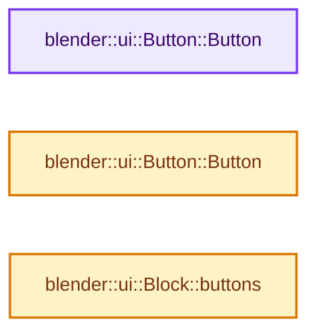

# 实现依赖专题：source/blender/editors/interface/interface_intern.hh

[方向导航](README.md) · [符号索引](../%E7%AC%A6%E5%8F%B7%E4%BE%9D%E8%B5%96%E4%B8%8E%E5%AE%9E%E7%8E%B0%E7%B4%A2%E5%BC%95.md)

本专题从正文实际调用进入，集中保存共享实现。函数有稳定锚点，可从调用处直接跳到对应完整函数；递归与互相调用通过回链组织。

## 本文件的实现关系




## 相关类型布局与成员入口

<a id="t-e64b8c99d342"></a>

### `blender::ui::ButtonGroupFlag`

原始声明：[source/blender/editors/interface/interface_intern.hh](../../../../../source/blender/editors/interface/interface_intern.hh) · L667—L672。

以下保留类的数据声明与编译条件，成员函数实现通过后面的精确链接阅读。

<!-- annotated:4ced84946db8b2 -->

```cpp
enum ButtonGroupFlag {
  /** While this flag is set, don't create new button groups for layout item calls. */
  UI_BUTTON_GROUP_LOCK = (1 << 0),
  /** The buttons in this group are inside a panel header. */
  UI_BUTTON_GROUP_PANEL_HEADER = (1 << 1),
};
```

<details>
<summary>核对原始源码：source/blender/editors/interface/interface_intern.hh · L667—L672</summary>

<!-- original:4ced84946db8b2:source/blender/editors/interface/interface_intern.hh:667:672 -->

```cpp
enum ButtonGroupFlag {
  /** While this flag is set, don't create new button groups for layout item calls. */
  UI_BUTTON_GROUP_LOCK = (1 << 0),
  /** The buttons in this group are inside a panel header. */
  UI_BUTTON_GROUP_PANEL_HEADER = (1 << 1),
};
```

</details>


<a id="m-1984bb18659d"></a>

## 宏 `UI_RADIAL_DIRECTION_NEXT`

<!-- annotated:ffd0c9d18ecfed -->

```cpp
#define UI_RADIAL_DIRECTION_NEXT(dir) RadialDirection((int(dir) + 1) % (int(UI_RADIAL_NW) + 1))
/** Previous direction (counter-clockwise). */
```

<details>
<summary>核对原始源码：source/blender/editors/interface/interface_intern.hh · L137—L138</summary>

<!-- original:ffd0c9d18ecfed:source/blender/editors/interface/interface_intern.hh:137:138 -->

```cpp
#define UI_RADIAL_DIRECTION_NEXT(dir) RadialDirection((int(dir) + 1) % (int(UI_RADIAL_NW) + 1))
/** Previous direction (counter-clockwise). */
```

</details>

宏在预处理阶段展开，参数替换、重复求值和条件编译应直接从该定义检查。与普通函数不同，宏不会自动提供参数类型检查；构建配置选择哪个定义需结合外围条件。

<a id="m-34886fe7fe27"></a>

## 宏 `UI_RADIAL_DIRECTION_PREV`

<!-- annotated:362c418e00a857 -->

```cpp
#define UI_RADIAL_DIRECTION_PREV(dir) \
  RadialDirection(((int(dir) + int(UI_RADIAL_NW))) % (int(UI_RADIAL_NW) + 1))

```

<details>
<summary>核对原始源码：source/blender/editors/interface/interface_intern.hh · L139—L141</summary>

<!-- original:362c418e00a857:source/blender/editors/interface/interface_intern.hh:139:141 -->

```cpp
#define UI_RADIAL_DIRECTION_PREV(dir) \
  RadialDirection(((int(dir) + int(UI_RADIAL_NW))) % (int(UI_RADIAL_NW) + 1))

```

</details>

宏在预处理阶段展开，参数替换、重复求值和条件编译应直接从该定义检查。与普通函数不同，宏不会自动提供参数类型检查；构建配置选择哪个定义需结合外围条件。

<a id="m-c9787b14ee7b"></a>

## 宏 `UI_BITBUT_TEST`

<!-- annotated:d34acfadf4d65c -->

```cpp
#define UI_BITBUT_TEST(a, b) (((a) & (1 << (b))) != 0)
#define UI_BITBUT_VALUE_TOGGLED(a, b) ((a) ^ (1 << (b)))
```

<details>
<summary>核对原始源码：source/blender/editors/interface/interface_intern.hh · L159—L160</summary>

<!-- original:d34acfadf4d65c:source/blender/editors/interface/interface_intern.hh:159:160 -->

```cpp
#define UI_BITBUT_TEST(a, b) (((a) & (1 << (b))) != 0)
#define UI_BITBUT_VALUE_TOGGLED(a, b) ((a) ^ (1 << (b)))
```

</details>

宏在预处理阶段展开，参数替换、重复求值和条件编译应直接从该定义检查。与普通函数不同，宏不会自动提供参数类型检查；构建配置选择哪个定义需结合外围条件。

<a id="m-40e10dffff7b"></a>

## 宏 `UI_BITBUT_VALUE_TOGGLED`

<!-- annotated:6b390619522a9b -->

```cpp
#define UI_BITBUT_VALUE_TOGGLED(a, b) ((a) ^ (1 << (b)))
#define UI_BITBUT_VALUE_ENABLED(a, b) ((a) | (1 << (b)))
```

<details>
<summary>核对原始源码：source/blender/editors/interface/interface_intern.hh · L160—L161</summary>

<!-- original:6b390619522a9b:source/blender/editors/interface/interface_intern.hh:160:161 -->

```cpp
#define UI_BITBUT_VALUE_TOGGLED(a, b) ((a) ^ (1 << (b)))
#define UI_BITBUT_VALUE_ENABLED(a, b) ((a) | (1 << (b)))
```

</details>

宏在预处理阶段展开，参数替换、重复求值和条件编译应直接从该定义检查。与普通函数不同，宏不会自动提供参数类型检查；构建配置选择哪个定义需结合外围条件。

## 完整成员与函数实现

<a id="f-f6a47cb8f135900b"></a>

### `blender::ui::Button::Button`

实现位置：[source/blender/editors/interface/interface_intern.hh](../../../../../source/blender/editors/interface/interface_intern.hh) · L367—L367。

**教学注释版**

<!-- annotated:87389c76504fa7 -->

```cpp
  Button() = default;
```

<details>
<summary>核对原始源码：source/blender/editors/interface/interface_intern.hh · L367—L367</summary>

<!-- original:87389c76504fa7:source/blender/editors/interface/interface_intern.hh:367:367 -->

```cpp
  Button() = default;
```

</details>

**继续追踪实现**

本实现没有需要继续展开的显式调用；检查返回表达式、对象转换和调用者前置条件。

<a id="f-699385536eac5c73"></a>

### `blender::ui::Button::Button`

实现位置：[source/blender/editors/interface/interface_intern.hh](../../../../../source/blender/editors/interface/interface_intern.hh) · L369—L369。

接口参数：

- `const Button &other`

**教学注释版**

<!-- annotated:263b1baf3ccf6a -->

```cpp
  explicit Button(const Button &other) = default;
```

<details>
<summary>核对原始源码：source/blender/editors/interface/interface_intern.hh · L369—L369</summary>

<!-- original:263b1baf3ccf6a:source/blender/editors/interface/interface_intern.hh:369:369 -->

```cpp
  explicit Button(const Button &other) = default;
```

</details>

**继续追踪实现**

本实现没有需要继续展开的显式调用；检查返回表达式、对象转换和调用者前置条件。

<a id="f-5296ad5fd22b5505"></a>

### `blender::ui::Block::buttons`

实现位置：[source/blender/editors/interface/interface_intern.hh](../../../../../source/blender/editors/interface/interface_intern.hh) · L836—L841。

**教学注释版**

<!-- annotated:5ad72299929854 -->

```cpp
  std::ranges::transform_view<std::ranges::ref_view<const Vector<std::unique_ptr<Button>>>,
                              Button &(*)(const std::unique_ptr<Button> &)>
  buttons() const
  {
    return this->buttons_ptrs | std::views::transform(button_ptr_dereference);
  }
```

<details>
<summary>核对原始源码：source/blender/editors/interface/interface_intern.hh · L836—L841</summary>

<!-- original:5ad72299929854:source/blender/editors/interface/interface_intern.hh:836:841 -->

```cpp
  std::ranges::transform_view<std::ranges::ref_view<const Vector<std::unique_ptr<Button>>>,
                              Button &(*)(const std::unique_ptr<Button> &)>
  buttons() const
  {
    return this->buttons_ptrs | std::views::transform(button_ptr_dereference);
  }
```

</details>

**结果出口**

- `return this->buttons_ptrs | std::views::transform(button_ptr_dereference);`

**继续追踪实现**

- `std::views::transform` → [外部契约](https://eel.is/c++draft/)：这个边界按实际表达式及所属类型核对参数、返回值、寿命与失败行为。这里提供接口入口，不声称已解释该第三方版本的内部实现。
