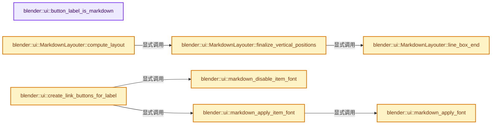
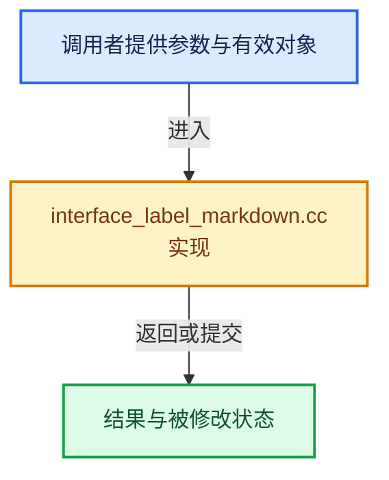

# 实现依赖专题：source/blender/editors/interface/buttons/interface_label_markdown.cc

[方向导航](README.md) · [符号索引](../%E7%AC%A6%E5%8F%B7%E4%BE%9D%E8%B5%96%E4%B8%8E%E5%AE%9E%E7%8E%B0%E7%B4%A2%E5%BC%95.md)

本专题从正文实际调用进入，集中保存共享实现。函数有稳定锚点，可从调用处直接跳到对应完整函数；递归与互相调用通过回链组织。

## 本文件的实现关系






## 完整成员与函数实现

<a id="f-f77e6197f0e1217f"></a>

### `blender::ui::button_label_is_markdown`

实现位置：[source/blender/editors/interface/buttons/interface_label_markdown.cc](../../../../../source/blender/editors/interface/buttons/interface_label_markdown.cc) · L120—L124。

接口参数：

- `const Button *button`

**教学注释版**

<!-- annotated:54ca42dee842dd -->

```cpp
bool button_label_is_markdown(const Button *button)
{
  return button->type == ButtonType::Label &&
         static_cast<const ButtonLabel *>(button)->label_type == ButtonLabelType::Markdown;
}
```

<details>
<summary>核对原始源码：source/blender/editors/interface/buttons/interface_label_markdown.cc · L120—L124</summary>

<!-- original:54ca42dee842dd:source/blender/editors/interface/buttons/interface_label_markdown.cc:120:124 -->

```cpp
bool button_label_is_markdown(const Button *button)
{
  return button->type == ButtonType::Label &&
         static_cast<const ButtonLabel *>(button)->label_type == ButtonLabelType::Markdown;
}
```

</details>

**结果出口**

- `return button->type == ButtonType::Label &&`

**继续追踪实现**

本实现没有需要继续展开的显式调用；检查返回表达式、对象转换和调用者前置条件。

<a id="f-c33166b943b71cf5"></a>

### `blender::ui::markdown_apply_font`

实现位置：[source/blender/editors/interface/buttons/interface_label_markdown.cc](../../../../../source/blender/editors/interface/buttons/interface_label_markdown.cc) · L126—L140。

接口参数：

- `const int fontid`
- `const float size_px`
- `const int weight`
- `const bool italic`

**教学注释版**

<!-- annotated:9fe37bf61eefed -->

```cpp
static void markdown_apply_font(const int fontid,
                                const float size_px,
                                const int weight,
                                const bool italic)
{
  BLF_disable(fontid, BLF_ASPECT);
  BLF_size(fontid, size_px);
  BLF_character_weight(fontid, weight);
  if (italic) {
    BLF_enable(fontid, BLF_ITALIC);
  }
  else {
    BLF_disable(fontid, BLF_ITALIC);
  }
}
```

<details>
<summary>核对原始源码：source/blender/editors/interface/buttons/interface_label_markdown.cc · L126—L140</summary>

<!-- original:9fe37bf61eefed:source/blender/editors/interface/buttons/interface_label_markdown.cc:126:140 -->

```cpp
static void markdown_apply_font(const int fontid,
                                const float size_px,
                                const int weight,
                                const bool italic)
{
  BLF_disable(fontid, BLF_ASPECT);
  BLF_size(fontid, size_px);
  BLF_character_weight(fontid, weight);
  if (italic) {
    BLF_enable(fontid, BLF_ITALIC);
  }
  else {
    BLF_disable(fontid, BLF_ITALIC);
  }
}
```

</details>

**继续追踪实现**

- `BLF_disable` → [blender::BLF_disable · L331](%E4%BE%9D%E8%B5%96-blf-1ee3d6.md#f-cecdcdd6bdf5b9ab)。
- `BLF_size` → [blender::BLF_size · L445](%E4%BE%9D%E8%B5%96-blf-1ee3d6.md#f-055ce2de2d1684fd)。
- `BLF_character_weight` → [blender::BLF_character_weight · L349](%E4%BE%9D%E8%B5%96-blf-1ee3d6.md#f-c54c5317361b03c9)。
- `BLF_enable` → [blender::BLF_enable · L322](%E4%BE%9D%E8%B5%96-blf-1ee3d6.md#f-76d6d46072c5f3af)。

<a id="f-6ee236009c0c7221"></a>

### `blender::ui::markdown_apply_item_font`

实现位置：[source/blender/editors/interface/buttons/interface_label_markdown.cc](../../../../../source/blender/editors/interface/buttons/interface_label_markdown.cc) · L142—L145。

接口参数：

- `const MarkdownItemText &item`

**教学注释版**

<!-- annotated:16a940093d9828 -->

```cpp
static void markdown_apply_item_font(const MarkdownItemText &item)
{
  markdown_apply_font(item.fontid, item.size_px, item.weight, item.italic);
}
```

<details>
<summary>核对原始源码：source/blender/editors/interface/buttons/interface_label_markdown.cc · L142—L145</summary>

<!-- original:16a940093d9828:source/blender/editors/interface/buttons/interface_label_markdown.cc:142:145 -->

```cpp
static void markdown_apply_item_font(const MarkdownItemText &item)
{
  markdown_apply_font(item.fontid, item.size_px, item.weight, item.italic);
}
```

</details>

**继续追踪实现**

- `markdown_apply_font` → [blender::ui::markdown_apply_font · L126](%E4%BE%9D%E8%B5%96-interface_label_markdown-dd2362.md#f-c33166b943b71cf5)。

<a id="f-321134ad0603efed"></a>

### `blender::ui::markdown_disable_item_font`

实现位置：[source/blender/editors/interface/buttons/interface_label_markdown.cc](../../../../../source/blender/editors/interface/buttons/interface_label_markdown.cc) · L147—L150。

接口参数：

- `const MarkdownItemText &item`

**教学注释版**

<!-- annotated:1e7521a0e71ba3 -->

```cpp
static void markdown_disable_item_font(const MarkdownItemText &item)
{
  BLF_disable(item.fontid, BLF_ITALIC);
}
```

<details>
<summary>核对原始源码：source/blender/editors/interface/buttons/interface_label_markdown.cc · L147—L150</summary>

<!-- original:1e7521a0e71ba3:source/blender/editors/interface/buttons/interface_label_markdown.cc:147:150 -->

```cpp
static void markdown_disable_item_font(const MarkdownItemText &item)
{
  BLF_disable(item.fontid, BLF_ITALIC);
}
```

</details>

**继续追踪实现**

- `BLF_disable` → [blender::BLF_disable · L331](%E4%BE%9D%E8%B5%96-blf-1ee3d6.md#f-cecdcdd6bdf5b9ab)。

<a id="f-4b23ed92d9f691ce"></a>

### `blender::ui::MarkdownLayouter::compute_layout`

实现位置：[source/blender/editors/interface/buttons/interface_label_markdown.cc](../../../../../source/blender/editors/interface/buttons/interface_label_markdown.cc) · L291—L318。

**教学注释版**

<!-- annotated:95a4804c32334d -->

```cpp
  void compute_layout()
  {
    MD_PARSER md_parser{};
    md_parser.enter_block = [](MD_BLOCKTYPE block_type, void *detail, void *userdata) {
      static_cast<MarkdownLayouter *>(userdata)->md_enter_block(block_type, detail);
      return 0;
    };
    md_parser.leave_block = [](MD_BLOCKTYPE block_type, void *detail, void *userdata) {
      static_cast<MarkdownLayouter *>(userdata)->md_leave_block(block_type, detail);
      return 0;
    };
    md_parser.enter_span = [](MD_SPANTYPE span_type, void *detail, void *userdata) {
      static_cast<MarkdownLayouter *>(userdata)->md_enter_span(span_type, detail);
      return 0;
    };
    md_parser.leave_span = [](MD_SPANTYPE span_type, void *detail, void *userdata) {
      static_cast<MarkdownLayouter *>(userdata)->md_leave_span(span_type, detail);
      return 0;
    };
    md_parser.text = [](MD_TEXTTYPE text_type, const char *text, uint32_t length, void *userdata) {
      static_cast<MarkdownLayouter *>(userdata)->md_text(text_type, StringRef(text, length));
      return 0;
    };

    const StringRef text = cache_.key.text;
    md_parse(text.data(), text.size(), &md_parser, this);
    this->finalize_vertical_positions();
  }
```

<details>
<summary>核对原始源码：source/blender/editors/interface/buttons/interface_label_markdown.cc · L291—L318</summary>

<!-- original:95a4804c32334d:source/blender/editors/interface/buttons/interface_label_markdown.cc:291:318 -->

```cpp
  void compute_layout()
  {
    MD_PARSER md_parser{};
    md_parser.enter_block = [](MD_BLOCKTYPE block_type, void *detail, void *userdata) {
      static_cast<MarkdownLayouter *>(userdata)->md_enter_block(block_type, detail);
      return 0;
    };
    md_parser.leave_block = [](MD_BLOCKTYPE block_type, void *detail, void *userdata) {
      static_cast<MarkdownLayouter *>(userdata)->md_leave_block(block_type, detail);
      return 0;
    };
    md_parser.enter_span = [](MD_SPANTYPE span_type, void *detail, void *userdata) {
      static_cast<MarkdownLayouter *>(userdata)->md_enter_span(span_type, detail);
      return 0;
    };
    md_parser.leave_span = [](MD_SPANTYPE span_type, void *detail, void *userdata) {
      static_cast<MarkdownLayouter *>(userdata)->md_leave_span(span_type, detail);
      return 0;
    };
    md_parser.text = [](MD_TEXTTYPE text_type, const char *text, uint32_t length, void *userdata) {
      static_cast<MarkdownLayouter *>(userdata)->md_text(text_type, StringRef(text, length));
      return 0;
    };

    const StringRef text = cache_.key.text;
    md_parse(text.data(), text.size(), &md_parser, this);
    this->finalize_vertical_positions();
  }
```

</details>

**沿实际写入检查状态**

- `md_parser.enter_block = [](MD_BLOCKTYPE block_type, void *detail, void *userdata) {`
- `md_parser.leave_block = [](MD_BLOCKTYPE block_type, void *detail, void *userdata) {`
- `md_parser.enter_span = [](MD_SPANTYPE span_type, void *detail, void *userdata) {`
- `md_parser.leave_span = [](MD_SPANTYPE span_type, void *detail, void *userdata) {`
- `md_parser.text = [](MD_TEXTTYPE text_type, const char *text, uint32_t length, void *userdata) {`

**结果出口**

- `return 0;`

**继续追踪实现**

- `static_cast<MarkdownLayouter *>(userdata)->md_enter_block` → [调用协议](../%E6%A8%A1%E6%9D%BF%E5%AE%8F%E4%B8%8E%E5%8A%A8%E6%80%81%E5%88%86%E6%B4%BE%E5%8D%8F%E8%AE%AE.md)：接收对象类型依赖auto、返回值或模板实例；不按同名猜测目标。调用位置L295。
- `static_cast<MarkdownLayouter *>(userdata)->md_leave_block` → [调用协议](../%E6%A8%A1%E6%9D%BF%E5%AE%8F%E4%B8%8E%E5%8A%A8%E6%80%81%E5%88%86%E6%B4%BE%E5%8D%8F%E8%AE%AE.md)：接收对象类型依赖auto、返回值或模板实例；不按同名猜测目标。调用位置L299。
- `static_cast<MarkdownLayouter *>(userdata)->md_enter_span` → [调用协议](../%E6%A8%A1%E6%9D%BF%E5%AE%8F%E4%B8%8E%E5%8A%A8%E6%80%81%E5%88%86%E6%B4%BE%E5%8D%8F%E8%AE%AE.md)：接收对象类型依赖auto、返回值或模板实例；不按同名猜测目标。调用位置L303。
- `static_cast<MarkdownLayouter *>(userdata)->md_leave_span` → [调用协议](../%E6%A8%A1%E6%9D%BF%E5%AE%8F%E4%B8%8E%E5%8A%A8%E6%80%81%E5%88%86%E6%B4%BE%E5%8D%8F%E8%AE%AE.md)：接收对象类型依赖auto、返回值或模板实例；不按同名猜测目标。调用位置L307。
- `static_cast<MarkdownLayouter *>(userdata)->md_text` → [调用协议](../%E6%A8%A1%E6%9D%BF%E5%AE%8F%E4%B8%8E%E5%8A%A8%E6%80%81%E5%88%86%E6%B4%BE%E5%8D%8F%E8%AE%AE.md)：接收对象类型依赖auto、返回值或模板实例；不按同名猜测目标。调用位置L311。
- `StringRef` → [blender::StringRef::StringRef · L555](../01-%E5%9F%BA%E7%A1%80%E5%AE%B9%E5%99%A8%E4%B8%8E%E7%8E%B0%E4%BB%A3CPP/15-StringRef%E5%AD%97%E7%AC%A6%E4%B8%B2%E8%A7%86%E5%9B%BE.md#f-f6aca324a36faa7e)；[blender::StringRef::StringRef · L560](../01-%E5%9F%BA%E7%A1%80%E5%AE%B9%E5%99%A8%E4%B8%8E%E7%8E%B0%E4%BB%A3CPP/15-StringRef%E5%AD%97%E7%AC%A6%E4%B8%B2%E8%A7%86%E5%9B%BE.md#f-ab9714781ca51bac)；[blender::StringRef::StringRef · L565](../01-%E5%9F%BA%E7%A1%80%E5%AE%B9%E5%99%A8%E4%B8%8E%E7%8E%B0%E4%BB%A3CPP/15-StringRef%E5%AD%97%E7%AC%A6%E4%B8%B2%E8%A7%86%E5%9B%BE.md#f-95f0b483bbdd7739)；[blender::StringRef::StringRef · L570](../01-%E5%9F%BA%E7%A1%80%E5%AE%B9%E5%99%A8%E4%B8%8E%E7%8E%B0%E4%BB%A3CPP/15-StringRef%E5%AD%97%E7%AC%A6%E4%B8%B2%E8%A7%86%E5%9B%BE.md#f-808d05699cb33334)；[blender::StringRef::StringRef · L631](../01-%E5%9F%BA%E7%A1%80%E5%AE%B9%E5%99%A8%E4%B8%8E%E7%8E%B0%E4%BB%A3CPP/15-StringRef%E5%AD%97%E7%AC%A6%E4%B8%B2%E8%A7%86%E5%9B%BE.md#f-37788e5f3fa3b736)；[blender::StringRef::StringRef · L641](../01-%E5%9F%BA%E7%A1%80%E5%AE%B9%E5%99%A8%E4%B8%8E%E7%8E%B0%E4%BB%A3CPP/15-StringRef%E5%AD%97%E7%AC%A6%E4%B8%B2%E8%A7%86%E5%9B%BE.md#f-11abd0510fb6b926)；[blender::StringRef::StringRef · L646](../01-%E5%9F%BA%E7%A1%80%E5%AE%B9%E5%99%A8%E4%B8%8E%E7%8E%B0%E4%BB%A3CPP/15-StringRef%E5%AD%97%E7%AC%A6%E4%B8%B2%E8%A7%86%E5%9B%BE.md#f-8437dbd8a582eefd)；[blender::StringRef::StringRef · L651](../01-%E5%9F%BA%E7%A1%80%E5%AE%B9%E5%99%A8%E4%B8%8E%E7%8E%B0%E4%BB%A3CPP/15-StringRef%E5%AD%97%E7%AC%A6%E4%B8%B2%E8%A7%86%E5%9B%BE.md#f-70bcb338de0db978)。同名重载需按实参类型选择。
- `md_parse` → [调用协议](../%E6%A8%A1%E6%9D%BF%E5%AE%8F%E4%B8%8E%E5%8A%A8%E6%80%81%E5%88%86%E6%B4%BE%E5%8D%8F%E8%AE%AE.md)：函数指针、局部可调用对象或未展开的宏；必须结合调用者环境。调用位置L316。
- `text.data` → [调用协议](../%E6%A8%A1%E6%9D%BF%E5%AE%8F%E4%B8%8E%E5%8A%A8%E6%80%81%E5%88%86%E6%B4%BE%E5%8D%8F%E8%AE%AE.md)：由接收对象具体类型或运行时策略提供实现。调用位置L316。
- `text.size` → [调用协议](../%E6%A8%A1%E6%9D%BF%E5%AE%8F%E4%B8%8E%E5%8A%A8%E6%80%81%E5%88%86%E6%B4%BE%E5%8D%8F%E8%AE%AE.md)：由接收对象具体类型或运行时策略提供实现。调用位置L316。
- `this->finalize_vertical_positions` → [blender::ui::MarkdownLayouter::finalize_vertical_positions · L1239](%E4%BE%9D%E8%B5%96-interface_label_markdown-dd2362.md#f-28d7f1c5e49cd83b)。

<a id="f-f04df1b2746331f6"></a>

### `blender::ui::MarkdownLayouter::line_box_end`

实现位置：[source/blender/editors/interface/buttons/interface_label_markdown.cc](../../../../../source/blender/editors/interface/buttons/interface_label_markdown.cc) · L325—L332。

**教学注释版**

<!-- annotated:54769e62c633ea -->

```cpp
  void line_box_end()
  {
    if (!current_line_box_) {
      return;
    }
    flow_bottom_ = current_line_box_->top - current_line_box_->height;
    current_line_box_.reset();
  }
```

<details>
<summary>核对原始源码：source/blender/editors/interface/buttons/interface_label_markdown.cc · L325—L332</summary>

<!-- original:54769e62c633ea:source/blender/editors/interface/buttons/interface_label_markdown.cc:325:332 -->

```cpp
  void line_box_end()
  {
    if (!current_line_box_) {
      return;
    }
    flow_bottom_ = current_line_box_->top - current_line_box_->height;
    current_line_box_.reset();
  }
```

</details>

**沿实际写入检查状态**

- `flow_bottom_ = current_line_box_->top - current_line_box_->height;`

**继续追踪实现**

- `current_line_box_.reset` → [外部契约](https://eel.is/c++draft/)：这个边界按实际表达式及所属类型核对参数、返回值、寿命与失败行为。这里提供接口入口，不声称已解释该第三方版本的内部实现。

<a id="f-28d7f1c5e49cd83b"></a>

### `blender::ui::MarkdownLayouter::finalize_vertical_positions`

实现位置：[source/blender/editors/interface/buttons/interface_label_markdown.cc](../../../../../source/blender/editors/interface/buttons/interface_label_markdown.cc) · L1239—L1257。

**教学注释版**

<!-- annotated:c10008dc273671 -->

```cpp
  void finalize_vertical_positions()
  {
    this->line_box_end();
    if (!flow_bottom_) {
      cache_.md_layout.content_height = main_font_.default_line_height_px;
      return;
    }

    float bottom_y = *flow_bottom_;
    for (const MarkdownItem &item : cache_.md_layout.items) {
      if (const auto *quote_line = std::get_if<MarkdownItemQuoteLine>(&item)) {
        // [讲解] std::min：按比较关系选取较小值；截断范围时还需先满足非负和可表示范围，min本身不会证明边界安全。
        bottom_y = std::min(bottom_y, quote_line->y - quote_line->height);
      }
      if (const auto *code_box = std::get_if<MarkdownItemCodeBox>(&item)) {
        bottom_y = std::min(bottom_y, code_box->rect.ymin);
      }
    }
    cache_.md_layout.content_height = -bottom_y;
  }
```

<details>
<summary>核对原始源码：source/blender/editors/interface/buttons/interface_label_markdown.cc · L1239—L1257</summary>

<!-- original:c10008dc273671:source/blender/editors/interface/buttons/interface_label_markdown.cc:1239:1257 -->

```cpp
  void finalize_vertical_positions()
  {
    this->line_box_end();
    if (!flow_bottom_) {
      cache_.md_layout.content_height = main_font_.default_line_height_px;
      return;
    }

    float bottom_y = *flow_bottom_;
    for (const MarkdownItem &item : cache_.md_layout.items) {
      if (const auto *quote_line = std::get_if<MarkdownItemQuoteLine>(&item)) {
        bottom_y = std::min(bottom_y, quote_line->y - quote_line->height);
      }
      if (const auto *code_box = std::get_if<MarkdownItemCodeBox>(&item)) {
        bottom_y = std::min(bottom_y, code_box->rect.ymin);
      }
    }
    cache_.md_layout.content_height = -bottom_y;
  }
```

</details>

**沿实际写入检查状态**

- `cache_.md_layout.content_height = main_font_.default_line_height_px;`
- `bottom_y = std::min(bottom_y, quote_line->y - quote_line->height);`
- `bottom_y = std::min(bottom_y, code_box->rect.ymin);`
- `cache_.md_layout.content_height = -bottom_y;`

**继续追踪实现**

- `this->line_box_end` → [blender::ui::MarkdownLayouter::line_box_end · L325](%E4%BE%9D%E8%B5%96-interface_label_markdown-dd2362.md#f-f04df1b2746331f6)。
- `std::get_if<MarkdownItemQuoteLine>` → [外部契约](https://eel.is/c++draft/)：这个边界按实际表达式及所属类型核对参数、返回值、寿命与失败行为。这里提供接口入口，不声称已解释该第三方版本的内部实现。
- `std::min` → [外部契约](https://eel.is/c++draft/alg.min.max)：按比较关系选取较小值；截断范围时还需先满足非负和可表示范围，min本身不会证明边界安全。
- `std::get_if<MarkdownItemCodeBox>` → [外部契约](https://eel.is/c++draft/)：这个边界按实际表达式及所属类型核对参数、返回值、寿命与失败行为。这里提供接口入口，不声称已解释该第三方版本的内部实现。

<a id="f-58764f47337ddbb1"></a>

### `blender::ui::create_link_buttons_for_label`

实现位置：[source/blender/editors/interface/buttons/interface_label_markdown.cc](../../../../../source/blender/editors/interface/buttons/interface_label_markdown.cc) · L1260—L1332。

接口参数：

- `ButtonLabel *button`

**教学注释版**

<!-- annotated:f965fa3579c503 -->

```cpp
static void create_link_buttons_for_label(ButtonLabel *button)
{
  if (!button->markdown_cache) {
    return;
  }
  const MarkdownLayoutCache &cache = *button->markdown_cache;
  if (cache.md_layout.items.is_empty()) {
    return;
  }

  Block *block = button->block;
  const float aspect = block->aspect;
  wmOperatorType *ot = WM_operatortype_find("WM_OT_url_open", false);
  if (!ot) {
    return;
  }

  for (const MarkdownItem &item : cache.md_layout.items) {
    const auto *text_item_ptr = std::get_if<MarkdownItemText>(&item);
    if (!text_item_ptr || !text_item_ptr->url) {
      continue;
    }
    const MarkdownItemText &text_item = *text_item_ptr;

    markdown_apply_item_font(text_item);

    const StringRef text = text_item.text;
    const float descender_px = BLF_descender(text_item.fontid);
    const float ascender_px = BLF_ascender(text_item.fontid);
    const float font_height = (ascender_px - descender_px) * aspect;
    const float width = BLF_width(text_item.fontid, text.data(), text.size()) * aspect;

    const float x = button->rect.xmin + text_item.x * aspect;
    const float y = button->rect.ymax + (text_item.y + descender_px) * aspect;

    const EmbossType previous_emboss = block_emboss_get(block);
    block_emboss_set(block, EmbossType::None);
    Button *but = uiDefIconBut(block,
                               ButtonType::But,
                               ICON_NONE,
                               x,
                               y,
                               width,
                               font_height,
                               nullptr,
                               0.0,
                               0.0,
                               std::nullopt);
    block_emboss_set(block, previous_emboss);

    static_cast<ButtonPush *>(but)->draw_as_link = true;

    PointerRNA props = WM_operator_properties_create_ptr(ot);
    RNA_string_set(&props, "url", std::string(*text_item.url).c_str());
    button_operator_set(but, ot, wm::OpCallContext::InvokeDefault, &props);

    /* Invisible hit-target; markdown draw paints the link text. Show URL on hover. */
    button_func_tooltip_custom_set(
        but,
        [](bContext & /*C*/, TooltipData &data, Button *tip_but, void * /*argN*/) {
          tooltip_text_field_add(data,
                                 RNA_string_get(tip_but->opptr, "url"),
                                 {},
                                 TIP_STYLE_NORMAL,
                                 TIP_LC_NORMAL,
                                 false);
        },
        nullptr,
        nullptr);

    markdown_disable_item_font(text_item);
  }
}
```

<details>
<summary>核对原始源码：source/blender/editors/interface/buttons/interface_label_markdown.cc · L1260—L1332</summary>

<!-- original:f965fa3579c503:source/blender/editors/interface/buttons/interface_label_markdown.cc:1260:1332 -->

```cpp
static void create_link_buttons_for_label(ButtonLabel *button)
{
  if (!button->markdown_cache) {
    return;
  }
  const MarkdownLayoutCache &cache = *button->markdown_cache;
  if (cache.md_layout.items.is_empty()) {
    return;
  }

  Block *block = button->block;
  const float aspect = block->aspect;
  wmOperatorType *ot = WM_operatortype_find("WM_OT_url_open", false);
  if (!ot) {
    return;
  }

  for (const MarkdownItem &item : cache.md_layout.items) {
    const auto *text_item_ptr = std::get_if<MarkdownItemText>(&item);
    if (!text_item_ptr || !text_item_ptr->url) {
      continue;
    }
    const MarkdownItemText &text_item = *text_item_ptr;

    markdown_apply_item_font(text_item);

    const StringRef text = text_item.text;
    const float descender_px = BLF_descender(text_item.fontid);
    const float ascender_px = BLF_ascender(text_item.fontid);
    const float font_height = (ascender_px - descender_px) * aspect;
    const float width = BLF_width(text_item.fontid, text.data(), text.size()) * aspect;

    const float x = button->rect.xmin + text_item.x * aspect;
    const float y = button->rect.ymax + (text_item.y + descender_px) * aspect;

    const EmbossType previous_emboss = block_emboss_get(block);
    block_emboss_set(block, EmbossType::None);
    Button *but = uiDefIconBut(block,
                               ButtonType::But,
                               ICON_NONE,
                               x,
                               y,
                               width,
                               font_height,
                               nullptr,
                               0.0,
                               0.0,
                               std::nullopt);
    block_emboss_set(block, previous_emboss);

    static_cast<ButtonPush *>(but)->draw_as_link = true;

    PointerRNA props = WM_operator_properties_create_ptr(ot);
    RNA_string_set(&props, "url", std::string(*text_item.url).c_str());
    button_operator_set(but, ot, wm::OpCallContext::InvokeDefault, &props);

    /* Invisible hit-target; markdown draw paints the link text. Show URL on hover. */
    button_func_tooltip_custom_set(
        but,
        [](bContext & /*C*/, TooltipData &data, Button *tip_but, void * /*argN*/) {
          tooltip_text_field_add(data,
                                 RNA_string_get(tip_but->opptr, "url"),
                                 {},
                                 TIP_STYLE_NORMAL,
                                 TIP_LC_NORMAL,
                                 false);
        },
        nullptr,
        nullptr);

    markdown_disable_item_font(text_item);
  }
}
```

</details>

**继续追踪实现**

- `cache.md_layout.items.is_empty` → [调用协议](../%E6%A8%A1%E6%9D%BF%E5%AE%8F%E4%B8%8E%E5%8A%A8%E6%80%81%E5%88%86%E6%B4%BE%E5%8D%8F%E8%AE%AE.md)：接收对象类型依赖auto、返回值或模板实例；不按同名猜测目标。调用位置L1266。
- `WM_operatortype_find` → [blender::WM_operatortype_find · L78](%E4%BE%9D%E8%B5%96-wm_operator_type-1e8a89.md#f-9fc2574dfd3703ee)。
- `std::get_if<MarkdownItemText>` → [外部契约](https://eel.is/c++draft/)：这个边界按实际表达式及所属类型核对参数、返回值、寿命与失败行为。这里提供接口入口，不声称已解释该第三方版本的内部实现。
- `markdown_apply_item_font` → [blender::ui::markdown_apply_item_font · L142](%E4%BE%9D%E8%B5%96-interface_label_markdown-dd2362.md#f-6ee236009c0c7221)。
- `BLF_descender` → [blender::BLF_descender · L905](%E4%BE%9D%E8%B5%96-blf-1ee3d6.md#f-2482389a2c09112b)。
- `BLF_ascender` → [blender::BLF_ascender · L916](%E4%BE%9D%E8%B5%96-blf-1ee3d6.md#f-1e02b696338b7463)。
- `BLF_width` → [blender::BLF_width · L835](%E4%BE%9D%E8%B5%96-blf-1ee3d6.md#f-5a3d5b80e418409f)。
- `text.data` → [调用协议](../%E6%A8%A1%E6%9D%BF%E5%AE%8F%E4%B8%8E%E5%8A%A8%E6%80%81%E5%88%86%E6%B4%BE%E5%8D%8F%E8%AE%AE.md)：由接收对象具体类型或运行时策略提供实现。调用位置L1290。
- `text.size` → [blender::ui::Item::size · L480](%E4%BE%9D%E8%B5%96-interface_layout-7cc3aa.md#f-8a41e6d2d9e32851)；[blender::ui::Layout::size · L494](%E4%BE%9D%E8%B5%96-interface_layout-7cc3aa.md#f-81377b9c1286eb5d)。同名重载需按实参类型选择。
- `block_emboss_get` → [blender::ui::block_emboss_get · L4127](%E4%BE%9D%E8%B5%96-interface-11578b.md#f-b054c11eb8c152cd)。
- `block_emboss_set` → [blender::ui::block_emboss_set · L4132](%E4%BE%9D%E8%B5%96-interface-11578b.md#f-37049d7ac81b081d)。
- `uiDefIconBut` → [blender::ui::uiDefIconBut · L5545](%E4%BE%9D%E8%B5%96-interface-11578b.md#f-e6df2a452ca14d24)。
- `WM_operator_properties_create_ptr` → [blender::WM_operator_properties_create_ptr · L748](%E4%BE%9D%E8%B5%96-wm_operators-6f9715.md#f-6314bcba0ea304a8)。
- `RNA_string_set` → [blender::RNA_string_set · L7028](%E4%BE%9D%E8%B5%96-rna_access-706bea.md#f-86d0d0011891306e)。
- `std::string(*text_item.url).c_str` → [外部契约](https://eel.is/c++draft/)：这个边界按实际表达式及所属类型核对参数、返回值、寿命与失败行为。这里提供接口入口，不声称已解释该第三方版本的内部实现。
- `std::string` → [外部契约](https://eel.is/c++draft/)：这个边界按实际表达式及所属类型核对参数、返回值、寿命与失败行为。这里提供接口入口，不声称已解释该第三方版本的内部实现。
- `button_operator_set` → [blender::ui::button_operator_set · L5745](%E4%BE%9D%E8%B5%96-interface-11578b.md#f-85eb01c76a20f1d6)。
- `button_func_tooltip_custom_set` → [blender::ui::button_func_tooltip_custom_set · L6124](%E4%BE%9D%E8%B5%96-interface-11578b.md#f-ecc5e49b824bbbe8)。
- `tooltip_text_field_add` → [blender::ui::tooltip_text_field_add · L125](%E4%BE%9D%E8%B5%96-interface_region_tooltip-074869.md#f-1f95feaf3f6c3b44)。
- `RNA_string_get` → [blender::RNA_string_get · L6979](%E4%BE%9D%E8%B5%96-rna_access-706bea.md#f-57b87978a2dee00c)；[blender::RNA_string_get · L6989](%E4%BE%9D%E8%B5%96-rna_access-706bea.md#f-538049004840f914)。同名重载需按实参类型选择。
- `markdown_disable_item_font` → [blender::ui::markdown_disable_item_font · L147](%E4%BE%9D%E8%B5%96-interface_label_markdown-dd2362.md#f-321134ad0603efed)。

<a id="f-33d226435da048bb"></a>

### `blender::ui::label_markdown_create_link_buttons`

实现位置：[source/blender/editors/interface/buttons/interface_label_markdown.cc](../../../../../source/blender/editors/interface/buttons/interface_label_markdown.cc) · L1334—L1345。

接口参数：

- `Block *block`

**教学注释版**

<!-- annotated:672518408df526 -->

```cpp
void label_markdown_create_link_buttons(Block *block)
{
  Vector<ButtonLabel *> markdown_labels;
  for (Button &but : block->buttons()) {
    if (button_label_is_markdown(&but)) {
      // [讲解] markdown_labels.append：在尾部建立新元素，必要时先扩大存储。
      markdown_labels.append(static_cast<ButtonLabel *>(&but));
    }
  }
  for (ButtonLabel *label : markdown_labels) {
    create_link_buttons_for_label(label);
  }
}
```

<details>
<summary>核对原始源码：source/blender/editors/interface/buttons/interface_label_markdown.cc · L1334—L1345</summary>

<!-- original:672518408df526:source/blender/editors/interface/buttons/interface_label_markdown.cc:1334:1345 -->

```cpp
void label_markdown_create_link_buttons(Block *block)
{
  Vector<ButtonLabel *> markdown_labels;
  for (Button &but : block->buttons()) {
    if (button_label_is_markdown(&but)) {
      markdown_labels.append(static_cast<ButtonLabel *>(&but));
    }
  }
  for (ButtonLabel *label : markdown_labels) {
    create_link_buttons_for_label(label);
  }
}
```

</details>

**继续追踪实现**

- `block->buttons` → [blender::ui::Block::buttons · L836](%E4%BE%9D%E8%B5%96-interface_intern-60addc.md#f-5296ad5fd22b5505)。
- `button_label_is_markdown` → [blender::ui::button_label_is_markdown · L120](%E4%BE%9D%E8%B5%96-interface_label_markdown-dd2362.md#f-f77e6197f0e1217f)。
- `markdown_labels.append` → [blender::Vector::append · L498](../01-%E5%9F%BA%E7%A1%80%E5%AE%B9%E5%99%A8%E4%B8%8E%E7%8E%B0%E4%BB%A3CPP/11-Vector%E6%8F%92%E5%85%A5%E5%88%A0%E9%99%A4%E4%B8%8E%E9%87%8D%E6%8E%92.md#f-5bde268a69e443ec)；[blender::Vector::append · L502](../01-%E5%9F%BA%E7%A1%80%E5%AE%B9%E5%99%A8%E4%B8%8E%E7%8E%B0%E4%BB%A3CPP/11-Vector%E6%8F%92%E5%85%A5%E5%88%A0%E9%99%A4%E4%B8%8E%E9%87%8D%E6%8E%92.md#f-591e0b15e6308532)。同名重载需按实参类型选择。
- `create_link_buttons_for_label` → [blender::ui::create_link_buttons_for_label · L1260](%E4%BE%9D%E8%B5%96-interface_label_markdown-dd2362.md#f-58764f47337ddbb1)。

<a id="f-d8e3abfff470907e"></a>

### `blender::ui::markdown_layout_key_for_button`

实现位置：[source/blender/editors/interface/buttons/interface_label_markdown.cc](../../../../../source/blender/editors/interface/buttons/interface_label_markdown.cc) · L1347—L1356。

接口参数：

- `const ButtonLabel &button`

**教学注释版**

<!-- annotated:a7fa145384497d -->

```cpp
static MarkdownLayoutCacheKey markdown_layout_key_for_button(const ButtonLabel &button)
{
  const float aspect = button.block->aspect;
  MarkdownLayoutCacheKey key;
  key.text = button.str;
  // [讲解] std::max<int>：按比较关系选取较大值。本讲解中的增长公式同时满足最低请求和几何增长；若保存返回引用，还需注意实参寿命。
  key.wrap_width_px = std::max<int>(std::ceil(BLI_rctf_size_x(&button.rect) / aspect), 0);
  key.pixels_per_point = UI_SCALE_FAC / aspect;
  key.markdown_layout_generation = markdown_layout_generation;
  return key;
}
```

<details>
<summary>核对原始源码：source/blender/editors/interface/buttons/interface_label_markdown.cc · L1347—L1356</summary>

<!-- original:a7fa145384497d:source/blender/editors/interface/buttons/interface_label_markdown.cc:1347:1356 -->

```cpp
static MarkdownLayoutCacheKey markdown_layout_key_for_button(const ButtonLabel &button)
{
  const float aspect = button.block->aspect;
  MarkdownLayoutCacheKey key;
  key.text = button.str;
  key.wrap_width_px = std::max<int>(std::ceil(BLI_rctf_size_x(&button.rect) / aspect), 0);
  key.pixels_per_point = UI_SCALE_FAC / aspect;
  key.markdown_layout_generation = markdown_layout_generation;
  return key;
}
```

</details>

**沿实际写入检查状态**

- `key.text = button.str;`
- `key.wrap_width_px = std::max<int>(std::ceil(BLI_rctf_size_x(&button.rect) / aspect), 0);`
- `key.pixels_per_point = UI_SCALE_FAC / aspect;`
- `key.markdown_layout_generation = markdown_layout_generation;`

**结果出口**

- `return key;`

**继续追踪实现**

- `std::max<int>` → [外部契约](https://eel.is/c++draft/alg.min.max)：按比较关系选取较大值。本讲解中的增长公式同时满足最低请求和几何增长；若保存返回引用，还需注意实参寿命。
- `std::ceil` → [外部契约](https://eel.is/c++draft/)：这个边界按实际表达式及所属类型核对参数、返回值、寿命与失败行为。这里提供接口入口，不声称已解释该第三方版本的内部实现。
- `BLI_rctf_size_x` → [blender::BLI_rctf_size_x · L211](../01-%E5%9F%BA%E7%A1%80%E5%AE%B9%E5%99%A8%E4%B8%8E%E7%8E%B0%E4%BB%A3CPP/%E4%BE%9D%E8%B5%96-BLI_rect-2996c6.md#f-017b86a9d189e3ba)。

<a id="f-aabf3ed28efc4a68"></a>

### `blender::ui::markdown_apply_button_height`

实现位置：[source/blender/editors/interface/buttons/interface_label_markdown.cc](../../../../../source/blender/editors/interface/buttons/interface_label_markdown.cc) · L1358—L1362。

接口参数：

- `ButtonLabel &button`

**教学注释版**

<!-- annotated:62409576c52601 -->

```cpp
static void markdown_apply_button_height(ButtonLabel &button)
{
  button.rect.ymin = button.rect.ymax -
                     button.markdown_cache->md_layout.content_height * button.block->aspect;
}
```

<details>
<summary>核对原始源码：source/blender/editors/interface/buttons/interface_label_markdown.cc · L1358—L1362</summary>

<!-- original:62409576c52601:source/blender/editors/interface/buttons/interface_label_markdown.cc:1358:1362 -->

```cpp
static void markdown_apply_button_height(ButtonLabel &button)
{
  button.rect.ymin = button.rect.ymax -
                     button.markdown_cache->md_layout.content_height * button.block->aspect;
}
```

</details>

**沿实际写入检查状态**

- `button.rect.ymin = button.rect.ymax -`

**继续追踪实现**

本实现没有需要继续展开的显式调用；检查返回表达式、对象转换和调用者前置条件。

<a id="f-5ec32f343201310c"></a>

### `blender::ui::label_markdown_resolve`

实现位置：[source/blender/editors/interface/buttons/interface_label_markdown.cc](../../../../../source/blender/editors/interface/buttons/interface_label_markdown.cc) · L1364—L1410。

接口参数：

- `ButtonLabel *button`

**教学注释版**

<!-- annotated:3c5fa8915a7f0e -->

```cpp
void label_markdown_resolve(ButtonLabel *button)
{
  const MarkdownLayoutCacheKey cache_lookup_key = markdown_layout_key_for_button(*button);
  {
    /* Try to reuse an already attached cache. */
    if (button->markdown_cache) {
      const MarkdownLayoutCache &cache = *button->markdown_cache;
      if (cache.key != cache_lookup_key) {
        button->markdown_cache.reset();
      }
    }
    /* Try to take a matching cache from the previous block. */
    if (!button->markdown_cache && button->block->oldblock) {
      int i = 0;
      for (std::shared_ptr<MarkdownLayoutCache> &cache_ptr :
           button->block->oldblock->markdown_layout_cache)
      {
        MarkdownLayoutCache &cache = *cache_ptr;
        if (cache.key == cache_lookup_key) {
          button->markdown_cache = cache_ptr;
          break;
        }
        i++;
      }
      if (button->markdown_cache) {
        button->block->oldblock->markdown_layout_cache.remove(i);
      }
    }
    if (button->markdown_cache) {
      button->block->markdown_layout_cache.append(button->markdown_cache);
      markdown_apply_button_height(*button);
      return;
    }
  }

  // [讲解] std::make_shared<MarkdownLayoutCache>：构造由共享控制块管理的对象；共享寿命不自动使被指对象读写线程安全，强引用环需单独处理。
  button->markdown_cache = std::make_shared<MarkdownLayoutCache>();
  MarkdownLayoutCache &cache = *button->markdown_cache;
  cache.key = cache_lookup_key;
  /* Copy the string to the cache so that references into it can be preserved. */
  cache.key.text = cache.scope.allocator().copy_string(cache.key.text);
  button->block->markdown_layout_cache.append(button->markdown_cache);

  MarkdownLayouter layouter(cache);
  layouter.compute_layout();

  markdown_apply_button_height(*button);
}
```

<details>
<summary>核对原始源码：source/blender/editors/interface/buttons/interface_label_markdown.cc · L1364—L1410</summary>

<!-- original:3c5fa8915a7f0e:source/blender/editors/interface/buttons/interface_label_markdown.cc:1364:1410 -->

```cpp
void label_markdown_resolve(ButtonLabel *button)
{
  const MarkdownLayoutCacheKey cache_lookup_key = markdown_layout_key_for_button(*button);
  {
    /* Try to reuse an already attached cache. */
    if (button->markdown_cache) {
      const MarkdownLayoutCache &cache = *button->markdown_cache;
      if (cache.key != cache_lookup_key) {
        button->markdown_cache.reset();
      }
    }
    /* Try to take a matching cache from the previous block. */
    if (!button->markdown_cache && button->block->oldblock) {
      int i = 0;
      for (std::shared_ptr<MarkdownLayoutCache> &cache_ptr :
           button->block->oldblock->markdown_layout_cache)
      {
        MarkdownLayoutCache &cache = *cache_ptr;
        if (cache.key == cache_lookup_key) {
          button->markdown_cache = cache_ptr;
          break;
        }
        i++;
      }
      if (button->markdown_cache) {
        button->block->oldblock->markdown_layout_cache.remove(i);
      }
    }
    if (button->markdown_cache) {
      button->block->markdown_layout_cache.append(button->markdown_cache);
      markdown_apply_button_height(*button);
      return;
    }
  }

  button->markdown_cache = std::make_shared<MarkdownLayoutCache>();
  MarkdownLayoutCache &cache = *button->markdown_cache;
  cache.key = cache_lookup_key;
  /* Copy the string to the cache so that references into it can be preserved. */
  cache.key.text = cache.scope.allocator().copy_string(cache.key.text);
  button->block->markdown_layout_cache.append(button->markdown_cache);

  MarkdownLayouter layouter(cache);
  layouter.compute_layout();

  markdown_apply_button_height(*button);
}
```

</details>

**沿实际写入检查状态**

- `button->markdown_cache = cache_ptr;`
- `button->markdown_cache = std::make_shared<MarkdownLayoutCache>();`
- `cache.key = cache_lookup_key;`
- `cache.key.text = cache.scope.allocator().copy_string(cache.key.text);`

**继续追踪实现**

- `markdown_layout_key_for_button` → [blender::ui::markdown_layout_key_for_button · L1347](%E4%BE%9D%E8%B5%96-interface_label_markdown-dd2362.md#f-d8e3abfff470907e)。
- `button->markdown_cache.reset` → [调用协议](../%E6%A8%A1%E6%9D%BF%E5%AE%8F%E4%B8%8E%E5%8A%A8%E6%80%81%E5%88%86%E6%B4%BE%E5%8D%8F%E8%AE%AE.md)：接收对象类型依赖auto、返回值或模板实例；不按同名猜测目标。调用位置L1372。
- `button->block->oldblock->markdown_layout_cache.remove` → [调用协议](../%E6%A8%A1%E6%9D%BF%E5%AE%8F%E4%B8%8E%E5%8A%A8%E6%80%81%E5%88%86%E6%B4%BE%E5%8D%8F%E8%AE%AE.md)：接收对象类型依赖auto、返回值或模板实例；不按同名猜测目标。调用位置L1389。
- `button->block->markdown_layout_cache.append` → [调用协议](../%E6%A8%A1%E6%9D%BF%E5%AE%8F%E4%B8%8E%E5%8A%A8%E6%80%81%E5%88%86%E6%B4%BE%E5%8D%8F%E8%AE%AE.md)：接收对象类型依赖auto、返回值或模板实例；不按同名猜测目标。调用位置L1393。
- `markdown_apply_button_height` → [blender::ui::markdown_apply_button_height · L1358](%E4%BE%9D%E8%B5%96-interface_label_markdown-dd2362.md#f-aabf3ed28efc4a68)。
- `std::make_shared<MarkdownLayoutCache>` → [外部契约](https://eel.is/c++draft/util.smartptr.shared.create)：构造由共享控制块管理的对象；共享寿命不自动使被指对象读写线程安全，强引用环需单独处理。
- `cache.scope.allocator().copy_string` → [调用协议](../%E6%A8%A1%E6%9D%BF%E5%AE%8F%E4%B8%8E%E5%8A%A8%E6%80%81%E5%88%86%E6%B4%BE%E5%8D%8F%E8%AE%AE.md)：接收对象类型依赖auto、返回值或模板实例；不按同名猜测目标。调用位置L1403。
- `cache.scope.allocator` → [调用协议](../%E6%A8%A1%E6%9D%BF%E5%AE%8F%E4%B8%8E%E5%8A%A8%E6%80%81%E5%88%86%E6%B4%BE%E5%8D%8F%E8%AE%AE.md)：接收对象类型依赖auto、返回值或模板实例；不按同名猜测目标。调用位置L1403。
- `layouter.compute_layout` → [blender::ui::MarkdownLayouter::compute_layout · L291](%E4%BE%9D%E8%B5%96-interface_label_markdown-dd2362.md#f-4b23ed92d9f691ce)。
