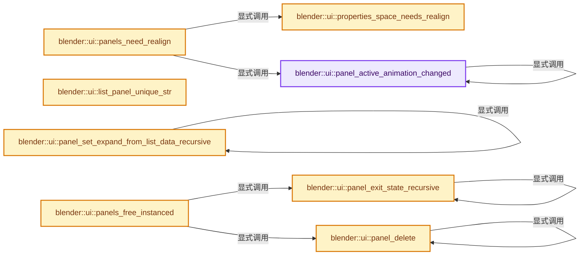

# 实现依赖专题：source/blender/editors/interface/interface_panel.cc

[方向导航](README.md) · [符号索引](../%E7%AC%A6%E5%8F%B7%E4%BE%9D%E8%B5%96%E4%B8%8E%E5%AE%9E%E7%8E%B0%E7%B4%A2%E5%BC%95.md)

本专题从正文实际调用进入，集中保存共享实现。函数有稳定锚点，可从调用处直接跳到对应完整函数；递归与互相调用通过回链组织。

## 本文件的实现关系




## 完整成员与函数实现

<a id="f-d6ebcbd7d7f3b058"></a>

### `blender::ui::panel_active_animation_changed`

实现位置：[source/blender/editors/interface/interface_panel.cc](../../../../../source/blender/editors/interface/interface_panel.cc) · L137—L181。

接口参数：

- `ListBaseT<Panel> *lb`
- `Panel **r_panel_animation`
- `bool *r_no_animation`

**教学注释版**

<!-- annotated:08706c2b94a8e8 -->

```cpp
static bool panel_active_animation_changed(ListBaseT<Panel> *lb,
                                           Panel **r_panel_animation,
                                           bool *r_no_animation)
{
  for (Panel &panel : *lb) {
    /* Detect panel active flag changes. */
    if (!(panel.type && panel.type->parent)) {
      if ((panel.runtime_flag & PANEL_WAS_ACTIVE) && !(panel.runtime_flag & PANEL_ACTIVE)) {
        return true;
      }
      if (!(panel.runtime_flag & PANEL_WAS_ACTIVE) && (panel.runtime_flag & PANEL_ACTIVE)) {
        return true;
      }
    }

    /* Detect changes in panel expansions. */
    if (bool(panel.runtime_flag & PANEL_WAS_CLOSED) != panel_is_closed(&panel)) {
      *r_panel_animation = &panel;
      return false;
    }

    if ((panel.runtime_flag & PANEL_ACTIVE) && !panel_is_closed(&panel)) {
      if (panel_active_animation_changed(&panel.children, r_panel_animation, r_no_animation)) {
        return true;
      }
    }

    /* Detect animation. */
    if (panel.activedata) {
      HandlePanelData *data = static_cast<HandlePanelData *>(panel.activedata);
      if (data->state == PANEL_STATE_ANIMATION) {
        *r_panel_animation = &panel;
      }
      else {
        /* Don't animate while handling other interaction. */
        *r_no_animation = true;
      }
    }
    if ((panel.runtime_flag & PANEL_ANIM_ALIGN) && !(*r_panel_animation)) {
      *r_panel_animation = &panel;
    }
  }

  return false;
}
```

<details>
<summary>核对原始源码：source/blender/editors/interface/interface_panel.cc · L137—L181</summary>

<!-- original:08706c2b94a8e8:source/blender/editors/interface/interface_panel.cc:137:181 -->

```cpp
static bool panel_active_animation_changed(ListBaseT<Panel> *lb,
                                           Panel **r_panel_animation,
                                           bool *r_no_animation)
{
  for (Panel &panel : *lb) {
    /* Detect panel active flag changes. */
    if (!(panel.type && panel.type->parent)) {
      if ((panel.runtime_flag & PANEL_WAS_ACTIVE) && !(panel.runtime_flag & PANEL_ACTIVE)) {
        return true;
      }
      if (!(panel.runtime_flag & PANEL_WAS_ACTIVE) && (panel.runtime_flag & PANEL_ACTIVE)) {
        return true;
      }
    }

    /* Detect changes in panel expansions. */
    if (bool(panel.runtime_flag & PANEL_WAS_CLOSED) != panel_is_closed(&panel)) {
      *r_panel_animation = &panel;
      return false;
    }

    if ((panel.runtime_flag & PANEL_ACTIVE) && !panel_is_closed(&panel)) {
      if (panel_active_animation_changed(&panel.children, r_panel_animation, r_no_animation)) {
        return true;
      }
    }

    /* Detect animation. */
    if (panel.activedata) {
      HandlePanelData *data = static_cast<HandlePanelData *>(panel.activedata);
      if (data->state == PANEL_STATE_ANIMATION) {
        *r_panel_animation = &panel;
      }
      else {
        /* Don't animate while handling other interaction. */
        *r_no_animation = true;
      }
    }
    if ((panel.runtime_flag & PANEL_ANIM_ALIGN) && !(*r_panel_animation)) {
      *r_panel_animation = &panel;
    }
  }

  return false;
}
```

</details>

**结果出口**

- `return true;`
- `return false;`

**继续追踪实现**

- `panel_is_closed` → [blender::ui::panel_is_closed · L1014](%E4%BE%9D%E8%B5%96-interface_panel-25dfe3.md#f-977538c09080811c)。
- `panel_active_animation_changed` → [blender::ui::panel_active_animation_changed · L137](%E4%BE%9D%E8%B5%96-interface_panel-25dfe3.md#f-d6ebcbd7d7f3b058)。

<a id="f-3cdf1abbdf37a2f8"></a>

### `blender::ui::properties_space_needs_realign`

实现位置：[source/blender/editors/interface/interface_panel.cc](../../../../../source/blender/editors/interface/interface_panel.cc) · L186—L197。

接口参数：

- `const ScrArea *area`
- `const ARegion *region`

**教学注释版**

<!-- annotated:bf70b14049f32d -->

```cpp
static bool properties_space_needs_realign(const ScrArea *area, const ARegion *region)
{
  if (area->spacetype == SPACE_PROPERTIES && region->regiontype == RGN_TYPE_WINDOW) {
    const SpaceProperties *sbuts = area->spacedata.first_as<SpaceProperties>();

    if (sbuts->mainbo != sbuts->mainb) {
      return true;
    }
  }

  return false;
}
```

<details>
<summary>核对原始源码：source/blender/editors/interface/interface_panel.cc · L186—L197</summary>

<!-- original:bf70b14049f32d:source/blender/editors/interface/interface_panel.cc:186:197 -->

```cpp
static bool properties_space_needs_realign(const ScrArea *area, const ARegion *region)
{
  if (area->spacetype == SPACE_PROPERTIES && region->regiontype == RGN_TYPE_WINDOW) {
    const SpaceProperties *sbuts = area->spacedata.first_as<SpaceProperties>();

    if (sbuts->mainbo != sbuts->mainb) {
      return true;
    }
  }

  return false;
}
```

</details>

**结果出口**

- `return true;`
- `return false;`

**继续追踪实现**

- `area->spacedata.first_as<SpaceProperties>` → [调用协议](../%E6%A8%A1%E6%9D%BF%E5%AE%8F%E4%B8%8E%E5%8A%A8%E6%80%81%E5%88%86%E6%B4%BE%E5%8D%8F%E8%AE%AE.md)：接收对象类型依赖auto、返回值或模板实例；不按同名猜测目标。调用位置L189。

<a id="f-07c9d89a35edcaa7"></a>

### `blender::ui::panels_need_realign`

实现位置：[source/blender/editors/interface/interface_panel.cc](../../../../../source/blender/editors/interface/interface_panel.cc) · L199—L223。

接口参数：

- `const ScrArea *area`
- `ARegion *region`
- `Panel **r_panel_animation`

**教学注释版**

<!-- annotated:060b857891609f -->

```cpp
static bool panels_need_realign(const ScrArea *area, ARegion *region, Panel **r_panel_animation)
{
  *r_panel_animation = nullptr;

  if (properties_space_needs_realign(area, region)) {
    return true;
  }

  /* Detect if a panel was added or removed. */
  Panel *panel_animation = nullptr;
  bool no_animation = false;
  if (panel_active_animation_changed(&region->panels, &panel_animation, &no_animation)) {
    return true;
  }

  /* Detect panel marked for animation, if we're not already animating. */
  if (panel_animation) {
    if (!no_animation) {
      *r_panel_animation = panel_animation;
    }
    return true;
  }

  return false;
}
```

<details>
<summary>核对原始源码：source/blender/editors/interface/interface_panel.cc · L199—L223</summary>

<!-- original:060b857891609f:source/blender/editors/interface/interface_panel.cc:199:223 -->

```cpp
static bool panels_need_realign(const ScrArea *area, ARegion *region, Panel **r_panel_animation)
{
  *r_panel_animation = nullptr;

  if (properties_space_needs_realign(area, region)) {
    return true;
  }

  /* Detect if a panel was added or removed. */
  Panel *panel_animation = nullptr;
  bool no_animation = false;
  if (panel_active_animation_changed(&region->panels, &panel_animation, &no_animation)) {
    return true;
  }

  /* Detect panel marked for animation, if we're not already animating. */
  if (panel_animation) {
    if (!no_animation) {
      *r_panel_animation = panel_animation;
    }
    return true;
  }

  return false;
}
```

</details>

**结果出口**

- `return true;`
- `return false;`

**继续追踪实现**

- `properties_space_needs_realign` → [blender::ui::properties_space_needs_realign · L186](%E4%BE%9D%E8%B5%96-interface_panel-25dfe3.md#f-3cdf1abbdf37a2f8)。
- `panel_active_animation_changed` → [blender::ui::panel_active_animation_changed · L137](%E4%BE%9D%E8%B5%96-interface_panel-25dfe3.md#f-d6ebcbd7d7f3b058)。

<a id="f-47944ae72662a79b"></a>

### `blender::ui::list_panel_unique_str`

实现位置：[source/blender/editors/interface/interface_panel.cc](../../../../../source/blender/editors/interface/interface_panel.cc) · L287—L292。

接口参数：

- `Panel *panel`
- `char *r_name`

**教学注释版**

<!-- annotated:bf4f0f78d59fb0 -->

```cpp
void list_panel_unique_str(Panel *panel, char *r_name)
{
  /* The panel sort-order will be unique for a specific panel type because the instanced
   * panel list is regenerated for every change in the data order / length. */
  BLI_snprintf_utf8(r_name, INSTANCED_PANEL_UNIQUE_STR_SIZE, "%d", panel->sortorder);
}
```

<details>
<summary>核对原始源码：source/blender/editors/interface/interface_panel.cc · L287—L292</summary>

<!-- original:bf4f0f78d59fb0:source/blender/editors/interface/interface_panel.cc:287:292 -->

```cpp
void list_panel_unique_str(Panel *panel, char *r_name)
{
  /* The panel sort-order will be unique for a specific panel type because the instanced
   * panel list is regenerated for every change in the data order / length. */
  BLI_snprintf_utf8(r_name, INSTANCED_PANEL_UNIQUE_STR_SIZE, "%d", panel->sortorder);
}
```

</details>

**继续追踪实现**

- `BLI_snprintf_utf8` → [blender::BLI_snprintf_utf8 · L597](../01-%E5%9F%BA%E7%A1%80%E5%AE%B9%E5%99%A8%E4%B8%8E%E7%8E%B0%E4%BB%A3CPP/%E4%BE%9D%E8%B5%96-string_utf8-3c62ca.md#f-47c5b052ec665ff6)。

<a id="f-ec2b153f92e86f59"></a>

### `blender::ui::panel_delete`

实现位置：[source/blender/editors/interface/interface_panel.cc](../../../../../source/blender/editors/interface/interface_panel.cc) · L301—L311。

接口参数：

- `ARegion *region`
- `ListBaseT<Panel> *panels`
- `Panel *panel`

**教学注释版**

<!-- annotated:d8a1ca5ce98005 -->

```cpp
static void panel_delete(ARegion *region, ListBaseT<Panel> *panels, Panel *panel)
{
  /* Recursively delete children. */
  for (Panel &child : panel->children.items_mutable()) {
    panel_delete(region, &panel->children, &child);
  }
  panel->children.free_no_destruct();

  BLI_remlink(panels, panel);
  BKE_panel_free(panel);
}
```

<details>
<summary>核对原始源码：source/blender/editors/interface/interface_panel.cc · L301—L311</summary>

<!-- original:d8a1ca5ce98005:source/blender/editors/interface/interface_panel.cc:301:311 -->

```cpp
static void panel_delete(ARegion *region, ListBaseT<Panel> *panels, Panel *panel)
{
  /* Recursively delete children. */
  for (Panel &child : panel->children.items_mutable()) {
    panel_delete(region, &panel->children, &child);
  }
  panel->children.free_no_destruct();

  BLI_remlink(panels, panel);
  BKE_panel_free(panel);
}
```

</details>

**继续追踪实现**

- `panel->children.items_mutable` → [调用协议](../%E6%A8%A1%E6%9D%BF%E5%AE%8F%E4%B8%8E%E5%8A%A8%E6%80%81%E5%88%86%E6%B4%BE%E5%8D%8F%E8%AE%AE.md)：接收对象类型依赖auto、返回值或模板实例；不按同名猜测目标。调用位置L304。
- `panel_delete` → [blender::ui::panel_delete · L301](%E4%BE%9D%E8%B5%96-interface_panel-25dfe3.md#f-ec2b153f92e86f59)。
- `panel->children.free_no_destruct` → [调用协议](../%E6%A8%A1%E6%9D%BF%E5%AE%8F%E4%B8%8E%E5%8A%A8%E6%80%81%E5%88%86%E6%B4%BE%E5%8D%8F%E8%AE%AE.md)：接收对象类型依赖auto、返回值或模板实例；不按同名猜测目标。调用位置L307。
- `BLI_remlink` → [blender::BLI_remlink · L138](../01-%E5%9F%BA%E7%A1%80%E5%AE%B9%E5%99%A8%E4%B8%8E%E7%8E%B0%E4%BB%A3CPP/%E4%BE%9D%E8%B5%96-listbase-2816d9.md#f-120d80f281ca4cb7)。
- `BKE_panel_free` → [blender::BKE_panel_free · L700](%E4%BE%9D%E8%B5%96-screen-f062a7.md#f-6d23d7ea88bed159)。

<a id="f-40f1672c392d0b89"></a>

### `blender::ui::panel_exit_state_recursive`

实现位置：[source/blender/editors/interface/interface_panel.cc](../../../../../source/blender/editors/interface/interface_panel.cc) · L313—L321。

接口参数：

- `const bContext *C`
- `Panel &panel`

**教学注释版**

<!-- annotated:932f1ec0d5379e -->

```cpp
static void panel_exit_state_recursive(const bContext *C, Panel &panel)
{
  if (panel.activedata != nullptr) {
    panel_activate_state(C, &panel, PANEL_STATE_EXIT);
  }
  for (Panel &child : panel.children) {
    panel_exit_state_recursive(C, child);
  }
}
```

<details>
<summary>核对原始源码：source/blender/editors/interface/interface_panel.cc · L313—L321</summary>

<!-- original:932f1ec0d5379e:source/blender/editors/interface/interface_panel.cc:313:321 -->

```cpp
static void panel_exit_state_recursive(const bContext *C, Panel &panel)
{
  if (panel.activedata != nullptr) {
    panel_activate_state(C, &panel, PANEL_STATE_EXIT);
  }
  for (Panel &child : panel.children) {
    panel_exit_state_recursive(C, child);
  }
}
```

</details>

**继续追踪实现**

- `panel_activate_state` → [blender::ui::panel_activate_state · L2930](%E4%BE%9D%E8%B5%96-interface_panel-25dfe3.md#f-f06213fc1463ee29)。
- `panel_exit_state_recursive` → [blender::ui::panel_exit_state_recursive · L313](%E4%BE%9D%E8%B5%96-interface_panel-25dfe3.md#f-40f1672c392d0b89)。

<a id="f-7f59bcec7e20e085"></a>

### `blender::ui::panels_free_instanced`

实现位置：[source/blender/editors/interface/interface_panel.cc](../../../../../source/blender/editors/interface/interface_panel.cc) · L323—L347。

接口参数：

- `const bContext *C`
- `ARegion *region`

**教学注释版**

<!-- annotated:6cd17efd40b2f5 -->

```cpp
void panels_free_instanced(const bContext *C, ARegion *region)
{
  /* Delete panels with the instanced flag. */
  for (Panel &panel : region->panels.items_mutable()) {
    if (!panel.type) {
      continue;
    }
    if ((panel.type->flag & PANEL_TYPE_INSTANCED) == 0) {
      continue;
    }
    /* Make sure any active handler is removed from this panel or its children before deleting
     * them. */
    if (C != nullptr) {
      panel_exit_state_recursive(C, panel);
    }

    /* Free panel's custom data. */
    if (panel.runtime->custom_data_ptr != nullptr) {
      MEM_delete(panel.runtime->custom_data_ptr);
    }

    /* Free the panel and its sub-panels. */
    panel_delete(region, &region->panels, &panel);
  }
}
```

<details>
<summary>核对原始源码：source/blender/editors/interface/interface_panel.cc · L323—L347</summary>

<!-- original:6cd17efd40b2f5:source/blender/editors/interface/interface_panel.cc:323:347 -->

```cpp
void panels_free_instanced(const bContext *C, ARegion *region)
{
  /* Delete panels with the instanced flag. */
  for (Panel &panel : region->panels.items_mutable()) {
    if (!panel.type) {
      continue;
    }
    if ((panel.type->flag & PANEL_TYPE_INSTANCED) == 0) {
      continue;
    }
    /* Make sure any active handler is removed from this panel or its children before deleting
     * them. */
    if (C != nullptr) {
      panel_exit_state_recursive(C, panel);
    }

    /* Free panel's custom data. */
    if (panel.runtime->custom_data_ptr != nullptr) {
      MEM_delete(panel.runtime->custom_data_ptr);
    }

    /* Free the panel and its sub-panels. */
    panel_delete(region, &region->panels, &panel);
  }
}
```

</details>

**继续追踪实现**

- `region->panels.items_mutable` → [调用协议](../%E6%A8%A1%E6%9D%BF%E5%AE%8F%E4%B8%8E%E5%8A%A8%E6%80%81%E5%88%86%E6%B4%BE%E5%8D%8F%E8%AE%AE.md)：接收对象类型依赖auto、返回值或模板实例；不按同名猜测目标。调用位置L326。
- `panel_exit_state_recursive` → [blender::ui::panel_exit_state_recursive · L313](%E4%BE%9D%E8%B5%96-interface_panel-25dfe3.md#f-40f1672c392d0b89)。
- `MEM_delete` → [MEM_delete · L400](../03-%E5%86%85%E5%AD%98%E5%88%86%E9%85%8D%E4%B8%8E%E8%BF%90%E8%A1%8C%E6%97%B6%E7%B1%BB%E5%9E%8B/%E4%BE%9D%E8%B5%96-MEM_guardedalloc-b54eca.md#f-9049ffdd1682887c)。
- `panel_delete` → [blender::ui::panel_delete · L301](%E4%BE%9D%E8%B5%96-interface_panel-25dfe3.md#f-ec2b153f92e86f59)。

<a id="f-12e5dbfa2ebe8a9e"></a>

### `blender::ui::panel_set_expand_from_list_data_recursive`

实现位置：[source/blender/editors/interface/interface_panel.cc](../../../../../source/blender/editors/interface/interface_panel.cc) · L466—L478。

接口参数：

- `Panel *panel`
- `short flag`
- `short *flag_index`

**教学注释版**

<!-- annotated:83ac5ec8aa6056 -->

```cpp
static bool panel_set_expand_from_list_data_recursive(Panel *panel, short flag, short *flag_index)
{
  const bool open = (flag & (1 << *flag_index));
  bool changed = (open == panel_is_closed(panel));

  SET_FLAG_FROM_TEST(panel->flag, !open, PNL_CLOSED);

  for (Panel &child : panel->children) {
    *flag_index = *flag_index + 1;
    changed |= panel_set_expand_from_list_data_recursive(&child, flag, flag_index);
  }
  return changed;
}
```

<details>
<summary>核对原始源码：source/blender/editors/interface/interface_panel.cc · L466—L478</summary>

<!-- original:83ac5ec8aa6056:source/blender/editors/interface/interface_panel.cc:466:478 -->

```cpp
static bool panel_set_expand_from_list_data_recursive(Panel *panel, short flag, short *flag_index)
{
  const bool open = (flag & (1 << *flag_index));
  bool changed = (open == panel_is_closed(panel));

  SET_FLAG_FROM_TEST(panel->flag, !open, PNL_CLOSED);

  for (Panel &child : panel->children) {
    *flag_index = *flag_index + 1;
    changed |= panel_set_expand_from_list_data_recursive(&child, flag, flag_index);
  }
  return changed;
}
```

</details>

**沿实际写入检查状态**

- `changed |= panel_set_expand_from_list_data_recursive(&child, flag, flag_index);`

**结果出口**

- `return changed;`

**继续追踪实现**

- `panel_is_closed` → [blender::ui::panel_is_closed · L1014](%E4%BE%9D%E8%B5%96-interface_panel-25dfe3.md#f-977538c09080811c)。
- `SET_FLAG_FROM_TEST` → [SET_FLAG_FROM_TEST · L557](../01-%E5%9F%BA%E7%A1%80%E5%AE%B9%E5%99%A8%E4%B8%8E%E7%8E%B0%E4%BB%A3CPP/%E4%BE%9D%E8%B5%96-BLI_utildefines-293a0a.md#m-8e0dc83e01a8)。宏定义由构建条件选择。
- `panel_set_expand_from_list_data_recursive` → [blender::ui::panel_set_expand_from_list_data_recursive · L466](%E4%BE%9D%E8%B5%96-interface_panel-25dfe3.md#f-12e5dbfa2ebe8a9e)。

<a id="f-125c0592c1ae92b5"></a>

### `blender::ui::panel_set_expansion_from_list_data`

实现位置：[source/blender/editors/interface/interface_panel.cc](../../../../../source/blender/editors/interface/interface_panel.cc) · L484—L500。

接口参数：

- `const bContext *C`
- `Panel *panel`

**教学注释版**

<!-- annotated:3b1069cf09726a -->

```cpp
static void panel_set_expansion_from_list_data(const bContext *C, Panel *panel)
{
  BLI_assert(panel->type != nullptr);
  BLI_assert(panel->type->flag & PANEL_TYPE_INSTANCED);
  if (panel->type->get_list_data_expand_flag == nullptr) {
    /* Instanced panel doesn't support loading expansion. */
    return;
  }

  const short expand_flag = panel->type->get_list_data_expand_flag(C, panel);
  short flag_index = 0;

  /* Start panel animation if the open state was changed. */
  if (panel_set_expand_from_list_data_recursive(panel, expand_flag, &flag_index)) {
    panel_activate_state(C, panel, PANEL_STATE_ANIMATION);
  }
}
```

<details>
<summary>核对原始源码：source/blender/editors/interface/interface_panel.cc · L484—L500</summary>

<!-- original:3b1069cf09726a:source/blender/editors/interface/interface_panel.cc:484:500 -->

```cpp
static void panel_set_expansion_from_list_data(const bContext *C, Panel *panel)
{
  BLI_assert(panel->type != nullptr);
  BLI_assert(panel->type->flag & PANEL_TYPE_INSTANCED);
  if (panel->type->get_list_data_expand_flag == nullptr) {
    /* Instanced panel doesn't support loading expansion. */
    return;
  }

  const short expand_flag = panel->type->get_list_data_expand_flag(C, panel);
  short flag_index = 0;

  /* Start panel animation if the open state was changed. */
  if (panel_set_expand_from_list_data_recursive(panel, expand_flag, &flag_index)) {
    panel_activate_state(C, panel, PANEL_STATE_ANIMATION);
  }
}
```

</details>

**继续追踪实现**

- `BLI_assert` → [BLI_assert · L48](../01-%E5%9F%BA%E7%A1%80%E5%AE%B9%E5%99%A8%E4%B8%8E%E7%8E%B0%E4%BB%A3CPP/%E4%BE%9D%E8%B5%96-BLI_assert-cc98e8.md#m-57a88495704d)；[BLI_assert · L63](../01-%E5%9F%BA%E7%A1%80%E5%AE%B9%E5%99%A8%E4%B8%8E%E7%8E%B0%E4%BB%A3CPP/%E4%BE%9D%E8%B5%96-BLI_assert-cc98e8.md#m-d07050020cb5)。宏定义由构建条件选择。
- `panel->type->get_list_data_expand_flag` → [调用协议](../%E6%A8%A1%E6%9D%BF%E5%AE%8F%E4%B8%8E%E5%8A%A8%E6%80%81%E5%88%86%E6%B4%BE%E5%8D%8F%E8%AE%AE.md)：接收对象类型依赖auto、返回值或模板实例；不按同名猜测目标。调用位置L493。
- `panel_set_expand_from_list_data_recursive` → [blender::ui::panel_set_expand_from_list_data_recursive · L466](%E4%BE%9D%E8%B5%96-interface_panel-25dfe3.md#f-12e5dbfa2ebe8a9e)。
- `panel_activate_state` → [blender::ui::panel_activate_state · L2930](%E4%BE%9D%E8%B5%96-interface_panel-25dfe3.md#f-f06213fc1463ee29)。

<a id="f-5ee4d3941462ac2c"></a>

### `blender::ui::region_panels_set_expansion_from_list_data`

实现位置：[source/blender/editors/interface/interface_panel.cc](../../../../../source/blender/editors/interface/interface_panel.cc) · L505—L515。

接口参数：

- `const bContext *C`
- `ARegion *region`

**教学注释版**

<!-- annotated:55b7fb4e7febc1 -->

```cpp
static void region_panels_set_expansion_from_list_data(const bContext *C, ARegion *region)
{
  for (Panel &panel : region->panels) {
    if (panel.runtime_flag & PANEL_ACTIVE) {
      PanelType *panel_type = panel.type;
      if (panel_type != nullptr && panel.type->flag & PANEL_TYPE_INSTANCED) {
        panel_set_expansion_from_list_data(C, &panel);
      }
    }
  }
}
```

<details>
<summary>核对原始源码：source/blender/editors/interface/interface_panel.cc · L505—L515</summary>

<!-- original:55b7fb4e7febc1:source/blender/editors/interface/interface_panel.cc:505:515 -->

```cpp
static void region_panels_set_expansion_from_list_data(const bContext *C, ARegion *region)
{
  for (Panel &panel : region->panels) {
    if (panel.runtime_flag & PANEL_ACTIVE) {
      PanelType *panel_type = panel.type;
      if (panel_type != nullptr && panel.type->flag & PANEL_TYPE_INSTANCED) {
        panel_set_expansion_from_list_data(C, &panel);
      }
    }
  }
}
```

</details>

**继续追踪实现**

- `panel_set_expansion_from_list_data` → [blender::ui::panel_set_expansion_from_list_data · L484](%E4%BE%9D%E8%B5%96-interface_panel-25dfe3.md#f-125c0592c1ae92b5)。

<a id="f-33bf21ccfe5e5381"></a>

### `blender::ui::get_panel_expand_flag`

实现位置：[source/blender/editors/interface/interface_panel.cc](../../../../../source/blender/editors/interface/interface_panel.cc) · L520—L529。

接口参数：

- `const Panel *panel`
- `short *flag`
- `short *flag_index`

**教学注释版**

<!-- annotated:1e79d0fdfd2420 -->

```cpp
static void get_panel_expand_flag(const Panel *panel, short *flag, short *flag_index)
{
  const bool open = !(panel->flag & PNL_CLOSED);
  SET_FLAG_FROM_TEST(*flag, open, (1 << *flag_index));

  for (const Panel &child : panel->children) {
    *flag_index = *flag_index + 1;
    get_panel_expand_flag(&child, flag, flag_index);
  }
}
```

<details>
<summary>核对原始源码：source/blender/editors/interface/interface_panel.cc · L520—L529</summary>

<!-- original:1e79d0fdfd2420:source/blender/editors/interface/interface_panel.cc:520:529 -->

```cpp
static void get_panel_expand_flag(const Panel *panel, short *flag, short *flag_index)
{
  const bool open = !(panel->flag & PNL_CLOSED);
  SET_FLAG_FROM_TEST(*flag, open, (1 << *flag_index));

  for (const Panel &child : panel->children) {
    *flag_index = *flag_index + 1;
    get_panel_expand_flag(&child, flag, flag_index);
  }
}
```

</details>

**继续追踪实现**

- `SET_FLAG_FROM_TEST` → [SET_FLAG_FROM_TEST · L557](../01-%E5%9F%BA%E7%A1%80%E5%AE%B9%E5%99%A8%E4%B8%8E%E7%8E%B0%E4%BB%A3CPP/%E4%BE%9D%E8%B5%96-BLI_utildefines-293a0a.md#m-8e0dc83e01a8)。宏定义由构建条件选择。
- `get_panel_expand_flag` → [blender::ui::get_panel_expand_flag · L520](%E4%BE%9D%E8%B5%96-interface_panel-25dfe3.md#f-33bf21ccfe5e5381)。

<a id="f-df75282c03e0fe90"></a>

### `blender::ui::set_panels_list_data_expand_flag`

实现位置：[source/blender/editors/interface/interface_panel.cc](../../../../../source/blender/editors/interface/interface_panel.cc) · L539—L557。

接口参数：

- `const bContext *C`
- `const ARegion *region`

**教学注释版**

<!-- annotated:2747560654a4e3 -->

```cpp
static void set_panels_list_data_expand_flag(const bContext *C, const ARegion *region)
{
  for (Panel &panel : region->panels) {
    PanelType *panel_type = panel.type;
    if (panel_type == nullptr) {
      continue;
    }

    /* Check for #PANEL_ACTIVE so we only set the expand flag for active panels. */
    if (panel_type->flag & PANEL_TYPE_INSTANCED && panel.runtime_flag & PANEL_ACTIVE) {
      short expand_flag;
      short flag_index = 0;
      get_panel_expand_flag(&panel, &expand_flag, &flag_index);
      if (panel.type->set_list_data_expand_flag) {
        panel.type->set_list_data_expand_flag(C, &panel, expand_flag);
      }
    }
  }
}
```

<details>
<summary>核对原始源码：source/blender/editors/interface/interface_panel.cc · L539—L557</summary>

<!-- original:2747560654a4e3:source/blender/editors/interface/interface_panel.cc:539:557 -->

```cpp
static void set_panels_list_data_expand_flag(const bContext *C, const ARegion *region)
{
  for (Panel &panel : region->panels) {
    PanelType *panel_type = panel.type;
    if (panel_type == nullptr) {
      continue;
    }

    /* Check for #PANEL_ACTIVE so we only set the expand flag for active panels. */
    if (panel_type->flag & PANEL_TYPE_INSTANCED && panel.runtime_flag & PANEL_ACTIVE) {
      short expand_flag;
      short flag_index = 0;
      get_panel_expand_flag(&panel, &expand_flag, &flag_index);
      if (panel.type->set_list_data_expand_flag) {
        panel.type->set_list_data_expand_flag(C, &panel, expand_flag);
      }
    }
  }
}
```

</details>

**继续追踪实现**

- `get_panel_expand_flag` → [blender::ui::get_panel_expand_flag · L520](%E4%BE%9D%E8%B5%96-interface_panel-25dfe3.md#f-33bf21ccfe5e5381)。
- `panel.type->set_list_data_expand_flag` → [调用协议](../%E6%A8%A1%E6%9D%BF%E5%AE%8F%E4%B8%8E%E5%8A%A8%E6%80%81%E5%88%86%E6%B4%BE%E5%8D%8F%E8%AE%AE.md)：接收对象类型依赖auto、返回值或模板实例；不按同名猜测目标。调用位置L553。

<a id="f-73f56f8db96d10fe"></a>

### `blender::ui::panel_custom_data_active_set`

实现位置：[source/blender/editors/interface/interface_panel.cc](../../../../../source/blender/editors/interface/interface_panel.cc) · L605—L618。

接口参数：

- `Panel *panel`

**教学注释版**

<!-- annotated:0951e2fd8645f0 -->

```cpp
static void panel_custom_data_active_set(Panel *panel)
{
  /* Since the panel is interacted with, it should be active and have a type. */
  BLI_assert(panel_is_active(panel));
  BLI_assert(panel->type != nullptr);

  if (panel->type->active_property[0] != '\0') {
    PointerRNA *ptr = panel_custom_data_get(panel);
    BLI_assert(RNA_struct_find_property(ptr, panel->type->active_property) != nullptr);
    if (ptr != nullptr && *ptr) {
      RNA_boolean_set(ptr, panel->type->active_property, true);
    }
  }
}
```

<details>
<summary>核对原始源码：source/blender/editors/interface/interface_panel.cc · L605—L618</summary>

<!-- original:0951e2fd8645f0:source/blender/editors/interface/interface_panel.cc:605:618 -->

```cpp
static void panel_custom_data_active_set(Panel *panel)
{
  /* Since the panel is interacted with, it should be active and have a type. */
  BLI_assert(panel_is_active(panel));
  BLI_assert(panel->type != nullptr);

  if (panel->type->active_property[0] != '\0') {
    PointerRNA *ptr = panel_custom_data_get(panel);
    BLI_assert(RNA_struct_find_property(ptr, panel->type->active_property) != nullptr);
    if (ptr != nullptr && *ptr) {
      RNA_boolean_set(ptr, panel->type->active_property, true);
    }
  }
}
```

</details>

**继续追踪实现**

- `BLI_assert` → [BLI_assert · L48](../01-%E5%9F%BA%E7%A1%80%E5%AE%B9%E5%99%A8%E4%B8%8E%E7%8E%B0%E4%BB%A3CPP/%E4%BE%9D%E8%B5%96-BLI_assert-cc98e8.md#m-57a88495704d)；[BLI_assert · L63](../01-%E5%9F%BA%E7%A1%80%E5%AE%B9%E5%99%A8%E4%B8%8E%E7%8E%B0%E4%BB%A3CPP/%E4%BE%9D%E8%B5%96-BLI_assert-cc98e8.md#m-d07050020cb5)。宏定义由构建条件选择。
- `panel_is_active` → [blender::ui::panel_is_active · L1028](%E4%BE%9D%E8%B5%96-interface_panel-25dfe3.md#f-54b78e3d2036cb51)。
- `panel_custom_data_get` → [blender::ui::panel_custom_data_get · L2811](%E4%BE%9D%E8%B5%96-interface_panel-25dfe3.md#f-7338a8c198e62921)。
- `RNA_struct_find_property` → [blender::RNA_struct_find_property · L855](%E4%BE%9D%E8%B5%96-rna_access-706bea.md#f-75b0f3b3cc89dd4c)；[blender::RNA_struct_find_property · L874](%E4%BE%9D%E8%B5%96-rna_access-706bea.md#f-7fb7ab238d64680f)。同名重载需按实参类型选择。
- `RNA_boolean_set` → [blender::RNA_boolean_set · L6735](%E4%BE%9D%E8%B5%96-rna_access-706bea.md#f-e639630273970e77)。

<a id="f-287eddbb1449dc5a"></a>

### `blender::ui::panel_set_flag_recursive`

实现位置：[source/blender/editors/interface/interface_panel.cc](../../../../../source/blender/editors/interface/interface_panel.cc) · L623—L630。

接口参数：

- `Panel *panel`
- `ePanel_Flag flag`
- `bool value`

**教学注释版**

<!-- annotated:acb494f0967fec -->

```cpp
static void panel_set_flag_recursive(Panel *panel, ePanel_Flag flag, bool value)
{
  SET_FLAG_FROM_TEST(panel->flag, value, flag);

  for (Panel &child : panel->children) {
    panel_set_flag_recursive(&child, flag, value);
  }
}
```

<details>
<summary>核对原始源码：source/blender/editors/interface/interface_panel.cc · L623—L630</summary>

<!-- original:acb494f0967fec:source/blender/editors/interface/interface_panel.cc:623:630 -->

```cpp
static void panel_set_flag_recursive(Panel *panel, ePanel_Flag flag, bool value)
{
  SET_FLAG_FROM_TEST(panel->flag, value, flag);

  for (Panel &child : panel->children) {
    panel_set_flag_recursive(&child, flag, value);
  }
}
```

</details>

**继续追踪实现**

- `SET_FLAG_FROM_TEST` → [SET_FLAG_FROM_TEST · L557](../01-%E5%9F%BA%E7%A1%80%E5%AE%B9%E5%99%A8%E4%B8%8E%E7%8E%B0%E4%BB%A3CPP/%E4%BE%9D%E8%B5%96-BLI_utildefines-293a0a.md#m-8e0dc83e01a8)。宏定义由构建条件选择。
- `panel_set_flag_recursive` → [blender::ui::panel_set_flag_recursive · L623](%E4%BE%9D%E8%B5%96-interface_panel-25dfe3.md#f-287eddbb1449dc5a)。

<a id="f-991f32a5b549e232"></a>

### `blender::ui::panel_set_runtime_flag_recursive`

实现位置：[source/blender/editors/interface/interface_panel.cc](../../../../../source/blender/editors/interface/interface_panel.cc) · L635—L642。

接口参数：

- `Panel *panel`
- `short flag`
- `bool value`

**教学注释版**

<!-- annotated:5df24325985d40 -->

```cpp
static void panel_set_runtime_flag_recursive(Panel *panel, short flag, bool value)
{
  SET_FLAG_FROM_TEST(panel->runtime_flag, value, flag);

  for (Panel &sub_panel : panel->children) {
    panel_set_runtime_flag_recursive(&sub_panel, flag, value);
  }
}
```

<details>
<summary>核对原始源码：source/blender/editors/interface/interface_panel.cc · L635—L642</summary>

<!-- original:5df24325985d40:source/blender/editors/interface/interface_panel.cc:635:642 -->

```cpp
static void panel_set_runtime_flag_recursive(Panel *panel, short flag, bool value)
{
  SET_FLAG_FROM_TEST(panel->runtime_flag, value, flag);

  for (Panel &sub_panel : panel->children) {
    panel_set_runtime_flag_recursive(&sub_panel, flag, value);
  }
}
```

</details>

**继续追踪实现**

- `SET_FLAG_FROM_TEST` → [SET_FLAG_FROM_TEST · L557](../01-%E5%9F%BA%E7%A1%80%E5%AE%B9%E5%99%A8%E4%B8%8E%E7%8E%B0%E4%BB%A3CPP/%E4%BE%9D%E8%B5%96-BLI_utildefines-293a0a.md#m-8e0dc83e01a8)。宏定义由构建条件选择。
- `panel_set_runtime_flag_recursive` → [blender::ui::panel_set_runtime_flag_recursive · L635](%E4%BE%9D%E8%B5%96-interface_panel-25dfe3.md#f-991f32a5b549e232)。

<a id="f-a70cc224a43703bc"></a>

### `blender::ui::panel_find_by_type`

实现位置：[source/blender/editors/interface/interface_panel.cc](../../../../../source/blender/editors/interface/interface_panel.cc) · L681—L691。

接口参数：

- `ListBaseT<Panel> *lb`
- `const PanelType *pt`

**教学注释版**

<!-- annotated:6633b4e07a7dd4 -->

```cpp
Panel *panel_find_by_type(ListBaseT<Panel> *lb, const PanelType *pt)
{
  const char *idname = pt->idname;

  for (Panel &panel : *lb) {
    if (STREQLEN(panel.panelname, idname, sizeof(panel.panelname))) {
      return &panel;
    }
  }
  return nullptr;
}
```

<details>
<summary>核对原始源码：source/blender/editors/interface/interface_panel.cc · L681—L691</summary>

<!-- original:6633b4e07a7dd4:source/blender/editors/interface/interface_panel.cc:681:691 -->

```cpp
Panel *panel_find_by_type(ListBaseT<Panel> *lb, const PanelType *pt)
{
  const char *idname = pt->idname;

  for (Panel &panel : *lb) {
    if (STREQLEN(panel.panelname, idname, sizeof(panel.panelname))) {
      return &panel;
    }
  }
  return nullptr;
}
```

</details>

**结果出口**

- `return &panel;`
- `return nullptr;`

**继续追踪实现**

- `STREQLEN` → [STREQLEN · L114](%E4%BE%9D%E8%B5%96-GHOST_utildefines-34b996.md#m-4c9fb75cc1d1)；[STREQLEN · L453](../01-%E5%9F%BA%E7%A1%80%E5%AE%B9%E5%99%A8%E4%B8%8E%E7%8E%B0%E4%BB%A3CPP/%E4%BE%9D%E8%B5%96-BLI_utildefines-293a0a.md#m-c74c1422ab62)；[STREQLEN · L56](%E4%BE%9D%E8%B5%96-clog-a0bec8.md#m-c4a18b1393b9)。宏定义由构建条件选择。

<a id="f-046afa0c489f063d"></a>

### `blender::ui::panel_begin`

实现位置：[source/blender/editors/interface/interface_panel.cc](../../../../../source/blender/editors/interface/interface_panel.cc) · L693—L773。

接口参数：

- `ARegion *region`
- `ListBaseT<Panel> *lb`
- `Block *block`
- `PanelType *pt`
- `Panel *panel`
- `bool *r_open`

**教学注释版**

<!-- annotated:b9b86dd6fd9864 -->

```cpp
Panel *panel_begin(
    ARegion *region, ListBaseT<Panel> *lb, Block *block, PanelType *pt, Panel *panel, bool *r_open)
{
  Panel *panel_last;
  const char *drawname = CTX_IFACE_(pt->translation_context, pt->label);
  const bool newpanel = (panel == nullptr);

  if (newpanel) {
    panel = BKE_panel_new(pt);

    if (pt->flag & PANEL_TYPE_DEFAULT_CLOSED) {
      panel->flag |= PNL_CLOSED;
      panel->runtime_flag |= PANEL_WAS_CLOSED;
    }

    panel->ofsx = 0;
    panel->ofsy = 0;
    panel->sizex = 0;
    panel->sizey = 0;
    panel->blocksizex = 0;
    panel->blocksizey = 0;
    panel->runtime_flag |= PANEL_NEW_ADDED;

    BLI_addtail(lb, panel);
  }
  else {
    /* Panel already exists. */
    panel->type = pt;
  }

  panel->runtime->block = block;

  panel_drawname_set(panel, drawname);

  /* If a new panel is added, we insert it right after the panel that was last added.
   * This way new panels are inserted in the right place between versions. */
  for (panel_last = lb->first(); panel_last; panel_last = panel_last->next) {
    if (panel_last->runtime_flag & PANEL_LAST_ADDED) {
      BLI_remlink(lb, panel);
      BLI_insertlinkafter(lb, panel_last, panel);
      break;
    }
  }

  if (newpanel) {
    panel->sortorder = (panel_last) ? panel_last->sortorder + 1 : 0;

    for (Panel &panel_next : *lb) {
      if (&panel_next != panel && panel_next.sortorder >= panel->sortorder) {
        panel_next.sortorder++;
      }
    }
  }

  if (newpanel && region->regiontype == RGN_TYPE_TOOLS &&
      STRPREFIX(panel->panelname, "FILEBROWSER_PT_"))
  {
    const std::string panel_name_str = panel->panelname;
    const int order = recents::Section("panel.sortorder").get<int>(panel_name_str);
    if (order >= 0) {
      panel->sortorder = order;
      SET_FLAG_FROM_TEST(
          panel->flag, !recents::Section("panel.open").get<bool>(panel_name_str), PNL_CLOSED);
    }
  }

  if (panel_last) {
    panel_last->runtime_flag &= ~PANEL_LAST_ADDED;
  }

  /* Assign the new panel to the block. */
  block->panel = panel;
  panel->runtime_flag |= PANEL_ACTIVE | PANEL_LAST_ADDED;
  if (region->alignment == RGN_ALIGN_FLOAT) {
    block_theme_style_set(block, BLOCK_THEME_STYLE_POPUP);
  }

  *r_open = !panel_is_closed(panel);

  return panel;
}
```

<details>
<summary>核对原始源码：source/blender/editors/interface/interface_panel.cc · L693—L773</summary>

<!-- original:b9b86dd6fd9864:source/blender/editors/interface/interface_panel.cc:693:773 -->

```cpp
Panel *panel_begin(
    ARegion *region, ListBaseT<Panel> *lb, Block *block, PanelType *pt, Panel *panel, bool *r_open)
{
  Panel *panel_last;
  const char *drawname = CTX_IFACE_(pt->translation_context, pt->label);
  const bool newpanel = (panel == nullptr);

  if (newpanel) {
    panel = BKE_panel_new(pt);

    if (pt->flag & PANEL_TYPE_DEFAULT_CLOSED) {
      panel->flag |= PNL_CLOSED;
      panel->runtime_flag |= PANEL_WAS_CLOSED;
    }

    panel->ofsx = 0;
    panel->ofsy = 0;
    panel->sizex = 0;
    panel->sizey = 0;
    panel->blocksizex = 0;
    panel->blocksizey = 0;
    panel->runtime_flag |= PANEL_NEW_ADDED;

    BLI_addtail(lb, panel);
  }
  else {
    /* Panel already exists. */
    panel->type = pt;
  }

  panel->runtime->block = block;

  panel_drawname_set(panel, drawname);

  /* If a new panel is added, we insert it right after the panel that was last added.
   * This way new panels are inserted in the right place between versions. */
  for (panel_last = lb->first(); panel_last; panel_last = panel_last->next) {
    if (panel_last->runtime_flag & PANEL_LAST_ADDED) {
      BLI_remlink(lb, panel);
      BLI_insertlinkafter(lb, panel_last, panel);
      break;
    }
  }

  if (newpanel) {
    panel->sortorder = (panel_last) ? panel_last->sortorder + 1 : 0;

    for (Panel &panel_next : *lb) {
      if (&panel_next != panel && panel_next.sortorder >= panel->sortorder) {
        panel_next.sortorder++;
      }
    }
  }

  if (newpanel && region->regiontype == RGN_TYPE_TOOLS &&
      STRPREFIX(panel->panelname, "FILEBROWSER_PT_"))
  {
    const std::string panel_name_str = panel->panelname;
    const int order = recents::Section("panel.sortorder").get<int>(panel_name_str);
    if (order >= 0) {
      panel->sortorder = order;
      SET_FLAG_FROM_TEST(
          panel->flag, !recents::Section("panel.open").get<bool>(panel_name_str), PNL_CLOSED);
    }
  }

  if (panel_last) {
    panel_last->runtime_flag &= ~PANEL_LAST_ADDED;
  }

  /* Assign the new panel to the block. */
  block->panel = panel;
  panel->runtime_flag |= PANEL_ACTIVE | PANEL_LAST_ADDED;
  if (region->alignment == RGN_ALIGN_FLOAT) {
    block_theme_style_set(block, BLOCK_THEME_STYLE_POPUP);
  }

  *r_open = !panel_is_closed(panel);

  return panel;
}
```

</details>

**沿实际写入检查状态**

- `panel = BKE_panel_new(pt);`
- `panel->flag |= PNL_CLOSED;`
- `panel->runtime_flag |= PANEL_WAS_CLOSED;`
- `panel->ofsx = 0;`
- `panel->ofsy = 0;`
- `panel->sizex = 0;`
- `panel->sizey = 0;`
- `panel->blocksizex = 0;`
- `panel->blocksizey = 0;`
- `panel->runtime_flag |= PANEL_NEW_ADDED;`
- `panel->type = pt;`
- `panel->runtime->block = block;`
- `panel->sortorder = (panel_last) ? panel_last->sortorder + 1 : 0;`
- `panel->sortorder = order;`
- `panel_last->runtime_flag &= ~PANEL_LAST_ADDED;`
- `block->panel = panel;`
- `panel->runtime_flag |= PANEL_ACTIVE | PANEL_LAST_ADDED;`

**结果出口**

- `return panel;`

**继续追踪实现**

- `CTX_IFACE_` → [CTX_IFACE_ · L53](%E4%BE%9D%E8%B5%96-BLT_translation-c89e58.md#m-8d5c11953dfa)。宏定义由构建条件选择。
- `BKE_panel_new` → [blender::BKE_panel_new · L683](%E4%BE%9D%E8%B5%96-screen-f062a7.md#f-2b7ca8c09599a744)。
- `BLI_addtail` → [blender::BLI_addtail · L118](../01-%E5%9F%BA%E7%A1%80%E5%AE%B9%E5%99%A8%E4%B8%8E%E7%8E%B0%E4%BB%A3CPP/%E4%BE%9D%E8%B5%96-listbase-2816d9.md#f-4fb027713fa3115b)。
- `panel_drawname_set` → [blender::ui::panel_drawname_set · L873](%E4%BE%9D%E8%B5%96-interface_panel-25dfe3.md#f-25fc1623bc44cda8)。
- `lb->first` → [blender::ListBaseT::first · L102](%E4%BE%9D%E8%B5%96-DNA_listBase-48dbc9.md#f-3d12ff35da057c9e)；[blender::ListBaseT::first · L106](%E4%BE%9D%E8%B5%96-DNA_listBase-48dbc9.md#f-0df87c3480e059f9)。同名重载需按实参类型选择。
- `BLI_remlink` → [blender::BLI_remlink · L138](../01-%E5%9F%BA%E7%A1%80%E5%AE%B9%E5%99%A8%E4%B8%8E%E7%8E%B0%E4%BB%A3CPP/%E4%BE%9D%E8%B5%96-listbase-2816d9.md#f-120d80f281ca4cb7)。
- `BLI_insertlinkafter` → [blender::BLI_insertlinkafter · L339](../01-%E5%9F%BA%E7%A1%80%E5%AE%B9%E5%99%A8%E4%B8%8E%E7%8E%B0%E4%BB%A3CPP/%E4%BE%9D%E8%B5%96-listbase-2816d9.md#f-fb34ee702e68c1d5)。
- `STRPREFIX` → [STRPREFIX · L117](%E4%BE%9D%E8%B5%96-GHOST_utildefines-34b996.md#m-f15302dd736a)；[STRPREFIX · L456](../01-%E5%9F%BA%E7%A1%80%E5%AE%B9%E5%99%A8%E4%B8%8E%E7%8E%B0%E4%BB%A3CPP/%E4%BE%9D%E8%B5%96-BLI_utildefines-293a0a.md#m-afbbeb066fe7)；[STRPREFIX · L18](%E4%BE%9D%E8%B5%96-datatoc-5ae3c3.md#m-cc9a805e5520)。宏定义由构建条件选择。
- `recents::Section("panel.sortorder").get<int>` → [调用协议](../%E6%A8%A1%E6%9D%BF%E5%AE%8F%E4%B8%8E%E5%8A%A8%E6%80%81%E5%88%86%E6%B4%BE%E5%8D%8F%E8%AE%AE.md)：接收对象类型依赖auto、返回值或模板实例；不按同名猜测目标。调用位置L751。
- `recents::Section` → [blender::recents::Section::Section · L59](%E4%BE%9D%E8%B5%96-BKE_recents-d2c760.md#f-59b6867e088ce836)。
- `SET_FLAG_FROM_TEST` → [SET_FLAG_FROM_TEST · L557](../01-%E5%9F%BA%E7%A1%80%E5%AE%B9%E5%99%A8%E4%B8%8E%E7%8E%B0%E4%BB%A3CPP/%E4%BE%9D%E8%B5%96-BLI_utildefines-293a0a.md#m-8e0dc83e01a8)。宏定义由构建条件选择。
- `recents::Section("panel.open").get<bool>` → [调用协议](../%E6%A8%A1%E6%9D%BF%E5%AE%8F%E4%B8%8E%E5%8A%A8%E6%80%81%E5%88%86%E6%B4%BE%E5%8D%8F%E8%AE%AE.md)：接收对象类型依赖auto、返回值或模板实例；不按同名猜测目标。调用位置L755。
- `block_theme_style_set` → [blender::ui::block_theme_style_set · L4137](%E4%BE%9D%E8%B5%96-interface-11578b.md#f-b402bcc916dfd3fa)。
- `panel_is_closed` → [blender::ui::panel_is_closed · L1014](%E4%BE%9D%E8%B5%96-interface_panel-25dfe3.md#f-977538c09080811c)。

<a id="f-d669dc84639a4004"></a>

### `blender::ui::panel_header_buttons_begin`

实现位置：[source/blender/editors/interface/interface_panel.cc](../../../../../source/blender/editors/interface/interface_panel.cc) · L775—L780。

接口参数：

- `Panel *panel`

**教学注释版**

<!-- annotated:1ceadaa9d7477e -->

```cpp
void panel_header_buttons_begin(Panel *panel)
{
  Block *block = panel->runtime->block;

  block_new_button_group(block, UI_BUTTON_GROUP_LOCK | UI_BUTTON_GROUP_PANEL_HEADER);
}
```

<details>
<summary>核对原始源码：source/blender/editors/interface/interface_panel.cc · L775—L780</summary>

<!-- original:1ceadaa9d7477e:source/blender/editors/interface/interface_panel.cc:775:780 -->

```cpp
void panel_header_buttons_begin(Panel *panel)
{
  Block *block = panel->runtime->block;

  block_new_button_group(block, UI_BUTTON_GROUP_LOCK | UI_BUTTON_GROUP_PANEL_HEADER);
}
```

</details>

**继续追踪实现**

- `block_new_button_group` → [blender::ui::block_new_button_group · L17](%E4%BE%9D%E8%B5%96-interface_button_group-f7403c.md#f-0a3e429bf75daa78)。

<a id="f-de2c2197cb992536"></a>

### `blender::ui::panel_header_buttons_end`

实现位置：[source/blender/editors/interface/interface_panel.cc](../../../../../source/blender/editors/interface/interface_panel.cc) · L782—L804。

接口参数：

- `Panel *panel`

**教学注释版**

<!-- annotated:0e1596ca409db1 -->

```cpp
void panel_header_buttons_end(Panel *panel)
{
  Block *block = panel->runtime->block;

  /* A button group should always be created in #panel_header_buttons_begin. */
  BLI_assert(!block->button_groups.is_empty());

  ButtonGroup &button_group = block->button_groups.last();
  button_group.flag &= ~UI_BUTTON_GROUP_LOCK;

  /* Repurpose the first header button group if it is empty, in case the first button added to
   * the panel doesn't add a new group (if the button is created directly rather than through an
   * interface layout call). */
  if (block->button_groups.size() == 1 && button_group.buttons.is_empty()) {
    button_group.flag &= ~UI_BUTTON_GROUP_PANEL_HEADER;
  }
  else {
    /* Always add a new button group. Although this may result in many empty groups, without it,
     * new buttons in the panel body not protected with a #block_new_button_group call would
     * end up in the panel header group. */
    block_new_button_group(block, ButtonGroupFlag(0));
  }
}
```

<details>
<summary>核对原始源码：source/blender/editors/interface/interface_panel.cc · L782—L804</summary>

<!-- original:0e1596ca409db1:source/blender/editors/interface/interface_panel.cc:782:804 -->

```cpp
void panel_header_buttons_end(Panel *panel)
{
  Block *block = panel->runtime->block;

  /* A button group should always be created in #panel_header_buttons_begin. */
  BLI_assert(!block->button_groups.is_empty());

  ButtonGroup &button_group = block->button_groups.last();
  button_group.flag &= ~UI_BUTTON_GROUP_LOCK;

  /* Repurpose the first header button group if it is empty, in case the first button added to
   * the panel doesn't add a new group (if the button is created directly rather than through an
   * interface layout call). */
  if (block->button_groups.size() == 1 && button_group.buttons.is_empty()) {
    button_group.flag &= ~UI_BUTTON_GROUP_PANEL_HEADER;
  }
  else {
    /* Always add a new button group. Although this may result in many empty groups, without it,
     * new buttons in the panel body not protected with a #block_new_button_group call would
     * end up in the panel header group. */
    block_new_button_group(block, ButtonGroupFlag(0));
  }
}
```

</details>

**沿实际写入检查状态**

- `button_group.flag &= ~UI_BUTTON_GROUP_LOCK;`
- `button_group.flag &= ~UI_BUTTON_GROUP_PANEL_HEADER;`

**继续追踪实现**

- `BLI_assert` → [BLI_assert · L48](../01-%E5%9F%BA%E7%A1%80%E5%AE%B9%E5%99%A8%E4%B8%8E%E7%8E%B0%E4%BB%A3CPP/%E4%BE%9D%E8%B5%96-BLI_assert-cc98e8.md#m-57a88495704d)；[BLI_assert · L63](../01-%E5%9F%BA%E7%A1%80%E5%AE%B9%E5%99%A8%E4%B8%8E%E7%8E%B0%E4%BB%A3CPP/%E4%BE%9D%E8%B5%96-BLI_assert-cc98e8.md#m-d07050020cb5)。宏定义由构建条件选择。
- `block->button_groups.is_empty` → [调用协议](../%E6%A8%A1%E6%9D%BF%E5%AE%8F%E4%B8%8E%E5%8A%A8%E6%80%81%E5%88%86%E6%B4%BE%E5%8D%8F%E8%AE%AE.md)：接收对象类型依赖auto、返回值或模板实例；不按同名猜测目标。调用位置L787。
- `block->button_groups.last` → [调用协议](../%E6%A8%A1%E6%9D%BF%E5%AE%8F%E4%B8%8E%E5%8A%A8%E6%80%81%E5%88%86%E6%B4%BE%E5%8D%8F%E8%AE%AE.md)：接收对象类型依赖auto、返回值或模板实例；不按同名猜测目标。调用位置L789。
- `block->button_groups.size` → [调用协议](../%E6%A8%A1%E6%9D%BF%E5%AE%8F%E4%B8%8E%E5%8A%A8%E6%80%81%E5%88%86%E6%B4%BE%E5%8D%8F%E8%AE%AE.md)：接收对象类型依赖auto、返回值或模板实例；不按同名猜测目标。调用位置L795。
- `button_group.buttons.is_empty` → [调用协议](../%E6%A8%A1%E6%9D%BF%E5%AE%8F%E4%B8%8E%E5%8A%A8%E6%80%81%E5%88%86%E6%B4%BE%E5%8D%8F%E8%AE%AE.md)：接收对象类型依赖auto、返回值或模板实例；不按同名猜测目标。调用位置L795。
- `block_new_button_group` → [blender::ui::block_new_button_group · L17](%E4%BE%9D%E8%B5%96-interface_button_group-f7403c.md#f-0a3e429bf75daa78)。
- `ButtonGroupFlag` → [blender::ui::ButtonGroupFlag](%E4%BE%9D%E8%B5%96-interface_intern-60addc.md#t-e64b8c99d342)。

<a id="f-770f08f46c8ab491"></a>

### `blender::ui::panel_region_offset_x_get`

实现位置：[source/blender/editors/interface/interface_panel.cc](../../../../../source/blender/editors/interface/interface_panel.cc) · L806—L815。

接口参数：

- `const ARegion *region`

**教学注释版**

<!-- annotated:ddfdf1593abd40 -->

```cpp
static float panel_region_offset_x_get(const ARegion *region)
{
  if (panel_category_tabs_is_visible(region)) {
    if (RGN_ALIGN_ENUM_FROM_MASK(region->alignment) != RGN_ALIGN_RIGHT) {
      return UI_PANEL_CATEGORY_MARGIN_WIDTH;
    }
  }

  return 0.0f;
}
```

<details>
<summary>核对原始源码：source/blender/editors/interface/interface_panel.cc · L806—L815</summary>

<!-- original:ddfdf1593abd40:source/blender/editors/interface/interface_panel.cc:806:815 -->

```cpp
static float panel_region_offset_x_get(const ARegion *region)
{
  if (panel_category_tabs_is_visible(region)) {
    if (RGN_ALIGN_ENUM_FROM_MASK(region->alignment) != RGN_ALIGN_RIGHT) {
      return UI_PANEL_CATEGORY_MARGIN_WIDTH;
    }
  }

  return 0.0f;
}
```

</details>

**结果出口**

- `return UI_PANEL_CATEGORY_MARGIN_WIDTH;`
- `return 0.0f;`

**继续追踪实现**

- `panel_category_tabs_is_visible` → [blender::ui::panel_category_tabs_is_visible · L2426](%E4%BE%9D%E8%B5%96-interface_panel-25dfe3.md#f-e8f29ef0cc8f8b93)。
- `RGN_ALIGN_ENUM_FROM_MASK` → [RGN_ALIGN_ENUM_FROM_MASK · L747](%E4%BE%9D%E8%B5%96-DNA_screen_types-7eab90.md#m-7267b0776dc7)。宏定义由构建条件选择。

<a id="f-a2e053debcc1b705"></a>

### `blender::ui::panel_calculate_size_recursive`

实现位置：[source/blender/editors/interface/interface_panel.cc](../../../../../source/blender/editors/interface/interface_panel.cc) · L821—L863。

接口参数：

- `ARegion *region`
- `Panel *panel`

**教学注释版**

<!-- annotated:77f8ff1ecfa8b1 -->

```cpp
static void panel_calculate_size_recursive(ARegion *region, Panel *panel)
{
  int width = panel->blocksizex;
  int height = panel->blocksizey;

  for (Panel &child_panel : panel->children) {
    if (child_panel.runtime_flag & PANEL_ACTIVE) {
      panel_calculate_size_recursive(region, &child_panel);
      width = max_ii(width, child_panel.sizex);
      height += get_panel_real_size_y(&child_panel);
    }
  }

  /* Update total panel size. */
  if (panel->runtime_flag & PANEL_NEW_ADDED) {
    panel->runtime_flag &= ~PANEL_NEW_ADDED;
    panel->sizex = width;
    panel->sizey = height;
  }
  else {
    const int old_sizex = panel->sizex, old_sizey = panel->sizey;
    const int old_region_ofsx = panel->runtime->region_ofsx;

    /* Update width/height if non-zero. */
    if (width != 0) {
      panel->sizex = width;
    }
    if (height != 0 || !panel_is_closed(panel)) {
      panel->sizey = height;
    }

    /* Check if we need to do an animation. */
    if (panel->sizex != old_sizex || panel->sizey != old_sizey) {
      panel->runtime_flag |= PANEL_ANIM_ALIGN;
      panel->ofsy += old_sizey - panel->sizey;
    }

    panel->runtime->region_ofsx = panel_region_offset_x_get(region);
    if (old_region_ofsx != panel->runtime->region_ofsx) {
      panel->runtime_flag |= PANEL_ANIM_ALIGN;
    }
  }
}
```

<details>
<summary>核对原始源码：source/blender/editors/interface/interface_panel.cc · L821—L863</summary>

<!-- original:77f8ff1ecfa8b1:source/blender/editors/interface/interface_panel.cc:821:863 -->

```cpp
static void panel_calculate_size_recursive(ARegion *region, Panel *panel)
{
  int width = panel->blocksizex;
  int height = panel->blocksizey;

  for (Panel &child_panel : panel->children) {
    if (child_panel.runtime_flag & PANEL_ACTIVE) {
      panel_calculate_size_recursive(region, &child_panel);
      width = max_ii(width, child_panel.sizex);
      height += get_panel_real_size_y(&child_panel);
    }
  }

  /* Update total panel size. */
  if (panel->runtime_flag & PANEL_NEW_ADDED) {
    panel->runtime_flag &= ~PANEL_NEW_ADDED;
    panel->sizex = width;
    panel->sizey = height;
  }
  else {
    const int old_sizex = panel->sizex, old_sizey = panel->sizey;
    const int old_region_ofsx = panel->runtime->region_ofsx;

    /* Update width/height if non-zero. */
    if (width != 0) {
      panel->sizex = width;
    }
    if (height != 0 || !panel_is_closed(panel)) {
      panel->sizey = height;
    }

    /* Check if we need to do an animation. */
    if (panel->sizex != old_sizex || panel->sizey != old_sizey) {
      panel->runtime_flag |= PANEL_ANIM_ALIGN;
      panel->ofsy += old_sizey - panel->sizey;
    }

    panel->runtime->region_ofsx = panel_region_offset_x_get(region);
    if (old_region_ofsx != panel->runtime->region_ofsx) {
      panel->runtime_flag |= PANEL_ANIM_ALIGN;
    }
  }
}
```

</details>

**沿实际写入检查状态**

- `width = max_ii(width, child_panel.sizex);`
- `height += get_panel_real_size_y(&child_panel);`
- `panel->runtime_flag &= ~PANEL_NEW_ADDED;`
- `panel->sizex = width;`
- `panel->sizey = height;`
- `panel->runtime_flag |= PANEL_ANIM_ALIGN;`
- `panel->ofsy += old_sizey - panel->sizey;`
- `panel->runtime->region_ofsx = panel_region_offset_x_get(region);`

**继续追踪实现**

- `panel_calculate_size_recursive` → [blender::ui::panel_calculate_size_recursive · L821](%E4%BE%9D%E8%B5%96-interface_panel-25dfe3.md#f-a2e053debcc1b705)。
- `max_ii` → [blender::max_ii · L368](../12-%E7%A9%BA%E9%97%B4%E6%95%B0%E6%8D%AE%E7%BB%93%E6%9E%84%E4%B8%8E%E5%87%A0%E4%BD%95%E7%AE%97%E6%B3%95/%E4%BE%9D%E8%B5%96-math_base_inline-546b00.md#f-c45aa7b373adb94c)。
- `get_panel_real_size_y` → [blender::ui::get_panel_real_size_y · L1759](%E4%BE%9D%E8%B5%96-interface_panel-25dfe3.md#f-51241fb7fb9c928d)。
- `panel_is_closed` → [blender::ui::panel_is_closed · L1014](%E4%BE%9D%E8%B5%96-interface_panel-25dfe3.md#f-977538c09080811c)。
- `panel_region_offset_x_get` → [blender::ui::panel_region_offset_x_get · L806](%E4%BE%9D%E8%B5%96-interface_panel-25dfe3.md#f-770f08f46c8ab491)。

<a id="f-62f56cf3adb874dc"></a>

### `blender::ui::panel_end`

实现位置：[source/blender/editors/interface/interface_panel.cc](../../../../../source/blender/editors/interface/interface_panel.cc) · L865—L871。

接口参数：

- `Panel *panel`
- `int width`
- `int height`

**教学注释版**

<!-- annotated:9cb09f039a6bfd -->

```cpp
void panel_end(Panel *panel, int width, int height)
{
  /* Store the size of the buttons layout in the panel. The actual panel size
   * (including sub-panels) is calculated in #panels_end. */
  panel->blocksizex = width;
  panel->blocksizey = height;
}
```

<details>
<summary>核对原始源码：source/blender/editors/interface/interface_panel.cc · L865—L871</summary>

<!-- original:9cb09f039a6bfd:source/blender/editors/interface/interface_panel.cc:865:871 -->

```cpp
void panel_end(Panel *panel, int width, int height)
{
  /* Store the size of the buttons layout in the panel. The actual panel size
   * (including sub-panels) is calculated in #panels_end. */
  panel->blocksizex = width;
  panel->blocksizey = height;
}
```

</details>

**沿实际写入检查状态**

- `panel->blocksizex = width;`
- `panel->blocksizey = height;`

**继续追踪实现**

本实现没有需要继续展开的显式调用；检查返回表达式、对象转换和调用者前置条件。

<a id="f-25fc1623bc44cda8"></a>

### `blender::ui::panel_drawname_set`

实现位置：[source/blender/editors/interface/interface_panel.cc](../../../../../source/blender/editors/interface/interface_panel.cc) · L873—L877。

接口参数：

- `Panel *panel`
- `StringRef name`

**教学注释版**

<!-- annotated:5cc6b900d82178 -->

```cpp
void panel_drawname_set(Panel *panel, StringRef name)
{
  MEM_SAFE_DELETE(panel->drawname);
  panel->drawname = BLI_strdupn(name.data(), name.size());
}
```

<details>
<summary>核对原始源码：source/blender/editors/interface/interface_panel.cc · L873—L877</summary>

<!-- original:5cc6b900d82178:source/blender/editors/interface/interface_panel.cc:873:877 -->

```cpp
void panel_drawname_set(Panel *panel, StringRef name)
{
  MEM_SAFE_DELETE(panel->drawname);
  panel->drawname = BLI_strdupn(name.data(), name.size());
}
```

</details>

**沿实际写入检查状态**

- `panel->drawname = BLI_strdupn(name.data(), name.size());`

**继续追踪实现**

- `MEM_SAFE_DELETE` → [MEM_SAFE_DELETE · L436](../03-%E5%86%85%E5%AD%98%E5%88%86%E9%85%8D%E4%B8%8E%E8%BF%90%E8%A1%8C%E6%97%B6%E7%B1%BB%E5%9E%8B/%E4%BE%9D%E8%B5%96-MEM_guardedalloc-b54eca.md#m-eadb3bc5b902)。宏定义由构建条件选择。
- `BLI_strdupn` → [blender::BLI_strdupn · L32](../01-%E5%9F%BA%E7%A1%80%E5%AE%B9%E5%99%A8%E4%B8%8E%E7%8E%B0%E4%BB%A3CPP/%E4%BE%9D%E8%B5%96-string-1d986f.md#f-65dc033cf6e67cff)。
- `name.data` → [调用协议](../%E6%A8%A1%E6%9D%BF%E5%AE%8F%E4%B8%8E%E5%8A%A8%E6%80%81%E5%88%86%E6%B4%BE%E5%8D%8F%E8%AE%AE.md)：由接收对象具体类型或运行时策略提供实现。调用位置L876。
- `name.size` → [blender::ui::Item::size · L480](%E4%BE%9D%E8%B5%96-interface_layout-7cc3aa.md#f-8a41e6d2d9e32851)；[blender::ui::Layout::size · L494](%E4%BE%9D%E8%B5%96-interface_layout-7cc3aa.md#f-81377b9c1286eb5d)。同名重载需按实参类型选择。

<a id="f-2ee014b10fd8cdda"></a>

### `blender::ui::offset_panel_block`

实现位置：[source/blender/editors/interface/interface_panel.cc](../../../../../source/blender/editors/interface/interface_panel.cc) · L879—L905。

接口参数：

- `Block *block`

**教学注释版**

<!-- annotated:779dfda7e4fd45 -->

```cpp
static void offset_panel_block(Block *block)
{
  const uiStyle *style = style_get_dpi();

  /* Compute bounds and offset. */
  block_bounds_calc(block);

  const int panels_space = style->panelspace;
  const int ofsy = block->panel->sizey - panels_space;

  for (Button &but : block->buttons()) {
    but.rect.ymin += ofsy;
    but.rect.ymax += ofsy;
  }
  for (LayoutPanelBody &body : block->panel->runtime->layout_panels.bodies) {
    body.start_y -= panels_space;
    body.end_y -= panels_space;
  }
  for (LayoutPanelHeader &header : block->panel->runtime->layout_panels.headers) {
    header.start_y -= panels_space;
    header.end_y -= panels_space;
  }

  block->rect.xmax = block->panel->sizex;
  block->rect.ymax = block->panel->sizey;
  block->rect.xmin = block->rect.ymin = 0.0;
}
```

<details>
<summary>核对原始源码：source/blender/editors/interface/interface_panel.cc · L879—L905</summary>

<!-- original:779dfda7e4fd45:source/blender/editors/interface/interface_panel.cc:879:905 -->

```cpp
static void offset_panel_block(Block *block)
{
  const uiStyle *style = style_get_dpi();

  /* Compute bounds and offset. */
  block_bounds_calc(block);

  const int panels_space = style->panelspace;
  const int ofsy = block->panel->sizey - panels_space;

  for (Button &but : block->buttons()) {
    but.rect.ymin += ofsy;
    but.rect.ymax += ofsy;
  }
  for (LayoutPanelBody &body : block->panel->runtime->layout_panels.bodies) {
    body.start_y -= panels_space;
    body.end_y -= panels_space;
  }
  for (LayoutPanelHeader &header : block->panel->runtime->layout_panels.headers) {
    header.start_y -= panels_space;
    header.end_y -= panels_space;
  }

  block->rect.xmax = block->panel->sizex;
  block->rect.ymax = block->panel->sizey;
  block->rect.xmin = block->rect.ymin = 0.0;
}
```

</details>

**沿实际写入检查状态**

- `but.rect.ymin += ofsy;`
- `but.rect.ymax += ofsy;`
- `body.start_y -= panels_space;`
- `body.end_y -= panels_space;`
- `header.start_y -= panels_space;`
- `header.end_y -= panels_space;`
- `block->rect.xmax = block->panel->sizex;`
- `block->rect.ymax = block->panel->sizey;`
- `block->rect.xmin = block->rect.ymin = 0.0;`

**继续追踪实现**

- `style_get_dpi` → [blender::ui::style_get_dpi · L424](%E4%BE%9D%E8%B5%96-interface_style-ef9218.md#f-37e0cedd2705020a)。
- `block_bounds_calc` → [blender::ui::block_bounds_calc · L496](%E4%BE%9D%E8%B5%96-interface-11578b.md#f-453aacf691073d49)。
- `block->buttons` → [blender::ui::Block::buttons · L836](%E4%BE%9D%E8%B5%96-interface_intern-60addc.md#f-5296ad5fd22b5505)。

<a id="f-198643fb0c436565"></a>

### `blender::ui::panel_tag_search_filter_match`

实现位置：[source/blender/editors/interface/interface_panel.cc](../../../../../source/blender/editors/interface/interface_panel.cc) · L907—L910。

接口参数：

- `Panel *panel`

**教学注释版**

<!-- annotated:05fd30914ce7ce -->

```cpp
void panel_tag_search_filter_match(Panel *panel)
{
  panel->runtime_flag |= PANEL_SEARCH_FILTER_MATCH;
}
```

<details>
<summary>核对原始源码：source/blender/editors/interface/interface_panel.cc · L907—L910</summary>

<!-- original:05fd30914ce7ce:source/blender/editors/interface/interface_panel.cc:907:910 -->

```cpp
void panel_tag_search_filter_match(Panel *panel)
{
  panel->runtime_flag |= PANEL_SEARCH_FILTER_MATCH;
}
```

</details>

**沿实际写入检查状态**

- `panel->runtime_flag |= PANEL_SEARCH_FILTER_MATCH;`

**继续追踪实现**

本实现没有需要继续展开的显式调用；检查返回表达式、对象转换和调用者前置条件。

<a id="f-cb7d1f51d28f231a"></a>

### `blender::ui::panel_matches_search_filter_recursive`

实现位置：[source/blender/editors/interface/interface_panel.cc](../../../../../source/blender/editors/interface/interface_panel.cc) · L912—L922。

接口参数：

- `const Panel *panel`
- `bool *filter_matches`

**教学注释版**

<!-- annotated:a18368d5c1a097 -->

```cpp
static void panel_matches_search_filter_recursive(const Panel *panel, bool *filter_matches)
{
  *filter_matches |= bool(panel->runtime_flag & PANEL_SEARCH_FILTER_MATCH);

  /* If the panel has no match we need to make sure that its children are too. */
  if (!*filter_matches) {
    for (const Panel &child_panel : panel->children) {
      panel_matches_search_filter_recursive(&child_panel, filter_matches);
    }
  }
}
```

<details>
<summary>核对原始源码：source/blender/editors/interface/interface_panel.cc · L912—L922</summary>

<!-- original:a18368d5c1a097:source/blender/editors/interface/interface_panel.cc:912:922 -->

```cpp
static void panel_matches_search_filter_recursive(const Panel *panel, bool *filter_matches)
{
  *filter_matches |= bool(panel->runtime_flag & PANEL_SEARCH_FILTER_MATCH);

  /* If the panel has no match we need to make sure that its children are too. */
  if (!*filter_matches) {
    for (const Panel &child_panel : panel->children) {
      panel_matches_search_filter_recursive(&child_panel, filter_matches);
    }
  }
}
```

</details>

**继续追踪实现**

- `panel_matches_search_filter_recursive` → [blender::ui::panel_matches_search_filter_recursive · L912](%E4%BE%9D%E8%B5%96-interface_panel-25dfe3.md#f-cb7d1f51d28f231a)。

<a id="f-15c0cbab9ac71889"></a>

### `blender::ui::panel_matches_search_filter`

实现位置：[source/blender/editors/interface/interface_panel.cc](../../../../../source/blender/editors/interface/interface_panel.cc) · L924—L929。

接口参数：

- `const Panel *panel`

**教学注释版**

<!-- annotated:2d487e5b42ee11 -->

```cpp
bool panel_matches_search_filter(const Panel *panel)
{
  bool search_filter_matches = false;
  panel_matches_search_filter_recursive(panel, &search_filter_matches);
  return search_filter_matches;
}
```

<details>
<summary>核对原始源码：source/blender/editors/interface/interface_panel.cc · L924—L929</summary>

<!-- original:2d487e5b42ee11:source/blender/editors/interface/interface_panel.cc:924:929 -->

```cpp
bool panel_matches_search_filter(const Panel *panel)
{
  bool search_filter_matches = false;
  panel_matches_search_filter_recursive(panel, &search_filter_matches);
  return search_filter_matches;
}
```

</details>

**结果出口**

- `return search_filter_matches;`

**继续追踪实现**

- `panel_matches_search_filter_recursive` → [blender::ui::panel_matches_search_filter_recursive · L912](%E4%BE%9D%E8%B5%96-interface_panel-25dfe3.md#f-cb7d1f51d28f231a)。

<a id="f-41fda4fb33062a70"></a>

### `blender::ui::panel_set_expansion_from_search_filter_recursive`

实现位置：[source/blender/editors/interface/interface_panel.cc](../../../../../source/blender/editors/interface/interface_panel.cc) · L934—L949。

接口参数：

- `const bContext *C`
- `Panel *panel`
- `const bool use_search_closed`

**教学注释版**

<!-- annotated:73b7570c54b420 -->

```cpp
static void panel_set_expansion_from_search_filter_recursive(const bContext *C,
                                                             Panel *panel,
                                                             const bool use_search_closed)
{
  /* This has to run on inactive panels that may not have a type,
   * but we can prevent running on header-less panels in some cases. */
  if (panel->type == nullptr || !(panel->type->flag & PANEL_TYPE_NO_HEADER)) {
    SET_FLAG_FROM_TEST(panel->runtime_flag, use_search_closed, PANEL_USE_CLOSED_FROM_SEARCH);
  }

  for (Panel &child_panel : panel->children) {
    /* Don't check if the sub-panel is active, otherwise the
     * expansion won't be reset when the parent is closed. */
    panel_set_expansion_from_search_filter_recursive(C, &child_panel, use_search_closed);
  }
}
```

<details>
<summary>核对原始源码：source/blender/editors/interface/interface_panel.cc · L934—L949</summary>

<!-- original:73b7570c54b420:source/blender/editors/interface/interface_panel.cc:934:949 -->

```cpp
static void panel_set_expansion_from_search_filter_recursive(const bContext *C,
                                                             Panel *panel,
                                                             const bool use_search_closed)
{
  /* This has to run on inactive panels that may not have a type,
   * but we can prevent running on header-less panels in some cases. */
  if (panel->type == nullptr || !(panel->type->flag & PANEL_TYPE_NO_HEADER)) {
    SET_FLAG_FROM_TEST(panel->runtime_flag, use_search_closed, PANEL_USE_CLOSED_FROM_SEARCH);
  }

  for (Panel &child_panel : panel->children) {
    /* Don't check if the sub-panel is active, otherwise the
     * expansion won't be reset when the parent is closed. */
    panel_set_expansion_from_search_filter_recursive(C, &child_panel, use_search_closed);
  }
}
```

</details>

**继续追踪实现**

- `SET_FLAG_FROM_TEST` → [SET_FLAG_FROM_TEST · L557](../01-%E5%9F%BA%E7%A1%80%E5%AE%B9%E5%99%A8%E4%B8%8E%E7%8E%B0%E4%BB%A3CPP/%E4%BE%9D%E8%B5%96-BLI_utildefines-293a0a.md#m-8e0dc83e01a8)。宏定义由构建条件选择。
- `panel_set_expansion_from_search_filter_recursive` → [blender::ui::panel_set_expansion_from_search_filter_recursive · L934](%E4%BE%9D%E8%B5%96-interface_panel-25dfe3.md#f-41fda4fb33062a70)。

<a id="f-634afce77d0154cf"></a>

### `blender::ui::region_panels_set_expansion_from_search_filter`

实现位置：[source/blender/editors/interface/interface_panel.cc](../../../../../source/blender/editors/interface/interface_panel.cc) · L954—L964。

接口参数：

- `const bContext *C`
- `ARegion *region`
- `const bool use_search_closed`

**教学注释版**

<!-- annotated:ec44d4910ad755 -->

```cpp
static void region_panels_set_expansion_from_search_filter(const bContext *C,
                                                           ARegion *region,
                                                           const bool use_search_closed)
{
  for (Panel &panel : region->panels) {
    /* Don't check if the panel is active, otherwise the expansion won't
     * be correct when switching back to tab after exiting search. */
    panel_set_expansion_from_search_filter_recursive(C, &panel, use_search_closed);
  }
  set_panels_list_data_expand_flag(C, region);
}
```

<details>
<summary>核对原始源码：source/blender/editors/interface/interface_panel.cc · L954—L964</summary>

<!-- original:ec44d4910ad755:source/blender/editors/interface/interface_panel.cc:954:964 -->

```cpp
static void region_panels_set_expansion_from_search_filter(const bContext *C,
                                                           ARegion *region,
                                                           const bool use_search_closed)
{
  for (Panel &panel : region->panels) {
    /* Don't check if the panel is active, otherwise the expansion won't
     * be correct when switching back to tab after exiting search. */
    panel_set_expansion_from_search_filter_recursive(C, &panel, use_search_closed);
  }
  set_panels_list_data_expand_flag(C, region);
}
```

</details>

**继续追踪实现**

- `panel_set_expansion_from_search_filter_recursive` → [blender::ui::panel_set_expansion_from_search_filter_recursive · L934](%E4%BE%9D%E8%B5%96-interface_panel-25dfe3.md#f-41fda4fb33062a70)。
- `set_panels_list_data_expand_flag` → [blender::ui::set_panels_list_data_expand_flag · L539](%E4%BE%9D%E8%B5%96-interface_panel-25dfe3.md#f-df75282c03e0fe90)。

<a id="f-bea86586cec271e2"></a>

### `blender::ui::panel_remove_invisible_layouts_recursive`

实现位置：[source/blender/editors/interface/interface_panel.cc](../../../../../source/blender/editors/interface/interface_panel.cc) · L970—L1002。

接口参数：

- `Panel *panel`
- `const Panel *parent_panel`

**教学注释版**

<!-- annotated:3edf6a3b2c4a24 -->

```cpp
static void panel_remove_invisible_layouts_recursive(Panel *panel, const Panel *parent_panel)
{
  Block *block = panel->runtime->block;
  BLI_assert(block != nullptr);
  BLI_assert(block->active);
  if (parent_panel != nullptr && panel_is_closed(parent_panel)) {
    /* The parent panel is closed, so this panel can be completely removed. */
    block_set_search_only(block, true);
    for (Button &but : block->buttons()) {
      but.flag |= UI_HIDDEN;
    }
  }
  else if (panel_is_closed(panel)) {
    /* If sub-panels have no search results but the parent panel does, then the parent panel open
     * and the sub-panels will close. In that case there must be a way to hide the buttons in the
     * panel but keep the header buttons. */
    for (const ButtonGroup &button_group : block->button_groups) {
      if (button_group.flag & UI_BUTTON_GROUP_PANEL_HEADER) {
        continue;
      }
      for (Button *but : button_group.buttons) {
        but->flag |= UI_HIDDEN;
      }
    }
  }

  for (Panel &child_panel : panel->children) {
    if (child_panel.runtime_flag & PANEL_ACTIVE) {
      BLI_assert(child_panel.runtime->block != nullptr);
      panel_remove_invisible_layouts_recursive(&child_panel, panel);
    }
  }
}
```

<details>
<summary>核对原始源码：source/blender/editors/interface/interface_panel.cc · L970—L1002</summary>

<!-- original:3edf6a3b2c4a24:source/blender/editors/interface/interface_panel.cc:970:1002 -->

```cpp
static void panel_remove_invisible_layouts_recursive(Panel *panel, const Panel *parent_panel)
{
  Block *block = panel->runtime->block;
  BLI_assert(block != nullptr);
  BLI_assert(block->active);
  if (parent_panel != nullptr && panel_is_closed(parent_panel)) {
    /* The parent panel is closed, so this panel can be completely removed. */
    block_set_search_only(block, true);
    for (Button &but : block->buttons()) {
      but.flag |= UI_HIDDEN;
    }
  }
  else if (panel_is_closed(panel)) {
    /* If sub-panels have no search results but the parent panel does, then the parent panel open
     * and the sub-panels will close. In that case there must be a way to hide the buttons in the
     * panel but keep the header buttons. */
    for (const ButtonGroup &button_group : block->button_groups) {
      if (button_group.flag & UI_BUTTON_GROUP_PANEL_HEADER) {
        continue;
      }
      for (Button *but : button_group.buttons) {
        but->flag |= UI_HIDDEN;
      }
    }
  }

  for (Panel &child_panel : panel->children) {
    if (child_panel.runtime_flag & PANEL_ACTIVE) {
      BLI_assert(child_panel.runtime->block != nullptr);
      panel_remove_invisible_layouts_recursive(&child_panel, panel);
    }
  }
}
```

</details>

**沿实际写入检查状态**

- `but.flag |= UI_HIDDEN;`
- `but->flag |= UI_HIDDEN;`

**继续追踪实现**

- `BLI_assert` → [BLI_assert · L48](../01-%E5%9F%BA%E7%A1%80%E5%AE%B9%E5%99%A8%E4%B8%8E%E7%8E%B0%E4%BB%A3CPP/%E4%BE%9D%E8%B5%96-BLI_assert-cc98e8.md#m-57a88495704d)；[BLI_assert · L63](../01-%E5%9F%BA%E7%A1%80%E5%AE%B9%E5%99%A8%E4%B8%8E%E7%8E%B0%E4%BB%A3CPP/%E4%BE%9D%E8%B5%96-BLI_assert-cc98e8.md#m-d07050020cb5)。宏定义由构建条件选择。
- `panel_is_closed` → [blender::ui::panel_is_closed · L1014](%E4%BE%9D%E8%B5%96-interface_panel-25dfe3.md#f-977538c09080811c)。
- `block_set_search_only` → [blender::ui::block_set_search_only · L4147](%E4%BE%9D%E8%B5%96-interface-11578b.md#f-5b40e9bc537812a8)。
- `block->buttons` → [blender::ui::Block::buttons · L836](%E4%BE%9D%E8%B5%96-interface_intern-60addc.md#f-5296ad5fd22b5505)。
- `panel_remove_invisible_layouts_recursive` → [blender::ui::panel_remove_invisible_layouts_recursive · L970](%E4%BE%9D%E8%B5%96-interface_panel-25dfe3.md#f-bea86586cec271e2)。

<a id="f-e7e363c1c975f2a7"></a>

### `blender::ui::region_panels_remove_invisible_layouts`

实现位置：[source/blender/editors/interface/interface_panel.cc](../../../../../source/blender/editors/interface/interface_panel.cc) · L1004—L1012。

接口参数：

- `ARegion *region`

**教学注释版**

<!-- annotated:5fea80e98d6589 -->

```cpp
static void region_panels_remove_invisible_layouts(ARegion *region)
{
  for (Panel &panel : region->panels) {
    if (panel.runtime_flag & PANEL_ACTIVE) {
      BLI_assert(panel.runtime->block != nullptr);
      panel_remove_invisible_layouts_recursive(&panel, nullptr);
    }
  }
}
```

<details>
<summary>核对原始源码：source/blender/editors/interface/interface_panel.cc · L1004—L1012</summary>

<!-- original:5fea80e98d6589:source/blender/editors/interface/interface_panel.cc:1004:1012 -->

```cpp
static void region_panels_remove_invisible_layouts(ARegion *region)
{
  for (Panel &panel : region->panels) {
    if (panel.runtime_flag & PANEL_ACTIVE) {
      BLI_assert(panel.runtime->block != nullptr);
      panel_remove_invisible_layouts_recursive(&panel, nullptr);
    }
  }
}
```

</details>

**继续追踪实现**

- `BLI_assert` → [BLI_assert · L48](../01-%E5%9F%BA%E7%A1%80%E5%AE%B9%E5%99%A8%E4%B8%8E%E7%8E%B0%E4%BB%A3CPP/%E4%BE%9D%E8%B5%96-BLI_assert-cc98e8.md#m-57a88495704d)；[BLI_assert · L63](../01-%E5%9F%BA%E7%A1%80%E5%AE%B9%E5%99%A8%E4%B8%8E%E7%8E%B0%E4%BB%A3CPP/%E4%BE%9D%E8%B5%96-BLI_assert-cc98e8.md#m-d07050020cb5)。宏定义由构建条件选择。
- `panel_remove_invisible_layouts_recursive` → [blender::ui::panel_remove_invisible_layouts_recursive · L970](%E4%BE%9D%E8%B5%96-interface_panel-25dfe3.md#f-bea86586cec271e2)。

<a id="f-977538c09080811c"></a>

### `blender::ui::panel_is_closed`

实现位置：[source/blender/editors/interface/interface_panel.cc](../../../../../source/blender/editors/interface/interface_panel.cc) · L1014—L1026。

接口参数：

- `const Panel *panel`

**教学注释版**

<!-- annotated:8c67977e31c5cb -->

```cpp
bool panel_is_closed(const Panel *panel)
{
  /* Header-less panels can never be closed, otherwise they could disappear. */
  if (panel->type && panel->type->flag & PANEL_TYPE_NO_HEADER) {
    return false;
  }

  if (panel->runtime_flag & PANEL_USE_CLOSED_FROM_SEARCH) {
    return !panel_matches_search_filter(panel);
  }

  return panel->flag & PNL_CLOSED;
}
```

<details>
<summary>核对原始源码：source/blender/editors/interface/interface_panel.cc · L1014—L1026</summary>

<!-- original:8c67977e31c5cb:source/blender/editors/interface/interface_panel.cc:1014:1026 -->

```cpp
bool panel_is_closed(const Panel *panel)
{
  /* Header-less panels can never be closed, otherwise they could disappear. */
  if (panel->type && panel->type->flag & PANEL_TYPE_NO_HEADER) {
    return false;
  }

  if (panel->runtime_flag & PANEL_USE_CLOSED_FROM_SEARCH) {
    return !panel_matches_search_filter(panel);
  }

  return panel->flag & PNL_CLOSED;
}
```

</details>

**结果出口**

- `return false;`
- `return !panel_matches_search_filter(panel);`
- `return panel->flag & PNL_CLOSED;`

**继续追踪实现**

- `panel_matches_search_filter` → [blender::ui::panel_matches_search_filter · L924](%E4%BE%9D%E8%B5%96-interface_panel-25dfe3.md#f-15c0cbab9ac71889)。

<a id="f-54b78e3d2036cb51"></a>

### `blender::ui::panel_is_active`

实现位置：[source/blender/editors/interface/interface_panel.cc](../../../../../source/blender/editors/interface/interface_panel.cc) · L1028—L1031。

接口参数：

- `const Panel *panel`

**教学注释版**

<!-- annotated:97d3cf96abcd6e -->

```cpp
bool panel_is_active(const Panel *panel)
{
  return panel->runtime_flag & PANEL_ACTIVE;
}
```

<details>
<summary>核对原始源码：source/blender/editors/interface/interface_panel.cc · L1028—L1031</summary>

<!-- original:97d3cf96abcd6e:source/blender/editors/interface/interface_panel.cc:1028:1031 -->

```cpp
bool panel_is_active(const Panel *panel)
{
  return panel->runtime_flag & PANEL_ACTIVE;
}
```

</details>

**结果出口**

- `return panel->runtime_flag & PANEL_ACTIVE;`

**继续追踪实现**

本实现没有需要继续展开的显式调用；检查返回表达式、对象转换和调用者前置条件。

<a id="f-6b9dca56e4971565"></a>

### `blender::ui::panels_do_after_block_layout_fns`

实现位置：[source/blender/editors/interface/interface_panel.cc](../../../../../source/blender/editors/interface/interface_panel.cc) · L1060—L1070。

接口参数：

- `const bContext *C`
- `ARegion *region`

**教学注释版**

<!-- annotated:3b5281be44380e -->

```cpp
void panels_do_after_block_layout_fns(const bContext *C, ARegion *region)
{
  for (ui::Block &block : region->runtime->uiblocks) {
    if (block.panel) {
      block.post_block_layout_fns_pending = false;
      if (block.active) {
        block_post_layout_callbacks_exec(C, region, &block);
      }
    }
  }
}
```

<details>
<summary>核对原始源码：source/blender/editors/interface/interface_panel.cc · L1060—L1070</summary>

<!-- original:3b5281be44380e:source/blender/editors/interface/interface_panel.cc:1060:1070 -->

```cpp
void panels_do_after_block_layout_fns(const bContext *C, ARegion *region)
{
  for (ui::Block &block : region->runtime->uiblocks) {
    if (block.panel) {
      block.post_block_layout_fns_pending = false;
      if (block.active) {
        block_post_layout_callbacks_exec(C, region, &block);
      }
    }
  }
}
```

</details>

**沿实际写入检查状态**

- `block.post_block_layout_fns_pending = false;`

**继续追踪实现**

- `block_post_layout_callbacks_exec` → [blender::ui::block_post_layout_callbacks_exec · L2150](%E4%BE%9D%E8%B5%96-interface-11578b.md#f-8b9e5da6cdd7c232)。

<a id="f-b3633f4c05a58964"></a>

### `blender::ui::panel_label_offset`

实现位置：[source/blender/editors/interface/interface_panel.cc](../../../../../source/blender/editors/interface/interface_panel.cc) · L1074—L1085。

接口参数：

- `const Block *block`
- `int *r_x`
- `int *r_y`

**教学注释版**

<!-- annotated:6fbcd8e63406b7 -->

```cpp
void panel_label_offset(const Block *block, int *r_x, int *r_y)
{
  Panel *panel = block->panel;
  const bool is_subpanel = (panel->type && panel->type->parent);

  *r_x = UI_UNIT_X * 1.0f;
  *r_y = UI_UNIT_Y * 1.5f;

  if (is_subpanel) {
    *r_x += (0.7f * UI_UNIT_X);
  }
}
```

<details>
<summary>核对原始源码：source/blender/editors/interface/interface_panel.cc · L1074—L1085</summary>

<!-- original:6fbcd8e63406b7:source/blender/editors/interface/interface_panel.cc:1074:1085 -->

```cpp
void panel_label_offset(const Block *block, int *r_x, int *r_y)
{
  Panel *panel = block->panel;
  const bool is_subpanel = (panel->type && panel->type->parent);

  *r_x = UI_UNIT_X * 1.0f;
  *r_y = UI_UNIT_Y * 1.5f;

  if (is_subpanel) {
    *r_x += (0.7f * UI_UNIT_X);
  }
}
```

</details>

**继续追踪实现**

本实现没有需要继续展开的显式调用；检查返回表达式、对象转换和调用者前置条件。

<a id="f-a0ecd2ddfed64307"></a>

### `blender::ui::panel_should_show_background`

实现位置：[source/blender/editors/interface/interface_panel.cc](../../../../../source/blender/editors/interface/interface_panel.cc) · L1422—L1438。

接口参数：

- `const ARegion *region`
- `const PanelType *panel_type`

**教学注释版**

<!-- annotated:1fd2acf5dc4116 -->

```cpp
bool panel_should_show_background(const ARegion *region, const PanelType *panel_type)
{
  if (region->alignment == RGN_ALIGN_FLOAT) {
    return false;
  }

  if (panel_type && panel_type->flag & PANEL_TYPE_NO_HEADER) {
    if (region->regiontype == RGN_TYPE_TOOLS) {
      /* We never want a background around active tools. */
      return false;
    }
    /* Without a header there is no background except for region overlap. */
    return region->overlap != 0;
  }

  return true;
}
```

<details>
<summary>核对原始源码：source/blender/editors/interface/interface_panel.cc · L1422—L1438</summary>

<!-- original:1fd2acf5dc4116:source/blender/editors/interface/interface_panel.cc:1422:1438 -->

```cpp
bool panel_should_show_background(const ARegion *region, const PanelType *panel_type)
{
  if (region->alignment == RGN_ALIGN_FLOAT) {
    return false;
  }

  if (panel_type && panel_type->flag & PANEL_TYPE_NO_HEADER) {
    if (region->regiontype == RGN_TYPE_TOOLS) {
      /* We never want a background around active tools. */
      return false;
    }
    /* Without a header there is no background except for region overlap. */
    return region->overlap != 0;
  }

  return true;
}
```

</details>

**结果出口**

- `return false;`
- `return region->overlap != 0;`
- `return true;`

**继续追踪实现**

本实现没有需要继续展开的显式调用；检查返回表达式、对象转换和调用者前置条件。

<a id="f-577a1c963b877644"></a>

### `blender::ui::panel_category_show_tab`

实现位置：[source/blender/editors/interface/interface_panel.cc](../../../../../source/blender/editors/interface/interface_panel.cc) · L1708—L1734。

接口参数：

- `const bContext &C`
- `ARegion *region`
- `StringRef category`

**教学注释版**

<!-- annotated:0c7206b3b0d42a -->

```cpp
void panel_category_show_tab(const bContext &C, ARegion *region, StringRef category)
{
  BLI_assert(BKE_regiontype_uses_category_tabs(region->runtime->type));
  const View2D *v2d = &region->v2d;
  const Block *block = region->runtime->block_name_map.lookup_as(panel_category_tabs_block_name);
  if (!block) {
    return;
  }
  PointerRNA ptr = RNA_pointer_create_discrete(
      reinterpret_cast<ID *>(CTX_wm_screen(&C)), RNA_Region, region);
  PropertyRNA *prop = RNA_struct_find_property(&ptr, "active_panel_category");
  for (auto [i, pc_dyn] : region->runtime->panels_category.enumerate()) {
    const bool found = category == pc_dyn.idname;
    if (!found) {
      continue;
    }
    for (Button &button : block->buttons()) {
      if (button.rnapoin.data == region && button.rnaprop == prop && button.hardmax == i) {
        region->category_scroll = -(button.rect.ymax - region->category_scroll - v2d->mask.ymax);
        break;
      }
    }
    break;
  }
  ED_region_tag_redraw(region);
  return;
}
```

<details>
<summary>核对原始源码：source/blender/editors/interface/interface_panel.cc · L1708—L1734</summary>

<!-- original:0c7206b3b0d42a:source/blender/editors/interface/interface_panel.cc:1708:1734 -->

```cpp
void panel_category_show_tab(const bContext &C, ARegion *region, StringRef category)
{
  BLI_assert(BKE_regiontype_uses_category_tabs(region->runtime->type));
  const View2D *v2d = &region->v2d;
  const Block *block = region->runtime->block_name_map.lookup_as(panel_category_tabs_block_name);
  if (!block) {
    return;
  }
  PointerRNA ptr = RNA_pointer_create_discrete(
      reinterpret_cast<ID *>(CTX_wm_screen(&C)), RNA_Region, region);
  PropertyRNA *prop = RNA_struct_find_property(&ptr, "active_panel_category");
  for (auto [i, pc_dyn] : region->runtime->panels_category.enumerate()) {
    const bool found = category == pc_dyn.idname;
    if (!found) {
      continue;
    }
    for (Button &button : block->buttons()) {
      if (button.rnapoin.data == region && button.rnaprop == prop && button.hardmax == i) {
        region->category_scroll = -(button.rect.ymax - region->category_scroll - v2d->mask.ymax);
        break;
      }
    }
    break;
  }
  ED_region_tag_redraw(region);
  return;
}
```

</details>

**沿实际写入检查状态**

- `region->category_scroll = -(button.rect.ymax - region->category_scroll - v2d->mask.ymax);`

**继续追踪实现**

- `BLI_assert` → [BLI_assert · L48](../01-%E5%9F%BA%E7%A1%80%E5%AE%B9%E5%99%A8%E4%B8%8E%E7%8E%B0%E4%BB%A3CPP/%E4%BE%9D%E8%B5%96-BLI_assert-cc98e8.md#m-57a88495704d)；[BLI_assert · L63](../01-%E5%9F%BA%E7%A1%80%E5%AE%B9%E5%99%A8%E4%B8%8E%E7%8E%B0%E4%BB%A3CPP/%E4%BE%9D%E8%B5%96-BLI_assert-cc98e8.md#m-d07050020cb5)。宏定义由构建条件选择。
- `BKE_regiontype_uses_category_tabs` → [blender::BKE_regiontype_uses_category_tabs · L405](%E4%BE%9D%E8%B5%96-screen-f062a7.md#f-dfaac2d5866ca2b7)。
- `region->runtime->block_name_map.lookup_as` → [调用协议](../%E6%A8%A1%E6%9D%BF%E5%AE%8F%E4%B8%8E%E5%8A%A8%E6%80%81%E5%88%86%E6%B4%BE%E5%8D%8F%E8%AE%AE.md)：接收对象类型依赖auto、返回值或模板实例；不按同名猜测目标。调用位置L1712。
- `RNA_pointer_create_discrete` → [blender::RNA_pointer_create_discrete · L181](%E4%BE%9D%E8%B5%96-rna_access-706bea.md#f-592a276e869c6d94)。
- `CTX_wm_screen` → [blender::CTX_wm_screen · L949](%E4%BE%9D%E8%B5%96-context-a929d9.md#f-78039a0c1148839b)。
- `RNA_struct_find_property` → [blender::RNA_struct_find_property · L855](%E4%BE%9D%E8%B5%96-rna_access-706bea.md#f-75b0f3b3cc89dd4c)；[blender::RNA_struct_find_property · L874](%E4%BE%9D%E8%B5%96-rna_access-706bea.md#f-7fb7ab238d64680f)。同名重载需按实参类型选择。
- `region->runtime->panels_category.enumerate` → [调用协议](../%E6%A8%A1%E6%9D%BF%E5%AE%8F%E4%B8%8E%E5%8A%A8%E6%80%81%E5%88%86%E6%B4%BE%E5%8D%8F%E8%AE%AE.md)：接收对象类型依赖auto、返回值或模板实例；不按同名猜测目标。调用位置L1719。
- `block->buttons` → [blender::ui::Block::buttons · L836](%E4%BE%9D%E8%B5%96-interface_intern-60addc.md#f-5296ad5fd22b5505)。
- `ED_region_tag_redraw` → [blender::ED_region_tag_redraw · L681](%E4%BE%9D%E8%B5%96-area-87d68a.md#f-8ff5d58c52a4a6e3)。

<a id="f-c514845e3a9b2120"></a>

### `blender::ui::get_panel_size_y`

实现位置：[source/blender/editors/interface/interface_panel.cc](../../../../../source/blender/editors/interface/interface_panel.cc) · L1750—L1757。

接口参数：

- `const Panel *panel`

**教学注释版**

<!-- annotated:2ac6c5f1ef6719 -->

```cpp
static int get_panel_size_y(const Panel *panel)
{
  if (panel->type && (panel->type->flag & PANEL_TYPE_NO_HEADER)) {
    return panel->sizey;
  }

  return PNL_HEADER + panel->sizey;
}
```

<details>
<summary>核对原始源码：source/blender/editors/interface/interface_panel.cc · L1750—L1757</summary>

<!-- original:2ac6c5f1ef6719:source/blender/editors/interface/interface_panel.cc:1750:1757 -->

```cpp
static int get_panel_size_y(const Panel *panel)
{
  if (panel->type && (panel->type->flag & PANEL_TYPE_NO_HEADER)) {
    return panel->sizey;
  }

  return PNL_HEADER + panel->sizey;
}
```

</details>

**结果出口**

- `return panel->sizey;`
- `return PNL_HEADER + panel->sizey;`

**继续追踪实现**

本实现没有需要继续展开的显式调用；检查返回表达式、对象转换和调用者前置条件。

<a id="f-51241fb7fb9c928d"></a>

### `blender::ui::get_panel_real_size_y`

实现位置：[source/blender/editors/interface/interface_panel.cc](../../../../../source/blender/editors/interface/interface_panel.cc) · L1759—L1768。

接口参数：

- `const Panel *panel`

**教学注释版**

<!-- annotated:3869e6e762e763 -->

```cpp
static int get_panel_real_size_y(const Panel *panel)
{
  const int sizey = panel_is_closed(panel) ? 0 : panel->sizey;

  if (panel->type && (panel->type->flag & PANEL_TYPE_NO_HEADER)) {
    return sizey;
  }

  return PNL_HEADER + sizey;
}
```

<details>
<summary>核对原始源码：source/blender/editors/interface/interface_panel.cc · L1759—L1768</summary>

<!-- original:3869e6e762e763:source/blender/editors/interface/interface_panel.cc:1759:1768 -->

```cpp
static int get_panel_real_size_y(const Panel *panel)
{
  const int sizey = panel_is_closed(panel) ? 0 : panel->sizey;

  if (panel->type && (panel->type->flag & PANEL_TYPE_NO_HEADER)) {
    return sizey;
  }

  return PNL_HEADER + sizey;
}
```

</details>

**结果出口**

- `return sizey;`
- `return PNL_HEADER + sizey;`

**继续追踪实现**

- `panel_is_closed` → [blender::ui::panel_is_closed · L1014](%E4%BE%9D%E8%B5%96-interface_panel-25dfe3.md#f-977538c09080811c)。

<a id="f-975c2cff671a39d4"></a>

### `blender::ui::panel_size_y`

实现位置：[source/blender/editors/interface/interface_panel.cc](../../../../../source/blender/editors/interface/interface_panel.cc) · L1770—L1773。

接口参数：

- `const Panel *panel`

**教学注释版**

<!-- annotated:f05fdef7d9fb1d -->

```cpp
int panel_size_y(const Panel *panel)
{
  return get_panel_real_size_y(panel);
}
```

<details>
<summary>核对原始源码：source/blender/editors/interface/interface_panel.cc · L1770—L1773</summary>

<!-- original:f05fdef7d9fb1d:source/blender/editors/interface/interface_panel.cc:1770:1773 -->

```cpp
int panel_size_y(const Panel *panel)
{
  return get_panel_real_size_y(panel);
}
```

</details>

**结果出口**

- `return get_panel_real_size_y(panel);`

**继续追踪实现**

- `get_panel_real_size_y` → [blender::ui::get_panel_real_size_y · L1759](%E4%BE%9D%E8%B5%96-interface_panel-25dfe3.md#f-51241fb7fb9c928d)。

<a id="f-d94201d0d4e8789a"></a>

### `blender::ui::get_panel_real_ofsy`

实现位置：[source/blender/editors/interface/interface_panel.cc](../../../../../source/blender/editors/interface/interface_panel.cc) · L1779—L1785。

接口参数：

- `Panel *panel`

**教学注释版**

<!-- annotated:9e634227e99c50 -->

```cpp
static int get_panel_real_ofsy(Panel *panel)
{
  if (panel_is_closed(panel)) {
    return panel->ofsy + panel->sizey;
  }
  return panel->ofsy;
}
```

<details>
<summary>核对原始源码：source/blender/editors/interface/interface_panel.cc · L1779—L1785</summary>

<!-- original:9e634227e99c50:source/blender/editors/interface/interface_panel.cc:1779:1785 -->

```cpp
static int get_panel_real_ofsy(Panel *panel)
{
  if (panel_is_closed(panel)) {
    return panel->ofsy + panel->sizey;
  }
  return panel->ofsy;
}
```

</details>

**结果出口**

- `return panel->ofsy + panel->sizey;`
- `return panel->ofsy;`

**继续追踪实现**

- `panel_is_closed` → [blender::ui::panel_is_closed · L1014](%E4%BE%9D%E8%B5%96-interface_panel-25dfe3.md#f-977538c09080811c)。

<a id="f-33a9bf76b3417f68"></a>

### `blender::ui::panel_is_dragging`

实现位置：[source/blender/editors/interface/interface_panel.cc](../../../../../source/blender/editors/interface/interface_panel.cc) · L1787—L1790。

接口参数：

- `const Panel *panel`

**教学注释版**

<!-- annotated:6e8bdd0c9ee404 -->

```cpp
bool panel_is_dragging(const Panel *panel)
{
  return panel->runtime_flag & PANEL_IS_DRAG_DROP;
}
```

<details>
<summary>核对原始源码：source/blender/editors/interface/interface_panel.cc · L1787—L1790</summary>

<!-- original:6e8bdd0c9ee404:source/blender/editors/interface/interface_panel.cc:1787:1790 -->

```cpp
bool panel_is_dragging(const Panel *panel)
{
  return panel->runtime_flag & PANEL_IS_DRAG_DROP;
}
```

</details>

**结果出口**

- `return panel->runtime_flag & PANEL_IS_DRAG_DROP;`

**继续追踪实现**

本实现没有需要继续展开的显式调用；检查返回表达式、对象转换和调用者前置条件。

<a id="f-12d9bbc04dedf8ca"></a>

### `blender::ui::align_sub_panels`

实现位置：[source/blender/editors/interface/interface_panel.cc](../../../../../source/blender/editors/interface/interface_panel.cc) · L1837—L1853。

接口参数：

- `Panel *panel`

**教学注释版**

<!-- annotated:f3cf1dfdb685fc -->

```cpp
static void align_sub_panels(Panel *panel)
{
  /* Position sub panels. */
  int ofsy = panel->ofsy + panel->sizey - panel->blocksizey;

  for (Panel &pachild : panel->children) {
    if (pachild.runtime_flag & PANEL_ACTIVE) {
      pachild.ofsx = panel->ofsx;
      pachild.ofsy = ofsy - get_panel_size_y(&pachild);
      ofsy -= get_panel_real_size_y(&pachild);

      if (pachild.children.first_) {
        align_sub_panels(&pachild);
      }
    }
  }
}
```

<details>
<summary>核对原始源码：source/blender/editors/interface/interface_panel.cc · L1837—L1853</summary>

<!-- original:f3cf1dfdb685fc:source/blender/editors/interface/interface_panel.cc:1837:1853 -->

```cpp
static void align_sub_panels(Panel *panel)
{
  /* Position sub panels. */
  int ofsy = panel->ofsy + panel->sizey - panel->blocksizey;

  for (Panel &pachild : panel->children) {
    if (pachild.runtime_flag & PANEL_ACTIVE) {
      pachild.ofsx = panel->ofsx;
      pachild.ofsy = ofsy - get_panel_size_y(&pachild);
      ofsy -= get_panel_real_size_y(&pachild);

      if (pachild.children.first_) {
        align_sub_panels(&pachild);
      }
    }
  }
}
```

</details>

**沿实际写入检查状态**

- `pachild.ofsx = panel->ofsx;`
- `pachild.ofsy = ofsy - get_panel_size_y(&pachild);`
- `ofsy -= get_panel_real_size_y(&pachild);`

**继续追踪实现**

- `get_panel_size_y` → [blender::ui::get_panel_size_y · L1750](%E4%BE%9D%E8%B5%96-interface_panel-25dfe3.md#f-c514845e3a9b2120)。
- `get_panel_real_size_y` → [blender::ui::get_panel_real_size_y · L1759](%E4%BE%9D%E8%B5%96-interface_panel-25dfe3.md#f-51241fb7fb9c928d)。
- `align_sub_panels` → [blender::ui::align_sub_panels · L1837](%E4%BE%9D%E8%B5%96-interface_panel-25dfe3.md#f-12d9bbc04dedf8ca)。

<a id="f-50a40f952dd0636a"></a>

### `blender::ui::uiAlignPanelStep`

实现位置：[source/blender/editors/interface/interface_panel.cc](../../../../../source/blender/editors/interface/interface_panel.cc) · L1858—L1941。

接口参数：

- `ARegion *region`
- `const float factor`
- `const bool drag`

**教学注释版**

<!-- annotated:a65430419499b8 -->

```cpp
static bool uiAlignPanelStep(ARegion *region, const float factor, const bool drag)
{
  Vector<PanelSort> panel_sort;
  for (Panel &panel : region->panels) {
    if (panel.runtime_flag & PANEL_ACTIVE) {
      /* These panels should have types since they are currently displayed to the user. */
      BLI_assert(panel.type != nullptr);
      // [讲解] panel_sort.append：在尾部建立新元素，必要时先扩大存储。
      panel_sort.append({&panel, 0, 0});
    }
  }
  if (panel_sort.is_empty()) {
    return false;
  }

  if (drag) {
    /* While dragging, sort based on location and update #Panel.sortorder. */
    // [讲解] panel_sort.begin：提供当前存储或有效范围的地址。
    std::stable_sort(panel_sort.begin(), panel_sort.end(), find_highest_panel);
    for (int i : panel_sort.index_range()) {
      panel_sort[i].panel->sortorder = i;
    }
  }
  else {
    /* Otherwise use #Panel.sortorder. */
    // [讲解] panel_sort.end：提供当前存储或有效范围的地址。
    std::stable_sort(panel_sort.begin(), panel_sort.end(), compare_panel);
  }
  /* X offset. */
  const int region_offset_x = panel_region_offset_x_get(region);
  for (PanelSort &ps : panel_sort) {
    const bool show_background = panel_should_show_background(region, ps.panel->type);
    ps.panel->runtime->region_ofsx = region_offset_x;
    ps.new_offset_x = region_offset_x + (show_background ? UI_PANEL_MARGIN_X : 0);
  }

  /* Y offset. */
  int y = 0;
  if (BKE_region_panel_categories_search_filter_visible(region)) {
    y = -UI_PANEL_SEARCH_BLOCK_MARGIN_HEIGHT;
  }
  for (PanelSort &ps : panel_sort) {
    const bool show_background = panel_should_show_background(region, ps.panel->type);

    y -= get_panel_real_size_y(ps.panel);

    /* Separate panel boxes a bit further (if they are drawn). */
    if (show_background) {
      y -= UI_PANEL_MARGIN_Y;
    }
    ps.new_offset_y = y;
    /* The header still draws offset by the size of closed panels, so apply the offset here. */
    if (panel_is_closed(ps.panel)) {
      ps.new_offset_y -= ps.panel->sizey;
    }
  }

  /* Interpolate based on the input factor. */
  bool changed = false;
  for (PanelSort &ps : panel_sort) {
    if (ps.panel->flag & PNL_SELECT) {
      continue;
    }

    if (ps.new_offset_x != ps.panel->ofsx) {
      const float x = interpf(float(ps.new_offset_x), float(ps.panel->ofsx), factor);
      ps.panel->ofsx = round_fl_to_int(x);
      changed = true;
    }
    if (ps.new_offset_y != ps.panel->ofsy) {
      const float y = interpf(float(ps.new_offset_y), float(ps.panel->ofsy), factor);
      ps.panel->ofsy = round_fl_to_int(y);
      changed = true;
    }
  }

  /* Set locations for tabbed and sub panels. */
  for (Panel &panel : region->panels) {
    if (panel.runtime_flag & PANEL_ACTIVE) {
      if (panel.children.first_) {
        align_sub_panels(&panel);
      }
    }
  }

  return changed;
}
```

<details>
<summary>核对原始源码：source/blender/editors/interface/interface_panel.cc · L1858—L1941</summary>

<!-- original:a65430419499b8:source/blender/editors/interface/interface_panel.cc:1858:1941 -->

```cpp
static bool uiAlignPanelStep(ARegion *region, const float factor, const bool drag)
{
  Vector<PanelSort> panel_sort;
  for (Panel &panel : region->panels) {
    if (panel.runtime_flag & PANEL_ACTIVE) {
      /* These panels should have types since they are currently displayed to the user. */
      BLI_assert(panel.type != nullptr);
      panel_sort.append({&panel, 0, 0});
    }
  }
  if (panel_sort.is_empty()) {
    return false;
  }

  if (drag) {
    /* While dragging, sort based on location and update #Panel.sortorder. */
    std::stable_sort(panel_sort.begin(), panel_sort.end(), find_highest_panel);
    for (int i : panel_sort.index_range()) {
      panel_sort[i].panel->sortorder = i;
    }
  }
  else {
    /* Otherwise use #Panel.sortorder. */
    std::stable_sort(panel_sort.begin(), panel_sort.end(), compare_panel);
  }
  /* X offset. */
  const int region_offset_x = panel_region_offset_x_get(region);
  for (PanelSort &ps : panel_sort) {
    const bool show_background = panel_should_show_background(region, ps.panel->type);
    ps.panel->runtime->region_ofsx = region_offset_x;
    ps.new_offset_x = region_offset_x + (show_background ? UI_PANEL_MARGIN_X : 0);
  }

  /* Y offset. */
  int y = 0;
  if (BKE_region_panel_categories_search_filter_visible(region)) {
    y = -UI_PANEL_SEARCH_BLOCK_MARGIN_HEIGHT;
  }
  for (PanelSort &ps : panel_sort) {
    const bool show_background = panel_should_show_background(region, ps.panel->type);

    y -= get_panel_real_size_y(ps.panel);

    /* Separate panel boxes a bit further (if they are drawn). */
    if (show_background) {
      y -= UI_PANEL_MARGIN_Y;
    }
    ps.new_offset_y = y;
    /* The header still draws offset by the size of closed panels, so apply the offset here. */
    if (panel_is_closed(ps.panel)) {
      ps.new_offset_y -= ps.panel->sizey;
    }
  }

  /* Interpolate based on the input factor. */
  bool changed = false;
  for (PanelSort &ps : panel_sort) {
    if (ps.panel->flag & PNL_SELECT) {
      continue;
    }

    if (ps.new_offset_x != ps.panel->ofsx) {
      const float x = interpf(float(ps.new_offset_x), float(ps.panel->ofsx), factor);
      ps.panel->ofsx = round_fl_to_int(x);
      changed = true;
    }
    if (ps.new_offset_y != ps.panel->ofsy) {
      const float y = interpf(float(ps.new_offset_y), float(ps.panel->ofsy), factor);
      ps.panel->ofsy = round_fl_to_int(y);
      changed = true;
    }
  }

  /* Set locations for tabbed and sub panels. */
  for (Panel &panel : region->panels) {
    if (panel.runtime_flag & PANEL_ACTIVE) {
      if (panel.children.first_) {
        align_sub_panels(&panel);
      }
    }
  }

  return changed;
}
```

</details>

**沿实际写入检查状态**

- `panel_sort[i].panel->sortorder = i;`
- `ps.panel->runtime->region_ofsx = region_offset_x;`
- `ps.new_offset_x = region_offset_x + (show_background ? UI_PANEL_MARGIN_X : 0);`
- `y = -UI_PANEL_SEARCH_BLOCK_MARGIN_HEIGHT;`
- `y -= get_panel_real_size_y(ps.panel);`
- `y -= UI_PANEL_MARGIN_Y;`
- `ps.new_offset_y = y;`
- `ps.new_offset_y -= ps.panel->sizey;`
- `ps.panel->ofsx = round_fl_to_int(x);`
- `changed = true;`
- `ps.panel->ofsy = round_fl_to_int(y);`

**结果出口**

- `return false;`
- `return changed;`

**继续追踪实现**

- `BLI_assert` → [BLI_assert · L48](../01-%E5%9F%BA%E7%A1%80%E5%AE%B9%E5%99%A8%E4%B8%8E%E7%8E%B0%E4%BB%A3CPP/%E4%BE%9D%E8%B5%96-BLI_assert-cc98e8.md#m-57a88495704d)；[BLI_assert · L63](../01-%E5%9F%BA%E7%A1%80%E5%AE%B9%E5%99%A8%E4%B8%8E%E7%8E%B0%E4%BB%A3CPP/%E4%BE%9D%E8%B5%96-BLI_assert-cc98e8.md#m-d07050020cb5)。宏定义由构建条件选择。
- `panel_sort.append` → [blender::Vector::append · L498](../01-%E5%9F%BA%E7%A1%80%E5%AE%B9%E5%99%A8%E4%B8%8E%E7%8E%B0%E4%BB%A3CPP/11-Vector%E6%8F%92%E5%85%A5%E5%88%A0%E9%99%A4%E4%B8%8E%E9%87%8D%E6%8E%92.md#f-5bde268a69e443ec)；[blender::Vector::append · L502](../01-%E5%9F%BA%E7%A1%80%E5%AE%B9%E5%99%A8%E4%B8%8E%E7%8E%B0%E4%BB%A3CPP/11-Vector%E6%8F%92%E5%85%A5%E5%88%A0%E9%99%A4%E4%B8%8E%E9%87%8D%E6%8E%92.md#f-591e0b15e6308532)。同名重载需按实参类型选择。
- `panel_sort.is_empty` → [blender::Vector::is_empty · L792](../01-%E5%9F%BA%E7%A1%80%E5%AE%B9%E5%99%A8%E4%B8%8E%E7%8E%B0%E4%BB%A3CPP/11-Vector%E6%8F%92%E5%85%A5%E5%88%A0%E9%99%A4%E4%B8%8E%E9%87%8D%E6%8E%92.md#f-937bbd9cb80bdcc8)。
- `std::stable_sort` → [外部契约](https://eel.is/c++draft/)：这个边界按实际表达式及所属类型核对参数、返回值、寿命与失败行为。这里提供接口入口，不声称已解释该第三方版本的内部实现。
- `panel_sort.begin` → [blender::Vector::begin · L967](../01-%E5%9F%BA%E7%A1%80%E5%AE%B9%E5%99%A8%E4%B8%8E%E7%8E%B0%E4%BB%A3CPP/12-Vector%E5%BC%82%E5%B8%B8%E5%AE%89%E5%85%A8%E4%B8%8E%E8%BE%B9%E7%95%8C.md#f-64fb75a6663b953c)；[blender::Vector::begin · L976](../01-%E5%9F%BA%E7%A1%80%E5%AE%B9%E5%99%A8%E4%B8%8E%E7%8E%B0%E4%BB%A3CPP/12-Vector%E5%BC%82%E5%B8%B8%E5%AE%89%E5%85%A8%E4%B8%8E%E8%BE%B9%E7%95%8C.md#f-7c6486a8b8e8f13f)。同名重载需按实参类型选择。
- `panel_sort.end` → [blender::Vector::end · L971](../01-%E5%9F%BA%E7%A1%80%E5%AE%B9%E5%99%A8%E4%B8%8E%E7%8E%B0%E4%BB%A3CPP/12-Vector%E5%BC%82%E5%B8%B8%E5%AE%89%E5%85%A8%E4%B8%8E%E8%BE%B9%E7%95%8C.md#f-8a6033745be8f712)；[blender::Vector::end · L980](../01-%E5%9F%BA%E7%A1%80%E5%AE%B9%E5%99%A8%E4%B8%8E%E7%8E%B0%E4%BB%A3CPP/12-Vector%E5%BC%82%E5%B8%B8%E5%AE%89%E5%85%A8%E4%B8%8E%E8%BE%B9%E7%95%8C.md#f-ebb3ada259887677)。同名重载需按实参类型选择。
- `panel_sort.index_range` → [blender::Vector::index_range · L1026](../01-%E5%9F%BA%E7%A1%80%E5%AE%B9%E5%99%A8%E4%B8%8E%E7%8E%B0%E4%BB%A3CPP/12-Vector%E5%BC%82%E5%B8%B8%E5%AE%89%E5%85%A8%E4%B8%8E%E8%BE%B9%E7%95%8C.md#f-ac29cf36ef185ab9)。
- `panel_region_offset_x_get` → [blender::ui::panel_region_offset_x_get · L806](%E4%BE%9D%E8%B5%96-interface_panel-25dfe3.md#f-770f08f46c8ab491)。
- `panel_should_show_background` → [blender::ui::panel_should_show_background · L1422](%E4%BE%9D%E8%B5%96-interface_panel-25dfe3.md#f-a0ecd2ddfed64307)。
- `BKE_region_panel_categories_search_filter_visible` → [blender::BKE_region_panel_categories_search_filter_visible · L420](%E4%BE%9D%E8%B5%96-screen-f062a7.md#f-6f1bd350372bb999)。
- `get_panel_real_size_y` → [blender::ui::get_panel_real_size_y · L1759](%E4%BE%9D%E8%B5%96-interface_panel-25dfe3.md#f-51241fb7fb9c928d)。
- `panel_is_closed` → [blender::ui::panel_is_closed · L1014](%E4%BE%9D%E8%B5%96-interface_panel-25dfe3.md#f-977538c09080811c)。
- `interpf` → [blender::interpf · L78](../12-%E7%A9%BA%E9%97%B4%E6%95%B0%E6%8D%AE%E7%BB%93%E6%9E%84%E4%B8%8E%E5%87%A0%E4%BD%95%E7%AE%97%E6%B3%95/%E4%BE%9D%E8%B5%96-math_base_inline-546b00.md#f-b3f626d354a18194)。
- `round_fl_to_int` → [blender::round_fl_to_int · L193](../12-%E7%A9%BA%E9%97%B4%E6%95%B0%E6%8D%AE%E7%BB%93%E6%9E%84%E4%B8%8E%E5%87%A0%E4%BD%95%E7%AE%97%E6%B3%95/%E4%BE%9D%E8%B5%96-math_base_inline-546b00.md#f-ce88de51b67ea3e6)。
- `align_sub_panels` → [blender::ui::align_sub_panels · L1837](%E4%BE%9D%E8%B5%96-interface_panel-25dfe3.md#f-12d9bbc04dedf8ca)。

<a id="f-ce608fd2f5c3ab26"></a>

### `blender::ui::panels_size`

实现位置：[source/blender/editors/interface/interface_panel.cc](../../../../../source/blender/editors/interface/interface_panel.cc) · L1943—L1977。

接口参数：

- `ARegion *region`
- `int *r_x`
- `int *r_y`

**教学注释版**

<!-- annotated:efb3fe0d3c236e -->

```cpp
static void panels_size(ARegion *region, int *r_x, int *r_y)
{
  int sizex = 0;
  int sizey = 0;
  bool has_panel_with_background = false;

  /* Compute size taken up by panels, for setting in view2d. */
  for (Panel &panel : region->panels) {
    if (panel.runtime_flag & PANEL_ACTIVE) {
      const int pa_sizex = panel.ofsx + panel.sizex;
      const int pa_sizey = get_panel_real_ofsy(&panel);

      sizex = max_ii(sizex, pa_sizex);
      sizey = min_ii(sizey, pa_sizey);
      if (panel_should_show_background(region, panel.type)) {
        has_panel_with_background = true;
      }
    }
  }

  if (sizex == 0) {
    sizex = UI_PANEL_WIDTH;
  }
  if (sizey == 0) {
    sizey = -UI_PANEL_WIDTH;
  }
  /* Extra margin after the list so the view scrolls a few pixels further than the panel border.
   * Also makes the bottom match the top margin. */
  if (has_panel_with_background) {
    sizey -= UI_PANEL_MARGIN_Y;
  }

  *r_x = sizex;
  *r_y = sizey;
}
```

<details>
<summary>核对原始源码：source/blender/editors/interface/interface_panel.cc · L1943—L1977</summary>

<!-- original:efb3fe0d3c236e:source/blender/editors/interface/interface_panel.cc:1943:1977 -->

```cpp
static void panels_size(ARegion *region, int *r_x, int *r_y)
{
  int sizex = 0;
  int sizey = 0;
  bool has_panel_with_background = false;

  /* Compute size taken up by panels, for setting in view2d. */
  for (Panel &panel : region->panels) {
    if (panel.runtime_flag & PANEL_ACTIVE) {
      const int pa_sizex = panel.ofsx + panel.sizex;
      const int pa_sizey = get_panel_real_ofsy(&panel);

      sizex = max_ii(sizex, pa_sizex);
      sizey = min_ii(sizey, pa_sizey);
      if (panel_should_show_background(region, panel.type)) {
        has_panel_with_background = true;
      }
    }
  }

  if (sizex == 0) {
    sizex = UI_PANEL_WIDTH;
  }
  if (sizey == 0) {
    sizey = -UI_PANEL_WIDTH;
  }
  /* Extra margin after the list so the view scrolls a few pixels further than the panel border.
   * Also makes the bottom match the top margin. */
  if (has_panel_with_background) {
    sizey -= UI_PANEL_MARGIN_Y;
  }

  *r_x = sizex;
  *r_y = sizey;
}
```

</details>

**沿实际写入检查状态**

- `sizex = max_ii(sizex, pa_sizex);`
- `sizey = min_ii(sizey, pa_sizey);`
- `has_panel_with_background = true;`
- `sizex = UI_PANEL_WIDTH;`
- `sizey = -UI_PANEL_WIDTH;`
- `sizey -= UI_PANEL_MARGIN_Y;`

**继续追踪实现**

- `get_panel_real_ofsy` → [blender::ui::get_panel_real_ofsy · L1779](%E4%BE%9D%E8%B5%96-interface_panel-25dfe3.md#f-d94201d0d4e8789a)。
- `max_ii` → [blender::max_ii · L368](../12-%E7%A9%BA%E9%97%B4%E6%95%B0%E6%8D%AE%E7%BB%93%E6%9E%84%E4%B8%8E%E5%87%A0%E4%BD%95%E7%AE%97%E6%B3%95/%E4%BE%9D%E8%B5%96-math_base_inline-546b00.md#f-c45aa7b373adb94c)。
- `min_ii` → [blender::min_ii · L364](../12-%E7%A9%BA%E9%97%B4%E6%95%B0%E6%8D%AE%E7%BB%93%E6%9E%84%E4%B8%8E%E5%87%A0%E4%BD%95%E7%AE%97%E6%B3%95/%E4%BE%9D%E8%B5%96-math_base_inline-546b00.md#f-30336db35b2810b8)。
- `panel_should_show_background` → [blender::ui::panel_should_show_background · L1422](%E4%BE%9D%E8%B5%96-interface_panel-25dfe3.md#f-a0ecd2ddfed64307)。

<a id="f-822b1bfb2dd0c985"></a>

### `blender::ui::panels_layout_begin_clear_flags`

实现位置：[source/blender/editors/interface/interface_panel.cc](../../../../../source/blender/editors/interface/interface_panel.cc) · L2004—L2018。

接口参数：

- `ListBaseT<Panel> *lb`

**教学注释版**

<!-- annotated:79173ebf3e3220 -->

```cpp
static void panels_layout_begin_clear_flags(ListBaseT<Panel> *lb)
{
  for (Panel &panel : *lb) {
    /* Flags to copy over to the next layout pass. */
    const short flag_copy = PANEL_USE_CLOSED_FROM_SEARCH | PANEL_IS_DRAG_DROP;

    const bool was_active = panel.runtime_flag & PANEL_ACTIVE;
    const bool was_closed = panel_is_closed(&panel);
    panel.runtime_flag &= flag_copy;
    SET_FLAG_FROM_TEST(panel.runtime_flag, was_active, PANEL_WAS_ACTIVE);
    SET_FLAG_FROM_TEST(panel.runtime_flag, was_closed, PANEL_WAS_CLOSED);

    panels_layout_begin_clear_flags(&panel.children);
  }
}
```

<details>
<summary>核对原始源码：source/blender/editors/interface/interface_panel.cc · L2004—L2018</summary>

<!-- original:79173ebf3e3220:source/blender/editors/interface/interface_panel.cc:2004:2018 -->

```cpp
static void panels_layout_begin_clear_flags(ListBaseT<Panel> *lb)
{
  for (Panel &panel : *lb) {
    /* Flags to copy over to the next layout pass. */
    const short flag_copy = PANEL_USE_CLOSED_FROM_SEARCH | PANEL_IS_DRAG_DROP;

    const bool was_active = panel.runtime_flag & PANEL_ACTIVE;
    const bool was_closed = panel_is_closed(&panel);
    panel.runtime_flag &= flag_copy;
    SET_FLAG_FROM_TEST(panel.runtime_flag, was_active, PANEL_WAS_ACTIVE);
    SET_FLAG_FROM_TEST(panel.runtime_flag, was_closed, PANEL_WAS_CLOSED);

    panels_layout_begin_clear_flags(&panel.children);
  }
}
```

</details>

**沿实际写入检查状态**

- `panel.runtime_flag &= flag_copy;`

**继续追踪实现**

- `panel_is_closed` → [blender::ui::panel_is_closed · L1014](%E4%BE%9D%E8%B5%96-interface_panel-25dfe3.md#f-977538c09080811c)。
- `SET_FLAG_FROM_TEST` → [SET_FLAG_FROM_TEST · L557](../01-%E5%9F%BA%E7%A1%80%E5%AE%B9%E5%99%A8%E4%B8%8E%E7%8E%B0%E4%BB%A3CPP/%E4%BE%9D%E8%B5%96-BLI_utildefines-293a0a.md#m-8e0dc83e01a8)。宏定义由构建条件选择。
- `panels_layout_begin_clear_flags` → [blender::ui::panels_layout_begin_clear_flags · L2004](%E4%BE%9D%E8%B5%96-interface_panel-25dfe3.md#f-822b1bfb2dd0c985)。

<a id="f-5581c149ffa0b71a"></a>

### `blender::ui::panels_begin`

实现位置：[source/blender/editors/interface/interface_panel.cc](../../../../../source/blender/editors/interface/interface_panel.cc) · L2020—L2025。

接口参数：

- `const bContext *`
- `ARegion *region`

**教学注释版**

<!-- annotated:866f5a4bdf19ea -->

```cpp
void panels_begin(const bContext * /*C*/, ARegion *region)
{
  /* Set all panels as inactive, so that at the end we know which ones were used. Also
   * clear other flags so we know later that their values were set for the current redraw. */
  panels_layout_begin_clear_flags(&region->panels);
}
```

<details>
<summary>核对原始源码：source/blender/editors/interface/interface_panel.cc · L2020—L2025</summary>

<!-- original:866f5a4bdf19ea:source/blender/editors/interface/interface_panel.cc:2020:2025 -->

```cpp
void panels_begin(const bContext * /*C*/, ARegion *region)
{
  /* Set all panels as inactive, so that at the end we know which ones were used. Also
   * clear other flags so we know later that their values were set for the current redraw. */
  panels_layout_begin_clear_flags(&region->panels);
}
```

</details>

**继续追踪实现**

- `panels_layout_begin_clear_flags` → [blender::ui::panels_layout_begin_clear_flags · L2004](%E4%BE%9D%E8%B5%96-interface_panel-25dfe3.md#f-822b1bfb2dd0c985)。

<a id="f-82ecb141d1b4f568"></a>

### `blender::ui::panels_end`

实现位置：[source/blender/editors/interface/interface_panel.cc](../../../../../source/blender/editors/interface/interface_panel.cc) · L2027—L2078。

接口参数：

- `const bContext *C`
- `ARegion *region`
- `int *r_x`
- `int *r_y`

**教学注释版**

<!-- annotated:4e673761a5d93b -->

```cpp
void panels_end(const bContext *C, ARegion *region, int *r_x, int *r_y)
{
  ScrArea *area = CTX_wm_area(C);

  region_panels_set_expansion_from_list_data(C, region);

  const bool region_search_filter_active = region->flag & RGN_FLAG_SEARCH_FILTER_ACTIVE;

  if (properties_space_needs_realign(area, region)) {
    region_panels_set_expansion_from_search_filter(C, region, region_search_filter_active);
  }
  else if (region->flag & RGN_FLAG_SEARCH_FILTER_UPDATE) {
    region_panels_set_expansion_from_search_filter(C, region, region_search_filter_active);
  }

  if (region->flag & RGN_FLAG_SEARCH_FILTER_ACTIVE) {
    /* Clean up the extra panels and buttons created for searching. */
    region_panels_remove_invisible_layouts(region);
  }

  for (Panel &panel : region->panels) {
    if (panel.runtime_flag & PANEL_ACTIVE) {
      BLI_assert(panel.runtime->block != nullptr);
      panel_calculate_size_recursive(region, &panel);
    }
  }

  /* Offset contents. */
  for (Block &block : region->runtime->uiblocks) {
    if (block.active && block.panel) {
      offset_panel_block(&block);

      /* Update bounds for all "views" in this block. Usually this is done in #block_end(), but
       * that wouldn't work because of the offset applied above. */
      block_views_end(region, &block);
    }
  }

  /* Re-align, possibly with animation. */
  Panel *panel;
  if (panels_need_realign(area, region, &panel)) {
    if (panel) {
      panel_activate_state(C, panel, PANEL_STATE_ANIMATION);
    }
    else {
      uiAlignPanelStep(region, 1.0, false);
    }
  }

  /* Compute size taken up by panels. */
  panels_size(region, r_x, r_y);
}
```

<details>
<summary>核对原始源码：source/blender/editors/interface/interface_panel.cc · L2027—L2078</summary>

<!-- original:4e673761a5d93b:source/blender/editors/interface/interface_panel.cc:2027:2078 -->

```cpp
void panels_end(const bContext *C, ARegion *region, int *r_x, int *r_y)
{
  ScrArea *area = CTX_wm_area(C);

  region_panels_set_expansion_from_list_data(C, region);

  const bool region_search_filter_active = region->flag & RGN_FLAG_SEARCH_FILTER_ACTIVE;

  if (properties_space_needs_realign(area, region)) {
    region_panels_set_expansion_from_search_filter(C, region, region_search_filter_active);
  }
  else if (region->flag & RGN_FLAG_SEARCH_FILTER_UPDATE) {
    region_panels_set_expansion_from_search_filter(C, region, region_search_filter_active);
  }

  if (region->flag & RGN_FLAG_SEARCH_FILTER_ACTIVE) {
    /* Clean up the extra panels and buttons created for searching. */
    region_panels_remove_invisible_layouts(region);
  }

  for (Panel &panel : region->panels) {
    if (panel.runtime_flag & PANEL_ACTIVE) {
      BLI_assert(panel.runtime->block != nullptr);
      panel_calculate_size_recursive(region, &panel);
    }
  }

  /* Offset contents. */
  for (Block &block : region->runtime->uiblocks) {
    if (block.active && block.panel) {
      offset_panel_block(&block);

      /* Update bounds for all "views" in this block. Usually this is done in #block_end(), but
       * that wouldn't work because of the offset applied above. */
      block_views_end(region, &block);
    }
  }

  /* Re-align, possibly with animation. */
  Panel *panel;
  if (panels_need_realign(area, region, &panel)) {
    if (panel) {
      panel_activate_state(C, panel, PANEL_STATE_ANIMATION);
    }
    else {
      uiAlignPanelStep(region, 1.0, false);
    }
  }

  /* Compute size taken up by panels. */
  panels_size(region, r_x, r_y);
}
```

</details>

**继续追踪实现**

- `CTX_wm_area` → [blender::CTX_wm_area · L954](%E4%BE%9D%E8%B5%96-context-a929d9.md#f-f8ad7c2c364d711c)。
- `region_panels_set_expansion_from_list_data` → [blender::ui::region_panels_set_expansion_from_list_data · L505](%E4%BE%9D%E8%B5%96-interface_panel-25dfe3.md#f-5ee4d3941462ac2c)。
- `properties_space_needs_realign` → [blender::ui::properties_space_needs_realign · L186](%E4%BE%9D%E8%B5%96-interface_panel-25dfe3.md#f-3cdf1abbdf37a2f8)。
- `region_panels_set_expansion_from_search_filter` → [blender::ui::region_panels_set_expansion_from_search_filter · L954](%E4%BE%9D%E8%B5%96-interface_panel-25dfe3.md#f-634afce77d0154cf)。
- `region_panels_remove_invisible_layouts` → [blender::ui::region_panels_remove_invisible_layouts · L1004](%E4%BE%9D%E8%B5%96-interface_panel-25dfe3.md#f-e7e363c1c975f2a7)。
- `BLI_assert` → [BLI_assert · L48](../01-%E5%9F%BA%E7%A1%80%E5%AE%B9%E5%99%A8%E4%B8%8E%E7%8E%B0%E4%BB%A3CPP/%E4%BE%9D%E8%B5%96-BLI_assert-cc98e8.md#m-57a88495704d)；[BLI_assert · L63](../01-%E5%9F%BA%E7%A1%80%E5%AE%B9%E5%99%A8%E4%B8%8E%E7%8E%B0%E4%BB%A3CPP/%E4%BE%9D%E8%B5%96-BLI_assert-cc98e8.md#m-d07050020cb5)。宏定义由构建条件选择。
- `panel_calculate_size_recursive` → [blender::ui::panel_calculate_size_recursive · L821](%E4%BE%9D%E8%B5%96-interface_panel-25dfe3.md#f-a2e053debcc1b705)。
- `offset_panel_block` → [blender::ui::offset_panel_block · L879](%E4%BE%9D%E8%B5%96-interface_panel-25dfe3.md#f-2ee014b10fd8cdda)。
- `block_views_end` → [blender::ui::block_views_end · L167](%E4%BE%9D%E8%B5%96-interface_view-e067a9.md#f-0e9c1bb18baf8823)。
- `panels_need_realign` → [blender::ui::panels_need_realign · L199](%E4%BE%9D%E8%B5%96-interface_panel-25dfe3.md#f-07c9d89a35edcaa7)。
- `panel_activate_state` → [blender::ui::panel_activate_state · L2930](%E4%BE%9D%E8%B5%96-interface_panel-25dfe3.md#f-f06213fc1463ee29)。
- `uiAlignPanelStep` → [blender::ui::uiAlignPanelStep · L1858](%E4%BE%9D%E8%B5%96-interface_panel-25dfe3.md#f-50a40f952dd0636a)。
- `panels_size` → [blender::ui::panels_size · L1943](%E4%BE%9D%E8%B5%96-interface_panel-25dfe3.md#f-ce608fd2f5c3ab26)。

<a id="f-aa5c055852b81562"></a>

### `blender::ui::panel_category_is_visible`

实现位置：[source/blender/editors/interface/interface_panel.cc](../../../../../source/blender/editors/interface/interface_panel.cc) · L2418—L2424。

接口参数：

- `const ARegion *region`

**教学注释版**

<!-- annotated:1a13b8175061db -->

```cpp
bool panel_category_is_visible(const ARegion *region)
{
  /* Check for more than one category. */
  return region->runtime->panels_category.first_ &&
         (!bool(region->runtime->type->flag & ARegionTypeFlag::HideSinglePanelCategories) ||
          region->runtime->panels_category.first_ != region->runtime->panels_category.last());
}
```

<details>
<summary>核对原始源码：source/blender/editors/interface/interface_panel.cc · L2418—L2424</summary>

<!-- original:1a13b8175061db:source/blender/editors/interface/interface_panel.cc:2418:2424 -->

```cpp
bool panel_category_is_visible(const ARegion *region)
{
  /* Check for more than one category. */
  return region->runtime->panels_category.first_ &&
         (!bool(region->runtime->type->flag & ARegionTypeFlag::HideSinglePanelCategories) ||
          region->runtime->panels_category.first_ != region->runtime->panels_category.last());
}
```

</details>

**结果出口**

- `return region->runtime->panels_category.first_ &&`

**继续追踪实现**

- `region->runtime->panels_category.last` → [调用协议](../%E6%A8%A1%E6%9D%BF%E5%AE%8F%E4%B8%8E%E5%8A%A8%E6%80%81%E5%88%86%E6%B4%BE%E5%8D%8F%E8%AE%AE.md)：接收对象类型依赖auto、返回值或模板实例；不按同名猜测目标。调用位置L2423。

<a id="f-e8f29ef0cc8f8b93"></a>

### `blender::ui::panel_category_tabs_is_visible`

实现位置：[source/blender/editors/interface/interface_panel.cc](../../../../../source/blender/editors/interface/interface_panel.cc) · L2426—L2430。

接口参数：

- `const ARegion *region`

**教学注释版**

<!-- annotated:d4b5a67909dabb -->

```cpp
bool panel_category_tabs_is_visible(const ARegion *region)
{
  return panel_category_is_visible(region) &&
         BKE_regiontype_uses_category_tabs(region->runtime->type);
}
```

<details>
<summary>核对原始源码：source/blender/editors/interface/interface_panel.cc · L2426—L2430</summary>

<!-- original:d4b5a67909dabb:source/blender/editors/interface/interface_panel.cc:2426:2430 -->

```cpp
bool panel_category_tabs_is_visible(const ARegion *region)
{
  return panel_category_is_visible(region) &&
         BKE_regiontype_uses_category_tabs(region->runtime->type);
}
```

</details>

**结果出口**

- `return panel_category_is_visible(region) &&`

**继续追踪实现**

- `panel_category_is_visible` → [blender::ui::panel_category_is_visible · L2418](%E4%BE%9D%E8%B5%96-interface_panel-25dfe3.md#f-aa5c055852b81562)。
- `BKE_regiontype_uses_category_tabs` → [blender::BKE_regiontype_uses_category_tabs · L405](%E4%BE%9D%E8%B5%96-screen-f062a7.md#f-dfaac2d5866ca2b7)。

<a id="f-9fe56610abb24d2f"></a>

### `blender::ui::panel_category_find`

实现位置：[source/blender/editors/interface/interface_panel.cc](../../../../../source/blender/editors/interface/interface_panel.cc) · L2432—L2436。

接口参数：

- `const ARegion *region`
- `const char *idname`

**教学注释版**

<!-- annotated:2d0404c19bad43 -->

```cpp
PanelCategoryDyn *panel_category_find(const ARegion *region, const char *idname)
{
  return static_cast<PanelCategoryDyn *>(BLI_findstring(
      &region->runtime->panels_category, idname, offsetof(PanelCategoryDyn, idname)));
}
```

<details>
<summary>核对原始源码：source/blender/editors/interface/interface_panel.cc · L2432—L2436</summary>

<!-- original:2d0404c19bad43:source/blender/editors/interface/interface_panel.cc:2432:2436 -->

```cpp
PanelCategoryDyn *panel_category_find(const ARegion *region, const char *idname)
{
  return static_cast<PanelCategoryDyn *>(BLI_findstring(
      &region->runtime->panels_category, idname, offsetof(PanelCategoryDyn, idname)));
}
```

</details>

**结果出口**

- `return static_cast<PanelCategoryDyn *>(BLI_findstring(`

**继续追踪实现**

- `BLI_findstring` → [blender::BLI_findstring · L615](../01-%E5%9F%BA%E7%A1%80%E5%AE%B9%E5%99%A8%E4%B8%8E%E7%8E%B0%E4%BB%A3CPP/%E4%BE%9D%E8%B5%96-listbase-2816d9.md#f-d913b13b2651348e)。

<a id="f-007db5b0b31d4a6c"></a>

### `blender::ui::panel_category_active_find`

实现位置：[source/blender/editors/interface/interface_panel.cc](../../../../../source/blender/editors/interface/interface_panel.cc) · L2444—L2448。

接口参数：

- `ARegion *region`
- `const char *idname`

**教学注释版**

<!-- annotated:2ad31d083c8fae -->

```cpp
PanelCategoryStack *panel_category_active_find(ARegion *region, const char *idname)
{
  return static_cast<PanelCategoryStack *>(BLI_findstring(
      &region->panels_category_active, idname, offsetof(PanelCategoryStack, idname)));
}
```

<details>
<summary>核对原始源码：source/blender/editors/interface/interface_panel.cc · L2444—L2448</summary>

<!-- original:2ad31d083c8fae:source/blender/editors/interface/interface_panel.cc:2444:2448 -->

```cpp
PanelCategoryStack *panel_category_active_find(ARegion *region, const char *idname)
{
  return static_cast<PanelCategoryStack *>(BLI_findstring(
      &region->panels_category_active, idname, offsetof(PanelCategoryStack, idname)));
}
```

</details>

**结果出口**

- `return static_cast<PanelCategoryStack *>(BLI_findstring(`

**继续追踪实现**

- `BLI_findstring` → [blender::BLI_findstring · L615](../01-%E5%9F%BA%E7%A1%80%E5%AE%B9%E5%99%A8%E4%B8%8E%E7%8E%B0%E4%BB%A3CPP/%E4%BE%9D%E8%B5%96-listbase-2816d9.md#f-d913b13b2651348e)。

<a id="f-dcad3cc60aa0cb28"></a>

### `blender::ui::panel_category_active_set`

实现位置：[source/blender/editors/interface/interface_panel.cc](../../../../../source/blender/editors/interface/interface_panel.cc) · L2450—L2489。

接口参数：

- `ARegion *region`
- `const char *idname`
- `bool fallback`

**教学注释版**

<!-- annotated:cff64b4dade2ba -->

```cpp
static void panel_category_active_set(ARegion *region, const char *idname, bool fallback)
{
  ListBaseT<PanelCategoryStack> *lb = &region->panels_category_active;
  PanelCategoryStack *pc_act = panel_category_active_find(region, idname);

  if (pc_act) {
    BLI_remlink(lb, pc_act);
  }
  else {
    pc_act = MEM_new<PanelCategoryStack>(__func__);
    STRNCPY_UTF8(pc_act->idname, idname);
  }

  if (fallback) {
    /* For fall-backs, add at the end so explicitly chosen categories have priority. */
    BLI_addtail(lb, pc_act);
  }
  else {
    BLI_addhead(lb, pc_act);
  }

  /* Validate all active panels. We could do this on load, they are harmless -
   * but we should remove them somewhere.
   * (Add-ons could define panels and gather cruft over time). */
  {
    PanelCategoryStack *pc_act_next;
    /* intentionally skip first */
    pc_act_next = pc_act->next;
    while ((pc_act = pc_act_next)) {
      pc_act_next = pc_act->next;
      if (!BLI_findstring(
              &region->runtime->type->paneltypes, pc_act->idname, offsetof(PanelType, category)))
      {
        BLI_remlink(lb, pc_act);
        MEM_delete(pc_act);
      }
    }
  }
  ED_region_tag_redraw(region);
}
```

<details>
<summary>核对原始源码：source/blender/editors/interface/interface_panel.cc · L2450—L2489</summary>

<!-- original:cff64b4dade2ba:source/blender/editors/interface/interface_panel.cc:2450:2489 -->

```cpp
static void panel_category_active_set(ARegion *region, const char *idname, bool fallback)
{
  ListBaseT<PanelCategoryStack> *lb = &region->panels_category_active;
  PanelCategoryStack *pc_act = panel_category_active_find(region, idname);

  if (pc_act) {
    BLI_remlink(lb, pc_act);
  }
  else {
    pc_act = MEM_new<PanelCategoryStack>(__func__);
    STRNCPY_UTF8(pc_act->idname, idname);
  }

  if (fallback) {
    /* For fall-backs, add at the end so explicitly chosen categories have priority. */
    BLI_addtail(lb, pc_act);
  }
  else {
    BLI_addhead(lb, pc_act);
  }

  /* Validate all active panels. We could do this on load, they are harmless -
   * but we should remove them somewhere.
   * (Add-ons could define panels and gather cruft over time). */
  {
    PanelCategoryStack *pc_act_next;
    /* intentionally skip first */
    pc_act_next = pc_act->next;
    while ((pc_act = pc_act_next)) {
      pc_act_next = pc_act->next;
      if (!BLI_findstring(
              &region->runtime->type->paneltypes, pc_act->idname, offsetof(PanelType, category)))
      {
        BLI_remlink(lb, pc_act);
        MEM_delete(pc_act);
      }
    }
  }
  ED_region_tag_redraw(region);
}
```

</details>

**沿实际写入检查状态**

- `pc_act = MEM_new<PanelCategoryStack>(__func__);`
- `pc_act_next = pc_act->next;`

**继续追踪实现**

- `panel_category_active_find` → [blender::ui::panel_category_active_find · L2444](%E4%BE%9D%E8%B5%96-interface_panel-25dfe3.md#f-007db5b0b31d4a6c)。
- `BLI_remlink` → [blender::BLI_remlink · L138](../01-%E5%9F%BA%E7%A1%80%E5%AE%B9%E5%99%A8%E4%B8%8E%E7%8E%B0%E4%BB%A3CPP/%E4%BE%9D%E8%B5%96-listbase-2816d9.md#f-120d80f281ca4cb7)。
- `MEM_new<PanelCategoryStack>` → [MEM_new · L351](../03-%E5%86%85%E5%AD%98%E5%88%86%E9%85%8D%E4%B8%8E%E8%BF%90%E8%A1%8C%E6%97%B6%E7%B1%BB%E5%9E%8B/%E4%BE%9D%E8%B5%96-MEM_guardedalloc-b54eca.md#f-115f9b6784f89912)。
- `STRNCPY_UTF8` → [STRNCPY_UTF8 · L335](../01-%E5%9F%BA%E7%A1%80%E5%AE%B9%E5%99%A8%E4%B8%8E%E7%8E%B0%E4%BB%A3CPP/%E4%BE%9D%E8%B5%96-BLI_string_utf8-bcc961.md#m-222967f0ab6a)。宏定义由构建条件选择。
- `BLI_addtail` → [blender::BLI_addtail · L118](../01-%E5%9F%BA%E7%A1%80%E5%AE%B9%E5%99%A8%E4%B8%8E%E7%8E%B0%E4%BB%A3CPP/%E4%BE%9D%E8%B5%96-listbase-2816d9.md#f-4fb027713fa3115b)。
- `BLI_addhead` → [blender::BLI_addhead · L98](../01-%E5%9F%BA%E7%A1%80%E5%AE%B9%E5%99%A8%E4%B8%8E%E7%8E%B0%E4%BB%A3CPP/%E4%BE%9D%E8%B5%96-listbase-2816d9.md#f-fed3ad483fcdfeb9)。
- `BLI_findstring` → [blender::BLI_findstring · L615](../01-%E5%9F%BA%E7%A1%80%E5%AE%B9%E5%99%A8%E4%B8%8E%E7%8E%B0%E4%BB%A3CPP/%E4%BE%9D%E8%B5%96-listbase-2816d9.md#f-d913b13b2651348e)。
- `MEM_delete` → [MEM_delete · L400](../03-%E5%86%85%E5%AD%98%E5%88%86%E9%85%8D%E4%B8%8E%E8%BF%90%E8%A1%8C%E6%97%B6%E7%B1%BB%E5%9E%8B/%E4%BE%9D%E8%B5%96-MEM_guardedalloc-b54eca.md#f-9049ffdd1682887c)。
- `ED_region_tag_redraw` → [blender::ED_region_tag_redraw · L681](%E4%BE%9D%E8%B5%96-area-87d68a.md#f-8ff5d58c52a4a6e3)。

<a id="f-80ae05ce6f0beae3"></a>

### `blender::ui::panel_category_active_set`

实现位置：[source/blender/editors/interface/interface_panel.cc](../../../../../source/blender/editors/interface/interface_panel.cc) · L2491—L2494。

接口参数：

- `ARegion *region`
- `const char *idname`

**教学注释版**

<!-- annotated:8bf749a0f2bb55 -->

```cpp
void panel_category_active_set(ARegion *region, const char *idname)
{
  panel_category_active_set(region, idname, false);
}
```

<details>
<summary>核对原始源码：source/blender/editors/interface/interface_panel.cc · L2491—L2494</summary>

<!-- original:8bf749a0f2bb55:source/blender/editors/interface/interface_panel.cc:2491:2494 -->

```cpp
void panel_category_active_set(ARegion *region, const char *idname)
{
  panel_category_active_set(region, idname, false);
}
```

</details>

**继续追踪实现**

- `panel_category_active_set` → [blender::ui::panel_category_active_set · L2450](%E4%BE%9D%E8%B5%96-interface_panel-25dfe3.md#f-dcad3cc60aa0cb28)；[blender::ui::panel_category_active_set · L2491](%E4%BE%9D%E8%B5%96-interface_panel-25dfe3.md#f-80ae05ce6f0beae3)。同名重载需按实参类型选择。

<a id="f-3f68b50346e11335"></a>

### `blender::ui::panel_category_active_get`

实现位置：[source/blender/editors/interface/interface_panel.cc](../../../../../source/blender/editors/interface/interface_panel.cc) · L2514—L2532。

接口参数：

- `ARegion *region`
- `bool set_fallback`

**教学注释版**

<!-- annotated:b125e0a82801b1 -->

```cpp
const char *panel_category_active_get(ARegion *region, bool set_fallback)
{
  for (PanelCategoryStack &pc_act : region->panels_category_active) {
    if (panel_category_find(region, pc_act.idname)) {
      return pc_act.idname;
    }
  }

  if (set_fallback) {
    PanelCategoryDyn *pc_dyn = static_cast<PanelCategoryDyn *>(
        region->runtime->panels_category.first_);
    if (pc_dyn) {
      panel_category_active_set(region, pc_dyn->idname, true);
      return pc_dyn->idname;
    }
  }

  return nullptr;
}
```

<details>
<summary>核对原始源码：source/blender/editors/interface/interface_panel.cc · L2514—L2532</summary>

<!-- original:b125e0a82801b1:source/blender/editors/interface/interface_panel.cc:2514:2532 -->

```cpp
const char *panel_category_active_get(ARegion *region, bool set_fallback)
{
  for (PanelCategoryStack &pc_act : region->panels_category_active) {
    if (panel_category_find(region, pc_act.idname)) {
      return pc_act.idname;
    }
  }

  if (set_fallback) {
    PanelCategoryDyn *pc_dyn = static_cast<PanelCategoryDyn *>(
        region->runtime->panels_category.first_);
    if (pc_dyn) {
      panel_category_active_set(region, pc_dyn->idname, true);
      return pc_dyn->idname;
    }
  }

  return nullptr;
}
```

</details>

**结果出口**

- `return pc_act.idname;`
- `return pc_dyn->idname;`
- `return nullptr;`

**继续追踪实现**

- `panel_category_find` → [blender::ui::panel_category_find · L2432](%E4%BE%9D%E8%B5%96-interface_panel-25dfe3.md#f-9fe56610abb24d2f)。
- `panel_category_active_set` → [blender::ui::panel_category_active_set · L2450](%E4%BE%9D%E8%B5%96-interface_panel-25dfe3.md#f-dcad3cc60aa0cb28)；[blender::ui::panel_category_active_set · L2491](%E4%BE%9D%E8%B5%96-interface_panel-25dfe3.md#f-80ae05ce6f0beae3)。同名重载需按实参类型选择。

<a id="f-ef67eb92bf28848c"></a>

### `blender::ui::panel_category_add`

实现位置：[source/blender/editors/interface/interface_panel.cc](../../../../../source/blender/editors/interface/interface_panel.cc) · L2534—L2543。

接口参数：

- `ARegion *region`
- `const char *name`
- `int icon`

**教学注释版**

<!-- annotated:bb1f1d775bc9b8 -->

```cpp
void panel_category_add(ARegion *region, const char *name, int icon)
{
  PanelCategoryDyn *pc_dyn = MEM_new<PanelCategoryDyn>(__func__);
  BLI_addtail(&region->runtime->panels_category, pc_dyn);

  STRNCPY_UTF8(pc_dyn->idname, name);
  pc_dyn->icon = icon;

  /* 'pc_dyn->rect' must be set on draw. */
}
```

<details>
<summary>核对原始源码：source/blender/editors/interface/interface_panel.cc · L2534—L2543</summary>

<!-- original:bb1f1d775bc9b8:source/blender/editors/interface/interface_panel.cc:2534:2543 -->

```cpp
void panel_category_add(ARegion *region, const char *name, int icon)
{
  PanelCategoryDyn *pc_dyn = MEM_new<PanelCategoryDyn>(__func__);
  BLI_addtail(&region->runtime->panels_category, pc_dyn);

  STRNCPY_UTF8(pc_dyn->idname, name);
  pc_dyn->icon = icon;

  /* 'pc_dyn->rect' must be set on draw. */
}
```

</details>

**沿实际写入检查状态**

- `pc_dyn->icon = icon;`

**继续追踪实现**

- `MEM_new<PanelCategoryDyn>` → [MEM_new · L351](../03-%E5%86%85%E5%AD%98%E5%88%86%E9%85%8D%E4%B8%8E%E8%BF%90%E8%A1%8C%E6%97%B6%E7%B1%BB%E5%9E%8B/%E4%BE%9D%E8%B5%96-MEM_guardedalloc-b54eca.md#f-115f9b6784f89912)。
- `BLI_addtail` → [blender::BLI_addtail · L118](../01-%E5%9F%BA%E7%A1%80%E5%AE%B9%E5%99%A8%E4%B8%8E%E7%8E%B0%E4%BB%A3CPP/%E4%BE%9D%E8%B5%96-listbase-2816d9.md#f-4fb027713fa3115b)。
- `STRNCPY_UTF8` → [STRNCPY_UTF8 · L335](../01-%E5%9F%BA%E7%A1%80%E5%AE%B9%E5%99%A8%E4%B8%8E%E7%8E%B0%E4%BB%A3CPP/%E4%BE%9D%E8%B5%96-BLI_string_utf8-bcc961.md#m-222967f0ab6a)。宏定义由构建条件选择。

<a id="f-1cb44aea1aad2117"></a>

### `blender::ui::panel_category_clear_all`

实现位置：[source/blender/editors/interface/interface_panel.cc](../../../../../source/blender/editors/interface/interface_panel.cc) · L2545—L2548。

接口参数：

- `ARegion *region`

**教学注释版**

<!-- annotated:1997aa6cb7fea5 -->

```cpp
void panel_category_clear_all(ARegion *region)
{
  region->runtime->panels_category.free_no_destruct();
}
```

<details>
<summary>核对原始源码：source/blender/editors/interface/interface_panel.cc · L2545—L2548</summary>

<!-- original:1997aa6cb7fea5:source/blender/editors/interface/interface_panel.cc:2545:2548 -->

```cpp
void panel_category_clear_all(ARegion *region)
{
  region->runtime->panels_category.free_no_destruct();
}
```

</details>

**继续追踪实现**

- `region->runtime->panels_category.free_no_destruct` → [调用协议](../%E6%A8%A1%E6%9D%BF%E5%AE%8F%E4%B8%8E%E5%8A%A8%E6%80%81%E5%88%86%E6%B4%BE%E5%8D%8F%E8%AE%AE.md)：接收对象类型依赖auto、返回值或模板实例；不按同名猜测目标。调用位置L2547。

<a id="f-7338a8c198e62921"></a>

### `blender::ui::panel_custom_data_get`

实现位置：[source/blender/editors/interface/interface_panel.cc](../../../../../source/blender/editors/interface/interface_panel.cc) · L2811—L2814。

接口参数：

- `const Panel *panel`

**教学注释版**

<!-- annotated:72f6c6ccf6a09d -->

```cpp
PointerRNA *panel_custom_data_get(const Panel *panel)
{
  return panel->runtime->custom_data_ptr;
}
```

<details>
<summary>核对原始源码：source/blender/editors/interface/interface_panel.cc · L2811—L2814</summary>

<!-- original:72f6c6ccf6a09d:source/blender/editors/interface/interface_panel.cc:2811:2814 -->

```cpp
PointerRNA *panel_custom_data_get(const Panel *panel)
{
  return panel->runtime->custom_data_ptr;
}
```

</details>

**结果出口**

- `return panel->runtime->custom_data_ptr;`

**继续追踪实现**

本实现没有需要继续展开的显式调用；检查返回表达式、对象转换和调用者前置条件。

<a id="f-3ba224ae02603534"></a>

### `blender::ui::panel_handle_data_ensure`

实现位置：[source/blender/editors/interface/interface_panel.cc](../../../../../source/blender/editors/interface/interface_panel.cc) · L2889—L2923。

接口参数：

- `const bContext *C`
- `wmWindow *win`
- `const ARegion *region`
- `Panel *panel`
- `const HandlePanelState state`

**教学注释版**

<!-- annotated:9c0001acfc37ad -->

```cpp
static void panel_handle_data_ensure(const bContext *C,
                                     wmWindow *win,
                                     const ARegion *region,
                                     Panel *panel,
                                     const HandlePanelState state)
{
  BLI_assert(ELEM(state, PANEL_STATE_DRAG, PANEL_STATE_ANIMATION));

  if (panel->activedata == nullptr) {
    panel->activedata = MEM_new_zeroed<HandlePanelData>(__func__);
    WM_event_add_ui_handler(C,
                            &win->runtime->modalhandlers,
                            handler_panel,
                            handler_remove_panel,
                            panel,
                            eWM_EventHandlerFlag(0));
  }

  HandlePanelData *data = static_cast<HandlePanelData *>(panel->activedata);

  /* Only create a new timer if necessary. Reuse can occur when PANEL_STATE_ANIMATION follows
   * PANEL_STATE_DRAG for example (i.e. panel->activedata was present already). */
  if (!data->animtimer) {
    data->animtimer = WM_event_timer_add(CTX_wm_manager(C), win, TIMER, ANIMATION_INTERVAL);
  }

  data->state = state;
  data->startx = win->runtime->eventstate->xy[0];
  data->starty = win->runtime->eventstate->xy[1];
  data->startofsx = panel->ofsx;
  data->startofsy = panel->ofsy;
  data->start_cur_xmin = region->v2d.cur.xmin;
  data->start_cur_ymin = region->v2d.cur.ymin;
  data->starttime = BLI_time_now_seconds();
}
```

<details>
<summary>核对原始源码：source/blender/editors/interface/interface_panel.cc · L2889—L2923</summary>

<!-- original:9c0001acfc37ad:source/blender/editors/interface/interface_panel.cc:2889:2923 -->

```cpp
static void panel_handle_data_ensure(const bContext *C,
                                     wmWindow *win,
                                     const ARegion *region,
                                     Panel *panel,
                                     const HandlePanelState state)
{
  BLI_assert(ELEM(state, PANEL_STATE_DRAG, PANEL_STATE_ANIMATION));

  if (panel->activedata == nullptr) {
    panel->activedata = MEM_new_zeroed<HandlePanelData>(__func__);
    WM_event_add_ui_handler(C,
                            &win->runtime->modalhandlers,
                            handler_panel,
                            handler_remove_panel,
                            panel,
                            eWM_EventHandlerFlag(0));
  }

  HandlePanelData *data = static_cast<HandlePanelData *>(panel->activedata);

  /* Only create a new timer if necessary. Reuse can occur when PANEL_STATE_ANIMATION follows
   * PANEL_STATE_DRAG for example (i.e. panel->activedata was present already). */
  if (!data->animtimer) {
    data->animtimer = WM_event_timer_add(CTX_wm_manager(C), win, TIMER, ANIMATION_INTERVAL);
  }

  data->state = state;
  data->startx = win->runtime->eventstate->xy[0];
  data->starty = win->runtime->eventstate->xy[1];
  data->startofsx = panel->ofsx;
  data->startofsy = panel->ofsy;
  data->start_cur_xmin = region->v2d.cur.xmin;
  data->start_cur_ymin = region->v2d.cur.ymin;
  data->starttime = BLI_time_now_seconds();
}
```

</details>

**沿实际写入检查状态**

- `panel->activedata = MEM_new_zeroed<HandlePanelData>(__func__);`
- `data->animtimer = WM_event_timer_add(CTX_wm_manager(C), win, TIMER, ANIMATION_INTERVAL);`
- `data->state = state;`
- `data->startx = win->runtime->eventstate->xy[0];`
- `data->starty = win->runtime->eventstate->xy[1];`
- `data->startofsx = panel->ofsx;`
- `data->startofsy = panel->ofsy;`
- `data->start_cur_xmin = region->v2d.cur.xmin;`
- `data->start_cur_ymin = region->v2d.cur.ymin;`
- `data->starttime = BLI_time_now_seconds();`

**继续追踪实现**

- `BLI_assert` → [BLI_assert · L48](../01-%E5%9F%BA%E7%A1%80%E5%AE%B9%E5%99%A8%E4%B8%8E%E7%8E%B0%E4%BB%A3CPP/%E4%BE%9D%E8%B5%96-BLI_assert-cc98e8.md#m-57a88495704d)；[BLI_assert · L63](../01-%E5%9F%BA%E7%A1%80%E5%AE%B9%E5%99%A8%E4%B8%8E%E7%8E%B0%E4%BB%A3CPP/%E4%BE%9D%E8%B5%96-BLI_assert-cc98e8.md#m-d07050020cb5)。宏定义由构建条件选择。
- `ELEM` → [ELEM · L88](%E4%BE%9D%E8%B5%96-GHOST_utildefines-34b996.md#m-d28724a15928)；[ELEM · L135](../01-%E5%9F%BA%E7%A1%80%E5%AE%B9%E5%99%A8%E4%B8%8E%E7%8E%B0%E4%BB%A3CPP/%E4%BE%9D%E8%B5%96-BLI_utildefines-293a0a.md#m-d6572de7cae0)。宏定义由构建条件选择。
- `MEM_new_zeroed<HandlePanelData>` → [MEM_new_zeroed · L550](../03-%E5%86%85%E5%AD%98%E5%88%86%E9%85%8D%E4%B8%8E%E8%BF%90%E8%A1%8C%E6%97%B6%E7%B1%BB%E5%9E%8B/%E4%BE%9D%E8%B5%96-MEM_guardedalloc-b54eca.md#f-eeb1e2a7f57dd231)；[MEM_new_zeroed · L114](../03-%E5%86%85%E5%AD%98%E5%88%86%E9%85%8D%E4%B8%8E%E8%BF%90%E8%A1%8C%E6%97%B6%E7%B1%BB%E5%9E%8B/%E4%BE%9D%E8%B5%96-mallocn-afdcd4.md#f-e04cf01c64c8b180)。同名重载需按实参类型选择。
- `WM_event_add_ui_handler` → [blender::WM_event_add_ui_handler · L5215](%E4%BE%9D%E8%B5%96-wm_event_system-a0fa4f.md#f-e5ee26cda5f50d50)。
- `eWM_EventHandlerFlag` → [blender::eWM_EventHandlerFlag](%E4%BE%9D%E8%B5%96-WM_api-91d43b.md#t-83237be90e40)。
- `WM_event_timer_add` → [blender::WM_event_timer_add · L2555](%E4%BE%9D%E8%B5%96-wm_window-b2a158.md#f-b5fbc707cb32f70d)。
- `CTX_wm_manager` → [blender::CTX_wm_manager · L928](%E4%BE%9D%E8%B5%96-context-a929d9.md#f-158f36db7379fbe8)。
- `BLI_time_now_seconds` → [blender::BLI_time_now_seconds · L30](../01-%E5%9F%BA%E7%A1%80%E5%AE%B9%E5%99%A8%E4%B8%8E%E7%8E%B0%E4%BB%A3CPP/%E4%BE%9D%E8%B5%96-time-be4317.md#f-78479f031bcc3c53)。

<a id="f-f06213fc1463ee29"></a>

### `blender::ui::panel_activate_state`

实现位置：[source/blender/editors/interface/interface_panel.cc](../../../../../source/blender/editors/interface/interface_panel.cc) · L2930—L2986。

接口参数：

- `const bContext *C`
- `Panel *panel`
- `const HandlePanelState state`

**教学注释版**

<!-- annotated:f703266b344786 -->

```cpp
static void panel_activate_state(const bContext *C, Panel *panel, const HandlePanelState state)
{
  HandlePanelData *data = static_cast<HandlePanelData *>(panel->activedata);
  wmWindow *win = CTX_wm_window(C);
  ARegion *region = CTX_wm_region(C);

  if (data != nullptr && data->state == state) {
    return;
  }

  if (state == PANEL_STATE_DRAG) {
    panel_custom_data_active_set(panel);

    panel_set_flag_recursive(panel, PNL_SELECT, true);
    panel_set_runtime_flag_recursive(panel, PANEL_IS_DRAG_DROP, true);

    panel_handle_data_ensure(C, win, region, panel, state);

    /* Initiate edge panning during drags for scrolling beyond the initial region view. */
    wmOperatorType *ot = WM_operatortype_find("VIEW2D_OT_edge_pan", true);
    handle_afterfunc_add_operator(ot, wm::OpCallContext::InvokeDefault);
  }
  else if (state == PANEL_STATE_ANIMATION) {
    panel_set_flag_recursive(panel, PNL_SELECT, false);

    panel_handle_data_ensure(C, win, region, panel, state);
  }
  else if (state == PANEL_STATE_EXIT) {
    panel_set_runtime_flag_recursive(panel, PANEL_IS_DRAG_DROP, false);

    BLI_assert(data != nullptr);

    if (data->animtimer) {
      WM_event_timer_remove(CTX_wm_manager(C), win, data->animtimer);
      data->animtimer = nullptr;
    }

    /* Save File Browser panel order and open/close state. */
    if (CTX_wm_area(C)->spacetype == SPACE_FILE && region->regiontype == RGN_TYPE_TOOLS) {
      for (Panel &pnl : region->panels) {
        if (STRPREFIX(pnl.panelname, "FILEBROWSER_PT_")) {
          const std::string pnl_name_str = pnl.panelname;
          recents::Section("panel.sortorder").set(pnl_name_str, pnl.sortorder);
          recents::Section("panel.open").set(pnl_name_str, !(pnl.flag & PNL_CLOSED));
        }
      }
    }

    MEM_delete(data);
    panel->activedata = nullptr;

    WM_event_remove_ui_handler(
        &win->runtime->modalhandlers, handler_panel, handler_remove_panel, panel, false);
  }

  ED_region_tag_redraw(region);
}
```

<details>
<summary>核对原始源码：source/blender/editors/interface/interface_panel.cc · L2930—L2986</summary>

<!-- original:f703266b344786:source/blender/editors/interface/interface_panel.cc:2930:2986 -->

```cpp
static void panel_activate_state(const bContext *C, Panel *panel, const HandlePanelState state)
{
  HandlePanelData *data = static_cast<HandlePanelData *>(panel->activedata);
  wmWindow *win = CTX_wm_window(C);
  ARegion *region = CTX_wm_region(C);

  if (data != nullptr && data->state == state) {
    return;
  }

  if (state == PANEL_STATE_DRAG) {
    panel_custom_data_active_set(panel);

    panel_set_flag_recursive(panel, PNL_SELECT, true);
    panel_set_runtime_flag_recursive(panel, PANEL_IS_DRAG_DROP, true);

    panel_handle_data_ensure(C, win, region, panel, state);

    /* Initiate edge panning during drags for scrolling beyond the initial region view. */
    wmOperatorType *ot = WM_operatortype_find("VIEW2D_OT_edge_pan", true);
    handle_afterfunc_add_operator(ot, wm::OpCallContext::InvokeDefault);
  }
  else if (state == PANEL_STATE_ANIMATION) {
    panel_set_flag_recursive(panel, PNL_SELECT, false);

    panel_handle_data_ensure(C, win, region, panel, state);
  }
  else if (state == PANEL_STATE_EXIT) {
    panel_set_runtime_flag_recursive(panel, PANEL_IS_DRAG_DROP, false);

    BLI_assert(data != nullptr);

    if (data->animtimer) {
      WM_event_timer_remove(CTX_wm_manager(C), win, data->animtimer);
      data->animtimer = nullptr;
    }

    /* Save File Browser panel order and open/close state. */
    if (CTX_wm_area(C)->spacetype == SPACE_FILE && region->regiontype == RGN_TYPE_TOOLS) {
      for (Panel &pnl : region->panels) {
        if (STRPREFIX(pnl.panelname, "FILEBROWSER_PT_")) {
          const std::string pnl_name_str = pnl.panelname;
          recents::Section("panel.sortorder").set(pnl_name_str, pnl.sortorder);
          recents::Section("panel.open").set(pnl_name_str, !(pnl.flag & PNL_CLOSED));
        }
      }
    }

    MEM_delete(data);
    panel->activedata = nullptr;

    WM_event_remove_ui_handler(
        &win->runtime->modalhandlers, handler_panel, handler_remove_panel, panel, false);
  }

  ED_region_tag_redraw(region);
}
```

</details>

**沿实际写入检查状态**

- `data->animtimer = nullptr;`
- `panel->activedata = nullptr;`

**继续追踪实现**

- `CTX_wm_window` → [blender::CTX_wm_window · L938](%E4%BE%9D%E8%B5%96-context-a929d9.md#f-a1996003b2409854)。
- `CTX_wm_region` → [blender::CTX_wm_region · L965](%E4%BE%9D%E8%B5%96-context-a929d9.md#f-6cc0a26bc4539ae0)。
- `panel_custom_data_active_set` → [blender::ui::panel_custom_data_active_set · L605](%E4%BE%9D%E8%B5%96-interface_panel-25dfe3.md#f-73f56f8db96d10fe)。
- `panel_set_flag_recursive` → [blender::ui::panel_set_flag_recursive · L623](%E4%BE%9D%E8%B5%96-interface_panel-25dfe3.md#f-287eddbb1449dc5a)。
- `panel_set_runtime_flag_recursive` → [blender::ui::panel_set_runtime_flag_recursive · L635](%E4%BE%9D%E8%B5%96-interface_panel-25dfe3.md#f-991f32a5b549e232)。
- `panel_handle_data_ensure` → [blender::ui::panel_handle_data_ensure · L2889](%E4%BE%9D%E8%B5%96-interface_panel-25dfe3.md#f-3ba224ae02603534)。
- `WM_operatortype_find` → [blender::WM_operatortype_find · L78](%E4%BE%9D%E8%B5%96-wm_operator_type-1e8a89.md#f-9fc2574dfd3703ee)。
- `handle_afterfunc_add_operator` → [handle_afterfunc_add_operator · L920](%E4%BE%9D%E8%B5%96-interface_handlers-892571.md#f-af6ebd9a44c39b84)。
- `BLI_assert` → [BLI_assert · L48](../01-%E5%9F%BA%E7%A1%80%E5%AE%B9%E5%99%A8%E4%B8%8E%E7%8E%B0%E4%BB%A3CPP/%E4%BE%9D%E8%B5%96-BLI_assert-cc98e8.md#m-57a88495704d)；[BLI_assert · L63](../01-%E5%9F%BA%E7%A1%80%E5%AE%B9%E5%99%A8%E4%B8%8E%E7%8E%B0%E4%BB%A3CPP/%E4%BE%9D%E8%B5%96-BLI_assert-cc98e8.md#m-d07050020cb5)。宏定义由构建条件选择。
- `WM_event_timer_remove` → [blender::WM_event_timer_remove · L2620](%E4%BE%9D%E8%B5%96-wm_window-b2a158.md#f-b9a941dd92720408)。
- `CTX_wm_manager` → [blender::CTX_wm_manager · L928](%E4%BE%9D%E8%B5%96-context-a929d9.md#f-158f36db7379fbe8)。
- `CTX_wm_area` → [blender::CTX_wm_area · L954](%E4%BE%9D%E8%B5%96-context-a929d9.md#f-f8ad7c2c364d711c)。
- `STRPREFIX` → [STRPREFIX · L117](%E4%BE%9D%E8%B5%96-GHOST_utildefines-34b996.md#m-f15302dd736a)；[STRPREFIX · L456](../01-%E5%9F%BA%E7%A1%80%E5%AE%B9%E5%99%A8%E4%B8%8E%E7%8E%B0%E4%BB%A3CPP/%E4%BE%9D%E8%B5%96-BLI_utildefines-293a0a.md#m-afbbeb066fe7)；[STRPREFIX · L18](%E4%BE%9D%E8%B5%96-datatoc-5ae3c3.md#m-cc9a805e5520)。宏定义由构建条件选择。
- `recents::Section("panel.sortorder").set` → [调用协议](../%E6%A8%A1%E6%9D%BF%E5%AE%8F%E4%B8%8E%E5%8A%A8%E6%80%81%E5%88%86%E6%B4%BE%E5%8D%8F%E8%AE%AE.md)：接收对象类型依赖auto、返回值或模板实例；不按同名猜测目标。调用位置L2972。
- `recents::Section` → [blender::recents::Section::Section · L59](%E4%BE%9D%E8%B5%96-BKE_recents-d2c760.md#f-59b6867e088ce836)。
- `recents::Section("panel.open").set` → [调用协议](../%E6%A8%A1%E6%9D%BF%E5%AE%8F%E4%B8%8E%E5%8A%A8%E6%80%81%E5%88%86%E6%B4%BE%E5%8D%8F%E8%AE%AE.md)：接收对象类型依赖auto、返回值或模板实例；不按同名猜测目标。调用位置L2973。
- `MEM_delete` → [MEM_delete · L400](../03-%E5%86%85%E5%AD%98%E5%88%86%E9%85%8D%E4%B8%8E%E8%BF%90%E8%A1%8C%E6%97%B6%E7%B1%BB%E5%9E%8B/%E4%BE%9D%E8%B5%96-MEM_guardedalloc-b54eca.md#f-9049ffdd1682887c)。
- `WM_event_remove_ui_handler` → [blender::WM_event_remove_ui_handler · L5246](%E4%BE%9D%E8%B5%96-wm_event_system-a0fa4f.md#f-a160a7e94886c82d)。
- `ED_region_tag_redraw` → [blender::ED_region_tag_redraw · L681](%E4%BE%9D%E8%B5%96-area-87d68a.md#f-8ff5d58c52a4a6e3)。

<a id="f-d35bd01c69983cbf"></a>

### `blender::ui::panel_stop_animation`

实现位置：[source/blender/editors/interface/interface_panel.cc](../../../../../source/blender/editors/interface/interface_panel.cc) · L2988—L2993。

接口参数：

- `const bContext *C`
- `Panel *panel`

**教学注释版**

<!-- annotated:e83ea57e083e07 -->

```cpp
void panel_stop_animation(const bContext *C, Panel *panel)
{
  if (panel->activedata) {
    panel_activate_state(C, panel, PANEL_STATE_EXIT);
  }
}
```

<details>
<summary>核对原始源码：source/blender/editors/interface/interface_panel.cc · L2988—L2993</summary>

<!-- original:e83ea57e083e07:source/blender/editors/interface/interface_panel.cc:2988:2993 -->

```cpp
void panel_stop_animation(const bContext *C, Panel *panel)
{
  if (panel->activedata) {
    panel_activate_state(C, panel, PANEL_STATE_EXIT);
  }
}
```

</details>

**继续追踪实现**

- `panel_activate_state` → [blender::ui::panel_activate_state · L2930](%E4%BE%9D%E8%B5%96-interface_panel-25dfe3.md#f-f06213fc1463ee29)。

<a id="f-3d99545a463caa9c"></a>

### `blender::ui::region_panels_fits_only_categories`

实现位置：[source/blender/editors/interface/interface_panel.cc](../../../../../source/blender/editors/interface/interface_panel.cc) · L2995—L3001。

接口参数：

- `const ARegion *region`

**教学注释版**

<!-- annotated:3fd31fb4213628 -->

```cpp
bool region_panels_fits_only_categories(const ARegion *region)
{
  const float aspect = BLI_rctf_size_y(&region->v2d.cur) /
                       (BLI_rcti_size_y(&region->v2d.mask) + 1);
  return BLI_rcti_size_x(&region->winrct) <=
         int(std::ceil(UI_PANEL_CATEGORY_MIN_WIDTH * UI_SCALE_FAC / aspect));
}
```

<details>
<summary>核对原始源码：source/blender/editors/interface/interface_panel.cc · L2995—L3001</summary>

<!-- original:3fd31fb4213628:source/blender/editors/interface/interface_panel.cc:2995:3001 -->

```cpp
bool region_panels_fits_only_categories(const ARegion *region)
{
  const float aspect = BLI_rctf_size_y(&region->v2d.cur) /
                       (BLI_rcti_size_y(&region->v2d.mask) + 1);
  return BLI_rcti_size_x(&region->winrct) <=
         int(std::ceil(UI_PANEL_CATEGORY_MIN_WIDTH * UI_SCALE_FAC / aspect));
}
```

</details>

**结果出口**

- `return BLI_rcti_size_x(&region->winrct) <=`

**继续追踪实现**

- `BLI_rctf_size_y` → [blender::BLI_rctf_size_y · L215](../01-%E5%9F%BA%E7%A1%80%E5%AE%B9%E5%99%A8%E4%B8%8E%E7%8E%B0%E4%BB%A3CPP/%E4%BE%9D%E8%B5%96-BLI_rect-2996c6.md#f-6d179bc3c1b71b0e)。
- `BLI_rcti_size_y` → [blender::BLI_rcti_size_y · L207](../01-%E5%9F%BA%E7%A1%80%E5%AE%B9%E5%99%A8%E4%B8%8E%E7%8E%B0%E4%BB%A3CPP/%E4%BE%9D%E8%B5%96-BLI_rect-2996c6.md#f-ac87d6c708d502ad)。
- `BLI_rcti_size_x` → [blender::BLI_rcti_size_x · L203](../01-%E5%9F%BA%E7%A1%80%E5%AE%B9%E5%99%A8%E4%B8%8E%E7%8E%B0%E4%BB%A3CPP/%E4%BE%9D%E8%B5%96-BLI_rect-2996c6.md#f-7a8fb2c54a829be6)。
- `std::ceil` → [外部契约](https://eel.is/c++draft/)：这个边界按实际表达式及所属类型核对参数、返回值、寿命与失败行为。这里提供接口入口，不声称已解释该第三方版本的内部实现。
