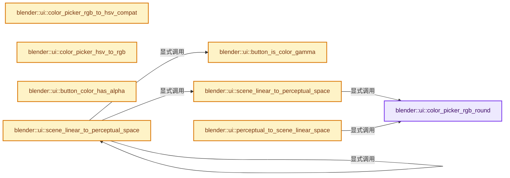
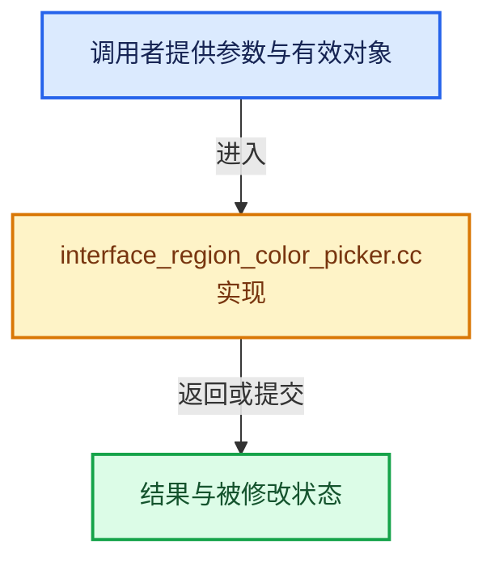

# 实现依赖专题：source/blender/editors/interface/regions/interface_region_color_picker.cc

[方向导航](README.md) · [符号索引](../%E7%AC%A6%E5%8F%B7%E4%BE%9D%E8%B5%96%E4%B8%8E%E5%AE%9E%E7%8E%B0%E7%B4%A2%E5%BC%95.md)

本专题从正文实际调用进入，集中保存共享实现。函数有稳定锚点，可从调用处直接跳到对应完整函数；递归与互相调用通过回链组织。

## 本文件的实现关系






## 完整成员与函数实现

<a id="f-b68366cf32d1c286"></a>

### `blender::ui::color_picker_rgb_round`

实现位置：[source/blender/editors/interface/regions/interface_region_color_picker.cc](../../../../../source/blender/editors/interface/regions/interface_region_color_picker.cc) · L57—L70。

接口参数：

- `float rgb[3]`

**教学注释版**

<!-- annotated:d21a592d1757c0 -->

```cpp
static void color_picker_rgb_round(float rgb[3])
{
  /* Handle small rounding errors in color space conversions. Doing these for
   * all color space conversions would be expensive, but for the color picker
   * we can do the extra work. */
  for (int i = 0; i < 3; i++) {
    if (fabsf(rgb[i]) < 5e-5f) {
      rgb[i] = 0.0f;
    }
    else if (fabsf(1.0f - rgb[i]) < 5e-5f) {
      rgb[i] = 1.0f;
    }
  }
}
```

<details>
<summary>核对原始源码：source/blender/editors/interface/regions/interface_region_color_picker.cc · L57—L70</summary>

<!-- original:d21a592d1757c0:source/blender/editors/interface/regions/interface_region_color_picker.cc:57:70 -->

```cpp
static void color_picker_rgb_round(float rgb[3])
{
  /* Handle small rounding errors in color space conversions. Doing these for
   * all color space conversions would be expensive, but for the color picker
   * we can do the extra work. */
  for (int i = 0; i < 3; i++) {
    if (fabsf(rgb[i]) < 5e-5f) {
      rgb[i] = 0.0f;
    }
    else if (fabsf(1.0f - rgb[i]) < 5e-5f) {
      rgb[i] = 1.0f;
    }
  }
}
```

</details>

**沿实际写入检查状态**

- `rgb[i] = 0.0f;`
- `rgb[i] = 1.0f;`

**继续追踪实现**

- `fabsf` → [fabsf · L21](%E4%BE%9D%E8%B5%96-radial_tiling_shared-98abf9.md#m-02cc4c69cfb3)；[fabsf · L43](%E4%BE%9D%E8%B5%96-radial_tiling_shared-98abf9.md#m-04effe61803b)；[fabsf · L74](%E4%BE%9D%E8%B5%96-radial_tiling_shared-98abf9.md#m-927dd4eba7dc)；[fabsf · L25](../01-%E5%9F%BA%E7%A1%80%E5%AE%B9%E5%99%A8%E4%B8%8E%E7%8E%B0%E4%BB%A3CPP/%E4%BE%9D%E8%B5%96-radial_tiling_shared-7989a4.md#m-8348d6b3d08f)；[fabsf · L47](../01-%E5%9F%BA%E7%A1%80%E5%AE%B9%E5%99%A8%E4%B8%8E%E7%8E%B0%E4%BB%A3CPP/%E4%BE%9D%E8%B5%96-radial_tiling_shared-7989a4.md#m-13b7e0b6d84f)；[fabsf · L78](../01-%E5%9F%BA%E7%A1%80%E5%AE%B9%E5%99%A8%E4%B8%8E%E7%8E%B0%E4%BB%A3CPP/%E4%BE%9D%E8%B5%96-radial_tiling_shared-7989a4.md#m-326c83464a0d)；[fabsf · L21](%E4%BE%9D%E8%B5%96-node_radial_tiling_shared-b14bc2.md#m-7c3ee12fc119)；[fabsf · L43](%E4%BE%9D%E8%B5%96-node_radial_tiling_shared-b14bc2.md#m-9112db0e2dd1)；[fabsf · L74](%E4%BE%9D%E8%B5%96-node_radial_tiling_shared-b14bc2.md#m-ee4e61908a6f)；[fabsf · L167](%E4%BE%9D%E8%B5%96-compat-56205c.md#m-b039ee6c1601)；[fabsf · L265](%E4%BE%9D%E8%B5%96-compat-efe0e9.md#m-6b21869e9f3f)。宏定义由构建条件选择。

<a id="f-a767ac3d17407ab6"></a>

### `blender::ui::color_picker_rgb_to_hsv_compat`

实现位置：[source/blender/editors/interface/regions/interface_region_color_picker.cc](../../../../../source/blender/editors/interface/regions/interface_region_color_picker.cc) · L72—L84。

接口参数：

- `const float rgb[3]`
- `float r_cp[3]`

**教学注释版**

<!-- annotated:41cc02aef4e634 -->

```cpp
void color_picker_rgb_to_hsv_compat(const float rgb[3], float r_cp[3])
{
  /* Convert RGB to HSV, remaining as compatible as possible with the existing
   * r_hsv value (for example when value goes to zero, preserve the hue). */
  switch (U.color_picker_type) {
    case USER_CP_CIRCLE_HSL:
      rgb_to_hsl_compat_v(rgb, r_cp);
      break;
    default:
      rgb_to_hsv_compat_v(rgb, r_cp);
      break;
  }
}
```

<details>
<summary>核对原始源码：source/blender/editors/interface/regions/interface_region_color_picker.cc · L72—L84</summary>

<!-- original:41cc02aef4e634:source/blender/editors/interface/regions/interface_region_color_picker.cc:72:84 -->

```cpp
void color_picker_rgb_to_hsv_compat(const float rgb[3], float r_cp[3])
{
  /* Convert RGB to HSV, remaining as compatible as possible with the existing
   * r_hsv value (for example when value goes to zero, preserve the hue). */
  switch (U.color_picker_type) {
    case USER_CP_CIRCLE_HSL:
      rgb_to_hsl_compat_v(rgb, r_cp);
      break;
    default:
      rgb_to_hsv_compat_v(rgb, r_cp);
      break;
  }
}
```

</details>

**继续追踪实现**

- `rgb_to_hsl_compat_v` → [blender::rgb_to_hsl_compat_v · L387](../12-%E7%A9%BA%E9%97%B4%E6%95%B0%E6%8D%AE%E7%BB%93%E6%9E%84%E4%B8%8E%E5%87%A0%E4%BD%95%E7%AE%97%E6%B3%95/%E4%BE%9D%E8%B5%96-math_color-98507f.md#f-d4fad3d4e59f44b3)。
- `rgb_to_hsv_compat_v` → [blender::rgb_to_hsv_compat_v · L427](../12-%E7%A9%BA%E9%97%B4%E6%95%B0%E6%8D%AE%E7%BB%93%E6%9E%84%E4%B8%8E%E5%87%A0%E4%BD%95%E7%AE%97%E6%B3%95/%E4%BE%9D%E8%B5%96-math_color-98507f.md#f-6bf049b3a593ac35)。

<a id="f-5d78c8a224216bc9"></a>

### `blender::ui::color_picker_hsv_to_rgb`

实现位置：[source/blender/editors/interface/regions/interface_region_color_picker.cc](../../../../../source/blender/editors/interface/regions/interface_region_color_picker.cc) · L98—L108。

接口参数：

- `const float r_cp[3]`
- `float rgb[3]`

**教学注释版**

<!-- annotated:95a2dd1bf0e014 -->

```cpp
void color_picker_hsv_to_rgb(const float r_cp[3], float rgb[3])
{
  switch (U.color_picker_type) {
    case USER_CP_CIRCLE_HSL:
      hsl_to_rgb_v(r_cp, rgb);
      break;
    default:
      hsv_to_rgb_v(r_cp, rgb);
      break;
  }
}
```

<details>
<summary>核对原始源码：source/blender/editors/interface/regions/interface_region_color_picker.cc · L98—L108</summary>

<!-- original:95a2dd1bf0e014:source/blender/editors/interface/regions/interface_region_color_picker.cc:98:108 -->

```cpp
void color_picker_hsv_to_rgb(const float r_cp[3], float rgb[3])
{
  switch (U.color_picker_type) {
    case USER_CP_CIRCLE_HSL:
      hsl_to_rgb_v(r_cp, rgb);
      break;
    default:
      hsv_to_rgb_v(r_cp, rgb);
      break;
  }
}
```

</details>

**继续追踪实现**

- `hsl_to_rgb_v` → [blender::hsl_to_rgb_v · L66](../12-%E7%A9%BA%E9%97%B4%E6%95%B0%E6%8D%AE%E7%BB%93%E6%9E%84%E4%B8%8E%E5%87%A0%E4%BD%95%E7%AE%97%E6%B3%95/%E4%BE%9D%E8%B5%96-math_color-98507f.md#f-87d85e7be1bc56e8)。
- `hsv_to_rgb_v` → [blender::hsv_to_rgb_v · L61](../12-%E7%A9%BA%E9%97%B4%E6%95%B0%E6%8D%AE%E7%BB%93%E6%9E%84%E4%B8%8E%E5%87%A0%E4%BD%95%E7%AE%97%E6%B3%95/%E4%BE%9D%E8%B5%96-math_color-98507f.md#f-d78b8d5b93aafd9e)。

<a id="f-09988c5ea905c098"></a>

### `blender::ui::button_is_color_gamma`

实现位置：[source/blender/editors/interface/regions/interface_region_color_picker.cc](../../../../../source/blender/editors/interface/regions/interface_region_color_picker.cc) · L110—L119。

接口参数：

- `Button *but`

**教学注释版**

<!-- annotated:20c3984773753d -->

```cpp
bool button_is_color_gamma(Button *but)
{
  if (but->rnaprop) {
    if (RNA_property_subtype(but->rnaprop) == PROP_COLOR_GAMMA) {
      return true;
    }
  }

  return but->block->is_color_gamma_picker;
}
```

<details>
<summary>核对原始源码：source/blender/editors/interface/regions/interface_region_color_picker.cc · L110—L119</summary>

<!-- original:20c3984773753d:source/blender/editors/interface/regions/interface_region_color_picker.cc:110:119 -->

```cpp
bool button_is_color_gamma(Button *but)
{
  if (but->rnaprop) {
    if (RNA_property_subtype(but->rnaprop) == PROP_COLOR_GAMMA) {
      return true;
    }
  }

  return but->block->is_color_gamma_picker;
}
```

</details>

**结果出口**

- `return true;`
- `return but->block->is_color_gamma_picker;`

**继续追踪实现**

- `RNA_property_subtype` → [blender::RNA_property_subtype · L1298](%E4%BE%9D%E8%B5%96-rna_access-706bea.md#f-993b1583bfe2d18a)。

<a id="f-ef4a80792338c21a"></a>

### `blender::ui::button_color_has_alpha`

实现位置：[source/blender/editors/interface/regions/interface_region_color_picker.cc](../../../../../source/blender/editors/interface/regions/interface_region_color_picker.cc) · L121—L134。

接口参数：

- `Button *but`

**教学注释版**

<!-- annotated:4ea354f0826c26 -->

```cpp
bool button_color_has_alpha(Button *but)
{
  if (but->rnaprop) {
    const PropertySubType prop_subtype = RNA_property_subtype(but->rnaprop);
    if (ELEM(prop_subtype, PROP_COLOR, PROP_COLOR_GAMMA)) {
      const int color_components_count = RNA_property_array_length(&but->rnapoin, but->rnaprop);
      if (color_components_count == 4) {
        return true;
      }
    }
  }

  return false;
}
```

<details>
<summary>核对原始源码：source/blender/editors/interface/regions/interface_region_color_picker.cc · L121—L134</summary>

<!-- original:4ea354f0826c26:source/blender/editors/interface/regions/interface_region_color_picker.cc:121:134 -->

```cpp
bool button_color_has_alpha(Button *but)
{
  if (but->rnaprop) {
    const PropertySubType prop_subtype = RNA_property_subtype(but->rnaprop);
    if (ELEM(prop_subtype, PROP_COLOR, PROP_COLOR_GAMMA)) {
      const int color_components_count = RNA_property_array_length(&but->rnapoin, but->rnaprop);
      if (color_components_count == 4) {
        return true;
      }
    }
  }

  return false;
}
```

</details>

**结果出口**

- `return true;`
- `return false;`

**继续追踪实现**

- `RNA_property_subtype` → [blender::RNA_property_subtype · L1298](%E4%BE%9D%E8%B5%96-rna_access-706bea.md#f-993b1583bfe2d18a)。
- `ELEM` → [ELEM · L88](%E4%BE%9D%E8%B5%96-GHOST_utildefines-34b996.md#m-d28724a15928)；[ELEM · L135](../01-%E5%9F%BA%E7%A1%80%E5%AE%B9%E5%99%A8%E4%B8%8E%E7%8E%B0%E4%BB%A3CPP/%E4%BE%9D%E8%B5%96-BLI_utildefines-293a0a.md#m-d6572de7cae0)。宏定义由构建条件选择。
- `RNA_property_array_length` → [blender::RNA_property_array_length · L1371](%E4%BE%9D%E8%B5%96-rna_access-706bea.md#f-2258ce063a075147)。

<a id="f-88952e57c2ba3737"></a>

### `blender::ui::scene_linear_to_perceptual_space`

实现位置：[source/blender/editors/interface/regions/interface_region_color_picker.cc](../../../../../source/blender/editors/interface/regions/interface_region_color_picker.cc) · L136—L145。

接口参数：

- `const bool is_gamma`
- `float rgb[3]`

**教学注释版**

<!-- annotated:6d61c6954bd85a -->

```cpp
static void scene_linear_to_perceptual_space(const bool is_gamma, float rgb[3])
{
  /* Map to color picking space for HSV values and HSV cube/circle,
   * assuming it is more perceptually linear than the scene linear
   * space for intuitive color picking. */
  if (!is_gamma) {
    IMB_colormanagement_scene_linear_to_color_picking_v3(rgb, rgb);
    color_picker_rgb_round(rgb);
  }
}
```

<details>
<summary>核对原始源码：source/blender/editors/interface/regions/interface_region_color_picker.cc · L136—L145</summary>

<!-- original:6d61c6954bd85a:source/blender/editors/interface/regions/interface_region_color_picker.cc:136:145 -->

```cpp
static void scene_linear_to_perceptual_space(const bool is_gamma, float rgb[3])
{
  /* Map to color picking space for HSV values and HSV cube/circle,
   * assuming it is more perceptually linear than the scene linear
   * space for intuitive color picking. */
  if (!is_gamma) {
    IMB_colormanagement_scene_linear_to_color_picking_v3(rgb, rgb);
    color_picker_rgb_round(rgb);
  }
}
```

</details>

**继续追踪实现**

- `IMB_colormanagement_scene_linear_to_color_picking_v3` → [blender::IMB_colormanagement_scene_linear_to_color_picking_v3 · L2611](%E4%BE%9D%E8%B5%96-colormanagement-d4733d.md#f-5b7a638740f078db)。
- `color_picker_rgb_round` → [blender::ui::color_picker_rgb_round · L57](%E4%BE%9D%E8%B5%96-interface_region_color_picker-948bcb.md#f-b68366cf32d1c286)。

<a id="f-7058ea25ae8c2807"></a>

### `blender::ui::perceptual_to_scene_linear_space`

实现位置：[source/blender/editors/interface/regions/interface_region_color_picker.cc](../../../../../source/blender/editors/interface/regions/interface_region_color_picker.cc) · L147—L153。

接口参数：

- `const bool is_gamma`
- `float rgb[3]`

**教学注释版**

<!-- annotated:8ccad9959f3105 -->

```cpp
static void perceptual_to_scene_linear_space(const bool is_gamma, float rgb[3])
{
  if (!is_gamma) {
    IMB_colormanagement_color_picking_to_scene_linear_v3(rgb, rgb);
    color_picker_rgb_round(rgb);
  }
}
```

<details>
<summary>核对原始源码：source/blender/editors/interface/regions/interface_region_color_picker.cc · L147—L153</summary>

<!-- original:8ccad9959f3105:source/blender/editors/interface/regions/interface_region_color_picker.cc:147:153 -->

```cpp
static void perceptual_to_scene_linear_space(const bool is_gamma, float rgb[3])
{
  if (!is_gamma) {
    IMB_colormanagement_color_picking_to_scene_linear_v3(rgb, rgb);
    color_picker_rgb_round(rgb);
  }
}
```

</details>

**继续追踪实现**

- `IMB_colormanagement_color_picking_to_scene_linear_v3` → [blender::IMB_colormanagement_color_picking_to_scene_linear_v3 · L2640](%E4%BE%9D%E8%B5%96-colormanagement-d4733d.md#f-11b1d53556d9bbd2)。
- `color_picker_rgb_round` → [blender::ui::color_picker_rgb_round · L57](%E4%BE%9D%E8%B5%96-interface_region_color_picker-948bcb.md#f-b68366cf32d1c286)。

<a id="f-3d8a32fe7c5805cd"></a>

### `blender::ui::scene_linear_to_perceptual_space`

实现位置：[source/blender/editors/interface/regions/interface_region_color_picker.cc](../../../../../source/blender/editors/interface/regions/interface_region_color_picker.cc) · L155—L158。

接口参数：

- `Button *but`
- `float rgb[3]`

**教学注释版**

<!-- annotated:2198d1790a3343 -->

```cpp
void scene_linear_to_perceptual_space(Button *but, float rgb[3])
{
  scene_linear_to_perceptual_space(button_is_color_gamma(but), rgb);
}
```

<details>
<summary>核对原始源码：source/blender/editors/interface/regions/interface_region_color_picker.cc · L155—L158</summary>

<!-- original:2198d1790a3343:source/blender/editors/interface/regions/interface_region_color_picker.cc:155:158 -->

```cpp
void scene_linear_to_perceptual_space(Button *but, float rgb[3])
{
  scene_linear_to_perceptual_space(button_is_color_gamma(but), rgb);
}
```

</details>

**继续追踪实现**

- `scene_linear_to_perceptual_space` → [blender::ui::scene_linear_to_perceptual_space · L136](%E4%BE%9D%E8%B5%96-interface_region_color_picker-948bcb.md#f-88952e57c2ba3737)；[blender::ui::scene_linear_to_perceptual_space · L155](%E4%BE%9D%E8%B5%96-interface_region_color_picker-948bcb.md#f-3d8a32fe7c5805cd)。同名重载需按实参类型选择。
- `button_is_color_gamma` → [blender::ui::button_is_color_gamma · L110](%E4%BE%9D%E8%B5%96-interface_region_color_picker-948bcb.md#f-09988c5ea905c098)。

<a id="f-56cd165da501fb30"></a>

### `blender::ui::perceptual_to_scene_linear_space`

实现位置：[source/blender/editors/interface/regions/interface_region_color_picker.cc](../../../../../source/blender/editors/interface/regions/interface_region_color_picker.cc) · L160—L163。

接口参数：

- `Button *but`
- `float rgb[3]`

**教学注释版**

<!-- annotated:500dc1df896d22 -->

```cpp
void perceptual_to_scene_linear_space(Button *but, float rgb[3])
{
  perceptual_to_scene_linear_space(button_is_color_gamma(but), rgb);
}
```

<details>
<summary>核对原始源码：source/blender/editors/interface/regions/interface_region_color_picker.cc · L160—L163</summary>

<!-- original:500dc1df896d22:source/blender/editors/interface/regions/interface_region_color_picker.cc:160:163 -->

```cpp
void perceptual_to_scene_linear_space(Button *but, float rgb[3])
{
  perceptual_to_scene_linear_space(button_is_color_gamma(but), rgb);
}
```

</details>

**继续追踪实现**

- `perceptual_to_scene_linear_space` → [blender::ui::perceptual_to_scene_linear_space · L147](%E4%BE%9D%E8%B5%96-interface_region_color_picker-948bcb.md#f-7058ea25ae8c2807)；[blender::ui::perceptual_to_scene_linear_space · L160](%E4%BE%9D%E8%B5%96-interface_region_color_picker-948bcb.md#f-56cd165da501fb30)。同名重载需按实参类型选择。
- `button_is_color_gamma` → [blender::ui::button_is_color_gamma · L110](%E4%BE%9D%E8%B5%96-interface_region_color_picker-948bcb.md#f-09988c5ea905c098)。

<a id="f-ff9db9ff38a11adb"></a>

### `blender::ui::button_hsv_set`

实现位置：[source/blender/editors/interface/regions/interface_region_color_picker.cc](../../../../../source/blender/editors/interface/regions/interface_region_color_picker.cc) · L229—L238。

接口参数：

- `Button *but`

**教学注释版**

<!-- annotated:1da1445d7effcb -->

```cpp
void button_hsv_set(Button *but)
{
  float rgb_perceptual_slider[3];
  ColorPicker *cpicker = static_cast<ColorPicker *>(but->custom_data);
  float *hsv_perceptual = cpicker->hsv_perceptual;

  color_picker_hsv_to_rgb(hsv_perceptual, rgb_perceptual_slider);

  button_v3_set(but, rgb_perceptual_slider);
}
```

<details>
<summary>核对原始源码：source/blender/editors/interface/regions/interface_region_color_picker.cc · L229—L238</summary>

<!-- original:1da1445d7effcb:source/blender/editors/interface/regions/interface_region_color_picker.cc:229:238 -->

```cpp
void button_hsv_set(Button *but)
{
  float rgb_perceptual_slider[3];
  ColorPicker *cpicker = static_cast<ColorPicker *>(but->custom_data);
  float *hsv_perceptual = cpicker->hsv_perceptual;

  color_picker_hsv_to_rgb(hsv_perceptual, rgb_perceptual_slider);

  button_v3_set(but, rgb_perceptual_slider);
}
```

</details>

**继续追踪实现**

- `color_picker_hsv_to_rgb` → [blender::ui::color_picker_hsv_to_rgb · L98](%E4%BE%9D%E8%B5%96-interface_region_color_picker-948bcb.md#f-5d78c8a224216bc9)。
- `button_v3_set` → [blender::ui::button_v3_set · L2674](%E4%BE%9D%E8%B5%96-interface-11578b.md#f-2c8ef0b7ab624e48)。
