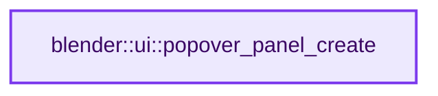
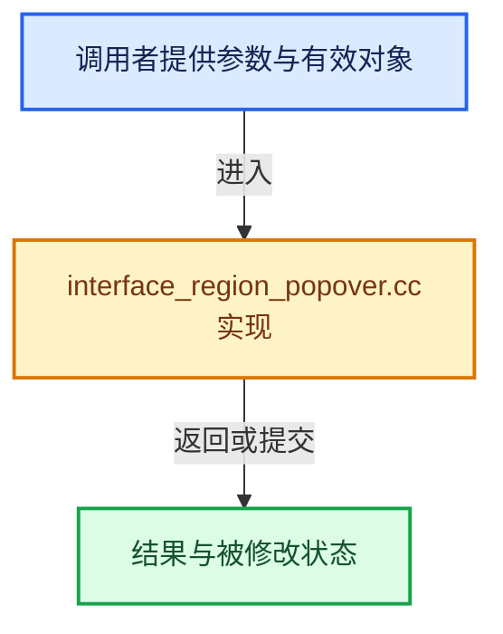

# 实现依赖专题：source/blender/editors/interface/regions/interface_region_popover.cc

[方向导航](README.md) · [符号索引](../%E7%AC%A6%E5%8F%B7%E4%BE%9D%E8%B5%96%E4%B8%8E%E5%AE%9E%E7%8E%B0%E7%B4%A2%E5%BC%95.md)

本专题从正文实际调用进入，集中保存共享实现。函数有稳定锚点，可从调用处直接跳到对应完整函数；递归与互相调用通过回链组织。

## 本文件的实现关系






## 完整成员与函数实现

<a id="f-34f5507726c89fdd"></a>

### `blender::ui::popover_panel_create`

实现位置：[source/blender/editors/interface/regions/interface_region_popover.cc](../../../../../source/blender/editors/interface/regions/interface_region_popover.cc) · L268—L313。

接口参数：

- `bContext *C`
- `ARegion *butregion`
- `Button *but`
- `PopoverCreateFunc popover_func`
- `const PanelType *panel_type`

**教学注释版**

<!-- annotated:d3934c3ae4f927 -->

```cpp
PopupBlockHandle *popover_panel_create(bContext *C,
                                       ARegion *butregion,
                                       Button *but,
                                       PopoverCreateFunc popover_func,
                                       const PanelType *panel_type)
{
  wmWindow *window = CTX_wm_window(C);
  const uiStyle *style = style_get_dpi();

  /* Create popover, buttons are created from callback. */
  Popover *pup = MEM_new<Popover>(__func__);
  pup->but = but;

  /* FIXME: maybe one day we want non panel popovers? */
  {
    const int ui_units_x = (panel_type->ui_units_x == 0) ? UI_POPOVER_WIDTH_UNITS :
                                                           panel_type->ui_units_x;
    /* Scale width by changes to Text Style point size. */
    pup->ui_size_x = ui_units_x * U.widget_unit * (style->widget.points / UI_DEFAULT_TEXT_POINTS);
  }

  pup->popover_func = popover_func;
  pup->panel_type = panel_type;

#ifdef USE_UI_POPOVER_ONCE
  {
    /* Ideally this would be passed in. */
    const wmEvent *event = window->runtime->eventstate;
    pup->is_once = (event->type == LEFTMOUSE) && (event->val == KM_PRESS);
  }
#endif

  /* Create popup block. */
  PopupBlockHandle *handle = popup_block_create(
      C, butregion, but, nullptr, block_func_POPOVER, pup, block_free_func_POPOVER, true);

  /* Add handlers. If attached to a button, the button will already
   * add a modal handler and pass on events. */
  if (!but) {
    popup_handlers_add(C, &window->runtime->modalhandlers, handle, 0);
    WM_event_add_mousemove(window);
    handle->popup = true;
  }
  handle->srna_owner = panel_type->rna_ext.srna;
  return handle;
}
```

<details>
<summary>核对原始源码：source/blender/editors/interface/regions/interface_region_popover.cc · L268—L313</summary>

<!-- original:d3934c3ae4f927:source/blender/editors/interface/regions/interface_region_popover.cc:268:313 -->

```cpp
PopupBlockHandle *popover_panel_create(bContext *C,
                                       ARegion *butregion,
                                       Button *but,
                                       PopoverCreateFunc popover_func,
                                       const PanelType *panel_type)
{
  wmWindow *window = CTX_wm_window(C);
  const uiStyle *style = style_get_dpi();

  /* Create popover, buttons are created from callback. */
  Popover *pup = MEM_new<Popover>(__func__);
  pup->but = but;

  /* FIXME: maybe one day we want non panel popovers? */
  {
    const int ui_units_x = (panel_type->ui_units_x == 0) ? UI_POPOVER_WIDTH_UNITS :
                                                           panel_type->ui_units_x;
    /* Scale width by changes to Text Style point size. */
    pup->ui_size_x = ui_units_x * U.widget_unit * (style->widget.points / UI_DEFAULT_TEXT_POINTS);
  }

  pup->popover_func = popover_func;
  pup->panel_type = panel_type;

#ifdef USE_UI_POPOVER_ONCE
  {
    /* Ideally this would be passed in. */
    const wmEvent *event = window->runtime->eventstate;
    pup->is_once = (event->type == LEFTMOUSE) && (event->val == KM_PRESS);
  }
#endif

  /* Create popup block. */
  PopupBlockHandle *handle = popup_block_create(
      C, butregion, but, nullptr, block_func_POPOVER, pup, block_free_func_POPOVER, true);

  /* Add handlers. If attached to a button, the button will already
   * add a modal handler and pass on events. */
  if (!but) {
    popup_handlers_add(C, &window->runtime->modalhandlers, handle, 0);
    WM_event_add_mousemove(window);
    handle->popup = true;
  }
  handle->srna_owner = panel_type->rna_ext.srna;
  return handle;
}
```

</details>

**沿实际写入检查状态**

- `pup->but = but;`
- `pup->ui_size_x = ui_units_x * U.widget_unit * (style->widget.points / UI_DEFAULT_TEXT_POINTS);`
- `pup->popover_func = popover_func;`
- `pup->panel_type = panel_type;`
- `pup->is_once = (event->type == LEFTMOUSE) && (event->val == KM_PRESS);`
- `handle->popup = true;`
- `handle->srna_owner = panel_type->rna_ext.srna;`

**结果出口**

- `return handle;`

**继续追踪实现**

- `CTX_wm_window` → [blender::CTX_wm_window · L938](%E4%BE%9D%E8%B5%96-context-a929d9.md#f-a1996003b2409854)。
- `style_get_dpi` → [blender::ui::style_get_dpi · L424](%E4%BE%9D%E8%B5%96-interface_style-ef9218.md#f-37e0cedd2705020a)。
- `MEM_new<Popover>` → [MEM_new · L351](../03-%E5%86%85%E5%AD%98%E5%88%86%E9%85%8D%E4%B8%8E%E8%BF%90%E8%A1%8C%E6%97%B6%E7%B1%BB%E5%9E%8B/%E4%BE%9D%E8%B5%96-MEM_guardedalloc-b54eca.md#f-115f9b6784f89912)。
- `popup_block_create` → [blender::ui::popup_block_create · L924](%E4%BE%9D%E8%B5%96-interface_region_popup-366dbf.md#f-3fa47eb33567b22b)。
- `popup_handlers_add` → [popup_handlers_add · L13236](%E4%BE%9D%E8%B5%96-interface_handlers-892571.md#f-2e37f0042b8ed8dc)。
- `WM_event_add_mousemove` → [blender::WM_event_add_mousemove · L5349](%E4%BE%9D%E8%B5%96-wm_event_system-a0fa4f.md#f-43a2db8eab31c4e2)。
