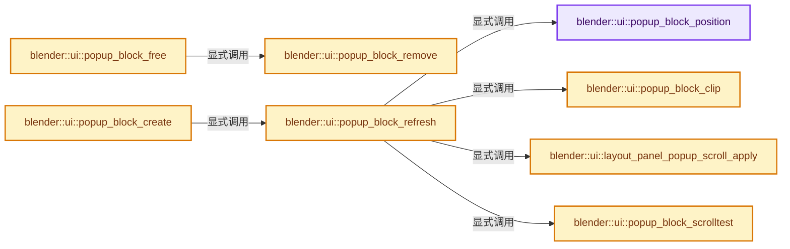
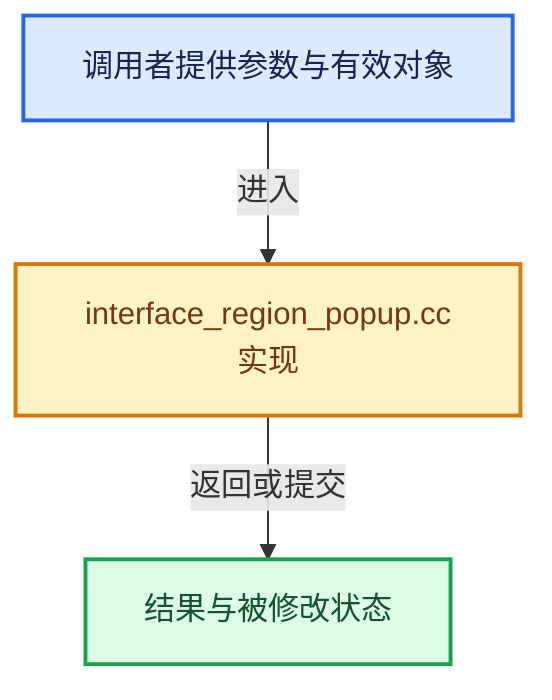

# 实现依赖专题：source/blender/editors/interface/regions/interface_region_popup.cc

[方向导航](README.md) · [符号索引](../%E7%AC%A6%E5%8F%B7%E4%BE%9D%E8%B5%96%E4%B8%8E%E5%AE%9E%E7%8E%B0%E7%B4%A2%E5%BC%95.md)

本专题从正文实际调用进入，集中保存共享实现。函数有稳定锚点，可从调用处直接跳到对应完整函数；递归与互相调用通过回链组织。

## 本文件的实现关系






## 完整成员与函数实现

<a id="f-796a08407a073aa6"></a>

### `blender::ui::popup_block_position`

实现位置：[source/blender/editors/interface/regions/interface_region_popup.cc](../../../../../source/blender/editors/interface/regions/interface_region_popup.cc) · L67—L404。

接口参数：

- `wmWindow *window`
- `ARegion *butregion`
- `Button *but`
- `Block *block`

**教学注释版**

<!-- annotated:083b096b85cf5b -->

```cpp
static void popup_block_position(wmWindow *window, ARegion *butregion, Button *but, Block *block)
{
  PopupBlockHandle *handle = block->handle;

  /* Compute button position in window coordinates using the source
   * button region/block, to position the popup attached to it. */
  rctf butrct;
  if (!handle->refresh) {
    block_to_window_rctf(butregion, but->block, &butrct, &but->rect);

    /* widget_roundbox_set has this correction too, keep in sync */
    if (but->type != ButtonType::Pulldown) {
      if (but->drawflag & BUT_ALIGN_TOP) {
        butrct.ymax += U.pixelsize;
      }
      if (but->drawflag & BUT_ALIGN_LEFT) {
        butrct.xmin -= U.pixelsize;
      }
    }

    handle->prev_butrct = butrct;
  }
  else {
    /* For refreshes, keep same button position so popup doesn't move. */
    butrct = handle->prev_butrct;
  }

  /* Compute block size in window space, based on buttons contained in it. */
  if (block->rect.xmin == 0.0f && block->rect.xmax == 0.0f) {
    if (!block->buttons_ptrs.is_empty()) {
      BLI_rctf_init_minmax(&block->rect);

      for (Button &bt : block->buttons()) {
        if (block->content_hints & BLOCK_CONTAINS_SUBMENU_BUT) {
          bt.rect.xmax += UI_MENU_SUBMENU_PADDING;
        }
        BLI_rctf_union(&block->rect, &bt.rect);
      }
    }
    else {
      /* we're nice and allow empty blocks too */
      block->rect.xmin = block->rect.ymin = 0;
      block->rect.xmax = block->rect.ymax = 20;
    }
  }

  /* Trim the popup and its contents to the width of the button if the size difference
   * is small. This avoids cases where the rounded corner clips underneath the button. */
  const int delta = BLI_rctf_size_x(&block->rect) - BLI_rctf_size_x(&butrct);
  const float max_radius = (0.5f * U.widget_unit);

  if (delta >= 0 && delta < max_radius) {
    for (Button &bt : block->buttons()) {
      /* Only trim the right most buttons in multi-column popovers. */
      if (bt.rect.xmax == block->rect.xmax) {
        bt.rect.xmax -= delta;
      }
    }
    block->rect.xmax -= delta;
  }

  block_to_window_rctf(butregion, but->block, &block->rect, &block->rect);

  /* `block->rect` is already scaled with `butregion->winrct`,
   * apply this scale to layout panels too. */
  if (Panel *panel = block->panel) {
    for (LayoutPanelBody &body : panel->runtime->layout_panels.bodies) {
      body.start_y /= block->aspect;
      body.end_y /= block->aspect;
    }
    for (LayoutPanelHeader &header : panel->runtime->layout_panels.headers) {
      header.start_y /= block->aspect;
      header.end_y /= block->aspect;
    }
  }

  /* Compute direction relative to button, based on available space. */
  const int size_x = BLI_rctf_size_x(&block->rect) + 0.2f * UI_UNIT_X; /* 4 for shadow */
  const int size_y = BLI_rctf_size_y(&block->rect) + 0.2f * UI_UNIT_Y;
  const int center_x = (block->direction & UI_DIR_CENTER_X) ? size_x / 2 : 0;
  const int center_y = (block->direction & UI_DIR_CENTER_Y) ? size_y / 2 : 0;

  const int2 win_size = WM_window_native_pixel_size(window);

  /* Take into account maximum size so we don't have to flip on refresh. */
  const float2 max_size = {
      max_ff(size_x, handle->max_size_x),
      max_ff(size_y, handle->max_size_y),
  };

  short dir1 = 0, dir2 = 0;

  if (!handle->refresh) {
    bool left = false, right = false, top = false, down = false;

    /* check if there's space at all */
    if (butrct.xmin - max_size[0] + center_x > 0.0f) {
      left = true;
    }
    if (butrct.xmax + max_size[0] - center_x < win_size[0]) {
      right = true;
    }
    if (butrct.ymin - max_size[1] + center_y > 0.0f) {
      down = true;
    }
    if (butrct.ymax + max_size[1] - center_y < win_size[1]) {
      top = true;
    }

    if (top == 0 && down == 0) {
      if (butrct.ymin - max_size[1] < win_size[1] - butrct.ymax - max_size[1]) {
        top = true;
      }
      else {
        down = true;
      }
    }

    dir1 = (block->direction & UI_DIR_ALL);

    /* Secondary directions. */
    if (dir1 & (UI_DIR_UP | UI_DIR_DOWN)) {
      if (dir1 & UI_DIR_LEFT) {
        dir2 = UI_DIR_LEFT;
      }
      else if (dir1 & UI_DIR_RIGHT) {
        dir2 = UI_DIR_RIGHT;
      }
      dir1 &= (UI_DIR_UP | UI_DIR_DOWN);
    }

    if ((dir2 == 0) && ELEM(dir1, UI_DIR_LEFT, UI_DIR_RIGHT)) {
      dir2 = UI_DIR_DOWN;
    }
    if ((dir2 == 0) && ELEM(dir1, UI_DIR_UP, UI_DIR_DOWN)) {
      dir2 = UI_DIR_LEFT;
    }

    /* no space at all? don't change */
    if (left || right) {
      if (dir1 == UI_DIR_LEFT && left == 0) {
        dir1 = UI_DIR_RIGHT;
      }
      if (dir1 == UI_DIR_RIGHT && right == 0) {
        dir1 = UI_DIR_LEFT;
      }
      /* this is aligning, not append! */
      if (dir2 == UI_DIR_LEFT && right == 0) {
        dir2 = UI_DIR_RIGHT;
      }
      if (dir2 == UI_DIR_RIGHT && left == 0) {
        dir2 = UI_DIR_LEFT;
      }
    }
    if (down || top) {
      if (dir1 == UI_DIR_UP && top == 0) {
        dir1 = UI_DIR_DOWN;
      }
      if (dir1 == UI_DIR_DOWN && down == 0) {
        dir1 = UI_DIR_UP;
      }
      BLI_assert(dir2 != UI_DIR_UP);
      //          if (dir2 == UI_DIR_UP   && top == 0)  { dir2 = UI_DIR_DOWN; }
      if (dir2 == UI_DIR_DOWN && down == 0) {
        dir2 = UI_DIR_UP;
      }
    }

    handle->prev_dir1 = dir1;
    handle->prev_dir2 = dir2;
  }
  else {
    /* For refreshes, keep same popup direct so popup doesn't move
     * to a totally different position while editing in it. */
    dir1 = handle->prev_dir1;
    dir2 = handle->prev_dir2;
  }

  /* Compute offset based on direction. */
  float offset_x = 0, offset_y = 0;

  /* Ensure buttons don't come between the parent button and the popup, see: #63566. */
  const float offset_overlap = max_ff(U.pixelsize, 1.0f);

  if (dir1 == UI_DIR_LEFT) {
    offset_x = (butrct.xmin - block->rect.xmax) + offset_overlap;
    if (dir2 == UI_DIR_UP) {
      offset_y = butrct.ymin - block->rect.ymin - center_y - UI_MENU_PADDING;
    }
    else {
      offset_y = butrct.ymax - block->rect.ymax + center_y + UI_MENU_PADDING;
    }
  }
  else if (dir1 == UI_DIR_RIGHT) {
    offset_x = (butrct.xmax - block->rect.xmin) - offset_overlap;
    if (dir2 == UI_DIR_UP) {
      offset_y = butrct.ymin - block->rect.ymin - center_y - UI_MENU_PADDING;
    }
    else {
      offset_y = butrct.ymax - block->rect.ymax + center_y + UI_MENU_PADDING;
    }
  }
  else if (dir1 == UI_DIR_UP) {
    offset_y = (butrct.ymax - block->rect.ymin) - offset_overlap;

    if (but->type == ButtonType::Color &&
        block->rect.ymax + offset_y > win_size[1] - UI_POPUP_MENU_TOP)
    {
      /* Shift this down, aligning the top edge close to the window top. */
      offset_y = win_size[1] - block->rect.ymax - UI_POPUP_MENU_TOP;
      /* All four corners should be rounded since this no longer button-aligned. */
      block->direction = UI_DIR_CENTER_Y;
      dir1 = UI_DIR_CENTER_Y;
    }

    if (dir2 == UI_DIR_RIGHT) {
      offset_x = butrct.xmax - block->rect.xmax + center_x;
    }
    else {
      offset_x = butrct.xmin - block->rect.xmin - center_x;
    }
  }
  else if (dir1 == UI_DIR_DOWN) {
    offset_y = (butrct.ymin - block->rect.ymax) + offset_overlap;

    if (but->type == ButtonType::Color && block->rect.ymin + offset_y < UI_SCREEN_MARGIN) {
      /* Shift this up, aligning the bottom edge close to the window bottom. */
      offset_y = -block->rect.ymin + UI_SCREEN_MARGIN;
      /* All four corners should be rounded since this no longer button-aligned. */
      block->direction = UI_DIR_CENTER_Y;
      dir1 = UI_DIR_CENTER_Y;
    }

    if (dir2 == UI_DIR_RIGHT) {
      offset_x = butrct.xmax - block->rect.xmax + center_x;
    }
    else {
      offset_x = butrct.xmin - block->rect.xmin - center_x;
    }
  }

  /* Center over popovers for eg. */
  if (block->direction & UI_DIR_CENTER_X) {
    offset_x += BLI_rctf_size_x(&butrct) / ((dir2 == UI_DIR_LEFT) ? 2 : -2);
  }

  /* Apply offset, buttons in window coords. */
  for (Button &bt : block->buttons()) {
    block_to_window_rctf(butregion, but->block, &bt.rect, &bt.rect);

    BLI_rctf_translate(&bt.rect, offset_x, offset_y);

    /* ui_but_update recalculates drawstring size in pixels */
    button_update(&bt);
  }

  BLI_rctf_translate(&block->rect, offset_x, offset_y);

  /* Safety calculus. */
  {
    const float midx = BLI_rctf_cent_x(&butrct);
    const float midy = BLI_rctf_cent_y(&butrct);

    /* when you are outside parent button, safety there should be smaller */

    const int s1 = (U.flag & USER_MENU_CLOSE_LEAVE) ? 40 * UI_SCALE_FAC : win_size[0];
    const int s2 = 3 * UI_SCALE_FAC;

    /* parent button to left */
    if (midx < block->rect.xmin) {
      block->safety.xmin = block->rect.xmin - s2;
    }
    else {
      block->safety.xmin = block->rect.xmin - s1;
    }
    /* parent button to right */
    if (midx > block->rect.xmax) {
      block->safety.xmax = block->rect.xmax + s2;
    }
    else {
      block->safety.xmax = block->rect.xmax + s1;
    }

    /* parent button on bottom */
    if (midy < block->rect.ymin) {
      block->safety.ymin = block->rect.ymin - s2;
    }
    else {
      block->safety.ymin = block->rect.ymin - s1;
    }
    /* parent button on top */
    if (midy > block->rect.ymax) {
      block->safety.ymax = block->rect.ymax + s2;
    }
    else {
      block->safety.ymax = block->rect.ymax + s1;
    }

    /* Exception for switched pull-downs. */
    if (dir1 && (dir1 & block->direction) == 0) {
      if (dir2 == UI_DIR_RIGHT) {
        block->safety.xmax = block->rect.xmax + s2;
      }
      if (dir2 == UI_DIR_LEFT) {
        block->safety.xmin = block->rect.xmin - s2;
      }
    }

    const bool fully_aligned_with_button = BLI_rctf_size_x(&block->rect) <=
                                           BLI_rctf_size_x(&butrct) + 1;
    const bool off_screen_left = (block->rect.xmin < 0);
    const bool off_screen_right = (block->rect.xmax > win_size[0]);

    if (fully_aligned_with_button) {
      /* Popup is neither left or right from the button. */
      dir2 &= ~(UI_DIR_LEFT | UI_DIR_RIGHT);
    }
    else if (off_screen_left || off_screen_right) {
      /* Popup is both left and right from the button. */
      dir2 |= (UI_DIR_LEFT | UI_DIR_RIGHT);
    }

    /* Popovers don't need secondary direction. Pull-downs to
     * the left or right are currently not supported. */
    const bool no_2nd_dir = (but->type == ButtonType::Popover ||
                             button_menu_draw_as_popover(but) ||
                             dir1 & (UI_DIR_RIGHT | UI_DIR_LEFT));
    block->direction = no_2nd_dir ? dir1 : (dir1 | dir2);
  }

  /* Keep a list of these, needed for pull-down menus. */
  SafetyRect *saferct = MEM_new<SafetyRect>(__func__);
  saferct->parent = butrct;
  saferct->safety = block->safety;
  block->saferct.free_no_destruct();
  BLI_duplicatelist(&block->saferct, &but->block->saferct);
  BLI_addhead(&block->saferct, saferct);
}
```

<details>
<summary>核对原始源码：source/blender/editors/interface/regions/interface_region_popup.cc · L67—L404</summary>

<!-- original:083b096b85cf5b:source/blender/editors/interface/regions/interface_region_popup.cc:67:404 -->

```cpp
static void popup_block_position(wmWindow *window, ARegion *butregion, Button *but, Block *block)
{
  PopupBlockHandle *handle = block->handle;

  /* Compute button position in window coordinates using the source
   * button region/block, to position the popup attached to it. */
  rctf butrct;
  if (!handle->refresh) {
    block_to_window_rctf(butregion, but->block, &butrct, &but->rect);

    /* widget_roundbox_set has this correction too, keep in sync */
    if (but->type != ButtonType::Pulldown) {
      if (but->drawflag & BUT_ALIGN_TOP) {
        butrct.ymax += U.pixelsize;
      }
      if (but->drawflag & BUT_ALIGN_LEFT) {
        butrct.xmin -= U.pixelsize;
      }
    }

    handle->prev_butrct = butrct;
  }
  else {
    /* For refreshes, keep same button position so popup doesn't move. */
    butrct = handle->prev_butrct;
  }

  /* Compute block size in window space, based on buttons contained in it. */
  if (block->rect.xmin == 0.0f && block->rect.xmax == 0.0f) {
    if (!block->buttons_ptrs.is_empty()) {
      BLI_rctf_init_minmax(&block->rect);

      for (Button &bt : block->buttons()) {
        if (block->content_hints & BLOCK_CONTAINS_SUBMENU_BUT) {
          bt.rect.xmax += UI_MENU_SUBMENU_PADDING;
        }
        BLI_rctf_union(&block->rect, &bt.rect);
      }
    }
    else {
      /* we're nice and allow empty blocks too */
      block->rect.xmin = block->rect.ymin = 0;
      block->rect.xmax = block->rect.ymax = 20;
    }
  }

  /* Trim the popup and its contents to the width of the button if the size difference
   * is small. This avoids cases where the rounded corner clips underneath the button. */
  const int delta = BLI_rctf_size_x(&block->rect) - BLI_rctf_size_x(&butrct);
  const float max_radius = (0.5f * U.widget_unit);

  if (delta >= 0 && delta < max_radius) {
    for (Button &bt : block->buttons()) {
      /* Only trim the right most buttons in multi-column popovers. */
      if (bt.rect.xmax == block->rect.xmax) {
        bt.rect.xmax -= delta;
      }
    }
    block->rect.xmax -= delta;
  }

  block_to_window_rctf(butregion, but->block, &block->rect, &block->rect);

  /* `block->rect` is already scaled with `butregion->winrct`,
   * apply this scale to layout panels too. */
  if (Panel *panel = block->panel) {
    for (LayoutPanelBody &body : panel->runtime->layout_panels.bodies) {
      body.start_y /= block->aspect;
      body.end_y /= block->aspect;
    }
    for (LayoutPanelHeader &header : panel->runtime->layout_panels.headers) {
      header.start_y /= block->aspect;
      header.end_y /= block->aspect;
    }
  }

  /* Compute direction relative to button, based on available space. */
  const int size_x = BLI_rctf_size_x(&block->rect) + 0.2f * UI_UNIT_X; /* 4 for shadow */
  const int size_y = BLI_rctf_size_y(&block->rect) + 0.2f * UI_UNIT_Y;
  const int center_x = (block->direction & UI_DIR_CENTER_X) ? size_x / 2 : 0;
  const int center_y = (block->direction & UI_DIR_CENTER_Y) ? size_y / 2 : 0;

  const int2 win_size = WM_window_native_pixel_size(window);

  /* Take into account maximum size so we don't have to flip on refresh. */
  const float2 max_size = {
      max_ff(size_x, handle->max_size_x),
      max_ff(size_y, handle->max_size_y),
  };

  short dir1 = 0, dir2 = 0;

  if (!handle->refresh) {
    bool left = false, right = false, top = false, down = false;

    /* check if there's space at all */
    if (butrct.xmin - max_size[0] + center_x > 0.0f) {
      left = true;
    }
    if (butrct.xmax + max_size[0] - center_x < win_size[0]) {
      right = true;
    }
    if (butrct.ymin - max_size[1] + center_y > 0.0f) {
      down = true;
    }
    if (butrct.ymax + max_size[1] - center_y < win_size[1]) {
      top = true;
    }

    if (top == 0 && down == 0) {
      if (butrct.ymin - max_size[1] < win_size[1] - butrct.ymax - max_size[1]) {
        top = true;
      }
      else {
        down = true;
      }
    }

    dir1 = (block->direction & UI_DIR_ALL);

    /* Secondary directions. */
    if (dir1 & (UI_DIR_UP | UI_DIR_DOWN)) {
      if (dir1 & UI_DIR_LEFT) {
        dir2 = UI_DIR_LEFT;
      }
      else if (dir1 & UI_DIR_RIGHT) {
        dir2 = UI_DIR_RIGHT;
      }
      dir1 &= (UI_DIR_UP | UI_DIR_DOWN);
    }

    if ((dir2 == 0) && ELEM(dir1, UI_DIR_LEFT, UI_DIR_RIGHT)) {
      dir2 = UI_DIR_DOWN;
    }
    if ((dir2 == 0) && ELEM(dir1, UI_DIR_UP, UI_DIR_DOWN)) {
      dir2 = UI_DIR_LEFT;
    }

    /* no space at all? don't change */
    if (left || right) {
      if (dir1 == UI_DIR_LEFT && left == 0) {
        dir1 = UI_DIR_RIGHT;
      }
      if (dir1 == UI_DIR_RIGHT && right == 0) {
        dir1 = UI_DIR_LEFT;
      }
      /* this is aligning, not append! */
      if (dir2 == UI_DIR_LEFT && right == 0) {
        dir2 = UI_DIR_RIGHT;
      }
      if (dir2 == UI_DIR_RIGHT && left == 0) {
        dir2 = UI_DIR_LEFT;
      }
    }
    if (down || top) {
      if (dir1 == UI_DIR_UP && top == 0) {
        dir1 = UI_DIR_DOWN;
      }
      if (dir1 == UI_DIR_DOWN && down == 0) {
        dir1 = UI_DIR_UP;
      }
      BLI_assert(dir2 != UI_DIR_UP);
      //          if (dir2 == UI_DIR_UP   && top == 0)  { dir2 = UI_DIR_DOWN; }
      if (dir2 == UI_DIR_DOWN && down == 0) {
        dir2 = UI_DIR_UP;
      }
    }

    handle->prev_dir1 = dir1;
    handle->prev_dir2 = dir2;
  }
  else {
    /* For refreshes, keep same popup direct so popup doesn't move
     * to a totally different position while editing in it. */
    dir1 = handle->prev_dir1;
    dir2 = handle->prev_dir2;
  }

  /* Compute offset based on direction. */
  float offset_x = 0, offset_y = 0;

  /* Ensure buttons don't come between the parent button and the popup, see: #63566. */
  const float offset_overlap = max_ff(U.pixelsize, 1.0f);

  if (dir1 == UI_DIR_LEFT) {
    offset_x = (butrct.xmin - block->rect.xmax) + offset_overlap;
    if (dir2 == UI_DIR_UP) {
      offset_y = butrct.ymin - block->rect.ymin - center_y - UI_MENU_PADDING;
    }
    else {
      offset_y = butrct.ymax - block->rect.ymax + center_y + UI_MENU_PADDING;
    }
  }
  else if (dir1 == UI_DIR_RIGHT) {
    offset_x = (butrct.xmax - block->rect.xmin) - offset_overlap;
    if (dir2 == UI_DIR_UP) {
      offset_y = butrct.ymin - block->rect.ymin - center_y - UI_MENU_PADDING;
    }
    else {
      offset_y = butrct.ymax - block->rect.ymax + center_y + UI_MENU_PADDING;
    }
  }
  else if (dir1 == UI_DIR_UP) {
    offset_y = (butrct.ymax - block->rect.ymin) - offset_overlap;

    if (but->type == ButtonType::Color &&
        block->rect.ymax + offset_y > win_size[1] - UI_POPUP_MENU_TOP)
    {
      /* Shift this down, aligning the top edge close to the window top. */
      offset_y = win_size[1] - block->rect.ymax - UI_POPUP_MENU_TOP;
      /* All four corners should be rounded since this no longer button-aligned. */
      block->direction = UI_DIR_CENTER_Y;
      dir1 = UI_DIR_CENTER_Y;
    }

    if (dir2 == UI_DIR_RIGHT) {
      offset_x = butrct.xmax - block->rect.xmax + center_x;
    }
    else {
      offset_x = butrct.xmin - block->rect.xmin - center_x;
    }
  }
  else if (dir1 == UI_DIR_DOWN) {
    offset_y = (butrct.ymin - block->rect.ymax) + offset_overlap;

    if (but->type == ButtonType::Color && block->rect.ymin + offset_y < UI_SCREEN_MARGIN) {
      /* Shift this up, aligning the bottom edge close to the window bottom. */
      offset_y = -block->rect.ymin + UI_SCREEN_MARGIN;
      /* All four corners should be rounded since this no longer button-aligned. */
      block->direction = UI_DIR_CENTER_Y;
      dir1 = UI_DIR_CENTER_Y;
    }

    if (dir2 == UI_DIR_RIGHT) {
      offset_x = butrct.xmax - block->rect.xmax + center_x;
    }
    else {
      offset_x = butrct.xmin - block->rect.xmin - center_x;
    }
  }

  /* Center over popovers for eg. */
  if (block->direction & UI_DIR_CENTER_X) {
    offset_x += BLI_rctf_size_x(&butrct) / ((dir2 == UI_DIR_LEFT) ? 2 : -2);
  }

  /* Apply offset, buttons in window coords. */
  for (Button &bt : block->buttons()) {
    block_to_window_rctf(butregion, but->block, &bt.rect, &bt.rect);

    BLI_rctf_translate(&bt.rect, offset_x, offset_y);

    /* ui_but_update recalculates drawstring size in pixels */
    button_update(&bt);
  }

  BLI_rctf_translate(&block->rect, offset_x, offset_y);

  /* Safety calculus. */
  {
    const float midx = BLI_rctf_cent_x(&butrct);
    const float midy = BLI_rctf_cent_y(&butrct);

    /* when you are outside parent button, safety there should be smaller */

    const int s1 = (U.flag & USER_MENU_CLOSE_LEAVE) ? 40 * UI_SCALE_FAC : win_size[0];
    const int s2 = 3 * UI_SCALE_FAC;

    /* parent button to left */
    if (midx < block->rect.xmin) {
      block->safety.xmin = block->rect.xmin - s2;
    }
    else {
      block->safety.xmin = block->rect.xmin - s1;
    }
    /* parent button to right */
    if (midx > block->rect.xmax) {
      block->safety.xmax = block->rect.xmax + s2;
    }
    else {
      block->safety.xmax = block->rect.xmax + s1;
    }

    /* parent button on bottom */
    if (midy < block->rect.ymin) {
      block->safety.ymin = block->rect.ymin - s2;
    }
    else {
      block->safety.ymin = block->rect.ymin - s1;
    }
    /* parent button on top */
    if (midy > block->rect.ymax) {
      block->safety.ymax = block->rect.ymax + s2;
    }
    else {
      block->safety.ymax = block->rect.ymax + s1;
    }

    /* Exception for switched pull-downs. */
    if (dir1 && (dir1 & block->direction) == 0) {
      if (dir2 == UI_DIR_RIGHT) {
        block->safety.xmax = block->rect.xmax + s2;
      }
      if (dir2 == UI_DIR_LEFT) {
        block->safety.xmin = block->rect.xmin - s2;
      }
    }

    const bool fully_aligned_with_button = BLI_rctf_size_x(&block->rect) <=
                                           BLI_rctf_size_x(&butrct) + 1;
    const bool off_screen_left = (block->rect.xmin < 0);
    const bool off_screen_right = (block->rect.xmax > win_size[0]);

    if (fully_aligned_with_button) {
      /* Popup is neither left or right from the button. */
      dir2 &= ~(UI_DIR_LEFT | UI_DIR_RIGHT);
    }
    else if (off_screen_left || off_screen_right) {
      /* Popup is both left and right from the button. */
      dir2 |= (UI_DIR_LEFT | UI_DIR_RIGHT);
    }

    /* Popovers don't need secondary direction. Pull-downs to
     * the left or right are currently not supported. */
    const bool no_2nd_dir = (but->type == ButtonType::Popover ||
                             button_menu_draw_as_popover(but) ||
                             dir1 & (UI_DIR_RIGHT | UI_DIR_LEFT));
    block->direction = no_2nd_dir ? dir1 : (dir1 | dir2);
  }

  /* Keep a list of these, needed for pull-down menus. */
  SafetyRect *saferct = MEM_new<SafetyRect>(__func__);
  saferct->parent = butrct;
  saferct->safety = block->safety;
  block->saferct.free_no_destruct();
  BLI_duplicatelist(&block->saferct, &but->block->saferct);
  BLI_addhead(&block->saferct, saferct);
}
```

</details>

**沿实际写入检查状态**

- `butrct.ymax += U.pixelsize;`
- `butrct.xmin -= U.pixelsize;`
- `handle->prev_butrct = butrct;`
- `butrct = handle->prev_butrct;`
- `bt.rect.xmax += UI_MENU_SUBMENU_PADDING;`
- `block->rect.xmin = block->rect.ymin = 0;`
- `block->rect.xmax = block->rect.ymax = 20;`
- `bt.rect.xmax -= delta;`
- `block->rect.xmax -= delta;`
- `left = true;`
- `right = true;`
- `down = true;`
- `top = true;`
- `dir1 = (block->direction & UI_DIR_ALL);`
- `dir2 = UI_DIR_LEFT;`
- `dir2 = UI_DIR_RIGHT;`
- `dir1 &= (UI_DIR_UP | UI_DIR_DOWN);`
- `dir2 = UI_DIR_DOWN;`
- `dir1 = UI_DIR_RIGHT;`
- `dir1 = UI_DIR_LEFT;`
- `dir1 = UI_DIR_DOWN;`
- `dir1 = UI_DIR_UP;`
- `dir2 = UI_DIR_UP;`
- `handle->prev_dir1 = dir1;`
- `handle->prev_dir2 = dir2;`
- `dir1 = handle->prev_dir1;`
- `dir2 = handle->prev_dir2;`
- `offset_x = (butrct.xmin - block->rect.xmax) + offset_overlap;`
- `offset_y = butrct.ymin - block->rect.ymin - center_y - UI_MENU_PADDING;`
- `offset_y = butrct.ymax - block->rect.ymax + center_y + UI_MENU_PADDING;`
- `offset_x = (butrct.xmax - block->rect.xmin) - offset_overlap;`
- `offset_y = (butrct.ymax - block->rect.ymin) - offset_overlap;`
- `offset_y = win_size[1] - block->rect.ymax - UI_POPUP_MENU_TOP;`
- `block->direction = UI_DIR_CENTER_Y;`
- `dir1 = UI_DIR_CENTER_Y;`
- `offset_x = butrct.xmax - block->rect.xmax + center_x;`
- `offset_x = butrct.xmin - block->rect.xmin - center_x;`
- `offset_y = (butrct.ymin - block->rect.ymax) + offset_overlap;`
- `offset_y = -block->rect.ymin + UI_SCREEN_MARGIN;`
- `offset_x += BLI_rctf_size_x(&butrct) / ((dir2 == UI_DIR_LEFT) ? 2 : -2);`
- `block->safety.xmin = block->rect.xmin - s2;`
- `block->safety.xmin = block->rect.xmin - s1;`
- `block->safety.xmax = block->rect.xmax + s2;`
- `block->safety.xmax = block->rect.xmax + s1;`
- `block->safety.ymin = block->rect.ymin - s2;`
- `block->safety.ymin = block->rect.ymin - s1;`
- `block->safety.ymax = block->rect.ymax + s2;`
- `block->safety.ymax = block->rect.ymax + s1;`
- `dir2 &= ~(UI_DIR_LEFT | UI_DIR_RIGHT);`
- `dir2 |= (UI_DIR_LEFT | UI_DIR_RIGHT);`
- `block->direction = no_2nd_dir ? dir1 : (dir1 | dir2);`
- `saferct->parent = butrct;`
- `saferct->safety = block->safety;`

**继续追踪实现**

- `block_to_window_rctf` → [blender::ui::block_to_window_rctf · L172](%E4%BE%9D%E8%B5%96-interface-11578b.md#f-9ea1ffd4d684d7e5)。
- `block->buttons_ptrs.is_empty` → [调用协议](../%E6%A8%A1%E6%9D%BF%E5%AE%8F%E4%B8%8E%E5%8A%A8%E6%80%81%E5%88%86%E6%B4%BE%E5%8D%8F%E8%AE%AE.md)：接收对象类型依赖auto、返回值或模板实例；不按同名猜测目标。调用位置L96。
- `BLI_rctf_init_minmax` → [blender::BLI_rctf_init_minmax · L494](../01-%E5%9F%BA%E7%A1%80%E5%AE%B9%E5%99%A8%E4%B8%8E%E7%8E%B0%E4%BB%A3CPP/%E4%BE%9D%E8%B5%96-rct-6e7349.md#f-a1101189089d570a)。
- `block->buttons` → [blender::ui::Block::buttons · L836](%E4%BE%9D%E8%B5%96-interface_intern-60addc.md#f-5296ad5fd22b5505)。
- `BLI_rctf_union` → [blender::BLI_rctf_union · L374](../01-%E5%9F%BA%E7%A1%80%E5%AE%B9%E5%99%A8%E4%B8%8E%E7%8E%B0%E4%BB%A3CPP/%E4%BE%9D%E8%B5%96-rct-6e7349.md#f-902e680b44d2836a)。
- `BLI_rctf_size_x` → [blender::BLI_rctf_size_x · L211](../01-%E5%9F%BA%E7%A1%80%E5%AE%B9%E5%99%A8%E4%B8%8E%E7%8E%B0%E4%BB%A3CPP/%E4%BE%9D%E8%B5%96-BLI_rect-2996c6.md#f-017b86a9d189e3ba)。
- `BLI_rctf_size_y` → [blender::BLI_rctf_size_y · L215](../01-%E5%9F%BA%E7%A1%80%E5%AE%B9%E5%99%A8%E4%B8%8E%E7%8E%B0%E4%BB%A3CPP/%E4%BE%9D%E8%B5%96-BLI_rect-2996c6.md#f-6d179bc3c1b71b0e)。
- `WM_window_native_pixel_size` → [blender::WM_window_native_pixel_size · L3145](%E4%BE%9D%E8%B5%96-wm_window-b2a158.md#f-e23de39fb8f8173b)。
- `max_ff` → [blender::max_ff · L325](../12-%E7%A9%BA%E9%97%B4%E6%95%B0%E6%8D%AE%E7%BB%93%E6%9E%84%E4%B8%8E%E5%87%A0%E4%BD%95%E7%AE%97%E6%B3%95/%E4%BE%9D%E8%B5%96-math_base_inline-546b00.md#f-05a351a3afd7dc2a)。
- `ELEM` → [ELEM · L88](%E4%BE%9D%E8%B5%96-GHOST_utildefines-34b996.md#m-d28724a15928)；[ELEM · L135](../01-%E5%9F%BA%E7%A1%80%E5%AE%B9%E5%99%A8%E4%B8%8E%E7%8E%B0%E4%BB%A3CPP/%E4%BE%9D%E8%B5%96-BLI_utildefines-293a0a.md#m-d6572de7cae0)。宏定义由构建条件选择。
- `BLI_assert` → [BLI_assert · L48](../01-%E5%9F%BA%E7%A1%80%E5%AE%B9%E5%99%A8%E4%B8%8E%E7%8E%B0%E4%BB%A3CPP/%E4%BE%9D%E8%B5%96-BLI_assert-cc98e8.md#m-57a88495704d)；[BLI_assert · L63](../01-%E5%9F%BA%E7%A1%80%E5%AE%B9%E5%99%A8%E4%B8%8E%E7%8E%B0%E4%BB%A3CPP/%E4%BE%9D%E8%B5%96-BLI_assert-cc98e8.md#m-d07050020cb5)。宏定义由构建条件选择。
- `BLI_rctf_translate` → [blender::BLI_rctf_translate · L587](../01-%E5%9F%BA%E7%A1%80%E5%AE%B9%E5%99%A8%E4%B8%8E%E7%8E%B0%E4%BB%A3CPP/%E4%BE%9D%E8%B5%96-rct-6e7349.md#f-529284313e4063a1)。
- `button_update` → [blender::ui::button_update · L4395](%E4%BE%9D%E8%B5%96-interface-11578b.md#f-9d3f997a4952204a)。
- `BLI_rctf_cent_x` → [blender::BLI_rctf_cent_x · L194](../01-%E5%9F%BA%E7%A1%80%E5%AE%B9%E5%99%A8%E4%B8%8E%E7%8E%B0%E4%BB%A3CPP/%E4%BE%9D%E8%B5%96-BLI_rect-2996c6.md#f-521da0a7a262e5c8)。
- `BLI_rctf_cent_y` → [blender::BLI_rctf_cent_y · L198](../01-%E5%9F%BA%E7%A1%80%E5%AE%B9%E5%99%A8%E4%B8%8E%E7%8E%B0%E4%BB%A3CPP/%E4%BE%9D%E8%B5%96-BLI_rect-2996c6.md#f-5881beee11bc3403)。
- `button_menu_draw_as_popover` → [blender::ui::button_menu_draw_as_popover · L4974](%E4%BE%9D%E8%B5%96-interface-11578b.md#f-ac7ffd7fd663dc4c)。
- `MEM_new<SafetyRect>` → [MEM_new · L351](../03-%E5%86%85%E5%AD%98%E5%88%86%E9%85%8D%E4%B8%8E%E8%BF%90%E8%A1%8C%E6%97%B6%E7%B1%BB%E5%9E%8B/%E4%BE%9D%E8%B5%96-MEM_guardedalloc-b54eca.md#f-115f9b6784f89912)。
- `block->saferct.free_no_destruct` → [调用协议](../%E6%A8%A1%E6%9D%BF%E5%AE%8F%E4%B8%8E%E5%8A%A8%E6%80%81%E5%88%86%E6%B4%BE%E5%8D%8F%E8%AE%AE.md)：接收对象类型依赖auto、返回值或模板实例；不按同名猜测目标。调用位置L401。
- `BLI_duplicatelist` → [blender::BLI_duplicatelist · L834](../01-%E5%9F%BA%E7%A1%80%E5%AE%B9%E5%99%A8%E4%B8%8E%E7%8E%B0%E4%BB%A3CPP/%E4%BE%9D%E8%B5%96-listbase-2816d9.md#f-d840cb64a1b265dc)。
- `BLI_addhead` → [blender::BLI_addhead · L98](../01-%E5%9F%BA%E7%A1%80%E5%AE%B9%E5%99%A8%E4%B8%8E%E7%8E%B0%E4%BB%A3CPP/%E4%BE%9D%E8%B5%96-listbase-2816d9.md#f-fed3ad483fcdfeb9)。

<a id="f-feefc4d51f2e3a57"></a>

### `blender::ui::popup_block_clip`

实现位置：[source/blender/editors/interface/regions/interface_region_popup.cc](../../../../../source/blender/editors/interface/regions/interface_region_popup.cc) · L478—L511。

接口参数：

- `wmWindow *window`
- `Block *block`

**教学注释版**

<!-- annotated:9a4b1abaab8378 -->

```cpp
static void popup_block_clip(wmWindow *window, Block *block)
{
  const float xmin_orig = block->rect.xmin;
  const int margin = UI_SCREEN_MARGIN;

  if (block->flag & BLOCK_NO_WIN_CLIP) {
    return;
  }

  const int2 win_size = WM_window_native_pixel_size(window);

  /* shift to left if outside of view */
  if (block->rect.xmax > win_size[0] - margin) {
    const float xofs = win_size[0] - margin - block->rect.xmax;
    block->rect.xmin += xofs;
    block->rect.xmax += xofs;
  }
  /* shift menus to right if outside of view */
  if (block->rect.xmin < margin) {
    const float xofs = (margin - block->rect.xmin);
    block->rect.xmin += xofs;
    block->rect.xmax += xofs;
  }

  // [讲解] std::max<float>：按比较关系选取较大值。本讲解中的增长公式同时满足最低请求和几何增长；若保存返回引用，还需注意实参寿命。
  block->rect.ymin = std::max<float>(block->rect.ymin, margin);
  // [讲解] std::min<float>：按比较关系选取较小值；截断范围时还需先满足非负和可表示范围，min本身不会证明边界安全。
  block->rect.ymax = std::min<float>(block->rect.ymax, win_size[1] - UI_POPUP_MENU_TOP);

  /* ensure menu items draw inside left/right boundary */
  const float xofs = block->rect.xmin - xmin_orig;
  for (Button &bt : block->buttons()) {
    bt.rect.xmin += xofs;
    bt.rect.xmax += xofs;
  }
}
```

<details>
<summary>核对原始源码：source/blender/editors/interface/regions/interface_region_popup.cc · L478—L511</summary>

<!-- original:9a4b1abaab8378:source/blender/editors/interface/regions/interface_region_popup.cc:478:511 -->

```cpp
static void popup_block_clip(wmWindow *window, Block *block)
{
  const float xmin_orig = block->rect.xmin;
  const int margin = UI_SCREEN_MARGIN;

  if (block->flag & BLOCK_NO_WIN_CLIP) {
    return;
  }

  const int2 win_size = WM_window_native_pixel_size(window);

  /* shift to left if outside of view */
  if (block->rect.xmax > win_size[0] - margin) {
    const float xofs = win_size[0] - margin - block->rect.xmax;
    block->rect.xmin += xofs;
    block->rect.xmax += xofs;
  }
  /* shift menus to right if outside of view */
  if (block->rect.xmin < margin) {
    const float xofs = (margin - block->rect.xmin);
    block->rect.xmin += xofs;
    block->rect.xmax += xofs;
  }

  block->rect.ymin = std::max<float>(block->rect.ymin, margin);
  block->rect.ymax = std::min<float>(block->rect.ymax, win_size[1] - UI_POPUP_MENU_TOP);

  /* ensure menu items draw inside left/right boundary */
  const float xofs = block->rect.xmin - xmin_orig;
  for (Button &bt : block->buttons()) {
    bt.rect.xmin += xofs;
    bt.rect.xmax += xofs;
  }
}
```

</details>

**沿实际写入检查状态**

- `block->rect.xmin += xofs;`
- `block->rect.xmax += xofs;`
- `block->rect.ymin = std::max<float>(block->rect.ymin, margin);`
- `block->rect.ymax = std::min<float>(block->rect.ymax, win_size[1] - UI_POPUP_MENU_TOP);`
- `bt.rect.xmin += xofs;`
- `bt.rect.xmax += xofs;`

**继续追踪实现**

- `WM_window_native_pixel_size` → [blender::WM_window_native_pixel_size · L3145](%E4%BE%9D%E8%B5%96-wm_window-b2a158.md#f-e23de39fb8f8173b)。
- `std::max<float>` → [外部契约](https://eel.is/c++draft/alg.min.max)：按比较关系选取较大值。本讲解中的增长公式同时满足最低请求和几何增长；若保存返回引用，还需注意实参寿命。
- `std::min<float>` → [外部契约](https://eel.is/c++draft/alg.min.max)：按比较关系选取较小值；截断范围时还需先满足非负和可表示范围，min本身不会证明边界安全。
- `block->buttons` → [blender::ui::Block::buttons · L836](%E4%BE%9D%E8%B5%96-interface_intern-60addc.md#f-5296ad5fd22b5505)。

<a id="f-fd941a0a39a41faa"></a>

### `blender::ui::popup_block_scrolltest`

实现位置：[source/blender/editors/interface/regions/interface_region_popup.cc](../../../../../source/blender/editors/interface/regions/interface_region_popup.cc) · L513—L551。

接口参数：

- `Block *block`

**教学注释版**

<!-- annotated:f5532d59587cc7 -->

```cpp
void popup_block_scrolltest(Block *block)
{
  block->flag &= ~(BLOCK_CLIPBOTTOM | BLOCK_CLIPTOP);

  for (Button &bt : block->buttons()) {
    bt.flag &= ~UI_SCROLLED;
  }

  if (block->buttons_ptrs.size() < 2) {
    return;
  }
  if (block->handle->scrolloffset != block->handle->scrollmin) {
    block->flag |= BLOCK_CLIPTOP;
  }
  if (block->handle->scrolloffset != block->handle->scrollmax) {
    block->flag |= BLOCK_CLIPBOTTOM;
  }

  for (Button &bt : block->buttons()) {
    /* Tag buttons that are outside boundary */
    if (bt.rect.ymax < block->rect.ymin) {
      bt.flag |= UI_SCROLLED;
    }
    if (bt.rect.ymin > block->rect.ymax) {
      bt.flag |= UI_SCROLLED;
    }
    /* Tag buttons overlapping arrows, if we have them */
    if (block->flag & BLOCK_CLIPBOTTOM) {
      if (bt.rect.ymax < block->rect.ymin + UI_MENU_SCROLL_MOUSE / block->aspect) {
        bt.flag |= UI_SCROLLED;
      }
    }
    if (block->flag & BLOCK_CLIPTOP) {
      if (bt.rect.ymin > block->rect.ymax - UI_MENU_SCROLL_MOUSE / block->aspect) {
        bt.flag |= UI_SCROLLED;
      }
    }
  }
}
```

<details>
<summary>核对原始源码：source/blender/editors/interface/regions/interface_region_popup.cc · L513—L551</summary>

<!-- original:f5532d59587cc7:source/blender/editors/interface/regions/interface_region_popup.cc:513:551 -->

```cpp
void popup_block_scrolltest(Block *block)
{
  block->flag &= ~(BLOCK_CLIPBOTTOM | BLOCK_CLIPTOP);

  for (Button &bt : block->buttons()) {
    bt.flag &= ~UI_SCROLLED;
  }

  if (block->buttons_ptrs.size() < 2) {
    return;
  }
  if (block->handle->scrolloffset != block->handle->scrollmin) {
    block->flag |= BLOCK_CLIPTOP;
  }
  if (block->handle->scrolloffset != block->handle->scrollmax) {
    block->flag |= BLOCK_CLIPBOTTOM;
  }

  for (Button &bt : block->buttons()) {
    /* Tag buttons that are outside boundary */
    if (bt.rect.ymax < block->rect.ymin) {
      bt.flag |= UI_SCROLLED;
    }
    if (bt.rect.ymin > block->rect.ymax) {
      bt.flag |= UI_SCROLLED;
    }
    /* Tag buttons overlapping arrows, if we have them */
    if (block->flag & BLOCK_CLIPBOTTOM) {
      if (bt.rect.ymax < block->rect.ymin + UI_MENU_SCROLL_MOUSE / block->aspect) {
        bt.flag |= UI_SCROLLED;
      }
    }
    if (block->flag & BLOCK_CLIPTOP) {
      if (bt.rect.ymin > block->rect.ymax - UI_MENU_SCROLL_MOUSE / block->aspect) {
        bt.flag |= UI_SCROLLED;
      }
    }
  }
}
```

</details>

**沿实际写入检查状态**

- `block->flag &= ~(BLOCK_CLIPBOTTOM | BLOCK_CLIPTOP);`
- `bt.flag &= ~UI_SCROLLED;`
- `block->flag |= BLOCK_CLIPTOP;`
- `block->flag |= BLOCK_CLIPBOTTOM;`
- `bt.flag |= UI_SCROLLED;`

**继续追踪实现**

- `block->buttons` → [blender::ui::Block::buttons · L836](%E4%BE%9D%E8%B5%96-interface_intern-60addc.md#f-5296ad5fd22b5505)。
- `block->buttons_ptrs.size` → [调用协议](../%E6%A8%A1%E6%9D%BF%E5%AE%8F%E4%B8%8E%E5%8A%A8%E6%80%81%E5%88%86%E6%B4%BE%E5%8D%8F%E8%AE%AE.md)：接收对象类型依赖auto、返回值或模板实例；不按同名猜测目标。调用位置L521。

<a id="f-791e68eea7c6d9e3"></a>

### `blender::ui::popup_block_remove`

实现位置：[source/blender/editors/interface/regions/interface_region_popup.cc](../../../../../source/blender/editors/interface/regions/interface_region_popup.cc) · L553—L600。

接口参数：

- `bContext *C`
- `PopupBlockHandle *handle`

**教学注释版**

<!-- annotated:54028fa7eb0b75 -->

```cpp
static void popup_block_remove(bContext *C, PopupBlockHandle *handle)
{
  wmWindow *ctx_win = CTX_wm_window(C);
  ScrArea *ctx_area = CTX_wm_area(C);
  ARegion *ctx_region = CTX_wm_region(C);

  wmWindowManager *wm = CTX_wm_manager(C);
  wmWindow *win = ctx_win;
  bScreen *screen = CTX_wm_screen(C);

  /* There may actually be a different window active than the one showing the popup, so lookup real
   * one. */
  if (BLI_findindex(&screen->regionbase, handle->region) == -1) {
    for (wmWindow &win_iter : wm->windows) {
      screen = WM_window_get_active_screen(&win_iter);
      if (BLI_findindex(&screen->regionbase, handle->region) != -1) {
        win = &win_iter;
        break;
      }
    }
  }

  BLI_assert(win && screen);

  CTX_wm_window_set(C, win);
  region_temp_remove(C, screen, handle->region);

  /* Reset context (area and region were null'ed when changing context window). */
  CTX_wm_window_set(C, ctx_win);
  CTX_wm_area_set(C, ctx_area);
  CTX_wm_region_set(C, ctx_region);

  /* reset to region cursor (only if there's not another menu open) */
  if (screen->regionbase.is_empty()) {
    win->tag_cursor_refresh = true;
  }

  if (handle->scrolltimer) {
    WM_event_timer_remove(wm, win, handle->scrolltimer);
  }
  if (handle->keep_open_timer) {
    WM_event_timer_remove(wm, win, handle->keep_open_timer);
  }
  if (handle->mmb_panning) {
    WM_cursor_set(win, WM_CURSOR_DEFAULT);
    WM_cursor_grab_disable(win, nullptr);
  }
}
```

<details>
<summary>核对原始源码：source/blender/editors/interface/regions/interface_region_popup.cc · L553—L600</summary>

<!-- original:54028fa7eb0b75:source/blender/editors/interface/regions/interface_region_popup.cc:553:600 -->

```cpp
static void popup_block_remove(bContext *C, PopupBlockHandle *handle)
{
  wmWindow *ctx_win = CTX_wm_window(C);
  ScrArea *ctx_area = CTX_wm_area(C);
  ARegion *ctx_region = CTX_wm_region(C);

  wmWindowManager *wm = CTX_wm_manager(C);
  wmWindow *win = ctx_win;
  bScreen *screen = CTX_wm_screen(C);

  /* There may actually be a different window active than the one showing the popup, so lookup real
   * one. */
  if (BLI_findindex(&screen->regionbase, handle->region) == -1) {
    for (wmWindow &win_iter : wm->windows) {
      screen = WM_window_get_active_screen(&win_iter);
      if (BLI_findindex(&screen->regionbase, handle->region) != -1) {
        win = &win_iter;
        break;
      }
    }
  }

  BLI_assert(win && screen);

  CTX_wm_window_set(C, win);
  region_temp_remove(C, screen, handle->region);

  /* Reset context (area and region were null'ed when changing context window). */
  CTX_wm_window_set(C, ctx_win);
  CTX_wm_area_set(C, ctx_area);
  CTX_wm_region_set(C, ctx_region);

  /* reset to region cursor (only if there's not another menu open) */
  if (screen->regionbase.is_empty()) {
    win->tag_cursor_refresh = true;
  }

  if (handle->scrolltimer) {
    WM_event_timer_remove(wm, win, handle->scrolltimer);
  }
  if (handle->keep_open_timer) {
    WM_event_timer_remove(wm, win, handle->keep_open_timer);
  }
  if (handle->mmb_panning) {
    WM_cursor_set(win, WM_CURSOR_DEFAULT);
    WM_cursor_grab_disable(win, nullptr);
  }
}
```

</details>

**沿实际写入检查状态**

- `screen = WM_window_get_active_screen(&win_iter);`
- `win = &win_iter;`
- `win->tag_cursor_refresh = true;`

**继续追踪实现**

- `CTX_wm_window` → [blender::CTX_wm_window · L938](%E4%BE%9D%E8%B5%96-context-a929d9.md#f-a1996003b2409854)。
- `CTX_wm_area` → [blender::CTX_wm_area · L954](%E4%BE%9D%E8%B5%96-context-a929d9.md#f-f8ad7c2c364d711c)。
- `CTX_wm_region` → [blender::CTX_wm_region · L965](%E4%BE%9D%E8%B5%96-context-a929d9.md#f-6cc0a26bc4539ae0)。
- `CTX_wm_manager` → [blender::CTX_wm_manager · L928](%E4%BE%9D%E8%B5%96-context-a929d9.md#f-158f36db7379fbe8)。
- `CTX_wm_screen` → [blender::CTX_wm_screen · L949](%E4%BE%9D%E8%B5%96-context-a929d9.md#f-78039a0c1148839b)。
- `BLI_findindex` → [blender::BLI_findindex · L593](../01-%E5%9F%BA%E7%A1%80%E5%AE%B9%E5%99%A8%E4%B8%8E%E7%8E%B0%E4%BB%A3CPP/%E4%BE%9D%E8%B5%96-listbase-2816d9.md#f-cb9036f12bd486b7)。
- `WM_window_get_active_screen` → [blender::WM_window_get_active_screen · L3442](%E4%BE%9D%E8%B5%96-wm_window-b2a158.md#f-54952b6e38dc8344)。
- `BLI_assert` → [BLI_assert · L48](../01-%E5%9F%BA%E7%A1%80%E5%AE%B9%E5%99%A8%E4%B8%8E%E7%8E%B0%E4%BB%A3CPP/%E4%BE%9D%E8%B5%96-BLI_assert-cc98e8.md#m-57a88495704d)；[BLI_assert · L63](../01-%E5%9F%BA%E7%A1%80%E5%AE%B9%E5%99%A8%E4%B8%8E%E7%8E%B0%E4%BB%A3CPP/%E4%BE%9D%E8%B5%96-BLI_assert-cc98e8.md#m-d07050020cb5)。宏定义由构建条件选择。
- `CTX_wm_window_set` → [blender::CTX_wm_window_set · L1191](%E4%BE%9D%E8%B5%96-context-a929d9.md#f-9ecc830b11e46300)。
- `region_temp_remove` → [blender::ui::region_temp_remove · L37](%E4%BE%9D%E8%B5%96-interface_regions-dd86de.md#f-b371b19f49866644)。
- `CTX_wm_area_set` → [blender::CTX_wm_area_set · L1226](%E4%BE%9D%E8%B5%96-context-a929d9.md#f-d1a016e39c2c0baa)。
- `CTX_wm_region_set` → [blender::CTX_wm_region_set · L1240](%E4%BE%9D%E8%B5%96-context-a929d9.md#f-7c17937537b1c2fc)。
- `screen->regionbase.is_empty` → [调用协议](../%E6%A8%A1%E6%9D%BF%E5%AE%8F%E4%B8%8E%E5%8A%A8%E6%80%81%E5%88%86%E6%B4%BE%E5%8D%8F%E8%AE%AE.md)：接收对象类型依赖auto、返回值或模板实例；不按同名猜测目标。调用位置L586。
- `WM_event_timer_remove` → [blender::WM_event_timer_remove · L2620](%E4%BE%9D%E8%B5%96-wm_window-b2a158.md#f-b9a941dd92720408)。
- `WM_cursor_set` → [blender::WM_cursor_set · L391](%E4%BE%9D%E8%B5%96-wm_cursors-5883bf.md#f-0a91dda40c8ffe9e)。
- `WM_cursor_grab_disable` → [blender::WM_cursor_grab_disable · L567](%E4%BE%9D%E8%B5%96-wm_cursors-5883bf.md#f-ad16a2e46b52b7f2)。

<a id="f-d3211b885206914d"></a>

### `blender::ui::layout_panel_popup_scroll_apply`

实现位置：[source/blender/editors/interface/regions/interface_region_popup.cc](../../../../../source/blender/editors/interface/regions/interface_region_popup.cc) · L602—L615。

接口参数：

- `Panel *panel`
- `const float dy`

**教学注释版**

<!-- annotated:f92cf04425418f -->

```cpp
void layout_panel_popup_scroll_apply(Panel *panel, const float dy)
{
  if (!panel || dy == 0.0f) {
    return;
  }
  for (LayoutPanelBody &body : panel->runtime->layout_panels.bodies) {
    body.start_y += dy;
    body.end_y += dy;
  }
  for (LayoutPanelHeader &header : panel->runtime->layout_panels.headers) {
    header.start_y += dy;
    header.end_y += dy;
  }
}
```

<details>
<summary>核对原始源码：source/blender/editors/interface/regions/interface_region_popup.cc · L602—L615</summary>

<!-- original:f92cf04425418f:source/blender/editors/interface/regions/interface_region_popup.cc:602:615 -->

```cpp
void layout_panel_popup_scroll_apply(Panel *panel, const float dy)
{
  if (!panel || dy == 0.0f) {
    return;
  }
  for (LayoutPanelBody &body : panel->runtime->layout_panels.bodies) {
    body.start_y += dy;
    body.end_y += dy;
  }
  for (LayoutPanelHeader &header : panel->runtime->layout_panels.headers) {
    header.start_y += dy;
    header.end_y += dy;
  }
}
```

</details>

**沿实际写入检查状态**

- `body.start_y += dy;`
- `body.end_y += dy;`
- `header.start_y += dy;`
- `header.end_y += dy;`

**继续追踪实现**

本实现没有需要继续展开的显式调用；检查返回表达式、对象转换和调用者前置条件。

<a id="f-f5aff0865ba96aba"></a>

### `blender::ui::popup_block_refresh`

实现位置：[source/blender/editors/interface/regions/interface_region_popup.cc](../../../../../source/blender/editors/interface/regions/interface_region_popup.cc) · L677—L922。

接口参数：

- `bContext *C`
- `PopupBlockHandle *handle`
- `ARegion *butregion`
- `Button *but`

**教学注释版**

<!-- annotated:803f895486fdd7 -->

```cpp
Block *popup_block_refresh(bContext *C, PopupBlockHandle *handle, ARegion *butregion, Button *but)
{
  const int margin = UI_POPUP_MARGIN;
  wmWindow *window = CTX_wm_window(C);
  ARegion *region = handle->region;

  const BlockCreateFunc create_func = handle->popup_create_vars.create_func;
  const BlockHandleCreateFunc handle_create_func = handle->popup_create_vars.handle_create_func;
  void *arg = handle->popup_create_vars.arg;

  Block *block_old = region->runtime->uiblocks.first();

  handle->refresh = (block_old != nullptr);

  BLI_assert(!handle->refresh || handle->can_refresh);

#ifndef NDEBUG
  wmEvent *event_back = window->runtime->eventstate;
  wmEvent *event_last_back = window->runtime->event_last_handled;
#endif

  /* create ui block */
  Block *block;
  if (create_func) {
    block = create_func(C, region, arg);
  }
  else {
    block = handle_create_func(C, handle, arg);
  }

  /* Don't create accelerator keys if the parent menu does not have them. */
  if (but && but->block->flag & BLOCK_NO_ACCELERATOR_KEYS) {
    block->flag |= BLOCK_NO_ACCELERATOR_KEYS;
  }

  /* callbacks _must_ leave this for us, otherwise we can't call block_update_from_old */
  BLI_assert(!block->endblock);

  /* Ensure we don't use mouse coords here.
   *
   * NOTE(@ideasman42): Important because failing to do will cause glitches refreshing the popup.
   *
   * - Many popups use #wmEvent::xy to position them.
   * - Refreshing a pop-up must only ever change it's contents. Consider that refreshing
   *   might be used to show a menu item as grayed out, or change a text label,
   *   we *never* want the popup to move based on the cursor location while refreshing.
   * - The location of the cursor at the time of creation is stored in:
   *   `handle->popup_create_vars.event_xy` which must be used instead.
   *
   * Since it's difficult to control logic which is called indirectly here,
   * clear the `eventstate` entirely to ensure it's never used when refreshing a popup. */
#ifndef NDEBUG
  window->runtime->eventstate = nullptr;
#endif

  if (block->handle) {
    // [讲解] memcpy：复制字节，源与目标不应重叠。类型生命周期、对齐和可复制表示须由调用者证明，不是任意对象的复制构造。
    memcpy(block->handle, handle, sizeof(PopupBlockHandle));
    MEM_delete(handle);
    handle = block->handle;
  }
  else {
    block->handle = handle;
  }

  region->regiondata = handle;

  /* set BLOCK_NUMSELECT before block_end() so we get alphanumeric keys assigned */
  if (but == nullptr) {
    block->flag |= BLOCK_POPUP;
  }

  block->flag |= BLOCK_LOOP;
  block_theme_style_set(block, BLOCK_THEME_STYLE_POPUP);

  /* defer this until blocks are translated (below) */
  block->oldblock = nullptr;

  if (!block->endblock) {
    block_end_ex(C,
                 CTX_data_main(C),
                 window,
                 CTX_data_scene(C),
                 region,
                 CTX_data_depsgraph_pointer(C),
                 block,
                 handle->popup_create_vars.event_xy,
                 handle->popup_create_vars.event_xy);
  }

  /* if this is being created from a button */
  if (but) {
    block->aspect = but->block->aspect;
    popup_block_position(window, butregion, but, block);
    handle->direction = block->direction;
  }
  else {
    /* Keep a list of these, needed for pull-down menus. */
    SafetyRect *saferct = MEM_new<SafetyRect>(__func__);
    saferct->safety = block->safety;
    BLI_addhead(&block->saferct, saferct);
  }

  if (block->flag & BLOCK_PIE_MENU) {
    const int win_width = UI_SCREEN_MARGIN;

    const int2 win_size = WM_window_native_pixel_size(window);

    copy_v2_v2(block->pie_data->pie_center_init, block->pie_data->pie_center_spawned);

    /* only try translation if area is large enough */
    int x_offset = 0;
    if (BLI_rctf_size_x(&block->rect) < win_size[0] - (2.0f * win_width)) {
      if (block->rect.xmin < win_width) {
        x_offset += win_width - block->rect.xmin;
      }
      if (block->rect.xmax > win_size[0] - win_width) {
        x_offset += win_size[0] - win_width - block->rect.xmax;
      }
    }

    int y_offset = 0;
    if (BLI_rctf_size_y(&block->rect) < win_size[1] - (2.0f * win_width)) {
      if (block->rect.ymin < win_width) {
        y_offset += win_width - block->rect.ymin;
      }
      if (block->rect.ymax > win_size[1] - win_width) {
        y_offset += win_size[1] - win_width - block->rect.ymax;
      }
    }
    /* if we are offsetting set up initial data for timeout functionality */

    if ((x_offset != 0) || (y_offset != 0)) {
      block->pie_data->pie_center_spawned[0] += x_offset;
      block->pie_data->pie_center_spawned[1] += y_offset;

      block_translate(block, x_offset, y_offset);

      if (U.pie_initial_timeout > 0) {
        block->pie_data->flags |= PIE_INITIAL_DIRECTION;
      }
    }

    region->winrct.xmin = 0;
    region->winrct.xmax = win_size[0];
    region->winrct.ymin = 0;
    region->winrct.ymax = win_size[1];

    block_calc_pie_segment(block, block->pie_data->pie_center_init);

    /* lastly set the buttons at the center of the pie menu, ready for animation */
    if (U.pie_animation_timeout > 0) {
      for (Button &but_iter : block->buttons()) {
        if (but_iter.pie_dir != UI_RADIAL_NONE) {
          BLI_rctf_recenter(&but_iter.rect, UNPACK2(block->pie_data->pie_center_spawned));
        }
      }
    }
  }
  else {
    /* Add an offset to draw the popover arrow. */
    if ((block->flag & BLOCK_POPOVER) && ELEM(block->direction, UI_DIR_UP, UI_DIR_DOWN)) {
      /* Keep sync with 'ui_draw_popover_back_impl'. */
      const float unit_size = U.widget_unit / block->aspect;
      const float unit_half = unit_size * (block->direction == UI_DIR_DOWN ? 0.5 : -0.5);

      block_translate(block, 0, -unit_half);
    }

    /* clip block with window boundary */
    popup_block_clip(window, block);

    /* Avoid menu moving down and losing cursor focus by keeping it at the same height when the
     * popup is displaced down by at least one window unit. */
    if (handle->refresh && (handle->prev_block_rect.ymax - block->rect.ymax) > 1.0f) {
      if (block->bounds_type != BLOCK_BOUNDS_POPUP_CENTER) {
        const float offset = handle->prev_block_rect.ymax - block->rect.ymax;
        block_translate(block, 0, offset);
        block->rect.ymin = handle->prev_block_rect.ymin;
      }
    }

    handle->prev_block_rect = block->rect;

    /* the block and buttons were positioned in window space as in 2.4x, now
     * these menu blocks are regions so we bring it back to region space.
     * additionally we add some padding for the menu shadow or rounded menus */
    region->winrct.xmin = block->rect.xmin - margin;
    region->winrct.xmax = block->rect.xmax + margin;
    region->winrct.ymin = block->rect.ymin - margin;
    region->winrct.ymax = block->rect.ymax + UI_POPUP_MENU_TOP;

    block_translate(block, -region->winrct.xmin, -region->winrct.ymin);
    /* Popups can change size, fix scroll offset if a panel was closed. */
    float ymin = FLT_MAX;
    float ymax = -FLT_MAX;
    for (const Button &bt : block->buttons()) {
      ymin = min_ff(ymin, bt.rect.ymin);
      ymax = max_ff(ymax, bt.rect.ymax);
    }
    const float bounds = block->bounds / block->aspect;

    // [讲解] std::min：按比较关系选取较小值；截断范围时还需先满足非负和可表示范围，min本身不会证明边界安全。
    handle->scrollmin = std::round(std::min(block->rect.ymax - (ymax + bounds), 0.0f));
    // [讲解] std::max：按比较关系选取较大值。本讲解中的增长公式同时满足最低请求和几何增长；若保存返回引用，还需注意实参寿命。
    handle->scrollmax = std::round(std::max(block->rect.ymin - (ymin - bounds), 0.0f));
    handle->scrolloffset = std::clamp(handle->scrolloffset, handle->scrollmin, handle->scrollmax);

    /* apply scroll offset */
    if (handle->scrolloffset != 0.0f) {
      for (Button &bt : block->buttons()) {
        bt.rect.ymin += handle->scrolloffset;
        bt.rect.ymax += handle->scrolloffset;
      }
    }
    /* Layout panels are relative to `block->rect.ymax`. Rather than a
     * scroll, this is a offset applied due to the overflow at the top. */
    layout_panel_popup_scroll_apply(block->panel, -handle->scrollmin - bounds);
  }
  /* Apply popup scroll offset to layout panels. */
  layout_panel_popup_scroll_apply(block->panel, handle->scrolloffset);

  if (block_old) {
    block->oldblock = block_old;
    block_update_from_old(C, block);
    blocklist_free_inactive(C, region);
  }

  /* checks which buttons are visible, sets flags to prevent draw (do after region init) */
  popup_block_scrolltest(block);

  /* Adds sub-window. */
  ED_region_floating_init(region);

  /* Get `winmat` now that we actually have the sub-window. */
  wmGetProjectionMatrix(block->winmat, &region->winrct);

  /* notify change and redraw */
  ED_region_tag_redraw(region);

  ED_region_update_rect(region);

#ifndef NDEBUG
  window->runtime->eventstate = event_back;
  window->runtime->event_last_handled = event_last_back;
#endif

  return block;
}
```

<details>
<summary>核对原始源码：source/blender/editors/interface/regions/interface_region_popup.cc · L677—L922</summary>

<!-- original:803f895486fdd7:source/blender/editors/interface/regions/interface_region_popup.cc:677:922 -->

```cpp
Block *popup_block_refresh(bContext *C, PopupBlockHandle *handle, ARegion *butregion, Button *but)
{
  const int margin = UI_POPUP_MARGIN;
  wmWindow *window = CTX_wm_window(C);
  ARegion *region = handle->region;

  const BlockCreateFunc create_func = handle->popup_create_vars.create_func;
  const BlockHandleCreateFunc handle_create_func = handle->popup_create_vars.handle_create_func;
  void *arg = handle->popup_create_vars.arg;

  Block *block_old = region->runtime->uiblocks.first();

  handle->refresh = (block_old != nullptr);

  BLI_assert(!handle->refresh || handle->can_refresh);

#ifndef NDEBUG
  wmEvent *event_back = window->runtime->eventstate;
  wmEvent *event_last_back = window->runtime->event_last_handled;
#endif

  /* create ui block */
  Block *block;
  if (create_func) {
    block = create_func(C, region, arg);
  }
  else {
    block = handle_create_func(C, handle, arg);
  }

  /* Don't create accelerator keys if the parent menu does not have them. */
  if (but && but->block->flag & BLOCK_NO_ACCELERATOR_KEYS) {
    block->flag |= BLOCK_NO_ACCELERATOR_KEYS;
  }

  /* callbacks _must_ leave this for us, otherwise we can't call block_update_from_old */
  BLI_assert(!block->endblock);

  /* Ensure we don't use mouse coords here.
   *
   * NOTE(@ideasman42): Important because failing to do will cause glitches refreshing the popup.
   *
   * - Many popups use #wmEvent::xy to position them.
   * - Refreshing a pop-up must only ever change it's contents. Consider that refreshing
   *   might be used to show a menu item as grayed out, or change a text label,
   *   we *never* want the popup to move based on the cursor location while refreshing.
   * - The location of the cursor at the time of creation is stored in:
   *   `handle->popup_create_vars.event_xy` which must be used instead.
   *
   * Since it's difficult to control logic which is called indirectly here,
   * clear the `eventstate` entirely to ensure it's never used when refreshing a popup. */
#ifndef NDEBUG
  window->runtime->eventstate = nullptr;
#endif

  if (block->handle) {
    memcpy(block->handle, handle, sizeof(PopupBlockHandle));
    MEM_delete(handle);
    handle = block->handle;
  }
  else {
    block->handle = handle;
  }

  region->regiondata = handle;

  /* set BLOCK_NUMSELECT before block_end() so we get alphanumeric keys assigned */
  if (but == nullptr) {
    block->flag |= BLOCK_POPUP;
  }

  block->flag |= BLOCK_LOOP;
  block_theme_style_set(block, BLOCK_THEME_STYLE_POPUP);

  /* defer this until blocks are translated (below) */
  block->oldblock = nullptr;

  if (!block->endblock) {
    block_end_ex(C,
                 CTX_data_main(C),
                 window,
                 CTX_data_scene(C),
                 region,
                 CTX_data_depsgraph_pointer(C),
                 block,
                 handle->popup_create_vars.event_xy,
                 handle->popup_create_vars.event_xy);
  }

  /* if this is being created from a button */
  if (but) {
    block->aspect = but->block->aspect;
    popup_block_position(window, butregion, but, block);
    handle->direction = block->direction;
  }
  else {
    /* Keep a list of these, needed for pull-down menus. */
    SafetyRect *saferct = MEM_new<SafetyRect>(__func__);
    saferct->safety = block->safety;
    BLI_addhead(&block->saferct, saferct);
  }

  if (block->flag & BLOCK_PIE_MENU) {
    const int win_width = UI_SCREEN_MARGIN;

    const int2 win_size = WM_window_native_pixel_size(window);

    copy_v2_v2(block->pie_data->pie_center_init, block->pie_data->pie_center_spawned);

    /* only try translation if area is large enough */
    int x_offset = 0;
    if (BLI_rctf_size_x(&block->rect) < win_size[0] - (2.0f * win_width)) {
      if (block->rect.xmin < win_width) {
        x_offset += win_width - block->rect.xmin;
      }
      if (block->rect.xmax > win_size[0] - win_width) {
        x_offset += win_size[0] - win_width - block->rect.xmax;
      }
    }

    int y_offset = 0;
    if (BLI_rctf_size_y(&block->rect) < win_size[1] - (2.0f * win_width)) {
      if (block->rect.ymin < win_width) {
        y_offset += win_width - block->rect.ymin;
      }
      if (block->rect.ymax > win_size[1] - win_width) {
        y_offset += win_size[1] - win_width - block->rect.ymax;
      }
    }
    /* if we are offsetting set up initial data for timeout functionality */

    if ((x_offset != 0) || (y_offset != 0)) {
      block->pie_data->pie_center_spawned[0] += x_offset;
      block->pie_data->pie_center_spawned[1] += y_offset;

      block_translate(block, x_offset, y_offset);

      if (U.pie_initial_timeout > 0) {
        block->pie_data->flags |= PIE_INITIAL_DIRECTION;
      }
    }

    region->winrct.xmin = 0;
    region->winrct.xmax = win_size[0];
    region->winrct.ymin = 0;
    region->winrct.ymax = win_size[1];

    block_calc_pie_segment(block, block->pie_data->pie_center_init);

    /* lastly set the buttons at the center of the pie menu, ready for animation */
    if (U.pie_animation_timeout > 0) {
      for (Button &but_iter : block->buttons()) {
        if (but_iter.pie_dir != UI_RADIAL_NONE) {
          BLI_rctf_recenter(&but_iter.rect, UNPACK2(block->pie_data->pie_center_spawned));
        }
      }
    }
  }
  else {
    /* Add an offset to draw the popover arrow. */
    if ((block->flag & BLOCK_POPOVER) && ELEM(block->direction, UI_DIR_UP, UI_DIR_DOWN)) {
      /* Keep sync with 'ui_draw_popover_back_impl'. */
      const float unit_size = U.widget_unit / block->aspect;
      const float unit_half = unit_size * (block->direction == UI_DIR_DOWN ? 0.5 : -0.5);

      block_translate(block, 0, -unit_half);
    }

    /* clip block with window boundary */
    popup_block_clip(window, block);

    /* Avoid menu moving down and losing cursor focus by keeping it at the same height when the
     * popup is displaced down by at least one window unit. */
    if (handle->refresh && (handle->prev_block_rect.ymax - block->rect.ymax) > 1.0f) {
      if (block->bounds_type != BLOCK_BOUNDS_POPUP_CENTER) {
        const float offset = handle->prev_block_rect.ymax - block->rect.ymax;
        block_translate(block, 0, offset);
        block->rect.ymin = handle->prev_block_rect.ymin;
      }
    }

    handle->prev_block_rect = block->rect;

    /* the block and buttons were positioned in window space as in 2.4x, now
     * these menu blocks are regions so we bring it back to region space.
     * additionally we add some padding for the menu shadow or rounded menus */
    region->winrct.xmin = block->rect.xmin - margin;
    region->winrct.xmax = block->rect.xmax + margin;
    region->winrct.ymin = block->rect.ymin - margin;
    region->winrct.ymax = block->rect.ymax + UI_POPUP_MENU_TOP;

    block_translate(block, -region->winrct.xmin, -region->winrct.ymin);
    /* Popups can change size, fix scroll offset if a panel was closed. */
    float ymin = FLT_MAX;
    float ymax = -FLT_MAX;
    for (const Button &bt : block->buttons()) {
      ymin = min_ff(ymin, bt.rect.ymin);
      ymax = max_ff(ymax, bt.rect.ymax);
    }
    const float bounds = block->bounds / block->aspect;

    handle->scrollmin = std::round(std::min(block->rect.ymax - (ymax + bounds), 0.0f));
    handle->scrollmax = std::round(std::max(block->rect.ymin - (ymin - bounds), 0.0f));
    handle->scrolloffset = std::clamp(handle->scrolloffset, handle->scrollmin, handle->scrollmax);

    /* apply scroll offset */
    if (handle->scrolloffset != 0.0f) {
      for (Button &bt : block->buttons()) {
        bt.rect.ymin += handle->scrolloffset;
        bt.rect.ymax += handle->scrolloffset;
      }
    }
    /* Layout panels are relative to `block->rect.ymax`. Rather than a
     * scroll, this is a offset applied due to the overflow at the top. */
    layout_panel_popup_scroll_apply(block->panel, -handle->scrollmin - bounds);
  }
  /* Apply popup scroll offset to layout panels. */
  layout_panel_popup_scroll_apply(block->panel, handle->scrolloffset);

  if (block_old) {
    block->oldblock = block_old;
    block_update_from_old(C, block);
    blocklist_free_inactive(C, region);
  }

  /* checks which buttons are visible, sets flags to prevent draw (do after region init) */
  popup_block_scrolltest(block);

  /* Adds sub-window. */
  ED_region_floating_init(region);

  /* Get `winmat` now that we actually have the sub-window. */
  wmGetProjectionMatrix(block->winmat, &region->winrct);

  /* notify change and redraw */
  ED_region_tag_redraw(region);

  ED_region_update_rect(region);

#ifndef NDEBUG
  window->runtime->eventstate = event_back;
  window->runtime->event_last_handled = event_last_back;
#endif

  return block;
}
```

</details>

**沿实际写入检查状态**

- `handle->refresh = (block_old != nullptr);`
- `block = create_func(C, region, arg);`
- `block = handle_create_func(C, handle, arg);`
- `block->flag |= BLOCK_NO_ACCELERATOR_KEYS;`
- `window->runtime->eventstate = nullptr;`
- `handle = block->handle;`
- `block->handle = handle;`
- `region->regiondata = handle;`
- `block->flag |= BLOCK_POPUP;`
- `block->flag |= BLOCK_LOOP;`
- `block->oldblock = nullptr;`
- `block->aspect = but->block->aspect;`
- `handle->direction = block->direction;`
- `saferct->safety = block->safety;`
- `x_offset += win_width - block->rect.xmin;`
- `x_offset += win_size[0] - win_width - block->rect.xmax;`
- `y_offset += win_width - block->rect.ymin;`
- `y_offset += win_size[1] - win_width - block->rect.ymax;`
- `block->pie_data->pie_center_spawned[0] += x_offset;`
- `block->pie_data->pie_center_spawned[1] += y_offset;`
- `block->pie_data->flags |= PIE_INITIAL_DIRECTION;`
- `region->winrct.xmin = 0;`
- `region->winrct.xmax = win_size[0];`
- `region->winrct.ymin = 0;`
- `region->winrct.ymax = win_size[1];`
- `block->rect.ymin = handle->prev_block_rect.ymin;`
- `handle->prev_block_rect = block->rect;`
- `region->winrct.xmin = block->rect.xmin - margin;`
- `region->winrct.xmax = block->rect.xmax + margin;`
- `region->winrct.ymin = block->rect.ymin - margin;`
- `region->winrct.ymax = block->rect.ymax + UI_POPUP_MENU_TOP;`
- `ymin = min_ff(ymin, bt.rect.ymin);`
- `ymax = max_ff(ymax, bt.rect.ymax);`
- `handle->scrollmin = std::round(std::min(block->rect.ymax - (ymax + bounds), 0.0f));`
- `handle->scrollmax = std::round(std::max(block->rect.ymin - (ymin - bounds), 0.0f));`
- `handle->scrolloffset = std::clamp(handle->scrolloffset, handle->scrollmin, handle->scrollmax);`
- `bt.rect.ymin += handle->scrolloffset;`
- `bt.rect.ymax += handle->scrolloffset;`
- `block->oldblock = block_old;`
- `window->runtime->eventstate = event_back;`
- `window->runtime->event_last_handled = event_last_back;`

**结果出口**

- `return block;`

**继续追踪实现**

- `CTX_wm_window` → [blender::CTX_wm_window · L938](%E4%BE%9D%E8%B5%96-context-a929d9.md#f-a1996003b2409854)。
- `region->runtime->uiblocks.first` → [调用协议](../%E6%A8%A1%E6%9D%BF%E5%AE%8F%E4%B8%8E%E5%8A%A8%E6%80%81%E5%88%86%E6%B4%BE%E5%8D%8F%E8%AE%AE.md)：接收对象类型依赖auto、返回值或模板实例；不按同名猜测目标。调用位置L687。
- `BLI_assert` → [BLI_assert · L48](../01-%E5%9F%BA%E7%A1%80%E5%AE%B9%E5%99%A8%E4%B8%8E%E7%8E%B0%E4%BB%A3CPP/%E4%BE%9D%E8%B5%96-BLI_assert-cc98e8.md#m-57a88495704d)；[BLI_assert · L63](../01-%E5%9F%BA%E7%A1%80%E5%AE%B9%E5%99%A8%E4%B8%8E%E7%8E%B0%E4%BB%A3CPP/%E4%BE%9D%E8%B5%96-BLI_assert-cc98e8.md#m-d07050020cb5)。宏定义由构建条件选择。
- `create_func` → [调用协议](../%E6%A8%A1%E6%9D%BF%E5%AE%8F%E4%B8%8E%E5%8A%A8%E6%80%81%E5%88%86%E6%B4%BE%E5%8D%8F%E8%AE%AE.md)：局部可调用对象，须结合其初始化与捕获环境。调用位置L701。
- `handle_create_func` → [调用协议](../%E6%A8%A1%E6%9D%BF%E5%AE%8F%E4%B8%8E%E5%8A%A8%E6%80%81%E5%88%86%E6%B4%BE%E5%8D%8F%E8%AE%AE.md)：局部可调用对象，须结合其初始化与捕获环境。调用位置L704。
- `memcpy` → [外部契约](https://eel.is/c++draft/cstring.syn)：复制字节，源与目标不应重叠。类型生命周期、对齐和可复制表示须由调用者证明，不是任意对象的复制构造。
- `MEM_delete` → [MEM_delete · L400](../03-%E5%86%85%E5%AD%98%E5%88%86%E9%85%8D%E4%B8%8E%E8%BF%90%E8%A1%8C%E6%97%B6%E7%B1%BB%E5%9E%8B/%E4%BE%9D%E8%B5%96-MEM_guardedalloc-b54eca.md#f-9049ffdd1682887c)。
- `block_theme_style_set` → [blender::ui::block_theme_style_set · L4137](%E4%BE%9D%E8%B5%96-interface-11578b.md#f-b402bcc916dfd3fa)。
- `block_end_ex` → [blender::ui::block_end_ex · L2163](%E4%BE%9D%E8%B5%96-interface-11578b.md#f-dd848a8e968401d4)。
- `CTX_data_main` → [blender::CTX_data_main · L1313](%E4%BE%9D%E8%B5%96-context-a929d9.md#f-6d4ba24a62a80b94)。
- `CTX_data_scene` → [blender::CTX_data_scene · L1329](%E4%BE%9D%E8%B5%96-context-a929d9.md#f-6a2fb518a7aa2eee)。
- `CTX_data_depsgraph_pointer` → [blender::CTX_data_depsgraph_pointer · L1746](%E4%BE%9D%E8%B5%96-context-a929d9.md#f-461ab8150c5d4d18)。
- `popup_block_position` → [blender::ui::popup_block_position · L67](%E4%BE%9D%E8%B5%96-interface_region_popup-366dbf.md#f-796a08407a073aa6)。
- `MEM_new<SafetyRect>` → [MEM_new · L351](../03-%E5%86%85%E5%AD%98%E5%88%86%E9%85%8D%E4%B8%8E%E8%BF%90%E8%A1%8C%E6%97%B6%E7%B1%BB%E5%9E%8B/%E4%BE%9D%E8%B5%96-MEM_guardedalloc-b54eca.md#f-115f9b6784f89912)。
- `BLI_addhead` → [blender::BLI_addhead · L98](../01-%E5%9F%BA%E7%A1%80%E5%AE%B9%E5%99%A8%E4%B8%8E%E7%8E%B0%E4%BB%A3CPP/%E4%BE%9D%E8%B5%96-listbase-2816d9.md#f-fed3ad483fcdfeb9)。
- `WM_window_native_pixel_size` → [blender::WM_window_native_pixel_size · L3145](%E4%BE%9D%E8%B5%96-wm_window-b2a158.md#f-e23de39fb8f8173b)。
- `copy_v2_v2` → [blender::copy_v2_v2 · L41](../12-%E7%A9%BA%E9%97%B4%E6%95%B0%E6%8D%AE%E7%BB%93%E6%9E%84%E4%B8%8E%E5%87%A0%E4%BD%95%E7%AE%97%E6%B3%95/%E4%BE%9D%E8%B5%96-math_vector_inline-0c8541.md#f-e736ee2dd71cd821)。
- `BLI_rctf_size_x` → [blender::BLI_rctf_size_x · L211](../01-%E5%9F%BA%E7%A1%80%E5%AE%B9%E5%99%A8%E4%B8%8E%E7%8E%B0%E4%BB%A3CPP/%E4%BE%9D%E8%B5%96-BLI_rect-2996c6.md#f-017b86a9d189e3ba)。
- `BLI_rctf_size_y` → [blender::BLI_rctf_size_y · L215](../01-%E5%9F%BA%E7%A1%80%E5%AE%B9%E5%99%A8%E4%B8%8E%E7%8E%B0%E4%BB%A3CPP/%E4%BE%9D%E8%B5%96-BLI_rect-2996c6.md#f-6d179bc3c1b71b0e)。
- `block_translate` → [blender::ui::block_translate · L408](%E4%BE%9D%E8%B5%96-interface-11578b.md#f-ba9ddc18728f1b6a)。
- `block_calc_pie_segment` → [block_calc_pie_segment · L11446](%E4%BE%9D%E8%B5%96-interface_handlers-892571.md#f-61b59ce0e02324e4)。
- `block->buttons` → [blender::ui::Block::buttons · L836](%E4%BE%9D%E8%B5%96-interface_intern-60addc.md#f-5296ad5fd22b5505)。
- `BLI_rctf_recenter` → [blender::BLI_rctf_recenter · L616](../01-%E5%9F%BA%E7%A1%80%E5%AE%B9%E5%99%A8%E4%B8%8E%E7%8E%B0%E4%BB%A3CPP/%E4%BE%9D%E8%B5%96-rct-6e7349.md#f-d2f2d0b1e5fa19dc)。
- `UNPACK2` → [UNPACK2 · L22](%E4%BE%9D%E8%B5%96-GHOST_utildefines-34b996.md#m-00ad768fe1c1)；[UNPACK2 · L234](../01-%E5%9F%BA%E7%A1%80%E5%AE%B9%E5%99%A8%E4%B8%8E%E7%8E%B0%E4%BB%A3CPP/%E4%BE%9D%E8%B5%96-BLI_utildefines-293a0a.md#m-96ff8266d239)；[UNPACK2 · L13](%E4%BE%9D%E8%B5%96-gpu_shader_utildefines.bsl-e9f199.md#m-8316603fb9a6)。宏定义由构建条件选择。
- `ELEM` → [ELEM · L88](%E4%BE%9D%E8%B5%96-GHOST_utildefines-34b996.md#m-d28724a15928)；[ELEM · L135](../01-%E5%9F%BA%E7%A1%80%E5%AE%B9%E5%99%A8%E4%B8%8E%E7%8E%B0%E4%BB%A3CPP/%E4%BE%9D%E8%B5%96-BLI_utildefines-293a0a.md#m-d6572de7cae0)。宏定义由构建条件选择。
- `popup_block_clip` → [blender::ui::popup_block_clip · L478](%E4%BE%9D%E8%B5%96-interface_region_popup-366dbf.md#f-feefc4d51f2e3a57)。
- `min_ff` → [blender::min_ff · L321](../12-%E7%A9%BA%E9%97%B4%E6%95%B0%E6%8D%AE%E7%BB%93%E6%9E%84%E4%B8%8E%E5%87%A0%E4%BD%95%E7%AE%97%E6%B3%95/%E4%BE%9D%E8%B5%96-math_base_inline-546b00.md#f-5b8d83d6f191be1a)。
- `max_ff` → [blender::max_ff · L325](../12-%E7%A9%BA%E9%97%B4%E6%95%B0%E6%8D%AE%E7%BB%93%E6%9E%84%E4%B8%8E%E5%87%A0%E4%BD%95%E7%AE%97%E6%B3%95/%E4%BE%9D%E8%B5%96-math_base_inline-546b00.md#f-05a351a3afd7dc2a)。
- `std::round` → [外部契约](https://eel.is/c++draft/)：这个边界按实际表达式及所属类型核对参数、返回值、寿命与失败行为。这里提供接口入口，不声称已解释该第三方版本的内部实现。
- `std::min` → [外部契约](https://eel.is/c++draft/alg.min.max)：按比较关系选取较小值；截断范围时还需先满足非负和可表示范围，min本身不会证明边界安全。
- `std::max` → [外部契约](https://eel.is/c++draft/alg.min.max)：按比较关系选取较大值。本讲解中的增长公式同时满足最低请求和几何增长；若保存返回引用，还需注意实参寿命。
- `std::clamp` → [外部契约](https://eel.is/c++draft/)：这个边界按实际表达式及所属类型核对参数、返回值、寿命与失败行为。这里提供接口入口，不声称已解释该第三方版本的内部实现。
- `layout_panel_popup_scroll_apply` → [blender::ui::layout_panel_popup_scroll_apply · L602](%E4%BE%9D%E8%B5%96-interface_region_popup-366dbf.md#f-d3211b885206914d)。
- `block_update_from_old` → [blender::ui::block_update_from_old · L2050](%E4%BE%9D%E8%B5%96-interface-11578b.md#f-9fef6b5a16a1e7c0)。
- `blocklist_free_inactive` → [blender::ui::blocklist_free_inactive · L4012](%E4%BE%9D%E8%B5%96-interface-11578b.md#f-4c2c666f7355ebed)。
- `popup_block_scrolltest` → [blender::ui::popup_block_scrolltest · L513](%E4%BE%9D%E8%B5%96-interface_region_popup-366dbf.md#f-fd941a0a39a41faa)。
- `ED_region_floating_init` → [blender::ED_region_floating_init · L2544](%E4%BE%9D%E8%B5%96-area-87d68a.md#f-b3ac44ac6b506e43)。
- `wmGetProjectionMatrix` → [blender::wmGetProjectionMatrix · L137](%E4%BE%9D%E8%B5%96-wm_subwindow-4edf77.md#f-f789df2154feaf25)。
- `ED_region_tag_redraw` → [blender::ED_region_tag_redraw · L681](%E4%BE%9D%E8%B5%96-area-87d68a.md#f-8ff5d58c52a4a6e3)。
- `ED_region_update_rect` → [blender::ED_region_update_rect · L2539](%E4%BE%9D%E8%B5%96-area-87d68a.md#f-62cafe884216eb17)。

<a id="f-3fa47eb33567b22b"></a>

### `blender::ui::popup_block_create`

实现位置：[source/blender/editors/interface/regions/interface_region_popup.cc](../../../../../source/blender/editors/interface/regions/interface_region_popup.cc) · L924—L1021。

接口参数：

- `bContext *C`
- `ARegion *butregion`
- `Button *but`
- `BlockCreateFunc create_func`
- `BlockHandleCreateFunc handle_create_func`
- `void *arg`
- `FreeArgFunc arg_free`
- `const bool can_refresh`

**教学注释版**

<!-- annotated:a396f8dffe1342 -->

```cpp
PopupBlockHandle *popup_block_create(bContext *C,
                                     ARegion *butregion,
                                     Button *but,
                                     BlockCreateFunc create_func,
                                     BlockHandleCreateFunc handle_create_func,
                                     void *arg,
                                     FreeArgFunc arg_free,
                                     const bool can_refresh)
{
  wmWindow *window = CTX_wm_window(C);

  /* Needed for the splash popup which may be called before the DPI is set, see #161001. */
  if (window->runtime && window->runtime->ghostwin) {
    WM_window_dpi_set_userdef(window);
  }

  Button *activebut = context_active_but_get(C);

  /* disable tooltips from buttons below */
  if (activebut) {
    button_tooltip_timer_remove(C, activebut);
  }
  /* standard cursor by default */
  WM_cursor_set(window, WM_CURSOR_DEFAULT);

  /* create handle */
  PopupBlockHandle *handle = MEM_new<PopupBlockHandle>(__func__);

  /* store context for operator */
  handle->ctx_area = CTX_wm_area(C);
  handle->ctx_region = CTX_wm_region(C);
  handle->ctx_region_popup = CTX_wm_region_popup(C);
  handle->can_refresh = can_refresh;

  /* store vars to refresh popup (RGN_REFRESH_UI) */
  handle->popup_create_vars.create_func = create_func;
  handle->popup_create_vars.handle_create_func = handle_create_func;
  handle->popup_create_vars.arg = arg;
  handle->popup_create_vars.arg_free = arg_free;
  handle->popup_create_vars.but = but;
  handle->popup_create_vars.butregion = but ? butregion : nullptr;
  copy_v2_v2_int(handle->popup_create_vars.event_xy, window->runtime->eventstate->xy);

  /* create area region */
  ARegion *region = region_temp_add(CTX_wm_screen(C));
  handle->region = region;

  static ARegionType type;
  // [讲解] memset：填充字节，不调用T构造函数，也不保证任意类型的全零表示是合法或期望值。
  memset(&type, 0, sizeof(ARegionType));
  type.draw = block_region_draw;
  type.layout = block_region_refresh;
  type.regionid = RGN_TYPE_TEMPORARY;
  region->runtime->type = &type;

  region_handlers_add(&region->runtime->handlers);

  /* Note that this will be set in the code-path that typically calls refreshing
   * (that loops over #Screen::regionbase and refreshes regions tagged with #RGN_REFRESH_UI).
   * Whereas this only runs on initial creation.
   * Set the region here so drawing logic can rely on it being set.
   * Note that restoring the previous value may not be needed, it just avoids potential
   * problems caused by popups manipulating the context which created them.
   *
   * The check for `can_refresh` exists because the context when refreshing sets the "region_popup"
   * so failing to do so here would cause callbacks draw function to have a different context
   * the first time it's called. Setting this in every context causes button context menus to
   * fail because setting the "region_popup" causes poll functions to reference the popup region
   * instead of the region where the button was created, see #121728.
   *
   * NOTE(@ideasman42): the logic for which popups run with their region set to
   * #bContext::wm::region_popup could be adjusted, making this context member depend on
   * the ability to refresh seems somewhat arbitrary although it does make *some* sense
   * because accessing the region later (to tag for refreshing for example)
   * only makes sense if that region supports refreshing. */
  ARegion *region_popup_prev = nullptr;
  if (can_refresh) {
    region_popup_prev = CTX_wm_region_popup(C);
    CTX_wm_region_popup_set(C, region);
  }

  Block *block = popup_block_refresh(C, handle, butregion, but);
  handle = block->handle;

  /* Wait with tooltips until the mouse is moved, button handling will re-enable them on the first
   * actual mouse move. */
  block->tooltipdisabled = true;

  if (can_refresh) {
    CTX_wm_region_popup_set(C, region_popup_prev);
  }

  /* keep centered on window resizing */
  if (block->bounds_type == BLOCK_BOUNDS_POPUP_CENTER) {
    type.listener = block_region_popup_window_listener;
  }

  return handle;
}
```

<details>
<summary>核对原始源码：source/blender/editors/interface/regions/interface_region_popup.cc · L924—L1021</summary>

<!-- original:a396f8dffe1342:source/blender/editors/interface/regions/interface_region_popup.cc:924:1021 -->

```cpp
PopupBlockHandle *popup_block_create(bContext *C,
                                     ARegion *butregion,
                                     Button *but,
                                     BlockCreateFunc create_func,
                                     BlockHandleCreateFunc handle_create_func,
                                     void *arg,
                                     FreeArgFunc arg_free,
                                     const bool can_refresh)
{
  wmWindow *window = CTX_wm_window(C);

  /* Needed for the splash popup which may be called before the DPI is set, see #161001. */
  if (window->runtime && window->runtime->ghostwin) {
    WM_window_dpi_set_userdef(window);
  }

  Button *activebut = context_active_but_get(C);

  /* disable tooltips from buttons below */
  if (activebut) {
    button_tooltip_timer_remove(C, activebut);
  }
  /* standard cursor by default */
  WM_cursor_set(window, WM_CURSOR_DEFAULT);

  /* create handle */
  PopupBlockHandle *handle = MEM_new<PopupBlockHandle>(__func__);

  /* store context for operator */
  handle->ctx_area = CTX_wm_area(C);
  handle->ctx_region = CTX_wm_region(C);
  handle->ctx_region_popup = CTX_wm_region_popup(C);
  handle->can_refresh = can_refresh;

  /* store vars to refresh popup (RGN_REFRESH_UI) */
  handle->popup_create_vars.create_func = create_func;
  handle->popup_create_vars.handle_create_func = handle_create_func;
  handle->popup_create_vars.arg = arg;
  handle->popup_create_vars.arg_free = arg_free;
  handle->popup_create_vars.but = but;
  handle->popup_create_vars.butregion = but ? butregion : nullptr;
  copy_v2_v2_int(handle->popup_create_vars.event_xy, window->runtime->eventstate->xy);

  /* create area region */
  ARegion *region = region_temp_add(CTX_wm_screen(C));
  handle->region = region;

  static ARegionType type;
  memset(&type, 0, sizeof(ARegionType));
  type.draw = block_region_draw;
  type.layout = block_region_refresh;
  type.regionid = RGN_TYPE_TEMPORARY;
  region->runtime->type = &type;

  region_handlers_add(&region->runtime->handlers);

  /* Note that this will be set in the code-path that typically calls refreshing
   * (that loops over #Screen::regionbase and refreshes regions tagged with #RGN_REFRESH_UI).
   * Whereas this only runs on initial creation.
   * Set the region here so drawing logic can rely on it being set.
   * Note that restoring the previous value may not be needed, it just avoids potential
   * problems caused by popups manipulating the context which created them.
   *
   * The check for `can_refresh` exists because the context when refreshing sets the "region_popup"
   * so failing to do so here would cause callbacks draw function to have a different context
   * the first time it's called. Setting this in every context causes button context menus to
   * fail because setting the "region_popup" causes poll functions to reference the popup region
   * instead of the region where the button was created, see #121728.
   *
   * NOTE(@ideasman42): the logic for which popups run with their region set to
   * #bContext::wm::region_popup could be adjusted, making this context member depend on
   * the ability to refresh seems somewhat arbitrary although it does make *some* sense
   * because accessing the region later (to tag for refreshing for example)
   * only makes sense if that region supports refreshing. */
  ARegion *region_popup_prev = nullptr;
  if (can_refresh) {
    region_popup_prev = CTX_wm_region_popup(C);
    CTX_wm_region_popup_set(C, region);
  }

  Block *block = popup_block_refresh(C, handle, butregion, but);
  handle = block->handle;

  /* Wait with tooltips until the mouse is moved, button handling will re-enable them on the first
   * actual mouse move. */
  block->tooltipdisabled = true;

  if (can_refresh) {
    CTX_wm_region_popup_set(C, region_popup_prev);
  }

  /* keep centered on window resizing */
  if (block->bounds_type == BLOCK_BOUNDS_POPUP_CENTER) {
    type.listener = block_region_popup_window_listener;
  }

  return handle;
}
```

</details>

**沿实际写入检查状态**

- `handle->ctx_area = CTX_wm_area(C);`
- `handle->ctx_region = CTX_wm_region(C);`
- `handle->ctx_region_popup = CTX_wm_region_popup(C);`
- `handle->can_refresh = can_refresh;`
- `handle->popup_create_vars.create_func = create_func;`
- `handle->popup_create_vars.handle_create_func = handle_create_func;`
- `handle->popup_create_vars.arg = arg;`
- `handle->popup_create_vars.arg_free = arg_free;`
- `handle->popup_create_vars.but = but;`
- `handle->popup_create_vars.butregion = but ? butregion : nullptr;`
- `handle->region = region;`
- `type.draw = block_region_draw;`
- `type.layout = block_region_refresh;`
- `type.regionid = RGN_TYPE_TEMPORARY;`
- `region->runtime->type = &type;`
- `region_popup_prev = CTX_wm_region_popup(C);`
- `handle = block->handle;`
- `block->tooltipdisabled = true;`
- `type.listener = block_region_popup_window_listener;`

**结果出口**

- `return handle;`

**继续追踪实现**

- `CTX_wm_window` → [blender::CTX_wm_window · L938](%E4%BE%9D%E8%B5%96-context-a929d9.md#f-a1996003b2409854)。
- `WM_window_dpi_set_userdef` → [blender::WM_window_dpi_set_userdef · L726](%E4%BE%9D%E8%B5%96-wm_window-b2a158.md#f-84926cd7f2ece3e1)。
- `context_active_but_get` → [context_active_but_get · L10025](%E4%BE%9D%E8%B5%96-interface_handlers-892571.md#f-7ce1a0cc35ff4130)。
- `button_tooltip_timer_remove` → [button_tooltip_timer_remove · L9373](%E4%BE%9D%E8%B5%96-interface_handlers-892571.md#f-15888010f4aad944)。
- `WM_cursor_set` → [blender::WM_cursor_set · L391](%E4%BE%9D%E8%B5%96-wm_cursors-5883bf.md#f-0a91dda40c8ffe9e)。
- `MEM_new<PopupBlockHandle>` → [MEM_new · L351](../03-%E5%86%85%E5%AD%98%E5%88%86%E9%85%8D%E4%B8%8E%E8%BF%90%E8%A1%8C%E6%97%B6%E7%B1%BB%E5%9E%8B/%E4%BE%9D%E8%B5%96-MEM_guardedalloc-b54eca.md#f-115f9b6784f89912)。
- `CTX_wm_area` → [blender::CTX_wm_area · L954](%E4%BE%9D%E8%B5%96-context-a929d9.md#f-f8ad7c2c364d711c)。
- `CTX_wm_region` → [blender::CTX_wm_region · L965](%E4%BE%9D%E8%B5%96-context-a929d9.md#f-6cc0a26bc4539ae0)。
- `CTX_wm_region_popup` → [blender::CTX_wm_region_popup · L976](%E4%BE%9D%E8%B5%96-context-a929d9.md#f-0300c76092cd3bbc)。
- `copy_v2_v2_int` → [blender::copy_v2_v2_int · L129](../12-%E7%A9%BA%E9%97%B4%E6%95%B0%E6%8D%AE%E7%BB%93%E6%9E%84%E4%B8%8E%E5%87%A0%E4%BD%95%E7%AE%97%E6%B3%95/%E4%BE%9D%E8%B5%96-math_vector_inline-0c8541.md#f-80f68f9495f4b7b8)。
- `region_temp_add` → [blender::ui::region_temp_add · L26](%E4%BE%9D%E8%B5%96-interface_regions-dd86de.md#f-02c95667f98cc1c6)。
- `CTX_wm_screen` → [blender::CTX_wm_screen · L949](%E4%BE%9D%E8%B5%96-context-a929d9.md#f-78039a0c1148839b)。
- `memset` → [外部契约](https://eel.is/c++draft/cstring.syn)：填充字节，不调用T构造函数，也不保证任意类型的全零表示是合法或期望值。
- `region_handlers_add` → [region_handlers_add · L13229](%E4%BE%9D%E8%B5%96-interface_handlers-892571.md#f-bcdb7ad51e7a523a)。
- `CTX_wm_region_popup_set` → [blender::CTX_wm_region_popup_set · L1253](%E4%BE%9D%E8%B5%96-context-a929d9.md#f-362f845d998ad9ae)。
- `popup_block_refresh` → [blender::ui::popup_block_refresh · L677](%E4%BE%9D%E8%B5%96-interface_region_popup-366dbf.md#f-f5aff0865ba96aba)。

<a id="f-fb14e111481b668f"></a>

### `blender::ui::popup_block_free`

实现位置：[source/blender/editors/interface/regions/interface_region_popup.cc](../../../../../source/blender/editors/interface/regions/interface_region_popup.cc) · L1023—L1063。

接口参数：

- `bContext *C`
- `PopupBlockHandle *handle`

**教学注释版**

<!-- annotated:9db228da3c4e77 -->

```cpp
void popup_block_free(bContext *C, PopupBlockHandle *handle)
{
  bool is_submenu = false;

  /* If this popup is created from a popover which does NOT have keep-open flag set,
   * then close the popover too. We could extend this to other popup types too. */
  ARegion *region = handle->popup_create_vars.butregion;
  if (region != nullptr) {
    for (Block &block : region->runtime->uiblocks) {
      if (block.handle && (block.flag & BLOCK_POPOVER) && (block.flag & BLOCK_KEEP_OPEN) == 0) {
        PopupBlockHandle *menu = block.handle;
        menu->menuretval = RETURN_OK;
      }

      if (block_is_menu(&block)) {
        is_submenu = true;
      }
    }
  }

  /* Clear the status bar text that is set when opening a menu. */
  if (!is_submenu) {
    ED_workspace_status_text(C, nullptr);
  }

  if (handle->popup_create_vars.arg_free) {
    handle->popup_create_vars.arg_free(handle->popup_create_vars.arg);
  }

  if (handle->region->runtime->popup_block_panel) {
    BKE_panel_free(handle->region->runtime->popup_block_panel);
  }

  popup_block_remove(C, handle);

  MEM_delete(handle);

#ifdef WITH_INPUT_IME
  WM_window_IME_region_refresh(CTX_wm_window(C), CTX_wm_area(C), CTX_wm_region(C));
#endif
}
```

<details>
<summary>核对原始源码：source/blender/editors/interface/regions/interface_region_popup.cc · L1023—L1063</summary>

<!-- original:9db228da3c4e77:source/blender/editors/interface/regions/interface_region_popup.cc:1023:1063 -->

```cpp
void popup_block_free(bContext *C, PopupBlockHandle *handle)
{
  bool is_submenu = false;

  /* If this popup is created from a popover which does NOT have keep-open flag set,
   * then close the popover too. We could extend this to other popup types too. */
  ARegion *region = handle->popup_create_vars.butregion;
  if (region != nullptr) {
    for (Block &block : region->runtime->uiblocks) {
      if (block.handle && (block.flag & BLOCK_POPOVER) && (block.flag & BLOCK_KEEP_OPEN) == 0) {
        PopupBlockHandle *menu = block.handle;
        menu->menuretval = RETURN_OK;
      }

      if (block_is_menu(&block)) {
        is_submenu = true;
      }
    }
  }

  /* Clear the status bar text that is set when opening a menu. */
  if (!is_submenu) {
    ED_workspace_status_text(C, nullptr);
  }

  if (handle->popup_create_vars.arg_free) {
    handle->popup_create_vars.arg_free(handle->popup_create_vars.arg);
  }

  if (handle->region->runtime->popup_block_panel) {
    BKE_panel_free(handle->region->runtime->popup_block_panel);
  }

  popup_block_remove(C, handle);

  MEM_delete(handle);

#ifdef WITH_INPUT_IME
  WM_window_IME_region_refresh(CTX_wm_window(C), CTX_wm_area(C), CTX_wm_region(C));
#endif
}
```

</details>

**沿实际写入检查状态**

- `menu->menuretval = RETURN_OK;`
- `is_submenu = true;`

**继续追踪实现**

- `block_is_menu` → [blender::ui::block_is_menu · L676](%E4%BE%9D%E8%B5%96-interface_query-cff19b.md#f-e7139d01e3147419)。
- `ED_workspace_status_text` → [blender::ED_workspace_status_text · L1153](%E4%BE%9D%E8%B5%96-area-87d68a.md#f-3c6c6d4c4cd867ef)。
- `handle->popup_create_vars.arg_free` → [调用协议](../%E6%A8%A1%E6%9D%BF%E5%AE%8F%E4%B8%8E%E5%8A%A8%E6%80%81%E5%88%86%E6%B4%BE%E5%8D%8F%E8%AE%AE.md)：接收对象类型依赖auto、返回值或模板实例；不按同名猜测目标。调用位置L1049。
- `BKE_panel_free` → [blender::BKE_panel_free · L700](%E4%BE%9D%E8%B5%96-screen-f062a7.md#f-6d23d7ea88bed159)。
- `popup_block_remove` → [blender::ui::popup_block_remove · L553](%E4%BE%9D%E8%B5%96-interface_region_popup-366dbf.md#f-791e68eea7c6d9e3)。
- `MEM_delete` → [MEM_delete · L400](../03-%E5%86%85%E5%AD%98%E5%88%86%E9%85%8D%E4%B8%8E%E8%BF%90%E8%A1%8C%E6%97%B6%E7%B1%BB%E5%9E%8B/%E4%BE%9D%E8%B5%96-MEM_guardedalloc-b54eca.md#f-9049ffdd1682887c)。
- `WM_window_IME_region_refresh` → [blender::WM_window_IME_region_refresh · L3541](%E4%BE%9D%E8%B5%96-wm_window-b2a158.md#f-2555a5bdd1c72873)。
- `CTX_wm_window` → [blender::CTX_wm_window · L938](%E4%BE%9D%E8%B5%96-context-a929d9.md#f-a1996003b2409854)。
- `CTX_wm_area` → [blender::CTX_wm_area · L954](%E4%BE%9D%E8%B5%96-context-a929d9.md#f-f8ad7c2c364d711c)。
- `CTX_wm_region` → [blender::CTX_wm_region · L965](%E4%BE%9D%E8%B5%96-context-a929d9.md#f-6cc0a26bc4539ae0)。
