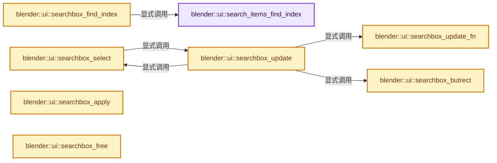
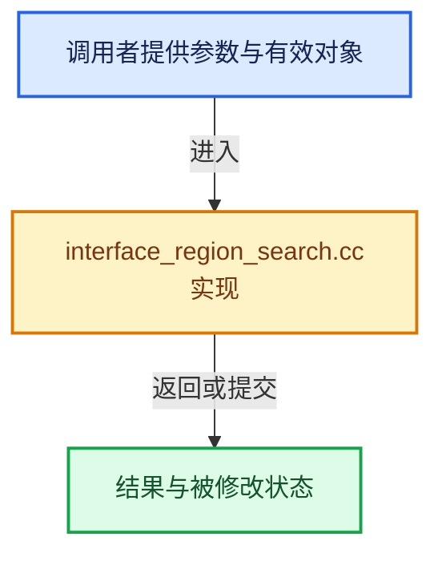

# 实现依赖专题：source/blender/editors/interface/regions/interface_region_search.cc

[方向导航](README.md) · [符号索引](../%E7%AC%A6%E5%8F%B7%E4%BE%9D%E8%B5%96%E4%B8%8E%E5%AE%9E%E7%8E%B0%E7%B4%A2%E5%BC%95.md)

本专题从正文实际调用进入，集中保存共享实现。函数有稳定锚点，可从调用处直接跳到对应完整函数；递归与互相调用通过回链组织。

## 本文件的实现关系






## 完整成员与函数实现

<a id="f-e4508cc0a7fb691b"></a>

### `blender::ui::search_items_find_index`

实现位置：[source/blender/editors/interface/regions/interface_region_search.cc](../../../../../source/blender/editors/interface/regions/interface_region_search.cc) · L232—L249。

接口参数：

- `const SearchItems *items`
- `const char *name`

**教学注释版**

<!-- annotated:a07437f12ce263 -->

```cpp
int search_items_find_index(const SearchItems *items, const char *name)
{
  if (items->name_prefix_offsets != nullptr) {
    for (int i = 0; i < items->totitem; i++) {
      if (STREQ(name, items->names[i] + items->name_prefix_offsets[i])) {
        return i;
      }
    }
  }
  else {
    for (int i = 0; i < items->totitem; i++) {
      if (STREQ(name, items->names[i])) {
        return i;
      }
    }
  }
  return -1;
}
```

<details>
<summary>核对原始源码：source/blender/editors/interface/regions/interface_region_search.cc · L232—L249</summary>

<!-- original:a07437f12ce263:source/blender/editors/interface/regions/interface_region_search.cc:232:249 -->

```cpp
int search_items_find_index(const SearchItems *items, const char *name)
{
  if (items->name_prefix_offsets != nullptr) {
    for (int i = 0; i < items->totitem; i++) {
      if (STREQ(name, items->names[i] + items->name_prefix_offsets[i])) {
        return i;
      }
    }
  }
  else {
    for (int i = 0; i < items->totitem; i++) {
      if (STREQ(name, items->names[i])) {
        return i;
      }
    }
  }
  return -1;
}
```

</details>

**结果出口**

- `return i;`
- `return -1;`

**继续追踪实现**

- `STREQ` → [STREQ · L112](%E4%BE%9D%E8%B5%96-GHOST_utildefines-34b996.md#m-9549fb6aafd2)；[STREQ · L451](../01-%E5%9F%BA%E7%A1%80%E5%AE%B9%E5%99%A8%E4%B8%8E%E7%8E%B0%E4%BB%A3CPP/%E4%BE%9D%E8%B5%96-BLI_utildefines-293a0a.md#m-c7b745bcfad2)；[STREQ · L55](%E4%BE%9D%E8%B5%96-clog-a0bec8.md#m-96e78f386894)。宏定义由构建条件选择。

<a id="f-5473f6c19f71c671"></a>

### `blender::ui::searchbox_select`

实现位置：[source/blender/editors/interface/regions/interface_region_search.cc](../../../../../source/blender/editors/interface/regions/interface_region_search.cc) · L252—L285。

接口参数：

- `bContext *C`
- `ARegion *region`
- `Button *but`
- `int step`

**教学注释版**

<!-- annotated:aa4e07752c5c57 -->

```cpp
static void searchbox_select(bContext *C, ARegion *region, Button *but, int step)
{
  uiSearchboxData *data = static_cast<uiSearchboxData *>(region->regiondata);

  /* apply step */
  data->active += step;

  if (data->items.totitem == 0) {
    data->active = -1;
  }
  else if (data->active >= data->items.totitem) {
    if (data->items.more) {
      data->items.offset++;
      data->active = data->items.totitem - 1;
      searchbox_update(C, region, but, false);
    }
    else {
      data->active = data->items.totitem - 1;
    }
  }
  else if (data->active < 0) {
    if (data->items.offset) {
      data->items.offset--;
      data->active = 0;
      searchbox_update(C, region, but, false);
    }
    else {
      /* only let users step into an 'unset' state for unlink buttons */
      data->active = (but->flag & BUT_VALUE_CLEAR) ? -1 : 0;
    }
  }

  ED_region_tag_redraw(region);
}
```

<details>
<summary>核对原始源码：source/blender/editors/interface/regions/interface_region_search.cc · L252—L285</summary>

<!-- original:aa4e07752c5c57:source/blender/editors/interface/regions/interface_region_search.cc:252:285 -->

```cpp
static void searchbox_select(bContext *C, ARegion *region, Button *but, int step)
{
  uiSearchboxData *data = static_cast<uiSearchboxData *>(region->regiondata);

  /* apply step */
  data->active += step;

  if (data->items.totitem == 0) {
    data->active = -1;
  }
  else if (data->active >= data->items.totitem) {
    if (data->items.more) {
      data->items.offset++;
      data->active = data->items.totitem - 1;
      searchbox_update(C, region, but, false);
    }
    else {
      data->active = data->items.totitem - 1;
    }
  }
  else if (data->active < 0) {
    if (data->items.offset) {
      data->items.offset--;
      data->active = 0;
      searchbox_update(C, region, but, false);
    }
    else {
      /* only let users step into an 'unset' state for unlink buttons */
      data->active = (but->flag & BUT_VALUE_CLEAR) ? -1 : 0;
    }
  }

  ED_region_tag_redraw(region);
}
```

</details>

**沿实际写入检查状态**

- `data->active += step;`
- `data->active = -1;`
- `data->active = data->items.totitem - 1;`
- `data->active = 0;`
- `data->active = (but->flag & BUT_VALUE_CLEAR) ? -1 : 0;`

**继续追踪实现**

- `searchbox_update` → [blender::ui::searchbox_update · L515](%E4%BE%9D%E8%B5%96-interface_region_search-b212a3.md#f-969e9bc4c4bbeb76)。
- `ED_region_tag_redraw` → [blender::ED_region_tag_redraw · L681](%E4%BE%9D%E8%B5%96-area-87d68a.md#f-8ff5d58c52a4a6e3)。

<a id="f-436063724ec1a209"></a>

### `blender::ui::searchbox_butrect`

实现位置：[source/blender/editors/interface/regions/interface_region_search.cc](../../../../../source/blender/editors/interface/regions/interface_region_search.cc) · L287—L320。

接口参数：

- `rcti *r_rect`
- `uiSearchboxData *data`
- `int itemnr`

**教学注释版**

<!-- annotated:9f8656b973241f -->

```cpp
static void searchbox_butrect(rcti *r_rect, uiSearchboxData *data, int itemnr)
{
  const float tria_h = data->zoom * UI_SEARCHBOX_TRIA_H;

  /* thumbnail preview */
  if (data->preview) {
    const int butw = BLI_rcti_size_x(&data->bbox) / data->prv_cols;
    const int buth = (BLI_rcti_size_y(&data->bbox) - 2.0f * tria_h) / data->prv_rows;
    int row, col;

    *r_rect = data->bbox;

    col = itemnr % data->prv_cols;
    row = itemnr / data->prv_cols;

    r_rect->xmin += col * butw;
    r_rect->xmax = r_rect->xmin + butw;

    r_rect->ymax -= tria_h + row * buth;
    r_rect->ymin = r_rect->ymax - buth;
  }
  /* list view */
  else {
    const float buth = (BLI_rcti_size_y(&data->bbox) - 2.0f * tria_h) / SEARCH_ITEMS;

    *r_rect = data->bbox;

    r_rect->xmin = data->bbox.xmin;
    r_rect->xmax = data->bbox.xmax;

    r_rect->ymax = data->bbox.ymax - tria_h - itemnr * buth;
    r_rect->ymin = r_rect->ymax - buth;
  }
}
```

<details>
<summary>核对原始源码：source/blender/editors/interface/regions/interface_region_search.cc · L287—L320</summary>

<!-- original:9f8656b973241f:source/blender/editors/interface/regions/interface_region_search.cc:287:320 -->

```cpp
static void searchbox_butrect(rcti *r_rect, uiSearchboxData *data, int itemnr)
{
  const float tria_h = data->zoom * UI_SEARCHBOX_TRIA_H;

  /* thumbnail preview */
  if (data->preview) {
    const int butw = BLI_rcti_size_x(&data->bbox) / data->prv_cols;
    const int buth = (BLI_rcti_size_y(&data->bbox) - 2.0f * tria_h) / data->prv_rows;
    int row, col;

    *r_rect = data->bbox;

    col = itemnr % data->prv_cols;
    row = itemnr / data->prv_cols;

    r_rect->xmin += col * butw;
    r_rect->xmax = r_rect->xmin + butw;

    r_rect->ymax -= tria_h + row * buth;
    r_rect->ymin = r_rect->ymax - buth;
  }
  /* list view */
  else {
    const float buth = (BLI_rcti_size_y(&data->bbox) - 2.0f * tria_h) / SEARCH_ITEMS;

    *r_rect = data->bbox;

    r_rect->xmin = data->bbox.xmin;
    r_rect->xmax = data->bbox.xmax;

    r_rect->ymax = data->bbox.ymax - tria_h - itemnr * buth;
    r_rect->ymin = r_rect->ymax - buth;
  }
}
```

</details>

**沿实际写入检查状态**

- `col = itemnr % data->prv_cols;`
- `row = itemnr / data->prv_cols;`
- `r_rect->xmin += col * butw;`
- `r_rect->xmax = r_rect->xmin + butw;`
- `r_rect->ymax -= tria_h + row * buth;`
- `r_rect->ymin = r_rect->ymax - buth;`
- `r_rect->xmin = data->bbox.xmin;`
- `r_rect->xmax = data->bbox.xmax;`
- `r_rect->ymax = data->bbox.ymax - tria_h - itemnr * buth;`

**继续追踪实现**

- `BLI_rcti_size_x` → [blender::BLI_rcti_size_x · L203](../01-%E5%9F%BA%E7%A1%80%E5%AE%B9%E5%99%A8%E4%B8%8E%E7%8E%B0%E4%BB%A3CPP/%E4%BE%9D%E8%B5%96-BLI_rect-2996c6.md#f-7a8fb2c54a829be6)。
- `BLI_rcti_size_y` → [blender::BLI_rcti_size_y · L207](../01-%E5%9F%BA%E7%A1%80%E5%AE%B9%E5%99%A8%E4%B8%8E%E7%8E%B0%E4%BB%A3CPP/%E4%BE%9D%E8%B5%96-BLI_rect-2996c6.md#f-ac87d6c708d502ad)。

<a id="f-1b6456f842c1fff1"></a>

### `blender::ui::searchbox_find_index`

实现位置：[source/blender/editors/interface/regions/interface_region_search.cc](../../../../../source/blender/editors/interface/regions/interface_region_search.cc) · L322—L326。

接口参数：

- `ARegion *region`
- `const char *name`

**教学注释版**

<!-- annotated:b98c2280996214 -->

```cpp
int searchbox_find_index(ARegion *region, const char *name)
{
  uiSearchboxData *data = static_cast<uiSearchboxData *>(region->regiondata);
  return search_items_find_index(&data->items, name);
}
```

<details>
<summary>核对原始源码：source/blender/editors/interface/regions/interface_region_search.cc · L322—L326</summary>

<!-- original:b98c2280996214:source/blender/editors/interface/regions/interface_region_search.cc:322:326 -->

```cpp
int searchbox_find_index(ARegion *region, const char *name)
{
  uiSearchboxData *data = static_cast<uiSearchboxData *>(region->regiondata);
  return search_items_find_index(&data->items, name);
}
```

</details>

**结果出口**

- `return search_items_find_index(&data->items, name);`

**继续追踪实现**

- `search_items_find_index` → [blender::ui::search_items_find_index · L232](%E4%BE%9D%E8%B5%96-interface_region_search-b212a3.md#f-e4508cc0a7fb691b)。

<a id="f-c6535ab45ffc8846"></a>

### `blender::ui::searchbox_apply`

实现位置：[source/blender/editors/interface/regions/interface_region_search.cc](../../../../../source/blender/editors/interface/regions/interface_region_search.cc) · L335—L366。

接口参数：

- `Button *but`
- `ARegion *region`

**教学注释版**

<!-- annotated:93d00b4bd2d7cd -->

```cpp
bool searchbox_apply(Button *but, ARegion *region)
{
  uiSearchboxData *data = static_cast<uiSearchboxData *>(region->regiondata);
  ButtonSearch *search_but = static_cast<ButtonSearch *>(but);

  BLI_assert(but->type == ButtonType::SearchMenu);

  search_but->item_active = nullptr;

  if (data->active != -1) {
    const char *name = data->items.names[data->active] +
                       /* Never include the prefix in the button. */
                       (data->items.name_prefix_offsets ?
                            data->items.name_prefix_offsets[data->active] :
                            0);

    const char *name_sep = data->use_shortcut_sep ? strrchr(name, UI_SEP_CHAR) : nullptr;

    /* Search button with dynamic string properties may have their own method of applying
     * the search results, so only copy the result if there is a proper space for it. */
    if (but->hardmax != 0) {
      BLI_strncpy(but->editstr, name, name_sep ? (name_sep - name) + 1 : data->items.maxstrlen);
    }

    search_but->item_active = data->items.pointers[data->active];
    MEM_SAFE_DELETE(search_but->item_active_str);
    search_but->item_active_str = BLI_strdup(data->items.names[data->active]);

    return true;
  }
  return false;
}
```

<details>
<summary>核对原始源码：source/blender/editors/interface/regions/interface_region_search.cc · L335—L366</summary>

<!-- original:93d00b4bd2d7cd:source/blender/editors/interface/regions/interface_region_search.cc:335:366 -->

```cpp
bool searchbox_apply(Button *but, ARegion *region)
{
  uiSearchboxData *data = static_cast<uiSearchboxData *>(region->regiondata);
  ButtonSearch *search_but = static_cast<ButtonSearch *>(but);

  BLI_assert(but->type == ButtonType::SearchMenu);

  search_but->item_active = nullptr;

  if (data->active != -1) {
    const char *name = data->items.names[data->active] +
                       /* Never include the prefix in the button. */
                       (data->items.name_prefix_offsets ?
                            data->items.name_prefix_offsets[data->active] :
                            0);

    const char *name_sep = data->use_shortcut_sep ? strrchr(name, UI_SEP_CHAR) : nullptr;

    /* Search button with dynamic string properties may have their own method of applying
     * the search results, so only copy the result if there is a proper space for it. */
    if (but->hardmax != 0) {
      BLI_strncpy(but->editstr, name, name_sep ? (name_sep - name) + 1 : data->items.maxstrlen);
    }

    search_but->item_active = data->items.pointers[data->active];
    MEM_SAFE_DELETE(search_but->item_active_str);
    search_but->item_active_str = BLI_strdup(data->items.names[data->active]);

    return true;
  }
  return false;
}
```

</details>

**沿实际写入检查状态**

- `search_but->item_active = nullptr;`
- `search_but->item_active = data->items.pointers[data->active];`
- `search_but->item_active_str = BLI_strdup(data->items.names[data->active]);`

**结果出口**

- `return true;`
- `return false;`

**继续追踪实现**

- `BLI_assert` → [BLI_assert · L48](../01-%E5%9F%BA%E7%A1%80%E5%AE%B9%E5%99%A8%E4%B8%8E%E7%8E%B0%E4%BB%A3CPP/%E4%BE%9D%E8%B5%96-BLI_assert-cc98e8.md#m-57a88495704d)；[BLI_assert · L63](../01-%E5%9F%BA%E7%A1%80%E5%AE%B9%E5%99%A8%E4%B8%8E%E7%8E%B0%E4%BB%A3CPP/%E4%BE%9D%E8%B5%96-BLI_assert-cc98e8.md#m-d07050020cb5)。宏定义由构建条件选择。
- `strrchr` → [调用协议](../%E6%A8%A1%E6%9D%BF%E5%AE%8F%E4%B8%8E%E5%8A%A8%E6%80%81%E5%88%86%E6%B4%BE%E5%8D%8F%E8%AE%AE.md)：函数指针、局部可调用对象或未展开的宏；必须结合调用者环境。调用位置L351。
- `BLI_strncpy` → [blender::BLI_strncpy · L70](../01-%E5%9F%BA%E7%A1%80%E5%AE%B9%E5%99%A8%E4%B8%8E%E7%8E%B0%E4%BB%A3CPP/%E4%BE%9D%E8%B5%96-string-1d986f.md#f-6324147b0d116da1)。
- `MEM_SAFE_DELETE` → [MEM_SAFE_DELETE · L436](../03-%E5%86%85%E5%AD%98%E5%88%86%E9%85%8D%E4%B8%8E%E8%BF%90%E8%A1%8C%E6%97%B6%E7%B1%BB%E5%9E%8B/%E4%BE%9D%E8%B5%96-MEM_guardedalloc-b54eca.md#m-eadb3bc5b902)。宏定义由构建条件选择。
- `BLI_strdup` → [blender::BLI_strdup · L43](../01-%E5%9F%BA%E7%A1%80%E5%AE%B9%E5%99%A8%E4%B8%8E%E7%8E%B0%E4%BB%A3CPP/%E4%BE%9D%E8%B5%96-string-1d986f.md#f-7e6d5c696c20c0e1)。

<a id="f-a47a09a8de9d7acf"></a>

### `blender::ui::searchbox_update_fn`

实现位置：[source/blender/editors/interface/regions/interface_region_search.cc](../../../../../source/blender/editors/interface/regions/interface_region_search.cc) · L501—L513。

接口参数：

- `bContext *C`
- `ButtonSearch *but`
- `const char *str`
- `SearchItems *items`

**教学注释版**

<!-- annotated:c693315495ba93 -->

```cpp
static void searchbox_update_fn(bContext *C,
                                ButtonSearch *but,
                                const char *str,
                                SearchItems *items)
{
  /* While the button is in text editing mode (searchbox open), remove tooltips on every update. */
  if (but->editstr) {
    wmWindow *win = CTX_wm_window(C);
    WM_tooltip_clear(C, win);
  }
  const bool is_first_search = !but->changed;
  but->items_update_fn(C, but->arg.get(), str, items, is_first_search);
}
```

<details>
<summary>核对原始源码：source/blender/editors/interface/regions/interface_region_search.cc · L501—L513</summary>

<!-- original:c693315495ba93:source/blender/editors/interface/regions/interface_region_search.cc:501:513 -->

```cpp
static void searchbox_update_fn(bContext *C,
                                ButtonSearch *but,
                                const char *str,
                                SearchItems *items)
{
  /* While the button is in text editing mode (searchbox open), remove tooltips on every update. */
  if (but->editstr) {
    wmWindow *win = CTX_wm_window(C);
    WM_tooltip_clear(C, win);
  }
  const bool is_first_search = !but->changed;
  but->items_update_fn(C, but->arg.get(), str, items, is_first_search);
}
```

</details>

**继续追踪实现**

- `CTX_wm_window` → [blender::CTX_wm_window · L938](%E4%BE%9D%E8%B5%96-context-a929d9.md#f-a1996003b2409854)。
- `WM_tooltip_clear` → [blender::WM_tooltip_clear · L84](%E4%BE%9D%E8%B5%96-wm_tooltip-deb97d.md#f-82cdc19e47b38291)。
- `but->items_update_fn` → [调用协议](../%E6%A8%A1%E6%9D%BF%E5%AE%8F%E4%B8%8E%E5%8A%A8%E6%80%81%E5%88%86%E6%B4%BE%E5%8D%8F%E8%AE%AE.md)：由接收对象具体类型或运行时策略提供实现。调用位置L512。
- `but->arg.get` → [调用协议](../%E6%A8%A1%E6%9D%BF%E5%AE%8F%E4%B8%8E%E5%8A%A8%E6%80%81%E5%88%86%E6%B4%BE%E5%8D%8F%E8%AE%AE.md)：接收对象类型依赖auto、返回值或模板实例；不按同名猜测目标。调用位置L512。

<a id="f-969e9bc4c4bbeb76"></a>

### `blender::ui::searchbox_update`

实现位置：[source/blender/editors/interface/regions/interface_region_search.cc](../../../../../source/blender/editors/interface/regions/interface_region_search.cc) · L515—L612。

接口参数：

- `bContext *C`
- `ARegion *region`
- `Button *but`
- `const bool reset`

**教学注释版**

<!-- annotated:c2e2dc113e02d5 -->

```cpp
void searchbox_update(bContext *C, ARegion *region, Button *but, const bool reset)
{
  ButtonSearch *search_but = static_cast<ButtonSearch *>(but);
  uiSearchboxData *data = static_cast<uiSearchboxData *>(region->regiondata);

  BLI_assert(but->type == ButtonType::SearchMenu);

  /* reset vars */
  data->items.totitem = 0;
  data->items.more = 0;
  if (!reset) {
    data->items.offset_i = data->items.offset;
  }
  else {
    data->items.offset_i = data->items.offset = 0;
    data->active = -1;

    /* On init, find and center active item. */
    const bool is_first_search = !but->changed;
    if (is_first_search && search_but->items_update_fn && search_but->item_active) {
      data->items.active = search_but->item_active;
      searchbox_update_fn(C, search_but, but->editstr, &data->items);
      data->items.active = nullptr;

      /* found active item, calculate real offset by centering it */
      if (data->items.totitem) {
        /* first case, begin of list */
        if (data->items.offset_i < data->items.maxitem) {
          data->active = data->items.offset_i;
          data->items.offset_i = 0;
        }
        else {
          /* second case, end of list */
          if (data->items.totitem - data->items.offset_i <= data->items.maxitem) {
            data->active = data->items.offset_i - data->items.totitem + data->items.maxitem;
            data->items.offset_i = data->items.totitem - data->items.maxitem;
          }
          else {
            /* center active item */
            data->items.offset_i -= data->items.maxitem / 2;
            data->active = data->items.maxitem / 2;
          }
        }
      }
      data->items.offset = data->items.offset_i;
      data->items.totitem = 0;
    }
  }

  /* callback */
  if (search_but->items_update_fn) {
    searchbox_update_fn(C, search_but, but->editstr, &data->items);
  }

  /* handle case where editstr is equal to one of items */
  if (reset && data->active == -1) {
    for (int a = 0; a < data->items.totitem; a++) {
      const char *name = data->items.names[a] +
                         /* Never include the prefix in the button. */
                         (data->items.name_prefix_offsets ? data->items.name_prefix_offsets[a] :
                                                            0);
      const char *name_sep = data->use_shortcut_sep ? strrchr(name, UI_SEP_CHAR) : nullptr;
      if (STREQLEN(but->editstr, name, name_sep ? (name_sep - name) : data->items.maxstrlen)) {
        data->active = a;
        break;
      }
    }
    if (data->items.totitem == 1 && but->editstr[0]) {
      data->active = 0;
    }
  }

  /* Nothing active, check at mouse location. */
  if (data->active == -1) {
    wmWindow *win = CTX_wm_window(C);
    if (win && win->runtime && win->runtime->eventstate) {
      const int cursor_x = win->runtime->eventstate->xy[0];
      const int cursor_y = win->runtime->eventstate->xy[1];
      if (BLI_rcti_isect_pt(&region->winrct, cursor_x, cursor_y)) {
        rcti rect;
        for (int a = 0; a < data->items.totitem; a++) {
          searchbox_butrect(&rect, data, a);
          if (BLI_rcti_isect_pt(
                  &rect, cursor_x - region->winrct.xmin, cursor_y - region->winrct.ymin))
          {
            data->active = a;
            break;
          }
        }
      }
    }
  }

  /* validate selected item */
  searchbox_select(C, region, but, 0);

  ED_region_tag_redraw(region);
}
```

<details>
<summary>核对原始源码：source/blender/editors/interface/regions/interface_region_search.cc · L515—L612</summary>

<!-- original:c2e2dc113e02d5:source/blender/editors/interface/regions/interface_region_search.cc:515:612 -->

```cpp
void searchbox_update(bContext *C, ARegion *region, Button *but, const bool reset)
{
  ButtonSearch *search_but = static_cast<ButtonSearch *>(but);
  uiSearchboxData *data = static_cast<uiSearchboxData *>(region->regiondata);

  BLI_assert(but->type == ButtonType::SearchMenu);

  /* reset vars */
  data->items.totitem = 0;
  data->items.more = 0;
  if (!reset) {
    data->items.offset_i = data->items.offset;
  }
  else {
    data->items.offset_i = data->items.offset = 0;
    data->active = -1;

    /* On init, find and center active item. */
    const bool is_first_search = !but->changed;
    if (is_first_search && search_but->items_update_fn && search_but->item_active) {
      data->items.active = search_but->item_active;
      searchbox_update_fn(C, search_but, but->editstr, &data->items);
      data->items.active = nullptr;

      /* found active item, calculate real offset by centering it */
      if (data->items.totitem) {
        /* first case, begin of list */
        if (data->items.offset_i < data->items.maxitem) {
          data->active = data->items.offset_i;
          data->items.offset_i = 0;
        }
        else {
          /* second case, end of list */
          if (data->items.totitem - data->items.offset_i <= data->items.maxitem) {
            data->active = data->items.offset_i - data->items.totitem + data->items.maxitem;
            data->items.offset_i = data->items.totitem - data->items.maxitem;
          }
          else {
            /* center active item */
            data->items.offset_i -= data->items.maxitem / 2;
            data->active = data->items.maxitem / 2;
          }
        }
      }
      data->items.offset = data->items.offset_i;
      data->items.totitem = 0;
    }
  }

  /* callback */
  if (search_but->items_update_fn) {
    searchbox_update_fn(C, search_but, but->editstr, &data->items);
  }

  /* handle case where editstr is equal to one of items */
  if (reset && data->active == -1) {
    for (int a = 0; a < data->items.totitem; a++) {
      const char *name = data->items.names[a] +
                         /* Never include the prefix in the button. */
                         (data->items.name_prefix_offsets ? data->items.name_prefix_offsets[a] :
                                                            0);
      const char *name_sep = data->use_shortcut_sep ? strrchr(name, UI_SEP_CHAR) : nullptr;
      if (STREQLEN(but->editstr, name, name_sep ? (name_sep - name) : data->items.maxstrlen)) {
        data->active = a;
        break;
      }
    }
    if (data->items.totitem == 1 && but->editstr[0]) {
      data->active = 0;
    }
  }

  /* Nothing active, check at mouse location. */
  if (data->active == -1) {
    wmWindow *win = CTX_wm_window(C);
    if (win && win->runtime && win->runtime->eventstate) {
      const int cursor_x = win->runtime->eventstate->xy[0];
      const int cursor_y = win->runtime->eventstate->xy[1];
      if (BLI_rcti_isect_pt(&region->winrct, cursor_x, cursor_y)) {
        rcti rect;
        for (int a = 0; a < data->items.totitem; a++) {
          searchbox_butrect(&rect, data, a);
          if (BLI_rcti_isect_pt(
                  &rect, cursor_x - region->winrct.xmin, cursor_y - region->winrct.ymin))
          {
            data->active = a;
            break;
          }
        }
      }
    }
  }

  /* validate selected item */
  searchbox_select(C, region, but, 0);

  ED_region_tag_redraw(region);
}
```

</details>

**沿实际写入检查状态**

- `data->items.totitem = 0;`
- `data->items.more = 0;`
- `data->items.offset_i = data->items.offset;`
- `data->items.offset_i = data->items.offset = 0;`
- `data->active = -1;`
- `data->items.active = search_but->item_active;`
- `data->items.active = nullptr;`
- `data->active = data->items.offset_i;`
- `data->items.offset_i = 0;`
- `data->active = data->items.offset_i - data->items.totitem + data->items.maxitem;`
- `data->items.offset_i = data->items.totitem - data->items.maxitem;`
- `data->items.offset_i -= data->items.maxitem / 2;`
- `data->active = data->items.maxitem / 2;`
- `data->items.offset = data->items.offset_i;`
- `data->active = a;`
- `data->active = 0;`

**继续追踪实现**

- `BLI_assert` → [BLI_assert · L48](../01-%E5%9F%BA%E7%A1%80%E5%AE%B9%E5%99%A8%E4%B8%8E%E7%8E%B0%E4%BB%A3CPP/%E4%BE%9D%E8%B5%96-BLI_assert-cc98e8.md#m-57a88495704d)；[BLI_assert · L63](../01-%E5%9F%BA%E7%A1%80%E5%AE%B9%E5%99%A8%E4%B8%8E%E7%8E%B0%E4%BB%A3CPP/%E4%BE%9D%E8%B5%96-BLI_assert-cc98e8.md#m-d07050020cb5)。宏定义由构建条件选择。
- `searchbox_update_fn` → [blender::ui::searchbox_update_fn · L501](%E4%BE%9D%E8%B5%96-interface_region_search-b212a3.md#f-a47a09a8de9d7acf)。
- `strrchr` → [调用协议](../%E6%A8%A1%E6%9D%BF%E5%AE%8F%E4%B8%8E%E5%8A%A8%E6%80%81%E5%88%86%E6%B4%BE%E5%8D%8F%E8%AE%AE.md)：函数指针、局部可调用对象或未展开的宏；必须结合调用者环境。调用位置L576。
- `STREQLEN` → [STREQLEN · L114](%E4%BE%9D%E8%B5%96-GHOST_utildefines-34b996.md#m-4c9fb75cc1d1)；[STREQLEN · L453](../01-%E5%9F%BA%E7%A1%80%E5%AE%B9%E5%99%A8%E4%B8%8E%E7%8E%B0%E4%BB%A3CPP/%E4%BE%9D%E8%B5%96-BLI_utildefines-293a0a.md#m-c74c1422ab62)；[STREQLEN · L56](%E4%BE%9D%E8%B5%96-clog-a0bec8.md#m-c4a18b1393b9)。宏定义由构建条件选择。
- `CTX_wm_window` → [blender::CTX_wm_window · L938](%E4%BE%9D%E8%B5%96-context-a929d9.md#f-a1996003b2409854)。
- `BLI_rcti_isect_pt` → [blender::BLI_rcti_isect_pt · L61](../01-%E5%9F%BA%E7%A1%80%E5%AE%B9%E5%99%A8%E4%B8%8E%E7%8E%B0%E4%BB%A3CPP/%E4%BE%9D%E8%B5%96-rct-6e7349.md#f-9e89b79c8d771c1b)。
- `searchbox_butrect` → [blender::ui::searchbox_butrect · L287](%E4%BE%9D%E8%B5%96-interface_region_search-b212a3.md#f-436063724ec1a209)。
- `searchbox_select` → [blender::ui::searchbox_select · L252](%E4%BE%9D%E8%B5%96-interface_region_search-b212a3.md#f-5473f6c19f71c671)。
- `ED_region_tag_redraw` → [blender::ED_region_tag_redraw · L681](%E4%BE%9D%E8%B5%96-area-87d68a.md#f-8ff5d58c52a4a6e3)。

<a id="f-5cceb781da7e6a00"></a>

### `blender::ui::searchbox_free`

实现位置：[source/blender/editors/interface/regions/interface_region_search.cc](../../../../../source/blender/editors/interface/regions/interface_region_search.cc) · L1199—L1202。

接口参数：

- `bContext *C`
- `ARegion *region`

**教学注释版**

<!-- annotated:acfdf619cfa09f -->

```cpp
void searchbox_free(bContext *C, ARegion *region)
{
  region_temp_remove(C, CTX_wm_screen(C), region);
}
```

<details>
<summary>核对原始源码：source/blender/editors/interface/regions/interface_region_search.cc · L1199—L1202</summary>

<!-- original:acfdf619cfa09f:source/blender/editors/interface/regions/interface_region_search.cc:1199:1202 -->

```cpp
void searchbox_free(bContext *C, ARegion *region)
{
  region_temp_remove(C, CTX_wm_screen(C), region);
}
```

</details>

**继续追踪实现**

- `region_temp_remove` → [blender::ui::region_temp_remove · L37](%E4%BE%9D%E8%B5%96-interface_regions-dd86de.md#f-b371b19f49866644)。
- `CTX_wm_screen` → [blender::CTX_wm_screen · L949](%E4%BE%9D%E8%B5%96-context-a929d9.md#f-78039a0c1148839b)。

<a id="f-e5baa09b48137e78"></a>

### `blender::ui::button_search_refresh`

实现位置：[source/blender/editors/interface/regions/interface_region_search.cc](../../../../../source/blender/editors/interface/regions/interface_region_search.cc) · L1220—L1258。

接口参数：

- `ButtonSearch *but`

**教学注释版**

<!-- annotated:10061dceed008b -->

```cpp
void button_search_refresh(ButtonSearch *but)
{
  /* possibly very large lists (such as ID datablocks) only
   * only validate string RNA buts (not pointers) */
  if (but->rnaprop && RNA_property_type(but->rnaprop) != PROP_STRING) {
    return;
  }

  SearchItems *items = MEM_new<SearchItems>(__func__);

  /* setup search struct */
  items->maxitem = 10;
  items->maxstrlen = 256;
  items->names = MEM_new_array_zeroed<char *>(items->maxitem, __func__);
  for (int i = 0; i < items->maxitem; i++) {
    items->names[i] = MEM_new_array_zeroed<char>(but->hardmax + 1, __func__);
  }

  searchbox_update_fn(
      static_cast<bContext *>(but->block->evil_C), but, but->drawstr.c_str(), items);

  if (!but->results_are_suggestions) {
    /* Only red-alert when we are sure of it, this can miss cases when >10 matches. */
    if (items->totitem == 0) {
      button_flag_enable(but, BUT_REDALERT);
    }
    else if (items->more == 0) {
      if (search_items_find_index(items, but->drawstr.c_str()) == -1) {
        button_flag_enable(but, BUT_REDALERT);
      }
    }
  }

  for (int i = 0; i < items->maxitem; i++) {
    MEM_delete(items->names[i]);
  }
  MEM_delete(items->names);
  MEM_delete(items);
}
```

<details>
<summary>核对原始源码：source/blender/editors/interface/regions/interface_region_search.cc · L1220—L1258</summary>

<!-- original:10061dceed008b:source/blender/editors/interface/regions/interface_region_search.cc:1220:1258 -->

```cpp
void button_search_refresh(ButtonSearch *but)
{
  /* possibly very large lists (such as ID datablocks) only
   * only validate string RNA buts (not pointers) */
  if (but->rnaprop && RNA_property_type(but->rnaprop) != PROP_STRING) {
    return;
  }

  SearchItems *items = MEM_new<SearchItems>(__func__);

  /* setup search struct */
  items->maxitem = 10;
  items->maxstrlen = 256;
  items->names = MEM_new_array_zeroed<char *>(items->maxitem, __func__);
  for (int i = 0; i < items->maxitem; i++) {
    items->names[i] = MEM_new_array_zeroed<char>(but->hardmax + 1, __func__);
  }

  searchbox_update_fn(
      static_cast<bContext *>(but->block->evil_C), but, but->drawstr.c_str(), items);

  if (!but->results_are_suggestions) {
    /* Only red-alert when we are sure of it, this can miss cases when >10 matches. */
    if (items->totitem == 0) {
      button_flag_enable(but, BUT_REDALERT);
    }
    else if (items->more == 0) {
      if (search_items_find_index(items, but->drawstr.c_str()) == -1) {
        button_flag_enable(but, BUT_REDALERT);
      }
    }
  }

  for (int i = 0; i < items->maxitem; i++) {
    MEM_delete(items->names[i]);
  }
  MEM_delete(items->names);
  MEM_delete(items);
}
```

</details>

**沿实际写入检查状态**

- `items->maxitem = 10;`
- `items->maxstrlen = 256;`
- `items->names = MEM_new_array_zeroed<char *>(items->maxitem, __func__);`
- `items->names[i] = MEM_new_array_zeroed<char>(but->hardmax + 1, __func__);`

**继续追踪实现**

- `RNA_property_type` → [blender::RNA_property_type · L1293](%E4%BE%9D%E8%B5%96-rna_access-706bea.md#f-4465a90d55f022df)。
- `MEM_new<SearchItems>` → [MEM_new · L351](../03-%E5%86%85%E5%AD%98%E5%88%86%E9%85%8D%E4%B8%8E%E8%BF%90%E8%A1%8C%E6%97%B6%E7%B1%BB%E5%9E%8B/%E4%BE%9D%E8%B5%96-MEM_guardedalloc-b54eca.md#f-115f9b6784f89912)。
- `MEM_new_array_zeroed<char *>` → [MEM_new_array_zeroed · L566](../03-%E5%86%85%E5%AD%98%E5%88%86%E9%85%8D%E4%B8%8E%E8%BF%90%E8%A1%8C%E6%97%B6%E7%B1%BB%E5%9E%8B/%E4%BE%9D%E8%B5%96-MEM_guardedalloc-b54eca.md#f-3a0cf63fb5216500)；[MEM_new_array_zeroed · L119](../03-%E5%86%85%E5%AD%98%E5%88%86%E9%85%8D%E4%B8%8E%E8%BF%90%E8%A1%8C%E6%97%B6%E7%B1%BB%E5%9E%8B/%E4%BE%9D%E8%B5%96-mallocn-afdcd4.md#f-6825557da566fdbe)。同名重载需按实参类型选择。
- `MEM_new_array_zeroed<char>` → [MEM_new_array_zeroed · L566](../03-%E5%86%85%E5%AD%98%E5%88%86%E9%85%8D%E4%B8%8E%E8%BF%90%E8%A1%8C%E6%97%B6%E7%B1%BB%E5%9E%8B/%E4%BE%9D%E8%B5%96-MEM_guardedalloc-b54eca.md#f-3a0cf63fb5216500)；[MEM_new_array_zeroed · L119](../03-%E5%86%85%E5%AD%98%E5%88%86%E9%85%8D%E4%B8%8E%E8%BF%90%E8%A1%8C%E6%97%B6%E7%B1%BB%E5%9E%8B/%E4%BE%9D%E8%B5%96-mallocn-afdcd4.md#f-6825557da566fdbe)。同名重载需按实参类型选择。
- `searchbox_update_fn` → [blender::ui::searchbox_update_fn · L501](%E4%BE%9D%E8%B5%96-interface_region_search-b212a3.md#f-a47a09a8de9d7acf)。
- `but->drawstr.c_str` → [调用协议](../%E6%A8%A1%E6%9D%BF%E5%AE%8F%E4%B8%8E%E5%8A%A8%E6%80%81%E5%88%86%E6%B4%BE%E5%8D%8F%E8%AE%AE.md)：接收对象类型依赖auto、返回值或模板实例；不按同名猜测目标。调用位置L1239。
- `button_flag_enable` → [blender::ui::button_flag_enable · L5802](%E4%BE%9D%E8%B5%96-interface-11578b.md#f-2a1753fbff9a356d)。
- `search_items_find_index` → [blender::ui::search_items_find_index · L232](%E4%BE%9D%E8%B5%96-interface_region_search-b212a3.md#f-e4508cc0a7fb691b)。
- `MEM_delete` → [MEM_delete · L400](../03-%E5%86%85%E5%AD%98%E5%88%86%E9%85%8D%E4%B8%8E%E8%BF%90%E8%A1%8C%E6%97%B6%E7%B1%BB%E5%9E%8B/%E4%BE%9D%E8%B5%96-MEM_guardedalloc-b54eca.md#f-9049ffdd1682887c)。
