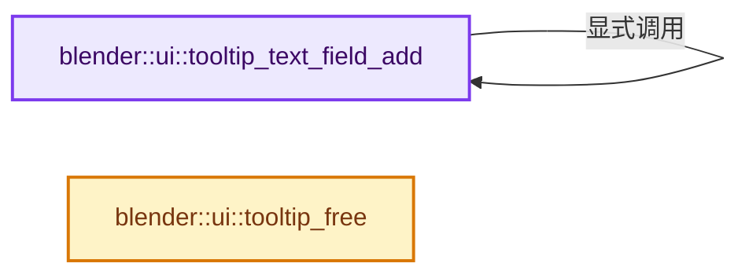
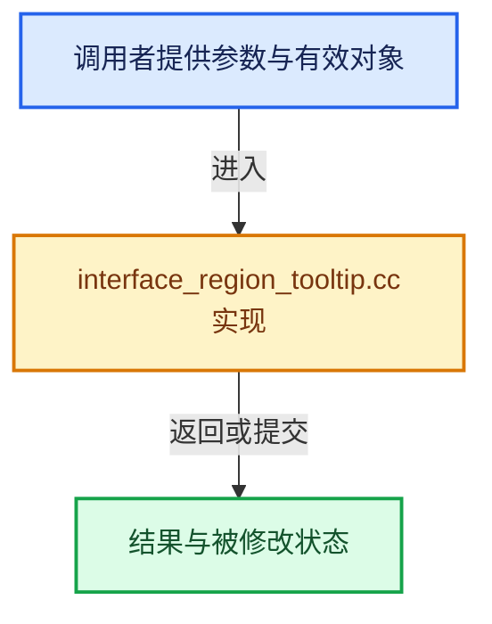

# 实现依赖专题：source/blender/editors/interface/regions/interface_region_tooltip.cc

[方向导航](README.md) · [符号索引](../%E7%AC%A6%E5%8F%B7%E4%BE%9D%E8%B5%96%E4%B8%8E%E5%AE%9E%E7%8E%B0%E7%B4%A2%E5%BC%95.md)

本专题从正文实际调用进入，集中保存共享实现。函数有稳定锚点，可从调用处直接跳到对应完整函数；递归与互相调用通过回链组织。

## 本文件的实现关系






## 完整成员与函数实现

<a id="f-1f95feaf3f6c3b44"></a>

### `blender::ui::tooltip_text_field_add`

实现位置：[source/blender/editors/interface/regions/interface_region_tooltip.cc](../../../../../source/blender/editors/interface/regions/interface_region_tooltip.cc) · L125—L143。

接口参数：

- `TooltipData &data`
- `std::string text`
- `std::string suffix`
- `const TooltipStyle style`
- `const TooltipColorID color_id`
- `const bool is_pad`

**教学注释版**

<!-- annotated:4f6cbfccab2eca -->

```cpp
void tooltip_text_field_add(TooltipData &data,
                            std::string text,
                            std::string suffix,
                            const TooltipStyle style,
                            const TooltipColorID color_id,
                            const bool is_pad)
{
  if (is_pad) {
    /* Add a spacer field before this one. */
    tooltip_text_field_add(data, {}, {}, TIP_STYLE_SPACER, TIP_LC_NORMAL, false);
  }

  TooltipField field{};
  field.format.style = style;
  field.format.color_id = color_id;
  // [讲解] std::move：把表达式转换成可供移动重载选择的值类别；不保证真的移动，不结束源对象寿命，对const值可能选择复制。
  field.text = std::move(text);
  field.text_suffix = std::move(suffix);
  data.fields.append(std::move(field));
}
```

<details>
<summary>核对原始源码：source/blender/editors/interface/regions/interface_region_tooltip.cc · L125—L143</summary>

<!-- original:4f6cbfccab2eca:source/blender/editors/interface/regions/interface_region_tooltip.cc:125:143 -->

```cpp
void tooltip_text_field_add(TooltipData &data,
                            std::string text,
                            std::string suffix,
                            const TooltipStyle style,
                            const TooltipColorID color_id,
                            const bool is_pad)
{
  if (is_pad) {
    /* Add a spacer field before this one. */
    tooltip_text_field_add(data, {}, {}, TIP_STYLE_SPACER, TIP_LC_NORMAL, false);
  }

  TooltipField field{};
  field.format.style = style;
  field.format.color_id = color_id;
  field.text = std::move(text);
  field.text_suffix = std::move(suffix);
  data.fields.append(std::move(field));
}
```

</details>

**沿实际写入检查状态**

- `field.format.style = style;`
- `field.format.color_id = color_id;`
- `field.text = std::move(text);`
- `field.text_suffix = std::move(suffix);`

**继续追踪实现**

- `tooltip_text_field_add` → [blender::ui::tooltip_text_field_add · L125](%E4%BE%9D%E8%B5%96-interface_region_tooltip-074869.md#f-1f95feaf3f6c3b44)。
- `std::move` → [外部契约](https://eel.is/c++draft/utility.forward)：把表达式转换成可供移动重载选择的值类别；不保证真的移动，不结束源对象寿命，对const值可能选择复制。
- `data.fields.append` → [调用协议](../%E6%A8%A1%E6%9D%BF%E5%AE%8F%E4%B8%8E%E5%8A%A8%E6%80%81%E5%88%86%E6%B4%BE%E5%8D%8F%E8%AE%AE.md)：接收对象类型依赖auto、返回值或模板实例；不按同名猜测目标。调用位置L142。

<a id="f-c6f2cbec6ef04825"></a>

### `blender::ui::tooltip_free`

实现位置：[source/blender/editors/interface/regions/interface_region_tooltip.cc](../../../../../source/blender/editors/interface/regions/interface_region_tooltip.cc) · L2068—L2071。

接口参数：

- `bContext *C`
- `bScreen *screen`
- `ARegion *region`

**教学注释版**

<!-- annotated:9ff3c64a845613 -->

```cpp
void tooltip_free(bContext *C, bScreen *screen, ARegion *region)
{
  region_temp_remove(C, screen, region);
}
```

<details>
<summary>核对原始源码：source/blender/editors/interface/regions/interface_region_tooltip.cc · L2068—L2071</summary>

<!-- original:9ff3c64a845613:source/blender/editors/interface/regions/interface_region_tooltip.cc:2068:2071 -->

```cpp
void tooltip_free(bContext *C, bScreen *screen, ARegion *region)
{
  region_temp_remove(C, screen, region);
}
```

</details>

**继续追踪实现**

- `region_temp_remove` → [blender::ui::region_temp_remove · L37](%E4%BE%9D%E8%B5%96-interface_regions-dd86de.md#f-b371b19f49866644)。
