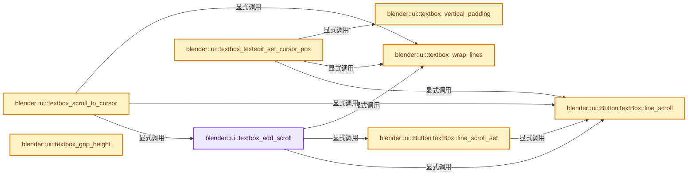
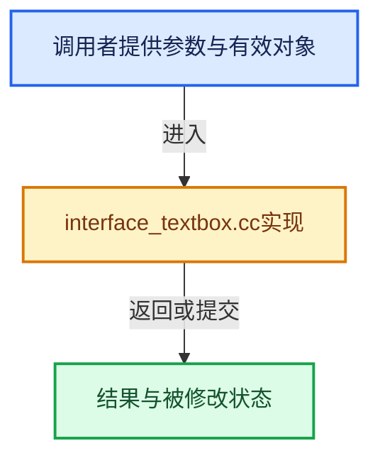

# 实现依赖专题：source/blender/editors/interface/buttons/interface_textbox.cc

[方向导航](README.md) · [符号索引](../%E7%AC%A6%E5%8F%B7%E4%BE%9D%E8%B5%96%E4%B8%8E%E5%AE%9E%E7%8E%B0%E7%B4%A2%E5%BC%95.md)

本专题从正文实际调用进入，集中保存共享实现。函数有稳定锚点，可从调用处直接跳到对应完整函数；递归与互相调用通过回链组织。

## 本文件的实现关系






## 完整成员与函数实现

<a id="f-d97748eb0c1ef4dc"></a>

### `blender::ui::textbox_add_scroll`

实现位置：[source/blender/editors/interface/buttons/interface_textbox.cc](../../../../../source/blender/editors/interface/buttons/interface_textbox.cc) · L51—L55。

接口参数：

- `ButtonTextBox *textbox`
- `int step`

**教学注释版**

<!-- annotated:6d6f8a0f504371 -->

```cpp
void textbox_add_scroll(ButtonTextBox *textbox, int step)
{
  textbox_wrap_lines(textbox);
  textbox->line_scroll_set(textbox->line_scroll() + step);
}
```

<details>
<summary>核对原始源码：source/blender/editors/interface/buttons/interface_textbox.cc · L51—L55</summary>

<!-- original:6d6f8a0f504371:source/blender/editors/interface/buttons/interface_textbox.cc:51:55 -->

```cpp
void textbox_add_scroll(ButtonTextBox *textbox, int step)
{
  textbox_wrap_lines(textbox);
  textbox->line_scroll_set(textbox->line_scroll() + step);
}
```

</details>

**继续追踪实现**

- `textbox_wrap_lines` → [blender::ui::textbox_wrap_lines · L213](%E4%BE%9D%E8%B5%96-interface_textbox-44b37d.md#f-7a11ba117e7df641)。
- `textbox->line_scroll_set` → [blender::ui::ButtonTextBox::line_scroll_set · L313](%E4%BE%9D%E8%B5%96-interface_textbox-44b37d.md#f-c9fd4c5b13bde8fe)。
- `textbox->line_scroll` → [blender::ui::ButtonTextBox::line_scroll · L342](%E4%BE%9D%E8%B5%96-interface_textbox-44b37d.md#f-adac7156d4d69de3)。

<a id="f-fa16ac33d07e72ab"></a>

### `blender::ui::textbox_scroll_to_cursor`

实现位置：[source/blender/editors/interface/buttons/interface_textbox.cc](../../../../../source/blender/editors/interface/buttons/interface_textbox.cc) · L57—L88。

接口参数：

- `ButtonTextBox *textbox`

**教学注释版**

<!-- annotated:14fdf3f4380da1 -->

```cpp
void textbox_scroll_to_cursor(ButtonTextBox *textbox)
{
  const Vector<StringRef> lines = textbox_wrap_lines(textbox);
  int line_cursor = 0;
  int but_pos = textbox->pos;
#ifdef WITH_INPUT_IME
  /* Include the ime composition string when scrolling to the cursor. */
  const wmIMEData *ime_data = button_ime_data_get(textbox);
  if (ime_data && !ime_data->composite.empty() && ime_data->cursor_pos != -1) {
    but_pos += ime_data->cursor_pos;
  }
#endif
  const char *cursor = lines[0].begin() + but_pos;
  for (const StringRef line : lines) {
    if (line.begin() > cursor) {
      // [讲解] std::max：按比较关系选取较大值。本讲解中的增长公式同时满足最低请求和几何增长；若保存返回引用，还需注意实参寿命。
      line_cursor = std::max(0, line_cursor - 1);
      break;
    }
    line_cursor++;
  }
  const int visible_bounds[] = {textbox->line_scroll(),
                                textbox->line_scroll() + textbox->visible_lines()};
  if (visible_bounds[0] <= line_cursor && line_cursor < visible_bounds[1]) {
    return;
  }
  if (visible_bounds[0] > line_cursor) {
    textbox_add_scroll(textbox, line_cursor - visible_bounds[0]);
  }
  else {
    textbox_add_scroll(textbox, line_cursor - visible_bounds[1] + 1);
  }
}
```

<details>
<summary>核对原始源码：source/blender/editors/interface/buttons/interface_textbox.cc · L57—L88</summary>

<!-- original:14fdf3f4380da1:source/blender/editors/interface/buttons/interface_textbox.cc:57:88 -->

```cpp
void textbox_scroll_to_cursor(ButtonTextBox *textbox)
{
  const Vector<StringRef> lines = textbox_wrap_lines(textbox);
  int line_cursor = 0;
  int but_pos = textbox->pos;
#ifdef WITH_INPUT_IME
  /* Include the ime composition string when scrolling to the cursor. */
  const wmIMEData *ime_data = button_ime_data_get(textbox);
  if (ime_data && !ime_data->composite.empty() && ime_data->cursor_pos != -1) {
    but_pos += ime_data->cursor_pos;
  }
#endif
  const char *cursor = lines[0].begin() + but_pos;
  for (const StringRef line : lines) {
    if (line.begin() > cursor) {
      line_cursor = std::max(0, line_cursor - 1);
      break;
    }
    line_cursor++;
  }
  const int visible_bounds[] = {textbox->line_scroll(),
                                textbox->line_scroll() + textbox->visible_lines()};
  if (visible_bounds[0] <= line_cursor && line_cursor < visible_bounds[1]) {
    return;
  }
  if (visible_bounds[0] > line_cursor) {
    textbox_add_scroll(textbox, line_cursor - visible_bounds[0]);
  }
  else {
    textbox_add_scroll(textbox, line_cursor - visible_bounds[1] + 1);
  }
}
```

</details>

**沿实际写入检查状态**

- `but_pos += ime_data->cursor_pos;`
- `line_cursor = std::max(0, line_cursor - 1);`

**继续追踪实现**

- `textbox_wrap_lines` → [blender::ui::textbox_wrap_lines · L213](%E4%BE%9D%E8%B5%96-interface_textbox-44b37d.md#f-7a11ba117e7df641)。
- `button_ime_data_get` → [button_ime_data_get · L3705](%E4%BE%9D%E8%B5%96-interface_handlers-892571.md#f-ffb5cf8ffbf4d351)。
- `ime_data->composite.empty` → [调用协议](../%E6%A8%A1%E6%9D%BF%E5%AE%8F%E4%B8%8E%E5%8A%A8%E6%80%81%E5%88%86%E6%B4%BE%E5%8D%8F%E8%AE%AE.md)：接收对象类型依赖auto、返回值或模板实例；不按同名猜测目标。调用位置L65。
- `lines[0].begin` → [调用协议](../%E6%A8%A1%E6%9D%BF%E5%AE%8F%E4%B8%8E%E5%8A%A8%E6%80%81%E5%88%86%E6%B4%BE%E5%8D%8F%E8%AE%AE.md)：接收对象类型依赖auto、返回值或模板实例；不按同名猜测目标。调用位置L69。
- `line.begin` → [调用协议](../%E6%A8%A1%E6%9D%BF%E5%AE%8F%E4%B8%8E%E5%8A%A8%E6%80%81%E5%88%86%E6%B4%BE%E5%8D%8F%E8%AE%AE.md)：接收对象类型依赖auto、返回值或模板实例；不按同名猜测目标。调用位置L71。
- `std::max` → [外部契约](https://eel.is/c++draft/alg.min.max)：按比较关系选取较大值。本讲解中的增长公式同时满足最低请求和几何增长；若保存返回引用，还需注意实参寿命。
- `textbox->line_scroll` → [blender::ui::ButtonTextBox::line_scroll · L342](%E4%BE%9D%E8%B5%96-interface_textbox-44b37d.md#f-adac7156d4d69de3)。
- `textbox->visible_lines` → [blender::ui::ButtonTextBox::visible_lines · L348](%E4%BE%9D%E8%B5%96-interface_textbox-44b37d.md#f-f567619b0ff46f9d)。
- `textbox_add_scroll` → [blender::ui::textbox_add_scroll · L51](%E4%BE%9D%E8%B5%96-interface_textbox-44b37d.md#f-d97748eb0c1ef4dc)。

<a id="f-8d6ca3559a92d012"></a>

### `blender::ui::textbox_textedit_set_cursor_pos`

实现位置：[source/blender/editors/interface/buttons/interface_textbox.cc](../../../../../source/blender/editors/interface/buttons/interface_textbox.cc) · L90—L137。

接口参数：

- `ButtonTextBox *textbox`
- `const ARegion *region`
- `const float2 xy`

**教学注释版**

<!-- annotated:9176f18af270c1 -->

```cpp
void textbox_textedit_set_cursor_pos(ButtonTextBox *textbox,
                                     const ARegion *region,
                                     const float2 xy)
{

  /* Don't include grip bounds when selecting text with the mouse. */
  float2 start = {textbox->rect.xmin, textbox->rect.ymin};
  float2 end = {textbox->rect.xmax, textbox->rect.ymax};

  block_to_window_fl(region, textbox->block, &start.x, &start.y);
  block_to_window_fl(region, textbox->block, &end.x, &end.y);

  start.y += textbox_vertical_padding() / textbox->block->aspect;
  end.y -= textbox_vertical_padding() / textbox->block->aspect;

  const Vector<StringRef> lines = textbox_wrap_lines(textbox);
  uiFontStyle fstyle = style_get()->widget;
  const float aspect = textbox->block->aspect;
  fontscale(&fstyle.points, aspect);
  fontstyle_set(&fstyle);
  int line_under_mouse = textbox->line_scroll() +
                         (end.y - xy.y) / (end.y - start.y) * (textbox->visible_lines());
  line_under_mouse = std::clamp<int>(line_under_mouse,
                                     textbox->line_scroll(),
                                     textbox->line_scroll() + textbox->visible_lines() - 1);
  // [讲解] lines.size：用end_减begin_得到活元素数量。
  line_under_mouse = std::clamp<int>(line_under_mouse, 0, lines.size() - 1);

  const StringRef line = lines[line_under_mouse];

  start.x -= U.pixelsize / aspect;
  if (!(textbox->drawflag & BUT_NO_TEXT_PADDING)) {
    start.x += button_text_padding(textbox);
  }
  const int offset = BLF_str_offset_from_cursor_position(
      fstyle.uifont_id, line.data(), line.size(), int(xy.x - start.x));
  int position = line.begin() - lines[0].data() + offset;
#ifdef WITH_INPUT_IME
  /* Text-box text wrap includes the IME composition string, remove the IME string pad from the
   * selection. */
  const wmIMEData *ime_data = button_ime_data_get(textbox);
  if (ime_data && position > int(textbox->pos)) {
    // [讲解] std::max<int>：按比较关系选取较大值。本讲解中的增长公式同时满足最低请求和几何增长；若保存返回引用，还需注意实参寿命。
    position = std::max<int>(int(textbox->pos), position - int(ime_data->composite.size()));
  }
#endif
  textbox->pos = position;
  /* Do not scroll to cursor now, wait the HandleButtonData::text_select_auto_scroll timer or the
   * #LEFTMOUSE release event for scrolling to the cursor. */
}
```

<details>
<summary>核对原始源码：source/blender/editors/interface/buttons/interface_textbox.cc · L90—L137</summary>

<!-- original:9176f18af270c1:source/blender/editors/interface/buttons/interface_textbox.cc:90:137 -->

```cpp
void textbox_textedit_set_cursor_pos(ButtonTextBox *textbox,
                                     const ARegion *region,
                                     const float2 xy)
{

  /* Don't include grip bounds when selecting text with the mouse. */
  float2 start = {textbox->rect.xmin, textbox->rect.ymin};
  float2 end = {textbox->rect.xmax, textbox->rect.ymax};

  block_to_window_fl(region, textbox->block, &start.x, &start.y);
  block_to_window_fl(region, textbox->block, &end.x, &end.y);

  start.y += textbox_vertical_padding() / textbox->block->aspect;
  end.y -= textbox_vertical_padding() / textbox->block->aspect;

  const Vector<StringRef> lines = textbox_wrap_lines(textbox);
  uiFontStyle fstyle = style_get()->widget;
  const float aspect = textbox->block->aspect;
  fontscale(&fstyle.points, aspect);
  fontstyle_set(&fstyle);
  int line_under_mouse = textbox->line_scroll() +
                         (end.y - xy.y) / (end.y - start.y) * (textbox->visible_lines());
  line_under_mouse = std::clamp<int>(line_under_mouse,
                                     textbox->line_scroll(),
                                     textbox->line_scroll() + textbox->visible_lines() - 1);
  line_under_mouse = std::clamp<int>(line_under_mouse, 0, lines.size() - 1);

  const StringRef line = lines[line_under_mouse];

  start.x -= U.pixelsize / aspect;
  if (!(textbox->drawflag & BUT_NO_TEXT_PADDING)) {
    start.x += button_text_padding(textbox);
  }
  const int offset = BLF_str_offset_from_cursor_position(
      fstyle.uifont_id, line.data(), line.size(), int(xy.x - start.x));
  int position = line.begin() - lines[0].data() + offset;
#ifdef WITH_INPUT_IME
  /* Text-box text wrap includes the IME composition string, remove the IME string pad from the
   * selection. */
  const wmIMEData *ime_data = button_ime_data_get(textbox);
  if (ime_data && position > int(textbox->pos)) {
    position = std::max<int>(int(textbox->pos), position - int(ime_data->composite.size()));
  }
#endif
  textbox->pos = position;
  /* Do not scroll to cursor now, wait the HandleButtonData::text_select_auto_scroll timer or the
   * #LEFTMOUSE release event for scrolling to the cursor. */
}
```

</details>

**沿实际写入检查状态**

- `start.y += textbox_vertical_padding() / textbox->block->aspect;`
- `end.y -= textbox_vertical_padding() / textbox->block->aspect;`
- `line_under_mouse = std::clamp<int>(line_under_mouse,`
- `line_under_mouse = std::clamp<int>(line_under_mouse, 0, lines.size() - 1);`
- `start.x -= U.pixelsize / aspect;`
- `start.x += button_text_padding(textbox);`
- `position = std::max<int>(int(textbox->pos), position - int(ime_data->composite.size()));`
- `textbox->pos = position;`

**继续追踪实现**

- `block_to_window_fl` → [blender::ui::block_to_window_fl · L144](%E4%BE%9D%E8%B5%96-interface-11578b.md#f-ccf934fed5ff1ad4)。
- `textbox_vertical_padding` → [blender::ui::textbox_vertical_padding · L320](%E4%BE%9D%E8%B5%96-interface_textbox-44b37d.md#f-e769bfffeb739de3)。
- `textbox_wrap_lines` → [blender::ui::textbox_wrap_lines · L213](%E4%BE%9D%E8%B5%96-interface_textbox-44b37d.md#f-7a11ba117e7df641)。
- `style_get` → [blender::ui::style_get · L412](%E4%BE%9D%E8%B5%96-interface_style-ef9218.md#f-aa005d800e55d1e4)。
- `fontscale` → [blender::ui::fontscale · L2307](%E4%BE%9D%E8%B5%96-interface-11578b.md#f-8eaaf210a6e27303)。
- `fontstyle_set` → [blender::ui::fontstyle_set · L608](%E4%BE%9D%E8%B5%96-interface_style-ef9218.md#f-7c01423f2db0ca8b)。
- `textbox->line_scroll` → [blender::ui::ButtonTextBox::line_scroll · L342](%E4%BE%9D%E8%B5%96-interface_textbox-44b37d.md#f-adac7156d4d69de3)。
- `textbox->visible_lines` → [blender::ui::ButtonTextBox::visible_lines · L348](%E4%BE%9D%E8%B5%96-interface_textbox-44b37d.md#f-f567619b0ff46f9d)。
- `std::clamp<int>` → [外部契约](https://eel.is/c++draft/)：这个边界按实际表达式及所属类型核对参数、返回值、寿命与失败行为。这里提供接口入口，不声称已解释该第三方版本的内部实现。
- `lines.size` → [blender::Vector::size · L780](../01-%E5%9F%BA%E7%A1%80%E5%AE%B9%E5%99%A8%E4%B8%8E%E7%8E%B0%E4%BB%A3CPP/11-Vector%E6%8F%92%E5%85%A5%E5%88%A0%E9%99%A4%E4%B8%8E%E9%87%8D%E6%8E%92.md#f-714773731767349c)。
- `button_text_padding` → [blender::ui::button_text_padding · L6929](%E4%BE%9D%E8%B5%96-interface-11578b.md#f-c1039761a3362b80)。
- `BLF_str_offset_from_cursor_position` → [blender::BLF_str_offset_from_cursor_position · L713](%E4%BE%9D%E8%B5%96-blf-1ee3d6.md#f-e48aedaae99a9c66)。
- `line.data` → [调用协议](../%E6%A8%A1%E6%9D%BF%E5%AE%8F%E4%B8%8E%E5%8A%A8%E6%80%81%E5%88%86%E6%B4%BE%E5%8D%8F%E8%AE%AE.md)：由接收对象具体类型或运行时策略提供实现。调用位置L124。
- `line.size` → [blender::ui::Item::size · L480](%E4%BE%9D%E8%B5%96-interface_layout-7cc3aa.md#f-8a41e6d2d9e32851)；[blender::ui::Layout::size · L494](%E4%BE%9D%E8%B5%96-interface_layout-7cc3aa.md#f-81377b9c1286eb5d)。同名重载需按实参类型选择。
- `line.begin` → [调用协议](../%E6%A8%A1%E6%9D%BF%E5%AE%8F%E4%B8%8E%E5%8A%A8%E6%80%81%E5%88%86%E6%B4%BE%E5%8D%8F%E8%AE%AE.md)：由接收对象具体类型或运行时策略提供实现。调用位置L125。
- `lines[0].data` → [调用协议](../%E6%A8%A1%E6%9D%BF%E5%AE%8F%E4%B8%8E%E5%8A%A8%E6%80%81%E5%88%86%E6%B4%BE%E5%8D%8F%E8%AE%AE.md)：接收对象类型依赖auto、返回值或模板实例；不按同名猜测目标。调用位置L125。
- `button_ime_data_get` → [button_ime_data_get · L3705](%E4%BE%9D%E8%B5%96-interface_handlers-892571.md#f-ffb5cf8ffbf4d351)。
- `std::max<int>` → [外部契约](https://eel.is/c++draft/alg.min.max)：按比较关系选取较大值。本讲解中的增长公式同时满足最低请求和几何增长；若保存返回引用，还需注意实参寿命。
- `ime_data->composite.size` → [调用协议](../%E6%A8%A1%E6%9D%BF%E5%AE%8F%E4%B8%8E%E5%8A%A8%E6%80%81%E5%88%86%E6%B4%BE%E5%8D%8F%E8%AE%AE.md)：接收对象类型依赖auto、返回值或模板实例；不按同名猜测目标。调用位置L131。

<a id="f-7a11ba117e7df641"></a>

### `blender::ui::textbox_wrap_lines`

实现位置：[source/blender/editors/interface/buttons/interface_textbox.cc](../../../../../source/blender/editors/interface/buttons/interface_textbox.cc) · L213—L275。

接口参数：

- `ButtonTextBox *textbox`

**教学注释版**

<!-- annotated:4d82c8ab85aa20 -->

```cpp
Vector<StringRef> textbox_wrap_lines(ButtonTextBox *textbox)
{
  uiFontStyle fstyle = style_get()->widget;
  const float aspect = textbox->block->aspect;
  // [讲解] std::max<int>：按比较关系选取较大值。本讲解中的增长公式同时满足最低请求和几何增长；若保存返回引用，还需注意实参寿命。
  const int width = std::max<int>(std::ceil(BLI_rctf_size_x(&textbox->rect) -
                                            2.0f * UI_TEXT_MARGIN_X * float(U.widget_unit) - 2.0f),
                                  0) /
                    aspect;
  StringRef text = textbox->drawstr;
#ifdef WITH_INPUT_IME
  std::string ime_text;
  const wmIMEData *ime_data = button_ime_data_get(textbox);
  if (ime_data && !ime_data->composite.empty()) {
    StringRef edit_str = textbox->editstr;
    StringRef l = edit_str.is_empty() ? StringRef("") : edit_str.substr(0, textbox->pos);
    StringRef r = edit_str.is_empty() ? StringRef("") : edit_str.substr(textbox->pos);
    ime_text = fmt::format("{}{}{}", l, ime_data->composite, r);
    text = ime_text;
  }
  else
#endif
      if (textbox->editstr)
  {
    text = textbox->editstr;
  }
  if (!textbox->wrap_cache) {
    // [讲解] std::make_unique<TextWrapCache>：创建独占拥有的对象，拥有关系可移动，get返回的借用指针不自动延长寿命。
    textbox->wrap_cache = std::make_unique<TextWrapCache>();
  }
  TextWrapCache &cache = *textbox->wrap_cache;
  if (cache.aspect == aspect && cache.wrap_width == width && text == cache.text) {
    textbox->last_total_lines = cache.wrapped_lines.size();
    return cache.wrapped_lines;
  }
  cache.text = text;
  text = cache.text;
  cache.wrap_width = width;
  cache.aspect = aspect;

  fontscale(&fstyle.points, aspect);
  fontstyle_set(&fstyle);
  Vector<StringRef> lines = BLF_string_wrap(
      fstyle.uifont_id, text, width, BLFWrapMode::HardLimit | BLFWrapMode::Typographical);
  if (lines.is_empty()) {
    // [讲解] lines.append：在尾部建立新元素，必要时先扩大存储。
    lines.append(text);
  }
  /* Add empty trailing line to put cursor in a new line. */
  if (text.endswith("\n")) {
    lines.append(StringRef(text.end(), text.end()));
  }
  // [讲解] lines.size：用end_减begin_得到活元素数量。
  textbox->last_total_lines = lines.size();

  /* WORKAROUND: Text-box event handling and drawing requires lines to not include line breaks,
   * but sometimes text wrap adds them and other times not. */
  for (int i : lines.index_range()) {
    if (lines[i].endswith("\n")) {
      lines[i] = lines[i].drop_suffix(1);
    }
  }

  cache.wrapped_lines = lines;

  return lines;
}
```

<details>
<summary>核对原始源码：source/blender/editors/interface/buttons/interface_textbox.cc · L213—L275</summary>

<!-- original:4d82c8ab85aa20:source/blender/editors/interface/buttons/interface_textbox.cc:213:275 -->

```cpp
Vector<StringRef> textbox_wrap_lines(ButtonTextBox *textbox)
{
  uiFontStyle fstyle = style_get()->widget;
  const float aspect = textbox->block->aspect;
  const int width = std::max<int>(std::ceil(BLI_rctf_size_x(&textbox->rect) -
                                            2.0f * UI_TEXT_MARGIN_X * float(U.widget_unit) - 2.0f),
                                  0) /
                    aspect;
  StringRef text = textbox->drawstr;
#ifdef WITH_INPUT_IME
  std::string ime_text;
  const wmIMEData *ime_data = button_ime_data_get(textbox);
  if (ime_data && !ime_data->composite.empty()) {
    StringRef edit_str = textbox->editstr;
    StringRef l = edit_str.is_empty() ? StringRef("") : edit_str.substr(0, textbox->pos);
    StringRef r = edit_str.is_empty() ? StringRef("") : edit_str.substr(textbox->pos);
    ime_text = fmt::format("{}{}{}", l, ime_data->composite, r);
    text = ime_text;
  }
  else
#endif
      if (textbox->editstr)
  {
    text = textbox->editstr;
  }
  if (!textbox->wrap_cache) {
    textbox->wrap_cache = std::make_unique<TextWrapCache>();
  }
  TextWrapCache &cache = *textbox->wrap_cache;
  if (cache.aspect == aspect && cache.wrap_width == width && text == cache.text) {
    textbox->last_total_lines = cache.wrapped_lines.size();
    return cache.wrapped_lines;
  }
  cache.text = text;
  text = cache.text;
  cache.wrap_width = width;
  cache.aspect = aspect;

  fontscale(&fstyle.points, aspect);
  fontstyle_set(&fstyle);
  Vector<StringRef> lines = BLF_string_wrap(
      fstyle.uifont_id, text, width, BLFWrapMode::HardLimit | BLFWrapMode::Typographical);
  if (lines.is_empty()) {
    lines.append(text);
  }
  /* Add empty trailing line to put cursor in a new line. */
  if (text.endswith("\n")) {
    lines.append(StringRef(text.end(), text.end()));
  }
  textbox->last_total_lines = lines.size();

  /* WORKAROUND: Text-box event handling and drawing requires lines to not include line breaks,
   * but sometimes text wrap adds them and other times not. */
  for (int i : lines.index_range()) {
    if (lines[i].endswith("\n")) {
      lines[i] = lines[i].drop_suffix(1);
    }
  }

  cache.wrapped_lines = lines;

  return lines;
}
```

</details>

**沿实际写入检查状态**

- `ime_text = fmt::format("{}{}{}", l, ime_data->composite, r);`
- `text = ime_text;`
- `text = textbox->editstr;`
- `textbox->wrap_cache = std::make_unique<TextWrapCache>();`
- `textbox->last_total_lines = cache.wrapped_lines.size();`
- `cache.text = text;`
- `text = cache.text;`
- `cache.wrap_width = width;`
- `cache.aspect = aspect;`
- `textbox->last_total_lines = lines.size();`
- `lines[i] = lines[i].drop_suffix(1);`
- `cache.wrapped_lines = lines;`

**结果出口**

- `return cache.wrapped_lines;`
- `return lines;`

**继续追踪实现**

- `style_get` → [blender::ui::style_get · L412](%E4%BE%9D%E8%B5%96-interface_style-ef9218.md#f-aa005d800e55d1e4)。
- `std::max<int>` → [外部契约](https://eel.is/c++draft/alg.min.max)：按比较关系选取较大值。本讲解中的增长公式同时满足最低请求和几何增长；若保存返回引用，还需注意实参寿命。
- `std::ceil` → [外部契约](https://eel.is/c++draft/)：这个边界按实际表达式及所属类型核对参数、返回值、寿命与失败行为。这里提供接口入口，不声称已解释该第三方版本的内部实现。
- `BLI_rctf_size_x` → [blender::BLI_rctf_size_x · L211](../01-%E5%9F%BA%E7%A1%80%E5%AE%B9%E5%99%A8%E4%B8%8E%E7%8E%B0%E4%BB%A3CPP/%E4%BE%9D%E8%B5%96-BLI_rect-2996c6.md#f-017b86a9d189e3ba)。
- `button_ime_data_get` → [button_ime_data_get · L3705](%E4%BE%9D%E8%B5%96-interface_handlers-892571.md#f-ffb5cf8ffbf4d351)。
- `ime_data->composite.empty` → [调用协议](../%E6%A8%A1%E6%9D%BF%E5%AE%8F%E4%B8%8E%E5%8A%A8%E6%80%81%E5%88%86%E6%B4%BE%E5%8D%8F%E8%AE%AE.md)：接收对象类型依赖auto、返回值或模板实例；不按同名猜测目标。调用位置L225。
- `edit_str.is_empty` → [调用协议](../%E6%A8%A1%E6%9D%BF%E5%AE%8F%E4%B8%8E%E5%8A%A8%E6%80%81%E5%88%86%E6%B4%BE%E5%8D%8F%E8%AE%AE.md)：由接收对象具体类型或运行时策略提供实现。调用位置L227。
- `StringRef` → [blender::StringRef::StringRef · L555](../01-%E5%9F%BA%E7%A1%80%E5%AE%B9%E5%99%A8%E4%B8%8E%E7%8E%B0%E4%BB%A3CPP/15-StringRef%E5%AD%97%E7%AC%A6%E4%B8%B2%E8%A7%86%E5%9B%BE.md#f-f6aca324a36faa7e)；[blender::StringRef::StringRef · L560](../01-%E5%9F%BA%E7%A1%80%E5%AE%B9%E5%99%A8%E4%B8%8E%E7%8E%B0%E4%BB%A3CPP/15-StringRef%E5%AD%97%E7%AC%A6%E4%B8%B2%E8%A7%86%E5%9B%BE.md#f-ab9714781ca51bac)；[blender::StringRef::StringRef · L565](../01-%E5%9F%BA%E7%A1%80%E5%AE%B9%E5%99%A8%E4%B8%8E%E7%8E%B0%E4%BB%A3CPP/15-StringRef%E5%AD%97%E7%AC%A6%E4%B8%B2%E8%A7%86%E5%9B%BE.md#f-95f0b483bbdd7739)；[blender::StringRef::StringRef · L570](../01-%E5%9F%BA%E7%A1%80%E5%AE%B9%E5%99%A8%E4%B8%8E%E7%8E%B0%E4%BB%A3CPP/15-StringRef%E5%AD%97%E7%AC%A6%E4%B8%B2%E8%A7%86%E5%9B%BE.md#f-808d05699cb33334)；[blender::StringRef::StringRef · L631](../01-%E5%9F%BA%E7%A1%80%E5%AE%B9%E5%99%A8%E4%B8%8E%E7%8E%B0%E4%BB%A3CPP/15-StringRef%E5%AD%97%E7%AC%A6%E4%B8%B2%E8%A7%86%E5%9B%BE.md#f-37788e5f3fa3b736)；[blender::StringRef::StringRef · L641](../01-%E5%9F%BA%E7%A1%80%E5%AE%B9%E5%99%A8%E4%B8%8E%E7%8E%B0%E4%BB%A3CPP/15-StringRef%E5%AD%97%E7%AC%A6%E4%B8%B2%E8%A7%86%E5%9B%BE.md#f-11abd0510fb6b926)；[blender::StringRef::StringRef · L646](../01-%E5%9F%BA%E7%A1%80%E5%AE%B9%E5%99%A8%E4%B8%8E%E7%8E%B0%E4%BB%A3CPP/15-StringRef%E5%AD%97%E7%AC%A6%E4%B8%B2%E8%A7%86%E5%9B%BE.md#f-8437dbd8a582eefd)；[blender::StringRef::StringRef · L651](../01-%E5%9F%BA%E7%A1%80%E5%AE%B9%E5%99%A8%E4%B8%8E%E7%8E%B0%E4%BB%A3CPP/15-StringRef%E5%AD%97%E7%AC%A6%E4%B8%B2%E8%A7%86%E5%9B%BE.md#f-70bcb338de0db978)。同名重载需按实参类型选择。
- `edit_str.substr` → [调用协议](../%E6%A8%A1%E6%9D%BF%E5%AE%8F%E4%B8%8E%E5%8A%A8%E6%80%81%E5%88%86%E6%B4%BE%E5%8D%8F%E8%AE%AE.md)：由接收对象具体类型或运行时策略提供实现。调用位置L227。
- `fmt::format` → [外部契约](https://fmt.dev/latest/api/)：按fmt接口的格式字符串与参数类型契约使用，格式化不改变被格式化对象的拥有关系。
- `std::make_unique<TextWrapCache>` → [外部契约](https://eel.is/c++draft/unique.ptr.create)：创建独占拥有的对象，拥有关系可移动，get返回的借用指针不自动延长寿命。
- `cache.wrapped_lines.size` → [调用协议](../%E6%A8%A1%E6%9D%BF%E5%AE%8F%E4%B8%8E%E5%8A%A8%E6%80%81%E5%88%86%E6%B4%BE%E5%8D%8F%E8%AE%AE.md)：接收对象类型依赖auto、返回值或模板实例；不按同名猜测目标。调用位置L243。
- `fontscale` → [blender::ui::fontscale · L2307](%E4%BE%9D%E8%B5%96-interface-11578b.md#f-8eaaf210a6e27303)。
- `fontstyle_set` → [blender::ui::fontstyle_set · L608](%E4%BE%9D%E8%B5%96-interface_style-ef9218.md#f-7c01423f2db0ca8b)。
- `BLF_string_wrap` → [blender::BLF_string_wrap · L1103](%E4%BE%9D%E8%B5%96-blf-1ee3d6.md#f-3705d66d552c8999)。
- `lines.is_empty` → [blender::Vector::is_empty · L792](../01-%E5%9F%BA%E7%A1%80%E5%AE%B9%E5%99%A8%E4%B8%8E%E7%8E%B0%E4%BB%A3CPP/11-Vector%E6%8F%92%E5%85%A5%E5%88%A0%E9%99%A4%E4%B8%8E%E9%87%8D%E6%8E%92.md#f-937bbd9cb80bdcc8)。
- `lines.append` → [blender::Vector::append · L498](../01-%E5%9F%BA%E7%A1%80%E5%AE%B9%E5%99%A8%E4%B8%8E%E7%8E%B0%E4%BB%A3CPP/11-Vector%E6%8F%92%E5%85%A5%E5%88%A0%E9%99%A4%E4%B8%8E%E9%87%8D%E6%8E%92.md#f-5bde268a69e443ec)；[blender::Vector::append · L502](../01-%E5%9F%BA%E7%A1%80%E5%AE%B9%E5%99%A8%E4%B8%8E%E7%8E%B0%E4%BB%A3CPP/11-Vector%E6%8F%92%E5%85%A5%E5%88%A0%E9%99%A4%E4%B8%8E%E9%87%8D%E6%8E%92.md#f-591e0b15e6308532)。同名重载需按实参类型选择。
- `text.endswith` → [blender::StringRefBase::endswith · L285](../01-%E5%9F%BA%E7%A1%80%E5%AE%B9%E5%99%A8%E4%B8%8E%E7%8E%B0%E4%BB%A3CPP/15-StringRef%E5%AD%97%E7%AC%A6%E4%B8%B2%E8%A7%86%E5%9B%BE.md#f-9b23dbdd3afc9dbb)。
- `text.end` → [调用协议](../%E6%A8%A1%E6%9D%BF%E5%AE%8F%E4%B8%8E%E5%8A%A8%E6%80%81%E5%88%86%E6%B4%BE%E5%8D%8F%E8%AE%AE.md)：由接收对象具体类型或运行时策略提供实现。调用位置L260。
- `lines.size` → [blender::Vector::size · L780](../01-%E5%9F%BA%E7%A1%80%E5%AE%B9%E5%99%A8%E4%B8%8E%E7%8E%B0%E4%BB%A3CPP/11-Vector%E6%8F%92%E5%85%A5%E5%88%A0%E9%99%A4%E4%B8%8E%E9%87%8D%E6%8E%92.md#f-714773731767349c)。
- `lines.index_range` → [blender::Vector::index_range · L1026](../01-%E5%9F%BA%E7%A1%80%E5%AE%B9%E5%99%A8%E4%B8%8E%E7%8E%B0%E4%BB%A3CPP/12-Vector%E5%BC%82%E5%B8%B8%E5%AE%89%E5%85%A8%E4%B8%8E%E8%BE%B9%E7%95%8C.md#f-ac29cf36ef185ab9)。
- `lines[i].endswith` → [调用协议](../%E6%A8%A1%E6%9D%BF%E5%AE%8F%E4%B8%8E%E5%8A%A8%E6%80%81%E5%88%86%E6%B4%BE%E5%8D%8F%E8%AE%AE.md)：接收对象类型依赖auto、返回值或模板实例；不按同名猜测目标。调用位置L267。
- `lines[i].drop_suffix` → [调用协议](../%E6%A8%A1%E6%9D%BF%E5%AE%8F%E4%B8%8E%E5%8A%A8%E6%80%81%E5%88%86%E6%B4%BE%E5%8D%8F%E8%AE%AE.md)：接收对象类型依赖auto、返回值或模板实例；不按同名猜测目标。调用位置L268。

<a id="f-06a1295953059a36"></a>

### `blender::ui::textbox_grip_height`

实现位置：[source/blender/editors/interface/buttons/interface_textbox.cc](../../../../../source/blender/editors/interface/buttons/interface_textbox.cc) · L308—L311。

**教学注释版**

<!-- annotated:30b83ecbf1f0d5 -->

```cpp
float textbox_grip_height()
{
  return UI_UNIT_Y * 0.55f;
}
```

<details>
<summary>核对原始源码：source/blender/editors/interface/buttons/interface_textbox.cc · L308—L311</summary>

<!-- original:30b83ecbf1f0d5:source/blender/editors/interface/buttons/interface_textbox.cc:308:311 -->

```cpp
float textbox_grip_height()
{
  return UI_UNIT_Y * 0.55f;
}
```

</details>

**结果出口**

- `return UI_UNIT_Y * 0.55f;`

**继续追踪实现**

本实现没有需要继续展开的显式调用；检查返回表达式、对象转换和调用者前置条件。

<a id="f-c9fd4c5b13bde8fe"></a>

### `blender::ui::ButtonTextBox::line_scroll_set`

实现位置：[source/blender/editors/interface/buttons/interface_textbox.cc](../../../../../source/blender/editors/interface/buttons/interface_textbox.cc) · L313—L318。

接口参数：

- `int line_scroll`

**教学注释版**

<!-- annotated:87eb962336043b -->

```cpp
void ButtonTextBox::line_scroll_set(int line_scroll)
{
  this->state->scroll = line_scroll;
  /* Clamp stored value. */
  this->state->scroll = this->line_scroll();
}
```

<details>
<summary>核对原始源码：source/blender/editors/interface/buttons/interface_textbox.cc · L313—L318</summary>

<!-- original:87eb962336043b:source/blender/editors/interface/buttons/interface_textbox.cc:313:318 -->

```cpp
void ButtonTextBox::line_scroll_set(int line_scroll)
{
  this->state->scroll = line_scroll;
  /* Clamp stored value. */
  this->state->scroll = this->line_scroll();
}
```

</details>

**沿实际写入检查状态**

- `this->state->scroll = line_scroll;`
- `this->state->scroll = this->line_scroll();`

**继续追踪实现**

- `this->line_scroll` → [blender::ui::ButtonTextBox::line_scroll · L342](%E4%BE%9D%E8%B5%96-interface_textbox-44b37d.md#f-adac7156d4d69de3)。

<a id="f-e769bfffeb739de3"></a>

### `blender::ui::textbox_vertical_padding`

实现位置：[source/blender/editors/interface/buttons/interface_textbox.cc](../../../../../source/blender/editors/interface/buttons/interface_textbox.cc) · L320—L324。

**教学注释版**

<!-- annotated:40e2699b7d2ce4 -->

```cpp
float textbox_vertical_padding()
{
  /* Allow aligning text buttons with single line text-box buttons. */
  return float(UI_UNIT_Y - fontstyle_height_max(UI_FSTYLE_WIDGET)) / 2.0f;
}
```

<details>
<summary>核对原始源码：source/blender/editors/interface/buttons/interface_textbox.cc · L320—L324</summary>

<!-- original:40e2699b7d2ce4:source/blender/editors/interface/buttons/interface_textbox.cc:320:324 -->

```cpp
float textbox_vertical_padding()
{
  /* Allow aligning text buttons with single line text-box buttons. */
  return float(UI_UNIT_Y - fontstyle_height_max(UI_FSTYLE_WIDGET)) / 2.0f;
}
```

</details>

**结果出口**

- `return float(UI_UNIT_Y - fontstyle_height_max(UI_FSTYLE_WIDGET)) / 2.0f;`

**继续追踪实现**

- `fontstyle_height_max` → [blender::ui::fontstyle_height_max · L467](%E4%BE%9D%E8%B5%96-interface_style-ef9218.md#f-35e320b3cd6fff5b)。

<a id="f-adac7156d4d69de3"></a>

### `blender::ui::ButtonTextBox::line_scroll`

实现位置：[source/blender/editors/interface/buttons/interface_textbox.cc](../../../../../source/blender/editors/interface/buttons/interface_textbox.cc) · L342—L346。

**教学注释版**

<!-- annotated:b4f209cff149db -->

```cpp
int ButtonTextBox::line_scroll() const
{
  // [讲解] std::max：按比较关系选取较大值。本讲解中的增长公式同时满足最低请求和几何增长；若保存返回引用，还需注意实参寿命。
  const int max_scroll = std::max(this->last_total_lines - this->visible_lines(), 0);
  return std::clamp(this->state->scroll, 0, max_scroll);
}
```

<details>
<summary>核对原始源码：source/blender/editors/interface/buttons/interface_textbox.cc · L342—L346</summary>

<!-- original:b4f209cff149db:source/blender/editors/interface/buttons/interface_textbox.cc:342:346 -->

```cpp
int ButtonTextBox::line_scroll() const
{
  const int max_scroll = std::max(this->last_total_lines - this->visible_lines(), 0);
  return std::clamp(this->state->scroll, 0, max_scroll);
}
```

</details>

**结果出口**

- `return std::clamp(this->state->scroll, 0, max_scroll);`

**继续追踪实现**

- `std::max` → [外部契约](https://eel.is/c++draft/alg.min.max)：按比较关系选取较大值。本讲解中的增长公式同时满足最低请求和几何增长；若保存返回引用，还需注意实参寿命。
- `this->visible_lines` → [blender::ui::ButtonTextBox::visible_lines · L348](%E4%BE%9D%E8%B5%96-interface_textbox-44b37d.md#f-f567619b0ff46f9d)。
- `std::clamp` → [外部契约](https://eel.is/c++draft/)：这个边界按实际表达式及所属类型核对参数、返回值、寿命与失败行为。这里提供接口入口，不声称已解释该第三方版本的内部实现。

<a id="f-f567619b0ff46f9d"></a>

### `blender::ui::ButtonTextBox::visible_lines`

实现位置：[source/blender/editors/interface/buttons/interface_textbox.cc](../../../../../source/blender/editors/interface/buttons/interface_textbox.cc) · L348—L351。

**教学注释版**

<!-- annotated:eca578be4ed239 -->

```cpp
int ButtonTextBox::visible_lines() const
{
  // [讲解] std::max<int>：按比较关系选取较大值。本讲解中的增长公式同时满足最低请求和几何增长；若保存返回引用，还需注意实参寿命。
  return std::max<int>(this->state->visible_lines, textbox_minimum_visible_lines);
}
```

<details>
<summary>核对原始源码：source/blender/editors/interface/buttons/interface_textbox.cc · L348—L351</summary>

<!-- original:eca578be4ed239:source/blender/editors/interface/buttons/interface_textbox.cc:348:351 -->

```cpp
int ButtonTextBox::visible_lines() const
{
  return std::max<int>(this->state->visible_lines, textbox_minimum_visible_lines);
}
```

</details>

**结果出口**

- `return std::max<int>(this->state->visible_lines, textbox_minimum_visible_lines);`

**继续追踪实现**

- `std::max<int>` → [外部契约](https://eel.is/c++draft/alg.min.max)：按比较关系选取较大值。本讲解中的增长公式同时满足最低请求和几何增长；若保存返回引用，还需注意实参寿命。
