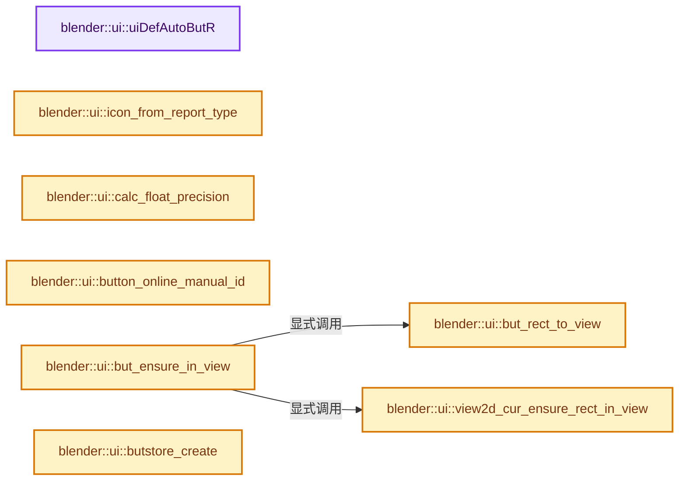
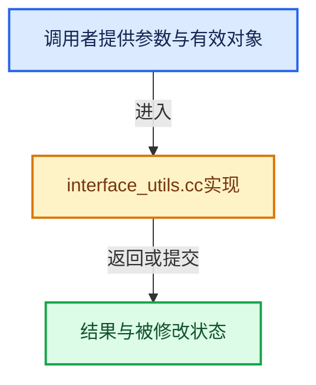

# 实现依赖专题：source/blender/editors/interface/interface_utils.cc

[方向导航](README.md) · [符号索引](../%E7%AC%A6%E5%8F%B7%E4%BE%9D%E8%B5%96%E4%B8%8E%E5%AE%9E%E7%8E%B0%E7%B4%A2%E5%BC%95.md)

本专题从正文实际调用进入，集中保存共享实现。函数有稳定锚点，可从调用处直接跳到对应完整函数；递归与互相调用通过回链组织。

## 本文件的实现关系






## 完整成员与函数实现

<a id="f-7d6854c554fa14a8"></a>

### `blender::ui::uiDefAutoButR`

实现位置：[source/blender/editors/interface/interface_utils.cc](../../../../../source/blender/editors/interface/interface_utils.cc) · L57—L293。

接口参数：

- `Block *block`
- `PointerRNA *ptr`
- `PropertyRNA *prop`
- `int index`
- `const std::optional<StringRef> name`
- `int icon`
- `int x`
- `int y`
- `int width`
- `int height`
- `std::optional<ButtonType> button_type_override`

**教学注释版**

<!-- annotated:66cf4c40222bb0 -->

```cpp
Button *uiDefAutoButR(Block *block,
                      PointerRNA *ptr,
                      PropertyRNA *prop,
                      int index,
                      const std::optional<StringRef> name,
                      int icon,
                      int x,
                      int y,
                      int width,
                      int height,
                      std::optional<ButtonType> button_type_override)
{
  Button *but = nullptr;

  switch (RNA_property_type(prop)) {
    case PROP_BOOLEAN: {
      if (RNA_property_array_check(prop) && index == -1) {
        return nullptr;
      }

      if (icon && name && name->is_empty()) {
        but = uiDefIconButR_prop(block,
                                 ButtonType::IconToggle,
                                 icon,
                                 x,
                                 y,
                                 width,
                                 height,
                                 ptr,
                                 prop,
                                 index,
                                 0,
                                 0,
                                 std::nullopt);
      }
      else if (icon) {
        but = uiDefIconTextButR_prop(block,
                                     ButtonType::IconToggle,
                                     icon,
                                     name,
                                     x,
                                     y,
                                     width,
                                     height,
                                     ptr,
                                     prop,
                                     index,
                                     0,
                                     0,
                                     std::nullopt);
      }
      else {
        but = uiDefButR_prop(block,
                             ButtonType::Checkbox,
                             name,
                             x,
                             y,
                             width,
                             height,
                             ptr,
                             prop,
                             index,
                             0,
                             0,
                             std::nullopt);
      }
      break;
    }
    case PROP_INT:
    case PROP_FLOAT: {
      if (RNA_property_array_check(prop) && index == -1) {
        if (ELEM(RNA_property_subtype(prop), PROP_COLOR, PROP_COLOR_GAMMA)) {
          but = uiDefButR_prop(block,
                               ButtonType::Color,
                               name,
                               x,
                               y,
                               width,
                               height,
                               ptr,
                               prop,
                               -1,
                               0,
                               0,
                               std::nullopt);
        }
        else {
          return nullptr;
        }
      }
      else if (RNA_property_subtype(prop) == PROP_PERCENTAGE ||
               RNA_property_subtype(prop) == PROP_FACTOR)
      {
        but = uiDefButR_prop(block,
                             ButtonType::NumSlider,
                             name,
                             x,
                             y,
                             width,
                             height,
                             ptr,
                             prop,
                             index,
                             0,
                             0,
                             std::nullopt);
      }
      else {
        const ButtonType button_type = button_type_override.value_or(ButtonType::Num);
        BLI_assert(ELEM(button_type, ButtonType::Num, ButtonType::NumSlider));

        but = uiDefButR_prop(
            block, button_type, name, x, y, width, height, ptr, prop, index, 0, 0, std::nullopt);
      }

      if (RNA_property_flag(prop) & PROP_TEXTEDIT_UPDATE) {
        button_flag_enable(but, BUT_TEXTEDIT_UPDATE);
      }
      break;
    }
    case PROP_ENUM: {
      const ButtonType button_type = button_type_override.value_or(ButtonType::Menu);
      BLI_assert(ELEM(button_type, ButtonType::Menu, ButtonType::SearchMenu));
      if (icon && name && name->is_empty()) {
        but = uiDefIconButR_prop(
            block, button_type, icon, x, y, width, height, ptr, prop, index, 0, 0, std::nullopt);
      }
      else if (icon) {
        but = uiDefIconTextButR_prop(block,
                                     button_type,
                                     icon,
                                     std::nullopt,
                                     x,
                                     y,
                                     width,
                                     height,
                                     ptr,
                                     prop,
                                     index,
                                     0,
                                     0,
                                     std::nullopt);
      }
      else {
        but = uiDefButR_prop(
            block, button_type, name, x, y, width, height, ptr, prop, index, 0, 0, std::nullopt);
      }
      break;
    }
    case PROP_STRING: {
      const eStringPropertySearchFlag search_flag = RNA_property_string_search_flag(prop);
      const ButtonType button_type = bool(search_flag) ?
                                         ButtonType::SearchMenu :
                                         button_type_override.value_or(ButtonType::Text);
      BLI_assert(ELEM(button_type, ButtonType::SearchMenu, ButtonType::Text));
      if (icon && name && name->is_empty()) {
        but = uiDefIconButR_prop(
            block, button_type, icon, x, y, width, height, ptr, prop, index, 0, 0, std::nullopt);
      }
      else if (icon) {
        but = uiDefIconTextButR_prop(block,
                                     button_type,
                                     icon,
                                     name,
                                     x,
                                     y,
                                     width,
                                     height,
                                     ptr,
                                     prop,
                                     index,
                                     0,
                                     0,
                                     std::nullopt);
      }
      else {
        but = uiDefButR_prop(
            block, button_type, name, x, y, width, height, ptr, prop, index, 0, 0, std::nullopt);
      }
      if (search_flag) {
        button_configure_search(but,
                                ptr,
                                prop,
                                nullptr,
                                nullptr,
                                nullptr,
                                search_flag & PROP_STRING_SEARCH_SUGGESTION);
      }

      if (RNA_property_flag(prop) & PROP_TEXTEDIT_UPDATE) {
        /* TEXTEDIT_UPDATE is usually used for search buttons. For these we also want
         * the 'x' icon to clear search string, so setting VALUE_CLEAR flag, too. */
        button_flag_enable(but, BUT_TEXTEDIT_UPDATE | BUT_VALUE_CLEAR);
      }
      break;
    }
    case PROP_POINTER: {
      if (icon == 0) {
        const PointerRNA pptr = RNA_property_pointer_get(ptr, prop);
        icon = RNA_struct_ui_icon(pptr.type ? pptr.type : RNA_property_pointer_type(ptr, prop));
      }
      if (icon == ICON_DOT) {
        icon = 0;
      }

      but = uiDefIconTextButR_prop(block,
                                   ButtonType::SearchMenu,
                                   icon,
                                   name,
                                   x,
                                   y,
                                   width,
                                   height,
                                   ptr,
                                   prop,
                                   index,
                                   0,
                                   0,
                                   std::nullopt);
      button_configure_search(but, ptr, prop, nullptr, nullptr, nullptr, false);
      break;
    }
    case PROP_COLLECTION: {
      char text[256];
      SNPRINTF_UTF8(text, IFACE_("%d items"), RNA_property_collection_length(ptr, prop));
      but = uiDefBut(
          block, ButtonType::Label, text, x, y, width, height, nullptr, 0, 0, std::nullopt);
      button_flag_enable(but, BUT_DISABLED);
      break;
    }
    default:
      but = nullptr;
      break;
  }

  return but;
}
```

<details>
<summary>核对原始源码：source/blender/editors/interface/interface_utils.cc · L57—L293</summary>

<!-- original:66cf4c40222bb0:source/blender/editors/interface/interface_utils.cc:57:293 -->

```cpp
Button *uiDefAutoButR(Block *block,
                      PointerRNA *ptr,
                      PropertyRNA *prop,
                      int index,
                      const std::optional<StringRef> name,
                      int icon,
                      int x,
                      int y,
                      int width,
                      int height,
                      std::optional<ButtonType> button_type_override)
{
  Button *but = nullptr;

  switch (RNA_property_type(prop)) {
    case PROP_BOOLEAN: {
      if (RNA_property_array_check(prop) && index == -1) {
        return nullptr;
      }

      if (icon && name && name->is_empty()) {
        but = uiDefIconButR_prop(block,
                                 ButtonType::IconToggle,
                                 icon,
                                 x,
                                 y,
                                 width,
                                 height,
                                 ptr,
                                 prop,
                                 index,
                                 0,
                                 0,
                                 std::nullopt);
      }
      else if (icon) {
        but = uiDefIconTextButR_prop(block,
                                     ButtonType::IconToggle,
                                     icon,
                                     name,
                                     x,
                                     y,
                                     width,
                                     height,
                                     ptr,
                                     prop,
                                     index,
                                     0,
                                     0,
                                     std::nullopt);
      }
      else {
        but = uiDefButR_prop(block,
                             ButtonType::Checkbox,
                             name,
                             x,
                             y,
                             width,
                             height,
                             ptr,
                             prop,
                             index,
                             0,
                             0,
                             std::nullopt);
      }
      break;
    }
    case PROP_INT:
    case PROP_FLOAT: {
      if (RNA_property_array_check(prop) && index == -1) {
        if (ELEM(RNA_property_subtype(prop), PROP_COLOR, PROP_COLOR_GAMMA)) {
          but = uiDefButR_prop(block,
                               ButtonType::Color,
                               name,
                               x,
                               y,
                               width,
                               height,
                               ptr,
                               prop,
                               -1,
                               0,
                               0,
                               std::nullopt);
        }
        else {
          return nullptr;
        }
      }
      else if (RNA_property_subtype(prop) == PROP_PERCENTAGE ||
               RNA_property_subtype(prop) == PROP_FACTOR)
      {
        but = uiDefButR_prop(block,
                             ButtonType::NumSlider,
                             name,
                             x,
                             y,
                             width,
                             height,
                             ptr,
                             prop,
                             index,
                             0,
                             0,
                             std::nullopt);
      }
      else {
        const ButtonType button_type = button_type_override.value_or(ButtonType::Num);
        BLI_assert(ELEM(button_type, ButtonType::Num, ButtonType::NumSlider));

        but = uiDefButR_prop(
            block, button_type, name, x, y, width, height, ptr, prop, index, 0, 0, std::nullopt);
      }

      if (RNA_property_flag(prop) & PROP_TEXTEDIT_UPDATE) {
        button_flag_enable(but, BUT_TEXTEDIT_UPDATE);
      }
      break;
    }
    case PROP_ENUM: {
      const ButtonType button_type = button_type_override.value_or(ButtonType::Menu);
      BLI_assert(ELEM(button_type, ButtonType::Menu, ButtonType::SearchMenu));
      if (icon && name && name->is_empty()) {
        but = uiDefIconButR_prop(
            block, button_type, icon, x, y, width, height, ptr, prop, index, 0, 0, std::nullopt);
      }
      else if (icon) {
        but = uiDefIconTextButR_prop(block,
                                     button_type,
                                     icon,
                                     std::nullopt,
                                     x,
                                     y,
                                     width,
                                     height,
                                     ptr,
                                     prop,
                                     index,
                                     0,
                                     0,
                                     std::nullopt);
      }
      else {
        but = uiDefButR_prop(
            block, button_type, name, x, y, width, height, ptr, prop, index, 0, 0, std::nullopt);
      }
      break;
    }
    case PROP_STRING: {
      const eStringPropertySearchFlag search_flag = RNA_property_string_search_flag(prop);
      const ButtonType button_type = bool(search_flag) ?
                                         ButtonType::SearchMenu :
                                         button_type_override.value_or(ButtonType::Text);
      BLI_assert(ELEM(button_type, ButtonType::SearchMenu, ButtonType::Text));
      if (icon && name && name->is_empty()) {
        but = uiDefIconButR_prop(
            block, button_type, icon, x, y, width, height, ptr, prop, index, 0, 0, std::nullopt);
      }
      else if (icon) {
        but = uiDefIconTextButR_prop(block,
                                     button_type,
                                     icon,
                                     name,
                                     x,
                                     y,
                                     width,
                                     height,
                                     ptr,
                                     prop,
                                     index,
                                     0,
                                     0,
                                     std::nullopt);
      }
      else {
        but = uiDefButR_prop(
            block, button_type, name, x, y, width, height, ptr, prop, index, 0, 0, std::nullopt);
      }
      if (search_flag) {
        button_configure_search(but,
                                ptr,
                                prop,
                                nullptr,
                                nullptr,
                                nullptr,
                                search_flag & PROP_STRING_SEARCH_SUGGESTION);
      }

      if (RNA_property_flag(prop) & PROP_TEXTEDIT_UPDATE) {
        /* TEXTEDIT_UPDATE is usually used for search buttons. For these we also want
         * the 'x' icon to clear search string, so setting VALUE_CLEAR flag, too. */
        button_flag_enable(but, BUT_TEXTEDIT_UPDATE | BUT_VALUE_CLEAR);
      }
      break;
    }
    case PROP_POINTER: {
      if (icon == 0) {
        const PointerRNA pptr = RNA_property_pointer_get(ptr, prop);
        icon = RNA_struct_ui_icon(pptr.type ? pptr.type : RNA_property_pointer_type(ptr, prop));
      }
      if (icon == ICON_DOT) {
        icon = 0;
      }

      but = uiDefIconTextButR_prop(block,
                                   ButtonType::SearchMenu,
                                   icon,
                                   name,
                                   x,
                                   y,
                                   width,
                                   height,
                                   ptr,
                                   prop,
                                   index,
                                   0,
                                   0,
                                   std::nullopt);
      button_configure_search(but, ptr, prop, nullptr, nullptr, nullptr, false);
      break;
    }
    case PROP_COLLECTION: {
      char text[256];
      SNPRINTF_UTF8(text, IFACE_("%d items"), RNA_property_collection_length(ptr, prop));
      but = uiDefBut(
          block, ButtonType::Label, text, x, y, width, height, nullptr, 0, 0, std::nullopt);
      button_flag_enable(but, BUT_DISABLED);
      break;
    }
    default:
      but = nullptr;
      break;
  }

  return but;
}
```

</details>

**沿实际写入检查状态**

- `but = uiDefIconButR_prop(block,`
- `but = uiDefIconTextButR_prop(block,`
- `but = uiDefButR_prop(block,`
- `but = uiDefButR_prop(`
- `but = uiDefIconButR_prop(`
- `icon = RNA_struct_ui_icon(pptr.type ? pptr.type : RNA_property_pointer_type(ptr, prop));`
- `icon = 0;`
- `but = uiDefBut(`
- `but = nullptr;`

**结果出口**

- `return nullptr;`
- `return but;`

**继续追踪实现**

- `RNA_property_type` → [blender::RNA_property_type · L1293](%E4%BE%9D%E8%B5%96-rna_access-706bea.md#f-4465a90d55f022df)。
- `RNA_property_array_check` → [blender::RNA_property_array_check · L1376](%E4%BE%9D%E8%B5%96-rna_access-706bea.md#f-efbdada33e42c28c)。
- `name->is_empty` → [外部契约](https://eel.is/c++draft/)：这个边界按实际表达式及所属类型核对参数、返回值、寿命与失败行为。这里提供接口入口，不声称已解释该第三方版本的内部实现。
- `uiDefIconButR_prop` → [blender::ui::uiDefIconButR_prop · L5604](%E4%BE%9D%E8%B5%96-interface-11578b.md#f-2ac2ed3558af99a7)。
- `uiDefIconTextButR_prop` → [blender::ui::uiDefIconTextButR_prop · L5688](%E4%BE%9D%E8%B5%96-interface-11578b.md#f-01978aebd6c2ff48)。
- `uiDefButR_prop` → [blender::ui::uiDefButR_prop · L5492](%E4%BE%9D%E8%B5%96-interface-11578b.md#f-e09a311da8c0451e)。
- `ELEM` → [ELEM · L88](%E4%BE%9D%E8%B5%96-GHOST_utildefines-34b996.md#m-d28724a15928)；[ELEM · L135](../01-%E5%9F%BA%E7%A1%80%E5%AE%B9%E5%99%A8%E4%B8%8E%E7%8E%B0%E4%BB%A3CPP/%E4%BE%9D%E8%B5%96-BLI_utildefines-293a0a.md#m-d6572de7cae0)。宏定义由构建条件选择。
- `RNA_property_subtype` → [blender::RNA_property_subtype · L1298](%E4%BE%9D%E8%B5%96-rna_access-706bea.md#f-993b1583bfe2d18a)。
- `button_type_override.value_or` → [外部契约](https://eel.is/c++draft/)：这个边界按实际表达式及所属类型核对参数、返回值、寿命与失败行为。这里提供接口入口，不声称已解释该第三方版本的内部实现。
- `BLI_assert` → [BLI_assert · L48](../01-%E5%9F%BA%E7%A1%80%E5%AE%B9%E5%99%A8%E4%B8%8E%E7%8E%B0%E4%BB%A3CPP/%E4%BE%9D%E8%B5%96-BLI_assert-cc98e8.md#m-57a88495704d)；[BLI_assert · L63](../01-%E5%9F%BA%E7%A1%80%E5%AE%B9%E5%99%A8%E4%B8%8E%E7%8E%B0%E4%BB%A3CPP/%E4%BE%9D%E8%B5%96-BLI_assert-cc98e8.md#m-d07050020cb5)。宏定义由构建条件选择。
- `RNA_property_flag` → [blender::RNA_property_flag · L1342](%E4%BE%9D%E8%B5%96-rna_access-706bea.md#f-c36ad8058f3a533e)。
- `button_flag_enable` → [blender::ui::button_flag_enable · L5802](%E4%BE%9D%E8%B5%96-interface-11578b.md#f-2a1753fbff9a356d)。
- `RNA_property_string_search_flag` → [blender::RNA_property_string_search_flag · L4442](%E4%BE%9D%E8%B5%96-rna_access-706bea.md#f-a334276a0f3c5adc)。
- `button_configure_search` → [blender::ui::button_configure_search · L2717](%E4%BE%9D%E8%B5%96-interface_layout-7cc3aa.md#f-ef0f742a8478d4e4)。
- `RNA_property_pointer_get` → [blender::RNA_property_pointer_get · L4660](%E4%BE%9D%E8%B5%96-rna_access-706bea.md#f-bca774eb7a868daa)。
- `RNA_struct_ui_icon` → [blender::RNA_struct_ui_icon · L726](%E4%BE%9D%E8%B5%96-rna_access-706bea.md#f-c8e5f067925e4631)。
- `RNA_property_pointer_type` → [blender::RNA_property_pointer_type · L1711](%E4%BE%9D%E8%B5%96-rna_access-706bea.md#f-f3071b5e5c0730f5)。
- `SNPRINTF_UTF8` → [SNPRINTF_UTF8 · L340](../01-%E5%9F%BA%E7%A1%80%E5%AE%B9%E5%99%A8%E4%B8%8E%E7%8E%B0%E4%BB%A3CPP/%E4%BE%9D%E8%B5%96-BLI_string_utf8-bcc961.md#m-5e57d7a30c64)。宏定义由构建条件选择。
- `IFACE_` → [IFACE_ · L49](%E4%BE%9D%E8%B5%96-BLT_translation-c89e58.md#m-378ed115fdc8)。宏定义由构建条件选择。
- `RNA_property_collection_length` → [blender::RNA_property_collection_length · L5001](%E4%BE%9D%E8%B5%96-rna_access-706bea.md#f-eee12bbdc7502c7b)。
- `uiDefBut` → [blender::ui::uiDefBut · L5283](%E4%BE%9D%E8%B5%96-interface-11578b.md#f-48c75396a251b6a7)。

<a id="f-0b7a365129b9c5f1"></a>

### `blender::ui::icon_from_report_type`

实现位置：[source/blender/editors/interface/interface_utils.cc](../../../../../source/blender/editors/interface/interface_utils.cc) · L655—L676。

接口参数：

- `int type`

**教学注释版**

<!-- annotated:e49f620e06ca7b -->

```cpp
int icon_from_report_type(int type)
{
  if (type & RPT_ERROR_ALL) {
    return ICON_STATUS_ERROR_FILLED;
  }
  if (type & RPT_WARNING_ALL) {
    return ICON_STATUS_WARNING_FILLED;
  }
  if (type & RPT_INFO_ALL) {
    return ICON_STATUS_INFO_FILLED;
  }
  if (type & RPT_DEBUG_ALL) {
    return ICON_SYSTEM;
  }
  if (type & RPT_PROPERTY) {
    return ICON_OPTIONS;
  }
  if (type & RPT_OPERATOR) {
    return ICON_CHECKMARK;
  }
  return ICON_STATUS_INFO_FILLED;
}
```

<details>
<summary>核对原始源码：source/blender/editors/interface/interface_utils.cc · L655—L676</summary>

<!-- original:e49f620e06ca7b:source/blender/editors/interface/interface_utils.cc:655:676 -->

```cpp
int icon_from_report_type(int type)
{
  if (type & RPT_ERROR_ALL) {
    return ICON_STATUS_ERROR_FILLED;
  }
  if (type & RPT_WARNING_ALL) {
    return ICON_STATUS_WARNING_FILLED;
  }
  if (type & RPT_INFO_ALL) {
    return ICON_STATUS_INFO_FILLED;
  }
  if (type & RPT_DEBUG_ALL) {
    return ICON_SYSTEM;
  }
  if (type & RPT_PROPERTY) {
    return ICON_OPTIONS;
  }
  if (type & RPT_OPERATOR) {
    return ICON_CHECKMARK;
  }
  return ICON_STATUS_INFO_FILLED;
}
```

</details>

**结果出口**

- `return ICON_STATUS_ERROR_FILLED;`
- `return ICON_STATUS_WARNING_FILLED;`
- `return ICON_STATUS_INFO_FILLED;`
- `return ICON_SYSTEM;`
- `return ICON_OPTIONS;`
- `return ICON_CHECKMARK;`

**继续追踪实现**

本实现没有需要继续展开的显式调用；检查返回表达式、对象转换和调用者前置条件。

<a id="f-7c925657c47044f8"></a>

### `blender::ui::calc_float_precision`

实现位置：[source/blender/editors/interface/interface_utils.cc](../../../../../source/blender/editors/interface/interface_utils.cc) · L730—L778。

接口参数：

- `int prec`
- `double value`

**教学注释版**

<!-- annotated:6ae701515a39e5 -->

```cpp
int calc_float_precision(int prec, double value)
{
  static const double pow10_neg[UI_PRECISION_FLOAT_MAX + 1] = {
      1e0, 1e-1, 1e-2, 1e-3, 1e-4, 1e-5, 1e-6};
  static const double max_pow = 10000000.0; /* pow(10, UI_PRECISION_FLOAT_MAX) */

  BLI_assert(prec <= UI_PRECISION_FLOAT_MAX);
  BLI_assert(fabs(pow10_neg[prec] - pow(10, -prec)) < 1e-16);

  /* Check on the number of decimal places need to display the number,
   * this is so 0.00001 is not displayed as 0.00,
   * _but_, this is only for small values as 10.0001 will not get the same treatment.
   */
  value = fabs(value);
  if ((value < pow10_neg[prec]) && (value > (1.0 / max_pow))) {
    int value_i = int(lround(value * max_pow));
    if (value_i != 0) {
      const int prec_span = 3; /* show: 0.01001, 5 would allow 0.0100001 for eg. */
      int test_prec;
      int prec_min = -1;
      int dec_flag = 0;
      int i = UI_PRECISION_FLOAT_MAX;
      while (i && value_i) {
        if (value_i % 10) {
          dec_flag |= 1 << i;
          prec_min = i;
        }
        value_i /= 10;
        i--;
      }

      /* even though its a small value, if the second last digit is not 0, use it */
      test_prec = prec_min;

      dec_flag = (dec_flag >> (prec_min + 1)) & ((1 << prec_span) - 1);

      while (dec_flag) {
        test_prec++;
        dec_flag = dec_flag >> 1;
      }

      // [讲解] std::max：按比较关系选取较大值。本讲解中的增长公式同时满足最低请求和几何增长；若保存返回引用，还需注意实参寿命。
      prec = std::max(test_prec, prec);
    }
  }

  CLAMP(prec, 0, UI_PRECISION_FLOAT_MAX);

  return prec;
}
```

<details>
<summary>核对原始源码：source/blender/editors/interface/interface_utils.cc · L730—L778</summary>

<!-- original:6ae701515a39e5:source/blender/editors/interface/interface_utils.cc:730:778 -->

```cpp
int calc_float_precision(int prec, double value)
{
  static const double pow10_neg[UI_PRECISION_FLOAT_MAX + 1] = {
      1e0, 1e-1, 1e-2, 1e-3, 1e-4, 1e-5, 1e-6};
  static const double max_pow = 10000000.0; /* pow(10, UI_PRECISION_FLOAT_MAX) */

  BLI_assert(prec <= UI_PRECISION_FLOAT_MAX);
  BLI_assert(fabs(pow10_neg[prec] - pow(10, -prec)) < 1e-16);

  /* Check on the number of decimal places need to display the number,
   * this is so 0.00001 is not displayed as 0.00,
   * _but_, this is only for small values as 10.0001 will not get the same treatment.
   */
  value = fabs(value);
  if ((value < pow10_neg[prec]) && (value > (1.0 / max_pow))) {
    int value_i = int(lround(value * max_pow));
    if (value_i != 0) {
      const int prec_span = 3; /* show: 0.01001, 5 would allow 0.0100001 for eg. */
      int test_prec;
      int prec_min = -1;
      int dec_flag = 0;
      int i = UI_PRECISION_FLOAT_MAX;
      while (i && value_i) {
        if (value_i % 10) {
          dec_flag |= 1 << i;
          prec_min = i;
        }
        value_i /= 10;
        i--;
      }

      /* even though its a small value, if the second last digit is not 0, use it */
      test_prec = prec_min;

      dec_flag = (dec_flag >> (prec_min + 1)) & ((1 << prec_span) - 1);

      while (dec_flag) {
        test_prec++;
        dec_flag = dec_flag >> 1;
      }

      prec = std::max(test_prec, prec);
    }
  }

  CLAMP(prec, 0, UI_PRECISION_FLOAT_MAX);

  return prec;
}
```

</details>

**沿实际写入检查状态**

- `value = fabs(value);`
- `dec_flag |= 1 << i;`
- `prec_min = i;`
- `test_prec = prec_min;`
- `dec_flag = (dec_flag >> (prec_min + 1)) & ((1 << prec_span) - 1);`
- `dec_flag = dec_flag >> 1;`
- `prec = std::max(test_prec, prec);`

**结果出口**

- `return prec;`

**继续追踪实现**

- `BLI_assert` → [BLI_assert · L48](../01-%E5%9F%BA%E7%A1%80%E5%AE%B9%E5%99%A8%E4%B8%8E%E7%8E%B0%E4%BB%A3CPP/%E4%BE%9D%E8%B5%96-BLI_assert-cc98e8.md#m-57a88495704d)；[BLI_assert · L63](../01-%E5%9F%BA%E7%A1%80%E5%AE%B9%E5%99%A8%E4%B8%8E%E7%8E%B0%E4%BB%A3CPP/%E4%BE%9D%E8%B5%96-BLI_assert-cc98e8.md#m-d07050020cb5)。宏定义由构建条件选择。
- `fabs` → [外部契约](https://eel.is/c++draft/)：这个边界按实际表达式及所属类型核对参数、返回值、寿命与失败行为。这里提供接口入口，不声称已解释该第三方版本的内部实现。
- `pow` → [外部契约](https://eel.is/c++draft/)：这个边界按实际表达式及所属类型核对参数、返回值、寿命与失败行为。这里提供接口入口，不声称已解释该第三方版本的内部实现。
- `lround` → [lround · L49](%E4%BE%9D%E8%B5%96-numeric-03255c.md#f-c5c613b2e026681d)。
- `std::max` → [外部契约](https://eel.is/c++draft/alg.min.max)：按比较关系选取较大值。本讲解中的增长公式同时满足最低请求和几何增长；若保存返回引用，还需注意实参寿命。
- `CLAMP` → [CLAMP · L200](../01-%E5%9F%BA%E7%A1%80%E5%AE%B9%E5%99%A8%E4%B8%8E%E7%8E%B0%E4%BB%A3CPP/%E4%BE%9D%E8%B5%96-BLI_utildefines-293a0a.md#m-69703e497120)。宏定义由构建条件选择。

<a id="f-8274885af3d1d624"></a>

### `blender::ui::button_online_manual_id`

实现位置：[source/blender/editors/interface/interface_utils.cc](../../../../../source/blender/editors/interface/interface_utils.cc) · L780—L793。

接口参数：

- `const Button *but`

**教学注释版**

<!-- annotated:c3b13ad7b9fc8e -->

```cpp
std::optional<std::string> button_online_manual_id(const Button *but)
{
  if (but->rnapoin && but->rnaprop) {
    return fmt::format(
        "{}.{}", RNA_struct_identifier(but->rnapoin.type), RNA_property_identifier(but->rnaprop));
  }
  if (but->optype) {
    char idname[OP_MAX_TYPENAME];
    const size_t idname_len = WM_operator_py_idname(idname, but->optype->idname);
    return std::string(idname, idname_len);
  }

  return std::nullopt;
}
```

<details>
<summary>核对原始源码：source/blender/editors/interface/interface_utils.cc · L780—L793</summary>

<!-- original:c3b13ad7b9fc8e:source/blender/editors/interface/interface_utils.cc:780:793 -->

```cpp
std::optional<std::string> button_online_manual_id(const Button *but)
{
  if (but->rnapoin && but->rnaprop) {
    return fmt::format(
        "{}.{}", RNA_struct_identifier(but->rnapoin.type), RNA_property_identifier(but->rnaprop));
  }
  if (but->optype) {
    char idname[OP_MAX_TYPENAME];
    const size_t idname_len = WM_operator_py_idname(idname, but->optype->idname);
    return std::string(idname, idname_len);
  }

  return std::nullopt;
}
```

</details>

**结果出口**

- `return fmt::format(`
- `return std::string(idname, idname_len);`
- `return std::nullopt;`

**继续追踪实现**

- `fmt::format` → [外部契约](https://fmt.dev/latest/api/)：按fmt接口的格式字符串与参数类型契约使用，格式化不改变被格式化对象的拥有关系。
- `RNA_struct_identifier` → [blender::RNA_struct_identifier · L711](%E4%BE%9D%E8%B5%96-rna_access-706bea.md#f-754de32877e73311)。
- `RNA_property_identifier` → [blender::RNA_property_identifier · L1275](%E4%BE%9D%E8%B5%96-rna_access-706bea.md#f-67de6dc6c76092df)。
- `WM_operator_py_idname` → [blender::WM_operator_py_idname · L140](%E4%BE%9D%E8%B5%96-wm_operators-6f9715.md#f-dd214e862fbf1301)。
- `std::string` → [外部契约](https://eel.is/c++draft/)：这个边界按实际表达式及所属类型核对参数、返回值、寿命与失败行为。这里提供接口入口，不声称已解释该第三方版本的内部实现。

<a id="f-5f84a9dd8e2769e4"></a>

### `blender::ui::but_rect_to_view`

实现位置：[source/blender/editors/interface/interface_utils.cc](../../../../../source/blender/editors/interface/interface_utils.cc) · L808—L817。

接口参数：

- `const Button *but`
- `const ARegion *region`
- `const View2D *v2d`

**教学注释版**

<!-- annotated:dbdeae300a349e -->

```cpp
static rctf but_rect_to_view(const Button *but, const ARegion *region, const View2D *v2d)
{
  rctf region_rect;
  block_to_region_rctf(region, but->block, &region_rect, &but->rect);

  rctf view_rect;
  view2d_region_to_view_rctf(v2d, &region_rect, &view_rect);

  return view_rect;
}
```

<details>
<summary>核对原始源码：source/blender/editors/interface/interface_utils.cc · L808—L817</summary>

<!-- original:dbdeae300a349e:source/blender/editors/interface/interface_utils.cc:808:817 -->

```cpp
static rctf but_rect_to_view(const Button *but, const ARegion *region, const View2D *v2d)
{
  rctf region_rect;
  block_to_region_rctf(region, but->block, &region_rect, &but->rect);

  rctf view_rect;
  view2d_region_to_view_rctf(v2d, &region_rect, &view_rect);

  return view_rect;
}
```

</details>

**结果出口**

- `return view_rect;`

**继续追踪实现**

- `block_to_region_rctf` → [blender::ui::block_to_region_rctf · L162](%E4%BE%9D%E8%B5%96-interface-11578b.md#f-f17abb2cb364a317)。
- `view2d_region_to_view_rctf` → [blender::ui::view2d_region_to_view_rctf · L1657](%E4%BE%9D%E8%B5%96-view2d-9b49e8.md#f-222170a5959952f0)。

<a id="f-9a09a6b666e564ef"></a>

### `blender::ui::view2d_cur_ensure_rect_in_view`

实现位置：[source/blender/editors/interface/interface_utils.cc](../../../../../source/blender/editors/interface/interface_utils.cc) · L826—L866。

接口参数：

- `View2D *v2d`
- `const rctf *rect`

**教学注释版**

<!-- annotated:25143b9ea0fb57 -->

```cpp
static bool view2d_cur_ensure_rect_in_view(View2D *v2d, const rctf *rect)
{
  const float rect_width = BLI_rctf_size_x(rect);
  const float rect_height = BLI_rctf_size_y(rect);

  rctf *cur = &v2d->cur;
  const float cur_width = BLI_rctf_size_x(cur);
  const float cur_height = BLI_rctf_size_y(cur);

  bool changed = false;

  /* Snap to bottom edge. Also use if rect is higher than view bounds (could be a parameter). */
  if ((cur->ymin > rect->ymin) || (rect_height > cur_height)) {
    cur->ymin = rect->ymin;
    cur->ymax = cur->ymin + cur_height;
    changed = true;
  }
  /* Snap to upper edge. */
  else if (cur->ymax < rect->ymax) {
    cur->ymax = rect->ymax;
    cur->ymin = cur->ymax - cur_height;
    changed = true;
  }
  /* Snap to left edge. Also use if rect is wider than view bounds. */
  else if ((cur->xmin > rect->xmin) || (rect_width > cur_width)) {
    cur->xmin = rect->xmin;
    cur->xmax = cur->xmin + cur_width;
    changed = true;
  }
  /* Snap to right edge. */
  else if (cur->xmax < rect->xmax) {
    cur->xmax = rect->xmax;
    cur->xmin = cur->xmax - cur_width;
    changed = true;
  }
  else {
    BLI_assert(BLI_rctf_inside_rctf(cur, rect));
  }

  return changed;
}
```

<details>
<summary>核对原始源码：source/blender/editors/interface/interface_utils.cc · L826—L866</summary>

<!-- original:25143b9ea0fb57:source/blender/editors/interface/interface_utils.cc:826:866 -->

```cpp
static bool view2d_cur_ensure_rect_in_view(View2D *v2d, const rctf *rect)
{
  const float rect_width = BLI_rctf_size_x(rect);
  const float rect_height = BLI_rctf_size_y(rect);

  rctf *cur = &v2d->cur;
  const float cur_width = BLI_rctf_size_x(cur);
  const float cur_height = BLI_rctf_size_y(cur);

  bool changed = false;

  /* Snap to bottom edge. Also use if rect is higher than view bounds (could be a parameter). */
  if ((cur->ymin > rect->ymin) || (rect_height > cur_height)) {
    cur->ymin = rect->ymin;
    cur->ymax = cur->ymin + cur_height;
    changed = true;
  }
  /* Snap to upper edge. */
  else if (cur->ymax < rect->ymax) {
    cur->ymax = rect->ymax;
    cur->ymin = cur->ymax - cur_height;
    changed = true;
  }
  /* Snap to left edge. Also use if rect is wider than view bounds. */
  else if ((cur->xmin > rect->xmin) || (rect_width > cur_width)) {
    cur->xmin = rect->xmin;
    cur->xmax = cur->xmin + cur_width;
    changed = true;
  }
  /* Snap to right edge. */
  else if (cur->xmax < rect->xmax) {
    cur->xmax = rect->xmax;
    cur->xmin = cur->xmax - cur_width;
    changed = true;
  }
  else {
    BLI_assert(BLI_rctf_inside_rctf(cur, rect));
  }

  return changed;
}
```

</details>

**沿实际写入检查状态**

- `cur->ymin = rect->ymin;`
- `cur->ymax = cur->ymin + cur_height;`
- `changed = true;`
- `cur->ymax = rect->ymax;`
- `cur->ymin = cur->ymax - cur_height;`
- `cur->xmin = rect->xmin;`
- `cur->xmax = cur->xmin + cur_width;`
- `cur->xmax = rect->xmax;`
- `cur->xmin = cur->xmax - cur_width;`

**结果出口**

- `return changed;`

**继续追踪实现**

- `BLI_rctf_size_x` → [blender::BLI_rctf_size_x · L211](../01-%E5%9F%BA%E7%A1%80%E5%AE%B9%E5%99%A8%E4%B8%8E%E7%8E%B0%E4%BB%A3CPP/%E4%BE%9D%E8%B5%96-BLI_rect-2996c6.md#f-017b86a9d189e3ba)。
- `BLI_rctf_size_y` → [blender::BLI_rctf_size_y · L215](../01-%E5%9F%BA%E7%A1%80%E5%AE%B9%E5%99%A8%E4%B8%8E%E7%8E%B0%E4%BB%A3CPP/%E4%BE%9D%E8%B5%96-BLI_rect-2996c6.md#f-6d179bc3c1b71b0e)。
- `BLI_assert` → [BLI_assert · L48](../01-%E5%9F%BA%E7%A1%80%E5%AE%B9%E5%99%A8%E4%B8%8E%E7%8E%B0%E4%BB%A3CPP/%E4%BE%9D%E8%B5%96-BLI_assert-cc98e8.md#m-57a88495704d)；[BLI_assert · L63](../01-%E5%9F%BA%E7%A1%80%E5%AE%B9%E5%99%A8%E4%B8%8E%E7%8E%B0%E4%BB%A3CPP/%E4%BE%9D%E8%B5%96-BLI_assert-cc98e8.md#m-d07050020cb5)。宏定义由构建条件选择。
- `BLI_rctf_inside_rctf` → [blender::BLI_rctf_inside_rctf · L195](../01-%E5%9F%BA%E7%A1%80%E5%AE%B9%E5%99%A8%E4%B8%8E%E7%8E%B0%E4%BB%A3CPP/%E4%BE%9D%E8%B5%96-rct-6e7349.md#f-5f256c2a069da23e)。

<a id="f-1a5b0843bf39ccab"></a>

### `blender::ui::but_ensure_in_view`

实现位置：[source/blender/editors/interface/interface_utils.cc](../../../../../source/blender/editors/interface/interface_utils.cc) · L868—L886。

接口参数：

- `const bContext *C`
- `ARegion *region`
- `const Button *but`

**教学注释版**

<!-- annotated:4115f215f262a6 -->

```cpp
void but_ensure_in_view(const bContext *C, ARegion *region, const Button *but)
{
  View2D *v2d = &region->v2d;
  /* Uninitialized view or region that doesn't use View2D. */
  if ((v2d->flag & V2D_IS_INIT) == 0) {
    return;
  }

  rctf rect = but_rect_to_view(but, region, v2d);

  const int margin = UI_UNIT_X * 0.5f;
  BLI_rctf_pad(&rect, margin, margin);

  const bool changed = view2d_cur_ensure_rect_in_view(v2d, &rect);
  if (changed) {
    view2d_curRect_changed(C, v2d);
    ED_region_tag_redraw_no_rebuild(region);
  }
}
```

<details>
<summary>核对原始源码：source/blender/editors/interface/interface_utils.cc · L868—L886</summary>

<!-- original:4115f215f262a6:source/blender/editors/interface/interface_utils.cc:868:886 -->

```cpp
void but_ensure_in_view(const bContext *C, ARegion *region, const Button *but)
{
  View2D *v2d = &region->v2d;
  /* Uninitialized view or region that doesn't use View2D. */
  if ((v2d->flag & V2D_IS_INIT) == 0) {
    return;
  }

  rctf rect = but_rect_to_view(but, region, v2d);

  const int margin = UI_UNIT_X * 0.5f;
  BLI_rctf_pad(&rect, margin, margin);

  const bool changed = view2d_cur_ensure_rect_in_view(v2d, &rect);
  if (changed) {
    view2d_curRect_changed(C, v2d);
    ED_region_tag_redraw_no_rebuild(region);
  }
}
```

</details>

**继续追踪实现**

- `but_rect_to_view` → [blender::ui::but_rect_to_view · L808](%E4%BE%9D%E8%B5%96-interface_utils-7934bd.md#f-5f84a9dd8e2769e4)。
- `BLI_rctf_pad` → [blender::BLI_rctf_pad · L651](../01-%E5%9F%BA%E7%A1%80%E5%AE%B9%E5%99%A8%E4%B8%8E%E7%8E%B0%E4%BB%A3CPP/%E4%BE%9D%E8%B5%96-rct-6e7349.md#f-3207ef1b8e8a47e2)。
- `view2d_cur_ensure_rect_in_view` → [blender::ui::view2d_cur_ensure_rect_in_view · L826](%E4%BE%9D%E8%B5%96-interface_utils-7934bd.md#f-9a09a6b666e564ef)。
- `view2d_curRect_changed` → [blender::ui::view2d_curRect_changed · L815](%E4%BE%9D%E8%B5%96-view2d-9b49e8.md#f-dab2aeb508e8b140)。
- `ED_region_tag_redraw_no_rebuild` → [blender::ED_region_tag_redraw_no_rebuild · L727](%E4%BE%9D%E8%B5%96-area-87d68a.md#f-6b4eceb5338d6969)。

<a id="f-bcc94c04a1e6c622"></a>

### `blender::ui::butstore_create`

实现位置：[source/blender/editors/interface/interface_utils.cc](../../../../../source/blender/editors/interface/interface_utils.cc) · L915—L923。

接口参数：

- `Block *block`

**教学注释版**

<!-- annotated:1b2e9331c1986e -->

```cpp
ButStore *butstore_create(Block *block)
{
  ButStore *bs_handle = MEM_new_zeroed<ButStore>(__func__);

  bs_handle->block = block;
  BLI_addtail(&block->butstore, bs_handle);

  return bs_handle;
}
```

<details>
<summary>核对原始源码：source/blender/editors/interface/interface_utils.cc · L915—L923</summary>

<!-- original:1b2e9331c1986e:source/blender/editors/interface/interface_utils.cc:915:923 -->

```cpp
ButStore *butstore_create(Block *block)
{
  ButStore *bs_handle = MEM_new_zeroed<ButStore>(__func__);

  bs_handle->block = block;
  BLI_addtail(&block->butstore, bs_handle);

  return bs_handle;
}
```

</details>

**沿实际写入检查状态**

- `bs_handle->block = block;`

**结果出口**

- `return bs_handle;`

**继续追踪实现**

- `MEM_new_zeroed<ButStore>` → [MEM_new_zeroed · L550](../03-%E5%86%85%E5%AD%98%E5%88%86%E9%85%8D%E4%B8%8E%E8%BF%90%E8%A1%8C%E6%97%B6%E7%B1%BB%E5%9E%8B/%E4%BE%9D%E8%B5%96-MEM_guardedalloc-b54eca.md#f-eeb1e2a7f57dd231)；[MEM_new_zeroed · L114](../03-%E5%86%85%E5%AD%98%E5%88%86%E9%85%8D%E4%B8%8E%E8%BF%90%E8%A1%8C%E6%97%B6%E7%B1%BB%E5%9E%8B/%E4%BE%9D%E8%B5%96-mallocn-afdcd4.md#f-e04cf01c64c8b180)。同名重载需按实参类型选择。
- `BLI_addtail` → [blender::BLI_addtail · L118](../01-%E5%9F%BA%E7%A1%80%E5%AE%B9%E5%99%A8%E4%B8%8E%E7%8E%B0%E4%BB%A3CPP/%E4%BE%9D%E8%B5%96-listbase-2816d9.md#f-4fb027713fa3115b)。

<a id="f-5a8638daabb4483b"></a>

### `blender::ui::butstore_free`

实现位置：[source/blender/editors/interface/interface_utils.cc](../../../../../source/blender/editors/interface/interface_utils.cc) · L925—L944。

接口参数：

- `Block *block`
- `ButStore *bs_handle`

**教学注释版**

<!-- annotated:42d48b3efd0de3 -->

```cpp
void butstore_free(Block *block, ButStore *bs_handle)
{
  /* NOTE(@ideasman42): Workaround for button store being moved into new block,
   * which then can't use the previous buttons state
   * (#but_update_from_old_block fails to find a match),
   * keeping the active button in the old block holding a reference
   * to the button-state in the new block: see #49034.
   *
   * Ideally we would manage moving the 'ButStore', keeping a correct state.
   * All things considered this is the most straightforward fix. */
  if (block != bs_handle->block && bs_handle->block != nullptr) {
    block = bs_handle->block;
  }

  bs_handle->items.free_no_destruct();
  BLI_assert(BLI_findindex(&block->butstore, bs_handle) != -1);
  BLI_remlink(&block->butstore, bs_handle);

  MEM_delete(bs_handle);
}
```

<details>
<summary>核对原始源码：source/blender/editors/interface/interface_utils.cc · L925—L944</summary>

<!-- original:42d48b3efd0de3:source/blender/editors/interface/interface_utils.cc:925:944 -->

```cpp
void butstore_free(Block *block, ButStore *bs_handle)
{
  /* NOTE(@ideasman42): Workaround for button store being moved into new block,
   * which then can't use the previous buttons state
   * (#but_update_from_old_block fails to find a match),
   * keeping the active button in the old block holding a reference
   * to the button-state in the new block: see #49034.
   *
   * Ideally we would manage moving the 'ButStore', keeping a correct state.
   * All things considered this is the most straightforward fix. */
  if (block != bs_handle->block && bs_handle->block != nullptr) {
    block = bs_handle->block;
  }

  bs_handle->items.free_no_destruct();
  BLI_assert(BLI_findindex(&block->butstore, bs_handle) != -1);
  BLI_remlink(&block->butstore, bs_handle);

  MEM_delete(bs_handle);
}
```

</details>

**沿实际写入检查状态**

- `block = bs_handle->block;`

**继续追踪实现**

- `bs_handle->items.free_no_destruct` → [调用协议](../%E6%A8%A1%E6%9D%BF%E5%AE%8F%E4%B8%8E%E5%8A%A8%E6%80%81%E5%88%86%E6%B4%BE%E5%8D%8F%E8%AE%AE.md)：接收对象类型依赖auto、返回值或模板实例；不按同名猜测目标。调用位置L939。
- `BLI_assert` → [BLI_assert · L48](../01-%E5%9F%BA%E7%A1%80%E5%AE%B9%E5%99%A8%E4%B8%8E%E7%8E%B0%E4%BB%A3CPP/%E4%BE%9D%E8%B5%96-BLI_assert-cc98e8.md#m-57a88495704d)；[BLI_assert · L63](../01-%E5%9F%BA%E7%A1%80%E5%AE%B9%E5%99%A8%E4%B8%8E%E7%8E%B0%E4%BB%A3CPP/%E4%BE%9D%E8%B5%96-BLI_assert-cc98e8.md#m-d07050020cb5)。宏定义由构建条件选择。
- `BLI_findindex` → [blender::BLI_findindex · L593](../01-%E5%9F%BA%E7%A1%80%E5%AE%B9%E5%99%A8%E4%B8%8E%E7%8E%B0%E4%BB%A3CPP/%E4%BE%9D%E8%B5%96-listbase-2816d9.md#f-cb9036f12bd486b7)。
- `BLI_remlink` → [blender::BLI_remlink · L138](../01-%E5%9F%BA%E7%A1%80%E5%AE%B9%E5%99%A8%E4%B8%8E%E7%8E%B0%E4%BB%A3CPP/%E4%BE%9D%E8%B5%96-listbase-2816d9.md#f-120d80f281ca4cb7)。
- `MEM_delete` → [MEM_delete · L400](../03-%E5%86%85%E5%AD%98%E5%88%86%E9%85%8D%E4%B8%8E%E8%BF%90%E8%A1%8C%E6%97%B6%E7%B1%BB%E5%9E%8B/%E4%BE%9D%E8%B5%96-MEM_guardedalloc-b54eca.md#f-9049ffdd1682887c)。

<a id="f-ea7491496cbcfc67"></a>

### `blender::ui::butstore_is_registered`

实现位置：[source/blender/editors/interface/interface_utils.cc](../../../../../source/blender/editors/interface/interface_utils.cc) · L951—L962。

接口参数：

- `Block *block`
- `Button *but`

**教学注释版**

<!-- annotated:b26aa83d44a92a -->

```cpp
bool butstore_is_registered(Block *block, Button *but)
{
  for (ButStore &bs_handle : block->butstore) {
    for (ButStoreElem &bs_elem : bs_handle.items) {
      if (*bs_elem.but_p == but) {
        return true;
      }
    }
  }

  return false;
}
```

<details>
<summary>核对原始源码：source/blender/editors/interface/interface_utils.cc · L951—L962</summary>

<!-- original:b26aa83d44a92a:source/blender/editors/interface/interface_utils.cc:951:962 -->

```cpp
bool butstore_is_registered(Block *block, Button *but)
{
  for (ButStore &bs_handle : block->butstore) {
    for (ButStoreElem &bs_elem : bs_handle.items) {
      if (*bs_elem.but_p == but) {
        return true;
      }
    }
  }

  return false;
}
```

</details>

**结果出口**

- `return true;`
- `return false;`

**继续追踪实现**

本实现没有需要继续展开的显式调用；检查返回表达式、对象转换和调用者前置条件。

<a id="f-7d5f0cde4ed8a383"></a>

### `blender::ui::butstore_register`

实现位置：[source/blender/editors/interface/interface_utils.cc](../../../../../source/blender/editors/interface/interface_utils.cc) · L964—L971。

接口参数：

- `ButStore *bs_handle`
- `Button **but_p`

**教学注释版**

<!-- annotated:42ae8bd6b830f3 -->

```cpp
void butstore_register(ButStore *bs_handle, Button **but_p)
{
  ButStoreElem *bs_elem = MEM_new_zeroed<ButStoreElem>(__func__);
  BLI_assert(*but_p);
  bs_elem->but_p = but_p;

  BLI_addtail(&bs_handle->items, bs_elem);
}
```

<details>
<summary>核对原始源码：source/blender/editors/interface/interface_utils.cc · L964—L971</summary>

<!-- original:42ae8bd6b830f3:source/blender/editors/interface/interface_utils.cc:964:971 -->

```cpp
void butstore_register(ButStore *bs_handle, Button **but_p)
{
  ButStoreElem *bs_elem = MEM_new_zeroed<ButStoreElem>(__func__);
  BLI_assert(*but_p);
  bs_elem->but_p = but_p;

  BLI_addtail(&bs_handle->items, bs_elem);
}
```

</details>

**沿实际写入检查状态**

- `bs_elem->but_p = but_p;`

**继续追踪实现**

- `MEM_new_zeroed<ButStoreElem>` → [MEM_new_zeroed · L550](../03-%E5%86%85%E5%AD%98%E5%88%86%E9%85%8D%E4%B8%8E%E8%BF%90%E8%A1%8C%E6%97%B6%E7%B1%BB%E5%9E%8B/%E4%BE%9D%E8%B5%96-MEM_guardedalloc-b54eca.md#f-eeb1e2a7f57dd231)；[MEM_new_zeroed · L114](../03-%E5%86%85%E5%AD%98%E5%88%86%E9%85%8D%E4%B8%8E%E8%BF%90%E8%A1%8C%E6%97%B6%E7%B1%BB%E5%9E%8B/%E4%BE%9D%E8%B5%96-mallocn-afdcd4.md#f-e04cf01c64c8b180)。同名重载需按实参类型选择。
- `BLI_assert` → [BLI_assert · L48](../01-%E5%9F%BA%E7%A1%80%E5%AE%B9%E5%99%A8%E4%B8%8E%E7%8E%B0%E4%BB%A3CPP/%E4%BE%9D%E8%B5%96-BLI_assert-cc98e8.md#m-57a88495704d)；[BLI_assert · L63](../01-%E5%9F%BA%E7%A1%80%E5%AE%B9%E5%99%A8%E4%B8%8E%E7%8E%B0%E4%BB%A3CPP/%E4%BE%9D%E8%B5%96-BLI_assert-cc98e8.md#m-d07050020cb5)。宏定义由构建条件选择。
- `BLI_addtail` → [blender::BLI_addtail · L118](../01-%E5%9F%BA%E7%A1%80%E5%AE%B9%E5%99%A8%E4%B8%8E%E7%8E%B0%E4%BB%A3CPP/%E4%BE%9D%E8%B5%96-listbase-2816d9.md#f-4fb027713fa3115b)。

<a id="f-9fc4ab72bc59853b"></a>

### `blender::ui::butstore_register_update`

实现位置：[source/blender/editors/interface/interface_utils.cc](../../../../../source/blender/editors/interface/interface_utils.cc) · L985—L999。

接口参数：

- `Block *block`
- `Button *but_dst`
- `const Button *but_src`

**教学注释版**

<!-- annotated:314929c7c17d37 -->

```cpp
bool butstore_register_update(Block *block, Button *but_dst, const Button *but_src)
{
  bool found = false;

  for (ButStore &bs_handle : block->butstore) {
    for (ButStoreElem &bs_elem : bs_handle.items) {
      if (*bs_elem.but_p == but_src) {
        *bs_elem.but_p = but_dst;
        found = true;
      }
    }
  }

  return found;
}
```

<details>
<summary>核对原始源码：source/blender/editors/interface/interface_utils.cc · L985—L999</summary>

<!-- original:314929c7c17d37:source/blender/editors/interface/interface_utils.cc:985:999 -->

```cpp
bool butstore_register_update(Block *block, Button *but_dst, const Button *but_src)
{
  bool found = false;

  for (ButStore &bs_handle : block->butstore) {
    for (ButStoreElem &bs_elem : bs_handle.items) {
      if (*bs_elem.but_p == but_src) {
        *bs_elem.but_p = but_dst;
        found = true;
      }
    }
  }

  return found;
}
```

</details>

**沿实际写入检查状态**

- `found = true;`

**结果出口**

- `return found;`

**继续追踪实现**

本实现没有需要继续展开的显式调用；检查返回表达式、对象转换和调用者前置条件。

<a id="f-f386d322f6820e01"></a>

### `blender::ui::butstore_clear`

实现位置：[source/blender/editors/interface/interface_utils.cc](../../../../../source/blender/editors/interface/interface_utils.cc) · L1001—L1009。

接口参数：

- `Block *block`

**教学注释版**

<!-- annotated:86fbed21b3264d -->

```cpp
void butstore_clear(Block *block)
{
  for (ButStore &bs_handle : block->butstore) {
    bs_handle.block = nullptr;
    for (ButStoreElem &bs_elem : bs_handle.items) {
      *bs_elem.but_p = nullptr;
    }
  }
}
```

<details>
<summary>核对原始源码：source/blender/editors/interface/interface_utils.cc · L1001—L1009</summary>

<!-- original:86fbed21b3264d:source/blender/editors/interface/interface_utils.cc:1001:1009 -->

```cpp
void butstore_clear(Block *block)
{
  for (ButStore &bs_handle : block->butstore) {
    bs_handle.block = nullptr;
    for (ButStoreElem &bs_elem : bs_handle.items) {
      *bs_elem.but_p = nullptr;
    }
  }
}
```

</details>

**沿实际写入检查状态**

- `bs_handle.block = nullptr;`

**继续追踪实现**

本实现没有需要继续展开的显式调用；检查返回表达式、对象转换和调用者前置条件。

<a id="f-cd70b7798f324571"></a>

### `blender::ui::butstore_update`

实现位置：[source/blender/editors/interface/interface_utils.cc](../../../../../source/blender/editors/interface/interface_utils.cc) · L1011—L1045。

接口参数：

- `Block *block`

**教学注释版**

<!-- annotated:144972ac67ea66 -->

```cpp
void butstore_update(Block *block)
{
  /* move this list to the new block */
  if (block->oldblock) {
    if (block->oldblock->butstore.first_) {
      BLI_movelisttolist(&block->butstore, &block->oldblock->butstore);
    }
  }

  if (block->butstore.first_ == nullptr) [[likely]] {
    return;
  }

  /* warning, loop-in-loop, in practice we only store <10 buttons at a time,
   * so this isn't going to be a problem, if that changes old-new mapping can be cached first */
  for (ButStore &bs_handle : block->butstore) {
    BLI_assert(ELEM(bs_handle.block, nullptr, block) ||
               (block->oldblock && block->oldblock == bs_handle.block));

    if (bs_handle.block == block->oldblock) {
      bs_handle.block = block;

      for (ButStoreElem &bs_elem : bs_handle.items) {
        if (*bs_elem.but_p) {
          Button *but_new = button_find_new(block, *bs_elem.but_p);

          /* can be nullptr if the buttons removed,
           * NOTE: we could allow passing in a callback when buttons are removed
           * so the caller can cleanup */
          *bs_elem.but_p = but_new;
        }
      }
    }
  }
}
```

<details>
<summary>核对原始源码：source/blender/editors/interface/interface_utils.cc · L1011—L1045</summary>

<!-- original:144972ac67ea66:source/blender/editors/interface/interface_utils.cc:1011:1045 -->

```cpp
void butstore_update(Block *block)
{
  /* move this list to the new block */
  if (block->oldblock) {
    if (block->oldblock->butstore.first_) {
      BLI_movelisttolist(&block->butstore, &block->oldblock->butstore);
    }
  }

  if (block->butstore.first_ == nullptr) [[likely]] {
    return;
  }

  /* warning, loop-in-loop, in practice we only store <10 buttons at a time,
   * so this isn't going to be a problem, if that changes old-new mapping can be cached first */
  for (ButStore &bs_handle : block->butstore) {
    BLI_assert(ELEM(bs_handle.block, nullptr, block) ||
               (block->oldblock && block->oldblock == bs_handle.block));

    if (bs_handle.block == block->oldblock) {
      bs_handle.block = block;

      for (ButStoreElem &bs_elem : bs_handle.items) {
        if (*bs_elem.but_p) {
          Button *but_new = button_find_new(block, *bs_elem.but_p);

          /* can be nullptr if the buttons removed,
           * NOTE: we could allow passing in a callback when buttons are removed
           * so the caller can cleanup */
          *bs_elem.but_p = but_new;
        }
      }
    }
  }
}
```

</details>

**沿实际写入检查状态**

- `bs_handle.block = block;`

**继续追踪实现**

- `BLI_movelisttolist` → [blender::BLI_movelisttolist · L32](../01-%E5%9F%BA%E7%A1%80%E5%AE%B9%E5%99%A8%E4%B8%8E%E7%8E%B0%E4%BB%A3CPP/%E4%BE%9D%E8%B5%96-listbase-2816d9.md#f-c7a706073038a4be)。
- `BLI_assert` → [BLI_assert · L48](../01-%E5%9F%BA%E7%A1%80%E5%AE%B9%E5%99%A8%E4%B8%8E%E7%8E%B0%E4%BB%A3CPP/%E4%BE%9D%E8%B5%96-BLI_assert-cc98e8.md#m-57a88495704d)；[BLI_assert · L63](../01-%E5%9F%BA%E7%A1%80%E5%AE%B9%E5%99%A8%E4%B8%8E%E7%8E%B0%E4%BB%A3CPP/%E4%BE%9D%E8%B5%96-BLI_assert-cc98e8.md#m-d07050020cb5)。宏定义由构建条件选择。
- `ELEM` → [ELEM · L88](%E4%BE%9D%E8%B5%96-GHOST_utildefines-34b996.md#m-d28724a15928)；[ELEM · L135](../01-%E5%9F%BA%E7%A1%80%E5%AE%B9%E5%99%A8%E4%B8%8E%E7%8E%B0%E4%BB%A3CPP/%E4%BE%9D%E8%B5%96-BLI_utildefines-293a0a.md#m-d6572de7cae0)。宏定义由构建条件选择。
- `button_find_new` → [blender::ui::button_find_new · L922](%E4%BE%9D%E8%B5%96-interface-11578b.md#f-bfb6b64a07587d6b)。
