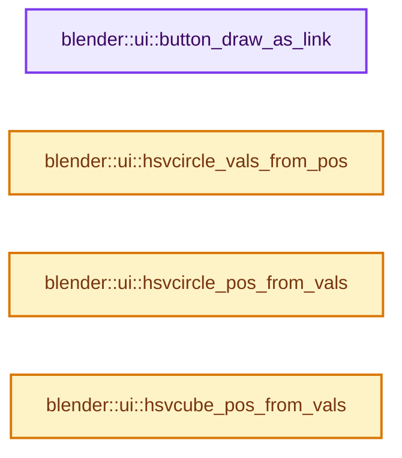

# 实现依赖专题：source/blender/editors/interface/interface_widgets.cc

[方向导航](README.md) · [符号索引](../%E7%AC%A6%E5%8F%B7%E4%BE%9D%E8%B5%96%E4%B8%8E%E5%AE%9E%E7%8E%B0%E7%B4%A2%E5%BC%95.md)

本专题从正文实际调用进入，集中保存共享实现。函数有稳定锚点，可从调用处直接跳到对应完整函数；递归与互相调用通过回链组织。

## 本文件的实现关系




## 完整成员与函数实现

<a id="f-d3be867aedaf3b87"></a>

### `blender::ui::button_draw_as_link`

实现位置：[source/blender/editors/interface/interface_widgets.cc](../../../../../source/blender/editors/interface/interface_widgets.cc) · L1802—L1805。

接口参数：

- `const Button *button`

**教学注释版**

<!-- annotated:22a0298495bf61 -->

```cpp
bool button_draw_as_link(const Button *button)
{
  return button->type == ButtonType::But && static_cast<const ButtonPush *>(button)->draw_as_link;
}
```

<details>
<summary>核对原始源码：source/blender/editors/interface/interface_widgets.cc · L1802—L1805</summary>

<!-- original:22a0298495bf61:source/blender/editors/interface/interface_widgets.cc:1802:1805 -->

```cpp
bool button_draw_as_link(const Button *button)
{
  return button->type == ButtonType::But && static_cast<const ButtonPush *>(button)->draw_as_link;
}
```

</details>

**结果出口**

- `return button->type == ButtonType::But && static_cast<const ButtonPush *>(button)->draw_as_link;`

**继续追踪实现**

本实现没有需要继续展开的显式调用；检查返回表达式、对象转换和调用者前置条件。

<a id="f-4e175fbc8eb16521"></a>

### `blender::ui::hsvcircle_vals_from_pos`

实现位置：[source/blender/editors/interface/interface_widgets.cc](../../../../../source/blender/editors/interface/interface_widgets.cc) · L3743—L3755。

接口参数：

- `const rcti *rect`
- `const float mx`
- `const float my`
- `float *r_val_rad`
- `float *r_val_dist`

**教学注释版**

<!-- annotated:251a869a4218ea -->

```cpp
void hsvcircle_vals_from_pos(
    const rcti *rect, const float mx, const float my, float *r_val_rad, float *r_val_dist)
{
  /* duplication of code... well, simple is better now */
  const float centx = BLI_rcti_cent_x_fl(rect);
  const float centy = BLI_rcti_cent_y_fl(rect);
  const float radius = float(min_ii(BLI_rcti_size_x(rect), BLI_rcti_size_y(rect))) / 2.0f;
  const float m_delta[2] = {mx - centx, my - centy};
  const float dist_sq = len_squared_v2(m_delta);

  *r_val_dist = (dist_sq < (radius * radius)) ? sqrtf(dist_sq) / radius : 1.0f;
  *r_val_rad = atan2f(m_delta[0], m_delta[1]) / (2.0f * float(M_PI)) + 0.5f;
}
```

<details>
<summary>核对原始源码：source/blender/editors/interface/interface_widgets.cc · L3743—L3755</summary>

<!-- original:251a869a4218ea:source/blender/editors/interface/interface_widgets.cc:3743:3755 -->

```cpp
void hsvcircle_vals_from_pos(
    const rcti *rect, const float mx, const float my, float *r_val_rad, float *r_val_dist)
{
  /* duplication of code... well, simple is better now */
  const float centx = BLI_rcti_cent_x_fl(rect);
  const float centy = BLI_rcti_cent_y_fl(rect);
  const float radius = float(min_ii(BLI_rcti_size_x(rect), BLI_rcti_size_y(rect))) / 2.0f;
  const float m_delta[2] = {mx - centx, my - centy};
  const float dist_sq = len_squared_v2(m_delta);

  *r_val_dist = (dist_sq < (radius * radius)) ? sqrtf(dist_sq) / radius : 1.0f;
  *r_val_rad = atan2f(m_delta[0], m_delta[1]) / (2.0f * float(M_PI)) + 0.5f;
}
```

</details>

**继续追踪实现**

- `BLI_rcti_cent_x_fl` → [blender::BLI_rcti_cent_x_fl · L178](../01-%E5%9F%BA%E7%A1%80%E5%AE%B9%E5%99%A8%E4%B8%8E%E7%8E%B0%E4%BB%A3CPP/%E4%BE%9D%E8%B5%96-BLI_rect-2996c6.md#f-060eda013362b8e6)。
- `BLI_rcti_cent_y_fl` → [blender::BLI_rcti_cent_y_fl · L182](../01-%E5%9F%BA%E7%A1%80%E5%AE%B9%E5%99%A8%E4%B8%8E%E7%8E%B0%E4%BB%A3CPP/%E4%BE%9D%E8%B5%96-BLI_rect-2996c6.md#f-101372c09be0eecb)。
- `min_ii` → [blender::min_ii · L364](../12-%E7%A9%BA%E9%97%B4%E6%95%B0%E6%8D%AE%E7%BB%93%E6%9E%84%E4%B8%8E%E5%87%A0%E4%BD%95%E7%AE%97%E6%B3%95/%E4%BE%9D%E8%B5%96-math_base_inline-546b00.md#f-30336db35b2810b8)。
- `BLI_rcti_size_x` → [blender::BLI_rcti_size_x · L203](../01-%E5%9F%BA%E7%A1%80%E5%AE%B9%E5%99%A8%E4%B8%8E%E7%8E%B0%E4%BB%A3CPP/%E4%BE%9D%E8%B5%96-BLI_rect-2996c6.md#f-7a8fb2c54a829be6)。
- `BLI_rcti_size_y` → [blender::BLI_rcti_size_y · L207](../01-%E5%9F%BA%E7%A1%80%E5%AE%B9%E5%99%A8%E4%B8%8E%E7%8E%B0%E4%BB%A3CPP/%E4%BE%9D%E8%B5%96-BLI_rect-2996c6.md#f-ac87d6c708d502ad)。
- `len_squared_v2` → [blender::len_squared_v2 · L719](../12-%E7%A9%BA%E9%97%B4%E6%95%B0%E6%8D%AE%E7%BB%93%E6%9E%84%E4%B8%8E%E5%87%A0%E4%BD%95%E7%AE%97%E6%B3%95/%E4%BE%9D%E8%B5%96-math_vector_inline-0c8541.md#f-e3d6c1f38ab4a6f6)。
- `sqrtf` → [外部契约](https://eel.is/c++draft/)：这个边界按实际表达式及所属类型核对参数、返回值、寿命与失败行为。这里提供接口入口，不声称已解释该第三方版本的内部实现。
- `atan2f` → [atan2f · L18](%E4%BE%9D%E8%B5%96-radial_tiling_shared-98abf9.md#m-a77af3382db2)；[atan2f · L40](%E4%BE%9D%E8%B5%96-radial_tiling_shared-98abf9.md#m-cec47b2ce998)；[atan2f · L71](%E4%BE%9D%E8%B5%96-radial_tiling_shared-98abf9.md#m-bd31b1779092)；[atan2f · L22](../01-%E5%9F%BA%E7%A1%80%E5%AE%B9%E5%99%A8%E4%B8%8E%E7%8E%B0%E4%BB%A3CPP/%E4%BE%9D%E8%B5%96-radial_tiling_shared-7989a4.md#m-9b9c2a707484)；[atan2f · L44](../01-%E5%9F%BA%E7%A1%80%E5%AE%B9%E5%99%A8%E4%B8%8E%E7%8E%B0%E4%BB%A3CPP/%E4%BE%9D%E8%B5%96-radial_tiling_shared-7989a4.md#m-63f49b7d81dc)；[atan2f · L75](../01-%E5%9F%BA%E7%A1%80%E5%AE%B9%E5%99%A8%E4%B8%8E%E7%8E%B0%E4%BB%A3CPP/%E4%BE%9D%E8%B5%96-radial_tiling_shared-7989a4.md#m-4201e8b4c423)；[atan2f · L18](%E4%BE%9D%E8%B5%96-node_radial_tiling_shared-b14bc2.md#m-ec4f8238af32)；[atan2f · L40](%E4%BE%9D%E8%B5%96-node_radial_tiling_shared-b14bc2.md#m-980162d675e3)；[atan2f · L71](%E4%BE%9D%E8%B5%96-node_radial_tiling_shared-b14bc2.md#m-bcd4c102a83d)；[atan2f · L179](%E4%BE%9D%E8%B5%96-compat-56205c.md#m-5be26d38bfa7)；[atan2f · L274](%E4%BE%9D%E8%B5%96-compat-efe0e9.md#m-1b9636d3b02f)。宏定义由构建条件选择。

<a id="f-490ebaa9c88d9931"></a>

### `blender::ui::hsvcircle_pos_from_vals`

实现位置：[source/blender/editors/interface/interface_widgets.cc](../../../../../source/blender/editors/interface/interface_widgets.cc) · L3757—L3778。

接口参数：

- `const ColorPicker *cpicker`
- `const rcti *rect`
- `const float *hsv`
- `float *r_xpos`
- `float *r_ypos`

**教学注释版**

<!-- annotated:edfd753c6c1721 -->

```cpp
void hsvcircle_pos_from_vals(
    const ColorPicker *cpicker, const rcti *rect, const float *hsv, float *r_xpos, float *r_ypos)
{
  /* duplication of code... well, simple is better now */
  const float centx = BLI_rcti_cent_x_fl(rect);
  const float centy = BLI_rcti_cent_y_fl(rect);
  const float radius = float(min_ii(BLI_rcti_size_x(rect), BLI_rcti_size_y(rect))) / 2.0f;

  const float ang = 2.0f * float(M_PI) * hsv[0] + float(M_PI_2);

  float radius_t;
  if (cpicker->use_color_cubic && (U.color_picker_type == USER_CP_CIRCLE_HSV)) {
    radius_t = (1.0f - pow3f(1.0f - hsv[1]));
  }
  else {
    radius_t = hsv[1];
  }

  const float rad = clamp_f(radius_t, 0.0f, 1.0f) * radius;
  *r_xpos = centx + cosf(-ang) * rad;
  *r_ypos = centy + sinf(-ang) * rad;
}
```

<details>
<summary>核对原始源码：source/blender/editors/interface/interface_widgets.cc · L3757—L3778</summary>

<!-- original:edfd753c6c1721:source/blender/editors/interface/interface_widgets.cc:3757:3778 -->

```cpp
void hsvcircle_pos_from_vals(
    const ColorPicker *cpicker, const rcti *rect, const float *hsv, float *r_xpos, float *r_ypos)
{
  /* duplication of code... well, simple is better now */
  const float centx = BLI_rcti_cent_x_fl(rect);
  const float centy = BLI_rcti_cent_y_fl(rect);
  const float radius = float(min_ii(BLI_rcti_size_x(rect), BLI_rcti_size_y(rect))) / 2.0f;

  const float ang = 2.0f * float(M_PI) * hsv[0] + float(M_PI_2);

  float radius_t;
  if (cpicker->use_color_cubic && (U.color_picker_type == USER_CP_CIRCLE_HSV)) {
    radius_t = (1.0f - pow3f(1.0f - hsv[1]));
  }
  else {
    radius_t = hsv[1];
  }

  const float rad = clamp_f(radius_t, 0.0f, 1.0f) * radius;
  *r_xpos = centx + cosf(-ang) * rad;
  *r_ypos = centy + sinf(-ang) * rad;
}
```

</details>

**沿实际写入检查状态**

- `radius_t = (1.0f - pow3f(1.0f - hsv[1]));`
- `radius_t = hsv[1];`

**继续追踪实现**

- `BLI_rcti_cent_x_fl` → [blender::BLI_rcti_cent_x_fl · L178](../01-%E5%9F%BA%E7%A1%80%E5%AE%B9%E5%99%A8%E4%B8%8E%E7%8E%B0%E4%BB%A3CPP/%E4%BE%9D%E8%B5%96-BLI_rect-2996c6.md#f-060eda013362b8e6)。
- `BLI_rcti_cent_y_fl` → [blender::BLI_rcti_cent_y_fl · L182](../01-%E5%9F%BA%E7%A1%80%E5%AE%B9%E5%99%A8%E4%B8%8E%E7%8E%B0%E4%BB%A3CPP/%E4%BE%9D%E8%B5%96-BLI_rect-2996c6.md#f-101372c09be0eecb)。
- `min_ii` → [blender::min_ii · L364](../12-%E7%A9%BA%E9%97%B4%E6%95%B0%E6%8D%AE%E7%BB%93%E6%9E%84%E4%B8%8E%E5%87%A0%E4%BD%95%E7%AE%97%E6%B3%95/%E4%BE%9D%E8%B5%96-math_base_inline-546b00.md#f-30336db35b2810b8)。
- `BLI_rcti_size_x` → [blender::BLI_rcti_size_x · L203](../01-%E5%9F%BA%E7%A1%80%E5%AE%B9%E5%99%A8%E4%B8%8E%E7%8E%B0%E4%BB%A3CPP/%E4%BE%9D%E8%B5%96-BLI_rect-2996c6.md#f-7a8fb2c54a829be6)。
- `BLI_rcti_size_y` → [blender::BLI_rcti_size_y · L207](../01-%E5%9F%BA%E7%A1%80%E5%AE%B9%E5%99%A8%E4%B8%8E%E7%8E%B0%E4%BB%A3CPP/%E4%BE%9D%E8%B5%96-BLI_rect-2996c6.md#f-ac87d6c708d502ad)。
- `pow3f` → [调用协议](../%E6%A8%A1%E6%9D%BF%E5%AE%8F%E4%B8%8E%E5%8A%A8%E6%80%81%E5%88%86%E6%B4%BE%E5%8D%8F%E8%AE%AE.md)：函数指针、局部可调用对象或未展开的宏；必须结合调用者环境。调用位置L3769。
- `clamp_f` → [blender::clamp_f · L405](../12-%E7%A9%BA%E9%97%B4%E6%95%B0%E6%8D%AE%E7%BB%93%E6%9E%84%E4%B8%8E%E5%87%A0%E4%BD%95%E7%AE%97%E6%B3%95/%E4%BE%9D%E8%B5%96-math_base_inline-546b00.md#f-abaf19ee32d97de2)。
- `cosf` → [cosf · L20](%E4%BE%9D%E8%B5%96-radial_tiling_shared-98abf9.md#m-cee9ebf67d86)；[cosf · L42](%E4%BE%9D%E8%B5%96-radial_tiling_shared-98abf9.md#m-346533627567)；[cosf · L73](%E4%BE%9D%E8%B5%96-radial_tiling_shared-98abf9.md#m-e01b94a43b72)；[cosf · L24](../01-%E5%9F%BA%E7%A1%80%E5%AE%B9%E5%99%A8%E4%B8%8E%E7%8E%B0%E4%BB%A3CPP/%E4%BE%9D%E8%B5%96-radial_tiling_shared-7989a4.md#m-c317cb08dec6)；[cosf · L46](../01-%E5%9F%BA%E7%A1%80%E5%AE%B9%E5%99%A8%E4%B8%8E%E7%8E%B0%E4%BB%A3CPP/%E4%BE%9D%E8%B5%96-radial_tiling_shared-7989a4.md#m-93325b515297)；[cosf · L77](../01-%E5%9F%BA%E7%A1%80%E5%AE%B9%E5%99%A8%E4%B8%8E%E7%8E%B0%E4%BB%A3CPP/%E4%BE%9D%E8%B5%96-radial_tiling_shared-7989a4.md#m-d3058af0b490)；[cosf · L20](%E4%BE%9D%E8%B5%96-node_radial_tiling_shared-b14bc2.md#m-4c6aea22a560)；[cosf · L42](%E4%BE%9D%E8%B5%96-node_radial_tiling_shared-b14bc2.md#m-1fd6a5414477)；[cosf · L73](%E4%BE%9D%E8%B5%96-node_radial_tiling_shared-b14bc2.md#m-de2402f85270)；[cosf · L186](%E4%BE%9D%E8%B5%96-compat-56205c.md#m-7fdbd99009e0)；[cosf · L288](%E4%BE%9D%E8%B5%96-compat-efe0e9.md#m-68fe984e8b68)；[cosf · L93](%E4%BE%9D%E8%B5%96-compat-9e0a25.md#m-21bb557a23f1)；[cosf · L91](%E4%BE%9D%E8%B5%96-compat-e9eab7.md#m-7721be419a49)；[cosf · L43](%E4%BE%9D%E8%B5%96-GPU_shader_shared_utils-0adda3.md#m-25d02fd11b3b)；[cosf · L64](%E4%BE%9D%E8%B5%96-GPU_shader_shared_utils-0adda3.md#m-698fc51ccda3)。宏定义由构建条件选择。
- `sinf` → [sinf · L27](%E4%BE%9D%E8%B5%96-radial_tiling_shared-98abf9.md#m-40547e913688)；[sinf · L49](%E4%BE%9D%E8%B5%96-radial_tiling_shared-98abf9.md#m-8908e5f49833)；[sinf · L80](%E4%BE%9D%E8%B5%96-radial_tiling_shared-98abf9.md#m-71130f6adcc4)；[sinf · L31](../01-%E5%9F%BA%E7%A1%80%E5%AE%B9%E5%99%A8%E4%B8%8E%E7%8E%B0%E4%BB%A3CPP/%E4%BE%9D%E8%B5%96-radial_tiling_shared-7989a4.md#m-a51a6c88deca)；[sinf · L53](../01-%E5%9F%BA%E7%A1%80%E5%AE%B9%E5%99%A8%E4%B8%8E%E7%8E%B0%E4%BB%A3CPP/%E4%BE%9D%E8%B5%96-radial_tiling_shared-7989a4.md#m-9a4db95358ff)；[sinf · L84](../01-%E5%9F%BA%E7%A1%80%E5%AE%B9%E5%99%A8%E4%B8%8E%E7%8E%B0%E4%BB%A3CPP/%E4%BE%9D%E8%B5%96-radial_tiling_shared-7989a4.md#m-d26cdafe5b93)；[sinf · L27](%E4%BE%9D%E8%B5%96-node_radial_tiling_shared-b14bc2.md#m-9f80b4d363af)；[sinf · L49](%E4%BE%9D%E8%B5%96-node_radial_tiling_shared-b14bc2.md#m-f52c29b37ed1)；[sinf · L80](%E4%BE%9D%E8%B5%96-node_radial_tiling_shared-b14bc2.md#m-7f1f234ef9ec)；[sinf · L187](%E4%BE%9D%E8%B5%96-compat-56205c.md#m-aab07e522dda)；[sinf · L287](%E4%BE%9D%E8%B5%96-compat-efe0e9.md#m-7009b99c07ca)；[sinf · L94](%E4%BE%9D%E8%B5%96-compat-9e0a25.md#m-4a1f5d760325)；[sinf · L92](%E4%BE%9D%E8%B5%96-compat-e9eab7.md#m-e63872738f13)；[sinf · L44](%E4%BE%9D%E8%B5%96-GPU_shader_shared_utils-0adda3.md#m-a916f31e38c4)；[sinf · L65](%E4%BE%9D%E8%B5%96-GPU_shader_shared_utils-0adda3.md#m-268edbf6d41e)。宏定义由构建条件选择。

<a id="f-6ff4d809202ff7f2"></a>

### `blender::ui::hsvcube_pos_from_vals`

实现位置：[source/blender/editors/interface/interface_widgets.cc](../../../../../source/blender/editors/interface/interface_widgets.cc) · L4062—L4109。

接口参数：

- `const ButtonHSVCube *hsv_but`
- `const rcti *rect`
- `const float *hsv`
- `float *r_xp`
- `float *r_yp`

**教学注释版**

<!-- annotated:75e8a156cf6edd -->

```cpp
void hsvcube_pos_from_vals(
    const ButtonHSVCube *hsv_but, const rcti *rect, const float *hsv, float *r_xp, float *r_yp)
{
  float x = 0.0f, y = 0.0f;

  switch (hsv_but->gradient_type) {
    case GRAD_SV:
      x = hsv[1];
      y = hsv[2];
      break;
    case GRAD_HV:
      x = hsv[0];
      y = hsv[2];
      break;
    case GRAD_HS:
      x = hsv[0];
      y = hsv[1];
      break;
    case GRAD_H:
      x = hsv[0];
      y = 0.5;
      break;
    case GRAD_S:
      x = hsv[1];
      y = 0.5;
      break;
    case GRAD_V:
      x = hsv[2];
      y = 0.5;
      break;
    case GRAD_L_ALT:
      x = 0.5f;
      /* exception only for value strip - use the range set in but->min/max */
      y = hsv[2];
      break;
    case GRAD_V_ALT:
      x = 0.5f;
      /* exception only for value strip - use the range set in but->min/max */
      y = (hsv[2] - hsv_but->softmin) / (hsv_but->softmax - hsv_but->softmin);
      break;
    case GRAD_NONE:
      BLI_assert_unreachable();
  }

  /* cursor */
  *r_xp = rect->xmin + x * BLI_rcti_size_x(rect);
  *r_yp = rect->ymin + y * BLI_rcti_size_y(rect);
}
```

<details>
<summary>核对原始源码：source/blender/editors/interface/interface_widgets.cc · L4062—L4109</summary>

<!-- original:75e8a156cf6edd:source/blender/editors/interface/interface_widgets.cc:4062:4109 -->

```cpp
void hsvcube_pos_from_vals(
    const ButtonHSVCube *hsv_but, const rcti *rect, const float *hsv, float *r_xp, float *r_yp)
{
  float x = 0.0f, y = 0.0f;

  switch (hsv_but->gradient_type) {
    case GRAD_SV:
      x = hsv[1];
      y = hsv[2];
      break;
    case GRAD_HV:
      x = hsv[0];
      y = hsv[2];
      break;
    case GRAD_HS:
      x = hsv[0];
      y = hsv[1];
      break;
    case GRAD_H:
      x = hsv[0];
      y = 0.5;
      break;
    case GRAD_S:
      x = hsv[1];
      y = 0.5;
      break;
    case GRAD_V:
      x = hsv[2];
      y = 0.5;
      break;
    case GRAD_L_ALT:
      x = 0.5f;
      /* exception only for value strip - use the range set in but->min/max */
      y = hsv[2];
      break;
    case GRAD_V_ALT:
      x = 0.5f;
      /* exception only for value strip - use the range set in but->min/max */
      y = (hsv[2] - hsv_but->softmin) / (hsv_but->softmax - hsv_but->softmin);
      break;
    case GRAD_NONE:
      BLI_assert_unreachable();
  }

  /* cursor */
  *r_xp = rect->xmin + x * BLI_rcti_size_x(rect);
  *r_yp = rect->ymin + y * BLI_rcti_size_y(rect);
}
```

</details>

**沿实际写入检查状态**

- `x = hsv[1];`
- `y = hsv[2];`
- `x = hsv[0];`
- `y = hsv[1];`
- `y = 0.5;`
- `x = hsv[2];`
- `x = 0.5f;`
- `y = (hsv[2] - hsv_but->softmin) / (hsv_but->softmax - hsv_but->softmin);`

**继续追踪实现**

- `BLI_assert_unreachable` → [BLI_assert_unreachable · L77](../01-%E5%9F%BA%E7%A1%80%E5%AE%B9%E5%99%A8%E4%B8%8E%E7%8E%B0%E4%BB%A3CPP/%E4%BE%9D%E8%B5%96-BLI_assert-cc98e8.md#m-7a2d91a67d8e)。宏定义由构建条件选择。
- `BLI_rcti_size_x` → [blender::BLI_rcti_size_x · L203](../01-%E5%9F%BA%E7%A1%80%E5%AE%B9%E5%99%A8%E4%B8%8E%E7%8E%B0%E4%BB%A3CPP/%E4%BE%9D%E8%B5%96-BLI_rect-2996c6.md#f-7a8fb2c54a829be6)。
- `BLI_rcti_size_y` → [blender::BLI_rcti_size_y · L207](../01-%E5%9F%BA%E7%A1%80%E5%AE%B9%E5%99%A8%E4%B8%8E%E7%8E%B0%E4%BB%A3CPP/%E4%BE%9D%E8%B5%96-BLI_rect-2996c6.md#f-ac87d6c708d502ad)。
