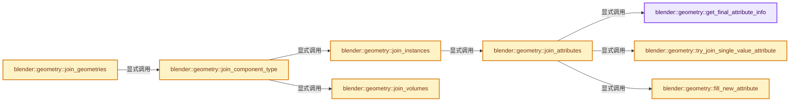

# 实现依赖专题：source/blender/geometry/intern/join_geometries.cc

[方向导航](README.md) · [符号索引](../%E7%AC%A6%E5%8F%B7%E4%BE%9D%E8%B5%96%E4%B8%8E%E5%AE%9E%E7%8E%B0%E7%B4%A2%E5%BC%95.md)

本专题从正文实际调用进入，集中保存共享实现。函数有稳定锚点，可从调用处直接跳到对应完整函数；递归与互相调用通过回链组织。

## 本文件的实现关系




## 完整成员与函数实现

<a id="f-632599e7ee61a46f"></a>

### `blender::geometry::get_final_attribute_info`

实现位置：[source/blender/geometry/intern/join_geometries.cc](../../../../../source/blender/geometry/intern/join_geometries.cc) · L22—L40。

接口参数：

- `const Span<const GeometryComponent *> components`
- `const Span<StringRef> ignored_attributes`

**教学注释版**

<!-- annotated:d5141aae1f1fcb -->

```cpp
static GeometrySet::GatheredAttributes get_final_attribute_info(
    const Span<const GeometryComponent *> components, const Span<StringRef> ignored_attributes)
{
  GeometrySet::GatheredAttributes info;

  for (const GeometryComponent *component : components) {
    component->attributes()->foreach_attribute([&](const bke::AttributeIter &iter) {
      if (ignored_attributes.contains(iter.name)) {
        return;
      }
      if (iter.data_type == bke::AttrType::String) {
        return;
      }
      info.add(iter.name, AttributeDomainAndType{iter.domain, iter.data_type});
    });
  }

  return info;
}
```

<details>
<summary>核对原始源码：source/blender/geometry/intern/join_geometries.cc · L22—L40</summary>

<!-- original:d5141aae1f1fcb:source/blender/geometry/intern/join_geometries.cc:22:40 -->

```cpp
static GeometrySet::GatheredAttributes get_final_attribute_info(
    const Span<const GeometryComponent *> components, const Span<StringRef> ignored_attributes)
{
  GeometrySet::GatheredAttributes info;

  for (const GeometryComponent *component : components) {
    component->attributes()->foreach_attribute([&](const bke::AttributeIter &iter) {
      if (ignored_attributes.contains(iter.name)) {
        return;
      }
      if (iter.data_type == bke::AttrType::String) {
        return;
      }
      info.add(iter.name, AttributeDomainAndType{iter.domain, iter.data_type});
    });
  }

  return info;
}
```

</details>

**结果出口**

- `return info;`

**继续追踪实现**

- `component->attributes()->foreach_attribute` → [调用协议](../%E6%A8%A1%E6%9D%BF%E5%AE%8F%E4%B8%8E%E5%8A%A8%E6%80%81%E5%88%86%E6%B4%BE%E5%8D%8F%E8%AE%AE.md)：接收对象类型依赖auto、返回值或模板实例；不按同名猜测目标。调用位置L28。
- `component->attributes` → [调用协议](../%E6%A8%A1%E6%9D%BF%E5%AE%8F%E4%B8%8E%E5%8A%A8%E6%80%81%E5%88%86%E6%B4%BE%E5%8D%8F%E8%AE%AE.md)：接收对象类型依赖auto、返回值或模板实例；不按同名猜测目标。调用位置L28。
- `ignored_attributes.contains` → [blender::Span::contains · L281](../01-%E5%9F%BA%E7%A1%80%E5%AE%B9%E5%99%A8%E4%B8%8E%E7%8E%B0%E4%BB%A3CPP/05-Span%E5%8F%AA%E8%AF%BB%E8%BF%9E%E7%BB%AD%E8%A7%86%E5%9B%BE.md#f-7caee498c984f2c0)。
- `info.add` → [blender::bke::GeometrySet::GatheredAttributes::add · L711](../06-%E9%9A%90%E5%BC%8F%E5%85%B1%E4%BA%AB%E4%B8%8E%E7%BC%93%E5%AD%98%E7%B3%BB%E7%BB%9F/05-GeometrySet%E8%AF%BB%E5%86%99%E4%B8%8E%E5%A4%8D%E5%88%B6.md#f-df0701c2f420bf1b)。

<a id="f-1f54bcaa891ed05a"></a>

### `blender::geometry::fill_new_attribute`

实现位置：[source/blender/geometry/intern/join_geometries.cc](../../../../../source/blender/geometry/intern/join_geometries.cc) · L42—L66。

接口参数：

- `const Span<const GeometryComponent *> src_components`
- `const StringRef name`
- `const bke::AttrType data_type`
- `const bke::AttrDomain domain`
- `GMutableSpan dst_span`

**教学注释版**

<!-- annotated:f164ee9f18ee10 -->

```cpp
static void fill_new_attribute(const Span<const GeometryComponent *> src_components,
                               const StringRef name,
                               const bke::AttrType data_type,
                               const bke::AttrDomain domain,
                               GMutableSpan dst_span)
{
  const CPPType &cpp_type = bke::attribute_type_to_cpp_type(data_type);

  int offset = 0;
  for (const GeometryComponent *component : src_components) {
    const int domain_num = component->attribute_domain_size(domain);
    if (domain_num == 0) {
      continue;
    }
    GVArray read_attribute = *component->attributes()->lookup_or_default(
        name, domain, data_type, nullptr);

    GVArraySpan src_span{read_attribute};
    const void *src_buffer = src_span.data();
    void *dst_buffer = dst_span[offset];
    cpp_type.copy_construct_n(src_buffer, dst_buffer, domain_num);

    offset += domain_num;
  }
}
```

<details>
<summary>核对原始源码：source/blender/geometry/intern/join_geometries.cc · L42—L66</summary>

<!-- original:f164ee9f18ee10:source/blender/geometry/intern/join_geometries.cc:42:66 -->

```cpp
static void fill_new_attribute(const Span<const GeometryComponent *> src_components,
                               const StringRef name,
                               const bke::AttrType data_type,
                               const bke::AttrDomain domain,
                               GMutableSpan dst_span)
{
  const CPPType &cpp_type = bke::attribute_type_to_cpp_type(data_type);

  int offset = 0;
  for (const GeometryComponent *component : src_components) {
    const int domain_num = component->attribute_domain_size(domain);
    if (domain_num == 0) {
      continue;
    }
    GVArray read_attribute = *component->attributes()->lookup_or_default(
        name, domain, data_type, nullptr);

    GVArraySpan src_span{read_attribute};
    const void *src_buffer = src_span.data();
    void *dst_buffer = dst_span[offset];
    cpp_type.copy_construct_n(src_buffer, dst_buffer, domain_num);

    offset += domain_num;
  }
}
```

</details>

**沿实际写入检查状态**

- `offset += domain_num;`

**继续追踪实现**

- `bke::attribute_type_to_cpp_type` → [blender::bke::attribute_type_to_cpp_type · L44](%E4%BE%9D%E8%B5%96-attribute_access-bceef3.md#f-69deacfd0fca6244)。
- `component->attribute_domain_size` → [调用协议](../%E6%A8%A1%E6%9D%BF%E5%AE%8F%E4%B8%8E%E5%8A%A8%E6%80%81%E5%88%86%E6%B4%BE%E5%8D%8F%E8%AE%AE.md)：接收对象类型依赖auto、返回值或模板实例；不按同名猜测目标。调用位置L52。
- `component->attributes()->lookup_or_default` → [调用协议](../%E6%A8%A1%E6%9D%BF%E5%AE%8F%E4%B8%8E%E5%8A%A8%E6%80%81%E5%88%86%E6%B4%BE%E5%8D%8F%E8%AE%AE.md)：接收对象类型依赖auto、返回值或模板实例；不按同名猜测目标。调用位置L56。
- `component->attributes` → [调用协议](../%E6%A8%A1%E6%9D%BF%E5%AE%8F%E4%B8%8E%E5%8A%A8%E6%80%81%E5%88%86%E6%B4%BE%E5%8D%8F%E8%AE%AE.md)：接收对象类型依赖auto、返回值或模板实例；不按同名猜测目标。调用位置L56。
- `src_span.data` → [调用协议](../%E6%A8%A1%E6%9D%BF%E5%AE%8F%E4%B8%8E%E5%8A%A8%E6%80%81%E5%88%86%E6%B4%BE%E5%8D%8F%E8%AE%AE.md)：由接收对象具体类型或运行时策略提供实现。调用位置L60。
- `cpp_type.copy_construct_n` → [blender::CPPType::copy_construct_n · L599](../03-%E5%86%85%E5%AD%98%E5%88%86%E9%85%8D%E4%B8%8E%E8%BF%90%E8%A1%8C%E6%97%B6%E7%B1%BB%E5%9E%8B/09-CPPType%E5%A4%8D%E5%88%B6%E7%A7%BB%E5%8A%A8%E9%87%8D%E5%AE%9A%E4%BD%8D.md#f-3676f00cc2bda6e3)。

<a id="f-691c03fc9146b7ec"></a>

### `blender::geometry::try_join_single_value_attribute`

实现位置：[source/blender/geometry/intern/join_geometries.cc](../../../../../source/blender/geometry/intern/join_geometries.cc) · L68—L111。

接口参数：

- `const Span<const GeometryComponent *> src_components`
- `const StringRef name`
- `const bke::AttrDomain domain`
- `const bke::AttrType data_type`
- `bke::MutableAttributeAccessor dst_attributes`

**教学注释版**

<!-- annotated:5ed4828ad4feb9 -->

```cpp
static bool try_join_single_value_attribute(const Span<const GeometryComponent *> src_components,
                                            const StringRef name,
                                            const bke::AttrDomain domain,
                                            const bke::AttrType data_type,
                                            bke::MutableAttributeAccessor dst_attributes)
{
  const auto get_single_value = [&](const GeometryComponent &component) {
    const bke::AttributeAccessor attributes = *component.attributes();
    const GVArray src = *attributes.lookup_or_default(name, domain, data_type);
    const CommonVArrayInfo info = src.common_info();
    if (info.type != CommonVArrayInfo::Type::Single) {
      return GPointer();
    }
    return GPointer(src.type(), info.data);
  };
  // [讲解] src_components.first：按视图边界访问元素。
  const GPointer first_value = get_single_value(*src_components.first());
  if (!first_value) {
    return false;
  }
  const bool all_equal = threading::parallel_reduce(
      // [讲解] src_components.index_range：查询视图长度或生成对应有效索引区间。
      src_components.index_range().drop_front(1),
      64,
      true,
      [&](const IndexRange range, bool value) {
        if (!value) {
          return false;
        }
        for (const int i : range) {
          const GPointer value = get_single_value(*src_components[i]);
          if (!value) {
            return false;
          }
          if (!value.type()->is_equal(value.get(), first_value.get())) {
            return false;
          }
        }
        return true;
      },
      std::logical_and<bool>());
  if (!all_equal) {
    return false;
  }
  return dst_attributes.add(name, domain, data_type, bke::AttributeInitValue(first_value));
}
```

<details>
<summary>核对原始源码：source/blender/geometry/intern/join_geometries.cc · L68—L111</summary>

<!-- original:5ed4828ad4feb9:source/blender/geometry/intern/join_geometries.cc:68:111 -->

```cpp
static bool try_join_single_value_attribute(const Span<const GeometryComponent *> src_components,
                                            const StringRef name,
                                            const bke::AttrDomain domain,
                                            const bke::AttrType data_type,
                                            bke::MutableAttributeAccessor dst_attributes)
{
  const auto get_single_value = [&](const GeometryComponent &component) {
    const bke::AttributeAccessor attributes = *component.attributes();
    const GVArray src = *attributes.lookup_or_default(name, domain, data_type);
    const CommonVArrayInfo info = src.common_info();
    if (info.type != CommonVArrayInfo::Type::Single) {
      return GPointer();
    }
    return GPointer(src.type(), info.data);
  };
  const GPointer first_value = get_single_value(*src_components.first());
  if (!first_value) {
    return false;
  }
  const bool all_equal = threading::parallel_reduce(
      src_components.index_range().drop_front(1),
      64,
      true,
      [&](const IndexRange range, bool value) {
        if (!value) {
          return false;
        }
        for (const int i : range) {
          const GPointer value = get_single_value(*src_components[i]);
          if (!value) {
            return false;
          }
          if (!value.type()->is_equal(value.get(), first_value.get())) {
            return false;
          }
        }
        return true;
      },
      std::logical_and<bool>());
  if (!all_equal) {
    return false;
  }
  return dst_attributes.add(name, domain, data_type, bke::AttributeInitValue(first_value));
}
```

</details>

**结果出口**

- `return GPointer();`
- `return GPointer(src.type(), info.data);`
- `return false;`
- `return true;`
- `return dst_attributes.add(name, domain, data_type, bke::AttributeInitValue(first_value));`

**继续追踪实现**

- `component.attributes` → [blender::bke::GeometryComponent::attributes · L75](../06-%E9%9A%90%E5%BC%8F%E5%85%B1%E4%BA%AB%E4%B8%8E%E7%BC%93%E5%AD%98%E7%B3%BB%E7%BB%9F/05-GeometrySet%E8%AF%BB%E5%86%99%E4%B8%8E%E5%A4%8D%E5%88%B6.md#f-d58a41ede5a46f2c)。
- `attributes.lookup_or_default` → [blender::bke::AttributeAccessor::lookup_or_default · L415](%E4%BE%9D%E8%B5%96-attribute_access-bceef3.md#f-a0cc3e316f1da4bd)；[blender::bke::AttributeAccessor::lookup_or_default · L643](08-AttributeAccessor%E6%8E%A5%E5%8F%A3.md#f-e3d2ed81ebe0af61)。同名重载需按实参类型选择。
- `src.common_info` → [调用协议](../%E6%A8%A1%E6%9D%BF%E5%AE%8F%E4%B8%8E%E5%8A%A8%E6%80%81%E5%88%86%E6%B4%BE%E5%8D%8F%E8%AE%AE.md)：由接收对象具体类型或运行时策略提供实现。调用位置L77。
- `GPointer` → [blender::GPointer::GPointer · L93](../03-%E5%86%85%E5%AD%98%E5%88%86%E9%85%8D%E4%B8%8E%E8%BF%90%E8%A1%8C%E6%97%B6%E7%B1%BB%E5%9E%8B/12-%E5%BC%82%E6%9E%84%E5%80%BC%E5%AD%98%E5%82%A8%E5%AE%9E%E6%88%98.md#f-40f7a024c1e541df)；[blender::GPointer::GPointer · L95](../03-%E5%86%85%E5%AD%98%E5%88%86%E9%85%8D%E4%B8%8E%E8%BF%90%E8%A1%8C%E6%97%B6%E7%B1%BB%E5%9E%8B/12-%E5%BC%82%E6%9E%84%E5%80%BC%E5%AD%98%E5%82%A8%E5%AE%9E%E6%88%98.md#f-e981128b9c36f9ef)；[blender::GPointer::GPointer · L97](../03-%E5%86%85%E5%AD%98%E5%88%86%E9%85%8D%E4%B8%8E%E8%BF%90%E8%A1%8C%E6%97%B6%E7%B1%BB%E5%9E%8B/12-%E5%BC%82%E6%9E%84%E5%80%BC%E5%AD%98%E5%82%A8%E5%AE%9E%E6%88%98.md#f-5d3066175455aed0)；[blender::GPointer::GPointer · L103](../03-%E5%86%85%E5%AD%98%E5%88%86%E9%85%8D%E4%B8%8E%E8%BF%90%E8%A1%8C%E6%97%B6%E7%B1%BB%E5%9E%8B/12-%E5%BC%82%E6%9E%84%E5%80%BC%E5%AD%98%E5%82%A8%E5%AE%9E%E6%88%98.md#f-9194d11793ea4a06)；[blender::GPointer::GPointer · L105](../03-%E5%86%85%E5%AD%98%E5%88%86%E9%85%8D%E4%B8%8E%E8%BF%90%E8%A1%8C%E6%97%B6%E7%B1%BB%E5%9E%8B/12-%E5%BC%82%E6%9E%84%E5%80%BC%E5%AD%98%E5%82%A8%E5%AE%9E%E6%88%98.md#f-1a9887b65d37a9ca)。同名重载需按实参类型选择。
- `src.type` → [调用协议](../%E6%A8%A1%E6%9D%BF%E5%AE%8F%E4%B8%8E%E5%8A%A8%E6%80%81%E5%88%86%E6%B4%BE%E5%8D%8F%E8%AE%AE.md)：由接收对象具体类型或运行时策略提供实现。调用位置L81。
- `get_single_value` → [调用协议](../%E6%A8%A1%E6%9D%BF%E5%AE%8F%E4%B8%8E%E5%8A%A8%E6%80%81%E5%88%86%E6%B4%BE%E5%8D%8F%E8%AE%AE.md)：局部可调用对象，须结合其初始化与捕获环境。调用位置L83。
- `src_components.first` → [blender::Span::first · L319](../01-%E5%9F%BA%E7%A1%80%E5%AE%B9%E5%99%A8%E4%B8%8E%E7%8E%B0%E4%BB%A3CPP/05-Span%E5%8F%AA%E8%AF%BB%E8%BF%9E%E7%BB%AD%E8%A7%86%E5%9B%BE.md#f-d8c9bcc3e9757248)。
- `threading::parallel_reduce` → [blender::threading::parallel_reduce · L126](../11-Depsgraph%E4%B8%8E%E5%B9%B6%E8%A1%8C%E4%BB%BB%E5%8A%A1%E7%B3%BB%E7%BB%9F/07-%E4%BB%BB%E5%8A%A1%E6%B1%A0%E4%B8%8ETBB%E6%8E%A5%E5%85%A5.md#f-9225ddb5efb97fcc)。
- `src_components.index_range().drop_front` → [调用协议](../%E6%A8%A1%E6%9D%BF%E5%AE%8F%E4%B8%8E%E5%8A%A8%E6%80%81%E5%88%86%E6%B4%BE%E5%8D%8F%E8%AE%AE.md)：接收对象类型依赖auto、返回值或模板实例；不按同名猜测目标。调用位置L88。
- `src_components.index_range` → [blender::Span::index_range · L405](../01-%E5%9F%BA%E7%A1%80%E5%AE%B9%E5%99%A8%E4%B8%8E%E7%8E%B0%E4%BB%A3CPP/05-Span%E5%8F%AA%E8%AF%BB%E8%BF%9E%E7%BB%AD%E8%A7%86%E5%9B%BE.md#f-caaa9b06e13e53e0)。
- `value.type()->is_equal` → [调用协议](../%E6%A8%A1%E6%9D%BF%E5%AE%8F%E4%B8%8E%E5%8A%A8%E6%80%81%E5%88%86%E6%B4%BE%E5%8D%8F%E8%AE%AE.md)：接收对象类型依赖auto、返回值或模板实例；不按同名猜测目标。调用位置L100。
- `value.type` → [blender::GPointer::type · L122](../03-%E5%86%85%E5%AD%98%E5%88%86%E9%85%8D%E4%B8%8E%E8%BF%90%E8%A1%8C%E6%97%B6%E7%B1%BB%E5%9E%8B/12-%E5%BC%82%E6%9E%84%E5%80%BC%E5%AD%98%E5%82%A8%E5%AE%9E%E6%88%98.md#f-fab893bd990213d9)。
- `value.get` → [blender::GPointer::get · L117](../03-%E5%86%85%E5%AD%98%E5%88%86%E9%85%8D%E4%B8%8E%E8%BF%90%E8%A1%8C%E6%97%B6%E7%B1%BB%E5%9E%8B/12-%E5%BC%82%E6%9E%84%E5%80%BC%E5%AD%98%E5%82%A8%E5%AE%9E%E6%88%98.md#f-d98a4f1af4104afe)；[blender::GPointer::get · L127](../03-%E5%86%85%E5%AD%98%E5%88%86%E9%85%8D%E4%B8%8E%E8%BF%90%E8%A1%8C%E6%97%B6%E7%B1%BB%E5%9E%8B/12-%E5%BC%82%E6%9E%84%E5%80%BC%E5%AD%98%E5%82%A8%E5%AE%9E%E6%88%98.md#f-5cf9e563400cde6b)。同名重载需按实参类型选择。
- `first_value.get` → [blender::GPointer::get · L117](../03-%E5%86%85%E5%AD%98%E5%88%86%E9%85%8D%E4%B8%8E%E8%BF%90%E8%A1%8C%E6%97%B6%E7%B1%BB%E5%9E%8B/12-%E5%BC%82%E6%9E%84%E5%80%BC%E5%AD%98%E5%82%A8%E5%AE%9E%E6%88%98.md#f-d98a4f1af4104afe)；[blender::GPointer::get · L127](../03-%E5%86%85%E5%AD%98%E5%88%86%E9%85%8D%E4%B8%8E%E8%BF%90%E8%A1%8C%E6%97%B6%E7%B1%BB%E5%9E%8B/12-%E5%BC%82%E6%9E%84%E5%80%BC%E5%AD%98%E5%82%A8%E5%AE%9E%E6%88%98.md#f-5cf9e563400cde6b)。同名重载需按实参类型选择。
- `std::logical_and<bool>` → [外部契约](https://eel.is/c++draft/)：这个边界按实际表达式及所属类型核对参数、返回值、寿命与失败行为。这里提供接口入口，不声称已解释该第三方版本的内部实现。
- `dst_attributes.add` → [blender::bke::MutableAttributeAccessor::add · L769](08-AttributeAccessor%E6%8E%A5%E5%8F%A3.md#f-5fa7f06d7e22891a)；[blender::bke::MutableAttributeAccessor::add · L785](08-AttributeAccessor%E6%8E%A5%E5%8F%A3.md#f-42998ceb23ada8cc)。同名重载需按实参类型选择。
- `bke::AttributeInitValue` → [blender::bke::AttributeInitValue::AttributeInitValue · L100](08-AttributeAccessor%E6%8E%A5%E5%8F%A3.md#f-cd502d5742ad6d0f)；[blender::bke::AttributeInitValue::AttributeInitValue · L104](08-AttributeAccessor%E6%8E%A5%E5%8F%A3.md#f-54b1dad08bff7914)。同名重载需按实参类型选择。

<a id="f-c3141fe79f548c6d"></a>

### `blender::geometry::join_attributes`

实现位置：[source/blender/geometry/intern/join_geometries.cc](../../../../../source/blender/geometry/intern/join_geometries.cc) · L113—L140。

接口参数：

- `const Span<const GeometryComponent *> src_components`
- `GeometryComponent &result`
- `const Span<StringRef> ignored_attributes`

**教学注释版**

<!-- annotated:944cc95a11589b -->

```cpp
static void join_attributes(const Span<const GeometryComponent *> src_components,
                            GeometryComponent &result,
                            const Span<StringRef> ignored_attributes)
{
  const GeometrySet::GatheredAttributes info = get_final_attribute_info(src_components,
                                                                        ignored_attributes);
  bke::MutableAttributeAccessor dst_attributes = *result.attributes_for_write();

  for (const int i : info.names.index_range()) {
    const StringRef name = info.names[i];
    const AttributeDomainAndType &meta_data = info.kinds[i];

    if (try_join_single_value_attribute(
            src_components, name, meta_data.domain, meta_data.data_type, dst_attributes))
    {
      continue;
    }

    bke::GSpanAttributeWriter write_attribute = dst_attributes.lookup_or_add_for_write_only_span(
        name, meta_data.domain, meta_data.data_type);
    if (!write_attribute) {
      continue;
    }
    fill_new_attribute(
        src_components, name, meta_data.data_type, meta_data.domain, write_attribute.span);
    write_attribute.finish();
  }
}
```

<details>
<summary>核对原始源码：source/blender/geometry/intern/join_geometries.cc · L113—L140</summary>

<!-- original:944cc95a11589b:source/blender/geometry/intern/join_geometries.cc:113:140 -->

```cpp
static void join_attributes(const Span<const GeometryComponent *> src_components,
                            GeometryComponent &result,
                            const Span<StringRef> ignored_attributes)
{
  const GeometrySet::GatheredAttributes info = get_final_attribute_info(src_components,
                                                                        ignored_attributes);
  bke::MutableAttributeAccessor dst_attributes = *result.attributes_for_write();

  for (const int i : info.names.index_range()) {
    const StringRef name = info.names[i];
    const AttributeDomainAndType &meta_data = info.kinds[i];

    if (try_join_single_value_attribute(
            src_components, name, meta_data.domain, meta_data.data_type, dst_attributes))
    {
      continue;
    }

    bke::GSpanAttributeWriter write_attribute = dst_attributes.lookup_or_add_for_write_only_span(
        name, meta_data.domain, meta_data.data_type);
    if (!write_attribute) {
      continue;
    }
    fill_new_attribute(
        src_components, name, meta_data.data_type, meta_data.domain, write_attribute.span);
    write_attribute.finish();
  }
}
```

</details>

**继续追踪实现**

- `get_final_attribute_info` → [blender::geometry::get_final_attribute_info · L22](%E4%BE%9D%E8%B5%96-join_geometries-e5d196.md#f-632599e7ee61a46f)。
- `result.attributes_for_write` → [blender::bke::GeometryComponent::attributes_for_write · L79](../06-%E9%9A%90%E5%BC%8F%E5%85%B1%E4%BA%AB%E4%B8%8E%E7%BC%93%E5%AD%98%E7%B3%BB%E7%BB%9F/05-GeometrySet%E8%AF%BB%E5%86%99%E4%B8%8E%E5%A4%8D%E5%88%B6.md#f-c68ee72f71fc3179)。
- `info.names.index_range` → [调用协议](../%E6%A8%A1%E6%9D%BF%E5%AE%8F%E4%B8%8E%E5%8A%A8%E6%80%81%E5%88%86%E6%B4%BE%E5%8D%8F%E8%AE%AE.md)：接收对象类型依赖auto、返回值或模板实例；不按同名猜测目标。调用位置L121。
- `try_join_single_value_attribute` → [blender::geometry::try_join_single_value_attribute · L68](%E4%BE%9D%E8%B5%96-join_geometries-e5d196.md#f-691c03fc9146b7ec)。
- `dst_attributes.lookup_or_add_for_write_only_span` → [blender::bke::MutableAttributeAccessor::lookup_or_add_for_write_only_span · L546](%E4%BE%9D%E8%B5%96-attribute_access-bceef3.md#f-97af899f7983a038)；[blender::bke::MutableAttributeAccessor::lookup_or_add_for_write_only_span · L891](08-AttributeAccessor%E6%8E%A5%E5%8F%A3.md#f-ee8d09f75408ac4f)。同名重载需按实参类型选择。
- `fill_new_attribute` → [blender::geometry::fill_new_attribute · L42](%E4%BE%9D%E8%B5%96-join_geometries-e5d196.md#f-1f54bcaa891ed05a)。
- `write_attribute.finish` → [blender::bke::GSpanAttributeWriter::finish · L372](08-AttributeAccessor%E6%8E%A5%E5%8F%A3.md#f-6e58c9c72c82f592)。

<a id="f-d5dc6ce1fde0a4f4"></a>

### `blender::geometry::join_instances`

实现位置：[source/blender/geometry/intern/join_geometries.cc](../../../../../source/blender/geometry/intern/join_geometries.cc) · L142—L185。

接口参数：

- `const Span<const GeometryComponent *> src_components`
- `const bool allow_merging_instance_references`
- `GeometrySet &result`

**教学注释版**

<!-- annotated:e839a653bbd48a -->

```cpp
static void join_instances(const Span<const GeometryComponent *> src_components,
                           const bool allow_merging_instance_references,
                           GeometrySet &result)
{
  // [讲解] src_components.size：查询视图长度或生成对应有效索引区间。
  Array<int> offsets_data(src_components.size() + 1);
  // [讲解] src_components.index_range：查询视图长度或生成对应有效索引区间。
  for (const int i : src_components.index_range()) {
    const auto &src_component = static_cast<const bke::InstancesComponent &>(*src_components[i]);
    offsets_data[i] = src_component.get()->instances_num();
  }
  const OffsetIndices offsets = offset_indices::accumulate_counts_to_offsets(offsets_data);

  // [讲解] std::make_unique<bke::Instances>：创建独占拥有的对象，拥有关系可移动，get返回的借用指针不自动延长寿命。
  auto dst_instances = std::make_unique<bke::Instances>(offsets.total_size());

  MutableSpan<int> all_handles = dst_instances->reference_handles_for_write();

  Map<std::reference_wrapper<const bke::InstanceReference>, int> new_handle_by_src_reference_cache;

  for (const int i : src_components.index_range()) {
    const auto &src_component = static_cast<const bke::InstancesComponent &>(*src_components[i]);
    const bke::Instances &src_instances = *src_component.get();

    const Span<bke::InstanceReference> src_references = src_instances.references();
    Array<int> handle_map(src_references.size());
    for (const int src_handle : src_references.index_range()) {
      const bke::InstanceReference &src_reference = src_references[src_handle];
      if (allow_merging_instance_references) {
        // [讲解] new_handle_by_src_reference_cache.lookup_or_add_cb：把查找与缺失时创建合成一次操作。
        handle_map[src_handle] = new_handle_by_src_reference_cache.lookup_or_add_cb(
            src_reference, [&]() { return dst_instances->add_new_reference(src_reference); });
      }
      else {
        handle_map[src_handle] = dst_instances->add_new_reference(src_reference);
      }
    }

    const IndexRange dst_range = offsets[i];

    const Span<int> src_handles = src_instances.reference_handles();
    // [讲解] handle_map.as_span：提供数组的借用访问入口。
    array_utils::gather(handle_map.as_span(), src_handles, all_handles.slice(dst_range));
  }

  result.replace_instances(dst_instances.release());
  auto &dst_component = result.get_component_for_write<bke::InstancesComponent>();
  join_attributes(src_components, dst_component, {".reference_index"});
}
```

<details>
<summary>核对原始源码：source/blender/geometry/intern/join_geometries.cc · L142—L185</summary>

<!-- original:e839a653bbd48a:source/blender/geometry/intern/join_geometries.cc:142:185 -->

```cpp
static void join_instances(const Span<const GeometryComponent *> src_components,
                           const bool allow_merging_instance_references,
                           GeometrySet &result)
{
  Array<int> offsets_data(src_components.size() + 1);
  for (const int i : src_components.index_range()) {
    const auto &src_component = static_cast<const bke::InstancesComponent &>(*src_components[i]);
    offsets_data[i] = src_component.get()->instances_num();
  }
  const OffsetIndices offsets = offset_indices::accumulate_counts_to_offsets(offsets_data);

  auto dst_instances = std::make_unique<bke::Instances>(offsets.total_size());

  MutableSpan<int> all_handles = dst_instances->reference_handles_for_write();

  Map<std::reference_wrapper<const bke::InstanceReference>, int> new_handle_by_src_reference_cache;

  for (const int i : src_components.index_range()) {
    const auto &src_component = static_cast<const bke::InstancesComponent &>(*src_components[i]);
    const bke::Instances &src_instances = *src_component.get();

    const Span<bke::InstanceReference> src_references = src_instances.references();
    Array<int> handle_map(src_references.size());
    for (const int src_handle : src_references.index_range()) {
      const bke::InstanceReference &src_reference = src_references[src_handle];
      if (allow_merging_instance_references) {
        handle_map[src_handle] = new_handle_by_src_reference_cache.lookup_or_add_cb(
            src_reference, [&]() { return dst_instances->add_new_reference(src_reference); });
      }
      else {
        handle_map[src_handle] = dst_instances->add_new_reference(src_reference);
      }
    }

    const IndexRange dst_range = offsets[i];

    const Span<int> src_handles = src_instances.reference_handles();
    array_utils::gather(handle_map.as_span(), src_handles, all_handles.slice(dst_range));
  }

  result.replace_instances(dst_instances.release());
  auto &dst_component = result.get_component_for_write<bke::InstancesComponent>();
  join_attributes(src_components, dst_component, {".reference_index"});
}
```

</details>

**沿实际写入检查状态**

- `offsets_data[i] = src_component.get()->instances_num();`
- `handle_map[src_handle] = new_handle_by_src_reference_cache.lookup_or_add_cb(`
- `handle_map[src_handle] = dst_instances->add_new_reference(src_reference);`

**继续追踪实现**

- `src_components.size` → [blender::Span::size · L256](../01-%E5%9F%BA%E7%A1%80%E5%AE%B9%E5%99%A8%E4%B8%8E%E7%8E%B0%E4%BB%A3CPP/05-Span%E5%8F%AA%E8%AF%BB%E8%BF%9E%E7%BB%AD%E8%A7%86%E5%9B%BE.md#f-5f80fa006089c998)。
- `src_components.index_range` → [blender::Span::index_range · L405](../01-%E5%9F%BA%E7%A1%80%E5%AE%B9%E5%99%A8%E4%B8%8E%E7%8E%B0%E4%BB%A3CPP/05-Span%E5%8F%AA%E8%AF%BB%E8%BF%9E%E7%BB%AD%E8%A7%86%E5%9B%BE.md#f-caaa9b06e13e53e0)。
- `src_component.get()->instances_num` → [调用协议](../%E6%A8%A1%E6%9D%BF%E5%AE%8F%E4%B8%8E%E5%8A%A8%E6%80%81%E5%88%86%E6%B4%BE%E5%8D%8F%E8%AE%AE.md)：接收对象类型依赖auto、返回值或模板实例；不按同名猜测目标。调用位置L149。
- `src_component.get` → [调用协议](../%E6%A8%A1%E6%9D%BF%E5%AE%8F%E4%B8%8E%E5%8A%A8%E6%80%81%E5%88%86%E6%B4%BE%E5%8D%8F%E8%AE%AE.md)：接收对象类型依赖auto、返回值或模板实例；不按同名猜测目标。调用位置L149。
- `offset_indices::accumulate_counts_to_offsets` → [blender::offset_indices::accumulate_counts_to_offsets · L24](05-%E9%82%BB%E6%8E%A5%E5%85%B3%E7%B3%BB%E4%B8%8E%E5%89%8D%E7%BC%80%E5%92%8C.md#f-cfa9fbd186afcdd5)。
- `std::make_unique<bke::Instances>` → [外部契约](https://eel.is/c++draft/unique.ptr.create)：创建独占拥有的对象，拥有关系可移动，get返回的借用指针不自动延长寿命。
- `offsets.total_size` → [blender::offset_indices::OffsetIndices::total_size · L58](02-OffsetIndices%E5%AE%8C%E6%95%B4%E6%8E%A5%E5%8F%A3.md#f-c111ffdac7a19248)。
- `dst_instances->reference_handles_for_write` → [调用协议](../%E6%A8%A1%E6%9D%BF%E5%AE%8F%E4%B8%8E%E5%8A%A8%E6%80%81%E5%88%86%E6%B4%BE%E5%8D%8F%E8%AE%AE.md)：接收对象类型依赖auto、返回值或模板实例；不按同名猜测目标。调用位置L155。
- `src_instances.references` → [blender::bke::Instances::references · L290](%E4%BE%9D%E8%B5%96-instances-5b2776.md#f-d0561cd365f4ff3b)。
- `src_references.size` → [blender::Span::size · L256](../01-%E5%9F%BA%E7%A1%80%E5%AE%B9%E5%99%A8%E4%B8%8E%E7%8E%B0%E4%BB%A3CPP/05-Span%E5%8F%AA%E8%AF%BB%E8%BF%9E%E7%BB%AD%E8%A7%86%E5%9B%BE.md#f-5f80fa006089c998)。
- `src_references.index_range` → [blender::Span::index_range · L405](../01-%E5%9F%BA%E7%A1%80%E5%AE%B9%E5%99%A8%E4%B8%8E%E7%8E%B0%E4%BB%A3CPP/05-Span%E5%8F%AA%E8%AF%BB%E8%BF%9E%E7%BB%AD%E8%A7%86%E5%9B%BE.md#f-caaa9b06e13e53e0)。
- `new_handle_by_src_reference_cache.lookup_or_add_cb` → [blender::Map::lookup_or_add_cb · L619](../02-%E5%93%88%E5%B8%8C%E8%A1%A8%E4%B8%8E%E5%85%B3%E8%81%94%E6%95%B0%E6%8D%AE%E7%BB%93%E6%9E%84/05-Map%E6%8F%92%E5%85%A5%E4%B8%8E%E5%9B%9E%E8%B0%83.md#f-6e15bb75721c1170)；[blender::Map::lookup_or_add_cb · L624](../02-%E5%93%88%E5%B8%8C%E8%A1%A8%E4%B8%8E%E5%85%B3%E8%81%94%E6%95%B0%E6%8D%AE%E7%BB%93%E6%9E%84/05-Map%E6%8F%92%E5%85%A5%E4%B8%8E%E5%9B%9E%E8%B0%83.md#f-9685875870107c12)。同名重载需按实参类型选择。
- `dst_instances->add_new_reference` → [调用协议](../%E6%A8%A1%E6%9D%BF%E5%AE%8F%E4%B8%8E%E5%8A%A8%E6%80%81%E5%88%86%E6%B4%BE%E5%8D%8F%E8%AE%AE.md)：接收对象类型依赖auto、返回值或模板实例；不按同名猜测目标。调用位置L169。
- `src_instances.reference_handles` → [blender::bke::Instances::reference_handles · L222](%E4%BE%9D%E8%B5%96-instances-5b2776.md#f-191adc84775057a7)。
- `array_utils::gather` → [blender::array_utils::gather · L187](../01-%E5%9F%BA%E7%A1%80%E5%AE%B9%E5%99%A8%E4%B8%8E%E7%8E%B0%E4%BB%A3CPP/20-%E5%AE%B9%E5%99%A8%E9%80%89%E6%8B%A9%E4%B8%8E%E7%8B%AC%E7%AB%8B%E5%AE%9E%E7%8E%B0.md#f-1760adec5858a42f)；[blender::array_utils::gather · L209](../01-%E5%9F%BA%E7%A1%80%E5%AE%B9%E5%99%A8%E4%B8%8E%E7%8E%B0%E4%BB%A3CPP/20-%E5%AE%B9%E5%99%A8%E9%80%89%E6%8B%A9%E4%B8%8E%E7%8B%AC%E7%AB%8B%E5%AE%9E%E7%8E%B0.md#f-a9f65820788454bf)；[blender::array_utils::gather · L225](../01-%E5%9F%BA%E7%A1%80%E5%AE%B9%E5%99%A8%E4%B8%8E%E7%8E%B0%E4%BB%A3CPP/20-%E5%AE%B9%E5%99%A8%E9%80%89%E6%8B%A9%E4%B8%8E%E7%8B%AC%E7%AB%8B%E5%AE%9E%E7%8E%B0.md#f-279764b4196f0b63)；[blender::array_utils::gather · L237](../01-%E5%9F%BA%E7%A1%80%E5%AE%B9%E5%99%A8%E4%B8%8E%E7%8E%B0%E4%BB%A3CPP/20-%E5%AE%B9%E5%99%A8%E9%80%89%E6%8B%A9%E4%B8%8E%E7%8B%AC%E7%AB%8B%E5%AE%9E%E7%8E%B0.md#f-e310fd489b49341b)；[blender::array_utils::gather · L268](../01-%E5%9F%BA%E7%A1%80%E5%AE%B9%E5%99%A8%E4%B8%8E%E7%8E%B0%E4%BB%A3CPP/20-%E5%AE%B9%E5%99%A8%E9%80%89%E6%8B%A9%E4%B8%8E%E7%8B%AC%E7%AB%8B%E5%AE%9E%E7%8E%B0.md#f-7b21c29791903615)；[blender::array_utils::gather · L63](../01-%E5%9F%BA%E7%A1%80%E5%AE%B9%E5%99%A8%E4%B8%8E%E7%8E%B0%E4%BB%A3CPP/%E4%BE%9D%E8%B5%96-array_utils-cbb70f.md#f-5c2b501b03ddbb1f)；[blender::array_utils::gather · L82](../01-%E5%9F%BA%E7%A1%80%E5%AE%B9%E5%99%A8%E4%B8%8E%E7%8E%B0%E4%BB%A3CPP/%E4%BE%9D%E8%B5%96-array_utils-cbb70f.md#f-ea4dd9e673fe81e4)。同名重载需按实参类型选择。
- `handle_map.as_span` → [blender::Array::as_span · L254](../01-%E5%9F%BA%E7%A1%80%E5%AE%B9%E5%99%A8%E4%B8%8E%E7%8E%B0%E4%BB%A3CPP/08-Array%E5%A4%8D%E5%88%B6%E7%A7%BB%E5%8A%A8%E4%B8%8E%E9%94%80%E6%AF%81.md#f-05fc77056a242032)。
- `all_handles.slice` → [blender::MutableSpan::slice · L579](../01-%E5%9F%BA%E7%A1%80%E5%AE%B9%E5%99%A8%E4%B8%8E%E7%8E%B0%E4%BB%A3CPP/06-MutableSpan%E5%8F%AF%E5%86%99%E8%A7%86%E5%9B%BE.md#f-6808b4aefbf58808)；[blender::MutableSpan::slice · L587](../01-%E5%9F%BA%E7%A1%80%E5%AE%B9%E5%99%A8%E4%B8%8E%E7%8E%B0%E4%BB%A3CPP/06-MutableSpan%E5%8F%AF%E5%86%99%E8%A7%86%E5%9B%BE.md#f-c05b010821861e4f)。同名重载需按实参类型选择。
- `result.replace_instances` → [blender::bke::GeometrySet::replace_instances · L505](../06-%E9%9A%90%E5%BC%8F%E5%85%B1%E4%BA%AB%E4%B8%8E%E7%BC%93%E5%AD%98%E7%B3%BB%E7%BB%9F/05-GeometrySet%E8%AF%BB%E5%86%99%E4%B8%8E%E5%A4%8D%E5%88%B6.md#f-b26122377a17a66c)。
- `dst_instances.release` → [调用协议](../%E6%A8%A1%E6%9D%BF%E5%AE%8F%E4%B8%8E%E5%8A%A8%E6%80%81%E5%88%86%E6%B4%BE%E5%8D%8F%E8%AE%AE.md)：接收对象类型依赖auto、返回值或模板实例；不按同名猜测目标。调用位置L182。
- `result.get_component_for_write<bke::InstancesComponent>` → [blender::bke::GeometrySet::get_component_for_write · L119](../06-%E9%9A%90%E5%BC%8F%E5%85%B1%E4%BA%AB%E4%B8%8E%E7%BC%93%E5%AD%98%E7%B3%BB%E7%BB%9F/05-GeometrySet%E8%AF%BB%E5%86%99%E4%B8%8E%E5%A4%8D%E5%88%B6.md#f-21eccb196f5b9a78)；[blender::bke::GeometrySet::get_component_for_write · L180](../06-%E9%9A%90%E5%BC%8F%E5%85%B1%E4%BA%AB%E4%B8%8E%E7%BC%93%E5%AD%98%E7%B3%BB%E7%BB%9F/04-GeometryComponent%E5%85%B1%E4%BA%AB.md#f-496855aef114a782)。同名重载需按实参类型选择。
- `join_attributes` → [blender::geometry::join_attributes · L113](%E4%BE%9D%E8%B5%96-join_geometries-e5d196.md#f-c3141fe79f548c6d)。

<a id="f-5120dc6fe22e84c4"></a>

### `blender::geometry::join_volumes`

实现位置：[source/blender/geometry/intern/join_geometries.cc](../../../../../source/blender/geometry/intern/join_geometries.cc) · L187—L192。

接口参数：

- `const Span<const GeometryComponent *>`
- `GeometrySet &`

**教学注释版**

<!-- annotated:0890c32bc7e16a -->

```cpp
static void join_volumes(const Span<const GeometryComponent *> /*src_components*/,
                         GeometrySet & /*result*/)
{
  /* Not yet supported. Joining volume grids with the same name requires resampling of at least one
   * of the grids. The cell size of the resulting volume has to be determined somehow. */
}
```

<details>
<summary>核对原始源码：source/blender/geometry/intern/join_geometries.cc · L187—L192</summary>

<!-- original:0890c32bc7e16a:source/blender/geometry/intern/join_geometries.cc:187:192 -->

```cpp
static void join_volumes(const Span<const GeometryComponent *> /*src_components*/,
                         GeometrySet & /*result*/)
{
  /* Not yet supported. Joining volume grids with the same name requires resampling of at least one
   * of the grids. The cell size of the resulting volume has to be determined somehow. */
}
```

</details>

**继续追踪实现**

本实现没有需要继续展开的显式调用；检查返回表达式、对象转换和调用者前置条件。

<a id="f-f596d09e783de47b"></a>

### `blender::geometry::join_component_type`

实现位置：[source/blender/geometry/intern/join_geometries.cc](../../../../../source/blender/geometry/intern/join_geometries.cc) · L194—L247。

接口参数：

- `const bke::GeometryComponent::Type component_type`
- `const Span<GeometrySet> src_geometry_sets`
- `const bke::AttributeFilter &attribute_filter`
- `const bool allow_merging_instance_references`
- `GeometrySet &result`

**教学注释版**

<!-- annotated:bdd2641a21cc9a -->

```cpp
static void join_component_type(const bke::GeometryComponent::Type component_type,
                                const Span<GeometrySet> src_geometry_sets,
                                const bke::AttributeFilter &attribute_filter,
                                const bool allow_merging_instance_references,
                                GeometrySet &result)
{
  Vector<const GeometryComponent *> components;
  for (const GeometrySet &geometry_set : src_geometry_sets) {
    const GeometryComponent *component = geometry_set.get_component(component_type);
    if (component != nullptr && !component->is_empty()) {
      // [讲解] components.append：在尾部建立新元素，必要时先扩大存储。
      components.append(component);
    }
  }

  if (components.is_empty()) {
    return;
  }
  // [讲解] components.size：用end_减begin_得到活元素数量。
  if (components.size() == 1) {
    // [讲解] components.first：访问有效范围首端或末端元素。
    result.add(*components.first());
    return;
  }

  switch (component_type) {
    case bke::GeometryComponent::Type::Instance:
      join_instances(components, allow_merging_instance_references, result);
      return;
    case bke::GeometryComponent::Type::Volume:
      join_volumes(components, result);
      return;
    default:
      break;
  }

  // [讲解] std::make_unique<bke::Instances>：创建独占拥有的对象，拥有关系可移动，get返回的借用指针不自动延长寿命。
  auto instances = std::make_unique<bke::Instances>(components.size());
  instances->transforms_for_write().fill(float4x4::identity());
  MutableSpan<int> handles = instances->reference_handles_for_write();
  Map<const GeometryComponent *, int> handle_by_component;
  for (const int i : components.index_range()) {
    const GeometryComponent *component = components[i];
    // [讲解] handle_by_component.lookup_or_add_cb：把查找与缺失时创建合成一次操作。
    handles[i] = handle_by_component.lookup_or_add_cb(component, [&]() {
      GeometrySet tmp_geo;
      tmp_geo.add(*components[i]);
      return instances->add_new_reference(bke::InstanceReference{tmp_geo});
    });
  }

  RealizeInstancesOptions options;
  options.keep_original_ids = true;
  options.realize_instance_attributes = false;
  options.attribute_filter = attribute_filter;
  GeometrySet joined_components =
      // [讲解] std::move：把表达式转换成可供移动重载选择的值类别；不保证真的移动，不结束源对象寿命，对const值可能选择复制。
      realize_instances(GeometrySet::from_instances(std::move(instances)), options).geometry;
  result.add(joined_components.get_component_for_write(component_type));
}
```

<details>
<summary>核对原始源码：source/blender/geometry/intern/join_geometries.cc · L194—L247</summary>

<!-- original:bdd2641a21cc9a:source/blender/geometry/intern/join_geometries.cc:194:247 -->

```cpp
static void join_component_type(const bke::GeometryComponent::Type component_type,
                                const Span<GeometrySet> src_geometry_sets,
                                const bke::AttributeFilter &attribute_filter,
                                const bool allow_merging_instance_references,
                                GeometrySet &result)
{
  Vector<const GeometryComponent *> components;
  for (const GeometrySet &geometry_set : src_geometry_sets) {
    const GeometryComponent *component = geometry_set.get_component(component_type);
    if (component != nullptr && !component->is_empty()) {
      components.append(component);
    }
  }

  if (components.is_empty()) {
    return;
  }
  if (components.size() == 1) {
    result.add(*components.first());
    return;
  }

  switch (component_type) {
    case bke::GeometryComponent::Type::Instance:
      join_instances(components, allow_merging_instance_references, result);
      return;
    case bke::GeometryComponent::Type::Volume:
      join_volumes(components, result);
      return;
    default:
      break;
  }

  auto instances = std::make_unique<bke::Instances>(components.size());
  instances->transforms_for_write().fill(float4x4::identity());
  MutableSpan<int> handles = instances->reference_handles_for_write();
  Map<const GeometryComponent *, int> handle_by_component;
  for (const int i : components.index_range()) {
    const GeometryComponent *component = components[i];
    handles[i] = handle_by_component.lookup_or_add_cb(component, [&]() {
      GeometrySet tmp_geo;
      tmp_geo.add(*components[i]);
      return instances->add_new_reference(bke::InstanceReference{tmp_geo});
    });
  }

  RealizeInstancesOptions options;
  options.keep_original_ids = true;
  options.realize_instance_attributes = false;
  options.attribute_filter = attribute_filter;
  GeometrySet joined_components =
      realize_instances(GeometrySet::from_instances(std::move(instances)), options).geometry;
  result.add(joined_components.get_component_for_write(component_type));
}
```

</details>

**沿实际写入检查状态**

- `handles[i] = handle_by_component.lookup_or_add_cb(component, [&]() {`
- `options.keep_original_ids = true;`
- `options.realize_instance_attributes = false;`
- `options.attribute_filter = attribute_filter;`

**结果出口**

- `return instances->add_new_reference(bke::InstanceReference{tmp_geo});`

**继续追踪实现**

- `geometry_set.get_component` → [调用协议](../%E6%A8%A1%E6%9D%BF%E5%AE%8F%E4%B8%8E%E5%8A%A8%E6%80%81%E5%88%86%E6%B4%BE%E5%8D%8F%E8%AE%AE.md)：接收对象类型依赖auto、返回值或模板实例；不按同名猜测目标。调用位置L202。
- `component->is_empty` → [blender::bke::GeometryComponent::is_empty · L91](../06-%E9%9A%90%E5%BC%8F%E5%85%B1%E4%BA%AB%E4%B8%8E%E7%BC%93%E5%AD%98%E7%B3%BB%E7%BB%9F/05-GeometrySet%E8%AF%BB%E5%86%99%E4%B8%8E%E5%A4%8D%E5%88%B6.md#f-b4b017a3f04968a2)。
- `components.append` → [blender::Vector::append · L498](../01-%E5%9F%BA%E7%A1%80%E5%AE%B9%E5%99%A8%E4%B8%8E%E7%8E%B0%E4%BB%A3CPP/11-Vector%E6%8F%92%E5%85%A5%E5%88%A0%E9%99%A4%E4%B8%8E%E9%87%8D%E6%8E%92.md#f-5bde268a69e443ec)；[blender::Vector::append · L502](../01-%E5%9F%BA%E7%A1%80%E5%AE%B9%E5%99%A8%E4%B8%8E%E7%8E%B0%E4%BB%A3CPP/11-Vector%E6%8F%92%E5%85%A5%E5%88%A0%E9%99%A4%E4%B8%8E%E9%87%8D%E6%8E%92.md#f-591e0b15e6308532)。同名重载需按实参类型选择。
- `components.is_empty` → [blender::Vector::is_empty · L792](../01-%E5%9F%BA%E7%A1%80%E5%AE%B9%E5%99%A8%E4%B8%8E%E7%8E%B0%E4%BB%A3CPP/11-Vector%E6%8F%92%E5%85%A5%E5%88%A0%E9%99%A4%E4%B8%8E%E9%87%8D%E6%8E%92.md#f-937bbd9cb80bdcc8)。
- `components.size` → [blender::Vector::size · L780](../01-%E5%9F%BA%E7%A1%80%E5%AE%B9%E5%99%A8%E4%B8%8E%E7%8E%B0%E4%BB%A3CPP/11-Vector%E6%8F%92%E5%85%A5%E5%88%A0%E9%99%A4%E4%B8%8E%E9%87%8D%E6%8E%92.md#f-714773731767349c)。
- `result.add` → [blender::bke::GeometrySet::add · L164](../06-%E9%9A%90%E5%BC%8F%E5%85%B1%E4%BA%AB%E4%B8%8E%E7%BC%93%E5%AD%98%E7%B3%BB%E7%BB%9F/05-GeometrySet%E8%AF%BB%E5%86%99%E4%B8%8E%E5%A4%8D%E5%88%B6.md#f-818cd8e6e071a477)。
- `components.first` → [blender::Vector::first · L766](../01-%E5%9F%BA%E7%A1%80%E5%AE%B9%E5%99%A8%E4%B8%8E%E7%8E%B0%E4%BB%A3CPP/11-Vector%E6%8F%92%E5%85%A5%E5%88%A0%E9%99%A4%E4%B8%8E%E9%87%8D%E6%8E%92.md#f-2dacb3f08535697d)；[blender::Vector::first · L771](../01-%E5%9F%BA%E7%A1%80%E5%AE%B9%E5%99%A8%E4%B8%8E%E7%8E%B0%E4%BB%A3CPP/11-Vector%E6%8F%92%E5%85%A5%E5%88%A0%E9%99%A4%E4%B8%8E%E9%87%8D%E6%8E%92.md#f-1d394fd9ab82bf04)。同名重载需按实参类型选择。
- `join_instances` → [blender::geometry::join_instances · L142](%E4%BE%9D%E8%B5%96-join_geometries-e5d196.md#f-d5dc6ce1fde0a4f4)。
- `join_volumes` → [blender::geometry::join_volumes · L187](%E4%BE%9D%E8%B5%96-join_geometries-e5d196.md#f-5120dc6fe22e84c4)。
- `std::make_unique<bke::Instances>` → [外部契约](https://eel.is/c++draft/unique.ptr.create)：创建独占拥有的对象，拥有关系可移动，get返回的借用指针不自动延长寿命。
- `instances->transforms_for_write().fill` → [调用协议](../%E6%A8%A1%E6%9D%BF%E5%AE%8F%E4%B8%8E%E5%8A%A8%E6%80%81%E5%88%86%E6%B4%BE%E5%8D%8F%E8%AE%AE.md)：接收对象类型依赖auto、返回值或模板实例；不按同名猜测目标。调用位置L228。
- `instances->transforms_for_write` → [调用协议](../%E6%A8%A1%E6%9D%BF%E5%AE%8F%E4%B8%8E%E5%8A%A8%E6%80%81%E5%88%86%E6%B4%BE%E5%8D%8F%E8%AE%AE.md)：接收对象类型依赖auto、返回值或模板实例；不按同名猜测目标。调用位置L228。
- `float4x4::identity` → [调用协议](../%E6%A8%A1%E6%9D%BF%E5%AE%8F%E4%B8%8E%E5%8A%A8%E6%80%81%E5%88%86%E6%B4%BE%E5%8D%8F%E8%AE%AE.md)：函数指针、局部可调用对象或未展开的宏；必须结合调用者环境。调用位置L228。
- `instances->reference_handles_for_write` → [调用协议](../%E6%A8%A1%E6%9D%BF%E5%AE%8F%E4%B8%8E%E5%8A%A8%E6%80%81%E5%88%86%E6%B4%BE%E5%8D%8F%E8%AE%AE.md)：接收对象类型依赖auto、返回值或模板实例；不按同名猜测目标。调用位置L229。
- `components.index_range` → [blender::Vector::index_range · L1026](../01-%E5%9F%BA%E7%A1%80%E5%AE%B9%E5%99%A8%E4%B8%8E%E7%8E%B0%E4%BB%A3CPP/12-Vector%E5%BC%82%E5%B8%B8%E5%AE%89%E5%85%A8%E4%B8%8E%E8%BE%B9%E7%95%8C.md#f-ac29cf36ef185ab9)。
- `handle_by_component.lookup_or_add_cb` → [blender::Map::lookup_or_add_cb · L619](../02-%E5%93%88%E5%B8%8C%E8%A1%A8%E4%B8%8E%E5%85%B3%E8%81%94%E6%95%B0%E6%8D%AE%E7%BB%93%E6%9E%84/05-Map%E6%8F%92%E5%85%A5%E4%B8%8E%E5%9B%9E%E8%B0%83.md#f-6e15bb75721c1170)；[blender::Map::lookup_or_add_cb · L624](../02-%E5%93%88%E5%B8%8C%E8%A1%A8%E4%B8%8E%E5%85%B3%E8%81%94%E6%95%B0%E6%8D%AE%E7%BB%93%E6%9E%84/05-Map%E6%8F%92%E5%85%A5%E4%B8%8E%E5%9B%9E%E8%B0%83.md#f-9685875870107c12)。同名重载需按实参类型选择。
- `tmp_geo.add` → [blender::bke::GeometrySet::add · L164](../06-%E9%9A%90%E5%BC%8F%E5%85%B1%E4%BA%AB%E4%B8%8E%E7%BC%93%E5%AD%98%E7%B3%BB%E7%BB%9F/05-GeometrySet%E8%AF%BB%E5%86%99%E4%B8%8E%E5%A4%8D%E5%88%B6.md#f-818cd8e6e071a477)。
- `instances->add_new_reference` → [调用协议](../%E6%A8%A1%E6%9D%BF%E5%AE%8F%E4%B8%8E%E5%8A%A8%E6%80%81%E5%88%86%E6%B4%BE%E5%8D%8F%E8%AE%AE.md)：接收对象类型依赖auto、返回值或模板实例；不按同名猜测目标。调用位置L236。
- `realize_instances` → [blender::geometry::realize_instances · L2925](%E4%BE%9D%E8%B5%96-realize_instances-35ae92.md#f-1bab21a4d5d19aba)；[blender::geometry::realize_instances · L2939](%E4%BE%9D%E8%B5%96-realize_instances-35ae92.md#f-7004abf3ef784a6a)。同名重载需按实参类型选择。
- `GeometrySet::from_instances` → [blender::bke::GeometrySet::from_instances · L455](../06-%E9%9A%90%E5%BC%8F%E5%85%B1%E4%BA%AB%E4%B8%8E%E7%BC%93%E5%AD%98%E7%B3%BB%E7%BB%9F/05-GeometrySet%E8%AF%BB%E5%86%99%E4%B8%8E%E5%A4%8D%E5%88%B6.md#f-0c23a168248fb2cb)；[blender::bke::GeometrySet::from_instances · L462](../06-%E9%9A%90%E5%BC%8F%E5%85%B1%E4%BA%AB%E4%B8%8E%E7%BC%93%E5%AD%98%E7%B3%BB%E7%BB%9F/05-GeometrySet%E8%AF%BB%E5%86%99%E4%B8%8E%E5%A4%8D%E5%88%B6.md#f-447a100ea7cfda47)。同名重载需按实参类型选择。
- `std::move` → [外部契约](https://eel.is/c++draft/utility.forward)：把表达式转换成可供移动重载选择的值类别；不保证真的移动，不结束源对象寿命，对const值可能选择复制。
- `joined_components.get_component_for_write` → [blender::bke::GeometrySet::get_component_for_write · L119](../06-%E9%9A%90%E5%BC%8F%E5%85%B1%E4%BA%AB%E4%B8%8E%E7%BC%93%E5%AD%98%E7%B3%BB%E7%BB%9F/05-GeometrySet%E8%AF%BB%E5%86%99%E4%B8%8E%E5%A4%8D%E5%88%B6.md#f-21eccb196f5b9a78)；[blender::bke::GeometrySet::get_component_for_write · L180](../06-%E9%9A%90%E5%BC%8F%E5%85%B1%E4%BA%AB%E4%B8%8E%E7%BC%93%E5%AD%98%E7%B3%BB%E7%BB%9F/04-GeometryComponent%E5%85%B1%E4%BA%AB.md#f-496855aef114a782)。同名重载需按实参类型选择。

<a id="f-438d80bb03a93ea4"></a>

### `blender::geometry::join_geometries`

实现位置：[source/blender/geometry/intern/join_geometries.cc](../../../../../source/blender/geometry/intern/join_geometries.cc) · L249—L280。

接口参数：

- `const Span<GeometrySet> geometries`
- `const bke::AttributeFilter &attribute_filter`
- `const std::optional<Span<GeometryComponent::Type>> &component_types_to_join`
- `const bool allow_merging_instance_references`

**教学注释版**

<!-- annotated:da8fc77b70994c -->

```cpp
GeometrySet join_geometries(
    const Span<GeometrySet> geometries,
    const bke::AttributeFilter &attribute_filter,
    const std::optional<Span<GeometryComponent::Type>> &component_types_to_join,
    const bool allow_merging_instance_references)
{
  GeometrySet result;
  // [讲解] geometries.is_empty：查询视图长度或生成对应有效索引区间。
  result.set_name(geometries.is_empty() ? "" : geometries[0].name());
  for (const GeometrySet &geometry_set : geometries) {
    result.merge_bundle_from(geometry_set);
  }
  static const Array<GeometryComponent::Type> supported_types(
      {GeometryComponent::Type::Mesh,
       GeometryComponent::Type::PointCloud,
       GeometryComponent::Type::Instance,
       GeometryComponent::Type::Volume,
       GeometryComponent::Type::Curve,
       GeometryComponent::Type::GreasePencil,
       GeometryComponent::Type::Edit});

  const Span<GeometryComponent::Type> types_to_join = component_types_to_join.has_value() ?
                                                          *component_types_to_join :
                                                          Span<GeometryComponent::Type>(
                                                              supported_types);

  for (const GeometryComponent::Type type : types_to_join) {
    join_component_type(
        type, geometries, attribute_filter, allow_merging_instance_references, result);
  }

  return result;
}
```

<details>
<summary>核对原始源码：source/blender/geometry/intern/join_geometries.cc · L249—L280</summary>

<!-- original:da8fc77b70994c:source/blender/geometry/intern/join_geometries.cc:249:280 -->

```cpp
GeometrySet join_geometries(
    const Span<GeometrySet> geometries,
    const bke::AttributeFilter &attribute_filter,
    const std::optional<Span<GeometryComponent::Type>> &component_types_to_join,
    const bool allow_merging_instance_references)
{
  GeometrySet result;
  result.set_name(geometries.is_empty() ? "" : geometries[0].name());
  for (const GeometrySet &geometry_set : geometries) {
    result.merge_bundle_from(geometry_set);
  }
  static const Array<GeometryComponent::Type> supported_types(
      {GeometryComponent::Type::Mesh,
       GeometryComponent::Type::PointCloud,
       GeometryComponent::Type::Instance,
       GeometryComponent::Type::Volume,
       GeometryComponent::Type::Curve,
       GeometryComponent::Type::GreasePencil,
       GeometryComponent::Type::Edit});

  const Span<GeometryComponent::Type> types_to_join = component_types_to_join.has_value() ?
                                                          *component_types_to_join :
                                                          Span<GeometryComponent::Type>(
                                                              supported_types);

  for (const GeometryComponent::Type type : types_to_join) {
    join_component_type(
        type, geometries, attribute_filter, allow_merging_instance_references, result);
  }

  return result;
}
```

</details>

**结果出口**

- `return result;`

**继续追踪实现**

- `result.set_name` → [blender::bke::GeometrySet::set_name · L805](../06-%E9%9A%90%E5%BC%8F%E5%85%B1%E4%BA%AB%E4%B8%8E%E7%BC%93%E5%AD%98%E7%B3%BB%E7%BB%9F/05-GeometrySet%E8%AF%BB%E5%86%99%E4%B8%8E%E5%A4%8D%E5%88%B6.md#f-8509f63d0760936e)。
- `geometries.is_empty` → [blender::Span::is_empty · L264](../01-%E5%9F%BA%E7%A1%80%E5%AE%B9%E5%99%A8%E4%B8%8E%E7%8E%B0%E4%BB%A3CPP/05-Span%E5%8F%AA%E8%AF%BB%E8%BF%9E%E7%BB%AD%E8%A7%86%E5%9B%BE.md#f-8cc1d7ba8feb50e6)。
- `geometries[0].name` → [调用协议](../%E6%A8%A1%E6%9D%BF%E5%AE%8F%E4%B8%8E%E5%8A%A8%E6%80%81%E5%88%86%E6%B4%BE%E5%8D%8F%E8%AE%AE.md)：接收对象类型依赖auto、返回值或模板实例；不按同名猜测目标。调用位置L256。
- `result.merge_bundle_from` → [blender::bke::GeometrySet::merge_bundle_from · L792](../06-%E9%9A%90%E5%BC%8F%E5%85%B1%E4%BA%AB%E4%B8%8E%E7%BC%93%E5%AD%98%E7%B3%BB%E7%BB%9F/05-GeometrySet%E8%AF%BB%E5%86%99%E4%B8%8E%E5%A4%8D%E5%88%B6.md#f-79a1a9ddd0a95801)。
- `component_types_to_join.has_value` → [外部契约](https://eel.is/c++draft/)：这个边界按实际表达式及所属类型核对参数、返回值、寿命与失败行为。这里提供接口入口，不声称已解释该第三方版本的内部实现。
- `Span<GeometryComponent::Type>` → [blender::Span](../01-%E5%9F%BA%E7%A1%80%E5%AE%B9%E5%99%A8%E4%B8%8E%E7%8E%B0%E4%BB%A3CPP/%E4%BE%9D%E8%B5%96-BLI_span-6aa95f.md#t-8765a8e0c1d5)；[blender::Span](../01-%E5%9F%BA%E7%A1%80%E5%AE%B9%E5%99%A8%E4%B8%8E%E7%8E%B0%E4%BB%A3CPP/%E4%BE%9D%E8%B5%96-BLI_index_range-7d7cc5.md#t-86091874a1c0)；[blender::Span](%E4%BE%9D%E8%B5%96-DNA_pointcloud_types-cfb82c.md#t-112aa6ed842c)；[blender::Span](%E4%BE%9D%E8%B5%96-DNA_node_types-6708b9.md#t-49ec6fbb9b69)；[blender::Span](%E4%BE%9D%E8%B5%96-DNA_mesh_types-81f02e.md#t-184fd48fb638)；[blender::Span](%E4%BE%9D%E8%B5%96-DNA_anim_types-39c5d9.md#t-d841071994c2)；[blender::Span](%E4%BE%9D%E8%B5%96-RNA_path_fwd-79c989.md#t-4dbb08969e41)。
- `join_component_type` → [blender::geometry::join_component_type · L194](%E4%BE%9D%E8%B5%96-join_geometries-e5d196.md#f-f596d09e783de47b)。
