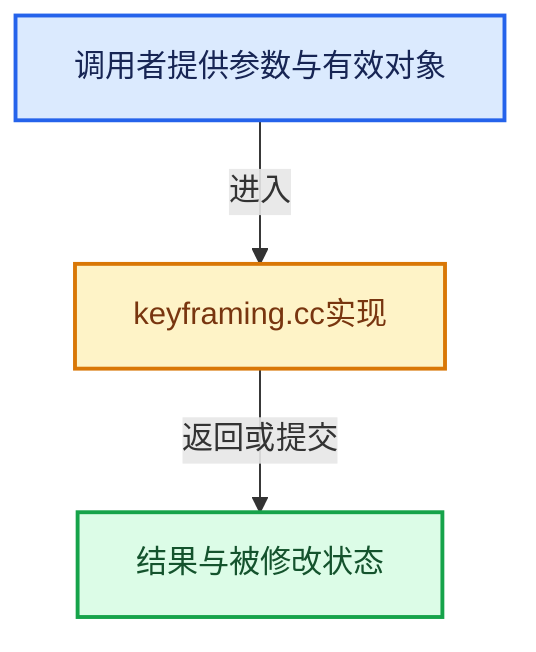

# 实现依赖专题：source/blender/editors/animation/keyframing.cc

[方向导航](README.md) · [符号索引](../%E7%AC%A6%E5%8F%B7%E4%BE%9D%E8%B5%96%E4%B8%8E%E5%AE%9E%E7%8E%B0%E7%B4%A2%E5%BC%95.md)

本专题从正文实际调用进入，集中保存共享实现。函数有稳定锚点，可从调用处直接跳到对应完整函数；递归与互相调用通过回链组织。

## 本文件的实现关系





## 完整成员与函数实现

<a id="f-7d947a40c626bb3d"></a>

### `blender::fcurve_is_changed`

实现位置：[source/blender/editors/animation/keyframing.cc](../../../../../source/blender/editors/animation/keyframing.cc) · L1656—L1673。

接口参数：

- `PointerRNA ptr`
- `PropertyRNA *prop`
- `FCurve *fcu`
- `const AnimationEvalContext *anim_eval_context`

**教学注释版**

<!-- annotated:5ae38f0ad18b92 -->

```cpp
bool fcurve_is_changed(PointerRNA ptr,
                       PropertyRNA *prop,
                       FCurve *fcu,
                       const AnimationEvalContext *anim_eval_context)
{
  PathResolvedRNA anim_rna;
  anim_rna.ptr = ptr;
  anim_rna.prop = prop;
  anim_rna.prop_index = fcu->array_index;

  int index = fcu->array_index;
  Vector<float> values = animrig::get_rna_values(&ptr, prop);

  float fcurve_val = calculate_fcurve(&anim_rna, fcu, anim_eval_context);
  // [讲解] values.size：用end_减begin_得到活元素数量。
  float cur_val = (index >= 0 && index < values.size()) ? values[index] : 0.0f;

  return !compare_ff_relative(fcurve_val, cur_val, FLT_EPSILON, 64);
}
```

<details>
<summary>核对原始源码：source/blender/editors/animation/keyframing.cc · L1656—L1673</summary>

<!-- original:5ae38f0ad18b92:source/blender/editors/animation/keyframing.cc:1656:1673 -->

```cpp
bool fcurve_is_changed(PointerRNA ptr,
                       PropertyRNA *prop,
                       FCurve *fcu,
                       const AnimationEvalContext *anim_eval_context)
{
  PathResolvedRNA anim_rna;
  anim_rna.ptr = ptr;
  anim_rna.prop = prop;
  anim_rna.prop_index = fcu->array_index;

  int index = fcu->array_index;
  Vector<float> values = animrig::get_rna_values(&ptr, prop);

  float fcurve_val = calculate_fcurve(&anim_rna, fcu, anim_eval_context);
  float cur_val = (index >= 0 && index < values.size()) ? values[index] : 0.0f;

  return !compare_ff_relative(fcurve_val, cur_val, FLT_EPSILON, 64);
}
```

</details>

**沿实际写入检查状态**

- `anim_rna.ptr = ptr;`
- `anim_rna.prop = prop;`
- `anim_rna.prop_index = fcu->array_index;`

**结果出口**

- `return !compare_ff_relative(fcurve_val, cur_val, FLT_EPSILON, 64);`

**继续追踪实现**

- `animrig::get_rna_values` → [blender::animrig::get_rna_values · L26](%E4%BE%9D%E8%B5%96-anim_rna-f43021.md#f-7122c6bd8e5e53c0)。
- `calculate_fcurve` → [blender::calculate_fcurve · L2498](%E4%BE%9D%E8%B5%96-fcurve-593e2e.md#f-b79d1d1beb2a8966)。
- `values.size` → [blender::Vector::size · L780](../01-%E5%9F%BA%E7%A1%80%E5%AE%B9%E5%99%A8%E4%B8%8E%E7%8E%B0%E4%BB%A3CPP/11-Vector%E6%8F%92%E5%85%A5%E5%88%A0%E9%99%A4%E4%B8%8E%E9%87%8D%E6%8E%92.md#f-714773731767349c)。
- `compare_ff_relative` → [blender::compare_ff_relative · L452](../12-%E7%A9%BA%E9%97%B4%E6%95%B0%E6%8D%AE%E7%BB%93%E6%9E%84%E4%B8%8E%E5%87%A0%E4%BD%95%E7%AE%97%E6%B3%95/%E4%BE%9D%E8%B5%96-math_base_inline-546b00.md#f-5b29e5b24e8dd45d)。
