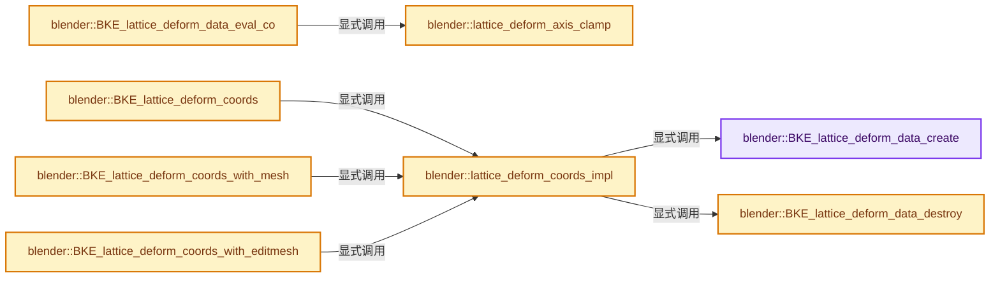
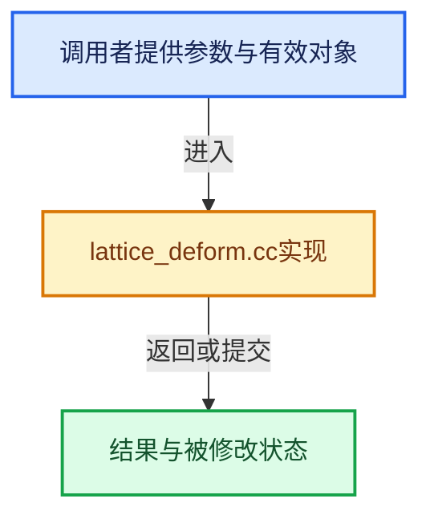

# 实现依赖专题：source/blender/blenkernel/intern/lattice_deform.cc

[方向导航](README.md) · [符号索引](../%E7%AC%A6%E5%8F%B7%E4%BE%9D%E8%B5%96%E4%B8%8E%E5%AE%9E%E7%8E%B0%E7%B4%A2%E5%BC%95.md)

本专题从正文实际调用进入，集中保存共享实现。函数有稳定锚点，可从调用处直接跳到对应完整函数；递归与互相调用通过回链组织。

## 本文件的实现关系






## 完整成员与函数实现

<a id="f-931964727c2c33b2"></a>

### `blender::BKE_lattice_deform_data_create`

实现位置：[source/blender/blenkernel/intern/lattice_deform.cc](../../../../../source/blender/blenkernel/intern/lattice_deform.cc) · L59—L141。

接口参数：

- `const Object *oblatt`
- `const Object *ob`

**教学注释版**

<!-- annotated:088cc50176118a -->

```cpp
LatticeDeformData *BKE_lattice_deform_data_create(const Object *oblatt, const Object *ob)
{
  /* we make an array with all differences */
  Lattice *lt = BKE_object_get_lattice(oblatt);
  DispList *dl = oblatt->runtime->curve_cache ?
                     BKE_displist_find(&oblatt->runtime->curve_cache->disp, DL_VERTS) :
                     nullptr;
  const float *co = dl ? dl->verts : nullptr;
  float *fp, imat[4][4];
  float fu, fv, fw;
  int u, v, w;
  float *latticedata;
  float *lattice_weights = nullptr;
  float latmat[4][4];
  LatticeDeformData *lattice_deform_data;
  /* May be null. */
  BPoint *bp = lt->def;

  const int32_t num_points = lt->pntsu * lt->pntsv * lt->pntsw;
  /* We allocate one additional float for SSE2 optimizations. Without this
   * the SSE2 instructions for the last item would read in unallocated memory. */
  fp = latticedata = MEM_new_array_uninitialized<float>(3 * size_t(num_points) + 1, "latticedata");

  /* for example with a particle system: (ob == nullptr) */
  if (ob == nullptr) {
    /* In deform-space, calc matrix. */
    invert_m4_m4(latmat, oblatt->object_to_world().ptr());

    /* back: put in deform array */
    invert_m4_m4(imat, latmat);
  }
  else {
    /* In deform-space, calc matrix. */
    invert_m4_m4(imat, oblatt->object_to_world().ptr());
    mul_m4_m4m4(latmat, imat, ob->object_to_world().ptr());

    /* back: put in deform array. */
    invert_m4_m4(imat, latmat);
  }

  /* Prefetch lattice deform group weights. */
  int defgrp_index = -1;
  const MDeformVert *dvert = BKE_lattice_deform_verts_get(oblatt);
  if (lt->vgroup[0] && dvert) {
    defgrp_index = BKE_id_defgroup_name_index(&lt->id, lt->vgroup);

    if (defgrp_index != -1) {
      lattice_weights = MEM_new_array_uninitialized<float>(size_t(num_points), "lattice_weights");
      for (int index = 0; index < num_points; index++) {
        lattice_weights[index] = BKE_defvert_find_weight(dvert + index, defgrp_index);
      }
    }
  }

  for (w = 0, fw = lt->fw; w < lt->pntsw; w++, fw += lt->dw) {
    for (v = 0, fv = lt->fv; v < lt->pntsv; v++, fv += lt->dv) {
      for (u = 0, fu = lt->fu; u < lt->pntsu; u++, fp += 3, fu += lt->du) {
        if (dl) {
          fp[0] = co[0] - fu;
          fp[1] = co[1] - fv;
          fp[2] = co[2] - fw;
          co += 3;
        }
        else {
          fp[0] = bp->vec[0] - fu;
          fp[1] = bp->vec[1] - fv;
          fp[2] = bp->vec[2] - fw;
          bp++;
        }

        mul_mat3_m4_v3(imat, fp);
      }
    }
  }

  lattice_deform_data = MEM_new_uninitialized<LatticeDeformData>("Lattice Deform Data");
  lattice_deform_data->latticedata = latticedata;
  lattice_deform_data->lattice_weights = lattice_weights;
  lattice_deform_data->lt = lt;
  copy_m4_m4(lattice_deform_data->latmat, latmat);

  return lattice_deform_data;
}
```

<details>
<summary>核对原始源码：source/blender/blenkernel/intern/lattice_deform.cc · L59—L141</summary>

<!-- original:088cc50176118a:source/blender/blenkernel/intern/lattice_deform.cc:59:141 -->

```cpp
LatticeDeformData *BKE_lattice_deform_data_create(const Object *oblatt, const Object *ob)
{
  /* we make an array with all differences */
  Lattice *lt = BKE_object_get_lattice(oblatt);
  DispList *dl = oblatt->runtime->curve_cache ?
                     BKE_displist_find(&oblatt->runtime->curve_cache->disp, DL_VERTS) :
                     nullptr;
  const float *co = dl ? dl->verts : nullptr;
  float *fp, imat[4][4];
  float fu, fv, fw;
  int u, v, w;
  float *latticedata;
  float *lattice_weights = nullptr;
  float latmat[4][4];
  LatticeDeformData *lattice_deform_data;
  /* May be null. */
  BPoint *bp = lt->def;

  const int32_t num_points = lt->pntsu * lt->pntsv * lt->pntsw;
  /* We allocate one additional float for SSE2 optimizations. Without this
   * the SSE2 instructions for the last item would read in unallocated memory. */
  fp = latticedata = MEM_new_array_uninitialized<float>(3 * size_t(num_points) + 1, "latticedata");

  /* for example with a particle system: (ob == nullptr) */
  if (ob == nullptr) {
    /* In deform-space, calc matrix. */
    invert_m4_m4(latmat, oblatt->object_to_world().ptr());

    /* back: put in deform array */
    invert_m4_m4(imat, latmat);
  }
  else {
    /* In deform-space, calc matrix. */
    invert_m4_m4(imat, oblatt->object_to_world().ptr());
    mul_m4_m4m4(latmat, imat, ob->object_to_world().ptr());

    /* back: put in deform array. */
    invert_m4_m4(imat, latmat);
  }

  /* Prefetch lattice deform group weights. */
  int defgrp_index = -1;
  const MDeformVert *dvert = BKE_lattice_deform_verts_get(oblatt);
  if (lt->vgroup[0] && dvert) {
    defgrp_index = BKE_id_defgroup_name_index(&lt->id, lt->vgroup);

    if (defgrp_index != -1) {
      lattice_weights = MEM_new_array_uninitialized<float>(size_t(num_points), "lattice_weights");
      for (int index = 0; index < num_points; index++) {
        lattice_weights[index] = BKE_defvert_find_weight(dvert + index, defgrp_index);
      }
    }
  }

  for (w = 0, fw = lt->fw; w < lt->pntsw; w++, fw += lt->dw) {
    for (v = 0, fv = lt->fv; v < lt->pntsv; v++, fv += lt->dv) {
      for (u = 0, fu = lt->fu; u < lt->pntsu; u++, fp += 3, fu += lt->du) {
        if (dl) {
          fp[0] = co[0] - fu;
          fp[1] = co[1] - fv;
          fp[2] = co[2] - fw;
          co += 3;
        }
        else {
          fp[0] = bp->vec[0] - fu;
          fp[1] = bp->vec[1] - fv;
          fp[2] = bp->vec[2] - fw;
          bp++;
        }

        mul_mat3_m4_v3(imat, fp);
      }
    }
  }

  lattice_deform_data = MEM_new_uninitialized<LatticeDeformData>("Lattice Deform Data");
  lattice_deform_data->latticedata = latticedata;
  lattice_deform_data->lattice_weights = lattice_weights;
  lattice_deform_data->lt = lt;
  copy_m4_m4(lattice_deform_data->latmat, latmat);

  return lattice_deform_data;
}
```

</details>

**沿实际写入检查状态**

- `fp = latticedata = MEM_new_array_uninitialized<float>(3 * size_t(num_points) + 1, "latticedata");`
- `defgrp_index = BKE_id_defgroup_name_index(&lt->id, lt->vgroup);`
- `lattice_weights = MEM_new_array_uninitialized<float>(size_t(num_points), "lattice_weights");`
- `lattice_weights[index] = BKE_defvert_find_weight(dvert + index, defgrp_index);`
- `fp[0] = co[0] - fu;`
- `fp[1] = co[1] - fv;`
- `fp[2] = co[2] - fw;`
- `co += 3;`
- `fp[0] = bp->vec[0] - fu;`
- `fp[1] = bp->vec[1] - fv;`
- `fp[2] = bp->vec[2] - fw;`
- `lattice_deform_data = MEM_new_uninitialized<LatticeDeformData>("Lattice Deform Data");`
- `lattice_deform_data->latticedata = latticedata;`
- `lattice_deform_data->lattice_weights = lattice_weights;`
- `lattice_deform_data->lt = lt;`

**结果出口**

- `return lattice_deform_data;`

**继续追踪实现**

- `BKE_object_get_lattice` → [blender::BKE_object_get_lattice · L4545](%E4%BE%9D%E8%B5%96-object-843689.md#f-947a32f5c471e9ed)。
- `BKE_displist_find` → [blender::BKE_displist_find · L75](%E4%BE%9D%E8%B5%96-displist-7e6457.md#f-64a8e45792ce7493)。
- `MEM_new_array_uninitialized<float>` → [MEM_new_array_uninitialized · L608](../03-%E5%86%85%E5%AD%98%E5%88%86%E9%85%8D%E4%B8%8E%E8%BF%90%E8%A1%8C%E6%97%B6%E7%B1%BB%E5%9E%8B/%E4%BE%9D%E8%B5%96-MEM_guardedalloc-b54eca.md#f-b7103eae8eb57b05)；[MEM_new_array_uninitialized · L129](../03-%E5%86%85%E5%AD%98%E5%88%86%E9%85%8D%E4%B8%8E%E8%BF%90%E8%A1%8C%E6%97%B6%E7%B1%BB%E5%9E%8B/%E4%BE%9D%E8%B5%96-mallocn-afdcd4.md#f-bf6ef4ddcfb6e5df)。同名重载需按实参类型选择。
- `invert_m4_m4` → [blender::invert_m4_m4 · L1150](../12-%E7%A9%BA%E9%97%B4%E6%95%B0%E6%8D%AE%E7%BB%93%E6%9E%84%E4%B8%8E%E5%87%A0%E4%BD%95%E7%AE%97%E6%B3%95/%E4%BE%9D%E8%B5%96-math_matrix_c-004123.md#f-c75789f10cdd5b92)。
- `oblatt->object_to_world().ptr` → [调用协议](../%E6%A8%A1%E6%9D%BF%E5%AE%8F%E4%B8%8E%E5%8A%A8%E6%80%81%E5%88%86%E6%B4%BE%E5%8D%8F%E8%AE%AE.md)：接收对象类型依赖auto、返回值或模板实例；不按同名猜测目标。调用位置L85。
- `oblatt->object_to_world` → [blender::Object::object_to_world · L5761](%E4%BE%9D%E8%B5%96-object-843689.md#f-12fc20026327d50c)。
- `mul_m4_m4m4` → [blender::mul_m4_m4m4 · L217](../12-%E7%A9%BA%E9%97%B4%E6%95%B0%E6%8D%AE%E7%BB%93%E6%9E%84%E4%B8%8E%E5%87%A0%E4%BD%95%E7%AE%97%E6%B3%95/%E4%BE%9D%E8%B5%96-math_matrix_c-004123.md#f-b5272136b543b73b)。
- `ob->object_to_world().ptr` → [调用协议](../%E6%A8%A1%E6%9D%BF%E5%AE%8F%E4%B8%8E%E5%8A%A8%E6%80%81%E5%88%86%E6%B4%BE%E5%8D%8F%E8%AE%AE.md)：接收对象类型依赖auto、返回值或模板实例；不按同名猜测目标。调用位置L93。
- `ob->object_to_world` → [blender::Object::object_to_world · L5761](%E4%BE%9D%E8%B5%96-object-843689.md#f-12fc20026327d50c)。
- `BKE_lattice_deform_verts_get` → [blender::BKE_lattice_deform_verts_get · L583](%E4%BE%9D%E8%B5%96-lattice-b3920b.md#f-93c02e0870685a74)。
- `BKE_id_defgroup_name_index` → [blender::BKE_id_defgroup_name_index · L557](%E4%BE%9D%E8%B5%96-deform-6949f4.md#f-886667bbd10fa710)。
- `BKE_defvert_find_weight` → [blender::BKE_defvert_find_weight · L779](%E4%BE%9D%E8%B5%96-deform-6949f4.md#f-c117fcd05c4fd453)。
- `mul_mat3_m4_v3` → [blender::mul_mat3_m4_v3 · L738](../12-%E7%A9%BA%E9%97%B4%E6%95%B0%E6%8D%AE%E7%BB%93%E6%9E%84%E4%B8%8E%E5%87%A0%E4%BD%95%E7%AE%97%E6%B3%95/%E4%BE%9D%E8%B5%96-math_matrix_c-004123.md#f-85a92f87ede557ca)。
- `MEM_new_uninitialized<LatticeDeformData>` → [MEM_new_uninitialized · L590](../03-%E5%86%85%E5%AD%98%E5%88%86%E9%85%8D%E4%B8%8E%E8%BF%90%E8%A1%8C%E6%97%B6%E7%B1%BB%E5%9E%8B/%E4%BE%9D%E8%B5%96-MEM_guardedalloc-b54eca.md#f-c773b2e5b8fe70e4)；[MEM_new_uninitialized · L124](../03-%E5%86%85%E5%AD%98%E5%88%86%E9%85%8D%E4%B8%8E%E8%BF%90%E8%A1%8C%E6%97%B6%E7%B1%BB%E5%9E%8B/%E4%BE%9D%E8%B5%96-mallocn-afdcd4.md#f-28a7e00a1e67f699)。同名重载需按实参类型选择。
- `copy_m4_m4` → [blender::copy_m4_m4 · L84](../12-%E7%A9%BA%E9%97%B4%E6%95%B0%E6%8D%AE%E7%BB%93%E6%9E%84%E4%B8%8E%E5%87%A0%E4%BD%95%E7%AE%97%E6%B3%95/%E4%BE%9D%E8%B5%96-math_matrix_c-004123.md#f-b4390cf8c94710f5)。

<a id="f-a6bcaf52325b9c6c"></a>

### `blender::lattice_deform_axis_clamp`

实现位置：[source/blender/blenkernel/intern/lattice_deform.cc](../../../../../source/blender/blenkernel/intern/lattice_deform.cc) · L146—L165。

接口参数：

- `const float value`
- `const int points_num`

**教学注释版**

<!-- annotated:4b3eca546fdadb -->

```cpp
static float lattice_deform_axis_clamp(const float value, const int points_num)
{
  /* `int(floor(value))` (performed by the caller) is undefined when `value` is non-finite or
   * outside the `int` range. This can happen when an object is located near the limits of float.
   * Clamping `value` rather than the resulting index keeps the fractional `value - floor()`
   * in `[0, 1)`, as it is for coordinates inside the lattice, see: #160589.
   *
   * Regarding the range: `[-2, points_num]`.
   * The caller samples cells `index - 1` to `index + 2` so values outside this range
   * all clamp to one boundary cell and the result is unchanged. */

  /* Catches infinity and NaN. */
  if (!(value > -2.0f)) [[unlikely]] {
    return -2.0f;
  }
  if (value >= float(points_num)) [[unlikely]] {
    return float(points_num);
  }
  return value;
}
```

<details>
<summary>核对原始源码：source/blender/blenkernel/intern/lattice_deform.cc · L146—L165</summary>

<!-- original:4b3eca546fdadb:source/blender/blenkernel/intern/lattice_deform.cc:146:165 -->

```cpp
static float lattice_deform_axis_clamp(const float value, const int points_num)
{
  /* `int(floor(value))` (performed by the caller) is undefined when `value` is non-finite or
   * outside the `int` range. This can happen when an object is located near the limits of float.
   * Clamping `value` rather than the resulting index keeps the fractional `value - floor()`
   * in `[0, 1)`, as it is for coordinates inside the lattice, see: #160589.
   *
   * Regarding the range: `[-2, points_num]`.
   * The caller samples cells `index - 1` to `index + 2` so values outside this range
   * all clamp to one boundary cell and the result is unchanged. */

  /* Catches infinity and NaN. */
  if (!(value > -2.0f)) [[unlikely]] {
    return -2.0f;
  }
  if (value >= float(points_num)) [[unlikely]] {
    return float(points_num);
  }
  return value;
}
```

</details>

**结果出口**

- `return -2.0f;`
- `return float(points_num);`
- `return value;`

**继续追踪实现**

本实现没有需要继续展开的显式调用；检查返回表达式、对象转换和调用者前置条件。

<a id="f-9e3b9b7cdfecb125"></a>

### `blender::BKE_lattice_deform_data_eval_co`

实现位置：[source/blender/blenkernel/intern/lattice_deform.cc](../../../../../source/blender/blenkernel/intern/lattice_deform.cc) · L167—L277。

接口参数：

- `LatticeDeformData *lattice_deform_data`
- `float co[3]`
- `float weight`

**教学注释版**

<!-- annotated:68063e1dc6f4e5 -->

```cpp
void BKE_lattice_deform_data_eval_co(LatticeDeformData *lattice_deform_data,
                                     float co[3],
                                     float weight)
{
  float *latticedata = lattice_deform_data->latticedata;
  float *lattice_weights = lattice_deform_data->lattice_weights;
  BLI_assert(latticedata);
  const Lattice *lt = lattice_deform_data->lt;
  float u, v, w, tu[4], tv[4], tw[4];
  float vec[3];
  int idx_w, idx_v, idx_u;
  int ui, vi, wi, uu, vv, ww;

  /* vgroup influence */
  float co_prev[4] = {0}, weight_blend = 0.0f;
  copy_v3_v3(co_prev, co);
#if BLI_HAVE_SSE2
  __m128 co_vec = _mm_loadu_ps(co_prev);
#endif

  /* co is in local coords, treat with latmat */
  mul_v3_m4v3(vec, lattice_deform_data->latmat, co);

  /* u v w coords */

  if (lt->pntsu > 1) {
    u = lattice_deform_axis_clamp((vec[0] - lt->fu) / lt->du, lt->pntsu);
    ui = int(floor(u));
    u -= ui;
    key_curve_position_weights(u, tu, KeyInterpolationType(lt->typeu));
  }
  else {
    tu[0] = tu[2] = tu[3] = 0.0;
    tu[1] = 1.0;
    ui = 0;
  }

  if (lt->pntsv > 1) {
    v = lattice_deform_axis_clamp((vec[1] - lt->fv) / lt->dv, lt->pntsv);
    vi = int(floor(v));
    v -= vi;
    key_curve_position_weights(v, tv, KeyInterpolationType(lt->typev));
  }
  else {
    tv[0] = tv[2] = tv[3] = 0.0;
    tv[1] = 1.0;
    vi = 0;
  }

  if (lt->pntsw > 1) {
    w = lattice_deform_axis_clamp((vec[2] - lt->fw) / lt->dw, lt->pntsw);
    wi = int(floor(w));
    w -= wi;
    key_curve_position_weights(w, tw, KeyInterpolationType(lt->typew));
  }
  else {
    tw[0] = tw[2] = tw[3] = 0.0;
    tw[1] = 1.0;
    wi = 0;
  }

  const int w_stride = lt->pntsu * lt->pntsv;
  const int idx_w_max = (lt->pntsw - 1) * lt->pntsu * lt->pntsv;
  const int v_stride = lt->pntsu;
  const int idx_v_max = (lt->pntsv - 1) * lt->pntsu;
  const int idx_u_max = (lt->pntsu - 1);

  for (ww = wi - 1; ww <= wi + 2; ww++) {
    w = weight * tw[ww - wi + 1];
    idx_w = std::clamp(ww * w_stride, 0, idx_w_max);
    for (vv = vi - 1; vv <= vi + 2; vv++) {
      v = w * tv[vv - vi + 1];
      idx_v = std::clamp(vv * v_stride, 0, idx_v_max);
      for (uu = ui - 1; uu <= ui + 2; uu++) {
        u = v * tu[uu - ui + 1];
        idx_u = std::clamp(uu, 0, idx_u_max);
        const int idx = idx_w + idx_v + idx_u;
#if BLI_HAVE_SSE2
        {
          __m128 weight_vec = _mm_set1_ps(u);
          /* We need to address special case for last item to avoid accessing invalid memory. */
          __m128 lattice_vec;
          if (idx * 3 == idx_w_max) {
            copy_v3_v3(reinterpret_cast<float *>(&lattice_vec), &latticedata[idx * 3]);
          }
          else {
            /* When not on last item, we can safely access one extra float, it will be ignored
             * anyway. */
            lattice_vec = _mm_loadu_ps(&latticedata[idx * 3]);
          }
          co_vec = _mm_add_ps(co_vec, _mm_mul_ps(lattice_vec, weight_vec));
        }
#else
        madd_v3_v3fl(co, &latticedata[idx * 3], u);
#endif
        if (lattice_weights) {
          weight_blend += (u * lattice_weights[idx]);
        }
      }
    }
  }
#if BLI_HAVE_SSE2
  {
    copy_v3_v3(co, reinterpret_cast<float *>(&co_vec));
  }
#endif

  if (lattice_weights) {
    interp_v3_v3v3(co, co_prev, co, weight_blend);
  }
}
```

<details>
<summary>核对原始源码：source/blender/blenkernel/intern/lattice_deform.cc · L167—L277</summary>

<!-- original:68063e1dc6f4e5:source/blender/blenkernel/intern/lattice_deform.cc:167:277 -->

```cpp
void BKE_lattice_deform_data_eval_co(LatticeDeformData *lattice_deform_data,
                                     float co[3],
                                     float weight)
{
  float *latticedata = lattice_deform_data->latticedata;
  float *lattice_weights = lattice_deform_data->lattice_weights;
  BLI_assert(latticedata);
  const Lattice *lt = lattice_deform_data->lt;
  float u, v, w, tu[4], tv[4], tw[4];
  float vec[3];
  int idx_w, idx_v, idx_u;
  int ui, vi, wi, uu, vv, ww;

  /* vgroup influence */
  float co_prev[4] = {0}, weight_blend = 0.0f;
  copy_v3_v3(co_prev, co);
#if BLI_HAVE_SSE2
  __m128 co_vec = _mm_loadu_ps(co_prev);
#endif

  /* co is in local coords, treat with latmat */
  mul_v3_m4v3(vec, lattice_deform_data->latmat, co);

  /* u v w coords */

  if (lt->pntsu > 1) {
    u = lattice_deform_axis_clamp((vec[0] - lt->fu) / lt->du, lt->pntsu);
    ui = int(floor(u));
    u -= ui;
    key_curve_position_weights(u, tu, KeyInterpolationType(lt->typeu));
  }
  else {
    tu[0] = tu[2] = tu[3] = 0.0;
    tu[1] = 1.0;
    ui = 0;
  }

  if (lt->pntsv > 1) {
    v = lattice_deform_axis_clamp((vec[1] - lt->fv) / lt->dv, lt->pntsv);
    vi = int(floor(v));
    v -= vi;
    key_curve_position_weights(v, tv, KeyInterpolationType(lt->typev));
  }
  else {
    tv[0] = tv[2] = tv[3] = 0.0;
    tv[1] = 1.0;
    vi = 0;
  }

  if (lt->pntsw > 1) {
    w = lattice_deform_axis_clamp((vec[2] - lt->fw) / lt->dw, lt->pntsw);
    wi = int(floor(w));
    w -= wi;
    key_curve_position_weights(w, tw, KeyInterpolationType(lt->typew));
  }
  else {
    tw[0] = tw[2] = tw[3] = 0.0;
    tw[1] = 1.0;
    wi = 0;
  }

  const int w_stride = lt->pntsu * lt->pntsv;
  const int idx_w_max = (lt->pntsw - 1) * lt->pntsu * lt->pntsv;
  const int v_stride = lt->pntsu;
  const int idx_v_max = (lt->pntsv - 1) * lt->pntsu;
  const int idx_u_max = (lt->pntsu - 1);

  for (ww = wi - 1; ww <= wi + 2; ww++) {
    w = weight * tw[ww - wi + 1];
    idx_w = std::clamp(ww * w_stride, 0, idx_w_max);
    for (vv = vi - 1; vv <= vi + 2; vv++) {
      v = w * tv[vv - vi + 1];
      idx_v = std::clamp(vv * v_stride, 0, idx_v_max);
      for (uu = ui - 1; uu <= ui + 2; uu++) {
        u = v * tu[uu - ui + 1];
        idx_u = std::clamp(uu, 0, idx_u_max);
        const int idx = idx_w + idx_v + idx_u;
#if BLI_HAVE_SSE2
        {
          __m128 weight_vec = _mm_set1_ps(u);
          /* We need to address special case for last item to avoid accessing invalid memory. */
          __m128 lattice_vec;
          if (idx * 3 == idx_w_max) {
            copy_v3_v3(reinterpret_cast<float *>(&lattice_vec), &latticedata[idx * 3]);
          }
          else {
            /* When not on last item, we can safely access one extra float, it will be ignored
             * anyway. */
            lattice_vec = _mm_loadu_ps(&latticedata[idx * 3]);
          }
          co_vec = _mm_add_ps(co_vec, _mm_mul_ps(lattice_vec, weight_vec));
        }
#else
        madd_v3_v3fl(co, &latticedata[idx * 3], u);
#endif
        if (lattice_weights) {
          weight_blend += (u * lattice_weights[idx]);
        }
      }
    }
  }
#if BLI_HAVE_SSE2
  {
    copy_v3_v3(co, reinterpret_cast<float *>(&co_vec));
  }
#endif

  if (lattice_weights) {
    interp_v3_v3v3(co, co_prev, co, weight_blend);
  }
}
```

</details>

**沿实际写入检查状态**

- `u = lattice_deform_axis_clamp((vec[0] - lt->fu) / lt->du, lt->pntsu);`
- `ui = int(floor(u));`
- `u -= ui;`
- `tu[0] = tu[2] = tu[3] = 0.0;`
- `tu[1] = 1.0;`
- `ui = 0;`
- `v = lattice_deform_axis_clamp((vec[1] - lt->fv) / lt->dv, lt->pntsv);`
- `vi = int(floor(v));`
- `v -= vi;`
- `tv[0] = tv[2] = tv[3] = 0.0;`
- `tv[1] = 1.0;`
- `vi = 0;`
- `w = lattice_deform_axis_clamp((vec[2] - lt->fw) / lt->dw, lt->pntsw);`
- `wi = int(floor(w));`
- `w -= wi;`
- `tw[0] = tw[2] = tw[3] = 0.0;`
- `tw[1] = 1.0;`
- `wi = 0;`
- `w = weight * tw[ww - wi + 1];`
- `idx_w = std::clamp(ww * w_stride, 0, idx_w_max);`
- `v = w * tv[vv - vi + 1];`
- `idx_v = std::clamp(vv * v_stride, 0, idx_v_max);`
- `u = v * tu[uu - ui + 1];`
- `idx_u = std::clamp(uu, 0, idx_u_max);`
- `lattice_vec = _mm_loadu_ps(&latticedata[idx * 3]);`
- `co_vec = _mm_add_ps(co_vec, _mm_mul_ps(lattice_vec, weight_vec));`
- `weight_blend += (u * lattice_weights[idx]);`

**继续追踪实现**

- `BLI_assert` → [BLI_assert · L48](../01-%E5%9F%BA%E7%A1%80%E5%AE%B9%E5%99%A8%E4%B8%8E%E7%8E%B0%E4%BB%A3CPP/%E4%BE%9D%E8%B5%96-BLI_assert-cc98e8.md#m-57a88495704d)；[BLI_assert · L63](../01-%E5%9F%BA%E7%A1%80%E5%AE%B9%E5%99%A8%E4%B8%8E%E7%8E%B0%E4%BB%A3CPP/%E4%BE%9D%E8%B5%96-BLI_assert-cc98e8.md#m-d07050020cb5)。宏定义由构建条件选择。
- `copy_v3_v3` → [blender::copy_v3_v3 · L47](../12-%E7%A9%BA%E9%97%B4%E6%95%B0%E6%8D%AE%E7%BB%93%E6%9E%84%E4%B8%8E%E5%87%A0%E4%BD%95%E7%AE%97%E6%B3%95/%E4%BE%9D%E8%B5%96-math_vector_inline-0c8541.md#f-037a0d5fa5060bd6)。
- `_mm_loadu_ps` → [调用协议](../%E6%A8%A1%E6%9D%BF%E5%AE%8F%E4%B8%8E%E5%8A%A8%E6%80%81%E5%88%86%E6%B4%BE%E5%8D%8F%E8%AE%AE.md)：函数指针、局部可调用对象或未展开的宏；必须结合调用者环境。调用位置L184。
- `mul_v3_m4v3` → [blender::mul_v3_m4v3 · L687](../12-%E7%A9%BA%E9%97%B4%E6%95%B0%E6%8D%AE%E7%BB%93%E6%9E%84%E4%B8%8E%E5%87%A0%E4%BD%95%E7%AE%97%E6%B3%95/%E4%BE%9D%E8%B5%96-math_matrix_c-004123.md#f-31076c71c40783a8)。
- `lattice_deform_axis_clamp` → [blender::lattice_deform_axis_clamp · L146](%E4%BE%9D%E8%B5%96-lattice_deform-0c25d0.md#f-a6bcaf52325b9c6c)。
- `floor` → [外部契约](https://eel.is/c++draft/)：这个边界按实际表达式及所属类型核对参数、返回值、寿命与失败行为。这里提供接口入口，不声称已解释该第三方版本的内部实现。
- `key_curve_position_weights` → [blender::key_curve_position_weights · L310](%E4%BE%9D%E8%B5%96-key-2b3be3.md#f-afb0f795e30f80db)。
- `KeyInterpolationType` → [blender::KeyInterpolationType](%E4%BE%9D%E8%B5%96-DNA_key_types-60acde.md#t-9992054eaf23)。
- `std::clamp` → [外部契约](https://eel.is/c++draft/)：这个边界按实际表达式及所属类型核对参数、返回值、寿命与失败行为。这里提供接口入口，不声称已解释该第三方版本的内部实现。
- `_mm_set1_ps` → [调用协议](../%E6%A8%A1%E6%9D%BF%E5%AE%8F%E4%B8%8E%E5%8A%A8%E6%80%81%E5%88%86%E6%B4%BE%E5%8D%8F%E8%AE%AE.md)：函数指针、局部可调用对象或未展开的宏；必须结合调用者环境。调用位置L246。
- `_mm_add_ps` → [调用协议](../%E6%A8%A1%E6%9D%BF%E5%AE%8F%E4%B8%8E%E5%8A%A8%E6%80%81%E5%88%86%E6%B4%BE%E5%8D%8F%E8%AE%AE.md)：函数指针、局部可调用对象或未展开的宏；必须结合调用者环境。调用位置L257。
- `_mm_mul_ps` → [调用协议](../%E6%A8%A1%E6%9D%BF%E5%AE%8F%E4%B8%8E%E5%8A%A8%E6%80%81%E5%88%86%E6%B4%BE%E5%8D%8F%E8%AE%AE.md)：函数指针、局部可调用对象或未展开的宏；必须结合调用者环境。调用位置L257。
- `madd_v3_v3fl` → [blender::madd_v3_v3fl · L501](../12-%E7%A9%BA%E9%97%B4%E6%95%B0%E6%8D%AE%E7%BB%93%E6%9E%84%E4%B8%8E%E5%87%A0%E4%BD%95%E7%AE%97%E6%B3%95/%E4%BE%9D%E8%B5%96-math_vector_inline-0c8541.md#f-4f81667c5d595c80)。
- `interp_v3_v3v3` → [blender::interp_v3_v3v3 · L41](../12-%E7%A9%BA%E9%97%B4%E6%95%B0%E6%8D%AE%E7%BB%93%E6%9E%84%E4%B8%8E%E5%87%A0%E4%BD%95%E7%AE%97%E6%B3%95/%E4%BE%9D%E8%B5%96-math_vector-5f35fa.md#f-18251c70c00824d7)。

<a id="f-099172e0b236fb3c"></a>

### `blender::BKE_lattice_deform_data_destroy`

实现位置：[source/blender/blenkernel/intern/lattice_deform.cc](../../../../../source/blender/blenkernel/intern/lattice_deform.cc) · L279—L286。

接口参数：

- `LatticeDeformData *lattice_deform_data`

**教学注释版**

<!-- annotated:d8fcc4625eebf0 -->

```cpp
void BKE_lattice_deform_data_destroy(LatticeDeformData *lattice_deform_data)
{
  if (lattice_deform_data->latticedata) {
    MEM_delete(lattice_deform_data->latticedata);
  }

  MEM_delete(lattice_deform_data);
}
```

<details>
<summary>核对原始源码：source/blender/blenkernel/intern/lattice_deform.cc · L279—L286</summary>

<!-- original:d8fcc4625eebf0:source/blender/blenkernel/intern/lattice_deform.cc:279:286 -->

```cpp
void BKE_lattice_deform_data_destroy(LatticeDeformData *lattice_deform_data)
{
  if (lattice_deform_data->latticedata) {
    MEM_delete(lattice_deform_data->latticedata);
  }

  MEM_delete(lattice_deform_data);
}
```

</details>

**继续追踪实现**

- `MEM_delete` → [MEM_delete · L400](../03-%E5%86%85%E5%AD%98%E5%88%86%E9%85%8D%E4%B8%8E%E8%BF%90%E8%A1%8C%E6%97%B6%E7%B1%BB%E5%9E%8B/%E4%BE%9D%E8%B5%96-MEM_guardedalloc-b54eca.md#f-9049ffdd1682887c)。

<a id="f-c77a3bdccf4a5456"></a>

### `blender::lattice_deform_coords_impl`

实现位置：[source/blender/blenkernel/intern/lattice_deform.cc](../../../../../source/blender/blenkernel/intern/lattice_deform.cc) · L357—L439。

接口参数：

- `const Object *ob_lattice`
- `const Object *ob_target`
- `float (*vert_coords)[3]`
- `const int vert_coords_len`
- `const short flag`
- `const char *defgrp_name`
- `const float fac`
- `const Mesh *me_target`
- `const BMEditMesh *em_target`

**教学注释版**

<!-- annotated:a16f3645490d90 -->

```cpp
static void lattice_deform_coords_impl(const Object *ob_lattice,
                                       const Object *ob_target,
                                       float (*vert_coords)[3],
                                       const int vert_coords_len,
                                       const short flag,
                                       const char *defgrp_name,
                                       const float fac,
                                       const Mesh *me_target,
                                       const BMEditMesh *em_target)
{
  LatticeDeformData *lattice_deform_data;
  const MDeformVert *dvert = nullptr;
  int defgrp_index = -1;
  int cd_dvert_offset = -1;
  BMesh *bm = nullptr;

  if (ob_lattice->type != OB_LATTICE) {
    return;
  }

  lattice_deform_data = BKE_lattice_deform_data_create(ob_lattice, ob_target);

  if (em_target != nullptr) {
    bm = const_cast<BMesh *>(BKE_editmesh_bmesh_get(ob_target));
  }

  /* Check whether to use vertex groups (only possible if ob_target is a Mesh or Lattice).
   * We want either a Mesh/Lattice with no derived data, or derived data with deformverts.
   */
  if (defgrp_name && defgrp_name[0] && ob_target && ELEM(ob_target->type, OB_MESH, OB_LATTICE)) {
    defgrp_index = BKE_id_defgroup_name_index(me_target ? &me_target->id : ob_target->data,
                                              defgrp_name);

    if (defgrp_index != -1) {
      /* if there's derived data without deformverts, don't use vgroups */
      if (em_target) {
        cd_dvert_offset = CustomData_get_offset(&bm->vdata, CD_MDEFORMVERT);
      }
      else if (me_target) {
        dvert = me_target->deform_verts().data();
      }
      else if (ob_target->type == OB_LATTICE) {
        dvert = (id_cast<Lattice *>(ob_target->data))->dvert;
      }
      else {
        dvert = (id_cast<Mesh *>(ob_target->data))->deform_verts().data();
      }
    }
  }

  LatticeDeformUserdata data{};
  data.lattice_deform_data = lattice_deform_data;
  data.vert_coords = vert_coords;
  data.dvert = dvert;
  data.defgrp_index = defgrp_index;
  data.fac = fac;
  data.invert_vgroup = (flag & MOD_LATTICE_INVERT_VGROUP) != 0;
  data.bmesh.cd_dvert_offset = cd_dvert_offset;

  if (em_target != nullptr) {
    /* While this could cause an extra loop over mesh data, in most cases this will
     * have already been properly set. */
    BM_mesh_elem_index_ensure(bm, BM_VERT);

    TaskParallelSettings settings;
    BLI_parallel_mempool_settings_defaults(&settings);

    if (cd_dvert_offset != -1) {
      BLI_task_parallel_mempool(bm->vpool, &data, lattice_vert_task_editmesh, &settings);
    }
    else {
      BLI_task_parallel_mempool(bm->vpool, &data, lattice_vert_task_editmesh_no_dvert, &settings);
    }
  }
  else {
    TaskParallelSettings settings;
    BLI_parallel_range_settings_defaults(&settings);
    settings.min_iter_per_thread = 32;
    BLI_task_parallel_range(0, vert_coords_len, &data, lattice_deform_vert_task, &settings);
  }

  BKE_lattice_deform_data_destroy(lattice_deform_data);
}
```

<details>
<summary>核对原始源码：source/blender/blenkernel/intern/lattice_deform.cc · L357—L439</summary>

<!-- original:a16f3645490d90:source/blender/blenkernel/intern/lattice_deform.cc:357:439 -->

```cpp
static void lattice_deform_coords_impl(const Object *ob_lattice,
                                       const Object *ob_target,
                                       float (*vert_coords)[3],
                                       const int vert_coords_len,
                                       const short flag,
                                       const char *defgrp_name,
                                       const float fac,
                                       const Mesh *me_target,
                                       const BMEditMesh *em_target)
{
  LatticeDeformData *lattice_deform_data;
  const MDeformVert *dvert = nullptr;
  int defgrp_index = -1;
  int cd_dvert_offset = -1;
  BMesh *bm = nullptr;

  if (ob_lattice->type != OB_LATTICE) {
    return;
  }

  lattice_deform_data = BKE_lattice_deform_data_create(ob_lattice, ob_target);

  if (em_target != nullptr) {
    bm = const_cast<BMesh *>(BKE_editmesh_bmesh_get(ob_target));
  }

  /* Check whether to use vertex groups (only possible if ob_target is a Mesh or Lattice).
   * We want either a Mesh/Lattice with no derived data, or derived data with deformverts.
   */
  if (defgrp_name && defgrp_name[0] && ob_target && ELEM(ob_target->type, OB_MESH, OB_LATTICE)) {
    defgrp_index = BKE_id_defgroup_name_index(me_target ? &me_target->id : ob_target->data,
                                              defgrp_name);

    if (defgrp_index != -1) {
      /* if there's derived data without deformverts, don't use vgroups */
      if (em_target) {
        cd_dvert_offset = CustomData_get_offset(&bm->vdata, CD_MDEFORMVERT);
      }
      else if (me_target) {
        dvert = me_target->deform_verts().data();
      }
      else if (ob_target->type == OB_LATTICE) {
        dvert = (id_cast<Lattice *>(ob_target->data))->dvert;
      }
      else {
        dvert = (id_cast<Mesh *>(ob_target->data))->deform_verts().data();
      }
    }
  }

  LatticeDeformUserdata data{};
  data.lattice_deform_data = lattice_deform_data;
  data.vert_coords = vert_coords;
  data.dvert = dvert;
  data.defgrp_index = defgrp_index;
  data.fac = fac;
  data.invert_vgroup = (flag & MOD_LATTICE_INVERT_VGROUP) != 0;
  data.bmesh.cd_dvert_offset = cd_dvert_offset;

  if (em_target != nullptr) {
    /* While this could cause an extra loop over mesh data, in most cases this will
     * have already been properly set. */
    BM_mesh_elem_index_ensure(bm, BM_VERT);

    TaskParallelSettings settings;
    BLI_parallel_mempool_settings_defaults(&settings);

    if (cd_dvert_offset != -1) {
      BLI_task_parallel_mempool(bm->vpool, &data, lattice_vert_task_editmesh, &settings);
    }
    else {
      BLI_task_parallel_mempool(bm->vpool, &data, lattice_vert_task_editmesh_no_dvert, &settings);
    }
  }
  else {
    TaskParallelSettings settings;
    BLI_parallel_range_settings_defaults(&settings);
    settings.min_iter_per_thread = 32;
    BLI_task_parallel_range(0, vert_coords_len, &data, lattice_deform_vert_task, &settings);
  }

  BKE_lattice_deform_data_destroy(lattice_deform_data);
}
```

</details>

**沿实际写入检查状态**

- `lattice_deform_data = BKE_lattice_deform_data_create(ob_lattice, ob_target);`
- `bm = const_cast<BMesh *>(BKE_editmesh_bmesh_get(ob_target));`
- `defgrp_index = BKE_id_defgroup_name_index(me_target ? &me_target->id : ob_target->data,`
- `cd_dvert_offset = CustomData_get_offset(&bm->vdata, CD_MDEFORMVERT);`
- `dvert = me_target->deform_verts().data();`
- `dvert = (id_cast<Lattice *>(ob_target->data))->dvert;`
- `dvert = (id_cast<Mesh *>(ob_target->data))->deform_verts().data();`
- `data.lattice_deform_data = lattice_deform_data;`
- `data.vert_coords = vert_coords;`
- `data.dvert = dvert;`
- `data.defgrp_index = defgrp_index;`
- `data.fac = fac;`
- `data.invert_vgroup = (flag & MOD_LATTICE_INVERT_VGROUP) != 0;`
- `data.bmesh.cd_dvert_offset = cd_dvert_offset;`
- `settings.min_iter_per_thread = 32;`

**继续追踪实现**

- `BKE_lattice_deform_data_create` → [blender::BKE_lattice_deform_data_create · L59](%E4%BE%9D%E8%B5%96-lattice_deform-0c25d0.md#f-931964727c2c33b2)。
- `BKE_editmesh_bmesh_get` → [blender::BKE_editmesh_bmesh_get · L65](%E4%BE%9D%E8%B5%96-editmesh-1ee56f.md#f-2afdd2773d3f0d88)；[blender::BKE_editmesh_bmesh_get · L71](%E4%BE%9D%E8%B5%96-editmesh-1ee56f.md#f-80631d704a7e9947)。同名重载需按实参类型选择。
- `ELEM` → [ELEM · L88](%E4%BE%9D%E8%B5%96-GHOST_utildefines-34b996.md#m-d28724a15928)；[ELEM · L135](../01-%E5%9F%BA%E7%A1%80%E5%AE%B9%E5%99%A8%E4%B8%8E%E7%8E%B0%E4%BB%A3CPP/%E4%BE%9D%E8%B5%96-BLI_utildefines-293a0a.md#m-d6572de7cae0)。宏定义由构建条件选择。
- `BKE_id_defgroup_name_index` → [blender::BKE_id_defgroup_name_index · L557](%E4%BE%9D%E8%B5%96-deform-6949f4.md#f-886667bbd10fa710)。
- `CustomData_get_offset` → [blender::CustomData_get_offset · L3379](%E4%BE%9D%E8%B5%96-customdata-2eef81.md#f-e0e230c6120acc9a)。
- `me_target->deform_verts().data` → [调用协议](../%E6%A8%A1%E6%9D%BF%E5%AE%8F%E4%B8%8E%E5%8A%A8%E6%80%81%E5%88%86%E6%B4%BE%E5%8D%8F%E8%AE%AE.md)：接收对象类型依赖auto、返回值或模板实例；不按同名猜测目标。调用位置L396。
- `me_target->deform_verts` → [Mesh::deform_verts · L1266](03-MPoly%E8%BF%81%E7%A7%BB%E4%B8%8E%E5%85%BC%E5%AE%B9.md#f-4c0433aad24aa301)。
- `id_cast<Lattice *>` → [blender::id_cast · L1417](%E4%BE%9D%E8%B5%96-DNA_ID-3eb091.md#f-6c8ac6412850ac5a)。
- `(id_cast<Mesh *>(ob_target->data))->deform_verts().data` → [调用协议](../%E6%A8%A1%E6%9D%BF%E5%AE%8F%E4%B8%8E%E5%8A%A8%E6%80%81%E5%88%86%E6%B4%BE%E5%8D%8F%E8%AE%AE.md)：接收对象类型依赖auto、返回值或模板实例；不按同名猜测目标。调用位置L402。
- `(id_cast<Mesh *>(ob_target->data))->deform_verts` → [调用协议](../%E6%A8%A1%E6%9D%BF%E5%AE%8F%E4%B8%8E%E5%8A%A8%E6%80%81%E5%88%86%E6%B4%BE%E5%8D%8F%E8%AE%AE.md)：接收对象类型依赖auto、返回值或模板实例；不按同名猜测目标。调用位置L402。
- `id_cast<Mesh *>` → [blender::id_cast · L1417](%E4%BE%9D%E8%B5%96-DNA_ID-3eb091.md#f-6c8ac6412850ac5a)。
- `BM_mesh_elem_index_ensure` → [blender::BM_mesh_elem_index_ensure · L453](%E4%BE%9D%E8%B5%96-bmesh_mesh-283e2d.md#f-bd47fe96d72a16e4)。
- `BLI_parallel_mempool_settings_defaults` → [blender::BLI_parallel_mempool_settings_defaults · L226](../01-%E5%9F%BA%E7%A1%80%E5%AE%B9%E5%99%A8%E4%B8%8E%E7%8E%B0%E4%BB%A3CPP/%E4%BE%9D%E8%B5%96-BLI_task_c-917a71.md#f-4663e9e152bb1f7d)。
- `BLI_task_parallel_mempool` → [blender::BLI_task_parallel_mempool · L57](../01-%E5%9F%BA%E7%A1%80%E5%AE%B9%E5%99%A8%E4%B8%8E%E7%8E%B0%E4%BB%A3CPP/%E4%BE%9D%E8%B5%96-task_iterator-3c168e.md#f-5cdf188dbaf24c71)。
- `BLI_parallel_range_settings_defaults` → [blender::BLI_parallel_range_settings_defaults · L218](../01-%E5%9F%BA%E7%A1%80%E5%AE%B9%E5%99%A8%E4%B8%8E%E7%8E%B0%E4%BB%A3CPP/%E4%BE%9D%E8%B5%96-BLI_task_c-917a71.md#f-3858ad801a98e123)。
- `BLI_task_parallel_range` → [blender::BLI_task_parallel_range · L101](../11-Depsgraph%E4%B8%8E%E5%B9%B6%E8%A1%8C%E4%BB%BB%E5%8A%A1%E7%B3%BB%E7%BB%9F/08-%E4%BB%BB%E5%8A%A1%E9%9A%94%E7%A6%BB%E6%AD%BB%E9%94%81%E4%B8%8E%E5%AE%9E%E6%88%98.md#f-9d237d7e4e78d7e2)。
- `BKE_lattice_deform_data_destroy` → [blender::BKE_lattice_deform_data_destroy · L279](%E4%BE%9D%E8%B5%96-lattice_deform-0c25d0.md#f-099172e0b236fb3c)。

<a id="f-80ab79b9260c4b07"></a>

### `blender::BKE_lattice_deform_coords`

实现位置：[source/blender/blenkernel/intern/lattice_deform.cc](../../../../../source/blender/blenkernel/intern/lattice_deform.cc) · L441—L458。

接口参数：

- `const Object *ob_lattice`
- `const Object *ob_target`
- `float (*vert_coords)[3]`
- `const int vert_coords_len`
- `const short flag`
- `const char *defgrp_name`
- `float fac`

**教学注释版**

<!-- annotated:85f1d51d39e359 -->

```cpp
void BKE_lattice_deform_coords(const Object *ob_lattice,
                               const Object *ob_target,
                               float (*vert_coords)[3],
                               const int vert_coords_len,
                               const short flag,
                               const char *defgrp_name,
                               float fac)
{
  lattice_deform_coords_impl(ob_lattice,
                             ob_target,
                             vert_coords,
                             vert_coords_len,
                             flag,
                             defgrp_name,
                             fac,
                             nullptr,
                             nullptr);
}
```

<details>
<summary>核对原始源码：source/blender/blenkernel/intern/lattice_deform.cc · L441—L458</summary>

<!-- original:85f1d51d39e359:source/blender/blenkernel/intern/lattice_deform.cc:441:458 -->

```cpp
void BKE_lattice_deform_coords(const Object *ob_lattice,
                               const Object *ob_target,
                               float (*vert_coords)[3],
                               const int vert_coords_len,
                               const short flag,
                               const char *defgrp_name,
                               float fac)
{
  lattice_deform_coords_impl(ob_lattice,
                             ob_target,
                             vert_coords,
                             vert_coords_len,
                             flag,
                             defgrp_name,
                             fac,
                             nullptr,
                             nullptr);
}
```

</details>

**继续追踪实现**

- `lattice_deform_coords_impl` → [blender::lattice_deform_coords_impl · L357](%E4%BE%9D%E8%B5%96-lattice_deform-0c25d0.md#f-c77a3bdccf4a5456)。

<a id="f-f438fcfd18a55d24"></a>

### `blender::BKE_lattice_deform_coords_with_mesh`

实现位置：[source/blender/blenkernel/intern/lattice_deform.cc](../../../../../source/blender/blenkernel/intern/lattice_deform.cc) · L460—L478。

接口参数：

- `const Object *ob_lattice`
- `const Object *ob_target`
- `float (*vert_coords)[3]`
- `const int vert_coords_len`
- `const short flag`
- `const char *defgrp_name`
- `const float fac`
- `const Mesh *me_target`

**教学注释版**

<!-- annotated:5f3cbab52b9710 -->

```cpp
void BKE_lattice_deform_coords_with_mesh(const Object *ob_lattice,
                                         const Object *ob_target,
                                         float (*vert_coords)[3],
                                         const int vert_coords_len,
                                         const short flag,
                                         const char *defgrp_name,
                                         const float fac,
                                         const Mesh *me_target)
{
  lattice_deform_coords_impl(ob_lattice,
                             ob_target,
                             vert_coords,
                             vert_coords_len,
                             flag,
                             defgrp_name,
                             fac,
                             me_target,
                             nullptr);
}
```

<details>
<summary>核对原始源码：source/blender/blenkernel/intern/lattice_deform.cc · L460—L478</summary>

<!-- original:5f3cbab52b9710:source/blender/blenkernel/intern/lattice_deform.cc:460:478 -->

```cpp
void BKE_lattice_deform_coords_with_mesh(const Object *ob_lattice,
                                         const Object *ob_target,
                                         float (*vert_coords)[3],
                                         const int vert_coords_len,
                                         const short flag,
                                         const char *defgrp_name,
                                         const float fac,
                                         const Mesh *me_target)
{
  lattice_deform_coords_impl(ob_lattice,
                             ob_target,
                             vert_coords,
                             vert_coords_len,
                             flag,
                             defgrp_name,
                             fac,
                             me_target,
                             nullptr);
}
```

</details>

**继续追踪实现**

- `lattice_deform_coords_impl` → [blender::lattice_deform_coords_impl · L357](%E4%BE%9D%E8%B5%96-lattice_deform-0c25d0.md#f-c77a3bdccf4a5456)。

<a id="f-67be3572cbccfa12"></a>

### `blender::BKE_lattice_deform_coords_with_editmesh`

实现位置：[source/blender/blenkernel/intern/lattice_deform.cc](../../../../../source/blender/blenkernel/intern/lattice_deform.cc) · L480—L498。

接口参数：

- `const Object *ob_lattice`
- `const Object *ob_target`
- `float (*vert_coords)[3]`
- `const int vert_coords_len`
- `const short flag`
- `const char *defgrp_name`
- `const float fac`
- `const BMEditMesh *em_target`

**教学注释版**

<!-- annotated:1e16b49d31b24a -->

```cpp
void BKE_lattice_deform_coords_with_editmesh(const Object *ob_lattice,
                                             const Object *ob_target,
                                             float (*vert_coords)[3],
                                             const int vert_coords_len,
                                             const short flag,
                                             const char *defgrp_name,
                                             const float fac,
                                             const BMEditMesh *em_target)
{
  lattice_deform_coords_impl(ob_lattice,
                             ob_target,
                             vert_coords,
                             vert_coords_len,
                             flag,
                             defgrp_name,
                             fac,
                             nullptr,
                             em_target);
}
```

<details>
<summary>核对原始源码：source/blender/blenkernel/intern/lattice_deform.cc · L480—L498</summary>

<!-- original:1e16b49d31b24a:source/blender/blenkernel/intern/lattice_deform.cc:480:498 -->

```cpp
void BKE_lattice_deform_coords_with_editmesh(const Object *ob_lattice,
                                             const Object *ob_target,
                                             float (*vert_coords)[3],
                                             const int vert_coords_len,
                                             const short flag,
                                             const char *defgrp_name,
                                             const float fac,
                                             const BMEditMesh *em_target)
{
  lattice_deform_coords_impl(ob_lattice,
                             ob_target,
                             vert_coords,
                             vert_coords_len,
                             flag,
                             defgrp_name,
                             fac,
                             nullptr,
                             em_target);
}
```

</details>

**继续追踪实现**

- `lattice_deform_coords_impl` → [blender::lattice_deform_coords_impl · L357](%E4%BE%9D%E8%B5%96-lattice_deform-0c25d0.md#f-c77a3bdccf4a5456)。
