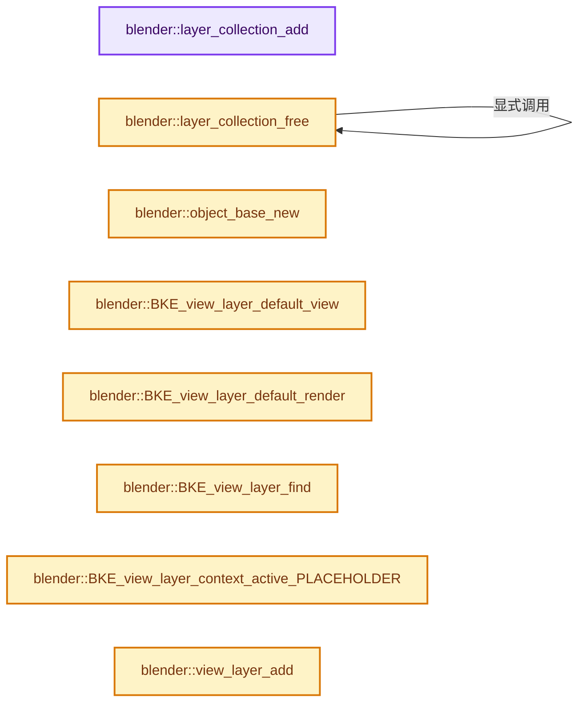
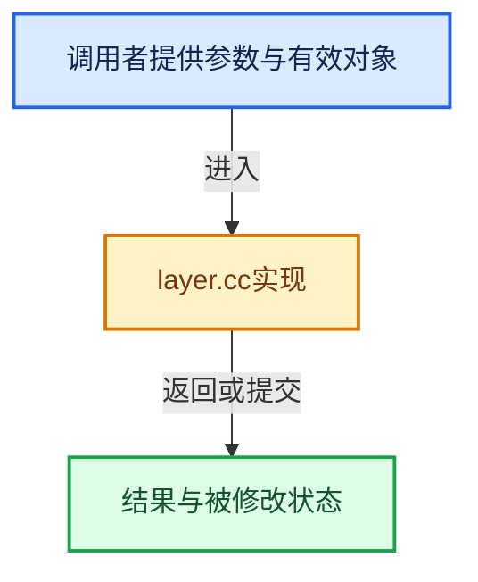

# 实现依赖专题：source/blender/blenkernel/intern/layer.cc

[方向导航](README.md) · [符号索引](../%E7%AC%A6%E5%8F%B7%E4%BE%9D%E8%B5%96%E4%B8%8E%E5%AE%9E%E7%8E%B0%E7%B4%A2%E5%BC%95.md)

本专题从正文实际调用进入，集中保存共享实现。函数有稳定锚点，可从调用处直接跳到对应完整函数；递归与互相调用通过回链组织。

## 本文件的实现关系






## 完整成员与函数实现

<a id="f-004224636f176b9f"></a>

### `blender::layer_collection_add`

实现位置：[source/blender/blenkernel/intern/layer.cc](../../../../../source/blender/blenkernel/intern/layer.cc) · L83—L92。

接口参数：

- `ListBaseT<LayerCollection> *lb_parent`
- `Collection *collection`

**教学注释版**

<!-- annotated:41b1b2f5373208 -->

```cpp
static LayerCollection *layer_collection_add(ListBaseT<LayerCollection> *lb_parent,
                                             Collection *collection)
{
  LayerCollection *lc = MEM_new<LayerCollection>("Collection Base");
  lc->collection = collection;
  lc->local_collections_bits = ~0;
  BLI_addtail(lb_parent, lc);

  return lc;
}
```

<details>
<summary>核对原始源码：source/blender/blenkernel/intern/layer.cc · L83—L92</summary>

<!-- original:41b1b2f5373208:source/blender/blenkernel/intern/layer.cc:83:92 -->

```cpp
static LayerCollection *layer_collection_add(ListBaseT<LayerCollection> *lb_parent,
                                             Collection *collection)
{
  LayerCollection *lc = MEM_new<LayerCollection>("Collection Base");
  lc->collection = collection;
  lc->local_collections_bits = ~0;
  BLI_addtail(lb_parent, lc);

  return lc;
}
```

</details>

**沿实际写入检查状态**

- `lc->collection = collection;`
- `lc->local_collections_bits = ~0;`

**结果出口**

- `return lc;`

**继续追踪实现**

- `MEM_new<LayerCollection>` → [MEM_new · L351](../03-%E5%86%85%E5%AD%98%E5%88%86%E9%85%8D%E4%B8%8E%E8%BF%90%E8%A1%8C%E6%97%B6%E7%B1%BB%E5%9E%8B/%E4%BE%9D%E8%B5%96-MEM_guardedalloc-b54eca.md#f-115f9b6784f89912)。
- `BLI_addtail` → [blender::BLI_addtail · L118](../01-%E5%9F%BA%E7%A1%80%E5%AE%B9%E5%99%A8%E4%B8%8E%E7%8E%B0%E4%BB%A3CPP/%E4%BE%9D%E8%B5%96-listbase-2816d9.md#f-4fb027713fa3115b)。

<a id="f-bd702eb182436c20"></a>

### `blender::layer_collection_free`

实现位置：[source/blender/blenkernel/intern/layer.cc](../../../../../source/blender/blenkernel/intern/layer.cc) · L94—L105。

接口参数：

- `ViewLayer *view_layer`
- `LayerCollection *lc`

**教学注释版**

<!-- annotated:46fc9f09489994 -->

```cpp
static void layer_collection_free(ViewLayer *view_layer, LayerCollection *lc)
{
  if (lc == view_layer->active_collection) {
    view_layer->active_collection = nullptr;
  }

  for (LayerCollection &nlc : lc->layer_collections.items_mutable()) {
    layer_collection_free(view_layer, &nlc);
    MEM_delete(&nlc);
  }
  lc->layer_collections.clear_no_delete();
}
```

<details>
<summary>核对原始源码：source/blender/blenkernel/intern/layer.cc · L94—L105</summary>

<!-- original:46fc9f09489994:source/blender/blenkernel/intern/layer.cc:94:105 -->

```cpp
static void layer_collection_free(ViewLayer *view_layer, LayerCollection *lc)
{
  if (lc == view_layer->active_collection) {
    view_layer->active_collection = nullptr;
  }

  for (LayerCollection &nlc : lc->layer_collections.items_mutable()) {
    layer_collection_free(view_layer, &nlc);
    MEM_delete(&nlc);
  }
  lc->layer_collections.clear_no_delete();
}
```

</details>

**沿实际写入检查状态**

- `view_layer->active_collection = nullptr;`

**继续追踪实现**

- `lc->layer_collections.items_mutable` → [调用协议](../%E6%A8%A1%E6%9D%BF%E5%AE%8F%E4%B8%8E%E5%8A%A8%E6%80%81%E5%88%86%E6%B4%BE%E5%8D%8F%E8%AE%AE.md)：接收对象类型依赖auto、返回值或模板实例；不按同名猜测目标。调用位置L100。
- `layer_collection_free` → [blender::layer_collection_free · L94](%E4%BE%9D%E8%B5%96-layer-0bc136.md#f-bd702eb182436c20)。
- `MEM_delete` → [MEM_delete · L400](../03-%E5%86%85%E5%AD%98%E5%88%86%E9%85%8D%E4%B8%8E%E8%BF%90%E8%A1%8C%E6%97%B6%E7%B1%BB%E5%9E%8B/%E4%BE%9D%E8%B5%96-MEM_guardedalloc-b54eca.md#f-9049ffdd1682887c)。
- `lc->layer_collections.clear_no_delete` → [调用协议](../%E6%A8%A1%E6%9D%BF%E5%AE%8F%E4%B8%8E%E5%8A%A8%E6%80%81%E5%88%86%E6%B4%BE%E5%8D%8F%E8%AE%AE.md)：接收对象类型依赖auto、返回值或模板实例；不按同名猜测目标。调用位置L104。

<a id="f-aa5dee2cfe8eec6f"></a>

### `blender::object_base_new`

实现位置：[source/blender/blenkernel/intern/layer.cc](../../../../../source/blender/blenkernel/intern/layer.cc) · L107—L116。

接口参数：

- `Object *ob`

**教学注释版**

<!-- annotated:485e73ba1063a7 -->

```cpp
static Base *object_base_new(Object *ob)
{
  Base *base = MEM_new<Base>("Object Base");
  base->object = ob;
  base->local_view_bits = ~0;
  if (ob->base_flag & BASE_SELECTED) {
    base->flag |= BASE_SELECTED;
  }
  return base;
}
```

<details>
<summary>核对原始源码：source/blender/blenkernel/intern/layer.cc · L107—L116</summary>

<!-- original:485e73ba1063a7:source/blender/blenkernel/intern/layer.cc:107:116 -->

```cpp
static Base *object_base_new(Object *ob)
{
  Base *base = MEM_new<Base>("Object Base");
  base->object = ob;
  base->local_view_bits = ~0;
  if (ob->base_flag & BASE_SELECTED) {
    base->flag |= BASE_SELECTED;
  }
  return base;
}
```

</details>

**沿实际写入检查状态**

- `base->object = ob;`
- `base->local_view_bits = ~0;`
- `base->flag |= BASE_SELECTED;`

**结果出口**

- `return base;`

**继续追踪实现**

- `MEM_new<Base>` → [MEM_new · L351](../03-%E5%86%85%E5%AD%98%E5%88%86%E9%85%8D%E4%B8%8E%E8%BF%90%E8%A1%8C%E6%97%B6%E7%B1%BB%E5%9E%8B/%E4%BE%9D%E8%B5%96-MEM_guardedalloc-b54eca.md#f-115f9b6784f89912)。

<a id="f-43eb64033ee54636"></a>

### `blender::BKE_view_layer_default_view`

实现位置：[source/blender/blenkernel/intern/layer.cc](../../../../../source/blender/blenkernel/intern/layer.cc) · L126—L136。

接口参数：

- `const Scene *scene`

**教学注释版**

<!-- annotated:dd888a854988c6 -->

```cpp
ViewLayer *BKE_view_layer_default_view(const Scene *scene)
{
  for (ViewLayer &view_layer : scene->view_layers) {
    if (!(view_layer.flag & VIEW_LAYER_RENDER)) {
      return &view_layer;
    }
  }

  BLI_assert(scene->view_layers.first());
  return scene->view_layers.first();
}
```

<details>
<summary>核对原始源码：source/blender/blenkernel/intern/layer.cc · L126—L136</summary>

<!-- original:dd888a854988c6:source/blender/blenkernel/intern/layer.cc:126:136 -->

```cpp
ViewLayer *BKE_view_layer_default_view(const Scene *scene)
{
  for (ViewLayer &view_layer : scene->view_layers) {
    if (!(view_layer.flag & VIEW_LAYER_RENDER)) {
      return &view_layer;
    }
  }

  BLI_assert(scene->view_layers.first());
  return scene->view_layers.first();
}
```

</details>

**结果出口**

- `return &view_layer;`
- `return scene->view_layers.first();`

**继续追踪实现**

- `BLI_assert` → [BLI_assert · L48](../01-%E5%9F%BA%E7%A1%80%E5%AE%B9%E5%99%A8%E4%B8%8E%E7%8E%B0%E4%BB%A3CPP/%E4%BE%9D%E8%B5%96-BLI_assert-cc98e8.md#m-57a88495704d)；[BLI_assert · L63](../01-%E5%9F%BA%E7%A1%80%E5%AE%B9%E5%99%A8%E4%B8%8E%E7%8E%B0%E4%BB%A3CPP/%E4%BE%9D%E8%B5%96-BLI_assert-cc98e8.md#m-d07050020cb5)。宏定义由构建条件选择。
- `scene->view_layers.first` → [调用协议](../%E6%A8%A1%E6%9D%BF%E5%AE%8F%E4%B8%8E%E5%8A%A8%E6%80%81%E5%88%86%E6%B4%BE%E5%8D%8F%E8%AE%AE.md)：接收对象类型依赖auto、返回值或模板实例；不按同名猜测目标。调用位置L134。

<a id="f-0b2725adbb12f328"></a>

### `blender::BKE_view_layer_default_render`

实现位置：[source/blender/blenkernel/intern/layer.cc](../../../../../source/blender/blenkernel/intern/layer.cc) · L138—L148。

接口参数：

- `const Scene *scene`

**教学注释版**

<!-- annotated:138307daf5d16d -->

```cpp
ViewLayer *BKE_view_layer_default_render(const Scene *scene)
{
  for (ViewLayer &view_layer : scene->view_layers) {
    if (view_layer.flag & VIEW_LAYER_RENDER) {
      return &view_layer;
    }
  }

  BLI_assert(scene->view_layers.first());
  return scene->view_layers.first();
}
```

<details>
<summary>核对原始源码：source/blender/blenkernel/intern/layer.cc · L138—L148</summary>

<!-- original:138307daf5d16d:source/blender/blenkernel/intern/layer.cc:138:148 -->

```cpp
ViewLayer *BKE_view_layer_default_render(const Scene *scene)
{
  for (ViewLayer &view_layer : scene->view_layers) {
    if (view_layer.flag & VIEW_LAYER_RENDER) {
      return &view_layer;
    }
  }

  BLI_assert(scene->view_layers.first());
  return scene->view_layers.first();
}
```

</details>

**结果出口**

- `return &view_layer;`
- `return scene->view_layers.first();`

**继续追踪实现**

- `BLI_assert` → [BLI_assert · L48](../01-%E5%9F%BA%E7%A1%80%E5%AE%B9%E5%99%A8%E4%B8%8E%E7%8E%B0%E4%BB%A3CPP/%E4%BE%9D%E8%B5%96-BLI_assert-cc98e8.md#m-57a88495704d)；[BLI_assert · L63](../01-%E5%9F%BA%E7%A1%80%E5%AE%B9%E5%99%A8%E4%B8%8E%E7%8E%B0%E4%BB%A3CPP/%E4%BE%9D%E8%B5%96-BLI_assert-cc98e8.md#m-d07050020cb5)。宏定义由构建条件选择。
- `scene->view_layers.first` → [调用协议](../%E6%A8%A1%E6%9D%BF%E5%AE%8F%E4%B8%8E%E5%8A%A8%E6%80%81%E5%88%86%E6%B4%BE%E5%8D%8F%E8%AE%AE.md)：接收对象类型依赖auto、返回值或模板实例；不按同名猜测目标。调用位置L146。

<a id="f-886c6c7025b5b68b"></a>

### `blender::BKE_view_layer_find`

实现位置：[source/blender/blenkernel/intern/layer.cc](../../../../../source/blender/blenkernel/intern/layer.cc) · L150—L159。

接口参数：

- `const Scene *scene`
- `const char *layer_name`

**教学注释版**

<!-- annotated:f53cfc14143479 -->

```cpp
ViewLayer *BKE_view_layer_find(const Scene *scene, const char *layer_name)
{
  for (ViewLayer &view_layer : scene->view_layers) {
    if (STREQ(view_layer.name, layer_name)) {
      return &view_layer;
    }
  }

  return nullptr;
}
```

<details>
<summary>核对原始源码：source/blender/blenkernel/intern/layer.cc · L150—L159</summary>

<!-- original:f53cfc14143479:source/blender/blenkernel/intern/layer.cc:150:159 -->

```cpp
ViewLayer *BKE_view_layer_find(const Scene *scene, const char *layer_name)
{
  for (ViewLayer &view_layer : scene->view_layers) {
    if (STREQ(view_layer.name, layer_name)) {
      return &view_layer;
    }
  }

  return nullptr;
}
```

</details>

**结果出口**

- `return &view_layer;`
- `return nullptr;`

**继续追踪实现**

- `STREQ` → [STREQ · L112](%E4%BE%9D%E8%B5%96-GHOST_utildefines-34b996.md#m-9549fb6aafd2)；[STREQ · L451](../01-%E5%9F%BA%E7%A1%80%E5%AE%B9%E5%99%A8%E4%B8%8E%E7%8E%B0%E4%BB%A3CPP/%E4%BE%9D%E8%B5%96-BLI_utildefines-293a0a.md#m-c7b745bcfad2)；[STREQ · L55](%E4%BE%9D%E8%B5%96-clog-a0bec8.md#m-96e78f386894)。宏定义由构建条件选择。

<a id="f-16d5df923b866290"></a>

### `blender::BKE_view_layer_context_active_PLACEHOLDER`

实现位置：[source/blender/blenkernel/intern/layer.cc](../../../../../source/blender/blenkernel/intern/layer.cc) · L161—L165。

接口参数：

- `const Scene *scene`

**教学注释版**

<!-- annotated:11998ded222603 -->

```cpp
ViewLayer *BKE_view_layer_context_active_PLACEHOLDER(const Scene *scene)
{
  BLI_assert(scene->view_layers.first());
  return scene->view_layers.first();
}
```

<details>
<summary>核对原始源码：source/blender/blenkernel/intern/layer.cc · L161—L165</summary>

<!-- original:11998ded222603:source/blender/blenkernel/intern/layer.cc:161:165 -->

```cpp
ViewLayer *BKE_view_layer_context_active_PLACEHOLDER(const Scene *scene)
{
  BLI_assert(scene->view_layers.first());
  return scene->view_layers.first();
}
```

</details>

**结果出口**

- `return scene->view_layers.first();`

**继续追踪实现**

- `BLI_assert` → [BLI_assert · L48](../01-%E5%9F%BA%E7%A1%80%E5%AE%B9%E5%99%A8%E4%B8%8E%E7%8E%B0%E4%BB%A3CPP/%E4%BE%9D%E8%B5%96-BLI_assert-cc98e8.md#m-57a88495704d)；[BLI_assert · L63](../01-%E5%9F%BA%E7%A1%80%E5%AE%B9%E5%99%A8%E4%B8%8E%E7%8E%B0%E4%BB%A3CPP/%E4%BE%9D%E8%B5%96-BLI_assert-cc98e8.md#m-d07050020cb5)。宏定义由构建条件选择。
- `scene->view_layers.first` → [调用协议](../%E6%A8%A1%E6%9D%BF%E5%AE%8F%E4%B8%8E%E5%8A%A8%E6%80%81%E5%88%86%E6%B4%BE%E5%8D%8F%E8%AE%AE.md)：接收对象类型依赖auto、返回值或模板实例；不按同名猜测目标。调用位置L163。

<a id="f-bce4bd3a1e298eb6"></a>

### `blender::view_layer_add`

实现位置：[source/blender/blenkernel/intern/layer.cc](../../../../../source/blender/blenkernel/intern/layer.cc) · L167—L180。

接口参数：

- `const char *name`

**教学注释版**

<!-- annotated:a83ca897da9587 -->

```cpp
static ViewLayer *view_layer_add(const char *name)
{
  if (!name) {
    name = DATA_("ViewLayer");
  }

  ViewLayer *view_layer = MEM_new<ViewLayer>("View Layer");
  view_layer->runtime = MEM_new<ViewLayerRuntime>("View Layer Runtime");
  STRNCPY_UTF8(view_layer->name, name);

  BKE_freestyle_config_init(&view_layer->freestyle_config);

  return view_layer;
}
```

<details>
<summary>核对原始源码：source/blender/blenkernel/intern/layer.cc · L167—L180</summary>

<!-- original:a83ca897da9587:source/blender/blenkernel/intern/layer.cc:167:180 -->

```cpp
static ViewLayer *view_layer_add(const char *name)
{
  if (!name) {
    name = DATA_("ViewLayer");
  }

  ViewLayer *view_layer = MEM_new<ViewLayer>("View Layer");
  view_layer->runtime = MEM_new<ViewLayerRuntime>("View Layer Runtime");
  STRNCPY_UTF8(view_layer->name, name);

  BKE_freestyle_config_init(&view_layer->freestyle_config);

  return view_layer;
}
```

</details>

**沿实际写入检查状态**

- `name = DATA_("ViewLayer");`
- `view_layer->runtime = MEM_new<ViewLayerRuntime>("View Layer Runtime");`

**结果出口**

- `return view_layer;`

**继续追踪实现**

- `DATA_` → [DATA_ · L52](%E4%BE%9D%E8%B5%96-BLT_translation-c89e58.md#m-178736083f83)。宏定义由构建条件选择。
- `MEM_new<ViewLayer>` → [MEM_new · L351](../03-%E5%86%85%E5%AD%98%E5%88%86%E9%85%8D%E4%B8%8E%E8%BF%90%E8%A1%8C%E6%97%B6%E7%B1%BB%E5%9E%8B/%E4%BE%9D%E8%B5%96-MEM_guardedalloc-b54eca.md#f-115f9b6784f89912)。
- `MEM_new<ViewLayerRuntime>` → [MEM_new · L351](../03-%E5%86%85%E5%AD%98%E5%88%86%E9%85%8D%E4%B8%8E%E8%BF%90%E8%A1%8C%E6%97%B6%E7%B1%BB%E5%9E%8B/%E4%BE%9D%E8%B5%96-MEM_guardedalloc-b54eca.md#f-115f9b6784f89912)。
- `STRNCPY_UTF8` → [STRNCPY_UTF8 · L335](../01-%E5%9F%BA%E7%A1%80%E5%AE%B9%E5%99%A8%E4%B8%8E%E7%8E%B0%E4%BB%A3CPP/%E4%BE%9D%E8%B5%96-BLI_string_utf8-bcc961.md#m-222967f0ab6a)。宏定义由构建条件选择。
- `BKE_freestyle_config_init` → [blender::BKE_freestyle_config_init · L33](%E4%BE%9D%E8%B5%96-freestyle-17a7e1.md#f-e3beed6f1a4ed88f)。

<a id="f-7371fbed6bc6c7c7"></a>

### `blender::layer_collection_exclude_all`

实现位置：[source/blender/blenkernel/intern/layer.cc](../../../../../source/blender/blenkernel/intern/layer.cc) · L182—L189。

接口参数：

- `LayerCollection *layer_collection`

**教学注释版**

<!-- annotated:a6cfa872f2db37 -->

```cpp
static void layer_collection_exclude_all(LayerCollection *layer_collection)
{
  LayerCollection *sub_collection = layer_collection->layer_collections.first();
  for (; sub_collection != nullptr; sub_collection = sub_collection->next) {
    sub_collection->flag |= LAYER_COLLECTION_EXCLUDE;
    layer_collection_exclude_all(sub_collection);
  }
}
```

<details>
<summary>核对原始源码：source/blender/blenkernel/intern/layer.cc · L182—L189</summary>

<!-- original:a6cfa872f2db37:source/blender/blenkernel/intern/layer.cc:182:189 -->

```cpp
static void layer_collection_exclude_all(LayerCollection *layer_collection)
{
  LayerCollection *sub_collection = layer_collection->layer_collections.first();
  for (; sub_collection != nullptr; sub_collection = sub_collection->next) {
    sub_collection->flag |= LAYER_COLLECTION_EXCLUDE;
    layer_collection_exclude_all(sub_collection);
  }
}
```

</details>

**沿实际写入检查状态**

- `sub_collection->flag |= LAYER_COLLECTION_EXCLUDE;`

**继续追踪实现**

- `layer_collection->layer_collections.first` → [调用协议](../%E6%A8%A1%E6%9D%BF%E5%AE%8F%E4%B8%8E%E5%8A%A8%E6%80%81%E5%88%86%E6%B4%BE%E5%8D%8F%E8%AE%AE.md)：接收对象类型依赖auto、返回值或模板实例；不按同名猜测目标。调用位置L184。
- `layer_collection_exclude_all` → [blender::layer_collection_exclude_all · L182](%E4%BE%9D%E8%B5%96-layer-0bc136.md#f-7371fbed6bc6c7c7)。

<a id="f-6c0a6d3db476a793"></a>

### `blender::BKE_view_layer_add`

实现位置：[source/blender/blenkernel/intern/layer.cc](../../../../../source/blender/blenkernel/intern/layer.cc) · L191—L252。

接口参数：

- `const Main *bmain`
- `Scene *scene`
- `const char *name`
- `ViewLayer *view_layer_source`
- `const int type`

**教学注释版**

<!-- annotated:487766162378e6 -->

```cpp
ViewLayer *BKE_view_layer_add(const Main *bmain,
                              Scene *scene,
                              const char *name,
                              ViewLayer *view_layer_source,
                              const int type)
{
  BLI_assert_msg(bmain || type != VIEWLAYER_ADD_EMPTY,
                 "A valid Main is required with `VIEWLAYER_ADD_EMPTY` type of process");

  ViewLayer *view_layer_new;

  if (view_layer_source) {
    name = view_layer_source->name;
  }

  switch (type) {
    default:
    case VIEWLAYER_ADD_NEW: {
      view_layer_new = view_layer_add(name);
      BLI_addtail(&scene->view_layers, view_layer_new);
      if (bmain) {
        BKE_layer_collection_sync(*bmain, scene, view_layer_new);
      }
      else {
        BKE_view_layer_need_resync_tag(view_layer_new);
      }
      break;
    }
    case VIEWLAYER_ADD_COPY: {
      /* Allocate and copy view layer data */
      view_layer_new = MEM_new<ViewLayer>("View Layer");
      *view_layer_new = *view_layer_source;
      BKE_view_layer_copy_data(scene, scene, view_layer_new, view_layer_source, 0);
      BLI_addtail(&scene->view_layers, view_layer_new);

      STRNCPY_UTF8(view_layer_new->name, name);
      break;
    }
    case VIEWLAYER_ADD_EMPTY: {
      view_layer_new = view_layer_add(name);
      BLI_addtail(&scene->view_layers, view_layer_new);

      /* Initialize layer-collections. */
      BKE_layer_collection_sync(*bmain, scene, view_layer_new);
      layer_collection_exclude_all(view_layer_new->layer_collections.first());

      /* Update collections after changing visibility */
      BKE_layer_collection_sync(*bmain, scene, view_layer_new);
      break;
    }
  }

  /* unique name */
  BLI_uniquename(&scene->view_layers,
                 view_layer_new,
                 DATA_("ViewLayer"),
                 '_',
                 offsetof(ViewLayer, name),
                 sizeof(view_layer_new->name));

  return view_layer_new;
}
```

<details>
<summary>核对原始源码：source/blender/blenkernel/intern/layer.cc · L191—L252</summary>

<!-- original:487766162378e6:source/blender/blenkernel/intern/layer.cc:191:252 -->

```cpp
ViewLayer *BKE_view_layer_add(const Main *bmain,
                              Scene *scene,
                              const char *name,
                              ViewLayer *view_layer_source,
                              const int type)
{
  BLI_assert_msg(bmain || type != VIEWLAYER_ADD_EMPTY,
                 "A valid Main is required with `VIEWLAYER_ADD_EMPTY` type of process");

  ViewLayer *view_layer_new;

  if (view_layer_source) {
    name = view_layer_source->name;
  }

  switch (type) {
    default:
    case VIEWLAYER_ADD_NEW: {
      view_layer_new = view_layer_add(name);
      BLI_addtail(&scene->view_layers, view_layer_new);
      if (bmain) {
        BKE_layer_collection_sync(*bmain, scene, view_layer_new);
      }
      else {
        BKE_view_layer_need_resync_tag(view_layer_new);
      }
      break;
    }
    case VIEWLAYER_ADD_COPY: {
      /* Allocate and copy view layer data */
      view_layer_new = MEM_new<ViewLayer>("View Layer");
      *view_layer_new = *view_layer_source;
      BKE_view_layer_copy_data(scene, scene, view_layer_new, view_layer_source, 0);
      BLI_addtail(&scene->view_layers, view_layer_new);

      STRNCPY_UTF8(view_layer_new->name, name);
      break;
    }
    case VIEWLAYER_ADD_EMPTY: {
      view_layer_new = view_layer_add(name);
      BLI_addtail(&scene->view_layers, view_layer_new);

      /* Initialize layer-collections. */
      BKE_layer_collection_sync(*bmain, scene, view_layer_new);
      layer_collection_exclude_all(view_layer_new->layer_collections.first());

      /* Update collections after changing visibility */
      BKE_layer_collection_sync(*bmain, scene, view_layer_new);
      break;
    }
  }

  /* unique name */
  BLI_uniquename(&scene->view_layers,
                 view_layer_new,
                 DATA_("ViewLayer"),
                 '_',
                 offsetof(ViewLayer, name),
                 sizeof(view_layer_new->name));

  return view_layer_new;
}
```

</details>

**沿实际写入检查状态**

- `name = view_layer_source->name;`
- `view_layer_new = view_layer_add(name);`
- `view_layer_new = MEM_new<ViewLayer>("View Layer");`

**结果出口**

- `return view_layer_new;`

**继续追踪实现**

- `BLI_assert_msg` → [BLI_assert_msg · L55](../01-%E5%9F%BA%E7%A1%80%E5%AE%B9%E5%99%A8%E4%B8%8E%E7%8E%B0%E4%BB%A3CPP/%E4%BE%9D%E8%B5%96-BLI_assert-cc98e8.md#m-695eed20dceb)；[BLI_assert_msg · L64](../01-%E5%9F%BA%E7%A1%80%E5%AE%B9%E5%99%A8%E4%B8%8E%E7%8E%B0%E4%BB%A3CPP/%E4%BE%9D%E8%B5%96-BLI_assert-cc98e8.md#m-7de5563de4db)。宏定义由构建条件选择。
- `view_layer_add` → [blender::view_layer_add · L167](%E4%BE%9D%E8%B5%96-layer-0bc136.md#f-bce4bd3a1e298eb6)。
- `BLI_addtail` → [blender::BLI_addtail · L118](../01-%E5%9F%BA%E7%A1%80%E5%AE%B9%E5%99%A8%E4%B8%8E%E7%8E%B0%E4%BB%A3CPP/%E4%BE%9D%E8%B5%96-listbase-2816d9.md#f-4fb027713fa3115b)。
- `BKE_layer_collection_sync` → [blender::BKE_layer_collection_sync · L1372](%E4%BE%9D%E8%B5%96-layer-0bc136.md#f-5ae8118df759fb87)。
- `BKE_view_layer_need_resync_tag` → [blender::BKE_view_layer_need_resync_tag · L1013](%E4%BE%9D%E8%B5%96-layer-0bc136.md#f-67d9f2bc1b986c8a)。
- `MEM_new<ViewLayer>` → [MEM_new · L351](../03-%E5%86%85%E5%AD%98%E5%88%86%E9%85%8D%E4%B8%8E%E8%BF%90%E8%A1%8C%E6%97%B6%E7%B1%BB%E5%9E%8B/%E4%BE%9D%E8%B5%96-MEM_guardedalloc-b54eca.md#f-115f9b6784f89912)。
- `BKE_view_layer_copy_data` → [blender::BKE_view_layer_copy_data · L505](%E4%BE%9D%E8%B5%96-layer-0bc136.md#f-35f2378f39a77a1e)。
- `STRNCPY_UTF8` → [STRNCPY_UTF8 · L335](../01-%E5%9F%BA%E7%A1%80%E5%AE%B9%E5%99%A8%E4%B8%8E%E7%8E%B0%E4%BB%A3CPP/%E4%BE%9D%E8%B5%96-BLI_string_utf8-bcc961.md#m-222967f0ab6a)。宏定义由构建条件选择。
- `layer_collection_exclude_all` → [blender::layer_collection_exclude_all · L182](%E4%BE%9D%E8%B5%96-layer-0bc136.md#f-7371fbed6bc6c7c7)。
- `view_layer_new->layer_collections.first` → [调用协议](../%E6%A8%A1%E6%9D%BF%E5%AE%8F%E4%B8%8E%E5%8A%A8%E6%80%81%E5%88%86%E6%B4%BE%E5%8D%8F%E8%AE%AE.md)：接收对象类型依赖auto、返回值或模板实例；不按同名猜测目标。调用位置L235。
- `BLI_uniquename` → [blender::BLI_uniquename · L491](../01-%E5%9F%BA%E7%A1%80%E5%AE%B9%E5%99%A8%E4%B8%8E%E7%8E%B0%E4%BB%A3CPP/%E4%BE%9D%E8%B5%96-string_utils-bbfe0c.md#f-bcf1a000dbfb87d1)。
- `DATA_` → [DATA_ · L52](%E4%BE%9D%E8%B5%96-BLT_translation-c89e58.md#m-178736083f83)。宏定义由构建条件选择。

<a id="f-25531992163338e2"></a>

### `blender::BKE_view_layer_free_object_content`

实现位置：[source/blender/blenkernel/intern/layer.cc](../../../../../source/blender/blenkernel/intern/layer.cc) · L289—L302。

接口参数：

- `ViewLayer *view_layer`

**教学注释版**

<!-- annotated:d87d4f42dece69 -->

```cpp
void BKE_view_layer_free_object_content(ViewLayer *view_layer)
{
  view_layer->basact = nullptr;

  view_layer->object_bases.free_no_destruct();

  MEM_SAFE_DELETE(view_layer->runtime->object_bases_hash);

  for (LayerCollection &lc : view_layer->layer_collections.items_mutable()) {
    layer_collection_free(view_layer, &lc);
    MEM_delete(&lc);
  }
  view_layer->layer_collections.clear_no_delete();
}
```

<details>
<summary>核对原始源码：source/blender/blenkernel/intern/layer.cc · L289—L302</summary>

<!-- original:d87d4f42dece69:source/blender/blenkernel/intern/layer.cc:289:302 -->

```cpp
void BKE_view_layer_free_object_content(ViewLayer *view_layer)
{
  view_layer->basact = nullptr;

  view_layer->object_bases.free_no_destruct();

  MEM_SAFE_DELETE(view_layer->runtime->object_bases_hash);

  for (LayerCollection &lc : view_layer->layer_collections.items_mutable()) {
    layer_collection_free(view_layer, &lc);
    MEM_delete(&lc);
  }
  view_layer->layer_collections.clear_no_delete();
}
```

</details>

**沿实际写入检查状态**

- `view_layer->basact = nullptr;`

**继续追踪实现**

- `view_layer->object_bases.free_no_destruct` → [调用协议](../%E6%A8%A1%E6%9D%BF%E5%AE%8F%E4%B8%8E%E5%8A%A8%E6%80%81%E5%88%86%E6%B4%BE%E5%8D%8F%E8%AE%AE.md)：接收对象类型依赖auto、返回值或模板实例；不按同名猜测目标。调用位置L293。
- `MEM_SAFE_DELETE` → [MEM_SAFE_DELETE · L436](../03-%E5%86%85%E5%AD%98%E5%88%86%E9%85%8D%E4%B8%8E%E8%BF%90%E8%A1%8C%E6%97%B6%E7%B1%BB%E5%9E%8B/%E4%BE%9D%E8%B5%96-MEM_guardedalloc-b54eca.md#m-eadb3bc5b902)。宏定义由构建条件选择。
- `view_layer->layer_collections.items_mutable` → [调用协议](../%E6%A8%A1%E6%9D%BF%E5%AE%8F%E4%B8%8E%E5%8A%A8%E6%80%81%E5%88%86%E6%B4%BE%E5%8D%8F%E8%AE%AE.md)：接收对象类型依赖auto、返回值或模板实例；不按同名猜测目标。调用位置L297。
- `layer_collection_free` → [blender::layer_collection_free · L94](%E4%BE%9D%E8%B5%96-layer-0bc136.md#f-bd702eb182436c20)。
- `MEM_delete` → [MEM_delete · L400](../03-%E5%86%85%E5%AD%98%E5%88%86%E9%85%8D%E4%B8%8E%E8%BF%90%E8%A1%8C%E6%97%B6%E7%B1%BB%E5%9E%8B/%E4%BE%9D%E8%B5%96-MEM_guardedalloc-b54eca.md#f-9049ffdd1682887c)。
- `view_layer->layer_collections.clear_no_delete` → [调用协议](../%E6%A8%A1%E6%9D%BF%E5%AE%8F%E4%B8%8E%E5%8A%A8%E6%80%81%E5%88%86%E6%B4%BE%E5%8D%8F%E8%AE%AE.md)：接收对象类型依赖auto、返回值或模板实例；不按同名猜测目标。调用位置L301。

<a id="f-4c5574f374b16b94"></a>

### `blender::view_layer_bases_hash_create`

实现位置：[source/blender/blenkernel/intern/layer.cc](../../../../../source/blender/blenkernel/intern/layer.cc) · L359—L398。

接口参数：

- `ViewLayer *view_layer`
- `const bool do_base_duplicates_fix`

**教学注释版**

<!-- annotated:69cf1f356d395d -->

```cpp
static void view_layer_bases_hash_create(ViewLayer *view_layer, const bool do_base_duplicates_fix)
{
  static Mutex hash_lock;

  if (view_layer->runtime->object_bases_hash == nullptr) {
    std::scoped_lock lock(hash_lock);

    if (view_layer->runtime->object_bases_hash == nullptr) {
      ObjectBasesMap *hash = MEM_new<ObjectBasesMap>(__func__);

      for (Base &base : view_layer->object_bases.items_mutable()) {
        if (base.object) {
          if (!hash->add(base.object, &base)) {
            /* The same object has several bases.
             *
             * In normal cases this is a serious bug, but this is a common situation when remapping
             * an object into another one already present in the same View Layer. While ideally we
             * would process this case separately, for performances reasons it makes more sense to
             * tackle it here. */
            if (do_base_duplicates_fix) {
              if (view_layer->basact == &base) {
                view_layer->basact = nullptr;
              }
              BLI_freelinkN(&view_layer->object_bases, &base);
            }
            else {
              CLOG_FATAL(
                  &LOG,
                  "Object '%s' has more than one entry in view layer's object bases listbase",
                  base.object->id.name + 2);
            }
          }
        }
      }

      /* Assign pointer only after hash is complete. */
      view_layer->runtime->object_bases_hash = hash;
    }
  }
}
```

<details>
<summary>核对原始源码：source/blender/blenkernel/intern/layer.cc · L359—L398</summary>

<!-- original:69cf1f356d395d:source/blender/blenkernel/intern/layer.cc:359:398 -->

```cpp
static void view_layer_bases_hash_create(ViewLayer *view_layer, const bool do_base_duplicates_fix)
{
  static Mutex hash_lock;

  if (view_layer->runtime->object_bases_hash == nullptr) {
    std::scoped_lock lock(hash_lock);

    if (view_layer->runtime->object_bases_hash == nullptr) {
      ObjectBasesMap *hash = MEM_new<ObjectBasesMap>(__func__);

      for (Base &base : view_layer->object_bases.items_mutable()) {
        if (base.object) {
          if (!hash->add(base.object, &base)) {
            /* The same object has several bases.
             *
             * In normal cases this is a serious bug, but this is a common situation when remapping
             * an object into another one already present in the same View Layer. While ideally we
             * would process this case separately, for performances reasons it makes more sense to
             * tackle it here. */
            if (do_base_duplicates_fix) {
              if (view_layer->basact == &base) {
                view_layer->basact = nullptr;
              }
              BLI_freelinkN(&view_layer->object_bases, &base);
            }
            else {
              CLOG_FATAL(
                  &LOG,
                  "Object '%s' has more than one entry in view layer's object bases listbase",
                  base.object->id.name + 2);
            }
          }
        }
      }

      /* Assign pointer only after hash is complete. */
      view_layer->runtime->object_bases_hash = hash;
    }
  }
}
```

</details>

**沿实际写入检查状态**

- `view_layer->basact = nullptr;`
- `view_layer->runtime->object_bases_hash = hash;`

**继续追踪实现**

- `MEM_new<ObjectBasesMap>` → [MEM_new · L351](../03-%E5%86%85%E5%AD%98%E5%88%86%E9%85%8D%E4%B8%8E%E8%BF%90%E8%A1%8C%E6%97%B6%E7%B1%BB%E5%9E%8B/%E4%BE%9D%E8%B5%96-MEM_guardedalloc-b54eca.md#f-115f9b6784f89912)。
- `view_layer->object_bases.items_mutable` → [调用协议](../%E6%A8%A1%E6%9D%BF%E5%AE%8F%E4%B8%8E%E5%8A%A8%E6%80%81%E5%88%86%E6%B4%BE%E5%8D%8F%E8%AE%AE.md)：接收对象类型依赖auto、返回值或模板实例；不按同名猜测目标。调用位置L369。
- `hash->add` → [blender::ResourceScope::add · L158](../03-%E5%86%85%E5%AD%98%E5%88%86%E9%85%8D%E4%B8%8E%E8%BF%90%E8%A1%8C%E6%97%B6%E7%B1%BB%E5%9E%8B/05-ResourceScope%E9%94%80%E6%AF%81%E8%B4%A3%E4%BB%BB.md#f-ea50aaeb75a3ae88)；[blender::ResourceScope::add · L171](../03-%E5%86%85%E5%AD%98%E5%88%86%E9%85%8D%E4%B8%8E%E8%BF%90%E8%A1%8C%E6%97%B6%E7%B1%BB%E5%9E%8B/05-ResourceScope%E9%94%80%E6%AF%81%E8%B4%A3%E4%BB%BB.md#f-69a0755cd9372e60)；[blender::ResourceScope::add · L181](../03-%E5%86%85%E5%AD%98%E5%88%86%E9%85%8D%E4%B8%8E%E8%BF%90%E8%A1%8C%E6%97%B6%E7%B1%BB%E5%9E%8B/05-ResourceScope%E9%94%80%E6%AF%81%E8%B4%A3%E4%BB%BB.md#f-af785bf57d715c47)；[blender::ResourceScope::add · L199](../03-%E5%86%85%E5%AD%98%E5%88%86%E9%85%8D%E4%B8%8E%E8%BF%90%E8%A1%8C%E6%97%B6%E7%B1%BB%E5%9E%8B/05-ResourceScope%E9%94%80%E6%AF%81%E8%B4%A3%E4%BB%BB.md#f-bd09b45cee23317d)；[blender::add · L222](%E4%BE%9D%E8%B5%96-msgfmt-76f41a.md#f-7292fc7e06488a67)。同名重载需按实参类型选择。
- `BLI_freelinkN` → [blender::BLI_freelinkN · L277](../01-%E5%9F%BA%E7%A1%80%E5%AE%B9%E5%99%A8%E4%B8%8E%E7%8E%B0%E4%BB%A3CPP/%E4%BE%9D%E8%B5%96-listbase-2816d9.md#f-c7719591852af7da)。
- `CLOG_FATAL` → [CLOG_FATAL · L187](%E4%BE%9D%E8%B5%96-CLG_log-e9051b.md#m-5006776e053a)。宏定义由构建条件选择。

<a id="f-17d87edb9b906c67"></a>

### `blender::BKE_view_layer_base_find`

实现位置：[source/blender/blenkernel/intern/layer.cc](../../../../../source/blender/blenkernel/intern/layer.cc) · L400—L409。

接口参数：

- `ViewLayer *view_layer`
- `Object *ob`

**教学注释版**

<!-- annotated:067ca196b421a5 -->

```cpp
Base *BKE_view_layer_base_find(ViewLayer *view_layer, Object *ob)
{
  BLI_assert_msg((view_layer->flag & VIEW_LAYER_OUT_OF_SYNC) == 0,
                 "View layer out of sync, invoke BKE_view_layer_synced_ensure.");
  if (!view_layer->runtime->object_bases_hash) {
    view_layer_bases_hash_create(view_layer, false);
  }

  return view_layer->runtime->object_bases_hash->lookup_default(ob, nullptr);
}
```

<details>
<summary>核对原始源码：source/blender/blenkernel/intern/layer.cc · L400—L409</summary>

<!-- original:067ca196b421a5:source/blender/blenkernel/intern/layer.cc:400:409 -->

```cpp
Base *BKE_view_layer_base_find(ViewLayer *view_layer, Object *ob)
{
  BLI_assert_msg((view_layer->flag & VIEW_LAYER_OUT_OF_SYNC) == 0,
                 "View layer out of sync, invoke BKE_view_layer_synced_ensure.");
  if (!view_layer->runtime->object_bases_hash) {
    view_layer_bases_hash_create(view_layer, false);
  }

  return view_layer->runtime->object_bases_hash->lookup_default(ob, nullptr);
}
```

</details>

**结果出口**

- `return view_layer->runtime->object_bases_hash->lookup_default(ob, nullptr);`

**继续追踪实现**

- `BLI_assert_msg` → [BLI_assert_msg · L55](../01-%E5%9F%BA%E7%A1%80%E5%AE%B9%E5%99%A8%E4%B8%8E%E7%8E%B0%E4%BB%A3CPP/%E4%BE%9D%E8%B5%96-BLI_assert-cc98e8.md#m-695eed20dceb)；[BLI_assert_msg · L64](../01-%E5%9F%BA%E7%A1%80%E5%AE%B9%E5%99%A8%E4%B8%8E%E7%8E%B0%E4%BB%A3CPP/%E4%BE%9D%E8%B5%96-BLI_assert-cc98e8.md#m-7de5563de4db)。宏定义由构建条件选择。
- `view_layer_bases_hash_create` → [blender::view_layer_bases_hash_create · L359](%E4%BE%9D%E8%B5%96-layer-0bc136.md#f-4c5574f374b16b94)。
- `view_layer->runtime->object_bases_hash->lookup_default` → [调用协议](../%E6%A8%A1%E6%9D%BF%E5%AE%8F%E4%B8%8E%E5%8A%A8%E6%80%81%E5%88%86%E6%B4%BE%E5%8D%8F%E8%AE%AE.md)：接收对象类型依赖auto、返回值或模板实例；不按同名猜测目标。调用位置L408。

<a id="f-0d75e18df2b480c3"></a>

### `blender::BKE_view_layer_base_deselect_all`

实现位置：[source/blender/blenkernel/intern/layer.cc](../../../../../source/blender/blenkernel/intern/layer.cc) · L411—L420。

接口参数：

- `const Main &bmain`
- `const Scene *scene`
- `ViewLayer *view_layer`

**教学注释版**

<!-- annotated:d558ed56722226 -->

```cpp
void BKE_view_layer_base_deselect_all(const Main &bmain, const Scene *scene, ViewLayer *view_layer)
{
  BLI_assert(scene);
  BLI_assert(view_layer);

  BKE_view_layer_synced_ensure(bmain, scene, view_layer);
  for (Base &base : *BKE_view_layer_object_bases_get(view_layer)) {
    base.flag &= ~BASE_SELECTED;
  }
}
```

<details>
<summary>核对原始源码：source/blender/blenkernel/intern/layer.cc · L411—L420</summary>

<!-- original:d558ed56722226:source/blender/blenkernel/intern/layer.cc:411:420 -->

```cpp
void BKE_view_layer_base_deselect_all(const Main &bmain, const Scene *scene, ViewLayer *view_layer)
{
  BLI_assert(scene);
  BLI_assert(view_layer);

  BKE_view_layer_synced_ensure(bmain, scene, view_layer);
  for (Base &base : *BKE_view_layer_object_bases_get(view_layer)) {
    base.flag &= ~BASE_SELECTED;
  }
}
```

</details>

**沿实际写入检查状态**

- `base.flag &= ~BASE_SELECTED;`

**继续追踪实现**

- `BLI_assert` → [BLI_assert · L48](../01-%E5%9F%BA%E7%A1%80%E5%AE%B9%E5%99%A8%E4%B8%8E%E7%8E%B0%E4%BB%A3CPP/%E4%BE%9D%E8%B5%96-BLI_assert-cc98e8.md#m-57a88495704d)；[BLI_assert · L63](../01-%E5%9F%BA%E7%A1%80%E5%AE%B9%E5%99%A8%E4%B8%8E%E7%8E%B0%E4%BB%A3CPP/%E4%BE%9D%E8%B5%96-BLI_assert-cc98e8.md#m-d07050020cb5)。宏定义由构建条件选择。
- `BKE_view_layer_synced_ensure` → [blender::BKE_view_layer_synced_ensure · L1035](%E4%BE%9D%E8%B5%96-layer-0bc136.md#f-602c088654ebcb63)。
- `BKE_view_layer_object_bases_get` → [blender::BKE_view_layer_object_bases_get · L202](%E4%BE%9D%E8%B5%96-layer_utils-31ba6d.md#f-f7b3adc8941172e4)。

<a id="f-739b729c520e25f1"></a>

### `blender::BKE_view_layer_base_select_and_set_active`

实现位置：[source/blender/blenkernel/intern/layer.cc](../../../../../source/blender/blenkernel/intern/layer.cc) · L422—L428。

接口参数：

- `ViewLayer *view_layer`
- `Base *selbase`

**教学注释版**

<!-- annotated:ab817344cd94c9 -->

```cpp
void BKE_view_layer_base_select_and_set_active(ViewLayer *view_layer, Base *selbase)
{
  view_layer->basact = selbase;
  if ((selbase->flag & BASE_SELECTABLE) != 0) {
    selbase->flag |= BASE_SELECTED;
  }
}
```

<details>
<summary>核对原始源码：source/blender/blenkernel/intern/layer.cc · L422—L428</summary>

<!-- original:ab817344cd94c9:source/blender/blenkernel/intern/layer.cc:422:428 -->

```cpp
void BKE_view_layer_base_select_and_set_active(ViewLayer *view_layer, Base *selbase)
{
  view_layer->basact = selbase;
  if ((selbase->flag & BASE_SELECTABLE) != 0) {
    selbase->flag |= BASE_SELECTED;
  }
}
```

</details>

**沿实际写入检查状态**

- `view_layer->basact = selbase;`
- `selbase->flag |= BASE_SELECTED;`

**继续追踪实现**

本实现没有需要继续展开的显式调用；检查返回表达式、对象转换和调用者前置条件。

<a id="f-b1ac02cad10b85c2"></a>

### `blender::layer_aov_copy_data`

实现位置：[source/blender/blenkernel/intern/layer.cc](../../../../../source/blender/blenkernel/intern/layer.cc) · L436—L455。

接口参数：

- `ViewLayer *view_layer_dst`
- `const ViewLayer *view_layer_src`
- `ListBaseT<ViewLayerAOV> *aovs_dst`
- `const ListBaseT<ViewLayerAOV> *aovs_src`

**教学注释版**

<!-- annotated:943fdcdc5c96f2 -->

```cpp
static void layer_aov_copy_data(ViewLayer *view_layer_dst,
                                const ViewLayer *view_layer_src,
                                ListBaseT<ViewLayerAOV> *aovs_dst,
                                const ListBaseT<ViewLayerAOV> *aovs_src)
{
  BLI_duplicatelist(aovs_dst, aovs_src);

  ViewLayerAOV *aov_dst = aovs_dst->first();
  const ViewLayerAOV *aov_src = aovs_src->first();

  while (aov_dst != nullptr) {
    BLI_assert(aov_src);
    if (aov_src == view_layer_src->active_aov) {
      view_layer_dst->active_aov = aov_dst;
    }

    aov_dst = aov_dst->next;
    aov_src = aov_src->next;
  }
}
```

<details>
<summary>核对原始源码：source/blender/blenkernel/intern/layer.cc · L436—L455</summary>

<!-- original:943fdcdc5c96f2:source/blender/blenkernel/intern/layer.cc:436:455 -->

```cpp
static void layer_aov_copy_data(ViewLayer *view_layer_dst,
                                const ViewLayer *view_layer_src,
                                ListBaseT<ViewLayerAOV> *aovs_dst,
                                const ListBaseT<ViewLayerAOV> *aovs_src)
{
  BLI_duplicatelist(aovs_dst, aovs_src);

  ViewLayerAOV *aov_dst = aovs_dst->first();
  const ViewLayerAOV *aov_src = aovs_src->first();

  while (aov_dst != nullptr) {
    BLI_assert(aov_src);
    if (aov_src == view_layer_src->active_aov) {
      view_layer_dst->active_aov = aov_dst;
    }

    aov_dst = aov_dst->next;
    aov_src = aov_src->next;
  }
}
```

</details>

**沿实际写入检查状态**

- `view_layer_dst->active_aov = aov_dst;`
- `aov_dst = aov_dst->next;`
- `aov_src = aov_src->next;`

**继续追踪实现**

- `BLI_duplicatelist` → [blender::BLI_duplicatelist · L834](../01-%E5%9F%BA%E7%A1%80%E5%AE%B9%E5%99%A8%E4%B8%8E%E7%8E%B0%E4%BB%A3CPP/%E4%BE%9D%E8%B5%96-listbase-2816d9.md#f-d840cb64a1b265dc)。
- `aovs_dst->first` → [blender::ListBaseT::first · L102](%E4%BE%9D%E8%B5%96-DNA_listBase-48dbc9.md#f-3d12ff35da057c9e)；[blender::ListBaseT::first · L106](%E4%BE%9D%E8%B5%96-DNA_listBase-48dbc9.md#f-0df87c3480e059f9)。同名重载需按实参类型选择。
- `aovs_src->first` → [blender::ListBaseT::first · L102](%E4%BE%9D%E8%B5%96-DNA_listBase-48dbc9.md#f-3d12ff35da057c9e)；[blender::ListBaseT::first · L106](%E4%BE%9D%E8%B5%96-DNA_listBase-48dbc9.md#f-0df87c3480e059f9)。同名重载需按实参类型选择。
- `BLI_assert` → [BLI_assert · L48](../01-%E5%9F%BA%E7%A1%80%E5%AE%B9%E5%99%A8%E4%B8%8E%E7%8E%B0%E4%BB%A3CPP/%E4%BE%9D%E8%B5%96-BLI_assert-cc98e8.md#m-57a88495704d)；[BLI_assert · L63](../01-%E5%9F%BA%E7%A1%80%E5%AE%B9%E5%99%A8%E4%B8%8E%E7%8E%B0%E4%BB%A3CPP/%E4%BE%9D%E8%B5%96-BLI_assert-cc98e8.md#m-d07050020cb5)。宏定义由构建条件选择。

<a id="f-5580ecb4524cfa35"></a>

### `blender::layer_lightgroup_copy_data`

实现位置：[source/blender/blenkernel/intern/layer.cc](../../../../../source/blender/blenkernel/intern/layer.cc) · L457—L478。

接口参数：

- `ViewLayer *view_layer_dst`
- `const ViewLayer *view_layer_src`
- `ListBaseT<ViewLayerLightgroup> *lightgroups_dst`
- `const ListBaseT<ViewLayerLightgroup> *lightgroups_src`

**教学注释版**

<!-- annotated:e0ba3894a83e8e -->

```cpp
static void layer_lightgroup_copy_data(ViewLayer *view_layer_dst,
                                       const ViewLayer *view_layer_src,
                                       ListBaseT<ViewLayerLightgroup> *lightgroups_dst,
                                       const ListBaseT<ViewLayerLightgroup> *lightgroups_src)
{
  if (lightgroups_src != nullptr) {
    BLI_duplicatelist(lightgroups_dst, lightgroups_src);
  }

  ViewLayerLightgroup *lightgroup_dst = lightgroups_dst->first();
  const ViewLayerLightgroup *lightgroup_src = lightgroups_src->first();

  while (lightgroup_dst != nullptr) {
    BLI_assert(lightgroup_src);
    if (lightgroup_src == view_layer_src->active_lightgroup) {
      view_layer_dst->active_lightgroup = lightgroup_dst;
    }

    lightgroup_dst = lightgroup_dst->next;
    lightgroup_src = lightgroup_src->next;
  }
}
```

<details>
<summary>核对原始源码：source/blender/blenkernel/intern/layer.cc · L457—L478</summary>

<!-- original:e0ba3894a83e8e:source/blender/blenkernel/intern/layer.cc:457:478 -->

```cpp
static void layer_lightgroup_copy_data(ViewLayer *view_layer_dst,
                                       const ViewLayer *view_layer_src,
                                       ListBaseT<ViewLayerLightgroup> *lightgroups_dst,
                                       const ListBaseT<ViewLayerLightgroup> *lightgroups_src)
{
  if (lightgroups_src != nullptr) {
    BLI_duplicatelist(lightgroups_dst, lightgroups_src);
  }

  ViewLayerLightgroup *lightgroup_dst = lightgroups_dst->first();
  const ViewLayerLightgroup *lightgroup_src = lightgroups_src->first();

  while (lightgroup_dst != nullptr) {
    BLI_assert(lightgroup_src);
    if (lightgroup_src == view_layer_src->active_lightgroup) {
      view_layer_dst->active_lightgroup = lightgroup_dst;
    }

    lightgroup_dst = lightgroup_dst->next;
    lightgroup_src = lightgroup_src->next;
  }
}
```

</details>

**沿实际写入检查状态**

- `view_layer_dst->active_lightgroup = lightgroup_dst;`
- `lightgroup_dst = lightgroup_dst->next;`
- `lightgroup_src = lightgroup_src->next;`

**继续追踪实现**

- `BLI_duplicatelist` → [blender::BLI_duplicatelist · L834](../01-%E5%9F%BA%E7%A1%80%E5%AE%B9%E5%99%A8%E4%B8%8E%E7%8E%B0%E4%BB%A3CPP/%E4%BE%9D%E8%B5%96-listbase-2816d9.md#f-d840cb64a1b265dc)。
- `lightgroups_dst->first` → [blender::ListBaseT::first · L102](%E4%BE%9D%E8%B5%96-DNA_listBase-48dbc9.md#f-3d12ff35da057c9e)；[blender::ListBaseT::first · L106](%E4%BE%9D%E8%B5%96-DNA_listBase-48dbc9.md#f-0df87c3480e059f9)。同名重载需按实参类型选择。
- `lightgroups_src->first` → [blender::ListBaseT::first · L102](%E4%BE%9D%E8%B5%96-DNA_listBase-48dbc9.md#f-3d12ff35da057c9e)；[blender::ListBaseT::first · L106](%E4%BE%9D%E8%B5%96-DNA_listBase-48dbc9.md#f-0df87c3480e059f9)。同名重载需按实参类型选择。
- `BLI_assert` → [BLI_assert · L48](../01-%E5%9F%BA%E7%A1%80%E5%AE%B9%E5%99%A8%E4%B8%8E%E7%8E%B0%E4%BB%A3CPP/%E4%BE%9D%E8%B5%96-BLI_assert-cc98e8.md#m-57a88495704d)；[BLI_assert · L63](../01-%E5%9F%BA%E7%A1%80%E5%AE%B9%E5%99%A8%E4%B8%8E%E7%8E%B0%E4%BB%A3CPP/%E4%BE%9D%E8%B5%96-BLI_assert-cc98e8.md#m-d07050020cb5)。宏定义由构建条件选择。

<a id="f-90c8cc866d62435b"></a>

### `blender::layer_collections_copy_data`

实现位置：[source/blender/blenkernel/intern/layer.cc](../../../../../source/blender/blenkernel/intern/layer.cc) · L480—L503。

接口参数：

- `ViewLayer *view_layer_dst`
- `const ViewLayer *view_layer_src`
- `ListBaseT<LayerCollection> *layer_collections_dst`
- `const ListBaseT<LayerCollection> *layer_collections_src`

**教学注释版**

<!-- annotated:f5f4dcd9c40462 -->

```cpp
static void layer_collections_copy_data(ViewLayer *view_layer_dst,
                                        const ViewLayer *view_layer_src,
                                        ListBaseT<LayerCollection> *layer_collections_dst,
                                        const ListBaseT<LayerCollection> *layer_collections_src)
{
  BLI_duplicatelist(layer_collections_dst, layer_collections_src);

  LayerCollection *layer_collection_dst = layer_collections_dst->first();
  const LayerCollection *layer_collection_src = layer_collections_src->first();

  while (layer_collection_dst != nullptr) {
    layer_collections_copy_data(view_layer_dst,
                                view_layer_src,
                                &layer_collection_dst->layer_collections,
                                &layer_collection_src->layer_collections);

    if (layer_collection_src == view_layer_src->active_collection) {
      view_layer_dst->active_collection = layer_collection_dst;
    }

    layer_collection_dst = layer_collection_dst->next;
    layer_collection_src = layer_collection_src->next;
  }
}
```

<details>
<summary>核对原始源码：source/blender/blenkernel/intern/layer.cc · L480—L503</summary>

<!-- original:f5f4dcd9c40462:source/blender/blenkernel/intern/layer.cc:480:503 -->

```cpp
static void layer_collections_copy_data(ViewLayer *view_layer_dst,
                                        const ViewLayer *view_layer_src,
                                        ListBaseT<LayerCollection> *layer_collections_dst,
                                        const ListBaseT<LayerCollection> *layer_collections_src)
{
  BLI_duplicatelist(layer_collections_dst, layer_collections_src);

  LayerCollection *layer_collection_dst = layer_collections_dst->first();
  const LayerCollection *layer_collection_src = layer_collections_src->first();

  while (layer_collection_dst != nullptr) {
    layer_collections_copy_data(view_layer_dst,
                                view_layer_src,
                                &layer_collection_dst->layer_collections,
                                &layer_collection_src->layer_collections);

    if (layer_collection_src == view_layer_src->active_collection) {
      view_layer_dst->active_collection = layer_collection_dst;
    }

    layer_collection_dst = layer_collection_dst->next;
    layer_collection_src = layer_collection_src->next;
  }
}
```

</details>

**沿实际写入检查状态**

- `view_layer_dst->active_collection = layer_collection_dst;`
- `layer_collection_dst = layer_collection_dst->next;`
- `layer_collection_src = layer_collection_src->next;`

**继续追踪实现**

- `BLI_duplicatelist` → [blender::BLI_duplicatelist · L834](../01-%E5%9F%BA%E7%A1%80%E5%AE%B9%E5%99%A8%E4%B8%8E%E7%8E%B0%E4%BB%A3CPP/%E4%BE%9D%E8%B5%96-listbase-2816d9.md#f-d840cb64a1b265dc)。
- `layer_collections_dst->first` → [blender::ListBaseT::first · L102](%E4%BE%9D%E8%B5%96-DNA_listBase-48dbc9.md#f-3d12ff35da057c9e)；[blender::ListBaseT::first · L106](%E4%BE%9D%E8%B5%96-DNA_listBase-48dbc9.md#f-0df87c3480e059f9)。同名重载需按实参类型选择。
- `layer_collections_src->first` → [blender::ListBaseT::first · L102](%E4%BE%9D%E8%B5%96-DNA_listBase-48dbc9.md#f-3d12ff35da057c9e)；[blender::ListBaseT::first · L106](%E4%BE%9D%E8%B5%96-DNA_listBase-48dbc9.md#f-0df87c3480e059f9)。同名重载需按实参类型选择。
- `layer_collections_copy_data` → [blender::layer_collections_copy_data · L480](%E4%BE%9D%E8%B5%96-layer-0bc136.md#f-90c8cc866d62435b)。

<a id="f-35f2378f39a77a1e"></a>

### `blender::BKE_view_layer_copy_data`

实现位置：[source/blender/blenkernel/intern/layer.cc](../../../../../source/blender/blenkernel/intern/layer.cc) · L505—L560。

接口参数：

- `Scene *scene_dst`
- `const Scene *`
- `ViewLayer *view_layer_dst`
- `const ViewLayer *view_layer_src`
- `const int flag`

**教学注释版**

<!-- annotated:0dfde6d96adba6 -->

```cpp
void BKE_view_layer_copy_data(Scene *scene_dst,
                              const Scene * /*scene_src*/,
                              ViewLayer *view_layer_dst,
                              const ViewLayer *view_layer_src,
                              const int flag)
{
  BLI_assert_msg(view_layer_dst->runtime == view_layer_src->runtime,
                 "view_layer_dst must be a shallow copy of view_layer_src");
  view_layer_dst->runtime = MEM_new<ViewLayerRuntime>(__func__);

  if (view_layer_dst->id_properties != nullptr) {
    view_layer_dst->id_properties = IDP_CopyProperty_ex(view_layer_dst->id_properties, flag);
  }
  if (view_layer_dst->system_properties != nullptr) {
    view_layer_dst->system_properties = IDP_CopyProperty_ex(view_layer_dst->system_properties,
                                                            flag);
  }
  BKE_freestyle_config_copy(
      &view_layer_dst->freestyle_config, &view_layer_src->freestyle_config, flag);

  view_layer_dst->stats = nullptr;

  /* Copy layer collections and object bases. */
  /* Inline #BLI_duplicatelist and update the active base. */
  view_layer_dst->object_bases.clear_no_delete();
  BLI_assert_msg((view_layer_src->flag & VIEW_LAYER_OUT_OF_SYNC) == 0,
                 "View Layer Object Base out of sync, invoke BKE_view_layer_synced_ensure.");
  for (const Base &base_src : view_layer_src->object_bases) {
    Base *base_dst = MEM_dupalloc(&base_src);
    BLI_addtail(&view_layer_dst->object_bases, base_dst);
    if (view_layer_src->basact == &base_src) {
      view_layer_dst->basact = base_dst;
    }
  }

  view_layer_dst->active_collection = nullptr;
  layer_collections_copy_data(view_layer_dst,
                              view_layer_src,
                              &view_layer_dst->layer_collections,
                              &view_layer_src->layer_collections);

  LayerCollection *lc_scene_dst = view_layer_dst->layer_collections.first();
  lc_scene_dst->collection = scene_dst->master_collection;

  view_layer_dst->aovs.clear_no_delete();
  layer_aov_copy_data(
      view_layer_dst, view_layer_src, &view_layer_dst->aovs, &view_layer_src->aovs);

  view_layer_dst->lightgroups.clear_no_delete();
  layer_lightgroup_copy_data(
      view_layer_dst, view_layer_src, &view_layer_dst->lightgroups, &view_layer_src->lightgroups);

  if ((flag & LIB_ID_CREATE_NO_USER_REFCOUNT) == 0) {
    id_us_plus(id_cast<ID *>(view_layer_dst->mat_override));
  }
}
```

<details>
<summary>核对原始源码：source/blender/blenkernel/intern/layer.cc · L505—L560</summary>

<!-- original:0dfde6d96adba6:source/blender/blenkernel/intern/layer.cc:505:560 -->

```cpp
void BKE_view_layer_copy_data(Scene *scene_dst,
                              const Scene * /*scene_src*/,
                              ViewLayer *view_layer_dst,
                              const ViewLayer *view_layer_src,
                              const int flag)
{
  BLI_assert_msg(view_layer_dst->runtime == view_layer_src->runtime,
                 "view_layer_dst must be a shallow copy of view_layer_src");
  view_layer_dst->runtime = MEM_new<ViewLayerRuntime>(__func__);

  if (view_layer_dst->id_properties != nullptr) {
    view_layer_dst->id_properties = IDP_CopyProperty_ex(view_layer_dst->id_properties, flag);
  }
  if (view_layer_dst->system_properties != nullptr) {
    view_layer_dst->system_properties = IDP_CopyProperty_ex(view_layer_dst->system_properties,
                                                            flag);
  }
  BKE_freestyle_config_copy(
      &view_layer_dst->freestyle_config, &view_layer_src->freestyle_config, flag);

  view_layer_dst->stats = nullptr;

  /* Copy layer collections and object bases. */
  /* Inline #BLI_duplicatelist and update the active base. */
  view_layer_dst->object_bases.clear_no_delete();
  BLI_assert_msg((view_layer_src->flag & VIEW_LAYER_OUT_OF_SYNC) == 0,
                 "View Layer Object Base out of sync, invoke BKE_view_layer_synced_ensure.");
  for (const Base &base_src : view_layer_src->object_bases) {
    Base *base_dst = MEM_dupalloc(&base_src);
    BLI_addtail(&view_layer_dst->object_bases, base_dst);
    if (view_layer_src->basact == &base_src) {
      view_layer_dst->basact = base_dst;
    }
  }

  view_layer_dst->active_collection = nullptr;
  layer_collections_copy_data(view_layer_dst,
                              view_layer_src,
                              &view_layer_dst->layer_collections,
                              &view_layer_src->layer_collections);

  LayerCollection *lc_scene_dst = view_layer_dst->layer_collections.first();
  lc_scene_dst->collection = scene_dst->master_collection;

  view_layer_dst->aovs.clear_no_delete();
  layer_aov_copy_data(
      view_layer_dst, view_layer_src, &view_layer_dst->aovs, &view_layer_src->aovs);

  view_layer_dst->lightgroups.clear_no_delete();
  layer_lightgroup_copy_data(
      view_layer_dst, view_layer_src, &view_layer_dst->lightgroups, &view_layer_src->lightgroups);

  if ((flag & LIB_ID_CREATE_NO_USER_REFCOUNT) == 0) {
    id_us_plus(id_cast<ID *>(view_layer_dst->mat_override));
  }
}
```

</details>

**沿实际写入检查状态**

- `view_layer_dst->runtime = MEM_new<ViewLayerRuntime>(__func__);`
- `view_layer_dst->id_properties = IDP_CopyProperty_ex(view_layer_dst->id_properties, flag);`
- `view_layer_dst->system_properties = IDP_CopyProperty_ex(view_layer_dst->system_properties,`
- `view_layer_dst->stats = nullptr;`
- `view_layer_dst->basact = base_dst;`
- `view_layer_dst->active_collection = nullptr;`
- `lc_scene_dst->collection = scene_dst->master_collection;`

**继续追踪实现**

- `BLI_assert_msg` → [BLI_assert_msg · L55](../01-%E5%9F%BA%E7%A1%80%E5%AE%B9%E5%99%A8%E4%B8%8E%E7%8E%B0%E4%BB%A3CPP/%E4%BE%9D%E8%B5%96-BLI_assert-cc98e8.md#m-695eed20dceb)；[BLI_assert_msg · L64](../01-%E5%9F%BA%E7%A1%80%E5%AE%B9%E5%99%A8%E4%B8%8E%E7%8E%B0%E4%BB%A3CPP/%E4%BE%9D%E8%B5%96-BLI_assert-cc98e8.md#m-7de5563de4db)。宏定义由构建条件选择。
- `MEM_new<ViewLayerRuntime>` → [MEM_new · L351](../03-%E5%86%85%E5%AD%98%E5%88%86%E9%85%8D%E4%B8%8E%E8%BF%90%E8%A1%8C%E6%97%B6%E7%B1%BB%E5%9E%8B/%E4%BE%9D%E8%B5%96-MEM_guardedalloc-b54eca.md#f-115f9b6784f89912)。
- `IDP_CopyProperty_ex` → [blender::IDP_CopyProperty_ex · L968](%E4%BE%9D%E8%B5%96-idprop-006c65.md#f-df4a72661231af0c)。
- `BKE_freestyle_config_copy` → [blender::BKE_freestyle_config_copy · L66](%E4%BE%9D%E8%B5%96-freestyle-17a7e1.md#f-400d3f55175a96da)。
- `view_layer_dst->object_bases.clear_no_delete` → [调用协议](../%E6%A8%A1%E6%9D%BF%E5%AE%8F%E4%B8%8E%E5%8A%A8%E6%80%81%E5%88%86%E6%B4%BE%E5%8D%8F%E8%AE%AE.md)：接收对象类型依赖auto、返回值或模板实例；不按同名猜测目标。调用位置L529。
- `MEM_dupalloc` → [MEM_dupalloc · L627](../03-%E5%86%85%E5%AD%98%E5%88%86%E9%85%8D%E4%B8%8E%E8%BF%90%E8%A1%8C%E6%97%B6%E7%B1%BB%E5%9E%8B/%E4%BE%9D%E8%B5%96-MEM_guardedalloc-b54eca.md#f-78a72b71e3c57010)。
- `BLI_addtail` → [blender::BLI_addtail · L118](../01-%E5%9F%BA%E7%A1%80%E5%AE%B9%E5%99%A8%E4%B8%8E%E7%8E%B0%E4%BB%A3CPP/%E4%BE%9D%E8%B5%96-listbase-2816d9.md#f-4fb027713fa3115b)。
- `layer_collections_copy_data` → [blender::layer_collections_copy_data · L480](%E4%BE%9D%E8%B5%96-layer-0bc136.md#f-90c8cc866d62435b)。
- `view_layer_dst->layer_collections.first` → [调用协议](../%E6%A8%A1%E6%9D%BF%E5%AE%8F%E4%B8%8E%E5%8A%A8%E6%80%81%E5%88%86%E6%B4%BE%E5%8D%8F%E8%AE%AE.md)：接收对象类型依赖auto、返回值或模板实例；不按同名猜测目标。调用位置L546。
- `view_layer_dst->aovs.clear_no_delete` → [调用协议](../%E6%A8%A1%E6%9D%BF%E5%AE%8F%E4%B8%8E%E5%8A%A8%E6%80%81%E5%88%86%E6%B4%BE%E5%8D%8F%E8%AE%AE.md)：接收对象类型依赖auto、返回值或模板实例；不按同名猜测目标。调用位置L549。
- `layer_aov_copy_data` → [blender::layer_aov_copy_data · L436](%E4%BE%9D%E8%B5%96-layer-0bc136.md#f-b1ac02cad10b85c2)。
- `view_layer_dst->lightgroups.clear_no_delete` → [调用协议](../%E6%A8%A1%E6%9D%BF%E5%AE%8F%E4%B8%8E%E5%8A%A8%E6%80%81%E5%88%86%E6%B4%BE%E5%8D%8F%E8%AE%AE.md)：接收对象类型依赖auto、返回值或模板实例；不按同名猜测目标。调用位置L553。
- `layer_lightgroup_copy_data` → [blender::layer_lightgroup_copy_data · L457](%E4%BE%9D%E8%B5%96-layer-0bc136.md#f-5580ecb4524cfa35)。
- `id_us_plus` → [blender::id_us_plus · L433](%E4%BE%9D%E8%B5%96-lib_id-d4e6bd.md#f-1b90ef7608c4f32e)。
- `id_cast<ID *>` → [blender::id_cast · L1417](%E4%BE%9D%E8%B5%96-DNA_ID-3eb091.md#f-6c8ac6412850ac5a)。

<a id="f-dba4c871154df891"></a>

### `blender::layer_collection_hidden`

实现位置：[source/blender/blenkernel/intern/layer.cc](../../../../../source/blender/blenkernel/intern/layer.cc) · L646—L667。

接口参数：

- `ViewLayer *view_layer`
- `LayerCollection *lc`

**教学注释版**

<!-- annotated:c54ee5d23154e6 -->

```cpp
static bool layer_collection_hidden(ViewLayer *view_layer, LayerCollection *lc)
{
  if (lc->flag & LAYER_COLLECTION_EXCLUDE) {
    return true;
  }

  /* Check visibility restriction flags */
  if (lc->flag & LAYER_COLLECTION_HIDE || lc->collection->flag & COLLECTION_HIDE_VIEWPORT) {
    return true;
  }

  /* Restriction flags stay set, so we need to check parents */
  CollectionParent *parent = lc->collection->runtime->parents.first();

  if (parent) {
    lc = BKE_layer_collection_first_from_scene_collection(view_layer, parent->collection);

    return lc && layer_collection_hidden(view_layer, lc);
  }

  return false;
}
```

<details>
<summary>核对原始源码：source/blender/blenkernel/intern/layer.cc · L646—L667</summary>

<!-- original:c54ee5d23154e6:source/blender/blenkernel/intern/layer.cc:646:667 -->

```cpp
static bool layer_collection_hidden(ViewLayer *view_layer, LayerCollection *lc)
{
  if (lc->flag & LAYER_COLLECTION_EXCLUDE) {
    return true;
  }

  /* Check visibility restriction flags */
  if (lc->flag & LAYER_COLLECTION_HIDE || lc->collection->flag & COLLECTION_HIDE_VIEWPORT) {
    return true;
  }

  /* Restriction flags stay set, so we need to check parents */
  CollectionParent *parent = lc->collection->runtime->parents.first();

  if (parent) {
    lc = BKE_layer_collection_first_from_scene_collection(view_layer, parent->collection);

    return lc && layer_collection_hidden(view_layer, lc);
  }

  return false;
}
```

</details>

**沿实际写入检查状态**

- `lc = BKE_layer_collection_first_from_scene_collection(view_layer, parent->collection);`

**结果出口**

- `return true;`
- `return lc && layer_collection_hidden(view_layer, lc);`
- `return false;`

**继续追踪实现**

- `lc->collection->runtime->parents.first` → [调用协议](../%E6%A8%A1%E6%9D%BF%E5%AE%8F%E4%B8%8E%E5%8A%A8%E6%80%81%E5%88%86%E6%B4%BE%E5%8D%8F%E8%AE%AE.md)：接收对象类型依赖auto、返回值或模板实例；不按同名猜测目标。调用位置L658。
- `BKE_layer_collection_first_from_scene_collection` → [blender::BKE_layer_collection_first_from_scene_collection · L2078](%E4%BE%9D%E8%B5%96-layer-0bc136.md#f-1775bdef03181cb8)。
- `layer_collection_hidden` → [blender::layer_collection_hidden · L646](%E4%BE%9D%E8%B5%96-layer-0bc136.md#f-dba4c871154df891)。

<a id="f-c511f697c77e6471"></a>

### `blender::BKE_layer_collection_get_active`

实现位置：[source/blender/blenkernel/intern/layer.cc](../../../../../source/blender/blenkernel/intern/layer.cc) · L675—L678。

接口参数：

- `ViewLayer *view_layer`

**教学注释版**

<!-- annotated:9491c2e0019cdb -->

```cpp
LayerCollection *BKE_layer_collection_get_active(ViewLayer *view_layer)
{
  return view_layer->active_collection;
}
```

<details>
<summary>核对原始源码：source/blender/blenkernel/intern/layer.cc · L675—L678</summary>

<!-- original:9491c2e0019cdb:source/blender/blenkernel/intern/layer.cc:675:678 -->

```cpp
LayerCollection *BKE_layer_collection_get_active(ViewLayer *view_layer)
{
  return view_layer->active_collection;
}
```

</details>

**结果出口**

- `return view_layer->active_collection;`

**继续追踪实现**

本实现没有需要继续展开的显式调用；检查返回表达式、对象转换和调用者前置条件。

<a id="f-00d35745c724403c"></a>

### `blender::BKE_layer_collection_activate_parent`

实现位置：[source/blender/blenkernel/intern/layer.cc](../../../../../source/blender/blenkernel/intern/layer.cc) · L690—L713。

接口参数：

- `ViewLayer *view_layer`
- `LayerCollection *lc`

**教学注释版**

<!-- annotated:ac6d6747defa36 -->

```cpp
LayerCollection *BKE_layer_collection_activate_parent(ViewLayer *view_layer, LayerCollection *lc)
{
  CollectionParent *parent = lc->collection->runtime->parents.first();

  if (parent) {
    lc = BKE_layer_collection_first_from_scene_collection(view_layer, parent->collection);
  }
  else {
    lc = nullptr;
  }

  /* Don't activate excluded or hidden collections to prevent creating objects in a hidden
   * collection from the UI */
  if (lc && layer_collection_hidden(view_layer, lc)) {
    return BKE_layer_collection_activate_parent(view_layer, lc);
  }

  if (!lc) {
    lc = view_layer->layer_collections.first();
  }

  view_layer->active_collection = lc;
  return lc;
}
```

<details>
<summary>核对原始源码：source/blender/blenkernel/intern/layer.cc · L690—L713</summary>

<!-- original:ac6d6747defa36:source/blender/blenkernel/intern/layer.cc:690:713 -->

```cpp
LayerCollection *BKE_layer_collection_activate_parent(ViewLayer *view_layer, LayerCollection *lc)
{
  CollectionParent *parent = lc->collection->runtime->parents.first();

  if (parent) {
    lc = BKE_layer_collection_first_from_scene_collection(view_layer, parent->collection);
  }
  else {
    lc = nullptr;
  }

  /* Don't activate excluded or hidden collections to prevent creating objects in a hidden
   * collection from the UI */
  if (lc && layer_collection_hidden(view_layer, lc)) {
    return BKE_layer_collection_activate_parent(view_layer, lc);
  }

  if (!lc) {
    lc = view_layer->layer_collections.first();
  }

  view_layer->active_collection = lc;
  return lc;
}
```

</details>

**沿实际写入检查状态**

- `lc = BKE_layer_collection_first_from_scene_collection(view_layer, parent->collection);`
- `lc = nullptr;`
- `lc = view_layer->layer_collections.first();`
- `view_layer->active_collection = lc;`

**结果出口**

- `return BKE_layer_collection_activate_parent(view_layer, lc);`
- `return lc;`

**继续追踪实现**

- `lc->collection->runtime->parents.first` → [调用协议](../%E6%A8%A1%E6%9D%BF%E5%AE%8F%E4%B8%8E%E5%8A%A8%E6%80%81%E5%88%86%E6%B4%BE%E5%8D%8F%E8%AE%AE.md)：接收对象类型依赖auto、返回值或模板实例；不按同名猜测目标。调用位置L692。
- `BKE_layer_collection_first_from_scene_collection` → [blender::BKE_layer_collection_first_from_scene_collection · L2078](%E4%BE%9D%E8%B5%96-layer-0bc136.md#f-1775bdef03181cb8)。
- `layer_collection_hidden` → [blender::layer_collection_hidden · L646](%E4%BE%9D%E8%B5%96-layer-0bc136.md#f-dba4c871154df891)。
- `BKE_layer_collection_activate_parent` → [blender::BKE_layer_collection_activate_parent · L690](%E4%BE%9D%E8%B5%96-layer-0bc136.md#f-00d35745c724403c)。
- `view_layer->layer_collections.first` → [调用协议](../%E6%A8%A1%E6%9D%BF%E5%AE%8F%E4%B8%8E%E5%8A%A8%E6%80%81%E5%88%86%E6%B4%BE%E5%8D%8F%E8%AE%AE.md)：接收对象类型依赖auto、返回值或模板实例；不按同名猜测目标。调用位置L708。

<a id="f-1e087ac17e5396d9"></a>

### `blender::BKE_layer_collection_resync_forbid`

实现位置：[source/blender/blenkernel/intern/layer.cc](../../../../../source/blender/blenkernel/intern/layer.cc) · L814—L819。

接口参数：

- `Main &bmain`

**教学注释版**

<!-- annotated:463e9e2649a9c0 -->

```cpp
void BKE_layer_collection_resync_forbid(Main &bmain)
{
  BLI_assert(bmain.no_resync >= 0);
  BLI_assert(bmain.no_resync < no_resync_recurse_max - 1);
  bmain.no_resync++;
}
```

<details>
<summary>核对原始源码：source/blender/blenkernel/intern/layer.cc · L814—L819</summary>

<!-- original:463e9e2649a9c0:source/blender/blenkernel/intern/layer.cc:814:819 -->

```cpp
void BKE_layer_collection_resync_forbid(Main &bmain)
{
  BLI_assert(bmain.no_resync >= 0);
  BLI_assert(bmain.no_resync < no_resync_recurse_max - 1);
  bmain.no_resync++;
}
```

</details>

**继续追踪实现**

- `BLI_assert` → [BLI_assert · L48](../01-%E5%9F%BA%E7%A1%80%E5%AE%B9%E5%99%A8%E4%B8%8E%E7%8E%B0%E4%BB%A3CPP/%E4%BE%9D%E8%B5%96-BLI_assert-cc98e8.md#m-57a88495704d)；[BLI_assert · L63](../01-%E5%9F%BA%E7%A1%80%E5%AE%B9%E5%99%A8%E4%B8%8E%E7%8E%B0%E4%BB%A3CPP/%E4%BE%9D%E8%B5%96-BLI_assert-cc98e8.md#m-d07050020cb5)。宏定义由构建条件选择。

<a id="f-f79cc5932b651227"></a>

### `blender::BKE_layer_collection_resync_allow`

实现位置：[source/blender/blenkernel/intern/layer.cc](../../../../../source/blender/blenkernel/intern/layer.cc) · L821—L826。

接口参数：

- `Main &bmain`

**教学注释版**

<!-- annotated:418c0caf31e0d1 -->

```cpp
void BKE_layer_collection_resync_allow(Main &bmain)
{
  BLI_assert(bmain.no_resync > 0);
  BLI_assert(bmain.no_resync < no_resync_recurse_max);
  bmain.no_resync--;
}
```

<details>
<summary>核对原始源码：source/blender/blenkernel/intern/layer.cc · L821—L826</summary>

<!-- original:418c0caf31e0d1:source/blender/blenkernel/intern/layer.cc:821:826 -->

```cpp
void BKE_layer_collection_resync_allow(Main &bmain)
{
  BLI_assert(bmain.no_resync > 0);
  BLI_assert(bmain.no_resync < no_resync_recurse_max);
  bmain.no_resync--;
}
```

</details>

**继续追踪实现**

- `BLI_assert` → [BLI_assert · L48](../01-%E5%9F%BA%E7%A1%80%E5%AE%B9%E5%99%A8%E4%B8%8E%E7%8E%B0%E4%BB%A3CPP/%E4%BE%9D%E8%B5%96-BLI_assert-cc98e8.md#m-57a88495704d)；[BLI_assert · L63](../01-%E5%9F%BA%E7%A1%80%E5%AE%B9%E5%99%A8%E4%B8%8E%E7%8E%B0%E4%BB%A3CPP/%E4%BE%9D%E8%B5%96-BLI_assert-cc98e8.md#m-d07050020cb5)。宏定义由构建条件选择。

<a id="f-3547b66cb83ec6fd"></a>

### `blender::layer_collection_resync_create_recurse`

实现位置：[source/blender/blenkernel/intern/layer.cc](../../../../../source/blender/blenkernel/intern/layer.cc) · L859—L909。

接口参数：

- `LayerCollectionResync *parent_layer_resync`
- `LayerCollection *layer`
- `BLI_mempool *mempool`

**教学注释版**

<!-- annotated:a21811c17193f8 -->

```cpp
static LayerCollectionResync *layer_collection_resync_create_recurse(
    LayerCollectionResync *parent_layer_resync, LayerCollection *layer, BLI_mempool *mempool)
{
  LayerCollectionResync *layer_resync = static_cast<LayerCollectionResync *>(
      BLI_mempool_calloc(mempool));

  layer_resync->layer = layer;
  layer_resync->collection = layer->collection;
  layer_resync->parent_layer_resync = parent_layer_resync;
  if (parent_layer_resync != nullptr) {
    BLI_addtail(&parent_layer_resync->children_layer_resync, layer_resync);
  }

  layer_resync->is_usable = (layer->collection != nullptr);
  layer_resync->is_valid_as_child =
      layer_resync->is_usable && (parent_layer_resync == nullptr ||
                                  (parent_layer_resync->is_usable &&
                                   BLI_findptr(&parent_layer_resync->layer->collection->children,
                                               layer->collection,
                                               offsetof(CollectionChild, collection)) != nullptr));
  if (layer_resync->is_valid_as_child) {
    layer_resync->is_used = parent_layer_resync != nullptr ? parent_layer_resync->is_used : true;
  }
  else {
    layer_resync->is_used = false;
  }

  if (layer->layer_collections.is_empty()) {
    layer_resync->is_valid_as_parent = layer_resync->is_usable;
  }
  else {
    for (LayerCollection &child_layer : layer->layer_collections) {
      LayerCollectionResync *child_layer_resync = layer_collection_resync_create_recurse(
          layer_resync, &child_layer, mempool);
      if (layer_resync->is_usable && child_layer_resync->is_valid_as_child) {
        layer_resync->is_valid_as_parent = true;
      }
    }
  }

  CLOG_DEBUG(&LOG,
             "Old LayerCollection for %s is...\n\tusable: %d\n\tvalid parent: %d\n\tvalid child: "
             "%d\n\tused: %d\n",
             layer_resync->collection ? layer_resync->collection->id.name : "<NONE>",
             layer_resync->is_usable,
             layer_resync->is_valid_as_parent,
             layer_resync->is_valid_as_child,
             layer_resync->is_used);

  return layer_resync;
}
```

<details>
<summary>核对原始源码：source/blender/blenkernel/intern/layer.cc · L859—L909</summary>

<!-- original:a21811c17193f8:source/blender/blenkernel/intern/layer.cc:859:909 -->

```cpp
static LayerCollectionResync *layer_collection_resync_create_recurse(
    LayerCollectionResync *parent_layer_resync, LayerCollection *layer, BLI_mempool *mempool)
{
  LayerCollectionResync *layer_resync = static_cast<LayerCollectionResync *>(
      BLI_mempool_calloc(mempool));

  layer_resync->layer = layer;
  layer_resync->collection = layer->collection;
  layer_resync->parent_layer_resync = parent_layer_resync;
  if (parent_layer_resync != nullptr) {
    BLI_addtail(&parent_layer_resync->children_layer_resync, layer_resync);
  }

  layer_resync->is_usable = (layer->collection != nullptr);
  layer_resync->is_valid_as_child =
      layer_resync->is_usable && (parent_layer_resync == nullptr ||
                                  (parent_layer_resync->is_usable &&
                                   BLI_findptr(&parent_layer_resync->layer->collection->children,
                                               layer->collection,
                                               offsetof(CollectionChild, collection)) != nullptr));
  if (layer_resync->is_valid_as_child) {
    layer_resync->is_used = parent_layer_resync != nullptr ? parent_layer_resync->is_used : true;
  }
  else {
    layer_resync->is_used = false;
  }

  if (layer->layer_collections.is_empty()) {
    layer_resync->is_valid_as_parent = layer_resync->is_usable;
  }
  else {
    for (LayerCollection &child_layer : layer->layer_collections) {
      LayerCollectionResync *child_layer_resync = layer_collection_resync_create_recurse(
          layer_resync, &child_layer, mempool);
      if (layer_resync->is_usable && child_layer_resync->is_valid_as_child) {
        layer_resync->is_valid_as_parent = true;
      }
    }
  }

  CLOG_DEBUG(&LOG,
             "Old LayerCollection for %s is...\n\tusable: %d\n\tvalid parent: %d\n\tvalid child: "
             "%d\n\tused: %d\n",
             layer_resync->collection ? layer_resync->collection->id.name : "<NONE>",
             layer_resync->is_usable,
             layer_resync->is_valid_as_parent,
             layer_resync->is_valid_as_child,
             layer_resync->is_used);

  return layer_resync;
}
```

</details>

**沿实际写入检查状态**

- `layer_resync->layer = layer;`
- `layer_resync->collection = layer->collection;`
- `layer_resync->parent_layer_resync = parent_layer_resync;`
- `layer_resync->is_usable = (layer->collection != nullptr);`
- `layer_resync->is_valid_as_child =`
- `layer_resync->is_used = parent_layer_resync != nullptr ? parent_layer_resync->is_used : true;`
- `layer_resync->is_used = false;`
- `layer_resync->is_valid_as_parent = layer_resync->is_usable;`
- `layer_resync->is_valid_as_parent = true;`

**结果出口**

- `return layer_resync;`

**继续追踪实现**

- `BLI_mempool_calloc` → [blender::BLI_mempool_calloc · L428](../01-%E5%9F%BA%E7%A1%80%E5%AE%B9%E5%99%A8%E4%B8%8E%E7%8E%B0%E4%BB%A3CPP/%E4%BE%9D%E8%B5%96-BLI_mempool-991442.md#f-d69998b8a4465dc5)；[blender::BLI_mempool_calloc · L41](../01-%E5%9F%BA%E7%A1%80%E5%AE%B9%E5%99%A8%E4%B8%8E%E7%8E%B0%E4%BB%A3CPP/%E4%BE%9D%E8%B5%96-BLI_mempool-4b5fa7.md#f-202f5a34c11990d3)。同名重载需按实参类型选择。
- `BLI_addtail` → [blender::BLI_addtail · L118](../01-%E5%9F%BA%E7%A1%80%E5%AE%B9%E5%99%A8%E4%B8%8E%E7%8E%B0%E4%BB%A3CPP/%E4%BE%9D%E8%B5%96-listbase-2816d9.md#f-4fb027713fa3115b)。
- `BLI_findptr` → [blender::BLI_findptr · L710](../01-%E5%9F%BA%E7%A1%80%E5%AE%B9%E5%99%A8%E4%B8%8E%E7%8E%B0%E4%BB%A3CPP/%E4%BE%9D%E8%B5%96-listbase-2816d9.md#f-3093e95bd403c099)。
- `layer->layer_collections.is_empty` → [调用协议](../%E6%A8%A1%E6%9D%BF%E5%AE%8F%E4%B8%8E%E5%8A%A8%E6%80%81%E5%88%86%E6%B4%BE%E5%8D%8F%E8%AE%AE.md)：接收对象类型依赖auto、返回值或模板实例；不按同名猜测目标。调用位置L886。
- `layer_collection_resync_create_recurse` → [blender::layer_collection_resync_create_recurse · L859](%E4%BE%9D%E8%B5%96-layer-0bc136.md#f-3547b66cb83ec6fd)。
- `CLOG_DEBUG` → [CLOG_DEBUG · L191](%E4%BE%9D%E8%B5%96-CLG_log-e9051b.md#m-e062f5f17675)。宏定义由构建条件选择。

<a id="f-f390bee61cf054a2"></a>

### `blender::layer_collection_resync_find`

实现位置：[source/blender/blenkernel/intern/layer.cc](../../../../../source/blender/blenkernel/intern/layer.cc) · L911—L985。

接口参数：

- `LayerCollectionResync *layer_resync`
- `Collection *child_collection`

**教学注释版**

<!-- annotated:532374020938c4 -->

```cpp
static LayerCollectionResync *layer_collection_resync_find(LayerCollectionResync *layer_resync,
                                                           Collection *child_collection)
{
  /* Given the given parent, valid layer collection, find in the old hierarchy the best possible
   * unused layer matching the given child collection.
   *
   * This uses the following heuristics:
   *  - Prefer a layer descendant of the given parent one if possible.
   *  - Prefer a layer as closely related as possible from the given parent.
   *  - Do not used layers that are not head (highest possible ancestor) of a local valid hierarchy
   *    branch, since we can assume we could then re-use its ancestor instead.
   *
   * A queue is used to ensure this order of preferences.
   */

  BLI_assert(layer_resync->collection != child_collection);
  BLI_assert(child_collection != nullptr);

  LayerCollectionResync *current_layer_resync = nullptr;
  LayerCollectionResync *root_layer_resync = layer_resync;

  LayerCollectionResync *queue_head = layer_resync, *queue_tail = layer_resync;
  layer_resync->queue_next = nullptr;

  while (queue_head != nullptr) {
    current_layer_resync = queue_head;
    queue_head = current_layer_resync->queue_next;

    if (current_layer_resync->collection == child_collection &&
        (current_layer_resync->parent_layer_resync == layer_resync ||
         (!current_layer_resync->is_used && !current_layer_resync->is_valid_as_child)))
    {
      /* This layer is a valid candidate, because its collection matches the seeked one, AND:
       *  - It is a direct child of the initial given parent ('unchanged hierarchy' case), OR
       *  - It is not currently used, and not part of a valid hierarchy (sub-)chain.
       */
      break;
    }

    /* Else, add all its direct children for further searching. */
    for (LayerCollectionResync &child_layer_resync : current_layer_resync->children_layer_resync) {
      /* Add to tail of the queue. */
      queue_tail->queue_next = &child_layer_resync;
      child_layer_resync.queue_next = nullptr;
      queue_tail = &child_layer_resync;
      if (queue_head == nullptr) {
        queue_head = queue_tail;
      }
    }

    /* If all descendants from current layer have been processed, go one step higher and
     * process all of its other siblings. */
    if (queue_head == nullptr && root_layer_resync->parent_layer_resync != nullptr) {
      for (LayerCollectionResync &sibling_layer_resync :
           root_layer_resync->parent_layer_resync->children_layer_resync)
      {
        if (&sibling_layer_resync == root_layer_resync) {
          continue;
        }
        /* Add to tail of the queue. */
        queue_tail->queue_next = &sibling_layer_resync;
        sibling_layer_resync.queue_next = nullptr;
        queue_tail = &sibling_layer_resync;
        if (queue_head == nullptr) {
          queue_head = queue_tail;
        }
      }
      root_layer_resync = root_layer_resync->parent_layer_resync;
    }

    current_layer_resync = nullptr;
  }

  return current_layer_resync;
}
```

<details>
<summary>核对原始源码：source/blender/blenkernel/intern/layer.cc · L911—L985</summary>

<!-- original:532374020938c4:source/blender/blenkernel/intern/layer.cc:911:985 -->

```cpp
static LayerCollectionResync *layer_collection_resync_find(LayerCollectionResync *layer_resync,
                                                           Collection *child_collection)
{
  /* Given the given parent, valid layer collection, find in the old hierarchy the best possible
   * unused layer matching the given child collection.
   *
   * This uses the following heuristics:
   *  - Prefer a layer descendant of the given parent one if possible.
   *  - Prefer a layer as closely related as possible from the given parent.
   *  - Do not used layers that are not head (highest possible ancestor) of a local valid hierarchy
   *    branch, since we can assume we could then re-use its ancestor instead.
   *
   * A queue is used to ensure this order of preferences.
   */

  BLI_assert(layer_resync->collection != child_collection);
  BLI_assert(child_collection != nullptr);

  LayerCollectionResync *current_layer_resync = nullptr;
  LayerCollectionResync *root_layer_resync = layer_resync;

  LayerCollectionResync *queue_head = layer_resync, *queue_tail = layer_resync;
  layer_resync->queue_next = nullptr;

  while (queue_head != nullptr) {
    current_layer_resync = queue_head;
    queue_head = current_layer_resync->queue_next;

    if (current_layer_resync->collection == child_collection &&
        (current_layer_resync->parent_layer_resync == layer_resync ||
         (!current_layer_resync->is_used && !current_layer_resync->is_valid_as_child)))
    {
      /* This layer is a valid candidate, because its collection matches the seeked one, AND:
       *  - It is a direct child of the initial given parent ('unchanged hierarchy' case), OR
       *  - It is not currently used, and not part of a valid hierarchy (sub-)chain.
       */
      break;
    }

    /* Else, add all its direct children for further searching. */
    for (LayerCollectionResync &child_layer_resync : current_layer_resync->children_layer_resync) {
      /* Add to tail of the queue. */
      queue_tail->queue_next = &child_layer_resync;
      child_layer_resync.queue_next = nullptr;
      queue_tail = &child_layer_resync;
      if (queue_head == nullptr) {
        queue_head = queue_tail;
      }
    }

    /* If all descendants from current layer have been processed, go one step higher and
     * process all of its other siblings. */
    if (queue_head == nullptr && root_layer_resync->parent_layer_resync != nullptr) {
      for (LayerCollectionResync &sibling_layer_resync :
           root_layer_resync->parent_layer_resync->children_layer_resync)
      {
        if (&sibling_layer_resync == root_layer_resync) {
          continue;
        }
        /* Add to tail of the queue. */
        queue_tail->queue_next = &sibling_layer_resync;
        sibling_layer_resync.queue_next = nullptr;
        queue_tail = &sibling_layer_resync;
        if (queue_head == nullptr) {
          queue_head = queue_tail;
        }
      }
      root_layer_resync = root_layer_resync->parent_layer_resync;
    }

    current_layer_resync = nullptr;
  }

  return current_layer_resync;
}
```

</details>

**沿实际写入检查状态**

- `layer_resync->queue_next = nullptr;`
- `current_layer_resync = queue_head;`
- `queue_head = current_layer_resync->queue_next;`
- `queue_tail->queue_next = &child_layer_resync;`
- `child_layer_resync.queue_next = nullptr;`
- `queue_tail = &child_layer_resync;`
- `queue_head = queue_tail;`
- `queue_tail->queue_next = &sibling_layer_resync;`
- `sibling_layer_resync.queue_next = nullptr;`
- `queue_tail = &sibling_layer_resync;`
- `root_layer_resync = root_layer_resync->parent_layer_resync;`
- `current_layer_resync = nullptr;`

**结果出口**

- `return current_layer_resync;`

**继续追踪实现**

- `BLI_assert` → [BLI_assert · L48](../01-%E5%9F%BA%E7%A1%80%E5%AE%B9%E5%99%A8%E4%B8%8E%E7%8E%B0%E4%BB%A3CPP/%E4%BE%9D%E8%B5%96-BLI_assert-cc98e8.md#m-57a88495704d)；[BLI_assert · L63](../01-%E5%9F%BA%E7%A1%80%E5%AE%B9%E5%99%A8%E4%B8%8E%E7%8E%B0%E4%BB%A3CPP/%E4%BE%9D%E8%B5%96-BLI_assert-cc98e8.md#m-d07050020cb5)。宏定义由构建条件选择。

<a id="f-facb774c91a60428"></a>

### `blender::layer_collection_resync_unused_layers_free`

实现位置：[source/blender/blenkernel/intern/layer.cc](../../../../../source/blender/blenkernel/intern/layer.cc) · L987—L1011。

接口参数：

- `ViewLayer *view_layer`
- `LayerCollectionResync *layer_resync`

**教学注释版**

<!-- annotated:9e7e69bd689fc3 -->

```cpp
static void layer_collection_resync_unused_layers_free(ViewLayer *view_layer,
                                                       LayerCollectionResync *layer_resync)
{
  for (LayerCollectionResync &child_layer_resync : layer_resync->children_layer_resync) {
    layer_collection_resync_unused_layers_free(view_layer, &child_layer_resync);
  }

  if (!layer_resync->is_used) {
    CLOG_DEBUG(&LOG,
               "Freeing unused LayerCollection for %s",
               layer_resync->collection != nullptr ? layer_resync->collection->id.name :
                                                     "<Deleted Collection>");

    if (layer_resync->layer == view_layer->active_collection) {
      view_layer->active_collection = nullptr;
    }

    /* We do not want to go recursive here, this is handled through the LayerCollectionResync data
     * wrapper. */
    MEM_delete(layer_resync->layer);
    layer_resync->layer = nullptr;
    layer_resync->collection = nullptr;
    layer_resync->is_usable = false;
  }
}
```

<details>
<summary>核对原始源码：source/blender/blenkernel/intern/layer.cc · L987—L1011</summary>

<!-- original:9e7e69bd689fc3:source/blender/blenkernel/intern/layer.cc:987:1011 -->

```cpp
static void layer_collection_resync_unused_layers_free(ViewLayer *view_layer,
                                                       LayerCollectionResync *layer_resync)
{
  for (LayerCollectionResync &child_layer_resync : layer_resync->children_layer_resync) {
    layer_collection_resync_unused_layers_free(view_layer, &child_layer_resync);
  }

  if (!layer_resync->is_used) {
    CLOG_DEBUG(&LOG,
               "Freeing unused LayerCollection for %s",
               layer_resync->collection != nullptr ? layer_resync->collection->id.name :
                                                     "<Deleted Collection>");

    if (layer_resync->layer == view_layer->active_collection) {
      view_layer->active_collection = nullptr;
    }

    /* We do not want to go recursive here, this is handled through the LayerCollectionResync data
     * wrapper. */
    MEM_delete(layer_resync->layer);
    layer_resync->layer = nullptr;
    layer_resync->collection = nullptr;
    layer_resync->is_usable = false;
  }
}
```

</details>

**沿实际写入检查状态**

- `view_layer->active_collection = nullptr;`
- `layer_resync->layer = nullptr;`
- `layer_resync->collection = nullptr;`
- `layer_resync->is_usable = false;`

**继续追踪实现**

- `layer_collection_resync_unused_layers_free` → [blender::layer_collection_resync_unused_layers_free · L987](%E4%BE%9D%E8%B5%96-layer-0bc136.md#f-facb774c91a60428)。
- `CLOG_DEBUG` → [CLOG_DEBUG · L191](%E4%BE%9D%E8%B5%96-CLG_log-e9051b.md#m-e062f5f17675)。宏定义由构建条件选择。
- `MEM_delete` → [MEM_delete · L400](../03-%E5%86%85%E5%AD%98%E5%88%86%E9%85%8D%E4%B8%8E%E8%BF%90%E8%A1%8C%E6%97%B6%E7%B1%BB%E5%9E%8B/%E4%BE%9D%E8%B5%96-MEM_guardedalloc-b54eca.md#f-9049ffdd1682887c)。

<a id="f-67d9f2bc1b986c8a"></a>

### `blender::BKE_view_layer_need_resync_tag`

实现位置：[source/blender/blenkernel/intern/layer.cc](../../../../../source/blender/blenkernel/intern/layer.cc) · L1013—L1016。

接口参数：

- `ViewLayer *view_layer`

**教学注释版**

<!-- annotated:a58e6c65d42023 -->

```cpp
void BKE_view_layer_need_resync_tag(ViewLayer *view_layer)
{
  view_layer->flag |= VIEW_LAYER_OUT_OF_SYNC;
}
```

<details>
<summary>核对原始源码：source/blender/blenkernel/intern/layer.cc · L1013—L1016</summary>

<!-- original:a58e6c65d42023:source/blender/blenkernel/intern/layer.cc:1013:1016 -->

```cpp
void BKE_view_layer_need_resync_tag(ViewLayer *view_layer)
{
  view_layer->flag |= VIEW_LAYER_OUT_OF_SYNC;
}
```

</details>

**沿实际写入检查状态**

- `view_layer->flag |= VIEW_LAYER_OUT_OF_SYNC;`

**继续追踪实现**

本实现没有需要继续展开的显式调用；检查返回表达式、对象转换和调用者前置条件。

<a id="f-50faaff99a536e93"></a>

### `blender::BKE_view_layer_is_synced`

实现位置：[source/blender/blenkernel/intern/layer.cc](../../../../../source/blender/blenkernel/intern/layer.cc) · L1018—L1021。

接口参数：

- `const ViewLayer &view_layer`

**教学注释版**

<!-- annotated:b344a0baa54e6f -->

```cpp
bool BKE_view_layer_is_synced(const ViewLayer &view_layer)
{
  return (view_layer.flag & VIEW_LAYER_OUT_OF_SYNC) == 0;
}
```

<details>
<summary>核对原始源码：source/blender/blenkernel/intern/layer.cc · L1018—L1021</summary>

<!-- original:b344a0baa54e6f:source/blender/blenkernel/intern/layer.cc:1018:1021 -->

```cpp
bool BKE_view_layer_is_synced(const ViewLayer &view_layer)
{
  return (view_layer.flag & VIEW_LAYER_OUT_OF_SYNC) == 0;
}
```

</details>

**结果出口**

- `return (view_layer.flag & VIEW_LAYER_OUT_OF_SYNC) == 0;`

**继续追踪实现**

本实现没有需要继续展开的显式调用；检查返回表达式、对象转换和调用者前置条件。

<a id="f-602c088654ebcb63"></a>

### `blender::BKE_view_layer_synced_ensure`

实现位置：[source/blender/blenkernel/intern/layer.cc](../../../../../source/blender/blenkernel/intern/layer.cc) · L1035—L1051。

接口参数：

- `const Main &bmain`
- `const Scene *scene`
- `ViewLayer *view_layer`

**教学注释版**

<!-- annotated:3a7327691b7ce1 -->

```cpp
bool BKE_view_layer_synced_ensure(const Main &bmain, const Scene *scene, ViewLayer *view_layer)
{
  BLI_assert(scene);
  BLI_assert(view_layer);

  bool is_all_resynced = true;
  if (view_layer->flag & VIEW_LAYER_OUT_OF_SYNC) {
    if (BKE_layer_collection_sync(bmain, scene, view_layer)) {
      view_layer->flag &= ~VIEW_LAYER_OUT_OF_SYNC;
    }
    else {
      is_all_resynced = false;
    }
  }

  return is_all_resynced;
}
```

<details>
<summary>核对原始源码：source/blender/blenkernel/intern/layer.cc · L1035—L1051</summary>

<!-- original:3a7327691b7ce1:source/blender/blenkernel/intern/layer.cc:1035:1051 -->

```cpp
bool BKE_view_layer_synced_ensure(const Main &bmain, const Scene *scene, ViewLayer *view_layer)
{
  BLI_assert(scene);
  BLI_assert(view_layer);

  bool is_all_resynced = true;
  if (view_layer->flag & VIEW_LAYER_OUT_OF_SYNC) {
    if (BKE_layer_collection_sync(bmain, scene, view_layer)) {
      view_layer->flag &= ~VIEW_LAYER_OUT_OF_SYNC;
    }
    else {
      is_all_resynced = false;
    }
  }

  return is_all_resynced;
}
```

</details>

**沿实际写入检查状态**

- `view_layer->flag &= ~VIEW_LAYER_OUT_OF_SYNC;`
- `is_all_resynced = false;`

**结果出口**

- `return is_all_resynced;`

**继续追踪实现**

- `BLI_assert` → [BLI_assert · L48](../01-%E5%9F%BA%E7%A1%80%E5%AE%B9%E5%99%A8%E4%B8%8E%E7%8E%B0%E4%BB%A3CPP/%E4%BE%9D%E8%B5%96-BLI_assert-cc98e8.md#m-57a88495704d)；[BLI_assert · L63](../01-%E5%9F%BA%E7%A1%80%E5%AE%B9%E5%99%A8%E4%B8%8E%E7%8E%B0%E4%BB%A3CPP/%E4%BE%9D%E8%B5%96-BLI_assert-cc98e8.md#m-d07050020cb5)。宏定义由构建条件选择。
- `BKE_layer_collection_sync` → [blender::BKE_layer_collection_sync · L1372](%E4%BE%9D%E8%B5%96-layer-0bc136.md#f-5ae8118df759fb87)。

<a id="f-c3e5cce35217b163"></a>

### `blender::BKE_scene_view_layers_synced_ensure`

实现位置：[source/blender/blenkernel/intern/layer.cc](../../../../../source/blender/blenkernel/intern/layer.cc) · L1053—L1062。

接口参数：

- `const Main &bmain`
- `const Scene *scene`

**教学注释版**

<!-- annotated:d2006b4ab3f052 -->

```cpp
bool BKE_scene_view_layers_synced_ensure(const Main &bmain, const Scene *scene)
{
  bool is_all_resynced = true;
  for (ViewLayer &view_layer : scene->view_layers) {
    if (!BKE_view_layer_synced_ensure(bmain, scene, &view_layer)) {
      is_all_resynced = false;
    }
  }
  return is_all_resynced;
}
```

<details>
<summary>核对原始源码：source/blender/blenkernel/intern/layer.cc · L1053—L1062</summary>

<!-- original:d2006b4ab3f052:source/blender/blenkernel/intern/layer.cc:1053:1062 -->

```cpp
bool BKE_scene_view_layers_synced_ensure(const Main &bmain, const Scene *scene)
{
  bool is_all_resynced = true;
  for (ViewLayer &view_layer : scene->view_layers) {
    if (!BKE_view_layer_synced_ensure(bmain, scene, &view_layer)) {
      is_all_resynced = false;
    }
  }
  return is_all_resynced;
}
```

</details>

**沿实际写入检查状态**

- `is_all_resynced = false;`

**结果出口**

- `return is_all_resynced;`

**继续追踪实现**

- `BKE_view_layer_synced_ensure` → [blender::BKE_view_layer_synced_ensure · L1035](%E4%BE%9D%E8%B5%96-layer-0bc136.md#f-602c088654ebcb63)。

<a id="f-4f462c89a5e08922"></a>

### `blender::BKE_main_view_layers_synced_ensure`

实现位置：[source/blender/blenkernel/intern/layer.cc](../../../../../source/blender/blenkernel/intern/layer.cc) · L1064—L1081。

接口参数：

- `const Main *bmain`

**教学注释版**

<!-- annotated:96022822fbd3e4 -->

```cpp
bool BKE_main_view_layers_synced_ensure(const Main *bmain)
{
  bool is_all_resynced = true;
  for (const Scene *scene = bmain->scenes.first(); scene;
       scene = static_cast<const Scene *>(scene->id.next))
  {
    if (!BKE_scene_view_layers_synced_ensure(*bmain, scene)) {
      is_all_resynced = false;
    }
  }

  /* NOTE: This is not (yet?) covered by the dirty tag and deferred re-sync system. */
  if (!BKE_layer_collection_local_sync_all(bmain)) {
    is_all_resynced = false;
  }

  return is_all_resynced;
}
```

<details>
<summary>核对原始源码：source/blender/blenkernel/intern/layer.cc · L1064—L1081</summary>

<!-- original:96022822fbd3e4:source/blender/blenkernel/intern/layer.cc:1064:1081 -->

```cpp
bool BKE_main_view_layers_synced_ensure(const Main *bmain)
{
  bool is_all_resynced = true;
  for (const Scene *scene = bmain->scenes.first(); scene;
       scene = static_cast<const Scene *>(scene->id.next))
  {
    if (!BKE_scene_view_layers_synced_ensure(*bmain, scene)) {
      is_all_resynced = false;
    }
  }

  /* NOTE: This is not (yet?) covered by the dirty tag and deferred re-sync system. */
  if (!BKE_layer_collection_local_sync_all(bmain)) {
    is_all_resynced = false;
  }

  return is_all_resynced;
}
```

</details>

**沿实际写入检查状态**

- `scene = static_cast<const Scene *>(scene->id.next))`
- `is_all_resynced = false;`

**结果出口**

- `return is_all_resynced;`

**继续追踪实现**

- `bmain->scenes.first` → [调用协议](../%E6%A8%A1%E6%9D%BF%E5%AE%8F%E4%B8%8E%E5%8A%A8%E6%80%81%E5%88%86%E6%B4%BE%E5%8D%8F%E8%AE%AE.md)：接收对象类型依赖auto、返回值或模板实例；不按同名猜测目标。调用位置L1067。
- `BKE_scene_view_layers_synced_ensure` → [blender::BKE_scene_view_layers_synced_ensure · L1053](%E4%BE%9D%E8%B5%96-layer-0bc136.md#f-c3e5cce35217b163)。
- `BKE_layer_collection_local_sync_all` → [blender::BKE_layer_collection_local_sync_all · L1878](%E4%BE%9D%E8%B5%96-layer-0bc136.md#f-7aa1dcd13152737c)。

<a id="f-6a82ba1e99b3a498"></a>

### `blender::layer_collection_objects_sync`

实现位置：[source/blender/blenkernel/intern/layer.cc](../../../../../source/blender/blenkernel/intern/layer.cc) · L1083—L1151。

接口参数：

- `ViewLayer *view_layer`
- `LayerCollection *layer`
- `ListBaseT<Base> *r_lb_new_object_bases`
- `const short collection_restrict`
- `const short layer_restrict`
- `const ushort local_collections_bits`

**教学注释版**

<!-- annotated:ddff5b71c95d20 -->

```cpp
static void layer_collection_objects_sync(ViewLayer *view_layer,
                                          LayerCollection *layer,
                                          ListBaseT<Base> *r_lb_new_object_bases,
                                          const short collection_restrict,
                                          const short layer_restrict,
                                          const ushort local_collections_bits)
{
  /* No need to sync objects if the collection is excluded. */
  if ((layer->flag & LAYER_COLLECTION_EXCLUDE) != 0) {
    return;
  }

  for (CollectionObject &cob : layer->collection->gobject) {
    if (cob.ob == nullptr) {
      continue;
    }

    /* Tag linked object as a weak reference so we keep the object
     * base pointer on file load and remember hidden state. */
    id_lib_indirect_weak_link(&cob.ob->id);

    Base *base = view_layer->runtime->object_bases_hash->add_or_modify(
        cob.ob,
        [&](Base **base_p) {
          /* Create new base. */
          Base *base = object_base_new(cob.ob);
          base->local_collections_bits = local_collections_bits;
          *base_p = base;
          BLI_addtail(r_lb_new_object_bases, base);
          return base;
        },
        [&](Base **base_p) {
          /* Move from old base list to new base list. Base might have already
           * been moved to the new base list and the first/last test ensure that
           * case also works. */
          Base *base = *base_p;
          if (!ELEM(base, r_lb_new_object_bases->first(), r_lb_new_object_bases->last())) {
            BLI_remlink(&view_layer->object_bases, base);
            BLI_addtail(r_lb_new_object_bases, base);
          }
          return base;
        });

    if ((collection_restrict & COLLECTION_HIDE_VIEWPORT) == 0) {
      base->flag_from_collection |= (BASE_ENABLED_VIEWPORT |
                                     BASE_ENABLED_AND_MAYBE_VISIBLE_IN_VIEWPORT);
      if ((layer_restrict & LAYER_COLLECTION_HIDE) == 0) {
        base->flag_from_collection |= BASE_ENABLED_AND_VISIBLE_IN_DEFAULT_VIEWPORT;
      }
      if ((collection_restrict & COLLECTION_HIDE_SELECT) == 0) {
        base->flag_from_collection |= BASE_SELECTABLE;
      }
    }

    if ((collection_restrict & COLLECTION_HIDE_RENDER) == 0) {
      base->flag_from_collection |= BASE_ENABLED_RENDER;
    }

    /* Holdout and indirect only */
    if (layer->flag & LAYER_COLLECTION_HOLDOUT) {
      base->flag_from_collection |= BASE_HOLDOUT;
    }
    if (layer->flag & LAYER_COLLECTION_INDIRECT_ONLY) {
      base->flag_from_collection |= BASE_INDIRECT_ONLY;
    }

    layer->runtime_flag |= LAYER_COLLECTION_HAS_OBJECTS;
  }
}
```

<details>
<summary>核对原始源码：source/blender/blenkernel/intern/layer.cc · L1083—L1151</summary>

<!-- original:ddff5b71c95d20:source/blender/blenkernel/intern/layer.cc:1083:1151 -->

```cpp
static void layer_collection_objects_sync(ViewLayer *view_layer,
                                          LayerCollection *layer,
                                          ListBaseT<Base> *r_lb_new_object_bases,
                                          const short collection_restrict,
                                          const short layer_restrict,
                                          const ushort local_collections_bits)
{
  /* No need to sync objects if the collection is excluded. */
  if ((layer->flag & LAYER_COLLECTION_EXCLUDE) != 0) {
    return;
  }

  for (CollectionObject &cob : layer->collection->gobject) {
    if (cob.ob == nullptr) {
      continue;
    }

    /* Tag linked object as a weak reference so we keep the object
     * base pointer on file load and remember hidden state. */
    id_lib_indirect_weak_link(&cob.ob->id);

    Base *base = view_layer->runtime->object_bases_hash->add_or_modify(
        cob.ob,
        [&](Base **base_p) {
          /* Create new base. */
          Base *base = object_base_new(cob.ob);
          base->local_collections_bits = local_collections_bits;
          *base_p = base;
          BLI_addtail(r_lb_new_object_bases, base);
          return base;
        },
        [&](Base **base_p) {
          /* Move from old base list to new base list. Base might have already
           * been moved to the new base list and the first/last test ensure that
           * case also works. */
          Base *base = *base_p;
          if (!ELEM(base, r_lb_new_object_bases->first(), r_lb_new_object_bases->last())) {
            BLI_remlink(&view_layer->object_bases, base);
            BLI_addtail(r_lb_new_object_bases, base);
          }
          return base;
        });

    if ((collection_restrict & COLLECTION_HIDE_VIEWPORT) == 0) {
      base->flag_from_collection |= (BASE_ENABLED_VIEWPORT |
                                     BASE_ENABLED_AND_MAYBE_VISIBLE_IN_VIEWPORT);
      if ((layer_restrict & LAYER_COLLECTION_HIDE) == 0) {
        base->flag_from_collection |= BASE_ENABLED_AND_VISIBLE_IN_DEFAULT_VIEWPORT;
      }
      if ((collection_restrict & COLLECTION_HIDE_SELECT) == 0) {
        base->flag_from_collection |= BASE_SELECTABLE;
      }
    }

    if ((collection_restrict & COLLECTION_HIDE_RENDER) == 0) {
      base->flag_from_collection |= BASE_ENABLED_RENDER;
    }

    /* Holdout and indirect only */
    if (layer->flag & LAYER_COLLECTION_HOLDOUT) {
      base->flag_from_collection |= BASE_HOLDOUT;
    }
    if (layer->flag & LAYER_COLLECTION_INDIRECT_ONLY) {
      base->flag_from_collection |= BASE_INDIRECT_ONLY;
    }

    layer->runtime_flag |= LAYER_COLLECTION_HAS_OBJECTS;
  }
}
```

</details>

**沿实际写入检查状态**

- `base->local_collections_bits = local_collections_bits;`
- `base->flag_from_collection |= (BASE_ENABLED_VIEWPORT |`
- `base->flag_from_collection |= BASE_ENABLED_AND_VISIBLE_IN_DEFAULT_VIEWPORT;`
- `base->flag_from_collection |= BASE_SELECTABLE;`
- `base->flag_from_collection |= BASE_ENABLED_RENDER;`
- `base->flag_from_collection |= BASE_HOLDOUT;`
- `base->flag_from_collection |= BASE_INDIRECT_ONLY;`
- `layer->runtime_flag |= LAYER_COLLECTION_HAS_OBJECTS;`

**结果出口**

- `return base;`

**继续追踪实现**

- `id_lib_indirect_weak_link` → [blender::id_lib_indirect_weak_link · L377](%E4%BE%9D%E8%B5%96-lib_id-d4e6bd.md#f-37abec2e45ad67dc)。
- `view_layer->runtime->object_bases_hash->add_or_modify` → [调用协议](../%E6%A8%A1%E6%9D%BF%E5%AE%8F%E4%B8%8E%E5%8A%A8%E6%80%81%E5%88%86%E6%B4%BE%E5%8D%8F%E8%AE%AE.md)：接收对象类型依赖auto、返回值或模板实例；不按同名猜测目标。调用位置L1104。
- `object_base_new` → [blender::object_base_new · L107](%E4%BE%9D%E8%B5%96-layer-0bc136.md#f-aa5dee2cfe8eec6f)。
- `BLI_addtail` → [blender::BLI_addtail · L118](../01-%E5%9F%BA%E7%A1%80%E5%AE%B9%E5%99%A8%E4%B8%8E%E7%8E%B0%E4%BB%A3CPP/%E4%BE%9D%E8%B5%96-listbase-2816d9.md#f-4fb027713fa3115b)。
- `ELEM` → [ELEM · L88](%E4%BE%9D%E8%B5%96-GHOST_utildefines-34b996.md#m-d28724a15928)；[ELEM · L135](../01-%E5%9F%BA%E7%A1%80%E5%AE%B9%E5%99%A8%E4%B8%8E%E7%8E%B0%E4%BB%A3CPP/%E4%BE%9D%E8%B5%96-BLI_utildefines-293a0a.md#m-d6572de7cae0)。宏定义由构建条件选择。
- `r_lb_new_object_bases->first` → [blender::ListBaseT::first · L102](%E4%BE%9D%E8%B5%96-DNA_listBase-48dbc9.md#f-3d12ff35da057c9e)；[blender::ListBaseT::first · L106](%E4%BE%9D%E8%B5%96-DNA_listBase-48dbc9.md#f-0df87c3480e059f9)。同名重载需按实参类型选择。
- `r_lb_new_object_bases->last` → [blender::ListBaseT::last · L110](%E4%BE%9D%E8%B5%96-DNA_listBase-48dbc9.md#f-7b7d35c25b6d06a4)；[blender::ListBaseT::last · L114](%E4%BE%9D%E8%B5%96-DNA_listBase-48dbc9.md#f-1376db91ee7f5ddb)。同名重载需按实参类型选择。
- `BLI_remlink` → [blender::BLI_remlink · L138](../01-%E5%9F%BA%E7%A1%80%E5%AE%B9%E5%99%A8%E4%B8%8E%E7%8E%B0%E4%BB%A3CPP/%E4%BE%9D%E8%B5%96-listbase-2816d9.md#f-120d80f281ca4cb7)。

<a id="f-dc0cfd8547a3e0ba"></a>

### `blender::layer_collection_sync`

实现位置：[source/blender/blenkernel/intern/layer.cc](../../../../../source/blender/blenkernel/intern/layer.cc) · L1153—L1306。

接口参数：

- `ViewLayer *view_layer`
- `LayerCollectionResync *layer_resync`
- `BLI_mempool *layer_resync_mempool`
- `ListBaseT<Base> *r_lb_new_object_bases`
- `const eLayerCollection_Flag parent_layer_flag`
- `const short parent_collection_restrict`
- `const short parent_layer_restrict`
- `const ushort parent_local_collections_bits`

**教学注释版**

<!-- annotated:9f351f7cb4a762 -->

```cpp
static void layer_collection_sync(ViewLayer *view_layer,
                                  LayerCollectionResync *layer_resync,
                                  BLI_mempool *layer_resync_mempool,
                                  ListBaseT<Base> *r_lb_new_object_bases,
                                  const eLayerCollection_Flag parent_layer_flag,
                                  const short parent_collection_restrict,
                                  const short parent_layer_restrict,
                                  const ushort parent_local_collections_bits)
{
  /* This function assumes current 'parent' layer collection is already fully (re)synced and valid
   * regarding current Collection hierarchy.
   *
   * It will process all the children collections of the collection from the given 'parent' layer,
   * re-use or create layer collections for each of them, and ensure orders also match.
   *
   * Then it will ensure that the objects owned by the given parent collection have a proper base.
   *
   * NOTE: This process is recursive.
   */

  /* Temporary storage for all valid (new or reused) children layers. */
  ListBaseT<LayerCollection> new_lb_layer = {nullptr, nullptr};

  BLI_assert(layer_resync->is_used);

  uint64_t skipped_children = 0;
  for (CollectionChild &child : layer_resync->collection->children) {
    Collection *child_collection = child.collection;
    /* Collection relations may not have rebuild yet. */
    if (child_collection == nullptr) {
      skipped_children++;
      continue;
    }
    LayerCollectionResync *child_layer_resync = layer_collection_resync_find(layer_resync,
                                                                             child_collection);

    if (child_layer_resync != nullptr) {
      BLI_assert(child_layer_resync->collection != nullptr);
      BLI_assert(child_layer_resync->layer != nullptr);
      BLI_assert(child_layer_resync->is_usable);

      if (child_layer_resync->is_used) {
        CLOG_DEBUG(&LOG,
                   "Found same existing LayerCollection for %s as child of %s",
                   child_collection->id.name,
                   layer_resync->collection->id.name);
      }
      else {
        CLOG_DEBUG(&LOG,
                   "Found a valid unused LayerCollection for %s as child of %s, re-using it",
                   child_collection->id.name,
                   layer_resync->collection->id.name);
      }

      child_layer_resync->is_used = true;

      /* NOTE: Do not move the resync wrapper to match the new layer hierarchy, so that the old
       * parenting info remains available. In case a search for a valid layer in the children of
       * the current is required again, the old parenting hierarchy is needed as reference, not the
       * new one.
       */
      BLI_remlink(&child_layer_resync->parent_layer_resync->layer->layer_collections,
                  child_layer_resync->layer);
      BLI_addtail(&new_lb_layer, child_layer_resync->layer);
    }
    else {
      CLOG_DEBUG(&LOG,
                 "No available LayerCollection for %s as child of %s, creating a new one",
                 child_collection->id.name,
                 layer_resync->collection->id.name);

      LayerCollection *child_layer = layer_collection_add(&new_lb_layer, child_collection);
      child_layer->flag = parent_layer_flag;

      child_layer_resync = static_cast<LayerCollectionResync *>(
          BLI_mempool_calloc(layer_resync_mempool));
      child_layer_resync->collection = child_collection;
      child_layer_resync->layer = child_layer;
      child_layer_resync->is_usable = true;
      child_layer_resync->is_used = true;
      child_layer_resync->is_valid_as_child = true;
      child_layer_resync->is_valid_as_parent = true;
      /* NOTE: Needs to be added to the layer_resync hierarchy so that the resync wrapper gets
       * freed at the end. */
      child_layer_resync->parent_layer_resync = layer_resync;
      BLI_addtail(&layer_resync->children_layer_resync, child_layer_resync);
    }

    LayerCollection *child_layer = child_layer_resync->layer;

    const ushort child_local_collections_bits = parent_local_collections_bits &
                                                child_layer->local_collections_bits;

    /* Tag linked collection as a weak reference so we keep the layer
     * collection pointer on file load and remember exclude state. */
    id_lib_indirect_weak_link(&child_collection->id);

    /* Collection restrict is inherited. */
    short child_collection_restrict = parent_collection_restrict;
    short child_layer_restrict = parent_layer_restrict;
    if (!(child_collection->flag & COLLECTION_IS_MASTER)) {
      child_collection_restrict |= child_collection->flag;
      child_layer_restrict |= child_layer->flag;
    }

    /* Sync child collections. */
    layer_collection_sync(view_layer,
                          child_layer_resync,
                          layer_resync_mempool,
                          r_lb_new_object_bases,
                          child_layer->flag,
                          child_collection_restrict,
                          child_layer_restrict,
                          child_local_collections_bits);

    /* Layer collection exclude is not inherited. */
    child_layer->runtime_flag = {};
    if (child_layer->flag & LAYER_COLLECTION_EXCLUDE) {
      continue;
    }

    /* We separate restrict viewport and visible view layer because a layer collection can be
     * hidden in the view layer yet (locally) visible in a viewport (if it is not restricted). */
    if (child_collection_restrict & COLLECTION_HIDE_VIEWPORT) {
      child_layer->runtime_flag |= LAYER_COLLECTION_HIDE_VIEWPORT;
    }

    if (((child_layer->runtime_flag & LAYER_COLLECTION_HIDE_VIEWPORT) == 0) &&
        ((child_layer_restrict & LAYER_COLLECTION_HIDE) == 0))
    {
      child_layer->runtime_flag |= LAYER_COLLECTION_VISIBLE_VIEW_LAYER;
    }

    if (!child_collection->exporters.is_empty() &&
        !(ID_IS_LINKED(&child_collection->id) || ID_IS_OVERRIDE_LIBRARY(&child_collection->id)))
    {
      view_layer->flag |= VIEW_LAYER_HAS_EXPORT_COLLECTIONS;
    }
  }

  /* Replace layer collection list with new one. */
  layer_resync->layer->layer_collections = new_lb_layer;
  BLI_assert(layer_resync->collection->children.count() - skipped_children ==
             new_lb_layer.count());
  UNUSED_VARS_NDEBUG(skipped_children);

  /* Update bases etc. for objects. */
  layer_collection_objects_sync(view_layer,
                                layer_resync->layer,
                                r_lb_new_object_bases,
                                parent_collection_restrict,
                                parent_layer_restrict,
                                parent_local_collections_bits);
}
```

<details>
<summary>核对原始源码：source/blender/blenkernel/intern/layer.cc · L1153—L1306</summary>

<!-- original:9f351f7cb4a762:source/blender/blenkernel/intern/layer.cc:1153:1306 -->

```cpp
static void layer_collection_sync(ViewLayer *view_layer,
                                  LayerCollectionResync *layer_resync,
                                  BLI_mempool *layer_resync_mempool,
                                  ListBaseT<Base> *r_lb_new_object_bases,
                                  const eLayerCollection_Flag parent_layer_flag,
                                  const short parent_collection_restrict,
                                  const short parent_layer_restrict,
                                  const ushort parent_local_collections_bits)
{
  /* This function assumes current 'parent' layer collection is already fully (re)synced and valid
   * regarding current Collection hierarchy.
   *
   * It will process all the children collections of the collection from the given 'parent' layer,
   * re-use or create layer collections for each of them, and ensure orders also match.
   *
   * Then it will ensure that the objects owned by the given parent collection have a proper base.
   *
   * NOTE: This process is recursive.
   */

  /* Temporary storage for all valid (new or reused) children layers. */
  ListBaseT<LayerCollection> new_lb_layer = {nullptr, nullptr};

  BLI_assert(layer_resync->is_used);

  uint64_t skipped_children = 0;
  for (CollectionChild &child : layer_resync->collection->children) {
    Collection *child_collection = child.collection;
    /* Collection relations may not have rebuild yet. */
    if (child_collection == nullptr) {
      skipped_children++;
      continue;
    }
    LayerCollectionResync *child_layer_resync = layer_collection_resync_find(layer_resync,
                                                                             child_collection);

    if (child_layer_resync != nullptr) {
      BLI_assert(child_layer_resync->collection != nullptr);
      BLI_assert(child_layer_resync->layer != nullptr);
      BLI_assert(child_layer_resync->is_usable);

      if (child_layer_resync->is_used) {
        CLOG_DEBUG(&LOG,
                   "Found same existing LayerCollection for %s as child of %s",
                   child_collection->id.name,
                   layer_resync->collection->id.name);
      }
      else {
        CLOG_DEBUG(&LOG,
                   "Found a valid unused LayerCollection for %s as child of %s, re-using it",
                   child_collection->id.name,
                   layer_resync->collection->id.name);
      }

      child_layer_resync->is_used = true;

      /* NOTE: Do not move the resync wrapper to match the new layer hierarchy, so that the old
       * parenting info remains available. In case a search for a valid layer in the children of
       * the current is required again, the old parenting hierarchy is needed as reference, not the
       * new one.
       */
      BLI_remlink(&child_layer_resync->parent_layer_resync->layer->layer_collections,
                  child_layer_resync->layer);
      BLI_addtail(&new_lb_layer, child_layer_resync->layer);
    }
    else {
      CLOG_DEBUG(&LOG,
                 "No available LayerCollection for %s as child of %s, creating a new one",
                 child_collection->id.name,
                 layer_resync->collection->id.name);

      LayerCollection *child_layer = layer_collection_add(&new_lb_layer, child_collection);
      child_layer->flag = parent_layer_flag;

      child_layer_resync = static_cast<LayerCollectionResync *>(
          BLI_mempool_calloc(layer_resync_mempool));
      child_layer_resync->collection = child_collection;
      child_layer_resync->layer = child_layer;
      child_layer_resync->is_usable = true;
      child_layer_resync->is_used = true;
      child_layer_resync->is_valid_as_child = true;
      child_layer_resync->is_valid_as_parent = true;
      /* NOTE: Needs to be added to the layer_resync hierarchy so that the resync wrapper gets
       * freed at the end. */
      child_layer_resync->parent_layer_resync = layer_resync;
      BLI_addtail(&layer_resync->children_layer_resync, child_layer_resync);
    }

    LayerCollection *child_layer = child_layer_resync->layer;

    const ushort child_local_collections_bits = parent_local_collections_bits &
                                                child_layer->local_collections_bits;

    /* Tag linked collection as a weak reference so we keep the layer
     * collection pointer on file load and remember exclude state. */
    id_lib_indirect_weak_link(&child_collection->id);

    /* Collection restrict is inherited. */
    short child_collection_restrict = parent_collection_restrict;
    short child_layer_restrict = parent_layer_restrict;
    if (!(child_collection->flag & COLLECTION_IS_MASTER)) {
      child_collection_restrict |= child_collection->flag;
      child_layer_restrict |= child_layer->flag;
    }

    /* Sync child collections. */
    layer_collection_sync(view_layer,
                          child_layer_resync,
                          layer_resync_mempool,
                          r_lb_new_object_bases,
                          child_layer->flag,
                          child_collection_restrict,
                          child_layer_restrict,
                          child_local_collections_bits);

    /* Layer collection exclude is not inherited. */
    child_layer->runtime_flag = {};
    if (child_layer->flag & LAYER_COLLECTION_EXCLUDE) {
      continue;
    }

    /* We separate restrict viewport and visible view layer because a layer collection can be
     * hidden in the view layer yet (locally) visible in a viewport (if it is not restricted). */
    if (child_collection_restrict & COLLECTION_HIDE_VIEWPORT) {
      child_layer->runtime_flag |= LAYER_COLLECTION_HIDE_VIEWPORT;
    }

    if (((child_layer->runtime_flag & LAYER_COLLECTION_HIDE_VIEWPORT) == 0) &&
        ((child_layer_restrict & LAYER_COLLECTION_HIDE) == 0))
    {
      child_layer->runtime_flag |= LAYER_COLLECTION_VISIBLE_VIEW_LAYER;
    }

    if (!child_collection->exporters.is_empty() &&
        !(ID_IS_LINKED(&child_collection->id) || ID_IS_OVERRIDE_LIBRARY(&child_collection->id)))
    {
      view_layer->flag |= VIEW_LAYER_HAS_EXPORT_COLLECTIONS;
    }
  }

  /* Replace layer collection list with new one. */
  layer_resync->layer->layer_collections = new_lb_layer;
  BLI_assert(layer_resync->collection->children.count() - skipped_children ==
             new_lb_layer.count());
  UNUSED_VARS_NDEBUG(skipped_children);

  /* Update bases etc. for objects. */
  layer_collection_objects_sync(view_layer,
                                layer_resync->layer,
                                r_lb_new_object_bases,
                                parent_collection_restrict,
                                parent_layer_restrict,
                                parent_local_collections_bits);
}
```

</details>

**沿实际写入检查状态**

- `child_layer_resync->is_used = true;`
- `child_layer->flag = parent_layer_flag;`
- `child_layer_resync = static_cast<LayerCollectionResync *>(`
- `child_layer_resync->collection = child_collection;`
- `child_layer_resync->layer = child_layer;`
- `child_layer_resync->is_usable = true;`
- `child_layer_resync->is_valid_as_child = true;`
- `child_layer_resync->is_valid_as_parent = true;`
- `child_layer_resync->parent_layer_resync = layer_resync;`
- `child_collection_restrict |= child_collection->flag;`
- `child_layer_restrict |= child_layer->flag;`
- `child_layer->runtime_flag = {};`
- `child_layer->runtime_flag |= LAYER_COLLECTION_HIDE_VIEWPORT;`
- `child_layer->runtime_flag |= LAYER_COLLECTION_VISIBLE_VIEW_LAYER;`
- `view_layer->flag |= VIEW_LAYER_HAS_EXPORT_COLLECTIONS;`
- `layer_resync->layer->layer_collections = new_lb_layer;`

**继续追踪实现**

- `BLI_assert` → [BLI_assert · L48](../01-%E5%9F%BA%E7%A1%80%E5%AE%B9%E5%99%A8%E4%B8%8E%E7%8E%B0%E4%BB%A3CPP/%E4%BE%9D%E8%B5%96-BLI_assert-cc98e8.md#m-57a88495704d)；[BLI_assert · L63](../01-%E5%9F%BA%E7%A1%80%E5%AE%B9%E5%99%A8%E4%B8%8E%E7%8E%B0%E4%BB%A3CPP/%E4%BE%9D%E8%B5%96-BLI_assert-cc98e8.md#m-d07050020cb5)。宏定义由构建条件选择。
- `layer_collection_resync_find` → [blender::layer_collection_resync_find · L911](%E4%BE%9D%E8%B5%96-layer-0bc136.md#f-f390bee61cf054a2)。
- `CLOG_DEBUG` → [CLOG_DEBUG · L191](%E4%BE%9D%E8%B5%96-CLG_log-e9051b.md#m-e062f5f17675)。宏定义由构建条件选择。
- `BLI_remlink` → [blender::BLI_remlink · L138](../01-%E5%9F%BA%E7%A1%80%E5%AE%B9%E5%99%A8%E4%B8%8E%E7%8E%B0%E4%BB%A3CPP/%E4%BE%9D%E8%B5%96-listbase-2816d9.md#f-120d80f281ca4cb7)。
- `BLI_addtail` → [blender::BLI_addtail · L118](../01-%E5%9F%BA%E7%A1%80%E5%AE%B9%E5%99%A8%E4%B8%8E%E7%8E%B0%E4%BB%A3CPP/%E4%BE%9D%E8%B5%96-listbase-2816d9.md#f-4fb027713fa3115b)。
- `layer_collection_add` → [blender::layer_collection_add · L83](%E4%BE%9D%E8%B5%96-layer-0bc136.md#f-004224636f176b9f)。
- `BLI_mempool_calloc` → [blender::BLI_mempool_calloc · L428](../01-%E5%9F%BA%E7%A1%80%E5%AE%B9%E5%99%A8%E4%B8%8E%E7%8E%B0%E4%BB%A3CPP/%E4%BE%9D%E8%B5%96-BLI_mempool-991442.md#f-d69998b8a4465dc5)；[blender::BLI_mempool_calloc · L41](../01-%E5%9F%BA%E7%A1%80%E5%AE%B9%E5%99%A8%E4%B8%8E%E7%8E%B0%E4%BB%A3CPP/%E4%BE%9D%E8%B5%96-BLI_mempool-4b5fa7.md#f-202f5a34c11990d3)。同名重载需按实参类型选择。
- `id_lib_indirect_weak_link` → [blender::id_lib_indirect_weak_link · L377](%E4%BE%9D%E8%B5%96-lib_id-d4e6bd.md#f-37abec2e45ad67dc)。
- `layer_collection_sync` → [blender::layer_collection_sync · L1153](%E4%BE%9D%E8%B5%96-layer-0bc136.md#f-dc0cfd8547a3e0ba)。
- `child_collection->exporters.is_empty` → [调用协议](../%E6%A8%A1%E6%9D%BF%E5%AE%8F%E4%B8%8E%E5%8A%A8%E6%80%81%E5%88%86%E6%B4%BE%E5%8D%8F%E8%AE%AE.md)：接收对象类型依赖auto、返回值或模板实例；不按同名猜测目标。调用位置L1286。
- `ID_IS_LINKED` → [ID_IS_LINKED · L697](%E4%BE%9D%E8%B5%96-DNA_ID-3eb091.md#m-7e1e1e9b20e6)。宏定义由构建条件选择。
- `ID_IS_OVERRIDE_LIBRARY` → [ID_IS_OVERRIDE_LIBRARY · L736](%E4%BE%9D%E8%B5%96-DNA_ID-3eb091.md#m-c84b86cfb14f)。宏定义由构建条件选择。
- `layer_resync->collection->children.count` → [调用协议](../%E6%A8%A1%E6%9D%BF%E5%AE%8F%E4%B8%8E%E5%8A%A8%E6%80%81%E5%88%86%E6%B4%BE%E5%8D%8F%E8%AE%AE.md)：接收对象类型依赖auto、返回值或模板实例；不按同名猜测目标。调用位置L1295。
- `new_lb_layer.count` → [blender::ListBaseT::count · L92](%E4%BE%9D%E8%B5%96-DNA_listBase-48dbc9.md#f-7d243d006ac4c693)。
- `UNUSED_VARS_NDEBUG` → [UNUSED_VARS_NDEBUG · L526](../01-%E5%9F%BA%E7%A1%80%E5%AE%B9%E5%99%A8%E4%B8%8E%E7%8E%B0%E4%BB%A3CPP/%E4%BE%9D%E8%B5%96-BLI_utildefines-293a0a.md#m-fea439f7d366)；[UNUSED_VARS_NDEBUG · L528](../01-%E5%9F%BA%E7%A1%80%E5%AE%B9%E5%99%A8%E4%B8%8E%E7%8E%B0%E4%BB%A3CPP/%E4%BE%9D%E8%B5%96-BLI_utildefines-293a0a.md#m-a8f8cfac06c0)。宏定义由构建条件选择。
- `layer_collection_objects_sync` → [blender::layer_collection_objects_sync · L1083](%E4%BE%9D%E8%B5%96-layer-0bc136.md#f-6a82ba1e99b3a498)。

<a id="f-df49d1c626d5648d"></a>

### `blender::view_layer_objects_base_cache_validate`

实现位置：[source/blender/blenkernel/intern/layer.cc](../../../../../source/blender/blenkernel/intern/layer.cc) · L1309—L1345。

接口参数：

- `ViewLayer *view_layer`
- `LayerCollection *layer`

**教学注释版**

<!-- annotated:d6e0e28e1f9c1c -->

```cpp
static bool view_layer_objects_base_cache_validate(ViewLayer *view_layer, LayerCollection *layer)
{
  bool is_valid = true;

  if (layer == nullptr) {
    layer = view_layer->layer_collections.first();
  }

  /* Only check for a collection's objects if its layer is not excluded. */
  if ((layer->flag & LAYER_COLLECTION_EXCLUDE) == 0) {
    for (CollectionObject &cob : layer->collection->gobject) {
      if (cob.ob == nullptr) {
        continue;
      }
      if (!view_layer->runtime->object_bases_hash->contains(cob.ob)) {
        CLOG_FATAL(
            &LOG,
            "Object '%s' from collection '%s' has no entry in view layer's object bases cache",
            cob.ob->id.name + 2,
            layer->collection->id.name + 2);
        is_valid = false;
        break;
      }
    }
  }

  if (is_valid) {
    for (LayerCollection &layer_child : layer->layer_collections) {
      if (!view_layer_objects_base_cache_validate(view_layer, &layer_child)) {
        is_valid = false;
        break;
      }
    }
  }

  return is_valid;
}
```

<details>
<summary>核对原始源码：source/blender/blenkernel/intern/layer.cc · L1309—L1345</summary>

<!-- original:d6e0e28e1f9c1c:source/blender/blenkernel/intern/layer.cc:1309:1345 -->

```cpp
static bool view_layer_objects_base_cache_validate(ViewLayer *view_layer, LayerCollection *layer)
{
  bool is_valid = true;

  if (layer == nullptr) {
    layer = view_layer->layer_collections.first();
  }

  /* Only check for a collection's objects if its layer is not excluded. */
  if ((layer->flag & LAYER_COLLECTION_EXCLUDE) == 0) {
    for (CollectionObject &cob : layer->collection->gobject) {
      if (cob.ob == nullptr) {
        continue;
      }
      if (!view_layer->runtime->object_bases_hash->contains(cob.ob)) {
        CLOG_FATAL(
            &LOG,
            "Object '%s' from collection '%s' has no entry in view layer's object bases cache",
            cob.ob->id.name + 2,
            layer->collection->id.name + 2);
        is_valid = false;
        break;
      }
    }
  }

  if (is_valid) {
    for (LayerCollection &layer_child : layer->layer_collections) {
      if (!view_layer_objects_base_cache_validate(view_layer, &layer_child)) {
        is_valid = false;
        break;
      }
    }
  }

  return is_valid;
}
```

</details>

**沿实际写入检查状态**

- `layer = view_layer->layer_collections.first();`
- `is_valid = false;`

**结果出口**

- `return is_valid;`

**继续追踪实现**

- `view_layer->layer_collections.first` → [调用协议](../%E6%A8%A1%E6%9D%BF%E5%AE%8F%E4%B8%8E%E5%8A%A8%E6%80%81%E5%88%86%E6%B4%BE%E5%8D%8F%E8%AE%AE.md)：接收对象类型依赖auto、返回值或模板实例；不按同名猜测目标。调用位置L1314。
- `view_layer->runtime->object_bases_hash->contains` → [调用协议](../%E6%A8%A1%E6%9D%BF%E5%AE%8F%E4%B8%8E%E5%8A%A8%E6%80%81%E5%88%86%E6%B4%BE%E5%8D%8F%E8%AE%AE.md)：接收对象类型依赖auto、返回值或模板实例；不按同名猜测目标。调用位置L1323。
- `CLOG_FATAL` → [CLOG_FATAL · L187](%E4%BE%9D%E8%B5%96-CLG_log-e9051b.md#m-5006776e053a)。宏定义由构建条件选择。
- `view_layer_objects_base_cache_validate` → [blender::view_layer_objects_base_cache_validate · L1309](%E4%BE%9D%E8%B5%96-layer-0bc136.md#f-df49d1c626d5648d)；[blender::view_layer_objects_base_cache_validate · L1347](%E4%BE%9D%E8%B5%96-layer-0bc136.md#f-f0aacc9c98bc1e48)。同名重载需按实参类型选择。

<a id="f-f0aacc9c98bc1e48"></a>

### `blender::view_layer_objects_base_cache_validate`

实现位置：[source/blender/blenkernel/intern/layer.cc](../../../../../source/blender/blenkernel/intern/layer.cc) · L1347—L1351。

接口参数：

- `ViewLayer *`
- `LayerCollection *`

**教学注释版**

<!-- annotated:611d34b518fcf3 -->

```cpp
static bool view_layer_objects_base_cache_validate(ViewLayer * /*view_layer*/,
                                                   LayerCollection * /*layer*/)
{
  return true;
}
```

<details>
<summary>核对原始源码：source/blender/blenkernel/intern/layer.cc · L1347—L1351</summary>

<!-- original:611d34b518fcf3:source/blender/blenkernel/intern/layer.cc:1347:1351 -->

```cpp
static bool view_layer_objects_base_cache_validate(ViewLayer * /*view_layer*/,
                                                   LayerCollection * /*layer*/)
{
  return true;
}
```

</details>

**结果出口**

- `return true;`

**继续追踪实现**

本实现没有需要继续展开的显式调用；检查返回表达式、对象转换和调用者前置条件。

<a id="f-5ae8118df759fb87"></a>

### `blender::BKE_layer_collection_sync`

实现位置：[source/blender/blenkernel/intern/layer.cc](../../../../../source/blender/blenkernel/intern/layer.cc) · L1372—L1480。

接口参数：

- `const Main &bmain`
- `const Scene *scene`
- `ViewLayer *view_layer`

**教学注释版**

<!-- annotated:925a1c4681e302 -->

```cpp
bool BKE_layer_collection_sync(const Main &bmain, const Scene *scene, ViewLayer *view_layer)
{
  if (bmain.no_resync > 0) {
    return false;
  }

  if (!scene->master_collection) {
    /* Happens for old files that don't have versioning applied yet. */
    return false;
  }

  if (view_layer->layer_collections.is_empty()) {
    /* In some cases (from older files, or when creating a new ViewLayer from
     * #BKE_view_layer_add), we do have a master collection, yet no matching layer. Create the
     * master one here, so that the rest of the code can work as expected. */
    layer_collection_add(&view_layer->layer_collections, scene->master_collection);
  }

#ifndef NDEBUG
  {
    BLI_assert_msg(view_layer->layer_collections.is_single(),
                   "ViewLayer's first level of children layer collections should always have "
                   "exactly one item");

    LayerCollection *first_layer_collection = view_layer->layer_collections.first();
    BLI_assert_msg(first_layer_collection->collection == scene->master_collection,
                   "ViewLayer's first layer collection should always be the one for the scene's "
                   "master collection");
  }
#endif

  /* Free cache. */
  view_layer->runtime->object_bases_array_mutex.tag_dirty();

  /* Create object to base hash if it does not exist yet. */
  if (!view_layer->runtime->object_bases_hash) {
    view_layer_bases_hash_create(view_layer, false);
  }

  /* Clear visible and selectable flags to be reset. */
  for (Base &base : view_layer->object_bases) {
    base.flag &= ~g_base_collection_flags;
    base.flag_from_collection &= ~g_base_collection_flags;
  }

  /* Generate temporary data representing the old layers hierarchy, and how well it matches the
   * new collections hierarchy. */
  BLI_mempool *layer_resync_mempool = BLI_mempool_create(
      sizeof(LayerCollectionResync), 1024, 1024, BLI_MEMPOOL_NOP);
  LayerCollectionResync *master_layer_resync = layer_collection_resync_create_recurse(
      nullptr, view_layer->layer_collections.first(), layer_resync_mempool);

  /* Clear the cached flag indicating if the view layer has a collection exporter set. */
  view_layer->flag &= ~VIEW_LAYER_HAS_EXPORT_COLLECTIONS;

  /* Generate new layer connections and object bases when collections changed. */
  ListBaseT<Base> new_object_bases{};
  const eLayerCollection_Flag parent_exclude{};
  const short parent_restrict = 0, parent_layer_restrict = 0;
  layer_collection_sync(view_layer,
                        master_layer_resync,
                        layer_resync_mempool,
                        &new_object_bases,
                        parent_exclude,
                        parent_restrict,
                        parent_layer_restrict,
                        ~0);

  layer_collection_resync_unused_layers_free(view_layer, master_layer_resync);
  BLI_mempool_destroy(layer_resync_mempool);
  master_layer_resync = nullptr;

  /* Any remaining object bases are to be removed. */
  for (Base &base : view_layer->object_bases) {
    if (view_layer->basact == &base) {
      view_layer->basact = nullptr;
    }

    if (base.object) {
      /* Those asserts are commented, since they are too expensive to perform even in debug, as
       * this layer resync function currently gets called way too often. */
#if 0
      BLI_assert(BLI_findindex(&new_object_bases, base) == -1);
      BLI_assert(BLI_findptr(&new_object_bases, base->object, offsetof(Base, object)) == nullptr);
#endif
      view_layer->runtime->object_bases_hash->remove(base.object);
    }
  }

  view_layer->object_bases.free_no_destruct();
  view_layer->object_bases = new_object_bases;

  view_layer_objects_base_cache_validate(view_layer, nullptr);

  for (Base &base : view_layer->object_bases) {
    BKE_base_eval_flags(&base);
  }

  /* Always set a valid active collection. */
  LayerCollection *active = view_layer->active_collection;
  if (active && layer_collection_hidden(view_layer, active)) {
    BKE_layer_collection_activate_parent(view_layer, active);
  }
  else if (active == nullptr) {
    view_layer->active_collection = view_layer->layer_collections.first();
  }

  return true;
}
```

<details>
<summary>核对原始源码：source/blender/blenkernel/intern/layer.cc · L1372—L1480</summary>

<!-- original:925a1c4681e302:source/blender/blenkernel/intern/layer.cc:1372:1480 -->

```cpp
bool BKE_layer_collection_sync(const Main &bmain, const Scene *scene, ViewLayer *view_layer)
{
  if (bmain.no_resync > 0) {
    return false;
  }

  if (!scene->master_collection) {
    /* Happens for old files that don't have versioning applied yet. */
    return false;
  }

  if (view_layer->layer_collections.is_empty()) {
    /* In some cases (from older files, or when creating a new ViewLayer from
     * #BKE_view_layer_add), we do have a master collection, yet no matching layer. Create the
     * master one here, so that the rest of the code can work as expected. */
    layer_collection_add(&view_layer->layer_collections, scene->master_collection);
  }

#ifndef NDEBUG
  {
    BLI_assert_msg(view_layer->layer_collections.is_single(),
                   "ViewLayer's first level of children layer collections should always have "
                   "exactly one item");

    LayerCollection *first_layer_collection = view_layer->layer_collections.first();
    BLI_assert_msg(first_layer_collection->collection == scene->master_collection,
                   "ViewLayer's first layer collection should always be the one for the scene's "
                   "master collection");
  }
#endif

  /* Free cache. */
  view_layer->runtime->object_bases_array_mutex.tag_dirty();

  /* Create object to base hash if it does not exist yet. */
  if (!view_layer->runtime->object_bases_hash) {
    view_layer_bases_hash_create(view_layer, false);
  }

  /* Clear visible and selectable flags to be reset. */
  for (Base &base : view_layer->object_bases) {
    base.flag &= ~g_base_collection_flags;
    base.flag_from_collection &= ~g_base_collection_flags;
  }

  /* Generate temporary data representing the old layers hierarchy, and how well it matches the
   * new collections hierarchy. */
  BLI_mempool *layer_resync_mempool = BLI_mempool_create(
      sizeof(LayerCollectionResync), 1024, 1024, BLI_MEMPOOL_NOP);
  LayerCollectionResync *master_layer_resync = layer_collection_resync_create_recurse(
      nullptr, view_layer->layer_collections.first(), layer_resync_mempool);

  /* Clear the cached flag indicating if the view layer has a collection exporter set. */
  view_layer->flag &= ~VIEW_LAYER_HAS_EXPORT_COLLECTIONS;

  /* Generate new layer connections and object bases when collections changed. */
  ListBaseT<Base> new_object_bases{};
  const eLayerCollection_Flag parent_exclude{};
  const short parent_restrict = 0, parent_layer_restrict = 0;
  layer_collection_sync(view_layer,
                        master_layer_resync,
                        layer_resync_mempool,
                        &new_object_bases,
                        parent_exclude,
                        parent_restrict,
                        parent_layer_restrict,
                        ~0);

  layer_collection_resync_unused_layers_free(view_layer, master_layer_resync);
  BLI_mempool_destroy(layer_resync_mempool);
  master_layer_resync = nullptr;

  /* Any remaining object bases are to be removed. */
  for (Base &base : view_layer->object_bases) {
    if (view_layer->basact == &base) {
      view_layer->basact = nullptr;
    }

    if (base.object) {
      /* Those asserts are commented, since they are too expensive to perform even in debug, as
       * this layer resync function currently gets called way too often. */
#if 0
      BLI_assert(BLI_findindex(&new_object_bases, base) == -1);
      BLI_assert(BLI_findptr(&new_object_bases, base->object, offsetof(Base, object)) == nullptr);
#endif
      view_layer->runtime->object_bases_hash->remove(base.object);
    }
  }

  view_layer->object_bases.free_no_destruct();
  view_layer->object_bases = new_object_bases;

  view_layer_objects_base_cache_validate(view_layer, nullptr);

  for (Base &base : view_layer->object_bases) {
    BKE_base_eval_flags(&base);
  }

  /* Always set a valid active collection. */
  LayerCollection *active = view_layer->active_collection;
  if (active && layer_collection_hidden(view_layer, active)) {
    BKE_layer_collection_activate_parent(view_layer, active);
  }
  else if (active == nullptr) {
    view_layer->active_collection = view_layer->layer_collections.first();
  }

  return true;
}
```

</details>

**沿实际写入检查状态**

- `base.flag &= ~g_base_collection_flags;`
- `base.flag_from_collection &= ~g_base_collection_flags;`
- `view_layer->flag &= ~VIEW_LAYER_HAS_EXPORT_COLLECTIONS;`
- `master_layer_resync = nullptr;`
- `view_layer->basact = nullptr;`
- `view_layer->object_bases = new_object_bases;`
- `view_layer->active_collection = view_layer->layer_collections.first();`

**结果出口**

- `return false;`
- `return true;`

**继续追踪实现**

- `view_layer->layer_collections.is_empty` → [调用协议](../%E6%A8%A1%E6%9D%BF%E5%AE%8F%E4%B8%8E%E5%8A%A8%E6%80%81%E5%88%86%E6%B4%BE%E5%8D%8F%E8%AE%AE.md)：接收对象类型依赖auto、返回值或模板实例；不按同名猜测目标。调用位置L1383。
- `layer_collection_add` → [blender::layer_collection_add · L83](%E4%BE%9D%E8%B5%96-layer-0bc136.md#f-004224636f176b9f)。
- `BLI_assert_msg` → [BLI_assert_msg · L55](../01-%E5%9F%BA%E7%A1%80%E5%AE%B9%E5%99%A8%E4%B8%8E%E7%8E%B0%E4%BB%A3CPP/%E4%BE%9D%E8%B5%96-BLI_assert-cc98e8.md#m-695eed20dceb)；[BLI_assert_msg · L64](../01-%E5%9F%BA%E7%A1%80%E5%AE%B9%E5%99%A8%E4%B8%8E%E7%8E%B0%E4%BB%A3CPP/%E4%BE%9D%E8%B5%96-BLI_assert-cc98e8.md#m-7de5563de4db)。宏定义由构建条件选择。
- `view_layer->layer_collections.is_single` → [调用协议](../%E6%A8%A1%E6%9D%BF%E5%AE%8F%E4%B8%8E%E5%8A%A8%E6%80%81%E5%88%86%E6%B4%BE%E5%8D%8F%E8%AE%AE.md)：接收对象类型依赖auto、返回值或模板实例；不按同名猜测目标。调用位置L1392。
- `view_layer->layer_collections.first` → [调用协议](../%E6%A8%A1%E6%9D%BF%E5%AE%8F%E4%B8%8E%E5%8A%A8%E6%80%81%E5%88%86%E6%B4%BE%E5%8D%8F%E8%AE%AE.md)：接收对象类型依赖auto、返回值或模板实例；不按同名猜测目标。调用位置L1396。
- `view_layer->runtime->object_bases_array_mutex.tag_dirty` → [调用协议](../%E6%A8%A1%E6%9D%BF%E5%AE%8F%E4%B8%8E%E5%8A%A8%E6%80%81%E5%88%86%E6%B4%BE%E5%8D%8F%E8%AE%AE.md)：接收对象类型依赖auto、返回值或模板实例；不按同名猜测目标。调用位置L1404。
- `view_layer_bases_hash_create` → [blender::view_layer_bases_hash_create · L359](%E4%BE%9D%E8%B5%96-layer-0bc136.md#f-4c5574f374b16b94)。
- `BLI_mempool_create` → [blender::BLI_mempool_create · L320](../01-%E5%9F%BA%E7%A1%80%E5%AE%B9%E5%99%A8%E4%B8%8E%E7%8E%B0%E4%BB%A3CPP/%E4%BE%9D%E8%B5%96-BLI_mempool-991442.md#f-90a2c14d1b30f9cf)。
- `layer_collection_resync_create_recurse` → [blender::layer_collection_resync_create_recurse · L859](%E4%BE%9D%E8%B5%96-layer-0bc136.md#f-3547b66cb83ec6fd)。
- `layer_collection_sync` → [blender::layer_collection_sync · L1153](%E4%BE%9D%E8%B5%96-layer-0bc136.md#f-dc0cfd8547a3e0ba)。
- `layer_collection_resync_unused_layers_free` → [blender::layer_collection_resync_unused_layers_free · L987](%E4%BE%9D%E8%B5%96-layer-0bc136.md#f-facb774c91a60428)。
- `BLI_mempool_destroy` → [blender::BLI_mempool_destroy · L844](../01-%E5%9F%BA%E7%A1%80%E5%AE%B9%E5%99%A8%E4%B8%8E%E7%8E%B0%E4%BB%A3CPP/%E4%BE%9D%E8%B5%96-BLI_mempool-991442.md#f-6f09741326791f2d)。
- `BLI_assert` → [BLI_assert · L48](../01-%E5%9F%BA%E7%A1%80%E5%AE%B9%E5%99%A8%E4%B8%8E%E7%8E%B0%E4%BB%A3CPP/%E4%BE%9D%E8%B5%96-BLI_assert-cc98e8.md#m-57a88495704d)；[BLI_assert · L63](../01-%E5%9F%BA%E7%A1%80%E5%AE%B9%E5%99%A8%E4%B8%8E%E7%8E%B0%E4%BB%A3CPP/%E4%BE%9D%E8%B5%96-BLI_assert-cc98e8.md#m-d07050020cb5)。宏定义由构建条件选择。
- `BLI_findindex` → [blender::BLI_findindex · L593](../01-%E5%9F%BA%E7%A1%80%E5%AE%B9%E5%99%A8%E4%B8%8E%E7%8E%B0%E4%BB%A3CPP/%E4%BE%9D%E8%B5%96-listbase-2816d9.md#f-cb9036f12bd486b7)。
- `BLI_findptr` → [blender::BLI_findptr · L710](../01-%E5%9F%BA%E7%A1%80%E5%AE%B9%E5%99%A8%E4%B8%8E%E7%8E%B0%E4%BB%A3CPP/%E4%BE%9D%E8%B5%96-listbase-2816d9.md#f-3093e95bd403c099)。
- `view_layer->runtime->object_bases_hash->remove` → [调用协议](../%E6%A8%A1%E6%9D%BF%E5%AE%8F%E4%B8%8E%E5%8A%A8%E6%80%81%E5%88%86%E6%B4%BE%E5%8D%8F%E8%AE%AE.md)：接收对象类型依赖auto、返回值或模板实例；不按同名猜测目标。调用位置L1457。
- `view_layer->object_bases.free_no_destruct` → [调用协议](../%E6%A8%A1%E6%9D%BF%E5%AE%8F%E4%B8%8E%E5%8A%A8%E6%80%81%E5%88%86%E6%B4%BE%E5%8D%8F%E8%AE%AE.md)：接收对象类型依赖auto、返回值或模板实例；不按同名猜测目标。调用位置L1461。
- `view_layer_objects_base_cache_validate` → [blender::view_layer_objects_base_cache_validate · L1309](%E4%BE%9D%E8%B5%96-layer-0bc136.md#f-df49d1c626d5648d)；[blender::view_layer_objects_base_cache_validate · L1347](%E4%BE%9D%E8%B5%96-layer-0bc136.md#f-f0aacc9c98bc1e48)。同名重载需按实参类型选择。
- `BKE_base_eval_flags` → [blender::BKE_base_eval_flags · L2409](%E4%BE%9D%E8%B5%96-layer-0bc136.md#f-420e492ebf3fdc83)。
- `layer_collection_hidden` → [blender::layer_collection_hidden · L646](%E4%BE%9D%E8%B5%96-layer-0bc136.md#f-dba4c871154df891)。
- `BKE_layer_collection_activate_parent` → [blender::BKE_layer_collection_activate_parent · L690](%E4%BE%9D%E8%B5%96-layer-0bc136.md#f-00d35745c724403c)。

<a id="f-630c473a78e7697f"></a>

### `blender::BKE_scene_collection_sync`

实现位置：[source/blender/blenkernel/intern/layer.cc](../../../../../source/blender/blenkernel/intern/layer.cc) · L1482—L1493。

接口参数：

- `const Main &bmain`
- `const Scene *scene`

**教学注释版**

<!-- annotated:45de1f62c6dc20 -->

```cpp
bool BKE_scene_collection_sync(const Main &bmain, const Scene *scene)
{
  if (bmain.no_resync > 0) {
    return false;
  }

  for (ViewLayer &view_layer : scene->view_layers) {
    BKE_view_layer_need_resync_tag(&view_layer);
  }

  return true;
}
```

<details>
<summary>核对原始源码：source/blender/blenkernel/intern/layer.cc · L1482—L1493</summary>

<!-- original:45de1f62c6dc20:source/blender/blenkernel/intern/layer.cc:1482:1493 -->

```cpp
bool BKE_scene_collection_sync(const Main &bmain, const Scene *scene)
{
  if (bmain.no_resync > 0) {
    return false;
  }

  for (ViewLayer &view_layer : scene->view_layers) {
    BKE_view_layer_need_resync_tag(&view_layer);
  }

  return true;
}
```

</details>

**结果出口**

- `return false;`
- `return true;`

**继续追踪实现**

- `BKE_view_layer_need_resync_tag` → [blender::BKE_view_layer_need_resync_tag · L1013](%E4%BE%9D%E8%B5%96-layer-0bc136.md#f-67d9f2bc1b986c8a)。

<a id="f-b8bf5a4c8231e380"></a>

### `blender::BKE_main_collection_sync`

实现位置：[source/blender/blenkernel/intern/layer.cc](../../../../../source/blender/blenkernel/intern/layer.cc) · L1495—L1519。

接口参数：

- `const Main *bmain`

**教学注释版**

<!-- annotated:1dd84caf2a0a66 -->

```cpp
bool BKE_main_collection_sync(const Main *bmain)
{
  if (bmain->no_resync > 0) {
    return false;
  }

  /* TODO: if a single collection changed, figure out which
   * scenes it belongs to and only update those. */

  /* TODO: optimize for file load so only linked collections get checked? */

  bool is_all_resynced = true;
  for (const Scene *scene = bmain->scenes.first(); scene;
       scene = static_cast<const Scene *>(scene->id.next))
  {
    if (!BKE_scene_collection_sync(*bmain, scene)) {
      is_all_resynced = false;
    }
  }

  if (!BKE_layer_collection_local_sync_all(bmain)) {
    is_all_resynced = false;
  }
  return is_all_resynced;
}
```

<details>
<summary>核对原始源码：source/blender/blenkernel/intern/layer.cc · L1495—L1519</summary>

<!-- original:1dd84caf2a0a66:source/blender/blenkernel/intern/layer.cc:1495:1519 -->

```cpp
bool BKE_main_collection_sync(const Main *bmain)
{
  if (bmain->no_resync > 0) {
    return false;
  }

  /* TODO: if a single collection changed, figure out which
   * scenes it belongs to and only update those. */

  /* TODO: optimize for file load so only linked collections get checked? */

  bool is_all_resynced = true;
  for (const Scene *scene = bmain->scenes.first(); scene;
       scene = static_cast<const Scene *>(scene->id.next))
  {
    if (!BKE_scene_collection_sync(*bmain, scene)) {
      is_all_resynced = false;
    }
  }

  if (!BKE_layer_collection_local_sync_all(bmain)) {
    is_all_resynced = false;
  }
  return is_all_resynced;
}
```

</details>

**沿实际写入检查状态**

- `scene = static_cast<const Scene *>(scene->id.next))`
- `is_all_resynced = false;`

**结果出口**

- `return false;`
- `return is_all_resynced;`

**继续追踪实现**

- `bmain->scenes.first` → [调用协议](../%E6%A8%A1%E6%9D%BF%E5%AE%8F%E4%B8%8E%E5%8A%A8%E6%80%81%E5%88%86%E6%B4%BE%E5%8D%8F%E8%AE%AE.md)：接收对象类型依赖auto、返回值或模板实例；不按同名猜测目标。调用位置L1507。
- `BKE_scene_collection_sync` → [blender::BKE_scene_collection_sync · L1482](%E4%BE%9D%E8%B5%96-layer-0bc136.md#f-630c473a78e7697f)。
- `BKE_layer_collection_local_sync_all` → [blender::BKE_layer_collection_local_sync_all · L1878](%E4%BE%9D%E8%B5%96-layer-0bc136.md#f-7aa1dcd13152737c)。

<a id="f-3a3a06c3fdb216b5"></a>

### `blender::BKE_main_collection_sync_remap`

实现位置：[source/blender/blenkernel/intern/layer.cc](../../../../../source/blender/blenkernel/intern/layer.cc) · L1521—L1556。

接口参数：

- `const Main *bmain`

**教学注释版**

<!-- annotated:0512b8a437c4dd -->

```cpp
bool BKE_main_collection_sync_remap(const Main *bmain)
{
  if (bmain->no_resync > 0) {
    return false;
  }

  /* On remapping of object or collection pointers free caches. */
  /* TODO: try to make this faster */

  BKE_main_collections_object_cache_free(bmain);

  for (Scene *scene = bmain->scenes.first(); scene; scene = static_cast<Scene *>(scene->id.next)) {
    for (ViewLayer &view_layer : scene->view_layers) {
      view_layer.runtime->object_bases_array_mutex.tag_dirty();

      MEM_SAFE_DELETE(view_layer.runtime->object_bases_hash);

      /* Directly re-create the mapping here, so that we can also deal with duplicates in
       * `view_layer->object_bases` list of bases properly. This is the only place where such
       * duplicates should be fixed, and not considered as a critical error. */
      view_layer_bases_hash_create(&view_layer, true);
    }

    DEG_id_tag_update_ex(
        const_cast<Main *>(bmain), &scene->master_collection->id, ID_RECALC_SYNC_TO_EVAL);
    DEG_id_tag_update_ex(const_cast<Main *>(bmain), &scene->id, ID_RECALC_SYNC_TO_EVAL);
  }

  for (Collection *collection = bmain->collections.first(); collection;
       collection = static_cast<Collection *>(collection->id.next))
  {
    DEG_id_tag_update_ex(const_cast<Main *>(bmain), &collection->id, ID_RECALC_SYNC_TO_EVAL);
  }

  return BKE_main_collection_sync(bmain);
}
```

<details>
<summary>核对原始源码：source/blender/blenkernel/intern/layer.cc · L1521—L1556</summary>

<!-- original:0512b8a437c4dd:source/blender/blenkernel/intern/layer.cc:1521:1556 -->

```cpp
bool BKE_main_collection_sync_remap(const Main *bmain)
{
  if (bmain->no_resync > 0) {
    return false;
  }

  /* On remapping of object or collection pointers free caches. */
  /* TODO: try to make this faster */

  BKE_main_collections_object_cache_free(bmain);

  for (Scene *scene = bmain->scenes.first(); scene; scene = static_cast<Scene *>(scene->id.next)) {
    for (ViewLayer &view_layer : scene->view_layers) {
      view_layer.runtime->object_bases_array_mutex.tag_dirty();

      MEM_SAFE_DELETE(view_layer.runtime->object_bases_hash);

      /* Directly re-create the mapping here, so that we can also deal with duplicates in
       * `view_layer->object_bases` list of bases properly. This is the only place where such
       * duplicates should be fixed, and not considered as a critical error. */
      view_layer_bases_hash_create(&view_layer, true);
    }

    DEG_id_tag_update_ex(
        const_cast<Main *>(bmain), &scene->master_collection->id, ID_RECALC_SYNC_TO_EVAL);
    DEG_id_tag_update_ex(const_cast<Main *>(bmain), &scene->id, ID_RECALC_SYNC_TO_EVAL);
  }

  for (Collection *collection = bmain->collections.first(); collection;
       collection = static_cast<Collection *>(collection->id.next))
  {
    DEG_id_tag_update_ex(const_cast<Main *>(bmain), &collection->id, ID_RECALC_SYNC_TO_EVAL);
  }

  return BKE_main_collection_sync(bmain);
}
```

</details>

**沿实际写入检查状态**

- `collection = static_cast<Collection *>(collection->id.next))`

**结果出口**

- `return false;`
- `return BKE_main_collection_sync(bmain);`

**继续追踪实现**

- `BKE_main_collections_object_cache_free` → [blender::BKE_main_collections_object_cache_free · L1021](%E4%BE%9D%E8%B5%96-collection-e11dcd.md#f-4e352a1948181e87)。
- `bmain->scenes.first` → [调用协议](../%E6%A8%A1%E6%9D%BF%E5%AE%8F%E4%B8%8E%E5%8A%A8%E6%80%81%E5%88%86%E6%B4%BE%E5%8D%8F%E8%AE%AE.md)：接收对象类型依赖auto、返回值或模板实例；不按同名猜测目标。调用位置L1532。
- `view_layer.runtime->object_bases_array_mutex.tag_dirty` → [调用协议](../%E6%A8%A1%E6%9D%BF%E5%AE%8F%E4%B8%8E%E5%8A%A8%E6%80%81%E5%88%86%E6%B4%BE%E5%8D%8F%E8%AE%AE.md)：接收对象类型依赖auto、返回值或模板实例；不按同名猜测目标。调用位置L1534。
- `MEM_SAFE_DELETE` → [MEM_SAFE_DELETE · L436](../03-%E5%86%85%E5%AD%98%E5%88%86%E9%85%8D%E4%B8%8E%E8%BF%90%E8%A1%8C%E6%97%B6%E7%B1%BB%E5%9E%8B/%E4%BE%9D%E8%B5%96-MEM_guardedalloc-b54eca.md#m-eadb3bc5b902)。宏定义由构建条件选择。
- `view_layer_bases_hash_create` → [blender::view_layer_bases_hash_create · L359](%E4%BE%9D%E8%B5%96-layer-0bc136.md#f-4c5574f374b16b94)。
- `DEG_id_tag_update_ex` → [blender::DEG_id_tag_update_ex · L849](../11-Depsgraph%E4%B8%8E%E5%B9%B6%E8%A1%8C%E4%BB%BB%E5%8A%A1%E7%B3%BB%E7%BB%9F/%E4%BE%9D%E8%B5%96-depsgraph_tag-d8b3c7.md#f-6396e6eeab36fb34)。
- `bmain->collections.first` → [调用协议](../%E6%A8%A1%E6%9D%BF%E5%AE%8F%E4%B8%8E%E5%8A%A8%E6%80%81%E5%88%86%E6%B4%BE%E5%8D%8F%E8%AE%AE.md)：接收对象类型依赖auto、返回值或模板实例；不按同名猜测目标。调用位置L1549。
- `BKE_main_collection_sync` → [blender::BKE_main_collection_sync · L1495](%E4%BE%9D%E8%B5%96-layer-0bc136.md#f-b8bf5a4c8231e380)。

<a id="f-6be42a129fa5e016"></a>

### `blender::BKE_object_is_visible_in_viewport`

实现位置：[source/blender/blenkernel/intern/layer.cc](../../../../../source/blender/blenkernel/intern/layer.cc) · L1702—L1730。

接口参数：

- `const View3D *v3d`
- `const Object *ob`

**教学注释版**

<!-- annotated:edcdabd5e19cab -->

```cpp
bool BKE_object_is_visible_in_viewport(const View3D *v3d, const Object *ob)
{
  BLI_assert(v3d != nullptr);

  if (ob->visibility_flag & OB_HIDE_VIEWPORT) {
    return false;
  }

  if ((v3d->object_type_exclude_viewport & (1 << ob->type)) != 0) {
    return false;
  }

  if (v3d->localvd && ((v3d->local_view_uid & ob->base_local_view_bits) == 0)) {
    return false;
  }

  if ((v3d->flag & V3D_LOCAL_COLLECTIONS) &&
      ((v3d->local_collections_uid & ob->runtime->local_collections_bits) == 0))
  {
    return false;
  }

  /* If not using local collection the object may still be in a hidden collection. */
  if ((v3d->flag & V3D_LOCAL_COLLECTIONS) == 0) {
    return (ob->base_flag & BASE_ENABLED_AND_VISIBLE_IN_DEFAULT_VIEWPORT) != 0;
  }

  return true;
}
```

<details>
<summary>核对原始源码：source/blender/blenkernel/intern/layer.cc · L1702—L1730</summary>

<!-- original:edcdabd5e19cab:source/blender/blenkernel/intern/layer.cc:1702:1730 -->

```cpp
bool BKE_object_is_visible_in_viewport(const View3D *v3d, const Object *ob)
{
  BLI_assert(v3d != nullptr);

  if (ob->visibility_flag & OB_HIDE_VIEWPORT) {
    return false;
  }

  if ((v3d->object_type_exclude_viewport & (1 << ob->type)) != 0) {
    return false;
  }

  if (v3d->localvd && ((v3d->local_view_uid & ob->base_local_view_bits) == 0)) {
    return false;
  }

  if ((v3d->flag & V3D_LOCAL_COLLECTIONS) &&
      ((v3d->local_collections_uid & ob->runtime->local_collections_bits) == 0))
  {
    return false;
  }

  /* If not using local collection the object may still be in a hidden collection. */
  if ((v3d->flag & V3D_LOCAL_COLLECTIONS) == 0) {
    return (ob->base_flag & BASE_ENABLED_AND_VISIBLE_IN_DEFAULT_VIEWPORT) != 0;
  }

  return true;
}
```

</details>

**结果出口**

- `return false;`
- `return (ob->base_flag & BASE_ENABLED_AND_VISIBLE_IN_DEFAULT_VIEWPORT) != 0;`
- `return true;`

**继续追踪实现**

- `BLI_assert` → [BLI_assert · L48](../01-%E5%9F%BA%E7%A1%80%E5%AE%B9%E5%99%A8%E4%B8%8E%E7%8E%B0%E4%BB%A3CPP/%E4%BE%9D%E8%B5%96-BLI_assert-cc98e8.md#m-57a88495704d)；[BLI_assert · L63](../01-%E5%9F%BA%E7%A1%80%E5%AE%B9%E5%99%A8%E4%B8%8E%E7%8E%B0%E4%BB%A3CPP/%E4%BE%9D%E8%B5%96-BLI_assert-cc98e8.md#m-d07050020cb5)。宏定义由构建条件选择。

<a id="f-5cd1ef7739c1adc7"></a>

### `blender::layer_collection_local_sync`

实现位置：[source/blender/blenkernel/intern/layer.cc](../../../../../source/blender/blenkernel/intern/layer.cc) · L1822—L1851。

接口参数：

- `const Main &bmain`
- `const Scene *scene`
- `ViewLayer *view_layer`
- `LayerCollection *layer_collection`
- `const ushort local_collections_uid`
- `bool visible`

**教学注释版**

<!-- annotated:233dd69f896d8b -->

```cpp
static void layer_collection_local_sync(const Main &bmain,
                                        const Scene *scene,
                                        ViewLayer *view_layer,
                                        LayerCollection *layer_collection,
                                        const ushort local_collections_uid,
                                        bool visible)
{
  if ((layer_collection->local_collections_bits & local_collections_uid) == 0) {
    visible = false;
  }

  if (visible) {
    for (CollectionObject &cob : layer_collection->collection->gobject) {
      if (cob.ob == nullptr) {
        continue;
      }

      BKE_view_layer_synced_ensure(bmain, scene, view_layer);
      Base *base = BKE_view_layer_base_find(view_layer, cob.ob);
      base->local_collections_bits |= local_collections_uid;
    }
  }

  for (LayerCollection &child : layer_collection->layer_collections) {
    if ((child.flag & LAYER_COLLECTION_EXCLUDE) == 0) {
      layer_collection_local_sync(
          bmain, scene, view_layer, &child, local_collections_uid, visible);
    }
  }
}
```

<details>
<summary>核对原始源码：source/blender/blenkernel/intern/layer.cc · L1822—L1851</summary>

<!-- original:233dd69f896d8b:source/blender/blenkernel/intern/layer.cc:1822:1851 -->

```cpp
static void layer_collection_local_sync(const Main &bmain,
                                        const Scene *scene,
                                        ViewLayer *view_layer,
                                        LayerCollection *layer_collection,
                                        const ushort local_collections_uid,
                                        bool visible)
{
  if ((layer_collection->local_collections_bits & local_collections_uid) == 0) {
    visible = false;
  }

  if (visible) {
    for (CollectionObject &cob : layer_collection->collection->gobject) {
      if (cob.ob == nullptr) {
        continue;
      }

      BKE_view_layer_synced_ensure(bmain, scene, view_layer);
      Base *base = BKE_view_layer_base_find(view_layer, cob.ob);
      base->local_collections_bits |= local_collections_uid;
    }
  }

  for (LayerCollection &child : layer_collection->layer_collections) {
    if ((child.flag & LAYER_COLLECTION_EXCLUDE) == 0) {
      layer_collection_local_sync(
          bmain, scene, view_layer, &child, local_collections_uid, visible);
    }
  }
}
```

</details>

**沿实际写入检查状态**

- `visible = false;`
- `base->local_collections_bits |= local_collections_uid;`

**继续追踪实现**

- `BKE_view_layer_synced_ensure` → [blender::BKE_view_layer_synced_ensure · L1035](%E4%BE%9D%E8%B5%96-layer-0bc136.md#f-602c088654ebcb63)。
- `BKE_view_layer_base_find` → [blender::BKE_view_layer_base_find · L400](%E4%BE%9D%E8%B5%96-layer-0bc136.md#f-17d87edb9b906c67)。
- `layer_collection_local_sync` → [blender::layer_collection_local_sync · L1822](%E4%BE%9D%E8%B5%96-layer-0bc136.md#f-5cd1ef7739c1adc7)。

<a id="f-01f0bb2d02c3e90a"></a>

### `blender::BKE_layer_collection_local_sync`

实现位置：[source/blender/blenkernel/intern/layer.cc](../../../../../source/blender/blenkernel/intern/layer.cc) · L1853—L1876。

接口参数：

- `const Main &bmain`
- `const Scene *scene`
- `ViewLayer *view_layer`
- `const View3D *v3d`

**教学注释版**

<!-- annotated:e919d6621c51a9 -->

```cpp
bool BKE_layer_collection_local_sync(const Main &bmain,
                                     const Scene *scene,
                                     ViewLayer *view_layer,
                                     const View3D *v3d)
{
  if (bmain.no_resync > 0) {
    return false;
  }

  const ushort local_collections_uid = v3d->local_collections_uid;

  /* Reset flags and set the bases visible by default. */
  BKE_view_layer_synced_ensure(bmain, scene, view_layer);
  for (Base &base : *BKE_view_layer_object_bases_get(view_layer)) {
    base.local_collections_bits &= ~local_collections_uid;
  }

  for (LayerCollection &layer_collection : view_layer->layer_collections) {
    layer_collection_local_sync(
        bmain, scene, view_layer, &layer_collection, local_collections_uid, true);
  }

  return true;
}
```

<details>
<summary>核对原始源码：source/blender/blenkernel/intern/layer.cc · L1853—L1876</summary>

<!-- original:e919d6621c51a9:source/blender/blenkernel/intern/layer.cc:1853:1876 -->

```cpp
bool BKE_layer_collection_local_sync(const Main &bmain,
                                     const Scene *scene,
                                     ViewLayer *view_layer,
                                     const View3D *v3d)
{
  if (bmain.no_resync > 0) {
    return false;
  }

  const ushort local_collections_uid = v3d->local_collections_uid;

  /* Reset flags and set the bases visible by default. */
  BKE_view_layer_synced_ensure(bmain, scene, view_layer);
  for (Base &base : *BKE_view_layer_object_bases_get(view_layer)) {
    base.local_collections_bits &= ~local_collections_uid;
  }

  for (LayerCollection &layer_collection : view_layer->layer_collections) {
    layer_collection_local_sync(
        bmain, scene, view_layer, &layer_collection, local_collections_uid, true);
  }

  return true;
}
```

</details>

**沿实际写入检查状态**

- `base.local_collections_bits &= ~local_collections_uid;`

**结果出口**

- `return false;`
- `return true;`

**继续追踪实现**

- `BKE_view_layer_synced_ensure` → [blender::BKE_view_layer_synced_ensure · L1035](%E4%BE%9D%E8%B5%96-layer-0bc136.md#f-602c088654ebcb63)。
- `BKE_view_layer_object_bases_get` → [blender::BKE_view_layer_object_bases_get · L202](%E4%BE%9D%E8%B5%96-layer_utils-31ba6d.md#f-f7b3adc8941172e4)。
- `layer_collection_local_sync` → [blender::layer_collection_local_sync · L1822](%E4%BE%9D%E8%B5%96-layer-0bc136.md#f-5cd1ef7739c1adc7)。

<a id="f-7aa1dcd13152737c"></a>

### `blender::BKE_layer_collection_local_sync_all`

实现位置：[source/blender/blenkernel/intern/layer.cc](../../../../../source/blender/blenkernel/intern/layer.cc) · L1878—L1904。

接口参数：

- `const Main *bmain`

**教学注释版**

<!-- annotated:cfab37e51b40df -->

```cpp
bool BKE_layer_collection_local_sync_all(const Main *bmain)
{
  if (bmain->no_resync > 0) {
    return false;
  }

  bool is_all_resynced = true;
  for (Scene &scene : bmain->scenes) {
    for (ViewLayer &view_layer : scene.view_layers) {
      for (bScreen &screen : bmain->screens) {
        for (ScrArea &area : screen.areabase) {
          if (area.spacetype != SPACE_VIEW3D) {
            continue;
          }
          View3D *v3d = area.spacedata.first_as<View3D>();
          if (v3d->flag & V3D_LOCAL_COLLECTIONS) {
            if (!BKE_layer_collection_local_sync(*bmain, &scene, &view_layer, v3d)) {
              is_all_resynced = false;
            }
          }
        }
      }
    }
  }

  return is_all_resynced;
}
```

<details>
<summary>核对原始源码：source/blender/blenkernel/intern/layer.cc · L1878—L1904</summary>

<!-- original:cfab37e51b40df:source/blender/blenkernel/intern/layer.cc:1878:1904 -->

```cpp
bool BKE_layer_collection_local_sync_all(const Main *bmain)
{
  if (bmain->no_resync > 0) {
    return false;
  }

  bool is_all_resynced = true;
  for (Scene &scene : bmain->scenes) {
    for (ViewLayer &view_layer : scene.view_layers) {
      for (bScreen &screen : bmain->screens) {
        for (ScrArea &area : screen.areabase) {
          if (area.spacetype != SPACE_VIEW3D) {
            continue;
          }
          View3D *v3d = area.spacedata.first_as<View3D>();
          if (v3d->flag & V3D_LOCAL_COLLECTIONS) {
            if (!BKE_layer_collection_local_sync(*bmain, &scene, &view_layer, v3d)) {
              is_all_resynced = false;
            }
          }
        }
      }
    }
  }

  return is_all_resynced;
}
```

</details>

**沿实际写入检查状态**

- `is_all_resynced = false;`

**结果出口**

- `return false;`
- `return is_all_resynced;`

**继续追踪实现**

- `area.spacedata.first_as<View3D>` → [调用协议](../%E6%A8%A1%E6%9D%BF%E5%AE%8F%E4%B8%8E%E5%8A%A8%E6%80%81%E5%88%86%E6%B4%BE%E5%8D%8F%E8%AE%AE.md)：接收对象类型依赖auto、返回值或模板实例；不按同名猜测目标。调用位置L1892。
- `BKE_layer_collection_local_sync` → [blender::BKE_layer_collection_local_sync · L1853](%E4%BE%9D%E8%B5%96-layer-0bc136.md#f-01f0bb2d02c3e90a)。

<a id="f-126ea498fe3c0b0e"></a>

### `blender::find_layer_collection_by_scene_collection`

实现位置：[source/blender/blenkernel/intern/layer.cc](../../../../../source/blender/blenkernel/intern/layer.cc) · L2062—L2076。

接口参数：

- `LayerCollection *lc`
- `const Collection *collection`

**教学注释版**

<!-- annotated:3e03f4d1c4dc34 -->

```cpp
static LayerCollection *find_layer_collection_by_scene_collection(LayerCollection *lc,
                                                                  const Collection *collection)
{
  if (lc->collection == collection) {
    return lc;
  }

  for (LayerCollection &nlc : lc->layer_collections) {
    LayerCollection *found = find_layer_collection_by_scene_collection(&nlc, collection);
    if (found) {
      return found;
    }
  }
  return nullptr;
}
```

<details>
<summary>核对原始源码：source/blender/blenkernel/intern/layer.cc · L2062—L2076</summary>

<!-- original:3e03f4d1c4dc34:source/blender/blenkernel/intern/layer.cc:2062:2076 -->

```cpp
static LayerCollection *find_layer_collection_by_scene_collection(LayerCollection *lc,
                                                                  const Collection *collection)
{
  if (lc->collection == collection) {
    return lc;
  }

  for (LayerCollection &nlc : lc->layer_collections) {
    LayerCollection *found = find_layer_collection_by_scene_collection(&nlc, collection);
    if (found) {
      return found;
    }
  }
  return nullptr;
}
```

</details>

**结果出口**

- `return lc;`
- `return found;`
- `return nullptr;`

**继续追踪实现**

- `find_layer_collection_by_scene_collection` → [blender::find_layer_collection_by_scene_collection · L2062](%E4%BE%9D%E8%B5%96-layer-0bc136.md#f-126ea498fe3c0b0e)。

<a id="f-1775bdef03181cb8"></a>

### `blender::BKE_layer_collection_first_from_scene_collection`

实现位置：[source/blender/blenkernel/intern/layer.cc](../../../../../source/blender/blenkernel/intern/layer.cc) · L2078—L2089。

接口参数：

- `const ViewLayer *view_layer`
- `const Collection *collection`

**教学注释版**

<!-- annotated:ecbfe987a86a70 -->

```cpp
LayerCollection *BKE_layer_collection_first_from_scene_collection(const ViewLayer *view_layer,
                                                                  const Collection *collection)
{
  for (LayerCollection &layer_collection : view_layer->layer_collections) {
    LayerCollection *found = find_layer_collection_by_scene_collection(&layer_collection,
                                                                       collection);
    if (found != nullptr) {
      return found;
    }
  }
  return nullptr;
}
```

<details>
<summary>核对原始源码：source/blender/blenkernel/intern/layer.cc · L2078—L2089</summary>

<!-- original:ecbfe987a86a70:source/blender/blenkernel/intern/layer.cc:2078:2089 -->

```cpp
LayerCollection *BKE_layer_collection_first_from_scene_collection(const ViewLayer *view_layer,
                                                                  const Collection *collection)
{
  for (LayerCollection &layer_collection : view_layer->layer_collections) {
    LayerCollection *found = find_layer_collection_by_scene_collection(&layer_collection,
                                                                       collection);
    if (found != nullptr) {
      return found;
    }
  }
  return nullptr;
}
```

</details>

**结果出口**

- `return found;`
- `return nullptr;`

**继续追踪实现**

- `find_layer_collection_by_scene_collection` → [blender::find_layer_collection_by_scene_collection · L2062](%E4%BE%9D%E8%B5%96-layer-0bc136.md#f-126ea498fe3c0b0e)。

<a id="f-c7dbe5dfdb490d9c"></a>

### `blender::BKE_view_layer_has_collection`

实现位置：[source/blender/blenkernel/intern/layer.cc](../../../../../source/blender/blenkernel/intern/layer.cc) · L2091—L2094。

接口参数：

- `const ViewLayer *view_layer`
- `const Collection *collection`

**教学注释版**

<!-- annotated:b814d30efffba4 -->

```cpp
bool BKE_view_layer_has_collection(const ViewLayer *view_layer, const Collection *collection)
{
  return BKE_layer_collection_first_from_scene_collection(view_layer, collection) != nullptr;
}
```

<details>
<summary>核对原始源码：source/blender/blenkernel/intern/layer.cc · L2091—L2094</summary>

<!-- original:b814d30efffba4:source/blender/blenkernel/intern/layer.cc:2091:2094 -->

```cpp
bool BKE_view_layer_has_collection(const ViewLayer *view_layer, const Collection *collection)
{
  return BKE_layer_collection_first_from_scene_collection(view_layer, collection) != nullptr;
}
```

</details>

**结果出口**

- `return BKE_layer_collection_first_from_scene_collection(view_layer, collection) != nullptr;`

**继续追踪实现**

- `BKE_layer_collection_first_from_scene_collection` → [blender::BKE_layer_collection_first_from_scene_collection · L2078](%E4%BE%9D%E8%B5%96-layer-0bc136.md#f-1775bdef03181cb8)。

<a id="f-420e492ebf3fdc83"></a>

### `blender::BKE_base_eval_flags`

实现位置：[source/blender/blenkernel/intern/layer.cc](../../../../../source/blender/blenkernel/intern/layer.cc) · L2409—L2439。

接口参数：

- `Base *base`

**教学注释版**

<!-- annotated:bea5a008c13c26 -->

```cpp
void BKE_base_eval_flags(Base *base)
{
  /* Apply collection flags. */
  base->flag &= ~g_base_collection_flags;
  base->flag |= (base->flag_from_collection & g_base_collection_flags);

  /* Apply object restrictions. */
  const int object_restrict = base->object->visibility_flag;
  if (object_restrict & OB_HIDE_VIEWPORT) {
    base->flag &= ~BASE_ENABLED_VIEWPORT;
  }
  if (object_restrict & OB_HIDE_RENDER) {
    base->flag &= ~BASE_ENABLED_RENDER;
  }
  if (object_restrict & OB_HIDE_SELECT) {
    base->flag &= ~BASE_SELECTABLE;
  }

  /* Apply viewport visibility by default. The dependency graph for render
   * can change these again, but for tools we always want the viewport
   * visibility to be in sync regardless if depsgraph was evaluated. */
  if (!(base->flag & BASE_ENABLED_VIEWPORT) || (base->flag & BASE_HIDDEN)) {
    base->flag &= ~(BASE_ENABLED_AND_MAYBE_VISIBLE_IN_VIEWPORT |
                    BASE_ENABLED_AND_VISIBLE_IN_DEFAULT_VIEWPORT | BASE_SELECTABLE);
  }

  /* Deselect unselectable objects. */
  if (!(base->flag & BASE_SELECTABLE)) {
    base->flag &= ~BASE_SELECTED;
  }
}
```

<details>
<summary>核对原始源码：source/blender/blenkernel/intern/layer.cc · L2409—L2439</summary>

<!-- original:bea5a008c13c26:source/blender/blenkernel/intern/layer.cc:2409:2439 -->

```cpp
void BKE_base_eval_flags(Base *base)
{
  /* Apply collection flags. */
  base->flag &= ~g_base_collection_flags;
  base->flag |= (base->flag_from_collection & g_base_collection_flags);

  /* Apply object restrictions. */
  const int object_restrict = base->object->visibility_flag;
  if (object_restrict & OB_HIDE_VIEWPORT) {
    base->flag &= ~BASE_ENABLED_VIEWPORT;
  }
  if (object_restrict & OB_HIDE_RENDER) {
    base->flag &= ~BASE_ENABLED_RENDER;
  }
  if (object_restrict & OB_HIDE_SELECT) {
    base->flag &= ~BASE_SELECTABLE;
  }

  /* Apply viewport visibility by default. The dependency graph for render
   * can change these again, but for tools we always want the viewport
   * visibility to be in sync regardless if depsgraph was evaluated. */
  if (!(base->flag & BASE_ENABLED_VIEWPORT) || (base->flag & BASE_HIDDEN)) {
    base->flag &= ~(BASE_ENABLED_AND_MAYBE_VISIBLE_IN_VIEWPORT |
                    BASE_ENABLED_AND_VISIBLE_IN_DEFAULT_VIEWPORT | BASE_SELECTABLE);
  }

  /* Deselect unselectable objects. */
  if (!(base->flag & BASE_SELECTABLE)) {
    base->flag &= ~BASE_SELECTED;
  }
}
```

</details>

**沿实际写入检查状态**

- `base->flag &= ~g_base_collection_flags;`
- `base->flag |= (base->flag_from_collection & g_base_collection_flags);`
- `base->flag &= ~BASE_ENABLED_VIEWPORT;`
- `base->flag &= ~BASE_ENABLED_RENDER;`
- `base->flag &= ~BASE_SELECTABLE;`
- `base->flag &= ~(BASE_ENABLED_AND_MAYBE_VISIBLE_IN_VIEWPORT |`
- `base->flag &= ~BASE_SELECTED;`

**继续追踪实现**

本实现没有需要继续展开的显式调用；检查返回表达式、对象转换和调用者前置条件。

<a id="f-07fd2b69abc6039c"></a>

### `blender::ViewLayer::object_bases_array`

实现位置：[source/blender/blenkernel/intern/layer.cc](../../../../../source/blender/blenkernel/intern/layer.cc) · L2441—L2450。

**教学注释版**

<!-- annotated:7ac09a3301a1e1 -->

```cpp
Span<Base *> ViewLayer::object_bases_array() const
{
  this->runtime->object_bases_array_mutex.ensure([&]() {
    this->runtime->object_bases_array.clear();
    for (Base &base : *BKE_view_layer_object_bases_get(const_cast<ViewLayer *>(this))) {
      this->runtime->object_bases_array.append(&base);
    }
  });
  return this->runtime->object_bases_array;
}
```

<details>
<summary>核对原始源码：source/blender/blenkernel/intern/layer.cc · L2441—L2450</summary>

<!-- original:7ac09a3301a1e1:source/blender/blenkernel/intern/layer.cc:2441:2450 -->

```cpp
Span<Base *> ViewLayer::object_bases_array() const
{
  this->runtime->object_bases_array_mutex.ensure([&]() {
    this->runtime->object_bases_array.clear();
    for (Base &base : *BKE_view_layer_object_bases_get(const_cast<ViewLayer *>(this))) {
      this->runtime->object_bases_array.append(&base);
    }
  });
  return this->runtime->object_bases_array;
}
```

</details>

**结果出口**

- `return this->runtime->object_bases_array;`

**继续追踪实现**

- `this->runtime->object_bases_array_mutex.ensure` → [调用协议](../%E6%A8%A1%E6%9D%BF%E5%AE%8F%E4%B8%8E%E5%8A%A8%E6%80%81%E5%88%86%E6%B4%BE%E5%8D%8F%E8%AE%AE.md)：接收对象类型依赖auto、返回值或模板实例；不按同名猜测目标。调用位置L2443。
- `this->runtime->object_bases_array.clear` → [调用协议](../%E6%A8%A1%E6%9D%BF%E5%AE%8F%E4%B8%8E%E5%8A%A8%E6%80%81%E5%88%86%E6%B4%BE%E5%8D%8F%E8%AE%AE.md)：接收对象类型依赖auto、返回值或模板实例；不按同名猜测目标。调用位置L2444。
- `BKE_view_layer_object_bases_get` → [blender::BKE_view_layer_object_bases_get · L202](%E4%BE%9D%E8%B5%96-layer_utils-31ba6d.md#f-f7b3adc8941172e4)。
- `this->runtime->object_bases_array.append` → [调用协议](../%E6%A8%A1%E6%9D%BF%E5%AE%8F%E4%B8%8E%E5%8A%A8%E6%80%81%E5%88%86%E6%B4%BE%E5%8D%8F%E8%AE%AE.md)：接收对象类型依赖auto、返回值或模板实例；不按同名猜测目标。调用位置L2446。
