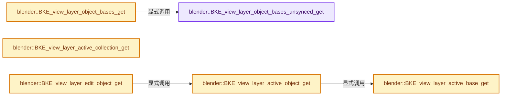
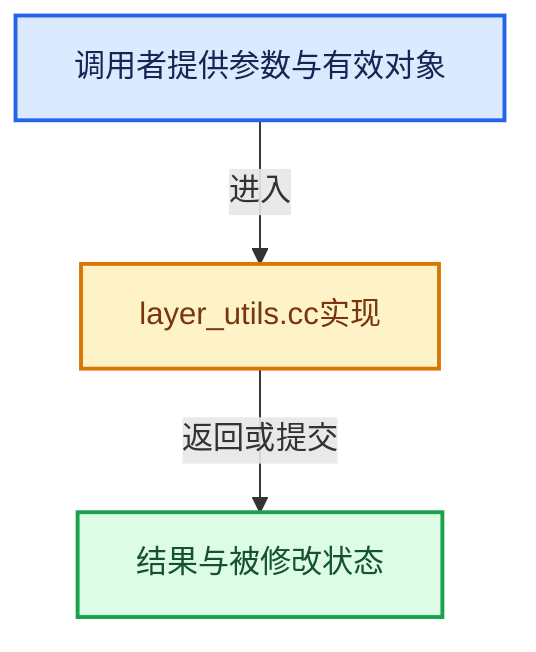

# 实现依赖专题：source/blender/blenkernel/intern/layer_utils.cc

[方向导航](README.md) · [符号索引](../%E7%AC%A6%E5%8F%B7%E4%BE%9D%E8%B5%96%E4%B8%8E%E5%AE%9E%E7%8E%B0%E7%B4%A2%E5%BC%95.md)

本专题从正文实际调用进入，集中保存共享实现。函数有稳定锚点，可从调用处直接跳到对应完整函数；递归与互相调用通过回链组织。

## 本文件的实现关系






## 完整成员与函数实现

<a id="f-4ce7d1a36a8b20ec"></a>

### `blender::BKE_view_layer_object_bases_unsynced_get`

实现位置：[source/blender/blenkernel/intern/layer_utils.cc](../../../../../source/blender/blenkernel/intern/layer_utils.cc) · L197—L200。

接口参数：

- `ViewLayer *view_layer`

**教学注释版**

<!-- annotated:f97ce91b334abe -->

```cpp
ListBaseT<Base> *BKE_view_layer_object_bases_unsynced_get(ViewLayer *view_layer)
{
  return &view_layer->object_bases;
}
```

<details>
<summary>核对原始源码：source/blender/blenkernel/intern/layer_utils.cc · L197—L200</summary>

<!-- original:f97ce91b334abe:source/blender/blenkernel/intern/layer_utils.cc:197:200 -->

```cpp
ListBaseT<Base> *BKE_view_layer_object_bases_unsynced_get(ViewLayer *view_layer)
{
  return &view_layer->object_bases;
}
```

</details>

**结果出口**

- `return &view_layer->object_bases;`

**继续追踪实现**

本实现没有需要继续展开的显式调用；检查返回表达式、对象转换和调用者前置条件。

<a id="f-f7b3adc8941172e4"></a>

### `blender::BKE_view_layer_object_bases_get`

实现位置：[source/blender/blenkernel/intern/layer_utils.cc](../../../../../source/blender/blenkernel/intern/layer_utils.cc) · L202—L207。

接口参数：

- `ViewLayer *view_layer`

**教学注释版**

<!-- annotated:ee06de83bcf860 -->

```cpp
ListBaseT<Base> *BKE_view_layer_object_bases_get(ViewLayer *view_layer)
{
  BLI_assert_msg((view_layer->flag & VIEW_LAYER_OUT_OF_SYNC) == 0,
                 "Object Bases out of sync, invoke BKE_view_layer_synced_ensure.");
  return BKE_view_layer_object_bases_unsynced_get(view_layer);
}
```

<details>
<summary>核对原始源码：source/blender/blenkernel/intern/layer_utils.cc · L202—L207</summary>

<!-- original:ee06de83bcf860:source/blender/blenkernel/intern/layer_utils.cc:202:207 -->

```cpp
ListBaseT<Base> *BKE_view_layer_object_bases_get(ViewLayer *view_layer)
{
  BLI_assert_msg((view_layer->flag & VIEW_LAYER_OUT_OF_SYNC) == 0,
                 "Object Bases out of sync, invoke BKE_view_layer_synced_ensure.");
  return BKE_view_layer_object_bases_unsynced_get(view_layer);
}
```

</details>

**结果出口**

- `return BKE_view_layer_object_bases_unsynced_get(view_layer);`

**继续追踪实现**

- `BLI_assert_msg` → [BLI_assert_msg · L55](../01-%E5%9F%BA%E7%A1%80%E5%AE%B9%E5%99%A8%E4%B8%8E%E7%8E%B0%E4%BB%A3CPP/%E4%BE%9D%E8%B5%96-BLI_assert-cc98e8.md#m-695eed20dceb)；[BLI_assert_msg · L64](../01-%E5%9F%BA%E7%A1%80%E5%AE%B9%E5%99%A8%E4%B8%8E%E7%8E%B0%E4%BB%A3CPP/%E4%BE%9D%E8%B5%96-BLI_assert-cc98e8.md#m-7de5563de4db)。宏定义由构建条件选择。
- `BKE_view_layer_object_bases_unsynced_get` → [blender::BKE_view_layer_object_bases_unsynced_get · L197](%E4%BE%9D%E8%B5%96-layer_utils-31ba6d.md#f-4ce7d1a36a8b20ec)。

<a id="f-b004b0ac876ae634"></a>

### `blender::BKE_view_layer_active_base_get`

实现位置：[source/blender/blenkernel/intern/layer_utils.cc](../../../../../source/blender/blenkernel/intern/layer_utils.cc) · L209—L214。

接口参数：

- `ViewLayer *view_layer`

**教学注释版**

<!-- annotated:aa8f70c8245602 -->

```cpp
Base *BKE_view_layer_active_base_get(ViewLayer *view_layer)
{
  BLI_assert_msg((view_layer->flag & VIEW_LAYER_OUT_OF_SYNC) == 0,
                 "Active Base out of sync, invoke BKE_view_layer_synced_ensure.");
  return view_layer->basact;
}
```

<details>
<summary>核对原始源码：source/blender/blenkernel/intern/layer_utils.cc · L209—L214</summary>

<!-- original:aa8f70c8245602:source/blender/blenkernel/intern/layer_utils.cc:209:214 -->

```cpp
Base *BKE_view_layer_active_base_get(ViewLayer *view_layer)
{
  BLI_assert_msg((view_layer->flag & VIEW_LAYER_OUT_OF_SYNC) == 0,
                 "Active Base out of sync, invoke BKE_view_layer_synced_ensure.");
  return view_layer->basact;
}
```

</details>

**结果出口**

- `return view_layer->basact;`

**继续追踪实现**

- `BLI_assert_msg` → [BLI_assert_msg · L55](../01-%E5%9F%BA%E7%A1%80%E5%AE%B9%E5%99%A8%E4%B8%8E%E7%8E%B0%E4%BB%A3CPP/%E4%BE%9D%E8%B5%96-BLI_assert-cc98e8.md#m-695eed20dceb)；[BLI_assert_msg · L64](../01-%E5%9F%BA%E7%A1%80%E5%AE%B9%E5%99%A8%E4%B8%8E%E7%8E%B0%E4%BB%A3CPP/%E4%BE%9D%E8%B5%96-BLI_assert-cc98e8.md#m-7de5563de4db)。宏定义由构建条件选择。

<a id="f-1f1920af38493cbf"></a>

### `blender::BKE_view_layer_active_collection_get`

实现位置：[source/blender/blenkernel/intern/layer_utils.cc](../../../../../source/blender/blenkernel/intern/layer_utils.cc) · L216—L221。

接口参数：

- `ViewLayer *view_layer`

**教学注释版**

<!-- annotated:0b45c5590d9198 -->

```cpp
LayerCollection *BKE_view_layer_active_collection_get(ViewLayer *view_layer)
{
  BLI_assert_msg((view_layer->flag & VIEW_LAYER_OUT_OF_SYNC) == 0,
                 "Active Collection out of sync, invoke BKE_view_layer_synced_ensure.");
  return view_layer->active_collection;
}
```

<details>
<summary>核对原始源码：source/blender/blenkernel/intern/layer_utils.cc · L216—L221</summary>

<!-- original:0b45c5590d9198:source/blender/blenkernel/intern/layer_utils.cc:216:221 -->

```cpp
LayerCollection *BKE_view_layer_active_collection_get(ViewLayer *view_layer)
{
  BLI_assert_msg((view_layer->flag & VIEW_LAYER_OUT_OF_SYNC) == 0,
                 "Active Collection out of sync, invoke BKE_view_layer_synced_ensure.");
  return view_layer->active_collection;
}
```

</details>

**结果出口**

- `return view_layer->active_collection;`

**继续追踪实现**

- `BLI_assert_msg` → [BLI_assert_msg · L55](../01-%E5%9F%BA%E7%A1%80%E5%AE%B9%E5%99%A8%E4%B8%8E%E7%8E%B0%E4%BB%A3CPP/%E4%BE%9D%E8%B5%96-BLI_assert-cc98e8.md#m-695eed20dceb)；[BLI_assert_msg · L64](../01-%E5%9F%BA%E7%A1%80%E5%AE%B9%E5%99%A8%E4%B8%8E%E7%8E%B0%E4%BB%A3CPP/%E4%BE%9D%E8%B5%96-BLI_assert-cc98e8.md#m-7de5563de4db)。宏定义由构建条件选择。

<a id="f-aa39df7416329726"></a>

### `blender::BKE_view_layer_active_object_get`

实现位置：[source/blender/blenkernel/intern/layer_utils.cc](../../../../../source/blender/blenkernel/intern/layer_utils.cc) · L286—L290。

接口参数：

- `const ViewLayer *view_layer`

**教学注释版**

<!-- annotated:6cf799a4fff7a5 -->

```cpp
Object *BKE_view_layer_active_object_get(const ViewLayer *view_layer)
{
  Base *base = BKE_view_layer_active_base_get(const_cast<ViewLayer *>(view_layer));
  return base ? base->object : nullptr;
}
```

<details>
<summary>核对原始源码：source/blender/blenkernel/intern/layer_utils.cc · L286—L290</summary>

<!-- original:6cf799a4fff7a5:source/blender/blenkernel/intern/layer_utils.cc:286:290 -->

```cpp
Object *BKE_view_layer_active_object_get(const ViewLayer *view_layer)
{
  Base *base = BKE_view_layer_active_base_get(const_cast<ViewLayer *>(view_layer));
  return base ? base->object : nullptr;
}
```

</details>

**结果出口**

- `return base ? base->object : nullptr;`

**继续追踪实现**

- `BKE_view_layer_active_base_get` → [blender::BKE_view_layer_active_base_get · L209](%E4%BE%9D%E8%B5%96-layer_utils-31ba6d.md#f-b004b0ac876ae634)。

<a id="f-c8613cfff236cca1"></a>

### `blender::BKE_view_layer_edit_object_get`

实现位置：[source/blender/blenkernel/intern/layer_utils.cc](../../../../../source/blender/blenkernel/intern/layer_utils.cc) · L292—L302。

接口参数：

- `const ViewLayer *view_layer`

**教学注释版**

<!-- annotated:949e073d7b9b11 -->

```cpp
Object *BKE_view_layer_edit_object_get(const ViewLayer *view_layer)
{
  Object *ob = BKE_view_layer_active_object_get(view_layer);
  if (ob == nullptr) {
    return nullptr;
  }
  if (!(ob->mode & OB_MODE_EDIT)) {
    return nullptr;
  }
  return ob;
}
```

<details>
<summary>核对原始源码：source/blender/blenkernel/intern/layer_utils.cc · L292—L302</summary>

<!-- original:949e073d7b9b11:source/blender/blenkernel/intern/layer_utils.cc:292:302 -->

```cpp
Object *BKE_view_layer_edit_object_get(const ViewLayer *view_layer)
{
  Object *ob = BKE_view_layer_active_object_get(view_layer);
  if (ob == nullptr) {
    return nullptr;
  }
  if (!(ob->mode & OB_MODE_EDIT)) {
    return nullptr;
  }
  return ob;
}
```

</details>

**结果出口**

- `return nullptr;`
- `return ob;`

**继续追踪实现**

- `BKE_view_layer_active_object_get` → [blender::BKE_view_layer_active_object_get · L286](%E4%BE%9D%E8%B5%96-layer_utils-31ba6d.md#f-aa39df7416329726)。
