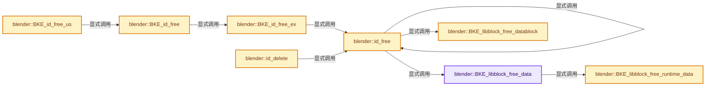
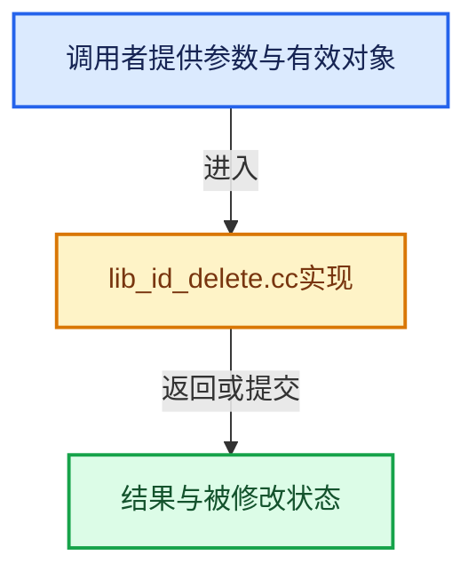

# 实现依赖专题：source/blender/blenkernel/intern/lib_id_delete.cc

[方向导航](README.md) · [符号索引](../%E7%AC%A6%E5%8F%B7%E4%BE%9D%E8%B5%96%E4%B8%8E%E5%AE%9E%E7%8E%B0%E7%B4%A2%E5%BC%95.md)

本专题从正文实际调用进入，集中保存共享实现。函数有稳定锚点，可从调用处直接跳到对应完整函数；递归与互相调用通过回链组织。

## 本文件的实现关系






## 完整成员与函数实现

<a id="f-46dd6f10f77b69a6"></a>

### `blender::BKE_libblock_free_data`

实现位置：[source/blender/blenkernel/intern/lib_id_delete.cc](../../../../../source/blender/blenkernel/intern/lib_id_delete.cc) · L51—L78。

接口参数：

- `ID *id`
- `const bool do_id_user`

**教学注释版**

<!-- annotated:9903003a2256fe -->

```cpp
void BKE_libblock_free_data(ID *id, const bool do_id_user)
{
  if (id->properties) {
    IDP_FreeProperty_ex(id->properties, do_id_user);
    id->properties = nullptr;
  }
  if (id->system_properties) {
    IDP_FreeProperty_ex(id->system_properties, do_id_user);
    id->system_properties = nullptr;
  }

  if (id->override_library) {
    BKE_lib_override_library_free(&id->override_library, do_id_user);
    id->override_library = nullptr;
  }

  if (id->asset_data) {
    BKE_asset_metadata_free(&id->asset_data);
  }

  if (id->library_weak_reference != nullptr) {
    MEM_delete(id->library_weak_reference);
  }

  BKE_animdata_free(id, do_id_user);

  BKE_libblock_free_runtime_data(id);
}
```

<details>
<summary>核对原始源码：source/blender/blenkernel/intern/lib_id_delete.cc · L51—L78</summary>

<!-- original:9903003a2256fe:source/blender/blenkernel/intern/lib_id_delete.cc:51:78 -->

```cpp
void BKE_libblock_free_data(ID *id, const bool do_id_user)
{
  if (id->properties) {
    IDP_FreeProperty_ex(id->properties, do_id_user);
    id->properties = nullptr;
  }
  if (id->system_properties) {
    IDP_FreeProperty_ex(id->system_properties, do_id_user);
    id->system_properties = nullptr;
  }

  if (id->override_library) {
    BKE_lib_override_library_free(&id->override_library, do_id_user);
    id->override_library = nullptr;
  }

  if (id->asset_data) {
    BKE_asset_metadata_free(&id->asset_data);
  }

  if (id->library_weak_reference != nullptr) {
    MEM_delete(id->library_weak_reference);
  }

  BKE_animdata_free(id, do_id_user);

  BKE_libblock_free_runtime_data(id);
}
```

</details>

**沿实际写入检查状态**

- `id->properties = nullptr;`
- `id->system_properties = nullptr;`
- `id->override_library = nullptr;`

**继续追踪实现**

- `IDP_FreeProperty_ex` → [blender::IDP_FreeProperty_ex · L1398](%E4%BE%9D%E8%B5%96-idprop-006c65.md#f-4b1dc3efcf18b18c)。
- `BKE_lib_override_library_free` → [blender::BKE_lib_override_library_free · L262](%E4%BE%9D%E8%B5%96-lib_override-90a5a9.md#f-50c562b9f63f9ac5)。
- `BKE_asset_metadata_free` → [blender::BKE_asset_metadata_free · L36](%E4%BE%9D%E8%B5%96-asset-354441.md#f-b0d251c4a1af437d)。
- `MEM_delete` → [MEM_delete · L400](../03-%E5%86%85%E5%AD%98%E5%88%86%E9%85%8D%E4%B8%8E%E8%BF%90%E8%A1%8C%E6%97%B6%E7%B1%BB%E5%9E%8B/%E4%BE%9D%E8%B5%96-MEM_guardedalloc-b54eca.md#f-9049ffdd1682887c)。
- `BKE_animdata_free` → [blender::BKE_animdata_free · L174](%E4%BE%9D%E8%B5%96-anim_data-56c81c.md#f-eae6096ee0f51e92)。
- `BKE_libblock_free_runtime_data` → [blender::BKE_libblock_free_runtime_data · L94](%E4%BE%9D%E8%B5%96-lib_id_delete-0cb33f.md#f-8aff26c77f0edaff)。

<a id="f-841dff48dde58c7f"></a>

### `blender::BKE_libblock_free_datablock`

实现位置：[source/blender/blenkernel/intern/lib_id_delete.cc](../../../../../source/blender/blenkernel/intern/lib_id_delete.cc) · L80—L92。

接口参数：

- `ID *id`
- `const int`

**教学注释版**

<!-- annotated:7af67de6067584 -->

```cpp
void BKE_libblock_free_datablock(ID *id, const int /*flag*/)
{
  const IDTypeInfo *idtype_info = BKE_idtype_get_info_from_id(id);

  if (idtype_info != nullptr) {
    if (idtype_info->free_data != nullptr) {
      idtype_info->free_data(id);
    }
    return;
  }

  BLI_assert_msg(0, "IDType Missing IDTypeInfo");
}
```

<details>
<summary>核对原始源码：source/blender/blenkernel/intern/lib_id_delete.cc · L80—L92</summary>

<!-- original:7af67de6067584:source/blender/blenkernel/intern/lib_id_delete.cc:80:92 -->

```cpp
void BKE_libblock_free_datablock(ID *id, const int /*flag*/)
{
  const IDTypeInfo *idtype_info = BKE_idtype_get_info_from_id(id);

  if (idtype_info != nullptr) {
    if (idtype_info->free_data != nullptr) {
      idtype_info->free_data(id);
    }
    return;
  }

  BLI_assert_msg(0, "IDType Missing IDTypeInfo");
}
```

</details>

**继续追踪实现**

- `BKE_idtype_get_info_from_id` → [blender::BKE_idtype_get_info_from_id · L232](%E4%BE%9D%E8%B5%96-idtype-cbba99.md#f-9b31985f4ea4750d)。
- `idtype_info->free_data` → [blender::bNodeTreeInterface::free_data · L1742](%E4%BE%9D%E8%B5%96-node_tree_interface-893d31.md#f-71f6f7812aa213ee)。
- `BLI_assert_msg` → [BLI_assert_msg · L55](../01-%E5%9F%BA%E7%A1%80%E5%AE%B9%E5%99%A8%E4%B8%8E%E7%8E%B0%E4%BB%A3CPP/%E4%BE%9D%E8%B5%96-BLI_assert-cc98e8.md#m-695eed20dceb)；[BLI_assert_msg · L64](../01-%E5%9F%BA%E7%A1%80%E5%AE%B9%E5%99%A8%E4%B8%8E%E7%8E%B0%E4%BB%A3CPP/%E4%BE%9D%E8%B5%96-BLI_assert-cc98e8.md#m-7de5563de4db)。宏定义由构建条件选择。

<a id="f-8aff26c77f0edaff"></a>

### `blender::BKE_libblock_free_runtime_data`

实现位置：[source/blender/blenkernel/intern/lib_id_delete.cc](../../../../../source/blender/blenkernel/intern/lib_id_delete.cc) · L94—L105。

接口参数：

- `ID *id`

**教学注释版**

<!-- annotated:e961cd7d7eae0a -->

```cpp
void BKE_libblock_free_runtime_data(ID *id)
{
  if (id->runtime) {
    /* During "normal" file loading this data is released when versioning ends. Some versioning
     * code also deletes IDs, though. For example, in the startup blend file, brushes that were
     * replaced by assets are deleted. This means that the regular "delete this ID" flow (aka this
     * code here) also needs to free this data. */
    BLO_readfile_id_runtime_data_free(*id);

    MEM_SAFE_DELETE(id->runtime);
  }
}
```

<details>
<summary>核对原始源码：source/blender/blenkernel/intern/lib_id_delete.cc · L94—L105</summary>

<!-- original:e961cd7d7eae0a:source/blender/blenkernel/intern/lib_id_delete.cc:94:105 -->

```cpp
void BKE_libblock_free_runtime_data(ID *id)
{
  if (id->runtime) {
    /* During "normal" file loading this data is released when versioning ends. Some versioning
     * code also deletes IDs, though. For example, in the startup blend file, brushes that were
     * replaced by assets are deleted. This means that the regular "delete this ID" flow (aka this
     * code here) also needs to free this data. */
    BLO_readfile_id_runtime_data_free(*id);

    MEM_SAFE_DELETE(id->runtime);
  }
}
```

</details>

**继续追踪实现**

- `BLO_readfile_id_runtime_data_free` → [BLO_readfile_id_runtime_data_free · L2234](%E4%BE%9D%E8%B5%96-readfile-05cc37.md#f-7045b0b949b47801)。
- `MEM_SAFE_DELETE` → [MEM_SAFE_DELETE · L436](../03-%E5%86%85%E5%AD%98%E5%88%86%E9%85%8D%E4%B8%8E%E8%BF%90%E8%A1%8C%E6%97%B6%E7%B1%BB%E5%9E%8B/%E4%BE%9D%E8%B5%96-MEM_guardedalloc-b54eca.md#m-eadb3bc5b902)。宏定义由构建条件选择。

<a id="f-5131164810721422"></a>

### `blender::id_free`

实现位置：[source/blender/blenkernel/intern/lib_id_delete.cc](../../../../../source/blender/blenkernel/intern/lib_id_delete.cc) · L107—L196。

接口参数：

- `Main *bmain`
- `void *idv`
- `int flag`
- `const bool use_flag_from_idtag`

**教学注释版**

<!-- annotated:e4a6a44c09633d -->

```cpp
static int id_free(Main *bmain, void *idv, int flag, const bool use_flag_from_idtag)
{
  ID *id = static_cast<ID *>(idv);

  if (use_flag_from_idtag) {
    if ((id->tag & ID_TAG_NO_MAIN) != 0) {
      flag |= LIB_ID_FREE_NO_MAIN | LIB_ID_FREE_NO_UI_USER | LIB_ID_FREE_NO_DEG_TAG;
    }
    else {
      flag &= ~LIB_ID_FREE_NO_MAIN;
    }

    if ((id->tag & ID_TAG_NO_USER_REFCOUNT) != 0) {
      flag |= LIB_ID_FREE_NO_USER_REFCOUNT;
    }
    else {
      flag &= ~LIB_ID_FREE_NO_USER_REFCOUNT;
    }

    if ((id->tag & ID_TAG_NOT_ALLOCATED) != 0) {
      flag |= LIB_ID_FREE_NOT_ALLOCATED;
    }
    else {
      flag &= ~LIB_ID_FREE_NOT_ALLOCATED;
    }
  }

  BLI_assert((flag & LIB_ID_FREE_NO_MAIN) != 0 || bmain != nullptr);
  BLI_assert((flag & LIB_ID_FREE_NO_MAIN) != 0 || (flag & LIB_ID_FREE_NOT_ALLOCATED) == 0);
  BLI_assert((flag & LIB_ID_FREE_NO_MAIN) != 0 || (flag & LIB_ID_FREE_NO_USER_REFCOUNT) == 0);

  const short type = id->id_type();

  if (bmain && (flag & LIB_ID_FREE_NO_DEG_TAG) == 0) {
    BLI_assert(bmain->is_locked_for_linking == false);

    DEG_id_type_tag(bmain, type);
  }

  BKE_libblock_free_data_py(id);

  Key *key = ((flag & LIB_ID_FREE_NO_MAIN) == 0) ? BKE_key_from_id(id) : nullptr;

  if ((flag & LIB_ID_FREE_NO_USER_REFCOUNT) == 0) {
    BKE_libblock_relink_ex(bmain, id, nullptr, nullptr, ID_REMAP_SKIP_USER_CLEAR);
  }

  if ((flag & LIB_ID_FREE_NO_MAIN) == 0 && key != nullptr) {
    id_free(bmain, &key->id, flag, use_flag_from_idtag);
  }

  BKE_libblock_free_datablock(id, flag);

  /* avoid notifying on removed data */
  if ((flag & LIB_ID_FREE_NO_MAIN) == 0) {
    BKE_main_lock(bmain);
  }

  if ((flag & LIB_ID_FREE_NO_UI_USER) == 0) {
    if (free_notifier_reference_cb) {
      free_notifier_reference_cb(id);
    }

    if (remap_editor_id_reference_cb) {
      IDRemapper remapper;
      remapper.add(id, nullptr);
      remap_editor_id_reference_cb(remapper);
    }
  }

  if ((flag & LIB_ID_FREE_NO_MAIN) == 0) {
    ListBaseT<ID> *lb = which_libbase(bmain, type);
    BLI_remlink(lb, id);
    if ((flag & LIB_ID_FREE_NO_NAMEMAP_REMOVE) == 0) {
      BKE_main_namemap_remove_id(*bmain, *id);
    }
  }

  BKE_libblock_free_data(id, (flag & LIB_ID_FREE_NO_USER_REFCOUNT) == 0);

  if ((flag & LIB_ID_FREE_NO_MAIN) == 0) {
    BKE_main_unlock(bmain);
  }

  if ((flag & LIB_ID_FREE_NOT_ALLOCATED) == 0) {
    MEM_delete(id);
  }

  return flag;
}
```

<details>
<summary>核对原始源码：source/blender/blenkernel/intern/lib_id_delete.cc · L107—L196</summary>

<!-- original:e4a6a44c09633d:source/blender/blenkernel/intern/lib_id_delete.cc:107:196 -->

```cpp
static int id_free(Main *bmain, void *idv, int flag, const bool use_flag_from_idtag)
{
  ID *id = static_cast<ID *>(idv);

  if (use_flag_from_idtag) {
    if ((id->tag & ID_TAG_NO_MAIN) != 0) {
      flag |= LIB_ID_FREE_NO_MAIN | LIB_ID_FREE_NO_UI_USER | LIB_ID_FREE_NO_DEG_TAG;
    }
    else {
      flag &= ~LIB_ID_FREE_NO_MAIN;
    }

    if ((id->tag & ID_TAG_NO_USER_REFCOUNT) != 0) {
      flag |= LIB_ID_FREE_NO_USER_REFCOUNT;
    }
    else {
      flag &= ~LIB_ID_FREE_NO_USER_REFCOUNT;
    }

    if ((id->tag & ID_TAG_NOT_ALLOCATED) != 0) {
      flag |= LIB_ID_FREE_NOT_ALLOCATED;
    }
    else {
      flag &= ~LIB_ID_FREE_NOT_ALLOCATED;
    }
  }

  BLI_assert((flag & LIB_ID_FREE_NO_MAIN) != 0 || bmain != nullptr);
  BLI_assert((flag & LIB_ID_FREE_NO_MAIN) != 0 || (flag & LIB_ID_FREE_NOT_ALLOCATED) == 0);
  BLI_assert((flag & LIB_ID_FREE_NO_MAIN) != 0 || (flag & LIB_ID_FREE_NO_USER_REFCOUNT) == 0);

  const short type = id->id_type();

  if (bmain && (flag & LIB_ID_FREE_NO_DEG_TAG) == 0) {
    BLI_assert(bmain->is_locked_for_linking == false);

    DEG_id_type_tag(bmain, type);
  }

  BKE_libblock_free_data_py(id);

  Key *key = ((flag & LIB_ID_FREE_NO_MAIN) == 0) ? BKE_key_from_id(id) : nullptr;

  if ((flag & LIB_ID_FREE_NO_USER_REFCOUNT) == 0) {
    BKE_libblock_relink_ex(bmain, id, nullptr, nullptr, ID_REMAP_SKIP_USER_CLEAR);
  }

  if ((flag & LIB_ID_FREE_NO_MAIN) == 0 && key != nullptr) {
    id_free(bmain, &key->id, flag, use_flag_from_idtag);
  }

  BKE_libblock_free_datablock(id, flag);

  /* avoid notifying on removed data */
  if ((flag & LIB_ID_FREE_NO_MAIN) == 0) {
    BKE_main_lock(bmain);
  }

  if ((flag & LIB_ID_FREE_NO_UI_USER) == 0) {
    if (free_notifier_reference_cb) {
      free_notifier_reference_cb(id);
    }

    if (remap_editor_id_reference_cb) {
      IDRemapper remapper;
      remapper.add(id, nullptr);
      remap_editor_id_reference_cb(remapper);
    }
  }

  if ((flag & LIB_ID_FREE_NO_MAIN) == 0) {
    ListBaseT<ID> *lb = which_libbase(bmain, type);
    BLI_remlink(lb, id);
    if ((flag & LIB_ID_FREE_NO_NAMEMAP_REMOVE) == 0) {
      BKE_main_namemap_remove_id(*bmain, *id);
    }
  }

  BKE_libblock_free_data(id, (flag & LIB_ID_FREE_NO_USER_REFCOUNT) == 0);

  if ((flag & LIB_ID_FREE_NO_MAIN) == 0) {
    BKE_main_unlock(bmain);
  }

  if ((flag & LIB_ID_FREE_NOT_ALLOCATED) == 0) {
    MEM_delete(id);
  }

  return flag;
}
```

</details>

**沿实际写入检查状态**

- `flag |= LIB_ID_FREE_NO_MAIN | LIB_ID_FREE_NO_UI_USER | LIB_ID_FREE_NO_DEG_TAG;`
- `flag &= ~LIB_ID_FREE_NO_MAIN;`
- `flag |= LIB_ID_FREE_NO_USER_REFCOUNT;`
- `flag &= ~LIB_ID_FREE_NO_USER_REFCOUNT;`
- `flag |= LIB_ID_FREE_NOT_ALLOCATED;`
- `flag &= ~LIB_ID_FREE_NOT_ALLOCATED;`

**结果出口**

- `return flag;`

**继续追踪实现**

- `BLI_assert` → [BLI_assert · L48](../01-%E5%9F%BA%E7%A1%80%E5%AE%B9%E5%99%A8%E4%B8%8E%E7%8E%B0%E4%BB%A3CPP/%E4%BE%9D%E8%B5%96-BLI_assert-cc98e8.md#m-57a88495704d)；[BLI_assert · L63](../01-%E5%9F%BA%E7%A1%80%E5%AE%B9%E5%99%A8%E4%B8%8E%E7%8E%B0%E4%BB%A3CPP/%E4%BE%9D%E8%B5%96-BLI_assert-cc98e8.md#m-d07050020cb5)。宏定义由构建条件选择。
- `id->id_type` → [blender::ID::id_type · L544](%E4%BE%9D%E8%B5%96-DNA_ID-3eb091.md#f-ee8fe63f3948aa47)。
- `DEG_id_type_tag` → [blender::DEG_id_type_tag · L902](../11-Depsgraph%E4%B8%8E%E5%B9%B6%E8%A1%8C%E4%BB%BB%E5%8A%A1%E7%B3%BB%E7%BB%9F/%E4%BE%9D%E8%B5%96-depsgraph_tag-d8b3c7.md#f-37c26cb6466fa25d)。
- `BKE_libblock_free_data_py` → [blender::BKE_libblock_free_data_py · L439](%E4%BE%9D%E8%B5%96-lib_id_delete-0cb33f.md#f-eccca779ad62c378)。
- `BKE_key_from_id` → [blender::BKE_key_from_id · L1291](%E4%BE%9D%E8%B5%96-key-2b3be3.md#f-2050edb37f3ef7b0)。
- `BKE_libblock_relink_ex` → [blender::BKE_libblock_relink_ex · L855](%E4%BE%9D%E8%B5%96-lib_remap-25f80e.md#f-2a7012d1e8479d5d)。
- `id_free` → [blender::id_free · L107](%E4%BE%9D%E8%B5%96-lib_id_delete-0cb33f.md#f-5131164810721422)。
- `BKE_libblock_free_datablock` → [blender::BKE_libblock_free_datablock · L80](%E4%BE%9D%E8%B5%96-lib_id_delete-0cb33f.md#f-841dff48dde58c7f)。
- `BKE_main_lock` → [blender::BKE_main_lock · L661](%E4%BE%9D%E8%B5%96-main-ffa8b3.md#f-3f480bfb076dd87d)。
- `free_notifier_reference_cb` → [调用协议](../%E6%A8%A1%E6%9D%BF%E5%AE%8F%E4%B8%8E%E5%8A%A8%E6%80%81%E5%88%86%E6%B4%BE%E5%8D%8F%E8%AE%AE.md)：函数指针、局部可调用对象或未展开的宏；必须结合调用者环境。调用位置L167。
- `remapper.add` → [blender::bke::id::IDRemapper::add · L17](%E4%BE%9D%E8%B5%96-lib_id_remapper-733436.md#f-8aa3e96df078a711)。
- `remap_editor_id_reference_cb` → [调用协议](../%E6%A8%A1%E6%9D%BF%E5%AE%8F%E4%B8%8E%E5%8A%A8%E6%80%81%E5%88%86%E6%B4%BE%E5%8D%8F%E8%AE%AE.md)：函数指针、局部可调用对象或未展开的宏；必须结合调用者环境。调用位置L173。
- `which_libbase` → [blender::which_libbase · L1073](%E4%BE%9D%E8%B5%96-main-ffa8b3.md#f-87eb528420a3faf0)。
- `BLI_remlink` → [blender::BLI_remlink · L138](../01-%E5%9F%BA%E7%A1%80%E5%AE%B9%E5%99%A8%E4%B8%8E%E7%8E%B0%E4%BB%A3CPP/%E4%BE%9D%E8%B5%96-listbase-2816d9.md#f-120d80f281ca4cb7)。
- `BKE_main_namemap_remove_id` → [blender::BKE_main_namemap_remove_id · L612](%E4%BE%9D%E8%B5%96-main_namemap-dbe2fc.md#f-61fb0649bdf69d89)。
- `BKE_libblock_free_data` → [blender::BKE_libblock_free_data · L51](%E4%BE%9D%E8%B5%96-lib_id_delete-0cb33f.md#f-46dd6f10f77b69a6)。
- `BKE_main_unlock` → [blender::BKE_main_unlock · L666](%E4%BE%9D%E8%B5%96-main-ffa8b3.md#f-abebed07b3cec04c)。
- `MEM_delete` → [MEM_delete · L400](../03-%E5%86%85%E5%AD%98%E5%88%86%E9%85%8D%E4%B8%8E%E8%BF%90%E8%A1%8C%E6%97%B6%E7%B1%BB%E5%9E%8B/%E4%BE%9D%E8%B5%96-MEM_guardedalloc-b54eca.md#f-9049ffdd1682887c)。

<a id="f-763e21336bede327"></a>

### `blender::BKE_id_free_ex`

实现位置：[source/blender/blenkernel/intern/lib_id_delete.cc](../../../../../source/blender/blenkernel/intern/lib_id_delete.cc) · L198—L222。

接口参数：

- `Main *bmain`
- `void *idv`
- `const int flag_orig`
- `const bool use_flag_from_idtag`

**教学注释版**

<!-- annotated:07b83456e1fc68 -->

```cpp
void BKE_id_free_ex(Main *bmain, void *idv, const int flag_orig, const bool use_flag_from_idtag)
{
  /* ViewLayer resync needs to be delayed during Scene freeing, since internal relationships
   * between the Scene's master collection and its view_layers become invalid
   * (due to remapping). */
  if (bmain && (flag_orig & LIB_ID_FREE_NO_MAIN) == 0) {
    BKE_layer_collection_resync_forbid(*bmain);
  }

  const ID_Type id_type = static_cast<ID *>(idv)->id_type();

  int flag_final = id_free(bmain, idv, flag_orig, use_flag_from_idtag);

  if (bmain) {
    if ((flag_orig & LIB_ID_FREE_NO_MAIN) == 0) {
      BKE_layer_collection_resync_allow(*bmain);
    }

    if ((flag_final & LIB_ID_FREE_NO_MAIN) == 0) {
      if (ELEM(id_type, ID_SCE, ID_GR, ID_OB)) {
        BKE_main_collection_sync_remap(bmain);
      }
    }
  }
}
```

<details>
<summary>核对原始源码：source/blender/blenkernel/intern/lib_id_delete.cc · L198—L222</summary>

<!-- original:07b83456e1fc68:source/blender/blenkernel/intern/lib_id_delete.cc:198:222 -->

```cpp
void BKE_id_free_ex(Main *bmain, void *idv, const int flag_orig, const bool use_flag_from_idtag)
{
  /* ViewLayer resync needs to be delayed during Scene freeing, since internal relationships
   * between the Scene's master collection and its view_layers become invalid
   * (due to remapping). */
  if (bmain && (flag_orig & LIB_ID_FREE_NO_MAIN) == 0) {
    BKE_layer_collection_resync_forbid(*bmain);
  }

  const ID_Type id_type = static_cast<ID *>(idv)->id_type();

  int flag_final = id_free(bmain, idv, flag_orig, use_flag_from_idtag);

  if (bmain) {
    if ((flag_orig & LIB_ID_FREE_NO_MAIN) == 0) {
      BKE_layer_collection_resync_allow(*bmain);
    }

    if ((flag_final & LIB_ID_FREE_NO_MAIN) == 0) {
      if (ELEM(id_type, ID_SCE, ID_GR, ID_OB)) {
        BKE_main_collection_sync_remap(bmain);
      }
    }
  }
}
```

</details>

**继续追踪实现**

- `BKE_layer_collection_resync_forbid` → [blender::BKE_layer_collection_resync_forbid · L814](%E4%BE%9D%E8%B5%96-layer-0bc136.md#f-1e087ac17e5396d9)。
- `static_cast<ID *>(idv)->id_type` → [调用协议](../%E6%A8%A1%E6%9D%BF%E5%AE%8F%E4%B8%8E%E5%8A%A8%E6%80%81%E5%88%86%E6%B4%BE%E5%8D%8F%E8%AE%AE.md)：接收对象类型依赖auto、返回值或模板实例；不按同名猜测目标。调用位置L207。
- `id_free` → [blender::id_free · L107](%E4%BE%9D%E8%B5%96-lib_id_delete-0cb33f.md#f-5131164810721422)。
- `BKE_layer_collection_resync_allow` → [blender::BKE_layer_collection_resync_allow · L821](%E4%BE%9D%E8%B5%96-layer-0bc136.md#f-f79cc5932b651227)。
- `ELEM` → [ELEM · L88](%E4%BE%9D%E8%B5%96-GHOST_utildefines-34b996.md#m-d28724a15928)；[ELEM · L135](../01-%E5%9F%BA%E7%A1%80%E5%AE%B9%E5%99%A8%E4%B8%8E%E7%8E%B0%E4%BB%A3CPP/%E4%BE%9D%E8%B5%96-BLI_utildefines-293a0a.md#m-d6572de7cae0)。宏定义由构建条件选择。
- `BKE_main_collection_sync_remap` → [blender::BKE_main_collection_sync_remap · L1521](%E4%BE%9D%E8%B5%96-layer-0bc136.md#f-3a3a06c3fdb216b5)。

<a id="f-28ed02c41d0f2d5b"></a>

### `blender::BKE_id_free`

实现位置：[source/blender/blenkernel/intern/lib_id_delete.cc](../../../../../source/blender/blenkernel/intern/lib_id_delete.cc) · L224—L227。

接口参数：

- `Main *bmain`
- `void *idv`

**教学注释版**

<!-- annotated:1fb3a296bdabd4 -->

```cpp
void BKE_id_free(Main *bmain, void *idv)
{
  BKE_id_free_ex(bmain, idv, 0, true);
}
```

<details>
<summary>核对原始源码：source/blender/blenkernel/intern/lib_id_delete.cc · L224—L227</summary>

<!-- original:1fb3a296bdabd4:source/blender/blenkernel/intern/lib_id_delete.cc:224:227 -->

```cpp
void BKE_id_free(Main *bmain, void *idv)
{
  BKE_id_free_ex(bmain, idv, 0, true);
}
```

</details>

**继续追踪实现**

- `BKE_id_free_ex` → [blender::BKE_id_free_ex · L198](%E4%BE%9D%E8%B5%96-lib_id_delete-0cb33f.md#f-763e21336bede327)。

<a id="f-18b9afe22c9e1f2d"></a>

### `blender::BKE_id_free_us`

实现位置：[source/blender/blenkernel/intern/lib_id_delete.cc](../../../../../source/blender/blenkernel/intern/lib_id_delete.cc) · L229—L258。

接口参数：

- `Main *bmain`
- `void *idv`

**教学注释版**

<!-- annotated:36feadb348f510 -->

```cpp
void BKE_id_free_us(Main *bmain, void *idv) /* test users */
{
  ID *id = static_cast<ID *>(idv);

  id_us_min(id);

  /* XXX This is a temp (2.77) hack so that we keep same behavior as in 2.76 regarding collections
   *     when deleting an object. Since only 'user_one' usage of objects is collections,
   *     and only 'real user' usage of objects is scenes, removing that 'user_one' tag when there
   *     is no more real (scene) users of an object ensures it gets fully unlinked.
   *     But only for local objects, not linked ones!
   *     Otherwise, there is no real way to get rid of an object anymore -
   *     better handling of this is TODO.
   */
  if ((id->id_type() == ID_OB) && (id->us == 1) && !ID_IS_LINKED(id)) {
    id_us_clear_real(id);
  }

  if (id->us == 0) {
    const bool is_lib = id->id_type() == ID_LI;

    BKE_libblock_unlink(bmain, id, false);

    BKE_id_free(bmain, id);

    if (is_lib) {
      BKE_library_main_rebuild_hierarchy(bmain);
    }
  }
}
```

<details>
<summary>核对原始源码：source/blender/blenkernel/intern/lib_id_delete.cc · L229—L258</summary>

<!-- original:36feadb348f510:source/blender/blenkernel/intern/lib_id_delete.cc:229:258 -->

```cpp
void BKE_id_free_us(Main *bmain, void *idv) /* test users */
{
  ID *id = static_cast<ID *>(idv);

  id_us_min(id);

  /* XXX This is a temp (2.77) hack so that we keep same behavior as in 2.76 regarding collections
   *     when deleting an object. Since only 'user_one' usage of objects is collections,
   *     and only 'real user' usage of objects is scenes, removing that 'user_one' tag when there
   *     is no more real (scene) users of an object ensures it gets fully unlinked.
   *     But only for local objects, not linked ones!
   *     Otherwise, there is no real way to get rid of an object anymore -
   *     better handling of this is TODO.
   */
  if ((id->id_type() == ID_OB) && (id->us == 1) && !ID_IS_LINKED(id)) {
    id_us_clear_real(id);
  }

  if (id->us == 0) {
    const bool is_lib = id->id_type() == ID_LI;

    BKE_libblock_unlink(bmain, id, false);

    BKE_id_free(bmain, id);

    if (is_lib) {
      BKE_library_main_rebuild_hierarchy(bmain);
    }
  }
}
```

</details>

**继续追踪实现**

- `id_us_min` → [blender::id_us_min · L441](%E4%BE%9D%E8%B5%96-lib_id-d4e6bd.md#f-c5e5246a79962257)。
- `id->id_type` → [blender::ID::id_type · L544](%E4%BE%9D%E8%B5%96-DNA_ID-3eb091.md#f-ee8fe63f3948aa47)。
- `ID_IS_LINKED` → [ID_IS_LINKED · L697](%E4%BE%9D%E8%B5%96-DNA_ID-3eb091.md#m-7e1e1e9b20e6)。宏定义由构建条件选择。
- `id_us_clear_real` → [blender::id_us_clear_real · L406](%E4%BE%9D%E8%B5%96-lib_id-d4e6bd.md#f-a426cbdc6d5bfd34)。
- `BKE_libblock_unlink` → [blender::BKE_libblock_unlink · L719](%E4%BE%9D%E8%B5%96-lib_remap-25f80e.md#f-c8fea5008cf881e7)。
- `BKE_id_free` → [blender::BKE_id_free · L224](%E4%BE%9D%E8%B5%96-lib_id_delete-0cb33f.md#f-28ed02c41d0f2d5b)。
- `BKE_library_main_rebuild_hierarchy` → [blender::BKE_library_main_rebuild_hierarchy · L376](%E4%BE%9D%E8%B5%96-library-b754fe.md#f-bc6cae93ad2075a6)。

<a id="f-4512fcc83347cd50"></a>

### `blender::id_delete`

实现位置：[source/blender/blenkernel/intern/lib_id_delete.cc](../../../../../source/blender/blenkernel/intern/lib_id_delete.cc) · L260—L404。

接口参数：

- `Main *bmain`
- `Set<ID *> &ids_to_delete`
- `const BKEIDDeleteOptions &options`

**教学注释版**

<!-- annotated:9a4531ba4bdd42 -->

```cpp
static size_t id_delete(Main *bmain, Set<ID *> &ids_to_delete, const BKEIDDeleteOptions &options)
{
  const int extra_remapping_flags = options.extra_remapping_flags;
  bool has_deleted_library = false;
  bool has_deleted_linked_or_liboverride_id = false;

  /* Used by batch tagged deletion, when we call BKE_id_free then, id is no more in Main database,
   * and has already properly unlinked its other IDs usages.
   * UI users are always cleared in BKE_libblock_remap_locked() call, so we can always skip it. */
  const int free_flag = LIB_ID_FREE_NO_UI_USER | LIB_ID_FREE_NO_MAIN |
                        LIB_ID_FREE_NO_USER_REFCOUNT;
  const int remapping_flags = (ID_REMAP_STORE_NEVER_NULL_USAGE | ID_REMAP_FORCE_NEVER_NULL_USAGE |
                               ID_REMAP_FORCE_INTERNAL_RUNTIME_POINTERS | extra_remapping_flags);

  MainListsArray lbarray = BKE_main_lists_get(*bmain);
  const int base_count = lbarray.size();

  BKE_main_lock(bmain);
  BKE_layer_collection_resync_forbid(*bmain);
  IDRemapper id_remapper;

  auto process_id_to_delete =
      [&bmain, &ids_to_delete, &id_remapper, &has_deleted_linked_or_liboverride_id](
          ListBaseT<ID> *lb, ID *id_iter) -> void {
    /* Do not tag as no_main now, we want to unlink it first (lower-level ID management
     * code has some specific handling of 'no main' IDs that would be a problem in that
     * case). */
    BLI_remlink(lb, id_iter);
    BKE_main_namemap_remove_id(*bmain, *id_iter);
    // [讲解] ids_to_delete.add：按哈希与相等关系加入键或键值。
    ids_to_delete.add(id_iter);
    id_remapper.add(id_iter, nullptr);

    if (!has_deleted_linked_or_liboverride_id &&
        (ID_IS_LINKED(id_iter) || ID_IS_OVERRIDE_LIBRARY(id_iter)))
    {
      has_deleted_linked_or_liboverride_id = true;
    }
  };

  /* Main idea of batch deletion is to remove all IDs to be deleted from Main database.
   * This means that we won't have to loop over all deleted IDs to remove usages
   * of other deleted IDs.
   * This gives tremendous speed-up when deleting a large amount of IDs from a Main
   * containing thousands of these.
   * This also means that we have to be very careful here, as we bypass many 'common'
   * processing, hence risking to 'corrupt' at least user counts, if not IDs themselves. */
  bool keep_looping = true;
  while (keep_looping) {
    keep_looping = false;

    /* First tag and remove from Main all datablocks directly from target lib.
     * Note that we go forward here, since we want to check dependencies before users
     * (e.g. meshes before objects). Reduces the chances to have to loop many times in the
     * `while (keep_looking)` outer loop. */
    for (int i = 0; i < base_count; i++) {
      ListBaseT<ID> *lb = lbarray[i];
      ID *id_iter;

      FOREACH_MAIN_LISTBASE_ID_BEGIN (lb, id_iter) {
        /* NOTE: in case we delete a library, we also delete all its datablocks! */
        // [讲解] ids_to_delete.contains：查询活项数量或键是否存在。
        if (ids_to_delete.contains(id_iter) ||
            (ID_IS_LINKED(id_iter) && ids_to_delete.contains(&id_iter->lib->id)))
        {
          process_id_to_delete(lb, id_iter);

          /* Forcefully also delete shapekeys of the deleted ID if any, 'orphaned' shapekeys are
           * not allowed in Blender and will cause lots of problem in modern code (liboverrides,
           * warning on write & read, etc.). */
          Key *shape_key = BKE_key_from_id(id_iter);
          if (shape_key && !ids_to_delete.contains(&shape_key->id)) {
            process_id_to_delete(&bmain->shapekeys.cast<ID>(), &shape_key->id);
          }

          keep_looping = true;
        }
      }
      FOREACH_MAIN_LISTBASE_ID_END;
    }

    /* Will tag 'never nullptr' users of this ID too.
     *
     * NOTE: #BKE_libblock_unlink() cannot be used here, since it would ignore indirect
     * links, this can lead to nasty crashing here in second, actual deleting loop.
     * Also, this will also flag users of deleted data that cannot be unlinked
     * (object using deleted obdata, etc.), so that they also get deleted. */
    BKE_libblock_remap_multiple_locked(bmain, id_remapper, remapping_flags);
    for (ID *id_never_null_iter : id_remapper.never_null_users()) {
      ids_to_delete.add(id_never_null_iter);
      keep_looping = true;
    }
    id_remapper.clear();
  }

  /* Remapping above may have left some Library::runtime::archived_libraries items to nullptr,
   * clean this up and shrink the vector accordingly. */
  bke::library::main_cleanup_parent_archives(*bmain);

  /* Since we removed IDs from Main, their own other IDs usages need to be removed 'manually'. */
  Vector<ID *> cleanup_ids{ids_to_delete.begin(), ids_to_delete.end()};
  BKE_libblock_relink_multiple(
      bmain,
      cleanup_ids,
      ID_REMAP_TYPE_CLEANUP,
      id_remapper,
      (ID_REMAP_FORCE_INTERNAL_RUNTIME_POINTERS | ID_REMAP_SKIP_USER_CLEAR));
  // [讲解] cleanup_ids.clear：销毁所有有效元素，把size变为0，但保留原分配或内嵌容量。
  cleanup_ids.clear();

  /* Now we can safely mark that ID as not being in Main database anymore. */
  /* NOTE: This needs to be done in a separate loop than above, otherwise some user-counts of
   * deleted IDs may not be properly decreased by the remappings (since `NO_MAIN` ID user-counts
   * is never affected). */
  for (ID *id : ids_to_delete) {
    id->tag |= ID_TAG_NO_MAIN;
    /* User-count needs to be reset artificially, since some usages may not be cleared in batch
     * deletion (typically, if one deleted ID uses another deleted ID, this may not be cleared by
     * remapping code, depending on order in which these are handled). */
    id->us = ID_FAKE_USERS(id);

    if (!has_deleted_library && id->id_type() == ID_LI) {
      has_deleted_library = true;
    }

    id_free(bmain, id, free_flag, false);
  }

  BKE_main_unlock(bmain);
  BKE_layer_collection_resync_allow(*bmain);
  BKE_main_collection_sync_remap(bmain);
  if (!options.prevent_invariants_update) {
    BKE_main_ensure_invariants(*bmain);
  }

  if (has_deleted_library) {
    BKE_library_main_rebuild_hierarchy(bmain);
  }

  /* Deleting a liboverride or linked ID may have had some impact on validity of liboverrides
   * hierarchy roots, these need to be re-validated/re-generated. */
  if (has_deleted_linked_or_liboverride_id && !options.prevent_liboverride_hierarchy_root_ensure) {
    BKE_lib_override_library_main_hierarchy_root_ensure(bmain);
  }

  bmain->is_memfile_undo_written = false;
  // [讲解] ids_to_delete.size：查询活项数量或键是否存在。
  return size_t(ids_to_delete.size());
}
```

<details>
<summary>核对原始源码：source/blender/blenkernel/intern/lib_id_delete.cc · L260—L404</summary>

<!-- original:9a4531ba4bdd42:source/blender/blenkernel/intern/lib_id_delete.cc:260:404 -->

```cpp
static size_t id_delete(Main *bmain, Set<ID *> &ids_to_delete, const BKEIDDeleteOptions &options)
{
  const int extra_remapping_flags = options.extra_remapping_flags;
  bool has_deleted_library = false;
  bool has_deleted_linked_or_liboverride_id = false;

  /* Used by batch tagged deletion, when we call BKE_id_free then, id is no more in Main database,
   * and has already properly unlinked its other IDs usages.
   * UI users are always cleared in BKE_libblock_remap_locked() call, so we can always skip it. */
  const int free_flag = LIB_ID_FREE_NO_UI_USER | LIB_ID_FREE_NO_MAIN |
                        LIB_ID_FREE_NO_USER_REFCOUNT;
  const int remapping_flags = (ID_REMAP_STORE_NEVER_NULL_USAGE | ID_REMAP_FORCE_NEVER_NULL_USAGE |
                               ID_REMAP_FORCE_INTERNAL_RUNTIME_POINTERS | extra_remapping_flags);

  MainListsArray lbarray = BKE_main_lists_get(*bmain);
  const int base_count = lbarray.size();

  BKE_main_lock(bmain);
  BKE_layer_collection_resync_forbid(*bmain);
  IDRemapper id_remapper;

  auto process_id_to_delete =
      [&bmain, &ids_to_delete, &id_remapper, &has_deleted_linked_or_liboverride_id](
          ListBaseT<ID> *lb, ID *id_iter) -> void {
    /* Do not tag as no_main now, we want to unlink it first (lower-level ID management
     * code has some specific handling of 'no main' IDs that would be a problem in that
     * case). */
    BLI_remlink(lb, id_iter);
    BKE_main_namemap_remove_id(*bmain, *id_iter);
    ids_to_delete.add(id_iter);
    id_remapper.add(id_iter, nullptr);

    if (!has_deleted_linked_or_liboverride_id &&
        (ID_IS_LINKED(id_iter) || ID_IS_OVERRIDE_LIBRARY(id_iter)))
    {
      has_deleted_linked_or_liboverride_id = true;
    }
  };

  /* Main idea of batch deletion is to remove all IDs to be deleted from Main database.
   * This means that we won't have to loop over all deleted IDs to remove usages
   * of other deleted IDs.
   * This gives tremendous speed-up when deleting a large amount of IDs from a Main
   * containing thousands of these.
   * This also means that we have to be very careful here, as we bypass many 'common'
   * processing, hence risking to 'corrupt' at least user counts, if not IDs themselves. */
  bool keep_looping = true;
  while (keep_looping) {
    keep_looping = false;

    /* First tag and remove from Main all datablocks directly from target lib.
     * Note that we go forward here, since we want to check dependencies before users
     * (e.g. meshes before objects). Reduces the chances to have to loop many times in the
     * `while (keep_looking)` outer loop. */
    for (int i = 0; i < base_count; i++) {
      ListBaseT<ID> *lb = lbarray[i];
      ID *id_iter;

      FOREACH_MAIN_LISTBASE_ID_BEGIN (lb, id_iter) {
        /* NOTE: in case we delete a library, we also delete all its datablocks! */
        if (ids_to_delete.contains(id_iter) ||
            (ID_IS_LINKED(id_iter) && ids_to_delete.contains(&id_iter->lib->id)))
        {
          process_id_to_delete(lb, id_iter);

          /* Forcefully also delete shapekeys of the deleted ID if any, 'orphaned' shapekeys are
           * not allowed in Blender and will cause lots of problem in modern code (liboverrides,
           * warning on write & read, etc.). */
          Key *shape_key = BKE_key_from_id(id_iter);
          if (shape_key && !ids_to_delete.contains(&shape_key->id)) {
            process_id_to_delete(&bmain->shapekeys.cast<ID>(), &shape_key->id);
          }

          keep_looping = true;
        }
      }
      FOREACH_MAIN_LISTBASE_ID_END;
    }

    /* Will tag 'never nullptr' users of this ID too.
     *
     * NOTE: #BKE_libblock_unlink() cannot be used here, since it would ignore indirect
     * links, this can lead to nasty crashing here in second, actual deleting loop.
     * Also, this will also flag users of deleted data that cannot be unlinked
     * (object using deleted obdata, etc.), so that they also get deleted. */
    BKE_libblock_remap_multiple_locked(bmain, id_remapper, remapping_flags);
    for (ID *id_never_null_iter : id_remapper.never_null_users()) {
      ids_to_delete.add(id_never_null_iter);
      keep_looping = true;
    }
    id_remapper.clear();
  }

  /* Remapping above may have left some Library::runtime::archived_libraries items to nullptr,
   * clean this up and shrink the vector accordingly. */
  bke::library::main_cleanup_parent_archives(*bmain);

  /* Since we removed IDs from Main, their own other IDs usages need to be removed 'manually'. */
  Vector<ID *> cleanup_ids{ids_to_delete.begin(), ids_to_delete.end()};
  BKE_libblock_relink_multiple(
      bmain,
      cleanup_ids,
      ID_REMAP_TYPE_CLEANUP,
      id_remapper,
      (ID_REMAP_FORCE_INTERNAL_RUNTIME_POINTERS | ID_REMAP_SKIP_USER_CLEAR));
  cleanup_ids.clear();

  /* Now we can safely mark that ID as not being in Main database anymore. */
  /* NOTE: This needs to be done in a separate loop than above, otherwise some user-counts of
   * deleted IDs may not be properly decreased by the remappings (since `NO_MAIN` ID user-counts
   * is never affected). */
  for (ID *id : ids_to_delete) {
    id->tag |= ID_TAG_NO_MAIN;
    /* User-count needs to be reset artificially, since some usages may not be cleared in batch
     * deletion (typically, if one deleted ID uses another deleted ID, this may not be cleared by
     * remapping code, depending on order in which these are handled). */
    id->us = ID_FAKE_USERS(id);

    if (!has_deleted_library && id->id_type() == ID_LI) {
      has_deleted_library = true;
    }

    id_free(bmain, id, free_flag, false);
  }

  BKE_main_unlock(bmain);
  BKE_layer_collection_resync_allow(*bmain);
  BKE_main_collection_sync_remap(bmain);
  if (!options.prevent_invariants_update) {
    BKE_main_ensure_invariants(*bmain);
  }

  if (has_deleted_library) {
    BKE_library_main_rebuild_hierarchy(bmain);
  }

  /* Deleting a liboverride or linked ID may have had some impact on validity of liboverrides
   * hierarchy roots, these need to be re-validated/re-generated. */
  if (has_deleted_linked_or_liboverride_id && !options.prevent_liboverride_hierarchy_root_ensure) {
    BKE_lib_override_library_main_hierarchy_root_ensure(bmain);
  }

  bmain->is_memfile_undo_written = false;
  return size_t(ids_to_delete.size());
}
```

</details>

**沿实际写入检查状态**

- `has_deleted_linked_or_liboverride_id = true;`
- `keep_looping = false;`
- `keep_looping = true;`
- `id->tag |= ID_TAG_NO_MAIN;`
- `id->us = ID_FAKE_USERS(id);`
- `has_deleted_library = true;`
- `bmain->is_memfile_undo_written = false;`

**结果出口**

- `return size_t(ids_to_delete.size());`

**继续追踪实现**

- `BKE_main_lists_get` → [blender::BKE_main_lists_get · L1158](%E4%BE%9D%E8%B5%96-main-ffa8b3.md#f-908cb8449aa99c35)。
- `lbarray.size` → [blender::MainAllIDsIterator::size · L1291](%E4%BE%9D%E8%B5%96-main-ffa8b3.md#f-520d1311c646452f)。
- `BKE_main_lock` → [blender::BKE_main_lock · L661](%E4%BE%9D%E8%B5%96-main-ffa8b3.md#f-3f480bfb076dd87d)。
- `BKE_layer_collection_resync_forbid` → [blender::BKE_layer_collection_resync_forbid · L814](%E4%BE%9D%E8%B5%96-layer-0bc136.md#f-1e087ac17e5396d9)。
- `BLI_remlink` → [blender::BLI_remlink · L138](../01-%E5%9F%BA%E7%A1%80%E5%AE%B9%E5%99%A8%E4%B8%8E%E7%8E%B0%E4%BB%A3CPP/%E4%BE%9D%E8%B5%96-listbase-2816d9.md#f-120d80f281ca4cb7)。
- `BKE_main_namemap_remove_id` → [blender::BKE_main_namemap_remove_id · L612](%E4%BE%9D%E8%B5%96-main_namemap-dbe2fc.md#f-61fb0649bdf69d89)。
- `ids_to_delete.add` → [blender::Set::add · L248](../02-%E5%93%88%E5%B8%8C%E8%A1%A8%E4%B8%8E%E5%85%B3%E8%81%94%E6%95%B0%E6%8D%AE%E7%BB%93%E6%9E%84/08-Set%E4%B8%8E%E9%9B%86%E5%90%88%E8%AF%AD%E4%B9%89.md#f-c7498809c2327fba)；[blender::Set::add · L252](../02-%E5%93%88%E5%B8%8C%E8%A1%A8%E4%B8%8E%E5%85%B3%E8%81%94%E6%95%B0%E6%8D%AE%E7%BB%93%E6%9E%84/08-Set%E4%B8%8E%E9%9B%86%E5%90%88%E8%AF%AD%E4%B9%89.md#f-e3ac8d1c52c03c2b)。同名重载需按实参类型选择。
- `id_remapper.add` → [blender::bke::id::IDRemapper::add · L17](%E4%BE%9D%E8%B5%96-lib_id_remapper-733436.md#f-8aa3e96df078a711)。
- `ID_IS_LINKED` → [ID_IS_LINKED · L697](%E4%BE%9D%E8%B5%96-DNA_ID-3eb091.md#m-7e1e1e9b20e6)。宏定义由构建条件选择。
- `ID_IS_OVERRIDE_LIBRARY` → [ID_IS_OVERRIDE_LIBRARY · L736](%E4%BE%9D%E8%B5%96-DNA_ID-3eb091.md#m-c84b86cfb14f)。宏定义由构建条件选择。
- `ids_to_delete.contains` → [blender::Set::contains · L310](../02-%E5%93%88%E5%B8%8C%E8%A1%A8%E4%B8%8E%E5%85%B3%E8%81%94%E6%95%B0%E6%8D%AE%E7%BB%93%E6%9E%84/08-Set%E4%B8%8E%E9%9B%86%E5%90%88%E8%AF%AD%E4%B9%89.md#f-af7099799494350e)。
- `process_id_to_delete` → [调用协议](../%E6%A8%A1%E6%9D%BF%E5%AE%8F%E4%B8%8E%E5%8A%A8%E6%80%81%E5%88%86%E6%B4%BE%E5%8D%8F%E8%AE%AE.md)：局部可调用对象，须结合其初始化与捕获环境。调用位置L323。
- `BKE_key_from_id` → [blender::BKE_key_from_id · L1291](%E4%BE%9D%E8%B5%96-key-2b3be3.md#f-2050edb37f3ef7b0)。
- `bmain->shapekeys.cast<ID>` → [调用协议](../%E6%A8%A1%E6%9D%BF%E5%AE%8F%E4%B8%8E%E5%8A%A8%E6%80%81%E5%88%86%E6%B4%BE%E5%8D%8F%E8%AE%AE.md)：接收对象类型依赖auto、返回值或模板实例；不按同名猜测目标。调用位置L330。
- `BKE_libblock_remap_multiple_locked` → [blender::BKE_libblock_remap_multiple_locked · L654](%E4%BE%9D%E8%B5%96-lib_remap-25f80e.md#f-4100dadcdf3e446e)。
- `id_remapper.never_null_users` → [blender::bke::id::IDRemapper::never_null_users · L334](%E4%BE%9D%E8%B5%96-BKE_lib_remap-e9ac23.md#f-af72765f076a454b)。
- `id_remapper.clear` → [blender::bke::id::IDRemapper::clear · L290](%E4%BE%9D%E8%B5%96-BKE_lib_remap-e9ac23.md#f-b65a174cf811d41e)。
- `bke::library::main_cleanup_parent_archives` → [blender::bke::library::main_cleanup_parent_archives · L834](%E4%BE%9D%E8%B5%96-library-b754fe.md#f-9e512406ef13c4a8)。
- `ids_to_delete.begin` → [blender::Set::begin · L499](../02-%E5%93%88%E5%B8%8C%E8%A1%A8%E4%B8%8E%E5%85%B3%E8%81%94%E6%95%B0%E6%8D%AE%E7%BB%93%E6%9E%84/08-Set%E4%B8%8E%E9%9B%86%E5%90%88%E8%AF%AD%E4%B9%89.md#f-2885cc115ca7486f)。
- `ids_to_delete.end` → [blender::Set::end · L509](../02-%E5%93%88%E5%B8%8C%E8%A1%A8%E4%B8%8E%E5%85%B3%E8%81%94%E6%95%B0%E6%8D%AE%E7%BB%93%E6%9E%84/08-Set%E4%B8%8E%E9%9B%86%E5%90%88%E8%AF%AD%E4%B9%89.md#f-553fc42e3d469eaa)。
- `BKE_libblock_relink_multiple` → [blender::BKE_libblock_relink_multiple · L793](%E4%BE%9D%E8%B5%96-lib_remap-25f80e.md#f-789659361e18e5af)。
- `cleanup_ids.clear` → [blender::Vector::clear · L468](../01-%E5%9F%BA%E7%A1%80%E5%AE%B9%E5%99%A8%E4%B8%8E%E7%8E%B0%E4%BB%A3CPP/10-Vector%E6%89%A9%E5%AE%B9%E4%B8%8E%E5%A2%9E%E9%95%BF.md#f-d051bebff5275a43)。
- `ID_FAKE_USERS` → [ID_FAKE_USERS · L658](%E4%BE%9D%E8%B5%96-DNA_ID-3eb091.md#m-eab64737860c)。宏定义由构建条件选择。
- `id->id_type` → [调用协议](../%E6%A8%A1%E6%9D%BF%E5%AE%8F%E4%B8%8E%E5%8A%A8%E6%80%81%E5%88%86%E6%B4%BE%E5%8D%8F%E8%AE%AE.md)：接收对象类型依赖auto、返回值或模板实例；不按同名猜测目标。调用位置L378。
- `id_free` → [blender::id_free · L107](%E4%BE%9D%E8%B5%96-lib_id_delete-0cb33f.md#f-5131164810721422)。
- `BKE_main_unlock` → [blender::BKE_main_unlock · L666](%E4%BE%9D%E8%B5%96-main-ffa8b3.md#f-abebed07b3cec04c)。
- `BKE_layer_collection_resync_allow` → [blender::BKE_layer_collection_resync_allow · L821](%E4%BE%9D%E8%B5%96-layer-0bc136.md#f-f79cc5932b651227)。
- `BKE_main_collection_sync_remap` → [blender::BKE_main_collection_sync_remap · L1521](%E4%BE%9D%E8%B5%96-layer-0bc136.md#f-3a3a06c3fdb216b5)。
- `BKE_main_ensure_invariants` → [blender::BKE_main_ensure_invariants · L83](%E4%BE%9D%E8%B5%96-main_invariants-daa29b.md#f-d000e07611ba6e47)；[blender::BKE_main_ensure_invariants · L88](%E4%BE%9D%E8%B5%96-main_invariants-daa29b.md#f-72ec2a2d72c96f20)。同名重载需按实参类型选择。
- `BKE_library_main_rebuild_hierarchy` → [blender::BKE_library_main_rebuild_hierarchy · L376](%E4%BE%9D%E8%B5%96-library-b754fe.md#f-bc6cae93ad2075a6)。
- `BKE_lib_override_library_main_hierarchy_root_ensure` → [blender::BKE_lib_override_library_main_hierarchy_root_ensure · L2100](%E4%BE%9D%E8%B5%96-lib_override-90a5a9.md#f-2de0e6494b47e453)。
- `ids_to_delete.size` → [blender::Set::size · L606](../02-%E5%93%88%E5%B8%8C%E8%A1%A8%E4%B8%8E%E5%85%B3%E8%81%94%E6%95%B0%E6%8D%AE%E7%BB%93%E6%9E%84/08-Set%E4%B8%8E%E9%9B%86%E5%90%88%E8%AF%AD%E4%B9%89.md#f-4f8f88fffeb44b15)。

<a id="f-1b08b3eb63e4686b"></a>

### `blender::BKE_id_delete`

实现位置：[source/blender/blenkernel/intern/lib_id_delete.cc](../../../../../source/blender/blenkernel/intern/lib_id_delete.cc) · L406—L413。

接口参数：

- `Main *bmain`
- `void *idv`
- `const BKEIDDeleteOptions &options`

**教学注释版**

<!-- annotated:2b304e640fe101 -->

```cpp
void BKE_id_delete(Main *bmain, void *idv, const BKEIDDeleteOptions &options)
{
  ID *id = static_cast<ID *>(idv);
  BLI_assert_msg((id->tag & ID_TAG_NO_MAIN) == 0, "Cannot be used with IDs outside of Main");

  Set<ID *> ids_to_delete = {id};
  id_delete(bmain, ids_to_delete, options);
}
```

<details>
<summary>核对原始源码：source/blender/blenkernel/intern/lib_id_delete.cc · L406—L413</summary>

<!-- original:2b304e640fe101:source/blender/blenkernel/intern/lib_id_delete.cc:406:413 -->

```cpp
void BKE_id_delete(Main *bmain, void *idv, const BKEIDDeleteOptions &options)
{
  ID *id = static_cast<ID *>(idv);
  BLI_assert_msg((id->tag & ID_TAG_NO_MAIN) == 0, "Cannot be used with IDs outside of Main");

  Set<ID *> ids_to_delete = {id};
  id_delete(bmain, ids_to_delete, options);
}
```

</details>

**继续追踪实现**

- `BLI_assert_msg` → [BLI_assert_msg · L55](../01-%E5%9F%BA%E7%A1%80%E5%AE%B9%E5%99%A8%E4%B8%8E%E7%8E%B0%E4%BB%A3CPP/%E4%BE%9D%E8%B5%96-BLI_assert-cc98e8.md#m-695eed20dceb)；[BLI_assert_msg · L64](../01-%E5%9F%BA%E7%A1%80%E5%AE%B9%E5%99%A8%E4%B8%8E%E7%8E%B0%E4%BB%A3CPP/%E4%BE%9D%E8%B5%96-BLI_assert-cc98e8.md#m-7de5563de4db)。宏定义由构建条件选择。
- `id_delete` → [blender::id_delete · L260](%E4%BE%9D%E8%B5%96-lib_id_delete-0cb33f.md#f-4512fcc83347cd50)。

<a id="f-eccca779ad62c378"></a>

### `blender::BKE_libblock_free_data_py`

实现位置：[source/blender/blenkernel/intern/lib_id_delete.cc](../../../../../source/blender/blenkernel/intern/lib_id_delete.cc) · L439—L451。

接口参数：

- `ID *id`

**教学注释版**

<!-- annotated:91e497da8dd376 -->

```cpp
void BKE_libblock_free_data_py(ID *id)
{
#ifdef WITH_PYTHON
#  ifdef WITH_PYTHON_SAFETY
  BPY_id_release(id);
#  endif
  if (id->py_instance) {
    BPY_DECREF_RNA_INVALIDATE(id->py_instance);
  }
#else
  UNUSED_VARS(id);
#endif
}
```

<details>
<summary>核对原始源码：source/blender/blenkernel/intern/lib_id_delete.cc · L439—L451</summary>

<!-- original:91e497da8dd376:source/blender/blenkernel/intern/lib_id_delete.cc:439:451 -->

```cpp
void BKE_libblock_free_data_py(ID *id)
{
#ifdef WITH_PYTHON
#  ifdef WITH_PYTHON_SAFETY
  BPY_id_release(id);
#  endif
  if (id->py_instance) {
    BPY_DECREF_RNA_INVALIDATE(id->py_instance);
  }
#else
  UNUSED_VARS(id);
#endif
}
```

</details>

**继续追踪实现**

- `BPY_id_release` → [blender::BPY_id_release · L453](%E4%BE%9D%E8%B5%96-bpy_rna-536e7e.md#f-9ca5600a81f2d897)。
- `BPY_DECREF_RNA_INVALIDATE` → [blender::BPY_DECREF_RNA_INVALIDATE · L800](%E4%BE%9D%E8%B5%96-bpy_interface-b3b9e6.md#f-91a708534db859b3)。
- `UNUSED_VARS` → [UNUSED_VARS · L522](../01-%E5%9F%BA%E7%A1%80%E5%AE%B9%E5%99%A8%E4%B8%8E%E7%8E%B0%E4%BB%A3CPP/%E4%BE%9D%E8%B5%96-BLI_utildefines-293a0a.md#m-013582537634)；[UNUSED_VARS · L41](%E4%BE%9D%E8%B5%96-GPU_shader_shared_utils-0adda3.md#m-05d9d7a33da0)；[UNUSED_VARS · L62](%E4%BE%9D%E8%B5%96-GPU_shader_shared_utils-0adda3.md#m-e12c683a4aca)。宏定义由构建条件选择。
