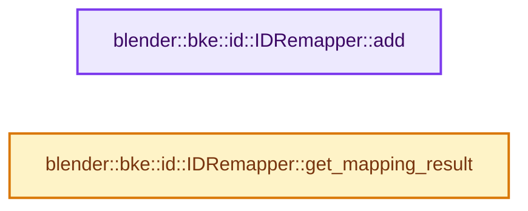

# 实现依赖专题：source/blender/blenkernel/intern/lib_id_remapper.cc

[方向导航](README.md) · [符号索引](../%E7%AC%A6%E5%8F%B7%E4%BE%9D%E8%B5%96%E4%B8%8E%E5%AE%9E%E7%8E%B0%E7%B4%A2%E5%BC%95.md)

本专题从正文实际调用进入，集中保存共享实现。函数有稳定锚点，可从调用处直接跳到对应完整函数；递归与互相调用通过回链组织。

## 本文件的实现关系




## 完整成员与函数实现

<a id="f-8aa3e96df078a711"></a>

### `blender::bke::id::IDRemapper::add`

实现位置：[source/blender/blenkernel/intern/lib_id_remapper.cc](../../../../../source/blender/blenkernel/intern/lib_id_remapper.cc) · L17—L26。

接口参数：

- `ID *old_id`
- `ID *new_id`

**教学注释版**

<!-- annotated:8292d18b311544 -->

```cpp
void IDRemapper::add(ID *old_id, ID *new_id)
{
  BLI_assert(old_id != nullptr);
  BLI_assert(new_id == nullptr || this->allow_idtype_mismatch ||
             (GS(old_id->name) == GS(new_id->name)));
  BLI_assert(BKE_idtype_idcode_to_idfilter(GS(old_id->name)) != 0);

  mappings_.add(old_id, new_id);
  source_types_ |= BKE_idtype_idcode_to_idfilter(GS(old_id->name));
}
```

<details>
<summary>核对原始源码：source/blender/blenkernel/intern/lib_id_remapper.cc · L17—L26</summary>

<!-- original:8292d18b311544:source/blender/blenkernel/intern/lib_id_remapper.cc:17:26 -->

```cpp
void IDRemapper::add(ID *old_id, ID *new_id)
{
  BLI_assert(old_id != nullptr);
  BLI_assert(new_id == nullptr || this->allow_idtype_mismatch ||
             (GS(old_id->name) == GS(new_id->name)));
  BLI_assert(BKE_idtype_idcode_to_idfilter(GS(old_id->name)) != 0);

  mappings_.add(old_id, new_id);
  source_types_ |= BKE_idtype_idcode_to_idfilter(GS(old_id->name));
}
```

</details>

**沿实际写入检查状态**

- `source_types_ |= BKE_idtype_idcode_to_idfilter(GS(old_id->name));`

**继续追踪实现**

- `BLI_assert` → [BLI_assert · L48](../01-%E5%9F%BA%E7%A1%80%E5%AE%B9%E5%99%A8%E4%B8%8E%E7%8E%B0%E4%BB%A3CPP/%E4%BE%9D%E8%B5%96-BLI_assert-cc98e8.md#m-57a88495704d)；[BLI_assert · L63](../01-%E5%9F%BA%E7%A1%80%E5%AE%B9%E5%99%A8%E4%B8%8E%E7%8E%B0%E4%BB%A3CPP/%E4%BE%9D%E8%B5%96-BLI_assert-cc98e8.md#m-d07050020cb5)。宏定义由构建条件选择。
- `GS` → [blender::GS · L410](%E4%BE%9D%E8%B5%96-DNA_ID-3eb091.md#f-c3ff509f79f21b05)。
- `BKE_idtype_idcode_to_idfilter` → [blender::BKE_idtype_idcode_to_idfilter · L473](%E4%BE%9D%E8%B5%96-idtype-cbba99.md#f-439e1b8ea6cc89df)。
- `mappings_.add` → [调用协议](../%E6%A8%A1%E6%9D%BF%E5%AE%8F%E4%B8%8E%E5%8A%A8%E6%80%81%E5%88%86%E6%B4%BE%E5%8D%8F%E8%AE%AE.md)：接收对象类型依赖auto、返回值或模板实例；不按同名猜测目标。调用位置L24。

<a id="f-de163a430e2ee6ef"></a>

### `blender::bke::id::IDRemapper::get_mapping_result`

实现位置：[source/blender/blenkernel/intern/lib_id_remapper.cc](../../../../../source/blender/blenkernel/intern/lib_id_remapper.cc) · L39—L55。

接口参数：

- `ID *id`
- `IDRemapperApplyOptions options`
- `const ID *id_self`

**教学注释版**

<!-- annotated:a1f8a4cb4f76ba -->

```cpp
IDRemapperApplyResult IDRemapper::get_mapping_result(ID *id,
                                                     IDRemapperApplyOptions options,
                                                     const ID *id_self) const
{
  if (!mappings_.contains(id)) {
    return ID_REMAP_RESULT_SOURCE_UNAVAILABLE;
  }
  const ID *new_id = mappings_.lookup(id);
  if ((options & ID_REMAP_APPLY_UNMAP_WHEN_REMAPPING_TO_SELF) != 0 && id_self == new_id) {
    new_id = nullptr;
  }
  if (new_id == nullptr) {
    return ID_REMAP_RESULT_SOURCE_UNASSIGNED;
  }

  return ID_REMAP_RESULT_SOURCE_REMAPPED;
}
```

<details>
<summary>核对原始源码：source/blender/blenkernel/intern/lib_id_remapper.cc · L39—L55</summary>

<!-- original:a1f8a4cb4f76ba:source/blender/blenkernel/intern/lib_id_remapper.cc:39:55 -->

```cpp
IDRemapperApplyResult IDRemapper::get_mapping_result(ID *id,
                                                     IDRemapperApplyOptions options,
                                                     const ID *id_self) const
{
  if (!mappings_.contains(id)) {
    return ID_REMAP_RESULT_SOURCE_UNAVAILABLE;
  }
  const ID *new_id = mappings_.lookup(id);
  if ((options & ID_REMAP_APPLY_UNMAP_WHEN_REMAPPING_TO_SELF) != 0 && id_self == new_id) {
    new_id = nullptr;
  }
  if (new_id == nullptr) {
    return ID_REMAP_RESULT_SOURCE_UNASSIGNED;
  }

  return ID_REMAP_RESULT_SOURCE_REMAPPED;
}
```

</details>

**沿实际写入检查状态**

- `new_id = nullptr;`

**结果出口**

- `return ID_REMAP_RESULT_SOURCE_UNAVAILABLE;`
- `return ID_REMAP_RESULT_SOURCE_UNASSIGNED;`
- `return ID_REMAP_RESULT_SOURCE_REMAPPED;`

**继续追踪实现**

- `mappings_.contains` → [调用协议](../%E6%A8%A1%E6%9D%BF%E5%AE%8F%E4%B8%8E%E5%8A%A8%E6%80%81%E5%88%86%E6%B4%BE%E5%8D%8F%E8%AE%AE.md)：接收对象类型依赖auto、返回值或模板实例；不按同名猜测目标。调用位置L43。
- `mappings_.lookup` → [调用协议](../%E6%A8%A1%E6%9D%BF%E5%AE%8F%E4%B8%8E%E5%8A%A8%E6%80%81%E5%88%86%E6%B4%BE%E5%8D%8F%E8%AE%AE.md)：接收对象类型依赖auto、返回值或模板实例；不按同名猜测目标。调用位置L46。
