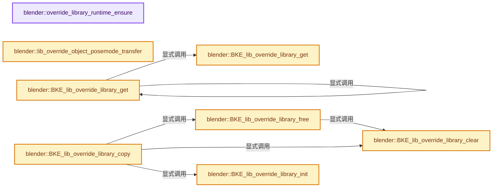
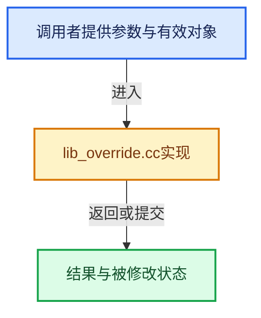

# 实现依赖专题：source/blender/blenkernel/intern/lib_override.cc

[方向导航](README.md) · [符号索引](../%E7%AC%A6%E5%8F%B7%E4%BE%9D%E8%B5%96%E4%B8%8E%E5%AE%9E%E7%8E%B0%E7%B4%A2%E5%BC%95.md)

本专题从正文实际调用进入，集中保存共享实现。函数有稳定锚点，可从调用处直接跳到对应完整函数；递归与互相调用通过回链组织。

## 本文件的实现关系






## 完整成员与函数实现

<a id="f-5531115adaeabad3"></a>

### `blender::override_library_runtime_ensure`

实现位置：[source/blender/blenkernel/intern/lib_override.cc](../../../../../source/blender/blenkernel/intern/lib_override.cc) · L120—L127。

接口参数：

- `IDOverrideLibrary *liboverride`

**教学注释版**

<!-- annotated:0cdb70dead6d78 -->

```cpp
BLI_INLINE IDOverrideLibraryRuntime *override_library_runtime_ensure(
    IDOverrideLibrary *liboverride)
{
  if (liboverride->runtime == nullptr) {
    liboverride->runtime = MEM_new<IDOverrideLibraryRuntime>(__func__);
  }
  return liboverride->runtime;
}
```

<details>
<summary>核对原始源码：source/blender/blenkernel/intern/lib_override.cc · L120—L127</summary>

<!-- original:0cdb70dead6d78:source/blender/blenkernel/intern/lib_override.cc:120:127 -->

```cpp
BLI_INLINE IDOverrideLibraryRuntime *override_library_runtime_ensure(
    IDOverrideLibrary *liboverride)
{
  if (liboverride->runtime == nullptr) {
    liboverride->runtime = MEM_new<IDOverrideLibraryRuntime>(__func__);
  }
  return liboverride->runtime;
}
```

</details>

**沿实际写入检查状态**

- `liboverride->runtime = MEM_new<IDOverrideLibraryRuntime>(__func__);`

**结果出口**

- `return liboverride->runtime;`

**继续追踪实现**

- `MEM_new<IDOverrideLibraryRuntime>` → [MEM_new · L351](../03-%E5%86%85%E5%AD%98%E5%88%86%E9%85%8D%E4%B8%8E%E8%BF%90%E8%A1%8C%E6%97%B6%E7%B1%BB%E5%9E%8B/%E4%BE%9D%E8%B5%96-MEM_guardedalloc-b54eca.md#f-115f9b6784f89912)。

<a id="f-48d66155020d7d5f"></a>

### `blender::lib_override_object_posemode_transfer`

实现位置：[source/blender/blenkernel/intern/lib_override.cc](../../../../../source/blender/blenkernel/intern/lib_override.cc) · L134—L144。

接口参数：

- `ID *id_dst`
- `ID *id_src`

**教学注释版**

<!-- annotated:48ff1716096d6f -->

```cpp
BLI_INLINE void lib_override_object_posemode_transfer(ID *id_dst, ID *id_src)
{
  if (id_src->id_type() == ID_OB && id_dst->id_type() == ID_OB) {
    Object *ob_src = reinterpret_cast<Object *>(id_src);
    Object *ob_dst = reinterpret_cast<Object *>(id_dst);
    if (ob_src->type == OB_ARMATURE && (ob_src->mode & OB_MODE_POSE) != 0) {
      ob_dst->restore_mode = ob_dst->mode;
      ob_dst->mode |= OB_MODE_POSE;
    }
  }
}
```

<details>
<summary>核对原始源码：source/blender/blenkernel/intern/lib_override.cc · L134—L144</summary>

<!-- original:48ff1716096d6f:source/blender/blenkernel/intern/lib_override.cc:134:144 -->

```cpp
BLI_INLINE void lib_override_object_posemode_transfer(ID *id_dst, ID *id_src)
{
  if (id_src->id_type() == ID_OB && id_dst->id_type() == ID_OB) {
    Object *ob_src = reinterpret_cast<Object *>(id_src);
    Object *ob_dst = reinterpret_cast<Object *>(id_dst);
    if (ob_src->type == OB_ARMATURE && (ob_src->mode & OB_MODE_POSE) != 0) {
      ob_dst->restore_mode = ob_dst->mode;
      ob_dst->mode |= OB_MODE_POSE;
    }
  }
}
```

</details>

**沿实际写入检查状态**

- `ob_dst->restore_mode = ob_dst->mode;`
- `ob_dst->mode |= OB_MODE_POSE;`

**继续追踪实现**

- `id_src->id_type` → [blender::ID::id_type · L544](%E4%BE%9D%E8%B5%96-DNA_ID-3eb091.md#f-ee8fe63f3948aa47)。
- `id_dst->id_type` → [blender::ID::id_type · L544](%E4%BE%9D%E8%B5%96-DNA_ID-3eb091.md#f-ee8fe63f3948aa47)。

<a id="f-ae1e964a059f65a9"></a>

### `blender::BKE_lib_override_library_get`

实现位置：[source/blender/blenkernel/intern/lib_override.cc](../../../../../source/blender/blenkernel/intern/lib_override.cc) · L147—L165。

接口参数：

- `const Main *`
- `const ID *id`
- `const ID *`
- `const ID **r_owner_id`

**教学注释版**

<!-- annotated:55b6248e1b0f7b -->

```cpp
BLI_INLINE const IDOverrideLibrary *BKE_lib_override_library_get(const Main * /*bmain*/,
                                                                 const ID *id,
                                                                 const ID * /*owner_id_hint*/,
                                                                 const ID **r_owner_id)
{
  if (id->flag & ID_FLAG_EMBEDDED_DATA_LIB_OVERRIDE) {
    const ID *owner_id = BKE_id_owner_get(const_cast<ID *>(id));
    BLI_assert_msg(owner_id != nullptr, "Liboverride-embedded ID with no owner");
    if (r_owner_id != nullptr) {
      *r_owner_id = owner_id;
    }
    return owner_id->override_library;
  }

  if (r_owner_id != nullptr) {
    *r_owner_id = id;
  }
  return id->override_library;
}
```

<details>
<summary>核对原始源码：source/blender/blenkernel/intern/lib_override.cc · L147—L165</summary>

<!-- original:55b6248e1b0f7b:source/blender/blenkernel/intern/lib_override.cc:147:165 -->

```cpp
BLI_INLINE const IDOverrideLibrary *BKE_lib_override_library_get(const Main * /*bmain*/,
                                                                 const ID *id,
                                                                 const ID * /*owner_id_hint*/,
                                                                 const ID **r_owner_id)
{
  if (id->flag & ID_FLAG_EMBEDDED_DATA_LIB_OVERRIDE) {
    const ID *owner_id = BKE_id_owner_get(const_cast<ID *>(id));
    BLI_assert_msg(owner_id != nullptr, "Liboverride-embedded ID with no owner");
    if (r_owner_id != nullptr) {
      *r_owner_id = owner_id;
    }
    return owner_id->override_library;
  }

  if (r_owner_id != nullptr) {
    *r_owner_id = id;
  }
  return id->override_library;
}
```

</details>

**结果出口**

- `return owner_id->override_library;`
- `return id->override_library;`

**继续追踪实现**

- `BKE_id_owner_get` → [blender::BKE_id_owner_get · L2770](%E4%BE%9D%E8%B5%96-lib_id-d4e6bd.md#f-a51c741e122bfc1f)。
- `BLI_assert_msg` → [BLI_assert_msg · L55](../01-%E5%9F%BA%E7%A1%80%E5%AE%B9%E5%99%A8%E4%B8%8E%E7%8E%B0%E4%BB%A3CPP/%E4%BE%9D%E8%B5%96-BLI_assert-cc98e8.md#m-695eed20dceb)；[BLI_assert_msg · L64](../01-%E5%9F%BA%E7%A1%80%E5%AE%B9%E5%99%A8%E4%B8%8E%E7%8E%B0%E4%BB%A3CPP/%E4%BE%9D%E8%B5%96-BLI_assert-cc98e8.md#m-7de5563de4db)。宏定义由构建条件选择。

<a id="f-47ae4adabb1d9d70"></a>

### `blender::BKE_lib_override_library_get`

实现位置：[source/blender/blenkernel/intern/lib_override.cc](../../../../../source/blender/blenkernel/intern/lib_override.cc) · L167—L179。

接口参数：

- `Main *bmain`
- `ID *id`
- `ID *owner_id_hint`
- `ID **r_owner_id`

**教学注释版**

<!-- annotated:374201b3d6889e -->

```cpp
IDOverrideLibrary *BKE_lib_override_library_get(Main *bmain,
                                                ID *id,
                                                ID *owner_id_hint,
                                                ID **r_owner_id)
{
  /* Reuse the implementation of the const access function, which does not change the arguments.
   * Add const explicitly to make it clear to the compiler to avoid just calling this function. */
  return const_cast<IDOverrideLibrary *>(
      BKE_lib_override_library_get(const_cast<const Main *>(bmain),
                                   const_cast<const ID *>(id),
                                   const_cast<const ID *>(owner_id_hint),
                                   const_cast<const ID **>(r_owner_id)));
}
```

<details>
<summary>核对原始源码：source/blender/blenkernel/intern/lib_override.cc · L167—L179</summary>

<!-- original:374201b3d6889e:source/blender/blenkernel/intern/lib_override.cc:167:179 -->

```cpp
IDOverrideLibrary *BKE_lib_override_library_get(Main *bmain,
                                                ID *id,
                                                ID *owner_id_hint,
                                                ID **r_owner_id)
{
  /* Reuse the implementation of the const access function, which does not change the arguments.
   * Add const explicitly to make it clear to the compiler to avoid just calling this function. */
  return const_cast<IDOverrideLibrary *>(
      BKE_lib_override_library_get(const_cast<const Main *>(bmain),
                                   const_cast<const ID *>(id),
                                   const_cast<const ID *>(owner_id_hint),
                                   const_cast<const ID **>(r_owner_id)));
}
```

</details>

**结果出口**

- `return const_cast<IDOverrideLibrary *>(`

**继续追踪实现**

- `BKE_lib_override_library_get` → [blender::BKE_lib_override_library_get · L147](%E4%BE%9D%E8%B5%96-lib_override-90a5a9.md#f-ae1e964a059f65a9)；[blender::BKE_lib_override_library_get · L167](%E4%BE%9D%E8%B5%96-lib_override-90a5a9.md#f-47ae4adabb1d9d70)。同名重载需按实参类型选择。

<a id="f-aaecd97f9fe569e6"></a>

### `blender::BKE_lib_override_library_init`

实现位置：[source/blender/blenkernel/intern/lib_override.cc](../../../../../source/blender/blenkernel/intern/lib_override.cc) · L181—L199。

接口参数：

- `ID *local_id`
- `ID *reference_id`

**教学注释版**

<!-- annotated:6d5f6fbd04105a -->

```cpp
IDOverrideLibrary *BKE_lib_override_library_init(ID *local_id, ID *reference_id)
{
  /* The `reference_id` *must* be linked data. */
  BLI_assert(!reference_id || ID_IS_LINKED(reference_id));
  BLI_assert(local_id->override_library == nullptr);

  /* Else, generate new empty override. */
  local_id->override_library = MEM_new<IDOverrideLibrary>(__func__);
  local_id->override_library->reference = reference_id;
  if (reference_id) {
    id_us_plus(local_id->override_library->reference);
  }
  local_id->tag &= ~ID_TAG_LIBOVERRIDE_REFOK;
  /* By default initialized liboverrides are 'system overrides', higher-level code is responsible
   * to unset this flag for specific IDs. */
  local_id->override_library->flag |= LIBOVERRIDE_FLAG_SYSTEM_DEFINED;
  /* TODO: do we want to add tag or flag to referee to mark it as such? */
  return local_id->override_library;
}
```

<details>
<summary>核对原始源码：source/blender/blenkernel/intern/lib_override.cc · L181—L199</summary>

<!-- original:6d5f6fbd04105a:source/blender/blenkernel/intern/lib_override.cc:181:199 -->

```cpp
IDOverrideLibrary *BKE_lib_override_library_init(ID *local_id, ID *reference_id)
{
  /* The `reference_id` *must* be linked data. */
  BLI_assert(!reference_id || ID_IS_LINKED(reference_id));
  BLI_assert(local_id->override_library == nullptr);

  /* Else, generate new empty override. */
  local_id->override_library = MEM_new<IDOverrideLibrary>(__func__);
  local_id->override_library->reference = reference_id;
  if (reference_id) {
    id_us_plus(local_id->override_library->reference);
  }
  local_id->tag &= ~ID_TAG_LIBOVERRIDE_REFOK;
  /* By default initialized liboverrides are 'system overrides', higher-level code is responsible
   * to unset this flag for specific IDs. */
  local_id->override_library->flag |= LIBOVERRIDE_FLAG_SYSTEM_DEFINED;
  /* TODO: do we want to add tag or flag to referee to mark it as such? */
  return local_id->override_library;
}
```

</details>

**沿实际写入检查状态**

- `local_id->override_library = MEM_new<IDOverrideLibrary>(__func__);`
- `local_id->override_library->reference = reference_id;`
- `local_id->tag &= ~ID_TAG_LIBOVERRIDE_REFOK;`
- `local_id->override_library->flag |= LIBOVERRIDE_FLAG_SYSTEM_DEFINED;`

**结果出口**

- `return local_id->override_library;`

**继续追踪实现**

- `BLI_assert` → [BLI_assert · L48](../01-%E5%9F%BA%E7%A1%80%E5%AE%B9%E5%99%A8%E4%B8%8E%E7%8E%B0%E4%BB%A3CPP/%E4%BE%9D%E8%B5%96-BLI_assert-cc98e8.md#m-57a88495704d)；[BLI_assert · L63](../01-%E5%9F%BA%E7%A1%80%E5%AE%B9%E5%99%A8%E4%B8%8E%E7%8E%B0%E4%BB%A3CPP/%E4%BE%9D%E8%B5%96-BLI_assert-cc98e8.md#m-d07050020cb5)。宏定义由构建条件选择。
- `ID_IS_LINKED` → [ID_IS_LINKED · L697](%E4%BE%9D%E8%B5%96-DNA_ID-3eb091.md#m-7e1e1e9b20e6)。宏定义由构建条件选择。
- `MEM_new<IDOverrideLibrary>` → [MEM_new · L351](../03-%E5%86%85%E5%AD%98%E5%88%86%E9%85%8D%E4%B8%8E%E8%BF%90%E8%A1%8C%E6%97%B6%E7%B1%BB%E5%9E%8B/%E4%BE%9D%E8%B5%96-MEM_guardedalloc-b54eca.md#f-115f9b6784f89912)。
- `id_us_plus` → [blender::id_us_plus · L433](%E4%BE%9D%E8%B5%96-lib_id-d4e6bd.md#f-1b90ef7608c4f32e)。

<a id="f-5afe8c81905fff1c"></a>

### `blender::BKE_lib_override_library_copy`

实现位置：[source/blender/blenkernel/intern/lib_override.cc](../../../../../source/blender/blenkernel/intern/lib_override.cc) · L201—L241。

接口参数：

- `ID *dst_id`
- `const ID *src_id`
- `const bool do_full_copy`

**教学注释版**

<!-- annotated:5d0d2096e41f6b -->

```cpp
void BKE_lib_override_library_copy(ID *dst_id, const ID *src_id, const bool do_full_copy)
{
  BLI_assert(ID_IS_OVERRIDE_LIBRARY(src_id));

  if (dst_id->override_library != nullptr) {
    if (src_id->override_library == nullptr) {
      BKE_lib_override_library_free(&dst_id->override_library, true);
      return;
    }

    BKE_lib_override_library_clear(dst_id->override_library, true);
  }
  else if (src_id->override_library == nullptr) {
    /* Virtual overrides of embedded data does not require any extra work. */
    return;
  }
  else {
    BKE_lib_override_library_init(dst_id, nullptr);
  }

  /* Reuse the source's reference for destination ID. */
  dst_id->override_library->reference = src_id->override_library->reference;
  id_us_plus(dst_id->override_library->reference);

  dst_id->override_library->hierarchy_root = src_id->override_library->hierarchy_root;
  dst_id->override_library->flag = src_id->override_library->flag;

  if (do_full_copy) {
    BLI_duplicatelist(&dst_id->override_library->properties,
                      &src_id->override_library->properties);
    for (IDOverrideLibraryProperty *op_dst = dst_id->override_library->properties.first(),
                                   *op_src = src_id->override_library->properties.first();
         op_dst;
         op_dst = op_dst->next, op_src = op_src->next)
    {
      lib_override_library_property_copy(op_dst, op_src);
    }
  }

  dst_id->tag &= ~ID_TAG_LIBOVERRIDE_REFOK;
}
```

<details>
<summary>核对原始源码：source/blender/blenkernel/intern/lib_override.cc · L201—L241</summary>

<!-- original:5d0d2096e41f6b:source/blender/blenkernel/intern/lib_override.cc:201:241 -->

```cpp
void BKE_lib_override_library_copy(ID *dst_id, const ID *src_id, const bool do_full_copy)
{
  BLI_assert(ID_IS_OVERRIDE_LIBRARY(src_id));

  if (dst_id->override_library != nullptr) {
    if (src_id->override_library == nullptr) {
      BKE_lib_override_library_free(&dst_id->override_library, true);
      return;
    }

    BKE_lib_override_library_clear(dst_id->override_library, true);
  }
  else if (src_id->override_library == nullptr) {
    /* Virtual overrides of embedded data does not require any extra work. */
    return;
  }
  else {
    BKE_lib_override_library_init(dst_id, nullptr);
  }

  /* Reuse the source's reference for destination ID. */
  dst_id->override_library->reference = src_id->override_library->reference;
  id_us_plus(dst_id->override_library->reference);

  dst_id->override_library->hierarchy_root = src_id->override_library->hierarchy_root;
  dst_id->override_library->flag = src_id->override_library->flag;

  if (do_full_copy) {
    BLI_duplicatelist(&dst_id->override_library->properties,
                      &src_id->override_library->properties);
    for (IDOverrideLibraryProperty *op_dst = dst_id->override_library->properties.first(),
                                   *op_src = src_id->override_library->properties.first();
         op_dst;
         op_dst = op_dst->next, op_src = op_src->next)
    {
      lib_override_library_property_copy(op_dst, op_src);
    }
  }

  dst_id->tag &= ~ID_TAG_LIBOVERRIDE_REFOK;
}
```

</details>

**沿实际写入检查状态**

- `dst_id->override_library->reference = src_id->override_library->reference;`
- `dst_id->override_library->hierarchy_root = src_id->override_library->hierarchy_root;`
- `dst_id->override_library->flag = src_id->override_library->flag;`
- `op_dst = op_dst->next, op_src = op_src->next)`
- `dst_id->tag &= ~ID_TAG_LIBOVERRIDE_REFOK;`

**继续追踪实现**

- `BLI_assert` → [BLI_assert · L48](../01-%E5%9F%BA%E7%A1%80%E5%AE%B9%E5%99%A8%E4%B8%8E%E7%8E%B0%E4%BB%A3CPP/%E4%BE%9D%E8%B5%96-BLI_assert-cc98e8.md#m-57a88495704d)；[BLI_assert · L63](../01-%E5%9F%BA%E7%A1%80%E5%AE%B9%E5%99%A8%E4%B8%8E%E7%8E%B0%E4%BB%A3CPP/%E4%BE%9D%E8%B5%96-BLI_assert-cc98e8.md#m-d07050020cb5)。宏定义由构建条件选择。
- `ID_IS_OVERRIDE_LIBRARY` → [ID_IS_OVERRIDE_LIBRARY · L736](%E4%BE%9D%E8%B5%96-DNA_ID-3eb091.md#m-c84b86cfb14f)。宏定义由构建条件选择。
- `BKE_lib_override_library_free` → [blender::BKE_lib_override_library_free · L262](%E4%BE%9D%E8%B5%96-lib_override-90a5a9.md#f-50c562b9f63f9ac5)。
- `BKE_lib_override_library_clear` → [blender::BKE_lib_override_library_clear · L243](%E4%BE%9D%E8%B5%96-lib_override-90a5a9.md#f-0bcbfcd896e8745c)。
- `BKE_lib_override_library_init` → [blender::BKE_lib_override_library_init · L181](%E4%BE%9D%E8%B5%96-lib_override-90a5a9.md#f-aaecd97f9fe569e6)。
- `id_us_plus` → [blender::id_us_plus · L433](%E4%BE%9D%E8%B5%96-lib_id-d4e6bd.md#f-1b90ef7608c4f32e)。
- `BLI_duplicatelist` → [blender::BLI_duplicatelist · L834](../01-%E5%9F%BA%E7%A1%80%E5%AE%B9%E5%99%A8%E4%B8%8E%E7%8E%B0%E4%BB%A3CPP/%E4%BE%9D%E8%B5%96-listbase-2816d9.md#f-d840cb64a1b265dc)。
- `dst_id->override_library->properties.first` → [调用协议](../%E6%A8%A1%E6%9D%BF%E5%AE%8F%E4%B8%8E%E5%8A%A8%E6%80%81%E5%88%86%E6%B4%BE%E5%8D%8F%E8%AE%AE.md)：接收对象类型依赖auto、返回值或模板实例；不按同名猜测目标。调用位置L231。
- `src_id->override_library->properties.first` → [调用协议](../%E6%A8%A1%E6%9D%BF%E5%AE%8F%E4%B8%8E%E5%8A%A8%E6%80%81%E5%88%86%E6%B4%BE%E5%8D%8F%E8%AE%AE.md)：接收对象类型依赖auto、返回值或模板实例；不按同名猜测目标。调用位置L232。
- `lib_override_library_property_copy` → [blender::lib_override_library_property_copy · L4343](%E4%BE%9D%E8%B5%96-lib_override-90a5a9.md#f-70bc5720458ac5e4)。

<a id="f-0bcbfcd896e8745c"></a>

### `blender::BKE_lib_override_library_clear`

实现位置：[source/blender/blenkernel/intern/lib_override.cc](../../../../../source/blender/blenkernel/intern/lib_override.cc) · L243—L260。

接口参数：

- `IDOverrideLibrary *liboverride`
- `const bool do_id_user`

**教学注释版**

<!-- annotated:5ca811cee1e4e0 -->

```cpp
void BKE_lib_override_library_clear(IDOverrideLibrary *liboverride, const bool do_id_user)
{
  BLI_assert(liboverride != nullptr);

  if (liboverride->runtime && liboverride->runtime->rna_path_to_override_properties) {
    liboverride->runtime->rna_path_to_override_properties->clear();
  }

  for (IDOverrideLibraryProperty &op : liboverride->properties) {
    lib_override_library_property_clear(&op);
  }
  liboverride->properties.free_no_destruct();

  if (do_id_user) {
    id_us_min(liboverride->reference);
    /* override->storage should never be refcounted... */
  }
}
```

<details>
<summary>核对原始源码：source/blender/blenkernel/intern/lib_override.cc · L243—L260</summary>

<!-- original:5ca811cee1e4e0:source/blender/blenkernel/intern/lib_override.cc:243:260 -->

```cpp
void BKE_lib_override_library_clear(IDOverrideLibrary *liboverride, const bool do_id_user)
{
  BLI_assert(liboverride != nullptr);

  if (liboverride->runtime && liboverride->runtime->rna_path_to_override_properties) {
    liboverride->runtime->rna_path_to_override_properties->clear();
  }

  for (IDOverrideLibraryProperty &op : liboverride->properties) {
    lib_override_library_property_clear(&op);
  }
  liboverride->properties.free_no_destruct();

  if (do_id_user) {
    id_us_min(liboverride->reference);
    /* override->storage should never be refcounted... */
  }
}
```

</details>

**继续追踪实现**

- `BLI_assert` → [BLI_assert · L48](../01-%E5%9F%BA%E7%A1%80%E5%AE%B9%E5%99%A8%E4%B8%8E%E7%8E%B0%E4%BB%A3CPP/%E4%BE%9D%E8%B5%96-BLI_assert-cc98e8.md#m-57a88495704d)；[BLI_assert · L63](../01-%E5%9F%BA%E7%A1%80%E5%AE%B9%E5%99%A8%E4%B8%8E%E7%8E%B0%E4%BB%A3CPP/%E4%BE%9D%E8%B5%96-BLI_assert-cc98e8.md#m-d07050020cb5)。宏定义由构建条件选择。
- `liboverride->runtime->rna_path_to_override_properties->clear` → [调用协议](../%E6%A8%A1%E6%9D%BF%E5%AE%8F%E4%B8%8E%E5%8A%A8%E6%80%81%E5%88%86%E6%B4%BE%E5%8D%8F%E8%AE%AE.md)：接收对象类型依赖auto、返回值或模板实例；不按同名猜测目标。调用位置L248。
- `lib_override_library_property_clear` → [blender::lib_override_library_property_clear · L4358](%E4%BE%9D%E8%B5%96-lib_override-90a5a9.md#f-26174ccd5ca6fc4d)。
- `liboverride->properties.free_no_destruct` → [调用协议](../%E6%A8%A1%E6%9D%BF%E5%AE%8F%E4%B8%8E%E5%8A%A8%E6%80%81%E5%88%86%E6%B4%BE%E5%8D%8F%E8%AE%AE.md)：接收对象类型依赖auto、返回值或模板实例；不按同名猜测目标。调用位置L254。
- `id_us_min` → [blender::id_us_min · L441](%E4%BE%9D%E8%B5%96-lib_id-d4e6bd.md#f-c5e5246a79962257)。

<a id="f-50c562b9f63f9ac5"></a>

### `blender::BKE_lib_override_library_free`

实现位置：[source/blender/blenkernel/intern/lib_override.cc](../../../../../source/blender/blenkernel/intern/lib_override.cc) · L262—L273。

接口参数：

- `IDOverrideLibrary **liboverride`
- `const bool do_id_user`

**教学注释版**

<!-- annotated:fdba555f19fae5 -->

```cpp
void BKE_lib_override_library_free(IDOverrideLibrary **liboverride, const bool do_id_user)
{
  BLI_assert(*liboverride != nullptr);

  if ((*liboverride)->runtime != nullptr) {
    MEM_SAFE_DELETE((*liboverride)->runtime);
  }

  BKE_lib_override_library_clear(*liboverride, do_id_user);
  MEM_delete(*liboverride);
  *liboverride = nullptr;
}
```

<details>
<summary>核对原始源码：source/blender/blenkernel/intern/lib_override.cc · L262—L273</summary>

<!-- original:fdba555f19fae5:source/blender/blenkernel/intern/lib_override.cc:262:273 -->

```cpp
void BKE_lib_override_library_free(IDOverrideLibrary **liboverride, const bool do_id_user)
{
  BLI_assert(*liboverride != nullptr);

  if ((*liboverride)->runtime != nullptr) {
    MEM_SAFE_DELETE((*liboverride)->runtime);
  }

  BKE_lib_override_library_clear(*liboverride, do_id_user);
  MEM_delete(*liboverride);
  *liboverride = nullptr;
}
```

</details>

**继续追踪实现**

- `BLI_assert` → [BLI_assert · L48](../01-%E5%9F%BA%E7%A1%80%E5%AE%B9%E5%99%A8%E4%B8%8E%E7%8E%B0%E4%BB%A3CPP/%E4%BE%9D%E8%B5%96-BLI_assert-cc98e8.md#m-57a88495704d)；[BLI_assert · L63](../01-%E5%9F%BA%E7%A1%80%E5%AE%B9%E5%99%A8%E4%B8%8E%E7%8E%B0%E4%BB%A3CPP/%E4%BE%9D%E8%B5%96-BLI_assert-cc98e8.md#m-d07050020cb5)。宏定义由构建条件选择。
- `MEM_SAFE_DELETE` → [MEM_SAFE_DELETE · L436](../03-%E5%86%85%E5%AD%98%E5%88%86%E9%85%8D%E4%B8%8E%E8%BF%90%E8%A1%8C%E6%97%B6%E7%B1%BB%E5%9E%8B/%E4%BE%9D%E8%B5%96-MEM_guardedalloc-b54eca.md#m-eadb3bc5b902)。宏定义由构建条件选择。
- `BKE_lib_override_library_clear` → [blender::BKE_lib_override_library_clear · L243](%E4%BE%9D%E8%B5%96-lib_override-90a5a9.md#f-0bcbfcd896e8745c)。
- `MEM_delete` → [MEM_delete · L400](../03-%E5%86%85%E5%AD%98%E5%88%86%E9%85%8D%E4%B8%8E%E8%BF%90%E8%A1%8C%E6%97%B6%E7%B1%BB%E5%9E%8B/%E4%BE%9D%E8%B5%96-MEM_guardedalloc-b54eca.md#f-9049ffdd1682887c)。

<a id="f-5f65fa32e9dd925a"></a>

### `blender::lib_override_library_create_from`

实现位置：[source/blender/blenkernel/intern/lib_override.cc](../../../../../source/blender/blenkernel/intern/lib_override.cc) · L288—L345。

接口参数：

- `Main *bmain`
- `Library *owner_library`
- `ID *reference_id`
- `const int lib_id_copy_flags`

**教学注释版**

<!-- annotated:10d08b601f61fb -->

```cpp
static ID *lib_override_library_create_from(Main *bmain,
                                            Library *owner_library,
                                            ID *reference_id,
                                            const int lib_id_copy_flags)
{
  /* NOTE: do not copy possible override data from the reference here. */
  ID *local_id = BKE_id_copy_in_lib(bmain,
                                    owner_library,
                                    reference_id,
                                    std::nullopt,
                                    nullptr,
                                    (LIB_ID_COPY_DEFAULT | LIB_ID_COPY_NO_LIB_OVERRIDE |
                                     LIB_ID_COPY_NO_LIB_OVERRIDE_LOCAL_DATA_FLAG |
                                     lib_id_copy_flags));
  if (local_id == nullptr) {
    return nullptr;
  }
  BLI_assert(local_id->lib == owner_library);
  id_us_min(local_id);

  /* In case we could not get an override ID with the exact same name as its linked reference,
   * ensure we at least get a uniquely named override ID over the whole current Main data, to
   * reduce potential name collisions with other reference IDs.
   *
   * While in normal cases this would not be an issue, when files start to get heavily broken and
   * not sound, such conflicts can become a source of problems. */
  if (!STREQ(local_id->name + 2, reference_id->name + 2)) {
    BKE_main_namemap_remove_id(*bmain, *local_id);
    BLI_strncpy(local_id->name + 2, reference_id->name + 2, MAX_ID_NAME - 2);
    BKE_main_global_namemap_get_unique_name(*bmain, *local_id, local_id->name + 2);
    id_sort_by_name(which_libbase(bmain, local_id->id_type()), local_id, nullptr);
  }

  /* In `NO_MAIN` case, generic `BKE_id_copy` code won't call this.
   * In liboverride resync case however, the currently not-in-Main new IDs will be added back to
   * Main later, so ensure that their linked dependencies and paths are properly handled here.
   *
   * NOTE: This is likely not the best place to do this. Ideally, #BKE_libblock_management_main_add
   * e.g. should take care of this. But for the time being, this works and has been battle-proofed.
   */
  if ((lib_id_copy_flags & LIB_ID_CREATE_NO_MAIN) != 0 && !ID_IS_LINKED(local_id)) {
    lib_id_copy_ensure_local(bmain, reference_id, local_id, 0);
  }

  BKE_lib_override_library_init(local_id, reference_id);

  /* NOTE: From liboverride perspective (and RNA one), shape keys are considered as local embedded
   * data-blocks, just like root node trees or master collections. Therefore, we never need to
   * create overrides for them. We need a way to mark them as overrides though. */
  Key *reference_key = BKE_key_from_id(reference_id);
  if (reference_key != nullptr) {
    Key *local_key = BKE_key_from_id(local_id);
    BLI_assert(local_key != nullptr);
    local_key->id.flag |= ID_FLAG_EMBEDDED_DATA_LIB_OVERRIDE;
  }

  return local_id;
}
```

<details>
<summary>核对原始源码：source/blender/blenkernel/intern/lib_override.cc · L288—L345</summary>

<!-- original:10d08b601f61fb:source/blender/blenkernel/intern/lib_override.cc:288:345 -->

```cpp
static ID *lib_override_library_create_from(Main *bmain,
                                            Library *owner_library,
                                            ID *reference_id,
                                            const int lib_id_copy_flags)
{
  /* NOTE: do not copy possible override data from the reference here. */
  ID *local_id = BKE_id_copy_in_lib(bmain,
                                    owner_library,
                                    reference_id,
                                    std::nullopt,
                                    nullptr,
                                    (LIB_ID_COPY_DEFAULT | LIB_ID_COPY_NO_LIB_OVERRIDE |
                                     LIB_ID_COPY_NO_LIB_OVERRIDE_LOCAL_DATA_FLAG |
                                     lib_id_copy_flags));
  if (local_id == nullptr) {
    return nullptr;
  }
  BLI_assert(local_id->lib == owner_library);
  id_us_min(local_id);

  /* In case we could not get an override ID with the exact same name as its linked reference,
   * ensure we at least get a uniquely named override ID over the whole current Main data, to
   * reduce potential name collisions with other reference IDs.
   *
   * While in normal cases this would not be an issue, when files start to get heavily broken and
   * not sound, such conflicts can become a source of problems. */
  if (!STREQ(local_id->name + 2, reference_id->name + 2)) {
    BKE_main_namemap_remove_id(*bmain, *local_id);
    BLI_strncpy(local_id->name + 2, reference_id->name + 2, MAX_ID_NAME - 2);
    BKE_main_global_namemap_get_unique_name(*bmain, *local_id, local_id->name + 2);
    id_sort_by_name(which_libbase(bmain, local_id->id_type()), local_id, nullptr);
  }

  /* In `NO_MAIN` case, generic `BKE_id_copy` code won't call this.
   * In liboverride resync case however, the currently not-in-Main new IDs will be added back to
   * Main later, so ensure that their linked dependencies and paths are properly handled here.
   *
   * NOTE: This is likely not the best place to do this. Ideally, #BKE_libblock_management_main_add
   * e.g. should take care of this. But for the time being, this works and has been battle-proofed.
   */
  if ((lib_id_copy_flags & LIB_ID_CREATE_NO_MAIN) != 0 && !ID_IS_LINKED(local_id)) {
    lib_id_copy_ensure_local(bmain, reference_id, local_id, 0);
  }

  BKE_lib_override_library_init(local_id, reference_id);

  /* NOTE: From liboverride perspective (and RNA one), shape keys are considered as local embedded
   * data-blocks, just like root node trees or master collections. Therefore, we never need to
   * create overrides for them. We need a way to mark them as overrides though. */
  Key *reference_key = BKE_key_from_id(reference_id);
  if (reference_key != nullptr) {
    Key *local_key = BKE_key_from_id(local_id);
    BLI_assert(local_key != nullptr);
    local_key->id.flag |= ID_FLAG_EMBEDDED_DATA_LIB_OVERRIDE;
  }

  return local_id;
}
```

</details>

**沿实际写入检查状态**

- `local_key->id.flag |= ID_FLAG_EMBEDDED_DATA_LIB_OVERRIDE;`

**结果出口**

- `return nullptr;`
- `return local_id;`

**继续追踪实现**

- `BKE_id_copy_in_lib` → [blender::BKE_id_copy_in_lib · L749](%E4%BE%9D%E8%B5%96-lib_id-d4e6bd.md#f-1ed32b930b96ebb2)。
- `BLI_assert` → [BLI_assert · L48](../01-%E5%9F%BA%E7%A1%80%E5%AE%B9%E5%99%A8%E4%B8%8E%E7%8E%B0%E4%BB%A3CPP/%E4%BE%9D%E8%B5%96-BLI_assert-cc98e8.md#m-57a88495704d)；[BLI_assert · L63](../01-%E5%9F%BA%E7%A1%80%E5%AE%B9%E5%99%A8%E4%B8%8E%E7%8E%B0%E4%BB%A3CPP/%E4%BE%9D%E8%B5%96-BLI_assert-cc98e8.md#m-d07050020cb5)。宏定义由构建条件选择。
- `id_us_min` → [blender::id_us_min · L441](%E4%BE%9D%E8%B5%96-lib_id-d4e6bd.md#f-c5e5246a79962257)。
- `STREQ` → [STREQ · L112](%E4%BE%9D%E8%B5%96-GHOST_utildefines-34b996.md#m-9549fb6aafd2)；[STREQ · L451](../01-%E5%9F%BA%E7%A1%80%E5%AE%B9%E5%99%A8%E4%B8%8E%E7%8E%B0%E4%BB%A3CPP/%E4%BE%9D%E8%B5%96-BLI_utildefines-293a0a.md#m-c7b745bcfad2)；[STREQ · L55](%E4%BE%9D%E8%B5%96-clog-a0bec8.md#m-96e78f386894)。宏定义由构建条件选择。
- `BKE_main_namemap_remove_id` → [blender::BKE_main_namemap_remove_id · L612](%E4%BE%9D%E8%B5%96-main_namemap-dbe2fc.md#f-61fb0649bdf69d89)。
- `BLI_strncpy` → [blender::BLI_strncpy · L70](../01-%E5%9F%BA%E7%A1%80%E5%AE%B9%E5%99%A8%E4%B8%8E%E7%8E%B0%E4%BB%A3CPP/%E4%BE%9D%E8%B5%96-string-1d986f.md#f-6324147b0d116da1)。
- `BKE_main_global_namemap_get_unique_name` → [blender::BKE_main_global_namemap_get_unique_name · L602](%E4%BE%9D%E8%B5%96-main_namemap-dbe2fc.md#f-d91b5fc184decf9f)。
- `id_sort_by_name` → [blender::id_sort_by_name · L1888](%E4%BE%9D%E8%B5%96-lib_id-d4e6bd.md#f-5eca74a0911de674)。
- `which_libbase` → [blender::which_libbase · L1073](%E4%BE%9D%E8%B5%96-main-ffa8b3.md#f-87eb528420a3faf0)。
- `local_id->id_type` → [blender::ID::id_type · L544](%E4%BE%9D%E8%B5%96-DNA_ID-3eb091.md#f-ee8fe63f3948aa47)。
- `ID_IS_LINKED` → [ID_IS_LINKED · L697](%E4%BE%9D%E8%B5%96-DNA_ID-3eb091.md#m-7e1e1e9b20e6)。宏定义由构建条件选择。
- `lib_id_copy_ensure_local` → [blender::lib_id_copy_ensure_local · L562](%E4%BE%9D%E8%B5%96-lib_id-d4e6bd.md#f-8ffc3170bda347da)。
- `BKE_lib_override_library_init` → [blender::BKE_lib_override_library_init · L181](%E4%BE%9D%E8%B5%96-lib_override-90a5a9.md#f-aaecd97f9fe569e6)。
- `BKE_key_from_id` → [blender::BKE_key_from_id · L1291](%E4%BE%9D%E8%B5%96-key-2b3be3.md#f-2050edb37f3ef7b0)。

<a id="f-29d9e8457eb51b47"></a>

### `blender::BKE_lib_override_library_is_user_edited`

实现位置：[source/blender/blenkernel/intern/lib_override.cc](../../../../../source/blender/blenkernel/intern/lib_override.cc) · L347—L377。

接口参数：

- `const ID *id`

**教学注释版**

<!-- annotated:3ac80be58ea065 -->

```cpp
bool BKE_lib_override_library_is_user_edited(const ID *id)
{
  /* TODO: This could be simplified by storing a flag in #IDOverrideLibrary
   * during the diffing process? */

  if (!ID_IS_OVERRIDE_LIBRARY(id)) {
    return false;
  }

  /* A bit weird, but those embedded IDs are handled by their owner ID anyway, so we can just
   * assume they are never user-edited, actual proper detection will happen from their owner check.
   */
  if (!ID_IS_OVERRIDE_LIBRARY_REAL(id)) {
    return false;
  }

  for (const IDOverrideLibraryProperty &op : id->override_library->properties) {
    for (const IDOverrideLibraryPropertyOperation &opop : op.operations) {
      if ((opop.flag & LIBOVERRIDE_OP_FLAG_IDPOINTER_MATCH_REFERENCE) != 0) {
        continue;
      }
      if (opop.operation == LIBOVERRIDE_OP_NOOP) {
        continue;
      }
      /* If an operation does not match the filters above, it is considered as a user-editing one,
       * therefore this override is user-edited. */
      return true;
    }
  }
  return false;
}
```

<details>
<summary>核对原始源码：source/blender/blenkernel/intern/lib_override.cc · L347—L377</summary>

<!-- original:3ac80be58ea065:source/blender/blenkernel/intern/lib_override.cc:347:377 -->

```cpp
bool BKE_lib_override_library_is_user_edited(const ID *id)
{
  /* TODO: This could be simplified by storing a flag in #IDOverrideLibrary
   * during the diffing process? */

  if (!ID_IS_OVERRIDE_LIBRARY(id)) {
    return false;
  }

  /* A bit weird, but those embedded IDs are handled by their owner ID anyway, so we can just
   * assume they are never user-edited, actual proper detection will happen from their owner check.
   */
  if (!ID_IS_OVERRIDE_LIBRARY_REAL(id)) {
    return false;
  }

  for (const IDOverrideLibraryProperty &op : id->override_library->properties) {
    for (const IDOverrideLibraryPropertyOperation &opop : op.operations) {
      if ((opop.flag & LIBOVERRIDE_OP_FLAG_IDPOINTER_MATCH_REFERENCE) != 0) {
        continue;
      }
      if (opop.operation == LIBOVERRIDE_OP_NOOP) {
        continue;
      }
      /* If an operation does not match the filters above, it is considered as a user-editing one,
       * therefore this override is user-edited. */
      return true;
    }
  }
  return false;
}
```

</details>

**结果出口**

- `return false;`
- `return true;`

**继续追踪实现**

- `ID_IS_OVERRIDE_LIBRARY` → [ID_IS_OVERRIDE_LIBRARY · L736](%E4%BE%9D%E8%B5%96-DNA_ID-3eb091.md#m-c84b86cfb14f)。宏定义由构建条件选择。
- `ID_IS_OVERRIDE_LIBRARY_REAL` → [ID_IS_OVERRIDE_LIBRARY_REAL · L729](%E4%BE%9D%E8%B5%96-DNA_ID-3eb091.md#m-aad2bb9f5d75)。宏定义由构建条件选择。

<a id="f-49439a3fb8a65a49"></a>

### `blender::BKE_lib_override_library_is_system_defined`

实现位置：[source/blender/blenkernel/intern/lib_override.cc](../../../../../source/blender/blenkernel/intern/lib_override.cc) · L379—L387。

接口参数：

- `const Main *bmain`
- `const ID *id`

**教学注释版**

<!-- annotated:46c458c93eb7bc -->

```cpp
bool BKE_lib_override_library_is_system_defined(const Main *bmain, const ID *id)
{
  if (ID_IS_OVERRIDE_LIBRARY(id)) {
    const ID *override_owner_id;
    BKE_lib_override_library_get(bmain, id, nullptr, &override_owner_id);
    return (override_owner_id->override_library->flag & LIBOVERRIDE_FLAG_SYSTEM_DEFINED) != 0;
  }
  return false;
}
```

<details>
<summary>核对原始源码：source/blender/blenkernel/intern/lib_override.cc · L379—L387</summary>

<!-- original:46c458c93eb7bc:source/blender/blenkernel/intern/lib_override.cc:379:387 -->

```cpp
bool BKE_lib_override_library_is_system_defined(const Main *bmain, const ID *id)
{
  if (ID_IS_OVERRIDE_LIBRARY(id)) {
    const ID *override_owner_id;
    BKE_lib_override_library_get(bmain, id, nullptr, &override_owner_id);
    return (override_owner_id->override_library->flag & LIBOVERRIDE_FLAG_SYSTEM_DEFINED) != 0;
  }
  return false;
}
```

</details>

**结果出口**

- `return (override_owner_id->override_library->flag & LIBOVERRIDE_FLAG_SYSTEM_DEFINED) != 0;`
- `return false;`

**继续追踪实现**

- `ID_IS_OVERRIDE_LIBRARY` → [ID_IS_OVERRIDE_LIBRARY · L736](%E4%BE%9D%E8%B5%96-DNA_ID-3eb091.md#m-c84b86cfb14f)。宏定义由构建条件选择。
- `BKE_lib_override_library_get` → [blender::BKE_lib_override_library_get · L147](%E4%BE%9D%E8%B5%96-lib_override-90a5a9.md#f-ae1e964a059f65a9)；[blender::BKE_lib_override_library_get · L167](%E4%BE%9D%E8%B5%96-lib_override-90a5a9.md#f-47ae4adabb1d9d70)。同名重载需按实参类型选择。

<a id="f-a196e65e3dad04c0"></a>

### `blender::BKE_lib_override_id_tag_on_deg_tag_from_user`

实现位置：[source/blender/blenkernel/intern/lib_override.cc](../../../../../source/blender/blenkernel/intern/lib_override.cc) · L449—L460。

接口参数：

- `ID *id`

**教学注释版**

<!-- annotated:222911e606fe16 -->

```cpp
void BKE_lib_override_id_tag_on_deg_tag_from_user(ID *id)
{
  /* Only local liboverrides need to be tagged for refresh, linked ones should not be editable. */
  if (ID_IS_LINKED(id) || !ID_IS_OVERRIDE_LIBRARY(id)) {
    return;
  }
  /* NOTE: Valid relationships between IDs here (especially the beloved ObData <-> ShapeKey special
   * case) cannot be always expected when ID get tagged. So now, embedded IDs and similar also get
   * tagged, and the 'liboverride refresh' code is responsible to properly propagate the update to
   * the owner ID when needed (see #BKE_lib_override_library_main_operations_create). */
  id->tag |= ID_TAG_LIBOVERRIDE_AUTOREFRESH;
}
```

<details>
<summary>核对原始源码：source/blender/blenkernel/intern/lib_override.cc · L449—L460</summary>

<!-- original:222911e606fe16:source/blender/blenkernel/intern/lib_override.cc:449:460 -->

```cpp
void BKE_lib_override_id_tag_on_deg_tag_from_user(ID *id)
{
  /* Only local liboverrides need to be tagged for refresh, linked ones should not be editable. */
  if (ID_IS_LINKED(id) || !ID_IS_OVERRIDE_LIBRARY(id)) {
    return;
  }
  /* NOTE: Valid relationships between IDs here (especially the beloved ObData <-> ShapeKey special
   * case) cannot be always expected when ID get tagged. So now, embedded IDs and similar also get
   * tagged, and the 'liboverride refresh' code is responsible to properly propagate the update to
   * the owner ID when needed (see #BKE_lib_override_library_main_operations_create). */
  id->tag |= ID_TAG_LIBOVERRIDE_AUTOREFRESH;
}
```

</details>

**沿实际写入检查状态**

- `id->tag |= ID_TAG_LIBOVERRIDE_AUTOREFRESH;`

**继续追踪实现**

- `ID_IS_LINKED` → [ID_IS_LINKED · L697](%E4%BE%9D%E8%B5%96-DNA_ID-3eb091.md#m-7e1e1e9b20e6)。宏定义由构建条件选择。
- `ID_IS_OVERRIDE_LIBRARY` → [ID_IS_OVERRIDE_LIBRARY · L736](%E4%BE%9D%E8%B5%96-DNA_ID-3eb091.md#m-c84b86cfb14f)。宏定义由构建条件选择。

<a id="f-fcf31b91c080250e"></a>

### `blender::lib_override_prefill_newid_from_existing_overrides`

实现位置：[source/blender/blenkernel/intern/lib_override.cc](../../../../../source/blender/blenkernel/intern/lib_override.cc) · L514—L536。

接口参数：

- `Main *bmain`
- `ID *id_hierarchy_root`

**教学注释版**

<!-- annotated:1fc1c1494f4efa -->

```cpp
static void lib_override_prefill_newid_from_existing_overrides(Main *bmain, ID *id_hierarchy_root)
{
  ID *id_iter;
  FOREACH_MAIN_ID_BEGIN (bmain, id_iter) {
    ID *id = id_iter;
    if (id_iter->id_type() == ID_KE) {
      id = reinterpret_cast<Key *>(id_iter)->from;
      BLI_assert(id != nullptr);
    }
    if (ID_IS_OVERRIDE_LIBRARY_REAL(id) &&
        id->override_library->hierarchy_root == id_hierarchy_root)
    {
      id->override_library->reference->newid = id;
      if (id_iter->id_type() == ID_KE) {
        Key *reference_key = BKE_key_from_id(id->override_library->reference);
        if (reference_key != nullptr) {
          reference_key->id.newid = id_iter;
        }
      }
    }
  }
  FOREACH_MAIN_ID_END;
}
```

<details>
<summary>核对原始源码：source/blender/blenkernel/intern/lib_override.cc · L514—L536</summary>

<!-- original:1fc1c1494f4efa:source/blender/blenkernel/intern/lib_override.cc:514:536 -->

```cpp
static void lib_override_prefill_newid_from_existing_overrides(Main *bmain, ID *id_hierarchy_root)
{
  ID *id_iter;
  FOREACH_MAIN_ID_BEGIN (bmain, id_iter) {
    ID *id = id_iter;
    if (id_iter->id_type() == ID_KE) {
      id = reinterpret_cast<Key *>(id_iter)->from;
      BLI_assert(id != nullptr);
    }
    if (ID_IS_OVERRIDE_LIBRARY_REAL(id) &&
        id->override_library->hierarchy_root == id_hierarchy_root)
    {
      id->override_library->reference->newid = id;
      if (id_iter->id_type() == ID_KE) {
        Key *reference_key = BKE_key_from_id(id->override_library->reference);
        if (reference_key != nullptr) {
          reference_key->id.newid = id_iter;
        }
      }
    }
  }
  FOREACH_MAIN_ID_END;
}
```

</details>

**沿实际写入检查状态**

- `id = reinterpret_cast<Key *>(id_iter)->from;`
- `id->override_library->reference->newid = id;`
- `reference_key->id.newid = id_iter;`

**继续追踪实现**

- `id_iter->id_type` → [blender::ID::id_type · L544](%E4%BE%9D%E8%B5%96-DNA_ID-3eb091.md#f-ee8fe63f3948aa47)。
- `BLI_assert` → [BLI_assert · L48](../01-%E5%9F%BA%E7%A1%80%E5%AE%B9%E5%99%A8%E4%B8%8E%E7%8E%B0%E4%BB%A3CPP/%E4%BE%9D%E8%B5%96-BLI_assert-cc98e8.md#m-57a88495704d)；[BLI_assert · L63](../01-%E5%9F%BA%E7%A1%80%E5%AE%B9%E5%99%A8%E4%B8%8E%E7%8E%B0%E4%BB%A3CPP/%E4%BE%9D%E8%B5%96-BLI_assert-cc98e8.md#m-d07050020cb5)。宏定义由构建条件选择。
- `ID_IS_OVERRIDE_LIBRARY_REAL` → [ID_IS_OVERRIDE_LIBRARY_REAL · L729](%E4%BE%9D%E8%B5%96-DNA_ID-3eb091.md#m-aad2bb9f5d75)。宏定义由构建条件选择。
- `BKE_key_from_id` → [blender::BKE_key_from_id · L1291](%E4%BE%9D%E8%B5%96-key-2b3be3.md#f-2050edb37f3ef7b0)。

<a id="f-acd3cb12aa80d8b2"></a>

### `blender::lib_override_remapper_overrides_add`

实现位置：[source/blender/blenkernel/intern/lib_override.cc](../../../../../source/blender/blenkernel/intern/lib_override.cc) · L538—L554。

接口参数：

- `id::IDRemapper &id_remapper`
- `ID *reference_id`
- `ID *local_id`

**教学注释版**

<!-- annotated:aeeb075487c9be -->

```cpp
static void lib_override_remapper_overrides_add(id::IDRemapper &id_remapper,
                                                ID *reference_id,
                                                ID *local_id)
{
  id_remapper.add(reference_id, local_id);

  Key *reference_key = BKE_key_from_id(reference_id);
  Key *local_key = nullptr;
  if (reference_key != nullptr) {
    if (reference_id->newid != nullptr) {
      local_key = BKE_key_from_id(reference_id->newid);
      BLI_assert(local_key != nullptr);
    }

    id_remapper.add(&reference_key->id, &local_key->id);
  }
}
```

<details>
<summary>核对原始源码：source/blender/blenkernel/intern/lib_override.cc · L538—L554</summary>

<!-- original:aeeb075487c9be:source/blender/blenkernel/intern/lib_override.cc:538:554 -->

```cpp
static void lib_override_remapper_overrides_add(id::IDRemapper &id_remapper,
                                                ID *reference_id,
                                                ID *local_id)
{
  id_remapper.add(reference_id, local_id);

  Key *reference_key = BKE_key_from_id(reference_id);
  Key *local_key = nullptr;
  if (reference_key != nullptr) {
    if (reference_id->newid != nullptr) {
      local_key = BKE_key_from_id(reference_id->newid);
      BLI_assert(local_key != nullptr);
    }

    id_remapper.add(&reference_key->id, &local_key->id);
  }
}
```

</details>

**沿实际写入检查状态**

- `local_key = BKE_key_from_id(reference_id->newid);`

**继续追踪实现**

- `id_remapper.add` → [blender::bke::id::IDRemapper::add · L17](%E4%BE%9D%E8%B5%96-lib_id_remapper-733436.md#f-8aa3e96df078a711)。
- `BKE_key_from_id` → [blender::BKE_key_from_id · L1291](%E4%BE%9D%E8%B5%96-key-2b3be3.md#f-2050edb37f3ef7b0)。
- `BLI_assert` → [BLI_assert · L48](../01-%E5%9F%BA%E7%A1%80%E5%AE%B9%E5%99%A8%E4%B8%8E%E7%8E%B0%E4%BB%A3CPP/%E4%BE%9D%E8%B5%96-BLI_assert-cc98e8.md#m-57a88495704d)；[BLI_assert · L63](../01-%E5%9F%BA%E7%A1%80%E5%AE%B9%E5%99%A8%E4%B8%8E%E7%8E%B0%E4%BB%A3CPP/%E4%BE%9D%E8%B5%96-BLI_assert-cc98e8.md#m-d07050020cb5)。宏定义由构建条件选择。

<a id="f-af93b0084724e199"></a>

### `blender::BKE_lib_override_library_create_from_tag`

实现位置：[source/blender/blenkernel/intern/lib_override.cc](../../../../../source/blender/blenkernel/intern/lib_override.cc) · L556—L761。

接口参数：

- `Main *bmain`
- `Library *owner_library`
- `const ID *id_root_reference`
- `ID *id_hierarchy_root`
- `const ID *id_hierarchy_root_reference`
- `const bool do_no_main`
- `const bool do_fully_editable`

**教学注释版**

<!-- annotated:042189f7e27cc0 -->

```cpp
bool BKE_lib_override_library_create_from_tag(Main *bmain,
                                              Library *owner_library,
                                              const ID *id_root_reference,
                                              ID *id_hierarchy_root,
                                              const ID *id_hierarchy_root_reference,
                                              const bool do_no_main,
                                              const bool do_fully_editable)
{
  /* TODO: Make this static local function instead?
   * API is becoming complex, and it's not used outside of this file anyway. */

  BLI_assert(id_root_reference != nullptr && ID_IS_LINKED(id_root_reference));
  /* If we do not have any hierarchy root given, then the root reference must be tagged for
   * override. */
  BLI_assert(id_hierarchy_root != nullptr || id_hierarchy_root_reference != nullptr ||
             (id_root_reference->tag & ID_TAG_DOIT) != 0);
  /* At least one of the hierarchy root pointers must be nullptr, passing both is useless and can
   * create confusion. */
  BLI_assert(ELEM(nullptr, id_hierarchy_root, id_hierarchy_root_reference));

  if (id_hierarchy_root != nullptr) {
    /* If the hierarchy root is given, it must be a valid existing override (used during partial
     * resync process mainly). */
    BLI_assert(ID_IS_OVERRIDE_LIBRARY_REAL(id_hierarchy_root) &&
               id_hierarchy_root->override_library->reference->lib == id_root_reference->lib);

    if (!do_no_main) {
      /* When processing within Main, set existing overrides in given hierarchy as 'newid' of their
       * linked reference. This allows to re-use existing overrides instead of creating new ones in
       * partial override cases. */
      lib_override_prefill_newid_from_existing_overrides(bmain, id_hierarchy_root);
    }
  }
  if (!ELEM(id_hierarchy_root_reference, nullptr, id_root_reference)) {
    /* If the reference hierarchy root is given, it must be from the same library as the reference
     * root, and also tagged for override. */
    BLI_assert(id_hierarchy_root_reference->lib == id_root_reference->lib &&
               (id_hierarchy_root_reference->tag & ID_TAG_DOIT) != 0);
  }

  const Library *reference_library = id_root_reference->lib;

  ID *reference_id;
  bool success = true;

  ListBaseT<LinkData> todo_ids = {nullptr};
  LinkData *todo_id_iter;

  /* Get all IDs we want to override. */
  FOREACH_MAIN_ID_BEGIN (bmain, reference_id) {
    if ((reference_id->tag & ID_TAG_DOIT) != 0 && reference_id->lib == reference_library &&
        BKE_idtype_idcode_is_linkable(reference_id->id_type()))
    {
      todo_id_iter = MEM_new_zeroed<LinkData>(__func__);
      todo_id_iter->data = reference_id;
      BLI_addtail(&todo_ids, todo_id_iter);
    }
  }
  FOREACH_MAIN_ID_END;

  /* Override the IDs. */
  for (todo_id_iter = todo_ids.first(); todo_id_iter != nullptr; todo_id_iter = todo_id_iter->next)
  {
    reference_id = static_cast<ID *>(todo_id_iter->data);

    /* If `newid` is already set, assume it has been handled by calling code.
     * Only current use case: re-using proxy ID when converting to liboverride. */
    if (reference_id->newid == nullptr) {
      /* NOTE: `no main` case is used during resync procedure, to support recursive resync.
       * This requires extra care further down the resync process,
       * see: #BKE_lib_override_library_resync. */
      reference_id->newid = lib_override_library_create_from(
          bmain, owner_library, reference_id, do_no_main ? LIB_ID_CREATE_NO_MAIN : 0);
      if (reference_id->newid == nullptr) {
        success = false;
        break;
      }
      if (do_fully_editable) {
        reference_id->newid->override_library->flag &= ~LIBOVERRIDE_FLAG_SYSTEM_DEFINED;
      }
    }
    /* We also tag the new IDs so that in next step we can remap their pointers too. */
    reference_id->newid->tag |= ID_TAG_DOIT;

    Key *reference_key = BKE_key_from_id(reference_id);
    if (reference_key != nullptr) {
      reference_key->id.tag |= ID_TAG_DOIT;

      Key *local_key = BKE_key_from_id(reference_id->newid);
      BLI_assert(local_key != nullptr);
      reference_key->id.newid = &local_key->id;
      /* We also tag the new IDs so that in next step we can remap their pointers too. */
      local_key->id.tag |= ID_TAG_DOIT;
    }
  }

  /* Only remap new local ID's pointers, we don't want to force our new overrides onto our whole
   * existing linked IDs usages. */
  if (success) {
    /* If a valid liboverride hierarchy root was given, only remap non-liboverride data and
     * liboverrides belonging to that hierarchy. Avoids having other liboverride hierarchies of
     * the same reference data also remapped to the newly created liboverride. */
    const bool do_remap_liboverride_hierarchy_only = (id_hierarchy_root != nullptr && !do_no_main);

    if (id_hierarchy_root_reference != nullptr) {
      id_hierarchy_root = id_hierarchy_root_reference->newid;
    }
    else if (id_root_reference->newid != nullptr &&
             (id_hierarchy_root == nullptr ||
              id_hierarchy_root->override_library->reference == id_root_reference))
    {
      id_hierarchy_root = id_root_reference->newid;
    }
    BLI_assert(id_hierarchy_root != nullptr);

    Vector<ID *> relinked_ids;
    id::IDRemapper id_remapper;
    /* Still checking the whole Main, that way we can tag other local IDs as needing to be
     * remapped to use newly created overriding IDs, if needed. */
    ID *id;
    FOREACH_MAIN_ID_BEGIN (bmain, id) {
      ID *other_id;
      /* In case we created new overrides as 'no main', they are not accessible directly in this
       * loop, but we can get to them through their reference's `newid` pointer. */
      if (do_no_main && id->lib == id_root_reference->lib && id->newid != nullptr) {
        other_id = id->newid;
        /* Otherwise we cannot properly distinguish between IDs that are actually from the
         * linked library (and should not be remapped), and IDs that are overrides re-generated
         * from the reference from the linked library, and must therefore be remapped.
         *
         * This is reset afterwards at the end of this loop. */
        other_id->lib = nullptr;
      }
      else {
        other_id = id;
      }

      /* If other ID is a linked one, but not from the same library as our reference, then we
       * consider we should also relink it, as part of recursive resync. */
      if ((other_id->tag & ID_TAG_DOIT) != 0 && other_id->lib != id_root_reference->lib) {
        ID *owner_id;
        BKE_lib_override_library_get(bmain, other_id, nullptr, &owner_id);

        /* When the root of the current liboverride hierarchy is known, only remap liboverrides if
         * they belong to that hierarchy. */
        if (!do_remap_liboverride_hierarchy_only ||
            (!ID_IS_OVERRIDE_LIBRARY_REAL(owner_id) ||
             owner_id->override_library->hierarchy_root == id_hierarchy_root))
        {
          // [讲解] relinked_ids.append：在尾部建立新元素，必要时先扩大存储。
          relinked_ids.append(other_id);
        }

        if (ID_IS_OVERRIDE_LIBRARY_REAL(other_id) &&
            other_id->override_library->hierarchy_root == id_hierarchy_root)
        {
          reference_id = other_id->override_library->reference;
          ID *local_id = reference_id->newid;
          if (other_id == local_id) {
            lib_override_remapper_overrides_add(id_remapper, reference_id, local_id);
          }
        }
      }
      if (other_id != id) {
        other_id->lib = id_root_reference->lib;
      }
    }
    FOREACH_MAIN_ID_END;

    for (todo_id_iter = todo_ids.first(); todo_id_iter != nullptr;
         todo_id_iter = todo_id_iter->next)
    {
      reference_id = static_cast<ID *>(todo_id_iter->data);
      ID *local_id = reference_id->newid;

      if (local_id == nullptr) {
        continue;
      }

      local_id->override_library->hierarchy_root = id_hierarchy_root;

      lib_override_remapper_overrides_add(id_remapper, reference_id, local_id);
    }

    BKE_libblock_relink_multiple(bmain,
                                 relinked_ids,
                                 ID_REMAP_TYPE_REMAP,
                                 id_remapper,
                                 ID_REMAP_SKIP_OVERRIDE_LIBRARY | ID_REMAP_FORCE_USER_REFCOUNT);

    // [讲解] relinked_ids.clear：销毁所有有效元素，把size变为0，但保留原分配或内嵌容量。
    relinked_ids.clear();
  }
  else {
    /* We need to cleanup potentially already created data. */
    for (todo_id_iter = todo_ids.first(); todo_id_iter != nullptr;
         todo_id_iter = todo_id_iter->next)
    {
      reference_id = static_cast<ID *>(todo_id_iter->data);
      BKE_id_delete(bmain, reference_id->newid);
      reference_id->newid = nullptr;
    }
  }

  todo_ids.free_no_destruct();

  return success;
}
```

<details>
<summary>核对原始源码：source/blender/blenkernel/intern/lib_override.cc · L556—L761</summary>

<!-- original:042189f7e27cc0:source/blender/blenkernel/intern/lib_override.cc:556:761 -->

```cpp
bool BKE_lib_override_library_create_from_tag(Main *bmain,
                                              Library *owner_library,
                                              const ID *id_root_reference,
                                              ID *id_hierarchy_root,
                                              const ID *id_hierarchy_root_reference,
                                              const bool do_no_main,
                                              const bool do_fully_editable)
{
  /* TODO: Make this static local function instead?
   * API is becoming complex, and it's not used outside of this file anyway. */

  BLI_assert(id_root_reference != nullptr && ID_IS_LINKED(id_root_reference));
  /* If we do not have any hierarchy root given, then the root reference must be tagged for
   * override. */
  BLI_assert(id_hierarchy_root != nullptr || id_hierarchy_root_reference != nullptr ||
             (id_root_reference->tag & ID_TAG_DOIT) != 0);
  /* At least one of the hierarchy root pointers must be nullptr, passing both is useless and can
   * create confusion. */
  BLI_assert(ELEM(nullptr, id_hierarchy_root, id_hierarchy_root_reference));

  if (id_hierarchy_root != nullptr) {
    /* If the hierarchy root is given, it must be a valid existing override (used during partial
     * resync process mainly). */
    BLI_assert(ID_IS_OVERRIDE_LIBRARY_REAL(id_hierarchy_root) &&
               id_hierarchy_root->override_library->reference->lib == id_root_reference->lib);

    if (!do_no_main) {
      /* When processing within Main, set existing overrides in given hierarchy as 'newid' of their
       * linked reference. This allows to re-use existing overrides instead of creating new ones in
       * partial override cases. */
      lib_override_prefill_newid_from_existing_overrides(bmain, id_hierarchy_root);
    }
  }
  if (!ELEM(id_hierarchy_root_reference, nullptr, id_root_reference)) {
    /* If the reference hierarchy root is given, it must be from the same library as the reference
     * root, and also tagged for override. */
    BLI_assert(id_hierarchy_root_reference->lib == id_root_reference->lib &&
               (id_hierarchy_root_reference->tag & ID_TAG_DOIT) != 0);
  }

  const Library *reference_library = id_root_reference->lib;

  ID *reference_id;
  bool success = true;

  ListBaseT<LinkData> todo_ids = {nullptr};
  LinkData *todo_id_iter;

  /* Get all IDs we want to override. */
  FOREACH_MAIN_ID_BEGIN (bmain, reference_id) {
    if ((reference_id->tag & ID_TAG_DOIT) != 0 && reference_id->lib == reference_library &&
        BKE_idtype_idcode_is_linkable(reference_id->id_type()))
    {
      todo_id_iter = MEM_new_zeroed<LinkData>(__func__);
      todo_id_iter->data = reference_id;
      BLI_addtail(&todo_ids, todo_id_iter);
    }
  }
  FOREACH_MAIN_ID_END;

  /* Override the IDs. */
  for (todo_id_iter = todo_ids.first(); todo_id_iter != nullptr; todo_id_iter = todo_id_iter->next)
  {
    reference_id = static_cast<ID *>(todo_id_iter->data);

    /* If `newid` is already set, assume it has been handled by calling code.
     * Only current use case: re-using proxy ID when converting to liboverride. */
    if (reference_id->newid == nullptr) {
      /* NOTE: `no main` case is used during resync procedure, to support recursive resync.
       * This requires extra care further down the resync process,
       * see: #BKE_lib_override_library_resync. */
      reference_id->newid = lib_override_library_create_from(
          bmain, owner_library, reference_id, do_no_main ? LIB_ID_CREATE_NO_MAIN : 0);
      if (reference_id->newid == nullptr) {
        success = false;
        break;
      }
      if (do_fully_editable) {
        reference_id->newid->override_library->flag &= ~LIBOVERRIDE_FLAG_SYSTEM_DEFINED;
      }
    }
    /* We also tag the new IDs so that in next step we can remap their pointers too. */
    reference_id->newid->tag |= ID_TAG_DOIT;

    Key *reference_key = BKE_key_from_id(reference_id);
    if (reference_key != nullptr) {
      reference_key->id.tag |= ID_TAG_DOIT;

      Key *local_key = BKE_key_from_id(reference_id->newid);
      BLI_assert(local_key != nullptr);
      reference_key->id.newid = &local_key->id;
      /* We also tag the new IDs so that in next step we can remap their pointers too. */
      local_key->id.tag |= ID_TAG_DOIT;
    }
  }

  /* Only remap new local ID's pointers, we don't want to force our new overrides onto our whole
   * existing linked IDs usages. */
  if (success) {
    /* If a valid liboverride hierarchy root was given, only remap non-liboverride data and
     * liboverrides belonging to that hierarchy. Avoids having other liboverride hierarchies of
     * the same reference data also remapped to the newly created liboverride. */
    const bool do_remap_liboverride_hierarchy_only = (id_hierarchy_root != nullptr && !do_no_main);

    if (id_hierarchy_root_reference != nullptr) {
      id_hierarchy_root = id_hierarchy_root_reference->newid;
    }
    else if (id_root_reference->newid != nullptr &&
             (id_hierarchy_root == nullptr ||
              id_hierarchy_root->override_library->reference == id_root_reference))
    {
      id_hierarchy_root = id_root_reference->newid;
    }
    BLI_assert(id_hierarchy_root != nullptr);

    Vector<ID *> relinked_ids;
    id::IDRemapper id_remapper;
    /* Still checking the whole Main, that way we can tag other local IDs as needing to be
     * remapped to use newly created overriding IDs, if needed. */
    ID *id;
    FOREACH_MAIN_ID_BEGIN (bmain, id) {
      ID *other_id;
      /* In case we created new overrides as 'no main', they are not accessible directly in this
       * loop, but we can get to them through their reference's `newid` pointer. */
      if (do_no_main && id->lib == id_root_reference->lib && id->newid != nullptr) {
        other_id = id->newid;
        /* Otherwise we cannot properly distinguish between IDs that are actually from the
         * linked library (and should not be remapped), and IDs that are overrides re-generated
         * from the reference from the linked library, and must therefore be remapped.
         *
         * This is reset afterwards at the end of this loop. */
        other_id->lib = nullptr;
      }
      else {
        other_id = id;
      }

      /* If other ID is a linked one, but not from the same library as our reference, then we
       * consider we should also relink it, as part of recursive resync. */
      if ((other_id->tag & ID_TAG_DOIT) != 0 && other_id->lib != id_root_reference->lib) {
        ID *owner_id;
        BKE_lib_override_library_get(bmain, other_id, nullptr, &owner_id);

        /* When the root of the current liboverride hierarchy is known, only remap liboverrides if
         * they belong to that hierarchy. */
        if (!do_remap_liboverride_hierarchy_only ||
            (!ID_IS_OVERRIDE_LIBRARY_REAL(owner_id) ||
             owner_id->override_library->hierarchy_root == id_hierarchy_root))
        {
          relinked_ids.append(other_id);
        }

        if (ID_IS_OVERRIDE_LIBRARY_REAL(other_id) &&
            other_id->override_library->hierarchy_root == id_hierarchy_root)
        {
          reference_id = other_id->override_library->reference;
          ID *local_id = reference_id->newid;
          if (other_id == local_id) {
            lib_override_remapper_overrides_add(id_remapper, reference_id, local_id);
          }
        }
      }
      if (other_id != id) {
        other_id->lib = id_root_reference->lib;
      }
    }
    FOREACH_MAIN_ID_END;

    for (todo_id_iter = todo_ids.first(); todo_id_iter != nullptr;
         todo_id_iter = todo_id_iter->next)
    {
      reference_id = static_cast<ID *>(todo_id_iter->data);
      ID *local_id = reference_id->newid;

      if (local_id == nullptr) {
        continue;
      }

      local_id->override_library->hierarchy_root = id_hierarchy_root;

      lib_override_remapper_overrides_add(id_remapper, reference_id, local_id);
    }

    BKE_libblock_relink_multiple(bmain,
                                 relinked_ids,
                                 ID_REMAP_TYPE_REMAP,
                                 id_remapper,
                                 ID_REMAP_SKIP_OVERRIDE_LIBRARY | ID_REMAP_FORCE_USER_REFCOUNT);

    relinked_ids.clear();
  }
  else {
    /* We need to cleanup potentially already created data. */
    for (todo_id_iter = todo_ids.first(); todo_id_iter != nullptr;
         todo_id_iter = todo_id_iter->next)
    {
      reference_id = static_cast<ID *>(todo_id_iter->data);
      BKE_id_delete(bmain, reference_id->newid);
      reference_id->newid = nullptr;
    }
  }

  todo_ids.free_no_destruct();

  return success;
}
```

</details>

**沿实际写入检查状态**

- `todo_id_iter = MEM_new_zeroed<LinkData>(__func__);`
- `todo_id_iter->data = reference_id;`
- `reference_id = static_cast<ID *>(todo_id_iter->data);`
- `reference_id->newid = lib_override_library_create_from(`
- `success = false;`
- `reference_id->newid->override_library->flag &= ~LIBOVERRIDE_FLAG_SYSTEM_DEFINED;`
- `reference_id->newid->tag |= ID_TAG_DOIT;`
- `reference_key->id.tag |= ID_TAG_DOIT;`
- `reference_key->id.newid = &local_key->id;`
- `local_key->id.tag |= ID_TAG_DOIT;`
- `id_hierarchy_root = id_hierarchy_root_reference->newid;`
- `id_hierarchy_root = id_root_reference->newid;`
- `other_id = id->newid;`
- `other_id->lib = nullptr;`
- `other_id = id;`
- `reference_id = other_id->override_library->reference;`
- `other_id->lib = id_root_reference->lib;`
- `todo_id_iter = todo_id_iter->next)`
- `local_id->override_library->hierarchy_root = id_hierarchy_root;`
- `reference_id->newid = nullptr;`

**结果出口**

- `return success;`

**继续追踪实现**

- `BLI_assert` → [BLI_assert · L48](../01-%E5%9F%BA%E7%A1%80%E5%AE%B9%E5%99%A8%E4%B8%8E%E7%8E%B0%E4%BB%A3CPP/%E4%BE%9D%E8%B5%96-BLI_assert-cc98e8.md#m-57a88495704d)；[BLI_assert · L63](../01-%E5%9F%BA%E7%A1%80%E5%AE%B9%E5%99%A8%E4%B8%8E%E7%8E%B0%E4%BB%A3CPP/%E4%BE%9D%E8%B5%96-BLI_assert-cc98e8.md#m-d07050020cb5)。宏定义由构建条件选择。
- `ID_IS_LINKED` → [ID_IS_LINKED · L697](%E4%BE%9D%E8%B5%96-DNA_ID-3eb091.md#m-7e1e1e9b20e6)。宏定义由构建条件选择。
- `ELEM` → [ELEM · L88](%E4%BE%9D%E8%B5%96-GHOST_utildefines-34b996.md#m-d28724a15928)；[ELEM · L135](../01-%E5%9F%BA%E7%A1%80%E5%AE%B9%E5%99%A8%E4%B8%8E%E7%8E%B0%E4%BB%A3CPP/%E4%BE%9D%E8%B5%96-BLI_utildefines-293a0a.md#m-d6572de7cae0)。宏定义由构建条件选择。
- `ID_IS_OVERRIDE_LIBRARY_REAL` → [ID_IS_OVERRIDE_LIBRARY_REAL · L729](%E4%BE%9D%E8%B5%96-DNA_ID-3eb091.md#m-aad2bb9f5d75)。宏定义由构建条件选择。
- `lib_override_prefill_newid_from_existing_overrides` → [blender::lib_override_prefill_newid_from_existing_overrides · L514](%E4%BE%9D%E8%B5%96-lib_override-90a5a9.md#f-fcf31b91c080250e)。
- `BKE_idtype_idcode_is_linkable` → [blender::BKE_idtype_idcode_is_linkable · L307](%E4%BE%9D%E8%B5%96-idtype-cbba99.md#f-1e2659e8f278ceeb)。
- `reference_id->id_type` → [blender::ID::id_type · L544](%E4%BE%9D%E8%B5%96-DNA_ID-3eb091.md#f-ee8fe63f3948aa47)。
- `MEM_new_zeroed<LinkData>` → [MEM_new_zeroed · L550](../03-%E5%86%85%E5%AD%98%E5%88%86%E9%85%8D%E4%B8%8E%E8%BF%90%E8%A1%8C%E6%97%B6%E7%B1%BB%E5%9E%8B/%E4%BE%9D%E8%B5%96-MEM_guardedalloc-b54eca.md#f-eeb1e2a7f57dd231)；[MEM_new_zeroed · L114](../03-%E5%86%85%E5%AD%98%E5%88%86%E9%85%8D%E4%B8%8E%E8%BF%90%E8%A1%8C%E6%97%B6%E7%B1%BB%E5%9E%8B/%E4%BE%9D%E8%B5%96-mallocn-afdcd4.md#f-e04cf01c64c8b180)。同名重载需按实参类型选择。
- `BLI_addtail` → [blender::BLI_addtail · L118](../01-%E5%9F%BA%E7%A1%80%E5%AE%B9%E5%99%A8%E4%B8%8E%E7%8E%B0%E4%BB%A3CPP/%E4%BE%9D%E8%B5%96-listbase-2816d9.md#f-4fb027713fa3115b)。
- `todo_ids.first` → [blender::ListBaseT::first · L102](%E4%BE%9D%E8%B5%96-DNA_listBase-48dbc9.md#f-3d12ff35da057c9e)；[blender::ListBaseT::first · L106](%E4%BE%9D%E8%B5%96-DNA_listBase-48dbc9.md#f-0df87c3480e059f9)。同名重载需按实参类型选择。
- `lib_override_library_create_from` → [blender::lib_override_library_create_from · L288](%E4%BE%9D%E8%B5%96-lib_override-90a5a9.md#f-5f65fa32e9dd925a)。
- `BKE_key_from_id` → [blender::BKE_key_from_id · L1291](%E4%BE%9D%E8%B5%96-key-2b3be3.md#f-2050edb37f3ef7b0)。
- `BKE_lib_override_library_get` → [blender::BKE_lib_override_library_get · L147](%E4%BE%9D%E8%B5%96-lib_override-90a5a9.md#f-ae1e964a059f65a9)；[blender::BKE_lib_override_library_get · L167](%E4%BE%9D%E8%B5%96-lib_override-90a5a9.md#f-47ae4adabb1d9d70)。同名重载需按实参类型选择。
- `relinked_ids.append` → [blender::Vector::append · L498](../01-%E5%9F%BA%E7%A1%80%E5%AE%B9%E5%99%A8%E4%B8%8E%E7%8E%B0%E4%BB%A3CPP/11-Vector%E6%8F%92%E5%85%A5%E5%88%A0%E9%99%A4%E4%B8%8E%E9%87%8D%E6%8E%92.md#f-5bde268a69e443ec)；[blender::Vector::append · L502](../01-%E5%9F%BA%E7%A1%80%E5%AE%B9%E5%99%A8%E4%B8%8E%E7%8E%B0%E4%BB%A3CPP/11-Vector%E6%8F%92%E5%85%A5%E5%88%A0%E9%99%A4%E4%B8%8E%E9%87%8D%E6%8E%92.md#f-591e0b15e6308532)。同名重载需按实参类型选择。
- `lib_override_remapper_overrides_add` → [blender::lib_override_remapper_overrides_add · L538](%E4%BE%9D%E8%B5%96-lib_override-90a5a9.md#f-acd3cb12aa80d8b2)。
- `BKE_libblock_relink_multiple` → [blender::BKE_libblock_relink_multiple · L793](%E4%BE%9D%E8%B5%96-lib_remap-25f80e.md#f-789659361e18e5af)。
- `relinked_ids.clear` → [blender::Vector::clear · L468](../01-%E5%9F%BA%E7%A1%80%E5%AE%B9%E5%99%A8%E4%B8%8E%E7%8E%B0%E4%BB%A3CPP/10-Vector%E6%89%A9%E5%AE%B9%E4%B8%8E%E5%A2%9E%E9%95%BF.md#f-d051bebff5275a43)。
- `BKE_id_delete` → [blender::BKE_id_delete · L406](%E4%BE%9D%E8%B5%96-lib_id_delete-0cb33f.md#f-1b08b3eb63e4686b)。
- `todo_ids.free_no_destruct` → [blender::ListBaseT::free_no_destruct · L78](%E4%BE%9D%E8%B5%96-DNA_listBase-48dbc9.md#f-8656670edd0f6b7e)。

<a id="f-8b66b281616a8dff"></a>

### `blender::LibOverrideGroupTagData::root_get`

实现位置：[source/blender/blenkernel/intern/lib_override.cc](../../../../../source/blender/blenkernel/intern/lib_override.cc) · L783—L786。

**教学注释版**

<!-- annotated:19cb0905b73321 -->

```cpp
  ID *root_get()
  {
    return is_override ? id_root_override : id_root_reference;
  }
```

<details>
<summary>核对原始源码：source/blender/blenkernel/intern/lib_override.cc · L783—L786</summary>

<!-- original:19cb0905b73321:source/blender/blenkernel/intern/lib_override.cc:783:786 -->

```cpp
  ID *root_get()
  {
    return is_override ? id_root_override : id_root_reference;
  }
```

</details>

**结果出口**

- `return is_override ? id_root_override : id_root_reference;`

**继续追踪实现**

本实现没有需要继续展开的显式调用；检查返回表达式、对象转换和调用者前置条件。

<a id="f-9a5897f0339e6d22"></a>

### `blender::LibOverrideGroupTagData::root_set`

实现位置：[source/blender/blenkernel/intern/lib_override.cc](../../../../../source/blender/blenkernel/intern/lib_override.cc) · L787—L795。

接口参数：

- `ID *id_root`

**教学注释版**

<!-- annotated:c6677a4c78ea04 -->

```cpp
  void root_set(ID *id_root)
  {
    if (is_override) {
      id_root_override = id_root;
    }
    else {
      id_root_reference = id_root;
    }
  }
```

<details>
<summary>核对原始源码：source/blender/blenkernel/intern/lib_override.cc · L787—L795</summary>

<!-- original:c6677a4c78ea04:source/blender/blenkernel/intern/lib_override.cc:787:795 -->

```cpp
  void root_set(ID *id_root)
  {
    if (is_override) {
      id_root_override = id_root;
    }
    else {
      id_root_reference = id_root;
    }
  }
```

</details>

**沿实际写入检查状态**

- `id_root_override = id_root;`
- `id_root_reference = id_root;`

**继续追踪实现**

本实现没有需要继续展开的显式调用；检查返回表达式、对象转换和调用者前置条件。

<a id="f-6038dd18dcb7f1e7"></a>

### `blender::LibOverrideGroupTagData::hierarchy_root_get`

实现位置：[source/blender/blenkernel/intern/lib_override.cc](../../../../../source/blender/blenkernel/intern/lib_override.cc) · L796—L799。

**教学注释版**

<!-- annotated:6e78b6cfd49d03 -->

```cpp
  ID *hierarchy_root_get()
  {
    return is_override ? hierarchy_root_id_override : hierarchy_root_id_reference;
  }
```

<details>
<summary>核对原始源码：source/blender/blenkernel/intern/lib_override.cc · L796—L799</summary>

<!-- original:6e78b6cfd49d03:source/blender/blenkernel/intern/lib_override.cc:796:799 -->

```cpp
  ID *hierarchy_root_get()
  {
    return is_override ? hierarchy_root_id_override : hierarchy_root_id_reference;
  }
```

</details>

**结果出口**

- `return is_override ? hierarchy_root_id_override : hierarchy_root_id_reference;`

**继续追踪实现**

本实现没有需要继续展开的显式调用；检查返回表达式、对象转换和调用者前置条件。

<a id="f-120c89ca84263688"></a>

### `blender::LibOverrideGroupTagData::hierarchy_root_set`

实现位置：[source/blender/blenkernel/intern/lib_override.cc](../../../../../source/blender/blenkernel/intern/lib_override.cc) · L800—L808。

接口参数：

- `ID *hierarchy_root_id`

**教学注释版**

<!-- annotated:efd55704dbda53 -->

```cpp
  void hierarchy_root_set(ID *hierarchy_root_id)
  {
    if (is_override) {
      hierarchy_root_id_override = hierarchy_root_id;
    }
    else {
      hierarchy_root_id_reference = hierarchy_root_id;
    }
  }
```

<details>
<summary>核对原始源码：source/blender/blenkernel/intern/lib_override.cc · L800—L808</summary>

<!-- original:efd55704dbda53:source/blender/blenkernel/intern/lib_override.cc:800:808 -->

```cpp
  void hierarchy_root_set(ID *hierarchy_root_id)
  {
    if (is_override) {
      hierarchy_root_id_override = hierarchy_root_id;
    }
    else {
      hierarchy_root_id_reference = hierarchy_root_id;
    }
  }
```

</details>

**沿实际写入检查状态**

- `hierarchy_root_id_override = hierarchy_root_id;`
- `hierarchy_root_id_reference = hierarchy_root_id;`

**继续追踪实现**

本实现没有需要继续展开的显式调用；检查返回表达式、对象转换和调用者前置条件。

<a id="f-76a326e2fc344bfd"></a>

### `blender::LibOverrideGroupTagData::id_tag_set`

实现位置：[source/blender/blenkernel/intern/lib_override.cc](../../../../../source/blender/blenkernel/intern/lib_override.cc) · L833—L845。

接口参数：

- `ID *id`
- `const bool is_missing`

**教学注释版**

<!-- annotated:40ad369891eaac -->

```cpp
  bool id_tag_set(ID *id, const bool is_missing)
  {
    if (do_create_linked_overrides_set) {
      // [讲解] linked_ids_hierarchy_default_override.add：按哈希与相等关系加入键或键值。
      linked_ids_hierarchy_default_override.add(id);
    }
    else if (is_missing) {
      id->tag |= missing_tag;
    }
    else {
      id->tag |= tag;
    }
    return is_missing;
  }
```

<details>
<summary>核对原始源码：source/blender/blenkernel/intern/lib_override.cc · L833—L845</summary>

<!-- original:40ad369891eaac:source/blender/blenkernel/intern/lib_override.cc:833:845 -->

```cpp
  bool id_tag_set(ID *id, const bool is_missing)
  {
    if (do_create_linked_overrides_set) {
      linked_ids_hierarchy_default_override.add(id);
    }
    else if (is_missing) {
      id->tag |= missing_tag;
    }
    else {
      id->tag |= tag;
    }
    return is_missing;
  }
```

</details>

**沿实际写入检查状态**

- `id->tag |= missing_tag;`
- `id->tag |= tag;`

**结果出口**

- `return is_missing;`

**继续追踪实现**

- `linked_ids_hierarchy_default_override.add` → [blender::Set::add · L248](../02-%E5%93%88%E5%B8%8C%E8%A1%A8%E4%B8%8E%E5%85%B3%E8%81%94%E6%95%B0%E6%8D%AE%E7%BB%93%E6%9E%84/08-Set%E4%B8%8E%E9%9B%86%E5%90%88%E8%AF%AD%E4%B9%89.md#f-c7498809c2327fba)；[blender::Set::add · L252](../02-%E5%93%88%E5%B8%8C%E8%A1%A8%E4%B8%8E%E5%85%B3%E8%81%94%E6%95%B0%E6%8D%AE%E7%BB%93%E6%9E%84/08-Set%E4%B8%8E%E9%9B%86%E5%90%88%E8%AF%AD%E4%B9%89.md#f-e3ac8d1c52c03c2b)。同名重载需按实参类型选择。

<a id="f-d9c1121e95f532d4"></a>

### `blender::LibOverrideGroupTagData::id_tag_clear`

实现位置：[source/blender/blenkernel/intern/lib_override.cc](../../../../../source/blender/blenkernel/intern/lib_override.cc) · L846—L858。

接口参数：

- `ID *id`
- `const bool is_missing`

**教学注释版**

<!-- annotated:5f3505cb598b2d -->

```cpp
  bool id_tag_clear(ID *id, const bool is_missing)
  {
    if (do_create_linked_overrides_set) {
      // [讲解] linked_ids_hierarchy_default_override.remove：移除占用项并维护探测状态。
      linked_ids_hierarchy_default_override.remove(id);
    }
    else if (is_missing) {
      id->tag &= ~missing_tag;
    }
    else {
      id->tag &= ~tag;
    }
    return is_missing;
  }
```

<details>
<summary>核对原始源码：source/blender/blenkernel/intern/lib_override.cc · L846—L858</summary>

<!-- original:5f3505cb598b2d:source/blender/blenkernel/intern/lib_override.cc:846:858 -->

```cpp
  bool id_tag_clear(ID *id, const bool is_missing)
  {
    if (do_create_linked_overrides_set) {
      linked_ids_hierarchy_default_override.remove(id);
    }
    else if (is_missing) {
      id->tag &= ~missing_tag;
    }
    else {
      id->tag &= ~tag;
    }
    return is_missing;
  }
```

</details>

**沿实际写入检查状态**

- `id->tag &= ~missing_tag;`
- `id->tag &= ~tag;`

**结果出口**

- `return is_missing;`

**继续追踪实现**

- `linked_ids_hierarchy_default_override.remove` → [blender::Set::remove · L404](../02-%E5%93%88%E5%B8%8C%E8%A1%A8%E4%B8%8E%E5%85%B3%E8%81%94%E6%95%B0%E6%8D%AE%E7%BB%93%E6%9E%84/08-Set%E4%B8%8E%E9%9B%86%E5%90%88%E8%AF%AD%E4%B9%89.md#f-15d39dbe8a968718)；[blender::Set::remove · L519](../02-%E5%93%88%E5%B8%8C%E8%A1%A8%E4%B8%8E%E5%85%B3%E8%81%94%E6%95%B0%E6%8D%AE%E7%BB%93%E6%9E%84/08-Set%E4%B8%8E%E9%9B%86%E5%90%88%E8%AF%AD%E4%B9%89.md#f-c9547a19dae5001b)。同名重载需按实参类型选择。

<a id="f-7f2fdce57e041fbe"></a>

### `blender::LibOverrideGroupTagData::clear`

实现位置：[source/blender/blenkernel/intern/lib_override.cc](../../../../../source/blender/blenkernel/intern/lib_override.cc) · L865—L881。

**教学注释版**

<!-- annotated:98c108d4c3b49b -->

```cpp
  void clear()
  {
    // [讲解] linked_ids_hierarchy_default_override.clear：移除全部活项，并按接口决定是否归还存储。
    linked_ids_hierarchy_default_override.clear();
    linked_object_to_instantiating_collections.clear();
    BLI_memarena_free(mem_arena);

    bmain = nullptr;
    scene = nullptr;
    id_root_reference = nullptr;
    hierarchy_root_id_reference = nullptr;
    id_root_override = nullptr;
    hierarchy_root_id_override = nullptr;
    tag = 0;
    missing_tag = 0;
    is_override = false;
    is_resync = false;
  }
```

<details>
<summary>核对原始源码：source/blender/blenkernel/intern/lib_override.cc · L865—L881</summary>

<!-- original:98c108d4c3b49b:source/blender/blenkernel/intern/lib_override.cc:865:881 -->

```cpp
  void clear()
  {
    linked_ids_hierarchy_default_override.clear();
    linked_object_to_instantiating_collections.clear();
    BLI_memarena_free(mem_arena);

    bmain = nullptr;
    scene = nullptr;
    id_root_reference = nullptr;
    hierarchy_root_id_reference = nullptr;
    id_root_override = nullptr;
    hierarchy_root_id_override = nullptr;
    tag = 0;
    missing_tag = 0;
    is_override = false;
    is_resync = false;
  }
```

</details>

**沿实际写入检查状态**

- `bmain = nullptr;`
- `scene = nullptr;`
- `id_root_reference = nullptr;`
- `hierarchy_root_id_reference = nullptr;`
- `id_root_override = nullptr;`
- `hierarchy_root_id_override = nullptr;`
- `tag = 0;`
- `missing_tag = 0;`
- `is_override = false;`
- `is_resync = false;`

**继续追踪实现**

- `linked_ids_hierarchy_default_override.clear` → [blender::Set::clear · L570](../02-%E5%93%88%E5%B8%8C%E8%A1%A8%E4%B8%8E%E5%85%B3%E8%81%94%E6%95%B0%E6%8D%AE%E7%BB%93%E6%9E%84/08-Set%E4%B8%8E%E9%9B%86%E5%90%88%E8%AF%AD%E4%B9%89.md#f-ca1071f7960a58f0)。
- `linked_object_to_instantiating_collections.clear` → [blender::Map::clear · L1038](../02-%E5%93%88%E5%B8%8C%E8%A1%A8%E4%B8%8E%E5%85%B3%E8%81%94%E6%95%B0%E6%8D%AE%E7%BB%93%E6%9E%84/06-%E5%88%A0%E9%99%A4%E5%A2%93%E7%A2%91%E4%B8%8E%E5%80%BC%E9%94%80%E6%AF%81.md#f-c58ca43ed9dafe4a)。
- `BLI_memarena_free` → [blender::BLI_memarena_free · L103](../01-%E5%9F%BA%E7%A1%80%E5%AE%B9%E5%99%A8%E4%B8%8E%E7%8E%B0%E4%BB%A3CPP/%E4%BE%9D%E8%B5%96-BLI_memarena-aea32a.md#f-a655794ad41d1bdf)。

<a id="f-9a455d17c4cb4540"></a>

### `blender::lib_override_group_tag_data_object_to_collection_init_collection_process`

实现位置：[source/blender/blenkernel/intern/lib_override.cc](../../../../../source/blender/blenkernel/intern/lib_override.cc) · L884—L901。

接口参数：

- `LibOverrideGroupTagData *data`
- `Collection *collection`

**教学注释版**

<!-- annotated:67c448ad6a4406 -->

```cpp
static void lib_override_group_tag_data_object_to_collection_init_collection_process(
    LibOverrideGroupTagData *data, Collection *collection)
{
  for (CollectionObject &collection_object : collection->gobject) {
    Object *ob = collection_object.ob;
    if (!ID_IS_LINKED(ob)) {
      continue;
    }

    LinkNodePair *collections_linkedlist =
        data->linked_object_to_instantiating_collections.lookup_or_add_cb_as(
            ob, [data]() -> LinkNodePair * {
              return static_cast<LinkNodePair *>(
                  BLI_memarena_calloc(data->mem_arena, sizeof(LinkNodePair)));
            });
    BLI_linklist_append_arena(collections_linkedlist, collection, data->mem_arena);
  }
}
```

<details>
<summary>核对原始源码：source/blender/blenkernel/intern/lib_override.cc · L884—L901</summary>

<!-- original:67c448ad6a4406:source/blender/blenkernel/intern/lib_override.cc:884:901 -->

```cpp
static void lib_override_group_tag_data_object_to_collection_init_collection_process(
    LibOverrideGroupTagData *data, Collection *collection)
{
  for (CollectionObject &collection_object : collection->gobject) {
    Object *ob = collection_object.ob;
    if (!ID_IS_LINKED(ob)) {
      continue;
    }

    LinkNodePair *collections_linkedlist =
        data->linked_object_to_instantiating_collections.lookup_or_add_cb_as(
            ob, [data]() -> LinkNodePair * {
              return static_cast<LinkNodePair *>(
                  BLI_memarena_calloc(data->mem_arena, sizeof(LinkNodePair)));
            });
    BLI_linklist_append_arena(collections_linkedlist, collection, data->mem_arena);
  }
}
```

</details>

**结果出口**

- `return static_cast<LinkNodePair *>(`

**继续追踪实现**

- `ID_IS_LINKED` → [ID_IS_LINKED · L697](%E4%BE%9D%E8%B5%96-DNA_ID-3eb091.md#m-7e1e1e9b20e6)。宏定义由构建条件选择。
- `data->linked_object_to_instantiating_collections.lookup_or_add_cb_as` → [调用协议](../%E6%A8%A1%E6%9D%BF%E5%AE%8F%E4%B8%8E%E5%8A%A8%E6%80%81%E5%88%86%E6%B4%BE%E5%8D%8F%E8%AE%AE.md)：接收对象类型依赖auto、返回值或模板实例；不按同名猜测目标。调用位置L894。
- `BLI_memarena_calloc` → [blender::BLI_memarena_calloc · L170](../01-%E5%9F%BA%E7%A1%80%E5%AE%B9%E5%99%A8%E4%B8%8E%E7%8E%B0%E4%BB%A3CPP/%E4%BE%9D%E8%B5%96-BLI_memarena-aea32a.md#f-3bb0d5bc840ed647)；[blender::BLI_memarena_calloc · L51](../01-%E5%9F%BA%E7%A1%80%E5%AE%B9%E5%99%A8%E4%B8%8E%E7%8E%B0%E4%BB%A3CPP/%E4%BE%9D%E8%B5%96-BLI_memarena-d0ed90.md#f-c1d2e662fc2ae3ef)。同名重载需按实参类型选择。
- `BLI_linklist_append_arena` → [blender::BLI_linklist_append_arena · L204](../01-%E5%9F%BA%E7%A1%80%E5%AE%B9%E5%99%A8%E4%B8%8E%E7%8E%B0%E4%BB%A3CPP/%E4%BE%9D%E8%B5%96-BLI_linklist-23c475.md#f-39bb3e9b61f556ea)。

<a id="f-bd62e78c9634fa77"></a>

### `blender::lib_override_group_tag_data_object_to_collection_init`

实现位置：[source/blender/blenkernel/intern/lib_override.cc](../../../../../source/blender/blenkernel/intern/lib_override.cc) · L908—L919。

接口参数：

- `LibOverrideGroupTagData *data`

**教学注释版**

<!-- annotated:2c1035a659aa0c -->

```cpp
static void lib_override_group_tag_data_object_to_collection_init(LibOverrideGroupTagData *data)
{
  data->mem_arena = BLI_memarena_new(BLI_MEMARENA_STD_BUFSIZE, __func__);

  if (data->scene != nullptr) {
    lib_override_group_tag_data_object_to_collection_init_collection_process(
        data, data->scene->master_collection);
  }
  for (Collection &collection : data->bmain->collections) {
    lib_override_group_tag_data_object_to_collection_init_collection_process(data, &collection);
  }
}
```

<details>
<summary>核对原始源码：source/blender/blenkernel/intern/lib_override.cc · L908—L919</summary>

<!-- original:2c1035a659aa0c:source/blender/blenkernel/intern/lib_override.cc:908:919 -->

```cpp
static void lib_override_group_tag_data_object_to_collection_init(LibOverrideGroupTagData *data)
{
  data->mem_arena = BLI_memarena_new(BLI_MEMARENA_STD_BUFSIZE, __func__);

  if (data->scene != nullptr) {
    lib_override_group_tag_data_object_to_collection_init_collection_process(
        data, data->scene->master_collection);
  }
  for (Collection &collection : data->bmain->collections) {
    lib_override_group_tag_data_object_to_collection_init_collection_process(data, &collection);
  }
}
```

</details>

**沿实际写入检查状态**

- `data->mem_arena = BLI_memarena_new(BLI_MEMARENA_STD_BUFSIZE, __func__);`

**继续追踪实现**

- `BLI_memarena_new` → [blender::BLI_memarena_new · L73](../01-%E5%9F%BA%E7%A1%80%E5%AE%B9%E5%99%A8%E4%B8%8E%E7%8E%B0%E4%BB%A3CPP/%E4%BE%9D%E8%B5%96-BLI_memarena-aea32a.md#f-590ef4f6ab548c98)。
- `lib_override_group_tag_data_object_to_collection_init_collection_process` → [blender::lib_override_group_tag_data_object_to_collection_init_collection_process · L884](%E4%BE%9D%E8%B5%96-lib_override-90a5a9.md#f-9a455d17c4cb4540)。

<a id="f-93110c97de4fe62e"></a>

### `blender::lib_override_hierarchy_dependencies_relationship_skip_check`

实现位置：[source/blender/blenkernel/intern/lib_override.cc](../../../../../source/blender/blenkernel/intern/lib_override.cc) · L923—L938。

接口参数：

- `MainIDRelationsEntryItem *relation_id_entry`

**教学注释版**

<!-- annotated:4d14a11d0577cf -->

```cpp
static bool lib_override_hierarchy_dependencies_relationship_skip_check(
    MainIDRelationsEntryItem *relation_id_entry)
{
  /* Skip all relationships that should never be taken into account to define a liboverride
   * hierarchy ('from', 'parents', 'owner' etc. pointers). */
  if ((relation_id_entry->usage_flag & IDWALK_CB_OVERRIDE_LIBRARY_NOT_OVERRIDABLE) != 0) {
    return true;
  }
  /* Loop-back pointers (`from` ones) should not be taken into account in liboverride hierarchies.
   *   - They generate an 'inverted' dependency that adds processing and...
   *   - They should always have a regular, 'forward' matching relation anyway. */
  if ((relation_id_entry->usage_flag & IDWALK_CB_LOOPBACK) != 0) {
    return true;
  }
  return false;
}
```

<details>
<summary>核对原始源码：source/blender/blenkernel/intern/lib_override.cc · L923—L938</summary>

<!-- original:4d14a11d0577cf:source/blender/blenkernel/intern/lib_override.cc:923:938 -->

```cpp
static bool lib_override_hierarchy_dependencies_relationship_skip_check(
    MainIDRelationsEntryItem *relation_id_entry)
{
  /* Skip all relationships that should never be taken into account to define a liboverride
   * hierarchy ('from', 'parents', 'owner' etc. pointers). */
  if ((relation_id_entry->usage_flag & IDWALK_CB_OVERRIDE_LIBRARY_NOT_OVERRIDABLE) != 0) {
    return true;
  }
  /* Loop-back pointers (`from` ones) should not be taken into account in liboverride hierarchies.
   *   - They generate an 'inverted' dependency that adds processing and...
   *   - They should always have a regular, 'forward' matching relation anyway. */
  if ((relation_id_entry->usage_flag & IDWALK_CB_LOOPBACK) != 0) {
    return true;
  }
  return false;
}
```

</details>

**结果出口**

- `return true;`
- `return false;`

**继续追踪实现**

本实现没有需要继续展开的显式调用；检查返回表达式、对象转换和调用者前置条件。

<a id="f-c4993e77276d9c23"></a>

### `blender::lib_override_hierarchy_dependencies_skip_check`

实现位置：[source/blender/blenkernel/intern/lib_override.cc](../../../../../source/blender/blenkernel/intern/lib_override.cc) · L941—L978。

接口参数：

- `ID *owner_id`
- `ID *other_id`
- `const bool check_override`

**教学注释版**

<!-- annotated:d36813b9cfd2de -->

```cpp
static bool lib_override_hierarchy_dependencies_skip_check(ID *owner_id,
                                                           ID *other_id,
                                                           const bool check_override)
{
  /* Skip relationships to null pointer, or to itself. */
  if (ELEM(other_id, nullptr, owner_id)) {
    return true;
  }
  /* Skip any relationships to data from another library. */
  if (other_id->lib != owner_id->lib) {
    return true;
  }
  /* Skip relationships to non-override data if requested. */
  if (check_override) {
    BLI_assert_msg(
        ID_IS_OVERRIDE_LIBRARY(owner_id),
        "When processing liboverrides, the owner ID should always be a liboverride too here.");
    if (!ID_IS_OVERRIDE_LIBRARY(other_id)) {
      return true;
    }
  }
  /* Skip relationships to IDs that should not be involved in liboverrides currently.
   * NOTE: The Scene case is a bit specific:
   *         - While not officially supported, API allow to create liboverrides of whole Scene.
   *         - However, when creating liboverrides from other type of data (e.g. collections or
   *           objects), scenes should really not be considered as part of a hierarchy. If there
   *           are dependencies from other overridden IDs to a scene, this is considered as not
   *           supported (see also #121410). */
#define HIERARCHY_BREAKING_ID_TYPES ID_SCE, ID_LI, ID_SCR, ID_WM, ID_WS
  if (ELEM(other_id->id_type(), HIERARCHY_BREAKING_ID_TYPES) &&
      !ELEM(owner_id->id_type(), HIERARCHY_BREAKING_ID_TYPES))
  {
    return true;
  }
#undef HIERARCHY_BREAKING_ID_TYPES

  return false;
}
```

<details>
<summary>核对原始源码：source/blender/blenkernel/intern/lib_override.cc · L941—L978</summary>

<!-- original:d36813b9cfd2de:source/blender/blenkernel/intern/lib_override.cc:941:978 -->

```cpp
static bool lib_override_hierarchy_dependencies_skip_check(ID *owner_id,
                                                           ID *other_id,
                                                           const bool check_override)
{
  /* Skip relationships to null pointer, or to itself. */
  if (ELEM(other_id, nullptr, owner_id)) {
    return true;
  }
  /* Skip any relationships to data from another library. */
  if (other_id->lib != owner_id->lib) {
    return true;
  }
  /* Skip relationships to non-override data if requested. */
  if (check_override) {
    BLI_assert_msg(
        ID_IS_OVERRIDE_LIBRARY(owner_id),
        "When processing liboverrides, the owner ID should always be a liboverride too here.");
    if (!ID_IS_OVERRIDE_LIBRARY(other_id)) {
      return true;
    }
  }
  /* Skip relationships to IDs that should not be involved in liboverrides currently.
   * NOTE: The Scene case is a bit specific:
   *         - While not officially supported, API allow to create liboverrides of whole Scene.
   *         - However, when creating liboverrides from other type of data (e.g. collections or
   *           objects), scenes should really not be considered as part of a hierarchy. If there
   *           are dependencies from other overridden IDs to a scene, this is considered as not
   *           supported (see also #121410). */
#define HIERARCHY_BREAKING_ID_TYPES ID_SCE, ID_LI, ID_SCR, ID_WM, ID_WS
  if (ELEM(other_id->id_type(), HIERARCHY_BREAKING_ID_TYPES) &&
      !ELEM(owner_id->id_type(), HIERARCHY_BREAKING_ID_TYPES))
  {
    return true;
  }
#undef HIERARCHY_BREAKING_ID_TYPES

  return false;
}
```

</details>

**结果出口**

- `return true;`
- `return false;`

**继续追踪实现**

- `ELEM` → [ELEM · L88](%E4%BE%9D%E8%B5%96-GHOST_utildefines-34b996.md#m-d28724a15928)；[ELEM · L135](../01-%E5%9F%BA%E7%A1%80%E5%AE%B9%E5%99%A8%E4%B8%8E%E7%8E%B0%E4%BB%A3CPP/%E4%BE%9D%E8%B5%96-BLI_utildefines-293a0a.md#m-d6572de7cae0)。宏定义由构建条件选择。
- `BLI_assert_msg` → [BLI_assert_msg · L55](../01-%E5%9F%BA%E7%A1%80%E5%AE%B9%E5%99%A8%E4%B8%8E%E7%8E%B0%E4%BB%A3CPP/%E4%BE%9D%E8%B5%96-BLI_assert-cc98e8.md#m-695eed20dceb)；[BLI_assert_msg · L64](../01-%E5%9F%BA%E7%A1%80%E5%AE%B9%E5%99%A8%E4%B8%8E%E7%8E%B0%E4%BB%A3CPP/%E4%BE%9D%E8%B5%96-BLI_assert-cc98e8.md#m-7de5563de4db)。宏定义由构建条件选择。
- `ID_IS_OVERRIDE_LIBRARY` → [ID_IS_OVERRIDE_LIBRARY · L736](%E4%BE%9D%E8%B5%96-DNA_ID-3eb091.md#m-c84b86cfb14f)。宏定义由构建条件选择。
- `other_id->id_type` → [blender::ID::id_type · L544](%E4%BE%9D%E8%B5%96-DNA_ID-3eb091.md#f-ee8fe63f3948aa47)。
- `owner_id->id_type` → [blender::ID::id_type · L544](%E4%BE%9D%E8%B5%96-DNA_ID-3eb091.md#f-ee8fe63f3948aa47)。

<a id="f-6a4b6896f51fc45d"></a>

### `blender::lib_override_hierarchy_dependencies_recursive_tag_from`

实现位置：[source/blender/blenkernel/intern/lib_override.cc](../../../../../source/blender/blenkernel/intern/lib_override.cc) · L980—L1018。

接口参数：

- `LibOverrideGroupTagData *data`

**教学注释版**

<!-- annotated:3868a3256aac7a -->

```cpp
static void lib_override_hierarchy_dependencies_recursive_tag_from(LibOverrideGroupTagData *data)
{
  Main *bmain = data->bmain;
  ID *id = data->root_get();
  const bool is_override = data->is_override;

  if ((*reinterpret_cast<uint *>(&id->tag) & data->tag) == 0) {
    /* This ID is not tagged, no reason to proceed further to its parents. */
    return;
  }

  MainIDRelationsEntry *entry = bmain->relations->relations_from_pointers->lookup(id);
  BLI_assert(entry != nullptr);

  if (entry->tags & MAINIDRELATIONS_ENTRY_TAGS_PROCESSED_FROM) {
    /* This ID has already been processed. */
    return;
  }
  /* This way we won't process again that ID, should we encounter it again through another
   * relationship hierarchy. */
  entry->tags |= MAINIDRELATIONS_ENTRY_TAGS_PROCESSED_FROM;

  for (MainIDRelationsEntryItem *from_id_entry = entry->from_ids; from_id_entry != nullptr;
       from_id_entry = from_id_entry->next)
  {
    if (lib_override_hierarchy_dependencies_relationship_skip_check(from_id_entry)) {
      continue;
    }
    ID *from_id = from_id_entry->id_pointer.from;
    if (lib_override_hierarchy_dependencies_skip_check(id, from_id, is_override)) {
      continue;
    }

    from_id->tag |= data->tag;
    data->root_set(from_id);
    lib_override_hierarchy_dependencies_recursive_tag_from(data);
  }
  data->root_set(id);
}
```

<details>
<summary>核对原始源码：source/blender/blenkernel/intern/lib_override.cc · L980—L1018</summary>

<!-- original:3868a3256aac7a:source/blender/blenkernel/intern/lib_override.cc:980:1018 -->

```cpp
static void lib_override_hierarchy_dependencies_recursive_tag_from(LibOverrideGroupTagData *data)
{
  Main *bmain = data->bmain;
  ID *id = data->root_get();
  const bool is_override = data->is_override;

  if ((*reinterpret_cast<uint *>(&id->tag) & data->tag) == 0) {
    /* This ID is not tagged, no reason to proceed further to its parents. */
    return;
  }

  MainIDRelationsEntry *entry = bmain->relations->relations_from_pointers->lookup(id);
  BLI_assert(entry != nullptr);

  if (entry->tags & MAINIDRELATIONS_ENTRY_TAGS_PROCESSED_FROM) {
    /* This ID has already been processed. */
    return;
  }
  /* This way we won't process again that ID, should we encounter it again through another
   * relationship hierarchy. */
  entry->tags |= MAINIDRELATIONS_ENTRY_TAGS_PROCESSED_FROM;

  for (MainIDRelationsEntryItem *from_id_entry = entry->from_ids; from_id_entry != nullptr;
       from_id_entry = from_id_entry->next)
  {
    if (lib_override_hierarchy_dependencies_relationship_skip_check(from_id_entry)) {
      continue;
    }
    ID *from_id = from_id_entry->id_pointer.from;
    if (lib_override_hierarchy_dependencies_skip_check(id, from_id, is_override)) {
      continue;
    }

    from_id->tag |= data->tag;
    data->root_set(from_id);
    lib_override_hierarchy_dependencies_recursive_tag_from(data);
  }
  data->root_set(id);
}
```

</details>

**沿实际写入检查状态**

- `entry->tags |= MAINIDRELATIONS_ENTRY_TAGS_PROCESSED_FROM;`
- `from_id_entry = from_id_entry->next)`
- `from_id->tag |= data->tag;`

**继续追踪实现**

- `data->root_get` → [blender::LibOverrideGroupTagData::root_get · L783](%E4%BE%9D%E8%B5%96-lib_override-90a5a9.md#f-8b66b281616a8dff)。
- `bmain->relations->relations_from_pointers->lookup` → [调用协议](../%E6%A8%A1%E6%9D%BF%E5%AE%8F%E4%B8%8E%E5%8A%A8%E6%80%81%E5%88%86%E6%B4%BE%E5%8D%8F%E8%AE%AE.md)：接收对象类型依赖auto、返回值或模板实例；不按同名猜测目标。调用位置L991。
- `BLI_assert` → [BLI_assert · L48](../01-%E5%9F%BA%E7%A1%80%E5%AE%B9%E5%99%A8%E4%B8%8E%E7%8E%B0%E4%BB%A3CPP/%E4%BE%9D%E8%B5%96-BLI_assert-cc98e8.md#m-57a88495704d)；[BLI_assert · L63](../01-%E5%9F%BA%E7%A1%80%E5%AE%B9%E5%99%A8%E4%B8%8E%E7%8E%B0%E4%BB%A3CPP/%E4%BE%9D%E8%B5%96-BLI_assert-cc98e8.md#m-d07050020cb5)。宏定义由构建条件选择。
- `lib_override_hierarchy_dependencies_relationship_skip_check` → [blender::lib_override_hierarchy_dependencies_relationship_skip_check · L923](%E4%BE%9D%E8%B5%96-lib_override-90a5a9.md#f-93110c97de4fe62e)。
- `lib_override_hierarchy_dependencies_skip_check` → [blender::lib_override_hierarchy_dependencies_skip_check · L941](%E4%BE%9D%E8%B5%96-lib_override-90a5a9.md#f-c4993e77276d9c23)。
- `data->root_set` → [blender::LibOverrideGroupTagData::root_set · L787](%E4%BE%9D%E8%B5%96-lib_override-90a5a9.md#f-9a5897f0339e6d22)。
- `lib_override_hierarchy_dependencies_recursive_tag_from` → [blender::lib_override_hierarchy_dependencies_recursive_tag_from · L980](%E4%BE%9D%E8%B5%96-lib_override-90a5a9.md#f-6a4b6896f51fc45d)。

<a id="f-bc63375c59713f0b"></a>

### `blender::lib_override_hierarchy_dependencies_recursive_tag`

实现位置：[source/blender/blenkernel/intern/lib_override.cc](../../../../../source/blender/blenkernel/intern/lib_override.cc) · L1026—L1072。

接口参数：

- `LibOverrideGroupTagData *data`

**教学注释版**

<!-- annotated:e542ba18f7e630 -->

```cpp
static bool lib_override_hierarchy_dependencies_recursive_tag(LibOverrideGroupTagData *data)
{
  Main *bmain = data->bmain;
  ID *id = data->root_get();
  const bool is_override = data->is_override;
  const bool is_resync = data->is_resync;

  MainIDRelationsEntry *entry = bmain->relations->relations_from_pointers->lookup(id);
  BLI_assert(entry != nullptr);

  if (entry->tags & MAINIDRELATIONS_ENTRY_TAGS_PROCESSED_TO) {
    /* This ID has already been processed. */
    return (*reinterpret_cast<uint *>(&id->tag) & data->tag) != 0;
  }
  /* This way we won't process again that ID, should we encounter it again through another
   * relationship hierarchy. */
  entry->tags |= MAINIDRELATIONS_ENTRY_TAGS_PROCESSED_TO;

  for (MainIDRelationsEntryItem *to_id_entry = entry->to_ids; to_id_entry != nullptr;
       to_id_entry = to_id_entry->next)
  {
    if (lib_override_hierarchy_dependencies_relationship_skip_check(to_id_entry)) {
      continue;
    }
    ID *to_id = to_id_entry->id_pointer.to;
    if (lib_override_hierarchy_dependencies_skip_check(id, to_id, is_override)) {
      continue;
    }

    data->root_set(to_id);
    if (lib_override_hierarchy_dependencies_recursive_tag(data)) {
      id->tag |= data->tag;
    }
  }
  data->root_set(id);

  /* If the current ID is/has been tagged for override above, then check its reversed dependencies
   * (i.e. IDs that depend on the current one).
   *
   * This will cover e.g. the case where user override an armature, and would expect the mesh
   * object deformed by that armature to also be overridden. */
  if ((*reinterpret_cast<uint *>(&id->tag) & data->tag) != 0 && !is_resync) {
    lib_override_hierarchy_dependencies_recursive_tag_from(data);
  }

  return (*reinterpret_cast<uint *>(&id->tag) & data->tag) != 0;
}
```

<details>
<summary>核对原始源码：source/blender/blenkernel/intern/lib_override.cc · L1026—L1072</summary>

<!-- original:e542ba18f7e630:source/blender/blenkernel/intern/lib_override.cc:1026:1072 -->

```cpp
static bool lib_override_hierarchy_dependencies_recursive_tag(LibOverrideGroupTagData *data)
{
  Main *bmain = data->bmain;
  ID *id = data->root_get();
  const bool is_override = data->is_override;
  const bool is_resync = data->is_resync;

  MainIDRelationsEntry *entry = bmain->relations->relations_from_pointers->lookup(id);
  BLI_assert(entry != nullptr);

  if (entry->tags & MAINIDRELATIONS_ENTRY_TAGS_PROCESSED_TO) {
    /* This ID has already been processed. */
    return (*reinterpret_cast<uint *>(&id->tag) & data->tag) != 0;
  }
  /* This way we won't process again that ID, should we encounter it again through another
   * relationship hierarchy. */
  entry->tags |= MAINIDRELATIONS_ENTRY_TAGS_PROCESSED_TO;

  for (MainIDRelationsEntryItem *to_id_entry = entry->to_ids; to_id_entry != nullptr;
       to_id_entry = to_id_entry->next)
  {
    if (lib_override_hierarchy_dependencies_relationship_skip_check(to_id_entry)) {
      continue;
    }
    ID *to_id = to_id_entry->id_pointer.to;
    if (lib_override_hierarchy_dependencies_skip_check(id, to_id, is_override)) {
      continue;
    }

    data->root_set(to_id);
    if (lib_override_hierarchy_dependencies_recursive_tag(data)) {
      id->tag |= data->tag;
    }
  }
  data->root_set(id);

  /* If the current ID is/has been tagged for override above, then check its reversed dependencies
   * (i.e. IDs that depend on the current one).
   *
   * This will cover e.g. the case where user override an armature, and would expect the mesh
   * object deformed by that armature to also be overridden. */
  if ((*reinterpret_cast<uint *>(&id->tag) & data->tag) != 0 && !is_resync) {
    lib_override_hierarchy_dependencies_recursive_tag_from(data);
  }

  return (*reinterpret_cast<uint *>(&id->tag) & data->tag) != 0;
}
```

</details>

**沿实际写入检查状态**

- `entry->tags |= MAINIDRELATIONS_ENTRY_TAGS_PROCESSED_TO;`
- `to_id_entry = to_id_entry->next)`
- `id->tag |= data->tag;`

**结果出口**

- `return (*reinterpret_cast<uint *>(&id->tag) & data->tag) != 0;`

**继续追踪实现**

- `data->root_get` → [blender::LibOverrideGroupTagData::root_get · L783](%E4%BE%9D%E8%B5%96-lib_override-90a5a9.md#f-8b66b281616a8dff)。
- `bmain->relations->relations_from_pointers->lookup` → [调用协议](../%E6%A8%A1%E6%9D%BF%E5%AE%8F%E4%B8%8E%E5%8A%A8%E6%80%81%E5%88%86%E6%B4%BE%E5%8D%8F%E8%AE%AE.md)：接收对象类型依赖auto、返回值或模板实例；不按同名猜测目标。调用位置L1033。
- `BLI_assert` → [BLI_assert · L48](../01-%E5%9F%BA%E7%A1%80%E5%AE%B9%E5%99%A8%E4%B8%8E%E7%8E%B0%E4%BB%A3CPP/%E4%BE%9D%E8%B5%96-BLI_assert-cc98e8.md#m-57a88495704d)；[BLI_assert · L63](../01-%E5%9F%BA%E7%A1%80%E5%AE%B9%E5%99%A8%E4%B8%8E%E7%8E%B0%E4%BB%A3CPP/%E4%BE%9D%E8%B5%96-BLI_assert-cc98e8.md#m-d07050020cb5)。宏定义由构建条件选择。
- `lib_override_hierarchy_dependencies_relationship_skip_check` → [blender::lib_override_hierarchy_dependencies_relationship_skip_check · L923](%E4%BE%9D%E8%B5%96-lib_override-90a5a9.md#f-93110c97de4fe62e)。
- `lib_override_hierarchy_dependencies_skip_check` → [blender::lib_override_hierarchy_dependencies_skip_check · L941](%E4%BE%9D%E8%B5%96-lib_override-90a5a9.md#f-c4993e77276d9c23)。
- `data->root_set` → [blender::LibOverrideGroupTagData::root_set · L787](%E4%BE%9D%E8%B5%96-lib_override-90a5a9.md#f-9a5897f0339e6d22)。
- `lib_override_hierarchy_dependencies_recursive_tag` → [blender::lib_override_hierarchy_dependencies_recursive_tag · L1026](%E4%BE%9D%E8%B5%96-lib_override-90a5a9.md#f-bc63375c59713f0b)。
- `lib_override_hierarchy_dependencies_recursive_tag_from` → [blender::lib_override_hierarchy_dependencies_recursive_tag_from · L980](%E4%BE%9D%E8%B5%96-lib_override-90a5a9.md#f-6a4b6896f51fc45d)。

<a id="f-d1f4c5e5d9c9ab5f"></a>

### `blender::lib_override_linked_group_tag_recursive`

实现位置：[source/blender/blenkernel/intern/lib_override.cc](../../../../../source/blender/blenkernel/intern/lib_override.cc) · L1074—L1121。

接口参数：

- `LibOverrideGroupTagData *data`

**教学注释版**

<!-- annotated:276004a2c88131 -->

```cpp
static void lib_override_linked_group_tag_recursive(LibOverrideGroupTagData *data)
{
  Main *bmain = data->bmain;
  ID *id_owner = data->root_get();
  BLI_assert(ID_IS_LINKED(id_owner));
  BLI_assert(!data->is_override);

  MainIDRelationsEntry *entry = bmain->relations->relations_from_pointers->lookup(id_owner);
  BLI_assert(entry != nullptr);

  if (entry->tags & MAINIDRELATIONS_ENTRY_TAGS_PROCESSED) {
    /* This ID has already been processed. */
    return;
  }
  /* This way we won't process again that ID, should we encounter it again through another
   * relationship hierarchy. */
  entry->tags |= MAINIDRELATIONS_ENTRY_TAGS_PROCESSED;

  for (MainIDRelationsEntryItem *to_id_entry = entry->to_ids; to_id_entry != nullptr;
       to_id_entry = to_id_entry->next)
  {
    if (lib_override_hierarchy_dependencies_relationship_skip_check(to_id_entry)) {
      continue;
    }
    ID *to_id = to_id_entry->id_pointer.to;
    BLI_assert(ID_IS_LINKED(to_id));
    if (lib_override_hierarchy_dependencies_skip_check(id_owner, to_id, false)) {
      continue;
    }

    /* Only tag ID if their usages is tagged as requiring liboverride by default, and the owner is
     * already tagged for liboverride.
     *
     * NOTE: 'in-between' IDs are handled as a separate step, typically by calling
     * #lib_override_hierarchy_dependencies_recursive_tag.
     * NOTE: missing IDs (aka placeholders) are never overridden. */
    if ((to_id_entry->usage_flag & IDWALK_CB_OVERRIDE_LIBRARY_HIERARCHY_DEFAULT) != 0 ||
        data->linked_ids_hierarchy_default_override.contains(to_id))
    {
      if (!data->id_tag_set(to_id, bool(to_id->tag & ID_TAG_MISSING))) {
        /* Only recursively process the dependencies if the owner is tagged for liboverride. */
        data->root_set(to_id);
        lib_override_linked_group_tag_recursive(data);
      }
    }
  }
  data->root_set(id_owner);
}
```

<details>
<summary>核对原始源码：source/blender/blenkernel/intern/lib_override.cc · L1074—L1121</summary>

<!-- original:276004a2c88131:source/blender/blenkernel/intern/lib_override.cc:1074:1121 -->

```cpp
static void lib_override_linked_group_tag_recursive(LibOverrideGroupTagData *data)
{
  Main *bmain = data->bmain;
  ID *id_owner = data->root_get();
  BLI_assert(ID_IS_LINKED(id_owner));
  BLI_assert(!data->is_override);

  MainIDRelationsEntry *entry = bmain->relations->relations_from_pointers->lookup(id_owner);
  BLI_assert(entry != nullptr);

  if (entry->tags & MAINIDRELATIONS_ENTRY_TAGS_PROCESSED) {
    /* This ID has already been processed. */
    return;
  }
  /* This way we won't process again that ID, should we encounter it again through another
   * relationship hierarchy. */
  entry->tags |= MAINIDRELATIONS_ENTRY_TAGS_PROCESSED;

  for (MainIDRelationsEntryItem *to_id_entry = entry->to_ids; to_id_entry != nullptr;
       to_id_entry = to_id_entry->next)
  {
    if (lib_override_hierarchy_dependencies_relationship_skip_check(to_id_entry)) {
      continue;
    }
    ID *to_id = to_id_entry->id_pointer.to;
    BLI_assert(ID_IS_LINKED(to_id));
    if (lib_override_hierarchy_dependencies_skip_check(id_owner, to_id, false)) {
      continue;
    }

    /* Only tag ID if their usages is tagged as requiring liboverride by default, and the owner is
     * already tagged for liboverride.
     *
     * NOTE: 'in-between' IDs are handled as a separate step, typically by calling
     * #lib_override_hierarchy_dependencies_recursive_tag.
     * NOTE: missing IDs (aka placeholders) are never overridden. */
    if ((to_id_entry->usage_flag & IDWALK_CB_OVERRIDE_LIBRARY_HIERARCHY_DEFAULT) != 0 ||
        data->linked_ids_hierarchy_default_override.contains(to_id))
    {
      if (!data->id_tag_set(to_id, bool(to_id->tag & ID_TAG_MISSING))) {
        /* Only recursively process the dependencies if the owner is tagged for liboverride. */
        data->root_set(to_id);
        lib_override_linked_group_tag_recursive(data);
      }
    }
  }
  data->root_set(id_owner);
}
```

</details>

**沿实际写入检查状态**

- `entry->tags |= MAINIDRELATIONS_ENTRY_TAGS_PROCESSED;`
- `to_id_entry = to_id_entry->next)`

**继续追踪实现**

- `data->root_get` → [blender::LibOverrideGroupTagData::root_get · L783](%E4%BE%9D%E8%B5%96-lib_override-90a5a9.md#f-8b66b281616a8dff)。
- `BLI_assert` → [BLI_assert · L48](../01-%E5%9F%BA%E7%A1%80%E5%AE%B9%E5%99%A8%E4%B8%8E%E7%8E%B0%E4%BB%A3CPP/%E4%BE%9D%E8%B5%96-BLI_assert-cc98e8.md#m-57a88495704d)；[BLI_assert · L63](../01-%E5%9F%BA%E7%A1%80%E5%AE%B9%E5%99%A8%E4%B8%8E%E7%8E%B0%E4%BB%A3CPP/%E4%BE%9D%E8%B5%96-BLI_assert-cc98e8.md#m-d07050020cb5)。宏定义由构建条件选择。
- `ID_IS_LINKED` → [ID_IS_LINKED · L697](%E4%BE%9D%E8%B5%96-DNA_ID-3eb091.md#m-7e1e1e9b20e6)。宏定义由构建条件选择。
- `bmain->relations->relations_from_pointers->lookup` → [调用协议](../%E6%A8%A1%E6%9D%BF%E5%AE%8F%E4%B8%8E%E5%8A%A8%E6%80%81%E5%88%86%E6%B4%BE%E5%8D%8F%E8%AE%AE.md)：接收对象类型依赖auto、返回值或模板实例；不按同名猜测目标。调用位置L1081。
- `lib_override_hierarchy_dependencies_relationship_skip_check` → [blender::lib_override_hierarchy_dependencies_relationship_skip_check · L923](%E4%BE%9D%E8%B5%96-lib_override-90a5a9.md#f-93110c97de4fe62e)。
- `lib_override_hierarchy_dependencies_skip_check` → [blender::lib_override_hierarchy_dependencies_skip_check · L941](%E4%BE%9D%E8%B5%96-lib_override-90a5a9.md#f-c4993e77276d9c23)。
- `data->linked_ids_hierarchy_default_override.contains` → [调用协议](../%E6%A8%A1%E6%9D%BF%E5%AE%8F%E4%B8%8E%E5%8A%A8%E6%80%81%E5%88%86%E6%B4%BE%E5%8D%8F%E8%AE%AE.md)：接收对象类型依赖auto、返回值或模板实例；不按同名猜测目标。调用位置L1111。
- `data->id_tag_set` → [blender::LibOverrideGroupTagData::id_tag_set · L833](%E4%BE%9D%E8%B5%96-lib_override-90a5a9.md#f-76a326e2fc344bfd)。
- `data->root_set` → [blender::LibOverrideGroupTagData::root_set · L787](%E4%BE%9D%E8%B5%96-lib_override-90a5a9.md#f-9a5897f0339e6d22)。
- `lib_override_linked_group_tag_recursive` → [blender::lib_override_linked_group_tag_recursive · L1074](%E4%BE%9D%E8%B5%96-lib_override-90a5a9.md#f-d1f4c5e5d9c9ab5f)。

<a id="f-c924fb7b959c7b58"></a>

### `blender::lib_override_linked_group_tag_collections_keep_tagged_check_recursive`

实现位置：[source/blender/blenkernel/intern/lib_override.cc](../../../../../source/blender/blenkernel/intern/lib_override.cc) · L1123—L1157。

接口参数：

- `LibOverrideGroupTagData *data`
- `Collection *collection`

**教学注释版**

<!-- annotated:51624418756c7e -->

```cpp
static bool lib_override_linked_group_tag_collections_keep_tagged_check_recursive(
    LibOverrideGroupTagData *data, Collection *collection)
{
  /* NOTE: Collection's object cache (using bases, as returned by #BKE_collection_object_cache_get)
   * is not usable here, as it may have become invalid from some previous operation and it should
   * not be updated here. So instead only use collections' reliable 'raw' data to check if some
   * object in the hierarchy of the given collection is still tagged for override. */
  for (CollectionObject *collection_object = collection->gobject.first();
       collection_object != nullptr;
       collection_object = collection_object->next)
  {
    Object *object = collection_object->ob;
    if (object == nullptr) {
      continue;
    }
    if ((object->id.tag & data->tag) != 0 ||
        data->linked_ids_hierarchy_default_override.contains(&object->id))
    {
      return true;
    }
  }

  for (CollectionChild *collection_child = collection->children.first();
       collection_child != nullptr;
       collection_child = collection_child->next)
  {
    if (lib_override_linked_group_tag_collections_keep_tagged_check_recursive(
            data, collection_child->collection))
    {
      return true;
    }
  }

  return false;
}
```

<details>
<summary>核对原始源码：source/blender/blenkernel/intern/lib_override.cc · L1123—L1157</summary>

<!-- original:51624418756c7e:source/blender/blenkernel/intern/lib_override.cc:1123:1157 -->

```cpp
static bool lib_override_linked_group_tag_collections_keep_tagged_check_recursive(
    LibOverrideGroupTagData *data, Collection *collection)
{
  /* NOTE: Collection's object cache (using bases, as returned by #BKE_collection_object_cache_get)
   * is not usable here, as it may have become invalid from some previous operation and it should
   * not be updated here. So instead only use collections' reliable 'raw' data to check if some
   * object in the hierarchy of the given collection is still tagged for override. */
  for (CollectionObject *collection_object = collection->gobject.first();
       collection_object != nullptr;
       collection_object = collection_object->next)
  {
    Object *object = collection_object->ob;
    if (object == nullptr) {
      continue;
    }
    if ((object->id.tag & data->tag) != 0 ||
        data->linked_ids_hierarchy_default_override.contains(&object->id))
    {
      return true;
    }
  }

  for (CollectionChild *collection_child = collection->children.first();
       collection_child != nullptr;
       collection_child = collection_child->next)
  {
    if (lib_override_linked_group_tag_collections_keep_tagged_check_recursive(
            data, collection_child->collection))
    {
      return true;
    }
  }

  return false;
}
```

</details>

**沿实际写入检查状态**

- `collection_object = collection_object->next)`
- `collection_child = collection_child->next)`

**结果出口**

- `return true;`
- `return false;`

**继续追踪实现**

- `collection->gobject.first` → [调用协议](../%E6%A8%A1%E6%9D%BF%E5%AE%8F%E4%B8%8E%E5%8A%A8%E6%80%81%E5%88%86%E6%B4%BE%E5%8D%8F%E8%AE%AE.md)：接收对象类型依赖auto、返回值或模板实例；不按同名猜测目标。调用位置L1130。
- `data->linked_ids_hierarchy_default_override.contains` → [调用协议](../%E6%A8%A1%E6%9D%BF%E5%AE%8F%E4%B8%8E%E5%8A%A8%E6%80%81%E5%88%86%E6%B4%BE%E5%8D%8F%E8%AE%AE.md)：接收对象类型依赖auto、返回值或模板实例；不按同名猜测目标。调用位置L1139。
- `collection->children.first` → [调用协议](../%E6%A8%A1%E6%9D%BF%E5%AE%8F%E4%B8%8E%E5%8A%A8%E6%80%81%E5%88%86%E6%B4%BE%E5%8D%8F%E8%AE%AE.md)：接收对象类型依赖auto、返回值或模板实例；不按同名猜测目标。调用位置L1145。
- `lib_override_linked_group_tag_collections_keep_tagged_check_recursive` → [blender::lib_override_linked_group_tag_collections_keep_tagged_check_recursive · L1123](%E4%BE%9D%E8%B5%96-lib_override-90a5a9.md#f-c924fb7b959c7b58)。

<a id="f-c4901cb0fe978ba0"></a>

### `blender::lib_override_linked_group_tag_clear_boneshapes_objects`

实现位置：[source/blender/blenkernel/intern/lib_override.cc](../../../../../source/blender/blenkernel/intern/lib_override.cc) · L1159—L1197。

接口参数：

- `LibOverrideGroupTagData *data`

**教学注释版**

<!-- annotated:8e257421976d66 -->

```cpp
static void lib_override_linked_group_tag_clear_boneshapes_objects(LibOverrideGroupTagData *data)
{
  Main *bmain = data->bmain;
  ID *id_root = data->root_get();

  /* Remove (untag) bone shape objects, they shall never need to be to directly/explicitly
   * overridden. */
  for (Object &ob : bmain->objects) {
    if (ob.id.lib != id_root->lib) {
      continue;
    }
    if (ob.type == OB_ARMATURE && ob.pose != nullptr &&
        ((ob.id.tag & data->tag) || data->linked_ids_hierarchy_default_override.contains(&ob.id)))
    {
      for (bPoseChannel *pchan = ob.pose->chanbase.first(); pchan != nullptr; pchan = pchan->next)
      {
        if (pchan->custom != nullptr && &pchan->custom->id != id_root) {
          data->id_tag_clear(&pchan->custom->id, bool(pchan->custom->id.tag & ID_TAG_MISSING));
        }
      }
    }
  }

  /* Remove (untag) collections if they do not own any tagged object (either themselves, or in
   * their children collections). */
  for (Collection &collection : bmain->collections) {
    if (!((collection.id.tag & data->tag) != 0 ||
          data->linked_ids_hierarchy_default_override.contains(&collection.id)) ||
        &collection.id == id_root || collection.id.lib != id_root->lib)
    {
      continue;
    }

    if (!lib_override_linked_group_tag_collections_keep_tagged_check_recursive(data, &collection))
    {
      data->id_tag_clear(&collection.id, bool(collection.id.tag & ID_TAG_MISSING));
    }
  }
}
```

<details>
<summary>核对原始源码：source/blender/blenkernel/intern/lib_override.cc · L1159—L1197</summary>

<!-- original:8e257421976d66:source/blender/blenkernel/intern/lib_override.cc:1159:1197 -->

```cpp
static void lib_override_linked_group_tag_clear_boneshapes_objects(LibOverrideGroupTagData *data)
{
  Main *bmain = data->bmain;
  ID *id_root = data->root_get();

  /* Remove (untag) bone shape objects, they shall never need to be to directly/explicitly
   * overridden. */
  for (Object &ob : bmain->objects) {
    if (ob.id.lib != id_root->lib) {
      continue;
    }
    if (ob.type == OB_ARMATURE && ob.pose != nullptr &&
        ((ob.id.tag & data->tag) || data->linked_ids_hierarchy_default_override.contains(&ob.id)))
    {
      for (bPoseChannel *pchan = ob.pose->chanbase.first(); pchan != nullptr; pchan = pchan->next)
      {
        if (pchan->custom != nullptr && &pchan->custom->id != id_root) {
          data->id_tag_clear(&pchan->custom->id, bool(pchan->custom->id.tag & ID_TAG_MISSING));
        }
      }
    }
  }

  /* Remove (untag) collections if they do not own any tagged object (either themselves, or in
   * their children collections). */
  for (Collection &collection : bmain->collections) {
    if (!((collection.id.tag & data->tag) != 0 ||
          data->linked_ids_hierarchy_default_override.contains(&collection.id)) ||
        &collection.id == id_root || collection.id.lib != id_root->lib)
    {
      continue;
    }

    if (!lib_override_linked_group_tag_collections_keep_tagged_check_recursive(data, &collection))
    {
      data->id_tag_clear(&collection.id, bool(collection.id.tag & ID_TAG_MISSING));
    }
  }
}
```

</details>

**继续追踪实现**

- `data->root_get` → [blender::LibOverrideGroupTagData::root_get · L783](%E4%BE%9D%E8%B5%96-lib_override-90a5a9.md#f-8b66b281616a8dff)。
- `data->linked_ids_hierarchy_default_override.contains` → [调用协议](../%E6%A8%A1%E6%9D%BF%E5%AE%8F%E4%B8%8E%E5%8A%A8%E6%80%81%E5%88%86%E6%B4%BE%E5%8D%8F%E8%AE%AE.md)：接收对象类型依赖auto、返回值或模板实例；不按同名猜测目标。调用位置L1171。
- `ob.pose->chanbase.first` → [调用协议](../%E6%A8%A1%E6%9D%BF%E5%AE%8F%E4%B8%8E%E5%8A%A8%E6%80%81%E5%88%86%E6%B4%BE%E5%8D%8F%E8%AE%AE.md)：接收对象类型依赖auto、返回值或模板实例；不按同名猜测目标。调用位置L1173。
- `data->id_tag_clear` → [blender::LibOverrideGroupTagData::id_tag_clear · L846](%E4%BE%9D%E8%B5%96-lib_override-90a5a9.md#f-d9c1121e95f532d4)。
- `lib_override_linked_group_tag_collections_keep_tagged_check_recursive` → [blender::lib_override_linked_group_tag_collections_keep_tagged_check_recursive · L1123](%E4%BE%9D%E8%B5%96-lib_override-90a5a9.md#f-c924fb7b959c7b58)。

<a id="f-7abf018d3ad9f5ac"></a>

### `blender::lib_override_linked_group_tag`

实现位置：[source/blender/blenkernel/intern/lib_override.cc](../../../../../source/blender/blenkernel/intern/lib_override.cc) · L1210—L1327。

接口参数：

- `LibOverrideGroupTagData *data`

**教学注释版**

<!-- annotated:d4c827920ac540 -->

```cpp
static void lib_override_linked_group_tag(LibOverrideGroupTagData *data)
{
  Main *bmain = data->bmain;
  ID *id_root = data->root_get();
  ID *hierarchy_root_id = data->hierarchy_root_get();
  const bool is_resync = data->is_resync;
  BLI_assert(!data->is_override);

  if (id_root->tag & ID_TAG_MISSING) {
    id_root->tag |= data->missing_tag;
    return;
  }

  /* In case this code only process part of the whole hierarchy, it first needs to process the
   * whole linked hierarchy to know which IDs should be overridden anyway, even though in the more
   * limited sub-hierarchy scope they would not be. This is critical for partial resync to work
   * properly.
   *
   * NOTE: Regenerating that Set for every processed sub-hierarchy is not optimal. This is done
   * that way for now to limit the scope of these changes. Better handling is considered a TODO for
   * later (as part of a general refactoring/modernization of this whole code area). */

  const bool use_linked_overrides_set = hierarchy_root_id &&
                                        hierarchy_root_id->lib == id_root->lib &&
                                        hierarchy_root_id != id_root;

  BLI_assert(data->do_create_linked_overrides_set == false);
  if (use_linked_overrides_set) {
    BLI_assert(data->linked_ids_hierarchy_default_override.is_empty());
    data->linked_ids_hierarchy_default_override.add(id_root);
    data->linked_ids_hierarchy_default_override.add(hierarchy_root_id);
    data->do_create_linked_overrides_set = true;

    /* Store recursively all IDs in the hierarchy which should be liboverridden by default. */
    data->root_set(hierarchy_root_id);
    lib_override_linked_group_tag_recursive(data);

    /* Do not override objects used as bone shapes, nor their collections if possible. */
    lib_override_linked_group_tag_clear_boneshapes_objects(data);

    BKE_main_relations_tag_set(bmain, MAINIDRELATIONS_ENTRY_TAGS_PROCESSED, false);
    data->root_set(id_root);
    data->do_create_linked_overrides_set = false;
  }

  /* Tag recursively all IDs in the hierarchy which should be liboverridden by default. */
  id_root->tag |= data->tag;
  lib_override_linked_group_tag_recursive(data);

  /* Do not override objects used as bone shapes, nor their collections if possible. */
  lib_override_linked_group_tag_clear_boneshapes_objects(data);

  if (use_linked_overrides_set) {
    data->linked_ids_hierarchy_default_override.clear();
  }

  /* For each object tagged for override, ensure we get at least one local or liboverride
   * collection to host it. Avoids getting a bunch of random object in the scene's master
   * collection when all objects' dependencies are not properly 'packed' into a single root
   * collection.
   *
   * NOTE: In resync case, we do not handle this at all, since:
   *         - In normal, valid cases nothing would be needed anyway (resync process takes care
   *           of tagging needed 'owner' collection then).
   *         - Partial resync makes it extremely difficult to properly handle such extra
   *           collection 'tagging for override' (since one would need to know if the new object
   *           is actually going to replace an already existing override [most common case], or
   *           if it is actually a real new 'orphan' one).
   *         - While not ideal, having objects dangling around is less critical than both points
   *           above.
   *        So if users add new objects to their library override hierarchy in an invalid way, so
   *        be it. Trying to find a collection to override and host this new object would most
   *        likely make existing override very unclean anyway. */
  if (is_resync) {
    return;
  }
  for (Object &ob : bmain->objects) {
    if (ID_IS_LINKED(&ob) && (ob.id.tag & data->tag) != 0) {
      Collection *instantiating_collection = nullptr;
      Collection *instantiating_collection_override_candidate = nullptr;
      /* Loop over all collections instantiating the object, if we already have a 'locale' one we
       * have nothing to do, otherwise try to find a 'linked' one that we can override too. */
      LinkNodePair *instantiating_collection_linklist = static_cast<LinkNodePair *>(
          data->linked_object_to_instantiating_collections.lookup_default_as(&ob, nullptr));
      if (instantiating_collection_linklist != nullptr) {
        for (LinkNode *instantiating_collection_linknode = instantiating_collection_linklist->list;
             instantiating_collection_linknode != nullptr;
             instantiating_collection_linknode = instantiating_collection_linknode->next)
        {
          instantiating_collection = static_cast<Collection *>(
              instantiating_collection_linknode->link);
          if (!ID_IS_LINKED(instantiating_collection)) {
            /* There is a local collection instantiating the linked object to override, nothing
             * else to be done here. */
            break;
          }
          if (instantiating_collection->id.tag & data->tag ||
              data->linked_ids_hierarchy_default_override.contains(&instantiating_collection->id))
          {
            /* There is a linked collection instantiating the linked object to override,
             * already tagged to be overridden, nothing else to be done here. */
            break;
          }
          instantiating_collection_override_candidate = instantiating_collection;
          instantiating_collection = nullptr;
        }
      }

      if (instantiating_collection == nullptr &&
          instantiating_collection_override_candidate != nullptr)
      {
        data->id_tag_set(
            &instantiating_collection_override_candidate->id,
            bool(instantiating_collection_override_candidate->id.tag & ID_TAG_MISSING));
      }
    }
  }
}
```

<details>
<summary>核对原始源码：source/blender/blenkernel/intern/lib_override.cc · L1210—L1327</summary>

<!-- original:d4c827920ac540:source/blender/blenkernel/intern/lib_override.cc:1210:1327 -->

```cpp
static void lib_override_linked_group_tag(LibOverrideGroupTagData *data)
{
  Main *bmain = data->bmain;
  ID *id_root = data->root_get();
  ID *hierarchy_root_id = data->hierarchy_root_get();
  const bool is_resync = data->is_resync;
  BLI_assert(!data->is_override);

  if (id_root->tag & ID_TAG_MISSING) {
    id_root->tag |= data->missing_tag;
    return;
  }

  /* In case this code only process part of the whole hierarchy, it first needs to process the
   * whole linked hierarchy to know which IDs should be overridden anyway, even though in the more
   * limited sub-hierarchy scope they would not be. This is critical for partial resync to work
   * properly.
   *
   * NOTE: Regenerating that Set for every processed sub-hierarchy is not optimal. This is done
   * that way for now to limit the scope of these changes. Better handling is considered a TODO for
   * later (as part of a general refactoring/modernization of this whole code area). */

  const bool use_linked_overrides_set = hierarchy_root_id &&
                                        hierarchy_root_id->lib == id_root->lib &&
                                        hierarchy_root_id != id_root;

  BLI_assert(data->do_create_linked_overrides_set == false);
  if (use_linked_overrides_set) {
    BLI_assert(data->linked_ids_hierarchy_default_override.is_empty());
    data->linked_ids_hierarchy_default_override.add(id_root);
    data->linked_ids_hierarchy_default_override.add(hierarchy_root_id);
    data->do_create_linked_overrides_set = true;

    /* Store recursively all IDs in the hierarchy which should be liboverridden by default. */
    data->root_set(hierarchy_root_id);
    lib_override_linked_group_tag_recursive(data);

    /* Do not override objects used as bone shapes, nor their collections if possible. */
    lib_override_linked_group_tag_clear_boneshapes_objects(data);

    BKE_main_relations_tag_set(bmain, MAINIDRELATIONS_ENTRY_TAGS_PROCESSED, false);
    data->root_set(id_root);
    data->do_create_linked_overrides_set = false;
  }

  /* Tag recursively all IDs in the hierarchy which should be liboverridden by default. */
  id_root->tag |= data->tag;
  lib_override_linked_group_tag_recursive(data);

  /* Do not override objects used as bone shapes, nor their collections if possible. */
  lib_override_linked_group_tag_clear_boneshapes_objects(data);

  if (use_linked_overrides_set) {
    data->linked_ids_hierarchy_default_override.clear();
  }

  /* For each object tagged for override, ensure we get at least one local or liboverride
   * collection to host it. Avoids getting a bunch of random object in the scene's master
   * collection when all objects' dependencies are not properly 'packed' into a single root
   * collection.
   *
   * NOTE: In resync case, we do not handle this at all, since:
   *         - In normal, valid cases nothing would be needed anyway (resync process takes care
   *           of tagging needed 'owner' collection then).
   *         - Partial resync makes it extremely difficult to properly handle such extra
   *           collection 'tagging for override' (since one would need to know if the new object
   *           is actually going to replace an already existing override [most common case], or
   *           if it is actually a real new 'orphan' one).
   *         - While not ideal, having objects dangling around is less critical than both points
   *           above.
   *        So if users add new objects to their library override hierarchy in an invalid way, so
   *        be it. Trying to find a collection to override and host this new object would most
   *        likely make existing override very unclean anyway. */
  if (is_resync) {
    return;
  }
  for (Object &ob : bmain->objects) {
    if (ID_IS_LINKED(&ob) && (ob.id.tag & data->tag) != 0) {
      Collection *instantiating_collection = nullptr;
      Collection *instantiating_collection_override_candidate = nullptr;
      /* Loop over all collections instantiating the object, if we already have a 'locale' one we
       * have nothing to do, otherwise try to find a 'linked' one that we can override too. */
      LinkNodePair *instantiating_collection_linklist = static_cast<LinkNodePair *>(
          data->linked_object_to_instantiating_collections.lookup_default_as(&ob, nullptr));
      if (instantiating_collection_linklist != nullptr) {
        for (LinkNode *instantiating_collection_linknode = instantiating_collection_linklist->list;
             instantiating_collection_linknode != nullptr;
             instantiating_collection_linknode = instantiating_collection_linknode->next)
        {
          instantiating_collection = static_cast<Collection *>(
              instantiating_collection_linknode->link);
          if (!ID_IS_LINKED(instantiating_collection)) {
            /* There is a local collection instantiating the linked object to override, nothing
             * else to be done here. */
            break;
          }
          if (instantiating_collection->id.tag & data->tag ||
              data->linked_ids_hierarchy_default_override.contains(&instantiating_collection->id))
          {
            /* There is a linked collection instantiating the linked object to override,
             * already tagged to be overridden, nothing else to be done here. */
            break;
          }
          instantiating_collection_override_candidate = instantiating_collection;
          instantiating_collection = nullptr;
        }
      }

      if (instantiating_collection == nullptr &&
          instantiating_collection_override_candidate != nullptr)
      {
        data->id_tag_set(
            &instantiating_collection_override_candidate->id,
            bool(instantiating_collection_override_candidate->id.tag & ID_TAG_MISSING));
      }
    }
  }
}
```

</details>

**沿实际写入检查状态**

- `id_root->tag |= data->missing_tag;`
- `data->do_create_linked_overrides_set = true;`
- `data->do_create_linked_overrides_set = false;`
- `id_root->tag |= data->tag;`
- `instantiating_collection_linknode = instantiating_collection_linknode->next)`
- `instantiating_collection = static_cast<Collection *>(`
- `instantiating_collection_override_candidate = instantiating_collection;`
- `instantiating_collection = nullptr;`

**继续追踪实现**

- `data->root_get` → [blender::LibOverrideGroupTagData::root_get · L783](%E4%BE%9D%E8%B5%96-lib_override-90a5a9.md#f-8b66b281616a8dff)。
- `data->hierarchy_root_get` → [blender::LibOverrideGroupTagData::hierarchy_root_get · L796](%E4%BE%9D%E8%B5%96-lib_override-90a5a9.md#f-6038dd18dcb7f1e7)。
- `BLI_assert` → [BLI_assert · L48](../01-%E5%9F%BA%E7%A1%80%E5%AE%B9%E5%99%A8%E4%B8%8E%E7%8E%B0%E4%BB%A3CPP/%E4%BE%9D%E8%B5%96-BLI_assert-cc98e8.md#m-57a88495704d)；[BLI_assert · L63](../01-%E5%9F%BA%E7%A1%80%E5%AE%B9%E5%99%A8%E4%B8%8E%E7%8E%B0%E4%BB%A3CPP/%E4%BE%9D%E8%B5%96-BLI_assert-cc98e8.md#m-d07050020cb5)。宏定义由构建条件选择。
- `data->linked_ids_hierarchy_default_override.is_empty` → [调用协议](../%E6%A8%A1%E6%9D%BF%E5%AE%8F%E4%B8%8E%E5%8A%A8%E6%80%81%E5%88%86%E6%B4%BE%E5%8D%8F%E8%AE%AE.md)：接收对象类型依赖auto、返回值或模板实例；不按同名猜测目标。调用位置L1238。
- `data->linked_ids_hierarchy_default_override.add` → [调用协议](../%E6%A8%A1%E6%9D%BF%E5%AE%8F%E4%B8%8E%E5%8A%A8%E6%80%81%E5%88%86%E6%B4%BE%E5%8D%8F%E8%AE%AE.md)：接收对象类型依赖auto、返回值或模板实例；不按同名猜测目标。调用位置L1239。
- `data->root_set` → [blender::LibOverrideGroupTagData::root_set · L787](%E4%BE%9D%E8%B5%96-lib_override-90a5a9.md#f-9a5897f0339e6d22)。
- `lib_override_linked_group_tag_recursive` → [blender::lib_override_linked_group_tag_recursive · L1074](%E4%BE%9D%E8%B5%96-lib_override-90a5a9.md#f-d1f4c5e5d9c9ab5f)。
- `lib_override_linked_group_tag_clear_boneshapes_objects` → [blender::lib_override_linked_group_tag_clear_boneshapes_objects · L1159](%E4%BE%9D%E8%B5%96-lib_override-90a5a9.md#f-c4901cb0fe978ba0)。
- `BKE_main_relations_tag_set` → [blender::BKE_main_relations_tag_set · L773](%E4%BE%9D%E8%B5%96-main-ffa8b3.md#f-a5c783575d16fd79)。
- `data->linked_ids_hierarchy_default_override.clear` → [调用协议](../%E6%A8%A1%E6%9D%BF%E5%AE%8F%E4%B8%8E%E5%8A%A8%E6%80%81%E5%88%86%E6%B4%BE%E5%8D%8F%E8%AE%AE.md)：接收对象类型依赖auto、返回值或模板实例；不按同名猜测目标。调用位置L1263。
- `ID_IS_LINKED` → [ID_IS_LINKED · L697](%E4%BE%9D%E8%B5%96-DNA_ID-3eb091.md#m-7e1e1e9b20e6)。宏定义由构建条件选择。
- `data->linked_object_to_instantiating_collections.lookup_default_as` → [调用协议](../%E6%A8%A1%E6%9D%BF%E5%AE%8F%E4%B8%8E%E5%8A%A8%E6%80%81%E5%88%86%E6%B4%BE%E5%8D%8F%E8%AE%AE.md)：接收对象类型依赖auto、返回值或模板实例；不按同名猜测目标。调用位置L1293。
- `data->linked_ids_hierarchy_default_override.contains` → [调用协议](../%E6%A8%A1%E6%9D%BF%E5%AE%8F%E4%B8%8E%E5%8A%A8%E6%80%81%E5%88%86%E6%B4%BE%E5%8D%8F%E8%AE%AE.md)：接收对象类型依赖auto、返回值或模板实例；不按同名猜测目标。调用位置L1307。
- `data->id_tag_set` → [blender::LibOverrideGroupTagData::id_tag_set · L833](%E4%BE%9D%E8%B5%96-lib_override-90a5a9.md#f-76a326e2fc344bfd)。

<a id="f-a5b94a391a84ad63"></a>

### `blender::lib_override_overrides_group_tag_recursive`

实现位置：[source/blender/blenkernel/intern/lib_override.cc](../../../../../source/blender/blenkernel/intern/lib_override.cc) · L1329—L1390。

接口参数：

- `LibOverrideGroupTagData *data`

**教学注释版**

<!-- annotated:1821639485ee55 -->

```cpp
static void lib_override_overrides_group_tag_recursive(LibOverrideGroupTagData *data)
{
  Main *bmain = data->bmain;
  ID *id_owner = data->root_get();
  BLI_assert(ID_IS_OVERRIDE_LIBRARY(id_owner));
  BLI_assert(data->is_override);
  BLI_assert(data->do_create_linked_overrides_set == false);

  ID *id_hierarchy_root = data->hierarchy_root_get();

  if (ID_IS_OVERRIDE_LIBRARY_REAL(id_owner) &&
      (id_owner->override_library->flag & LIBOVERRIDE_FLAG_NO_HIERARCHY) != 0)
  {
    return;
  }

  MainIDRelationsEntry *entry = bmain->relations->relations_from_pointers->lookup(id_owner);
  BLI_assert(entry != nullptr);

  if (entry->tags & MAINIDRELATIONS_ENTRY_TAGS_PROCESSED) {
    /* This ID has already been processed. */
    return;
  }
  /* This way we won't process again that ID, should we encounter it again through another
   * relationship hierarchy. */
  entry->tags |= MAINIDRELATIONS_ENTRY_TAGS_PROCESSED;

  for (MainIDRelationsEntryItem *to_id_entry = entry->to_ids; to_id_entry != nullptr;
       to_id_entry = to_id_entry->next)
  {
    if (lib_override_hierarchy_dependencies_relationship_skip_check(to_id_entry)) {
      continue;
    }
    ID *to_id = to_id_entry->id_pointer.to;
    if (lib_override_hierarchy_dependencies_skip_check(id_owner, to_id, true)) {
      continue;
    }

    /* Different hierarchy roots are break points in override hierarchies. */
    if (ID_IS_OVERRIDE_LIBRARY_REAL(to_id) &&
        to_id->override_library->hierarchy_root != id_hierarchy_root)
    {
      continue;
    }

    const Library *reference_lib =
        BKE_lib_override_library_get(bmain, id_owner, nullptr, nullptr)->reference->lib;
    const ID *to_id_reference =
        BKE_lib_override_library_get(bmain, to_id, nullptr, nullptr)->reference;
    if (to_id_reference->lib != reference_lib) {
      /* We do not override data-blocks from other libraries, nor do we process them. */
      continue;
    }

    data->id_tag_set(to_id, bool(to_id_reference->tag & ID_TAG_MISSING));

    /* Recursively process the dependencies. */
    data->root_set(to_id);
    lib_override_overrides_group_tag_recursive(data);
  }
  data->root_set(id_owner);
}
```

<details>
<summary>核对原始源码：source/blender/blenkernel/intern/lib_override.cc · L1329—L1390</summary>

<!-- original:1821639485ee55:source/blender/blenkernel/intern/lib_override.cc:1329:1390 -->

```cpp
static void lib_override_overrides_group_tag_recursive(LibOverrideGroupTagData *data)
{
  Main *bmain = data->bmain;
  ID *id_owner = data->root_get();
  BLI_assert(ID_IS_OVERRIDE_LIBRARY(id_owner));
  BLI_assert(data->is_override);
  BLI_assert(data->do_create_linked_overrides_set == false);

  ID *id_hierarchy_root = data->hierarchy_root_get();

  if (ID_IS_OVERRIDE_LIBRARY_REAL(id_owner) &&
      (id_owner->override_library->flag & LIBOVERRIDE_FLAG_NO_HIERARCHY) != 0)
  {
    return;
  }

  MainIDRelationsEntry *entry = bmain->relations->relations_from_pointers->lookup(id_owner);
  BLI_assert(entry != nullptr);

  if (entry->tags & MAINIDRELATIONS_ENTRY_TAGS_PROCESSED) {
    /* This ID has already been processed. */
    return;
  }
  /* This way we won't process again that ID, should we encounter it again through another
   * relationship hierarchy. */
  entry->tags |= MAINIDRELATIONS_ENTRY_TAGS_PROCESSED;

  for (MainIDRelationsEntryItem *to_id_entry = entry->to_ids; to_id_entry != nullptr;
       to_id_entry = to_id_entry->next)
  {
    if (lib_override_hierarchy_dependencies_relationship_skip_check(to_id_entry)) {
      continue;
    }
    ID *to_id = to_id_entry->id_pointer.to;
    if (lib_override_hierarchy_dependencies_skip_check(id_owner, to_id, true)) {
      continue;
    }

    /* Different hierarchy roots are break points in override hierarchies. */
    if (ID_IS_OVERRIDE_LIBRARY_REAL(to_id) &&
        to_id->override_library->hierarchy_root != id_hierarchy_root)
    {
      continue;
    }

    const Library *reference_lib =
        BKE_lib_override_library_get(bmain, id_owner, nullptr, nullptr)->reference->lib;
    const ID *to_id_reference =
        BKE_lib_override_library_get(bmain, to_id, nullptr, nullptr)->reference;
    if (to_id_reference->lib != reference_lib) {
      /* We do not override data-blocks from other libraries, nor do we process them. */
      continue;
    }

    data->id_tag_set(to_id, bool(to_id_reference->tag & ID_TAG_MISSING));

    /* Recursively process the dependencies. */
    data->root_set(to_id);
    lib_override_overrides_group_tag_recursive(data);
  }
  data->root_set(id_owner);
}
```

</details>

**沿实际写入检查状态**

- `entry->tags |= MAINIDRELATIONS_ENTRY_TAGS_PROCESSED;`
- `to_id_entry = to_id_entry->next)`

**继续追踪实现**

- `data->root_get` → [blender::LibOverrideGroupTagData::root_get · L783](%E4%BE%9D%E8%B5%96-lib_override-90a5a9.md#f-8b66b281616a8dff)。
- `BLI_assert` → [BLI_assert · L48](../01-%E5%9F%BA%E7%A1%80%E5%AE%B9%E5%99%A8%E4%B8%8E%E7%8E%B0%E4%BB%A3CPP/%E4%BE%9D%E8%B5%96-BLI_assert-cc98e8.md#m-57a88495704d)；[BLI_assert · L63](../01-%E5%9F%BA%E7%A1%80%E5%AE%B9%E5%99%A8%E4%B8%8E%E7%8E%B0%E4%BB%A3CPP/%E4%BE%9D%E8%B5%96-BLI_assert-cc98e8.md#m-d07050020cb5)。宏定义由构建条件选择。
- `ID_IS_OVERRIDE_LIBRARY` → [ID_IS_OVERRIDE_LIBRARY · L736](%E4%BE%9D%E8%B5%96-DNA_ID-3eb091.md#m-c84b86cfb14f)。宏定义由构建条件选择。
- `data->hierarchy_root_get` → [blender::LibOverrideGroupTagData::hierarchy_root_get · L796](%E4%BE%9D%E8%B5%96-lib_override-90a5a9.md#f-6038dd18dcb7f1e7)。
- `ID_IS_OVERRIDE_LIBRARY_REAL` → [ID_IS_OVERRIDE_LIBRARY_REAL · L729](%E4%BE%9D%E8%B5%96-DNA_ID-3eb091.md#m-aad2bb9f5d75)。宏定义由构建条件选择。
- `bmain->relations->relations_from_pointers->lookup` → [调用协议](../%E6%A8%A1%E6%9D%BF%E5%AE%8F%E4%B8%8E%E5%8A%A8%E6%80%81%E5%88%86%E6%B4%BE%E5%8D%8F%E8%AE%AE.md)：接收对象类型依赖auto、返回值或模板实例；不按同名猜测目标。调用位置L1345。
- `lib_override_hierarchy_dependencies_relationship_skip_check` → [blender::lib_override_hierarchy_dependencies_relationship_skip_check · L923](%E4%BE%9D%E8%B5%96-lib_override-90a5a9.md#f-93110c97de4fe62e)。
- `lib_override_hierarchy_dependencies_skip_check` → [blender::lib_override_hierarchy_dependencies_skip_check · L941](%E4%BE%9D%E8%B5%96-lib_override-90a5a9.md#f-c4993e77276d9c23)。
- `BKE_lib_override_library_get` → [blender::BKE_lib_override_library_get · L147](%E4%BE%9D%E8%B5%96-lib_override-90a5a9.md#f-ae1e964a059f65a9)；[blender::BKE_lib_override_library_get · L167](%E4%BE%9D%E8%B5%96-lib_override-90a5a9.md#f-47ae4adabb1d9d70)。同名重载需按实参类型选择。
- `data->id_tag_set` → [blender::LibOverrideGroupTagData::id_tag_set · L833](%E4%BE%9D%E8%B5%96-lib_override-90a5a9.md#f-76a326e2fc344bfd)。
- `data->root_set` → [blender::LibOverrideGroupTagData::root_set · L787](%E4%BE%9D%E8%B5%96-lib_override-90a5a9.md#f-9a5897f0339e6d22)。
- `lib_override_overrides_group_tag_recursive` → [blender::lib_override_overrides_group_tag_recursive · L1329](%E4%BE%9D%E8%B5%96-lib_override-90a5a9.md#f-a5b94a391a84ad63)。

<a id="f-13aa2cdfd8265686"></a>

### `blender::lib_override_overrides_group_tag`

实现位置：[source/blender/blenkernel/intern/lib_override.cc](../../../../../source/blender/blenkernel/intern/lib_override.cc) · L1393—L1409。

接口参数：

- `LibOverrideGroupTagData *data`

**教学注释版**

<!-- annotated:de75add06cf3f5 -->

```cpp
static void lib_override_overrides_group_tag(LibOverrideGroupTagData *data)
{
  ID *id_root = data->root_get();
  BLI_assert(ID_IS_OVERRIDE_LIBRARY_REAL(id_root));
  BLI_assert(data->is_override);
  BLI_assert(data->do_create_linked_overrides_set == false);

  ID *id_hierarchy_root = data->hierarchy_root_get();
  BLI_assert(id_hierarchy_root != nullptr);
  BLI_assert(ID_IS_OVERRIDE_LIBRARY_REAL(id_hierarchy_root));
  UNUSED_VARS_NDEBUG(id_hierarchy_root);

  data->id_tag_set(id_root, bool(id_root->override_library->reference->tag & ID_TAG_MISSING));

  /* Tag all local overrides in id_root's group. */
  lib_override_overrides_group_tag_recursive(data);
}
```

<details>
<summary>核对原始源码：source/blender/blenkernel/intern/lib_override.cc · L1393—L1409</summary>

<!-- original:de75add06cf3f5:source/blender/blenkernel/intern/lib_override.cc:1393:1409 -->

```cpp
static void lib_override_overrides_group_tag(LibOverrideGroupTagData *data)
{
  ID *id_root = data->root_get();
  BLI_assert(ID_IS_OVERRIDE_LIBRARY_REAL(id_root));
  BLI_assert(data->is_override);
  BLI_assert(data->do_create_linked_overrides_set == false);

  ID *id_hierarchy_root = data->hierarchy_root_get();
  BLI_assert(id_hierarchy_root != nullptr);
  BLI_assert(ID_IS_OVERRIDE_LIBRARY_REAL(id_hierarchy_root));
  UNUSED_VARS_NDEBUG(id_hierarchy_root);

  data->id_tag_set(id_root, bool(id_root->override_library->reference->tag & ID_TAG_MISSING));

  /* Tag all local overrides in id_root's group. */
  lib_override_overrides_group_tag_recursive(data);
}
```

</details>

**继续追踪实现**

- `data->root_get` → [blender::LibOverrideGroupTagData::root_get · L783](%E4%BE%9D%E8%B5%96-lib_override-90a5a9.md#f-8b66b281616a8dff)。
- `BLI_assert` → [BLI_assert · L48](../01-%E5%9F%BA%E7%A1%80%E5%AE%B9%E5%99%A8%E4%B8%8E%E7%8E%B0%E4%BB%A3CPP/%E4%BE%9D%E8%B5%96-BLI_assert-cc98e8.md#m-57a88495704d)；[BLI_assert · L63](../01-%E5%9F%BA%E7%A1%80%E5%AE%B9%E5%99%A8%E4%B8%8E%E7%8E%B0%E4%BB%A3CPP/%E4%BE%9D%E8%B5%96-BLI_assert-cc98e8.md#m-d07050020cb5)。宏定义由构建条件选择。
- `ID_IS_OVERRIDE_LIBRARY_REAL` → [ID_IS_OVERRIDE_LIBRARY_REAL · L729](%E4%BE%9D%E8%B5%96-DNA_ID-3eb091.md#m-aad2bb9f5d75)。宏定义由构建条件选择。
- `data->hierarchy_root_get` → [blender::LibOverrideGroupTagData::hierarchy_root_get · L796](%E4%BE%9D%E8%B5%96-lib_override-90a5a9.md#f-6038dd18dcb7f1e7)。
- `UNUSED_VARS_NDEBUG` → [UNUSED_VARS_NDEBUG · L526](../01-%E5%9F%BA%E7%A1%80%E5%AE%B9%E5%99%A8%E4%B8%8E%E7%8E%B0%E4%BB%A3CPP/%E4%BE%9D%E8%B5%96-BLI_utildefines-293a0a.md#m-fea439f7d366)；[UNUSED_VARS_NDEBUG · L528](../01-%E5%9F%BA%E7%A1%80%E5%AE%B9%E5%99%A8%E4%B8%8E%E7%8E%B0%E4%BB%A3CPP/%E4%BE%9D%E8%B5%96-BLI_utildefines-293a0a.md#m-a8f8cfac06c0)。宏定义由构建条件选择。
- `data->id_tag_set` → [blender::LibOverrideGroupTagData::id_tag_set · L833](%E4%BE%9D%E8%B5%96-lib_override-90a5a9.md#f-76a326e2fc344bfd)。
- `lib_override_overrides_group_tag_recursive` → [blender::lib_override_overrides_group_tag_recursive · L1329](%E4%BE%9D%E8%B5%96-lib_override-90a5a9.md#f-a5b94a391a84ad63)。

<a id="f-1e8dafe60bc09d7e"></a>

### `blender::lib_override_library_create_do`

实现位置：[source/blender/blenkernel/intern/lib_override.cc](../../../../../source/blender/blenkernel/intern/lib_override.cc) · L1411—L1479。

接口参数：

- `Main *bmain`
- `Scene *scene`
- `Library *owner_library`
- `ID *id_root_reference`
- `ID *id_hierarchy_root_reference`
- `const bool do_fully_editable`

**教学注释版**

<!-- annotated:0725a0cbd3b9c5 -->

```cpp
static bool lib_override_library_create_do(Main *bmain,
                                           Scene *scene,
                                           Library *owner_library,
                                           ID *id_root_reference,
                                           ID *id_hierarchy_root_reference,
                                           const bool do_fully_editable)
{
  BKE_main_relations_create(bmain, 0);
  LibOverrideGroupTagData data{};
  data.bmain = bmain;
  data.scene = scene;
  data.tag = ID_TAG_DOIT;
  data.missing_tag = ID_TAG_MISSING;
  data.is_override = false;
  data.is_resync = false;

  data.root_set(id_root_reference);
  data.hierarchy_root_set(id_hierarchy_root_reference);

  lib_override_group_tag_data_object_to_collection_init(&data);
  lib_override_linked_group_tag(&data);

  BKE_main_relations_tag_set(bmain, MAINIDRELATIONS_ENTRY_TAGS_PROCESSED, false);
  lib_override_hierarchy_dependencies_recursive_tag(&data);

  /* In case the operation is on an already partially overridden hierarchy, all existing overrides
   * in that hierarchy need to be tagged for remapping from linked reference ID usages to newly
   * created overrides ones. */
  if (id_hierarchy_root_reference->lib != id_root_reference->lib) {
    BLI_assert(ID_IS_OVERRIDE_LIBRARY_REAL(id_hierarchy_root_reference));
    BLI_assert(id_hierarchy_root_reference->override_library->reference->lib ==
               id_root_reference->lib);

    BKE_main_relations_tag_set(bmain, MAINIDRELATIONS_ENTRY_TAGS_PROCESSED, false);
    data.is_override = true;
    data.root_set(id_hierarchy_root_reference);
    data.hierarchy_root_set(id_hierarchy_root_reference);
    lib_override_overrides_group_tag(&data);
  }

  BKE_main_relations_free(bmain);
  data.clear();

  bool success = false;
  if (id_hierarchy_root_reference->lib != id_root_reference->lib) {
    success = BKE_lib_override_library_create_from_tag(bmain,
                                                       owner_library,
                                                       id_root_reference,
                                                       id_hierarchy_root_reference,
                                                       nullptr,
                                                       false,
                                                       do_fully_editable);
  }
  else {
    success = BKE_lib_override_library_create_from_tag(bmain,
                                                       owner_library,
                                                       id_root_reference,
                                                       nullptr,
                                                       id_hierarchy_root_reference,
                                                       false,
                                                       do_fully_editable);
  }

  /* Cleanup global namemap, to avoid extra processing with regular ID name management. Better to
   * re-create the global namemap on demand. */
  BKE_main_namemap_destroy(&bmain->name_map_global);

  return success;
}
```

<details>
<summary>核对原始源码：source/blender/blenkernel/intern/lib_override.cc · L1411—L1479</summary>

<!-- original:0725a0cbd3b9c5:source/blender/blenkernel/intern/lib_override.cc:1411:1479 -->

```cpp
static bool lib_override_library_create_do(Main *bmain,
                                           Scene *scene,
                                           Library *owner_library,
                                           ID *id_root_reference,
                                           ID *id_hierarchy_root_reference,
                                           const bool do_fully_editable)
{
  BKE_main_relations_create(bmain, 0);
  LibOverrideGroupTagData data{};
  data.bmain = bmain;
  data.scene = scene;
  data.tag = ID_TAG_DOIT;
  data.missing_tag = ID_TAG_MISSING;
  data.is_override = false;
  data.is_resync = false;

  data.root_set(id_root_reference);
  data.hierarchy_root_set(id_hierarchy_root_reference);

  lib_override_group_tag_data_object_to_collection_init(&data);
  lib_override_linked_group_tag(&data);

  BKE_main_relations_tag_set(bmain, MAINIDRELATIONS_ENTRY_TAGS_PROCESSED, false);
  lib_override_hierarchy_dependencies_recursive_tag(&data);

  /* In case the operation is on an already partially overridden hierarchy, all existing overrides
   * in that hierarchy need to be tagged for remapping from linked reference ID usages to newly
   * created overrides ones. */
  if (id_hierarchy_root_reference->lib != id_root_reference->lib) {
    BLI_assert(ID_IS_OVERRIDE_LIBRARY_REAL(id_hierarchy_root_reference));
    BLI_assert(id_hierarchy_root_reference->override_library->reference->lib ==
               id_root_reference->lib);

    BKE_main_relations_tag_set(bmain, MAINIDRELATIONS_ENTRY_TAGS_PROCESSED, false);
    data.is_override = true;
    data.root_set(id_hierarchy_root_reference);
    data.hierarchy_root_set(id_hierarchy_root_reference);
    lib_override_overrides_group_tag(&data);
  }

  BKE_main_relations_free(bmain);
  data.clear();

  bool success = false;
  if (id_hierarchy_root_reference->lib != id_root_reference->lib) {
    success = BKE_lib_override_library_create_from_tag(bmain,
                                                       owner_library,
                                                       id_root_reference,
                                                       id_hierarchy_root_reference,
                                                       nullptr,
                                                       false,
                                                       do_fully_editable);
  }
  else {
    success = BKE_lib_override_library_create_from_tag(bmain,
                                                       owner_library,
                                                       id_root_reference,
                                                       nullptr,
                                                       id_hierarchy_root_reference,
                                                       false,
                                                       do_fully_editable);
  }

  /* Cleanup global namemap, to avoid extra processing with regular ID name management. Better to
   * re-create the global namemap on demand. */
  BKE_main_namemap_destroy(&bmain->name_map_global);

  return success;
}
```

</details>

**沿实际写入检查状态**

- `data.bmain = bmain;`
- `data.scene = scene;`
- `data.tag = ID_TAG_DOIT;`
- `data.missing_tag = ID_TAG_MISSING;`
- `data.is_override = false;`
- `data.is_resync = false;`
- `data.is_override = true;`
- `success = BKE_lib_override_library_create_from_tag(bmain,`

**结果出口**

- `return success;`

**继续追踪实现**

- `BKE_main_relations_create` → [blender::BKE_main_relations_create · L723](%E4%BE%9D%E8%B5%96-main-ffa8b3.md#f-a1ce0b885c713310)。
- `data.root_set` → [blender::LibOverrideGroupTagData::root_set · L787](%E4%BE%9D%E8%B5%96-lib_override-90a5a9.md#f-9a5897f0339e6d22)。
- `data.hierarchy_root_set` → [blender::LibOverrideGroupTagData::hierarchy_root_set · L800](%E4%BE%9D%E8%B5%96-lib_override-90a5a9.md#f-120c89ca84263688)。
- `lib_override_group_tag_data_object_to_collection_init` → [blender::lib_override_group_tag_data_object_to_collection_init · L908](%E4%BE%9D%E8%B5%96-lib_override-90a5a9.md#f-bd62e78c9634fa77)。
- `lib_override_linked_group_tag` → [blender::lib_override_linked_group_tag · L1210](%E4%BE%9D%E8%B5%96-lib_override-90a5a9.md#f-7abf018d3ad9f5ac)。
- `BKE_main_relations_tag_set` → [blender::BKE_main_relations_tag_set · L773](%E4%BE%9D%E8%B5%96-main-ffa8b3.md#f-a5c783575d16fd79)。
- `lib_override_hierarchy_dependencies_recursive_tag` → [blender::lib_override_hierarchy_dependencies_recursive_tag · L1026](%E4%BE%9D%E8%B5%96-lib_override-90a5a9.md#f-bc63375c59713f0b)。
- `BLI_assert` → [BLI_assert · L48](../01-%E5%9F%BA%E7%A1%80%E5%AE%B9%E5%99%A8%E4%B8%8E%E7%8E%B0%E4%BB%A3CPP/%E4%BE%9D%E8%B5%96-BLI_assert-cc98e8.md#m-57a88495704d)；[BLI_assert · L63](../01-%E5%9F%BA%E7%A1%80%E5%AE%B9%E5%99%A8%E4%B8%8E%E7%8E%B0%E4%BB%A3CPP/%E4%BE%9D%E8%B5%96-BLI_assert-cc98e8.md#m-d07050020cb5)。宏定义由构建条件选择。
- `ID_IS_OVERRIDE_LIBRARY_REAL` → [ID_IS_OVERRIDE_LIBRARY_REAL · L729](%E4%BE%9D%E8%B5%96-DNA_ID-3eb091.md#m-aad2bb9f5d75)。宏定义由构建条件选择。
- `lib_override_overrides_group_tag` → [blender::lib_override_overrides_group_tag · L1393](%E4%BE%9D%E8%B5%96-lib_override-90a5a9.md#f-13aa2cdfd8265686)。
- `BKE_main_relations_free` → [blender::BKE_main_relations_free · L760](%E4%BE%9D%E8%B5%96-main-ffa8b3.md#f-093dc5572921a45c)。
- `data.clear` → [blender::LibOverrideGroupTagData::clear · L865](%E4%BE%9D%E8%B5%96-lib_override-90a5a9.md#f-7f2fdce57e041fbe)。
- `BKE_lib_override_library_create_from_tag` → [blender::BKE_lib_override_library_create_from_tag · L556](%E4%BE%9D%E8%B5%96-lib_override-90a5a9.md#f-af93b0084724e199)。
- `BKE_main_namemap_destroy` → [blender::BKE_main_namemap_destroy · L339](%E4%BE%9D%E8%B5%96-main_namemap-dbe2fc.md#f-b750ca92d0438dad)。

<a id="f-949d6e6aafdc78fc"></a>

### `blender::lib_override_library_create_post_process`

实现位置：[source/blender/blenkernel/intern/lib_override.cc](../../../../../source/blender/blenkernel/intern/lib_override.cc) · L1481—L1670。

接口参数：

- `Main *bmain`
- `Scene *scene`
- `ViewLayer *view_layer`
- `const Library *owner_library`
- `ID *id_root`
- `ID *id_instance_hint`
- `Collection *residual_storage`
- `const Object *old_active_object`
- `const bool is_resync`

**教学注释版**

<!-- annotated:59e7bbd3dbd2c8 -->

```cpp
static void lib_override_library_create_post_process(Main *bmain,
                                                     Scene *scene,
                                                     ViewLayer *view_layer,
                                                     const Library *owner_library,
                                                     ID *id_root,
                                                     ID *id_instance_hint,
                                                     Collection *residual_storage,
                                                     const Object *old_active_object,
                                                     const bool is_resync)
{
  /* If there is an old active object, there should also always be a given view layer. */
  BLI_assert(old_active_object == nullptr || view_layer != nullptr);

  /* NOTE: We only care about local IDs here, if a linked object is not instantiated in any way we
   * do not do anything about it. */

  /* We need to use the `_remap` version here as we prevented any LayerCollection resync during the
   * whole liboverride resyncing, which involves a lot of ID remapping.
   *
   * Otherwise, cached Base Map e.g. can contain invalid stale data. */
  BKE_main_collection_sync_remap(bmain);

  /* We create a set of all objects referenced into the scene by its hierarchy of collections.
   * NOTE: This is different that the list of bases, since objects in excluded collections etc.
   * won't have a base, but are still considered as instanced from our point of view. */
  Set<Object *> *all_objects_in_scene = BKE_scene_objects_as_set(scene, nullptr);

  if (is_resync || id_root == nullptr || id_root->newid == nullptr) {
    /* Instantiating the root collection or object should never be needed in resync case, since the
     * old override would be remapped to the new one. */
  }
  else if (ID_IS_LINKED(id_root->newid) && id_root->newid->lib != owner_library) {
    /* No instantiation in case the root override is linked data, unless it is part of the given
     * owner library.
     *
     * NOTE: that last case should never happen actually in current code? Since non-null owner
     * library should only happen in case of recursive resync, which is already excluded by the
     * previous condition. */
  }
  else if ((id_root->newid->override_library->flag & LIBOVERRIDE_FLAG_NO_HIERARCHY) == 0 &&
           id_root->newid->override_library->hierarchy_root != id_root->newid)
  {
    /* No instantiation in case this is not a hierarchy root, as it can be assumed already handled
     * as part of hierarchy processing. */
  }
  else {
    switch (id_root->id_type()) {
      case ID_GR: {
        Object *ob_reference = id_instance_hint != nullptr &&
                                       id_instance_hint->id_type() == ID_OB ?
                                   reinterpret_cast<Object *>(id_instance_hint) :
                                   nullptr;
        Collection *collection_new = (reinterpret_cast<Collection *>(id_root->newid));
        if (is_resync && BKE_collection_is_in_scene(collection_new)) {
          break;
        }
        if (ob_reference != nullptr) {
          BKE_collection_add_from_object(bmain, scene, ob_reference, collection_new);
        }
        else if (id_instance_hint != nullptr) {
          BLI_assert(id_instance_hint->id_type() == ID_GR);
          BKE_collection_add_from_collection(
              bmain, scene, (reinterpret_cast<Collection *>(id_instance_hint)), collection_new);
        }
        else {
          BKE_collection_add_from_collection(
              bmain, scene, (reinterpret_cast<Collection *>(id_root)), collection_new);
        }

        BLI_assert(BKE_collection_is_in_scene(collection_new));

        all_objects_in_scene = BKE_scene_objects_as_set(scene, all_objects_in_scene);
        break;
      }
      case ID_OB: {
        Object *ob_new = reinterpret_cast<Object *>(id_root->newid);
        // [讲解] all_objects_in_scene->contains：查询活项数量或键是否存在。
        if (!all_objects_in_scene->contains(ob_new)) {
          BKE_collection_object_add_from(
              bmain, scene, reinterpret_cast<Object *>(id_root), ob_new);
          all_objects_in_scene = BKE_scene_objects_as_set(scene, all_objects_in_scene);
        }
        break;
      }
      default:
        break;
    }
  }

  if (view_layer != nullptr) {
    BKE_view_layer_synced_ensure(*bmain, scene, view_layer);
  }
  else {
    BKE_scene_view_layers_synced_ensure(*bmain, scene);
  }

  /* We need to ensure all new overrides of objects are properly instantiated. */
  Collection *default_instantiating_collection = residual_storage;
  for (Object &ob : bmain->objects) {
    Object *ob_new = reinterpret_cast<Object *>(ob.id.newid);
    if (ob_new == nullptr || (ID_IS_LINKED(ob_new) && ob_new->id.lib != owner_library)) {
      continue;
    }

    BLI_assert(ob_new->id.override_library != nullptr &&
               ob_new->id.override_library->reference == &ob.id);

    if (old_active_object == &ob) {
      BLI_assert(view_layer);
      /* May have been tagged as dirty again in a previous iteration of this loop, e.g. if adding a
       * liboverride object to a collection. */
      BKE_view_layer_synced_ensure(*bmain, scene, view_layer);
      Base *basact = BKE_view_layer_base_find(view_layer, ob_new);
      if (basact != nullptr) {
        view_layer->basact = basact;
      }
      DEG_id_tag_update(&scene->id, ID_RECALC_SELECT);
    }

    if (!all_objects_in_scene->contains(ob_new)) {
      if (id_root != nullptr && default_instantiating_collection == nullptr) {
        ID *id_ref = id_root->newid != nullptr ? id_root->newid : id_root;
        switch (id_ref->id_type()) {
          case ID_GR: {
            /* Adding the object to a specific collection outside of the root overridden one is a
             * fairly bad idea (it breaks the override hierarchy concept). But there is no other
             * way to do this currently (we cannot add new collections to overridden root one,
             * this is not currently supported).
             * Since that will be fairly annoying and noisy, only do that in case the override
             * object is not part of any existing collection (i.e. its user count is 0). In
             * practice this should never happen I think. */
            if (ID_REAL_USERS(ob_new) != 0) {
              continue;
            }
            default_instantiating_collection = BKE_id_new<Collection>(bmain, "OVERRIDE_HIDDEN");
            id_us_min(&default_instantiating_collection->id);
            /* Hide the collection from viewport and render. */
            default_instantiating_collection->flag |= COLLECTION_HIDE_VIEWPORT |
                                                      COLLECTION_HIDE_RENDER;
            break;
          }
          case ID_OB: {
            /* Add the other objects to one of the collections instantiating the
             * root object, or scene's master collection if none found. */
            Object *ob_ref = reinterpret_cast<Object *>(id_ref);
            for (Collection &collection : bmain->collections) {
              if (BKE_collection_has_object(&collection, ob_ref) &&
                  (view_layer != nullptr ?
                       BKE_view_layer_has_collection(view_layer, &collection) :
                       BKE_collection_has_collection(scene->master_collection, &collection)) &&
                  !ID_IS_LINKED(&collection) && !ID_IS_OVERRIDE_LIBRARY(&collection))
              {
                default_instantiating_collection = &collection;
              }
            }
            break;
          }
          default:
            break;
        }
      }
      if (default_instantiating_collection == nullptr) {
        default_instantiating_collection = scene->master_collection;
      }

      BKE_collection_object_add(bmain, default_instantiating_collection, ob_new);
      DEG_id_tag_update_ex(bmain, &ob_new->id, ID_RECALC_TRANSFORM | ID_RECALC_BASE_FLAGS);
    }
  }

  if (id_root != nullptr &&
      !ELEM(default_instantiating_collection, nullptr, scene->master_collection))
  {
    ID *id_ref = id_root->newid != nullptr ? id_root->newid : id_root;
    switch (id_ref->id_type()) {
      case ID_GR:
        BKE_collection_add_from_collection(bmain,
                                           scene,
                                           reinterpret_cast<Collection *>(id_ref),
                                           default_instantiating_collection);
        break;
      default:
        /* Add to master collection. */
        BKE_collection_add_from_collection(
            bmain, scene, nullptr, default_instantiating_collection);
        break;
    }
  }

  MEM_delete(all_objects_in_scene);
}
```

<details>
<summary>核对原始源码：source/blender/blenkernel/intern/lib_override.cc · L1481—L1670</summary>

<!-- original:59e7bbd3dbd2c8:source/blender/blenkernel/intern/lib_override.cc:1481:1670 -->

```cpp
static void lib_override_library_create_post_process(Main *bmain,
                                                     Scene *scene,
                                                     ViewLayer *view_layer,
                                                     const Library *owner_library,
                                                     ID *id_root,
                                                     ID *id_instance_hint,
                                                     Collection *residual_storage,
                                                     const Object *old_active_object,
                                                     const bool is_resync)
{
  /* If there is an old active object, there should also always be a given view layer. */
  BLI_assert(old_active_object == nullptr || view_layer != nullptr);

  /* NOTE: We only care about local IDs here, if a linked object is not instantiated in any way we
   * do not do anything about it. */

  /* We need to use the `_remap` version here as we prevented any LayerCollection resync during the
   * whole liboverride resyncing, which involves a lot of ID remapping.
   *
   * Otherwise, cached Base Map e.g. can contain invalid stale data. */
  BKE_main_collection_sync_remap(bmain);

  /* We create a set of all objects referenced into the scene by its hierarchy of collections.
   * NOTE: This is different that the list of bases, since objects in excluded collections etc.
   * won't have a base, but are still considered as instanced from our point of view. */
  Set<Object *> *all_objects_in_scene = BKE_scene_objects_as_set(scene, nullptr);

  if (is_resync || id_root == nullptr || id_root->newid == nullptr) {
    /* Instantiating the root collection or object should never be needed in resync case, since the
     * old override would be remapped to the new one. */
  }
  else if (ID_IS_LINKED(id_root->newid) && id_root->newid->lib != owner_library) {
    /* No instantiation in case the root override is linked data, unless it is part of the given
     * owner library.
     *
     * NOTE: that last case should never happen actually in current code? Since non-null owner
     * library should only happen in case of recursive resync, which is already excluded by the
     * previous condition. */
  }
  else if ((id_root->newid->override_library->flag & LIBOVERRIDE_FLAG_NO_HIERARCHY) == 0 &&
           id_root->newid->override_library->hierarchy_root != id_root->newid)
  {
    /* No instantiation in case this is not a hierarchy root, as it can be assumed already handled
     * as part of hierarchy processing. */
  }
  else {
    switch (id_root->id_type()) {
      case ID_GR: {
        Object *ob_reference = id_instance_hint != nullptr &&
                                       id_instance_hint->id_type() == ID_OB ?
                                   reinterpret_cast<Object *>(id_instance_hint) :
                                   nullptr;
        Collection *collection_new = (reinterpret_cast<Collection *>(id_root->newid));
        if (is_resync && BKE_collection_is_in_scene(collection_new)) {
          break;
        }
        if (ob_reference != nullptr) {
          BKE_collection_add_from_object(bmain, scene, ob_reference, collection_new);
        }
        else if (id_instance_hint != nullptr) {
          BLI_assert(id_instance_hint->id_type() == ID_GR);
          BKE_collection_add_from_collection(
              bmain, scene, (reinterpret_cast<Collection *>(id_instance_hint)), collection_new);
        }
        else {
          BKE_collection_add_from_collection(
              bmain, scene, (reinterpret_cast<Collection *>(id_root)), collection_new);
        }

        BLI_assert(BKE_collection_is_in_scene(collection_new));

        all_objects_in_scene = BKE_scene_objects_as_set(scene, all_objects_in_scene);
        break;
      }
      case ID_OB: {
        Object *ob_new = reinterpret_cast<Object *>(id_root->newid);
        if (!all_objects_in_scene->contains(ob_new)) {
          BKE_collection_object_add_from(
              bmain, scene, reinterpret_cast<Object *>(id_root), ob_new);
          all_objects_in_scene = BKE_scene_objects_as_set(scene, all_objects_in_scene);
        }
        break;
      }
      default:
        break;
    }
  }

  if (view_layer != nullptr) {
    BKE_view_layer_synced_ensure(*bmain, scene, view_layer);
  }
  else {
    BKE_scene_view_layers_synced_ensure(*bmain, scene);
  }

  /* We need to ensure all new overrides of objects are properly instantiated. */
  Collection *default_instantiating_collection = residual_storage;
  for (Object &ob : bmain->objects) {
    Object *ob_new = reinterpret_cast<Object *>(ob.id.newid);
    if (ob_new == nullptr || (ID_IS_LINKED(ob_new) && ob_new->id.lib != owner_library)) {
      continue;
    }

    BLI_assert(ob_new->id.override_library != nullptr &&
               ob_new->id.override_library->reference == &ob.id);

    if (old_active_object == &ob) {
      BLI_assert(view_layer);
      /* May have been tagged as dirty again in a previous iteration of this loop, e.g. if adding a
       * liboverride object to a collection. */
      BKE_view_layer_synced_ensure(*bmain, scene, view_layer);
      Base *basact = BKE_view_layer_base_find(view_layer, ob_new);
      if (basact != nullptr) {
        view_layer->basact = basact;
      }
      DEG_id_tag_update(&scene->id, ID_RECALC_SELECT);
    }

    if (!all_objects_in_scene->contains(ob_new)) {
      if (id_root != nullptr && default_instantiating_collection == nullptr) {
        ID *id_ref = id_root->newid != nullptr ? id_root->newid : id_root;
        switch (id_ref->id_type()) {
          case ID_GR: {
            /* Adding the object to a specific collection outside of the root overridden one is a
             * fairly bad idea (it breaks the override hierarchy concept). But there is no other
             * way to do this currently (we cannot add new collections to overridden root one,
             * this is not currently supported).
             * Since that will be fairly annoying and noisy, only do that in case the override
             * object is not part of any existing collection (i.e. its user count is 0). In
             * practice this should never happen I think. */
            if (ID_REAL_USERS(ob_new) != 0) {
              continue;
            }
            default_instantiating_collection = BKE_id_new<Collection>(bmain, "OVERRIDE_HIDDEN");
            id_us_min(&default_instantiating_collection->id);
            /* Hide the collection from viewport and render. */
            default_instantiating_collection->flag |= COLLECTION_HIDE_VIEWPORT |
                                                      COLLECTION_HIDE_RENDER;
            break;
          }
          case ID_OB: {
            /* Add the other objects to one of the collections instantiating the
             * root object, or scene's master collection if none found. */
            Object *ob_ref = reinterpret_cast<Object *>(id_ref);
            for (Collection &collection : bmain->collections) {
              if (BKE_collection_has_object(&collection, ob_ref) &&
                  (view_layer != nullptr ?
                       BKE_view_layer_has_collection(view_layer, &collection) :
                       BKE_collection_has_collection(scene->master_collection, &collection)) &&
                  !ID_IS_LINKED(&collection) && !ID_IS_OVERRIDE_LIBRARY(&collection))
              {
                default_instantiating_collection = &collection;
              }
            }
            break;
          }
          default:
            break;
        }
      }
      if (default_instantiating_collection == nullptr) {
        default_instantiating_collection = scene->master_collection;
      }

      BKE_collection_object_add(bmain, default_instantiating_collection, ob_new);
      DEG_id_tag_update_ex(bmain, &ob_new->id, ID_RECALC_TRANSFORM | ID_RECALC_BASE_FLAGS);
    }
  }

  if (id_root != nullptr &&
      !ELEM(default_instantiating_collection, nullptr, scene->master_collection))
  {
    ID *id_ref = id_root->newid != nullptr ? id_root->newid : id_root;
    switch (id_ref->id_type()) {
      case ID_GR:
        BKE_collection_add_from_collection(bmain,
                                           scene,
                                           reinterpret_cast<Collection *>(id_ref),
                                           default_instantiating_collection);
        break;
      default:
        /* Add to master collection. */
        BKE_collection_add_from_collection(
            bmain, scene, nullptr, default_instantiating_collection);
        break;
    }
  }

  MEM_delete(all_objects_in_scene);
}
```

</details>

**沿实际写入检查状态**

- `all_objects_in_scene = BKE_scene_objects_as_set(scene, all_objects_in_scene);`
- `view_layer->basact = basact;`
- `default_instantiating_collection = BKE_id_new<Collection>(bmain, "OVERRIDE_HIDDEN");`
- `default_instantiating_collection->flag |= COLLECTION_HIDE_VIEWPORT |`
- `default_instantiating_collection = &collection;`
- `default_instantiating_collection = scene->master_collection;`

**继续追踪实现**

- `BLI_assert` → [BLI_assert · L48](../01-%E5%9F%BA%E7%A1%80%E5%AE%B9%E5%99%A8%E4%B8%8E%E7%8E%B0%E4%BB%A3CPP/%E4%BE%9D%E8%B5%96-BLI_assert-cc98e8.md#m-57a88495704d)；[BLI_assert · L63](../01-%E5%9F%BA%E7%A1%80%E5%AE%B9%E5%99%A8%E4%B8%8E%E7%8E%B0%E4%BB%A3CPP/%E4%BE%9D%E8%B5%96-BLI_assert-cc98e8.md#m-d07050020cb5)。宏定义由构建条件选择。
- `BKE_main_collection_sync_remap` → [blender::BKE_main_collection_sync_remap · L1521](%E4%BE%9D%E8%B5%96-layer-0bc136.md#f-3a3a06c3fdb216b5)。
- `BKE_scene_objects_as_set` → [blender::BKE_scene_objects_as_set · L2660](%E4%BE%9D%E8%B5%96-collection-e11dcd.md#f-ff1ec0eaf999751b)。
- `ID_IS_LINKED` → [ID_IS_LINKED · L697](%E4%BE%9D%E8%B5%96-DNA_ID-3eb091.md#m-7e1e1e9b20e6)。宏定义由构建条件选择。
- `id_root->id_type` → [blender::ID::id_type · L544](%E4%BE%9D%E8%B5%96-DNA_ID-3eb091.md#f-ee8fe63f3948aa47)。
- `id_instance_hint->id_type` → [blender::ID::id_type · L544](%E4%BE%9D%E8%B5%96-DNA_ID-3eb091.md#f-ee8fe63f3948aa47)。
- `BKE_collection_is_in_scene` → [blender::BKE_collection_is_in_scene · L1949](%E4%BE%9D%E8%B5%96-collection-e11dcd.md#f-0eca90651484154b)。
- `BKE_collection_add_from_object` → [blender::BKE_collection_add_from_object · L505](%E4%BE%9D%E8%B5%96-collection-e11dcd.md#f-d89e1c240f7736ee)。
- `BKE_collection_add_from_collection` → [blender::BKE_collection_add_from_collection · L529](%E4%BE%9D%E8%B5%96-collection-e11dcd.md#f-6bf0dcaf127626e0)。
- `all_objects_in_scene->contains` → [blender::Set::contains · L310](../02-%E5%93%88%E5%B8%8C%E8%A1%A8%E4%B8%8E%E5%85%B3%E8%81%94%E6%95%B0%E6%8D%AE%E7%BB%93%E6%9E%84/08-Set%E4%B8%8E%E9%9B%86%E5%90%88%E8%AF%AD%E4%B9%89.md#f-af7099799494350e)。
- `BKE_collection_object_add_from` → [blender::BKE_collection_object_add_from · L1743](%E4%BE%9D%E8%B5%96-collection-e11dcd.md#f-0ac46c7014f419ca)。
- `BKE_view_layer_synced_ensure` → [blender::BKE_view_layer_synced_ensure · L1035](%E4%BE%9D%E8%B5%96-layer-0bc136.md#f-602c088654ebcb63)。
- `BKE_scene_view_layers_synced_ensure` → [blender::BKE_scene_view_layers_synced_ensure · L1053](%E4%BE%9D%E8%B5%96-layer-0bc136.md#f-c3e5cce35217b163)。
- `BKE_view_layer_base_find` → [blender::BKE_view_layer_base_find · L400](%E4%BE%9D%E8%B5%96-layer-0bc136.md#f-17d87edb9b906c67)。
- `DEG_id_tag_update` → [blender::DEG_id_tag_update · L844](../11-Depsgraph%E4%B8%8E%E5%B9%B6%E8%A1%8C%E4%BB%BB%E5%8A%A1%E7%B3%BB%E7%BB%9F/%E4%BE%9D%E8%B5%96-depsgraph_tag-d8b3c7.md#f-62d2949dd168bb81)。
- `id_ref->id_type` → [blender::ID::id_type · L544](%E4%BE%9D%E8%B5%96-DNA_ID-3eb091.md#f-ee8fe63f3948aa47)。
- `ID_REAL_USERS` → [ID_REAL_USERS · L679](%E4%BE%9D%E8%B5%96-DNA_ID-3eb091.md#m-269119997db1)。宏定义由构建条件选择。
- `BKE_id_new<Collection>` → [blender::BKE_id_new · L1612](%E4%BE%9D%E8%B5%96-lib_id-d4e6bd.md#f-5335c97ce0a8fbc8)。
- `id_us_min` → [blender::id_us_min · L441](%E4%BE%9D%E8%B5%96-lib_id-d4e6bd.md#f-c5e5246a79962257)。
- `BKE_collection_has_object` → [blender::BKE_collection_has_object · L1122](%E4%BE%9D%E8%B5%96-collection-e11dcd.md#f-22c8bdbe882d79a1)。
- `BKE_view_layer_has_collection` → [blender::BKE_view_layer_has_collection · L2091](%E4%BE%9D%E8%B5%96-layer-0bc136.md#f-c7dbe5dfdb490d9c)。
- `BKE_collection_has_collection` → [blender::BKE_collection_has_collection · L2091](%E4%BE%9D%E8%B5%96-collection-e11dcd.md#f-146b2998ad24797c)。
- `ID_IS_OVERRIDE_LIBRARY` → [ID_IS_OVERRIDE_LIBRARY · L736](%E4%BE%9D%E8%B5%96-DNA_ID-3eb091.md#m-c84b86cfb14f)。宏定义由构建条件选择。
- `BKE_collection_object_add` → [blender::BKE_collection_object_add · L1720](%E4%BE%9D%E8%B5%96-collection-e11dcd.md#f-4424453676b90bc1)。
- `DEG_id_tag_update_ex` → [blender::DEG_id_tag_update_ex · L849](../11-Depsgraph%E4%B8%8E%E5%B9%B6%E8%A1%8C%E4%BB%BB%E5%8A%A1%E7%B3%BB%E7%BB%9F/%E4%BE%9D%E8%B5%96-depsgraph_tag-d8b3c7.md#f-6396e6eeab36fb34)。
- `ELEM` → [ELEM · L88](%E4%BE%9D%E8%B5%96-GHOST_utildefines-34b996.md#m-d28724a15928)；[ELEM · L135](../01-%E5%9F%BA%E7%A1%80%E5%AE%B9%E5%99%A8%E4%B8%8E%E7%8E%B0%E4%BB%A3CPP/%E4%BE%9D%E8%B5%96-BLI_utildefines-293a0a.md#m-d6572de7cae0)。宏定义由构建条件选择。
- `MEM_delete` → [MEM_delete · L400](../03-%E5%86%85%E5%AD%98%E5%88%86%E9%85%8D%E4%B8%8E%E8%BF%90%E8%A1%8C%E6%97%B6%E7%B1%BB%E5%9E%8B/%E4%BE%9D%E8%B5%96-MEM_guardedalloc-b54eca.md#f-9049ffdd1682887c)。

<a id="f-1ee9b18430146f93"></a>

### `blender::BKE_lib_override_library_create`

实现位置：[source/blender/blenkernel/intern/lib_override.cc](../../../../../source/blender/blenkernel/intern/lib_override.cc) · L1672—L1731。

接口参数：

- `Main *bmain`
- `Scene *scene`
- `ViewLayer *view_layer`
- `Library *owner_library`
- `ID *id_root_reference`
- `ID *id_hierarchy_root_reference`
- `ID *id_instance_hint`
- `ID **r_id_root_override`
- `const bool do_fully_editable`

**教学注释版**

<!-- annotated:24df9c14987a88 -->

```cpp
bool BKE_lib_override_library_create(Main *bmain,
                                     Scene *scene,
                                     ViewLayer *view_layer,
                                     Library *owner_library,
                                     ID *id_root_reference,
                                     ID *id_hierarchy_root_reference,
                                     ID *id_instance_hint,
                                     ID **r_id_root_override,
                                     const bool do_fully_editable)
{
  if (r_id_root_override != nullptr) {
    *r_id_root_override = nullptr;
  }

  if (id_hierarchy_root_reference == nullptr) {
    id_hierarchy_root_reference = id_root_reference;
  }

  /* While in theory it _should_ be enough to ensure sync of given view-layer (if any), or at least
   * of given scene, think for now it's better to get a fully synced Main at this point, this code
   * may do some very wide remapping/data access in some cases. */
  BKE_main_view_layers_synced_ensure(bmain);
  const Object *old_active_object = (view_layer != nullptr) ?
                                        BKE_view_layer_active_object_get(view_layer) :
                                        nullptr;

  const bool success = lib_override_library_create_do(bmain,
                                                      scene,
                                                      owner_library,
                                                      id_root_reference,
                                                      id_hierarchy_root_reference,
                                                      do_fully_editable);

  if (!success) {
    return success;
  }

  if (r_id_root_override != nullptr) {
    *r_id_root_override = id_root_reference->newid;
  }

  lib_override_library_create_post_process(bmain,
                                           scene,
                                           view_layer,
                                           owner_library,
                                           id_root_reference,
                                           id_instance_hint,
                                           nullptr,
                                           old_active_object,
                                           false);

  /* Cleanup. */
  BKE_main_id_newptr_and_tag_clear(bmain);
  BKE_main_id_tag_all(bmain, ID_TAG_DOIT, false);

  /* We need to rebuild some of the deleted override rules (for UI feedback purpose). */
  BKE_lib_override_library_main_operations_create(bmain, true, nullptr);

  return success;
}
```

<details>
<summary>核对原始源码：source/blender/blenkernel/intern/lib_override.cc · L1672—L1731</summary>

<!-- original:24df9c14987a88:source/blender/blenkernel/intern/lib_override.cc:1672:1731 -->

```cpp
bool BKE_lib_override_library_create(Main *bmain,
                                     Scene *scene,
                                     ViewLayer *view_layer,
                                     Library *owner_library,
                                     ID *id_root_reference,
                                     ID *id_hierarchy_root_reference,
                                     ID *id_instance_hint,
                                     ID **r_id_root_override,
                                     const bool do_fully_editable)
{
  if (r_id_root_override != nullptr) {
    *r_id_root_override = nullptr;
  }

  if (id_hierarchy_root_reference == nullptr) {
    id_hierarchy_root_reference = id_root_reference;
  }

  /* While in theory it _should_ be enough to ensure sync of given view-layer (if any), or at least
   * of given scene, think for now it's better to get a fully synced Main at this point, this code
   * may do some very wide remapping/data access in some cases. */
  BKE_main_view_layers_synced_ensure(bmain);
  const Object *old_active_object = (view_layer != nullptr) ?
                                        BKE_view_layer_active_object_get(view_layer) :
                                        nullptr;

  const bool success = lib_override_library_create_do(bmain,
                                                      scene,
                                                      owner_library,
                                                      id_root_reference,
                                                      id_hierarchy_root_reference,
                                                      do_fully_editable);

  if (!success) {
    return success;
  }

  if (r_id_root_override != nullptr) {
    *r_id_root_override = id_root_reference->newid;
  }

  lib_override_library_create_post_process(bmain,
                                           scene,
                                           view_layer,
                                           owner_library,
                                           id_root_reference,
                                           id_instance_hint,
                                           nullptr,
                                           old_active_object,
                                           false);

  /* Cleanup. */
  BKE_main_id_newptr_and_tag_clear(bmain);
  BKE_main_id_tag_all(bmain, ID_TAG_DOIT, false);

  /* We need to rebuild some of the deleted override rules (for UI feedback purpose). */
  BKE_lib_override_library_main_operations_create(bmain, true, nullptr);

  return success;
}
```

</details>

**沿实际写入检查状态**

- `id_hierarchy_root_reference = id_root_reference;`

**结果出口**

- `return success;`

**继续追踪实现**

- `BKE_main_view_layers_synced_ensure` → [blender::BKE_main_view_layers_synced_ensure · L1064](%E4%BE%9D%E8%B5%96-layer-0bc136.md#f-4f462c89a5e08922)。
- `BKE_view_layer_active_object_get` → [blender::BKE_view_layer_active_object_get · L286](%E4%BE%9D%E8%B5%96-layer_utils-31ba6d.md#f-aa39df7416329726)。
- `lib_override_library_create_do` → [blender::lib_override_library_create_do · L1411](%E4%BE%9D%E8%B5%96-lib_override-90a5a9.md#f-1e8dafe60bc09d7e)。
- `lib_override_library_create_post_process` → [blender::lib_override_library_create_post_process · L1481](%E4%BE%9D%E8%B5%96-lib_override-90a5a9.md#f-949d6e6aafdc78fc)。
- `BKE_main_id_newptr_and_tag_clear` → [blender::BKE_main_id_newptr_and_tag_clear · L2097](%E4%BE%9D%E8%B5%96-lib_id-d4e6bd.md#f-108f47af6a4d57a0)。
- `BKE_main_id_tag_all` → [blender::BKE_main_id_tag_all · L1314](%E4%BE%9D%E8%B5%96-lib_id-d4e6bd.md#f-86eefd51ea761cc7)。
- `BKE_lib_override_library_main_operations_create` → [blender::BKE_lib_override_library_main_operations_create · L5072](%E4%BE%9D%E8%B5%96-lib_override-90a5a9.md#f-9d734c5616e9a0bf)。

<a id="f-c2f47eaa10b4c70b"></a>

### `blender::lib_override_root_find`

实现位置：[source/blender/blenkernel/intern/lib_override.cc](../../../../../source/blender/blenkernel/intern/lib_override.cc) · L1733—L1817。

接口参数：

- `Main *bmain`
- `ID *id`
- `const int curr_level`
- `int *r_best_level`

**教学注释版**

<!-- annotated:789bf84bcadf60 -->

```cpp
static ID *lib_override_root_find(Main *bmain, ID *id, const int curr_level, int *r_best_level)
{
  if (curr_level > 1000) {
    CLOG_ERROR(&LOG,
               "Levels of dependency relationships between library overrides IDs is way too high, "
               "skipping further processing loops (involves at least '%s')",
               id->name);
    return nullptr;
  }

  if (!ID_IS_OVERRIDE_LIBRARY(id)) {
    BLI_assert_unreachable();
    return nullptr;
  }

  MainIDRelationsEntry *entry = bmain->relations->relations_from_pointers->lookup(id);
  BLI_assert(entry != nullptr);

  if (entry->tags & MAINIDRELATIONS_ENTRY_TAGS_PROCESSED) {
    if (ID_IS_OVERRIDE_LIBRARY_REAL(id)) {
      /* This ID has already been processed. */
      *r_best_level = curr_level;
      return id->override_library->hierarchy_root;
    }

    BLI_assert(id->flag & ID_FLAG_EMBEDDED_DATA_LIB_OVERRIDE);
    ID *id_owner;
    int best_level_placeholder = 0;
    BKE_lib_override_library_get(bmain, id, nullptr, &id_owner);
    return lib_override_root_find(bmain, id_owner, curr_level + 1, &best_level_placeholder);
  }

  if (entry->tags & MAINIDRELATIONS_ENTRY_TAGS_INPROGRESS) {
    /* Re-processing an entry already being processed higher in the call-graph (re-entry caused by
     * a dependency loops). Just do nothing, there is no more useful info to provide here. */
    return nullptr;
  }
  /* Flag this entry to avoid re-processing it in case some dependency loop leads to it again
   * downwards in the call-stack. */
  entry->tags |= MAINIDRELATIONS_ENTRY_TAGS_INPROGRESS;

  int best_level_candidate = curr_level;
  ID *best_root_id_candidate = id;

  for (MainIDRelationsEntryItem *from_id_entry = entry->from_ids; from_id_entry != nullptr;
       from_id_entry = from_id_entry->next)
  {
    if (lib_override_hierarchy_dependencies_relationship_skip_check(from_id_entry)) {
      continue;
    }
    ID *from_id = from_id_entry->id_pointer.from;
    if (lib_override_hierarchy_dependencies_skip_check(id, from_id, true)) {
      continue;
    }

    int level_candidate = curr_level + 1;
    /* Recursively process the parent. */
    ID *root_id_candidate = lib_override_root_find(
        bmain, from_id, curr_level + 1, &level_candidate);
    if (level_candidate > best_level_candidate && root_id_candidate != nullptr) {
      best_root_id_candidate = root_id_candidate;
      best_level_candidate = level_candidate;
    }
  }

  if (!ID_IS_OVERRIDE_LIBRARY_REAL(best_root_id_candidate)) {
    BLI_assert(id->flag & ID_FLAG_EMBEDDED_DATA_LIB_OVERRIDE);
    ID *id_owner;
    int best_level_placeholder = 0;
    BKE_lib_override_library_get(bmain, best_root_id_candidate, nullptr, &id_owner);
    best_root_id_candidate = lib_override_root_find(
        bmain, id_owner, curr_level + 1, &best_level_placeholder);
  }

  BLI_assert(best_root_id_candidate != nullptr);
  BLI_assert((best_root_id_candidate->flag & ID_FLAG_EMBEDDED_DATA_LIB_OVERRIDE) == 0);

  /* This way this ID won't be processed again, should it be encountered again through another
   * relationship hierarchy. */
  entry->tags &= ~MAINIDRELATIONS_ENTRY_TAGS_INPROGRESS;
  entry->tags |= MAINIDRELATIONS_ENTRY_TAGS_PROCESSED;

  *r_best_level = best_level_candidate;
  return best_root_id_candidate;
}
```

<details>
<summary>核对原始源码：source/blender/blenkernel/intern/lib_override.cc · L1733—L1817</summary>

<!-- original:789bf84bcadf60:source/blender/blenkernel/intern/lib_override.cc:1733:1817 -->

```cpp
static ID *lib_override_root_find(Main *bmain, ID *id, const int curr_level, int *r_best_level)
{
  if (curr_level > 1000) {
    CLOG_ERROR(&LOG,
               "Levels of dependency relationships between library overrides IDs is way too high, "
               "skipping further processing loops (involves at least '%s')",
               id->name);
    return nullptr;
  }

  if (!ID_IS_OVERRIDE_LIBRARY(id)) {
    BLI_assert_unreachable();
    return nullptr;
  }

  MainIDRelationsEntry *entry = bmain->relations->relations_from_pointers->lookup(id);
  BLI_assert(entry != nullptr);

  if (entry->tags & MAINIDRELATIONS_ENTRY_TAGS_PROCESSED) {
    if (ID_IS_OVERRIDE_LIBRARY_REAL(id)) {
      /* This ID has already been processed. */
      *r_best_level = curr_level;
      return id->override_library->hierarchy_root;
    }

    BLI_assert(id->flag & ID_FLAG_EMBEDDED_DATA_LIB_OVERRIDE);
    ID *id_owner;
    int best_level_placeholder = 0;
    BKE_lib_override_library_get(bmain, id, nullptr, &id_owner);
    return lib_override_root_find(bmain, id_owner, curr_level + 1, &best_level_placeholder);
  }

  if (entry->tags & MAINIDRELATIONS_ENTRY_TAGS_INPROGRESS) {
    /* Re-processing an entry already being processed higher in the call-graph (re-entry caused by
     * a dependency loops). Just do nothing, there is no more useful info to provide here. */
    return nullptr;
  }
  /* Flag this entry to avoid re-processing it in case some dependency loop leads to it again
   * downwards in the call-stack. */
  entry->tags |= MAINIDRELATIONS_ENTRY_TAGS_INPROGRESS;

  int best_level_candidate = curr_level;
  ID *best_root_id_candidate = id;

  for (MainIDRelationsEntryItem *from_id_entry = entry->from_ids; from_id_entry != nullptr;
       from_id_entry = from_id_entry->next)
  {
    if (lib_override_hierarchy_dependencies_relationship_skip_check(from_id_entry)) {
      continue;
    }
    ID *from_id = from_id_entry->id_pointer.from;
    if (lib_override_hierarchy_dependencies_skip_check(id, from_id, true)) {
      continue;
    }

    int level_candidate = curr_level + 1;
    /* Recursively process the parent. */
    ID *root_id_candidate = lib_override_root_find(
        bmain, from_id, curr_level + 1, &level_candidate);
    if (level_candidate > best_level_candidate && root_id_candidate != nullptr) {
      best_root_id_candidate = root_id_candidate;
      best_level_candidate = level_candidate;
    }
  }

  if (!ID_IS_OVERRIDE_LIBRARY_REAL(best_root_id_candidate)) {
    BLI_assert(id->flag & ID_FLAG_EMBEDDED_DATA_LIB_OVERRIDE);
    ID *id_owner;
    int best_level_placeholder = 0;
    BKE_lib_override_library_get(bmain, best_root_id_candidate, nullptr, &id_owner);
    best_root_id_candidate = lib_override_root_find(
        bmain, id_owner, curr_level + 1, &best_level_placeholder);
  }

  BLI_assert(best_root_id_candidate != nullptr);
  BLI_assert((best_root_id_candidate->flag & ID_FLAG_EMBEDDED_DATA_LIB_OVERRIDE) == 0);

  /* This way this ID won't be processed again, should it be encountered again through another
   * relationship hierarchy. */
  entry->tags &= ~MAINIDRELATIONS_ENTRY_TAGS_INPROGRESS;
  entry->tags |= MAINIDRELATIONS_ENTRY_TAGS_PROCESSED;

  *r_best_level = best_level_candidate;
  return best_root_id_candidate;
}
```

</details>

**沿实际写入检查状态**

- `entry->tags |= MAINIDRELATIONS_ENTRY_TAGS_INPROGRESS;`
- `from_id_entry = from_id_entry->next)`
- `best_root_id_candidate = root_id_candidate;`
- `best_level_candidate = level_candidate;`
- `best_root_id_candidate = lib_override_root_find(`
- `entry->tags &= ~MAINIDRELATIONS_ENTRY_TAGS_INPROGRESS;`
- `entry->tags |= MAINIDRELATIONS_ENTRY_TAGS_PROCESSED;`

**结果出口**

- `return nullptr;`
- `return id->override_library->hierarchy_root;`
- `return lib_override_root_find(bmain, id_owner, curr_level + 1, &best_level_placeholder);`
- `return best_root_id_candidate;`

**继续追踪实现**

- `CLOG_ERROR` → [CLOG_ERROR · L188](%E4%BE%9D%E8%B5%96-CLG_log-e9051b.md#m-081575cdc8d0)。宏定义由构建条件选择。
- `ID_IS_OVERRIDE_LIBRARY` → [ID_IS_OVERRIDE_LIBRARY · L736](%E4%BE%9D%E8%B5%96-DNA_ID-3eb091.md#m-c84b86cfb14f)。宏定义由构建条件选择。
- `BLI_assert_unreachable` → [BLI_assert_unreachable · L77](../01-%E5%9F%BA%E7%A1%80%E5%AE%B9%E5%99%A8%E4%B8%8E%E7%8E%B0%E4%BB%A3CPP/%E4%BE%9D%E8%B5%96-BLI_assert-cc98e8.md#m-7a2d91a67d8e)。宏定义由构建条件选择。
- `bmain->relations->relations_from_pointers->lookup` → [调用协议](../%E6%A8%A1%E6%9D%BF%E5%AE%8F%E4%B8%8E%E5%8A%A8%E6%80%81%E5%88%86%E6%B4%BE%E5%8D%8F%E8%AE%AE.md)：接收对象类型依赖auto、返回值或模板实例；不按同名猜测目标。调用位置L1748。
- `BLI_assert` → [BLI_assert · L48](../01-%E5%9F%BA%E7%A1%80%E5%AE%B9%E5%99%A8%E4%B8%8E%E7%8E%B0%E4%BB%A3CPP/%E4%BE%9D%E8%B5%96-BLI_assert-cc98e8.md#m-57a88495704d)；[BLI_assert · L63](../01-%E5%9F%BA%E7%A1%80%E5%AE%B9%E5%99%A8%E4%B8%8E%E7%8E%B0%E4%BB%A3CPP/%E4%BE%9D%E8%B5%96-BLI_assert-cc98e8.md#m-d07050020cb5)。宏定义由构建条件选择。
- `ID_IS_OVERRIDE_LIBRARY_REAL` → [ID_IS_OVERRIDE_LIBRARY_REAL · L729](%E4%BE%9D%E8%B5%96-DNA_ID-3eb091.md#m-aad2bb9f5d75)。宏定义由构建条件选择。
- `BKE_lib_override_library_get` → [blender::BKE_lib_override_library_get · L147](%E4%BE%9D%E8%B5%96-lib_override-90a5a9.md#f-ae1e964a059f65a9)；[blender::BKE_lib_override_library_get · L167](%E4%BE%9D%E8%B5%96-lib_override-90a5a9.md#f-47ae4adabb1d9d70)。同名重载需按实参类型选择。
- `lib_override_root_find` → [blender::lib_override_root_find · L1733](%E4%BE%9D%E8%B5%96-lib_override-90a5a9.md#f-c2f47eaa10b4c70b)。
- `lib_override_hierarchy_dependencies_relationship_skip_check` → [blender::lib_override_hierarchy_dependencies_relationship_skip_check · L923](%E4%BE%9D%E8%B5%96-lib_override-90a5a9.md#f-93110c97de4fe62e)。
- `lib_override_hierarchy_dependencies_skip_check` → [blender::lib_override_hierarchy_dependencies_skip_check · L941](%E4%BE%9D%E8%B5%96-lib_override-90a5a9.md#f-c4993e77276d9c23)。

<a id="f-e7c66cf564957d64"></a>

### `blender::lib_override_root_is_valid`

实现位置：[source/blender/blenkernel/intern/lib_override.cc](../../../../../source/blender/blenkernel/intern/lib_override.cc) · L1823—L1865。

接口参数：

- `Main *bmain`
- `ID *id`

**教学注释版**

<!-- annotated:4689f00ddd0c83 -->

```cpp
static bool lib_override_root_is_valid(Main *bmain, ID *id)
{
  if (!ID_IS_OVERRIDE_LIBRARY_REAL(id)) {
    BLI_assert_unreachable();
    return false;
  }
  ID *id_root = id->override_library->hierarchy_root;
  if (!id_root || !ID_IS_OVERRIDE_LIBRARY_REAL(id_root)) {
    BLI_assert_unreachable();
    return false;
  }

  if (id_root == id) {
    return true;
  }

  VectorSet<ID *> ancestors = {id};
  // [讲解] ancestors.size：查询活项数量或键是否存在。
  for (int64_t i = 0; i < ancestors.size(); i++) {
    ID *id_iter = ancestors[i];

    MainIDRelationsEntry *entry = bmain->relations->relations_from_pointers->lookup(id_iter);
    BLI_assert(entry != nullptr);

    for (MainIDRelationsEntryItem *from_id_entry = entry->from_ids; from_id_entry != nullptr;
         from_id_entry = from_id_entry->next)
    {
      if (lib_override_hierarchy_dependencies_relationship_skip_check(from_id_entry)) {
        continue;
      }
      ID *from_id = from_id_entry->id_pointer.from;
      if (lib_override_hierarchy_dependencies_skip_check(id_iter, from_id, true)) {
        continue;
      }

      if (from_id == id_root) {
        /* The hierarchy root is a valid ancestor of the given id. */
        return true;
      }
      // [讲解] ancestors.add：按哈希与相等关系加入键或键值。
      ancestors.add(from_id);
    }
  }
  return false;
}
```

<details>
<summary>核对原始源码：source/blender/blenkernel/intern/lib_override.cc · L1823—L1865</summary>

<!-- original:4689f00ddd0c83:source/blender/blenkernel/intern/lib_override.cc:1823:1865 -->

```cpp
static bool lib_override_root_is_valid(Main *bmain, ID *id)
{
  if (!ID_IS_OVERRIDE_LIBRARY_REAL(id)) {
    BLI_assert_unreachable();
    return false;
  }
  ID *id_root = id->override_library->hierarchy_root;
  if (!id_root || !ID_IS_OVERRIDE_LIBRARY_REAL(id_root)) {
    BLI_assert_unreachable();
    return false;
  }

  if (id_root == id) {
    return true;
  }

  VectorSet<ID *> ancestors = {id};
  for (int64_t i = 0; i < ancestors.size(); i++) {
    ID *id_iter = ancestors[i];

    MainIDRelationsEntry *entry = bmain->relations->relations_from_pointers->lookup(id_iter);
    BLI_assert(entry != nullptr);

    for (MainIDRelationsEntryItem *from_id_entry = entry->from_ids; from_id_entry != nullptr;
         from_id_entry = from_id_entry->next)
    {
      if (lib_override_hierarchy_dependencies_relationship_skip_check(from_id_entry)) {
        continue;
      }
      ID *from_id = from_id_entry->id_pointer.from;
      if (lib_override_hierarchy_dependencies_skip_check(id_iter, from_id, true)) {
        continue;
      }

      if (from_id == id_root) {
        /* The hierarchy root is a valid ancestor of the given id. */
        return true;
      }
      ancestors.add(from_id);
    }
  }
  return false;
}
```

</details>

**沿实际写入检查状态**

- `from_id_entry = from_id_entry->next)`

**结果出口**

- `return false;`
- `return true;`

**继续追踪实现**

- `ID_IS_OVERRIDE_LIBRARY_REAL` → [ID_IS_OVERRIDE_LIBRARY_REAL · L729](%E4%BE%9D%E8%B5%96-DNA_ID-3eb091.md#m-aad2bb9f5d75)。宏定义由构建条件选择。
- `BLI_assert_unreachable` → [BLI_assert_unreachable · L77](../01-%E5%9F%BA%E7%A1%80%E5%AE%B9%E5%99%A8%E4%B8%8E%E7%8E%B0%E4%BB%A3CPP/%E4%BE%9D%E8%B5%96-BLI_assert-cc98e8.md#m-7a2d91a67d8e)。宏定义由构建条件选择。
- `ancestors.size` → [blender::VectorSet::size · L611](../01-%E5%9F%BA%E7%A1%80%E5%AE%B9%E5%99%A8%E4%B8%8E%E7%8E%B0%E4%BB%A3CPP/14-VectorSet%E7%A8%B3%E5%AE%9A%E7%B4%A2%E5%BC%95%E4%B8%8E%E5%8E%BB%E9%87%8D.md#f-f42667f4f31e3349)。
- `bmain->relations->relations_from_pointers->lookup` → [调用协议](../%E6%A8%A1%E6%9D%BF%E5%AE%8F%E4%B8%8E%E5%8A%A8%E6%80%81%E5%88%86%E6%B4%BE%E5%8D%8F%E8%AE%AE.md)：接收对象类型依赖auto、返回值或模板实例；不按同名猜测目标。调用位置L1843。
- `BLI_assert` → [BLI_assert · L48](../01-%E5%9F%BA%E7%A1%80%E5%AE%B9%E5%99%A8%E4%B8%8E%E7%8E%B0%E4%BB%A3CPP/%E4%BE%9D%E8%B5%96-BLI_assert-cc98e8.md#m-57a88495704d)；[BLI_assert · L63](../01-%E5%9F%BA%E7%A1%80%E5%AE%B9%E5%99%A8%E4%B8%8E%E7%8E%B0%E4%BB%A3CPP/%E4%BE%9D%E8%B5%96-BLI_assert-cc98e8.md#m-d07050020cb5)。宏定义由构建条件选择。
- `lib_override_hierarchy_dependencies_relationship_skip_check` → [blender::lib_override_hierarchy_dependencies_relationship_skip_check · L923](%E4%BE%9D%E8%B5%96-lib_override-90a5a9.md#f-93110c97de4fe62e)。
- `lib_override_hierarchy_dependencies_skip_check` → [blender::lib_override_hierarchy_dependencies_skip_check · L941](%E4%BE%9D%E8%B5%96-lib_override-90a5a9.md#f-c4993e77276d9c23)。
- `ancestors.add` → [blender::VectorSet::add · L351](../01-%E5%9F%BA%E7%A1%80%E5%AE%B9%E5%99%A8%E4%B8%8E%E7%8E%B0%E4%BB%A3CPP/14-VectorSet%E7%A8%B3%E5%AE%9A%E7%B4%A2%E5%BC%95%E4%B8%8E%E5%8E%BB%E9%87%8D.md#f-96bfe2bf376d6298)；[blender::VectorSet::add · L355](../01-%E5%9F%BA%E7%A1%80%E5%AE%B9%E5%99%A8%E4%B8%8E%E7%8E%B0%E4%BB%A3CPP/14-VectorSet%E7%A8%B3%E5%AE%9A%E7%B4%A2%E5%BC%95%E4%B8%8E%E5%8E%BB%E9%87%8D.md#f-c0474f6a0568033b)。同名重载需按实参类型选择。

<a id="f-246d1e4f5f022645"></a>

### `blender::lib_override_root_hierarchy_set`

实现位置：[source/blender/blenkernel/intern/lib_override.cc](../../../../../source/blender/blenkernel/intern/lib_override.cc) · L1867—L1975。

接口参数：

- `Main *bmain`
- `ID *id_root`
- `ID *id`
- `ID *id_from`
- `Set<ID *> &processed_ids`

**教学注释版**

<!-- annotated:cc89393a6960e1 -->

```cpp
static void lib_override_root_hierarchy_set(
    Main *bmain, ID *id_root, ID *id, ID *id_from, Set<ID *> &processed_ids)
{
  // [讲解] processed_ids.contains：查询活项数量或键是否存在。
  if (processed_ids.contains(id)) {
    /* This ID has already been checked as having a valid hierarchy root, do not attempt to replace
     * it with another one just because it is also used by another liboverride hierarchy. */
    return;
  }
  if (ID_IS_OVERRIDE_LIBRARY_REAL(id)) {
    if (id->override_library->hierarchy_root == id_root) {
      /* Already set, nothing else to do here, sub-hierarchy is also assumed to be properly set
       * then. */
      return;
    }

    /* Hierarchy root already set, and not matching currently proposed one, try to find which is
     * best. */
    if (id->override_library->hierarchy_root != nullptr) {
      /* Check if given `id_from` matches with the hierarchy of the linked reference ID, in which
       * case we assume that the given hierarchy root is the 'real' one.
       *
       * NOTE: This can fail if user mixed dependencies between several overrides of a same
       * reference linked hierarchy. Not much to be done in that case, it's virtually impossible to
       * fix this automatically in a reliable way. */
      if (id_from == nullptr || !ID_IS_OVERRIDE_LIBRARY_REAL(id_from)) {
        /* Too complicated to deal with for now. */
        CLOG_WARN(&LOG,
                  "Inconsistency in library override hierarchy of ID '%s'.\n"
                  "\tNot enough data to verify validity of current proposed root '%s', assuming "
                  "already set one '%s' is valid.",
                  id->name,
                  id_root->name,
                  id->override_library->hierarchy_root->name);
        return;
      }

      ID *id_from_ref = id_from->override_library->reference;
      MainIDRelationsEntry *entry = bmain->relations->relations_from_pointers->lookup(
          id->override_library->reference);
      BLI_assert(entry != nullptr);

      /* Enforce replacing hierarchy root if the current one is invalid. */
      bool do_replace_root = (!id->override_library->hierarchy_root ||
                              !ID_IS_OVERRIDE_LIBRARY_REAL(id->override_library->hierarchy_root) ||
                              id->override_library->hierarchy_root->lib != id->lib);
      for (MainIDRelationsEntryItem *from_id_entry = entry->from_ids; from_id_entry != nullptr;
           from_id_entry = from_id_entry->next)
      {
        if (lib_override_hierarchy_dependencies_relationship_skip_check(from_id_entry)) {
          /* Never consider non-overridable relationships as actual dependencies. */
          continue;
        }

        if (id_from_ref == from_id_entry->id_pointer.from) {
          /* A matching parent was found in reference linked data, assume given hierarchy root is
           * the valid one. */
          do_replace_root = true;
          CLOG_WARN(
              &LOG,
              "Inconsistency in library override hierarchy of ID '%s'.\n"
              "\tCurrent proposed root '%s' detected as valid, will replace already set one '%s'.",
              id->name,
              id_root->name,
              id->override_library->hierarchy_root->name);
          break;
        }
      }

      if (!do_replace_root) {
        CLOG_WARN(
            &LOG,
            "Inconsistency in library override hierarchy of ID '%s'.\n"
            "\tCurrent proposed root '%s' not detected as valid, keeping already set one '%s'.",
            id->name,
            id_root->name,
            id->override_library->hierarchy_root->name);
        return;
      }
    }

    CLOG_DEBUG(&LOG,
               "Modifying library override hierarchy of ID '%s'.\n"
               "\tFrom old root '%s' to new root '%s'.",
               id->name,
               id->override_library->hierarchy_root ? id->override_library->hierarchy_root->name :
                                                      "<NONE>",
               id_root->name);

    id->override_library->hierarchy_root = id_root;
  }

  MainIDRelationsEntry *entry = bmain->relations->relations_from_pointers->lookup(id);
  BLI_assert(entry != nullptr);

  for (MainIDRelationsEntryItem *to_id_entry = entry->to_ids; to_id_entry != nullptr;
       to_id_entry = to_id_entry->next)
  {
    if (lib_override_hierarchy_dependencies_relationship_skip_check(to_id_entry)) {
      continue;
    }
    ID *to_id = to_id_entry->id_pointer.to;
    if (lib_override_hierarchy_dependencies_skip_check(id, to_id, true)) {
      continue;
    }

    /* Recursively process the sub-hierarchy. */
    lib_override_root_hierarchy_set(bmain, id_root, to_id, id, processed_ids);
  }
}
```

<details>
<summary>核对原始源码：source/blender/blenkernel/intern/lib_override.cc · L1867—L1975</summary>

<!-- original:cc89393a6960e1:source/blender/blenkernel/intern/lib_override.cc:1867:1975 -->

```cpp
static void lib_override_root_hierarchy_set(
    Main *bmain, ID *id_root, ID *id, ID *id_from, Set<ID *> &processed_ids)
{
  if (processed_ids.contains(id)) {
    /* This ID has already been checked as having a valid hierarchy root, do not attempt to replace
     * it with another one just because it is also used by another liboverride hierarchy. */
    return;
  }
  if (ID_IS_OVERRIDE_LIBRARY_REAL(id)) {
    if (id->override_library->hierarchy_root == id_root) {
      /* Already set, nothing else to do here, sub-hierarchy is also assumed to be properly set
       * then. */
      return;
    }

    /* Hierarchy root already set, and not matching currently proposed one, try to find which is
     * best. */
    if (id->override_library->hierarchy_root != nullptr) {
      /* Check if given `id_from` matches with the hierarchy of the linked reference ID, in which
       * case we assume that the given hierarchy root is the 'real' one.
       *
       * NOTE: This can fail if user mixed dependencies between several overrides of a same
       * reference linked hierarchy. Not much to be done in that case, it's virtually impossible to
       * fix this automatically in a reliable way. */
      if (id_from == nullptr || !ID_IS_OVERRIDE_LIBRARY_REAL(id_from)) {
        /* Too complicated to deal with for now. */
        CLOG_WARN(&LOG,
                  "Inconsistency in library override hierarchy of ID '%s'.\n"
                  "\tNot enough data to verify validity of current proposed root '%s', assuming "
                  "already set one '%s' is valid.",
                  id->name,
                  id_root->name,
                  id->override_library->hierarchy_root->name);
        return;
      }

      ID *id_from_ref = id_from->override_library->reference;
      MainIDRelationsEntry *entry = bmain->relations->relations_from_pointers->lookup(
          id->override_library->reference);
      BLI_assert(entry != nullptr);

      /* Enforce replacing hierarchy root if the current one is invalid. */
      bool do_replace_root = (!id->override_library->hierarchy_root ||
                              !ID_IS_OVERRIDE_LIBRARY_REAL(id->override_library->hierarchy_root) ||
                              id->override_library->hierarchy_root->lib != id->lib);
      for (MainIDRelationsEntryItem *from_id_entry = entry->from_ids; from_id_entry != nullptr;
           from_id_entry = from_id_entry->next)
      {
        if (lib_override_hierarchy_dependencies_relationship_skip_check(from_id_entry)) {
          /* Never consider non-overridable relationships as actual dependencies. */
          continue;
        }

        if (id_from_ref == from_id_entry->id_pointer.from) {
          /* A matching parent was found in reference linked data, assume given hierarchy root is
           * the valid one. */
          do_replace_root = true;
          CLOG_WARN(
              &LOG,
              "Inconsistency in library override hierarchy of ID '%s'.\n"
              "\tCurrent proposed root '%s' detected as valid, will replace already set one '%s'.",
              id->name,
              id_root->name,
              id->override_library->hierarchy_root->name);
          break;
        }
      }

      if (!do_replace_root) {
        CLOG_WARN(
            &LOG,
            "Inconsistency in library override hierarchy of ID '%s'.\n"
            "\tCurrent proposed root '%s' not detected as valid, keeping already set one '%s'.",
            id->name,
            id_root->name,
            id->override_library->hierarchy_root->name);
        return;
      }
    }

    CLOG_DEBUG(&LOG,
               "Modifying library override hierarchy of ID '%s'.\n"
               "\tFrom old root '%s' to new root '%s'.",
               id->name,
               id->override_library->hierarchy_root ? id->override_library->hierarchy_root->name :
                                                      "<NONE>",
               id_root->name);

    id->override_library->hierarchy_root = id_root;
  }

  MainIDRelationsEntry *entry = bmain->relations->relations_from_pointers->lookup(id);
  BLI_assert(entry != nullptr);

  for (MainIDRelationsEntryItem *to_id_entry = entry->to_ids; to_id_entry != nullptr;
       to_id_entry = to_id_entry->next)
  {
    if (lib_override_hierarchy_dependencies_relationship_skip_check(to_id_entry)) {
      continue;
    }
    ID *to_id = to_id_entry->id_pointer.to;
    if (lib_override_hierarchy_dependencies_skip_check(id, to_id, true)) {
      continue;
    }

    /* Recursively process the sub-hierarchy. */
    lib_override_root_hierarchy_set(bmain, id_root, to_id, id, processed_ids);
  }
}
```

</details>

**沿实际写入检查状态**

- `from_id_entry = from_id_entry->next)`
- `do_replace_root = true;`
- `id->override_library->hierarchy_root = id_root;`
- `to_id_entry = to_id_entry->next)`

**继续追踪实现**

- `processed_ids.contains` → [blender::Set::contains · L310](../02-%E5%93%88%E5%B8%8C%E8%A1%A8%E4%B8%8E%E5%85%B3%E8%81%94%E6%95%B0%E6%8D%AE%E7%BB%93%E6%9E%84/08-Set%E4%B8%8E%E9%9B%86%E5%90%88%E8%AF%AD%E4%B9%89.md#f-af7099799494350e)。
- `ID_IS_OVERRIDE_LIBRARY_REAL` → [ID_IS_OVERRIDE_LIBRARY_REAL · L729](%E4%BE%9D%E8%B5%96-DNA_ID-3eb091.md#m-aad2bb9f5d75)。宏定义由构建条件选择。
- `CLOG_WARN` → [CLOG_WARN · L189](%E4%BE%9D%E8%B5%96-CLG_log-e9051b.md#m-9da21a06cdbe)。宏定义由构建条件选择。
- `bmain->relations->relations_from_pointers->lookup` → [调用协议](../%E6%A8%A1%E6%9D%BF%E5%AE%8F%E4%B8%8E%E5%8A%A8%E6%80%81%E5%88%86%E6%B4%BE%E5%8D%8F%E8%AE%AE.md)：接收对象类型依赖auto、返回值或模板实例；不按同名猜测目标。调用位置L1904。
- `BLI_assert` → [BLI_assert · L48](../01-%E5%9F%BA%E7%A1%80%E5%AE%B9%E5%99%A8%E4%B8%8E%E7%8E%B0%E4%BB%A3CPP/%E4%BE%9D%E8%B5%96-BLI_assert-cc98e8.md#m-57a88495704d)；[BLI_assert · L63](../01-%E5%9F%BA%E7%A1%80%E5%AE%B9%E5%99%A8%E4%B8%8E%E7%8E%B0%E4%BB%A3CPP/%E4%BE%9D%E8%B5%96-BLI_assert-cc98e8.md#m-d07050020cb5)。宏定义由构建条件选择。
- `lib_override_hierarchy_dependencies_relationship_skip_check` → [blender::lib_override_hierarchy_dependencies_relationship_skip_check · L923](%E4%BE%9D%E8%B5%96-lib_override-90a5a9.md#f-93110c97de4fe62e)。
- `CLOG_DEBUG` → [CLOG_DEBUG · L191](%E4%BE%9D%E8%B5%96-CLG_log-e9051b.md#m-e062f5f17675)。宏定义由构建条件选择。
- `lib_override_hierarchy_dependencies_skip_check` → [blender::lib_override_hierarchy_dependencies_skip_check · L941](%E4%BE%9D%E8%B5%96-lib_override-90a5a9.md#f-c4993e77276d9c23)。
- `lib_override_root_hierarchy_set` → [blender::lib_override_root_hierarchy_set · L1867](%E4%BE%9D%E8%B5%96-lib_override-90a5a9.md#f-246d1e4f5f022645)。

<a id="f-b11f065bad6f4dd6"></a>

### `blender::lib_override_library_main_hierarchy_id_root_ensure`

实现位置：[source/blender/blenkernel/intern/lib_override.cc](../../../../../source/blender/blenkernel/intern/lib_override.cc) · L1977—L2098。

接口参数：

- `Main *bmain`
- `ID *id`
- `Set<ID *> &processed_ids`
- `LibOverride_HierarchyRoot_ValidateOptions options`
- `ReportList *reports`

**教学注释版**

<!-- annotated:4383fe5c7e1238 -->

```cpp
static void lib_override_library_main_hierarchy_id_root_ensure(
    Main *bmain,
    ID *id,
    Set<ID *> &processed_ids,
    LibOverride_HierarchyRoot_ValidateOptions options,
    ReportList *reports)
{
  BLI_assert(ID_IS_OVERRIDE_LIBRARY_REAL(id));

  if (id->override_library->flag & LIBOVERRIDE_FLAG_NO_HIERARCHY) {
    if (!ELEM(id->override_library->hierarchy_root, id, nullptr)) {
      std::string error_msg = fmt::format(
          "Existing isolated override '{}' has a non-null hierarchy root ('{}'), will be "
          "cleared",
          id->name,
          id->override_library->hierarchy_root->name);
      if (reports) {
        BKE_report(reports, RPT_ERROR, error_msg.c_str());
      }
      else {
        CLOG_ERROR(&LOG, "%s", error_msg.c_str());
      }
      id->override_library->hierarchy_root = nullptr;
    }
    return;
  }

  bool null_hierarchy_root_is_expected = false;

  if (id->override_library->hierarchy_root != nullptr) {
    if (!ID_IS_OVERRIDE_LIBRARY_REAL(id->override_library->hierarchy_root) ||
        id->override_library->hierarchy_root->lib != id->lib)
    {
      std::string error_msg = fmt::format(
          "Existing override hierarchy root ('{}') for ID '{}' is invalid, will try to find a new "
          "valid one",
          id->override_library->hierarchy_root != nullptr ?
              id->override_library->hierarchy_root->name :
              "<NONE>",
          id->name);
      if (reports) {
        BKE_report(reports, RPT_ERROR, error_msg.c_str());
      }
      else {
        CLOG_ERROR(&LOG, "%s", error_msg.c_str());
      }
      id->override_library->hierarchy_root = nullptr;
      null_hierarchy_root_is_expected = true;
    }
    else if (!lib_override_root_is_valid(bmain, id)) {
      /* Serious invalid cases (likely resulting from bugs or invalid operations) should have
       * been caught by the first check above. Invalid hierarchy roots detected here can happen
       * in normal situations, e.g. when breaking a hierarchy by making one of its components
       * local. See also #137412. */
      std::string error_msg = fmt::format(
          "Existing override hierarchy root ('{}') for ID '{}' is invalid, will try to find a new "
          "valid one",
          id->override_library->hierarchy_root != nullptr ?
              id->override_library->hierarchy_root->name :
              "<NONE>",
          id->name);
      CLOG_DEBUG(&LOG, "%s", error_msg.c_str());
      id->override_library->hierarchy_root = nullptr;
      null_hierarchy_root_is_expected = true;
    }
    else {
      /* This ID is considered as having a valid hierarchy root. */
      // [讲解] processed_ids.add：按哈希与相等关系加入键或键值。
      processed_ids.add(id);
      return;
    }
  }

  BKE_main_relations_tag_set(bmain, MAINIDRELATIONS_ENTRY_TAGS_PROCESSED, false);
  BKE_main_relations_tag_set(bmain, MAINIDRELATIONS_ENTRY_TAGS_INPROGRESS, false);

  int best_level = 0;
  ID *id_root = lib_override_root_find(bmain, id, best_level, &best_level);

  if (!ELEM(id->override_library->hierarchy_root, id_root, nullptr)) {
    /* In case the detected hierarchy root does not match with the currently defined one, this is
     * likely an issue and is worth a warning. */
    std::string error_msg = fmt::format(
        "Potential inconsistency in library override hierarchy of ID '{}' (current root "
        "{}), detected as part of the hierarchy of '{}' (current root '{}')",
        id->name,
        id->override_library->hierarchy_root != nullptr ?
            id->override_library->hierarchy_root->name :
            "<NONE>",
        id_root->name,
        id_root->override_library->hierarchy_root != nullptr ?
            id_root->override_library->hierarchy_root->name :
            "<NONE>");
    if (reports) {
      BKE_report(reports, RPT_WARNING, error_msg.c_str());
    }
    else {
      CLOG_WARN(&LOG, "%s", error_msg.c_str());
    }
    processed_ids.add(id);
    return;
  }

  if (!id->override_library->hierarchy_root && !null_hierarchy_root_is_expected &&
      (options & REPORT_NULL_ROOT_POINTERS) != 0)
  {
    std::string error_msg = fmt::format(
        "Missing library override hierarchy root data for ID '{}', will be changed to use '{}' as "
        "root.",
        id->name,
        id_root->name);
    if (reports) {
      BKE_report(reports, RPT_ERROR, error_msg.c_str());
    }
    else {
      CLOG_ERROR(&LOG, "%s", error_msg.c_str());
    }
  }

  lib_override_root_hierarchy_set(bmain, id_root, id, nullptr, processed_ids);

  BLI_assert(id->override_library->hierarchy_root != nullptr);
}
```

<details>
<summary>核对原始源码：source/blender/blenkernel/intern/lib_override.cc · L1977—L2098</summary>

<!-- original:4383fe5c7e1238:source/blender/blenkernel/intern/lib_override.cc:1977:2098 -->

```cpp
static void lib_override_library_main_hierarchy_id_root_ensure(
    Main *bmain,
    ID *id,
    Set<ID *> &processed_ids,
    LibOverride_HierarchyRoot_ValidateOptions options,
    ReportList *reports)
{
  BLI_assert(ID_IS_OVERRIDE_LIBRARY_REAL(id));

  if (id->override_library->flag & LIBOVERRIDE_FLAG_NO_HIERARCHY) {
    if (!ELEM(id->override_library->hierarchy_root, id, nullptr)) {
      std::string error_msg = fmt::format(
          "Existing isolated override '{}' has a non-null hierarchy root ('{}'), will be "
          "cleared",
          id->name,
          id->override_library->hierarchy_root->name);
      if (reports) {
        BKE_report(reports, RPT_ERROR, error_msg.c_str());
      }
      else {
        CLOG_ERROR(&LOG, "%s", error_msg.c_str());
      }
      id->override_library->hierarchy_root = nullptr;
    }
    return;
  }

  bool null_hierarchy_root_is_expected = false;

  if (id->override_library->hierarchy_root != nullptr) {
    if (!ID_IS_OVERRIDE_LIBRARY_REAL(id->override_library->hierarchy_root) ||
        id->override_library->hierarchy_root->lib != id->lib)
    {
      std::string error_msg = fmt::format(
          "Existing override hierarchy root ('{}') for ID '{}' is invalid, will try to find a new "
          "valid one",
          id->override_library->hierarchy_root != nullptr ?
              id->override_library->hierarchy_root->name :
              "<NONE>",
          id->name);
      if (reports) {
        BKE_report(reports, RPT_ERROR, error_msg.c_str());
      }
      else {
        CLOG_ERROR(&LOG, "%s", error_msg.c_str());
      }
      id->override_library->hierarchy_root = nullptr;
      null_hierarchy_root_is_expected = true;
    }
    else if (!lib_override_root_is_valid(bmain, id)) {
      /* Serious invalid cases (likely resulting from bugs or invalid operations) should have
       * been caught by the first check above. Invalid hierarchy roots detected here can happen
       * in normal situations, e.g. when breaking a hierarchy by making one of its components
       * local. See also #137412. */
      std::string error_msg = fmt::format(
          "Existing override hierarchy root ('{}') for ID '{}' is invalid, will try to find a new "
          "valid one",
          id->override_library->hierarchy_root != nullptr ?
              id->override_library->hierarchy_root->name :
              "<NONE>",
          id->name);
      CLOG_DEBUG(&LOG, "%s", error_msg.c_str());
      id->override_library->hierarchy_root = nullptr;
      null_hierarchy_root_is_expected = true;
    }
    else {
      /* This ID is considered as having a valid hierarchy root. */
      processed_ids.add(id);
      return;
    }
  }

  BKE_main_relations_tag_set(bmain, MAINIDRELATIONS_ENTRY_TAGS_PROCESSED, false);
  BKE_main_relations_tag_set(bmain, MAINIDRELATIONS_ENTRY_TAGS_INPROGRESS, false);

  int best_level = 0;
  ID *id_root = lib_override_root_find(bmain, id, best_level, &best_level);

  if (!ELEM(id->override_library->hierarchy_root, id_root, nullptr)) {
    /* In case the detected hierarchy root does not match with the currently defined one, this is
     * likely an issue and is worth a warning. */
    std::string error_msg = fmt::format(
        "Potential inconsistency in library override hierarchy of ID '{}' (current root "
        "{}), detected as part of the hierarchy of '{}' (current root '{}')",
        id->name,
        id->override_library->hierarchy_root != nullptr ?
            id->override_library->hierarchy_root->name :
            "<NONE>",
        id_root->name,
        id_root->override_library->hierarchy_root != nullptr ?
            id_root->override_library->hierarchy_root->name :
            "<NONE>");
    if (reports) {
      BKE_report(reports, RPT_WARNING, error_msg.c_str());
    }
    else {
      CLOG_WARN(&LOG, "%s", error_msg.c_str());
    }
    processed_ids.add(id);
    return;
  }

  if (!id->override_library->hierarchy_root && !null_hierarchy_root_is_expected &&
      (options & REPORT_NULL_ROOT_POINTERS) != 0)
  {
    std::string error_msg = fmt::format(
        "Missing library override hierarchy root data for ID '{}', will be changed to use '{}' as "
        "root.",
        id->name,
        id_root->name);
    if (reports) {
      BKE_report(reports, RPT_ERROR, error_msg.c_str());
    }
    else {
      CLOG_ERROR(&LOG, "%s", error_msg.c_str());
    }
  }

  lib_override_root_hierarchy_set(bmain, id_root, id, nullptr, processed_ids);

  BLI_assert(id->override_library->hierarchy_root != nullptr);
}
```

</details>

**沿实际写入检查状态**

- `id->override_library->hierarchy_root = nullptr;`
- `null_hierarchy_root_is_expected = true;`

**继续追踪实现**

- `BLI_assert` → [BLI_assert · L48](../01-%E5%9F%BA%E7%A1%80%E5%AE%B9%E5%99%A8%E4%B8%8E%E7%8E%B0%E4%BB%A3CPP/%E4%BE%9D%E8%B5%96-BLI_assert-cc98e8.md#m-57a88495704d)；[BLI_assert · L63](../01-%E5%9F%BA%E7%A1%80%E5%AE%B9%E5%99%A8%E4%B8%8E%E7%8E%B0%E4%BB%A3CPP/%E4%BE%9D%E8%B5%96-BLI_assert-cc98e8.md#m-d07050020cb5)。宏定义由构建条件选择。
- `ID_IS_OVERRIDE_LIBRARY_REAL` → [ID_IS_OVERRIDE_LIBRARY_REAL · L729](%E4%BE%9D%E8%B5%96-DNA_ID-3eb091.md#m-aad2bb9f5d75)。宏定义由构建条件选择。
- `ELEM` → [ELEM · L88](%E4%BE%9D%E8%B5%96-GHOST_utildefines-34b996.md#m-d28724a15928)；[ELEM · L135](../01-%E5%9F%BA%E7%A1%80%E5%AE%B9%E5%99%A8%E4%B8%8E%E7%8E%B0%E4%BB%A3CPP/%E4%BE%9D%E8%B5%96-BLI_utildefines-293a0a.md#m-d6572de7cae0)。宏定义由构建条件选择。
- `fmt::format` → [外部契约](https://fmt.dev/latest/api/)：按fmt接口的格式字符串与参数类型契约使用，格式化不改变被格式化对象的拥有关系。
- `BKE_report` → [blender::BKE_report · L162](%E4%BE%9D%E8%B5%96-report-f916fd.md#f-56816f68adfe537b)。
- `error_msg.c_str` → [外部契约](https://eel.is/c++draft/)：这个边界按实际表达式及所属类型核对参数、返回值、寿命与失败行为。这里提供接口入口，不声称已解释该第三方版本的内部实现。
- `CLOG_ERROR` → [CLOG_ERROR · L188](%E4%BE%9D%E8%B5%96-CLG_log-e9051b.md#m-081575cdc8d0)。宏定义由构建条件选择。
- `lib_override_root_is_valid` → [blender::lib_override_root_is_valid · L1823](%E4%BE%9D%E8%B5%96-lib_override-90a5a9.md#f-e7c66cf564957d64)。
- `CLOG_DEBUG` → [CLOG_DEBUG · L191](%E4%BE%9D%E8%B5%96-CLG_log-e9051b.md#m-e062f5f17675)。宏定义由构建条件选择。
- `processed_ids.add` → [blender::Set::add · L248](../02-%E5%93%88%E5%B8%8C%E8%A1%A8%E4%B8%8E%E5%85%B3%E8%81%94%E6%95%B0%E6%8D%AE%E7%BB%93%E6%9E%84/08-Set%E4%B8%8E%E9%9B%86%E5%90%88%E8%AF%AD%E4%B9%89.md#f-c7498809c2327fba)；[blender::Set::add · L252](../02-%E5%93%88%E5%B8%8C%E8%A1%A8%E4%B8%8E%E5%85%B3%E8%81%94%E6%95%B0%E6%8D%AE%E7%BB%93%E6%9E%84/08-Set%E4%B8%8E%E9%9B%86%E5%90%88%E8%AF%AD%E4%B9%89.md#f-e3ac8d1c52c03c2b)。同名重载需按实参类型选择。
- `BKE_main_relations_tag_set` → [blender::BKE_main_relations_tag_set · L773](%E4%BE%9D%E8%B5%96-main-ffa8b3.md#f-a5c783575d16fd79)。
- `lib_override_root_find` → [blender::lib_override_root_find · L1733](%E4%BE%9D%E8%B5%96-lib_override-90a5a9.md#f-c2f47eaa10b4c70b)。
- `CLOG_WARN` → [CLOG_WARN · L189](%E4%BE%9D%E8%B5%96-CLG_log-e9051b.md#m-9da21a06cdbe)。宏定义由构建条件选择。
- `lib_override_root_hierarchy_set` → [blender::lib_override_root_hierarchy_set · L1867](%E4%BE%9D%E8%B5%96-lib_override-90a5a9.md#f-246d1e4f5f022645)。

<a id="f-2de0e6494b47e453"></a>

### `blender::BKE_lib_override_library_main_hierarchy_root_ensure`

实现位置：[source/blender/blenkernel/intern/lib_override.cc](../../../../../source/blender/blenkernel/intern/lib_override.cc) · L2100—L2124。

接口参数：

- `Main *bmain`
- `LibOverride_HierarchyRoot_ValidateOptions options`
- `ReportList *reports`

**教学注释版**

<!-- annotated:f269c882078fc4 -->

```cpp
void BKE_lib_override_library_main_hierarchy_root_ensure(
    Main *bmain, LibOverride_HierarchyRoot_ValidateOptions options, ReportList *reports)
{
  ID *id;

  BKE_main_relations_create(bmain, 0);
  Set<ID *> processed_ids;

  FOREACH_MAIN_ID_BEGIN (bmain, id) {
    if (!ID_IS_OVERRIDE_LIBRARY_REAL(id)) {
      // [讲解] processed_ids.add：按哈希与相等关系加入键或键值。
      processed_ids.add(id);
      continue;
    }

    if ((options & ONLY_PROCESS_NULL_ROOT_POINTERS) != 0 && id->override_library->hierarchy_root) {
      processed_ids.add(id);
      continue;
    }

    lib_override_library_main_hierarchy_id_root_ensure(bmain, id, processed_ids, options, reports);
  }
  FOREACH_MAIN_ID_END;

  BKE_main_relations_free(bmain);
}
```

<details>
<summary>核对原始源码：source/blender/blenkernel/intern/lib_override.cc · L2100—L2124</summary>

<!-- original:f269c882078fc4:source/blender/blenkernel/intern/lib_override.cc:2100:2124 -->

```cpp
void BKE_lib_override_library_main_hierarchy_root_ensure(
    Main *bmain, LibOverride_HierarchyRoot_ValidateOptions options, ReportList *reports)
{
  ID *id;

  BKE_main_relations_create(bmain, 0);
  Set<ID *> processed_ids;

  FOREACH_MAIN_ID_BEGIN (bmain, id) {
    if (!ID_IS_OVERRIDE_LIBRARY_REAL(id)) {
      processed_ids.add(id);
      continue;
    }

    if ((options & ONLY_PROCESS_NULL_ROOT_POINTERS) != 0 && id->override_library->hierarchy_root) {
      processed_ids.add(id);
      continue;
    }

    lib_override_library_main_hierarchy_id_root_ensure(bmain, id, processed_ids, options, reports);
  }
  FOREACH_MAIN_ID_END;

  BKE_main_relations_free(bmain);
}
```

</details>

**继续追踪实现**

- `BKE_main_relations_create` → [blender::BKE_main_relations_create · L723](%E4%BE%9D%E8%B5%96-main-ffa8b3.md#f-a1ce0b885c713310)。
- `ID_IS_OVERRIDE_LIBRARY_REAL` → [ID_IS_OVERRIDE_LIBRARY_REAL · L729](%E4%BE%9D%E8%B5%96-DNA_ID-3eb091.md#m-aad2bb9f5d75)。宏定义由构建条件选择。
- `processed_ids.add` → [blender::Set::add · L248](../02-%E5%93%88%E5%B8%8C%E8%A1%A8%E4%B8%8E%E5%85%B3%E8%81%94%E6%95%B0%E6%8D%AE%E7%BB%93%E6%9E%84/08-Set%E4%B8%8E%E9%9B%86%E5%90%88%E8%AF%AD%E4%B9%89.md#f-c7498809c2327fba)；[blender::Set::add · L252](../02-%E5%93%88%E5%B8%8C%E8%A1%A8%E4%B8%8E%E5%85%B3%E8%81%94%E6%95%B0%E6%8D%AE%E7%BB%93%E6%9E%84/08-Set%E4%B8%8E%E9%9B%86%E5%90%88%E8%AF%AD%E4%B9%89.md#f-e3ac8d1c52c03c2b)。同名重载需按实参类型选择。
- `lib_override_library_main_hierarchy_id_root_ensure` → [blender::lib_override_library_main_hierarchy_id_root_ensure · L1977](%E4%BE%9D%E8%B5%96-lib_override-90a5a9.md#f-b11f065bad6f4dd6)。
- `BKE_main_relations_free` → [blender::BKE_main_relations_free · L760](%E4%BE%9D%E8%B5%96-main-ffa8b3.md#f-093dc5572921a45c)。

<a id="f-ad0706c371759324"></a>

### `blender::BKE_lib_override_flag_subdata_local`

实现位置：[source/blender/blenkernel/intern/lib_override.cc](../../../../../source/blender/blenkernel/intern/lib_override.cc) · L4179—L4230。

接口参数：

- `ID &id`

**教学注释版**

<!-- annotated:7f4d7b78ba7d08 -->

```cpp
void BKE_lib_override_flag_subdata_local(ID &id)
{
  BLI_assert(!ID_IS_LINKED(&id));

  AnimData *animdata = BKE_animdata_from_id(&id);
  if (animdata != nullptr) {
    for (NlaTrack &track : animdata->nla_tracks) {
      track.flag |= NLATRACK_OVERRIDELIBRARY_LOCAL;
    }
  }

  switch (id.id_type()) {
    case ID_OB: {
      Object &ob = id_cast<Object &>(id);

      for (ModifierData &md : ob.modifiers) {
        md.flag |= eModifierFlag_OverrideLibrary_Local;
      }
      for (bConstraint &constraint : ob.constraints) {
        constraint.flag |= CONSTRAINT_OVERRIDE_LIBRARY_LOCAL;
      }
      for (ShaderFxData &fx : ob.shader_fx) {
        fx.flag |= eShaderFxFlag_OverrideLibrary_Local;
      }
      if (ob.pose) {
        for (bPoseChannel &pose_bone : ob.pose->chanbase) {
          for (bConstraint &constraint : pose_bone.constraints) {
            constraint.flag |= CONSTRAINT_OVERRIDE_LIBRARY_LOCAL;
          }
        }
      }
      break;
    }
    case ID_AR: {
      bArmature &arm = id_cast<bArmature &>(id);
      for (BoneCollection *bcoll : arm.collections_span()) {
        bcoll->flags |= BONE_COLLECTION_OVERRIDE_LIBRARY_LOCAL;
      }
      break;
    }
    case ID_CA: {
      Camera &camera = id_cast<Camera &>(id);

      for (CameraBGImage &bgpic : camera.bg_images) {
        bgpic.flag |= CAM_BGIMG_FLAG_OVERRIDE_LIBRARY_LOCAL;
      }
      break;
    }
    default:
      break;
  }
}
```

<details>
<summary>核对原始源码：source/blender/blenkernel/intern/lib_override.cc · L4179—L4230</summary>

<!-- original:7f4d7b78ba7d08:source/blender/blenkernel/intern/lib_override.cc:4179:4230 -->

```cpp
void BKE_lib_override_flag_subdata_local(ID &id)
{
  BLI_assert(!ID_IS_LINKED(&id));

  AnimData *animdata = BKE_animdata_from_id(&id);
  if (animdata != nullptr) {
    for (NlaTrack &track : animdata->nla_tracks) {
      track.flag |= NLATRACK_OVERRIDELIBRARY_LOCAL;
    }
  }

  switch (id.id_type()) {
    case ID_OB: {
      Object &ob = id_cast<Object &>(id);

      for (ModifierData &md : ob.modifiers) {
        md.flag |= eModifierFlag_OverrideLibrary_Local;
      }
      for (bConstraint &constraint : ob.constraints) {
        constraint.flag |= CONSTRAINT_OVERRIDE_LIBRARY_LOCAL;
      }
      for (ShaderFxData &fx : ob.shader_fx) {
        fx.flag |= eShaderFxFlag_OverrideLibrary_Local;
      }
      if (ob.pose) {
        for (bPoseChannel &pose_bone : ob.pose->chanbase) {
          for (bConstraint &constraint : pose_bone.constraints) {
            constraint.flag |= CONSTRAINT_OVERRIDE_LIBRARY_LOCAL;
          }
        }
      }
      break;
    }
    case ID_AR: {
      bArmature &arm = id_cast<bArmature &>(id);
      for (BoneCollection *bcoll : arm.collections_span()) {
        bcoll->flags |= BONE_COLLECTION_OVERRIDE_LIBRARY_LOCAL;
      }
      break;
    }
    case ID_CA: {
      Camera &camera = id_cast<Camera &>(id);

      for (CameraBGImage &bgpic : camera.bg_images) {
        bgpic.flag |= CAM_BGIMG_FLAG_OVERRIDE_LIBRARY_LOCAL;
      }
      break;
    }
    default:
      break;
  }
}
```

</details>

**沿实际写入检查状态**

- `track.flag |= NLATRACK_OVERRIDELIBRARY_LOCAL;`
- `md.flag |= eModifierFlag_OverrideLibrary_Local;`
- `constraint.flag |= CONSTRAINT_OVERRIDE_LIBRARY_LOCAL;`
- `fx.flag |= eShaderFxFlag_OverrideLibrary_Local;`
- `bcoll->flags |= BONE_COLLECTION_OVERRIDE_LIBRARY_LOCAL;`
- `bgpic.flag |= CAM_BGIMG_FLAG_OVERRIDE_LIBRARY_LOCAL;`

**继续追踪实现**

- `BLI_assert` → [BLI_assert · L48](../01-%E5%9F%BA%E7%A1%80%E5%AE%B9%E5%99%A8%E4%B8%8E%E7%8E%B0%E4%BB%A3CPP/%E4%BE%9D%E8%B5%96-BLI_assert-cc98e8.md#m-57a88495704d)；[BLI_assert · L63](../01-%E5%9F%BA%E7%A1%80%E5%AE%B9%E5%99%A8%E4%B8%8E%E7%8E%B0%E4%BB%A3CPP/%E4%BE%9D%E8%B5%96-BLI_assert-cc98e8.md#m-d07050020cb5)。宏定义由构建条件选择。
- `ID_IS_LINKED` → [ID_IS_LINKED · L697](%E4%BE%9D%E8%B5%96-DNA_ID-3eb091.md#m-7e1e1e9b20e6)。宏定义由构建条件选择。
- `BKE_animdata_from_id` → [blender::BKE_animdata_from_id · L93](%E4%BE%9D%E8%B5%96-anim_data-56c81c.md#f-354e5421ff0a6c96)。
- `id.id_type` → [blender::ID::id_type · L544](%E4%BE%9D%E8%B5%96-DNA_ID-3eb091.md#f-ee8fe63f3948aa47)。
- `id_cast<Object &>` → [blender::id_cast · L1417](%E4%BE%9D%E8%B5%96-DNA_ID-3eb091.md#f-6c8ac6412850ac5a)。
- `id_cast<bArmature &>` → [blender::id_cast · L1417](%E4%BE%9D%E8%B5%96-DNA_ID-3eb091.md#f-6c8ac6412850ac5a)。
- `arm.collections_span` → [blender::bArmature::collections_span · L3467](%E4%BE%9D%E8%B5%96-armature-cc8366.md#f-f6eaa0848c5c882f)；[blender::bArmature::collections_span · L3472](%E4%BE%9D%E8%B5%96-armature-cc8366.md#f-725f491e0502fef3)。同名重载需按实参类型选择。
- `id_cast<Camera &>` → [blender::id_cast · L1417](%E4%BE%9D%E8%B5%96-DNA_ID-3eb091.md#f-6c8ac6412850ac5a)。

<a id="f-eb2f37b58e24b1ce"></a>

### `blender::BKE_lib_override_library_make_local`

实现位置：[source/blender/blenkernel/intern/lib_override.cc](../../../../../source/blender/blenkernel/intern/lib_override.cc) · L4232—L4276。

接口参数：

- `Main *bmain`
- `ID *id`

**教学注释版**

<!-- annotated:52944e8c000103 -->

```cpp
void BKE_lib_override_library_make_local(Main *bmain, ID *id)
{
  if (ID_IS_OVERRIDE_LIBRARY_VIRTUAL(id)) {
    /* We should never directly 'make local' virtual overrides (aka shape keys). */
    BLI_assert_unreachable();
    id->flag &= ~ID_FLAG_EMBEDDED_DATA_LIB_OVERRIDE;
    return;
  }
  /* Cannot use `ID_IS_OVERRIDE_LIBRARY` here, as we may call this function on some already
   * partially processed liboverrides (e.g. from the #PartialWriteContext code), where the linked
   * reference pointer has already been set to null. */
  if (id->override_library) {
    BKE_lib_override_library_free(&id->override_library, true);
  }

  Key *shape_key = BKE_key_from_id(id);
  if (shape_key != nullptr) {
    shape_key->id.flag &= ~ID_FLAG_EMBEDDED_DATA_LIB_OVERRIDE;
  }

  bNodeTree *node_tree = bke::node_tree_from_id(id);
  if (node_tree != nullptr) {
    node_tree->id.flag &= ~ID_FLAG_EMBEDDED_DATA_LIB_OVERRIDE;
  }

  if (id->id_type() == ID_SCE) {
    Collection *master_collection = reinterpret_cast<Scene *>(id)->master_collection;
    if (master_collection != nullptr) {
      master_collection->id.flag &= ~ID_FLAG_EMBEDDED_DATA_LIB_OVERRIDE;
    }
  }

  /* Need to mark all types of sub-data that can be mixed (from linked data/local to the override)
   * as local now. */
  if (!ID_IS_LINKED(id)) {
    BKE_lib_override_flag_subdata_local(*id);
  }

  /* In case a liboverride hierarchy root is 'made local', i.e. is not a liboverride anymore, all
   * hierarchy roots of all liboverrides need to be validated/re-generated again.
   * Only in case `bmain` is given, otherwise caller is responsible to do this. */
  if (bmain) {
    BKE_lib_override_library_main_hierarchy_root_ensure(bmain);
  }
}
```

<details>
<summary>核对原始源码：source/blender/blenkernel/intern/lib_override.cc · L4232—L4276</summary>

<!-- original:52944e8c000103:source/blender/blenkernel/intern/lib_override.cc:4232:4276 -->

```cpp
void BKE_lib_override_library_make_local(Main *bmain, ID *id)
{
  if (ID_IS_OVERRIDE_LIBRARY_VIRTUAL(id)) {
    /* We should never directly 'make local' virtual overrides (aka shape keys). */
    BLI_assert_unreachable();
    id->flag &= ~ID_FLAG_EMBEDDED_DATA_LIB_OVERRIDE;
    return;
  }
  /* Cannot use `ID_IS_OVERRIDE_LIBRARY` here, as we may call this function on some already
   * partially processed liboverrides (e.g. from the #PartialWriteContext code), where the linked
   * reference pointer has already been set to null. */
  if (id->override_library) {
    BKE_lib_override_library_free(&id->override_library, true);
  }

  Key *shape_key = BKE_key_from_id(id);
  if (shape_key != nullptr) {
    shape_key->id.flag &= ~ID_FLAG_EMBEDDED_DATA_LIB_OVERRIDE;
  }

  bNodeTree *node_tree = bke::node_tree_from_id(id);
  if (node_tree != nullptr) {
    node_tree->id.flag &= ~ID_FLAG_EMBEDDED_DATA_LIB_OVERRIDE;
  }

  if (id->id_type() == ID_SCE) {
    Collection *master_collection = reinterpret_cast<Scene *>(id)->master_collection;
    if (master_collection != nullptr) {
      master_collection->id.flag &= ~ID_FLAG_EMBEDDED_DATA_LIB_OVERRIDE;
    }
  }

  /* Need to mark all types of sub-data that can be mixed (from linked data/local to the override)
   * as local now. */
  if (!ID_IS_LINKED(id)) {
    BKE_lib_override_flag_subdata_local(*id);
  }

  /* In case a liboverride hierarchy root is 'made local', i.e. is not a liboverride anymore, all
   * hierarchy roots of all liboverrides need to be validated/re-generated again.
   * Only in case `bmain` is given, otherwise caller is responsible to do this. */
  if (bmain) {
    BKE_lib_override_library_main_hierarchy_root_ensure(bmain);
  }
}
```

</details>

**沿实际写入检查状态**

- `id->flag &= ~ID_FLAG_EMBEDDED_DATA_LIB_OVERRIDE;`
- `shape_key->id.flag &= ~ID_FLAG_EMBEDDED_DATA_LIB_OVERRIDE;`
- `node_tree->id.flag &= ~ID_FLAG_EMBEDDED_DATA_LIB_OVERRIDE;`
- `master_collection->id.flag &= ~ID_FLAG_EMBEDDED_DATA_LIB_OVERRIDE;`

**继续追踪实现**

- `ID_IS_OVERRIDE_LIBRARY_VIRTUAL` → [ID_IS_OVERRIDE_LIBRARY_VIRTUAL · L733](%E4%BE%9D%E8%B5%96-DNA_ID-3eb091.md#m-e9ed24b06b4b)。宏定义由构建条件选择。
- `BLI_assert_unreachable` → [BLI_assert_unreachable · L77](../01-%E5%9F%BA%E7%A1%80%E5%AE%B9%E5%99%A8%E4%B8%8E%E7%8E%B0%E4%BB%A3CPP/%E4%BE%9D%E8%B5%96-BLI_assert-cc98e8.md#m-7a2d91a67d8e)。宏定义由构建条件选择。
- `BKE_lib_override_library_free` → [blender::BKE_lib_override_library_free · L262](%E4%BE%9D%E8%B5%96-lib_override-90a5a9.md#f-50c562b9f63f9ac5)。
- `BKE_key_from_id` → [blender::BKE_key_from_id · L1291](%E4%BE%9D%E8%B5%96-key-2b3be3.md#f-2050edb37f3ef7b0)。
- `bke::node_tree_from_id` → [blender::bke::node_tree_from_id · L5337](%E4%BE%9D%E8%B5%96-node-89d753.md#f-9bb7511df53d8493)。
- `id->id_type` → [blender::ID::id_type · L544](%E4%BE%9D%E8%B5%96-DNA_ID-3eb091.md#f-ee8fe63f3948aa47)。
- `ID_IS_LINKED` → [ID_IS_LINKED · L697](%E4%BE%9D%E8%B5%96-DNA_ID-3eb091.md#m-7e1e1e9b20e6)。宏定义由构建条件选择。
- `BKE_lib_override_flag_subdata_local` → [blender::BKE_lib_override_flag_subdata_local · L4179](%E4%BE%9D%E8%B5%96-lib_override-90a5a9.md#f-ad0706c371759324)。
- `BKE_lib_override_library_main_hierarchy_root_ensure` → [blender::BKE_lib_override_library_main_hierarchy_root_ensure · L2100](%E4%BE%9D%E8%B5%96-lib_override-90a5a9.md#f-2de0e6494b47e453)。

<a id="f-31bfdfb83910e1f3"></a>

### `blender::override_library_rna_path_mapping_ensure`

实现位置：[source/blender/blenkernel/intern/lib_override.cc](../../../../../source/blender/blenkernel/intern/lib_override.cc) · L4279—L4294。

接口参数：

- `IDOverrideLibrary *liboverride`

**教学注释版**

<!-- annotated:1da58307966182 -->

```cpp
static Map<StringRefNull, IDOverrideLibraryProperty *> &override_library_rna_path_mapping_ensure(
    IDOverrideLibrary *liboverride)
{
  IDOverrideLibraryRuntime *liboverride_runtime = override_library_runtime_ensure(liboverride);
  if (!liboverride_runtime->rna_path_to_override_properties) [[unlikely]] {
    liboverride_runtime->rna_path_to_override_properties =
        std::make_optional<Map<StringRefNull, IDOverrideLibraryProperty *>>();
    for (IDOverrideLibraryProperty *op = liboverride->properties.first(); op != nullptr;
         op = op->next)
    {
      liboverride_runtime->rna_path_to_override_properties->add(op->rna_path, op);
    }
  }

  return *liboverride_runtime->rna_path_to_override_properties;
}
```

<details>
<summary>核对原始源码：source/blender/blenkernel/intern/lib_override.cc · L4279—L4294</summary>

<!-- original:1da58307966182:source/blender/blenkernel/intern/lib_override.cc:4279:4294 -->

```cpp
static Map<StringRefNull, IDOverrideLibraryProperty *> &override_library_rna_path_mapping_ensure(
    IDOverrideLibrary *liboverride)
{
  IDOverrideLibraryRuntime *liboverride_runtime = override_library_runtime_ensure(liboverride);
  if (!liboverride_runtime->rna_path_to_override_properties) [[unlikely]] {
    liboverride_runtime->rna_path_to_override_properties =
        std::make_optional<Map<StringRefNull, IDOverrideLibraryProperty *>>();
    for (IDOverrideLibraryProperty *op = liboverride->properties.first(); op != nullptr;
         op = op->next)
    {
      liboverride_runtime->rna_path_to_override_properties->add(op->rna_path, op);
    }
  }

  return *liboverride_runtime->rna_path_to_override_properties;
}
```

</details>

**沿实际写入检查状态**

- `liboverride_runtime->rna_path_to_override_properties =`
- `op = op->next)`

**结果出口**

- `return *liboverride_runtime->rna_path_to_override_properties;`

**继续追踪实现**

- `override_library_runtime_ensure` → [blender::override_library_runtime_ensure · L120](%E4%BE%9D%E8%B5%96-lib_override-90a5a9.md#f-5531115adaeabad3)。
- `std::make_optional<Map<StringRefNull, IDOverrideLibraryProperty *>>` → [外部契约](https://eel.is/c++draft/)：这个边界按实际表达式及所属类型核对参数、返回值、寿命与失败行为。这里提供接口入口，不声称已解释该第三方版本的内部实现。
- `liboverride->properties.first` → [调用协议](../%E6%A8%A1%E6%9D%BF%E5%AE%8F%E4%B8%8E%E5%8A%A8%E6%80%81%E5%88%86%E6%B4%BE%E5%8D%8F%E8%AE%AE.md)：接收对象类型依赖auto、返回值或模板实例；不按同名猜测目标。调用位置L4286。
- `liboverride_runtime->rna_path_to_override_properties->add` → [调用协议](../%E6%A8%A1%E6%9D%BF%E5%AE%8F%E4%B8%8E%E5%8A%A8%E6%80%81%E5%88%86%E6%B4%BE%E5%8D%8F%E8%AE%AE.md)：接收对象类型依赖auto、返回值或模板实例；不按同名猜测目标。调用位置L4289。

<a id="f-89bb6dd7701212a4"></a>

### `blender::BKE_lib_override_library_property_find`

实现位置：[source/blender/blenkernel/intern/lib_override.cc](../../../../../source/blender/blenkernel/intern/lib_override.cc) · L4296—L4303。

接口参数：

- `IDOverrideLibrary *liboverride`
- `const char *rna_path`

**教学注释版**

<!-- annotated:387a6082d44f86 -->

```cpp
IDOverrideLibraryProperty *BKE_lib_override_library_property_find(IDOverrideLibrary *liboverride,
                                                                  const char *rna_path)
{
  Map<StringRefNull, IDOverrideLibraryProperty *> &liboverride_runtime =
      override_library_rna_path_mapping_ensure(liboverride);
  return static_cast<IDOverrideLibraryProperty *>(
      // [讲解] liboverride_runtime.lookup_default：按键查找对应项。
      liboverride_runtime.lookup_default(rna_path, nullptr));
}
```

<details>
<summary>核对原始源码：source/blender/blenkernel/intern/lib_override.cc · L4296—L4303</summary>

<!-- original:387a6082d44f86:source/blender/blenkernel/intern/lib_override.cc:4296:4303 -->

```cpp
IDOverrideLibraryProperty *BKE_lib_override_library_property_find(IDOverrideLibrary *liboverride,
                                                                  const char *rna_path)
{
  Map<StringRefNull, IDOverrideLibraryProperty *> &liboverride_runtime =
      override_library_rna_path_mapping_ensure(liboverride);
  return static_cast<IDOverrideLibraryProperty *>(
      liboverride_runtime.lookup_default(rna_path, nullptr));
}
```

</details>

**结果出口**

- `return static_cast<IDOverrideLibraryProperty *>(`

**继续追踪实现**

- `override_library_rna_path_mapping_ensure` → [blender::override_library_rna_path_mapping_ensure · L4279](%E4%BE%9D%E8%B5%96-lib_override-90a5a9.md#f-31bfdfb83910e1f3)。
- `liboverride_runtime.lookup_default` → [blender::Map::lookup_default · L570](../02-%E5%93%88%E5%B8%8C%E8%A1%A8%E4%B8%8E%E5%85%B3%E8%81%94%E6%95%B0%E6%8D%AE%E7%BB%93%E6%9E%84/05-Map%E6%8F%92%E5%85%A5%E4%B8%8E%E5%9B%9E%E8%B0%83.md#f-40294aaf345f6a8b)。

<a id="f-70bc5720458ac5e4"></a>

### `blender::lib_override_library_property_copy`

实现位置：[source/blender/blenkernel/intern/lib_override.cc](../../../../../source/blender/blenkernel/intern/lib_override.cc) · L4343—L4356。

接口参数：

- `IDOverrideLibraryProperty *op_dst`
- `IDOverrideLibraryProperty *op_src`

**教学注释版**

<!-- annotated:6f8b1d469bd0aa -->

```cpp
void lib_override_library_property_copy(IDOverrideLibraryProperty *op_dst,
                                        IDOverrideLibraryProperty *op_src)
{
  op_dst->rna_path = BLI_strdup(op_src->rna_path);
  BLI_duplicatelist(&op_dst->operations, &op_src->operations);

  for (IDOverrideLibraryPropertyOperation *opop_dst = op_dst->operations.first(),
                                          *opop_src = op_src->operations.first();
       opop_dst;
       opop_dst = opop_dst->next, opop_src = opop_src->next)
  {
    lib_override_library_property_operation_copy(opop_dst, opop_src);
  }
}
```

<details>
<summary>核对原始源码：source/blender/blenkernel/intern/lib_override.cc · L4343—L4356</summary>

<!-- original:6f8b1d469bd0aa:source/blender/blenkernel/intern/lib_override.cc:4343:4356 -->

```cpp
void lib_override_library_property_copy(IDOverrideLibraryProperty *op_dst,
                                        IDOverrideLibraryProperty *op_src)
{
  op_dst->rna_path = BLI_strdup(op_src->rna_path);
  BLI_duplicatelist(&op_dst->operations, &op_src->operations);

  for (IDOverrideLibraryPropertyOperation *opop_dst = op_dst->operations.first(),
                                          *opop_src = op_src->operations.first();
       opop_dst;
       opop_dst = opop_dst->next, opop_src = opop_src->next)
  {
    lib_override_library_property_operation_copy(opop_dst, opop_src);
  }
}
```

</details>

**沿实际写入检查状态**

- `op_dst->rna_path = BLI_strdup(op_src->rna_path);`
- `opop_dst = opop_dst->next, opop_src = opop_src->next)`

**继续追踪实现**

- `BLI_strdup` → [blender::BLI_strdup · L43](../01-%E5%9F%BA%E7%A1%80%E5%AE%B9%E5%99%A8%E4%B8%8E%E7%8E%B0%E4%BB%A3CPP/%E4%BE%9D%E8%B5%96-string-1d986f.md#f-7e6d5c696c20c0e1)。
- `BLI_duplicatelist` → [blender::BLI_duplicatelist · L834](../01-%E5%9F%BA%E7%A1%80%E5%AE%B9%E5%99%A8%E4%B8%8E%E7%8E%B0%E4%BB%A3CPP/%E4%BE%9D%E8%B5%96-listbase-2816d9.md#f-d840cb64a1b265dc)。
- `op_dst->operations.first` → [调用协议](../%E6%A8%A1%E6%9D%BF%E5%AE%8F%E4%B8%8E%E5%8A%A8%E6%80%81%E5%88%86%E6%B4%BE%E5%8D%8F%E8%AE%AE.md)：接收对象类型依赖auto、返回值或模板实例；不按同名猜测目标。调用位置L4349。
- `op_src->operations.first` → [调用协议](../%E6%A8%A1%E6%9D%BF%E5%AE%8F%E4%B8%8E%E5%8A%A8%E6%80%81%E5%88%86%E6%B4%BE%E5%8D%8F%E8%AE%AE.md)：接收对象类型依赖auto、返回值或模板实例；不按同名猜测目标。调用位置L4350。
- `lib_override_library_property_operation_copy` → [blender::lib_override_library_property_operation_copy · L4633](%E4%BE%9D%E8%B5%96-lib_override-90a5a9.md#f-ea549441c3978a57)。

<a id="f-26174ccd5ca6fc4d"></a>

### `blender::lib_override_library_property_clear`

实现位置：[source/blender/blenkernel/intern/lib_override.cc](../../../../../source/blender/blenkernel/intern/lib_override.cc) · L4358—L4368。

接口参数：

- `IDOverrideLibraryProperty *op`

**教学注释版**

<!-- annotated:4cfb8527be8fc2 -->

```cpp
void lib_override_library_property_clear(IDOverrideLibraryProperty *op)
{
  BLI_assert(op->rna_path != nullptr);

  MEM_delete(op->rna_path);

  for (IDOverrideLibraryPropertyOperation &opop : op->operations) {
    lib_override_library_property_operation_clear(&opop);
  }
  op->operations.free_no_destruct();
}
```

<details>
<summary>核对原始源码：source/blender/blenkernel/intern/lib_override.cc · L4358—L4368</summary>

<!-- original:4cfb8527be8fc2:source/blender/blenkernel/intern/lib_override.cc:4358:4368 -->

```cpp
void lib_override_library_property_clear(IDOverrideLibraryProperty *op)
{
  BLI_assert(op->rna_path != nullptr);

  MEM_delete(op->rna_path);

  for (IDOverrideLibraryPropertyOperation &opop : op->operations) {
    lib_override_library_property_operation_clear(&opop);
  }
  op->operations.free_no_destruct();
}
```

</details>

**继续追踪实现**

- `BLI_assert` → [BLI_assert · L48](../01-%E5%9F%BA%E7%A1%80%E5%AE%B9%E5%99%A8%E4%B8%8E%E7%8E%B0%E4%BB%A3CPP/%E4%BE%9D%E8%B5%96-BLI_assert-cc98e8.md#m-57a88495704d)；[BLI_assert · L63](../01-%E5%9F%BA%E7%A1%80%E5%AE%B9%E5%99%A8%E4%B8%8E%E7%8E%B0%E4%BB%A3CPP/%E4%BE%9D%E8%B5%96-BLI_assert-cc98e8.md#m-d07050020cb5)。宏定义由构建条件选择。
- `MEM_delete` → [MEM_delete · L400](../03-%E5%86%85%E5%AD%98%E5%88%86%E9%85%8D%E4%B8%8E%E8%BF%90%E8%A1%8C%E6%97%B6%E7%B1%BB%E5%9E%8B/%E4%BE%9D%E8%B5%96-MEM_guardedalloc-b54eca.md#f-9049ffdd1682887c)。
- `lib_override_library_property_operation_clear` → [blender::lib_override_library_property_operation_clear · L4650](%E4%BE%9D%E8%B5%96-lib_override-90a5a9.md#f-ba66a6e939e8a34d)。
- `op->operations.free_no_destruct` → [调用协议](../%E6%A8%A1%E6%9D%BF%E5%AE%8F%E4%B8%8E%E5%8A%A8%E6%80%81%E5%88%86%E6%B4%BE%E5%8D%8F%E8%AE%AE.md)：接收对象类型依赖auto、返回值或模板实例；不按同名猜测目标。调用位置L4367。

<a id="f-39386b9e829f3e8a"></a>

### `blender::lib_override_library_property_delete`

实现位置：[source/blender/blenkernel/intern/lib_override.cc](../../../../../source/blender/blenkernel/intern/lib_override.cc) · L4394—L4405。

接口参数：

- `IDOverrideLibrary *liboverride`
- `IDOverrideLibraryProperty *liboverride_property`
- `const bool do_runtime_updates`

**教学注释版**

<!-- annotated:21f6bc1ee262ad -->

```cpp
static void lib_override_library_property_delete(IDOverrideLibrary *liboverride,
                                                 IDOverrideLibraryProperty *liboverride_property,
                                                 const bool do_runtime_updates)
{
  if (do_runtime_updates && liboverride->runtime &&
      liboverride->runtime->rna_path_to_override_properties)
  {
    liboverride->runtime->rna_path_to_override_properties->remove(liboverride_property->rna_path);
  }
  lib_override_library_property_clear(liboverride_property);
  BLI_freelinkN(&liboverride->properties, liboverride_property);
}
```

<details>
<summary>核对原始源码：source/blender/blenkernel/intern/lib_override.cc · L4394—L4405</summary>

<!-- original:21f6bc1ee262ad:source/blender/blenkernel/intern/lib_override.cc:4394:4405 -->

```cpp
static void lib_override_library_property_delete(IDOverrideLibrary *liboverride,
                                                 IDOverrideLibraryProperty *liboverride_property,
                                                 const bool do_runtime_updates)
{
  if (do_runtime_updates && liboverride->runtime &&
      liboverride->runtime->rna_path_to_override_properties)
  {
    liboverride->runtime->rna_path_to_override_properties->remove(liboverride_property->rna_path);
  }
  lib_override_library_property_clear(liboverride_property);
  BLI_freelinkN(&liboverride->properties, liboverride_property);
}
```

</details>

**继续追踪实现**

- `liboverride->runtime->rna_path_to_override_properties->remove` → [调用协议](../%E6%A8%A1%E6%9D%BF%E5%AE%8F%E4%B8%8E%E5%8A%A8%E6%80%81%E5%88%86%E6%B4%BE%E5%8D%8F%E8%AE%AE.md)：接收对象类型依赖auto、返回值或模板实例；不按同名猜测目标。调用位置L4401。
- `lib_override_library_property_clear` → [blender::lib_override_library_property_clear · L4358](%E4%BE%9D%E8%B5%96-lib_override-90a5a9.md#f-26174ccd5ca6fc4d)。
- `BLI_freelinkN` → [blender::BLI_freelinkN · L277](../01-%E5%9F%BA%E7%A1%80%E5%AE%B9%E5%99%A8%E4%B8%8E%E7%8E%B0%E4%BB%A3CPP/%E4%BE%9D%E8%B5%96-listbase-2816d9.md#f-c7719591852af7da)。

<a id="f-306ebb65dc45fa52"></a>

### `blender::BKE_lib_override_library_property_delete`

实现位置：[source/blender/blenkernel/intern/lib_override.cc](../../../../../source/blender/blenkernel/intern/lib_override.cc) · L4425—L4429。

接口参数：

- `IDOverrideLibrary *liboverride`
- `IDOverrideLibraryProperty *liboverride_property`

**教学注释版**

<!-- annotated:e56b5db3a17d44 -->

```cpp
void BKE_lib_override_library_property_delete(IDOverrideLibrary *liboverride,
                                              IDOverrideLibraryProperty *liboverride_property)
{
  lib_override_library_property_delete(liboverride, liboverride_property, true);
}
```

<details>
<summary>核对原始源码：source/blender/blenkernel/intern/lib_override.cc · L4425—L4429</summary>

<!-- original:e56b5db3a17d44:source/blender/blenkernel/intern/lib_override.cc:4425:4429 -->

```cpp
void BKE_lib_override_library_property_delete(IDOverrideLibrary *liboverride,
                                              IDOverrideLibraryProperty *liboverride_property)
{
  lib_override_library_property_delete(liboverride, liboverride_property, true);
}
```

</details>

**继续追踪实现**

- `lib_override_library_property_delete` → [blender::lib_override_library_property_delete · L4394](%E4%BE%9D%E8%B5%96-lib_override-90a5a9.md#f-39386b9e829f3e8a)。

<a id="f-02a729cfa78861fd"></a>

### `blender::liboverride_opop_find_name_lib_iterative`

实现位置：[source/blender/blenkernel/intern/lib_override.cc](../../../../../source/blender/blenkernel/intern/lib_override.cc) · L4431—L4483。

接口参数：

- `ListBaseT<IDOverrideLibraryPropertyOperation> *liboverride_operations`
- `const char *subitem_main_name`
- `const char *subitem_other_name`
- `const std::optional<const ID *> &subitem_main_id`
- `const std::optional<const ID *> &subitem_other_id`
- `const size_t offesetof_opop_main_name`
- `const size_t offesetof_opop_other_name`
- `const size_t offesetof_opop_main_id`
- `const size_t offesetof_opop_other_id`

**教学注释版**

<!-- annotated:5b39d46c0d4925 -->

```cpp
static IDOverrideLibraryPropertyOperation *liboverride_opop_find_name_lib_iterative(
    ListBaseT<IDOverrideLibraryPropertyOperation> *liboverride_operations,
    const char *subitem_main_name,
    const char *subitem_other_name,
    const std::optional<const ID *> &subitem_main_id,
    const std::optional<const ID *> &subitem_other_id,
    const size_t offesetof_opop_main_name,
    const size_t offesetof_opop_other_name,
    const size_t offesetof_opop_main_id,
    const size_t offesetof_opop_other_id)
{
  const bool do_ids(subitem_main_id);
  IDOverrideLibraryPropertyOperation *opop;
  for (opop = static_cast<IDOverrideLibraryPropertyOperation *>(BLI_findstring_ptr(
           liboverride_operations, subitem_main_name, int(offesetof_opop_main_name)));
       opop;
       opop = static_cast<IDOverrideLibraryPropertyOperation *>(BLI_listbase_findafter_string_ptr(
           reinterpret_cast<Link *>(opop), subitem_main_name, int(offesetof_opop_main_name))))
  {
    const char *opop_other_name = *reinterpret_cast<const char **>(reinterpret_cast<char *>(opop) +
                                                                   offesetof_opop_other_name);
    const bool opop_use_id = (opop->flag & LIBOVERRIDE_OP_FLAG_IDPOINTER_ITEM_USE_ID) != 0;

    if (do_ids && opop_use_id) {
      /* Skip if ID pointers are expected valid and they do not exactly match. */
      const ID *opop_main_id = *reinterpret_cast<const ID **>(reinterpret_cast<char *>(opop) +
                                                              offesetof_opop_main_id);
      if (*subitem_main_id != opop_main_id) {
        continue;
      }
      const ID *opop_other_id = *reinterpret_cast<const ID **>(reinterpret_cast<char *>(opop) +
                                                               offesetof_opop_other_id);
      if (*subitem_other_id != opop_other_id) {
        continue;
      }
    }

    /* Only check other name if ID handling is matching between given search parameters and
     * current liboverride operation (i.e. if both have valid ID pointers, or both have none). */
    if ((do_ids && opop_use_id) || (!do_ids && !opop_use_id)) {
      if (!subitem_other_name && !opop_other_name) {
        return opop;
      }
      if (subitem_other_name && opop_other_name && STREQ(subitem_other_name, opop_other_name)) {
        return opop;
      }
    }

    /* No exact match found, keep checking the rest of the list of operations. */
  }

  return nullptr;
}
```

<details>
<summary>核对原始源码：source/blender/blenkernel/intern/lib_override.cc · L4431—L4483</summary>

<!-- original:5b39d46c0d4925:source/blender/blenkernel/intern/lib_override.cc:4431:4483 -->

```cpp
static IDOverrideLibraryPropertyOperation *liboverride_opop_find_name_lib_iterative(
    ListBaseT<IDOverrideLibraryPropertyOperation> *liboverride_operations,
    const char *subitem_main_name,
    const char *subitem_other_name,
    const std::optional<const ID *> &subitem_main_id,
    const std::optional<const ID *> &subitem_other_id,
    const size_t offesetof_opop_main_name,
    const size_t offesetof_opop_other_name,
    const size_t offesetof_opop_main_id,
    const size_t offesetof_opop_other_id)
{
  const bool do_ids(subitem_main_id);
  IDOverrideLibraryPropertyOperation *opop;
  for (opop = static_cast<IDOverrideLibraryPropertyOperation *>(BLI_findstring_ptr(
           liboverride_operations, subitem_main_name, int(offesetof_opop_main_name)));
       opop;
       opop = static_cast<IDOverrideLibraryPropertyOperation *>(BLI_listbase_findafter_string_ptr(
           reinterpret_cast<Link *>(opop), subitem_main_name, int(offesetof_opop_main_name))))
  {
    const char *opop_other_name = *reinterpret_cast<const char **>(reinterpret_cast<char *>(opop) +
                                                                   offesetof_opop_other_name);
    const bool opop_use_id = (opop->flag & LIBOVERRIDE_OP_FLAG_IDPOINTER_ITEM_USE_ID) != 0;

    if (do_ids && opop_use_id) {
      /* Skip if ID pointers are expected valid and they do not exactly match. */
      const ID *opop_main_id = *reinterpret_cast<const ID **>(reinterpret_cast<char *>(opop) +
                                                              offesetof_opop_main_id);
      if (*subitem_main_id != opop_main_id) {
        continue;
      }
      const ID *opop_other_id = *reinterpret_cast<const ID **>(reinterpret_cast<char *>(opop) +
                                                               offesetof_opop_other_id);
      if (*subitem_other_id != opop_other_id) {
        continue;
      }
    }

    /* Only check other name if ID handling is matching between given search parameters and
     * current liboverride operation (i.e. if both have valid ID pointers, or both have none). */
    if ((do_ids && opop_use_id) || (!do_ids && !opop_use_id)) {
      if (!subitem_other_name && !opop_other_name) {
        return opop;
      }
      if (subitem_other_name && opop_other_name && STREQ(subitem_other_name, opop_other_name)) {
        return opop;
      }
    }

    /* No exact match found, keep checking the rest of the list of operations. */
  }

  return nullptr;
}
```

</details>

**沿实际写入检查状态**

- `opop = static_cast<IDOverrideLibraryPropertyOperation *>(BLI_listbase_findafter_string_ptr(`

**结果出口**

- `return opop;`
- `return nullptr;`

**继续追踪实现**

- `BLI_findstring_ptr` → [blender::BLI_findstring_ptr · L658](../01-%E5%9F%BA%E7%A1%80%E5%AE%B9%E5%99%A8%E4%B8%8E%E7%8E%B0%E4%BB%A3CPP/%E4%BE%9D%E8%B5%96-listbase-2816d9.md#f-0d8dced905b325f3)。
- `BLI_listbase_findafter_string_ptr` → [blender::BLI_listbase_findafter_string_ptr · L693](../01-%E5%9F%BA%E7%A1%80%E5%AE%B9%E5%99%A8%E4%B8%8E%E7%8E%B0%E4%BB%A3CPP/%E4%BE%9D%E8%B5%96-listbase-2816d9.md#f-f5b0f844f742fd0a)。
- `STREQ` → [STREQ · L112](%E4%BE%9D%E8%B5%96-GHOST_utildefines-34b996.md#m-9549fb6aafd2)；[STREQ · L451](../01-%E5%9F%BA%E7%A1%80%E5%AE%B9%E5%99%A8%E4%B8%8E%E7%8E%B0%E4%BB%A3CPP/%E4%BE%9D%E8%B5%96-BLI_utildefines-293a0a.md#m-c7b745bcfad2)；[STREQ · L55](%E4%BE%9D%E8%B5%96-clog-a0bec8.md#m-96e78f386894)。宏定义由构建条件选择。

<a id="f-25bd1f40cbaa4857"></a>

### `blender::BKE_lib_override_library_property_operation_find`

实现位置：[source/blender/blenkernel/intern/lib_override.cc](../../../../../source/blender/blenkernel/intern/lib_override.cc) · L4485—L4574。

接口参数：

- `IDOverrideLibraryProperty *liboverride_property`
- `const char *subitem_refname`
- `const char *subitem_locname`
- `const std::optional<const ID *> &subitem_refid`
- `const std::optional<const ID *> &subitem_locid`
- `const int subitem_refindex`
- `const int subitem_locindex`
- `const bool strict`
- `bool *r_strict`

**教学注释版**

<!-- annotated:5b0ded113a1f05 -->

```cpp
IDOverrideLibraryPropertyOperation *BKE_lib_override_library_property_operation_find(
    IDOverrideLibraryProperty *liboverride_property,
    const char *subitem_refname,
    const char *subitem_locname,
    const std::optional<const ID *> &subitem_refid,
    const std::optional<const ID *> &subitem_locid,
    const int subitem_refindex,
    const int subitem_locindex,
    const bool strict,
    bool *r_strict)
{
  BLI_assert(!subitem_refid == !subitem_locid);

  IDOverrideLibraryPropertyOperation *opop;
  const int subitem_defindex = -1;

  if (r_strict) {
    *r_strict = true;
  }

  if (subitem_locname != nullptr) {
    opop = liboverride_opop_find_name_lib_iterative(
        &liboverride_property->operations,
        subitem_locname,
        subitem_refname,
        subitem_locid,
        subitem_refid,
        offsetof(IDOverrideLibraryPropertyOperation, subitem_local_name),
        offsetof(IDOverrideLibraryPropertyOperation, subitem_reference_name),
        offsetof(IDOverrideLibraryPropertyOperation, subitem_local_id),
        offsetof(IDOverrideLibraryPropertyOperation, subitem_reference_id));

    if (opop != nullptr) {
      return opop;
    }
  }

  if (subitem_refname != nullptr) {
    opop = liboverride_opop_find_name_lib_iterative(
        &liboverride_property->operations,
        subitem_refname,
        subitem_locname,
        subitem_refid,
        subitem_locid,
        offsetof(IDOverrideLibraryPropertyOperation, subitem_reference_name),
        offsetof(IDOverrideLibraryPropertyOperation, subitem_local_name),
        offsetof(IDOverrideLibraryPropertyOperation, subitem_reference_id),
        offsetof(IDOverrideLibraryPropertyOperation, subitem_local_id));

    if (opop != nullptr) {
      return opop;
    }
  }

  opop = static_cast<IDOverrideLibraryPropertyOperation *>(
      BLI_listbase_bytes_find(&liboverride_property->operations,
                              &subitem_locindex,
                              sizeof(subitem_locindex),
                              offsetof(IDOverrideLibraryPropertyOperation, subitem_local_index)));
  if (opop) {
    return ELEM(subitem_refindex, -1, opop->subitem_reference_index) ? opop : nullptr;
  }

  opop = static_cast<IDOverrideLibraryPropertyOperation *>(BLI_listbase_bytes_find(
      &liboverride_property->operations,
      &subitem_refindex,
      sizeof(subitem_refindex),
      offsetof(IDOverrideLibraryPropertyOperation, subitem_reference_index)));
  if (opop) {
    return ELEM(subitem_locindex, -1, opop->subitem_local_index) ? opop : nullptr;
  }

  /* `index == -1` means all indices, that is a valid fallback in case we requested specific index.
   */
  if (!strict && (subitem_locindex != subitem_defindex)) {
    opop = static_cast<IDOverrideLibraryPropertyOperation *>(BLI_listbase_bytes_find(
        &liboverride_property->operations,
        &subitem_defindex,
        sizeof(subitem_defindex),
        offsetof(IDOverrideLibraryPropertyOperation, subitem_local_index)));
    if (opop) {
      if (r_strict) {
        *r_strict = false;
      }
      return opop;
    }
  }

  return nullptr;
}
```

<details>
<summary>核对原始源码：source/blender/blenkernel/intern/lib_override.cc · L4485—L4574</summary>

<!-- original:5b0ded113a1f05:source/blender/blenkernel/intern/lib_override.cc:4485:4574 -->

```cpp
IDOverrideLibraryPropertyOperation *BKE_lib_override_library_property_operation_find(
    IDOverrideLibraryProperty *liboverride_property,
    const char *subitem_refname,
    const char *subitem_locname,
    const std::optional<const ID *> &subitem_refid,
    const std::optional<const ID *> &subitem_locid,
    const int subitem_refindex,
    const int subitem_locindex,
    const bool strict,
    bool *r_strict)
{
  BLI_assert(!subitem_refid == !subitem_locid);

  IDOverrideLibraryPropertyOperation *opop;
  const int subitem_defindex = -1;

  if (r_strict) {
    *r_strict = true;
  }

  if (subitem_locname != nullptr) {
    opop = liboverride_opop_find_name_lib_iterative(
        &liboverride_property->operations,
        subitem_locname,
        subitem_refname,
        subitem_locid,
        subitem_refid,
        offsetof(IDOverrideLibraryPropertyOperation, subitem_local_name),
        offsetof(IDOverrideLibraryPropertyOperation, subitem_reference_name),
        offsetof(IDOverrideLibraryPropertyOperation, subitem_local_id),
        offsetof(IDOverrideLibraryPropertyOperation, subitem_reference_id));

    if (opop != nullptr) {
      return opop;
    }
  }

  if (subitem_refname != nullptr) {
    opop = liboverride_opop_find_name_lib_iterative(
        &liboverride_property->operations,
        subitem_refname,
        subitem_locname,
        subitem_refid,
        subitem_locid,
        offsetof(IDOverrideLibraryPropertyOperation, subitem_reference_name),
        offsetof(IDOverrideLibraryPropertyOperation, subitem_local_name),
        offsetof(IDOverrideLibraryPropertyOperation, subitem_reference_id),
        offsetof(IDOverrideLibraryPropertyOperation, subitem_local_id));

    if (opop != nullptr) {
      return opop;
    }
  }

  opop = static_cast<IDOverrideLibraryPropertyOperation *>(
      BLI_listbase_bytes_find(&liboverride_property->operations,
                              &subitem_locindex,
                              sizeof(subitem_locindex),
                              offsetof(IDOverrideLibraryPropertyOperation, subitem_local_index)));
  if (opop) {
    return ELEM(subitem_refindex, -1, opop->subitem_reference_index) ? opop : nullptr;
  }

  opop = static_cast<IDOverrideLibraryPropertyOperation *>(BLI_listbase_bytes_find(
      &liboverride_property->operations,
      &subitem_refindex,
      sizeof(subitem_refindex),
      offsetof(IDOverrideLibraryPropertyOperation, subitem_reference_index)));
  if (opop) {
    return ELEM(subitem_locindex, -1, opop->subitem_local_index) ? opop : nullptr;
  }

  /* `index == -1` means all indices, that is a valid fallback in case we requested specific index.
   */
  if (!strict && (subitem_locindex != subitem_defindex)) {
    opop = static_cast<IDOverrideLibraryPropertyOperation *>(BLI_listbase_bytes_find(
        &liboverride_property->operations,
        &subitem_defindex,
        sizeof(subitem_defindex),
        offsetof(IDOverrideLibraryPropertyOperation, subitem_local_index)));
    if (opop) {
      if (r_strict) {
        *r_strict = false;
      }
      return opop;
    }
  }

  return nullptr;
}
```

</details>

**沿实际写入检查状态**

- `opop = liboverride_opop_find_name_lib_iterative(`
- `opop = static_cast<IDOverrideLibraryPropertyOperation *>(`
- `opop = static_cast<IDOverrideLibraryPropertyOperation *>(BLI_listbase_bytes_find(`

**结果出口**

- `return opop;`
- `return ELEM(subitem_refindex, -1, opop->subitem_reference_index) ? opop : nullptr;`
- `return ELEM(subitem_locindex, -1, opop->subitem_local_index) ? opop : nullptr;`
- `return nullptr;`

**继续追踪实现**

- `BLI_assert` → [BLI_assert · L48](../01-%E5%9F%BA%E7%A1%80%E5%AE%B9%E5%99%A8%E4%B8%8E%E7%8E%B0%E4%BB%A3CPP/%E4%BE%9D%E8%B5%96-BLI_assert-cc98e8.md#m-57a88495704d)；[BLI_assert · L63](../01-%E5%9F%BA%E7%A1%80%E5%AE%B9%E5%99%A8%E4%B8%8E%E7%8E%B0%E4%BB%A3CPP/%E4%BE%9D%E8%B5%96-BLI_assert-cc98e8.md#m-d07050020cb5)。宏定义由构建条件选择。
- `liboverride_opop_find_name_lib_iterative` → [blender::liboverride_opop_find_name_lib_iterative · L4431](%E4%BE%9D%E8%B5%96-lib_override-90a5a9.md#f-02a729cfa78861fd)。
- `BLI_listbase_bytes_find` → [blender::BLI_listbase_bytes_find · L737](../01-%E5%9F%BA%E7%A1%80%E5%AE%B9%E5%99%A8%E4%B8%8E%E7%8E%B0%E4%BB%A3CPP/%E4%BE%9D%E8%B5%96-listbase-2816d9.md#f-c6ffcf13ea08751b)。
- `ELEM` → [ELEM · L88](%E4%BE%9D%E8%B5%96-GHOST_utildefines-34b996.md#m-d28724a15928)；[ELEM · L135](../01-%E5%9F%BA%E7%A1%80%E5%AE%B9%E5%99%A8%E4%B8%8E%E7%8E%B0%E4%BB%A3CPP/%E4%BE%9D%E8%B5%96-BLI_utildefines-293a0a.md#m-d6572de7cae0)。宏定义由构建条件选择。

<a id="f-ea549441c3978a57"></a>

### `blender::lib_override_library_property_operation_copy`

实现位置：[source/blender/blenkernel/intern/lib_override.cc](../../../../../source/blender/blenkernel/intern/lib_override.cc) · L4633—L4648。

接口参数：

- `IDOverrideLibraryPropertyOperation *opop_dst`
- `IDOverrideLibraryPropertyOperation *opop_src`

**教学注释版**

<!-- annotated:3308c292ec432b -->

```cpp
void lib_override_library_property_operation_copy(IDOverrideLibraryPropertyOperation *opop_dst,
                                                  IDOverrideLibraryPropertyOperation *opop_src)
{
  if (opop_src->subitem_reference_name) {
    opop_dst->subitem_reference_name = BLI_strdup(opop_src->subitem_reference_name);
  }
  if (opop_src->subitem_local_name) {
    opop_dst->subitem_local_name = BLI_strdup(opop_src->subitem_local_name);
  }
  if (opop_src->label) {
    opop_dst->label = BLI_strdup(opop_src->label);
  }
  if (opop_src->tooltip) {
    opop_dst->tooltip = BLI_strdup(opop_src->tooltip);
  }
}
```

<details>
<summary>核对原始源码：source/blender/blenkernel/intern/lib_override.cc · L4633—L4648</summary>

<!-- original:3308c292ec432b:source/blender/blenkernel/intern/lib_override.cc:4633:4648 -->

```cpp
void lib_override_library_property_operation_copy(IDOverrideLibraryPropertyOperation *opop_dst,
                                                  IDOverrideLibraryPropertyOperation *opop_src)
{
  if (opop_src->subitem_reference_name) {
    opop_dst->subitem_reference_name = BLI_strdup(opop_src->subitem_reference_name);
  }
  if (opop_src->subitem_local_name) {
    opop_dst->subitem_local_name = BLI_strdup(opop_src->subitem_local_name);
  }
  if (opop_src->label) {
    opop_dst->label = BLI_strdup(opop_src->label);
  }
  if (opop_src->tooltip) {
    opop_dst->tooltip = BLI_strdup(opop_src->tooltip);
  }
}
```

</details>

**沿实际写入检查状态**

- `opop_dst->subitem_reference_name = BLI_strdup(opop_src->subitem_reference_name);`
- `opop_dst->subitem_local_name = BLI_strdup(opop_src->subitem_local_name);`
- `opop_dst->label = BLI_strdup(opop_src->label);`
- `opop_dst->tooltip = BLI_strdup(opop_src->tooltip);`

**继续追踪实现**

- `BLI_strdup` → [blender::BLI_strdup · L43](../01-%E5%9F%BA%E7%A1%80%E5%AE%B9%E5%99%A8%E4%B8%8E%E7%8E%B0%E4%BB%A3CPP/%E4%BE%9D%E8%B5%96-string-1d986f.md#f-7e6d5c696c20c0e1)。

<a id="f-ba66a6e939e8a34d"></a>

### `blender::lib_override_library_property_operation_clear`

实现位置：[source/blender/blenkernel/intern/lib_override.cc](../../../../../source/blender/blenkernel/intern/lib_override.cc) · L4650—L4664。

接口参数：

- `IDOverrideLibraryPropertyOperation *opop`

**教学注释版**

<!-- annotated:812034a710895c -->

```cpp
void lib_override_library_property_operation_clear(IDOverrideLibraryPropertyOperation *opop)
{
  if (opop->subitem_reference_name) {
    MEM_delete(opop->subitem_reference_name);
  }
  if (opop->subitem_local_name) {
    MEM_delete(opop->subitem_local_name);
  }
  if (opop->label) {
    MEM_delete(opop->label);
  }
  if (opop->tooltip) {
    MEM_delete(opop->tooltip);
  }
}
```

<details>
<summary>核对原始源码：source/blender/blenkernel/intern/lib_override.cc · L4650—L4664</summary>

<!-- original:812034a710895c:source/blender/blenkernel/intern/lib_override.cc:4650:4664 -->

```cpp
void lib_override_library_property_operation_clear(IDOverrideLibraryPropertyOperation *opop)
{
  if (opop->subitem_reference_name) {
    MEM_delete(opop->subitem_reference_name);
  }
  if (opop->subitem_local_name) {
    MEM_delete(opop->subitem_local_name);
  }
  if (opop->label) {
    MEM_delete(opop->label);
  }
  if (opop->tooltip) {
    MEM_delete(opop->tooltip);
  }
}
```

</details>

**继续追踪实现**

- `MEM_delete` → [MEM_delete · L400](../03-%E5%86%85%E5%AD%98%E5%88%86%E9%85%8D%E4%B8%8E%E8%BF%90%E8%A1%8C%E6%97%B6%E7%B1%BB%E5%9E%8B/%E4%BE%9D%E8%B5%96-MEM_guardedalloc-b54eca.md#f-9049ffdd1682887c)。

<a id="f-ceb6302af3ad1837"></a>

### `blender::BKE_lib_override_library_property_operation_delete`

实现位置：[source/blender/blenkernel/intern/lib_override.cc](../../../../../source/blender/blenkernel/intern/lib_override.cc) · L4666—L4672。

接口参数：

- `IDOverrideLibraryProperty *liboverride_property`
- `IDOverrideLibraryPropertyOperation *liboverride_property_operation`

**教学注释版**

<!-- annotated:5128c29621bfe6 -->

```cpp
void BKE_lib_override_library_property_operation_delete(
    IDOverrideLibraryProperty *liboverride_property,
    IDOverrideLibraryPropertyOperation *liboverride_property_operation)
{
  lib_override_library_property_operation_clear(liboverride_property_operation);
  BLI_freelinkN(&liboverride_property->operations, liboverride_property_operation);
}
```

<details>
<summary>核对原始源码：source/blender/blenkernel/intern/lib_override.cc · L4666—L4672</summary>

<!-- original:5128c29621bfe6:source/blender/blenkernel/intern/lib_override.cc:4666:4672 -->

```cpp
void BKE_lib_override_library_property_operation_delete(
    IDOverrideLibraryProperty *liboverride_property,
    IDOverrideLibraryPropertyOperation *liboverride_property_operation)
{
  lib_override_library_property_operation_clear(liboverride_property_operation);
  BLI_freelinkN(&liboverride_property->operations, liboverride_property_operation);
}
```

</details>

**继续追踪实现**

- `lib_override_library_property_operation_clear` → [blender::lib_override_library_property_operation_clear · L4650](%E4%BE%9D%E8%B5%96-lib_override-90a5a9.md#f-ba66a6e939e8a34d)。
- `BLI_freelinkN` → [blender::BLI_freelinkN · L277](../01-%E5%9F%BA%E7%A1%80%E5%AE%B9%E5%99%A8%E4%B8%8E%E7%8E%B0%E4%BB%A3CPP/%E4%BE%9D%E8%B5%96-listbase-2816d9.md#f-c7719591852af7da)。

<a id="f-6690e58ab162ff89"></a>

### `blender::BKE_lib_override_library_property_operation_operands_validate`

实现位置：[source/blender/blenkernel/intern/lib_override.cc](../../../../../source/blender/blenkernel/intern/lib_override.cc) · L4702—L4740。

接口参数：

- `IDOverrideLibraryPropertyOperation *liboverride_property_operation`
- `PointerRNA *ptr_dst`
- `PointerRNA *ptr_src`
- `PointerRNA *ptr_storage`
- `PropertyRNA *prop_dst`
- `PropertyRNA *prop_src`
- `PropertyRNA *prop_storage`

**教学注释版**

<!-- annotated:d98d5bba731aa2 -->

```cpp
bool BKE_lib_override_library_property_operation_operands_validate(
    IDOverrideLibraryPropertyOperation *liboverride_property_operation,
    PointerRNA *ptr_dst,
    PointerRNA *ptr_src,
    PointerRNA *ptr_storage,
    PropertyRNA *prop_dst,
    PropertyRNA *prop_src,
    PropertyRNA *prop_storage)
{
  switch (liboverride_property_operation->operation) {
    case LIBOVERRIDE_OP_NOOP:
      return true;
    case LIBOVERRIDE_OP_CUSTOM:
      /* No way to validate these here, custom RNA liboverride callbacks have to take care of
       * validation. */
      return true;
    case LIBOVERRIDE_OP_ADD:
      ATTR_FALLTHROUGH;
    case LIBOVERRIDE_OP_SUBTRACT:
      ATTR_FALLTHROUGH;
    case LIBOVERRIDE_OP_MULTIPLY:
      if (!ptr_storage || !*ptr_storage || !prop_storage) {
        BLI_assert_msg(0, "Missing data to apply differential override operation.");
        return false;
      }
      ATTR_FALLTHROUGH;
    case LIBOVERRIDE_OP_INSERT_AFTER:
      ATTR_FALLTHROUGH;
    case LIBOVERRIDE_OP_INSERT_BEFORE:
      ATTR_FALLTHROUGH;
    case LIBOVERRIDE_OP_REPLACE:
      if ((!ptr_dst || !*ptr_dst || !prop_dst) || (!ptr_src || !*ptr_src || !prop_src)) {
        BLI_assert_msg(0, "Missing data to apply override operation.");
        return false;
      }
  }

  return true;
}
```

<details>
<summary>核对原始源码：source/blender/blenkernel/intern/lib_override.cc · L4702—L4740</summary>

<!-- original:d98d5bba731aa2:source/blender/blenkernel/intern/lib_override.cc:4702:4740 -->

```cpp
bool BKE_lib_override_library_property_operation_operands_validate(
    IDOverrideLibraryPropertyOperation *liboverride_property_operation,
    PointerRNA *ptr_dst,
    PointerRNA *ptr_src,
    PointerRNA *ptr_storage,
    PropertyRNA *prop_dst,
    PropertyRNA *prop_src,
    PropertyRNA *prop_storage)
{
  switch (liboverride_property_operation->operation) {
    case LIBOVERRIDE_OP_NOOP:
      return true;
    case LIBOVERRIDE_OP_CUSTOM:
      /* No way to validate these here, custom RNA liboverride callbacks have to take care of
       * validation. */
      return true;
    case LIBOVERRIDE_OP_ADD:
      ATTR_FALLTHROUGH;
    case LIBOVERRIDE_OP_SUBTRACT:
      ATTR_FALLTHROUGH;
    case LIBOVERRIDE_OP_MULTIPLY:
      if (!ptr_storage || !*ptr_storage || !prop_storage) {
        BLI_assert_msg(0, "Missing data to apply differential override operation.");
        return false;
      }
      ATTR_FALLTHROUGH;
    case LIBOVERRIDE_OP_INSERT_AFTER:
      ATTR_FALLTHROUGH;
    case LIBOVERRIDE_OP_INSERT_BEFORE:
      ATTR_FALLTHROUGH;
    case LIBOVERRIDE_OP_REPLACE:
      if ((!ptr_dst || !*ptr_dst || !prop_dst) || (!ptr_src || !*ptr_src || !prop_src)) {
        BLI_assert_msg(0, "Missing data to apply override operation.");
        return false;
      }
  }

  return true;
}
```

</details>

**结果出口**

- `return true;`
- `return false;`

**继续追踪实现**

- `BLI_assert_msg` → [BLI_assert_msg · L55](../01-%E5%9F%BA%E7%A1%80%E5%AE%B9%E5%99%A8%E4%B8%8E%E7%8E%B0%E4%BB%A3CPP/%E4%BE%9D%E8%B5%96-BLI_assert-cc98e8.md#m-695eed20dceb)；[BLI_assert_msg · L64](../01-%E5%9F%BA%E7%A1%80%E5%AE%B9%E5%99%A8%E4%B8%8E%E7%8E%B0%E4%BB%A3CPP/%E4%BE%9D%E8%B5%96-BLI_assert-cc98e8.md#m-7de5563de4db)。宏定义由构建条件选择。

<a id="f-e52c9e2cc44f3f29"></a>

### `blender::override_library_is_valid`

实现位置：[source/blender/blenkernel/intern/lib_override.cc](../../../../../source/blender/blenkernel/intern/lib_override.cc) · L4742—L4777。

接口参数：

- `const ID &id`
- `const IDOverrideLibrary &liboverride`
- `ReportList *reports`

**教学注释版**

<!-- annotated:343aba7b2e8d4e -->

```cpp
static bool override_library_is_valid(const ID &id,
                                      const IDOverrideLibrary &liboverride,
                                      ReportList *reports)
{
  if (liboverride.reference == nullptr) {
    /* This (probably) used to be a template ID, could be linked or local, not an override. */
    BKE_reportf(reports,
                RPT_WARNING,
                "Library override templates have been removed: removing all override data from "
                "the data-block '%s'",
                id.name);
    return false;
  }
  if (liboverride.reference == &id) {
    /* Very serious data corruption, cannot do much about it besides removing the liboverride data.
     */
    BKE_reportf(reports,
                RPT_ERROR,
                "Data corruption: data-block '%s' is using itself as library override reference, "
                "removing all override data",
                id.name);
    return false;
  }
  if (!ID_IS_LINKED(liboverride.reference)) {
    /* Very serious data corruption, cannot do much about it besides removing the liboverride data.
     */
    BKE_reportf(reports,
                RPT_ERROR,
                "Data corruption: data-block '%s' is using another local data-block ('%s') as "
                "library override reference, removing all override data",
                id.name,
                liboverride.reference->name);
    return false;
  }
  return true;
}
```

<details>
<summary>核对原始源码：source/blender/blenkernel/intern/lib_override.cc · L4742—L4777</summary>

<!-- original:343aba7b2e8d4e:source/blender/blenkernel/intern/lib_override.cc:4742:4777 -->

```cpp
static bool override_library_is_valid(const ID &id,
                                      const IDOverrideLibrary &liboverride,
                                      ReportList *reports)
{
  if (liboverride.reference == nullptr) {
    /* This (probably) used to be a template ID, could be linked or local, not an override. */
    BKE_reportf(reports,
                RPT_WARNING,
                "Library override templates have been removed: removing all override data from "
                "the data-block '%s'",
                id.name);
    return false;
  }
  if (liboverride.reference == &id) {
    /* Very serious data corruption, cannot do much about it besides removing the liboverride data.
     */
    BKE_reportf(reports,
                RPT_ERROR,
                "Data corruption: data-block '%s' is using itself as library override reference, "
                "removing all override data",
                id.name);
    return false;
  }
  if (!ID_IS_LINKED(liboverride.reference)) {
    /* Very serious data corruption, cannot do much about it besides removing the liboverride data.
     */
    BKE_reportf(reports,
                RPT_ERROR,
                "Data corruption: data-block '%s' is using another local data-block ('%s') as "
                "library override reference, removing all override data",
                id.name,
                liboverride.reference->name);
    return false;
  }
  return true;
}
```

</details>

**结果出口**

- `return false;`
- `return true;`

**继续追踪实现**

- `BKE_reportf` → [blender::BKE_reportf · L191](%E4%BE%9D%E8%B5%96-report-f916fd.md#f-e776fc632ffb42b3)。
- `ID_IS_LINKED` → [ID_IS_LINKED · L697](%E4%BE%9D%E8%B5%96-DNA_ID-3eb091.md#m-7e1e1e9b20e6)。宏定义由构建条件选择。

<a id="f-e2f7719f7ff9c121"></a>

### `blender::override_library_properties_validate`

实现位置：[source/blender/blenkernel/intern/lib_override.cc](../../../../../source/blender/blenkernel/intern/lib_override.cc) · L4780—L4797。

接口参数：

- `const ID &id`
- `IDOverrideLibrary &liboverride`
- `ReportList *reports`

**教学注释版**

<!-- annotated:c7a67b2bb748fe -->

```cpp
static void override_library_properties_validate(const ID &id,
                                                 IDOverrideLibrary &liboverride,
                                                 ReportList *reports)
{
  for (IDOverrideLibraryProperty &op : liboverride.properties.items_mutable()) {
    if (!op.rna_path) {
      BKE_reportf(
          reports,
          RPT_ERROR,
          "Data corruption: data-block `%s` has a Library Override property with no RNA path",
          id.name);
      /* Simpler to allocate a dummy string here, than fix all 'normal' clearing/deletion code that
       * does expect a non-null RNA path. */
      op.rna_path = BLI_strdup("");
      lib_override_library_property_delete(&liboverride, &op, true);
    }
  }
}
```

<details>
<summary>核对原始源码：source/blender/blenkernel/intern/lib_override.cc · L4780—L4797</summary>

<!-- original:c7a67b2bb748fe:source/blender/blenkernel/intern/lib_override.cc:4780:4797 -->

```cpp
static void override_library_properties_validate(const ID &id,
                                                 IDOverrideLibrary &liboverride,
                                                 ReportList *reports)
{
  for (IDOverrideLibraryProperty &op : liboverride.properties.items_mutable()) {
    if (!op.rna_path) {
      BKE_reportf(
          reports,
          RPT_ERROR,
          "Data corruption: data-block `%s` has a Library Override property with no RNA path",
          id.name);
      /* Simpler to allocate a dummy string here, than fix all 'normal' clearing/deletion code that
       * does expect a non-null RNA path. */
      op.rna_path = BLI_strdup("");
      lib_override_library_property_delete(&liboverride, &op, true);
    }
  }
}
```

</details>

**沿实际写入检查状态**

- `op.rna_path = BLI_strdup("");`

**继续追踪实现**

- `liboverride.properties.items_mutable` → [调用协议](../%E6%A8%A1%E6%9D%BF%E5%AE%8F%E4%B8%8E%E5%8A%A8%E6%80%81%E5%88%86%E6%B4%BE%E5%8D%8F%E8%AE%AE.md)：接收对象类型依赖auto、返回值或模板实例；不按同名猜测目标。调用位置L4784。
- `BKE_reportf` → [blender::BKE_reportf · L191](%E4%BE%9D%E8%B5%96-report-f916fd.md#f-e776fc632ffb42b3)。
- `BLI_strdup` → [blender::BLI_strdup · L43](../01-%E5%9F%BA%E7%A1%80%E5%AE%B9%E5%99%A8%E4%B8%8E%E7%8E%B0%E4%BB%A3CPP/%E4%BE%9D%E8%B5%96-string-1d986f.md#f-7e6d5c696c20c0e1)。
- `lib_override_library_property_delete` → [blender::lib_override_library_property_delete · L4394](%E4%BE%9D%E8%B5%96-lib_override-90a5a9.md#f-39386b9e829f3e8a)。

<a id="f-8e18b1c9e8c0d8c3"></a>

### `blender::BKE_lib_override_library_validate`

实现位置：[source/blender/blenkernel/intern/lib_override.cc](../../../../../source/blender/blenkernel/intern/lib_override.cc) · L4799—L4831。

接口参数：

- `Main *bmain`
- `ID *id`
- `ReportList *reports`

**教学注释版**

<!-- annotated:d3e3b8f38a4554 -->

```cpp
void BKE_lib_override_library_validate(Main *bmain, ID *id, ReportList *reports)
{
  /* Do NOT use `ID_IS_OVERRIDE_LIBRARY` here, since this code also needs to fix broken cases (like
   * null reference pointer), which would be skipped by that macro. */
  if (id->override_library == nullptr && !ID_IS_OVERRIDE_LIBRARY_VIRTUAL(id)) {
    return;
  }

  ID *liboverride_id = id;
  IDOverrideLibrary *liboverride = id->override_library;
  if (ID_IS_OVERRIDE_LIBRARY_VIRTUAL(id)) {
    liboverride = BKE_lib_override_library_get(bmain, id, nullptr, &liboverride_id);
    if (!liboverride || !override_library_is_valid(*liboverride_id, *liboverride, reports)) {
      /* Happens in case the given ID is a liboverride-embedded one (actual embedded ID like
       * NodeTree or master collection, or shape-keys), used by a totally not-liboverride owner ID.
       * Just clear the relevant ID flag.
       */
      id->flag &= ~ID_FLAG_EMBEDDED_DATA_LIB_OVERRIDE;
      return;
    }
  }
  BLI_assert(liboverride);

  /* NOTE: In code deleting liboverride data below, #BKE_lib_override_library_make_local is used
   * instead of directly calling #BKE_lib_override_library_free, because the former also handles
   * properly 'liboverride embedded' IDs, like root node-trees, or shape-keys. */
  if (!override_library_is_valid(*liboverride_id, *liboverride, reports)) {
    BKE_lib_override_library_make_local(nullptr, liboverride_id);
    return;
  }

  override_library_properties_validate(*liboverride_id, *liboverride, reports);
}
```

<details>
<summary>核对原始源码：source/blender/blenkernel/intern/lib_override.cc · L4799—L4831</summary>

<!-- original:d3e3b8f38a4554:source/blender/blenkernel/intern/lib_override.cc:4799:4831 -->

```cpp
void BKE_lib_override_library_validate(Main *bmain, ID *id, ReportList *reports)
{
  /* Do NOT use `ID_IS_OVERRIDE_LIBRARY` here, since this code also needs to fix broken cases (like
   * null reference pointer), which would be skipped by that macro. */
  if (id->override_library == nullptr && !ID_IS_OVERRIDE_LIBRARY_VIRTUAL(id)) {
    return;
  }

  ID *liboverride_id = id;
  IDOverrideLibrary *liboverride = id->override_library;
  if (ID_IS_OVERRIDE_LIBRARY_VIRTUAL(id)) {
    liboverride = BKE_lib_override_library_get(bmain, id, nullptr, &liboverride_id);
    if (!liboverride || !override_library_is_valid(*liboverride_id, *liboverride, reports)) {
      /* Happens in case the given ID is a liboverride-embedded one (actual embedded ID like
       * NodeTree or master collection, or shape-keys), used by a totally not-liboverride owner ID.
       * Just clear the relevant ID flag.
       */
      id->flag &= ~ID_FLAG_EMBEDDED_DATA_LIB_OVERRIDE;
      return;
    }
  }
  BLI_assert(liboverride);

  /* NOTE: In code deleting liboverride data below, #BKE_lib_override_library_make_local is used
   * instead of directly calling #BKE_lib_override_library_free, because the former also handles
   * properly 'liboverride embedded' IDs, like root node-trees, or shape-keys. */
  if (!override_library_is_valid(*liboverride_id, *liboverride, reports)) {
    BKE_lib_override_library_make_local(nullptr, liboverride_id);
    return;
  }

  override_library_properties_validate(*liboverride_id, *liboverride, reports);
}
```

</details>

**沿实际写入检查状态**

- `liboverride = BKE_lib_override_library_get(bmain, id, nullptr, &liboverride_id);`
- `id->flag &= ~ID_FLAG_EMBEDDED_DATA_LIB_OVERRIDE;`

**继续追踪实现**

- `ID_IS_OVERRIDE_LIBRARY_VIRTUAL` → [ID_IS_OVERRIDE_LIBRARY_VIRTUAL · L733](%E4%BE%9D%E8%B5%96-DNA_ID-3eb091.md#m-e9ed24b06b4b)。宏定义由构建条件选择。
- `BKE_lib_override_library_get` → [blender::BKE_lib_override_library_get · L147](%E4%BE%9D%E8%B5%96-lib_override-90a5a9.md#f-ae1e964a059f65a9)；[blender::BKE_lib_override_library_get · L167](%E4%BE%9D%E8%B5%96-lib_override-90a5a9.md#f-47ae4adabb1d9d70)。同名重载需按实参类型选择。
- `override_library_is_valid` → [blender::override_library_is_valid · L4742](%E4%BE%9D%E8%B5%96-lib_override-90a5a9.md#f-e52c9e2cc44f3f29)。
- `BLI_assert` → [BLI_assert · L48](../01-%E5%9F%BA%E7%A1%80%E5%AE%B9%E5%99%A8%E4%B8%8E%E7%8E%B0%E4%BB%A3CPP/%E4%BE%9D%E8%B5%96-BLI_assert-cc98e8.md#m-57a88495704d)；[BLI_assert · L63](../01-%E5%9F%BA%E7%A1%80%E5%AE%B9%E5%99%A8%E4%B8%8E%E7%8E%B0%E4%BB%A3CPP/%E4%BE%9D%E8%B5%96-BLI_assert-cc98e8.md#m-d07050020cb5)。宏定义由构建条件选择。
- `BKE_lib_override_library_make_local` → [blender::BKE_lib_override_library_make_local · L4232](%E4%BE%9D%E8%B5%96-lib_override-90a5a9.md#f-eb2f37b58e24b1ce)。
- `override_library_properties_validate` → [blender::override_library_properties_validate · L4780](%E4%BE%9D%E8%B5%96-lib_override-90a5a9.md#f-e2f7719f7ff9c121)。

<a id="f-c1533b4c69965c9b"></a>

### `blender::BKE_lib_override_library_main_validate`

实现位置：[source/blender/blenkernel/intern/lib_override.cc](../../../../../source/blender/blenkernel/intern/lib_override.cc) · L4833—L4841。

接口参数：

- `Main *bmain`
- `ReportList *reports`

**教学注释版**

<!-- annotated:5762b54674bdc0 -->

```cpp
void BKE_lib_override_library_main_validate(Main *bmain, ReportList *reports)
{
  ID *id;

  FOREACH_MAIN_ID_BEGIN (bmain, id) {
    BKE_lib_override_library_validate(bmain, id, reports);
  }
  FOREACH_MAIN_ID_END;
}
```

<details>
<summary>核对原始源码：source/blender/blenkernel/intern/lib_override.cc · L4833—L4841</summary>

<!-- original:5762b54674bdc0:source/blender/blenkernel/intern/lib_override.cc:4833:4841 -->

```cpp
void BKE_lib_override_library_main_validate(Main *bmain, ReportList *reports)
{
  ID *id;

  FOREACH_MAIN_ID_BEGIN (bmain, id) {
    BKE_lib_override_library_validate(bmain, id, reports);
  }
  FOREACH_MAIN_ID_END;
}
```

</details>

**继续追踪实现**

- `BKE_lib_override_library_validate` → [blender::BKE_lib_override_library_validate · L4799](%E4%BE%9D%E8%B5%96-lib_override-90a5a9.md#f-8e18b1c9e8c0d8c3)。

<a id="f-67e8d9aaa8122ba5"></a>

### `blender::BKE_lib_override_library_operations_restore`

实现位置：[source/blender/blenkernel/intern/lib_override.cc](../../../../../source/blender/blenkernel/intern/lib_override.cc) · L5009—L5049。

接口参数：

- `Main *bmain`
- `ID *local`
- `int *r_report_flags`

**教学注释版**

<!-- annotated:44d347fddc7aef -->

```cpp
void BKE_lib_override_library_operations_restore(Main *bmain, ID *local, int *r_report_flags)
{
  if (!ID_IS_OVERRIDE_LIBRARY_REAL(local) ||
      (local->override_library->runtime->tag & IDOverrideLibraryTag::TAG_NEEDS_RESTORE) ==
          IDOverrideLibraryTag(0))
  {
    return;
  }

  PointerRNA rnaptr_src = RNA_id_pointer_create(local);
  PointerRNA rnaptr_dst = RNA_id_pointer_create(local->override_library->reference);
  RNA_struct_override_apply(
      bmain,
      &rnaptr_dst,
      &rnaptr_src,
      nullptr,
      local->override_library,
      static_cast<eRNAOverrideApplyFlag>(RNA_OVERRIDE_APPLY_FLAG_SKIP_RESYNC_CHECK |
                                         RNA_OVERRIDE_APPLY_FLAG_RESTORE_ONLY));

  for (IDOverrideLibraryProperty &op : local->override_library->properties.items_mutable()) {
    if (op.tag & LIBOVERRIDE_PROP_TAG_NEEDS_RETORE) {
      for (IDOverrideLibraryPropertyOperation &opop : op.operations.items_mutable()) {
        if (opop.tag & LIBOVERRIDE_PROP_TAG_NEEDS_RETORE) {
          BKE_lib_override_library_property_operation_delete(&op, &opop);
        }
      }
      if (local->override_library->properties.is_empty()) {
        BKE_lib_override_library_property_delete(local->override_library, &op);
      }
      else {
        BKE_lib_override_library_operations_tag(&op, LIBOVERRIDE_PROP_TAG_NEEDS_RETORE, false);
      }
    }
  }
  local->override_library->runtime->tag &= ~IDOverrideLibraryTag::TAG_NEEDS_RESTORE;

  if (r_report_flags != nullptr) {
    *r_report_flags |= RNA_OVERRIDE_MATCH_RESULT_RESTORED;
  }
}
```

<details>
<summary>核对原始源码：source/blender/blenkernel/intern/lib_override.cc · L5009—L5049</summary>

<!-- original:44d347fddc7aef:source/blender/blenkernel/intern/lib_override.cc:5009:5049 -->

```cpp
void BKE_lib_override_library_operations_restore(Main *bmain, ID *local, int *r_report_flags)
{
  if (!ID_IS_OVERRIDE_LIBRARY_REAL(local) ||
      (local->override_library->runtime->tag & IDOverrideLibraryTag::TAG_NEEDS_RESTORE) ==
          IDOverrideLibraryTag(0))
  {
    return;
  }

  PointerRNA rnaptr_src = RNA_id_pointer_create(local);
  PointerRNA rnaptr_dst = RNA_id_pointer_create(local->override_library->reference);
  RNA_struct_override_apply(
      bmain,
      &rnaptr_dst,
      &rnaptr_src,
      nullptr,
      local->override_library,
      static_cast<eRNAOverrideApplyFlag>(RNA_OVERRIDE_APPLY_FLAG_SKIP_RESYNC_CHECK |
                                         RNA_OVERRIDE_APPLY_FLAG_RESTORE_ONLY));

  for (IDOverrideLibraryProperty &op : local->override_library->properties.items_mutable()) {
    if (op.tag & LIBOVERRIDE_PROP_TAG_NEEDS_RETORE) {
      for (IDOverrideLibraryPropertyOperation &opop : op.operations.items_mutable()) {
        if (opop.tag & LIBOVERRIDE_PROP_TAG_NEEDS_RETORE) {
          BKE_lib_override_library_property_operation_delete(&op, &opop);
        }
      }
      if (local->override_library->properties.is_empty()) {
        BKE_lib_override_library_property_delete(local->override_library, &op);
      }
      else {
        BKE_lib_override_library_operations_tag(&op, LIBOVERRIDE_PROP_TAG_NEEDS_RETORE, false);
      }
    }
  }
  local->override_library->runtime->tag &= ~IDOverrideLibraryTag::TAG_NEEDS_RESTORE;

  if (r_report_flags != nullptr) {
    *r_report_flags |= RNA_OVERRIDE_MATCH_RESULT_RESTORED;
  }
}
```

</details>

**沿实际写入检查状态**

- `local->override_library->runtime->tag &= ~IDOverrideLibraryTag::TAG_NEEDS_RESTORE;`

**继续追踪实现**

- `ID_IS_OVERRIDE_LIBRARY_REAL` → [ID_IS_OVERRIDE_LIBRARY_REAL · L729](%E4%BE%9D%E8%B5%96-DNA_ID-3eb091.md#m-aad2bb9f5d75)。宏定义由构建条件选择。
- `IDOverrideLibraryTag` → [blender::IDOverrideLibraryTag](%E4%BE%9D%E8%B5%96-BKE_lib_override-90e85f.md#t-48c657719d83)。
- `RNA_id_pointer_create` → [blender::RNA_id_pointer_create · L170](%E4%BE%9D%E8%B5%96-rna_access-706bea.md#f-d41a2d612ae3a7b6)。
- `RNA_struct_override_apply` → [blender::RNA_struct_override_apply · L1558](%E4%BE%9D%E8%B5%96-rna_access_compare_override-10bd52.md#f-bf78f2bc6e43fc2e)。
- `local->override_library->properties.items_mutable` → [调用协议](../%E6%A8%A1%E6%9D%BF%E5%AE%8F%E4%B8%8E%E5%8A%A8%E6%80%81%E5%88%86%E6%B4%BE%E5%8D%8F%E8%AE%AE.md)：接收对象类型依赖auto、返回值或模板实例；不按同名猜测目标。调用位置L5029。
- `op.operations.items_mutable` → [调用协议](../%E6%A8%A1%E6%9D%BF%E5%AE%8F%E4%B8%8E%E5%8A%A8%E6%80%81%E5%88%86%E6%B4%BE%E5%8D%8F%E8%AE%AE.md)：接收对象类型依赖auto、返回值或模板实例；不按同名猜测目标。调用位置L5031。
- `BKE_lib_override_library_property_operation_delete` → [blender::BKE_lib_override_library_property_operation_delete · L4666](%E4%BE%9D%E8%B5%96-lib_override-90a5a9.md#f-ceb6302af3ad1837)。
- `local->override_library->properties.is_empty` → [调用协议](../%E6%A8%A1%E6%9D%BF%E5%AE%8F%E4%B8%8E%E5%8A%A8%E6%80%81%E5%88%86%E6%B4%BE%E5%8D%8F%E8%AE%AE.md)：接收对象类型依赖auto、返回值或模板实例；不按同名猜测目标。调用位置L5036。
- `BKE_lib_override_library_property_delete` → [blender::BKE_lib_override_library_property_delete · L4425](%E4%BE%9D%E8%B5%96-lib_override-90a5a9.md#f-306ebb65dc45fa52)。
- `BKE_lib_override_library_operations_tag` → [blender::BKE_lib_override_library_operations_tag · L5375](%E4%BE%9D%E8%B5%96-lib_override-90a5a9.md#f-2ff5caf414643195)。

<a id="f-9d734c5616e9a0bf"></a>

### `blender::BKE_lib_override_library_main_operations_create`

实现位置：[source/blender/blenkernel/intern/lib_override.cc](../../../../../source/blender/blenkernel/intern/lib_override.cc) · L5072—L5202。

接口参数：

- `Main *bmain`
- `const bool force_auto`
- `int *r_report_flags`

**教学注释版**

<!-- annotated:65fe9fa6da7c38 -->

```cpp
void BKE_lib_override_library_main_operations_create(Main *bmain,
                                                     const bool force_auto,
                                                     int *r_report_flags)
{
  ID *id;

#ifdef DEBUG_OVERRIDE_TIMEIT
  TIMEIT_START_AVERAGED(BKE_lib_override_library_main_operations_create);
#endif

  /* When force-auto is set, we also remove all unused existing override properties & operations.
   */
  if (force_auto) {
    BKE_lib_override_library_main_tag(bmain, LIBOVERRIDE_PROP_OP_TAG_UNUSED, true);
  }

  /* Usual pose bones issue, need to be done outside of the threaded process or we may run into
   * concurrency issues here.
   * Note that calling #BKE_pose_ensure again in thread in
   * #BKE_lib_override_library_operations_create is not a problem then. */
  for (Object &ob : bmain->objects) {
    if (ob.type == OB_ARMATURE) {
      BLI_assert(ob.data != nullptr);
      BKE_pose_ensure(bmain, &ob, id_cast<bArmature *>(ob.data), true);
    }
  }
  /* Similar issue with view layers, some may not be up-to-date, and re-syncing them from a
   * multi-threaded process is utterly unsafe. Some RNA property access may cause this, see e.g.
   * #147565 and the `node_warnings` property of the Geometry Nodes. */
  const bool resync_success = BKE_main_view_layers_synced_ensure(bmain);
  /* Layer resync should never fail here.
   *
   * This call is fairly high-level and should never happen within a call-path which has already
   * forbidden resync (using #BKE_layer_collection_resync_forbid).
   *
   * Other unlikely reasons for failure (like very old blend-file data before versioning, where
   * scenes have no master collection yet) are also never expected to be met in this code.
   */
  BLI_assert_msg(resync_success,
                 "Ensuring that all view-layers in Main are synced with their collections failed");
  UNUSED_VARS_NDEBUG(resync_success);
  BKE_layer_collection_resync_forbid(*bmain);

  LibOverrideOpCreateData create_pool_data{};
  create_pool_data.bmain = bmain;
  create_pool_data.report_flags = RNA_OVERRIDE_MATCH_RESULT_INIT;
  TaskPool *task_pool = BLI_task_pool_create(&create_pool_data, TASK_PRIORITY_HIGH);

  FOREACH_MAIN_ID_BEGIN (bmain, id) {
    if (ID_IS_LINKED(id) || !ID_IS_OVERRIDE_LIBRARY_REAL(id)) {
      continue;
    }
    /* Propagate potential embedded data tag to the owner ID (see also
     * #BKE_lib_override_id_tag_on_deg_tag_from_user). */
    if (Key *key = BKE_key_from_id(id)) {
      if (key->id.tag & ID_TAG_LIBOVERRIDE_AUTOREFRESH) {
        key->id.tag &= ~ID_TAG_LIBOVERRIDE_AUTOREFRESH;
        id->tag |= ID_TAG_LIBOVERRIDE_AUTOREFRESH;
      }
    }
    if (bNodeTree *ntree = bke::node_tree_from_id(id)) {
      if (ntree->id.tag & ID_TAG_LIBOVERRIDE_AUTOREFRESH) {
        ntree->id.tag &= ~ID_TAG_LIBOVERRIDE_AUTOREFRESH;
        id->tag |= ID_TAG_LIBOVERRIDE_AUTOREFRESH;
      }
    }
    if (id->id_type() == ID_SCE) {
      if (Collection *scene_collection = reinterpret_cast<Scene *>(id)->master_collection) {
        if (scene_collection->id.tag & ID_TAG_LIBOVERRIDE_AUTOREFRESH) {
          scene_collection->id.tag &= ~ID_TAG_LIBOVERRIDE_AUTOREFRESH;
          id->tag |= ID_TAG_LIBOVERRIDE_AUTOREFRESH;
        }
      }
    }

    if (force_auto || (id->tag & ID_TAG_LIBOVERRIDE_AUTOREFRESH)) {
      /* Usual issue with pose, it's quiet rare but sometimes they may not be up to date when this
       * function is called. */
      if (id->id_type() == ID_OB) {
        Object *ob = reinterpret_cast<Object *>(id);
        if (ob->type == OB_ARMATURE) {
          BLI_assert(ob->data != nullptr);
          BKE_pose_ensure(bmain, ob, id_cast<bArmature *>(ob->data), true);
        }
      }
      /* Only check overrides if we do have the real reference data available, and not some empty
       * 'placeholder' for missing data (broken links). */
      if ((id->override_library->reference->tag & ID_TAG_MISSING) == 0) {
        BLI_task_pool_push(
            task_pool, lib_override_library_operations_create_cb, id, false, nullptr);
      }
      else {
        BKE_lib_override_library_properties_tag(
            id->override_library, LIBOVERRIDE_PROP_OP_TAG_UNUSED, false);
      }
    }
    else {
      /* Clear 'unused' tag for un-processed IDs, otherwise e.g. linked overrides will loose their
       * list of overridden properties. */
      BKE_lib_override_library_properties_tag(
          id->override_library, LIBOVERRIDE_PROP_OP_TAG_UNUSED, false);
    }
    id->tag &= ~ID_TAG_LIBOVERRIDE_AUTOREFRESH;
  }
  FOREACH_MAIN_ID_END;

  BLI_task_pool_work_and_wait(task_pool);

  BLI_task_pool_free(task_pool);

  BKE_layer_collection_resync_allow(*bmain);

  if (create_pool_data.report_flags & RNA_OVERRIDE_MATCH_RESULT_RESTORE_TAGGED) {
    BKE_lib_override_library_main_operations_restore(
        bmain, reinterpret_cast<int *>(&create_pool_data.report_flags));
    create_pool_data.report_flags = (create_pool_data.report_flags &
                                     ~RNA_OVERRIDE_MATCH_RESULT_RESTORE_TAGGED);
  }

  if (r_report_flags != nullptr) {
    *r_report_flags |= create_pool_data.report_flags;
  }

  if (force_auto) {
    BKE_lib_override_library_main_unused_cleanup(bmain);
  }

#ifdef DEBUG_OVERRIDE_TIMEIT
  TIMEIT_END_AVERAGED(BKE_lib_override_library_main_operations_create);
#endif
}
```

<details>
<summary>核对原始源码：source/blender/blenkernel/intern/lib_override.cc · L5072—L5202</summary>

<!-- original:65fe9fa6da7c38:source/blender/blenkernel/intern/lib_override.cc:5072:5202 -->

```cpp
void BKE_lib_override_library_main_operations_create(Main *bmain,
                                                     const bool force_auto,
                                                     int *r_report_flags)
{
  ID *id;

#ifdef DEBUG_OVERRIDE_TIMEIT
  TIMEIT_START_AVERAGED(BKE_lib_override_library_main_operations_create);
#endif

  /* When force-auto is set, we also remove all unused existing override properties & operations.
   */
  if (force_auto) {
    BKE_lib_override_library_main_tag(bmain, LIBOVERRIDE_PROP_OP_TAG_UNUSED, true);
  }

  /* Usual pose bones issue, need to be done outside of the threaded process or we may run into
   * concurrency issues here.
   * Note that calling #BKE_pose_ensure again in thread in
   * #BKE_lib_override_library_operations_create is not a problem then. */
  for (Object &ob : bmain->objects) {
    if (ob.type == OB_ARMATURE) {
      BLI_assert(ob.data != nullptr);
      BKE_pose_ensure(bmain, &ob, id_cast<bArmature *>(ob.data), true);
    }
  }
  /* Similar issue with view layers, some may not be up-to-date, and re-syncing them from a
   * multi-threaded process is utterly unsafe. Some RNA property access may cause this, see e.g.
   * #147565 and the `node_warnings` property of the Geometry Nodes. */
  const bool resync_success = BKE_main_view_layers_synced_ensure(bmain);
  /* Layer resync should never fail here.
   *
   * This call is fairly high-level and should never happen within a call-path which has already
   * forbidden resync (using #BKE_layer_collection_resync_forbid).
   *
   * Other unlikely reasons for failure (like very old blend-file data before versioning, where
   * scenes have no master collection yet) are also never expected to be met in this code.
   */
  BLI_assert_msg(resync_success,
                 "Ensuring that all view-layers in Main are synced with their collections failed");
  UNUSED_VARS_NDEBUG(resync_success);
  BKE_layer_collection_resync_forbid(*bmain);

  LibOverrideOpCreateData create_pool_data{};
  create_pool_data.bmain = bmain;
  create_pool_data.report_flags = RNA_OVERRIDE_MATCH_RESULT_INIT;
  TaskPool *task_pool = BLI_task_pool_create(&create_pool_data, TASK_PRIORITY_HIGH);

  FOREACH_MAIN_ID_BEGIN (bmain, id) {
    if (ID_IS_LINKED(id) || !ID_IS_OVERRIDE_LIBRARY_REAL(id)) {
      continue;
    }
    /* Propagate potential embedded data tag to the owner ID (see also
     * #BKE_lib_override_id_tag_on_deg_tag_from_user). */
    if (Key *key = BKE_key_from_id(id)) {
      if (key->id.tag & ID_TAG_LIBOVERRIDE_AUTOREFRESH) {
        key->id.tag &= ~ID_TAG_LIBOVERRIDE_AUTOREFRESH;
        id->tag |= ID_TAG_LIBOVERRIDE_AUTOREFRESH;
      }
    }
    if (bNodeTree *ntree = bke::node_tree_from_id(id)) {
      if (ntree->id.tag & ID_TAG_LIBOVERRIDE_AUTOREFRESH) {
        ntree->id.tag &= ~ID_TAG_LIBOVERRIDE_AUTOREFRESH;
        id->tag |= ID_TAG_LIBOVERRIDE_AUTOREFRESH;
      }
    }
    if (id->id_type() == ID_SCE) {
      if (Collection *scene_collection = reinterpret_cast<Scene *>(id)->master_collection) {
        if (scene_collection->id.tag & ID_TAG_LIBOVERRIDE_AUTOREFRESH) {
          scene_collection->id.tag &= ~ID_TAG_LIBOVERRIDE_AUTOREFRESH;
          id->tag |= ID_TAG_LIBOVERRIDE_AUTOREFRESH;
        }
      }
    }

    if (force_auto || (id->tag & ID_TAG_LIBOVERRIDE_AUTOREFRESH)) {
      /* Usual issue with pose, it's quiet rare but sometimes they may not be up to date when this
       * function is called. */
      if (id->id_type() == ID_OB) {
        Object *ob = reinterpret_cast<Object *>(id);
        if (ob->type == OB_ARMATURE) {
          BLI_assert(ob->data != nullptr);
          BKE_pose_ensure(bmain, ob, id_cast<bArmature *>(ob->data), true);
        }
      }
      /* Only check overrides if we do have the real reference data available, and not some empty
       * 'placeholder' for missing data (broken links). */
      if ((id->override_library->reference->tag & ID_TAG_MISSING) == 0) {
        BLI_task_pool_push(
            task_pool, lib_override_library_operations_create_cb, id, false, nullptr);
      }
      else {
        BKE_lib_override_library_properties_tag(
            id->override_library, LIBOVERRIDE_PROP_OP_TAG_UNUSED, false);
      }
    }
    else {
      /* Clear 'unused' tag for un-processed IDs, otherwise e.g. linked overrides will loose their
       * list of overridden properties. */
      BKE_lib_override_library_properties_tag(
          id->override_library, LIBOVERRIDE_PROP_OP_TAG_UNUSED, false);
    }
    id->tag &= ~ID_TAG_LIBOVERRIDE_AUTOREFRESH;
  }
  FOREACH_MAIN_ID_END;

  BLI_task_pool_work_and_wait(task_pool);

  BLI_task_pool_free(task_pool);

  BKE_layer_collection_resync_allow(*bmain);

  if (create_pool_data.report_flags & RNA_OVERRIDE_MATCH_RESULT_RESTORE_TAGGED) {
    BKE_lib_override_library_main_operations_restore(
        bmain, reinterpret_cast<int *>(&create_pool_data.report_flags));
    create_pool_data.report_flags = (create_pool_data.report_flags &
                                     ~RNA_OVERRIDE_MATCH_RESULT_RESTORE_TAGGED);
  }

  if (r_report_flags != nullptr) {
    *r_report_flags |= create_pool_data.report_flags;
  }

  if (force_auto) {
    BKE_lib_override_library_main_unused_cleanup(bmain);
  }

#ifdef DEBUG_OVERRIDE_TIMEIT
  TIMEIT_END_AVERAGED(BKE_lib_override_library_main_operations_create);
#endif
}
```

</details>

**沿实际写入检查状态**

- `create_pool_data.bmain = bmain;`
- `create_pool_data.report_flags = RNA_OVERRIDE_MATCH_RESULT_INIT;`
- `key->id.tag &= ~ID_TAG_LIBOVERRIDE_AUTOREFRESH;`
- `id->tag |= ID_TAG_LIBOVERRIDE_AUTOREFRESH;`
- `ntree->id.tag &= ~ID_TAG_LIBOVERRIDE_AUTOREFRESH;`
- `scene_collection->id.tag &= ~ID_TAG_LIBOVERRIDE_AUTOREFRESH;`
- `id->tag &= ~ID_TAG_LIBOVERRIDE_AUTOREFRESH;`
- `create_pool_data.report_flags = (create_pool_data.report_flags &`

**继续追踪实现**

- `TIMEIT_START_AVERAGED` → [TIMEIT_START_AVERAGED · L53](../01-%E5%9F%BA%E7%A1%80%E5%AE%B9%E5%99%A8%E4%B8%8E%E7%8E%B0%E4%BB%A3CPP/%E4%BE%9D%E8%B5%96-BLI_time_utildefines-9e60b7.md#m-ab8739b50e42)。宏定义由构建条件选择。
- `BKE_lib_override_library_main_tag` → [blender::BKE_lib_override_library_main_tag · L5409](%E4%BE%9D%E8%B5%96-lib_override-90a5a9.md#f-fca11396a10bbc41)。
- `BLI_assert` → [BLI_assert · L48](../01-%E5%9F%BA%E7%A1%80%E5%AE%B9%E5%99%A8%E4%B8%8E%E7%8E%B0%E4%BB%A3CPP/%E4%BE%9D%E8%B5%96-BLI_assert-cc98e8.md#m-57a88495704d)；[BLI_assert · L63](../01-%E5%9F%BA%E7%A1%80%E5%AE%B9%E5%99%A8%E4%B8%8E%E7%8E%B0%E4%BB%A3CPP/%E4%BE%9D%E8%B5%96-BLI_assert-cc98e8.md#m-d07050020cb5)。宏定义由构建条件选择。
- `BKE_pose_ensure` → [blender::BKE_pose_ensure · L3061](%E4%BE%9D%E8%B5%96-armature-cc8366.md#f-22c1bff7ca18e20e)。
- `id_cast<bArmature *>` → [blender::id_cast · L1417](%E4%BE%9D%E8%B5%96-DNA_ID-3eb091.md#f-6c8ac6412850ac5a)。
- `BKE_main_view_layers_synced_ensure` → [blender::BKE_main_view_layers_synced_ensure · L1064](%E4%BE%9D%E8%B5%96-layer-0bc136.md#f-4f462c89a5e08922)。
- `BLI_assert_msg` → [BLI_assert_msg · L55](../01-%E5%9F%BA%E7%A1%80%E5%AE%B9%E5%99%A8%E4%B8%8E%E7%8E%B0%E4%BB%A3CPP/%E4%BE%9D%E8%B5%96-BLI_assert-cc98e8.md#m-695eed20dceb)；[BLI_assert_msg · L64](../01-%E5%9F%BA%E7%A1%80%E5%AE%B9%E5%99%A8%E4%B8%8E%E7%8E%B0%E4%BB%A3CPP/%E4%BE%9D%E8%B5%96-BLI_assert-cc98e8.md#m-7de5563de4db)。宏定义由构建条件选择。
- `UNUSED_VARS_NDEBUG` → [UNUSED_VARS_NDEBUG · L526](../01-%E5%9F%BA%E7%A1%80%E5%AE%B9%E5%99%A8%E4%B8%8E%E7%8E%B0%E4%BB%A3CPP/%E4%BE%9D%E8%B5%96-BLI_utildefines-293a0a.md#m-fea439f7d366)；[UNUSED_VARS_NDEBUG · L528](../01-%E5%9F%BA%E7%A1%80%E5%AE%B9%E5%99%A8%E4%B8%8E%E7%8E%B0%E4%BB%A3CPP/%E4%BE%9D%E8%B5%96-BLI_utildefines-293a0a.md#m-a8f8cfac06c0)。宏定义由构建条件选择。
- `BKE_layer_collection_resync_forbid` → [blender::BKE_layer_collection_resync_forbid · L814](%E4%BE%9D%E8%B5%96-layer-0bc136.md#f-1e087ac17e5396d9)。
- `BLI_task_pool_create` → [BLI_task_pool_create · L404](../11-Depsgraph%E4%B8%8E%E5%B9%B6%E8%A1%8C%E4%BB%BB%E5%8A%A1%E7%B3%BB%E7%BB%9F/07-%E4%BB%BB%E5%8A%A1%E6%B1%A0%E4%B8%8ETBB%E6%8E%A5%E5%85%A5.md#f-1bbb9c0703fd163c)。
- `ID_IS_LINKED` → [ID_IS_LINKED · L697](%E4%BE%9D%E8%B5%96-DNA_ID-3eb091.md#m-7e1e1e9b20e6)。宏定义由构建条件选择。
- `ID_IS_OVERRIDE_LIBRARY_REAL` → [ID_IS_OVERRIDE_LIBRARY_REAL · L729](%E4%BE%9D%E8%B5%96-DNA_ID-3eb091.md#m-aad2bb9f5d75)。宏定义由构建条件选择。
- `BKE_key_from_id` → [blender::BKE_key_from_id · L1291](%E4%BE%9D%E8%B5%96-key-2b3be3.md#f-2050edb37f3ef7b0)。
- `bke::node_tree_from_id` → [blender::bke::node_tree_from_id · L5337](%E4%BE%9D%E8%B5%96-node-89d753.md#f-9bb7511df53d8493)。
- `id->id_type` → [blender::ID::id_type · L544](%E4%BE%9D%E8%B5%96-DNA_ID-3eb091.md#f-ee8fe63f3948aa47)。
- `BLI_task_pool_push` → [BLI_task_pool_push · L446](../11-Depsgraph%E4%B8%8E%E5%B9%B6%E8%A1%8C%E4%BB%BB%E5%8A%A1%E7%B3%BB%E7%BB%9F/07-%E4%BB%BB%E5%8A%A1%E6%B1%A0%E4%B8%8ETBB%E6%8E%A5%E5%85%A5.md#f-16c248b3ea6653d2)。
- `BKE_lib_override_library_properties_tag` → [blender::BKE_lib_override_library_properties_tag · L5398](%E4%BE%9D%E8%B5%96-lib_override-90a5a9.md#f-55b970830f1367ad)。
- `BLI_task_pool_work_and_wait` → [BLI_task_pool_work_and_wait · L455](../11-Depsgraph%E4%B8%8E%E5%B9%B6%E8%A1%8C%E4%BB%BB%E5%8A%A1%E7%B3%BB%E7%BB%9F/07-%E4%BB%BB%E5%8A%A1%E6%B1%A0%E4%B8%8ETBB%E6%8E%A5%E5%85%A5.md#f-cece9e6aa22a9121)。
- `BLI_task_pool_free` → [BLI_task_pool_free · L441](../11-Depsgraph%E4%B8%8E%E5%B9%B6%E8%A1%8C%E4%BB%BB%E5%8A%A1%E7%B3%BB%E7%BB%9F/07-%E4%BB%BB%E5%8A%A1%E6%B1%A0%E4%B8%8ETBB%E6%8E%A5%E5%85%A5.md#f-b9af08e8b1362aaa)。
- `BKE_layer_collection_resync_allow` → [blender::BKE_layer_collection_resync_allow · L821](%E4%BE%9D%E8%B5%96-layer-0bc136.md#f-f79cc5932b651227)。
- `BKE_lib_override_library_main_operations_restore` → [blender::BKE_lib_override_library_main_operations_restore · L5204](%E4%BE%9D%E8%B5%96-lib_override-90a5a9.md#f-d4003f66ed86b137)。
- `BKE_lib_override_library_main_unused_cleanup` → [blender::BKE_lib_override_library_main_unused_cleanup · L5444](%E4%BE%9D%E8%B5%96-lib_override-90a5a9.md#f-dd3b65187011b66b)。
- `TIMEIT_END_AVERAGED` → [TIMEIT_END_AVERAGED · L65](../01-%E5%9F%BA%E7%A1%80%E5%AE%B9%E5%99%A8%E4%B8%8E%E7%8E%B0%E4%BB%A3CPP/%E4%BE%9D%E8%B5%96-BLI_time_utildefines-9e60b7.md#m-3745f6818fb3)。宏定义由构建条件选择。

<a id="f-d4003f66ed86b137"></a>

### `blender::BKE_lib_override_library_main_operations_restore`

实现位置：[source/blender/blenkernel/intern/lib_override.cc](../../../../../source/blender/blenkernel/intern/lib_override.cc) · L5204—L5225。

接口参数：

- `Main *bmain`
- `int *r_report_flags`

**教学注释版**

<!-- annotated:b1adac084711d3 -->

```cpp
void BKE_lib_override_library_main_operations_restore(Main *bmain, int *r_report_flags)
{
  ID *id;

  FOREACH_MAIN_ID_BEGIN (bmain, id) {
    if (!(!ID_IS_LINKED(id) && ID_IS_OVERRIDE_LIBRARY_REAL(id) && id->override_library->runtime &&
          (id->override_library->runtime->tag & IDOverrideLibraryTag::TAG_NEEDS_RESTORE) !=
              IDOverrideLibraryTag(0)))
    {
      continue;
    }

    /* Only restore overrides if we do have the real reference data available, and not some empty
     * 'placeholder' for missing data (broken links). */
    if (id->override_library->reference->tag & ID_TAG_MISSING) {
      continue;
    }

    BKE_lib_override_library_operations_restore(bmain, id, r_report_flags);
  }
  FOREACH_MAIN_ID_END;
}
```

<details>
<summary>核对原始源码：source/blender/blenkernel/intern/lib_override.cc · L5204—L5225</summary>

<!-- original:b1adac084711d3:source/blender/blenkernel/intern/lib_override.cc:5204:5225 -->

```cpp
void BKE_lib_override_library_main_operations_restore(Main *bmain, int *r_report_flags)
{
  ID *id;

  FOREACH_MAIN_ID_BEGIN (bmain, id) {
    if (!(!ID_IS_LINKED(id) && ID_IS_OVERRIDE_LIBRARY_REAL(id) && id->override_library->runtime &&
          (id->override_library->runtime->tag & IDOverrideLibraryTag::TAG_NEEDS_RESTORE) !=
              IDOverrideLibraryTag(0)))
    {
      continue;
    }

    /* Only restore overrides if we do have the real reference data available, and not some empty
     * 'placeholder' for missing data (broken links). */
    if (id->override_library->reference->tag & ID_TAG_MISSING) {
      continue;
    }

    BKE_lib_override_library_operations_restore(bmain, id, r_report_flags);
  }
  FOREACH_MAIN_ID_END;
}
```

</details>

**继续追踪实现**

- `ID_IS_LINKED` → [ID_IS_LINKED · L697](%E4%BE%9D%E8%B5%96-DNA_ID-3eb091.md#m-7e1e1e9b20e6)。宏定义由构建条件选择。
- `ID_IS_OVERRIDE_LIBRARY_REAL` → [ID_IS_OVERRIDE_LIBRARY_REAL · L729](%E4%BE%9D%E8%B5%96-DNA_ID-3eb091.md#m-aad2bb9f5d75)。宏定义由构建条件选择。
- `IDOverrideLibraryTag` → [blender::IDOverrideLibraryTag](%E4%BE%9D%E8%B5%96-BKE_lib_override-90e85f.md#t-48c657719d83)。
- `BKE_lib_override_library_operations_restore` → [blender::BKE_lib_override_library_operations_restore · L5009](%E4%BE%9D%E8%B5%96-lib_override-90a5a9.md#f-67e8d9aaa8122ba5)。

<a id="f-2ff5caf414643195"></a>

### `blender::BKE_lib_override_library_operations_tag`

实现位置：[source/blender/blenkernel/intern/lib_override.cc](../../../../../source/blender/blenkernel/intern/lib_override.cc) · L5375—L5396。

接口参数：

- `IDOverrideLibraryProperty *liboverride_property`
- `const eID_OverrideLib_PropTag tag`
- `const bool do_set`

**教学注释版**

<!-- annotated:68049ab16c8ecc -->

```cpp
void BKE_lib_override_library_operations_tag(IDOverrideLibraryProperty *liboverride_property,
                                             const eID_OverrideLib_PropTag tag,
                                             const bool do_set)
{
  if (liboverride_property != nullptr) {
    if (do_set) {
      liboverride_property->tag |= tag;
    }
    else {
      liboverride_property->tag &= ~tag;
    }

    for (IDOverrideLibraryPropertyOperation &opop : liboverride_property->operations) {
      if (do_set) {
        opop.tag |= tag;
      }
      else {
        opop.tag &= ~tag;
      }
    }
  }
}
```

<details>
<summary>核对原始源码：source/blender/blenkernel/intern/lib_override.cc · L5375—L5396</summary>

<!-- original:68049ab16c8ecc:source/blender/blenkernel/intern/lib_override.cc:5375:5396 -->

```cpp
void BKE_lib_override_library_operations_tag(IDOverrideLibraryProperty *liboverride_property,
                                             const eID_OverrideLib_PropTag tag,
                                             const bool do_set)
{
  if (liboverride_property != nullptr) {
    if (do_set) {
      liboverride_property->tag |= tag;
    }
    else {
      liboverride_property->tag &= ~tag;
    }

    for (IDOverrideLibraryPropertyOperation &opop : liboverride_property->operations) {
      if (do_set) {
        opop.tag |= tag;
      }
      else {
        opop.tag &= ~tag;
      }
    }
  }
}
```

</details>

**沿实际写入检查状态**

- `liboverride_property->tag |= tag;`
- `liboverride_property->tag &= ~tag;`
- `opop.tag |= tag;`
- `opop.tag &= ~tag;`

**继续追踪实现**

本实现没有需要继续展开的显式调用；检查返回表达式、对象转换和调用者前置条件。

<a id="f-55b970830f1367ad"></a>

### `blender::BKE_lib_override_library_properties_tag`

实现位置：[source/blender/blenkernel/intern/lib_override.cc](../../../../../source/blender/blenkernel/intern/lib_override.cc) · L5398—L5407。

接口参数：

- `IDOverrideLibrary *liboverride`
- `const eID_OverrideLib_PropTag tag`
- `const bool do_set`

**教学注释版**

<!-- annotated:ea40b12a891805 -->

```cpp
void BKE_lib_override_library_properties_tag(IDOverrideLibrary *liboverride,
                                             const eID_OverrideLib_PropTag tag,
                                             const bool do_set)
{
  if (liboverride != nullptr) {
    for (IDOverrideLibraryProperty &op : liboverride->properties) {
      BKE_lib_override_library_operations_tag(&op, tag, do_set);
    }
  }
}
```

<details>
<summary>核对原始源码：source/blender/blenkernel/intern/lib_override.cc · L5398—L5407</summary>

<!-- original:ea40b12a891805:source/blender/blenkernel/intern/lib_override.cc:5398:5407 -->

```cpp
void BKE_lib_override_library_properties_tag(IDOverrideLibrary *liboverride,
                                             const eID_OverrideLib_PropTag tag,
                                             const bool do_set)
{
  if (liboverride != nullptr) {
    for (IDOverrideLibraryProperty &op : liboverride->properties) {
      BKE_lib_override_library_operations_tag(&op, tag, do_set);
    }
  }
}
```

</details>

**继续追踪实现**

- `BKE_lib_override_library_operations_tag` → [blender::BKE_lib_override_library_operations_tag · L5375](%E4%BE%9D%E8%B5%96-lib_override-90a5a9.md#f-2ff5caf414643195)。

<a id="f-fca11396a10bbc41"></a>

### `blender::BKE_lib_override_library_main_tag`

实现位置：[source/blender/blenkernel/intern/lib_override.cc](../../../../../source/blender/blenkernel/intern/lib_override.cc) · L5409—L5421。

接口参数：

- `Main *bmain`
- `const eID_OverrideLib_PropTag tag`
- `const bool do_set`

**教学注释版**

<!-- annotated:0a08520917a677 -->

```cpp
void BKE_lib_override_library_main_tag(Main *bmain,
                                       const eID_OverrideLib_PropTag tag,
                                       const bool do_set)
{
  ID *id;

  FOREACH_MAIN_ID_BEGIN (bmain, id) {
    if (ID_IS_OVERRIDE_LIBRARY(id)) {
      BKE_lib_override_library_properties_tag(id->override_library, tag, do_set);
    }
  }
  FOREACH_MAIN_ID_END;
}
```

<details>
<summary>核对原始源码：source/blender/blenkernel/intern/lib_override.cc · L5409—L5421</summary>

<!-- original:0a08520917a677:source/blender/blenkernel/intern/lib_override.cc:5409:5421 -->

```cpp
void BKE_lib_override_library_main_tag(Main *bmain,
                                       const eID_OverrideLib_PropTag tag,
                                       const bool do_set)
{
  ID *id;

  FOREACH_MAIN_ID_BEGIN (bmain, id) {
    if (ID_IS_OVERRIDE_LIBRARY(id)) {
      BKE_lib_override_library_properties_tag(id->override_library, tag, do_set);
    }
  }
  FOREACH_MAIN_ID_END;
}
```

</details>

**继续追踪实现**

- `ID_IS_OVERRIDE_LIBRARY` → [ID_IS_OVERRIDE_LIBRARY · L736](%E4%BE%9D%E8%B5%96-DNA_ID-3eb091.md#m-c84b86cfb14f)。宏定义由构建条件选择。
- `BKE_lib_override_library_properties_tag` → [blender::BKE_lib_override_library_properties_tag · L5398](%E4%BE%9D%E8%B5%96-lib_override-90a5a9.md#f-55b970830f1367ad)。

<a id="f-27f14b9d9157241c"></a>

### `blender::BKE_lib_override_library_id_unused_cleanup`

实现位置：[source/blender/blenkernel/intern/lib_override.cc](../../../../../source/blender/blenkernel/intern/lib_override.cc) · L5423—L5442。

接口参数：

- `ID *local`

**教学注释版**

<!-- annotated:4797efda196888 -->

```cpp
void BKE_lib_override_library_id_unused_cleanup(ID *local)
{
  if (ID_IS_OVERRIDE_LIBRARY_REAL(local)) {
    for (IDOverrideLibraryProperty &op : local->override_library->properties.items_mutable()) {
      if (op.tag & LIBOVERRIDE_PROP_OP_TAG_UNUSED) {
        BKE_lib_override_library_property_delete(local->override_library, &op);
      }
      else {
        for (IDOverrideLibraryPropertyOperation &opop : op.operations.items_mutable()) {
          if (opop.tag & LIBOVERRIDE_PROP_OP_TAG_UNUSED) {
            BKE_lib_override_library_property_operation_delete(&op, &opop);
          }
        }
        if (op.operations.is_empty()) {
          BKE_lib_override_library_property_delete(local->override_library, &op);
        }
      }
    }
  }
}
```

<details>
<summary>核对原始源码：source/blender/blenkernel/intern/lib_override.cc · L5423—L5442</summary>

<!-- original:4797efda196888:source/blender/blenkernel/intern/lib_override.cc:5423:5442 -->

```cpp
void BKE_lib_override_library_id_unused_cleanup(ID *local)
{
  if (ID_IS_OVERRIDE_LIBRARY_REAL(local)) {
    for (IDOverrideLibraryProperty &op : local->override_library->properties.items_mutable()) {
      if (op.tag & LIBOVERRIDE_PROP_OP_TAG_UNUSED) {
        BKE_lib_override_library_property_delete(local->override_library, &op);
      }
      else {
        for (IDOverrideLibraryPropertyOperation &opop : op.operations.items_mutable()) {
          if (opop.tag & LIBOVERRIDE_PROP_OP_TAG_UNUSED) {
            BKE_lib_override_library_property_operation_delete(&op, &opop);
          }
        }
        if (op.operations.is_empty()) {
          BKE_lib_override_library_property_delete(local->override_library, &op);
        }
      }
    }
  }
}
```

</details>

**继续追踪实现**

- `ID_IS_OVERRIDE_LIBRARY_REAL` → [ID_IS_OVERRIDE_LIBRARY_REAL · L729](%E4%BE%9D%E8%B5%96-DNA_ID-3eb091.md#m-aad2bb9f5d75)。宏定义由构建条件选择。
- `local->override_library->properties.items_mutable` → [调用协议](../%E6%A8%A1%E6%9D%BF%E5%AE%8F%E4%B8%8E%E5%8A%A8%E6%80%81%E5%88%86%E6%B4%BE%E5%8D%8F%E8%AE%AE.md)：接收对象类型依赖auto、返回值或模板实例；不按同名猜测目标。调用位置L5426。
- `BKE_lib_override_library_property_delete` → [blender::BKE_lib_override_library_property_delete · L4425](%E4%BE%9D%E8%B5%96-lib_override-90a5a9.md#f-306ebb65dc45fa52)。
- `op.operations.items_mutable` → [调用协议](../%E6%A8%A1%E6%9D%BF%E5%AE%8F%E4%B8%8E%E5%8A%A8%E6%80%81%E5%88%86%E6%B4%BE%E5%8D%8F%E8%AE%AE.md)：接收对象类型依赖auto、返回值或模板实例；不按同名猜测目标。调用位置L5431。
- `BKE_lib_override_library_property_operation_delete` → [blender::BKE_lib_override_library_property_operation_delete · L4666](%E4%BE%9D%E8%B5%96-lib_override-90a5a9.md#f-ceb6302af3ad1837)。
- `op.operations.is_empty` → [调用协议](../%E6%A8%A1%E6%9D%BF%E5%AE%8F%E4%B8%8E%E5%8A%A8%E6%80%81%E5%88%86%E6%B4%BE%E5%8D%8F%E8%AE%AE.md)：接收对象类型依赖auto、返回值或模板实例；不按同名猜测目标。调用位置L5436。

<a id="f-dd3b65187011b66b"></a>

### `blender::BKE_lib_override_library_main_unused_cleanup`

实现位置：[source/blender/blenkernel/intern/lib_override.cc](../../../../../source/blender/blenkernel/intern/lib_override.cc) · L5444—L5454。

接口参数：

- `Main *bmain`

**教学注释版**

<!-- annotated:adf6a3533f7476 -->

```cpp
void BKE_lib_override_library_main_unused_cleanup(Main *bmain)
{
  ID *id;

  FOREACH_MAIN_ID_BEGIN (bmain, id) {
    if (ID_IS_OVERRIDE_LIBRARY(id)) {
      BKE_lib_override_library_id_unused_cleanup(id);
    }
  }
  FOREACH_MAIN_ID_END;
}
```

<details>
<summary>核对原始源码：source/blender/blenkernel/intern/lib_override.cc · L5444—L5454</summary>

<!-- original:adf6a3533f7476:source/blender/blenkernel/intern/lib_override.cc:5444:5454 -->

```cpp
void BKE_lib_override_library_main_unused_cleanup(Main *bmain)
{
  ID *id;

  FOREACH_MAIN_ID_BEGIN (bmain, id) {
    if (ID_IS_OVERRIDE_LIBRARY(id)) {
      BKE_lib_override_library_id_unused_cleanup(id);
    }
  }
  FOREACH_MAIN_ID_END;
}
```

</details>

**继续追踪实现**

- `ID_IS_OVERRIDE_LIBRARY` → [ID_IS_OVERRIDE_LIBRARY · L736](%E4%BE%9D%E8%B5%96-DNA_ID-3eb091.md#m-c84b86cfb14f)。宏定义由构建条件选择。
- `BKE_lib_override_library_id_unused_cleanup` → [blender::BKE_lib_override_library_id_unused_cleanup · L5423](%E4%BE%9D%E8%B5%96-lib_override-90a5a9.md#f-27f14b9d9157241c)。

<a id="f-c25366a70f5bcf95"></a>

### `blender::lib_override_id_swap`

实现位置：[source/blender/blenkernel/intern/lib_override.cc](../../../../../source/blender/blenkernel/intern/lib_override.cc) · L5456—L5472。

接口参数：

- `Main *bmain`
- `ID *id_local`
- `ID *id_temp`

**教学注释版**

<!-- annotated:ddb71cddf41ad8 -->

```cpp
static void lib_override_id_swap(Main *bmain, ID *id_local, ID *id_temp)
{
  /* Ensure ViewLayers are in sync in case a Scene is being swapped, and prevent any further resync
   * during the swapping itself. */
  if (id_local->id_type() == ID_SCE) {
    BKE_scene_view_layers_synced_ensure(*bmain, reinterpret_cast<Scene *>(id_local));
    BKE_scene_view_layers_synced_ensure(*bmain, reinterpret_cast<Scene *>(id_temp));
  }
  BKE_layer_collection_resync_forbid(*bmain);

  BKE_lib_id_swap(bmain, id_local, id_temp, true, 0);
  /* We need to keep these tags from temp ID into orig one.
   * ID swap does not swap most of ID data itself. */
  id_local->tag |= (id_temp->tag & ID_TAG_LIBOVERRIDE_NEED_RESYNC);

  BKE_layer_collection_resync_allow(*bmain);
}
```

<details>
<summary>核对原始源码：source/blender/blenkernel/intern/lib_override.cc · L5456—L5472</summary>

<!-- original:ddb71cddf41ad8:source/blender/blenkernel/intern/lib_override.cc:5456:5472 -->

```cpp
static void lib_override_id_swap(Main *bmain, ID *id_local, ID *id_temp)
{
  /* Ensure ViewLayers are in sync in case a Scene is being swapped, and prevent any further resync
   * during the swapping itself. */
  if (id_local->id_type() == ID_SCE) {
    BKE_scene_view_layers_synced_ensure(*bmain, reinterpret_cast<Scene *>(id_local));
    BKE_scene_view_layers_synced_ensure(*bmain, reinterpret_cast<Scene *>(id_temp));
  }
  BKE_layer_collection_resync_forbid(*bmain);

  BKE_lib_id_swap(bmain, id_local, id_temp, true, 0);
  /* We need to keep these tags from temp ID into orig one.
   * ID swap does not swap most of ID data itself. */
  id_local->tag |= (id_temp->tag & ID_TAG_LIBOVERRIDE_NEED_RESYNC);

  BKE_layer_collection_resync_allow(*bmain);
}
```

</details>

**沿实际写入检查状态**

- `id_local->tag |= (id_temp->tag & ID_TAG_LIBOVERRIDE_NEED_RESYNC);`

**继续追踪实现**

- `id_local->id_type` → [blender::ID::id_type · L544](%E4%BE%9D%E8%B5%96-DNA_ID-3eb091.md#f-ee8fe63f3948aa47)。
- `BKE_scene_view_layers_synced_ensure` → [blender::BKE_scene_view_layers_synced_ensure · L1053](%E4%BE%9D%E8%B5%96-layer-0bc136.md#f-c3e5cce35217b163)。
- `BKE_layer_collection_resync_forbid` → [blender::BKE_layer_collection_resync_forbid · L814](%E4%BE%9D%E8%B5%96-layer-0bc136.md#f-1e087ac17e5396d9)。
- `BKE_lib_id_swap` → [blender::BKE_lib_id_swap · L1130](%E4%BE%9D%E8%B5%96-lib_id-d4e6bd.md#f-de944053c1979617)。
- `BKE_layer_collection_resync_allow` → [blender::BKE_layer_collection_resync_allow · L821](%E4%BE%9D%E8%B5%96-layer-0bc136.md#f-f79cc5932b651227)。

<a id="f-5cf10ef6e379574f"></a>

### `blender::BKE_lib_override_library_update`

实现位置：[source/blender/blenkernel/intern/lib_override.cc](../../../../../source/blender/blenkernel/intern/lib_override.cc) · L5474—L5610。

接口参数：

- `Main *bmain`
- `ID *local`

**教学注释版**

<!-- annotated:586b154b0d3ae8 -->

```cpp
void BKE_lib_override_library_update(Main *bmain, ID *local)
{
  if (!ID_IS_OVERRIDE_LIBRARY_REAL(local)) {
    return;
  }

  /* Do not attempt to apply overriding rules over an empty place-holder generated by link code
   * when it cannot find the actual library/ID. Much better to keep the local data-block as loaded
   * from the file in that case, until broken lib is fixed. */
  if (ID_MISSING(local->override_library->reference)) {
    return;
  }

  /* Recursively do 'ancestor' overrides first, if any. */
  if (local->override_library->reference->override_library &&
      (local->override_library->reference->tag & ID_TAG_LIBOVERRIDE_REFOK) == 0)
  {
    BKE_lib_override_library_update(bmain, local->override_library->reference);
  }

  /* We want to avoid having to remap here, however creating up-to-date override is much simpler
   * if based on reference than on current override.
   * So we work on temp copy of reference, and 'swap' its content with local. */

  /* XXX We need a way to get off-Main copies of IDs (similar to localized mats/texts/ etc.)!
   *     However, this is whole bunch of code work in itself, so for now plain stupid ID copy
   *     will do, as inefficient as it is. :/
   *     Actually, maybe not! Since we are swapping with original ID's local content, we want to
   *     keep user-count in correct state when freeing tmp_id
   *     (and that user-counts of IDs used by 'new' local data also remain correct). */
  /* This would imply change in handling of user-count all over RNA
   * (and possibly all over Blender code).
   * Not impossible to do, but would rather see first if extra useless usual user handling
   * is actually a (performances) issue here. */

  /* Note: do not add duplicated object to rigid body collections, as we swap it with its 'local'
   * liboverride orig version, which should already be in these RB collections if needed.
   * Otherwise, the temp id gets also added to these RB collections, which will then crash on
   * freeing it at the end of this function, since it is assumed that this temp id is not used by
   * anything. */
  ID *tmp_id = BKE_id_copy_ex(bmain,
                              local->override_library->reference,
                              nullptr,
                              LIB_ID_COPY_DEFAULT | LIB_ID_COPY_NO_LIB_OVERRIDE_LOCAL_DATA_FLAG |
                                  LIB_ID_COPY_RIGID_BODY_NO_COLLECTION_HANDLING);

  if (tmp_id == nullptr) {
    return;
  }

  /* Remove the pair (idname, lib) of this temp id from the name map. */
  BKE_main_namemap_remove_id(*bmain, *tmp_id);

  tmp_id->lib = local->lib;

  /* This ID name is problematic, since it is an 'rna name property' it should not be editable or
   * different from reference linked ID. But local ID names need to be unique in a given type
   * list of Main, so we cannot always keep it identical, which is why we need this special
   * manual handling here. */
  STRNCPY(tmp_id->name, local->name);

  /* Those ugly loop-back pointers again. Luckily we only need to deal with the shape keys here,
   * collections' parents are fully runtime and reconstructed later. */
  Key *local_key = BKE_key_from_id(local);
  Key *tmp_key = BKE_key_from_id(tmp_id);
  if (local_key != nullptr && tmp_key != nullptr) {
    tmp_key->id.flag |= (local_key->id.flag & ID_FLAG_EMBEDDED_DATA_LIB_OVERRIDE);
    BKE_main_namemap_remove_id(*bmain, tmp_key->id);
    tmp_key->id.lib = local_key->id.lib;
    STRNCPY(tmp_key->id.name, local_key->id.name);
  }

  PointerRNA rnaptr_src = RNA_id_pointer_create(local);
  PointerRNA rnaptr_dst = RNA_id_pointer_create(tmp_id);

  RNA_struct_override_apply(bmain,
                            &rnaptr_dst,
                            &rnaptr_src,
                            nullptr,
                            local->override_library,
                            RNA_OVERRIDE_APPLY_FLAG_NOP);

  lib_override_object_posemode_transfer(tmp_id, local);

  /* This also transfers all pointers (memory) owned by local to tmp_id, and vice-versa.
   * So when we'll free tmp_id, we'll actually free old, outdated data from local. */
  lib_override_id_swap(bmain, local, tmp_id);

  if (local_key != nullptr && tmp_key != nullptr) {
    /* This is some kind of hard-coded 'always enforced override'. */
    lib_override_id_swap(bmain, &local_key->id, &tmp_key->id);
    tmp_key->id.flag |= (local_key->id.flag & ID_FLAG_EMBEDDED_DATA_LIB_OVERRIDE);
    /* The swap of local and tmp_id inverted those pointers, we need to redefine proper
     * relationships. */
    *BKE_key_from_id_p(local) = local_key;
    *BKE_key_from_id_p(tmp_id) = tmp_key;
    local_key->from = local;
    tmp_key->from = tmp_id;
  }

  /* Again, horribly inefficient in our case, we need something off-Main
   * (aka more generic nolib copy/free stuff).
   * NOTE: Do not remove this tmp_id's name from the namemap here, since this name actually still
   * exists in `bmain`. */
  BKE_id_free_ex(bmain, tmp_id, LIB_ID_FREE_NO_UI_USER | LIB_ID_FREE_NO_NAMEMAP_REMOVE, true);

  if (local->id_type() == ID_AR) {
    /* Fun times again, thanks to bone pointers in pose data of objects. We keep same ID addresses,
     * but internal data has changed for sure, so we need to invalidate pose-bones caches. */
    for (Object &ob : bmain->objects) {
      if (ob.pose != nullptr && ob.data == local) {
        BLI_assert(ob.type == OB_ARMATURE);
        ob.pose->flag |= POSE_RECALC;
        /* We need to clear pose bone pointers immediately, some code may access those before pose
         * is actually recomputed, which can lead to segfault. */
        BKE_pose_clear_pointers(ob.pose);
      }
    }
  }

  /* NLA Tweak Mode is, in a way, an "edit mode" for certain animation data. However, contrary to
   * mesh/armature edit modes, it doesn't use its own runtime data, but directly changes various
   * DNA pointers & flags. As these need to be all consistently set for the system to behave in a
   * well-defined manner, and the values can come from different files (library NLA tracks/strips
   * vs. override-added NLA tracks/strips), they need to be checked _after_ all overrides have been
   * applied. */
  BKE_animdata_liboverride_post_process(local);

  local->tag |= ID_TAG_LIBOVERRIDE_REFOK;

  /* NOTE: Since we reload full content from linked ID here, potentially from edited local
   * override, we do not really have a way to know *what* is changed, so we need to rely on the
   * massive destruction weapon of `ID_RECALC_ALL` here. */
  DEG_id_tag_update_ex(bmain, local, ID_RECALC_ALL);
  /* For same reason as above, also assume that the relationships between IDs changed. */
  DEG_relations_tag_update(bmain);
}
```

<details>
<summary>核对原始源码：source/blender/blenkernel/intern/lib_override.cc · L5474—L5610</summary>

<!-- original:586b154b0d3ae8:source/blender/blenkernel/intern/lib_override.cc:5474:5610 -->

```cpp
void BKE_lib_override_library_update(Main *bmain, ID *local)
{
  if (!ID_IS_OVERRIDE_LIBRARY_REAL(local)) {
    return;
  }

  /* Do not attempt to apply overriding rules over an empty place-holder generated by link code
   * when it cannot find the actual library/ID. Much better to keep the local data-block as loaded
   * from the file in that case, until broken lib is fixed. */
  if (ID_MISSING(local->override_library->reference)) {
    return;
  }

  /* Recursively do 'ancestor' overrides first, if any. */
  if (local->override_library->reference->override_library &&
      (local->override_library->reference->tag & ID_TAG_LIBOVERRIDE_REFOK) == 0)
  {
    BKE_lib_override_library_update(bmain, local->override_library->reference);
  }

  /* We want to avoid having to remap here, however creating up-to-date override is much simpler
   * if based on reference than on current override.
   * So we work on temp copy of reference, and 'swap' its content with local. */

  /* XXX We need a way to get off-Main copies of IDs (similar to localized mats/texts/ etc.)!
   *     However, this is whole bunch of code work in itself, so for now plain stupid ID copy
   *     will do, as inefficient as it is. :/
   *     Actually, maybe not! Since we are swapping with original ID's local content, we want to
   *     keep user-count in correct state when freeing tmp_id
   *     (and that user-counts of IDs used by 'new' local data also remain correct). */
  /* This would imply change in handling of user-count all over RNA
   * (and possibly all over Blender code).
   * Not impossible to do, but would rather see first if extra useless usual user handling
   * is actually a (performances) issue here. */

  /* Note: do not add duplicated object to rigid body collections, as we swap it with its 'local'
   * liboverride orig version, which should already be in these RB collections if needed.
   * Otherwise, the temp id gets also added to these RB collections, which will then crash on
   * freeing it at the end of this function, since it is assumed that this temp id is not used by
   * anything. */
  ID *tmp_id = BKE_id_copy_ex(bmain,
                              local->override_library->reference,
                              nullptr,
                              LIB_ID_COPY_DEFAULT | LIB_ID_COPY_NO_LIB_OVERRIDE_LOCAL_DATA_FLAG |
                                  LIB_ID_COPY_RIGID_BODY_NO_COLLECTION_HANDLING);

  if (tmp_id == nullptr) {
    return;
  }

  /* Remove the pair (idname, lib) of this temp id from the name map. */
  BKE_main_namemap_remove_id(*bmain, *tmp_id);

  tmp_id->lib = local->lib;

  /* This ID name is problematic, since it is an 'rna name property' it should not be editable or
   * different from reference linked ID. But local ID names need to be unique in a given type
   * list of Main, so we cannot always keep it identical, which is why we need this special
   * manual handling here. */
  STRNCPY(tmp_id->name, local->name);

  /* Those ugly loop-back pointers again. Luckily we only need to deal with the shape keys here,
   * collections' parents are fully runtime and reconstructed later. */
  Key *local_key = BKE_key_from_id(local);
  Key *tmp_key = BKE_key_from_id(tmp_id);
  if (local_key != nullptr && tmp_key != nullptr) {
    tmp_key->id.flag |= (local_key->id.flag & ID_FLAG_EMBEDDED_DATA_LIB_OVERRIDE);
    BKE_main_namemap_remove_id(*bmain, tmp_key->id);
    tmp_key->id.lib = local_key->id.lib;
    STRNCPY(tmp_key->id.name, local_key->id.name);
  }

  PointerRNA rnaptr_src = RNA_id_pointer_create(local);
  PointerRNA rnaptr_dst = RNA_id_pointer_create(tmp_id);

  RNA_struct_override_apply(bmain,
                            &rnaptr_dst,
                            &rnaptr_src,
                            nullptr,
                            local->override_library,
                            RNA_OVERRIDE_APPLY_FLAG_NOP);

  lib_override_object_posemode_transfer(tmp_id, local);

  /* This also transfers all pointers (memory) owned by local to tmp_id, and vice-versa.
   * So when we'll free tmp_id, we'll actually free old, outdated data from local. */
  lib_override_id_swap(bmain, local, tmp_id);

  if (local_key != nullptr && tmp_key != nullptr) {
    /* This is some kind of hard-coded 'always enforced override'. */
    lib_override_id_swap(bmain, &local_key->id, &tmp_key->id);
    tmp_key->id.flag |= (local_key->id.flag & ID_FLAG_EMBEDDED_DATA_LIB_OVERRIDE);
    /* The swap of local and tmp_id inverted those pointers, we need to redefine proper
     * relationships. */
    *BKE_key_from_id_p(local) = local_key;
    *BKE_key_from_id_p(tmp_id) = tmp_key;
    local_key->from = local;
    tmp_key->from = tmp_id;
  }

  /* Again, horribly inefficient in our case, we need something off-Main
   * (aka more generic nolib copy/free stuff).
   * NOTE: Do not remove this tmp_id's name from the namemap here, since this name actually still
   * exists in `bmain`. */
  BKE_id_free_ex(bmain, tmp_id, LIB_ID_FREE_NO_UI_USER | LIB_ID_FREE_NO_NAMEMAP_REMOVE, true);

  if (local->id_type() == ID_AR) {
    /* Fun times again, thanks to bone pointers in pose data of objects. We keep same ID addresses,
     * but internal data has changed for sure, so we need to invalidate pose-bones caches. */
    for (Object &ob : bmain->objects) {
      if (ob.pose != nullptr && ob.data == local) {
        BLI_assert(ob.type == OB_ARMATURE);
        ob.pose->flag |= POSE_RECALC;
        /* We need to clear pose bone pointers immediately, some code may access those before pose
         * is actually recomputed, which can lead to segfault. */
        BKE_pose_clear_pointers(ob.pose);
      }
    }
  }

  /* NLA Tweak Mode is, in a way, an "edit mode" for certain animation data. However, contrary to
   * mesh/armature edit modes, it doesn't use its own runtime data, but directly changes various
   * DNA pointers & flags. As these need to be all consistently set for the system to behave in a
   * well-defined manner, and the values can come from different files (library NLA tracks/strips
   * vs. override-added NLA tracks/strips), they need to be checked _after_ all overrides have been
   * applied. */
  BKE_animdata_liboverride_post_process(local);

  local->tag |= ID_TAG_LIBOVERRIDE_REFOK;

  /* NOTE: Since we reload full content from linked ID here, potentially from edited local
   * override, we do not really have a way to know *what* is changed, so we need to rely on the
   * massive destruction weapon of `ID_RECALC_ALL` here. */
  DEG_id_tag_update_ex(bmain, local, ID_RECALC_ALL);
  /* For same reason as above, also assume that the relationships between IDs changed. */
  DEG_relations_tag_update(bmain);
}
```

</details>

**沿实际写入检查状态**

- `tmp_id->lib = local->lib;`
- `tmp_key->id.flag |= (local_key->id.flag & ID_FLAG_EMBEDDED_DATA_LIB_OVERRIDE);`
- `tmp_key->id.lib = local_key->id.lib;`
- `local_key->from = local;`
- `tmp_key->from = tmp_id;`
- `ob.pose->flag |= POSE_RECALC;`
- `local->tag |= ID_TAG_LIBOVERRIDE_REFOK;`

**继续追踪实现**

- `ID_IS_OVERRIDE_LIBRARY_REAL` → [ID_IS_OVERRIDE_LIBRARY_REAL · L729](%E4%BE%9D%E8%B5%96-DNA_ID-3eb091.md#m-aad2bb9f5d75)。宏定义由构建条件选择。
- `ID_MISSING` → [ID_MISSING · L695](%E4%BE%9D%E8%B5%96-DNA_ID-3eb091.md#m-ab9a2a270fb3)。宏定义由构建条件选择。
- `BKE_lib_override_library_update` → [blender::BKE_lib_override_library_update · L5474](%E4%BE%9D%E8%B5%96-lib_override-90a5a9.md#f-5cf10ef6e379574f)。
- `BKE_id_copy_ex` → [blender::BKE_id_copy_ex · L851](%E4%BE%9D%E8%B5%96-lib_id-d4e6bd.md#f-24272170c95f49fb)。
- `BKE_main_namemap_remove_id` → [blender::BKE_main_namemap_remove_id · L612](%E4%BE%9D%E8%B5%96-main_namemap-dbe2fc.md#f-61fb0649bdf69d89)。
- `STRNCPY` → [blender::STRNCPY · L690](../01-%E5%9F%BA%E7%A1%80%E5%AE%B9%E5%99%A8%E4%B8%8E%E7%8E%B0%E4%BB%A3CPP/%E4%BE%9D%E8%B5%96-BLI_string-b43058.md#f-6b2d861724026be6)。
- `BKE_key_from_id` → [blender::BKE_key_from_id · L1291](%E4%BE%9D%E8%B5%96-key-2b3be3.md#f-2050edb37f3ef7b0)。
- `RNA_id_pointer_create` → [blender::RNA_id_pointer_create · L170](%E4%BE%9D%E8%B5%96-rna_access-706bea.md#f-d41a2d612ae3a7b6)。
- `RNA_struct_override_apply` → [blender::RNA_struct_override_apply · L1558](%E4%BE%9D%E8%B5%96-rna_access_compare_override-10bd52.md#f-bf78f2bc6e43fc2e)。
- `lib_override_object_posemode_transfer` → [blender::lib_override_object_posemode_transfer · L134](%E4%BE%9D%E8%B5%96-lib_override-90a5a9.md#f-48d66155020d7d5f)。
- `lib_override_id_swap` → [blender::lib_override_id_swap · L5456](%E4%BE%9D%E8%B5%96-lib_override-90a5a9.md#f-c25366a70f5bcf95)。
- `BKE_key_from_id_p` → [blender::BKE_key_from_id_p · L1266](%E4%BE%9D%E8%B5%96-key-2b3be3.md#f-5df58ee4614424bc)。
- `BKE_id_free_ex` → [blender::BKE_id_free_ex · L198](%E4%BE%9D%E8%B5%96-lib_id_delete-0cb33f.md#f-763e21336bede327)。
- `local->id_type` → [blender::ID::id_type · L544](%E4%BE%9D%E8%B5%96-DNA_ID-3eb091.md#f-ee8fe63f3948aa47)。
- `BLI_assert` → [BLI_assert · L48](../01-%E5%9F%BA%E7%A1%80%E5%AE%B9%E5%99%A8%E4%B8%8E%E7%8E%B0%E4%BB%A3CPP/%E4%BE%9D%E8%B5%96-BLI_assert-cc98e8.md#m-57a88495704d)；[BLI_assert · L63](../01-%E5%9F%BA%E7%A1%80%E5%AE%B9%E5%99%A8%E4%B8%8E%E7%8E%B0%E4%BB%A3CPP/%E4%BE%9D%E8%B5%96-BLI_assert-cc98e8.md#m-d07050020cb5)。宏定义由构建条件选择。
- `BKE_pose_clear_pointers` → [blender::BKE_pose_clear_pointers · L2971](%E4%BE%9D%E8%B5%96-armature-cc8366.md#f-8ae6c314638ef7bf)。
- `BKE_animdata_liboverride_post_process` → [blender::BKE_animdata_liboverride_post_process · L1343](%E4%BE%9D%E8%B5%96-anim_data-56c81c.md#f-4d2da087ebb5c816)。
- `DEG_id_tag_update_ex` → [blender::DEG_id_tag_update_ex · L849](../11-Depsgraph%E4%B8%8E%E5%B9%B6%E8%A1%8C%E4%BB%BB%E5%8A%A1%E7%B3%BB%E7%BB%9F/%E4%BE%9D%E8%B5%96-depsgraph_tag-d8b3c7.md#f-6396e6eeab36fb34)。
- `DEG_relations_tag_update` → [blender::DEG_relations_tag_update · L350](../11-Depsgraph%E4%B8%8E%E5%B9%B6%E8%A1%8C%E4%BB%BB%E5%8A%A1%E7%B3%BB%E7%BB%9F/%E4%BE%9D%E8%B5%96-depsgraph_build-ea2fc8.md#f-2910c78540652980)。

<a id="f-15f19c71d56e8890"></a>

### `blender::BKE_lib_override_library_main_update`

实现位置：[source/blender/blenkernel/intern/lib_override.cc](../../../../../source/blender/blenkernel/intern/lib_override.cc) · L5612—L5635。

接口参数：

- `Main *bmain`

**教学注释版**

<!-- annotated:dad8ea57396d77 -->

```cpp
void BKE_lib_override_library_main_update(Main *bmain)
{
  ID *id;

  /* This temporary swap of G_MAIN is rather ugly,
   * but necessary to avoid asserts checks in some RNA assignment functions,
   * since those always use G_MAIN when they need access to a Main database. */
  Main *orig_gmain = BKE_blender_globals_main_swap(bmain);

  BLI_assert(BKE_main_namemap_validate(*bmain));

  FOREACH_MAIN_ID_BEGIN (bmain, id) {
    if (id->override_library != nullptr) {
      BKE_lib_override_library_update(bmain, id);
    }
  }
  FOREACH_MAIN_ID_END;

  BLI_assert(BKE_main_namemap_validate(*bmain));

  Main *tmp_gmain = BKE_blender_globals_main_swap(orig_gmain);
  BLI_assert(tmp_gmain == bmain);
  UNUSED_VARS_NDEBUG(tmp_gmain);
}
```

<details>
<summary>核对原始源码：source/blender/blenkernel/intern/lib_override.cc · L5612—L5635</summary>

<!-- original:dad8ea57396d77:source/blender/blenkernel/intern/lib_override.cc:5612:5635 -->

```cpp
void BKE_lib_override_library_main_update(Main *bmain)
{
  ID *id;

  /* This temporary swap of G_MAIN is rather ugly,
   * but necessary to avoid asserts checks in some RNA assignment functions,
   * since those always use G_MAIN when they need access to a Main database. */
  Main *orig_gmain = BKE_blender_globals_main_swap(bmain);

  BLI_assert(BKE_main_namemap_validate(*bmain));

  FOREACH_MAIN_ID_BEGIN (bmain, id) {
    if (id->override_library != nullptr) {
      BKE_lib_override_library_update(bmain, id);
    }
  }
  FOREACH_MAIN_ID_END;

  BLI_assert(BKE_main_namemap_validate(*bmain));

  Main *tmp_gmain = BKE_blender_globals_main_swap(orig_gmain);
  BLI_assert(tmp_gmain == bmain);
  UNUSED_VARS_NDEBUG(tmp_gmain);
}
```

</details>

**继续追踪实现**

- `BKE_blender_globals_main_swap` → [blender::BKE_blender_globals_main_swap · L234](%E4%BE%9D%E8%B5%96-blender-0166ac.md#f-e9758a05e1d13d7b)。
- `BLI_assert` → [BLI_assert · L48](../01-%E5%9F%BA%E7%A1%80%E5%AE%B9%E5%99%A8%E4%B8%8E%E7%8E%B0%E4%BB%A3CPP/%E4%BE%9D%E8%B5%96-BLI_assert-cc98e8.md#m-57a88495704d)；[BLI_assert · L63](../01-%E5%9F%BA%E7%A1%80%E5%AE%B9%E5%99%A8%E4%B8%8E%E7%8E%B0%E4%BB%A3CPP/%E4%BE%9D%E8%B5%96-BLI_assert-cc98e8.md#m-d07050020cb5)。宏定义由构建条件选择。
- `BKE_main_namemap_validate` → [blender::BKE_main_namemap_validate · L782](%E4%BE%9D%E8%B5%96-main_namemap-dbe2fc.md#f-0625e2ff6dfe8398)。
- `BKE_lib_override_library_update` → [blender::BKE_lib_override_library_update · L5474](%E4%BE%9D%E8%B5%96-lib_override-90a5a9.md#f-5cf10ef6e379574f)。
- `UNUSED_VARS_NDEBUG` → [UNUSED_VARS_NDEBUG · L526](../01-%E5%9F%BA%E7%A1%80%E5%AE%B9%E5%99%A8%E4%B8%8E%E7%8E%B0%E4%BB%A3CPP/%E4%BE%9D%E8%B5%96-BLI_utildefines-293a0a.md#m-fea439f7d366)；[UNUSED_VARS_NDEBUG · L528](../01-%E5%9F%BA%E7%A1%80%E5%AE%B9%E5%99%A8%E4%B8%8E%E7%8E%B0%E4%BB%A3CPP/%E4%BE%9D%E8%B5%96-BLI_utildefines-293a0a.md#m-a8f8cfac06c0)。宏定义由构建条件选择。
