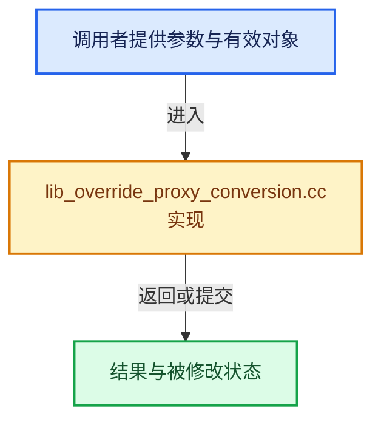

# 实现依赖专题：source/blender/blenkernel/intern/lib_override_proxy_conversion.cc

[方向导航](README.md) · [符号索引](../%E7%AC%A6%E5%8F%B7%E4%BE%9D%E8%B5%96%E4%B8%8E%E5%AE%9E%E7%8E%B0%E7%B4%A2%E5%BC%95.md)

本专题从正文实际调用进入，集中保存共享实现。函数有稳定锚点，可从调用处直接跳到对应完整函数；递归与互相调用通过回链组织。

## 本文件的实现关系





## 完整成员与函数实现

<a id="f-c7069b662782c843"></a>

### `blender::BKE_lib_override_library_proxy_convert`

实现位置：[source/blender/blenkernel/intern/lib_override_proxy_conversion.cc](../../../../../source/blender/blenkernel/intern/lib_override_proxy_conversion.cc) · L36—L96。

接口参数：

- `Main *bmain`
- `Scene *scene`
- `ViewLayer *view_layer`
- `Object *ob_proxy`

**教学注释版**

<!-- annotated:be5e37e09f9827 -->

```cpp
bool BKE_lib_override_library_proxy_convert(Main *bmain,
                                            Scene *scene,
                                            ViewLayer *view_layer,
                                            Object *ob_proxy)
{
  /* `proxy_group`, if defined, is the empty instantiating the collection from which the proxy is
   * coming. */
  Object *ob_proxy_group = ob_proxy->proxy_group;
  const bool is_override_instancing_object = (ob_proxy_group != nullptr) &&
                                             (ob_proxy_group->instance_collection != nullptr);
  ID *id_root = is_override_instancing_object ? &ob_proxy_group->instance_collection->id :
                                                &ob_proxy->proxy->id;
  ID *id_instance_hint = is_override_instancing_object ? &ob_proxy_group->id : &ob_proxy->id;

  /* In some cases the instance collection of a proxy object may be local (see e.g. #83875). Not
   * sure this is a valid state, but for now just abort the overriding process. */
  if (!ID_IS_OVERRIDABLE_LIBRARY_HIERARCHY(id_root)) {
    if (ob_proxy->proxy != nullptr) {
      ob_proxy->proxy->proxy_from = nullptr;
    }
    id_us_min(id_cast<ID *>(ob_proxy->proxy));
    ob_proxy->proxy = ob_proxy->proxy_group = nullptr;
    return false;
  }

  /* We manually convert the proxy object into a library override, further override handling will
   * then be handled by `BKE_lib_override_library_create()` just as for a regular override
   * creation.
   */
  ob_proxy->proxy->id.tag |= ID_TAG_DOIT;
  ob_proxy->proxy->id.newid = &ob_proxy->id;
  BKE_lib_override_library_init(&ob_proxy->id, &ob_proxy->proxy->id);
  ob_proxy->id.override_library->flag &= ~LIBOVERRIDE_FLAG_SYSTEM_DEFINED;

  ob_proxy->proxy->proxy_from = nullptr;
  ob_proxy->proxy = ob_proxy->proxy_group = nullptr;

  DEG_id_tag_update(&ob_proxy->id, ID_RECALC_SYNC_TO_EVAL);

  /* In case of proxy conversion, remap all local ID usages to linked IDs to their newly created
   * overrides. Also do that for the IDs from the same lib as the proxy in case it is linked.
   * While this might not be 100% the desired behavior, it is likely to be the case most of the
   * time. Ref: #91711. */
  ID *id_iter;
  FOREACH_MAIN_ID_BEGIN (bmain, id_iter) {
    if (!ID_IS_LINKED(id_iter) || id_iter->lib == ob_proxy->id.lib) {
      id_iter->tag |= ID_TAG_DOIT;
    }
  }
  FOREACH_MAIN_ID_END;

  return BKE_lib_override_library_create(bmain,
                                         scene,
                                         view_layer,
                                         ob_proxy->id.lib,
                                         id_root,
                                         id_root,
                                         id_instance_hint,
                                         nullptr,
                                         false);
}
```

<details>
<summary>核对原始源码：source/blender/blenkernel/intern/lib_override_proxy_conversion.cc · L36—L96</summary>

<!-- original:be5e37e09f9827:source/blender/blenkernel/intern/lib_override_proxy_conversion.cc:36:96 -->

```cpp
bool BKE_lib_override_library_proxy_convert(Main *bmain,
                                            Scene *scene,
                                            ViewLayer *view_layer,
                                            Object *ob_proxy)
{
  /* `proxy_group`, if defined, is the empty instantiating the collection from which the proxy is
   * coming. */
  Object *ob_proxy_group = ob_proxy->proxy_group;
  const bool is_override_instancing_object = (ob_proxy_group != nullptr) &&
                                             (ob_proxy_group->instance_collection != nullptr);
  ID *id_root = is_override_instancing_object ? &ob_proxy_group->instance_collection->id :
                                                &ob_proxy->proxy->id;
  ID *id_instance_hint = is_override_instancing_object ? &ob_proxy_group->id : &ob_proxy->id;

  /* In some cases the instance collection of a proxy object may be local (see e.g. #83875). Not
   * sure this is a valid state, but for now just abort the overriding process. */
  if (!ID_IS_OVERRIDABLE_LIBRARY_HIERARCHY(id_root)) {
    if (ob_proxy->proxy != nullptr) {
      ob_proxy->proxy->proxy_from = nullptr;
    }
    id_us_min(id_cast<ID *>(ob_proxy->proxy));
    ob_proxy->proxy = ob_proxy->proxy_group = nullptr;
    return false;
  }

  /* We manually convert the proxy object into a library override, further override handling will
   * then be handled by `BKE_lib_override_library_create()` just as for a regular override
   * creation.
   */
  ob_proxy->proxy->id.tag |= ID_TAG_DOIT;
  ob_proxy->proxy->id.newid = &ob_proxy->id;
  BKE_lib_override_library_init(&ob_proxy->id, &ob_proxy->proxy->id);
  ob_proxy->id.override_library->flag &= ~LIBOVERRIDE_FLAG_SYSTEM_DEFINED;

  ob_proxy->proxy->proxy_from = nullptr;
  ob_proxy->proxy = ob_proxy->proxy_group = nullptr;

  DEG_id_tag_update(&ob_proxy->id, ID_RECALC_SYNC_TO_EVAL);

  /* In case of proxy conversion, remap all local ID usages to linked IDs to their newly created
   * overrides. Also do that for the IDs from the same lib as the proxy in case it is linked.
   * While this might not be 100% the desired behavior, it is likely to be the case most of the
   * time. Ref: #91711. */
  ID *id_iter;
  FOREACH_MAIN_ID_BEGIN (bmain, id_iter) {
    if (!ID_IS_LINKED(id_iter) || id_iter->lib == ob_proxy->id.lib) {
      id_iter->tag |= ID_TAG_DOIT;
    }
  }
  FOREACH_MAIN_ID_END;

  return BKE_lib_override_library_create(bmain,
                                         scene,
                                         view_layer,
                                         ob_proxy->id.lib,
                                         id_root,
                                         id_root,
                                         id_instance_hint,
                                         nullptr,
                                         false);
}
```

</details>

**沿实际写入检查状态**

- `ob_proxy->proxy->proxy_from = nullptr;`
- `ob_proxy->proxy = ob_proxy->proxy_group = nullptr;`
- `ob_proxy->proxy->id.tag |= ID_TAG_DOIT;`
- `ob_proxy->proxy->id.newid = &ob_proxy->id;`
- `ob_proxy->id.override_library->flag &= ~LIBOVERRIDE_FLAG_SYSTEM_DEFINED;`
- `id_iter->tag |= ID_TAG_DOIT;`

**结果出口**

- `return false;`
- `return BKE_lib_override_library_create(bmain,`

**继续追踪实现**

- `ID_IS_OVERRIDABLE_LIBRARY_HIERARCHY` → [ID_IS_OVERRIDABLE_LIBRARY_HIERARCHY · L715](%E4%BE%9D%E8%B5%96-DNA_ID-3eb091.md#m-e25fd07eccd8)。宏定义由构建条件选择。
- `id_us_min` → [blender::id_us_min · L441](%E4%BE%9D%E8%B5%96-lib_id-d4e6bd.md#f-c5e5246a79962257)。
- `id_cast<ID *>` → [blender::id_cast · L1417](%E4%BE%9D%E8%B5%96-DNA_ID-3eb091.md#f-6c8ac6412850ac5a)。
- `BKE_lib_override_library_init` → [blender::BKE_lib_override_library_init · L181](%E4%BE%9D%E8%B5%96-lib_override-90a5a9.md#f-aaecd97f9fe569e6)。
- `DEG_id_tag_update` → [blender::DEG_id_tag_update · L844](../11-Depsgraph%E4%B8%8E%E5%B9%B6%E8%A1%8C%E4%BB%BB%E5%8A%A1%E7%B3%BB%E7%BB%9F/%E4%BE%9D%E8%B5%96-depsgraph_tag-d8b3c7.md#f-62d2949dd168bb81)。
- `ID_IS_LINKED` → [ID_IS_LINKED · L697](%E4%BE%9D%E8%B5%96-DNA_ID-3eb091.md#m-7e1e1e9b20e6)。宏定义由构建条件选择。
- `BKE_lib_override_library_create` → [blender::BKE_lib_override_library_create · L1672](%E4%BE%9D%E8%B5%96-lib_override-90a5a9.md#f-1ee9b18430146f93)。

<a id="f-dcc1f94c18c646a0"></a>

### `blender::lib_override_library_proxy_convert_do`

实现位置：[source/blender/blenkernel/intern/lib_override_proxy_conversion.cc](../../../../../source/blender/blenkernel/intern/lib_override_proxy_conversion.cc) · L98—L118。

接口参数：

- `Main *bmain`
- `Scene *scene`
- `Object *ob_proxy`
- `BlendFileReadReport *reports`

**教学注释版**

<!-- annotated:63458820fa5d83 -->

```cpp
static void lib_override_library_proxy_convert_do(Main *bmain,
                                                  Scene *scene,
                                                  Object *ob_proxy,
                                                  BlendFileReadReport *reports)
{
  Object *ob_proxy_group = ob_proxy->proxy_group;
  const bool is_override_instancing_object = ob_proxy_group != nullptr;

  const bool success = BKE_lib_override_library_proxy_convert(bmain, scene, nullptr, ob_proxy);

  if (success) {
    CLOG_INFO(
        &LOG, "Proxy object '%s' successfully converted to library overrides", ob_proxy->id.name);
    /* Remove the instance empty from this scene, the items now have an overridden collection
     * instead. */
    if (is_override_instancing_object) {
      BKE_scene_collections_object_remove(bmain, scene, ob_proxy_group, true);
    }
    reports->count.proxies_to_lib_overrides_success++;
  }
}
```

<details>
<summary>核对原始源码：source/blender/blenkernel/intern/lib_override_proxy_conversion.cc · L98—L118</summary>

<!-- original:63458820fa5d83:source/blender/blenkernel/intern/lib_override_proxy_conversion.cc:98:118 -->

```cpp
static void lib_override_library_proxy_convert_do(Main *bmain,
                                                  Scene *scene,
                                                  Object *ob_proxy,
                                                  BlendFileReadReport *reports)
{
  Object *ob_proxy_group = ob_proxy->proxy_group;
  const bool is_override_instancing_object = ob_proxy_group != nullptr;

  const bool success = BKE_lib_override_library_proxy_convert(bmain, scene, nullptr, ob_proxy);

  if (success) {
    CLOG_INFO(
        &LOG, "Proxy object '%s' successfully converted to library overrides", ob_proxy->id.name);
    /* Remove the instance empty from this scene, the items now have an overridden collection
     * instead. */
    if (is_override_instancing_object) {
      BKE_scene_collections_object_remove(bmain, scene, ob_proxy_group, true);
    }
    reports->count.proxies_to_lib_overrides_success++;
  }
}
```

</details>

**继续追踪实现**

- `BKE_lib_override_library_proxy_convert` → [blender::BKE_lib_override_library_proxy_convert · L36](%E4%BE%9D%E8%B5%96-lib_override_proxy_conversion-45fe06.md#f-c7069b662782c843)。
- `CLOG_INFO` → [CLOG_INFO · L190](%E4%BE%9D%E8%B5%96-CLG_log-e9051b.md#m-f8b5efdfcc0f)。宏定义由构建条件选择。
- `BKE_scene_collections_object_remove` → [blender::BKE_scene_collections_object_remove · L1850](%E4%BE%9D%E8%B5%96-collection-e11dcd.md#f-eca0a6c3a34ee1dd)。

<a id="f-e7e18898ff7e75cc"></a>

### `blender::BKE_lib_override_library_main_proxy_convert`

实现位置：[source/blender/blenkernel/intern/lib_override_proxy_conversion.cc](../../../../../source/blender/blenkernel/intern/lib_override_proxy_conversion.cc) · L120—L170。

接口参数：

- `Main *bmain`
- `BlendFileReadReport *reports`

**教学注释版**

<!-- annotated:897f844eb735cd -->

```cpp
void BKE_lib_override_library_main_proxy_convert(Main *bmain, BlendFileReadReport *reports)
{
  for (Scene &scene : bmain->scenes) {
    LinkNodePair proxy_objects = {nullptr};

    FOREACH_SCENE_OBJECT_BEGIN (&scene, object) {
      if (object->proxy_group != nullptr) {
        BLI_linklist_append(&proxy_objects, object);
      }
    }
    FOREACH_SCENE_OBJECT_END;

    FOREACH_SCENE_OBJECT_BEGIN (&scene, object) {
      if (object->proxy != nullptr && object->proxy_group == nullptr) {
        BLI_linklist_append(&proxy_objects, object);
      }
    }
    FOREACH_SCENE_OBJECT_END;

    for (LinkNode *proxy_object_iter = proxy_objects.list; proxy_object_iter != nullptr;
         proxy_object_iter = proxy_object_iter->next)
    {
      Object *proxy_object = static_cast<Object *>(proxy_object_iter->link);
      lib_override_library_proxy_convert_do(bmain, &scene, proxy_object, reports);
    }

    BLI_linklist_free(proxy_objects.list, nullptr);
  }

  for (Object &object : bmain->objects) {
    if (object.proxy_group != nullptr || object.proxy != nullptr) {
      if (ID_IS_LINKED(&object)) {
        CLOG_WARN(&LOG,
                  "Linked proxy object '%s' from '%s' failed to be converted to library override",
                  object.id.name + 2,
                  object.id.lib->filepath);
      }
      else {
        CLOG_WARN(&LOG,
                  "Proxy object '%s' failed to be converted to library override",
                  object.id.name + 2);
      }
      reports->count.proxies_to_lib_overrides_failures++;
      if (object.proxy != nullptr) {
        object.proxy->proxy_from = nullptr;
      }
      id_us_min(id_cast<ID *>(object.proxy));
      object.proxy = object.proxy_group = nullptr;
    }
  }
}
```

<details>
<summary>核对原始源码：source/blender/blenkernel/intern/lib_override_proxy_conversion.cc · L120—L170</summary>

<!-- original:897f844eb735cd:source/blender/blenkernel/intern/lib_override_proxy_conversion.cc:120:170 -->

```cpp
void BKE_lib_override_library_main_proxy_convert(Main *bmain, BlendFileReadReport *reports)
{
  for (Scene &scene : bmain->scenes) {
    LinkNodePair proxy_objects = {nullptr};

    FOREACH_SCENE_OBJECT_BEGIN (&scene, object) {
      if (object->proxy_group != nullptr) {
        BLI_linklist_append(&proxy_objects, object);
      }
    }
    FOREACH_SCENE_OBJECT_END;

    FOREACH_SCENE_OBJECT_BEGIN (&scene, object) {
      if (object->proxy != nullptr && object->proxy_group == nullptr) {
        BLI_linklist_append(&proxy_objects, object);
      }
    }
    FOREACH_SCENE_OBJECT_END;

    for (LinkNode *proxy_object_iter = proxy_objects.list; proxy_object_iter != nullptr;
         proxy_object_iter = proxy_object_iter->next)
    {
      Object *proxy_object = static_cast<Object *>(proxy_object_iter->link);
      lib_override_library_proxy_convert_do(bmain, &scene, proxy_object, reports);
    }

    BLI_linklist_free(proxy_objects.list, nullptr);
  }

  for (Object &object : bmain->objects) {
    if (object.proxy_group != nullptr || object.proxy != nullptr) {
      if (ID_IS_LINKED(&object)) {
        CLOG_WARN(&LOG,
                  "Linked proxy object '%s' from '%s' failed to be converted to library override",
                  object.id.name + 2,
                  object.id.lib->filepath);
      }
      else {
        CLOG_WARN(&LOG,
                  "Proxy object '%s' failed to be converted to library override",
                  object.id.name + 2);
      }
      reports->count.proxies_to_lib_overrides_failures++;
      if (object.proxy != nullptr) {
        object.proxy->proxy_from = nullptr;
      }
      id_us_min(id_cast<ID *>(object.proxy));
      object.proxy = object.proxy_group = nullptr;
    }
  }
}
```

</details>

**沿实际写入检查状态**

- `proxy_object_iter = proxy_object_iter->next)`
- `object.proxy->proxy_from = nullptr;`
- `object.proxy = object.proxy_group = nullptr;`

**继续追踪实现**

- `FOREACH_SCENE_OBJECT_BEGIN` → [FOREACH_SCENE_OBJECT_BEGIN · L572](%E4%BE%9D%E8%B5%96-BKE_collection-5db915.md#m-02f7b358de24)。宏定义由构建条件选择。
- `BLI_linklist_append` → [blender::BLI_linklist_append · L198](../01-%E5%9F%BA%E7%A1%80%E5%AE%B9%E5%99%A8%E4%B8%8E%E7%8E%B0%E4%BB%A3CPP/%E4%BE%9D%E8%B5%96-BLI_linklist-23c475.md#f-27635d32899a8402)。
- `lib_override_library_proxy_convert_do` → [blender::lib_override_library_proxy_convert_do · L98](%E4%BE%9D%E8%B5%96-lib_override_proxy_conversion-45fe06.md#f-dcc1f94c18c646a0)。
- `BLI_linklist_free` → [blender::BLI_linklist_free · L257](../01-%E5%9F%BA%E7%A1%80%E5%AE%B9%E5%99%A8%E4%B8%8E%E7%8E%B0%E4%BB%A3CPP/%E4%BE%9D%E8%B5%96-BLI_linklist-23c475.md#f-4e67a6aefc1a2276)。
- `ID_IS_LINKED` → [ID_IS_LINKED · L697](%E4%BE%9D%E8%B5%96-DNA_ID-3eb091.md#m-7e1e1e9b20e6)。宏定义由构建条件选择。
- `CLOG_WARN` → [CLOG_WARN · L189](%E4%BE%9D%E8%B5%96-CLG_log-e9051b.md#m-9da21a06cdbe)。宏定义由构建条件选择。
- `id_us_min` → [blender::id_us_min · L441](%E4%BE%9D%E8%B5%96-lib_id-d4e6bd.md#f-c5e5246a79962257)。
- `id_cast<ID *>` → [blender::id_cast · L1417](%E4%BE%9D%E8%B5%96-DNA_ID-3eb091.md#f-6c8ac6412850ac5a)。
