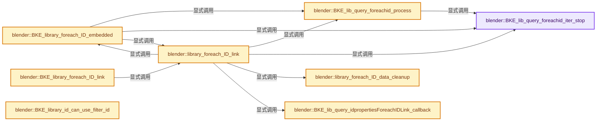
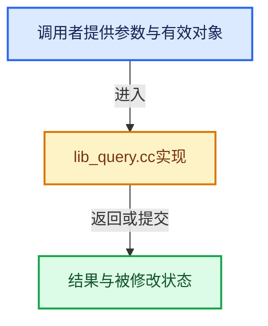

# 实现依赖专题：source/blender/blenkernel/intern/lib_query.cc

[方向导航](README.md) · [符号索引](../%E7%AC%A6%E5%8F%B7%E4%BE%9D%E8%B5%96%E4%B8%8E%E5%AE%9E%E7%8E%B0%E7%B4%A2%E5%BC%95.md)

本专题从正文实际调用进入，集中保存共享实现。函数有稳定锚点，可从调用处直接跳到对应完整函数；递归与互相调用通过回链组织。

## 本文件的实现关系






## 相关类型布局与成员入口

<a id="t-02ee94421897"></a>

### `blender::UnusedIDsData::Status`

原始声明：[source/blender/blenkernel/intern/lib_query.cc](../../../../../source/blender/blenkernel/intern/lib_query.cc) · L722—L722。

以下保留类的数据声明与编译条件，成员函数实现通过后面的精确链接阅读。

<!-- annotated:39cac79aad5ea5 -->

```cpp
  enum class Status : int8_t { Unknown, Used, Unused };
```

<details>
<summary>核对原始源码：source/blender/blenkernel/intern/lib_query.cc · L722—L722</summary>

<!-- original:39cac79aad5ea5:source/blender/blenkernel/intern/lib_query.cc:722:722 -->

```cpp
  enum class Status : int8_t { Unknown, Used, Unused };
```

</details>


## 完整成员与函数实现

<a id="f-370431cc3abb4b18"></a>

### `blender::BKE_lib_query_foreachid_iter_stop`

实现位置：[source/blender/blenkernel/intern/lib_query.cc](../../../../../source/blender/blenkernel/intern/lib_query.cc) · L77—L80。

接口参数：

- `const LibraryForeachIDData *data`

**教学注释版**

<!-- annotated:7fdf2b32a26429 -->

```cpp
bool BKE_lib_query_foreachid_iter_stop(const LibraryForeachIDData *data)
{
  return (data->status & IDWALK_STOP) != 0;
}
```

<details>
<summary>核对原始源码：source/blender/blenkernel/intern/lib_query.cc · L77—L80</summary>

<!-- original:7fdf2b32a26429:source/blender/blenkernel/intern/lib_query.cc:77:80 -->

```cpp
bool BKE_lib_query_foreachid_iter_stop(const LibraryForeachIDData *data)
{
  return (data->status & IDWALK_STOP) != 0;
}
```

</details>

**结果出口**

- `return (data->status & IDWALK_STOP) != 0;`

**继续追踪实现**

本实现没有需要继续展开的显式调用；检查返回表达式、对象转换和调用者前置条件。

<a id="f-fe33872950ca8670"></a>

### `blender::BKE_lib_query_foreachid_process`

实现位置：[source/blender/blenkernel/intern/lib_query.cc](../../../../../source/blender/blenkernel/intern/lib_query.cc) · L82—L131。

接口参数：

- `LibraryForeachIDData *data`
- `ID **id_pp`
- `LibraryForeachIDCallbackFlag cb_flag`

**教学注释版**

<!-- annotated:93d0afba402dbe -->

```cpp
void BKE_lib_query_foreachid_process(LibraryForeachIDData *data,
                                     ID **id_pp,
                                     LibraryForeachIDCallbackFlag cb_flag)
{
  if (BKE_lib_query_foreachid_iter_stop(data)) {
    return;
  }

  const LibraryForeachIDFlag flag = data->flag;
  ID *old_id = *id_pp;

  /* Update the callback flags with the ones defined (or forbidden) in `data` by the generic
   * caller code. */
  cb_flag = LibraryForeachIDCallbackFlag((cb_flag | data->cb_flag) & ~data->cb_flag_clear);

  /* Update the callback flags with some extra information regarding overrides: all "loop-back",
   * "internal", "embedded" etc. ID pointers are never overridable. */
  if (cb_flag & (IDWALK_CB_INTERNAL | IDWALK_CB_LOOPBACK | IDWALK_CB_OVERRIDE_LIBRARY_REFERENCE)) {
    cb_flag |= IDWALK_CB_OVERRIDE_LIBRARY_NOT_OVERRIDABLE;
  }

  LibraryIDLinkCallbackData callback_data{};
  callback_data.user_data = data->user_data;
  callback_data.bmain = data->bmain;
  callback_data.owner_id = data->owner_id;
  callback_data.self_id = data->self_id;
  callback_data.id_pointer = id_pp;
  callback_data.cb_flag = cb_flag;
  const int callback_return = data->callback(&callback_data);

  if (flag & IDWALK_READONLY) {
    BLI_assert(*(id_pp) == old_id);
  }
  else {
    BLI_assert_msg((callback_return & (IDWALK_RET_STOP_ITER | IDWALK_RET_STOP_RECURSION)) == 0,
                   "Iteration over ID usages should not be interrupted by the callback in "
                   "non-readonly cases");
  }

  if (old_id && (flag & IDWALK_RECURSE)) {
    if (data->ids_handled->add(old_id)) {
      if (!(callback_return & IDWALK_RET_STOP_RECURSION)) {
        BLI_LINKSTACK_PUSH(data->ids_todo, old_id);
      }
    }
  }
  if (callback_return & IDWALK_RET_STOP_ITER) {
    data->status |= IDWALK_STOP;
  }
}
```

<details>
<summary>核对原始源码：source/blender/blenkernel/intern/lib_query.cc · L82—L131</summary>

<!-- original:93d0afba402dbe:source/blender/blenkernel/intern/lib_query.cc:82:131 -->

```cpp
void BKE_lib_query_foreachid_process(LibraryForeachIDData *data,
                                     ID **id_pp,
                                     LibraryForeachIDCallbackFlag cb_flag)
{
  if (BKE_lib_query_foreachid_iter_stop(data)) {
    return;
  }

  const LibraryForeachIDFlag flag = data->flag;
  ID *old_id = *id_pp;

  /* Update the callback flags with the ones defined (or forbidden) in `data` by the generic
   * caller code. */
  cb_flag = LibraryForeachIDCallbackFlag((cb_flag | data->cb_flag) & ~data->cb_flag_clear);

  /* Update the callback flags with some extra information regarding overrides: all "loop-back",
   * "internal", "embedded" etc. ID pointers are never overridable. */
  if (cb_flag & (IDWALK_CB_INTERNAL | IDWALK_CB_LOOPBACK | IDWALK_CB_OVERRIDE_LIBRARY_REFERENCE)) {
    cb_flag |= IDWALK_CB_OVERRIDE_LIBRARY_NOT_OVERRIDABLE;
  }

  LibraryIDLinkCallbackData callback_data{};
  callback_data.user_data = data->user_data;
  callback_data.bmain = data->bmain;
  callback_data.owner_id = data->owner_id;
  callback_data.self_id = data->self_id;
  callback_data.id_pointer = id_pp;
  callback_data.cb_flag = cb_flag;
  const int callback_return = data->callback(&callback_data);

  if (flag & IDWALK_READONLY) {
    BLI_assert(*(id_pp) == old_id);
  }
  else {
    BLI_assert_msg((callback_return & (IDWALK_RET_STOP_ITER | IDWALK_RET_STOP_RECURSION)) == 0,
                   "Iteration over ID usages should not be interrupted by the callback in "
                   "non-readonly cases");
  }

  if (old_id && (flag & IDWALK_RECURSE)) {
    if (data->ids_handled->add(old_id)) {
      if (!(callback_return & IDWALK_RET_STOP_RECURSION)) {
        BLI_LINKSTACK_PUSH(data->ids_todo, old_id);
      }
    }
  }
  if (callback_return & IDWALK_RET_STOP_ITER) {
    data->status |= IDWALK_STOP;
  }
}
```

</details>

**沿实际写入检查状态**

- `cb_flag = LibraryForeachIDCallbackFlag((cb_flag | data->cb_flag) & ~data->cb_flag_clear);`
- `cb_flag |= IDWALK_CB_OVERRIDE_LIBRARY_NOT_OVERRIDABLE;`
- `callback_data.user_data = data->user_data;`
- `callback_data.bmain = data->bmain;`
- `callback_data.owner_id = data->owner_id;`
- `callback_data.self_id = data->self_id;`
- `callback_data.id_pointer = id_pp;`
- `callback_data.cb_flag = cb_flag;`
- `data->status |= IDWALK_STOP;`

**继续追踪实现**

- `BKE_lib_query_foreachid_iter_stop` → [blender::BKE_lib_query_foreachid_iter_stop · L77](%E4%BE%9D%E8%B5%96-lib_query-3f8b96.md#f-370431cc3abb4b18)。
- `LibraryForeachIDCallbackFlag` → [blender::LibraryForeachIDCallbackFlag](%E4%BE%9D%E8%B5%96-BKE_lib_query-b986a2.md#t-5596f590d942)。
- `data->callback` → [调用协议](../%E6%A8%A1%E6%9D%BF%E5%AE%8F%E4%B8%8E%E5%8A%A8%E6%80%81%E5%88%86%E6%B4%BE%E5%8D%8F%E8%AE%AE.md)：由接收对象具体类型或运行时策略提供实现。调用位置L110。
- `BLI_assert` → [BLI_assert · L48](../01-%E5%9F%BA%E7%A1%80%E5%AE%B9%E5%99%A8%E4%B8%8E%E7%8E%B0%E4%BB%A3CPP/%E4%BE%9D%E8%B5%96-BLI_assert-cc98e8.md#m-57a88495704d)；[BLI_assert · L63](../01-%E5%9F%BA%E7%A1%80%E5%AE%B9%E5%99%A8%E4%B8%8E%E7%8E%B0%E4%BB%A3CPP/%E4%BE%9D%E8%B5%96-BLI_assert-cc98e8.md#m-d07050020cb5)。宏定义由构建条件选择。
- `BLI_assert_msg` → [BLI_assert_msg · L55](../01-%E5%9F%BA%E7%A1%80%E5%AE%B9%E5%99%A8%E4%B8%8E%E7%8E%B0%E4%BB%A3CPP/%E4%BE%9D%E8%B5%96-BLI_assert-cc98e8.md#m-695eed20dceb)；[BLI_assert_msg · L64](../01-%E5%9F%BA%E7%A1%80%E5%AE%B9%E5%99%A8%E4%B8%8E%E7%8E%B0%E4%BB%A3CPP/%E4%BE%9D%E8%B5%96-BLI_assert-cc98e8.md#m-7de5563de4db)。宏定义由构建条件选择。
- `data->ids_handled->add` → [调用协议](../%E6%A8%A1%E6%9D%BF%E5%AE%8F%E4%B8%8E%E5%8A%A8%E6%80%81%E5%88%86%E6%B4%BE%E5%8D%8F%E8%AE%AE.md)：接收对象类型依赖auto、返回值或模板实例；不按同名猜测目标。调用位置L122。
- `BLI_LINKSTACK_PUSH` → [BLI_LINKSTACK_PUSH · L40](../01-%E5%9F%BA%E7%A1%80%E5%AE%B9%E5%99%A8%E4%B8%8E%E7%8E%B0%E4%BB%A3CPP/%E4%BE%9D%E8%B5%96-BLI_linklist_stack-95930a.md#m-9a309cb83e46)。宏定义由构建条件选择。

<a id="f-b14e8687a7be6fdb"></a>

### `blender::BKE_lib_query_idpropertiesForeachIDLink_callback`

实现位置：[source/blender/blenkernel/intern/lib_query.cc](../../../../../source/blender/blenkernel/intern/lib_query.cc) · L164—L174。

接口参数：

- `IDProperty *id_prop`
- `void *user_data`

**教学注释版**

<!-- annotated:8205714a9463ab -->

```cpp
void BKE_lib_query_idpropertiesForeachIDLink_callback(IDProperty *id_prop, void *user_data)
{
  BLI_assert(id_prop->type == IDP_ID);

  LibraryForeachIDData *data = static_cast<LibraryForeachIDData *>(user_data);
  const LibraryForeachIDCallbackFlag cb_flag = IDWALK_CB_USER |
                                               ((id_prop->flag & IDP_FLAG_OVERRIDABLE_LIBRARY) ?
                                                    IDWALK_CB_NOP :
                                                    IDWALK_CB_OVERRIDE_LIBRARY_NOT_OVERRIDABLE);
  BKE_LIB_FOREACHID_PROCESS_ID(data, id_prop->data.pointer, cb_flag);
}
```

<details>
<summary>核对原始源码：source/blender/blenkernel/intern/lib_query.cc · L164—L174</summary>

<!-- original:8205714a9463ab:source/blender/blenkernel/intern/lib_query.cc:164:174 -->

```cpp
void BKE_lib_query_idpropertiesForeachIDLink_callback(IDProperty *id_prop, void *user_data)
{
  BLI_assert(id_prop->type == IDP_ID);

  LibraryForeachIDData *data = static_cast<LibraryForeachIDData *>(user_data);
  const LibraryForeachIDCallbackFlag cb_flag = IDWALK_CB_USER |
                                               ((id_prop->flag & IDP_FLAG_OVERRIDABLE_LIBRARY) ?
                                                    IDWALK_CB_NOP :
                                                    IDWALK_CB_OVERRIDE_LIBRARY_NOT_OVERRIDABLE);
  BKE_LIB_FOREACHID_PROCESS_ID(data, id_prop->data.pointer, cb_flag);
}
```

</details>

**继续追踪实现**

- `BLI_assert` → [BLI_assert · L48](../01-%E5%9F%BA%E7%A1%80%E5%AE%B9%E5%99%A8%E4%B8%8E%E7%8E%B0%E4%BB%A3CPP/%E4%BE%9D%E8%B5%96-BLI_assert-cc98e8.md#m-57a88495704d)；[BLI_assert · L63](../01-%E5%9F%BA%E7%A1%80%E5%AE%B9%E5%99%A8%E4%B8%8E%E7%8E%B0%E4%BB%A3CPP/%E4%BE%9D%E8%B5%96-BLI_assert-cc98e8.md#m-d07050020cb5)。宏定义由构建条件选择。
- `BKE_LIB_FOREACHID_PROCESS_ID` → [BKE_LIB_FOREACHID_PROCESS_ID · L276](%E4%BE%9D%E8%B5%96-BKE_lib_query-b986a2.md#m-bd783c561d42)。宏定义由构建条件选择。

<a id="f-4c9488dcfd7d5ce2"></a>

### `blender::BKE_library_foreach_ID_embedded`

实现位置：[source/blender/blenkernel/intern/lib_query.cc](../../../../../source/blender/blenkernel/intern/lib_query.cc) · L176—L210。

接口参数：

- `LibraryForeachIDData *data`
- `ID **id_pp`

**教学注释版**

<!-- annotated:69b3a759fee2b6 -->

```cpp
void BKE_library_foreach_ID_embedded(LibraryForeachIDData *data, ID **id_pp)
{
  /* Needed e.g. for callbacks handling relationships. This call should be absolutely read-only. */
  ID *id = *id_pp;
  const LibraryForeachIDFlag flag = data->flag;

  BKE_lib_query_foreachid_process(data, id_pp, IDWALK_CB_EMBEDDED);
  if (BKE_lib_query_foreachid_iter_stop(data)) {
    return;
  }
  BLI_assert(id == *id_pp);

  if (id == nullptr) {
    return;
  }

  if (flag & IDWALK_IGNORE_EMBEDDED_ID) {
    /* Do Nothing. */
  }
  else if (flag & IDWALK_RECURSE) {
    /* Defer handling into main loop, recursively calling BKE_library_foreach_ID_link in
     * IDWALK_RECURSE case is troublesome, see #49553. */
    if (data->ids_handled->add(id)) {
      BLI_LINKSTACK_PUSH(data->ids_todo, id);
    }
  }
  else {
    if (!library_foreach_ID_link(
            data->bmain, data->owner_id, id, data->callback, data->user_data, data->flag, data))
    {
      data->status |= IDWALK_STOP;
      return;
    }
  }
}
```

<details>
<summary>核对原始源码：source/blender/blenkernel/intern/lib_query.cc · L176—L210</summary>

<!-- original:69b3a759fee2b6:source/blender/blenkernel/intern/lib_query.cc:176:210 -->

```cpp
void BKE_library_foreach_ID_embedded(LibraryForeachIDData *data, ID **id_pp)
{
  /* Needed e.g. for callbacks handling relationships. This call should be absolutely read-only. */
  ID *id = *id_pp;
  const LibraryForeachIDFlag flag = data->flag;

  BKE_lib_query_foreachid_process(data, id_pp, IDWALK_CB_EMBEDDED);
  if (BKE_lib_query_foreachid_iter_stop(data)) {
    return;
  }
  BLI_assert(id == *id_pp);

  if (id == nullptr) {
    return;
  }

  if (flag & IDWALK_IGNORE_EMBEDDED_ID) {
    /* Do Nothing. */
  }
  else if (flag & IDWALK_RECURSE) {
    /* Defer handling into main loop, recursively calling BKE_library_foreach_ID_link in
     * IDWALK_RECURSE case is troublesome, see #49553. */
    if (data->ids_handled->add(id)) {
      BLI_LINKSTACK_PUSH(data->ids_todo, id);
    }
  }
  else {
    if (!library_foreach_ID_link(
            data->bmain, data->owner_id, id, data->callback, data->user_data, data->flag, data))
    {
      data->status |= IDWALK_STOP;
      return;
    }
  }
}
```

</details>

**沿实际写入检查状态**

- `data->status |= IDWALK_STOP;`

**继续追踪实现**

- `BKE_lib_query_foreachid_process` → [blender::BKE_lib_query_foreachid_process · L82](%E4%BE%9D%E8%B5%96-lib_query-3f8b96.md#f-fe33872950ca8670)。
- `BKE_lib_query_foreachid_iter_stop` → [blender::BKE_lib_query_foreachid_iter_stop · L77](%E4%BE%9D%E8%B5%96-lib_query-3f8b96.md#f-370431cc3abb4b18)。
- `BLI_assert` → [BLI_assert · L48](../01-%E5%9F%BA%E7%A1%80%E5%AE%B9%E5%99%A8%E4%B8%8E%E7%8E%B0%E4%BB%A3CPP/%E4%BE%9D%E8%B5%96-BLI_assert-cc98e8.md#m-57a88495704d)；[BLI_assert · L63](../01-%E5%9F%BA%E7%A1%80%E5%AE%B9%E5%99%A8%E4%B8%8E%E7%8E%B0%E4%BB%A3CPP/%E4%BE%9D%E8%B5%96-BLI_assert-cc98e8.md#m-d07050020cb5)。宏定义由构建条件选择。
- `data->ids_handled->add` → [调用协议](../%E6%A8%A1%E6%9D%BF%E5%AE%8F%E4%B8%8E%E5%8A%A8%E6%80%81%E5%88%86%E6%B4%BE%E5%8D%8F%E8%AE%AE.md)：接收对象类型依赖auto、返回值或模板实例；不按同名猜测目标。调用位置L198。
- `BLI_LINKSTACK_PUSH` → [BLI_LINKSTACK_PUSH · L40](../01-%E5%9F%BA%E7%A1%80%E5%AE%B9%E5%99%A8%E4%B8%8E%E7%8E%B0%E4%BB%A3CPP/%E4%BE%9D%E8%B5%96-BLI_linklist_stack-95930a.md#m-9a309cb83e46)。宏定义由构建条件选择。
- `library_foreach_ID_link` → [blender::library_foreach_ID_link · L221](%E4%BE%9D%E8%B5%96-lib_query-3f8b96.md#f-ec517d882a7f6343)。

<a id="f-6bb205f68f96bf8c"></a>

### `blender::library_foreach_ID_data_cleanup`

实现位置：[source/blender/blenkernel/intern/lib_query.cc](../../../../../source/blender/blenkernel/intern/lib_query.cc) · L212—L218。

接口参数：

- `LibraryForeachIDData *data`

**教学注释版**

<!-- annotated:468fc64ce131ca -->

```cpp
static void library_foreach_ID_data_cleanup(LibraryForeachIDData *data)
{
  if (data->ids_handled != nullptr) {
    MEM_delete(data->ids_handled);
    BLI_LINKSTACK_FREE(data->ids_todo);
  }
}
```

<details>
<summary>核对原始源码：source/blender/blenkernel/intern/lib_query.cc · L212—L218</summary>

<!-- original:468fc64ce131ca:source/blender/blenkernel/intern/lib_query.cc:212:218 -->

```cpp
static void library_foreach_ID_data_cleanup(LibraryForeachIDData *data)
{
  if (data->ids_handled != nullptr) {
    MEM_delete(data->ids_handled);
    BLI_LINKSTACK_FREE(data->ids_todo);
  }
}
```

</details>

**继续追踪实现**

- `MEM_delete` → [MEM_delete · L400](../03-%E5%86%85%E5%AD%98%E5%88%86%E9%85%8D%E4%B8%8E%E8%BF%90%E8%A1%8C%E6%97%B6%E7%B1%BB%E5%9E%8B/%E4%BE%9D%E8%B5%96-MEM_guardedalloc-b54eca.md#f-9049ffdd1682887c)。
- `BLI_LINKSTACK_FREE` → [BLI_LINKSTACK_FREE · L56](../01-%E5%9F%BA%E7%A1%80%E5%AE%B9%E5%99%A8%E4%B8%8E%E7%8E%B0%E4%BB%A3CPP/%E4%BE%9D%E8%B5%96-BLI_linklist_stack-95930a.md#m-1e4884061ace)。宏定义由构建条件选择。

<a id="f-ec517d882a7f6343"></a>

### `blender::library_foreach_ID_link`

实现位置：[source/blender/blenkernel/intern/lib_query.cc](../../../../../source/blender/blenkernel/intern/lib_query.cc) · L221—L447。

接口参数：

- `Main *bmain`
- `ID *owner_id`
- `ID *id`
- `FunctionRef<LibraryIDLinkCallback> callback`
- `void *user_data`
- `LibraryForeachIDFlag flag`
- `LibraryForeachIDData *inherit_data`

**教学注释版**

<!-- annotated:56b1384be657bb -->

```cpp
static bool library_foreach_ID_link(Main *bmain,
                                    ID *owner_id,
                                    ID *id,
                                    FunctionRef<LibraryIDLinkCallback> callback,
                                    void *user_data,
                                    LibraryForeachIDFlag flag,
                                    LibraryForeachIDData *inherit_data)
{
  LibraryForeachIDData data{};
  data.bmain = bmain;

  BLI_assert(inherit_data == nullptr || data.bmain == inherit_data->bmain);
  /* `IDWALK_NO_ORIG_POINTERS_ACCESS` is mutually exclusive with `IDWALK_RECURSE`. */
  BLI_assert((flag & (IDWALK_NO_ORIG_POINTERS_ACCESS | IDWALK_RECURSE)) !=
             (IDWALK_NO_ORIG_POINTERS_ACCESS | IDWALK_RECURSE));

  if (flag & IDWALK_NO_ORIG_POINTERS_ACCESS) {
    flag |= IDWALK_IGNORE_MISSING_OWNER_ID;
  }

  if (flag & IDWALK_RECURSE) {
    /* For now, recursion implies read-only, and no internal pointers. */
    flag |= IDWALK_READONLY;
    flag &= ~IDWALK_DO_INTERNAL_RUNTIME_POINTERS;

    /* NOTE: This function itself should never be called recursively when IDWALK_RECURSE is set,
     * see also comments in #BKE_library_foreach_ID_embedded.
     * This is why we can always create this data here, and do not need to try and re-use it from
     * `inherit_data`. */
    data.ids_handled = MEM_new<Set<ID *>>(__func__);
    BLI_LINKSTACK_INIT(data.ids_todo);

    data.ids_handled->add(id);
  }
  else {
    data.ids_handled = nullptr;
  }
  data.flag = flag;
  data.status = 0;
  data.callback = callback;
  data.user_data = user_data;

#define CALLBACK_INVOKE_ID(check_id, cb_flag) \
  { \
    CHECK_TYPE_ANY((check_id), ID *, void *); \
    BKE_lib_query_foreachid_process(&data, (ID **)&(check_id), (cb_flag)); \
    if (BKE_lib_query_foreachid_iter_stop(&data)) { \
      library_foreach_ID_data_cleanup(&data); \
      return false; \
    } \
  } \
  ((void)0)

#define CALLBACK_INVOKE(check_id_super, cb_flag) \
  { \
    CHECK_TYPE(&((check_id_super)->id), ID *); \
    BKE_lib_query_foreachid_process(&data, (ID **)&(check_id_super), (cb_flag)); \
    if (BKE_lib_query_foreachid_iter_stop(&data)) { \
      library_foreach_ID_data_cleanup(&data); \
      return false; \
    } \
  } \
  ((void)0)

  for (; id != nullptr; id = (flag & IDWALK_RECURSE) ? BLI_LINKSTACK_POP(data.ids_todo) : nullptr,
                        owner_id = nullptr)
  {
    data.self_id = id;
    /* owner ID is same as self ID, except for embedded ID case. */
    if (id->flag & ID_FLAG_EMBEDDED_DATA) {
      if (flag & IDWALK_IGNORE_MISSING_OWNER_ID) {
        data.owner_id = owner_id ? owner_id : id;
      }
      else {
        /* NOTE: Unfortunately it is not possible to ensure validity of the set owner_id pointer
         * here. `foreach_id` is used a lot by code remapping pointers, and in such cases the
         * current owner ID of the processed embedded ID is indeed invalid - and the given one is
         * to be assumed valid for the purpose of the current process.
         *
         * In other words, it is the responsibility of the code calling this `foreach_id` process
         * to ensure that the given owner ID is valid for its own purpose, or that it is not used.
         */
        // BLI_assert(owner_id == nullptr || BKE_id_owner_get(id) == owner_id);
        if (!owner_id) {
          owner_id = BKE_id_owner_get(id, false);
        }
        data.owner_id = owner_id;
      }
    }
    else {
      BLI_assert(ELEM(owner_id, nullptr, id));
      data.owner_id = id;
    }

    /* inherit_data is non-nullptr when this function is called for some sub-data ID
     * (like root node-tree of a material).
     * In that case, we do not want to generate those 'generic flags' from our current sub-data ID
     * (the node tree), but re-use those generated for the 'owner' ID (the material). */
    if (inherit_data == nullptr) {
      data.cb_flag = ID_IS_LINKED(id) ? IDWALK_CB_INDIRECT_USAGE : IDWALK_CB_NOP;
      /* When an ID is defined as not reference-counting its ID usages, it should never do it. */
      data.cb_flag_clear = (id->tag & ID_TAG_NO_USER_REFCOUNT) ?
                               IDWALK_CB_USER | IDWALK_CB_USER_ONE :
                               IDWALK_CB_NOP;
    }
    else {
      data.cb_flag = inherit_data->cb_flag;
      data.cb_flag_clear = inherit_data->cb_flag_clear;
    }

    bool use_bmain_relations = bmain != nullptr && bmain->relations != nullptr &&
                               (flag & IDWALK_READONLY);
    /* Including UI-related ID pointers should match with the relevant setting in Main relations
     * cache. */
    if (use_bmain_relations && (((bmain->relations->flag & MAINIDRELATIONS_INCLUDE_UI) == 0) !=
                                ((data.flag & IDWALK_INCLUDE_UI) == 0)))
    {
      use_bmain_relations = false;
    }
    /* No special 'internal' handling of ID pointers is covered by Main relations cache. */
    if (use_bmain_relations &&
        (flag & (IDWALK_DO_INTERNAL_RUNTIME_POINTERS | IDWALK_DO_LIBRARY_POINTER |
                 IDWALK_DO_DEPRECATED_POINTERS)))
    {
      use_bmain_relations = false;
    }
    if (use_bmain_relations) {
      /* Note that this is minor optimization, even in worst cases (like id being an object with
       * lots of drivers and constraints and modifiers, or material etc. with huge node tree),
       * but we might as well use it (Main->relations is always assumed valid,
       * it's responsibility of code creating it to free it,
       * especially if/when it starts modifying Main database). */
      MainIDRelationsEntry *entry = bmain->relations->relations_from_pointers->lookup(id);
      for (MainIDRelationsEntryItem *to_id_entry = entry->to_ids; to_id_entry != nullptr;
           to_id_entry = to_id_entry->next)
      {
        /* NOTE: Since `use_bmain_relations` can only be true if `IDWALK_READONLY` is set, checking
         * that the pointer is not modified is redundant (#BKE_lib_query_foreachid_process would
         * already have asserted on it).
         *
         * Does not hurt to have that double-check here though, as it makes that expectation more
         * obvious. */
        ID *to_id_tmp = to_id_entry->id_pointer.to;
        if (to_id_entry->usage_flag & IDWALK_CB_EMBEDDED) {
          BLI_assert(to_id_tmp->flag & ID_FLAG_EMBEDDED_DATA);
          BKE_library_foreach_ID_embedded(&data, &to_id_tmp);
        }
        else {
          BKE_lib_query_foreachid_process(&data, &to_id_tmp, to_id_entry->usage_flag);
        }
        BLI_assert(to_id_tmp == to_id_entry->id_pointer.to);

        if (BKE_lib_query_foreachid_iter_stop(&data)) {
          library_foreach_ID_data_cleanup(&data);
          return false;
        }
      }
      continue;
    }

    if (flag & IDWALK_DO_LIBRARY_POINTER) {
      CALLBACK_INVOKE(id->lib, IDWALK_CB_NEVER_SELF);
    }

    if (flag & IDWALK_DO_INTERNAL_RUNTIME_POINTERS) {
      CALLBACK_INVOKE_ID(id->newid, IDWALK_CB_INTERNAL);
      CALLBACK_INVOKE_ID(id->orig_id, IDWALK_CB_INTERNAL);
    }

    if (id->override_library != nullptr) {
      CALLBACK_INVOKE_ID(id->override_library->reference,
                         IDWALK_CB_USER | IDWALK_CB_OVERRIDE_LIBRARY_REFERENCE);

      CALLBACK_INVOKE_ID(id->override_library->hierarchy_root,
                         IDWALK_CB_LOOPBACK | IDWALK_CB_OVERRIDE_LIBRARY_HIERARCHY_ROOT);
      for (IDOverrideLibraryProperty &op : id->override_library->properties) {
        for (IDOverrideLibraryPropertyOperation &opop : op.operations) {
          CALLBACK_INVOKE_ID(opop.subitem_reference_id,
                             IDWALK_CB_DIRECT_WEAK_LINK | IDWALK_CB_OVERRIDE_LIBRARY_REFERENCE);
          CALLBACK_INVOKE_ID(opop.subitem_local_id,
                             IDWALK_CB_DIRECT_WEAK_LINK | IDWALK_CB_OVERRIDE_LIBRARY_REFERENCE);
        }
      }
    }

    IDP_foreach_property(id->properties, IDP_TYPE_FILTER_ID, [&](IDProperty *prop) {
      BKE_lib_query_idpropertiesForeachIDLink_callback(prop, &data);
    });
    if (BKE_lib_query_foreachid_iter_stop(&data)) {
      library_foreach_ID_data_cleanup(&data);
      return false;
    }

    IDP_foreach_property(id->system_properties, IDP_TYPE_FILTER_ID, [&](IDProperty *prop) {
      BKE_lib_query_idpropertiesForeachIDLink_callback(prop, &data);
    });
    if (BKE_lib_query_foreachid_iter_stop(&data)) {
      library_foreach_ID_data_cleanup(&data);
      return false;
    }

    AnimData *adt = BKE_animdata_from_id(id);
    if (adt) {
      BKE_animdata_foreach_id(adt, &data);
      if (BKE_lib_query_foreachid_iter_stop(&data)) {
        library_foreach_ID_data_cleanup(&data);
        return false;
      }
    }

    const IDTypeInfo *id_type = BKE_idtype_get_info_from_id(id);
    if (id_type->foreach_id != nullptr) {
      id_type->foreach_id(id, &data);

      if (BKE_lib_query_foreachid_iter_stop(&data)) {
        library_foreach_ID_data_cleanup(&data);
        return false;
      }
    }
  }

  library_foreach_ID_data_cleanup(&data);
  return true;

#undef CALLBACK_INVOKE_ID
#undef CALLBACK_INVOKE
}
```

<details>
<summary>核对原始源码：source/blender/blenkernel/intern/lib_query.cc · L221—L447</summary>

<!-- original:56b1384be657bb:source/blender/blenkernel/intern/lib_query.cc:221:447 -->

```cpp
static bool library_foreach_ID_link(Main *bmain,
                                    ID *owner_id,
                                    ID *id,
                                    FunctionRef<LibraryIDLinkCallback> callback,
                                    void *user_data,
                                    LibraryForeachIDFlag flag,
                                    LibraryForeachIDData *inherit_data)
{
  LibraryForeachIDData data{};
  data.bmain = bmain;

  BLI_assert(inherit_data == nullptr || data.bmain == inherit_data->bmain);
  /* `IDWALK_NO_ORIG_POINTERS_ACCESS` is mutually exclusive with `IDWALK_RECURSE`. */
  BLI_assert((flag & (IDWALK_NO_ORIG_POINTERS_ACCESS | IDWALK_RECURSE)) !=
             (IDWALK_NO_ORIG_POINTERS_ACCESS | IDWALK_RECURSE));

  if (flag & IDWALK_NO_ORIG_POINTERS_ACCESS) {
    flag |= IDWALK_IGNORE_MISSING_OWNER_ID;
  }

  if (flag & IDWALK_RECURSE) {
    /* For now, recursion implies read-only, and no internal pointers. */
    flag |= IDWALK_READONLY;
    flag &= ~IDWALK_DO_INTERNAL_RUNTIME_POINTERS;

    /* NOTE: This function itself should never be called recursively when IDWALK_RECURSE is set,
     * see also comments in #BKE_library_foreach_ID_embedded.
     * This is why we can always create this data here, and do not need to try and re-use it from
     * `inherit_data`. */
    data.ids_handled = MEM_new<Set<ID *>>(__func__);
    BLI_LINKSTACK_INIT(data.ids_todo);

    data.ids_handled->add(id);
  }
  else {
    data.ids_handled = nullptr;
  }
  data.flag = flag;
  data.status = 0;
  data.callback = callback;
  data.user_data = user_data;

#define CALLBACK_INVOKE_ID(check_id, cb_flag) \
  { \
    CHECK_TYPE_ANY((check_id), ID *, void *); \
    BKE_lib_query_foreachid_process(&data, (ID **)&(check_id), (cb_flag)); \
    if (BKE_lib_query_foreachid_iter_stop(&data)) { \
      library_foreach_ID_data_cleanup(&data); \
      return false; \
    } \
  } \
  ((void)0)

#define CALLBACK_INVOKE(check_id_super, cb_flag) \
  { \
    CHECK_TYPE(&((check_id_super)->id), ID *); \
    BKE_lib_query_foreachid_process(&data, (ID **)&(check_id_super), (cb_flag)); \
    if (BKE_lib_query_foreachid_iter_stop(&data)) { \
      library_foreach_ID_data_cleanup(&data); \
      return false; \
    } \
  } \
  ((void)0)

  for (; id != nullptr; id = (flag & IDWALK_RECURSE) ? BLI_LINKSTACK_POP(data.ids_todo) : nullptr,
                        owner_id = nullptr)
  {
    data.self_id = id;
    /* owner ID is same as self ID, except for embedded ID case. */
    if (id->flag & ID_FLAG_EMBEDDED_DATA) {
      if (flag & IDWALK_IGNORE_MISSING_OWNER_ID) {
        data.owner_id = owner_id ? owner_id : id;
      }
      else {
        /* NOTE: Unfortunately it is not possible to ensure validity of the set owner_id pointer
         * here. `foreach_id` is used a lot by code remapping pointers, and in such cases the
         * current owner ID of the processed embedded ID is indeed invalid - and the given one is
         * to be assumed valid for the purpose of the current process.
         *
         * In other words, it is the responsibility of the code calling this `foreach_id` process
         * to ensure that the given owner ID is valid for its own purpose, or that it is not used.
         */
        // BLI_assert(owner_id == nullptr || BKE_id_owner_get(id) == owner_id);
        if (!owner_id) {
          owner_id = BKE_id_owner_get(id, false);
        }
        data.owner_id = owner_id;
      }
    }
    else {
      BLI_assert(ELEM(owner_id, nullptr, id));
      data.owner_id = id;
    }

    /* inherit_data is non-nullptr when this function is called for some sub-data ID
     * (like root node-tree of a material).
     * In that case, we do not want to generate those 'generic flags' from our current sub-data ID
     * (the node tree), but re-use those generated for the 'owner' ID (the material). */
    if (inherit_data == nullptr) {
      data.cb_flag = ID_IS_LINKED(id) ? IDWALK_CB_INDIRECT_USAGE : IDWALK_CB_NOP;
      /* When an ID is defined as not reference-counting its ID usages, it should never do it. */
      data.cb_flag_clear = (id->tag & ID_TAG_NO_USER_REFCOUNT) ?
                               IDWALK_CB_USER | IDWALK_CB_USER_ONE :
                               IDWALK_CB_NOP;
    }
    else {
      data.cb_flag = inherit_data->cb_flag;
      data.cb_flag_clear = inherit_data->cb_flag_clear;
    }

    bool use_bmain_relations = bmain != nullptr && bmain->relations != nullptr &&
                               (flag & IDWALK_READONLY);
    /* Including UI-related ID pointers should match with the relevant setting in Main relations
     * cache. */
    if (use_bmain_relations && (((bmain->relations->flag & MAINIDRELATIONS_INCLUDE_UI) == 0) !=
                                ((data.flag & IDWALK_INCLUDE_UI) == 0)))
    {
      use_bmain_relations = false;
    }
    /* No special 'internal' handling of ID pointers is covered by Main relations cache. */
    if (use_bmain_relations &&
        (flag & (IDWALK_DO_INTERNAL_RUNTIME_POINTERS | IDWALK_DO_LIBRARY_POINTER |
                 IDWALK_DO_DEPRECATED_POINTERS)))
    {
      use_bmain_relations = false;
    }
    if (use_bmain_relations) {
      /* Note that this is minor optimization, even in worst cases (like id being an object with
       * lots of drivers and constraints and modifiers, or material etc. with huge node tree),
       * but we might as well use it (Main->relations is always assumed valid,
       * it's responsibility of code creating it to free it,
       * especially if/when it starts modifying Main database). */
      MainIDRelationsEntry *entry = bmain->relations->relations_from_pointers->lookup(id);
      for (MainIDRelationsEntryItem *to_id_entry = entry->to_ids; to_id_entry != nullptr;
           to_id_entry = to_id_entry->next)
      {
        /* NOTE: Since `use_bmain_relations` can only be true if `IDWALK_READONLY` is set, checking
         * that the pointer is not modified is redundant (#BKE_lib_query_foreachid_process would
         * already have asserted on it).
         *
         * Does not hurt to have that double-check here though, as it makes that expectation more
         * obvious. */
        ID *to_id_tmp = to_id_entry->id_pointer.to;
        if (to_id_entry->usage_flag & IDWALK_CB_EMBEDDED) {
          BLI_assert(to_id_tmp->flag & ID_FLAG_EMBEDDED_DATA);
          BKE_library_foreach_ID_embedded(&data, &to_id_tmp);
        }
        else {
          BKE_lib_query_foreachid_process(&data, &to_id_tmp, to_id_entry->usage_flag);
        }
        BLI_assert(to_id_tmp == to_id_entry->id_pointer.to);

        if (BKE_lib_query_foreachid_iter_stop(&data)) {
          library_foreach_ID_data_cleanup(&data);
          return false;
        }
      }
      continue;
    }

    if (flag & IDWALK_DO_LIBRARY_POINTER) {
      CALLBACK_INVOKE(id->lib, IDWALK_CB_NEVER_SELF);
    }

    if (flag & IDWALK_DO_INTERNAL_RUNTIME_POINTERS) {
      CALLBACK_INVOKE_ID(id->newid, IDWALK_CB_INTERNAL);
      CALLBACK_INVOKE_ID(id->orig_id, IDWALK_CB_INTERNAL);
    }

    if (id->override_library != nullptr) {
      CALLBACK_INVOKE_ID(id->override_library->reference,
                         IDWALK_CB_USER | IDWALK_CB_OVERRIDE_LIBRARY_REFERENCE);

      CALLBACK_INVOKE_ID(id->override_library->hierarchy_root,
                         IDWALK_CB_LOOPBACK | IDWALK_CB_OVERRIDE_LIBRARY_HIERARCHY_ROOT);
      for (IDOverrideLibraryProperty &op : id->override_library->properties) {
        for (IDOverrideLibraryPropertyOperation &opop : op.operations) {
          CALLBACK_INVOKE_ID(opop.subitem_reference_id,
                             IDWALK_CB_DIRECT_WEAK_LINK | IDWALK_CB_OVERRIDE_LIBRARY_REFERENCE);
          CALLBACK_INVOKE_ID(opop.subitem_local_id,
                             IDWALK_CB_DIRECT_WEAK_LINK | IDWALK_CB_OVERRIDE_LIBRARY_REFERENCE);
        }
      }
    }

    IDP_foreach_property(id->properties, IDP_TYPE_FILTER_ID, [&](IDProperty *prop) {
      BKE_lib_query_idpropertiesForeachIDLink_callback(prop, &data);
    });
    if (BKE_lib_query_foreachid_iter_stop(&data)) {
      library_foreach_ID_data_cleanup(&data);
      return false;
    }

    IDP_foreach_property(id->system_properties, IDP_TYPE_FILTER_ID, [&](IDProperty *prop) {
      BKE_lib_query_idpropertiesForeachIDLink_callback(prop, &data);
    });
    if (BKE_lib_query_foreachid_iter_stop(&data)) {
      library_foreach_ID_data_cleanup(&data);
      return false;
    }

    AnimData *adt = BKE_animdata_from_id(id);
    if (adt) {
      BKE_animdata_foreach_id(adt, &data);
      if (BKE_lib_query_foreachid_iter_stop(&data)) {
        library_foreach_ID_data_cleanup(&data);
        return false;
      }
    }

    const IDTypeInfo *id_type = BKE_idtype_get_info_from_id(id);
    if (id_type->foreach_id != nullptr) {
      id_type->foreach_id(id, &data);

      if (BKE_lib_query_foreachid_iter_stop(&data)) {
        library_foreach_ID_data_cleanup(&data);
        return false;
      }
    }
  }

  library_foreach_ID_data_cleanup(&data);
  return true;

#undef CALLBACK_INVOKE_ID
#undef CALLBACK_INVOKE
}
```

</details>

**沿实际写入检查状态**

- `data.bmain = bmain;`
- `flag |= IDWALK_IGNORE_MISSING_OWNER_ID;`
- `flag |= IDWALK_READONLY;`
- `flag &= ~IDWALK_DO_INTERNAL_RUNTIME_POINTERS;`
- `data.ids_handled = MEM_new<Set<ID *>>(__func__);`
- `data.ids_handled = nullptr;`
- `data.flag = flag;`
- `data.status = 0;`
- `data.callback = callback;`
- `data.user_data = user_data;`
- `owner_id = nullptr)`
- `data.self_id = id;`
- `data.owner_id = owner_id ? owner_id : id;`
- `owner_id = BKE_id_owner_get(id, false);`
- `data.owner_id = owner_id;`
- `data.owner_id = id;`
- `data.cb_flag = ID_IS_LINKED(id) ? IDWALK_CB_INDIRECT_USAGE : IDWALK_CB_NOP;`
- `data.cb_flag_clear = (id->tag & ID_TAG_NO_USER_REFCOUNT) ?`
- `data.cb_flag = inherit_data->cb_flag;`
- `data.cb_flag_clear = inherit_data->cb_flag_clear;`
- `use_bmain_relations = false;`
- `to_id_entry = to_id_entry->next)`

**结果出口**

- `return false; \`
- `return false;`
- `return true;`

**继续追踪实现**

- `BLI_assert` → [BLI_assert · L48](../01-%E5%9F%BA%E7%A1%80%E5%AE%B9%E5%99%A8%E4%B8%8E%E7%8E%B0%E4%BB%A3CPP/%E4%BE%9D%E8%B5%96-BLI_assert-cc98e8.md#m-57a88495704d)；[BLI_assert · L63](../01-%E5%9F%BA%E7%A1%80%E5%AE%B9%E5%99%A8%E4%B8%8E%E7%8E%B0%E4%BB%A3CPP/%E4%BE%9D%E8%B5%96-BLI_assert-cc98e8.md#m-d07050020cb5)。宏定义由构建条件选择。
- `MEM_new<Set<ID *>>` → [MEM_new · L351](../03-%E5%86%85%E5%AD%98%E5%88%86%E9%85%8D%E4%B8%8E%E8%BF%90%E8%A1%8C%E6%97%B6%E7%B1%BB%E5%9E%8B/%E4%BE%9D%E8%B5%96-MEM_guardedalloc-b54eca.md#f-115f9b6784f89912)。
- `BLI_LINKSTACK_INIT` → [BLI_LINKSTACK_INIT · L30](../01-%E5%9F%BA%E7%A1%80%E5%AE%B9%E5%99%A8%E4%B8%8E%E7%8E%B0%E4%BB%A3CPP/%E4%BE%9D%E8%B5%96-BLI_linklist_stack-95930a.md#m-b02508c85647)。宏定义由构建条件选择。
- `data.ids_handled->add` → [调用协议](../%E6%A8%A1%E6%9D%BF%E5%AE%8F%E4%B8%8E%E5%8A%A8%E6%80%81%E5%88%86%E6%B4%BE%E5%8D%8F%E8%AE%AE.md)：接收对象类型依赖auto、返回值或模板实例；不按同名猜测目标。调用位置L253。
- `BLI_LINKSTACK_POP` → [BLI_LINKSTACK_POP · L43](../01-%E5%9F%BA%E7%A1%80%E5%AE%B9%E5%99%A8%E4%B8%8E%E7%8E%B0%E4%BB%A3CPP/%E4%BE%9D%E8%B5%96-BLI_linklist_stack-95930a.md#m-87d1552fe96d)。宏定义由构建条件选择。
- `BKE_id_owner_get` → [blender::BKE_id_owner_get · L2770](%E4%BE%9D%E8%B5%96-lib_id-d4e6bd.md#f-a51c741e122bfc1f)。
- `ELEM` → [ELEM · L88](%E4%BE%9D%E8%B5%96-GHOST_utildefines-34b996.md#m-d28724a15928)；[ELEM · L135](../01-%E5%9F%BA%E7%A1%80%E5%AE%B9%E5%99%A8%E4%B8%8E%E7%8E%B0%E4%BB%A3CPP/%E4%BE%9D%E8%B5%96-BLI_utildefines-293a0a.md#m-d6572de7cae0)。宏定义由构建条件选择。
- `ID_IS_LINKED` → [ID_IS_LINKED · L697](%E4%BE%9D%E8%B5%96-DNA_ID-3eb091.md#m-7e1e1e9b20e6)。宏定义由构建条件选择。
- `bmain->relations->relations_from_pointers->lookup` → [调用协议](../%E6%A8%A1%E6%9D%BF%E5%AE%8F%E4%B8%8E%E5%8A%A8%E6%80%81%E5%88%86%E6%B4%BE%E5%8D%8F%E8%AE%AE.md)：接收对象类型依赖auto、返回值或模板实例；不按同名猜测目标。调用位置L353。
- `BKE_library_foreach_ID_embedded` → [blender::BKE_library_foreach_ID_embedded · L176](%E4%BE%9D%E8%B5%96-lib_query-3f8b96.md#f-4c9488dcfd7d5ce2)。
- `BKE_lib_query_foreachid_process` → [blender::BKE_lib_query_foreachid_process · L82](%E4%BE%9D%E8%B5%96-lib_query-3f8b96.md#f-fe33872950ca8670)。
- `BKE_lib_query_foreachid_iter_stop` → [blender::BKE_lib_query_foreachid_iter_stop · L77](%E4%BE%9D%E8%B5%96-lib_query-3f8b96.md#f-370431cc3abb4b18)。
- `library_foreach_ID_data_cleanup` → [blender::library_foreach_ID_data_cleanup · L212](%E4%BE%9D%E8%B5%96-lib_query-3f8b96.md#f-6bb205f68f96bf8c)。
- `CALLBACK_INVOKE` → [调用协议](../%E6%A8%A1%E6%9D%BF%E5%AE%8F%E4%B8%8E%E5%8A%A8%E6%80%81%E5%88%86%E6%B4%BE%E5%8D%8F%E8%AE%AE.md)：函数指针、局部可调用对象或未展开的宏；必须结合调用者环境。调用位置L382。
- `CALLBACK_INVOKE_ID` → [调用协议](../%E6%A8%A1%E6%9D%BF%E5%AE%8F%E4%B8%8E%E5%8A%A8%E6%80%81%E5%88%86%E6%B4%BE%E5%8D%8F%E8%AE%AE.md)：函数指针、局部可调用对象或未展开的宏；必须结合调用者环境。调用位置L386。
- `IDP_foreach_property` → [blender::IDP_foreach_property · L1469](%E4%BE%9D%E8%B5%96-idprop-006c65.md#f-63095cdb2dc834a9)。
- `BKE_lib_query_idpropertiesForeachIDLink_callback` → [blender::BKE_lib_query_idpropertiesForeachIDLink_callback · L164](%E4%BE%9D%E8%B5%96-lib_query-3f8b96.md#f-b14e8687a7be6fdb)。
- `BKE_animdata_from_id` → [blender::BKE_animdata_from_id · L93](%E4%BE%9D%E8%B5%96-anim_data-56c81c.md#f-354e5421ff0a6c96)。
- `BKE_animdata_foreach_id` → [blender::BKE_animdata_foreach_id · L245](%E4%BE%9D%E8%B5%96-anim_data-56c81c.md#f-5f9e5bc599257332)。
- `BKE_idtype_get_info_from_id` → [blender::BKE_idtype_get_info_from_id · L232](%E4%BE%9D%E8%B5%96-idtype-cbba99.md#f-9b31985f4ea4750d)。
- `id_type->foreach_id` → [blender::bNodeTreeInterface::foreach_id · L2037](%E4%BE%9D%E8%B5%96-node_tree_interface-893d31.md#f-999335c9406b6e08)。

<a id="f-a52fd9a0ee74a026"></a>

### `blender::BKE_library_foreach_ID_link`

实现位置：[source/blender/blenkernel/intern/lib_query.cc](../../../../../source/blender/blenkernel/intern/lib_query.cc) · L449—L456。

接口参数：

- `Main *bmain`
- `ID *id`
- `FunctionRef<LibraryIDLinkCallback> callback`
- `void *user_data`
- `const LibraryForeachIDFlag flag`

**教学注释版**

<!-- annotated:c31a0c4bf2190f -->

```cpp
void BKE_library_foreach_ID_link(Main *bmain,
                                 ID *id,
                                 FunctionRef<LibraryIDLinkCallback> callback,
                                 void *user_data,
                                 const LibraryForeachIDFlag flag)
{
  library_foreach_ID_link(bmain, nullptr, id, callback, user_data, flag, nullptr);
}
```

<details>
<summary>核对原始源码：source/blender/blenkernel/intern/lib_query.cc · L449—L456</summary>

<!-- original:c31a0c4bf2190f:source/blender/blenkernel/intern/lib_query.cc:449:456 -->

```cpp
void BKE_library_foreach_ID_link(Main *bmain,
                                 ID *id,
                                 FunctionRef<LibraryIDLinkCallback> callback,
                                 void *user_data,
                                 const LibraryForeachIDFlag flag)
{
  library_foreach_ID_link(bmain, nullptr, id, callback, user_data, flag, nullptr);
}
```

</details>

**继续追踪实现**

- `library_foreach_ID_link` → [blender::library_foreach_ID_link · L221](%E4%BE%9D%E8%B5%96-lib_query-3f8b96.md#f-ec517d882a7f6343)。

<a id="f-f58a137b4634c6e8"></a>

### `blender::BKE_library_id_can_use_filter_id`

实现位置：[source/blender/blenkernel/intern/lib_query.cc](../../../../../source/blender/blenkernel/intern/lib_query.cc) · L494—L536。

接口参数：

- `const ID *owner_id`
- `const bool include_ui`
- `const IDTypeInfo *owner_id_type`

**教学注释版**

<!-- annotated:7831c08532e10a -->

```cpp
uint64_t BKE_library_id_can_use_filter_id(const ID *owner_id,
                                          const bool include_ui,
                                          const IDTypeInfo *owner_id_type)
{
  /* any type of ID can be used in custom props. */
  if (owner_id->properties) {
    return FILTER_ID_ALL;
  }
  if (owner_id->system_properties) {
    return FILTER_ID_ALL;
  }
  /* When including UI data (i.e. editors), Screen UI IDs can also link to virtually any ID
   * (through e.g. the Outliner). */
  if (include_ui && owner_id->id_type() == ID_SCR) {
    return FILTER_ID_ALL;
  }

  /* Casting to non const.
   * TODO(jbakker): We should introduce a ntree_id_has_tree function as we are actually not
   * interested in the result. */
  if (bke::node_tree_from_id(const_cast<ID *>(owner_id))) {
    return FILTER_ID_ALL;
  }

  if (BKE_animdata_from_id(owner_id)) {
    /* AnimationData can use virtually any kind of data-blocks, through drivers especially. */
    return FILTER_ID_ALL;
  }

  if (ID_IS_OVERRIDE_LIBRARY_REAL(owner_id)) {
    /* LibOverride data 'hierarchy root' can virtually point back to any type of ID. */
    return FILTER_ID_ALL;
  }

  if (!owner_id_type) {
    owner_id_type = BKE_idtype_get_info_from_id(owner_id);
  }
  if (owner_id_type) {
    return owner_id_type->dependencies_id_types;
  }
  BLI_assert_unreachable();
  return 0;
}
```

<details>
<summary>核对原始源码：source/blender/blenkernel/intern/lib_query.cc · L494—L536</summary>

<!-- original:7831c08532e10a:source/blender/blenkernel/intern/lib_query.cc:494:536 -->

```cpp
uint64_t BKE_library_id_can_use_filter_id(const ID *owner_id,
                                          const bool include_ui,
                                          const IDTypeInfo *owner_id_type)
{
  /* any type of ID can be used in custom props. */
  if (owner_id->properties) {
    return FILTER_ID_ALL;
  }
  if (owner_id->system_properties) {
    return FILTER_ID_ALL;
  }
  /* When including UI data (i.e. editors), Screen UI IDs can also link to virtually any ID
   * (through e.g. the Outliner). */
  if (include_ui && owner_id->id_type() == ID_SCR) {
    return FILTER_ID_ALL;
  }

  /* Casting to non const.
   * TODO(jbakker): We should introduce a ntree_id_has_tree function as we are actually not
   * interested in the result. */
  if (bke::node_tree_from_id(const_cast<ID *>(owner_id))) {
    return FILTER_ID_ALL;
  }

  if (BKE_animdata_from_id(owner_id)) {
    /* AnimationData can use virtually any kind of data-blocks, through drivers especially. */
    return FILTER_ID_ALL;
  }

  if (ID_IS_OVERRIDE_LIBRARY_REAL(owner_id)) {
    /* LibOverride data 'hierarchy root' can virtually point back to any type of ID. */
    return FILTER_ID_ALL;
  }

  if (!owner_id_type) {
    owner_id_type = BKE_idtype_get_info_from_id(owner_id);
  }
  if (owner_id_type) {
    return owner_id_type->dependencies_id_types;
  }
  BLI_assert_unreachable();
  return 0;
}
```

</details>

**沿实际写入检查状态**

- `owner_id_type = BKE_idtype_get_info_from_id(owner_id);`

**结果出口**

- `return FILTER_ID_ALL;`
- `return owner_id_type->dependencies_id_types;`
- `return 0;`

**继续追踪实现**

- `owner_id->id_type` → [blender::ID::id_type · L544](%E4%BE%9D%E8%B5%96-DNA_ID-3eb091.md#f-ee8fe63f3948aa47)。
- `bke::node_tree_from_id` → [blender::bke::node_tree_from_id · L5337](%E4%BE%9D%E8%B5%96-node-89d753.md#f-9bb7511df53d8493)。
- `BKE_animdata_from_id` → [blender::BKE_animdata_from_id · L93](%E4%BE%9D%E8%B5%96-anim_data-56c81c.md#f-354e5421ff0a6c96)。
- `ID_IS_OVERRIDE_LIBRARY_REAL` → [ID_IS_OVERRIDE_LIBRARY_REAL · L729](%E4%BE%9D%E8%B5%96-DNA_ID-3eb091.md#m-aad2bb9f5d75)。宏定义由构建条件选择。
- `BKE_idtype_get_info_from_id` → [blender::BKE_idtype_get_info_from_id · L232](%E4%BE%9D%E8%B5%96-idtype-cbba99.md#f-9b31985f4ea4750d)。
- `BLI_assert_unreachable` → [BLI_assert_unreachable · L77](../01-%E5%9F%BA%E7%A1%80%E5%AE%B9%E5%99%A8%E4%B8%8E%E7%8E%B0%E4%BB%A3CPP/%E4%BE%9D%E8%B5%96-BLI_assert-cc98e8.md#m-7a2d91a67d8e)。宏定义由构建条件选择。
