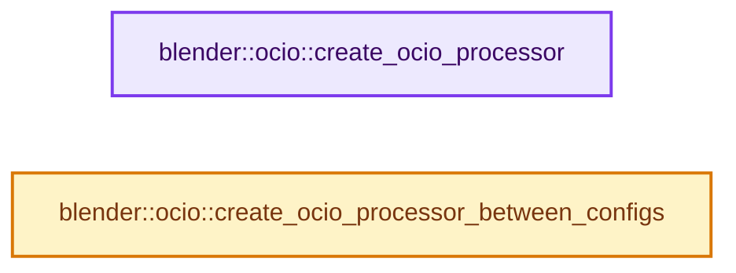

# 实现依赖专题：source/blender/imbuf/opencolorio/intern/libocio/libocio_processor.cc

[方向导航](README.md) · [符号索引](../%E7%AC%A6%E5%8F%B7%E4%BE%9D%E8%B5%96%E4%B8%8E%E5%AE%9E%E7%8E%B0%E7%B4%A2%E5%BC%95.md)

本专题从正文实际调用进入，集中保存共享实现。函数有稳定锚点，可从调用处直接跳到对应完整函数；递归与互相调用通过回链组织。

## 本文件的实现关系




## 完整成员与函数实现

<a id="f-ec7c1135d4076657"></a>

### `blender::ocio::create_ocio_processor`

实现位置：[source/blender/imbuf/opencolorio/intern/libocio/libocio_processor.cc](../../../../../source/blender/imbuf/opencolorio/intern/libocio/libocio_processor.cc) · L11—L25。

接口参数：

- `const OCIO_NAMESPACE::ConstConfigRcPtr &ocio_config`
- `const StringRefNull from_colorspace`
- `const StringRefNull to_colorspace`

**教学注释版**

<!-- annotated:c158a79688ba6f -->

```cpp
OCIO_NAMESPACE::ConstProcessorRcPtr create_ocio_processor(
    const OCIO_NAMESPACE::ConstConfigRcPtr &ocio_config,
    const StringRefNull from_colorspace,
    const StringRefNull to_colorspace)
{
  try {
    OCIO_NAMESPACE::ConstProcessorRcPtr processor = ocio_config->getProcessor(
        from_colorspace.c_str(), to_colorspace.c_str());
    return processor;
  }
  catch (OCIO_NAMESPACE::Exception &exception) {
    report_exception(exception);
  }
  return nullptr;
}
```

<details>
<summary>核对原始源码：source/blender/imbuf/opencolorio/intern/libocio/libocio_processor.cc · L11—L25</summary>

<!-- original:c158a79688ba6f:source/blender/imbuf/opencolorio/intern/libocio/libocio_processor.cc:11:25 -->

```cpp
OCIO_NAMESPACE::ConstProcessorRcPtr create_ocio_processor(
    const OCIO_NAMESPACE::ConstConfigRcPtr &ocio_config,
    const StringRefNull from_colorspace,
    const StringRefNull to_colorspace)
{
  try {
    OCIO_NAMESPACE::ConstProcessorRcPtr processor = ocio_config->getProcessor(
        from_colorspace.c_str(), to_colorspace.c_str());
    return processor;
  }
  catch (OCIO_NAMESPACE::Exception &exception) {
    report_exception(exception);
  }
  return nullptr;
}
```

</details>

**结果出口**

- `return processor;`
- `return nullptr;`

**继续追踪实现**

- `ocio_config->getProcessor` → [调用协议](../%E6%A8%A1%E6%9D%BF%E5%AE%8F%E4%B8%8E%E5%8A%A8%E6%80%81%E5%88%86%E6%B4%BE%E5%8D%8F%E8%AE%AE.md)：由接收对象具体类型或运行时策略提供实现。调用位置L17。
- `from_colorspace.c_str` → [blender::StringRefNull::c_str · L544](../01-%E5%9F%BA%E7%A1%80%E5%AE%B9%E5%99%A8%E4%B8%8E%E7%8E%B0%E4%BB%A3CPP/15-StringRef%E5%AD%97%E7%AC%A6%E4%B8%B2%E8%A7%86%E5%9B%BE.md#f-4a8bbfe1e6d00757)。
- `to_colorspace.c_str` → [blender::StringRefNull::c_str · L544](../01-%E5%9F%BA%E7%A1%80%E5%AE%B9%E5%99%A8%E4%B8%8E%E7%8E%B0%E4%BB%A3CPP/15-StringRef%E5%AD%97%E7%AC%A6%E4%B8%B2%E8%A7%86%E5%9B%BE.md#f-4a8bbfe1e6d00757)。
- `report_exception` → [blender::ocio::report_exception · L15](%E4%BE%9D%E8%B5%96-error_handling-ec0235.md#f-ee55c3aa111fb1c4)。

<a id="f-bbe2fb588d721094"></a>

### `blender::ocio::create_ocio_processor_between_configs`

实现位置：[source/blender/imbuf/opencolorio/intern/libocio/libocio_processor.cc](../../../../../source/blender/imbuf/opencolorio/intern/libocio/libocio_processor.cc) · L43—L57。

接口参数：

- `const OCIO_NAMESPACE::ConstConfigRcPtr &from_config`
- `const StringRefNull from_colorspace`
- `const OCIO_NAMESPACE::ConstConfigRcPtr &to_config`
- `const StringRefNull to_colorspace`

**教学注释版**

<!-- annotated:4f76e71000c831 -->

```cpp
OCIO_NAMESPACE::ConstProcessorRcPtr create_ocio_processor_between_configs(
    const OCIO_NAMESPACE::ConstConfigRcPtr &from_config,
    const StringRefNull from_colorspace,
    const OCIO_NAMESPACE::ConstConfigRcPtr &to_config,
    const StringRefNull to_colorspace)
{
  try {
    return OCIO_NAMESPACE::Config::GetProcessorFromConfigs(
        from_config, from_colorspace.c_str(), to_config, to_colorspace.c_str());
  }
  catch (OCIO_NAMESPACE::Exception &exception) {
    (void)exception;
  }
  return nullptr;
}
```

<details>
<summary>核对原始源码：source/blender/imbuf/opencolorio/intern/libocio/libocio_processor.cc · L43—L57</summary>

<!-- original:4f76e71000c831:source/blender/imbuf/opencolorio/intern/libocio/libocio_processor.cc:43:57 -->

```cpp
OCIO_NAMESPACE::ConstProcessorRcPtr create_ocio_processor_between_configs(
    const OCIO_NAMESPACE::ConstConfigRcPtr &from_config,
    const StringRefNull from_colorspace,
    const OCIO_NAMESPACE::ConstConfigRcPtr &to_config,
    const StringRefNull to_colorspace)
{
  try {
    return OCIO_NAMESPACE::Config::GetProcessorFromConfigs(
        from_config, from_colorspace.c_str(), to_config, to_colorspace.c_str());
  }
  catch (OCIO_NAMESPACE::Exception &exception) {
    (void)exception;
  }
  return nullptr;
}
```

</details>

**结果出口**

- `return OCIO_NAMESPACE::Config::GetProcessorFromConfigs(`
- `return nullptr;`

**继续追踪实现**

- `OCIO_NAMESPACE::Config::GetProcessorFromConfigs` → [调用协议](../%E6%A8%A1%E6%9D%BF%E5%AE%8F%E4%B8%8E%E5%8A%A8%E6%80%81%E5%88%86%E6%B4%BE%E5%8D%8F%E8%AE%AE.md)：函数指针、局部可调用对象或未展开的宏；必须结合调用者环境。调用位置L50。
- `from_colorspace.c_str` → [blender::StringRefNull::c_str · L544](../01-%E5%9F%BA%E7%A1%80%E5%AE%B9%E5%99%A8%E4%B8%8E%E7%8E%B0%E4%BB%A3CPP/15-StringRef%E5%AD%97%E7%AC%A6%E4%B8%B2%E8%A7%86%E5%9B%BE.md#f-4a8bbfe1e6d00757)。
- `to_colorspace.c_str` → [blender::StringRefNull::c_str · L544](../01-%E5%9F%BA%E7%A1%80%E5%AE%B9%E5%99%A8%E4%B8%8E%E7%8E%B0%E4%BB%A3CPP/15-StringRef%E5%AD%97%E7%AC%A6%E4%B8%B2%E8%A7%86%E5%9B%BE.md#f-4a8bbfe1e6d00757)。
