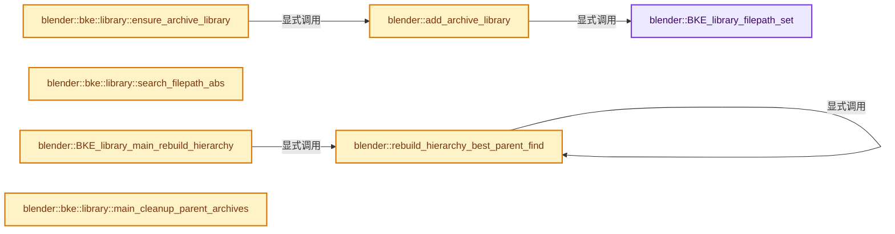
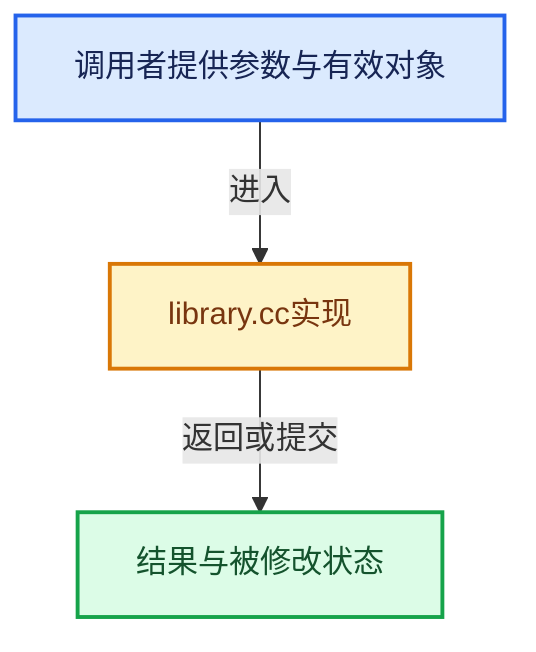

# 实现依赖专题：source/blender/blenkernel/intern/library.cc

[方向导航](README.md) · [符号索引](../%E7%AC%A6%E5%8F%B7%E4%BE%9D%E8%B5%96%E4%B8%8E%E5%AE%9E%E7%8E%B0%E7%B4%A2%E5%BC%95.md)

本专题从正文实际调用进入，集中保存共享实现。函数有稳定锚点，可从调用处直接跳到对应完整函数；递归与互相调用通过回链组织。

## 本文件的实现关系






## 完整成员与函数实现

<a id="f-31e6eba9cf41ea03"></a>

### `blender::BKE_library_filepath_set`

实现位置：[source/blender/blenkernel/intern/library.cc](../../../../../source/blender/blenkernel/intern/library.cc) · L250—L273。

接口参数：

- `Main *bmain`
- `Library *lib`
- `const char *filepath`

**教学注释版**

<!-- annotated:9f531b18415397 -->

```cpp
void BKE_library_filepath_set(Main *bmain, Library *lib, const char *filepath)
{
  /* in some cases this is used to update the absolute path from the
   * relative */
  if (lib->filepath != filepath) {
    STRNCPY(lib->filepath, filepath);
  }

  STRNCPY(lib->runtime->filepath_abs, filepath);

  /* Not essential but set `filepath_abs` is an absolute copy of value which
   * is more useful if its kept in sync. */
  if (BLI_path_is_rel(lib->runtime->filepath_abs)) {
    /* NOTE(@ideasman42): the file may be unsaved, in this case, setting the
     * `filepath_abs` on an indirectly linked path is not allowed from the
     * outliner, and its not really supported but allow from here for now
     * since making local could cause this to be directly linked.
     */
    /* Never make paths relative to parent lib - reading code (blenloader) always set *all*
     * `lib->filepath` relative to current main, not to their parent for indirectly linked ones. */
    const char *blendfile_path = BKE_main_blendfile_path(bmain);
    BLI_path_abs(lib->runtime->filepath_abs, blendfile_path);
  }
}
```

<details>
<summary>核对原始源码：source/blender/blenkernel/intern/library.cc · L250—L273</summary>

<!-- original:9f531b18415397:source/blender/blenkernel/intern/library.cc:250:273 -->

```cpp
void BKE_library_filepath_set(Main *bmain, Library *lib, const char *filepath)
{
  /* in some cases this is used to update the absolute path from the
   * relative */
  if (lib->filepath != filepath) {
    STRNCPY(lib->filepath, filepath);
  }

  STRNCPY(lib->runtime->filepath_abs, filepath);

  /* Not essential but set `filepath_abs` is an absolute copy of value which
   * is more useful if its kept in sync. */
  if (BLI_path_is_rel(lib->runtime->filepath_abs)) {
    /* NOTE(@ideasman42): the file may be unsaved, in this case, setting the
     * `filepath_abs` on an indirectly linked path is not allowed from the
     * outliner, and its not really supported but allow from here for now
     * since making local could cause this to be directly linked.
     */
    /* Never make paths relative to parent lib - reading code (blenloader) always set *all*
     * `lib->filepath` relative to current main, not to their parent for indirectly linked ones. */
    const char *blendfile_path = BKE_main_blendfile_path(bmain);
    BLI_path_abs(lib->runtime->filepath_abs, blendfile_path);
  }
}
```

</details>

**继续追踪实现**

- `STRNCPY` → [blender::STRNCPY · L690](../01-%E5%9F%BA%E7%A1%80%E5%AE%B9%E5%99%A8%E4%B8%8E%E7%8E%B0%E4%BB%A3CPP/%E4%BE%9D%E8%B5%96-BLI_string-b43058.md#f-6b2d861724026be6)。
- `BLI_path_is_rel` → [BLI_path_is_rel · L536](../01-%E5%9F%BA%E7%A1%80%E5%AE%B9%E5%99%A8%E4%B8%8E%E7%8E%B0%E4%BB%A3CPP/%E4%BE%9D%E8%B5%96-path_utils-b4d26a.md#f-d938443d331ba72c)。
- `BKE_main_blendfile_path` → [blender::BKE_main_blendfile_path · L1058](%E4%BE%9D%E8%B5%96-main-ffa8b3.md#f-5ff28b998fa003d7)。
- `BLI_path_abs` → [BLI_path_abs · L1164](../01-%E5%9F%BA%E7%A1%80%E5%AE%B9%E5%99%A8%E4%B8%8E%E7%8E%B0%E4%BB%A3CPP/%E4%BE%9D%E8%B5%96-path_utils-b4d26a.md#f-002380948c1caeb6)。

<a id="f-e2e7d571e44d9054"></a>

### `blender::rebuild_hierarchy_best_parent_find`

实现位置：[source/blender/blenkernel/intern/library.cc](../../../../../source/blender/blenkernel/intern/library.cc) · L275—L374。

接口参数：

- `Main *bmain`
- `Set<Library *> &directly_used_libs`
- `Set<Library *> &libs_in_hierarchy`
- `Library *lib`

**教学注释版**

<!-- annotated:59cfc8e74f099f -->

```cpp
static void rebuild_hierarchy_best_parent_find(Main *bmain,
                                               Set<Library *> &directly_used_libs,
                                               Set<Library *> &libs_in_hierarchy,
                                               Library *lib)
{
  // [讲解] directly_used_libs.contains：查询活项数量或键是否存在。
  BLI_assert(!directly_used_libs.contains(lib));

  /* Avoid infinite recursion in dependency loops between libraries (note: might be 'fake
   * positives' caused only by the library `parent` pointers themselves). */
  if (libs_in_hierarchy.contains(lib)) {
    return;
  }
  // [讲解] libs_in_hierarchy.add：按哈希与相等关系加入键或键值。
  libs_in_hierarchy.add(lib);

  Library *best_parent_lib = nullptr;
  bool do_break = false;
  ListBaseT<ID> *lb;
  ID *id_iter;
  FOREACH_MAIN_LISTBASE_BEGIN (bmain, lb) {
    FOREACH_MAIN_LISTBASE_ID_BEGIN (lb, id_iter) {
      if (!ID_IS_LINKED(id_iter) || id_iter->lib != lib) {
        continue;
      }
      if (ID_IS_PACKED(id_iter)) {
        /* Packed data and their archive libraries do not participate to linked data hierarchy. */
        BLI_assert(id_iter->lib->flag & LIBRARY_FLAG_IS_ARCHIVE);
        continue;
      }
      MainIDRelationsEntry *entry = bmain->relations->relations_from_pointers->lookup(id_iter);
      for (MainIDRelationsEntryItem *item = entry->from_ids; item; item = item->next) {
        ID *from_id = item->id_pointer.from;
        if (!ID_IS_LINKED(from_id)) {
          BLI_assert_unreachable();
          continue;
        }
        if (ID_IS_PACKED(from_id)) {
          continue;
        }
        Library *from_id_lib = from_id->lib;
        BLI_assert((from_id_lib->flag & LIBRARY_FLAG_IS_ARCHIVE) == 0);
        if (from_id_lib == lib) {
          continue;
        }
        if (directly_used_libs.contains(from_id_lib)) {
          /* Found the first best possible candidate, no need to search further. */
          BLI_assert(best_parent_lib == nullptr || best_parent_lib->runtime->temp_index > 0);
          best_parent_lib = from_id_lib;
          do_break = true;
          break;
        }
        if (!from_id_lib->runtime->parent) {
          rebuild_hierarchy_best_parent_find(
              bmain, directly_used_libs, libs_in_hierarchy, from_id_lib);
        }
        if (!best_parent_lib ||
            best_parent_lib->runtime->temp_index > from_id_lib->runtime->temp_index)
        {
          best_parent_lib = from_id_lib;
          if (best_parent_lib->runtime->temp_index == 0) {
            /* Found the first best possible candidate, no need to search further. */
            if (!directly_used_libs.contains(best_parent_lib)) {
              /* This can happen when deleting a library: some of its dependencies may not have any
               * local usages anymore, creating an archipelago of unused indirectly linked
               * libraries and their linked IDs. */
              CLOG_INFO(&LOG,
                        "Library '%s' seems to be part of an archipelago of unused libraries now.",
                        best_parent_lib->runtime->filepath_abs);
              best_parent_lib->runtime->temp_index = 1;
            }
            do_break = true;
            break;
          }
        }
      }
      if (do_break) {
        break;
      }
    }
    FOREACH_MAIN_LISTBASE_ID_END;
    if (do_break) {
      break;
    }
  }
  FOREACH_MAIN_LISTBASE_END;

  /* NOTE: It may happen that no parent library is found, e.g. if after deleting a directly used
   * library, its indirect dependency is still around, but none of its linked IDs are used by local
   * data. */
  if (best_parent_lib) {
    lib->runtime->parent = best_parent_lib;
    lib->runtime->temp_index = best_parent_lib->runtime->temp_index + 1;
  }
  else {
    lib->runtime->parent = nullptr;
    lib->runtime->temp_index = 0;
    directly_used_libs.add(lib);
  }

  // [讲解] libs_in_hierarchy.remove：移除占用项并维护探测状态。
  libs_in_hierarchy.remove(lib);
}
```

<details>
<summary>核对原始源码：source/blender/blenkernel/intern/library.cc · L275—L374</summary>

<!-- original:59cfc8e74f099f:source/blender/blenkernel/intern/library.cc:275:374 -->

```cpp
static void rebuild_hierarchy_best_parent_find(Main *bmain,
                                               Set<Library *> &directly_used_libs,
                                               Set<Library *> &libs_in_hierarchy,
                                               Library *lib)
{
  BLI_assert(!directly_used_libs.contains(lib));

  /* Avoid infinite recursion in dependency loops between libraries (note: might be 'fake
   * positives' caused only by the library `parent` pointers themselves). */
  if (libs_in_hierarchy.contains(lib)) {
    return;
  }
  libs_in_hierarchy.add(lib);

  Library *best_parent_lib = nullptr;
  bool do_break = false;
  ListBaseT<ID> *lb;
  ID *id_iter;
  FOREACH_MAIN_LISTBASE_BEGIN (bmain, lb) {
    FOREACH_MAIN_LISTBASE_ID_BEGIN (lb, id_iter) {
      if (!ID_IS_LINKED(id_iter) || id_iter->lib != lib) {
        continue;
      }
      if (ID_IS_PACKED(id_iter)) {
        /* Packed data and their archive libraries do not participate to linked data hierarchy. */
        BLI_assert(id_iter->lib->flag & LIBRARY_FLAG_IS_ARCHIVE);
        continue;
      }
      MainIDRelationsEntry *entry = bmain->relations->relations_from_pointers->lookup(id_iter);
      for (MainIDRelationsEntryItem *item = entry->from_ids; item; item = item->next) {
        ID *from_id = item->id_pointer.from;
        if (!ID_IS_LINKED(from_id)) {
          BLI_assert_unreachable();
          continue;
        }
        if (ID_IS_PACKED(from_id)) {
          continue;
        }
        Library *from_id_lib = from_id->lib;
        BLI_assert((from_id_lib->flag & LIBRARY_FLAG_IS_ARCHIVE) == 0);
        if (from_id_lib == lib) {
          continue;
        }
        if (directly_used_libs.contains(from_id_lib)) {
          /* Found the first best possible candidate, no need to search further. */
          BLI_assert(best_parent_lib == nullptr || best_parent_lib->runtime->temp_index > 0);
          best_parent_lib = from_id_lib;
          do_break = true;
          break;
        }
        if (!from_id_lib->runtime->parent) {
          rebuild_hierarchy_best_parent_find(
              bmain, directly_used_libs, libs_in_hierarchy, from_id_lib);
        }
        if (!best_parent_lib ||
            best_parent_lib->runtime->temp_index > from_id_lib->runtime->temp_index)
        {
          best_parent_lib = from_id_lib;
          if (best_parent_lib->runtime->temp_index == 0) {
            /* Found the first best possible candidate, no need to search further. */
            if (!directly_used_libs.contains(best_parent_lib)) {
              /* This can happen when deleting a library: some of its dependencies may not have any
               * local usages anymore, creating an archipelago of unused indirectly linked
               * libraries and their linked IDs. */
              CLOG_INFO(&LOG,
                        "Library '%s' seems to be part of an archipelago of unused libraries now.",
                        best_parent_lib->runtime->filepath_abs);
              best_parent_lib->runtime->temp_index = 1;
            }
            do_break = true;
            break;
          }
        }
      }
      if (do_break) {
        break;
      }
    }
    FOREACH_MAIN_LISTBASE_ID_END;
    if (do_break) {
      break;
    }
  }
  FOREACH_MAIN_LISTBASE_END;

  /* NOTE: It may happen that no parent library is found, e.g. if after deleting a directly used
   * library, its indirect dependency is still around, but none of its linked IDs are used by local
   * data. */
  if (best_parent_lib) {
    lib->runtime->parent = best_parent_lib;
    lib->runtime->temp_index = best_parent_lib->runtime->temp_index + 1;
  }
  else {
    lib->runtime->parent = nullptr;
    lib->runtime->temp_index = 0;
    directly_used_libs.add(lib);
  }

  libs_in_hierarchy.remove(lib);
}
```

</details>

**沿实际写入检查状态**

- `best_parent_lib = from_id_lib;`
- `do_break = true;`
- `best_parent_lib->runtime->temp_index = 1;`
- `lib->runtime->parent = best_parent_lib;`
- `lib->runtime->temp_index = best_parent_lib->runtime->temp_index + 1;`
- `lib->runtime->parent = nullptr;`
- `lib->runtime->temp_index = 0;`

**继续追踪实现**

- `BLI_assert` → [BLI_assert · L48](../01-%E5%9F%BA%E7%A1%80%E5%AE%B9%E5%99%A8%E4%B8%8E%E7%8E%B0%E4%BB%A3CPP/%E4%BE%9D%E8%B5%96-BLI_assert-cc98e8.md#m-57a88495704d)；[BLI_assert · L63](../01-%E5%9F%BA%E7%A1%80%E5%AE%B9%E5%99%A8%E4%B8%8E%E7%8E%B0%E4%BB%A3CPP/%E4%BE%9D%E8%B5%96-BLI_assert-cc98e8.md#m-d07050020cb5)。宏定义由构建条件选择。
- `directly_used_libs.contains` → [blender::Set::contains · L310](../02-%E5%93%88%E5%B8%8C%E8%A1%A8%E4%B8%8E%E5%85%B3%E8%81%94%E6%95%B0%E6%8D%AE%E7%BB%93%E6%9E%84/08-Set%E4%B8%8E%E9%9B%86%E5%90%88%E8%AF%AD%E4%B9%89.md#f-af7099799494350e)。
- `libs_in_hierarchy.contains` → [blender::Set::contains · L310](../02-%E5%93%88%E5%B8%8C%E8%A1%A8%E4%B8%8E%E5%85%B3%E8%81%94%E6%95%B0%E6%8D%AE%E7%BB%93%E6%9E%84/08-Set%E4%B8%8E%E9%9B%86%E5%90%88%E8%AF%AD%E4%B9%89.md#f-af7099799494350e)。
- `libs_in_hierarchy.add` → [blender::Set::add · L248](../02-%E5%93%88%E5%B8%8C%E8%A1%A8%E4%B8%8E%E5%85%B3%E8%81%94%E6%95%B0%E6%8D%AE%E7%BB%93%E6%9E%84/08-Set%E4%B8%8E%E9%9B%86%E5%90%88%E8%AF%AD%E4%B9%89.md#f-c7498809c2327fba)；[blender::Set::add · L252](../02-%E5%93%88%E5%B8%8C%E8%A1%A8%E4%B8%8E%E5%85%B3%E8%81%94%E6%95%B0%E6%8D%AE%E7%BB%93%E6%9E%84/08-Set%E4%B8%8E%E9%9B%86%E5%90%88%E8%AF%AD%E4%B9%89.md#f-e3ac8d1c52c03c2b)。同名重载需按实参类型选择。
- `ID_IS_LINKED` → [ID_IS_LINKED · L697](%E4%BE%9D%E8%B5%96-DNA_ID-3eb091.md#m-7e1e1e9b20e6)。宏定义由构建条件选择。
- `ID_IS_PACKED` → [ID_IS_PACKED · L703](%E4%BE%9D%E8%B5%96-DNA_ID-3eb091.md#m-48f895e65dc3)。宏定义由构建条件选择。
- `bmain->relations->relations_from_pointers->lookup` → [调用协议](../%E6%A8%A1%E6%9D%BF%E5%AE%8F%E4%B8%8E%E5%8A%A8%E6%80%81%E5%88%86%E6%B4%BE%E5%8D%8F%E8%AE%AE.md)：接收对象类型依赖auto、返回值或模板实例；不按同名猜测目标。调用位置L303。
- `BLI_assert_unreachable` → [BLI_assert_unreachable · L77](../01-%E5%9F%BA%E7%A1%80%E5%AE%B9%E5%99%A8%E4%B8%8E%E7%8E%B0%E4%BB%A3CPP/%E4%BE%9D%E8%B5%96-BLI_assert-cc98e8.md#m-7a2d91a67d8e)。宏定义由构建条件选择。
- `rebuild_hierarchy_best_parent_find` → [blender::rebuild_hierarchy_best_parent_find · L275](%E4%BE%9D%E8%B5%96-library-b754fe.md#f-e2e7d571e44d9054)。
- `CLOG_INFO` → [CLOG_INFO · L190](%E4%BE%9D%E8%B5%96-CLG_log-e9051b.md#m-f8b5efdfcc0f)。宏定义由构建条件选择。
- `directly_used_libs.add` → [blender::Set::add · L248](../02-%E5%93%88%E5%B8%8C%E8%A1%A8%E4%B8%8E%E5%85%B3%E8%81%94%E6%95%B0%E6%8D%AE%E7%BB%93%E6%9E%84/08-Set%E4%B8%8E%E9%9B%86%E5%90%88%E8%AF%AD%E4%B9%89.md#f-c7498809c2327fba)；[blender::Set::add · L252](../02-%E5%93%88%E5%B8%8C%E8%A1%A8%E4%B8%8E%E5%85%B3%E8%81%94%E6%95%B0%E6%8D%AE%E7%BB%93%E6%9E%84/08-Set%E4%B8%8E%E9%9B%86%E5%90%88%E8%AF%AD%E4%B9%89.md#f-e3ac8d1c52c03c2b)。同名重载需按实参类型选择。
- `libs_in_hierarchy.remove` → [blender::Set::remove · L404](../02-%E5%93%88%E5%B8%8C%E8%A1%A8%E4%B8%8E%E5%85%B3%E8%81%94%E6%95%B0%E6%8D%AE%E7%BB%93%E6%9E%84/08-Set%E4%B8%8E%E9%9B%86%E5%90%88%E8%AF%AD%E4%B9%89.md#f-15d39dbe8a968718)；[blender::Set::remove · L519](../02-%E5%93%88%E5%B8%8C%E8%A1%A8%E4%B8%8E%E5%85%B3%E8%81%94%E6%95%B0%E6%8D%AE%E7%BB%93%E6%9E%84/08-Set%E4%B8%8E%E9%9B%86%E5%90%88%E8%AF%AD%E4%B9%89.md#f-c9547a19dae5001b)。同名重载需按实参类型选择。

<a id="f-bc6cae93ad2075a6"></a>

### `blender::BKE_library_main_rebuild_hierarchy`

实现位置：[source/blender/blenkernel/intern/library.cc](../../../../../source/blender/blenkernel/intern/library.cc) · L376—L491。

接口参数：

- `Main *bmain`

**教学注释版**

<!-- annotated:8c1998534e2821 -->

```cpp
void BKE_library_main_rebuild_hierarchy(Main *bmain)
{
  BKE_main_relations_create(bmain, 0);

  /* Reset all values, they may have been set to irrelevant values by other processes (like the
   * liboverride handling e.g., see #lib_override_libraries_index_define). */
  for (Library &lib_iter : bmain->libraries) {
    /* By definition, archive libraries are always contained/owned by a regular library, so they
     * are never 'root' libraries in the hierarchy. */
    if (lib_iter.flag & LIBRARY_FLAG_IS_ARCHIVE) {
      lib_iter.runtime->parent = lib_iter.archive_parent_library;
      lib_iter.runtime->temp_index = 1;
    }
    else {
      lib_iter.runtime->temp_index = 0;
    }
  }

  /* Find all libraries with directly linked IDs (i.e. IDs used by local data). */
  Set<Library *> directly_used_libs;
  ID *id_iter;
  FOREACH_MAIN_ID_BEGIN (bmain, id_iter) {
    if (!ID_IS_LINKED(id_iter)) {
      continue;
    }
    if (ID_IS_PACKED(id_iter)) {
      /* Packed data and their archive libraries do not participate to linked data hierarchy. */
      continue;
    }
    // [讲解] directly_used_libs.contains：查询活项数量或键是否存在。
    if (directly_used_libs.contains(id_iter->lib)) {
      continue;
    }
    MainIDRelationsEntry *entry = bmain->relations->relations_from_pointers->lookup(id_iter);
    for (MainIDRelationsEntryItem *item = entry->from_ids; item; item = item->next) {
      if (!ID_IS_LINKED(item->id_pointer.from)) {
        // [讲解] directly_used_libs.add：按哈希与相等关系加入键或键值。
        directly_used_libs.add(id_iter->lib);
        id_iter->lib->runtime->parent = nullptr;
        break;
      }
    }
  }
  FOREACH_MAIN_ID_END;

  for (Library &lib_iter : bmain->libraries) {
    /* A directly used library. */
    if (directly_used_libs.contains(&lib_iter)) {
      BLI_assert(lib_iter.runtime->temp_index == 0);
      continue;
    }

    /* Assume existing parent is still valid, since it was not cleared in previous loop above.
     * Just compute 'hierarchy value' in temp index, if needed. */
    if (lib_iter.runtime->parent) {
      if (lib_iter.runtime->temp_index > 0) {
        continue;
      }
      if (lib_iter.flag & LIBRARY_FLAG_IS_ARCHIVE) {
        /* Archive library parent is always their owner regular library, has already been
         * reset/ensured at the start of this function, so this should never be reached. */
        BLI_assert_unreachable();
        continue;
      }
      VectorSet<Library *> parent_libraries;
      for (Library *parent_lib_iter = &lib_iter;
           parent_lib_iter && parent_lib_iter->runtime->temp_index == 0;
           parent_lib_iter = parent_lib_iter->runtime->parent)
      {
        if (parent_libraries.contains(parent_lib_iter)) {
          /* Dependency loop between libraries (note: might be 'fake positives' caused only by the
           * library `parent` pointers themselves). */
          break;
        }
        parent_libraries.add(parent_lib_iter);
      }
      Library *most_remote_ancestor_library = parent_libraries.as_span().last();
      int parent_temp_index =
          (most_remote_ancestor_library->runtime->parent ?
               most_remote_ancestor_library->runtime->parent->runtime->temp_index :
               0) +
          // [讲解] parent_libraries.size：查询活项数量或键是否存在。
          int(parent_libraries.size()) - 1;
      for (Library *parent_lib_iter : parent_libraries) {
        parent_lib_iter->runtime->temp_index = parent_temp_index--;
      }
      continue;
    }

    /* Otherwise, it's an indirectly used library with no known parent, another loop is needed to
     * ensure all known hierarchy has valid indices when trying to find the best valid parent
     * library. */
  }

  /* For all libraries known to be indirect, but without a known parent, find a best valid parent
   * (i.e. a 'most directly used' library). */
  for (Library &lib_iter : bmain->libraries) {
    /* A directly used library. */
    if (directly_used_libs.contains(&lib_iter)) {
      BLI_assert(lib_iter.runtime->temp_index == 0);
      continue;
    }

    if (lib_iter.runtime->parent) {
      BLI_assert(lib_iter.runtime->temp_index > 0);
    }
    else {
      BLI_assert_msg((lib_iter.flag & LIBRARY_FLAG_IS_ARCHIVE) == 0,
                     "Archived libraries are always direct parent of their owner regular library, "
                     "this should have already been ensured at the start of this function.");
      BLI_assert(lib_iter.runtime->temp_index == 0);
      Set<Library *> libs_in_hierarchy;
      rebuild_hierarchy_best_parent_find(bmain, directly_used_libs, libs_in_hierarchy, &lib_iter);
      // [讲解] libs_in_hierarchy.is_empty：查询活项数量或键是否存在。
      BLI_assert(libs_in_hierarchy.is_empty());
    }
  }

  BKE_main_relations_free(bmain);
}
```

<details>
<summary>核对原始源码：source/blender/blenkernel/intern/library.cc · L376—L491</summary>

<!-- original:8c1998534e2821:source/blender/blenkernel/intern/library.cc:376:491 -->

```cpp
void BKE_library_main_rebuild_hierarchy(Main *bmain)
{
  BKE_main_relations_create(bmain, 0);

  /* Reset all values, they may have been set to irrelevant values by other processes (like the
   * liboverride handling e.g., see #lib_override_libraries_index_define). */
  for (Library &lib_iter : bmain->libraries) {
    /* By definition, archive libraries are always contained/owned by a regular library, so they
     * are never 'root' libraries in the hierarchy. */
    if (lib_iter.flag & LIBRARY_FLAG_IS_ARCHIVE) {
      lib_iter.runtime->parent = lib_iter.archive_parent_library;
      lib_iter.runtime->temp_index = 1;
    }
    else {
      lib_iter.runtime->temp_index = 0;
    }
  }

  /* Find all libraries with directly linked IDs (i.e. IDs used by local data). */
  Set<Library *> directly_used_libs;
  ID *id_iter;
  FOREACH_MAIN_ID_BEGIN (bmain, id_iter) {
    if (!ID_IS_LINKED(id_iter)) {
      continue;
    }
    if (ID_IS_PACKED(id_iter)) {
      /* Packed data and their archive libraries do not participate to linked data hierarchy. */
      continue;
    }
    if (directly_used_libs.contains(id_iter->lib)) {
      continue;
    }
    MainIDRelationsEntry *entry = bmain->relations->relations_from_pointers->lookup(id_iter);
    for (MainIDRelationsEntryItem *item = entry->from_ids; item; item = item->next) {
      if (!ID_IS_LINKED(item->id_pointer.from)) {
        directly_used_libs.add(id_iter->lib);
        id_iter->lib->runtime->parent = nullptr;
        break;
      }
    }
  }
  FOREACH_MAIN_ID_END;

  for (Library &lib_iter : bmain->libraries) {
    /* A directly used library. */
    if (directly_used_libs.contains(&lib_iter)) {
      BLI_assert(lib_iter.runtime->temp_index == 0);
      continue;
    }

    /* Assume existing parent is still valid, since it was not cleared in previous loop above.
     * Just compute 'hierarchy value' in temp index, if needed. */
    if (lib_iter.runtime->parent) {
      if (lib_iter.runtime->temp_index > 0) {
        continue;
      }
      if (lib_iter.flag & LIBRARY_FLAG_IS_ARCHIVE) {
        /* Archive library parent is always their owner regular library, has already been
         * reset/ensured at the start of this function, so this should never be reached. */
        BLI_assert_unreachable();
        continue;
      }
      VectorSet<Library *> parent_libraries;
      for (Library *parent_lib_iter = &lib_iter;
           parent_lib_iter && parent_lib_iter->runtime->temp_index == 0;
           parent_lib_iter = parent_lib_iter->runtime->parent)
      {
        if (parent_libraries.contains(parent_lib_iter)) {
          /* Dependency loop between libraries (note: might be 'fake positives' caused only by the
           * library `parent` pointers themselves). */
          break;
        }
        parent_libraries.add(parent_lib_iter);
      }
      Library *most_remote_ancestor_library = parent_libraries.as_span().last();
      int parent_temp_index =
          (most_remote_ancestor_library->runtime->parent ?
               most_remote_ancestor_library->runtime->parent->runtime->temp_index :
               0) +
          int(parent_libraries.size()) - 1;
      for (Library *parent_lib_iter : parent_libraries) {
        parent_lib_iter->runtime->temp_index = parent_temp_index--;
      }
      continue;
    }

    /* Otherwise, it's an indirectly used library with no known parent, another loop is needed to
     * ensure all known hierarchy has valid indices when trying to find the best valid parent
     * library. */
  }

  /* For all libraries known to be indirect, but without a known parent, find a best valid parent
   * (i.e. a 'most directly used' library). */
  for (Library &lib_iter : bmain->libraries) {
    /* A directly used library. */
    if (directly_used_libs.contains(&lib_iter)) {
      BLI_assert(lib_iter.runtime->temp_index == 0);
      continue;
    }

    if (lib_iter.runtime->parent) {
      BLI_assert(lib_iter.runtime->temp_index > 0);
    }
    else {
      BLI_assert_msg((lib_iter.flag & LIBRARY_FLAG_IS_ARCHIVE) == 0,
                     "Archived libraries are always direct parent of their owner regular library, "
                     "this should have already been ensured at the start of this function.");
      BLI_assert(lib_iter.runtime->temp_index == 0);
      Set<Library *> libs_in_hierarchy;
      rebuild_hierarchy_best_parent_find(bmain, directly_used_libs, libs_in_hierarchy, &lib_iter);
      BLI_assert(libs_in_hierarchy.is_empty());
    }
  }

  BKE_main_relations_free(bmain);
}
```

</details>

**沿实际写入检查状态**

- `lib_iter.runtime->parent = lib_iter.archive_parent_library;`
- `lib_iter.runtime->temp_index = 1;`
- `lib_iter.runtime->temp_index = 0;`
- `id_iter->lib->runtime->parent = nullptr;`
- `parent_lib_iter = parent_lib_iter->runtime->parent)`
- `parent_lib_iter->runtime->temp_index = parent_temp_index--;`

**继续追踪实现**

- `BKE_main_relations_create` → [blender::BKE_main_relations_create · L723](%E4%BE%9D%E8%B5%96-main-ffa8b3.md#f-a1ce0b885c713310)。
- `ID_IS_LINKED` → [ID_IS_LINKED · L697](%E4%BE%9D%E8%B5%96-DNA_ID-3eb091.md#m-7e1e1e9b20e6)。宏定义由构建条件选择。
- `ID_IS_PACKED` → [ID_IS_PACKED · L703](%E4%BE%9D%E8%B5%96-DNA_ID-3eb091.md#m-48f895e65dc3)。宏定义由构建条件选择。
- `directly_used_libs.contains` → [blender::Set::contains · L310](../02-%E5%93%88%E5%B8%8C%E8%A1%A8%E4%B8%8E%E5%85%B3%E8%81%94%E6%95%B0%E6%8D%AE%E7%BB%93%E6%9E%84/08-Set%E4%B8%8E%E9%9B%86%E5%90%88%E8%AF%AD%E4%B9%89.md#f-af7099799494350e)。
- `bmain->relations->relations_from_pointers->lookup` → [调用协议](../%E6%A8%A1%E6%9D%BF%E5%AE%8F%E4%B8%8E%E5%8A%A8%E6%80%81%E5%88%86%E6%B4%BE%E5%8D%8F%E8%AE%AE.md)：接收对象类型依赖auto、返回值或模板实例；不按同名猜测目标。调用位置L408。
- `directly_used_libs.add` → [blender::Set::add · L248](../02-%E5%93%88%E5%B8%8C%E8%A1%A8%E4%B8%8E%E5%85%B3%E8%81%94%E6%95%B0%E6%8D%AE%E7%BB%93%E6%9E%84/08-Set%E4%B8%8E%E9%9B%86%E5%90%88%E8%AF%AD%E4%B9%89.md#f-c7498809c2327fba)；[blender::Set::add · L252](../02-%E5%93%88%E5%B8%8C%E8%A1%A8%E4%B8%8E%E5%85%B3%E8%81%94%E6%95%B0%E6%8D%AE%E7%BB%93%E6%9E%84/08-Set%E4%B8%8E%E9%9B%86%E5%90%88%E8%AF%AD%E4%B9%89.md#f-e3ac8d1c52c03c2b)。同名重载需按实参类型选择。
- `BLI_assert` → [BLI_assert · L48](../01-%E5%9F%BA%E7%A1%80%E5%AE%B9%E5%99%A8%E4%B8%8E%E7%8E%B0%E4%BB%A3CPP/%E4%BE%9D%E8%B5%96-BLI_assert-cc98e8.md#m-57a88495704d)；[BLI_assert · L63](../01-%E5%9F%BA%E7%A1%80%E5%AE%B9%E5%99%A8%E4%B8%8E%E7%8E%B0%E4%BB%A3CPP/%E4%BE%9D%E8%B5%96-BLI_assert-cc98e8.md#m-d07050020cb5)。宏定义由构建条件选择。
- `BLI_assert_unreachable` → [BLI_assert_unreachable · L77](../01-%E5%9F%BA%E7%A1%80%E5%AE%B9%E5%99%A8%E4%B8%8E%E7%8E%B0%E4%BB%A3CPP/%E4%BE%9D%E8%B5%96-BLI_assert-cc98e8.md#m-7a2d91a67d8e)。宏定义由构建条件选择。
- `parent_libraries.contains` → [blender::VectorSet::contains · L406](../01-%E5%9F%BA%E7%A1%80%E5%AE%B9%E5%99%A8%E4%B8%8E%E7%8E%B0%E4%BB%A3CPP/14-VectorSet%E7%A8%B3%E5%AE%9A%E7%B4%A2%E5%BC%95%E4%B8%8E%E5%8E%BB%E9%87%8D.md#f-c940dd79693ca442)。
- `parent_libraries.add` → [blender::VectorSet::add · L351](../01-%E5%9F%BA%E7%A1%80%E5%AE%B9%E5%99%A8%E4%B8%8E%E7%8E%B0%E4%BB%A3CPP/14-VectorSet%E7%A8%B3%E5%AE%9A%E7%B4%A2%E5%BC%95%E4%B8%8E%E5%8E%BB%E9%87%8D.md#f-96bfe2bf376d6298)；[blender::VectorSet::add · L355](../01-%E5%9F%BA%E7%A1%80%E5%AE%B9%E5%99%A8%E4%B8%8E%E7%8E%B0%E4%BB%A3CPP/14-VectorSet%E7%A8%B3%E5%AE%9A%E7%B4%A2%E5%BC%95%E4%B8%8E%E5%8E%BB%E9%87%8D.md#f-c0474f6a0568033b)。同名重载需按实参类型选择。
- `parent_libraries.as_span().last` → [调用协议](../%E6%A8%A1%E6%9D%BF%E5%AE%8F%E4%B8%8E%E5%8A%A8%E6%80%81%E5%88%86%E6%B4%BE%E5%8D%8F%E8%AE%AE.md)：接收对象类型依赖auto、返回值或模板实例；不按同名猜测目标。调用位置L450。
- `parent_libraries.as_span` → [blender::VectorSet::as_span · L326](../01-%E5%9F%BA%E7%A1%80%E5%AE%B9%E5%99%A8%E4%B8%8E%E7%8E%B0%E4%BB%A3CPP/14-VectorSet%E7%A8%B3%E5%AE%9A%E7%B4%A2%E5%BC%95%E4%B8%8E%E5%8E%BB%E9%87%8D.md#f-76ed81b1cfbe99ad)。
- `parent_libraries.size` → [blender::VectorSet::size · L611](../01-%E5%9F%BA%E7%A1%80%E5%AE%B9%E5%99%A8%E4%B8%8E%E7%8E%B0%E4%BB%A3CPP/14-VectorSet%E7%A8%B3%E5%AE%9A%E7%B4%A2%E5%BC%95%E4%B8%8E%E5%8E%BB%E9%87%8D.md#f-f42667f4f31e3349)。
- `BLI_assert_msg` → [BLI_assert_msg · L55](../01-%E5%9F%BA%E7%A1%80%E5%AE%B9%E5%99%A8%E4%B8%8E%E7%8E%B0%E4%BB%A3CPP/%E4%BE%9D%E8%B5%96-BLI_assert-cc98e8.md#m-695eed20dceb)；[BLI_assert_msg · L64](../01-%E5%9F%BA%E7%A1%80%E5%AE%B9%E5%99%A8%E4%B8%8E%E7%8E%B0%E4%BB%A3CPP/%E4%BE%9D%E8%B5%96-BLI_assert-cc98e8.md#m-7de5563de4db)。宏定义由构建条件选择。
- `rebuild_hierarchy_best_parent_find` → [blender::rebuild_hierarchy_best_parent_find · L275](%E4%BE%9D%E8%B5%96-library-b754fe.md#f-e2e7d571e44d9054)。
- `libs_in_hierarchy.is_empty` → [blender::Set::is_empty · L614](../02-%E5%93%88%E5%B8%8C%E8%A1%A8%E4%B8%8E%E5%85%B3%E8%81%94%E6%95%B0%E6%8D%AE%E7%BB%93%E6%9E%84/08-Set%E4%B8%8E%E9%9B%86%E5%90%88%E8%AF%AD%E4%B9%89.md#f-5f91040461f7120c)。
- `BKE_main_relations_free` → [blender::BKE_main_relations_free · L760](%E4%BE%9D%E8%B5%96-main-ffa8b3.md#f-093dc5572921a45c)。

<a id="f-607730628407c88d"></a>

### `blender::bke::library::search_filepath_abs`

实现位置：[source/blender/blenkernel/intern/library.cc](../../../../../source/blender/blenkernel/intern/library.cc) · L493—L506。

接口参数：

- `ListBaseT<Library> *libraries`
- `StringRef filepath_abs`

**教学注释版**

<!-- annotated:9165e87797838e -->

```cpp
Library *bke::library::search_filepath_abs(ListBaseT<Library> *libraries, StringRef filepath_abs)
{
  for (Library &lib_iter : *libraries) {
    if (lib_iter.flag & LIBRARY_FLAG_IS_ARCHIVE) {
      /* Skip archive libraries because there may be multiple of those for the same path and there
       * should also be a non-archive one. */
      continue;
    }
    if (filepath_abs == lib_iter.runtime->filepath_abs) {
      return &lib_iter;
    }
  }
  return nullptr;
}
```

<details>
<summary>核对原始源码：source/blender/blenkernel/intern/library.cc · L493—L506</summary>

<!-- original:9165e87797838e:source/blender/blenkernel/intern/library.cc:493:506 -->

```cpp
Library *bke::library::search_filepath_abs(ListBaseT<Library> *libraries, StringRef filepath_abs)
{
  for (Library &lib_iter : *libraries) {
    if (lib_iter.flag & LIBRARY_FLAG_IS_ARCHIVE) {
      /* Skip archive libraries because there may be multiple of those for the same path and there
       * should also be a non-archive one. */
      continue;
    }
    if (filepath_abs == lib_iter.runtime->filepath_abs) {
      return &lib_iter;
    }
  }
  return nullptr;
}
```

</details>

**结果出口**

- `return &lib_iter;`
- `return nullptr;`

**继续追踪实现**

本实现没有需要继续展开的显式调用；检查返回表达式、对象转换和调用者前置条件。

<a id="f-97375f8cfb2dd9f1"></a>

### `blender::add_archive_library`

实现位置：[source/blender/blenkernel/intern/library.cc](../../../../../source/blender/blenkernel/intern/library.cc) · L511—L541。

接口参数：

- `Main &bmain`
- `Library &reference_library`

**教学注释版**

<!-- annotated:bb52e9613b8d39 -->

```cpp
static Library *add_archive_library(Main &bmain, Library &reference_library)
{
  BLI_assert((reference_library.flag & LIBRARY_FLAG_IS_ARCHIVE) == 0);
  /* Cannot copy libraries using generic ID copying functions, so create the copy manually. */
  Library *archive_library = static_cast<Library *>(
      BKE_id_new(&bmain, ID_LI, BKE_id_name(reference_library.id)));

  /* Like in #direct_link_library. */
  id_us_ensure_real(&archive_library->id);

  archive_library->archive_parent_library = &reference_library;
  constexpr uint16_t copy_flag = ~LIBRARY_FLAG_IS_ARCHIVE;
  archive_library->flag = (reference_library.flag & copy_flag) | LIBRARY_FLAG_IS_ARCHIVE;
  BKE_library_filepath_set(&bmain, archive_library, reference_library.filepath);

  archive_library->runtime->parent = reference_library.runtime->parent;
  /* Only copy a subset of the reference library tags. E.g. an archive library should never be
   * considered as writable, so never copy #LIBRARY_ASSET_FILE_WRITABLE. This may need further
   * tweaking still. */
  constexpr uint16_t copy_tag = (LIBRARY_TAG_RESYNC_REQUIRED | LIBRARY_ASSET_EDITABLE |
                                 LIBRARY_IS_ASSET_EDIT_FILE);
  archive_library->runtime->tag = reference_library.runtime->tag & copy_tag;
  /* By definition, the file version of an archive library containing only packed linked data is
   * the same as the one of its Main container. */
  archive_library->runtime->versionfile = bmain.versionfile;
  archive_library->runtime->subversionfile = bmain.subversionfile;

  reference_library.runtime->archived_libraries.append(archive_library);

  return archive_library;
}
```

<details>
<summary>核对原始源码：source/blender/blenkernel/intern/library.cc · L511—L541</summary>

<!-- original:bb52e9613b8d39:source/blender/blenkernel/intern/library.cc:511:541 -->

```cpp
static Library *add_archive_library(Main &bmain, Library &reference_library)
{
  BLI_assert((reference_library.flag & LIBRARY_FLAG_IS_ARCHIVE) == 0);
  /* Cannot copy libraries using generic ID copying functions, so create the copy manually. */
  Library *archive_library = static_cast<Library *>(
      BKE_id_new(&bmain, ID_LI, BKE_id_name(reference_library.id)));

  /* Like in #direct_link_library. */
  id_us_ensure_real(&archive_library->id);

  archive_library->archive_parent_library = &reference_library;
  constexpr uint16_t copy_flag = ~LIBRARY_FLAG_IS_ARCHIVE;
  archive_library->flag = (reference_library.flag & copy_flag) | LIBRARY_FLAG_IS_ARCHIVE;
  BKE_library_filepath_set(&bmain, archive_library, reference_library.filepath);

  archive_library->runtime->parent = reference_library.runtime->parent;
  /* Only copy a subset of the reference library tags. E.g. an archive library should never be
   * considered as writable, so never copy #LIBRARY_ASSET_FILE_WRITABLE. This may need further
   * tweaking still. */
  constexpr uint16_t copy_tag = (LIBRARY_TAG_RESYNC_REQUIRED | LIBRARY_ASSET_EDITABLE |
                                 LIBRARY_IS_ASSET_EDIT_FILE);
  archive_library->runtime->tag = reference_library.runtime->tag & copy_tag;
  /* By definition, the file version of an archive library containing only packed linked data is
   * the same as the one of its Main container. */
  archive_library->runtime->versionfile = bmain.versionfile;
  archive_library->runtime->subversionfile = bmain.subversionfile;

  reference_library.runtime->archived_libraries.append(archive_library);

  return archive_library;
}
```

</details>

**沿实际写入检查状态**

- `archive_library->archive_parent_library = &reference_library;`
- `archive_library->flag = (reference_library.flag & copy_flag) | LIBRARY_FLAG_IS_ARCHIVE;`
- `archive_library->runtime->parent = reference_library.runtime->parent;`
- `archive_library->runtime->tag = reference_library.runtime->tag & copy_tag;`
- `archive_library->runtime->versionfile = bmain.versionfile;`
- `archive_library->runtime->subversionfile = bmain.subversionfile;`

**结果出口**

- `return archive_library;`

**继续追踪实现**

- `BLI_assert` → [BLI_assert · L48](../01-%E5%9F%BA%E7%A1%80%E5%AE%B9%E5%99%A8%E4%B8%8E%E7%8E%B0%E4%BB%A3CPP/%E4%BE%9D%E8%B5%96-BLI_assert-cc98e8.md#m-57a88495704d)；[BLI_assert · L63](../01-%E5%9F%BA%E7%A1%80%E5%AE%B9%E5%99%A8%E4%B8%8E%E7%8E%B0%E4%BB%A3CPP/%E4%BE%9D%E8%B5%96-BLI_assert-cc98e8.md#m-d07050020cb5)。宏定义由构建条件选择。
- `BKE_id_new` → [blender::BKE_id_new · L1612](%E4%BE%9D%E8%B5%96-lib_id-d4e6bd.md#f-5335c97ce0a8fbc8)。
- `BKE_id_name` → [blender::BKE_id_name · L1001](%E4%BE%9D%E8%B5%96-BKE_lib_id-3c6ccd.md#f-b9397f1fe1fcc017)；[blender::BKE_id_name · L1005](%E4%BE%9D%E8%B5%96-BKE_lib_id-3c6ccd.md#f-c026427d13979145)。同名重载需按实参类型选择。
- `id_us_ensure_real` → [blender::id_us_ensure_real · L388](%E4%BE%9D%E8%B5%96-lib_id-d4e6bd.md#f-6faedd694354706a)。
- `BKE_library_filepath_set` → [blender::BKE_library_filepath_set · L250](%E4%BE%9D%E8%B5%96-library-b754fe.md#f-31e6eba9cf41ea03)。
- `reference_library.runtime->archived_libraries.append` → [调用协议](../%E6%A8%A1%E6%9D%BF%E5%AE%8F%E4%B8%8E%E5%8A%A8%E6%80%81%E5%88%86%E6%B4%BE%E5%8D%8F%E8%AE%AE.md)：接收对象类型依赖auto、返回值或模板实例；不按同名猜测目标。调用位置L538。

<a id="f-e27b4c41b2e7b7bc"></a>

### `blender::bke::library::ensure_archive_library`

实现位置：[source/blender/blenkernel/intern/library.cc](../../../../../source/blender/blenkernel/intern/library.cc) · L543—L579。

接口参数：

- `Main &bmain`
- `ID &id`
- `Library &reference_library`
- `const IDHash &id_deep_hash`
- `bool &is_new`

**教学注释版**

<!-- annotated:3404cd14d2c415 -->

```cpp
Library *bke::library::ensure_archive_library(
    Main &bmain, ID &id, Library &reference_library, const IDHash &id_deep_hash, bool &is_new)
{
  BLI_assert(ID_IS_LINKED(&id));
  BLI_assert((reference_library.flag & LIBRARY_FLAG_IS_ARCHIVE) == 0);

  Library *archive_library = nullptr;
  for (Library *lib_iter : reference_library.runtime->archived_libraries) {
    BLI_assert((lib_iter->flag & LIBRARY_FLAG_IS_ARCHIVE) != 0);
    BLI_assert(lib_iter->archive_parent_library != nullptr);
    BLI_assert(lib_iter->archive_parent_library == &reference_library);
    /* Check if current archive library already contains an ID of same type and name. */
    if (BKE_main_namemap_contain_name(bmain, lib_iter, id.id_type(), BKE_id_name(id))) {
#ifndef NDEBUG
      ID *packed_id = BKE_libblock_find_name_and_library(
          &bmain, id.id_type(), BKE_id_name(id), BKE_id_name(lib_iter->id));
      BLI_assert_msg(
          packed_id && packed_id->deep_hash != id_deep_hash,
          "An already packed ID with same deep hash as the one to be packed, should have already "
          "be found and used (deduplication) before reaching this code-path");
#endif
      UNUSED_VARS_NDEBUG(id_deep_hash);
      continue;
    }
    archive_library = lib_iter;
    break;
  }
  if (!archive_library) {
    archive_library = add_archive_library(bmain, reference_library);
    is_new = true;
  }
  else {
    is_new = false;
  }
  BLI_assert(reference_library.runtime->archived_libraries.contains(archive_library));
  return archive_library;
}
```

<details>
<summary>核对原始源码：source/blender/blenkernel/intern/library.cc · L543—L579</summary>

<!-- original:3404cd14d2c415:source/blender/blenkernel/intern/library.cc:543:579 -->

```cpp
Library *bke::library::ensure_archive_library(
    Main &bmain, ID &id, Library &reference_library, const IDHash &id_deep_hash, bool &is_new)
{
  BLI_assert(ID_IS_LINKED(&id));
  BLI_assert((reference_library.flag & LIBRARY_FLAG_IS_ARCHIVE) == 0);

  Library *archive_library = nullptr;
  for (Library *lib_iter : reference_library.runtime->archived_libraries) {
    BLI_assert((lib_iter->flag & LIBRARY_FLAG_IS_ARCHIVE) != 0);
    BLI_assert(lib_iter->archive_parent_library != nullptr);
    BLI_assert(lib_iter->archive_parent_library == &reference_library);
    /* Check if current archive library already contains an ID of same type and name. */
    if (BKE_main_namemap_contain_name(bmain, lib_iter, id.id_type(), BKE_id_name(id))) {
#ifndef NDEBUG
      ID *packed_id = BKE_libblock_find_name_and_library(
          &bmain, id.id_type(), BKE_id_name(id), BKE_id_name(lib_iter->id));
      BLI_assert_msg(
          packed_id && packed_id->deep_hash != id_deep_hash,
          "An already packed ID with same deep hash as the one to be packed, should have already "
          "be found and used (deduplication) before reaching this code-path");
#endif
      UNUSED_VARS_NDEBUG(id_deep_hash);
      continue;
    }
    archive_library = lib_iter;
    break;
  }
  if (!archive_library) {
    archive_library = add_archive_library(bmain, reference_library);
    is_new = true;
  }
  else {
    is_new = false;
  }
  BLI_assert(reference_library.runtime->archived_libraries.contains(archive_library));
  return archive_library;
}
```

</details>

**沿实际写入检查状态**

- `archive_library = lib_iter;`
- `archive_library = add_archive_library(bmain, reference_library);`
- `is_new = true;`
- `is_new = false;`

**结果出口**

- `return archive_library;`

**继续追踪实现**

- `BLI_assert` → [BLI_assert · L48](../01-%E5%9F%BA%E7%A1%80%E5%AE%B9%E5%99%A8%E4%B8%8E%E7%8E%B0%E4%BB%A3CPP/%E4%BE%9D%E8%B5%96-BLI_assert-cc98e8.md#m-57a88495704d)；[BLI_assert · L63](../01-%E5%9F%BA%E7%A1%80%E5%AE%B9%E5%99%A8%E4%B8%8E%E7%8E%B0%E4%BB%A3CPP/%E4%BE%9D%E8%B5%96-BLI_assert-cc98e8.md#m-d07050020cb5)。宏定义由构建条件选择。
- `ID_IS_LINKED` → [ID_IS_LINKED · L697](%E4%BE%9D%E8%B5%96-DNA_ID-3eb091.md#m-7e1e1e9b20e6)。宏定义由构建条件选择。
- `BKE_main_namemap_contain_name` → [blender::BKE_main_namemap_contain_name · L430](%E4%BE%9D%E8%B5%96-main_namemap-dbe2fc.md#f-b16a23d1f3350b58)。
- `id.id_type` → [blender::ID::id_type · L544](%E4%BE%9D%E8%B5%96-DNA_ID-3eb091.md#f-ee8fe63f3948aa47)。
- `BKE_id_name` → [blender::BKE_id_name · L1001](%E4%BE%9D%E8%B5%96-BKE_lib_id-3c6ccd.md#f-b9397f1fe1fcc017)；[blender::BKE_id_name · L1005](%E4%BE%9D%E8%B5%96-BKE_lib_id-3c6ccd.md#f-c026427d13979145)。同名重载需按实参类型选择。
- `BKE_libblock_find_name_and_library` → [blender::BKE_libblock_find_name_and_library · L1850](%E4%BE%9D%E8%B5%96-lib_id-d4e6bd.md#f-663e07cb04bf54f8)。
- `BLI_assert_msg` → [BLI_assert_msg · L55](../01-%E5%9F%BA%E7%A1%80%E5%AE%B9%E5%99%A8%E4%B8%8E%E7%8E%B0%E4%BB%A3CPP/%E4%BE%9D%E8%B5%96-BLI_assert-cc98e8.md#m-695eed20dceb)；[BLI_assert_msg · L64](../01-%E5%9F%BA%E7%A1%80%E5%AE%B9%E5%99%A8%E4%B8%8E%E7%8E%B0%E4%BB%A3CPP/%E4%BE%9D%E8%B5%96-BLI_assert-cc98e8.md#m-7de5563de4db)。宏定义由构建条件选择。
- `UNUSED_VARS_NDEBUG` → [UNUSED_VARS_NDEBUG · L526](../01-%E5%9F%BA%E7%A1%80%E5%AE%B9%E5%99%A8%E4%B8%8E%E7%8E%B0%E4%BB%A3CPP/%E4%BE%9D%E8%B5%96-BLI_utildefines-293a0a.md#m-fea439f7d366)；[UNUSED_VARS_NDEBUG · L528](../01-%E5%9F%BA%E7%A1%80%E5%AE%B9%E5%99%A8%E4%B8%8E%E7%8E%B0%E4%BB%A3CPP/%E4%BE%9D%E8%B5%96-BLI_utildefines-293a0a.md#m-a8f8cfac06c0)。宏定义由构建条件选择。
- `add_archive_library` → [blender::add_archive_library · L511](%E4%BE%9D%E8%B5%96-library-b754fe.md#f-97375f8cfb2dd9f1)。
- `reference_library.runtime->archived_libraries.contains` → [调用协议](../%E6%A8%A1%E6%9D%BF%E5%AE%8F%E4%B8%8E%E5%8A%A8%E6%80%81%E5%88%86%E6%B4%BE%E5%8D%8F%E8%AE%AE.md)：接收对象类型依赖auto、返回值或模板实例；不按同名猜测目标。调用位置L577。

<a id="f-9e512406ef13c4a8"></a>

### `blender::bke::library::main_cleanup_parent_archives`

实现位置：[source/blender/blenkernel/intern/library.cc](../../../../../source/blender/blenkernel/intern/library.cc) · L834—L859。

接口参数：

- `Main &bmain`

**教学注释版**

<!-- annotated:c66faa69a9f25f -->

```cpp
void bke::library::main_cleanup_parent_archives(Main &bmain)
{
  for (Library &lib : bmain.libraries) {
    if (lib.flag & LIBRARY_FLAG_IS_ARCHIVE) {
      BLI_assert(!lib.runtime || lib.runtime->archived_libraries.is_empty());
    }
    else {
      int i_read_curr = 0;
      int i_insert_curr = 0;
      for (; i_read_curr < lib.runtime->archived_libraries.size(); i_read_curr++) {
        if (!lib.runtime->archived_libraries[i_read_curr]) {
          continue;
        }
        if (i_insert_curr < i_read_curr) {
          lib.runtime->archived_libraries[i_insert_curr] =
              lib.runtime->archived_libraries[i_read_curr];
        }
        i_insert_curr++;
      }
      BLI_assert(i_insert_curr <= i_read_curr);
      if (i_insert_curr < i_read_curr) {
        lib.runtime->archived_libraries.resize(i_insert_curr);
      }
    }
  }
}
```

<details>
<summary>核对原始源码：source/blender/blenkernel/intern/library.cc · L834—L859</summary>

<!-- original:c66faa69a9f25f:source/blender/blenkernel/intern/library.cc:834:859 -->

```cpp
void bke::library::main_cleanup_parent_archives(Main &bmain)
{
  for (Library &lib : bmain.libraries) {
    if (lib.flag & LIBRARY_FLAG_IS_ARCHIVE) {
      BLI_assert(!lib.runtime || lib.runtime->archived_libraries.is_empty());
    }
    else {
      int i_read_curr = 0;
      int i_insert_curr = 0;
      for (; i_read_curr < lib.runtime->archived_libraries.size(); i_read_curr++) {
        if (!lib.runtime->archived_libraries[i_read_curr]) {
          continue;
        }
        if (i_insert_curr < i_read_curr) {
          lib.runtime->archived_libraries[i_insert_curr] =
              lib.runtime->archived_libraries[i_read_curr];
        }
        i_insert_curr++;
      }
      BLI_assert(i_insert_curr <= i_read_curr);
      if (i_insert_curr < i_read_curr) {
        lib.runtime->archived_libraries.resize(i_insert_curr);
      }
    }
  }
}
```

</details>

**沿实际写入检查状态**

- `lib.runtime->archived_libraries[i_insert_curr] =`

**继续追踪实现**

- `BLI_assert` → [BLI_assert · L48](../01-%E5%9F%BA%E7%A1%80%E5%AE%B9%E5%99%A8%E4%B8%8E%E7%8E%B0%E4%BB%A3CPP/%E4%BE%9D%E8%B5%96-BLI_assert-cc98e8.md#m-57a88495704d)；[BLI_assert · L63](../01-%E5%9F%BA%E7%A1%80%E5%AE%B9%E5%99%A8%E4%B8%8E%E7%8E%B0%E4%BB%A3CPP/%E4%BE%9D%E8%B5%96-BLI_assert-cc98e8.md#m-d07050020cb5)。宏定义由构建条件选择。
- `lib.runtime->archived_libraries.is_empty` → [调用协议](../%E6%A8%A1%E6%9D%BF%E5%AE%8F%E4%B8%8E%E5%8A%A8%E6%80%81%E5%88%86%E6%B4%BE%E5%8D%8F%E8%AE%AE.md)：接收对象类型依赖auto、返回值或模板实例；不按同名猜测目标。调用位置L838。
- `lib.runtime->archived_libraries.size` → [调用协议](../%E6%A8%A1%E6%9D%BF%E5%AE%8F%E4%B8%8E%E5%8A%A8%E6%80%81%E5%88%86%E6%B4%BE%E5%8D%8F%E8%AE%AE.md)：接收对象类型依赖auto、返回值或模板实例；不按同名猜测目标。调用位置L843。
- `lib.runtime->archived_libraries.resize` → [调用协议](../%E6%A8%A1%E6%9D%BF%E5%AE%8F%E4%B8%8E%E5%8A%A8%E6%80%81%E5%88%86%E6%B4%BE%E5%8D%8F%E8%AE%AE.md)：接收对象类型依赖auto、返回值或模板实例；不按同名猜测目标。调用位置L855。
