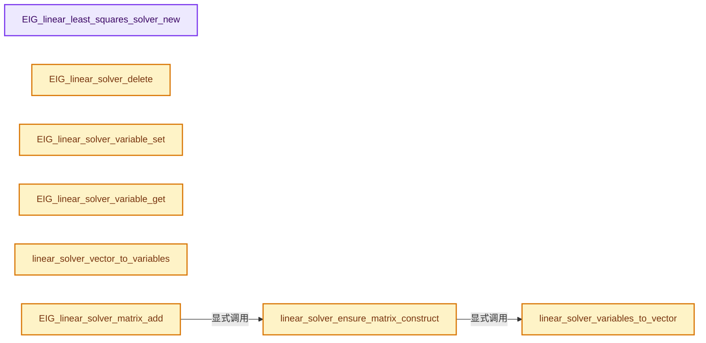
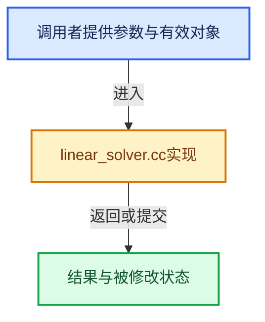

# 实现依赖专题：intern/eigen/intern/linear_solver.cc

[方向导航](README.md) · [符号索引](../%E7%AC%A6%E5%8F%B7%E4%BE%9D%E8%B5%96%E4%B8%8E%E5%AE%9E%E7%8E%B0%E7%B4%A2%E5%BC%95.md)

本专题从正文实际调用进入，集中保存共享实现。函数有稳定锚点，可从调用处直接跳到对应完整函数；递归与互相调用通过回链组织。

## 本文件的实现关系






## 完整成员与函数实现

<a id="f-7e608b10aebe0fa4"></a>

### `EIG_linear_least_squares_solver_new`

实现位置：[intern/eigen/intern/linear_solver.cc](../../../../../intern/eigen/intern/linear_solver.cc) · L107—L112。

接口参数：

- `int num_rows`
- `int num_columns`
- `int num_right_hand_sides`

**教学注释版**

<!-- annotated:e726d54563f9a6 -->

```cpp
LinearSolver *EIG_linear_least_squares_solver_new(int num_rows,
                                                  int num_columns,
                                                  int num_right_hand_sides)
{
  return new LinearSolver(num_rows, num_columns, num_right_hand_sides, true);
}
```

<details>
<summary>核对原始源码：intern/eigen/intern/linear_solver.cc · L107—L112</summary>

<!-- original:e726d54563f9a6:intern/eigen/intern/linear_solver.cc:107:112 -->

```cpp
LinearSolver *EIG_linear_least_squares_solver_new(int num_rows,
                                                  int num_columns,
                                                  int num_right_hand_sides)
{
  return new LinearSolver(num_rows, num_columns, num_right_hand_sides, true);
}
```

</details>

**结果出口**

- `return new LinearSolver(num_rows, num_columns, num_right_hand_sides, true);`

**继续追踪实现**

本实现没有需要继续展开的显式调用；检查返回表达式、对象转换和调用者前置条件。

<a id="f-77ab65724c82635a"></a>

### `EIG_linear_solver_delete`

实现位置：[intern/eigen/intern/linear_solver.cc](../../../../../intern/eigen/intern/linear_solver.cc) · L114—L117。

接口参数：

- `LinearSolver *solver`

**教学注释版**

<!-- annotated:77145812087f28 -->

```cpp
void EIG_linear_solver_delete(LinearSolver *solver)
{
  delete solver;
}
```

<details>
<summary>核对原始源码：intern/eigen/intern/linear_solver.cc · L114—L117</summary>

<!-- original:77145812087f28:intern/eigen/intern/linear_solver.cc:114:117 -->

```cpp
void EIG_linear_solver_delete(LinearSolver *solver)
{
  delete solver;
}
```

</details>

**继续追踪实现**

本实现没有需要继续展开的显式调用；检查返回表达式、对象转换和调用者前置条件。

<a id="f-0dbaf94cbb0d8ce5"></a>

### `EIG_linear_solver_variable_set`

实现位置：[intern/eigen/intern/linear_solver.cc](../../../../../intern/eigen/intern/linear_solver.cc) · L121—L124。

接口参数：

- `LinearSolver *solver`
- `int rhs`
- `int index`
- `double value`

**教学注释版**

<!-- annotated:045b9b7fa3e479 -->

```cpp
void EIG_linear_solver_variable_set(LinearSolver *solver, int rhs, int index, double value)
{
  solver->variable[index].value[rhs] = value;
}
```

<details>
<summary>核对原始源码：intern/eigen/intern/linear_solver.cc · L121—L124</summary>

<!-- original:045b9b7fa3e479:intern/eigen/intern/linear_solver.cc:121:124 -->

```cpp
void EIG_linear_solver_variable_set(LinearSolver *solver, int rhs, int index, double value)
{
  solver->variable[index].value[rhs] = value;
}
```

</details>

**沿实际写入检查状态**

- `solver->variable[index].value[rhs] = value;`

**继续追踪实现**

本实现没有需要继续展开的显式调用；检查返回表达式、对象转换和调用者前置条件。

<a id="f-8d3d403e867904a7"></a>

### `EIG_linear_solver_variable_get`

实现位置：[intern/eigen/intern/linear_solver.cc](../../../../../intern/eigen/intern/linear_solver.cc) · L126—L129。

接口参数：

- `LinearSolver *solver`
- `int rhs`
- `int index`

**教学注释版**

<!-- annotated:2d7860f010c8d1 -->

```cpp
double EIG_linear_solver_variable_get(LinearSolver *solver, int rhs, int index)
{
  return solver->variable[index].value[rhs];
}
```

<details>
<summary>核对原始源码：intern/eigen/intern/linear_solver.cc · L126—L129</summary>

<!-- original:2d7860f010c8d1:intern/eigen/intern/linear_solver.cc:126:129 -->

```cpp
double EIG_linear_solver_variable_get(LinearSolver *solver, int rhs, int index)
{
  return solver->variable[index].value[rhs];
}
```

</details>

**结果出口**

- `return solver->variable[index].value[rhs];`

**继续追踪实现**

本实现没有需要继续展开的显式调用；检查返回表达式、对象转换和调用者前置条件。

<a id="f-f5fcb25c1fbdc326"></a>

### `linear_solver_variables_to_vector`

实现位置：[intern/eigen/intern/linear_solver.cc](../../../../../intern/eigen/intern/linear_solver.cc) · L147—L159。

接口参数：

- `LinearSolver *solver`

**教学注释版**

<!-- annotated:b0d0559388a449 -->

```cpp
static void linear_solver_variables_to_vector(LinearSolver *solver)
{
  int num_rhs = solver->num_rhs;

  for (int i = 0; i < solver->num_variables; i++) {
    LinearSolver::Variable *v = &solver->variable[i];
    if (!v->locked) {
      for (int j = 0; j < num_rhs; j++) {
        solver->x[j][v->index] = v->value[j];
      }
    }
  }
}
```

<details>
<summary>核对原始源码：intern/eigen/intern/linear_solver.cc · L147—L159</summary>

<!-- original:b0d0559388a449:intern/eigen/intern/linear_solver.cc:147:159 -->

```cpp
static void linear_solver_variables_to_vector(LinearSolver *solver)
{
  int num_rhs = solver->num_rhs;

  for (int i = 0; i < solver->num_variables; i++) {
    LinearSolver::Variable *v = &solver->variable[i];
    if (!v->locked) {
      for (int j = 0; j < num_rhs; j++) {
        solver->x[j][v->index] = v->value[j];
      }
    }
  }
}
```

</details>

**沿实际写入检查状态**

- `solver->x[j][v->index] = v->value[j];`

**继续追踪实现**

本实现没有需要继续展开的显式调用；检查返回表达式、对象转换和调用者前置条件。

<a id="f-4c0cb1b5bc528b7c"></a>

### `linear_solver_vector_to_variables`

实现位置：[intern/eigen/intern/linear_solver.cc](../../../../../intern/eigen/intern/linear_solver.cc) · L161—L173。

接口参数：

- `LinearSolver *solver`

**教学注释版**

<!-- annotated:bb2890d949ce7f -->

```cpp
static void linear_solver_vector_to_variables(LinearSolver *solver)
{
  int num_rhs = solver->num_rhs;

  for (int i = 0; i < solver->num_variables; i++) {
    LinearSolver::Variable *v = &solver->variable[i];
    if (!v->locked) {
      for (int j = 0; j < num_rhs; j++) {
        v->value[j] = solver->x[j][v->index];
      }
    }
  }
}
```

<details>
<summary>核对原始源码：intern/eigen/intern/linear_solver.cc · L161—L173</summary>

<!-- original:bb2890d949ce7f:intern/eigen/intern/linear_solver.cc:161:173 -->

```cpp
static void linear_solver_vector_to_variables(LinearSolver *solver)
{
  int num_rhs = solver->num_rhs;

  for (int i = 0; i < solver->num_variables; i++) {
    LinearSolver::Variable *v = &solver->variable[i];
    if (!v->locked) {
      for (int j = 0; j < num_rhs; j++) {
        v->value[j] = solver->x[j][v->index];
      }
    }
  }
}
```

</details>

**沿实际写入检查状态**

- `v->value[j] = solver->x[j][v->index];`

**继续追踪实现**

本实现没有需要继续展开的显式调用；检查返回表达式、对象转换和调用者前置条件。

<a id="f-02428ee3149c7f63"></a>

### `linear_solver_ensure_matrix_construct`

实现位置：[intern/eigen/intern/linear_solver.cc](../../../../../intern/eigen/intern/linear_solver.cc) · L177—L215。

接口参数：

- `LinearSolver *solver`

**教学注释版**

<!-- annotated:4c92c3cdce0c2f -->

```cpp
static void linear_solver_ensure_matrix_construct(LinearSolver *solver)
{
  /* transition to matrix construction if necessary */
  if (solver->state == LinearSolver::STATE_VARIABLES_CONSTRUCT) {
    int n = 0;

    for (int i = 0; i < solver->num_variables; i++) {
      if (solver->variable[i].locked) {
        solver->variable[i].index = ~0;
      }
      else {
        solver->variable[i].index = n++;
      }
    }

    int m = (solver->num_rows == 0) ? n : solver->num_rows;

    solver->m = m;
    solver->n = n;

    // [讲解] assert：检查开发者预期条件，配置可能关闭；不承担完整输入处理或自动修复。
    assert(solver->least_squares || m == n);

    /* reserve reasonable estimate */
    solver->Mtriplets.clear();
    // [讲解] std::max：按比较关系选取较大值。本讲解中的增长公式同时满足最低请求和几何增长；若保存返回引用，还需注意实参寿命。
    solver->Mtriplets.reserve(std::max(m, n) * 3);

    solver->b.resize(solver->num_rhs);
    solver->x.resize(solver->num_rhs);

    for (int i = 0; i < solver->num_rhs; i++) {
      solver->b[i].setZero(m);
      solver->x[i].setZero(n);
    }

    linear_solver_variables_to_vector(solver);

    solver->state = LinearSolver::STATE_MATRIX_CONSTRUCT;
  }
}
```

<details>
<summary>核对原始源码：intern/eigen/intern/linear_solver.cc · L177—L215</summary>

<!-- original:4c92c3cdce0c2f:intern/eigen/intern/linear_solver.cc:177:215 -->

```cpp
static void linear_solver_ensure_matrix_construct(LinearSolver *solver)
{
  /* transition to matrix construction if necessary */
  if (solver->state == LinearSolver::STATE_VARIABLES_CONSTRUCT) {
    int n = 0;

    for (int i = 0; i < solver->num_variables; i++) {
      if (solver->variable[i].locked) {
        solver->variable[i].index = ~0;
      }
      else {
        solver->variable[i].index = n++;
      }
    }

    int m = (solver->num_rows == 0) ? n : solver->num_rows;

    solver->m = m;
    solver->n = n;

    assert(solver->least_squares || m == n);

    /* reserve reasonable estimate */
    solver->Mtriplets.clear();
    solver->Mtriplets.reserve(std::max(m, n) * 3);

    solver->b.resize(solver->num_rhs);
    solver->x.resize(solver->num_rhs);

    for (int i = 0; i < solver->num_rhs; i++) {
      solver->b[i].setZero(m);
      solver->x[i].setZero(n);
    }

    linear_solver_variables_to_vector(solver);

    solver->state = LinearSolver::STATE_MATRIX_CONSTRUCT;
  }
}
```

</details>

**沿实际写入检查状态**

- `solver->variable[i].index = ~0;`
- `solver->variable[i].index = n++;`
- `solver->m = m;`
- `solver->n = n;`
- `solver->state = LinearSolver::STATE_MATRIX_CONSTRUCT;`

**继续追踪实现**

- `assert` → [外部契约](https://eel.is/c++draft/assertions)：检查开发者预期条件，配置可能关闭；不承担完整输入处理或自动修复。
- `solver->Mtriplets.clear` → [调用协议](../%E6%A8%A1%E6%9D%BF%E5%AE%8F%E4%B8%8E%E5%8A%A8%E6%80%81%E5%88%86%E6%B4%BE%E5%8D%8F%E8%AE%AE.md)：接收对象类型依赖auto、返回值或模板实例；不按同名猜测目标。调用位置L200。
- `solver->Mtriplets.reserve` → [调用协议](../%E6%A8%A1%E6%9D%BF%E5%AE%8F%E4%B8%8E%E5%8A%A8%E6%80%81%E5%88%86%E6%B4%BE%E5%8D%8F%E8%AE%AE.md)：接收对象类型依赖auto、返回值或模板实例；不按同名猜测目标。调用位置L201。
- `std::max` → [外部契约](https://eel.is/c++draft/alg.min.max)：按比较关系选取较大值。本讲解中的增长公式同时满足最低请求和几何增长；若保存返回引用，还需注意实参寿命。
- `solver->b.resize` → [调用协议](../%E6%A8%A1%E6%9D%BF%E5%AE%8F%E4%B8%8E%E5%8A%A8%E6%80%81%E5%88%86%E6%B4%BE%E5%8D%8F%E8%AE%AE.md)：接收对象类型依赖auto、返回值或模板实例；不按同名猜测目标。调用位置L203。
- `solver->x.resize` → [调用协议](../%E6%A8%A1%E6%9D%BF%E5%AE%8F%E4%B8%8E%E5%8A%A8%E6%80%81%E5%88%86%E6%B4%BE%E5%8D%8F%E8%AE%AE.md)：接收对象类型依赖auto、返回值或模板实例；不按同名猜测目标。调用位置L204。
- `solver->b[i].setZero` → [调用协议](../%E6%A8%A1%E6%9D%BF%E5%AE%8F%E4%B8%8E%E5%8A%A8%E6%80%81%E5%88%86%E6%B4%BE%E5%8D%8F%E8%AE%AE.md)：接收对象类型依赖auto、返回值或模板实例；不按同名猜测目标。调用位置L207。
- `solver->x[i].setZero` → [调用协议](../%E6%A8%A1%E6%9D%BF%E5%AE%8F%E4%B8%8E%E5%8A%A8%E6%80%81%E5%88%86%E6%B4%BE%E5%8D%8F%E8%AE%AE.md)：接收对象类型依赖auto、返回值或模板实例；不按同名猜测目标。调用位置L208。
- `linear_solver_variables_to_vector` → [linear_solver_variables_to_vector · L147](%E4%BE%9D%E8%B5%96-linear_solver-fa35c0.md#f-f5fcb25c1fbdc326)。

<a id="f-a7c671eec084f178"></a>

### `EIG_linear_solver_matrix_add`

实现位置：[intern/eigen/intern/linear_solver.cc](../../../../../intern/eigen/intern/linear_solver.cc) · L217—L248。

接口参数：

- `LinearSolver *solver`
- `int row`
- `int col`
- `double value`

**教学注释版**

<!-- annotated:6aaff5ff8ab15a -->

```cpp
void EIG_linear_solver_matrix_add(LinearSolver *solver, int row, int col, double value)
{
  if (solver->state == LinearSolver::STATE_MATRIX_SOLVED) {
    return;
  }

  linear_solver_ensure_matrix_construct(solver);

  if (!solver->least_squares && solver->variable[row].locked) {
    ;
  }
  else if (solver->variable[col].locked) {
    if (!solver->least_squares) {
      row = solver->variable[row].index;
    }

    LinearSolver::Coeff coeff;
    coeff.index = row;
    coeff.value = value;
    solver->variable[col].a.push_back(coeff);
  }
  else {
    if (!solver->least_squares) {
      row = solver->variable[row].index;
    }
    col = solver->variable[col].index;

    /* direct insert into matrix is too slow, so use triplets */
    EigenTriplet triplet(row, col, value);
    solver->Mtriplets.push_back(triplet);
  }
}
```

<details>
<summary>核对原始源码：intern/eigen/intern/linear_solver.cc · L217—L248</summary>

<!-- original:6aaff5ff8ab15a:intern/eigen/intern/linear_solver.cc:217:248 -->

```cpp
void EIG_linear_solver_matrix_add(LinearSolver *solver, int row, int col, double value)
{
  if (solver->state == LinearSolver::STATE_MATRIX_SOLVED) {
    return;
  }

  linear_solver_ensure_matrix_construct(solver);

  if (!solver->least_squares && solver->variable[row].locked) {
    ;
  }
  else if (solver->variable[col].locked) {
    if (!solver->least_squares) {
      row = solver->variable[row].index;
    }

    LinearSolver::Coeff coeff;
    coeff.index = row;
    coeff.value = value;
    solver->variable[col].a.push_back(coeff);
  }
  else {
    if (!solver->least_squares) {
      row = solver->variable[row].index;
    }
    col = solver->variable[col].index;

    /* direct insert into matrix is too slow, so use triplets */
    EigenTriplet triplet(row, col, value);
    solver->Mtriplets.push_back(triplet);
  }
}
```

</details>

**沿实际写入检查状态**

- `row = solver->variable[row].index;`
- `coeff.index = row;`
- `coeff.value = value;`
- `col = solver->variable[col].index;`

**继续追踪实现**

- `linear_solver_ensure_matrix_construct` → [linear_solver_ensure_matrix_construct · L177](%E4%BE%9D%E8%B5%96-linear_solver-fa35c0.md#f-02428ee3149c7f63)。
- `solver->variable[col].a.push_back` → [调用协议](../%E6%A8%A1%E6%9D%BF%E5%AE%8F%E4%B8%8E%E5%8A%A8%E6%80%81%E5%88%86%E6%B4%BE%E5%8D%8F%E8%AE%AE.md)：接收对象类型依赖auto、返回值或模板实例；不按同名猜测目标。调用位置L236。
- `solver->Mtriplets.push_back` → [调用协议](../%E6%A8%A1%E6%9D%BF%E5%AE%8F%E4%B8%8E%E5%8A%A8%E6%80%81%E5%88%86%E6%B4%BE%E5%8D%8F%E8%AE%AE.md)：接收对象类型依赖auto、返回值或模板实例；不按同名猜测目标。调用位置L246。

<a id="f-004dda847b593720"></a>

### `EIG_linear_solver_right_hand_side_add`

实现位置：[intern/eigen/intern/linear_solver.cc](../../../../../intern/eigen/intern/linear_solver.cc) · L252—L263。

接口参数：

- `LinearSolver *solver`
- `int rhs`
- `int index`
- `double value`

**教学注释版**

<!-- annotated:2bff97cbaca71e -->

```cpp
void EIG_linear_solver_right_hand_side_add(LinearSolver *solver, int rhs, int index, double value)
{
  linear_solver_ensure_matrix_construct(solver);

  if (solver->least_squares) {
    solver->b[rhs][index] += value;
  }
  else if (!solver->variable[index].locked) {
    index = solver->variable[index].index;
    solver->b[rhs][index] += value;
  }
}
```

<details>
<summary>核对原始源码：intern/eigen/intern/linear_solver.cc · L252—L263</summary>

<!-- original:2bff97cbaca71e:intern/eigen/intern/linear_solver.cc:252:263 -->

```cpp
void EIG_linear_solver_right_hand_side_add(LinearSolver *solver, int rhs, int index, double value)
{
  linear_solver_ensure_matrix_construct(solver);

  if (solver->least_squares) {
    solver->b[rhs][index] += value;
  }
  else if (!solver->variable[index].locked) {
    index = solver->variable[index].index;
    solver->b[rhs][index] += value;
  }
}
```

</details>

**沿实际写入检查状态**

- `solver->b[rhs][index] += value;`
- `index = solver->variable[index].index;`

**继续追踪实现**

- `linear_solver_ensure_matrix_construct` → [linear_solver_ensure_matrix_construct · L177](%E4%BE%9D%E8%B5%96-linear_solver-fa35c0.md#f-02428ee3149c7f63)。

<a id="f-f316a9f7923a6144"></a>

### `EIG_linear_solver_solve`

实现位置：[intern/eigen/intern/linear_solver.cc](../../../../../intern/eigen/intern/linear_solver.cc) · L267—L347。

接口参数：

- `LinearSolver *solver`

**教学注释版**

<!-- annotated:1dc1238bd28b16 -->

```cpp
bool EIG_linear_solver_solve(LinearSolver *solver)
{
  /* nothing to solve, perhaps all variables were locked */
  if (solver->m == 0 || solver->n == 0) {
    return true;
  }

  bool result = true;

  // [讲解] assert：检查开发者预期条件，配置可能关闭；不承担完整输入处理或自动修复。
  assert(solver->state != LinearSolver::STATE_VARIABLES_CONSTRUCT);

  if (solver->state == LinearSolver::STATE_MATRIX_CONSTRUCT) {
    /* create matrix from triplets */
    solver->M.resize(solver->m, solver->n);
    solver->M.setFromTriplets(solver->Mtriplets.begin(), solver->Mtriplets.end());
    solver->Mtriplets.clear();

    /* create least squares matrix */
    if (solver->least_squares) {
      solver->MtM = solver->M.transpose() * solver->M;
    }

    /* convert M to compressed column format */
    EigenSparseMatrix &M = (solver->least_squares) ? solver->MtM : solver->M;
    M.makeCompressed();

    /* perform sparse LU factorization */
    EigenSparseLU *sparseLU = new EigenSparseLU();
    solver->sparseLU = sparseLU;

    sparseLU->compute(M);
    result = (sparseLU->info() == Eigen::Success);

    solver->state = LinearSolver::STATE_MATRIX_SOLVED;
  }

  if (result) {
    /* solve for each right hand side */
    for (int rhs = 0; rhs < solver->num_rhs; rhs++) {
      /* modify for locked variables */
      EigenVectorX &b = solver->b[rhs];

      for (int i = 0; i < solver->num_variables; i++) {
        LinearSolver::Variable *variable = &solver->variable[i];

        if (variable->locked) {
          std::vector<LinearSolver::Coeff> &a = variable->a;

          for (int j = 0; j < a.size(); j++) {
            b[a[j].index] -= a[j].value * variable->value[rhs];
          }
        }
      }

      /* solve */
      if (solver->least_squares) {
        EigenVectorX Mtb = solver->M.transpose() * b;
        solver->x[rhs] = solver->sparseLU->solve(Mtb);
      }
      else {
        EigenVectorX &b = solver->b[rhs];
        solver->x[rhs] = solver->sparseLU->solve(b);
      }

      if (solver->sparseLU->info() != Eigen::Success) {
        result = false;
      }
    }

    if (result) {
      linear_solver_vector_to_variables(solver);
    }
  }

  /* clear for next solve */
  for (int rhs = 0; rhs < solver->num_rhs; rhs++) {
    solver->b[rhs].setZero(solver->m);
  }

  return result;
}
```

<details>
<summary>核对原始源码：intern/eigen/intern/linear_solver.cc · L267—L347</summary>

<!-- original:1dc1238bd28b16:intern/eigen/intern/linear_solver.cc:267:347 -->

```cpp
bool EIG_linear_solver_solve(LinearSolver *solver)
{
  /* nothing to solve, perhaps all variables were locked */
  if (solver->m == 0 || solver->n == 0) {
    return true;
  }

  bool result = true;

  assert(solver->state != LinearSolver::STATE_VARIABLES_CONSTRUCT);

  if (solver->state == LinearSolver::STATE_MATRIX_CONSTRUCT) {
    /* create matrix from triplets */
    solver->M.resize(solver->m, solver->n);
    solver->M.setFromTriplets(solver->Mtriplets.begin(), solver->Mtriplets.end());
    solver->Mtriplets.clear();

    /* create least squares matrix */
    if (solver->least_squares) {
      solver->MtM = solver->M.transpose() * solver->M;
    }

    /* convert M to compressed column format */
    EigenSparseMatrix &M = (solver->least_squares) ? solver->MtM : solver->M;
    M.makeCompressed();

    /* perform sparse LU factorization */
    EigenSparseLU *sparseLU = new EigenSparseLU();
    solver->sparseLU = sparseLU;

    sparseLU->compute(M);
    result = (sparseLU->info() == Eigen::Success);

    solver->state = LinearSolver::STATE_MATRIX_SOLVED;
  }

  if (result) {
    /* solve for each right hand side */
    for (int rhs = 0; rhs < solver->num_rhs; rhs++) {
      /* modify for locked variables */
      EigenVectorX &b = solver->b[rhs];

      for (int i = 0; i < solver->num_variables; i++) {
        LinearSolver::Variable *variable = &solver->variable[i];

        if (variable->locked) {
          std::vector<LinearSolver::Coeff> &a = variable->a;

          for (int j = 0; j < a.size(); j++) {
            b[a[j].index] -= a[j].value * variable->value[rhs];
          }
        }
      }

      /* solve */
      if (solver->least_squares) {
        EigenVectorX Mtb = solver->M.transpose() * b;
        solver->x[rhs] = solver->sparseLU->solve(Mtb);
      }
      else {
        EigenVectorX &b = solver->b[rhs];
        solver->x[rhs] = solver->sparseLU->solve(b);
      }

      if (solver->sparseLU->info() != Eigen::Success) {
        result = false;
      }
    }

    if (result) {
      linear_solver_vector_to_variables(solver);
    }
  }

  /* clear for next solve */
  for (int rhs = 0; rhs < solver->num_rhs; rhs++) {
    solver->b[rhs].setZero(solver->m);
  }

  return result;
}
```

</details>

**沿实际写入检查状态**

- `solver->MtM = solver->M.transpose() * solver->M;`
- `solver->sparseLU = sparseLU;`
- `result = (sparseLU->info() == Eigen::Success);`
- `solver->state = LinearSolver::STATE_MATRIX_SOLVED;`
- `b[a[j].index] -= a[j].value * variable->value[rhs];`
- `solver->x[rhs] = solver->sparseLU->solve(Mtb);`
- `solver->x[rhs] = solver->sparseLU->solve(b);`
- `result = false;`

**结果出口**

- `return true;`
- `return result;`

**继续追踪实现**

- `assert` → [外部契约](https://eel.is/c++draft/assertions)：检查开发者预期条件，配置可能关闭；不承担完整输入处理或自动修复。
- `solver->M.resize` → [调用协议](../%E6%A8%A1%E6%9D%BF%E5%AE%8F%E4%B8%8E%E5%8A%A8%E6%80%81%E5%88%86%E6%B4%BE%E5%8D%8F%E8%AE%AE.md)：接收对象类型依赖auto、返回值或模板实例；不按同名猜测目标。调用位置L280。
- `solver->M.setFromTriplets` → [调用协议](../%E6%A8%A1%E6%9D%BF%E5%AE%8F%E4%B8%8E%E5%8A%A8%E6%80%81%E5%88%86%E6%B4%BE%E5%8D%8F%E8%AE%AE.md)：接收对象类型依赖auto、返回值或模板实例；不按同名猜测目标。调用位置L281。
- `solver->Mtriplets.begin` → [调用协议](../%E6%A8%A1%E6%9D%BF%E5%AE%8F%E4%B8%8E%E5%8A%A8%E6%80%81%E5%88%86%E6%B4%BE%E5%8D%8F%E8%AE%AE.md)：接收对象类型依赖auto、返回值或模板实例；不按同名猜测目标。调用位置L281。
- `solver->Mtriplets.end` → [调用协议](../%E6%A8%A1%E6%9D%BF%E5%AE%8F%E4%B8%8E%E5%8A%A8%E6%80%81%E5%88%86%E6%B4%BE%E5%8D%8F%E8%AE%AE.md)：接收对象类型依赖auto、返回值或模板实例；不按同名猜测目标。调用位置L281。
- `solver->Mtriplets.clear` → [调用协议](../%E6%A8%A1%E6%9D%BF%E5%AE%8F%E4%B8%8E%E5%8A%A8%E6%80%81%E5%88%86%E6%B4%BE%E5%8D%8F%E8%AE%AE.md)：接收对象类型依赖auto、返回值或模板实例；不按同名猜测目标。调用位置L282。
- `solver->M.transpose` → [调用协议](../%E6%A8%A1%E6%9D%BF%E5%AE%8F%E4%B8%8E%E5%8A%A8%E6%80%81%E5%88%86%E6%B4%BE%E5%8D%8F%E8%AE%AE.md)：接收对象类型依赖auto、返回值或模板实例；不按同名猜测目标。调用位置L286。
- `M.makeCompressed` → [调用协议](../%E6%A8%A1%E6%9D%BF%E5%AE%8F%E4%B8%8E%E5%8A%A8%E6%80%81%E5%88%86%E6%B4%BE%E5%8D%8F%E8%AE%AE.md)：由接收对象具体类型或运行时策略提供实现。调用位置L291。
- `sparseLU->compute` → [compute · L22](%E4%BE%9D%E8%B5%96-gpu_shader_cxx_attribute-d75f56.md#m-ea80b54273b2)。宏定义由构建条件选择。
- `sparseLU->info` → [blender::nodes::SocketSearchData::info · L142](../09-LazyFunction%E4%B8%8E%E8%8A%82%E7%82%B9%E6%89%A7%E8%A1%8C%E6%9E%B6%E6%9E%84/%E4%BE%9D%E8%B5%96-geometry_nodes_caller_ui-ccd1aa.md#f-cff9f419020c1e90)。
- `a.size` → [外部契约](https://eel.is/c++draft/)：这个边界按实际表达式及所属类型核对参数、返回值、寿命与失败行为。这里提供接口入口，不声称已解释该第三方版本的内部实现。
- `solver->sparseLU->solve` → [调用协议](../%E6%A8%A1%E6%9D%BF%E5%AE%8F%E4%B8%8E%E5%8A%A8%E6%80%81%E5%88%86%E6%B4%BE%E5%8D%8F%E8%AE%AE.md)：接收对象类型依赖auto、返回值或模板实例；不按同名猜测目标。调用位置L324。
- `solver->sparseLU->info` → [调用协议](../%E6%A8%A1%E6%9D%BF%E5%AE%8F%E4%B8%8E%E5%8A%A8%E6%80%81%E5%88%86%E6%B4%BE%E5%8D%8F%E8%AE%AE.md)：接收对象类型依赖auto、返回值或模板实例；不按同名猜测目标。调用位置L331。
- `linear_solver_vector_to_variables` → [linear_solver_vector_to_variables · L161](%E4%BE%9D%E8%B5%96-linear_solver-fa35c0.md#f-4c0cb1b5bc528b7c)。
- `solver->b[rhs].setZero` → [调用协议](../%E6%A8%A1%E6%9D%BF%E5%AE%8F%E4%B8%8E%E5%8A%A8%E6%80%81%E5%88%86%E6%B4%BE%E5%8D%8F%E8%AE%AE.md)：接收对象类型依赖auto、返回值或模板实例；不按同名猜测目标。调用位置L343。

<a id="f-146d764e6032a2f6"></a>

### `EIG_linear_solver_print_matrix`

实现位置：[intern/eigen/intern/linear_solver.cc](../../../../../intern/eigen/intern/linear_solver.cc) · L351—L362。

接口参数：

- `LinearSolver *solver`

**教学注释版**

<!-- annotated:8bcf4392c1e0e6 -->

```cpp
void EIG_linear_solver_print_matrix(LinearSolver *solver)
{
  std::cout << "A:" << solver->M << std::endl;

  for (int rhs = 0; rhs < solver->num_rhs; rhs++) {
    std::cout << "b " << rhs << ":" << solver->b[rhs] << std::endl;
  }

  if (solver->MtM.rows() && solver->MtM.cols()) {
    std::cout << "AtA:" << solver->MtM << std::endl;
  }
}
```

<details>
<summary>核对原始源码：intern/eigen/intern/linear_solver.cc · L351—L362</summary>

<!-- original:8bcf4392c1e0e6:intern/eigen/intern/linear_solver.cc:351:362 -->

```cpp
void EIG_linear_solver_print_matrix(LinearSolver *solver)
{
  std::cout << "A:" << solver->M << std::endl;

  for (int rhs = 0; rhs < solver->num_rhs; rhs++) {
    std::cout << "b " << rhs << ":" << solver->b[rhs] << std::endl;
  }

  if (solver->MtM.rows() && solver->MtM.cols()) {
    std::cout << "AtA:" << solver->MtM << std::endl;
  }
}
```

</details>

**继续追踪实现**

- `solver->MtM.rows` → [调用协议](../%E6%A8%A1%E6%9D%BF%E5%AE%8F%E4%B8%8E%E5%8A%A8%E6%80%81%E5%88%86%E6%B4%BE%E5%8D%8F%E8%AE%AE.md)：接收对象类型依赖auto、返回值或模板实例；不按同名猜测目标。调用位置L359。
- `solver->MtM.cols` → [调用协议](../%E6%A8%A1%E6%9D%BF%E5%AE%8F%E4%B8%8E%E5%8A%A8%E6%80%81%E5%88%86%E6%B4%BE%E5%8D%8F%E8%AE%AE.md)：接收对象类型依赖auto、返回值或模板实例；不按同名猜测目标。调用位置L359。
