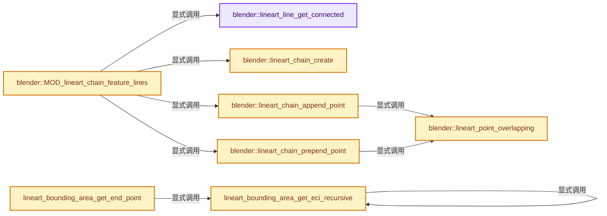
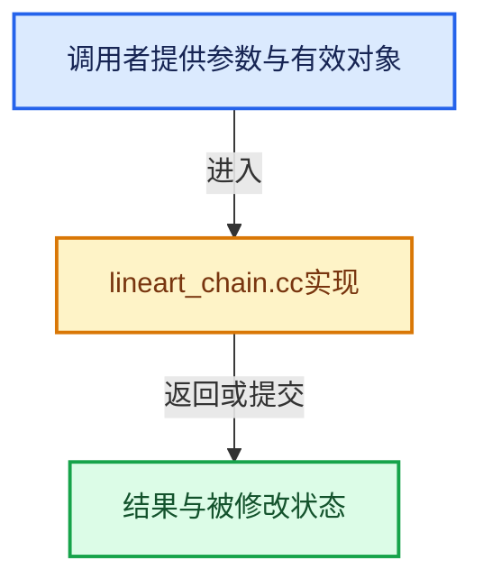

# 实现依赖专题：source/blender/modifiers/intern/lineart/lineart_chain.cc

[方向导航](README.md) · [符号索引](../%E7%AC%A6%E5%8F%B7%E4%BE%9D%E8%B5%96%E4%B8%8E%E5%AE%9E%E7%8E%B0%E7%B4%A2%E5%BC%95.md)

本专题从正文实际调用进入，集中保存共享实现。函数有稳定锚点，可从调用处直接跳到对应完整函数；递归与互相调用通过回链组织。

## 本文件的实现关系






<a id="m-3b2ffb8e111a"></a>

## 宏 `LRT_OTHER_VERT`

<!-- annotated:5bc43096a7b97f -->

```cpp
#define LRT_OTHER_VERT(e, vt) ((vt) == (e)->v1 ? (e)->v2 : ((vt) == (e)->v2 ? (e)->v1 : nullptr))

```

<details>
<summary>核对原始源码：source/blender/modifiers/intern/lineart/lineart_chain.cc · L21—L22</summary>

<!-- original:5bc43096a7b97f:source/blender/modifiers/intern/lineart/lineart_chain.cc:21:22 -->

```cpp
#define LRT_OTHER_VERT(e, vt) ((vt) == (e)->v1 ? (e)->v2 : ((vt) == (e)->v2 ? (e)->v1 : nullptr))

```

</details>

宏在预处理阶段展开，参数替换、重复求值和条件编译应直接从该定义检查。与普通函数不同，宏不会自动提供参数类型检查；构建配置选择哪个定义需结合外围条件。

<a id="m-ab059128594e"></a>

## 宏 `LRT_ECI_INSIDE`

<!-- annotated:b77f32d54d7b33 -->

```cpp
#define LRT_ECI_INSIDE(eci) \
  ((eci)->pos[0] >= -1.0f && (eci)->pos[0] <= 1.0f && (eci)->pos[1] >= -1.0f && \
   (eci)->pos[1] <= 1.0f)

```

<details>
<summary>核对原始源码：source/blender/modifiers/intern/lineart/lineart_chain.cc · L1226—L1229</summary>

<!-- original:b77f32d54d7b33:source/blender/modifiers/intern/lineart/lineart_chain.cc:1226:1229 -->

```cpp
#define LRT_ECI_INSIDE(eci) \
  ((eci)->pos[0] >= -1.0f && (eci)->pos[0] <= 1.0f && (eci)->pos[1] >= -1.0f && \
   (eci)->pos[1] <= 1.0f)

```

</details>

宏在预处理阶段展开，参数替换、重复求值和条件编译应直接从该定义检查。与普通函数不同，宏不会自动提供参数类型检查；构建配置选择哪个定义需结合外围条件。

## 完整成员与函数实现

<a id="f-c1ad7b4b37c4ec25"></a>

### `blender::lineart_line_get_connected`

实现位置：[source/blender/modifiers/intern/lineart/lineart_chain.cc](../../../../../source/blender/modifiers/intern/lineart/lineart_chain.cc) · L27—L72。

接口参数：

- `LineartBoundingArea *ba`
- `LineartVert *vt`
- `LineartVert **new_vt`
- `int match_flag`
- `uint8_t match_isec_mask`
- `Object *match_isec_object`

**教学注释版**

<!-- annotated:fa576f6bb27347 -->

```cpp
static LineartEdge *lineart_line_get_connected(LineartBoundingArea *ba,
                                               LineartVert *vt,
                                               LineartVert **new_vt,
                                               int match_flag,
                                               uint8_t match_isec_mask,
                                               Object *match_isec_object)
{
  for (int i = 0; i < ba->line_count; i++) {
    LineartEdge *n_e = ba->linked_lines[i];

    if (!(n_e->flags & MOD_LINEART_EDGE_FLAG_ALL_TYPE) ||
        (n_e->flags & MOD_LINEART_EDGE_FLAG_CHAIN_PICKED))
    {
      continue;
    }

    if (match_flag && ((n_e->flags & MOD_LINEART_EDGE_FLAG_ALL_TYPE) & match_flag) == 0) {
      continue;
    }

    if (n_e->intersection_mask != match_isec_mask) {
      continue;
    }

    *new_vt = LRT_OTHER_VERT(n_e, vt);
    if (*new_vt) {
      return n_e;
    }

    if (n_e->flags & MOD_LINEART_EDGE_FLAG_INTERSECTION) {
      if (n_e->object_ref != match_isec_object) {
        continue;
      }
      if (vt->fbcoord[0] == n_e->v1->fbcoord[0] && vt->fbcoord[1] == n_e->v1->fbcoord[1]) {
        *new_vt = LRT_OTHER_VERT(n_e, n_e->v1);
        return n_e;
      }
      if (vt->fbcoord[0] == n_e->v2->fbcoord[0] && vt->fbcoord[1] == n_e->v2->fbcoord[1]) {
        *new_vt = LRT_OTHER_VERT(n_e, n_e->v2);
        return n_e;
      }
    }
  }

  return nullptr;
}
```

<details>
<summary>核对原始源码：source/blender/modifiers/intern/lineart/lineart_chain.cc · L27—L72</summary>

<!-- original:fa576f6bb27347:source/blender/modifiers/intern/lineart/lineart_chain.cc:27:72 -->

```cpp
static LineartEdge *lineart_line_get_connected(LineartBoundingArea *ba,
                                               LineartVert *vt,
                                               LineartVert **new_vt,
                                               int match_flag,
                                               uint8_t match_isec_mask,
                                               Object *match_isec_object)
{
  for (int i = 0; i < ba->line_count; i++) {
    LineartEdge *n_e = ba->linked_lines[i];

    if (!(n_e->flags & MOD_LINEART_EDGE_FLAG_ALL_TYPE) ||
        (n_e->flags & MOD_LINEART_EDGE_FLAG_CHAIN_PICKED))
    {
      continue;
    }

    if (match_flag && ((n_e->flags & MOD_LINEART_EDGE_FLAG_ALL_TYPE) & match_flag) == 0) {
      continue;
    }

    if (n_e->intersection_mask != match_isec_mask) {
      continue;
    }

    *new_vt = LRT_OTHER_VERT(n_e, vt);
    if (*new_vt) {
      return n_e;
    }

    if (n_e->flags & MOD_LINEART_EDGE_FLAG_INTERSECTION) {
      if (n_e->object_ref != match_isec_object) {
        continue;
      }
      if (vt->fbcoord[0] == n_e->v1->fbcoord[0] && vt->fbcoord[1] == n_e->v1->fbcoord[1]) {
        *new_vt = LRT_OTHER_VERT(n_e, n_e->v1);
        return n_e;
      }
      if (vt->fbcoord[0] == n_e->v2->fbcoord[0] && vt->fbcoord[1] == n_e->v2->fbcoord[1]) {
        *new_vt = LRT_OTHER_VERT(n_e, n_e->v2);
        return n_e;
      }
    }
  }

  return nullptr;
}
```

</details>

**结果出口**

- `return n_e;`
- `return nullptr;`

**继续追踪实现**

- `LRT_OTHER_VERT` → [LRT_OTHER_VERT · L21](%E4%BE%9D%E8%B5%96-lineart_chain-0c5402.md#m-3b2ffb8e111a)。宏定义由构建条件选择。

<a id="f-a55fde0392965994"></a>

### `blender::lineart_chain_create`

实现位置：[source/blender/modifiers/intern/lineart/lineart_chain.cc](../../../../../source/blender/modifiers/intern/lineart/lineart_chain.cc) · L74—L83。

接口参数：

- `LineartData *ld`

**教学注释版**

<!-- annotated:1fe2f75e9b2a16 -->

```cpp
static LineartEdgeChain *lineart_chain_create(LineartData *ld)
{
  LineartEdgeChain *ec;
  ec = static_cast<LineartEdgeChain *>(
      lineart_mem_acquire(ld->chain_data_pool, sizeof(LineartEdgeChain)));

  BLI_addtail(&ld->chains, ec);

  return ec;
}
```

<details>
<summary>核对原始源码：source/blender/modifiers/intern/lineart/lineart_chain.cc · L74—L83</summary>

<!-- original:1fe2f75e9b2a16:source/blender/modifiers/intern/lineart/lineart_chain.cc:74:83 -->

```cpp
static LineartEdgeChain *lineart_chain_create(LineartData *ld)
{
  LineartEdgeChain *ec;
  ec = static_cast<LineartEdgeChain *>(
      lineart_mem_acquire(ld->chain_data_pool, sizeof(LineartEdgeChain)));

  BLI_addtail(&ld->chains, ec);

  return ec;
}
```

</details>

**沿实际写入检查状态**

- `ec = static_cast<LineartEdgeChain *>(`

**结果出口**

- `return ec;`

**继续追踪实现**

- `lineart_mem_acquire` → [blender::lineart_mem_acquire · L109](%E4%BE%9D%E8%B5%96-lineart_util-9eeea8.md#f-35956bc4e0b64b36)。
- `BLI_addtail` → [blender::BLI_addtail · L118](../01-%E5%9F%BA%E7%A1%80%E5%AE%B9%E5%99%A8%E4%B8%8E%E7%8E%B0%E4%BB%A3CPP/%E4%BE%9D%E8%B5%96-listbase-2816d9.md#f-4fb027713fa3115b)。

<a id="f-bdbc1c1978e3c549"></a>

### `blender::lineart_point_overlapping`

实现位置：[source/blender/modifiers/intern/lineart/lineart_chain.cc](../../../../../source/blender/modifiers/intern/lineart/lineart_chain.cc) · L85—L99。

接口参数：

- `LineartEdgeChainItem *eci`
- `float x`
- `float y`
- `double threshold`

**教学注释版**

<!-- annotated:086352ebd925f5 -->

```cpp
static bool lineart_point_overlapping(LineartEdgeChainItem *eci,
                                      float x,
                                      float y,
                                      double threshold)
{
  if (!eci) {
    return false;
  }
  if (((eci->pos[0] + threshold) >= x) && ((eci->pos[0] - threshold) <= x) &&
      ((eci->pos[1] + threshold) >= y) && ((eci->pos[1] - threshold) <= y))
  {
    return true;
  }
  return false;
}
```

<details>
<summary>核对原始源码：source/blender/modifiers/intern/lineart/lineart_chain.cc · L85—L99</summary>

<!-- original:086352ebd925f5:source/blender/modifiers/intern/lineart/lineart_chain.cc:85:99 -->

```cpp
static bool lineart_point_overlapping(LineartEdgeChainItem *eci,
                                      float x,
                                      float y,
                                      double threshold)
{
  if (!eci) {
    return false;
  }
  if (((eci->pos[0] + threshold) >= x) && ((eci->pos[0] - threshold) <= x) &&
      ((eci->pos[1] + threshold) >= y) && ((eci->pos[1] - threshold) <= y))
  {
    return true;
  }
  return false;
}
```

</details>

**结果出口**

- `return false;`
- `return true;`

**继续追踪实现**

本实现没有需要继续展开的显式调用；检查返回表达式、对象转换和调用者前置条件。

<a id="f-0f777b544fb4b092"></a>

### `blender::lineart_chain_append_point`

实现位置：[source/blender/modifiers/intern/lineart/lineart_chain.cc](../../../../../source/blender/modifiers/intern/lineart/lineart_chain.cc) · L101—L140。

接口参数：

- `LineartData *ld`
- `LineartEdgeChain *ec`
- `float fbcoord[4]`
- `float gpos[3]`
- `float normal[3]`
- `uint8_t type`
- `int level`
- `uint8_t material_mask_bits`
- `uint32_t shadow_mask_bits`
- `size_t index`

**教学注释版**

<!-- annotated:cd6ccd8995b7df -->

```cpp
static LineartEdgeChainItem *lineart_chain_append_point(LineartData *ld,
                                                        LineartEdgeChain *ec,
                                                        float fbcoord[4],
                                                        float gpos[3],
                                                        float normal[3],
                                                        uint8_t type,
                                                        int level,
                                                        uint8_t material_mask_bits,
                                                        uint32_t shadow_mask_bits,
                                                        size_t index)
{
  LineartEdgeChainItem *eci;

  if (lineart_point_overlapping(ec->chain.last(), fbcoord[0], fbcoord[1], 1e-5)) {
    /* Because the new chain point is overlapping, just replace the type and occlusion level of the
     * current point. This makes it so that the line to the point after this one has the correct
     * type and level. */
    LineartEdgeChainItem *old_eci = ec->chain.last();
    old_eci->line_type = type;
    old_eci->occlusion = level;
    old_eci->material_mask_bits = material_mask_bits;
    old_eci->shadow_mask_bits = shadow_mask_bits;
    return old_eci;
  }

  eci = static_cast<LineartEdgeChainItem *>(
      lineart_mem_acquire(ld->chain_data_pool, sizeof(LineartEdgeChainItem)));

  copy_v4_v4(eci->pos, fbcoord);
  copy_v3_v3(eci->gpos, gpos);
  eci->index = index;
  copy_v3_v3(eci->normal, normal);
  eci->line_type = type & MOD_LINEART_EDGE_FLAG_ALL_TYPE;
  eci->occlusion = level;
  eci->material_mask_bits = material_mask_bits;
  eci->shadow_mask_bits = shadow_mask_bits;
  BLI_addtail(&ec->chain, eci);

  return eci;
}
```

<details>
<summary>核对原始源码：source/blender/modifiers/intern/lineart/lineart_chain.cc · L101—L140</summary>

<!-- original:cd6ccd8995b7df:source/blender/modifiers/intern/lineart/lineart_chain.cc:101:140 -->

```cpp
static LineartEdgeChainItem *lineart_chain_append_point(LineartData *ld,
                                                        LineartEdgeChain *ec,
                                                        float fbcoord[4],
                                                        float gpos[3],
                                                        float normal[3],
                                                        uint8_t type,
                                                        int level,
                                                        uint8_t material_mask_bits,
                                                        uint32_t shadow_mask_bits,
                                                        size_t index)
{
  LineartEdgeChainItem *eci;

  if (lineart_point_overlapping(ec->chain.last(), fbcoord[0], fbcoord[1], 1e-5)) {
    /* Because the new chain point is overlapping, just replace the type and occlusion level of the
     * current point. This makes it so that the line to the point after this one has the correct
     * type and level. */
    LineartEdgeChainItem *old_eci = ec->chain.last();
    old_eci->line_type = type;
    old_eci->occlusion = level;
    old_eci->material_mask_bits = material_mask_bits;
    old_eci->shadow_mask_bits = shadow_mask_bits;
    return old_eci;
  }

  eci = static_cast<LineartEdgeChainItem *>(
      lineart_mem_acquire(ld->chain_data_pool, sizeof(LineartEdgeChainItem)));

  copy_v4_v4(eci->pos, fbcoord);
  copy_v3_v3(eci->gpos, gpos);
  eci->index = index;
  copy_v3_v3(eci->normal, normal);
  eci->line_type = type & MOD_LINEART_EDGE_FLAG_ALL_TYPE;
  eci->occlusion = level;
  eci->material_mask_bits = material_mask_bits;
  eci->shadow_mask_bits = shadow_mask_bits;
  BLI_addtail(&ec->chain, eci);

  return eci;
}
```

</details>

**沿实际写入检查状态**

- `old_eci->line_type = type;`
- `old_eci->occlusion = level;`
- `old_eci->material_mask_bits = material_mask_bits;`
- `old_eci->shadow_mask_bits = shadow_mask_bits;`
- `eci = static_cast<LineartEdgeChainItem *>(`
- `eci->index = index;`
- `eci->line_type = type & MOD_LINEART_EDGE_FLAG_ALL_TYPE;`
- `eci->occlusion = level;`
- `eci->material_mask_bits = material_mask_bits;`
- `eci->shadow_mask_bits = shadow_mask_bits;`

**结果出口**

- `return old_eci;`
- `return eci;`

**继续追踪实现**

- `lineart_point_overlapping` → [blender::lineart_point_overlapping · L85](%E4%BE%9D%E8%B5%96-lineart_chain-0c5402.md#f-bdbc1c1978e3c549)。
- `ec->chain.last` → [调用协议](../%E6%A8%A1%E6%9D%BF%E5%AE%8F%E4%B8%8E%E5%8A%A8%E6%80%81%E5%88%86%E6%B4%BE%E5%8D%8F%E8%AE%AE.md)：接收对象类型依赖auto、返回值或模板实例；不按同名猜测目标。调用位置L114。
- `lineart_mem_acquire` → [blender::lineart_mem_acquire · L109](%E4%BE%9D%E8%B5%96-lineart_util-9eeea8.md#f-35956bc4e0b64b36)。
- `copy_v4_v4` → [blender::copy_v4_v4 · L54](../12-%E7%A9%BA%E9%97%B4%E6%95%B0%E6%8D%AE%E7%BB%93%E6%9E%84%E4%B8%8E%E5%87%A0%E4%BD%95%E7%AE%97%E6%B3%95/%E4%BE%9D%E8%B5%96-math_vector_inline-0c8541.md#f-0cf225fc326edf4a)。
- `copy_v3_v3` → [blender::copy_v3_v3 · L47](../12-%E7%A9%BA%E9%97%B4%E6%95%B0%E6%8D%AE%E7%BB%93%E6%9E%84%E4%B8%8E%E5%87%A0%E4%BD%95%E7%AE%97%E6%B3%95/%E4%BE%9D%E8%B5%96-math_vector_inline-0c8541.md#f-037a0d5fa5060bd6)。
- `BLI_addtail` → [blender::BLI_addtail · L118](../01-%E5%9F%BA%E7%A1%80%E5%AE%B9%E5%99%A8%E4%B8%8E%E7%8E%B0%E4%BB%A3CPP/%E4%BE%9D%E8%B5%96-listbase-2816d9.md#f-4fb027713fa3115b)。

<a id="f-d3e0764e74d878bc"></a>

### `blender::lineart_chain_prepend_point`

实现位置：[source/blender/modifiers/intern/lineart/lineart_chain.cc](../../../../../source/blender/modifiers/intern/lineart/lineart_chain.cc) · L142—L173。

接口参数：

- `LineartData *ld`
- `LineartEdgeChain *ec`
- `float fbcoord[4]`
- `float gpos[3]`
- `float normal[3]`
- `uint8_t type`
- `int level`
- `uint8_t material_mask_bits`
- `uint32_t shadow_mask_bits`
- `size_t index`

**教学注释版**

<!-- annotated:2c2a6cecb94851 -->

```cpp
static LineartEdgeChainItem *lineart_chain_prepend_point(LineartData *ld,
                                                         LineartEdgeChain *ec,
                                                         float fbcoord[4],
                                                         float gpos[3],
                                                         float normal[3],
                                                         uint8_t type,
                                                         int level,
                                                         uint8_t material_mask_bits,
                                                         uint32_t shadow_mask_bits,
                                                         size_t index)
{
  LineartEdgeChainItem *eci;

  if (lineart_point_overlapping(ec->chain.first(), fbcoord[0], fbcoord[1], 1e-5)) {
    return ec->chain.first();
  }

  eci = static_cast<LineartEdgeChainItem *>(
      lineart_mem_acquire(ld->chain_data_pool, sizeof(LineartEdgeChainItem)));

  copy_v4_v4(eci->pos, fbcoord);
  copy_v3_v3(eci->gpos, gpos);
  eci->index = index;
  copy_v3_v3(eci->normal, normal);
  eci->line_type = type & MOD_LINEART_EDGE_FLAG_ALL_TYPE;
  eci->occlusion = level;
  eci->material_mask_bits = material_mask_bits;
  eci->shadow_mask_bits = shadow_mask_bits;
  BLI_addhead(&ec->chain, eci);

  return eci;
}
```

<details>
<summary>核对原始源码：source/blender/modifiers/intern/lineart/lineart_chain.cc · L142—L173</summary>

<!-- original:2c2a6cecb94851:source/blender/modifiers/intern/lineart/lineart_chain.cc:142:173 -->

```cpp
static LineartEdgeChainItem *lineart_chain_prepend_point(LineartData *ld,
                                                         LineartEdgeChain *ec,
                                                         float fbcoord[4],
                                                         float gpos[3],
                                                         float normal[3],
                                                         uint8_t type,
                                                         int level,
                                                         uint8_t material_mask_bits,
                                                         uint32_t shadow_mask_bits,
                                                         size_t index)
{
  LineartEdgeChainItem *eci;

  if (lineart_point_overlapping(ec->chain.first(), fbcoord[0], fbcoord[1], 1e-5)) {
    return ec->chain.first();
  }

  eci = static_cast<LineartEdgeChainItem *>(
      lineart_mem_acquire(ld->chain_data_pool, sizeof(LineartEdgeChainItem)));

  copy_v4_v4(eci->pos, fbcoord);
  copy_v3_v3(eci->gpos, gpos);
  eci->index = index;
  copy_v3_v3(eci->normal, normal);
  eci->line_type = type & MOD_LINEART_EDGE_FLAG_ALL_TYPE;
  eci->occlusion = level;
  eci->material_mask_bits = material_mask_bits;
  eci->shadow_mask_bits = shadow_mask_bits;
  BLI_addhead(&ec->chain, eci);

  return eci;
}
```

</details>

**沿实际写入检查状态**

- `eci = static_cast<LineartEdgeChainItem *>(`
- `eci->index = index;`
- `eci->line_type = type & MOD_LINEART_EDGE_FLAG_ALL_TYPE;`
- `eci->occlusion = level;`
- `eci->material_mask_bits = material_mask_bits;`
- `eci->shadow_mask_bits = shadow_mask_bits;`

**结果出口**

- `return ec->chain.first();`
- `return eci;`

**继续追踪实现**

- `lineart_point_overlapping` → [blender::lineart_point_overlapping · L85](%E4%BE%9D%E8%B5%96-lineart_chain-0c5402.md#f-bdbc1c1978e3c549)。
- `ec->chain.first` → [调用协议](../%E6%A8%A1%E6%9D%BF%E5%AE%8F%E4%B8%8E%E5%8A%A8%E6%80%81%E5%88%86%E6%B4%BE%E5%8D%8F%E8%AE%AE.md)：接收对象类型依赖auto、返回值或模板实例；不按同名猜测目标。调用位置L155。
- `lineart_mem_acquire` → [blender::lineart_mem_acquire · L109](%E4%BE%9D%E8%B5%96-lineart_util-9eeea8.md#f-35956bc4e0b64b36)。
- `copy_v4_v4` → [blender::copy_v4_v4 · L54](../12-%E7%A9%BA%E9%97%B4%E6%95%B0%E6%8D%AE%E7%BB%93%E6%9E%84%E4%B8%8E%E5%87%A0%E4%BD%95%E7%AE%97%E6%B3%95/%E4%BE%9D%E8%B5%96-math_vector_inline-0c8541.md#f-0cf225fc326edf4a)。
- `copy_v3_v3` → [blender::copy_v3_v3 · L47](../12-%E7%A9%BA%E9%97%B4%E6%95%B0%E6%8D%AE%E7%BB%93%E6%9E%84%E4%B8%8E%E5%87%A0%E4%BD%95%E7%AE%97%E6%B3%95/%E4%BE%9D%E8%B5%96-math_vector_inline-0c8541.md#f-037a0d5fa5060bd6)。
- `BLI_addhead` → [blender::BLI_addhead · L98](../01-%E5%9F%BA%E7%A1%80%E5%AE%B9%E5%99%A8%E4%B8%8E%E7%8E%B0%E4%BB%A3CPP/%E4%BE%9D%E8%B5%96-listbase-2816d9.md#f-fed3ad483fcdfeb9)。

<a id="f-d8f69399db26bc64"></a>

### `blender::MOD_lineart_chain_feature_lines`

实现位置：[source/blender/modifiers/intern/lineart/lineart_chain.cc](../../../../../source/blender/modifiers/intern/lineart/lineart_chain.cc) · L175—L506。

接口参数：

- `LineartData *ld`

**教学注释版**

<!-- annotated:04a8e88ec4796f -->

```cpp
void MOD_lineart_chain_feature_lines(LineartData *ld)
{
  LineartEdgeChain *ec;
  LineartEdgeChainItem *eci;
  LineartBoundingArea *ba;
  LineartEdgeSegment *es;
  int last_occlusion;
  uint8_t last_transparency;
  uint32_t last_shadow;
  /* Used when converting from double. */
  float use_fbcoord[4];
  float use_gpos[3];

#define VERT_COORD_TO_FLOAT(a) \
  copy_v4fl_v4db(use_fbcoord, (a)->fbcoord); \
  copy_v3fl_v3db(use_gpos, (a)->gloc);

#define POS_TO_FLOAT(lpos, gpos) \
  copy_v3fl_v3db(use_fbcoord, lpos); \
  copy_v3fl_v3db(use_gpos, gpos);

  LRT_ITER_ALL_LINES_BEGIN
  {
    if (!(e->flags & MOD_LINEART_EDGE_FLAG_ALL_TYPE) ||
        (e->flags & MOD_LINEART_EDGE_FLAG_CHAIN_PICKED))
    {
      LRT_ITER_ALL_LINES_NEXT
      continue;
    }

    e->flags |= MOD_LINEART_EDGE_FLAG_CHAIN_PICKED;

    ec = lineart_chain_create(ld);

    /* One chain can only have one object_ref and intersection_mask,
     * so we assign them based on the first segment we found. */
    ec->object_ref = e->object_ref;
    ec->intersection_mask = e->intersection_mask;

    LineartEdge *new_e;
    LineartVert *new_vt;
    float N[3] = {0};

    if (e->flags & MOD_LINEART_EDGE_FLAG_PROJECTED_SHADOW) {
      /* We do not have actual target triangle reference for projected shadow lines, so the normal
       * is unavailable at this point. In which case we set that to (0,0,1). */
      N[0] = 1.0f;
    }
    else {
      if (e->t1) {
        N[0] += e->t1->gn[0];
        N[1] += e->t1->gn[1];
        N[2] += e->t1->gn[2];
      }
      if (e->t2) {
        N[0] += e->t2->gn[0];
        N[1] += e->t2->gn[1];
        N[2] += e->t2->gn[2];
      }
      if (e->t1 || e->t2) {
        normalize_v3(N);
      }
    }

    /* Step 1: grow left. */
    ba = MOD_lineart_get_bounding_area(ld, e->v1->fbcoord[0], e->v1->fbcoord[1]);
    new_vt = e->v1;
    es = e->segments.first();
    VERT_COORD_TO_FLOAT(new_vt);
    lineart_chain_prepend_point(ld,
                                ec,
                                use_fbcoord,
                                use_gpos,
                                N,
                                e->flags,
                                es->occlusion,
                                es->material_mask_bits,
                                es->shadow_mask_bits,
                                e->v1->index);
    while (ba && (new_e = lineart_line_get_connected(
                      ba, new_vt, &new_vt, e->flags, ec->intersection_mask, ec->object_ref)))
    {
      new_e->flags |= MOD_LINEART_EDGE_FLAG_CHAIN_PICKED;

      if (new_e->t1 || new_e->t2) {
        zero_v3(N);
        if (new_e->t1) {
          N[0] += new_e->t1->gn[0];
          N[1] += new_e->t1->gn[1];
          N[2] += new_e->t1->gn[2];
        }
        if (new_e->t2) {
          N[0] += new_e->t2->gn[0];
          N[1] += new_e->t2->gn[1];
          N[2] += new_e->t2->gn[2];
        }
        normalize_v3(N);
      }

      if (new_vt == new_e->v1) {
        for (LineartEdgeSegment &es : new_e->segments.items_reversed()) {
          double gpos[3], lpos[3];
          double *lfb = new_e->v1->fbcoord, *rfb = new_e->v2->fbcoord;
          double global_at = lfb[3] * es.ratio / (es.ratio * lfb[3] + (1 - es.ratio) * rfb[3]);
          interp_v3_v3v3_db(lpos, new_e->v1->fbcoord, new_e->v2->fbcoord, es.ratio);
          interp_v3_v3v3_db(gpos, new_e->v1->gloc, new_e->v2->gloc, global_at);
          use_fbcoord[3] = interpf(new_e->v2->fbcoord[3], new_e->v1->fbcoord[3], global_at);
          POS_TO_FLOAT(lpos, gpos)
          lineart_chain_prepend_point(ld,
                                      ec,
                                      use_fbcoord,
                                      use_gpos,
                                      N,
                                      new_e->flags,
                                      es.occlusion,
                                      es.material_mask_bits,
                                      es.shadow_mask_bits,
                                      new_e->v1->index);
          last_occlusion = es.occlusion;
          last_transparency = es.material_mask_bits;
          last_shadow = es.shadow_mask_bits;
        }
      }
      else if (new_vt == new_e->v2) {
        es = new_e->segments.first();
        last_occlusion = es->occlusion;
        last_transparency = es->material_mask_bits;
        last_shadow = es->shadow_mask_bits;
        es = es->next;
        for (; es; es = es->next) {
          double gpos[3], lpos[3];
          double *lfb = new_e->v1->fbcoord, *rfb = new_e->v2->fbcoord;
          double global_at = lfb[3] * es->ratio / (es->ratio * lfb[3] + (1 - es->ratio) * rfb[3]);
          interp_v3_v3v3_db(lpos, new_e->v1->fbcoord, new_e->v2->fbcoord, es->ratio);
          interp_v3_v3v3_db(gpos, new_e->v1->gloc, new_e->v2->gloc, global_at);
          use_fbcoord[3] = interpf(new_e->v2->fbcoord[3], new_e->v1->fbcoord[3], global_at);
          POS_TO_FLOAT(lpos, gpos)
          lineart_chain_prepend_point(ld,
                                      ec,
                                      use_fbcoord,
                                      use_gpos,
                                      N,
                                      new_e->flags,
                                      last_occlusion,
                                      last_transparency,
                                      last_shadow,
                                      new_e->v2->index);
          last_occlusion = es->occlusion;
          last_transparency = es->material_mask_bits;
          last_shadow = es->shadow_mask_bits;
        }
        VERT_COORD_TO_FLOAT(new_e->v2);
        lineart_chain_prepend_point(ld,
                                    ec,
                                    use_fbcoord,
                                    use_gpos,
                                    N,
                                    new_e->flags,
                                    last_occlusion,
                                    last_transparency,
                                    last_shadow,
                                    new_e->v2->index);
      }
      ba = MOD_lineart_get_bounding_area(ld, new_vt->fbcoord[0], new_vt->fbcoord[1]);
    }

    /* Restore normal value. */
    if (e->t1 || e->t2) {
      zero_v3(N);
      if (e->t1) {
        N[0] += e->t1->gn[0];
        N[1] += e->t1->gn[1];
        N[2] += e->t1->gn[2];
      }
      if (e->t2) {
        N[0] += e->t2->gn[0];
        N[1] += e->t2->gn[1];
        N[2] += e->t2->gn[2];
      }
      normalize_v3(N);
    }
    /* Step 2: Adding all cuts from the given line, so we can continue connecting the right side
     * of the line. */
    es = e->segments.first();
    last_occlusion = es->occlusion;
    last_transparency = es->material_mask_bits;
    last_shadow = es->shadow_mask_bits;
    for (es = es->next; es; es = es->next) {
      double gpos[3], lpos[3];
      double *lfb = e->v1->fbcoord, *rfb = e->v2->fbcoord;
      double global_at = lfb[3] * es->ratio / (es->ratio * lfb[3] + (1 - es->ratio) * rfb[3]);
      interp_v3_v3v3_db(lpos, e->v1->fbcoord, e->v2->fbcoord, es->ratio);
      interp_v3_v3v3_db(gpos, e->v1->gloc, e->v2->gloc, global_at);
      use_fbcoord[3] = interpf(e->v2->fbcoord[3], e->v1->fbcoord[3], global_at);
      POS_TO_FLOAT(lpos, gpos)
      lineart_chain_append_point(ld,
                                 ec,
                                 use_fbcoord,
                                 use_gpos,
                                 N,
                                 e->flags,
                                 es->occlusion,
                                 es->material_mask_bits,
                                 es->shadow_mask_bits,
                                 e->v1->index);
      last_occlusion = es->occlusion;
      last_transparency = es->material_mask_bits;
      last_shadow = es->shadow_mask_bits;
    }
    VERT_COORD_TO_FLOAT(e->v2)
    lineart_chain_append_point(ld,
                               ec,
                               use_fbcoord,
                               use_gpos,
                               N,
                               e->flags,
                               last_occlusion,
                               last_transparency,
                               last_shadow,
                               e->v2->index);

    /* Step 3: grow right. */
    ba = MOD_lineart_get_bounding_area(ld, e->v2->fbcoord[0], e->v2->fbcoord[1]);
    new_vt = e->v2;
    while (ba && (new_e = lineart_line_get_connected(
                      ba, new_vt, &new_vt, e->flags, ec->intersection_mask, ec->object_ref)))
    {
      new_e->flags |= MOD_LINEART_EDGE_FLAG_CHAIN_PICKED;

      if (new_e->t1 || new_e->t2) {
        zero_v3(N);
        if (new_e->t1) {
          N[0] += new_e->t1->gn[0];
          N[1] += new_e->t1->gn[1];
          N[2] += new_e->t1->gn[2];
        }
        if (new_e->t2) {
          N[0] += new_e->t2->gn[0];
          N[1] += new_e->t2->gn[1];
          N[2] += new_e->t2->gn[2];
        }
        normalize_v3(N);
      }

      /* Fix leading vertex type. */
      eci = ec->chain.last();
      eci->line_type = new_e->flags & MOD_LINEART_EDGE_FLAG_ALL_TYPE;

      if (new_vt == new_e->v1) {
        es = new_e->segments.last();
        last_occlusion = es->occlusion;
        last_transparency = es->material_mask_bits;
        last_shadow = es->shadow_mask_bits;
        /* Fix leading vertex occlusion. */
        eci->occlusion = last_occlusion;
        eci->material_mask_bits = last_transparency;
        eci->shadow_mask_bits = last_shadow;
        for (LineartEdgeSegment &es : new_e->segments.items_reversed()) {
          double gpos[3], lpos[3];
          double *lfb = new_e->v1->fbcoord, *rfb = new_e->v2->fbcoord;
          double global_at = lfb[3] * es.ratio / (es.ratio * lfb[3] + (1 - es.ratio) * rfb[3]);
          interp_v3_v3v3_db(lpos, new_e->v1->fbcoord, new_e->v2->fbcoord, es.ratio);
          interp_v3_v3v3_db(gpos, new_e->v1->gloc, new_e->v2->gloc, global_at);
          use_fbcoord[3] = interpf(new_e->v2->fbcoord[3], new_e->v1->fbcoord[3], global_at);
          last_occlusion = es.prev ? es.prev->occlusion : last_occlusion;
          last_transparency = es.prev ? es.prev->material_mask_bits : last_transparency;
          last_shadow = es.prev ? es.prev->shadow_mask_bits : last_shadow;
          POS_TO_FLOAT(lpos, gpos)
          lineart_chain_append_point(ld,
                                     ec,
                                     use_fbcoord,
                                     use_gpos,
                                     N,
                                     new_e->flags,
                                     last_occlusion,
                                     last_transparency,
                                     last_shadow,
                                     new_e->v1->index);
        }
      }
      else if (new_vt == new_e->v2) {
        es = new_e->segments.first();
        last_occlusion = es->occlusion;
        last_transparency = es->material_mask_bits;
        last_shadow = es->shadow_mask_bits;
        eci->occlusion = last_occlusion;
        eci->material_mask_bits = last_transparency;
        eci->shadow_mask_bits = last_shadow;
        es = es->next;
        for (; es; es = es->next) {
          double gpos[3], lpos[3];
          double *lfb = new_e->v1->fbcoord, *rfb = new_e->v2->fbcoord;
          double global_at = lfb[3] * es->ratio / (es->ratio * lfb[3] + (1 - es->ratio) * rfb[3]);
          interp_v3_v3v3_db(lpos, new_e->v1->fbcoord, new_e->v2->fbcoord, es->ratio);
          interp_v3_v3v3_db(gpos, new_e->v1->gloc, new_e->v2->gloc, global_at);
          use_fbcoord[3] = interpf(new_e->v2->fbcoord[3], new_e->v1->fbcoord[3], global_at);
          POS_TO_FLOAT(lpos, gpos)
          lineart_chain_append_point(ld,
                                     ec,
                                     use_fbcoord,
                                     use_gpos,
                                     N,
                                     new_e->flags,
                                     es->occlusion,
                                     es->material_mask_bits,
                                     es->shadow_mask_bits,
                                     new_e->v2->index);
          last_occlusion = es->occlusion;
          last_transparency = es->material_mask_bits;
          last_shadow = es->shadow_mask_bits;
        }
        VERT_COORD_TO_FLOAT(new_e->v2)
        lineart_chain_append_point(ld,
                                   ec,
                                   use_fbcoord,
                                   use_gpos,
                                   N,
                                   new_e->flags,
                                   last_occlusion,
                                   last_transparency,
                                   last_shadow,
                                   new_e->v2->index);
      }
      ba = MOD_lineart_get_bounding_area(ld, new_vt->fbcoord[0], new_vt->fbcoord[1]);
    }
    if (ld->conf.fuzzy_everything) {
      ec->type = MOD_LINEART_EDGE_FLAG_CONTOUR;
    }
    else {
      ec->type = (e->flags & MOD_LINEART_EDGE_FLAG_ALL_TYPE);
    }
  }
```

<details>
<summary>核对原始源码：source/blender/modifiers/intern/lineart/lineart_chain.cc · L175—L506</summary>

<!-- original:04a8e88ec4796f:source/blender/modifiers/intern/lineart/lineart_chain.cc:175:506 -->

```cpp
void MOD_lineart_chain_feature_lines(LineartData *ld)
{
  LineartEdgeChain *ec;
  LineartEdgeChainItem *eci;
  LineartBoundingArea *ba;
  LineartEdgeSegment *es;
  int last_occlusion;
  uint8_t last_transparency;
  uint32_t last_shadow;
  /* Used when converting from double. */
  float use_fbcoord[4];
  float use_gpos[3];

#define VERT_COORD_TO_FLOAT(a) \
  copy_v4fl_v4db(use_fbcoord, (a)->fbcoord); \
  copy_v3fl_v3db(use_gpos, (a)->gloc);

#define POS_TO_FLOAT(lpos, gpos) \
  copy_v3fl_v3db(use_fbcoord, lpos); \
  copy_v3fl_v3db(use_gpos, gpos);

  LRT_ITER_ALL_LINES_BEGIN
  {
    if (!(e->flags & MOD_LINEART_EDGE_FLAG_ALL_TYPE) ||
        (e->flags & MOD_LINEART_EDGE_FLAG_CHAIN_PICKED))
    {
      LRT_ITER_ALL_LINES_NEXT
      continue;
    }

    e->flags |= MOD_LINEART_EDGE_FLAG_CHAIN_PICKED;

    ec = lineart_chain_create(ld);

    /* One chain can only have one object_ref and intersection_mask,
     * so we assign them based on the first segment we found. */
    ec->object_ref = e->object_ref;
    ec->intersection_mask = e->intersection_mask;

    LineartEdge *new_e;
    LineartVert *new_vt;
    float N[3] = {0};

    if (e->flags & MOD_LINEART_EDGE_FLAG_PROJECTED_SHADOW) {
      /* We do not have actual target triangle reference for projected shadow lines, so the normal
       * is unavailable at this point. In which case we set that to (0,0,1). */
      N[0] = 1.0f;
    }
    else {
      if (e->t1) {
        N[0] += e->t1->gn[0];
        N[1] += e->t1->gn[1];
        N[2] += e->t1->gn[2];
      }
      if (e->t2) {
        N[0] += e->t2->gn[0];
        N[1] += e->t2->gn[1];
        N[2] += e->t2->gn[2];
      }
      if (e->t1 || e->t2) {
        normalize_v3(N);
      }
    }

    /* Step 1: grow left. */
    ba = MOD_lineart_get_bounding_area(ld, e->v1->fbcoord[0], e->v1->fbcoord[1]);
    new_vt = e->v1;
    es = e->segments.first();
    VERT_COORD_TO_FLOAT(new_vt);
    lineart_chain_prepend_point(ld,
                                ec,
                                use_fbcoord,
                                use_gpos,
                                N,
                                e->flags,
                                es->occlusion,
                                es->material_mask_bits,
                                es->shadow_mask_bits,
                                e->v1->index);
    while (ba && (new_e = lineart_line_get_connected(
                      ba, new_vt, &new_vt, e->flags, ec->intersection_mask, ec->object_ref)))
    {
      new_e->flags |= MOD_LINEART_EDGE_FLAG_CHAIN_PICKED;

      if (new_e->t1 || new_e->t2) {
        zero_v3(N);
        if (new_e->t1) {
          N[0] += new_e->t1->gn[0];
          N[1] += new_e->t1->gn[1];
          N[2] += new_e->t1->gn[2];
        }
        if (new_e->t2) {
          N[0] += new_e->t2->gn[0];
          N[1] += new_e->t2->gn[1];
          N[2] += new_e->t2->gn[2];
        }
        normalize_v3(N);
      }

      if (new_vt == new_e->v1) {
        for (LineartEdgeSegment &es : new_e->segments.items_reversed()) {
          double gpos[3], lpos[3];
          double *lfb = new_e->v1->fbcoord, *rfb = new_e->v2->fbcoord;
          double global_at = lfb[3] * es.ratio / (es.ratio * lfb[3] + (1 - es.ratio) * rfb[3]);
          interp_v3_v3v3_db(lpos, new_e->v1->fbcoord, new_e->v2->fbcoord, es.ratio);
          interp_v3_v3v3_db(gpos, new_e->v1->gloc, new_e->v2->gloc, global_at);
          use_fbcoord[3] = interpf(new_e->v2->fbcoord[3], new_e->v1->fbcoord[3], global_at);
          POS_TO_FLOAT(lpos, gpos)
          lineart_chain_prepend_point(ld,
                                      ec,
                                      use_fbcoord,
                                      use_gpos,
                                      N,
                                      new_e->flags,
                                      es.occlusion,
                                      es.material_mask_bits,
                                      es.shadow_mask_bits,
                                      new_e->v1->index);
          last_occlusion = es.occlusion;
          last_transparency = es.material_mask_bits;
          last_shadow = es.shadow_mask_bits;
        }
      }
      else if (new_vt == new_e->v2) {
        es = new_e->segments.first();
        last_occlusion = es->occlusion;
        last_transparency = es->material_mask_bits;
        last_shadow = es->shadow_mask_bits;
        es = es->next;
        for (; es; es = es->next) {
          double gpos[3], lpos[3];
          double *lfb = new_e->v1->fbcoord, *rfb = new_e->v2->fbcoord;
          double global_at = lfb[3] * es->ratio / (es->ratio * lfb[3] + (1 - es->ratio) * rfb[3]);
          interp_v3_v3v3_db(lpos, new_e->v1->fbcoord, new_e->v2->fbcoord, es->ratio);
          interp_v3_v3v3_db(gpos, new_e->v1->gloc, new_e->v2->gloc, global_at);
          use_fbcoord[3] = interpf(new_e->v2->fbcoord[3], new_e->v1->fbcoord[3], global_at);
          POS_TO_FLOAT(lpos, gpos)
          lineart_chain_prepend_point(ld,
                                      ec,
                                      use_fbcoord,
                                      use_gpos,
                                      N,
                                      new_e->flags,
                                      last_occlusion,
                                      last_transparency,
                                      last_shadow,
                                      new_e->v2->index);
          last_occlusion = es->occlusion;
          last_transparency = es->material_mask_bits;
          last_shadow = es->shadow_mask_bits;
        }
        VERT_COORD_TO_FLOAT(new_e->v2);
        lineart_chain_prepend_point(ld,
                                    ec,
                                    use_fbcoord,
                                    use_gpos,
                                    N,
                                    new_e->flags,
                                    last_occlusion,
                                    last_transparency,
                                    last_shadow,
                                    new_e->v2->index);
      }
      ba = MOD_lineart_get_bounding_area(ld, new_vt->fbcoord[0], new_vt->fbcoord[1]);
    }

    /* Restore normal value. */
    if (e->t1 || e->t2) {
      zero_v3(N);
      if (e->t1) {
        N[0] += e->t1->gn[0];
        N[1] += e->t1->gn[1];
        N[2] += e->t1->gn[2];
      }
      if (e->t2) {
        N[0] += e->t2->gn[0];
        N[1] += e->t2->gn[1];
        N[2] += e->t2->gn[2];
      }
      normalize_v3(N);
    }
    /* Step 2: Adding all cuts from the given line, so we can continue connecting the right side
     * of the line. */
    es = e->segments.first();
    last_occlusion = es->occlusion;
    last_transparency = es->material_mask_bits;
    last_shadow = es->shadow_mask_bits;
    for (es = es->next; es; es = es->next) {
      double gpos[3], lpos[3];
      double *lfb = e->v1->fbcoord, *rfb = e->v2->fbcoord;
      double global_at = lfb[3] * es->ratio / (es->ratio * lfb[3] + (1 - es->ratio) * rfb[3]);
      interp_v3_v3v3_db(lpos, e->v1->fbcoord, e->v2->fbcoord, es->ratio);
      interp_v3_v3v3_db(gpos, e->v1->gloc, e->v2->gloc, global_at);
      use_fbcoord[3] = interpf(e->v2->fbcoord[3], e->v1->fbcoord[3], global_at);
      POS_TO_FLOAT(lpos, gpos)
      lineart_chain_append_point(ld,
                                 ec,
                                 use_fbcoord,
                                 use_gpos,
                                 N,
                                 e->flags,
                                 es->occlusion,
                                 es->material_mask_bits,
                                 es->shadow_mask_bits,
                                 e->v1->index);
      last_occlusion = es->occlusion;
      last_transparency = es->material_mask_bits;
      last_shadow = es->shadow_mask_bits;
    }
    VERT_COORD_TO_FLOAT(e->v2)
    lineart_chain_append_point(ld,
                               ec,
                               use_fbcoord,
                               use_gpos,
                               N,
                               e->flags,
                               last_occlusion,
                               last_transparency,
                               last_shadow,
                               e->v2->index);

    /* Step 3: grow right. */
    ba = MOD_lineart_get_bounding_area(ld, e->v2->fbcoord[0], e->v2->fbcoord[1]);
    new_vt = e->v2;
    while (ba && (new_e = lineart_line_get_connected(
                      ba, new_vt, &new_vt, e->flags, ec->intersection_mask, ec->object_ref)))
    {
      new_e->flags |= MOD_LINEART_EDGE_FLAG_CHAIN_PICKED;

      if (new_e->t1 || new_e->t2) {
        zero_v3(N);
        if (new_e->t1) {
          N[0] += new_e->t1->gn[0];
          N[1] += new_e->t1->gn[1];
          N[2] += new_e->t1->gn[2];
        }
        if (new_e->t2) {
          N[0] += new_e->t2->gn[0];
          N[1] += new_e->t2->gn[1];
          N[2] += new_e->t2->gn[2];
        }
        normalize_v3(N);
      }

      /* Fix leading vertex type. */
      eci = ec->chain.last();
      eci->line_type = new_e->flags & MOD_LINEART_EDGE_FLAG_ALL_TYPE;

      if (new_vt == new_e->v1) {
        es = new_e->segments.last();
        last_occlusion = es->occlusion;
        last_transparency = es->material_mask_bits;
        last_shadow = es->shadow_mask_bits;
        /* Fix leading vertex occlusion. */
        eci->occlusion = last_occlusion;
        eci->material_mask_bits = last_transparency;
        eci->shadow_mask_bits = last_shadow;
        for (LineartEdgeSegment &es : new_e->segments.items_reversed()) {
          double gpos[3], lpos[3];
          double *lfb = new_e->v1->fbcoord, *rfb = new_e->v2->fbcoord;
          double global_at = lfb[3] * es.ratio / (es.ratio * lfb[3] + (1 - es.ratio) * rfb[3]);
          interp_v3_v3v3_db(lpos, new_e->v1->fbcoord, new_e->v2->fbcoord, es.ratio);
          interp_v3_v3v3_db(gpos, new_e->v1->gloc, new_e->v2->gloc, global_at);
          use_fbcoord[3] = interpf(new_e->v2->fbcoord[3], new_e->v1->fbcoord[3], global_at);
          last_occlusion = es.prev ? es.prev->occlusion : last_occlusion;
          last_transparency = es.prev ? es.prev->material_mask_bits : last_transparency;
          last_shadow = es.prev ? es.prev->shadow_mask_bits : last_shadow;
          POS_TO_FLOAT(lpos, gpos)
          lineart_chain_append_point(ld,
                                     ec,
                                     use_fbcoord,
                                     use_gpos,
                                     N,
                                     new_e->flags,
                                     last_occlusion,
                                     last_transparency,
                                     last_shadow,
                                     new_e->v1->index);
        }
      }
      else if (new_vt == new_e->v2) {
        es = new_e->segments.first();
        last_occlusion = es->occlusion;
        last_transparency = es->material_mask_bits;
        last_shadow = es->shadow_mask_bits;
        eci->occlusion = last_occlusion;
        eci->material_mask_bits = last_transparency;
        eci->shadow_mask_bits = last_shadow;
        es = es->next;
        for (; es; es = es->next) {
          double gpos[3], lpos[3];
          double *lfb = new_e->v1->fbcoord, *rfb = new_e->v2->fbcoord;
          double global_at = lfb[3] * es->ratio / (es->ratio * lfb[3] + (1 - es->ratio) * rfb[3]);
          interp_v3_v3v3_db(lpos, new_e->v1->fbcoord, new_e->v2->fbcoord, es->ratio);
          interp_v3_v3v3_db(gpos, new_e->v1->gloc, new_e->v2->gloc, global_at);
          use_fbcoord[3] = interpf(new_e->v2->fbcoord[3], new_e->v1->fbcoord[3], global_at);
          POS_TO_FLOAT(lpos, gpos)
          lineart_chain_append_point(ld,
                                     ec,
                                     use_fbcoord,
                                     use_gpos,
                                     N,
                                     new_e->flags,
                                     es->occlusion,
                                     es->material_mask_bits,
                                     es->shadow_mask_bits,
                                     new_e->v2->index);
          last_occlusion = es->occlusion;
          last_transparency = es->material_mask_bits;
          last_shadow = es->shadow_mask_bits;
        }
        VERT_COORD_TO_FLOAT(new_e->v2)
        lineart_chain_append_point(ld,
                                   ec,
                                   use_fbcoord,
                                   use_gpos,
                                   N,
                                   new_e->flags,
                                   last_occlusion,
                                   last_transparency,
                                   last_shadow,
                                   new_e->v2->index);
      }
      ba = MOD_lineart_get_bounding_area(ld, new_vt->fbcoord[0], new_vt->fbcoord[1]);
    }
    if (ld->conf.fuzzy_everything) {
      ec->type = MOD_LINEART_EDGE_FLAG_CONTOUR;
    }
    else {
      ec->type = (e->flags & MOD_LINEART_EDGE_FLAG_ALL_TYPE);
    }
  }
```

</details>

**沿实际写入检查状态**

- `e->flags |= MOD_LINEART_EDGE_FLAG_CHAIN_PICKED;`
- `ec = lineart_chain_create(ld);`
- `ec->object_ref = e->object_ref;`
- `ec->intersection_mask = e->intersection_mask;`
- `N[0] = 1.0f;`
- `N[0] += e->t1->gn[0];`
- `N[1] += e->t1->gn[1];`
- `N[2] += e->t1->gn[2];`
- `N[0] += e->t2->gn[0];`
- `N[1] += e->t2->gn[1];`
- `N[2] += e->t2->gn[2];`
- `ba = MOD_lineart_get_bounding_area(ld, e->v1->fbcoord[0], e->v1->fbcoord[1]);`
- `new_vt = e->v1;`
- `es = e->segments.first();`
- `new_e->flags |= MOD_LINEART_EDGE_FLAG_CHAIN_PICKED;`
- `N[0] += new_e->t1->gn[0];`
- `N[1] += new_e->t1->gn[1];`
- `N[2] += new_e->t1->gn[2];`
- `N[0] += new_e->t2->gn[0];`
- `N[1] += new_e->t2->gn[1];`
- `N[2] += new_e->t2->gn[2];`
- `use_fbcoord[3] = interpf(new_e->v2->fbcoord[3], new_e->v1->fbcoord[3], global_at);`
- `last_occlusion = es.occlusion;`
- `last_transparency = es.material_mask_bits;`
- `last_shadow = es.shadow_mask_bits;`
- `es = new_e->segments.first();`
- `last_occlusion = es->occlusion;`
- `last_transparency = es->material_mask_bits;`
- `last_shadow = es->shadow_mask_bits;`
- `es = es->next;`
- `ba = MOD_lineart_get_bounding_area(ld, new_vt->fbcoord[0], new_vt->fbcoord[1]);`
- `use_fbcoord[3] = interpf(e->v2->fbcoord[3], e->v1->fbcoord[3], global_at);`
- `ba = MOD_lineart_get_bounding_area(ld, e->v2->fbcoord[0], e->v2->fbcoord[1]);`
- `new_vt = e->v2;`
- `eci = ec->chain.last();`
- `eci->line_type = new_e->flags & MOD_LINEART_EDGE_FLAG_ALL_TYPE;`
- `es = new_e->segments.last();`
- `eci->occlusion = last_occlusion;`
- `eci->material_mask_bits = last_transparency;`
- `eci->shadow_mask_bits = last_shadow;`
- `last_occlusion = es.prev ? es.prev->occlusion : last_occlusion;`
- `last_transparency = es.prev ? es.prev->material_mask_bits : last_transparency;`
- `last_shadow = es.prev ? es.prev->shadow_mask_bits : last_shadow;`
- `ec->type = MOD_LINEART_EDGE_FLAG_CONTOUR;`
- `ec->type = (e->flags & MOD_LINEART_EDGE_FLAG_ALL_TYPE);`

**继续追踪实现**

- `if` → [if · L262](../01-%E5%9F%BA%E7%A1%80%E5%AE%B9%E5%99%A8%E4%B8%8E%E7%8E%B0%E4%BB%A3CPP/%E4%BE%9D%E8%B5%96-BLI_path_utils_test-727584.md#m-e5db1d122630)。宏定义由构建条件选择。
- `lineart_chain_create` → [blender::lineart_chain_create · L74](%E4%BE%9D%E8%B5%96-lineart_chain-0c5402.md#f-a55fde0392965994)。
- `normalize_v3` → [blender::normalize_v3 · L933](../12-%E7%A9%BA%E9%97%B4%E6%95%B0%E6%8D%AE%E7%BB%93%E6%9E%84%E4%B8%8E%E5%87%A0%E4%BD%95%E7%AE%97%E6%B3%95/%E4%BE%9D%E8%B5%96-math_vector_inline-0c8541.md#f-5f3257e657ef732c)。
- `MOD_lineart_get_bounding_area` → [MOD_lineart_get_bounding_area · L4585](%E4%BE%9D%E8%B5%96-lineart_cpu-9ebd9e.md#f-7282ee7b097e1a42)。
- `e->segments.first` → [调用协议](../%E6%A8%A1%E6%9D%BF%E5%AE%8F%E4%B8%8E%E5%8A%A8%E6%80%81%E5%88%86%E6%B4%BE%E5%8D%8F%E8%AE%AE.md)：接收对象类型依赖auto、返回值或模板实例；不按同名猜测目标。调用位置L242。
- `VERT_COORD_TO_FLOAT` → [调用协议](../%E6%A8%A1%E6%9D%BF%E5%AE%8F%E4%B8%8E%E5%8A%A8%E6%80%81%E5%88%86%E6%B4%BE%E5%8D%8F%E8%AE%AE.md)：函数指针、局部可调用对象或未展开的宏；必须结合调用者环境。调用位置L243。
- `lineart_chain_prepend_point` → [blender::lineart_chain_prepend_point · L142](%E4%BE%9D%E8%B5%96-lineart_chain-0c5402.md#f-d3e0764e74d878bc)。
- `lineart_line_get_connected` → [blender::lineart_line_get_connected · L27](%E4%BE%9D%E8%B5%96-lineart_chain-0c5402.md#f-c1ad7b4b37c4ec25)。
- `zero_v3` → [blender::zero_v3 · L26](../12-%E7%A9%BA%E9%97%B4%E6%95%B0%E6%8D%AE%E7%BB%93%E6%9E%84%E4%B8%8E%E5%87%A0%E4%BD%95%E7%AE%97%E6%B3%95/%E4%BE%9D%E8%B5%96-math_vector_inline-0c8541.md#f-13235b08fdecb098)。
- `new_e->segments.items_reversed` → [调用协议](../%E6%A8%A1%E6%9D%BF%E5%AE%8F%E4%B8%8E%E5%8A%A8%E6%80%81%E5%88%86%E6%B4%BE%E5%8D%8F%E8%AE%AE.md)：接收对象类型依赖auto、返回值或模板实例；不按同名猜测目标。调用位置L275。
- `interp_v3_v3v3_db` → [blender::interp_v3_v3v3_db · L1015](../12-%E7%A9%BA%E9%97%B4%E6%95%B0%E6%8D%AE%E7%BB%93%E6%9E%84%E4%B8%8E%E5%87%A0%E4%BD%95%E7%AE%97%E6%B3%95/%E4%BE%9D%E8%B5%96-math_vector-5f35fa.md#f-2693be97ae2f9ee5)。
- `interpf` → [blender::interpf · L78](../12-%E7%A9%BA%E9%97%B4%E6%95%B0%E6%8D%AE%E7%BB%93%E6%9E%84%E4%B8%8E%E5%87%A0%E4%BD%95%E7%AE%97%E6%B3%95/%E4%BE%9D%E8%B5%96-math_base_inline-546b00.md#f-b3f626d354a18194)。
- `POS_TO_FLOAT` → [调用协议](../%E6%A8%A1%E6%9D%BF%E5%AE%8F%E4%B8%8E%E5%8A%A8%E6%80%81%E5%88%86%E6%B4%BE%E5%8D%8F%E8%AE%AE.md)：函数指针、局部可调用对象或未展开的宏；必须结合调用者环境。调用位置L282。
- `new_e->segments.first` → [调用协议](../%E6%A8%A1%E6%9D%BF%E5%AE%8F%E4%B8%8E%E5%8A%A8%E6%80%81%E5%88%86%E6%B4%BE%E5%8D%8F%E8%AE%AE.md)：接收对象类型依赖auto、返回值或模板实例；不按同名猜测目标。调用位置L299。
- `lineart_chain_append_point` → [blender::lineart_chain_append_point · L101](%E4%BE%9D%E8%B5%96-lineart_chain-0c5402.md#f-0f777b544fb4b092)。
- `ec->chain.last` → [调用协议](../%E6%A8%A1%E6%9D%BF%E5%AE%8F%E4%B8%8E%E5%8A%A8%E6%80%81%E5%88%86%E6%B4%BE%E5%8D%8F%E8%AE%AE.md)：接收对象类型依赖auto、返回值或模板实例；不按同名猜测目标。调用位置L420。
- `new_e->segments.last` → [调用协议](../%E6%A8%A1%E6%9D%BF%E5%AE%8F%E4%B8%8E%E5%8A%A8%E6%80%81%E5%88%86%E6%B4%BE%E5%8D%8F%E8%AE%AE.md)：接收对象类型依赖auto、返回值或模板实例；不按同名猜测目标。调用位置L424。

<a id="f-d6ddd74316d69ddb"></a>

### `lineart_bounding_area_get_eci_recursive`

实现位置：[source/blender/modifiers/intern/lineart/lineart_chain.cc](../../../../../source/blender/modifiers/intern/lineart/lineart_chain.cc) · L510—L536。

接口参数：

- `LineartData *ld`
- `LineartBoundingArea *root`
- `LineartEdgeChainItem *eci`

**教学注释版**

<!-- annotated:ab834f0a80a27e -->

```cpp
static LineartBoundingArea *lineart_bounding_area_get_eci_recursive(LineartData *ld,
                                                                    LineartBoundingArea *root,
                                                                    LineartEdgeChainItem *eci)
{
  if (root->child == nullptr) {
    return root;
  }

  LineartBoundingArea *ch = root->child;
#define IN_BOUND(ba, eci) \
  ba.l <= eci->pos[0] && ba.r >= eci->pos[0] && ba.b <= eci->pos[1] && ba.u >= eci->pos[1]

  if (IN_BOUND(ch[0], eci)) {
    return lineart_bounding_area_get_eci_recursive(ld, &ch[0], eci);
  }
  if (IN_BOUND(ch[1], eci)) {
    return lineart_bounding_area_get_eci_recursive(ld, &ch[1], eci);
  }
  if (IN_BOUND(ch[2], eci)) {
    return lineart_bounding_area_get_eci_recursive(ld, &ch[2], eci);
  }
  if (IN_BOUND(ch[3], eci)) {
    return lineart_bounding_area_get_eci_recursive(ld, &ch[3], eci);
  }
#undef IN_BOUND
  return nullptr;
}
```

<details>
<summary>核对原始源码：source/blender/modifiers/intern/lineart/lineart_chain.cc · L510—L536</summary>

<!-- original:ab834f0a80a27e:source/blender/modifiers/intern/lineart/lineart_chain.cc:510:536 -->

```cpp
static LineartBoundingArea *lineart_bounding_area_get_eci_recursive(LineartData *ld,
                                                                    LineartBoundingArea *root,
                                                                    LineartEdgeChainItem *eci)
{
  if (root->child == nullptr) {
    return root;
  }

  LineartBoundingArea *ch = root->child;
#define IN_BOUND(ba, eci) \
  ba.l <= eci->pos[0] && ba.r >= eci->pos[0] && ba.b <= eci->pos[1] && ba.u >= eci->pos[1]

  if (IN_BOUND(ch[0], eci)) {
    return lineart_bounding_area_get_eci_recursive(ld, &ch[0], eci);
  }
  if (IN_BOUND(ch[1], eci)) {
    return lineart_bounding_area_get_eci_recursive(ld, &ch[1], eci);
  }
  if (IN_BOUND(ch[2], eci)) {
    return lineart_bounding_area_get_eci_recursive(ld, &ch[2], eci);
  }
  if (IN_BOUND(ch[3], eci)) {
    return lineart_bounding_area_get_eci_recursive(ld, &ch[3], eci);
  }
#undef IN_BOUND
  return nullptr;
}
```

</details>

**结果出口**

- `return root;`
- `return lineart_bounding_area_get_eci_recursive(ld, &ch[0], eci);`
- `return lineart_bounding_area_get_eci_recursive(ld, &ch[1], eci);`
- `return lineart_bounding_area_get_eci_recursive(ld, &ch[2], eci);`
- `return lineart_bounding_area_get_eci_recursive(ld, &ch[3], eci);`
- `return nullptr;`

**继续追踪实现**

- `IN_BOUND` → [调用协议](../%E6%A8%A1%E6%9D%BF%E5%AE%8F%E4%B8%8E%E5%8A%A8%E6%80%81%E5%88%86%E6%B4%BE%E5%8D%8F%E8%AE%AE.md)：函数指针、局部可调用对象或未展开的宏；必须结合调用者环境。调用位置L522。
- `lineart_bounding_area_get_eci_recursive` → [lineart_bounding_area_get_eci_recursive · L510](%E4%BE%9D%E8%B5%96-lineart_chain-0c5402.md#f-d6ddd74316d69ddb)。

<a id="f-887ba512821caa71"></a>

### `lineart_bounding_area_get_end_point`

实现位置：[source/blender/modifiers/intern/lineart/lineart_chain.cc](../../../../../source/blender/modifiers/intern/lineart/lineart_chain.cc) · L538—L549。

接口参数：

- `LineartData *ld`
- `LineartEdgeChainItem *eci`

**教学注释版**

<!-- annotated:00d538adfae821 -->

```cpp
static LineartBoundingArea *lineart_bounding_area_get_end_point(LineartData *ld,
                                                                LineartEdgeChainItem *eci)
{
  if (!eci) {
    return nullptr;
  }
  LineartBoundingArea *root = MOD_lineart_get_parent_bounding_area(ld, eci->pos[0], eci->pos[1]);
  if (root == nullptr) {
    return nullptr;
  }
  return lineart_bounding_area_get_eci_recursive(ld, root, eci);
}
```

<details>
<summary>核对原始源码：source/blender/modifiers/intern/lineart/lineart_chain.cc · L538—L549</summary>

<!-- original:00d538adfae821:source/blender/modifiers/intern/lineart/lineart_chain.cc:538:549 -->

```cpp
static LineartBoundingArea *lineart_bounding_area_get_end_point(LineartData *ld,
                                                                LineartEdgeChainItem *eci)
{
  if (!eci) {
    return nullptr;
  }
  LineartBoundingArea *root = MOD_lineart_get_parent_bounding_area(ld, eci->pos[0], eci->pos[1]);
  if (root == nullptr) {
    return nullptr;
  }
  return lineart_bounding_area_get_eci_recursive(ld, root, eci);
}
```

</details>

**结果出口**

- `return nullptr;`
- `return lineart_bounding_area_get_eci_recursive(ld, root, eci);`

**继续追踪实现**

- `MOD_lineart_get_parent_bounding_area` → [MOD_lineart_get_parent_bounding_area · L4524](%E4%BE%9D%E8%B5%96-lineart_cpu-9ebd9e.md#f-7734eb2ad78ff798)。
- `lineart_bounding_area_get_eci_recursive` → [lineart_bounding_area_get_eci_recursive · L510](%E4%BE%9D%E8%B5%96-lineart_chain-0c5402.md#f-d6ddd74316d69ddb)。

<a id="f-d9c1f63b43951901"></a>

### `lineart_bounding_area_link_point_recursive`

实现位置：[source/blender/modifiers/intern/lineart/lineart_chain.cc](../../../../../source/blender/modifiers/intern/lineart/lineart_chain.cc) · L557—L594。

接口参数：

- `LineartData *ld`
- `LineartBoundingArea *root`
- `LineartEdgeChain *ec`
- `LineartEdgeChainItem *eci`

**教学注释版**

<!-- annotated:9d538ae4d01f93 -->

```cpp
static void lineart_bounding_area_link_point_recursive(LineartData *ld,
                                                       LineartBoundingArea *root,
                                                       LineartEdgeChain *ec,
                                                       LineartEdgeChainItem *eci)
{
  if (root->child == nullptr) {
    LineartChainRegisterEntry *cre = static_cast<LineartChainRegisterEntry *>(
        lineart_list_append_pointer_pool_sized(
            &root->linked_chains, ld->chain_data_pool, ec, sizeof(LineartChainRegisterEntry)));

    cre->eci = eci;

    if (eci == ec->chain.first()) {
      cre->is_left = 1;
    }
  }
  else {
    LineartBoundingArea *ch = root->child;

#define IN_BOUND(ba, eci) \
  ba.l <= eci->pos[0] && ba.r >= eci->pos[0] && ba.b <= eci->pos[1] && ba.u >= eci->pos[1]

    if (IN_BOUND(ch[0], eci)) {
      lineart_bounding_area_link_point_recursive(ld, &ch[0], ec, eci);
    }
    else if (IN_BOUND(ch[1], eci)) {
      lineart_bounding_area_link_point_recursive(ld, &ch[1], ec, eci);
    }
    else if (IN_BOUND(ch[2], eci)) {
      lineart_bounding_area_link_point_recursive(ld, &ch[2], ec, eci);
    }
    else if (IN_BOUND(ch[3], eci)) {
      lineart_bounding_area_link_point_recursive(ld, &ch[3], ec, eci);
    }

#undef IN_BOUND
  }
}
```

<details>
<summary>核对原始源码：source/blender/modifiers/intern/lineart/lineart_chain.cc · L557—L594</summary>

<!-- original:9d538ae4d01f93:source/blender/modifiers/intern/lineart/lineart_chain.cc:557:594 -->

```cpp
static void lineart_bounding_area_link_point_recursive(LineartData *ld,
                                                       LineartBoundingArea *root,
                                                       LineartEdgeChain *ec,
                                                       LineartEdgeChainItem *eci)
{
  if (root->child == nullptr) {
    LineartChainRegisterEntry *cre = static_cast<LineartChainRegisterEntry *>(
        lineart_list_append_pointer_pool_sized(
            &root->linked_chains, ld->chain_data_pool, ec, sizeof(LineartChainRegisterEntry)));

    cre->eci = eci;

    if (eci == ec->chain.first()) {
      cre->is_left = 1;
    }
  }
  else {
    LineartBoundingArea *ch = root->child;

#define IN_BOUND(ba, eci) \
  ba.l <= eci->pos[0] && ba.r >= eci->pos[0] && ba.b <= eci->pos[1] && ba.u >= eci->pos[1]

    if (IN_BOUND(ch[0], eci)) {
      lineart_bounding_area_link_point_recursive(ld, &ch[0], ec, eci);
    }
    else if (IN_BOUND(ch[1], eci)) {
      lineart_bounding_area_link_point_recursive(ld, &ch[1], ec, eci);
    }
    else if (IN_BOUND(ch[2], eci)) {
      lineart_bounding_area_link_point_recursive(ld, &ch[2], ec, eci);
    }
    else if (IN_BOUND(ch[3], eci)) {
      lineart_bounding_area_link_point_recursive(ld, &ch[3], ec, eci);
    }

#undef IN_BOUND
  }
}
```

</details>

**沿实际写入检查状态**

- `cre->eci = eci;`
- `cre->is_left = 1;`

**继续追踪实现**

- `lineart_list_append_pointer_pool_sized` → [blender::lineart_list_append_pointer_pool_sized · L39](%E4%BE%9D%E8%B5%96-lineart_util-9eeea8.md#f-e59b2a6d948aeab9)。
- `ec->chain.first` → [调用协议](../%E6%A8%A1%E6%9D%BF%E5%AE%8F%E4%B8%8E%E5%8A%A8%E6%80%81%E5%88%86%E6%B4%BE%E5%8D%8F%E8%AE%AE.md)：接收对象类型依赖auto、返回值或模板实例；不按同名猜测目标。调用位置L569。
- `IN_BOUND` → [调用协议](../%E6%A8%A1%E6%9D%BF%E5%AE%8F%E4%B8%8E%E5%8A%A8%E6%80%81%E5%88%86%E6%B4%BE%E5%8D%8F%E8%AE%AE.md)：函数指针、局部可调用对象或未展开的宏；必须结合调用者环境。调用位置L579。
- `lineart_bounding_area_link_point_recursive` → [lineart_bounding_area_link_point_recursive · L557](%E4%BE%9D%E8%B5%96-lineart_chain-0c5402.md#f-d9c1f63b43951901)。

<a id="f-20cbde65ed40dafa"></a>

### `lineart_bounding_area_link_chain`

实现位置：[source/blender/modifiers/intern/lineart/lineart_chain.cc](../../../../../source/blender/modifiers/intern/lineart/lineart_chain.cc) · L596—L609。

接口参数：

- `LineartData *ld`
- `LineartEdgeChain *ec`

**教学注释版**

<!-- annotated:40a1fb0d3c1d25 -->

```cpp
static void lineart_bounding_area_link_chain(LineartData *ld, LineartEdgeChain *ec)
{
  LineartEdgeChainItem *pl = ec->chain.first();
  LineartEdgeChainItem *pr = ec->chain.last();
  LineartBoundingArea *ba1 = MOD_lineart_get_parent_bounding_area(ld, pl->pos[0], pl->pos[1]);
  LineartBoundingArea *ba2 = MOD_lineart_get_parent_bounding_area(ld, pr->pos[0], pr->pos[1]);

  if (ba1) {
    lineart_bounding_area_link_point_recursive(ld, ba1, ec, pl);
  }
  if (ba2) {
    lineart_bounding_area_link_point_recursive(ld, ba2, ec, pr);
  }
}
```

<details>
<summary>核对原始源码：source/blender/modifiers/intern/lineart/lineart_chain.cc · L596—L609</summary>

<!-- original:40a1fb0d3c1d25:source/blender/modifiers/intern/lineart/lineart_chain.cc:596:609 -->

```cpp
static void lineart_bounding_area_link_chain(LineartData *ld, LineartEdgeChain *ec)
{
  LineartEdgeChainItem *pl = ec->chain.first();
  LineartEdgeChainItem *pr = ec->chain.last();
  LineartBoundingArea *ba1 = MOD_lineart_get_parent_bounding_area(ld, pl->pos[0], pl->pos[1]);
  LineartBoundingArea *ba2 = MOD_lineart_get_parent_bounding_area(ld, pr->pos[0], pr->pos[1]);

  if (ba1) {
    lineart_bounding_area_link_point_recursive(ld, ba1, ec, pl);
  }
  if (ba2) {
    lineart_bounding_area_link_point_recursive(ld, ba2, ec, pr);
  }
}
```

</details>

**继续追踪实现**

- `ec->chain.first` → [调用协议](../%E6%A8%A1%E6%9D%BF%E5%AE%8F%E4%B8%8E%E5%8A%A8%E6%80%81%E5%88%86%E6%B4%BE%E5%8D%8F%E8%AE%AE.md)：接收对象类型依赖auto、返回值或模板实例；不按同名猜测目标。调用位置L598。
- `ec->chain.last` → [调用协议](../%E6%A8%A1%E6%9D%BF%E5%AE%8F%E4%B8%8E%E5%8A%A8%E6%80%81%E5%88%86%E6%B4%BE%E5%8D%8F%E8%AE%AE.md)：接收对象类型依赖auto、返回值或模板实例；不按同名猜测目标。调用位置L599。
- `MOD_lineart_get_parent_bounding_area` → [MOD_lineart_get_parent_bounding_area · L4524](%E4%BE%9D%E8%B5%96-lineart_cpu-9ebd9e.md#f-7734eb2ad78ff798)。
- `lineart_bounding_area_link_point_recursive` → [lineart_bounding_area_link_point_recursive · L557](%E4%BE%9D%E8%B5%96-lineart_chain-0c5402.md#f-d9c1f63b43951901)。

<a id="f-956cd843895c6130"></a>

### `lineart_chain_fix_ambiguous_segments`

实现位置：[source/blender/modifiers/intern/lineart/lineart_chain.cc](../../../../../source/blender/modifiers/intern/lineart/lineart_chain.cc) · L611—L666。

接口参数：

- `LineartEdgeChain *ec`
- `LineartEdgeChainItem *last_matching_eci`
- `float distance_threshold`
- `bool preserve_details`
- `LineartEdgeChainItem **r_next_eci`

**教学注释版**

<!-- annotated:7ce078fe213504 -->

```cpp
static bool lineart_chain_fix_ambiguous_segments(LineartEdgeChain *ec,
                                                 LineartEdgeChainItem *last_matching_eci,
                                                 float distance_threshold,
                                                 bool preserve_details,
                                                 LineartEdgeChainItem **r_next_eci)
{
  float dist_accum = 0;

  int fixed_occ = last_matching_eci->occlusion;
  uint8_t fixed_mask = last_matching_eci->material_mask_bits;
  uint32_t fixed_shadow = last_matching_eci->shadow_mask_bits;

  LineartEdgeChainItem *can_skip_to = nullptr;
  LineartEdgeChainItem *last_eci = last_matching_eci;
  for (LineartEdgeChainItem *eci = last_matching_eci->next; eci; eci = eci->next) {
    dist_accum += len_v2v2(last_eci->pos, eci->pos);
    if (dist_accum > distance_threshold) {
      break;
    }
    last_eci = eci;
    /* The reason for this is because we don't want visible segments to be "skipped" into
     * connecting with invisible segments. */
    if (eci->occlusion < fixed_occ) {
      break;
    }
    if (eci->material_mask_bits == fixed_mask && eci->occlusion == fixed_occ &&
        eci->shadow_mask_bits == fixed_shadow)
    {
      can_skip_to = eci;
    }
  }
  if (can_skip_to) {
    /* Either mark all in-between segments with the same occlusion and mask or delete those
     * different ones. */
    LineartEdgeChainItem *next_eci;
    for (LineartEdgeChainItem *eci = last_matching_eci->next; eci != can_skip_to; eci = next_eci) {
      next_eci = eci->next;
      if (eci->material_mask_bits == fixed_mask && eci->occlusion == fixed_occ &&
          eci->shadow_mask_bits == fixed_shadow)
      {
        continue;
      }
      if (preserve_details) {
        eci->material_mask_bits = fixed_mask;
        eci->occlusion = fixed_occ;
        eci->shadow_mask_bits = fixed_shadow;
      }
      else {
        BLI_remlink(&ec->chain, eci);
      }
    }
    *r_next_eci = can_skip_to;
    return true;
  }
  return false;
}
```

<details>
<summary>核对原始源码：source/blender/modifiers/intern/lineart/lineart_chain.cc · L611—L666</summary>

<!-- original:7ce078fe213504:source/blender/modifiers/intern/lineart/lineart_chain.cc:611:666 -->

```cpp
static bool lineart_chain_fix_ambiguous_segments(LineartEdgeChain *ec,
                                                 LineartEdgeChainItem *last_matching_eci,
                                                 float distance_threshold,
                                                 bool preserve_details,
                                                 LineartEdgeChainItem **r_next_eci)
{
  float dist_accum = 0;

  int fixed_occ = last_matching_eci->occlusion;
  uint8_t fixed_mask = last_matching_eci->material_mask_bits;
  uint32_t fixed_shadow = last_matching_eci->shadow_mask_bits;

  LineartEdgeChainItem *can_skip_to = nullptr;
  LineartEdgeChainItem *last_eci = last_matching_eci;
  for (LineartEdgeChainItem *eci = last_matching_eci->next; eci; eci = eci->next) {
    dist_accum += len_v2v2(last_eci->pos, eci->pos);
    if (dist_accum > distance_threshold) {
      break;
    }
    last_eci = eci;
    /* The reason for this is because we don't want visible segments to be "skipped" into
     * connecting with invisible segments. */
    if (eci->occlusion < fixed_occ) {
      break;
    }
    if (eci->material_mask_bits == fixed_mask && eci->occlusion == fixed_occ &&
        eci->shadow_mask_bits == fixed_shadow)
    {
      can_skip_to = eci;
    }
  }
  if (can_skip_to) {
    /* Either mark all in-between segments with the same occlusion and mask or delete those
     * different ones. */
    LineartEdgeChainItem *next_eci;
    for (LineartEdgeChainItem *eci = last_matching_eci->next; eci != can_skip_to; eci = next_eci) {
      next_eci = eci->next;
      if (eci->material_mask_bits == fixed_mask && eci->occlusion == fixed_occ &&
          eci->shadow_mask_bits == fixed_shadow)
      {
        continue;
      }
      if (preserve_details) {
        eci->material_mask_bits = fixed_mask;
        eci->occlusion = fixed_occ;
        eci->shadow_mask_bits = fixed_shadow;
      }
      else {
        BLI_remlink(&ec->chain, eci);
      }
    }
    *r_next_eci = can_skip_to;
    return true;
  }
  return false;
}
```

</details>

**沿实际写入检查状态**

- `dist_accum += len_v2v2(last_eci->pos, eci->pos);`
- `last_eci = eci;`
- `can_skip_to = eci;`
- `next_eci = eci->next;`
- `eci->material_mask_bits = fixed_mask;`
- `eci->occlusion = fixed_occ;`
- `eci->shadow_mask_bits = fixed_shadow;`

**结果出口**

- `return true;`
- `return false;`

**继续追踪实现**

- `len_v2v2` → [blender::len_v2v2 · L754](../12-%E7%A9%BA%E9%97%B4%E6%95%B0%E6%8D%AE%E7%BB%93%E6%9E%84%E4%B8%8E%E5%87%A0%E4%BD%95%E7%AE%97%E6%B3%95/%E4%BE%9D%E8%B5%96-math_vector_inline-0c8541.md#f-e133b1d4b907e65b)。
- `BLI_remlink` → [blender::BLI_remlink · L138](../01-%E5%9F%BA%E7%A1%80%E5%AE%B9%E5%99%A8%E4%B8%8E%E7%8E%B0%E4%BB%A3CPP/%E4%BE%9D%E8%B5%96-listbase-2816d9.md#f-120d80f281ca4cb7)。

<a id="f-4b62dc5bbeb4bb06"></a>

### `MOD_lineart_chain_split_for_fixed_occlusion`

实现位置：[source/blender/modifiers/intern/lineart/lineart_chain.cc](../../../../../source/blender/modifiers/intern/lineart/lineart_chain.cc) · L668—L758。

接口参数：

- `LineartData *ld`

**教学注释版**

<!-- annotated:a75111c0b27f55 -->

```cpp
void MOD_lineart_chain_split_for_fixed_occlusion(LineartData *ld)
{
  LineartEdgeChainItem *eci, *next_eci;
  ListBaseT<void> swap = {nullptr};

  swap.first_ = ld->chains.first_;
  swap.last_ = ld->chains.last();

  ld->chains.last_ = ld->chains.first_ = nullptr;

  int loop_id = 0;
  while (LineartEdgeChain *ec = static_cast<LineartEdgeChain *>(BLI_pophead(&swap))) {
    ec->next = ec->prev = nullptr;
    BLI_addtail(&ld->chains, ec);

    ec->loop_id = loop_id;
    loop_id++;

    LineartEdgeChainItem *first_eci = ec->chain.first();
    int fixed_occ = first_eci->occlusion;
    uint8_t fixed_mask = first_eci->material_mask_bits;
    uint32_t fixed_shadow = first_eci->shadow_mask_bits;
    ec->level = fixed_occ;
    ec->material_mask_bits = fixed_mask;
    ec->shadow_mask_bits = fixed_shadow;
    for (eci = first_eci->next; eci; eci = next_eci) {
      next_eci = eci->next;
      if (eci->occlusion != fixed_occ || eci->material_mask_bits != fixed_mask ||
          eci->shadow_mask_bits != fixed_shadow)
      {
        if (next_eci) {
          if (lineart_point_overlapping(next_eci, eci->pos[0], eci->pos[1], 1e-5)) {
            continue;
          }
          if (lineart_chain_fix_ambiguous_segments(ec,
                                                   eci->prev,
                                                   ld->conf.chaining_image_threshold,
                                                   ld->conf.chain_preserve_details,
                                                   &next_eci))
          {
            continue;
          }
        }
        else {
          /* Set the same occlusion level for the end vertex, so when further connection is needed
           * the backwards occlusion info is also correct. */
          eci->occlusion = fixed_occ;
          eci->shadow_mask_bits = fixed_shadow;
          eci->material_mask_bits = fixed_mask;
          /* No need to split at the last point anyway. */
          break;
        }
        LineartEdgeChain *new_ec = lineart_chain_create(ld);
        new_ec->chain.first_ = eci;
        new_ec->chain.last_ = ec->chain.last();
        new_ec->loop_id = loop_id;
        ec->chain.last_ = eci->prev;
        (ec->chain.last())->next = nullptr;
        eci->prev = nullptr;

        /* End the previous one. */
        lineart_chain_append_point(ld,
                                   ec,
                                   eci->pos,
                                   eci->gpos,
                                   eci->normal,
                                   eci->line_type,
                                   fixed_occ,
                                   fixed_mask,
                                   fixed_shadow,
                                   eci->index);
        new_ec->object_ref = ec->object_ref;
        new_ec->type = ec->type;
        new_ec->intersection_mask = ec->intersection_mask;
        ec = new_ec;
        fixed_occ = eci->occlusion;
        fixed_mask = eci->material_mask_bits;
        fixed_shadow = eci->shadow_mask_bits;
        ec->level = fixed_occ;
        ec->material_mask_bits = fixed_mask;
        ec->shadow_mask_bits = fixed_shadow;
      }
    }
  }

  MOD_lineart_chain_discard_unused(ld, DBL_EDGE_LIM, ld->conf.max_occlusion_level);

  for (LineartEdgeChain &iec : ld->chains) {
    lineart_bounding_area_link_chain(ld, &iec);
  }
}
```

<details>
<summary>核对原始源码：source/blender/modifiers/intern/lineart/lineart_chain.cc · L668—L758</summary>

<!-- original:a75111c0b27f55:source/blender/modifiers/intern/lineart/lineart_chain.cc:668:758 -->

```cpp
void MOD_lineart_chain_split_for_fixed_occlusion(LineartData *ld)
{
  LineartEdgeChainItem *eci, *next_eci;
  ListBaseT<void> swap = {nullptr};

  swap.first_ = ld->chains.first_;
  swap.last_ = ld->chains.last();

  ld->chains.last_ = ld->chains.first_ = nullptr;

  int loop_id = 0;
  while (LineartEdgeChain *ec = static_cast<LineartEdgeChain *>(BLI_pophead(&swap))) {
    ec->next = ec->prev = nullptr;
    BLI_addtail(&ld->chains, ec);

    ec->loop_id = loop_id;
    loop_id++;

    LineartEdgeChainItem *first_eci = ec->chain.first();
    int fixed_occ = first_eci->occlusion;
    uint8_t fixed_mask = first_eci->material_mask_bits;
    uint32_t fixed_shadow = first_eci->shadow_mask_bits;
    ec->level = fixed_occ;
    ec->material_mask_bits = fixed_mask;
    ec->shadow_mask_bits = fixed_shadow;
    for (eci = first_eci->next; eci; eci = next_eci) {
      next_eci = eci->next;
      if (eci->occlusion != fixed_occ || eci->material_mask_bits != fixed_mask ||
          eci->shadow_mask_bits != fixed_shadow)
      {
        if (next_eci) {
          if (lineart_point_overlapping(next_eci, eci->pos[0], eci->pos[1], 1e-5)) {
            continue;
          }
          if (lineart_chain_fix_ambiguous_segments(ec,
                                                   eci->prev,
                                                   ld->conf.chaining_image_threshold,
                                                   ld->conf.chain_preserve_details,
                                                   &next_eci))
          {
            continue;
          }
        }
        else {
          /* Set the same occlusion level for the end vertex, so when further connection is needed
           * the backwards occlusion info is also correct. */
          eci->occlusion = fixed_occ;
          eci->shadow_mask_bits = fixed_shadow;
          eci->material_mask_bits = fixed_mask;
          /* No need to split at the last point anyway. */
          break;
        }
        LineartEdgeChain *new_ec = lineart_chain_create(ld);
        new_ec->chain.first_ = eci;
        new_ec->chain.last_ = ec->chain.last();
        new_ec->loop_id = loop_id;
        ec->chain.last_ = eci->prev;
        (ec->chain.last())->next = nullptr;
        eci->prev = nullptr;

        /* End the previous one. */
        lineart_chain_append_point(ld,
                                   ec,
                                   eci->pos,
                                   eci->gpos,
                                   eci->normal,
                                   eci->line_type,
                                   fixed_occ,
                                   fixed_mask,
                                   fixed_shadow,
                                   eci->index);
        new_ec->object_ref = ec->object_ref;
        new_ec->type = ec->type;
        new_ec->intersection_mask = ec->intersection_mask;
        ec = new_ec;
        fixed_occ = eci->occlusion;
        fixed_mask = eci->material_mask_bits;
        fixed_shadow = eci->shadow_mask_bits;
        ec->level = fixed_occ;
        ec->material_mask_bits = fixed_mask;
        ec->shadow_mask_bits = fixed_shadow;
      }
    }
  }

  MOD_lineart_chain_discard_unused(ld, DBL_EDGE_LIM, ld->conf.max_occlusion_level);

  for (LineartEdgeChain &iec : ld->chains) {
    lineart_bounding_area_link_chain(ld, &iec);
  }
}
```

</details>

**沿实际写入检查状态**

- `swap.first_ = ld->chains.first_;`
- `swap.last_ = ld->chains.last();`
- `ld->chains.last_ = ld->chains.first_ = nullptr;`
- `ec->next = ec->prev = nullptr;`
- `ec->loop_id = loop_id;`
- `ec->level = fixed_occ;`
- `ec->material_mask_bits = fixed_mask;`
- `ec->shadow_mask_bits = fixed_shadow;`
- `next_eci = eci->next;`
- `eci->occlusion = fixed_occ;`
- `eci->shadow_mask_bits = fixed_shadow;`
- `eci->material_mask_bits = fixed_mask;`
- `new_ec->chain.first_ = eci;`
- `new_ec->chain.last_ = ec->chain.last();`
- `new_ec->loop_id = loop_id;`
- `ec->chain.last_ = eci->prev;`
- `eci->prev = nullptr;`
- `new_ec->object_ref = ec->object_ref;`
- `new_ec->type = ec->type;`
- `new_ec->intersection_mask = ec->intersection_mask;`
- `ec = new_ec;`
- `fixed_occ = eci->occlusion;`
- `fixed_mask = eci->material_mask_bits;`
- `fixed_shadow = eci->shadow_mask_bits;`

**继续追踪实现**

- `ld->chains.last` → [调用协议](../%E6%A8%A1%E6%9D%BF%E5%AE%8F%E4%B8%8E%E5%8A%A8%E6%80%81%E5%88%86%E6%B4%BE%E5%8D%8F%E8%AE%AE.md)：接收对象类型依赖auto、返回值或模板实例；不按同名猜测目标。调用位置L674。
- `BLI_pophead` → [blender::BLI_pophead · L259](../01-%E5%9F%BA%E7%A1%80%E5%AE%B9%E5%99%A8%E4%B8%8E%E7%8E%B0%E4%BB%A3CPP/%E4%BE%9D%E8%B5%96-listbase-2816d9.md#f-c1491382e532f81c)。
- `BLI_addtail` → [blender::BLI_addtail · L118](../01-%E5%9F%BA%E7%A1%80%E5%AE%B9%E5%99%A8%E4%B8%8E%E7%8E%B0%E4%BB%A3CPP/%E4%BE%9D%E8%B5%96-listbase-2816d9.md#f-4fb027713fa3115b)。
- `ec->chain.first` → [调用协议](../%E6%A8%A1%E6%9D%BF%E5%AE%8F%E4%B8%8E%E5%8A%A8%E6%80%81%E5%88%86%E6%B4%BE%E5%8D%8F%E8%AE%AE.md)：接收对象类型依赖auto、返回值或模板实例；不按同名猜测目标。调用位置L686。
- `lineart_point_overlapping` → [blender::lineart_point_overlapping · L85](%E4%BE%9D%E8%B5%96-lineart_chain-0c5402.md#f-bdbc1c1978e3c549)。
- `lineart_chain_fix_ambiguous_segments` → [lineart_chain_fix_ambiguous_segments · L611](%E4%BE%9D%E8%B5%96-lineart_chain-0c5402.md#f-956cd843895c6130)。
- `lineart_chain_create` → [blender::lineart_chain_create · L74](%E4%BE%9D%E8%B5%96-lineart_chain-0c5402.md#f-a55fde0392965994)。
- `ec->chain.last` → [调用协议](../%E6%A8%A1%E6%9D%BF%E5%AE%8F%E4%B8%8E%E5%8A%A8%E6%80%81%E5%88%86%E6%B4%BE%E5%8D%8F%E8%AE%AE.md)：接收对象类型依赖auto、返回值或模板实例；不按同名猜测目标。调用位置L722。
- `lineart_chain_append_point` → [blender::lineart_chain_append_point · L101](%E4%BE%9D%E8%B5%96-lineart_chain-0c5402.md#f-0f777b544fb4b092)。
- `MOD_lineart_chain_discard_unused` → [MOD_lineart_chain_discard_unused · L1052](%E4%BE%9D%E8%B5%96-lineart_chain-0c5402.md#f-a3f43a87a8deb21a)。
- `lineart_bounding_area_link_chain` → [lineart_bounding_area_link_chain · L596](%E4%BE%9D%E8%B5%96-lineart_chain-0c5402.md#f-20cbde65ed40dafa)。

<a id="f-f02aaba465f59215"></a>

### `lineart_chain_connect`

实现位置：[source/blender/modifiers/intern/lineart/lineart_chain.cc](../../../../../source/blender/modifiers/intern/lineart/lineart_chain.cc) · L763—L813。

接口参数：

- `LineartData *`
- `LineartEdgeChain *onto`
- `LineartEdgeChain *sub`
- `int reverse_1`
- `int reverse_2`

**教学注释版**

<!-- annotated:53646b2e93ef6b -->

```cpp
static void lineart_chain_connect(LineartData * /*ld*/,
                                  LineartEdgeChain *onto,
                                  LineartEdgeChain *sub,
                                  int reverse_1,
                                  int reverse_2)
{
  LineartEdgeChainItem *eci;
  if (onto->type == MOD_LINEART_EDGE_FLAG_INTERSECTION) {
    if (sub->type != MOD_LINEART_EDGE_FLAG_INTERSECTION) {
      onto->type = MOD_LINEART_EDGE_FLAG_CONTOUR;
    }
    if (sub->object_ref) {
      onto->object_ref = sub->object_ref;
    }
  }
  else if (sub->type == MOD_LINEART_EDGE_FLAG_INTERSECTION) {
    if (onto->type != MOD_LINEART_EDGE_FLAG_INTERSECTION) {
      onto->type = MOD_LINEART_EDGE_FLAG_CONTOUR;
    }
  }
  if (!reverse_1) {  /* L--R L-R. */
    if (reverse_2) { /* L--R R-L. */
      BLI_listbase_reverse(&sub->chain);
    }
    eci = sub->chain.first();
    if (lineart_point_overlapping(onto->chain.last(), eci->pos[0], eci->pos[1], 1e-5)) {
      BLI_pophead(&sub->chain);
      if (sub->chain.first() == nullptr) {
        return;
      }
    }
    (onto->chain.last())->next = sub->chain.first();
    (sub->chain.first())->prev = onto->chain.last();
    onto->chain.last_ = sub->chain.last();
  }
  else {              /* L-R L--R. */
    if (!reverse_2) { /* R-L L--R. */
      BLI_listbase_reverse(&sub->chain);
    }
    eci = onto->chain.first();
    if (lineart_point_overlapping(sub->chain.last(), eci->pos[0], eci->pos[1], 1e-5)) {
      BLI_pophead(&onto->chain);
      if (onto->chain.first() == nullptr) {
        return;
      }
    }
    (sub->chain.last())->next = onto->chain.first();
    (onto->chain.first())->prev = sub->chain.last();
    onto->chain.first_ = sub->chain.first_;
  }
}
```

<details>
<summary>核对原始源码：source/blender/modifiers/intern/lineart/lineart_chain.cc · L763—L813</summary>

<!-- original:53646b2e93ef6b:source/blender/modifiers/intern/lineart/lineart_chain.cc:763:813 -->

```cpp
static void lineart_chain_connect(LineartData * /*ld*/,
                                  LineartEdgeChain *onto,
                                  LineartEdgeChain *sub,
                                  int reverse_1,
                                  int reverse_2)
{
  LineartEdgeChainItem *eci;
  if (onto->type == MOD_LINEART_EDGE_FLAG_INTERSECTION) {
    if (sub->type != MOD_LINEART_EDGE_FLAG_INTERSECTION) {
      onto->type = MOD_LINEART_EDGE_FLAG_CONTOUR;
    }
    if (sub->object_ref) {
      onto->object_ref = sub->object_ref;
    }
  }
  else if (sub->type == MOD_LINEART_EDGE_FLAG_INTERSECTION) {
    if (onto->type != MOD_LINEART_EDGE_FLAG_INTERSECTION) {
      onto->type = MOD_LINEART_EDGE_FLAG_CONTOUR;
    }
  }
  if (!reverse_1) {  /* L--R L-R. */
    if (reverse_2) { /* L--R R-L. */
      BLI_listbase_reverse(&sub->chain);
    }
    eci = sub->chain.first();
    if (lineart_point_overlapping(onto->chain.last(), eci->pos[0], eci->pos[1], 1e-5)) {
      BLI_pophead(&sub->chain);
      if (sub->chain.first() == nullptr) {
        return;
      }
    }
    (onto->chain.last())->next = sub->chain.first();
    (sub->chain.first())->prev = onto->chain.last();
    onto->chain.last_ = sub->chain.last();
  }
  else {              /* L-R L--R. */
    if (!reverse_2) { /* R-L L--R. */
      BLI_listbase_reverse(&sub->chain);
    }
    eci = onto->chain.first();
    if (lineart_point_overlapping(sub->chain.last(), eci->pos[0], eci->pos[1], 1e-5)) {
      BLI_pophead(&onto->chain);
      if (onto->chain.first() == nullptr) {
        return;
      }
    }
    (sub->chain.last())->next = onto->chain.first();
    (onto->chain.first())->prev = sub->chain.last();
    onto->chain.first_ = sub->chain.first_;
  }
}
```

</details>

**沿实际写入检查状态**

- `onto->type = MOD_LINEART_EDGE_FLAG_CONTOUR;`
- `onto->object_ref = sub->object_ref;`
- `eci = sub->chain.first();`
- `onto->chain.last_ = sub->chain.last();`
- `eci = onto->chain.first();`
- `onto->chain.first_ = sub->chain.first_;`

**继续追踪实现**

- `BLI_listbase_reverse` → [blender::BLI_listbase_reverse · L850](../01-%E5%9F%BA%E7%A1%80%E5%AE%B9%E5%99%A8%E4%B8%8E%E7%8E%B0%E4%BB%A3CPP/%E4%BE%9D%E8%B5%96-listbase-2816d9.md#f-caee456a62eb2622)。
- `sub->chain.first` → [调用协议](../%E6%A8%A1%E6%9D%BF%E5%AE%8F%E4%B8%8E%E5%8A%A8%E6%80%81%E5%88%86%E6%B4%BE%E5%8D%8F%E8%AE%AE.md)：接收对象类型依赖auto、返回值或模板实例；不按同名猜测目标。调用位置L787。
- `lineart_point_overlapping` → [blender::lineart_point_overlapping · L85](%E4%BE%9D%E8%B5%96-lineart_chain-0c5402.md#f-bdbc1c1978e3c549)。
- `onto->chain.last` → [调用协议](../%E6%A8%A1%E6%9D%BF%E5%AE%8F%E4%B8%8E%E5%8A%A8%E6%80%81%E5%88%86%E6%B4%BE%E5%8D%8F%E8%AE%AE.md)：接收对象类型依赖auto、返回值或模板实例；不按同名猜测目标。调用位置L788。
- `BLI_pophead` → [blender::BLI_pophead · L259](../01-%E5%9F%BA%E7%A1%80%E5%AE%B9%E5%99%A8%E4%B8%8E%E7%8E%B0%E4%BB%A3CPP/%E4%BE%9D%E8%B5%96-listbase-2816d9.md#f-c1491382e532f81c)。
- `sub->chain.last` → [调用协议](../%E6%A8%A1%E6%9D%BF%E5%AE%8F%E4%B8%8E%E5%8A%A8%E6%80%81%E5%88%86%E6%B4%BE%E5%8D%8F%E8%AE%AE.md)：接收对象类型依赖auto、返回值或模板实例；不按同名猜测目标。调用位置L796。
- `onto->chain.first` → [调用协议](../%E6%A8%A1%E6%9D%BF%E5%AE%8F%E4%B8%8E%E5%8A%A8%E6%80%81%E5%88%86%E6%B4%BE%E5%8D%8F%E8%AE%AE.md)：接收对象类型依赖auto、返回值或模板实例；不按同名猜测目标。调用位置L802。

<a id="f-ff81525c9efe9ee1"></a>

### `lineart_chain_get_closest_cre`

实现位置：[source/blender/modifiers/intern/lineart/lineart_chain.cc](../../../../../source/blender/modifiers/intern/lineart/lineart_chain.cc) · L815—L925。

接口参数：

- `LineartData *ld`
- `LineartBoundingArea *ba`
- `LineartEdgeChain *ec`
- `LineartEdgeChainItem *eci`
- `int occlusion`
- `uint8_t material_mask_bits`
- `uint8_t isec_mask`
- `uint32_t shadow_mask`
- `int loop_id`
- `float dist`
- `float *result_new_len`
- `LineartBoundingArea *caller_ba`

**教学注释版**

<!-- annotated:f0ce06423667c1 -->

```cpp
static LineartChainRegisterEntry *lineart_chain_get_closest_cre(LineartData *ld,
                                                                LineartBoundingArea *ba,
                                                                LineartEdgeChain *ec,
                                                                LineartEdgeChainItem *eci,
                                                                int occlusion,
                                                                uint8_t material_mask_bits,
                                                                uint8_t isec_mask,
                                                                uint32_t shadow_mask,
                                                                int loop_id,
                                                                float dist,
                                                                float *result_new_len,
                                                                LineartBoundingArea *caller_ba)
{

  LineartChainRegisterEntry *closest_cre = nullptr;

  /* Keep using for loop because `cre` could be removed from the iteration before getting to the
   * next one. */
  for (LineartChainRegisterEntry &cre : ba->linked_chains.items_mutable()) {
    if (cre.ec->object_ref != ec->object_ref) {
      if (!ld->conf.fuzzy_everything) {
        if (ld->conf.fuzzy_intersections) {
          /* If none of those are intersection lines... */
          if (!(cre.ec->type & MOD_LINEART_EDGE_FLAG_INTERSECTION) &&
              !(ec->type & MOD_LINEART_EDGE_FLAG_INTERSECTION))
          {
            continue; /* We don't want to chain along different objects at the moment. */
          }
        }
        else {
          continue;
        }
      }
    }
    if (cre.ec->picked || cre.picked) {
      continue;
    }
    if (cre.ec == ec || (!cre.ec->chain.first()) || (cre.ec->level != occlusion) ||
        (cre.ec->material_mask_bits != material_mask_bits) ||
        (cre.ec->intersection_mask != isec_mask) || (cre.ec->shadow_mask_bits != shadow_mask))
    {
      continue;
    }
    if (!ld->conf.fuzzy_everything) {
      if (cre.ec->type != ec->type) {
        if (ld->conf.fuzzy_intersections) {
          if (!(cre.ec->type == MOD_LINEART_EDGE_FLAG_INTERSECTION ||
                ec->type == MOD_LINEART_EDGE_FLAG_INTERSECTION))
          {
            continue; /* Fuzzy intersections but no intersection line found. */
          }
        }
        else { /* Line type different but no fuzzy. */
          continue;
        }
      }
    }

    float new_len = ld->conf.use_geometry_space_chain ? len_v3v3(cre.eci->gpos, eci->gpos) :
                                                        len_v2v2(cre.eci->pos, eci->pos);
    /* Even if the vertex is not from the same contour loop, we try to chain it still if the
     * distance is small enough. This way we can better chain smaller loops and smooth them out
     * later. */
    if (((cre.ec->loop_id == loop_id) && (new_len < dist)) ||
        ((cre.ec->loop_id != loop_id) && (new_len < dist / 10)))
    {
      closest_cre = &cre;
      dist = new_len;
      if (result_new_len) {
        (*result_new_len) = new_len;
      }
    }
  }

  /* We want a closer point anyway. So using modified dist is fine. */
  float adjacent_new_len = dist;
  LineartChainRegisterEntry *adjacent_closest;

#define LRT_TEST_ADJACENT_AREAS(dist_to, list) \
  if (dist_to < dist && dist_to > 0) { \
    for (LinkData &link : list) { \
      LineartBoundingArea *sba = (LineartBoundingArea *)link.data; \
      adjacent_closest = lineart_chain_get_closest_cre(ld, \
                                                       sba, \
                                                       ec, \
                                                       eci, \
                                                       occlusion, \
                                                       material_mask_bits, \
                                                       isec_mask, \
                                                       shadow_mask, \
                                                       loop_id, \
                                                       dist, \
                                                       &adjacent_new_len, \
                                                       ba); \
      if (adjacent_new_len < dist) { \
        dist = adjacent_new_len; \
        closest_cre = adjacent_closest; \
      } \
    } \
  }
  if (!caller_ba) {
    LRT_TEST_ADJACENT_AREAS(eci->pos[0] - ba->l, ba->lp);
    LRT_TEST_ADJACENT_AREAS(ba->r - eci->pos[0], ba->rp);
    LRT_TEST_ADJACENT_AREAS(ba->u - eci->pos[1], ba->up);
    LRT_TEST_ADJACENT_AREAS(eci->pos[1] - ba->b, ba->bp);
  }
  if (result_new_len) {
    (*result_new_len) = dist;
  }
  return closest_cre;
}
```

<details>
<summary>核对原始源码：source/blender/modifiers/intern/lineart/lineart_chain.cc · L815—L925</summary>

<!-- original:f0ce06423667c1:source/blender/modifiers/intern/lineart/lineart_chain.cc:815:925 -->

```cpp
static LineartChainRegisterEntry *lineart_chain_get_closest_cre(LineartData *ld,
                                                                LineartBoundingArea *ba,
                                                                LineartEdgeChain *ec,
                                                                LineartEdgeChainItem *eci,
                                                                int occlusion,
                                                                uint8_t material_mask_bits,
                                                                uint8_t isec_mask,
                                                                uint32_t shadow_mask,
                                                                int loop_id,
                                                                float dist,
                                                                float *result_new_len,
                                                                LineartBoundingArea *caller_ba)
{

  LineartChainRegisterEntry *closest_cre = nullptr;

  /* Keep using for loop because `cre` could be removed from the iteration before getting to the
   * next one. */
  for (LineartChainRegisterEntry &cre : ba->linked_chains.items_mutable()) {
    if (cre.ec->object_ref != ec->object_ref) {
      if (!ld->conf.fuzzy_everything) {
        if (ld->conf.fuzzy_intersections) {
          /* If none of those are intersection lines... */
          if (!(cre.ec->type & MOD_LINEART_EDGE_FLAG_INTERSECTION) &&
              !(ec->type & MOD_LINEART_EDGE_FLAG_INTERSECTION))
          {
            continue; /* We don't want to chain along different objects at the moment. */
          }
        }
        else {
          continue;
        }
      }
    }
    if (cre.ec->picked || cre.picked) {
      continue;
    }
    if (cre.ec == ec || (!cre.ec->chain.first()) || (cre.ec->level != occlusion) ||
        (cre.ec->material_mask_bits != material_mask_bits) ||
        (cre.ec->intersection_mask != isec_mask) || (cre.ec->shadow_mask_bits != shadow_mask))
    {
      continue;
    }
    if (!ld->conf.fuzzy_everything) {
      if (cre.ec->type != ec->type) {
        if (ld->conf.fuzzy_intersections) {
          if (!(cre.ec->type == MOD_LINEART_EDGE_FLAG_INTERSECTION ||
                ec->type == MOD_LINEART_EDGE_FLAG_INTERSECTION))
          {
            continue; /* Fuzzy intersections but no intersection line found. */
          }
        }
        else { /* Line type different but no fuzzy. */
          continue;
        }
      }
    }

    float new_len = ld->conf.use_geometry_space_chain ? len_v3v3(cre.eci->gpos, eci->gpos) :
                                                        len_v2v2(cre.eci->pos, eci->pos);
    /* Even if the vertex is not from the same contour loop, we try to chain it still if the
     * distance is small enough. This way we can better chain smaller loops and smooth them out
     * later. */
    if (((cre.ec->loop_id == loop_id) && (new_len < dist)) ||
        ((cre.ec->loop_id != loop_id) && (new_len < dist / 10)))
    {
      closest_cre = &cre;
      dist = new_len;
      if (result_new_len) {
        (*result_new_len) = new_len;
      }
    }
  }

  /* We want a closer point anyway. So using modified dist is fine. */
  float adjacent_new_len = dist;
  LineartChainRegisterEntry *adjacent_closest;

#define LRT_TEST_ADJACENT_AREAS(dist_to, list) \
  if (dist_to < dist && dist_to > 0) { \
    for (LinkData &link : list) { \
      LineartBoundingArea *sba = (LineartBoundingArea *)link.data; \
      adjacent_closest = lineart_chain_get_closest_cre(ld, \
                                                       sba, \
                                                       ec, \
                                                       eci, \
                                                       occlusion, \
                                                       material_mask_bits, \
                                                       isec_mask, \
                                                       shadow_mask, \
                                                       loop_id, \
                                                       dist, \
                                                       &adjacent_new_len, \
                                                       ba); \
      if (adjacent_new_len < dist) { \
        dist = adjacent_new_len; \
        closest_cre = adjacent_closest; \
      } \
    } \
  }
  if (!caller_ba) {
    LRT_TEST_ADJACENT_AREAS(eci->pos[0] - ba->l, ba->lp);
    LRT_TEST_ADJACENT_AREAS(ba->r - eci->pos[0], ba->rp);
    LRT_TEST_ADJACENT_AREAS(ba->u - eci->pos[1], ba->up);
    LRT_TEST_ADJACENT_AREAS(eci->pos[1] - ba->b, ba->bp);
  }
  if (result_new_len) {
    (*result_new_len) = dist;
  }
  return closest_cre;
}
```

</details>

**沿实际写入检查状态**

- `closest_cre = &cre;`
- `dist = new_len;`
- `adjacent_closest = lineart_chain_get_closest_cre(ld, \`
- `dist = adjacent_new_len; \`
- `closest_cre = adjacent_closest; \`

**结果出口**

- `return closest_cre;`

**继续追踪实现**

- `ba->linked_chains.items_mutable` → [调用协议](../%E6%A8%A1%E6%9D%BF%E5%AE%8F%E4%B8%8E%E5%8A%A8%E6%80%81%E5%88%86%E6%B4%BE%E5%8D%8F%E8%AE%AE.md)：接收对象类型依赖auto、返回值或模板实例；不按同名猜测目标。调用位置L833。
- `cre.ec->chain.first` → [调用协议](../%E6%A8%A1%E6%9D%BF%E5%AE%8F%E4%B8%8E%E5%8A%A8%E6%80%81%E5%88%86%E6%B4%BE%E5%8D%8F%E8%AE%AE.md)：接收对象类型依赖auto、返回值或模板实例；不按同名猜测目标。调用位置L852。
- `len_v3v3` → [blender::len_v3v3 · L826](../12-%E7%A9%BA%E9%97%B4%E6%95%B0%E6%8D%AE%E7%BB%93%E6%9E%84%E4%B8%8E%E5%87%A0%E4%BD%95%E7%AE%97%E6%B3%95/%E4%BE%9D%E8%B5%96-math_vector_inline-0c8541.md#f-c873370566848169)。
- `len_v2v2` → [blender::len_v2v2 · L754](../12-%E7%A9%BA%E9%97%B4%E6%95%B0%E6%8D%AE%E7%BB%93%E6%9E%84%E4%B8%8E%E5%87%A0%E4%BD%95%E7%AE%97%E6%B3%95/%E4%BE%9D%E8%B5%96-math_vector_inline-0c8541.md#f-e133b1d4b907e65b)。
- `LRT_TEST_ADJACENT_AREAS` → [调用协议](../%E6%A8%A1%E6%9D%BF%E5%AE%8F%E4%B8%8E%E5%8A%A8%E6%80%81%E5%88%86%E6%B4%BE%E5%8D%8F%E8%AE%AE.md)：函数指针、局部可调用对象或未展开的宏；必须结合调用者环境。调用位置L916。

<a id="f-57682f414da816da"></a>

### `MOD_lineart_chain_connect`

实现位置：[source/blender/modifiers/intern/lineart/lineart_chain.cc](../../../../../source/blender/modifiers/intern/lineart/lineart_chain.cc) · L927—L1030。

接口参数：

- `LineartData *ld`

**教学注释版**

<!-- annotated:be418c2141f05a -->

```cpp
void MOD_lineart_chain_connect(LineartData *ld)
{
  LineartEdgeChainItem *eci_l, *eci_r;
  LineartBoundingArea *ba_l, *ba_r;
  LineartChainRegisterEntry *closest_cre_l, *closest_cre_r, *closest_cre;
  float dist = ld->conf.chaining_image_threshold;
  float dist_l, dist_r;
  int reverse_main, loop_id;
  uint8_t occlusion, material_mask_bits, isec_mask;
  uint32_t shadow_mask;
  ListBaseT<void> swap = {nullptr};

  if (ld->conf.chaining_image_threshold < 0.0001) {
    return;
  }

  swap.first_ = ld->chains.first_;
  swap.last_ = ld->chains.last();

  ld->chains.last_ = ld->chains.first_ = nullptr;

  while (LineartEdgeChain *ec = static_cast<LineartEdgeChain *>(BLI_pophead(&swap))) {
    ec->next = ec->prev = nullptr;
    if (ec->picked || ec->chain.first() == ec->chain.last()) {
      continue;
    }
    BLI_addtail(&ld->chains, ec);
    loop_id = ec->loop_id;

    if (ec->type == MOD_LINEART_EDGE_FLAG_LOOSE && (!ld->conf.use_loose_edge_chain)) {
      continue;
    }

    occlusion = ec->level;
    material_mask_bits = ec->material_mask_bits;
    isec_mask = ec->intersection_mask;
    shadow_mask = ec->shadow_mask_bits;

    eci_l = ec->chain.first();
    eci_r = ec->chain.last();
    while ((ba_l = lineart_bounding_area_get_end_point(ld, eci_l)) &&
           (ba_r = lineart_bounding_area_get_end_point(ld, eci_r)))
    {
      closest_cre_l = lineart_chain_get_closest_cre(ld,
                                                    ba_l,
                                                    ec,
                                                    eci_l,
                                                    occlusion,
                                                    material_mask_bits,
                                                    isec_mask,
                                                    shadow_mask,
                                                    loop_id,
                                                    dist,
                                                    &dist_l,
                                                    nullptr);
      closest_cre_r = lineart_chain_get_closest_cre(ld,
                                                    ba_r,
                                                    ec,
                                                    eci_r,
                                                    occlusion,
                                                    material_mask_bits,
                                                    isec_mask,
                                                    shadow_mask,
                                                    loop_id,
                                                    dist,
                                                    &dist_r,
                                                    nullptr);
      if (closest_cre_l && closest_cre_r) {
        if (dist_l < dist_r) {
          closest_cre = closest_cre_l;
          reverse_main = 1;
        }
        else {
          closest_cre = closest_cre_r;
          reverse_main = 0;
        }
      }
      else if (closest_cre_l) {
        closest_cre = closest_cre_l;
        reverse_main = 1;
      }
      else if (closest_cre_r) {
        closest_cre = closest_cre_r;
        BLI_remlink(&ba_r->linked_chains, closest_cre_r);
        reverse_main = 0;
      }
      else {
        break;
      }
      closest_cre->picked = 1;
      closest_cre->ec->picked = 1;
      if (closest_cre->is_left) {
        lineart_chain_connect(ld, ec, closest_cre->ec, reverse_main, 0);
      }
      else {
        lineart_chain_connect(ld, ec, closest_cre->ec, reverse_main, 1);
      }
      BLI_remlink(&swap, closest_cre->ec);
      eci_l = ec->chain.first();
      eci_r = ec->chain.last();
    }
    ec->picked = 1;
  }
}
```

<details>
<summary>核对原始源码：source/blender/modifiers/intern/lineart/lineart_chain.cc · L927—L1030</summary>

<!-- original:be418c2141f05a:source/blender/modifiers/intern/lineart/lineart_chain.cc:927:1030 -->

```cpp
void MOD_lineart_chain_connect(LineartData *ld)
{
  LineartEdgeChainItem *eci_l, *eci_r;
  LineartBoundingArea *ba_l, *ba_r;
  LineartChainRegisterEntry *closest_cre_l, *closest_cre_r, *closest_cre;
  float dist = ld->conf.chaining_image_threshold;
  float dist_l, dist_r;
  int reverse_main, loop_id;
  uint8_t occlusion, material_mask_bits, isec_mask;
  uint32_t shadow_mask;
  ListBaseT<void> swap = {nullptr};

  if (ld->conf.chaining_image_threshold < 0.0001) {
    return;
  }

  swap.first_ = ld->chains.first_;
  swap.last_ = ld->chains.last();

  ld->chains.last_ = ld->chains.first_ = nullptr;

  while (LineartEdgeChain *ec = static_cast<LineartEdgeChain *>(BLI_pophead(&swap))) {
    ec->next = ec->prev = nullptr;
    if (ec->picked || ec->chain.first() == ec->chain.last()) {
      continue;
    }
    BLI_addtail(&ld->chains, ec);
    loop_id = ec->loop_id;

    if (ec->type == MOD_LINEART_EDGE_FLAG_LOOSE && (!ld->conf.use_loose_edge_chain)) {
      continue;
    }

    occlusion = ec->level;
    material_mask_bits = ec->material_mask_bits;
    isec_mask = ec->intersection_mask;
    shadow_mask = ec->shadow_mask_bits;

    eci_l = ec->chain.first();
    eci_r = ec->chain.last();
    while ((ba_l = lineart_bounding_area_get_end_point(ld, eci_l)) &&
           (ba_r = lineart_bounding_area_get_end_point(ld, eci_r)))
    {
      closest_cre_l = lineart_chain_get_closest_cre(ld,
                                                    ba_l,
                                                    ec,
                                                    eci_l,
                                                    occlusion,
                                                    material_mask_bits,
                                                    isec_mask,
                                                    shadow_mask,
                                                    loop_id,
                                                    dist,
                                                    &dist_l,
                                                    nullptr);
      closest_cre_r = lineart_chain_get_closest_cre(ld,
                                                    ba_r,
                                                    ec,
                                                    eci_r,
                                                    occlusion,
                                                    material_mask_bits,
                                                    isec_mask,
                                                    shadow_mask,
                                                    loop_id,
                                                    dist,
                                                    &dist_r,
                                                    nullptr);
      if (closest_cre_l && closest_cre_r) {
        if (dist_l < dist_r) {
          closest_cre = closest_cre_l;
          reverse_main = 1;
        }
        else {
          closest_cre = closest_cre_r;
          reverse_main = 0;
        }
      }
      else if (closest_cre_l) {
        closest_cre = closest_cre_l;
        reverse_main = 1;
      }
      else if (closest_cre_r) {
        closest_cre = closest_cre_r;
        BLI_remlink(&ba_r->linked_chains, closest_cre_r);
        reverse_main = 0;
      }
      else {
        break;
      }
      closest_cre->picked = 1;
      closest_cre->ec->picked = 1;
      if (closest_cre->is_left) {
        lineart_chain_connect(ld, ec, closest_cre->ec, reverse_main, 0);
      }
      else {
        lineart_chain_connect(ld, ec, closest_cre->ec, reverse_main, 1);
      }
      BLI_remlink(&swap, closest_cre->ec);
      eci_l = ec->chain.first();
      eci_r = ec->chain.last();
    }
    ec->picked = 1;
  }
}
```

</details>

**沿实际写入检查状态**

- `swap.first_ = ld->chains.first_;`
- `swap.last_ = ld->chains.last();`
- `ld->chains.last_ = ld->chains.first_ = nullptr;`
- `ec->next = ec->prev = nullptr;`
- `loop_id = ec->loop_id;`
- `occlusion = ec->level;`
- `material_mask_bits = ec->material_mask_bits;`
- `isec_mask = ec->intersection_mask;`
- `shadow_mask = ec->shadow_mask_bits;`
- `eci_l = ec->chain.first();`
- `eci_r = ec->chain.last();`
- `closest_cre_l = lineart_chain_get_closest_cre(ld,`
- `closest_cre_r = lineart_chain_get_closest_cre(ld,`
- `closest_cre = closest_cre_l;`
- `reverse_main = 1;`
- `closest_cre = closest_cre_r;`
- `reverse_main = 0;`
- `closest_cre->picked = 1;`
- `closest_cre->ec->picked = 1;`
- `ec->picked = 1;`

**继续追踪实现**

- `ld->chains.last` → [调用协议](../%E6%A8%A1%E6%9D%BF%E5%AE%8F%E4%B8%8E%E5%8A%A8%E6%80%81%E5%88%86%E6%B4%BE%E5%8D%8F%E8%AE%AE.md)：接收对象类型依赖auto、返回值或模板实例；不按同名猜测目标。调用位置L944。
- `BLI_pophead` → [blender::BLI_pophead · L259](../01-%E5%9F%BA%E7%A1%80%E5%AE%B9%E5%99%A8%E4%B8%8E%E7%8E%B0%E4%BB%A3CPP/%E4%BE%9D%E8%B5%96-listbase-2816d9.md#f-c1491382e532f81c)。
- `ec->chain.first` → [调用协议](../%E6%A8%A1%E6%9D%BF%E5%AE%8F%E4%B8%8E%E5%8A%A8%E6%80%81%E5%88%86%E6%B4%BE%E5%8D%8F%E8%AE%AE.md)：接收对象类型依赖auto、返回值或模板实例；不按同名猜测目标。调用位置L950。
- `ec->chain.last` → [调用协议](../%E6%A8%A1%E6%9D%BF%E5%AE%8F%E4%B8%8E%E5%8A%A8%E6%80%81%E5%88%86%E6%B4%BE%E5%8D%8F%E8%AE%AE.md)：接收对象类型依赖auto、返回值或模板实例；不按同名猜测目标。调用位置L950。
- `BLI_addtail` → [blender::BLI_addtail · L118](../01-%E5%9F%BA%E7%A1%80%E5%AE%B9%E5%99%A8%E4%B8%8E%E7%8E%B0%E4%BB%A3CPP/%E4%BE%9D%E8%B5%96-listbase-2816d9.md#f-4fb027713fa3115b)。
- `lineart_bounding_area_get_end_point` → [lineart_bounding_area_get_end_point · L538](%E4%BE%9D%E8%B5%96-lineart_chain-0c5402.md#f-887ba512821caa71)。
- `lineart_chain_get_closest_cre` → [lineart_chain_get_closest_cre · L815](%E4%BE%9D%E8%B5%96-lineart_chain-0c5402.md#f-ff81525c9efe9ee1)。
- `BLI_remlink` → [blender::BLI_remlink · L138](../01-%E5%9F%BA%E7%A1%80%E5%AE%B9%E5%99%A8%E4%B8%8E%E7%8E%B0%E4%BB%A3CPP/%E4%BE%9D%E8%B5%96-listbase-2816d9.md#f-120d80f281ca4cb7)。
- `lineart_chain_connect` → [lineart_chain_connect · L763](%E4%BE%9D%E8%B5%96-lineart_chain-0c5402.md#f-f02aaba465f59215)。

<a id="f-64ffca7c3063f11a"></a>

### `MOD_lineart_chain_compute_length`

实现位置：[source/blender/modifiers/intern/lineart/lineart_chain.cc](../../../../../source/blender/modifiers/intern/lineart/lineart_chain.cc) · L1032—L1050。

接口参数：

- `LineartEdgeChain *ec`

**教学注释版**

<!-- annotated:66146212dae881 -->

```cpp
float MOD_lineart_chain_compute_length(LineartEdgeChain *ec)
{
  LineartEdgeChainItem *eci;
  float offset_accum = 0;
  float dist;
  float last_point[2];

  eci = ec->chain.first();
  if (!eci) {
    return 0;
  }
  copy_v2_v2(last_point, eci->pos);
  for (LineartEdgeChainItem &eci : ec->chain) {
    dist = len_v2v2(eci.pos, last_point);
    offset_accum += dist;
    copy_v2_v2(last_point, eci.pos);
  }
  return offset_accum;
}
```

<details>
<summary>核对原始源码：source/blender/modifiers/intern/lineart/lineart_chain.cc · L1032—L1050</summary>

<!-- original:66146212dae881:source/blender/modifiers/intern/lineart/lineart_chain.cc:1032:1050 -->

```cpp
float MOD_lineart_chain_compute_length(LineartEdgeChain *ec)
{
  LineartEdgeChainItem *eci;
  float offset_accum = 0;
  float dist;
  float last_point[2];

  eci = ec->chain.first();
  if (!eci) {
    return 0;
  }
  copy_v2_v2(last_point, eci->pos);
  for (LineartEdgeChainItem &eci : ec->chain) {
    dist = len_v2v2(eci.pos, last_point);
    offset_accum += dist;
    copy_v2_v2(last_point, eci.pos);
  }
  return offset_accum;
}
```

</details>

**沿实际写入检查状态**

- `eci = ec->chain.first();`
- `dist = len_v2v2(eci.pos, last_point);`
- `offset_accum += dist;`

**结果出口**

- `return 0;`
- `return offset_accum;`

**继续追踪实现**

- `ec->chain.first` → [调用协议](../%E6%A8%A1%E6%9D%BF%E5%AE%8F%E4%B8%8E%E5%8A%A8%E6%80%81%E5%88%86%E6%B4%BE%E5%8D%8F%E8%AE%AE.md)：接收对象类型依赖auto、返回值或模板实例；不按同名猜测目标。调用位置L1039。
- `copy_v2_v2` → [blender::copy_v2_v2 · L41](../12-%E7%A9%BA%E9%97%B4%E6%95%B0%E6%8D%AE%E7%BB%93%E6%9E%84%E4%B8%8E%E5%87%A0%E4%BD%95%E7%AE%97%E6%B3%95/%E4%BE%9D%E8%B5%96-math_vector_inline-0c8541.md#f-e736ee2dd71cd821)。
- `len_v2v2` → [blender::len_v2v2 · L754](../12-%E7%A9%BA%E9%97%B4%E6%95%B0%E6%8D%AE%E7%BB%93%E6%9E%84%E4%B8%8E%E5%87%A0%E4%BD%95%E7%AE%97%E6%B3%95/%E4%BE%9D%E8%B5%96-math_vector_inline-0c8541.md#f-e133b1d4b907e65b)。

<a id="f-a3f43a87a8deb21a"></a>

### `MOD_lineart_chain_discard_unused`

实现位置：[source/blender/modifiers/intern/lineart/lineart_chain.cc](../../../../../source/blender/modifiers/intern/lineart/lineart_chain.cc) · L1052—L1063。

接口参数：

- `LineartData *ld`
- `const float threshold`
- `uint8_t max_occlusion`

**教学注释版**

<!-- annotated:ea18a07d81104b -->

```cpp
void MOD_lineart_chain_discard_unused(LineartData *ld,
                                      const float threshold,
                                      uint8_t max_occlusion)
{
  LineartEdgeChain *ec, *next_ec;
  for (ec = ld->chains.first(); ec; ec = next_ec) {
    next_ec = ec->next;
    if (ec->level > max_occlusion || MOD_lineart_chain_compute_length(ec) < threshold) {
      BLI_remlink(&ld->chains, ec);
    }
  }
}
```

<details>
<summary>核对原始源码：source/blender/modifiers/intern/lineart/lineart_chain.cc · L1052—L1063</summary>

<!-- original:ea18a07d81104b:source/blender/modifiers/intern/lineart/lineart_chain.cc:1052:1063 -->

```cpp
void MOD_lineart_chain_discard_unused(LineartData *ld,
                                      const float threshold,
                                      uint8_t max_occlusion)
{
  LineartEdgeChain *ec, *next_ec;
  for (ec = ld->chains.first(); ec; ec = next_ec) {
    next_ec = ec->next;
    if (ec->level > max_occlusion || MOD_lineart_chain_compute_length(ec) < threshold) {
      BLI_remlink(&ld->chains, ec);
    }
  }
}
```

</details>

**沿实际写入检查状态**

- `next_ec = ec->next;`

**继续追踪实现**

- `ld->chains.first` → [调用协议](../%E6%A8%A1%E6%9D%BF%E5%AE%8F%E4%B8%8E%E5%8A%A8%E6%80%81%E5%88%86%E6%B4%BE%E5%8D%8F%E8%AE%AE.md)：接收对象类型依赖auto、返回值或模板实例；不按同名猜测目标。调用位置L1057。
- `MOD_lineart_chain_compute_length` → [MOD_lineart_chain_compute_length · L1032](%E4%BE%9D%E8%B5%96-lineart_chain-0c5402.md#f-64ffca7c3063f11a)。
- `BLI_remlink` → [blender::BLI_remlink · L138](../01-%E5%9F%BA%E7%A1%80%E5%AE%B9%E5%99%A8%E4%B8%8E%E7%8E%B0%E4%BB%A3CPP/%E4%BE%9D%E8%B5%96-listbase-2816d9.md#f-120d80f281ca4cb7)。

<a id="f-7c968940a20be32a"></a>

### `MOD_lineart_chain_count`

实现位置：[source/blender/modifiers/intern/lineart/lineart_chain.cc](../../../../../source/blender/modifiers/intern/lineart/lineart_chain.cc) · L1065—L1068。

接口参数：

- `const LineartEdgeChain *ec`

**教学注释版**

<!-- annotated:4c336726e15f97 -->

```cpp
int MOD_lineart_chain_count(const LineartEdgeChain *ec)
{
  return ec->chain.count();
}
```

<details>
<summary>核对原始源码：source/blender/modifiers/intern/lineart/lineart_chain.cc · L1065—L1068</summary>

<!-- original:4c336726e15f97:source/blender/modifiers/intern/lineart/lineart_chain.cc:1065:1068 -->

```cpp
int MOD_lineart_chain_count(const LineartEdgeChain *ec)
{
  return ec->chain.count();
}
```

</details>

**结果出口**

- `return ec->chain.count();`

**继续追踪实现**

- `ec->chain.count` → [调用协议](../%E6%A8%A1%E6%9D%BF%E5%AE%8F%E4%B8%8E%E5%8A%A8%E6%80%81%E5%88%86%E6%B4%BE%E5%8D%8F%E8%AE%AE.md)：接收对象类型依赖auto、返回值或模板实例；不按同名猜测目标。调用位置L1067。

<a id="f-a40eabb7cd2bf871"></a>

### `MOD_lineart_chain_clear_picked_flag`

实现位置：[source/blender/modifiers/intern/lineart/lineart_chain.cc](../../../../../source/blender/modifiers/intern/lineart/lineart_chain.cc) · L1070—L1078。

接口参数：

- `LineartCache *lc`

**教学注释版**

<!-- annotated:1204a23c5a3228 -->

```cpp
void MOD_lineart_chain_clear_picked_flag(LineartCache *lc)
{
  if (lc == nullptr) {
    return;
  }
  for (LineartEdgeChain &ec : lc->chains) {
    ec.picked = 0;
  }
}
```

<details>
<summary>核对原始源码：source/blender/modifiers/intern/lineart/lineart_chain.cc · L1070—L1078</summary>

<!-- original:1204a23c5a3228:source/blender/modifiers/intern/lineart/lineart_chain.cc:1070:1078 -->

```cpp
void MOD_lineart_chain_clear_picked_flag(LineartCache *lc)
{
  if (lc == nullptr) {
    return;
  }
  for (LineartEdgeChain &ec : lc->chains) {
    ec.picked = 0;
  }
}
```

</details>

**沿实际写入检查状态**

- `ec.picked = 0;`

**继续追踪实现**

本实现没有需要继续展开的显式调用；检查返回表达式、对象转换和调用者前置条件。

<a id="f-75f651354b1364e3"></a>

### `lineart_find_matching_eln_obj`

实现位置：[source/blender/modifiers/intern/lineart/lineart_chain.cc](../../../../../source/blender/modifiers/intern/lineart/lineart_chain.cc) · L1080—L1089。

接口参数：

- `ListBaseT<LineartElementLinkNode> *elns`
- `Object *ob`

**教学注释版**

<!-- annotated:0eb58242b562c5 -->

```cpp
LineartElementLinkNode *lineart_find_matching_eln_obj(ListBaseT<LineartElementLinkNode> *elns,
                                                      Object *ob)
{
  for (LineartElementLinkNode &eln : *elns) {
    if (eln.object_ref == ob) {
      return &eln;
    }
  }
  return nullptr;
}
```

<details>
<summary>核对原始源码：source/blender/modifiers/intern/lineart/lineart_chain.cc · L1080—L1089</summary>

<!-- original:0eb58242b562c5:source/blender/modifiers/intern/lineart/lineart_chain.cc:1080:1089 -->

```cpp
LineartElementLinkNode *lineart_find_matching_eln_obj(ListBaseT<LineartElementLinkNode> *elns,
                                                      Object *ob)
{
  for (LineartElementLinkNode &eln : *elns) {
    if (eln.object_ref == ob) {
      return &eln;
    }
  }
  return nullptr;
}
```

</details>

**结果出口**

- `return &eln;`
- `return nullptr;`

**继续追踪实现**

本实现没有需要继续展开的显式调用；检查返回表达式、对象转换和调用者前置条件。

<a id="f-1b7b479be583685f"></a>

### `MOD_lineart_finalize_chains`

实现位置：[source/blender/modifiers/intern/lineart/lineart_chain.cc](../../../../../source/blender/modifiers/intern/lineart/lineart_chain.cc) · L1091—L1112。

接口参数：

- `LineartData *ld`

**教学注释版**

<!-- annotated:c6bdb455bb7434 -->

```cpp
void MOD_lineart_finalize_chains(LineartData *ld)
{
  for (LineartEdgeChain &ec : ld->chains) {
    if (ELEM(ec.type,
             MOD_LINEART_EDGE_FLAG_INTERSECTION,
             MOD_LINEART_EDGE_FLAG_PROJECTED_SHADOW,
             MOD_LINEART_EDGE_FLAG_LIGHT_CONTOUR))
    {
      continue;
    }
    LineartElementLinkNode *eln = lineart_find_matching_eln_obj(&ld->geom.vertex_buffer_pointers,
                                                                ec.object_ref);
    BLI_assert(eln != nullptr);
    if (eln) [[likely]] {
      for (LineartEdgeChainItem &eci : ec.chain) {
        if (eci.index > eln->global_index_offset) {
          eci.index -= eln->global_index_offset;
        }
      }
    }
  }
}
```

<details>
<summary>核对原始源码：source/blender/modifiers/intern/lineart/lineart_chain.cc · L1091—L1112</summary>

<!-- original:c6bdb455bb7434:source/blender/modifiers/intern/lineart/lineart_chain.cc:1091:1112 -->

```cpp
void MOD_lineart_finalize_chains(LineartData *ld)
{
  for (LineartEdgeChain &ec : ld->chains) {
    if (ELEM(ec.type,
             MOD_LINEART_EDGE_FLAG_INTERSECTION,
             MOD_LINEART_EDGE_FLAG_PROJECTED_SHADOW,
             MOD_LINEART_EDGE_FLAG_LIGHT_CONTOUR))
    {
      continue;
    }
    LineartElementLinkNode *eln = lineart_find_matching_eln_obj(&ld->geom.vertex_buffer_pointers,
                                                                ec.object_ref);
    BLI_assert(eln != nullptr);
    if (eln) [[likely]] {
      for (LineartEdgeChainItem &eci : ec.chain) {
        if (eci.index > eln->global_index_offset) {
          eci.index -= eln->global_index_offset;
        }
      }
    }
  }
}
```

</details>

**沿实际写入检查状态**

- `eci.index -= eln->global_index_offset;`

**继续追踪实现**

- `ELEM` → [ELEM · L88](%E4%BE%9D%E8%B5%96-GHOST_utildefines-34b996.md#m-d28724a15928)；[ELEM · L135](../01-%E5%9F%BA%E7%A1%80%E5%AE%B9%E5%99%A8%E4%B8%8E%E7%8E%B0%E4%BB%A3CPP/%E4%BE%9D%E8%B5%96-BLI_utildefines-293a0a.md#m-d6572de7cae0)。宏定义由构建条件选择。
- `lineart_find_matching_eln_obj` → [lineart_find_matching_eln_obj · L1080](%E4%BE%9D%E8%B5%96-lineart_chain-0c5402.md#f-75f651354b1364e3)。
- `BLI_assert` → [BLI_assert · L48](../01-%E5%9F%BA%E7%A1%80%E5%AE%B9%E5%99%A8%E4%B8%8E%E7%8E%B0%E4%BB%A3CPP/%E4%BE%9D%E8%B5%96-BLI_assert-cc98e8.md#m-57a88495704d)；[BLI_assert · L63](../01-%E5%9F%BA%E7%A1%80%E5%AE%B9%E5%99%A8%E4%B8%8E%E7%8E%B0%E4%BB%A3CPP/%E4%BE%9D%E8%B5%96-BLI_assert-cc98e8.md#m-d07050020cb5)。宏定义由构建条件选择。

<a id="f-9b9d3c9d66241b95"></a>

### `MOD_lineart_smooth_chains`

实现位置：[source/blender/modifiers/intern/lineart/lineart_chain.cc](../../../../../source/blender/modifiers/intern/lineart/lineart_chain.cc) · L1114—L1182。

接口参数：

- `LineartData *ld`
- `float tolerance`

**教学注释版**

<!-- annotated:57dba301777738 -->

```cpp
void MOD_lineart_smooth_chains(LineartData *ld, float tolerance)
{
  for (LineartEdgeChain &ec : ld->chains) {
    /* Go through the chain two times, once from each direction. */
    for (int times = 0; times < 2; times++) {
      for (LineartEdgeChainItem *eci = ec.chain.first(), *next_eci = eci->next; eci;
           eci = next_eci)
      {
        LineartEdgeChainItem *eci2, *eci3, *eci4;

        if (!(eci2 = eci->next) || !(eci3 = eci2->next)) {
          /* Not enough points to simplify. */
          next_eci = eci->next;
          continue;
        }
        /* No need to care for different line types/occlusion and so on, because at this stage they
         * are all the same within a chain.
         *
         * We need to simplify a chain from this:
         * 1-----------2
         *        3-----------4
         * to this:
         * 1-----------2--_
         *                 `--4 */

        /* If p3 is within the p1-p2 segment of a width of "tolerance", in other words, p3 is
         * approximately on the segment of p1-p2. */
        if (dist_to_line_segment_v2(eci3->pos, eci->pos, eci2->pos) < tolerance) {
          float vec2[2], vec3[2], v2n[2], ratio, len2;
          sub_v2_v2v2(vec2, eci2->pos, eci->pos);
          sub_v2_v2v2(vec3, eci3->pos, eci->pos);
          normalize_v2_v2(v2n, vec2);
          ratio = dot_v2v2(v2n, vec3);
          len2 = len_v2(vec2);
          /* Because this smoothing applies on geometries of different scales in the same scene,
           * some small scale features (e.g. the "tails" on the inner ring of a torus geometry)
           * could be completely erased if the tolerance value is set for accommodating the entire
           * scene. Those situations typically result in (ratio << 0), looks like this:
           *                         1---2
           * 3-------------------------------4
           * (this sort of long zigzag obviously are "features" that can't be erased)
           * setting a ratio of -10 turned out to be a reasonable threshold in tests. */
          if (ratio < len2 && ratio > -len2 * 10) {
            /* We only remove p3 if p4 is on the extension of p1->p2. */
            if ((eci4 = eci3->next) &&
                (dist_to_line_v2(eci4->pos, eci->pos, eci2->pos) < tolerance))
            {
              BLI_remlink(&ec.chain, eci3);
              next_eci = eci;
              continue;
            }
            if (!eci4) {
              /* See if the last segment's direction is reversed, if so remove that.
               * Basically we don't need to preserve p3 if the entire chain looked like this:
               * ...----1----3===2 */
              if (len_v2(vec2) > len_v2(vec3)) {
                BLI_remlink(&ec.chain, eci3);
              }
              next_eci = nullptr;
              continue;
            }
          }
        }
        next_eci = eci->next;
      }
      BLI_listbase_reverse(&ec.chain);
    }
  }
}
```

<details>
<summary>核对原始源码：source/blender/modifiers/intern/lineart/lineart_chain.cc · L1114—L1182</summary>

<!-- original:57dba301777738:source/blender/modifiers/intern/lineart/lineart_chain.cc:1114:1182 -->

```cpp
void MOD_lineart_smooth_chains(LineartData *ld, float tolerance)
{
  for (LineartEdgeChain &ec : ld->chains) {
    /* Go through the chain two times, once from each direction. */
    for (int times = 0; times < 2; times++) {
      for (LineartEdgeChainItem *eci = ec.chain.first(), *next_eci = eci->next; eci;
           eci = next_eci)
      {
        LineartEdgeChainItem *eci2, *eci3, *eci4;

        if (!(eci2 = eci->next) || !(eci3 = eci2->next)) {
          /* Not enough points to simplify. */
          next_eci = eci->next;
          continue;
        }
        /* No need to care for different line types/occlusion and so on, because at this stage they
         * are all the same within a chain.
         *
         * We need to simplify a chain from this:
         * 1-----------2
         *        3-----------4
         * to this:
         * 1-----------2--_
         *                 `--4 */

        /* If p3 is within the p1-p2 segment of a width of "tolerance", in other words, p3 is
         * approximately on the segment of p1-p2. */
        if (dist_to_line_segment_v2(eci3->pos, eci->pos, eci2->pos) < tolerance) {
          float vec2[2], vec3[2], v2n[2], ratio, len2;
          sub_v2_v2v2(vec2, eci2->pos, eci->pos);
          sub_v2_v2v2(vec3, eci3->pos, eci->pos);
          normalize_v2_v2(v2n, vec2);
          ratio = dot_v2v2(v2n, vec3);
          len2 = len_v2(vec2);
          /* Because this smoothing applies on geometries of different scales in the same scene,
           * some small scale features (e.g. the "tails" on the inner ring of a torus geometry)
           * could be completely erased if the tolerance value is set for accommodating the entire
           * scene. Those situations typically result in (ratio << 0), looks like this:
           *                         1---2
           * 3-------------------------------4
           * (this sort of long zigzag obviously are "features" that can't be erased)
           * setting a ratio of -10 turned out to be a reasonable threshold in tests. */
          if (ratio < len2 && ratio > -len2 * 10) {
            /* We only remove p3 if p4 is on the extension of p1->p2. */
            if ((eci4 = eci3->next) &&
                (dist_to_line_v2(eci4->pos, eci->pos, eci2->pos) < tolerance))
            {
              BLI_remlink(&ec.chain, eci3);
              next_eci = eci;
              continue;
            }
            if (!eci4) {
              /* See if the last segment's direction is reversed, if so remove that.
               * Basically we don't need to preserve p3 if the entire chain looked like this:
               * ...----1----3===2 */
              if (len_v2(vec2) > len_v2(vec3)) {
                BLI_remlink(&ec.chain, eci3);
              }
              next_eci = nullptr;
              continue;
            }
          }
        }
        next_eci = eci->next;
      }
      BLI_listbase_reverse(&ec.chain);
    }
  }
}
```

</details>

**沿实际写入检查状态**

- `eci = next_eci)`
- `next_eci = eci->next;`
- `ratio = dot_v2v2(v2n, vec3);`
- `len2 = len_v2(vec2);`
- `next_eci = eci;`
- `next_eci = nullptr;`

**继续追踪实现**

- `ec.chain.first` → [调用协议](../%E6%A8%A1%E6%9D%BF%E5%AE%8F%E4%B8%8E%E5%8A%A8%E6%80%81%E5%88%86%E6%B4%BE%E5%8D%8F%E8%AE%AE.md)：接收对象类型依赖auto、返回值或模板实例；不按同名猜测目标。调用位置L1119。
- `dist_to_line_segment_v2` → [blender::dist_to_line_segment_v2 · L316](../12-%E7%A9%BA%E9%97%B4%E6%95%B0%E6%8D%AE%E7%BB%93%E6%9E%84%E4%B8%8E%E5%87%A0%E4%BD%95%E7%AE%97%E6%B3%95/%E4%BE%9D%E8%B5%96-math_geom-8d91a3.md#f-abb506e973c07e09)。
- `sub_v2_v2v2` → [blender::sub_v2_v2v2 · L335](../12-%E7%A9%BA%E9%97%B4%E6%95%B0%E6%8D%AE%E7%BB%93%E6%9E%84%E4%B8%8E%E5%87%A0%E4%BD%95%E7%AE%97%E6%B3%95/%E4%BE%9D%E8%B5%96-math_vector_inline-0c8541.md#f-f37d18ab53de26ca)。
- `normalize_v2_v2` → [blender::normalize_v2_v2 · L863](../12-%E7%A9%BA%E9%97%B4%E6%95%B0%E6%8D%AE%E7%BB%93%E6%9E%84%E4%B8%8E%E5%87%A0%E4%BD%95%E7%AE%97%E6%B3%95/%E4%BE%9D%E8%B5%96-math_vector_inline-0c8541.md#f-eadf14ff4f34a72a)。
- `dot_v2v2` → [blender::dot_v2v2 · L636](../12-%E7%A9%BA%E9%97%B4%E6%95%B0%E6%8D%AE%E7%BB%93%E6%9E%84%E4%B8%8E%E5%87%A0%E4%BD%95%E7%AE%97%E6%B3%95/%E4%BE%9D%E8%B5%96-math_vector_inline-0c8541.md#f-48540c18a12b0f43)。
- `len_v2` → [blender::len_v2 · L744](../12-%E7%A9%BA%E9%97%B4%E6%95%B0%E6%8D%AE%E7%BB%93%E6%9E%84%E4%B8%8E%E5%87%A0%E4%BD%95%E7%AE%97%E6%B3%95/%E4%BE%9D%E8%B5%96-math_vector_inline-0c8541.md#f-5cbb0955da676dd1)。
- `dist_to_line_v2` → [blender::dist_to_line_v2 · L302](../12-%E7%A9%BA%E9%97%B4%E6%95%B0%E6%8D%AE%E7%BB%93%E6%9E%84%E4%B8%8E%E5%87%A0%E4%BD%95%E7%AE%97%E6%B3%95/%E4%BE%9D%E8%B5%96-math_geom-8d91a3.md#f-1ab0411ccb55b4bc)。
- `BLI_remlink` → [blender::BLI_remlink · L138](../01-%E5%9F%BA%E7%A1%80%E5%AE%B9%E5%99%A8%E4%B8%8E%E7%8E%B0%E4%BB%A3CPP/%E4%BE%9D%E8%B5%96-listbase-2816d9.md#f-120d80f281ca4cb7)。
- `BLI_listbase_reverse` → [blender::BLI_listbase_reverse · L850](../01-%E5%9F%BA%E7%A1%80%E5%AE%B9%E5%99%A8%E4%B8%8E%E7%8E%B0%E4%BB%A3CPP/%E4%BE%9D%E8%B5%96-listbase-2816d9.md#f-caee456a62eb2622)。

<a id="f-bd5bace06cac5799"></a>

### `lineart_chain_create_crossing_point`

实现位置：[source/blender/modifiers/intern/lineart/lineart_chain.cc](../../../../../source/blender/modifiers/intern/lineart/lineart_chain.cc) · L1184—L1224。

接口参数：

- `LineartData *ld`
- `LineartEdgeChainItem *eci_inside`
- `LineartEdgeChainItem *eci_outside`

**教学注释版**

<!-- annotated:605aa0843d58b5 -->

```cpp
static LineartEdgeChainItem *lineart_chain_create_crossing_point(LineartData *ld,
                                                                 LineartEdgeChainItem *eci_inside,
                                                                 LineartEdgeChainItem *eci_outside)
{
  float isec[2];
  /* l: left, r: right, b: bottom, u: top. */
  float ref_lu[2] = {-1.0f, 1.0f}, ref_lb[2] = {-1.0f, -1.0f}, ref_ru[2] = {1.0f, 1.0f},
        ref_rb[2] = {1.0f, -1.0f};
  bool found = false;
  LineartEdgeChainItem *eci2 = eci_outside, *eci1 = eci_inside;
  if (eci2->pos[0] < -1.0f) {
    found = (isect_seg_seg_v2_point(eci1->pos, eci2->pos, ref_lu, ref_lb, isec) > 0);
  }
  if (!found && eci2->pos[0] > 1.0f) {
    found = (isect_seg_seg_v2_point(eci1->pos, eci2->pos, ref_ru, ref_rb, isec) > 0);
  }
  if (!found && eci2->pos[1] < -1.0f) {
    found = (isect_seg_seg_v2_point(eci1->pos, eci2->pos, ref_lb, ref_rb, isec) > 0);
  }
  if (!found && eci2->pos[1] > 1.0f) {
    found = (isect_seg_seg_v2_point(eci1->pos, eci2->pos, ref_lu, ref_ru, isec) > 0);
  }

  if (!found) [[unlikely]] {
    return nullptr;
  }

  float ratio = (fabs(eci2->pos[0] - eci1->pos[0]) > fabs(eci2->pos[1] - eci1->pos[1])) ?
                    ratiof(eci1->pos[0], eci2->pos[0], isec[0]) :
                    ratiof(eci1->pos[1], eci2->pos[1], isec[1]);
  float gratio = eci1->pos[3] * ratio / (ratio * eci1->pos[3] + (1 - ratio) * eci2->pos[3]);

  LineartEdgeChainItem *eci = static_cast<LineartEdgeChainItem *>(
      lineart_mem_acquire(ld->chain_data_pool, sizeof(LineartEdgeChainItem)));
  // [讲解] memcpy：复制字节，源与目标不应重叠。类型生命周期、对齐和可复制表示须由调用者证明，不是任意对象的复制构造。
  memcpy(eci, eci1, sizeof(LineartEdgeChainItem));
  interp_v3_v3v3(eci->gpos, eci1->gpos, eci2->gpos, gratio);
  interp_v3_v3v3(eci->pos, eci1->pos, eci2->pos, ratio);
  eci->pos[3] = interpf(eci2->pos[3], eci1->pos[3], gratio);
  eci->next = eci->prev = nullptr;
  return eci;
}
```

<details>
<summary>核对原始源码：source/blender/modifiers/intern/lineart/lineart_chain.cc · L1184—L1224</summary>

<!-- original:605aa0843d58b5:source/blender/modifiers/intern/lineart/lineart_chain.cc:1184:1224 -->

```cpp
static LineartEdgeChainItem *lineart_chain_create_crossing_point(LineartData *ld,
                                                                 LineartEdgeChainItem *eci_inside,
                                                                 LineartEdgeChainItem *eci_outside)
{
  float isec[2];
  /* l: left, r: right, b: bottom, u: top. */
  float ref_lu[2] = {-1.0f, 1.0f}, ref_lb[2] = {-1.0f, -1.0f}, ref_ru[2] = {1.0f, 1.0f},
        ref_rb[2] = {1.0f, -1.0f};
  bool found = false;
  LineartEdgeChainItem *eci2 = eci_outside, *eci1 = eci_inside;
  if (eci2->pos[0] < -1.0f) {
    found = (isect_seg_seg_v2_point(eci1->pos, eci2->pos, ref_lu, ref_lb, isec) > 0);
  }
  if (!found && eci2->pos[0] > 1.0f) {
    found = (isect_seg_seg_v2_point(eci1->pos, eci2->pos, ref_ru, ref_rb, isec) > 0);
  }
  if (!found && eci2->pos[1] < -1.0f) {
    found = (isect_seg_seg_v2_point(eci1->pos, eci2->pos, ref_lb, ref_rb, isec) > 0);
  }
  if (!found && eci2->pos[1] > 1.0f) {
    found = (isect_seg_seg_v2_point(eci1->pos, eci2->pos, ref_lu, ref_ru, isec) > 0);
  }

  if (!found) [[unlikely]] {
    return nullptr;
  }

  float ratio = (fabs(eci2->pos[0] - eci1->pos[0]) > fabs(eci2->pos[1] - eci1->pos[1])) ?
                    ratiof(eci1->pos[0], eci2->pos[0], isec[0]) :
                    ratiof(eci1->pos[1], eci2->pos[1], isec[1]);
  float gratio = eci1->pos[3] * ratio / (ratio * eci1->pos[3] + (1 - ratio) * eci2->pos[3]);

  LineartEdgeChainItem *eci = static_cast<LineartEdgeChainItem *>(
      lineart_mem_acquire(ld->chain_data_pool, sizeof(LineartEdgeChainItem)));
  memcpy(eci, eci1, sizeof(LineartEdgeChainItem));
  interp_v3_v3v3(eci->gpos, eci1->gpos, eci2->gpos, gratio);
  interp_v3_v3v3(eci->pos, eci1->pos, eci2->pos, ratio);
  eci->pos[3] = interpf(eci2->pos[3], eci1->pos[3], gratio);
  eci->next = eci->prev = nullptr;
  return eci;
}
```

</details>

**沿实际写入检查状态**

- `ref_rb[2] = {1.0f, -1.0f};`
- `found = (isect_seg_seg_v2_point(eci1->pos, eci2->pos, ref_lu, ref_lb, isec) > 0);`
- `found = (isect_seg_seg_v2_point(eci1->pos, eci2->pos, ref_ru, ref_rb, isec) > 0);`
- `found = (isect_seg_seg_v2_point(eci1->pos, eci2->pos, ref_lb, ref_rb, isec) > 0);`
- `found = (isect_seg_seg_v2_point(eci1->pos, eci2->pos, ref_lu, ref_ru, isec) > 0);`
- `eci->pos[3] = interpf(eci2->pos[3], eci1->pos[3], gratio);`
- `eci->next = eci->prev = nullptr;`

**结果出口**

- `return nullptr;`
- `return eci;`

**继续追踪实现**

- `isect_seg_seg_v2_point` → [blender::isect_seg_seg_v2_point · L1420](../12-%E7%A9%BA%E9%97%B4%E6%95%B0%E6%8D%AE%E7%BB%93%E6%9E%84%E4%B8%8E%E5%87%A0%E4%BD%95%E7%AE%97%E6%B3%95/%E4%BE%9D%E8%B5%96-math_geom-8d91a3.md#f-63b30834b54fa9fa)。
- `fabs` → [外部契约](https://eel.is/c++draft/)：这个边界按实际表达式及所属类型核对参数、返回值、寿命与失败行为。这里提供接口入口，不声称已解释该第三方版本的内部实现。
- `ratiof` → [blender::ratiof · L88](../12-%E7%A9%BA%E9%97%B4%E6%95%B0%E6%8D%AE%E7%BB%93%E6%9E%84%E4%B8%8E%E5%87%A0%E4%BD%95%E7%AE%97%E6%B3%95/%E4%BE%9D%E8%B5%96-math_base_inline-546b00.md#f-65a0c1ef176726c5)。
- `lineart_mem_acquire` → [blender::lineart_mem_acquire · L109](%E4%BE%9D%E8%B5%96-lineart_util-9eeea8.md#f-35956bc4e0b64b36)。
- `memcpy` → [外部契约](https://eel.is/c++draft/cstring.syn)：复制字节，源与目标不应重叠。类型生命周期、对齐和可复制表示须由调用者证明，不是任意对象的复制构造。
- `interp_v3_v3v3` → [blender::interp_v3_v3v3 · L41](../12-%E7%A9%BA%E9%97%B4%E6%95%B0%E6%8D%AE%E7%BB%93%E6%9E%84%E4%B8%8E%E5%87%A0%E4%BD%95%E7%AE%97%E6%B3%95/%E4%BE%9D%E8%B5%96-math_vector-5f35fa.md#f-18251c70c00824d7)。
- `interpf` → [blender::interpf · L78](../12-%E7%A9%BA%E9%97%B4%E6%95%B0%E6%8D%AE%E7%BB%93%E6%9E%84%E4%B8%8E%E5%87%A0%E4%BD%95%E7%AE%97%E6%B3%95/%E4%BE%9D%E8%B5%96-math_base_inline-546b00.md#f-b3f626d354a18194)。

<a id="f-c9a4d7f493a4abba"></a>

### `MOD_lineart_chain_clip_at_border`

实现位置：[source/blender/modifiers/intern/lineart/lineart_chain.cc](../../../../../source/blender/modifiers/intern/lineart/lineart_chain.cc) · L1230—L1293。

接口参数：

- `LineartData *ld`

**教学注释版**

<!-- annotated:dd0f966b1e3a68 -->

```cpp
void MOD_lineart_chain_clip_at_border(LineartData *ld)
{
  LineartEdgeChainItem *eci, *next_eci, *prev_eci, *new_eci;
  bool is_inside, new_inside;
  ListBaseT<void> swap = {nullptr};
  swap.first_ = ld->chains.first_;
  swap.last_ = ld->chains.last();

  ld->chains.last_ = ld->chains.first_ = nullptr;
  while (LineartEdgeChain *ec = static_cast<LineartEdgeChain *>(BLI_pophead(&swap))) {
    bool ec_added = false;
    LineartEdgeChainItem *first_eci = ec->chain.first();
    is_inside = LRT_ECI_INSIDE(first_eci) ? true : false;
    if (!is_inside) {
      ec->picked = 1;
    }
    for (eci = first_eci->next; eci; eci = next_eci) {
      next_eci = eci->next;
      prev_eci = eci->prev;

      /* We only need to do something if the edge crossed from outside to the inside or from inside
       * to the outside. */
      if ((new_inside = LRT_ECI_INSIDE(eci)) != is_inside) {
        if (new_inside == false) {
          /* Stroke goes out. */
          new_eci = lineart_chain_create_crossing_point(ld, prev_eci, eci);

          LineartEdgeChain *new_ec = static_cast<LineartEdgeChain *>(
              lineart_mem_acquire(ld->chain_data_pool, sizeof(LineartEdgeChain)));
          // [讲解] memcpy：复制字节，源与目标不应重叠。类型生命周期、对齐和可复制表示须由调用者证明，不是任意对象的复制构造。
          memcpy(new_ec, ec, sizeof(LineartEdgeChain));
          new_ec->chain.first_ = next_eci;
          eci->prev = nullptr;
          prev_eci->next = nullptr;
          ec->chain.last_ = prev_eci;
          BLI_addtail(&ec->chain, new_eci);
          BLI_addtail(&ld->chains, ec);
          ec_added = true;
          ec = new_ec;

          next_eci = eci->next;
          is_inside = new_inside;
          continue;
        }
        /* Stroke comes in. */
        new_eci = lineart_chain_create_crossing_point(ld, eci, prev_eci);

        ec->chain.first_ = eci;
        eci->prev = nullptr;

        BLI_addhead(&ec->chain, new_eci);

        ec_added = false;

        next_eci = eci->next;
        is_inside = new_inside;
        continue;
      }
    }

    if ((!ec_added) && is_inside) {
      BLI_addtail(&ld->chains, ec);
    }
  }
}
```

<details>
<summary>核对原始源码：source/blender/modifiers/intern/lineart/lineart_chain.cc · L1230—L1293</summary>

<!-- original:dd0f966b1e3a68:source/blender/modifiers/intern/lineart/lineart_chain.cc:1230:1293 -->

```cpp
void MOD_lineart_chain_clip_at_border(LineartData *ld)
{
  LineartEdgeChainItem *eci, *next_eci, *prev_eci, *new_eci;
  bool is_inside, new_inside;
  ListBaseT<void> swap = {nullptr};
  swap.first_ = ld->chains.first_;
  swap.last_ = ld->chains.last();

  ld->chains.last_ = ld->chains.first_ = nullptr;
  while (LineartEdgeChain *ec = static_cast<LineartEdgeChain *>(BLI_pophead(&swap))) {
    bool ec_added = false;
    LineartEdgeChainItem *first_eci = ec->chain.first();
    is_inside = LRT_ECI_INSIDE(first_eci) ? true : false;
    if (!is_inside) {
      ec->picked = 1;
    }
    for (eci = first_eci->next; eci; eci = next_eci) {
      next_eci = eci->next;
      prev_eci = eci->prev;

      /* We only need to do something if the edge crossed from outside to the inside or from inside
       * to the outside. */
      if ((new_inside = LRT_ECI_INSIDE(eci)) != is_inside) {
        if (new_inside == false) {
          /* Stroke goes out. */
          new_eci = lineart_chain_create_crossing_point(ld, prev_eci, eci);

          LineartEdgeChain *new_ec = static_cast<LineartEdgeChain *>(
              lineart_mem_acquire(ld->chain_data_pool, sizeof(LineartEdgeChain)));
          memcpy(new_ec, ec, sizeof(LineartEdgeChain));
          new_ec->chain.first_ = next_eci;
          eci->prev = nullptr;
          prev_eci->next = nullptr;
          ec->chain.last_ = prev_eci;
          BLI_addtail(&ec->chain, new_eci);
          BLI_addtail(&ld->chains, ec);
          ec_added = true;
          ec = new_ec;

          next_eci = eci->next;
          is_inside = new_inside;
          continue;
        }
        /* Stroke comes in. */
        new_eci = lineart_chain_create_crossing_point(ld, eci, prev_eci);

        ec->chain.first_ = eci;
        eci->prev = nullptr;

        BLI_addhead(&ec->chain, new_eci);

        ec_added = false;

        next_eci = eci->next;
        is_inside = new_inside;
        continue;
      }
    }

    if ((!ec_added) && is_inside) {
      BLI_addtail(&ld->chains, ec);
    }
  }
}
```

</details>

**沿实际写入检查状态**

- `swap.first_ = ld->chains.first_;`
- `swap.last_ = ld->chains.last();`
- `ld->chains.last_ = ld->chains.first_ = nullptr;`
- `is_inside = LRT_ECI_INSIDE(first_eci) ? true : false;`
- `ec->picked = 1;`
- `next_eci = eci->next;`
- `prev_eci = eci->prev;`
- `new_eci = lineart_chain_create_crossing_point(ld, prev_eci, eci);`
- `new_ec->chain.first_ = next_eci;`
- `eci->prev = nullptr;`
- `prev_eci->next = nullptr;`
- `ec->chain.last_ = prev_eci;`
- `ec_added = true;`
- `ec = new_ec;`
- `is_inside = new_inside;`
- `new_eci = lineart_chain_create_crossing_point(ld, eci, prev_eci);`
- `ec->chain.first_ = eci;`
- `ec_added = false;`

**继续追踪实现**

- `ld->chains.last` → [调用协议](../%E6%A8%A1%E6%9D%BF%E5%AE%8F%E4%B8%8E%E5%8A%A8%E6%80%81%E5%88%86%E6%B4%BE%E5%8D%8F%E8%AE%AE.md)：接收对象类型依赖auto、返回值或模板实例；不按同名猜测目标。调用位置L1236。
- `BLI_pophead` → [blender::BLI_pophead · L259](../01-%E5%9F%BA%E7%A1%80%E5%AE%B9%E5%99%A8%E4%B8%8E%E7%8E%B0%E4%BB%A3CPP/%E4%BE%9D%E8%B5%96-listbase-2816d9.md#f-c1491382e532f81c)。
- `ec->chain.first` → [调用协议](../%E6%A8%A1%E6%9D%BF%E5%AE%8F%E4%B8%8E%E5%8A%A8%E6%80%81%E5%88%86%E6%B4%BE%E5%8D%8F%E8%AE%AE.md)：接收对象类型依赖auto、返回值或模板实例；不按同名猜测目标。调用位置L1241。
- `LRT_ECI_INSIDE` → [LRT_ECI_INSIDE · L1226](%E4%BE%9D%E8%B5%96-lineart_chain-0c5402.md#m-ab059128594e)。宏定义由构建条件选择。
- `lineart_chain_create_crossing_point` → [lineart_chain_create_crossing_point · L1184](%E4%BE%9D%E8%B5%96-lineart_chain-0c5402.md#f-bd5bace06cac5799)。
- `lineart_mem_acquire` → [blender::lineart_mem_acquire · L109](%E4%BE%9D%E8%B5%96-lineart_util-9eeea8.md#f-35956bc4e0b64b36)。
- `memcpy` → [外部契约](https://eel.is/c++draft/cstring.syn)：复制字节，源与目标不应重叠。类型生命周期、对齐和可复制表示须由调用者证明，不是任意对象的复制构造。
- `BLI_addtail` → [blender::BLI_addtail · L118](../01-%E5%9F%BA%E7%A1%80%E5%AE%B9%E5%99%A8%E4%B8%8E%E7%8E%B0%E4%BB%A3CPP/%E4%BE%9D%E8%B5%96-listbase-2816d9.md#f-4fb027713fa3115b)。
- `BLI_addhead` → [blender::BLI_addhead · L98](../01-%E5%9F%BA%E7%A1%80%E5%AE%B9%E5%99%A8%E4%B8%8E%E7%8E%B0%E4%BB%A3CPP/%E4%BE%9D%E8%B5%96-listbase-2816d9.md#f-fed3ad483fcdfeb9)。

<a id="f-478cee41404027d1"></a>

### `MOD_lineart_chain_split_angle`

实现位置：[source/blender/modifiers/intern/lineart/lineart_chain.cc](../../../../../source/blender/modifiers/intern/lineart/lineart_chain.cc) · L1295—L1350。

接口参数：

- `LineartData *ld`
- `float angle_threshold_rad`

**教学注释版**

<!-- annotated:45e554f16624a0 -->

```cpp
void MOD_lineart_chain_split_angle(LineartData *ld, float angle_threshold_rad)
{
  LineartEdgeChainItem *eci, *next_eci, *prev_eci;
  ListBaseT<void> swap = {nullptr};

  swap.first_ = ld->chains.first_;
  swap.last_ = ld->chains.last();

  ld->chains.last_ = ld->chains.first_ = nullptr;

  while (LineartEdgeChain *ec = static_cast<LineartEdgeChain *>(BLI_pophead(&swap))) {
    ec->next = ec->prev = nullptr;
    BLI_addtail(&ld->chains, ec);
    LineartEdgeChainItem *first_eci = ec->chain.first();
    for (eci = first_eci->next; eci; eci = next_eci) {
      next_eci = eci->next;
      prev_eci = eci->prev;
      float angle = M_PI;
      if (next_eci && prev_eci) {
        angle = angle_v2v2v2(prev_eci->pos, eci->pos, next_eci->pos);
      }
      else {
        break; /* No need to split at the last point anyway. */
      }
      if (angle < angle_threshold_rad) {
        LineartEdgeChain *new_ec;
        new_ec = lineart_chain_create(ld);
        new_ec->chain.first_ = eci;
        new_ec->chain.last_ = ec->chain.last();
        ec->chain.last_ = eci->prev;
        (ec->chain.last())->next = nullptr;
        eci->prev = nullptr;

        /* End the previous one. */
        lineart_chain_append_point(ld,
                                   ec,
                                   eci->pos,
                                   eci->gpos,
                                   eci->normal,
                                   eci->line_type,
                                   ec->level,
                                   eci->material_mask_bits,
                                   eci->shadow_mask_bits,
                                   eci->index);
        new_ec->object_ref = ec->object_ref;
        new_ec->type = ec->type;
        new_ec->level = ec->level;
        new_ec->loop_id = ec->loop_id;
        new_ec->intersection_mask = ec->intersection_mask;
        new_ec->material_mask_bits = ec->material_mask_bits;
        new_ec->shadow_mask_bits = ec->shadow_mask_bits;
        ec = new_ec;
      }
    }
  }
}
```

<details>
<summary>核对原始源码：source/blender/modifiers/intern/lineart/lineart_chain.cc · L1295—L1350</summary>

<!-- original:45e554f16624a0:source/blender/modifiers/intern/lineart/lineart_chain.cc:1295:1350 -->

```cpp
void MOD_lineart_chain_split_angle(LineartData *ld, float angle_threshold_rad)
{
  LineartEdgeChainItem *eci, *next_eci, *prev_eci;
  ListBaseT<void> swap = {nullptr};

  swap.first_ = ld->chains.first_;
  swap.last_ = ld->chains.last();

  ld->chains.last_ = ld->chains.first_ = nullptr;

  while (LineartEdgeChain *ec = static_cast<LineartEdgeChain *>(BLI_pophead(&swap))) {
    ec->next = ec->prev = nullptr;
    BLI_addtail(&ld->chains, ec);
    LineartEdgeChainItem *first_eci = ec->chain.first();
    for (eci = first_eci->next; eci; eci = next_eci) {
      next_eci = eci->next;
      prev_eci = eci->prev;
      float angle = M_PI;
      if (next_eci && prev_eci) {
        angle = angle_v2v2v2(prev_eci->pos, eci->pos, next_eci->pos);
      }
      else {
        break; /* No need to split at the last point anyway. */
      }
      if (angle < angle_threshold_rad) {
        LineartEdgeChain *new_ec;
        new_ec = lineart_chain_create(ld);
        new_ec->chain.first_ = eci;
        new_ec->chain.last_ = ec->chain.last();
        ec->chain.last_ = eci->prev;
        (ec->chain.last())->next = nullptr;
        eci->prev = nullptr;

        /* End the previous one. */
        lineart_chain_append_point(ld,
                                   ec,
                                   eci->pos,
                                   eci->gpos,
                                   eci->normal,
                                   eci->line_type,
                                   ec->level,
                                   eci->material_mask_bits,
                                   eci->shadow_mask_bits,
                                   eci->index);
        new_ec->object_ref = ec->object_ref;
        new_ec->type = ec->type;
        new_ec->level = ec->level;
        new_ec->loop_id = ec->loop_id;
        new_ec->intersection_mask = ec->intersection_mask;
        new_ec->material_mask_bits = ec->material_mask_bits;
        new_ec->shadow_mask_bits = ec->shadow_mask_bits;
        ec = new_ec;
      }
    }
  }
}
```

</details>

**沿实际写入检查状态**

- `swap.first_ = ld->chains.first_;`
- `swap.last_ = ld->chains.last();`
- `ld->chains.last_ = ld->chains.first_ = nullptr;`
- `ec->next = ec->prev = nullptr;`
- `next_eci = eci->next;`
- `prev_eci = eci->prev;`
- `angle = angle_v2v2v2(prev_eci->pos, eci->pos, next_eci->pos);`
- `new_ec = lineart_chain_create(ld);`
- `new_ec->chain.first_ = eci;`
- `new_ec->chain.last_ = ec->chain.last();`
- `ec->chain.last_ = eci->prev;`
- `eci->prev = nullptr;`
- `new_ec->object_ref = ec->object_ref;`
- `new_ec->type = ec->type;`
- `new_ec->level = ec->level;`
- `new_ec->loop_id = ec->loop_id;`
- `new_ec->intersection_mask = ec->intersection_mask;`
- `new_ec->material_mask_bits = ec->material_mask_bits;`
- `new_ec->shadow_mask_bits = ec->shadow_mask_bits;`
- `ec = new_ec;`

**继续追踪实现**

- `ld->chains.last` → [调用协议](../%E6%A8%A1%E6%9D%BF%E5%AE%8F%E4%B8%8E%E5%8A%A8%E6%80%81%E5%88%86%E6%B4%BE%E5%8D%8F%E8%AE%AE.md)：接收对象类型依赖auto、返回值或模板实例；不按同名猜测目标。调用位置L1301。
- `BLI_pophead` → [blender::BLI_pophead · L259](../01-%E5%9F%BA%E7%A1%80%E5%AE%B9%E5%99%A8%E4%B8%8E%E7%8E%B0%E4%BB%A3CPP/%E4%BE%9D%E8%B5%96-listbase-2816d9.md#f-c1491382e532f81c)。
- `BLI_addtail` → [blender::BLI_addtail · L118](../01-%E5%9F%BA%E7%A1%80%E5%AE%B9%E5%99%A8%E4%B8%8E%E7%8E%B0%E4%BB%A3CPP/%E4%BE%9D%E8%B5%96-listbase-2816d9.md#f-4fb027713fa3115b)。
- `ec->chain.first` → [调用协议](../%E6%A8%A1%E6%9D%BF%E5%AE%8F%E4%B8%8E%E5%8A%A8%E6%80%81%E5%88%86%E6%B4%BE%E5%8D%8F%E8%AE%AE.md)：接收对象类型依赖auto、返回值或模板实例；不按同名猜测目标。调用位置L1308。
- `angle_v2v2v2` → [blender::angle_v2v2v2 · L286](../12-%E7%A9%BA%E9%97%B4%E6%95%B0%E6%8D%AE%E7%BB%93%E6%9E%84%E4%B8%8E%E5%87%A0%E4%BD%95%E7%AE%97%E6%B3%95/%E4%BE%9D%E8%B5%96-math_vector-5f35fa.md#f-9c975b4b3026ee88)。
- `lineart_chain_create` → [blender::lineart_chain_create · L74](%E4%BE%9D%E8%B5%96-lineart_chain-0c5402.md#f-a55fde0392965994)。
- `ec->chain.last` → [调用协议](../%E6%A8%A1%E6%9D%BF%E5%AE%8F%E4%B8%8E%E5%8A%A8%E6%80%81%E5%88%86%E6%B4%BE%E5%8D%8F%E8%AE%AE.md)：接收对象类型依赖auto、返回值或模板实例；不按同名猜测目标。调用位置L1323。
- `lineart_chain_append_point` → [blender::lineart_chain_append_point · L101](%E4%BE%9D%E8%B5%96-lineart_chain-0c5402.md#f-0f777b544fb4b092)。

<a id="f-625a09c2cb6442de"></a>

### `MOD_lineart_chain_offset_towards_camera`

实现位置：[source/blender/modifiers/intern/lineart/lineart_chain.cc](../../../../../source/blender/modifiers/intern/lineart/lineart_chain.cc) · L1352—L1389。

接口参数：

- `LineartData *ld`
- `float dist`
- `bool use_custom_camera`

**教学注释版**

<!-- annotated:394e9c3cd4ce4d -->

```cpp
void MOD_lineart_chain_offset_towards_camera(LineartData *ld, float dist, bool use_custom_camera)
{
  float dir[3];
  float cam[3];
  float view[3];
  float view_clamp[3];

  if (use_custom_camera) {
    copy_v3fl_v3db(cam, ld->conf.camera_pos);
  }
  else {
    copy_v3fl_v3db(cam, ld->conf.active_camera_pos);
  }

  if (ld->conf.cam_is_persp) {
    for (LineartEdgeChain &ec : ld->chains) {
      for (LineartEdgeChainItem &eci : ec.chain) {
        sub_v3_v3v3(dir, cam, eci.gpos);
        float orig_len = len_v3(dir);
        normalize_v3(dir);
        // [讲解] std::min<float>：按比较关系选取较小值；截断范围时还需先满足非负和可表示范围，min本身不会证明边界安全。
        mul_v3_fl(dir, std::min<float>(dist, orig_len - ld->conf.near_clip));
        add_v3_v3(eci.gpos, dir);
      }
    }
  }
  else {
    copy_v3fl_v3db(view, ld->conf.view_vector);
    for (LineartEdgeChain &ec : ld->chains) {
      for (LineartEdgeChainItem &eci : ec.chain) {
        sub_v3_v3v3(dir, cam, eci.gpos);
        float len_lim = dot_v3v3(view, dir) - ld->conf.near_clip;
        normalize_v3_v3(view_clamp, view);
        mul_v3_fl(view_clamp, std::min(dist, len_lim));
        add_v3_v3(eci.gpos, view_clamp);
      }
    }
  }
}
```

<details>
<summary>核对原始源码：source/blender/modifiers/intern/lineart/lineart_chain.cc · L1352—L1389</summary>

<!-- original:394e9c3cd4ce4d:source/blender/modifiers/intern/lineart/lineart_chain.cc:1352:1389 -->

```cpp
void MOD_lineart_chain_offset_towards_camera(LineartData *ld, float dist, bool use_custom_camera)
{
  float dir[3];
  float cam[3];
  float view[3];
  float view_clamp[3];

  if (use_custom_camera) {
    copy_v3fl_v3db(cam, ld->conf.camera_pos);
  }
  else {
    copy_v3fl_v3db(cam, ld->conf.active_camera_pos);
  }

  if (ld->conf.cam_is_persp) {
    for (LineartEdgeChain &ec : ld->chains) {
      for (LineartEdgeChainItem &eci : ec.chain) {
        sub_v3_v3v3(dir, cam, eci.gpos);
        float orig_len = len_v3(dir);
        normalize_v3(dir);
        mul_v3_fl(dir, std::min<float>(dist, orig_len - ld->conf.near_clip));
        add_v3_v3(eci.gpos, dir);
      }
    }
  }
  else {
    copy_v3fl_v3db(view, ld->conf.view_vector);
    for (LineartEdgeChain &ec : ld->chains) {
      for (LineartEdgeChainItem &eci : ec.chain) {
        sub_v3_v3v3(dir, cam, eci.gpos);
        float len_lim = dot_v3v3(view, dir) - ld->conf.near_clip;
        normalize_v3_v3(view_clamp, view);
        mul_v3_fl(view_clamp, std::min(dist, len_lim));
        add_v3_v3(eci.gpos, view_clamp);
      }
    }
  }
}
```

</details>

**继续追踪实现**

- `copy_v3fl_v3db` → [blender::copy_v3fl_v3db · L181](../12-%E7%A9%BA%E9%97%B4%E6%95%B0%E6%8D%AE%E7%BB%93%E6%9E%84%E4%B8%8E%E5%87%A0%E4%BD%95%E7%AE%97%E6%B3%95/%E4%BE%9D%E8%B5%96-math_vector_inline-0c8541.md#f-add3848dbbb4c190)。
- `sub_v3_v3v3` → [blender::sub_v3_v3v3 · L360](../12-%E7%A9%BA%E9%97%B4%E6%95%B0%E6%8D%AE%E7%BB%93%E6%9E%84%E4%B8%8E%E5%87%A0%E4%BD%95%E7%AE%97%E6%B3%95/%E4%BE%9D%E8%B5%96-math_vector_inline-0c8541.md#f-23781c252db8b30c)。
- `len_v3` → [blender::len_v3 · L781](../12-%E7%A9%BA%E9%97%B4%E6%95%B0%E6%8D%AE%E7%BB%93%E6%9E%84%E4%B8%8E%E5%87%A0%E4%BD%95%E7%AE%97%E6%B3%95/%E4%BE%9D%E8%B5%96-math_vector_inline-0c8541.md#f-4ad88eb0aa8d70ab)。
- `normalize_v3` → [blender::normalize_v3 · L933](../12-%E7%A9%BA%E9%97%B4%E6%95%B0%E6%8D%AE%E7%BB%93%E6%9E%84%E4%B8%8E%E5%87%A0%E4%BD%95%E7%AE%97%E6%B3%95/%E4%BE%9D%E8%B5%96-math_vector_inline-0c8541.md#f-5f3257e657ef732c)。
- `mul_v3_fl` → [blender::mul_v3_fl · L414](../12-%E7%A9%BA%E9%97%B4%E6%95%B0%E6%8D%AE%E7%BB%93%E6%9E%84%E4%B8%8E%E5%87%A0%E4%BD%95%E7%AE%97%E6%B3%95/%E4%BE%9D%E8%B5%96-math_vector_inline-0c8541.md#f-00165156a06d1224)。
- `std::min<float>` → [外部契约](https://eel.is/c++draft/alg.min.max)：按比较关系选取较小值；截断范围时还需先满足非负和可表示范围，min本身不会证明边界安全。
- `add_v3_v3` → [blender::add_v3_v3 · L286](../12-%E7%A9%BA%E9%97%B4%E6%95%B0%E6%8D%AE%E7%BB%93%E6%9E%84%E4%B8%8E%E5%87%A0%E4%BD%95%E7%AE%97%E6%B3%95/%E4%BE%9D%E8%B5%96-math_vector_inline-0c8541.md#f-e7930c6fdefe462c)。
- `dot_v3v3` → [blender::dot_v3v3 · L646](../12-%E7%A9%BA%E9%97%B4%E6%95%B0%E6%8D%AE%E7%BB%93%E6%9E%84%E4%B8%8E%E5%87%A0%E4%BD%95%E7%AE%97%E6%B3%95/%E4%BE%9D%E8%B5%96-math_vector_inline-0c8541.md#f-c88befa67d07591a)。
- `normalize_v3_v3` → [blender::normalize_v3_v3 · L895](../12-%E7%A9%BA%E9%97%B4%E6%95%B0%E6%8D%AE%E7%BB%93%E6%9E%84%E4%B8%8E%E5%87%A0%E4%BD%95%E7%AE%97%E6%B3%95/%E4%BE%9D%E8%B5%96-math_vector_inline-0c8541.md#f-ebb89b456f034ce2)。
- `std::min` → [外部契约](https://eel.is/c++draft/alg.min.max)：按比较关系选取较小值；截断范围时还需先满足非负和可表示范围，min本身不会证明边界安全。

<a id="f-f41bc28248c6f929"></a>

### `MOD_lineart_chain_find_silhouette_backdrop_objects`

实现位置：[source/blender/modifiers/intern/lineart/lineart_chain.cc](../../../../../source/blender/modifiers/intern/lineart/lineart_chain.cc) · L1391—L1406。

接口参数：

- `LineartData *ld`

**教学注释版**

<!-- annotated:69556fb0826a27 -->

```cpp
void MOD_lineart_chain_find_silhouette_backdrop_objects(LineartData *ld)
{
  for (LineartEdgeChain &ec : ld->chains) {
    if (ec.type == MOD_LINEART_EDGE_FLAG_CONTOUR &&
        ec.shadow_mask_bits & LRT_SHADOW_SILHOUETTE_ERASED_GROUP)
    {
      uint32_t target = ec.shadow_mask_bits & LRT_OBINDEX_HIGHER;
      LineartElementLinkNode *eln = lineart_find_matching_eln(&ld->geom.line_buffer_pointers,
                                                              target);
      if (!eln) {
        continue;
      }
      ec.silhouette_backdrop = static_cast<Object *>(eln->object_ref);
    }
  }
}
```

<details>
<summary>核对原始源码：source/blender/modifiers/intern/lineart/lineart_chain.cc · L1391—L1406</summary>

<!-- original:69556fb0826a27:source/blender/modifiers/intern/lineart/lineart_chain.cc:1391:1406 -->

```cpp
void MOD_lineart_chain_find_silhouette_backdrop_objects(LineartData *ld)
{
  for (LineartEdgeChain &ec : ld->chains) {
    if (ec.type == MOD_LINEART_EDGE_FLAG_CONTOUR &&
        ec.shadow_mask_bits & LRT_SHADOW_SILHOUETTE_ERASED_GROUP)
    {
      uint32_t target = ec.shadow_mask_bits & LRT_OBINDEX_HIGHER;
      LineartElementLinkNode *eln = lineart_find_matching_eln(&ld->geom.line_buffer_pointers,
                                                              target);
      if (!eln) {
        continue;
      }
      ec.silhouette_backdrop = static_cast<Object *>(eln->object_ref);
    }
  }
}
```

</details>

**沿实际写入检查状态**

- `ec.silhouette_backdrop = static_cast<Object *>(eln->object_ref);`

**继续追踪实现**

- `lineart_find_matching_eln` → [blender::lineart_find_matching_eln · L33](%E4%BE%9D%E8%B5%96-lineart_shadow-a45c50.md#f-8f15e3e7b15fa50a)。
