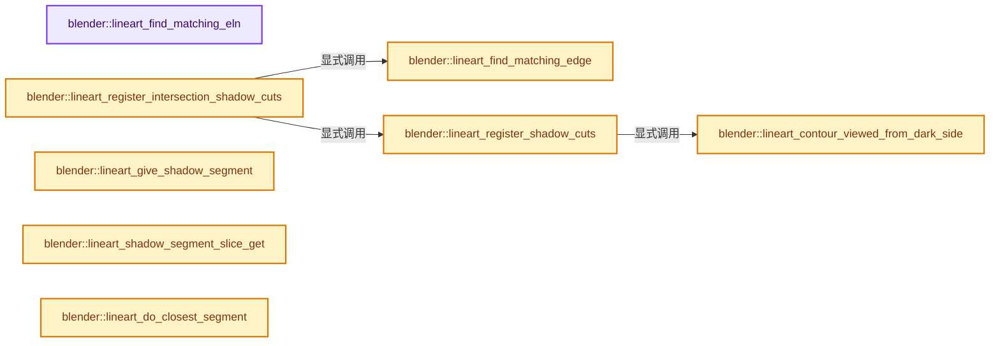
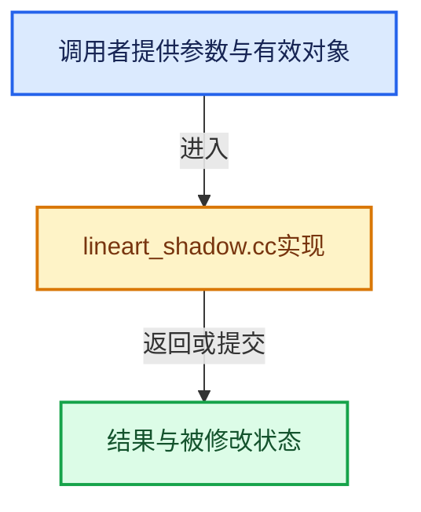

# 实现依赖专题：source/blender/modifiers/intern/lineart/lineart_shadow.cc

[方向导航](README.md) · [符号索引](../%E7%AC%A6%E5%8F%B7%E4%BE%9D%E8%B5%96%E4%B8%8E%E5%AE%9E%E7%8E%B0%E7%B4%A2%E5%BC%95.md)

本专题从正文实际调用进入，集中保存共享实现。函数有稳定锚点，可从调用处直接跳到对应完整函数；递归与互相调用通过回链组织。

## 本文件的实现关系






## 完整成员与函数实现

<a id="f-8f15e3e7b15fa50a"></a>

### `blender::lineart_find_matching_eln`

实现位置：[source/blender/modifiers/intern/lineart/lineart_shadow.cc](../../../../../source/blender/modifiers/intern/lineart/lineart_shadow.cc) · L33—L42。

接口参数：

- `ListBaseT<LineartElementLinkNode> *shadow_elns`
- `int obindex`

**教学注释版**

<!-- annotated:263860b3f1df04 -->

```cpp
LineartElementLinkNode *lineart_find_matching_eln(ListBaseT<LineartElementLinkNode> *shadow_elns,
                                                  int obindex)
{
  for (LineartElementLinkNode &eln : *shadow_elns) {
    if (eln.obindex == obindex) {
      return &eln;
    }
  }
  return nullptr;
}
```

<details>
<summary>核对原始源码：source/blender/modifiers/intern/lineart/lineart_shadow.cc · L33—L42</summary>

<!-- original:263860b3f1df04:source/blender/modifiers/intern/lineart/lineart_shadow.cc:33:42 -->

```cpp
LineartElementLinkNode *lineart_find_matching_eln(ListBaseT<LineartElementLinkNode> *shadow_elns,
                                                  int obindex)
{
  for (LineartElementLinkNode &eln : *shadow_elns) {
    if (eln.obindex == obindex) {
      return &eln;
    }
  }
  return nullptr;
}
```

</details>

**结果出口**

- `return &eln;`
- `return nullptr;`

**继续追踪实现**

本实现没有需要继续展开的显式调用；检查返回表达式、对象转换和调用者前置条件。

<a id="f-8a6878e9568ba8a0"></a>

### `blender::lineart_find_matching_edge`

实现位置：[source/blender/modifiers/intern/lineart/lineart_shadow.cc](../../../../../source/blender/modifiers/intern/lineart/lineart_shadow.cc) · L44—L54。

接口参数：

- `LineartElementLinkNode *shadow_eln`
- `uint64_t edge_identifier`

**教学注释版**

<!-- annotated:6b08b0fff0df72 -->

```cpp
LineartEdge *lineart_find_matching_edge(LineartElementLinkNode *shadow_eln,
                                        uint64_t edge_identifier)
{
  LineartEdge *elist = static_cast<LineartEdge *>(shadow_eln->pointer);
  for (int i = 0; i < shadow_eln->element_count; i++) {
    if (elist[i].edge_identifier == edge_identifier) {
      return &elist[i];
    }
  }
  return nullptr;
}
```

<details>
<summary>核对原始源码：source/blender/modifiers/intern/lineart/lineart_shadow.cc · L44—L54</summary>

<!-- original:6b08b0fff0df72:source/blender/modifiers/intern/lineart/lineart_shadow.cc:44:54 -->

```cpp
LineartEdge *lineart_find_matching_edge(LineartElementLinkNode *shadow_eln,
                                        uint64_t edge_identifier)
{
  LineartEdge *elist = static_cast<LineartEdge *>(shadow_eln->pointer);
  for (int i = 0; i < shadow_eln->element_count; i++) {
    if (elist[i].edge_identifier == edge_identifier) {
      return &elist[i];
    }
  }
  return nullptr;
}
```

</details>

**结果出口**

- `return &elist[i];`
- `return nullptr;`

**继续追踪实现**

本实现没有需要继续展开的显式调用；检查返回表达式、对象转换和调用者前置条件。

<a id="f-d9f60b675066758a"></a>

### `blender::lineart_contour_viewed_from_dark_side`

实现位置：[source/blender/modifiers/intern/lineart/lineart_shadow.cc](../../../../../source/blender/modifiers/intern/lineart/lineart_shadow.cc) · L56—L98。

接口参数：

- `LineartData *ld`
- `LineartEdge *e`

**教学注释版**

<!-- annotated:2cd31a1557d0be -->

```cpp
static bool lineart_contour_viewed_from_dark_side(LineartData *ld, LineartEdge *e)
{

  if (!(e->flags & (MOD_LINEART_EDGE_FLAG_CONTOUR | MOD_LINEART_EDGE_FLAG_CONTOUR_SECONDARY))) {
    return false;
  }
  double view_vector[3];
  double light_vector[3];
  bool side_1_facing_light = false;
  bool side_2_facing_light = false;
  bool side_1_facing_camera = false;
  if (ld->conf.cam_is_persp_secondary) {
    sub_v3_v3v3_db(light_vector, ld->conf.camera_pos_secondary, e->v1->gloc);
  }
  else {
    copy_v3_v3_db(light_vector, ld->conf.view_vector_secondary);
  }
  double dot_light_1 = dot_v3v3_db(light_vector, e->t1->gn);
  side_1_facing_light = (dot_light_1 > 0);
  if (e->t2) {
    double dot_light_2 = dot_v3v3_db(light_vector, e->t2->gn);
    side_2_facing_light = (dot_light_2 > 0);
  }
  else {
    side_2_facing_light = !side_1_facing_light;
  }

  if (ld->conf.cam_is_persp) {
    sub_v3_v3v3_db(view_vector, ld->conf.camera_pos, e->v1->gloc);
  }
  else {
    copy_v3_v3_db(view_vector, ld->conf.view_vector);
  }
  double dot_view_1 = dot_v3v3_db(view_vector, e->t1->gn);
  side_1_facing_camera = (dot_view_1 > 0);

  if ((side_1_facing_camera && (!side_1_facing_light) && side_2_facing_light) ||
      ((!side_1_facing_camera) && side_1_facing_light && (!side_2_facing_light)))
  {
    return true;
  }
  return false;
}
```

<details>
<summary>核对原始源码：source/blender/modifiers/intern/lineart/lineart_shadow.cc · L56—L98</summary>

<!-- original:2cd31a1557d0be:source/blender/modifiers/intern/lineart/lineart_shadow.cc:56:98 -->

```cpp
static bool lineart_contour_viewed_from_dark_side(LineartData *ld, LineartEdge *e)
{

  if (!(e->flags & (MOD_LINEART_EDGE_FLAG_CONTOUR | MOD_LINEART_EDGE_FLAG_CONTOUR_SECONDARY))) {
    return false;
  }
  double view_vector[3];
  double light_vector[3];
  bool side_1_facing_light = false;
  bool side_2_facing_light = false;
  bool side_1_facing_camera = false;
  if (ld->conf.cam_is_persp_secondary) {
    sub_v3_v3v3_db(light_vector, ld->conf.camera_pos_secondary, e->v1->gloc);
  }
  else {
    copy_v3_v3_db(light_vector, ld->conf.view_vector_secondary);
  }
  double dot_light_1 = dot_v3v3_db(light_vector, e->t1->gn);
  side_1_facing_light = (dot_light_1 > 0);
  if (e->t2) {
    double dot_light_2 = dot_v3v3_db(light_vector, e->t2->gn);
    side_2_facing_light = (dot_light_2 > 0);
  }
  else {
    side_2_facing_light = !side_1_facing_light;
  }

  if (ld->conf.cam_is_persp) {
    sub_v3_v3v3_db(view_vector, ld->conf.camera_pos, e->v1->gloc);
  }
  else {
    copy_v3_v3_db(view_vector, ld->conf.view_vector);
  }
  double dot_view_1 = dot_v3v3_db(view_vector, e->t1->gn);
  side_1_facing_camera = (dot_view_1 > 0);

  if ((side_1_facing_camera && (!side_1_facing_light) && side_2_facing_light) ||
      ((!side_1_facing_camera) && side_1_facing_light && (!side_2_facing_light)))
  {
    return true;
  }
  return false;
}
```

</details>

**沿实际写入检查状态**

- `side_1_facing_light = (dot_light_1 > 0);`
- `side_2_facing_light = (dot_light_2 > 0);`
- `side_2_facing_light = !side_1_facing_light;`
- `side_1_facing_camera = (dot_view_1 > 0);`

**结果出口**

- `return false;`
- `return true;`

**继续追踪实现**

- `sub_v3_v3v3_db` → [blender::sub_v3_v3v3_db · L374](../12-%E7%A9%BA%E9%97%B4%E6%95%B0%E6%8D%AE%E7%BB%93%E6%9E%84%E4%B8%8E%E5%87%A0%E4%BD%95%E7%AE%97%E6%B3%95/%E4%BE%9D%E8%B5%96-math_vector_inline-0c8541.md#f-fbc7e50b048005df)。
- `copy_v3_v3_db` → [blender::copy_v3_v3_db · L158](../12-%E7%A9%BA%E9%97%B4%E6%95%B0%E6%8D%AE%E7%BB%93%E6%9E%84%E4%B8%8E%E5%87%A0%E4%BD%95%E7%AE%97%E6%B3%95/%E4%BE%9D%E8%B5%96-math_vector_inline-0c8541.md#f-c589d75accd3ea79)。
- `dot_v3v3_db` → [blender::dot_v3v3_db · L675](../12-%E7%A9%BA%E9%97%B4%E6%95%B0%E6%8D%AE%E7%BB%93%E6%9E%84%E4%B8%8E%E5%87%A0%E4%BD%95%E7%AE%97%E6%B3%95/%E4%BE%9D%E8%B5%96-math_vector_inline-0c8541.md#f-bc39965d11160982)。

<a id="f-3f232751d6a53ad4"></a>

### `blender::lineart_register_shadow_cuts`

实现位置：[source/blender/modifiers/intern/lineart/lineart_shadow.cc](../../../../../source/blender/modifiers/intern/lineart/lineart_shadow.cc) · L100—L119。

接口参数：

- `LineartData *ld`
- `LineartEdge *e`
- `LineartEdge *shadow_edge`

**教学注释版**

<!-- annotated:92e23e0092c4d4 -->

```cpp
void lineart_register_shadow_cuts(LineartData *ld, LineartEdge *e, LineartEdge *shadow_edge)
{
  for (LineartEdgeSegment &es : shadow_edge->segments) {
    /* Convert to view space cutting points. */
    double la1 = es.ratio;
    double la2 = es.next ? es.next->ratio : 1.0f;
    la1 = la1 * e->v2->fbcoord[3] /
          (e->v1->fbcoord[3] - la1 * (e->v1->fbcoord[3] - e->v2->fbcoord[3]));
    la2 = la2 * e->v2->fbcoord[3] /
          (e->v1->fbcoord[3] - la2 * (e->v1->fbcoord[3] - e->v2->fbcoord[3]));
    uchar shadow_bits = (es.occlusion != 0) ? LRT_SHADOW_MASK_SHADED : LRT_SHADOW_MASK_ILLUMINATED;

    if (lineart_contour_viewed_from_dark_side(ld, e) && shadow_bits == LRT_SHADOW_MASK_ILLUMINATED)
    {
      shadow_bits = LRT_SHADOW_MASK_SHADED;
    }

    lineart_edge_cut(ld, e, la1, la2, 0, 0, shadow_bits);
  }
}
```

<details>
<summary>核对原始源码：source/blender/modifiers/intern/lineart/lineart_shadow.cc · L100—L119</summary>

<!-- original:92e23e0092c4d4:source/blender/modifiers/intern/lineart/lineart_shadow.cc:100:119 -->

```cpp
void lineart_register_shadow_cuts(LineartData *ld, LineartEdge *e, LineartEdge *shadow_edge)
{
  for (LineartEdgeSegment &es : shadow_edge->segments) {
    /* Convert to view space cutting points. */
    double la1 = es.ratio;
    double la2 = es.next ? es.next->ratio : 1.0f;
    la1 = la1 * e->v2->fbcoord[3] /
          (e->v1->fbcoord[3] - la1 * (e->v1->fbcoord[3] - e->v2->fbcoord[3]));
    la2 = la2 * e->v2->fbcoord[3] /
          (e->v1->fbcoord[3] - la2 * (e->v1->fbcoord[3] - e->v2->fbcoord[3]));
    uchar shadow_bits = (es.occlusion != 0) ? LRT_SHADOW_MASK_SHADED : LRT_SHADOW_MASK_ILLUMINATED;

    if (lineart_contour_viewed_from_dark_side(ld, e) && shadow_bits == LRT_SHADOW_MASK_ILLUMINATED)
    {
      shadow_bits = LRT_SHADOW_MASK_SHADED;
    }

    lineart_edge_cut(ld, e, la1, la2, 0, 0, shadow_bits);
  }
}
```

</details>

**沿实际写入检查状态**

- `la1 = la1 * e->v2->fbcoord[3] /`
- `la2 = la2 * e->v2->fbcoord[3] /`
- `shadow_bits = LRT_SHADOW_MASK_SHADED;`

**继续追踪实现**

- `lineart_contour_viewed_from_dark_side` → [blender::lineart_contour_viewed_from_dark_side · L56](%E4%BE%9D%E8%B5%96-lineart_shadow-a45c50.md#f-d9f60b675066758a)。
- `lineart_edge_cut` → [blender::lineart_edge_cut · L161](%E4%BE%9D%E8%B5%96-lineart_cpu-9ebd9e.md#f-1e58e12cd8a8da03)。

<a id="f-bd8fda4e07ad0cf4"></a>

### `blender::lineart_register_intersection_shadow_cuts`

实现位置：[source/blender/modifiers/intern/lineart/lineart_shadow.cc](../../../../../source/blender/modifiers/intern/lineart/lineart_shadow.cc) · L121—L156。

接口参数：

- `LineartData *ld`
- `ListBaseT<LineartElementLinkNode> *shadow_elns`

**教学注释版**

<!-- annotated:a5e59afb246fb1 -->

```cpp
void lineart_register_intersection_shadow_cuts(LineartData *ld,
                                               ListBaseT<LineartElementLinkNode> *shadow_elns)
{
  if (!shadow_elns) {
    return;
  }

  LineartElementLinkNode *eln_isect_shadow = nullptr;
  LineartElementLinkNode *eln_isect_original = nullptr;

  for (LineartElementLinkNode &eln : *shadow_elns) {
    if (eln.flags & LRT_ELEMENT_INTERSECTION_DATA) {
      eln_isect_shadow = &eln;
      break;
    }
  }
  for (LineartElementLinkNode &eln : ld->geom.line_buffer_pointers) {
    if (eln.flags & LRT_ELEMENT_INTERSECTION_DATA) {
      eln_isect_original = &eln;
      break;
    }
  }
  if (!eln_isect_shadow || !eln_isect_original) {
    return;
  }

  /* Keeping it single threaded for now because a simple parallel_for could end up getting the same
   * #shadow_e in different threads. */
  for (int i = 0; i < eln_isect_original->element_count; i++) {
    LineartEdge *e = &(static_cast<LineartEdge *>(eln_isect_original->pointer))[i];
    LineartEdge *shadow_e = lineart_find_matching_edge(eln_isect_shadow, e->edge_identifier);
    if (shadow_e) {
      lineart_register_shadow_cuts(ld, e, shadow_e);
    }
  }
}
```

<details>
<summary>核对原始源码：source/blender/modifiers/intern/lineart/lineart_shadow.cc · L121—L156</summary>

<!-- original:a5e59afb246fb1:source/blender/modifiers/intern/lineart/lineart_shadow.cc:121:156 -->

```cpp
void lineart_register_intersection_shadow_cuts(LineartData *ld,
                                               ListBaseT<LineartElementLinkNode> *shadow_elns)
{
  if (!shadow_elns) {
    return;
  }

  LineartElementLinkNode *eln_isect_shadow = nullptr;
  LineartElementLinkNode *eln_isect_original = nullptr;

  for (LineartElementLinkNode &eln : *shadow_elns) {
    if (eln.flags & LRT_ELEMENT_INTERSECTION_DATA) {
      eln_isect_shadow = &eln;
      break;
    }
  }
  for (LineartElementLinkNode &eln : ld->geom.line_buffer_pointers) {
    if (eln.flags & LRT_ELEMENT_INTERSECTION_DATA) {
      eln_isect_original = &eln;
      break;
    }
  }
  if (!eln_isect_shadow || !eln_isect_original) {
    return;
  }

  /* Keeping it single threaded for now because a simple parallel_for could end up getting the same
   * #shadow_e in different threads. */
  for (int i = 0; i < eln_isect_original->element_count; i++) {
    LineartEdge *e = &(static_cast<LineartEdge *>(eln_isect_original->pointer))[i];
    LineartEdge *shadow_e = lineart_find_matching_edge(eln_isect_shadow, e->edge_identifier);
    if (shadow_e) {
      lineart_register_shadow_cuts(ld, e, shadow_e);
    }
  }
}
```

</details>

**沿实际写入检查状态**

- `eln_isect_shadow = &eln;`
- `eln_isect_original = &eln;`

**继续追踪实现**

- `lineart_find_matching_edge` → [blender::lineart_find_matching_edge · L44](%E4%BE%9D%E8%B5%96-lineart_shadow-a45c50.md#f-8a6878e9568ba8a0)。
- `lineart_register_shadow_cuts` → [blender::lineart_register_shadow_cuts · L100](%E4%BE%9D%E8%B5%96-lineart_shadow-a45c50.md#f-3f232751d6a53ad4)。

<a id="f-97c3ed615a412caf"></a>

### `blender::lineart_give_shadow_segment`

实现位置：[source/blender/modifiers/intern/lineart/lineart_shadow.cc](../../../../../source/blender/modifiers/intern/lineart/lineart_shadow.cc) · L160—L177。

接口参数：

- `LineartData *ld`

**教学注释版**

<!-- annotated:b9b8a8a6ca5119 -->

```cpp
static LineartShadowSegment *lineart_give_shadow_segment(LineartData *ld)
{
  BLI_spin_lock(&ld->lock_cuts);

  /* See if there is any already allocated memory we can reuse. */
  if (ld->wasted_shadow_cuts.first()) {
    LineartShadowSegment *es = static_cast<LineartShadowSegment *>(
        BLI_pophead(&ld->wasted_shadow_cuts));
    BLI_spin_unlock(&ld->lock_cuts);
    // [讲解] memset：填充字节，不调用T构造函数，也不保证任意类型的全零表示是合法或期望值。
    memset(es, 0, sizeof(LineartShadowSegment));
    return es;
  }
  BLI_spin_unlock(&ld->lock_cuts);

  /* Otherwise allocate some new memory. */
  return static_cast<LineartShadowSegment *>(
      lineart_mem_acquire_thread(&ld->render_data_pool, sizeof(LineartShadowSegment)));
}
```

<details>
<summary>核对原始源码：source/blender/modifiers/intern/lineart/lineart_shadow.cc · L160—L177</summary>

<!-- original:b9b8a8a6ca5119:source/blender/modifiers/intern/lineart/lineart_shadow.cc:160:177 -->

```cpp
static LineartShadowSegment *lineart_give_shadow_segment(LineartData *ld)
{
  BLI_spin_lock(&ld->lock_cuts);

  /* See if there is any already allocated memory we can reuse. */
  if (ld->wasted_shadow_cuts.first()) {
    LineartShadowSegment *es = static_cast<LineartShadowSegment *>(
        BLI_pophead(&ld->wasted_shadow_cuts));
    BLI_spin_unlock(&ld->lock_cuts);
    memset(es, 0, sizeof(LineartShadowSegment));
    return es;
  }
  BLI_spin_unlock(&ld->lock_cuts);

  /* Otherwise allocate some new memory. */
  return static_cast<LineartShadowSegment *>(
      lineart_mem_acquire_thread(&ld->render_data_pool, sizeof(LineartShadowSegment)));
}
```

</details>

**结果出口**

- `return es;`
- `return static_cast<LineartShadowSegment *>(`

**继续追踪实现**

- `BLI_spin_lock` → [调用协议](../%E6%A8%A1%E6%9D%BF%E5%AE%8F%E4%B8%8E%E5%8A%A8%E6%80%81%E5%88%86%E6%B4%BE%E5%8D%8F%E8%AE%AE.md)：函数指针、局部可调用对象或未展开的宏；必须结合调用者环境。调用位置L162。
- `ld->wasted_shadow_cuts.first` → [调用协议](../%E6%A8%A1%E6%9D%BF%E5%AE%8F%E4%B8%8E%E5%8A%A8%E6%80%81%E5%88%86%E6%B4%BE%E5%8D%8F%E8%AE%AE.md)：接收对象类型依赖auto、返回值或模板实例；不按同名猜测目标。调用位置L165。
- `BLI_pophead` → [blender::BLI_pophead · L259](../01-%E5%9F%BA%E7%A1%80%E5%AE%B9%E5%99%A8%E4%B8%8E%E7%8E%B0%E4%BB%A3CPP/%E4%BE%9D%E8%B5%96-listbase-2816d9.md#f-c1491382e532f81c)。
- `BLI_spin_unlock` → [BLI_spin_unlock · L433](../01-%E5%9F%BA%E7%A1%80%E5%AE%B9%E5%99%A8%E4%B8%8E%E7%8E%B0%E4%BB%A3CPP/%E4%BE%9D%E8%B5%96-threads-a036bf.md#f-ded25214a4593256)。
- `memset` → [外部契约](https://eel.is/c++draft/cstring.syn)：填充字节，不调用T构造函数，也不保证任意类型的全零表示是合法或期望值。
- `lineart_mem_acquire_thread` → [blender::lineart_mem_acquire_thread · L124](%E4%BE%9D%E8%B5%96-lineart_util-9eeea8.md#f-d2e9b62a191e84f0)。

<a id="f-364291d9781b2ba0"></a>

### `blender::lineart_shadow_segment_slice_get`

实现位置：[source/blender/modifiers/intern/lineart/lineart_shadow.cc](../../../../../source/blender/modifiers/intern/lineart/lineart_shadow.cc) · L179—L201。

接口参数：

- `double *fb_co_1`
- `double *fb_co_2`
- `double *gloc_1`
- `double *gloc_2`
- `double ratio`
- `double at_1`
- `double at_2`
- `double *r_fb_co`
- `double *r_gloc`

**教学注释版**

<!-- annotated:a9d1c02d8ed5b2 -->

```cpp
static void lineart_shadow_segment_slice_get(double *fb_co_1,
                                             double *fb_co_2,
                                             double *gloc_1,
                                             double *gloc_2,
                                             double ratio,
                                             double at_1,
                                             double at_2,
                                             double *r_fb_co,
                                             double *r_gloc)
{
  double real_at = ((at_2 - at_1) == 0) ? 0 : ((ratio - at_1) / (at_2 - at_1));
  double ga_div = (fb_co_2[3] * (1.0f - real_at) + fb_co_1[3] * real_at);
  double ga;
  if (ga_div == 0) {
    ga = 0;
  }
  else {
    ga = fb_co_1[3] * real_at / ga_div;
  }
  interp_v3_v3v3_db(r_fb_co, fb_co_1, fb_co_2, real_at);
  r_fb_co[3] = interpd(fb_co_2[3], fb_co_1[3], ga);
  interp_v3_v3v3_db(r_gloc, gloc_1, gloc_2, ga);
}
```

<details>
<summary>核对原始源码：source/blender/modifiers/intern/lineart/lineart_shadow.cc · L179—L201</summary>

<!-- original:a9d1c02d8ed5b2:source/blender/modifiers/intern/lineart/lineart_shadow.cc:179:201 -->

```cpp
static void lineart_shadow_segment_slice_get(double *fb_co_1,
                                             double *fb_co_2,
                                             double *gloc_1,
                                             double *gloc_2,
                                             double ratio,
                                             double at_1,
                                             double at_2,
                                             double *r_fb_co,
                                             double *r_gloc)
{
  double real_at = ((at_2 - at_1) == 0) ? 0 : ((ratio - at_1) / (at_2 - at_1));
  double ga_div = (fb_co_2[3] * (1.0f - real_at) + fb_co_1[3] * real_at);
  double ga;
  if (ga_div == 0) {
    ga = 0;
  }
  else {
    ga = fb_co_1[3] * real_at / ga_div;
  }
  interp_v3_v3v3_db(r_fb_co, fb_co_1, fb_co_2, real_at);
  r_fb_co[3] = interpd(fb_co_2[3], fb_co_1[3], ga);
  interp_v3_v3v3_db(r_gloc, gloc_1, gloc_2, ga);
}
```

</details>

**沿实际写入检查状态**

- `ga = 0;`
- `ga = fb_co_1[3] * real_at / ga_div;`
- `r_fb_co[3] = interpd(fb_co_2[3], fb_co_1[3], ga);`

**继续追踪实现**

- `interp_v3_v3v3_db` → [blender::interp_v3_v3v3_db · L1015](../12-%E7%A9%BA%E9%97%B4%E6%95%B0%E6%8D%AE%E7%BB%93%E6%9E%84%E4%B8%8E%E5%87%A0%E4%BD%95%E7%AE%97%E6%B3%95/%E4%BE%9D%E8%B5%96-math_vector-5f35fa.md#f-2693be97ae2f9ee5)。
- `interpd` → [blender::interpd · L83](../12-%E7%A9%BA%E9%97%B4%E6%95%B0%E6%8D%AE%E7%BB%93%E6%9E%84%E4%B8%8E%E5%87%A0%E4%BD%95%E7%AE%97%E6%B3%95/%E4%BE%9D%E8%B5%96-math_base_inline-546b00.md#f-838cb2b6b77b0307)。

<a id="f-a1e1fc6f673ee081"></a>

### `blender::lineart_do_closest_segment`

实现位置：[source/blender/modifiers/intern/lineart/lineart_shadow.cc](../../../../../source/blender/modifiers/intern/lineart/lineart_shadow.cc) · L226—L309。

接口参数：

- `bool is_persp`
- `double *s1_fb_co_1`
- `double *s1_fb_co_2`
- `double *s2_fb_co_1`
- `double *s2_fb_co_2`
- `double *s1_gloc_1`
- `double *s1_gloc_2`
- `double *s2_gloc_1`
- `double *s2_gloc_2`
- `double *r_fb_co_1`
- `double *r_fb_co_2`
- `double *r_gloc_1`
- `double *r_gloc_2`
- `double *r_new_in_the_middle`
- `double *r_new_in_the_middle_global`
- `double *r_new_at`
- `bool *is_side_2r`
- `bool *use_new_ref`

**教学注释版**

<!-- annotated:c56e25c7d692ec -->

```cpp
static bool lineart_do_closest_segment(bool is_persp,
                                       double *s1_fb_co_1,
                                       double *s1_fb_co_2,
                                       double *s2_fb_co_1,
                                       double *s2_fb_co_2,
                                       double *s1_gloc_1,
                                       double *s1_gloc_2,
                                       double *s2_gloc_1,
                                       double *s2_gloc_2,
                                       double *r_fb_co_1,
                                       double *r_fb_co_2,
                                       double *r_gloc_1,
                                       double *r_gloc_2,
                                       double *r_new_in_the_middle,
                                       double *r_new_in_the_middle_global,
                                       double *r_new_at,
                                       bool *is_side_2r,
                                       bool *use_new_ref)
{
  int side = 0;
  int z_index = is_persp ? 3 : 2;

  /* No need to do anything if the segment has no length. */
  if (s2_fb_co_1[z_index] == s2_fb_co_2[z_index]) {
    return false;
  }

  /* Always use the closest point to the light camera. */
  if (s1_fb_co_1[z_index] >= s2_fb_co_1[z_index]) {
    copy_v4_v4_db(r_fb_co_1, s2_fb_co_1);
    copy_v3_v3_db(r_gloc_1, s2_gloc_1);
    side++;
  }
  if (s1_fb_co_2[z_index] >= s2_fb_co_2[z_index]) {
    copy_v4_v4_db(r_fb_co_2, s2_fb_co_2);
    copy_v3_v3_db(r_gloc_2, s2_gloc_2);
    *is_side_2r = true;
    side++;
  }
  if (s1_fb_co_1[z_index] <= s2_fb_co_1[z_index]) {
    copy_v4_v4_db(r_fb_co_1, s1_fb_co_1);
    copy_v3_v3_db(r_gloc_1, s1_gloc_1);
    side--;
  }
  if (s1_fb_co_2[z_index] <= s2_fb_co_2[z_index]) {
    copy_v4_v4_db(r_fb_co_2, s1_fb_co_2);
    copy_v3_v3_db(r_gloc_2, s1_gloc_2);
    *is_side_2r = false;
    side--;
  }

  /* No need to cut in the middle, because one segment completely overlaps the other. */
  if (side) {
    if (side > 0) {
      *is_side_2r = true;
      *use_new_ref = true;
    }
    else if (side < 0) {
      *is_side_2r = false;
      *use_new_ref = false;
    }
    return false;
  }

  /* Else there must be an intersection point in the middle. Use "w" value to linearly plot the
   * position and get image space "ratio" position. */
  double dl = s1_fb_co_1[z_index] - s2_fb_co_1[z_index];
  double dr = s1_fb_co_2[z_index] - s2_fb_co_2[z_index];
  double ga = ratiod(dl, dr, 0);
  double ga_div = s2_fb_co_1[3] * (1.0f - ga) + s2_fb_co_2[3] * ga;
  if (ga_div == 0) {
    *r_new_at = 0;
    return false;
  }

  *r_new_at = is_persp ? s2_fb_co_2[3] * ga / ga_div : ga;

  interp_v3_v3v3_db(r_new_in_the_middle, s2_fb_co_1, s2_fb_co_2, *r_new_at);
  r_new_in_the_middle[3] = interpd(s2_fb_co_2[3], s2_fb_co_1[3], ga);
  interp_v3_v3v3_db(r_new_in_the_middle_global, s1_gloc_1, s1_gloc_2, ga);
  *use_new_ref = true;

  return true;
}
```

<details>
<summary>核对原始源码：source/blender/modifiers/intern/lineart/lineart_shadow.cc · L226—L309</summary>

<!-- original:c56e25c7d692ec:source/blender/modifiers/intern/lineart/lineart_shadow.cc:226:309 -->

```cpp
static bool lineart_do_closest_segment(bool is_persp,
                                       double *s1_fb_co_1,
                                       double *s1_fb_co_2,
                                       double *s2_fb_co_1,
                                       double *s2_fb_co_2,
                                       double *s1_gloc_1,
                                       double *s1_gloc_2,
                                       double *s2_gloc_1,
                                       double *s2_gloc_2,
                                       double *r_fb_co_1,
                                       double *r_fb_co_2,
                                       double *r_gloc_1,
                                       double *r_gloc_2,
                                       double *r_new_in_the_middle,
                                       double *r_new_in_the_middle_global,
                                       double *r_new_at,
                                       bool *is_side_2r,
                                       bool *use_new_ref)
{
  int side = 0;
  int z_index = is_persp ? 3 : 2;

  /* No need to do anything if the segment has no length. */
  if (s2_fb_co_1[z_index] == s2_fb_co_2[z_index]) {
    return false;
  }

  /* Always use the closest point to the light camera. */
  if (s1_fb_co_1[z_index] >= s2_fb_co_1[z_index]) {
    copy_v4_v4_db(r_fb_co_1, s2_fb_co_1);
    copy_v3_v3_db(r_gloc_1, s2_gloc_1);
    side++;
  }
  if (s1_fb_co_2[z_index] >= s2_fb_co_2[z_index]) {
    copy_v4_v4_db(r_fb_co_2, s2_fb_co_2);
    copy_v3_v3_db(r_gloc_2, s2_gloc_2);
    *is_side_2r = true;
    side++;
  }
  if (s1_fb_co_1[z_index] <= s2_fb_co_1[z_index]) {
    copy_v4_v4_db(r_fb_co_1, s1_fb_co_1);
    copy_v3_v3_db(r_gloc_1, s1_gloc_1);
    side--;
  }
  if (s1_fb_co_2[z_index] <= s2_fb_co_2[z_index]) {
    copy_v4_v4_db(r_fb_co_2, s1_fb_co_2);
    copy_v3_v3_db(r_gloc_2, s1_gloc_2);
    *is_side_2r = false;
    side--;
  }

  /* No need to cut in the middle, because one segment completely overlaps the other. */
  if (side) {
    if (side > 0) {
      *is_side_2r = true;
      *use_new_ref = true;
    }
    else if (side < 0) {
      *is_side_2r = false;
      *use_new_ref = false;
    }
    return false;
  }

  /* Else there must be an intersection point in the middle. Use "w" value to linearly plot the
   * position and get image space "ratio" position. */
  double dl = s1_fb_co_1[z_index] - s2_fb_co_1[z_index];
  double dr = s1_fb_co_2[z_index] - s2_fb_co_2[z_index];
  double ga = ratiod(dl, dr, 0);
  double ga_div = s2_fb_co_1[3] * (1.0f - ga) + s2_fb_co_2[3] * ga;
  if (ga_div == 0) {
    *r_new_at = 0;
    return false;
  }

  *r_new_at = is_persp ? s2_fb_co_2[3] * ga / ga_div : ga;

  interp_v3_v3v3_db(r_new_in_the_middle, s2_fb_co_1, s2_fb_co_2, *r_new_at);
  r_new_in_the_middle[3] = interpd(s2_fb_co_2[3], s2_fb_co_1[3], ga);
  interp_v3_v3v3_db(r_new_in_the_middle_global, s1_gloc_1, s1_gloc_2, ga);
  *use_new_ref = true;

  return true;
}
```

</details>

**沿实际写入检查状态**

- `r_new_in_the_middle[3] = interpd(s2_fb_co_2[3], s2_fb_co_1[3], ga);`

**结果出口**

- `return false;`
- `return true;`

**继续追踪实现**

- `copy_v4_v4_db` → [blender::copy_v4_v4_db · L165](../12-%E7%A9%BA%E9%97%B4%E6%95%B0%E6%8D%AE%E7%BB%93%E6%9E%84%E4%B8%8E%E5%87%A0%E4%BD%95%E7%AE%97%E6%B3%95/%E4%BE%9D%E8%B5%96-math_vector_inline-0c8541.md#f-1399886b8a078619)。
- `copy_v3_v3_db` → [blender::copy_v3_v3_db · L158](../12-%E7%A9%BA%E9%97%B4%E6%95%B0%E6%8D%AE%E7%BB%93%E6%9E%84%E4%B8%8E%E5%87%A0%E4%BD%95%E7%AE%97%E6%B3%95/%E4%BE%9D%E8%B5%96-math_vector_inline-0c8541.md#f-c589d75accd3ea79)。
- `ratiod` → [blender::ratiod · L94](../12-%E7%A9%BA%E9%97%B4%E6%95%B0%E6%8D%AE%E7%BB%93%E6%9E%84%E4%B8%8E%E5%87%A0%E4%BD%95%E7%AE%97%E6%B3%95/%E4%BE%9D%E8%B5%96-math_base_inline-546b00.md#f-cf7f7576c0f9e176)。
- `interp_v3_v3v3_db` → [blender::interp_v3_v3v3_db · L1015](../12-%E7%A9%BA%E9%97%B4%E6%95%B0%E6%8D%AE%E7%BB%93%E6%9E%84%E4%B8%8E%E5%87%A0%E4%BD%95%E7%AE%97%E6%B3%95/%E4%BE%9D%E8%B5%96-math_vector-5f35fa.md#f-2693be97ae2f9ee5)。
- `interpd` → [blender::interpd · L83](../12-%E7%A9%BA%E9%97%B4%E6%95%B0%E6%8D%AE%E7%BB%93%E6%9E%84%E4%B8%8E%E5%87%A0%E4%BD%95%E7%AE%97%E6%B3%95/%E4%BE%9D%E8%B5%96-math_base_inline-546b00.md#f-838cb2b6b77b0307)。

<a id="f-459063302637c6ca"></a>

### `blender::lineart_shadow_create_shadow_edge_array`

实现位置：[source/blender/modifiers/intern/lineart/lineart_shadow.cc](../../../../../source/blender/modifiers/intern/lineart/lineart_shadow.cc) · L313—L375。

接口参数：

- `LineartData *ld`
- `bool transform_edge_cuts`
- `bool do_light_contour`

**教学注释版**

<!-- annotated:17435ed71494e0 -->

```cpp
static void lineart_shadow_create_shadow_edge_array(LineartData *ld,
                                                    bool transform_edge_cuts,
                                                    bool do_light_contour)
{
/* If the segment is short enough, we ignore them because it's not prominently visible anyway. */
#define DISCARD_NONSENSE_SEGMENTS \
  if (es.occlusion != 0 || \
      (es.next && LRT_DOUBLE_CLOSE_ENOUGH(es.ratio, ((LineartEdgeSegment *)es.next)->ratio))) \
  { \
    LRT_ITER_ALL_LINES_NEXT; \
    continue; \
  }

  /* Count and allocate at once to save time. */
  int segment_count = 0;
  uint16_t accept_types = (MOD_LINEART_EDGE_FLAG_CONTOUR | MOD_LINEART_EDGE_FLAG_LOOSE);
  if (do_light_contour) {
    accept_types |= MOD_LINEART_EDGE_FLAG_LIGHT_CONTOUR;
  }
  LRT_ITER_ALL_LINES_BEGIN
  {
    /* Only contour and loose edges can actually cast shadows. We allow light contour here because
     * we want to see if it also doubles as a view contour, in that case we also need to project
     * them. */
    if (!(e->flags & accept_types)) {
      continue;
    }
    if (e->flags == MOD_LINEART_EDGE_FLAG_LIGHT_CONTOUR) {
      /* Check if the light contour also doubles as a view contour. */
      LineartEdge *orig_e = reinterpret_cast<LineartEdge *>(e->t1);
      if (!orig_e->t2) {
        e->flags |= MOD_LINEART_EDGE_FLAG_CONTOUR;
      }
      else {
        double vv[3];
        double *view_vector = vv;
        double dot_1 = 0, dot_2 = 0;
        double result;
        if (ld->conf.cam_is_persp) {
          sub_v3_v3v3_db(view_vector, orig_e->v1->gloc, ld->conf.camera_pos);
        }
        else {
          view_vector = ld->conf.view_vector;
        }

        dot_1 = dot_v3v3_db(view_vector, orig_e->t1->gn);
        dot_2 = dot_v3v3_db(view_vector, orig_e->t2->gn);

        if ((result = dot_1 * dot_2) <= 0 && (dot_1 + dot_2)) {
          /* If this edge is both a light contour and a view contour, mark it for the convenience
           * of generating it in the next iteration. */
          e->flags |= MOD_LINEART_EDGE_FLAG_CONTOUR;
        }
      }
      if (!(e->flags & MOD_LINEART_EDGE_FLAG_CONTOUR)) {
        continue;
      }
    }
    for (LineartEdgeSegment &es : e->segments) {
      DISCARD_NONSENSE_SEGMENTS
      segment_count++;
    }
  }
```

<details>
<summary>核对原始源码：source/blender/modifiers/intern/lineart/lineart_shadow.cc · L313—L375</summary>

<!-- original:17435ed71494e0:source/blender/modifiers/intern/lineart/lineart_shadow.cc:313:375 -->

```cpp
static void lineart_shadow_create_shadow_edge_array(LineartData *ld,
                                                    bool transform_edge_cuts,
                                                    bool do_light_contour)
{
/* If the segment is short enough, we ignore them because it's not prominently visible anyway. */
#define DISCARD_NONSENSE_SEGMENTS \
  if (es.occlusion != 0 || \
      (es.next && LRT_DOUBLE_CLOSE_ENOUGH(es.ratio, ((LineartEdgeSegment *)es.next)->ratio))) \
  { \
    LRT_ITER_ALL_LINES_NEXT; \
    continue; \
  }

  /* Count and allocate at once to save time. */
  int segment_count = 0;
  uint16_t accept_types = (MOD_LINEART_EDGE_FLAG_CONTOUR | MOD_LINEART_EDGE_FLAG_LOOSE);
  if (do_light_contour) {
    accept_types |= MOD_LINEART_EDGE_FLAG_LIGHT_CONTOUR;
  }
  LRT_ITER_ALL_LINES_BEGIN
  {
    /* Only contour and loose edges can actually cast shadows. We allow light contour here because
     * we want to see if it also doubles as a view contour, in that case we also need to project
     * them. */
    if (!(e->flags & accept_types)) {
      continue;
    }
    if (e->flags == MOD_LINEART_EDGE_FLAG_LIGHT_CONTOUR) {
      /* Check if the light contour also doubles as a view contour. */
      LineartEdge *orig_e = reinterpret_cast<LineartEdge *>(e->t1);
      if (!orig_e->t2) {
        e->flags |= MOD_LINEART_EDGE_FLAG_CONTOUR;
      }
      else {
        double vv[3];
        double *view_vector = vv;
        double dot_1 = 0, dot_2 = 0;
        double result;
        if (ld->conf.cam_is_persp) {
          sub_v3_v3v3_db(view_vector, orig_e->v1->gloc, ld->conf.camera_pos);
        }
        else {
          view_vector = ld->conf.view_vector;
        }

        dot_1 = dot_v3v3_db(view_vector, orig_e->t1->gn);
        dot_2 = dot_v3v3_db(view_vector, orig_e->t2->gn);

        if ((result = dot_1 * dot_2) <= 0 && (dot_1 + dot_2)) {
          /* If this edge is both a light contour and a view contour, mark it for the convenience
           * of generating it in the next iteration. */
          e->flags |= MOD_LINEART_EDGE_FLAG_CONTOUR;
        }
      }
      if (!(e->flags & MOD_LINEART_EDGE_FLAG_CONTOUR)) {
        continue;
      }
    }
    for (LineartEdgeSegment &es : e->segments) {
      DISCARD_NONSENSE_SEGMENTS
      segment_count++;
    }
  }
```

</details>

**沿实际写入检查状态**

- `accept_types |= MOD_LINEART_EDGE_FLAG_LIGHT_CONTOUR;`
- `e->flags |= MOD_LINEART_EDGE_FLAG_CONTOUR;`
- `view_vector = ld->conf.view_vector;`
- `dot_1 = dot_v3v3_db(view_vector, orig_e->t1->gn);`
- `dot_2 = dot_v3v3_db(view_vector, orig_e->t2->gn);`

**继续追踪实现**

- `if` → [if · L262](../01-%E5%9F%BA%E7%A1%80%E5%AE%B9%E5%99%A8%E4%B8%8E%E7%8E%B0%E4%BB%A3CPP/%E4%BE%9D%E8%B5%96-BLI_path_utils_test-727584.md#m-e5db1d122630)。宏定义由构建条件选择。
- `LineartEdge *orig_e = reinterpret_cast<LineartEdge *>(e->t1)` → [blender::LineartEdge](%E4%BE%9D%E8%B5%96-MOD_lineart-dd1e12.md#t-c0d57ea0797f)；[blender::LineartEdge](%E4%BE%9D%E8%B5%96-MOD_lineart-dd1e12.md#t-d4a64375e7f4)；[blender::LineartEdge](%E4%BE%9D%E8%B5%96-lineart_intern-d51a26.md#t-6ea8866022e2)；[blender::LineartEdge](%E4%BE%9D%E8%B5%96-lineart_intern-d51a26.md#t-7bce474b10f4)；[blender::LineartEdge](%E4%BE%9D%E8%B5%96-lineart_intern-d51a26.md#t-4d4c37004dab)；[blender::LineartEdge](%E4%BE%9D%E8%B5%96-lineart_intern-d51a26.md#t-923769d8b3c1)；[blender::LineartEdge](%E4%BE%9D%E8%B5%96-lineart_intern-d51a26.md#t-866ee58b5c67)；[blender::LineartEdge](%E4%BE%9D%E8%B5%96-lineart_intern-d51a26.md#t-ec7513974710)。
- `else { double vv[3]; double *view_vector = vv; double dot_1 = 0, dot_2 = 0; double result; if (ld->conf.cam_is_persp) { sub_v3_v3v3_db(view_vector, orig_e->v1->gloc, ld->conf.camer …（完整表达式见本函数源码）` → [调用协议](../%E6%A8%A1%E6%9D%BF%E5%AE%8F%E4%B8%8E%E5%8A%A8%E6%80%81%E5%88%86%E6%B4%BE%E5%8D%8F%E8%AE%AE.md)：函数指针、局部可调用对象或未展开的宏；必须结合调用者环境。调用位置L346。
- `sub_v3_v3v3_db` → [blender::sub_v3_v3v3_db · L374](../12-%E7%A9%BA%E9%97%B4%E6%95%B0%E6%8D%AE%E7%BB%93%E6%9E%84%E4%B8%8E%E5%87%A0%E4%BD%95%E7%AE%97%E6%B3%95/%E4%BE%9D%E8%B5%96-math_vector_inline-0c8541.md#f-fbc7e50b048005df)。
- `dot_v3v3_db` → [blender::dot_v3v3_db · L675](../12-%E7%A9%BA%E9%97%B4%E6%95%B0%E6%8D%AE%E7%BB%93%E6%9E%84%E4%B8%8E%E5%87%A0%E4%BD%95%E7%AE%97%E6%B3%95/%E4%BE%9D%E8%B5%96-math_vector_inline-0c8541.md#f-bc39965d11160982)。
- `dot_2 = dot_v3v3_db(view_vector, orig_e->t2->gn)` → [调用协议](../%E6%A8%A1%E6%9D%BF%E5%AE%8F%E4%B8%8E%E5%8A%A8%E6%80%81%E5%88%86%E6%B4%BE%E5%8D%8F%E8%AE%AE.md)：函数指针、局部可调用对象或未展开的宏；必须结合调用者环境。调用位置L359。

<a id="f-06a311955742cc73"></a>

### `lineart_shadow_edge_cut`

实现位置：[source/blender/modifiers/intern/lineart/lineart_shadow.cc](../../../../../source/blender/modifiers/intern/lineart/lineart_shadow.cc) · L504—L732。

接口参数：

- `LineartData *ld`
- `LineartShadowEdge *e`
- `double start`
- `double end`
- `double *start_gloc`
- `double *end_gloc`
- `double *start_fb_co`
- `double *end_fb_co`
- `bool facing_light`
- `uint32_t target_reference`

**教学注释版**

<!-- annotated:462f58584dc271 -->

```cpp
static void lineart_shadow_edge_cut(LineartData *ld,
                                    LineartShadowEdge *e,
                                    double start,
                                    double end,
                                    double *start_gloc,
                                    double *end_gloc,
                                    double *start_fb_co,
                                    double *end_fb_co,
                                    bool facing_light,
                                    uint32_t target_reference)
{
  LineartShadowSegment *seg, *i_seg;
  LineartShadowSegment *cut_start_after = static_cast<LineartShadowSegment *>(
                           e->shadow_segments.first()),
                       *cut_end_before = e->shadow_segments.last();
  LineartShadowSegment *new_seg_1 = nullptr, *new_seg_2 = nullptr, *seg_1 = nullptr,
                       *seg_2 = nullptr;
  int untouched = 0;

  /* If for some reason the occlusion function may give a result that has zero length, or
   * reversed in direction, or NAN, we take care of them here. */
  if (LRT_DOUBLE_CLOSE_ENOUGH(start, end)) {
    return;
  }
  if (LRT_DOUBLE_CLOSE_ENOUGH(start, 1) || LRT_DOUBLE_CLOSE_ENOUGH(end, 0)) {
    return;
  }
  if (start != start) [[unlikely]] {
    start = 0;
  }
  if (end != end) [[unlikely]] {
    end = 0;
  }

  if (start > end) {
    double t = start;
    start = end;
    end = t;
  }

  /* Begin looking for starting position of the segment. */
  /* Not using a list iteration macro because of it more clear when using for loops to iterate
   * through the segments. */
  for (LineartShadowSegment &seg : e->shadow_segments) {
    if (LRT_DOUBLE_CLOSE_ENOUGH(seg.ratio, start)) {
      cut_start_after = &seg;
      new_seg_1 = cut_start_after;
      break;
    }
    if (seg.next == nullptr) {
      break;
    }
    i_seg = seg.next;
    if (i_seg->ratio > start + 1e-09 && start > seg.ratio) {
      cut_start_after = &seg;
      new_seg_1 = lineart_give_shadow_segment(ld);
      break;
    }
  }
  if (!cut_start_after && LRT_DOUBLE_CLOSE_ENOUGH(1, end)) {
    untouched = 1;
  }
  for (seg = cut_start_after->next; seg; seg = seg->next) {
    /* We tried to cut at existing cutting point (e.g. where the line's occluded by a triangle
     * strip). */
    if (LRT_DOUBLE_CLOSE_ENOUGH(seg->ratio, end)) {
      cut_end_before = seg;
      new_seg_2 = cut_end_before;
      break;
    }
    /* This check is to prevent `es->ratio == 1.0` (where we don't need to cut because we are ratio
     * the end point). */
    if (!seg->next && LRT_DOUBLE_CLOSE_ENOUGH(1, end)) {
      cut_end_before = seg;
      new_seg_2 = cut_end_before;
      untouched = 1;
      break;
    }
    /* When an actual cut is needed in the line. */
    if (seg->ratio > end) {
      cut_end_before = seg;
      new_seg_2 = lineart_give_shadow_segment(ld);
      break;
    }
  }

  /* When we still can't find any existing cut in the line, we allocate new ones. */
  if (new_seg_1 == nullptr) {
    new_seg_1 = lineart_give_shadow_segment(ld);
  }
  if (new_seg_2 == nullptr) {
    if (untouched) {
      new_seg_2 = new_seg_1;
      cut_end_before = new_seg_2;
    }
    else {
      new_seg_2 = lineart_give_shadow_segment(ld);
    }
  }

  /* If we touched the cut list, we assign the new cut position based on new cut position,
   * this way we accommodate precision lost due to multiple cut inserts. */
  new_seg_1->ratio = start;
  if (!untouched) {
    new_seg_2->ratio = end;
  }

  double r_fb_co_1[4] = {0}, r_fb_co_2[4] = {0}, r_gloc_1[3] = {0}, r_gloc_2[3] = {0};
  double r_new_in_the_middle[4], r_new_in_the_middle_global[3], r_new_at;
  double *s1_fb_co_1, *s1_fb_co_2, *s1_gloc_1, *s1_gloc_2;

  /* Temporary coordinate records and "middle" records. */
  double t_g1[3], t_g2[3], t_fbc1[4], t_fbc2[4], m_g1[3], m_fbc1[4], m_g2[3], m_fbc2[4];
  bool is_side_2r, has_middle = false, use_new_ref;
  copy_v4_v4_db(t_fbc1, start_fb_co);
  copy_v3_v3_db(t_g1, start_gloc);

  /* Do max stuff before insert. */
  LineartShadowSegment *nes;
  for (seg = cut_start_after; seg != cut_end_before; seg = nes) {
    nes = seg->next;

    s1_fb_co_1 = seg->fbc2;
    s1_fb_co_2 = nes->fbc1;

    s1_gloc_1 = seg->g2;
    s1_gloc_2 = nes->g1;

    seg_1 = seg;
    seg_2 = nes;

    if (seg == cut_start_after) {
      lineart_shadow_segment_slice_get(seg->fbc2,
                                       nes->fbc1,
                                       seg->g2,
                                       nes->g1,
                                       new_seg_1->ratio,
                                       seg->ratio,
                                       nes->ratio,
                                       m_fbc1,
                                       m_g1);
      s1_fb_co_1 = m_fbc1;
      s1_gloc_1 = m_g1;

      seg_1 = new_seg_1;
      if (cut_start_after != new_seg_1) {
        BLI_insertlinkafter(&e->shadow_segments, cut_start_after, new_seg_1);
        copy_v4_v4_db(new_seg_1->fbc1, m_fbc1);
        copy_v3_v3_db(new_seg_1->g1, m_g1);
      }
    }
    if (nes == cut_end_before) {
      lineart_shadow_segment_slice_get(seg->fbc2,
                                       nes->fbc1,
                                       seg->g2,
                                       nes->g1,
                                       new_seg_2->ratio,
                                       seg->ratio,
                                       nes->ratio,
                                       m_fbc2,
                                       m_g2);
      s1_fb_co_2 = m_fbc2;
      s1_gloc_2 = m_g2;

      seg_2 = new_seg_2;
      if (cut_end_before != new_seg_2) {
        BLI_insertlinkbefore(&e->shadow_segments, cut_end_before, new_seg_2);
        copy_v4_v4_db(new_seg_2->fbc2, m_fbc2);
        copy_v3_v3_db(new_seg_2->g2, m_g2);
        /* Need to restore the flag for next segment's reference. */
        seg_2->flag = seg->flag;
        seg_2->target_reference = seg->target_reference;
      }
    }

    lineart_shadow_segment_slice_get(
        start_fb_co, end_fb_co, start_gloc, end_gloc, seg_2->ratio, start, end, t_fbc2, t_g2);

    if ((has_middle = lineart_do_closest_segment(ld->conf.cam_is_persp,
                                                 s1_fb_co_1,
                                                 s1_fb_co_2,
                                                 t_fbc1,
                                                 t_fbc2,
                                                 s1_gloc_1,
                                                 s1_gloc_2,
                                                 t_g1,
                                                 t_g2,
                                                 r_fb_co_1,
                                                 r_fb_co_2,
                                                 r_gloc_1,
                                                 r_gloc_2,
                                                 r_new_in_the_middle,
                                                 r_new_in_the_middle_global,
                                                 &r_new_at,
                                                 &is_side_2r,
                                                 &use_new_ref)))
    {
      LineartShadowSegment *ss_middle = lineart_give_shadow_segment(ld);
      ss_middle->ratio = interpf(seg_2->ratio, seg_1->ratio, r_new_at);
      ss_middle->flag = LRT_SHADOW_CASTED |
                        (use_new_ref ? (facing_light ? LRT_SHADOW_FACING_LIGHT : 0) : seg_1->flag);
      ss_middle->target_reference = (use_new_ref ? (target_reference) : seg_1->target_reference);
      copy_v3_v3_db(ss_middle->g1, r_new_in_the_middle_global);
      copy_v3_v3_db(ss_middle->g2, r_new_in_the_middle_global);
      copy_v4_v4_db(ss_middle->fbc1, r_new_in_the_middle);
      copy_v4_v4_db(ss_middle->fbc2, r_new_in_the_middle);
      BLI_insertlinkafter(&e->shadow_segments, seg_1, ss_middle);
    }
    /* Always assign the "closest" value to the segment. */
    copy_v4_v4_db(seg_1->fbc2, r_fb_co_1);
    copy_v3_v3_db(seg_1->g2, r_gloc_1);
    copy_v4_v4_db(seg_2->fbc1, r_fb_co_2);
    copy_v3_v3_db(seg_2->g1, r_gloc_2);

    if (has_middle) {
      seg_1->flag = LRT_SHADOW_CASTED |
                    (is_side_2r ? seg->flag : (facing_light ? LRT_SHADOW_FACING_LIGHT : 0));
      seg_1->target_reference = is_side_2r ? seg->target_reference : target_reference;
    }
    else {
      seg_1->flag = LRT_SHADOW_CASTED |
                    (use_new_ref ? (facing_light ? LRT_SHADOW_FACING_LIGHT : 0) : seg->flag);
      seg_1->target_reference = use_new_ref ? target_reference : seg->target_reference;
    }

    copy_v4_v4_db(t_fbc1, t_fbc2);
    copy_v3_v3_db(t_g1, t_g2);
  }
}
```

<details>
<summary>核对原始源码：source/blender/modifiers/intern/lineart/lineart_shadow.cc · L504—L732</summary>

<!-- original:462f58584dc271:source/blender/modifiers/intern/lineart/lineart_shadow.cc:504:732 -->

```cpp
static void lineart_shadow_edge_cut(LineartData *ld,
                                    LineartShadowEdge *e,
                                    double start,
                                    double end,
                                    double *start_gloc,
                                    double *end_gloc,
                                    double *start_fb_co,
                                    double *end_fb_co,
                                    bool facing_light,
                                    uint32_t target_reference)
{
  LineartShadowSegment *seg, *i_seg;
  LineartShadowSegment *cut_start_after = static_cast<LineartShadowSegment *>(
                           e->shadow_segments.first()),
                       *cut_end_before = e->shadow_segments.last();
  LineartShadowSegment *new_seg_1 = nullptr, *new_seg_2 = nullptr, *seg_1 = nullptr,
                       *seg_2 = nullptr;
  int untouched = 0;

  /* If for some reason the occlusion function may give a result that has zero length, or
   * reversed in direction, or NAN, we take care of them here. */
  if (LRT_DOUBLE_CLOSE_ENOUGH(start, end)) {
    return;
  }
  if (LRT_DOUBLE_CLOSE_ENOUGH(start, 1) || LRT_DOUBLE_CLOSE_ENOUGH(end, 0)) {
    return;
  }
  if (start != start) [[unlikely]] {
    start = 0;
  }
  if (end != end) [[unlikely]] {
    end = 0;
  }

  if (start > end) {
    double t = start;
    start = end;
    end = t;
  }

  /* Begin looking for starting position of the segment. */
  /* Not using a list iteration macro because of it more clear when using for loops to iterate
   * through the segments. */
  for (LineartShadowSegment &seg : e->shadow_segments) {
    if (LRT_DOUBLE_CLOSE_ENOUGH(seg.ratio, start)) {
      cut_start_after = &seg;
      new_seg_1 = cut_start_after;
      break;
    }
    if (seg.next == nullptr) {
      break;
    }
    i_seg = seg.next;
    if (i_seg->ratio > start + 1e-09 && start > seg.ratio) {
      cut_start_after = &seg;
      new_seg_1 = lineart_give_shadow_segment(ld);
      break;
    }
  }
  if (!cut_start_after && LRT_DOUBLE_CLOSE_ENOUGH(1, end)) {
    untouched = 1;
  }
  for (seg = cut_start_after->next; seg; seg = seg->next) {
    /* We tried to cut at existing cutting point (e.g. where the line's occluded by a triangle
     * strip). */
    if (LRT_DOUBLE_CLOSE_ENOUGH(seg->ratio, end)) {
      cut_end_before = seg;
      new_seg_2 = cut_end_before;
      break;
    }
    /* This check is to prevent `es->ratio == 1.0` (where we don't need to cut because we are ratio
     * the end point). */
    if (!seg->next && LRT_DOUBLE_CLOSE_ENOUGH(1, end)) {
      cut_end_before = seg;
      new_seg_2 = cut_end_before;
      untouched = 1;
      break;
    }
    /* When an actual cut is needed in the line. */
    if (seg->ratio > end) {
      cut_end_before = seg;
      new_seg_2 = lineart_give_shadow_segment(ld);
      break;
    }
  }

  /* When we still can't find any existing cut in the line, we allocate new ones. */
  if (new_seg_1 == nullptr) {
    new_seg_1 = lineart_give_shadow_segment(ld);
  }
  if (new_seg_2 == nullptr) {
    if (untouched) {
      new_seg_2 = new_seg_1;
      cut_end_before = new_seg_2;
    }
    else {
      new_seg_2 = lineart_give_shadow_segment(ld);
    }
  }

  /* If we touched the cut list, we assign the new cut position based on new cut position,
   * this way we accommodate precision lost due to multiple cut inserts. */
  new_seg_1->ratio = start;
  if (!untouched) {
    new_seg_2->ratio = end;
  }

  double r_fb_co_1[4] = {0}, r_fb_co_2[4] = {0}, r_gloc_1[3] = {0}, r_gloc_2[3] = {0};
  double r_new_in_the_middle[4], r_new_in_the_middle_global[3], r_new_at;
  double *s1_fb_co_1, *s1_fb_co_2, *s1_gloc_1, *s1_gloc_2;

  /* Temporary coordinate records and "middle" records. */
  double t_g1[3], t_g2[3], t_fbc1[4], t_fbc2[4], m_g1[3], m_fbc1[4], m_g2[3], m_fbc2[4];
  bool is_side_2r, has_middle = false, use_new_ref;
  copy_v4_v4_db(t_fbc1, start_fb_co);
  copy_v3_v3_db(t_g1, start_gloc);

  /* Do max stuff before insert. */
  LineartShadowSegment *nes;
  for (seg = cut_start_after; seg != cut_end_before; seg = nes) {
    nes = seg->next;

    s1_fb_co_1 = seg->fbc2;
    s1_fb_co_2 = nes->fbc1;

    s1_gloc_1 = seg->g2;
    s1_gloc_2 = nes->g1;

    seg_1 = seg;
    seg_2 = nes;

    if (seg == cut_start_after) {
      lineart_shadow_segment_slice_get(seg->fbc2,
                                       nes->fbc1,
                                       seg->g2,
                                       nes->g1,
                                       new_seg_1->ratio,
                                       seg->ratio,
                                       nes->ratio,
                                       m_fbc1,
                                       m_g1);
      s1_fb_co_1 = m_fbc1;
      s1_gloc_1 = m_g1;

      seg_1 = new_seg_1;
      if (cut_start_after != new_seg_1) {
        BLI_insertlinkafter(&e->shadow_segments, cut_start_after, new_seg_1);
        copy_v4_v4_db(new_seg_1->fbc1, m_fbc1);
        copy_v3_v3_db(new_seg_1->g1, m_g1);
      }
    }
    if (nes == cut_end_before) {
      lineart_shadow_segment_slice_get(seg->fbc2,
                                       nes->fbc1,
                                       seg->g2,
                                       nes->g1,
                                       new_seg_2->ratio,
                                       seg->ratio,
                                       nes->ratio,
                                       m_fbc2,
                                       m_g2);
      s1_fb_co_2 = m_fbc2;
      s1_gloc_2 = m_g2;

      seg_2 = new_seg_2;
      if (cut_end_before != new_seg_2) {
        BLI_insertlinkbefore(&e->shadow_segments, cut_end_before, new_seg_2);
        copy_v4_v4_db(new_seg_2->fbc2, m_fbc2);
        copy_v3_v3_db(new_seg_2->g2, m_g2);
        /* Need to restore the flag for next segment's reference. */
        seg_2->flag = seg->flag;
        seg_2->target_reference = seg->target_reference;
      }
    }

    lineart_shadow_segment_slice_get(
        start_fb_co, end_fb_co, start_gloc, end_gloc, seg_2->ratio, start, end, t_fbc2, t_g2);

    if ((has_middle = lineart_do_closest_segment(ld->conf.cam_is_persp,
                                                 s1_fb_co_1,
                                                 s1_fb_co_2,
                                                 t_fbc1,
                                                 t_fbc2,
                                                 s1_gloc_1,
                                                 s1_gloc_2,
                                                 t_g1,
                                                 t_g2,
                                                 r_fb_co_1,
                                                 r_fb_co_2,
                                                 r_gloc_1,
                                                 r_gloc_2,
                                                 r_new_in_the_middle,
                                                 r_new_in_the_middle_global,
                                                 &r_new_at,
                                                 &is_side_2r,
                                                 &use_new_ref)))
    {
      LineartShadowSegment *ss_middle = lineart_give_shadow_segment(ld);
      ss_middle->ratio = interpf(seg_2->ratio, seg_1->ratio, r_new_at);
      ss_middle->flag = LRT_SHADOW_CASTED |
                        (use_new_ref ? (facing_light ? LRT_SHADOW_FACING_LIGHT : 0) : seg_1->flag);
      ss_middle->target_reference = (use_new_ref ? (target_reference) : seg_1->target_reference);
      copy_v3_v3_db(ss_middle->g1, r_new_in_the_middle_global);
      copy_v3_v3_db(ss_middle->g2, r_new_in_the_middle_global);
      copy_v4_v4_db(ss_middle->fbc1, r_new_in_the_middle);
      copy_v4_v4_db(ss_middle->fbc2, r_new_in_the_middle);
      BLI_insertlinkafter(&e->shadow_segments, seg_1, ss_middle);
    }
    /* Always assign the "closest" value to the segment. */
    copy_v4_v4_db(seg_1->fbc2, r_fb_co_1);
    copy_v3_v3_db(seg_1->g2, r_gloc_1);
    copy_v4_v4_db(seg_2->fbc1, r_fb_co_2);
    copy_v3_v3_db(seg_2->g1, r_gloc_2);

    if (has_middle) {
      seg_1->flag = LRT_SHADOW_CASTED |
                    (is_side_2r ? seg->flag : (facing_light ? LRT_SHADOW_FACING_LIGHT : 0));
      seg_1->target_reference = is_side_2r ? seg->target_reference : target_reference;
    }
    else {
      seg_1->flag = LRT_SHADOW_CASTED |
                    (use_new_ref ? (facing_light ? LRT_SHADOW_FACING_LIGHT : 0) : seg->flag);
      seg_1->target_reference = use_new_ref ? target_reference : seg->target_reference;
    }

    copy_v4_v4_db(t_fbc1, t_fbc2);
    copy_v3_v3_db(t_g1, t_g2);
  }
}
```

</details>

**沿实际写入检查状态**

- `start = 0;`
- `end = 0;`
- `start = end;`
- `end = t;`
- `cut_start_after = &seg;`
- `new_seg_1 = cut_start_after;`
- `i_seg = seg.next;`
- `new_seg_1 = lineart_give_shadow_segment(ld);`
- `untouched = 1;`
- `cut_end_before = seg;`
- `new_seg_2 = cut_end_before;`
- `new_seg_2 = lineart_give_shadow_segment(ld);`
- `new_seg_2 = new_seg_1;`
- `cut_end_before = new_seg_2;`
- `new_seg_1->ratio = start;`
- `new_seg_2->ratio = end;`
- `nes = seg->next;`
- `s1_fb_co_1 = seg->fbc2;`
- `s1_fb_co_2 = nes->fbc1;`
- `s1_gloc_1 = seg->g2;`
- `s1_gloc_2 = nes->g1;`
- `seg_1 = seg;`
- `seg_2 = nes;`
- `s1_fb_co_1 = m_fbc1;`
- `s1_gloc_1 = m_g1;`
- `seg_1 = new_seg_1;`
- `s1_fb_co_2 = m_fbc2;`
- `s1_gloc_2 = m_g2;`
- `seg_2 = new_seg_2;`
- `seg_2->flag = seg->flag;`
- `seg_2->target_reference = seg->target_reference;`
- `ss_middle->ratio = interpf(seg_2->ratio, seg_1->ratio, r_new_at);`
- `ss_middle->flag = LRT_SHADOW_CASTED |`
- `ss_middle->target_reference = (use_new_ref ? (target_reference) : seg_1->target_reference);`
- `seg_1->flag = LRT_SHADOW_CASTED |`
- `seg_1->target_reference = is_side_2r ? seg->target_reference : target_reference;`
- `seg_1->target_reference = use_new_ref ? target_reference : seg->target_reference;`

**继续追踪实现**

- `e->shadow_segments.first` → [调用协议](../%E6%A8%A1%E6%9D%BF%E5%AE%8F%E4%B8%8E%E5%8A%A8%E6%80%81%E5%88%86%E6%B4%BE%E5%8D%8F%E8%AE%AE.md)：接收对象类型依赖auto、返回值或模板实例；不按同名猜测目标。调用位置L517。
- `e->shadow_segments.last` → [调用协议](../%E6%A8%A1%E6%9D%BF%E5%AE%8F%E4%B8%8E%E5%8A%A8%E6%80%81%E5%88%86%E6%B4%BE%E5%8D%8F%E8%AE%AE.md)：接收对象类型依赖auto、返回值或模板实例；不按同名猜测目标。调用位置L518。
- `LRT_DOUBLE_CLOSE_ENOUGH` → [LRT_DOUBLE_CLOSE_ENOUGH · L629](%E4%BE%9D%E8%B5%96-MOD_lineart-dd1e12.md#m-e0e12071f312)。宏定义由构建条件选择。
- `lineart_give_shadow_segment` → [blender::lineart_give_shadow_segment · L160](%E4%BE%9D%E8%B5%96-lineart_shadow-a45c50.md#f-97c3ed615a412caf)。
- `copy_v4_v4_db` → [blender::copy_v4_v4_db · L165](../12-%E7%A9%BA%E9%97%B4%E6%95%B0%E6%8D%AE%E7%BB%93%E6%9E%84%E4%B8%8E%E5%87%A0%E4%BD%95%E7%AE%97%E6%B3%95/%E4%BE%9D%E8%B5%96-math_vector_inline-0c8541.md#f-1399886b8a078619)。
- `copy_v3_v3_db` → [blender::copy_v3_v3_db · L158](../12-%E7%A9%BA%E9%97%B4%E6%95%B0%E6%8D%AE%E7%BB%93%E6%9E%84%E4%B8%8E%E5%87%A0%E4%BD%95%E7%AE%97%E6%B3%95/%E4%BE%9D%E8%B5%96-math_vector_inline-0c8541.md#f-c589d75accd3ea79)。
- `lineart_shadow_segment_slice_get` → [blender::lineart_shadow_segment_slice_get · L179](%E4%BE%9D%E8%B5%96-lineart_shadow-a45c50.md#f-364291d9781b2ba0)。
- `BLI_insertlinkafter` → [blender::BLI_insertlinkafter · L339](../01-%E5%9F%BA%E7%A1%80%E5%AE%B9%E5%99%A8%E4%B8%8E%E7%8E%B0%E4%BB%A3CPP/%E4%BE%9D%E8%B5%96-listbase-2816d9.md#f-fb34ee702e68c1d5)。
- `BLI_insertlinkbefore` → [blender::BLI_insertlinkbefore · L378](../01-%E5%9F%BA%E7%A1%80%E5%AE%B9%E5%99%A8%E4%B8%8E%E7%8E%B0%E4%BB%A3CPP/%E4%BE%9D%E8%B5%96-listbase-2816d9.md#f-b9a49151feaf9c08)。
- `lineart_do_closest_segment` → [blender::lineart_do_closest_segment · L226](%E4%BE%9D%E8%B5%96-lineart_shadow-a45c50.md#f-a1e1fc6f673ee081)。
- `interpf` → [blender::interpf · L78](../12-%E7%A9%BA%E9%97%B4%E6%95%B0%E6%8D%AE%E7%BB%93%E6%9E%84%E4%B8%8E%E5%87%A0%E4%BD%95%E7%AE%97%E6%B3%95/%E4%BE%9D%E8%B5%96-math_base_inline-546b00.md#f-b3f626d354a18194)。

<a id="f-f6da74e730df48fc"></a>

### `lineart_shadow_cast_onto_triangle`

实现位置：[source/blender/modifiers/intern/lineart/lineart_shadow.cc](../../../../../source/blender/modifiers/intern/lineart/lineart_shadow.cc) · L734—L901。

接口参数：

- `LineartData *ld`
- `LineartTriangle *tri`
- `LineartShadowEdge *sedge`
- `double *r_at_1`
- `double *r_at_2`
- `double *r_fb_co_1`
- `double *r_fb_co_2`
- `double *r_gloc_1`
- `double *r_gloc_2`
- `bool *r_facing_light`

**教学注释版**

<!-- annotated:bfc7b5a254208e -->

```cpp
static bool lineart_shadow_cast_onto_triangle(LineartData *ld,
                                              LineartTriangle *tri,
                                              LineartShadowEdge *sedge,
                                              double *r_at_1,
                                              double *r_at_2,
                                              double *r_fb_co_1,
                                              double *r_fb_co_2,
                                              double *r_gloc_1,
                                              double *r_gloc_2,
                                              bool *r_facing_light)
{
  double *LFBC = sedge->fbc1, *RFBC = sedge->fbc2, *FBC0 = tri->v[0]->fbcoord,
         *FBC1 = tri->v[1]->fbcoord, *FBC2 = tri->v[2]->fbcoord;

  /* Bound box check. Because we have already done occlusion in the shadow camera, so any visual
   * intersection found in this function must mean that the triangle is behind the given line so it
   * will always project a shadow, hence no need to do depth bound-box check. */
  // [讲解] std::max：按比较关系选取较大值。本讲解中的增长公式同时满足最低请求和几何增长；若保存返回引用，还需注意实参寿命。
  if ((std::max({FBC0[0], FBC1[0], FBC2[0]}) < std::min(LFBC[0], RFBC[0])) ||
      // [讲解] std::min：按比较关系选取较小值；截断范围时还需先满足非负和可表示范围，min本身不会证明边界安全。
      (std::min({FBC0[0], FBC1[0], FBC2[0]}) > std::max(LFBC[0], RFBC[0])) ||
      (std::max({FBC0[1], FBC1[1], FBC2[1]}) < std::min(LFBC[1], RFBC[1])) ||
      (std::min({FBC0[1], FBC1[1], FBC2[1]}) > std::max(LFBC[1], RFBC[1])))
  {
    return false;
  }

  bool is_persp = ld->conf.cam_is_persp;
  double ratio[2];
  int trie[2];
  int pi = 0;
  if (lineart_line_isec_2d_ignore_line2pos(FBC0, FBC1, LFBC, RFBC, &ratio[pi])) {
    trie[pi] = 0;
    pi++;
  }
  if (lineart_line_isec_2d_ignore_line2pos(FBC1, FBC2, LFBC, RFBC, &ratio[pi])) {
    /* ratio[0] == 1 && ratio[1] == 0 means we found a intersection at the same point of the
     * edge (FBC1), ignore this one and try get the intersection point from the other side of
     * the edge
     */
    if (!(pi && LRT_DOUBLE_CLOSE_ENOUGH(ratio[0], 1.0f) &&
          LRT_DOUBLE_CLOSE_ENOUGH(ratio[1], 0.0f)))
    {
      trie[pi] = 1;
      pi++;
    }
  }
  if (!pi) {
    return false;
  }
  if (pi == 1 && lineart_line_isec_2d_ignore_line2pos(FBC2, FBC0, LFBC, RFBC, &ratio[pi])) {

    if ((trie[0] == 0 && LRT_DOUBLE_CLOSE_ENOUGH(ratio[0], 0.0f) &&
         LRT_DOUBLE_CLOSE_ENOUGH(ratio[1], 1.0f)) ||
        (trie[0] == 1 && LRT_DOUBLE_CLOSE_ENOUGH(ratio[0], 1.0f) &&
         LRT_DOUBLE_CLOSE_ENOUGH(ratio[1], 0.0f)))
    {
      return false;
    }
    trie[pi] = 2;
    pi++;
  }

  if (pi != 2) {
    return false;
  }

  /* Get projected global position. */

  double3 gpos1, gpos2;
  double *v1 = (trie[0] == 0 ? FBC0 : (trie[0] == 1 ? FBC1 : FBC2));
  double *v2 = (trie[0] == 0 ? FBC1 : (trie[0] == 1 ? FBC2 : FBC0));
  double *v3 = (trie[1] == 0 ? FBC0 : (trie[1] == 1 ? FBC1 : FBC2));
  double *v4 = (trie[1] == 0 ? FBC1 : (trie[1] == 1 ? FBC2 : FBC0));
  double *gv1 = (trie[0] == 0 ? tri->v[0]->gloc :
                                (trie[0] == 1 ? tri->v[1]->gloc : tri->v[2]->gloc));
  double *gv2 = (trie[0] == 0 ? tri->v[1]->gloc :
                                (trie[0] == 1 ? tri->v[2]->gloc : tri->v[0]->gloc));
  double *gv3 = (trie[1] == 0 ? tri->v[0]->gloc :
                                (trie[1] == 1 ? tri->v[1]->gloc : tri->v[2]->gloc));
  double *gv4 = (trie[1] == 0 ? tri->v[1]->gloc :
                                (trie[1] == 1 ? tri->v[2]->gloc : tri->v[0]->gloc));
  double gr1 = is_persp ? v1[3] * ratio[0] / (ratio[0] * v1[3] + (1 - ratio[0]) * v2[3]) :
                          ratio[0];
  double gr2 = is_persp ? v3[3] * ratio[1] / (ratio[1] * v3[3] + (1 - ratio[1]) * v4[3]) :
                          ratio[1];
  interp_v3_v3v3_db(gpos1, gv1, gv2, gr1);
  interp_v3_v3v3_db(gpos2, gv3, gv4, gr2);

  double4 fbc1, fbc2;

  mul_v4_m4v3_db(fbc1, ld->conf.view_projection, gpos1);
  mul_v4_m4v3_db(fbc2, ld->conf.view_projection, gpos2);
  if (is_persp) {
    mul_v3db_db(fbc1, 1.0f / fbc1[3]);
    mul_v3db_db(fbc2, 1.0f / fbc2[3]);
  }
  fbc1[0] -= ld->conf.shift_x * 2;
  fbc1[1] -= ld->conf.shift_y * 2;
  fbc2[0] -= ld->conf.shift_x * 2;
  fbc2[1] -= ld->conf.shift_y * 2;

  int use = (fabs(LFBC[0] - RFBC[0]) > fabs(LFBC[1] - RFBC[1])) ? 0 : 1;
  double at1 = ratiod(LFBC[use], RFBC[use], fbc1[use]);
  double at2 = ratiod(LFBC[use], RFBC[use], fbc2[use]);
  if (at1 > at2) {
    std::swap(gpos1, gpos2);
    std::swap(fbc1, fbc2);
    std::swap(at1, at2);
  }

  /* If not effectively projecting anything. */
  if (at1 > (1.0f - FLT_EPSILON) || at2 < FLT_EPSILON) {
    return false;
  }

  /* Trim to edge's end points. */

  double t_fbc1[4], t_fbc2[4], t_gpos1[3], t_gpos2[3];
  bool trimmed1 = false, trimmed2 = false;
  if (at1 < 0 || at2 > 1) {
    double rat1 = (-at1) / (at2 - at1);
    double rat2 = (1.0f - at1) / (at2 - at1);
    double gat1 = is_persp ? fbc1[3] * rat1 / (rat1 * fbc1[3] + (1 - rat1) * fbc2[3]) : rat1;
    double gat2 = is_persp ? fbc1[3] * rat2 / (rat2 * fbc1[3] + (1 - rat2) * fbc2[3]) : rat2;
    if (at1 < 0) {
      interp_v3_v3v3_db(t_gpos1, gpos1, gpos2, gat1);
      interp_v3_v3v3_db(t_fbc1, fbc1, fbc2, rat1);
      t_fbc1[3] = interpd(fbc2[3], fbc1[3], gat1);
      at1 = 0;
      trimmed1 = true;
    }
    if (at2 > 1) {
      interp_v3_v3v3_db(t_gpos2, gpos1, gpos2, gat2);
      interp_v3_v3v3_db(t_fbc2, fbc1, fbc2, rat2);
      t_fbc2[3] = interpd(fbc2[3], fbc1[3], gat2);
      at2 = 1;
      trimmed2 = true;
    }
  }
  if (trimmed1) {
    copy_v4_v4_db(fbc1, t_fbc1);
    copy_v3_v3_db(gpos1, t_gpos1);
  }
  if (trimmed2) {
    copy_v4_v4_db(fbc2, t_fbc2);
    copy_v3_v3_db(gpos2, t_gpos2);
  }

  *r_at_1 = at1;
  *r_at_2 = at2;
  copy_v4_v4_db(r_fb_co_1, fbc1);
  copy_v4_v4_db(r_fb_co_2, fbc2);
  copy_v3_v3_db(r_gloc_1, gpos1);
  copy_v3_v3_db(r_gloc_2, gpos2);

  double camera_vector[3];

  if (is_persp) {
    sub_v3_v3v3_db(camera_vector, ld->conf.camera_pos, tri->v[0]->gloc);
  }
  else {
    copy_v3_v3_db(camera_vector, ld->conf.view_vector);
  }

  double dot_f = dot_v3v3_db(camera_vector, tri->gn);
  *r_facing_light = (dot_f < 0);

  return true;
}
```

<details>
<summary>核对原始源码：source/blender/modifiers/intern/lineart/lineart_shadow.cc · L734—L901</summary>

<!-- original:bfc7b5a254208e:source/blender/modifiers/intern/lineart/lineart_shadow.cc:734:901 -->

```cpp
static bool lineart_shadow_cast_onto_triangle(LineartData *ld,
                                              LineartTriangle *tri,
                                              LineartShadowEdge *sedge,
                                              double *r_at_1,
                                              double *r_at_2,
                                              double *r_fb_co_1,
                                              double *r_fb_co_2,
                                              double *r_gloc_1,
                                              double *r_gloc_2,
                                              bool *r_facing_light)
{
  double *LFBC = sedge->fbc1, *RFBC = sedge->fbc2, *FBC0 = tri->v[0]->fbcoord,
         *FBC1 = tri->v[1]->fbcoord, *FBC2 = tri->v[2]->fbcoord;

  /* Bound box check. Because we have already done occlusion in the shadow camera, so any visual
   * intersection found in this function must mean that the triangle is behind the given line so it
   * will always project a shadow, hence no need to do depth bound-box check. */
  if ((std::max({FBC0[0], FBC1[0], FBC2[0]}) < std::min(LFBC[0], RFBC[0])) ||
      (std::min({FBC0[0], FBC1[0], FBC2[0]}) > std::max(LFBC[0], RFBC[0])) ||
      (std::max({FBC0[1], FBC1[1], FBC2[1]}) < std::min(LFBC[1], RFBC[1])) ||
      (std::min({FBC0[1], FBC1[1], FBC2[1]}) > std::max(LFBC[1], RFBC[1])))
  {
    return false;
  }

  bool is_persp = ld->conf.cam_is_persp;
  double ratio[2];
  int trie[2];
  int pi = 0;
  if (lineart_line_isec_2d_ignore_line2pos(FBC0, FBC1, LFBC, RFBC, &ratio[pi])) {
    trie[pi] = 0;
    pi++;
  }
  if (lineart_line_isec_2d_ignore_line2pos(FBC1, FBC2, LFBC, RFBC, &ratio[pi])) {
    /* ratio[0] == 1 && ratio[1] == 0 means we found a intersection at the same point of the
     * edge (FBC1), ignore this one and try get the intersection point from the other side of
     * the edge
     */
    if (!(pi && LRT_DOUBLE_CLOSE_ENOUGH(ratio[0], 1.0f) &&
          LRT_DOUBLE_CLOSE_ENOUGH(ratio[1], 0.0f)))
    {
      trie[pi] = 1;
      pi++;
    }
  }
  if (!pi) {
    return false;
  }
  if (pi == 1 && lineart_line_isec_2d_ignore_line2pos(FBC2, FBC0, LFBC, RFBC, &ratio[pi])) {

    if ((trie[0] == 0 && LRT_DOUBLE_CLOSE_ENOUGH(ratio[0], 0.0f) &&
         LRT_DOUBLE_CLOSE_ENOUGH(ratio[1], 1.0f)) ||
        (trie[0] == 1 && LRT_DOUBLE_CLOSE_ENOUGH(ratio[0], 1.0f) &&
         LRT_DOUBLE_CLOSE_ENOUGH(ratio[1], 0.0f)))
    {
      return false;
    }
    trie[pi] = 2;
    pi++;
  }

  if (pi != 2) {
    return false;
  }

  /* Get projected global position. */

  double3 gpos1, gpos2;
  double *v1 = (trie[0] == 0 ? FBC0 : (trie[0] == 1 ? FBC1 : FBC2));
  double *v2 = (trie[0] == 0 ? FBC1 : (trie[0] == 1 ? FBC2 : FBC0));
  double *v3 = (trie[1] == 0 ? FBC0 : (trie[1] == 1 ? FBC1 : FBC2));
  double *v4 = (trie[1] == 0 ? FBC1 : (trie[1] == 1 ? FBC2 : FBC0));
  double *gv1 = (trie[0] == 0 ? tri->v[0]->gloc :
                                (trie[0] == 1 ? tri->v[1]->gloc : tri->v[2]->gloc));
  double *gv2 = (trie[0] == 0 ? tri->v[1]->gloc :
                                (trie[0] == 1 ? tri->v[2]->gloc : tri->v[0]->gloc));
  double *gv3 = (trie[1] == 0 ? tri->v[0]->gloc :
                                (trie[1] == 1 ? tri->v[1]->gloc : tri->v[2]->gloc));
  double *gv4 = (trie[1] == 0 ? tri->v[1]->gloc :
                                (trie[1] == 1 ? tri->v[2]->gloc : tri->v[0]->gloc));
  double gr1 = is_persp ? v1[3] * ratio[0] / (ratio[0] * v1[3] + (1 - ratio[0]) * v2[3]) :
                          ratio[0];
  double gr2 = is_persp ? v3[3] * ratio[1] / (ratio[1] * v3[3] + (1 - ratio[1]) * v4[3]) :
                          ratio[1];
  interp_v3_v3v3_db(gpos1, gv1, gv2, gr1);
  interp_v3_v3v3_db(gpos2, gv3, gv4, gr2);

  double4 fbc1, fbc2;

  mul_v4_m4v3_db(fbc1, ld->conf.view_projection, gpos1);
  mul_v4_m4v3_db(fbc2, ld->conf.view_projection, gpos2);
  if (is_persp) {
    mul_v3db_db(fbc1, 1.0f / fbc1[3]);
    mul_v3db_db(fbc2, 1.0f / fbc2[3]);
  }
  fbc1[0] -= ld->conf.shift_x * 2;
  fbc1[1] -= ld->conf.shift_y * 2;
  fbc2[0] -= ld->conf.shift_x * 2;
  fbc2[1] -= ld->conf.shift_y * 2;

  int use = (fabs(LFBC[0] - RFBC[0]) > fabs(LFBC[1] - RFBC[1])) ? 0 : 1;
  double at1 = ratiod(LFBC[use], RFBC[use], fbc1[use]);
  double at2 = ratiod(LFBC[use], RFBC[use], fbc2[use]);
  if (at1 > at2) {
    std::swap(gpos1, gpos2);
    std::swap(fbc1, fbc2);
    std::swap(at1, at2);
  }

  /* If not effectively projecting anything. */
  if (at1 > (1.0f - FLT_EPSILON) || at2 < FLT_EPSILON) {
    return false;
  }

  /* Trim to edge's end points. */

  double t_fbc1[4], t_fbc2[4], t_gpos1[3], t_gpos2[3];
  bool trimmed1 = false, trimmed2 = false;
  if (at1 < 0 || at2 > 1) {
    double rat1 = (-at1) / (at2 - at1);
    double rat2 = (1.0f - at1) / (at2 - at1);
    double gat1 = is_persp ? fbc1[3] * rat1 / (rat1 * fbc1[3] + (1 - rat1) * fbc2[3]) : rat1;
    double gat2 = is_persp ? fbc1[3] * rat2 / (rat2 * fbc1[3] + (1 - rat2) * fbc2[3]) : rat2;
    if (at1 < 0) {
      interp_v3_v3v3_db(t_gpos1, gpos1, gpos2, gat1);
      interp_v3_v3v3_db(t_fbc1, fbc1, fbc2, rat1);
      t_fbc1[3] = interpd(fbc2[3], fbc1[3], gat1);
      at1 = 0;
      trimmed1 = true;
    }
    if (at2 > 1) {
      interp_v3_v3v3_db(t_gpos2, gpos1, gpos2, gat2);
      interp_v3_v3v3_db(t_fbc2, fbc1, fbc2, rat2);
      t_fbc2[3] = interpd(fbc2[3], fbc1[3], gat2);
      at2 = 1;
      trimmed2 = true;
    }
  }
  if (trimmed1) {
    copy_v4_v4_db(fbc1, t_fbc1);
    copy_v3_v3_db(gpos1, t_gpos1);
  }
  if (trimmed2) {
    copy_v4_v4_db(fbc2, t_fbc2);
    copy_v3_v3_db(gpos2, t_gpos2);
  }

  *r_at_1 = at1;
  *r_at_2 = at2;
  copy_v4_v4_db(r_fb_co_1, fbc1);
  copy_v4_v4_db(r_fb_co_2, fbc2);
  copy_v3_v3_db(r_gloc_1, gpos1);
  copy_v3_v3_db(r_gloc_2, gpos2);

  double camera_vector[3];

  if (is_persp) {
    sub_v3_v3v3_db(camera_vector, ld->conf.camera_pos, tri->v[0]->gloc);
  }
  else {
    copy_v3_v3_db(camera_vector, ld->conf.view_vector);
  }

  double dot_f = dot_v3v3_db(camera_vector, tri->gn);
  *r_facing_light = (dot_f < 0);

  return true;
}
```

</details>

**沿实际写入检查状态**

- `trie[pi] = 0;`
- `trie[pi] = 1;`
- `trie[pi] = 2;`
- `fbc1[0] -= ld->conf.shift_x * 2;`
- `fbc1[1] -= ld->conf.shift_y * 2;`
- `fbc2[0] -= ld->conf.shift_x * 2;`
- `fbc2[1] -= ld->conf.shift_y * 2;`
- `t_fbc1[3] = interpd(fbc2[3], fbc1[3], gat1);`
- `at1 = 0;`
- `trimmed1 = true;`
- `t_fbc2[3] = interpd(fbc2[3], fbc1[3], gat2);`
- `at2 = 1;`
- `trimmed2 = true;`

**结果出口**

- `return false;`
- `return true;`

**继续追踪实现**

- `std::max` → [外部契约](https://eel.is/c++draft/alg.min.max)：按比较关系选取较大值。本讲解中的增长公式同时满足最低请求和几何增长；若保存返回引用，还需注意实参寿命。
- `std::min` → [外部契约](https://eel.is/c++draft/alg.min.max)：按比较关系选取较小值；截断范围时还需先满足非负和可表示范围，min本身不会证明边界安全。
- `lineart_line_isec_2d_ignore_line2pos` → [blender::lineart_line_isec_2d_ignore_line2pos · L801](%E4%BE%9D%E8%B5%96-MOD_lineart-dd1e12.md#f-2a9fbae33d85b20e)。
- `LRT_DOUBLE_CLOSE_ENOUGH` → [LRT_DOUBLE_CLOSE_ENOUGH · L629](%E4%BE%9D%E8%B5%96-MOD_lineart-dd1e12.md#m-e0e12071f312)。宏定义由构建条件选择。
- `interp_v3_v3v3_db` → [blender::interp_v3_v3v3_db · L1015](../12-%E7%A9%BA%E9%97%B4%E6%95%B0%E6%8D%AE%E7%BB%93%E6%9E%84%E4%B8%8E%E5%87%A0%E4%BD%95%E7%AE%97%E6%B3%95/%E4%BE%9D%E8%B5%96-math_vector-5f35fa.md#f-2693be97ae2f9ee5)。
- `mul_v4_m4v3_db` → [blender::mul_v4_m4v3_db · L706](../12-%E7%A9%BA%E9%97%B4%E6%95%B0%E6%8D%AE%E7%BB%93%E6%9E%84%E4%B8%8E%E5%87%A0%E4%BD%95%E7%AE%97%E6%B3%95/%E4%BE%9D%E8%B5%96-math_matrix_c-004123.md#f-f87a07ca46c476dc)。
- `mul_v3db_db` → [blender::mul_v3db_db · L421](../12-%E7%A9%BA%E9%97%B4%E6%95%B0%E6%8D%AE%E7%BB%93%E6%9E%84%E4%B8%8E%E5%87%A0%E4%BD%95%E7%AE%97%E6%B3%95/%E4%BE%9D%E8%B5%96-math_vector_inline-0c8541.md#f-da6a170a2c7b9ca5)。
- `fabs` → [外部契约](https://eel.is/c++draft/)：这个边界按实际表达式及所属类型核对参数、返回值、寿命与失败行为。这里提供接口入口，不声称已解释该第三方版本的内部实现。
- `ratiod` → [blender::ratiod · L94](../12-%E7%A9%BA%E9%97%B4%E6%95%B0%E6%8D%AE%E7%BB%93%E6%9E%84%E4%B8%8E%E5%87%A0%E4%BD%95%E7%AE%97%E6%B3%95/%E4%BE%9D%E8%B5%96-math_base_inline-546b00.md#f-cf7f7576c0f9e176)。
- `std::swap` → [外部契约](https://eel.is/c++draft/)：这个边界按实际表达式及所属类型核对参数、返回值、寿命与失败行为。这里提供接口入口，不声称已解释该第三方版本的内部实现。
- `interpd` → [blender::interpd · L83](../12-%E7%A9%BA%E9%97%B4%E6%95%B0%E6%8D%AE%E7%BB%93%E6%9E%84%E4%B8%8E%E5%87%A0%E4%BD%95%E7%AE%97%E6%B3%95/%E4%BE%9D%E8%B5%96-math_base_inline-546b00.md#f-838cb2b6b77b0307)。
- `copy_v4_v4_db` → [blender::copy_v4_v4_db · L165](../12-%E7%A9%BA%E9%97%B4%E6%95%B0%E6%8D%AE%E7%BB%93%E6%9E%84%E4%B8%8E%E5%87%A0%E4%BD%95%E7%AE%97%E6%B3%95/%E4%BE%9D%E8%B5%96-math_vector_inline-0c8541.md#f-1399886b8a078619)。
- `copy_v3_v3_db` → [blender::copy_v3_v3_db · L158](../12-%E7%A9%BA%E9%97%B4%E6%95%B0%E6%8D%AE%E7%BB%93%E6%9E%84%E4%B8%8E%E5%87%A0%E4%BD%95%E7%AE%97%E6%B3%95/%E4%BE%9D%E8%B5%96-math_vector_inline-0c8541.md#f-c589d75accd3ea79)。
- `sub_v3_v3v3_db` → [blender::sub_v3_v3v3_db · L374](../12-%E7%A9%BA%E9%97%B4%E6%95%B0%E6%8D%AE%E7%BB%93%E6%9E%84%E4%B8%8E%E5%87%A0%E4%BD%95%E7%AE%97%E6%B3%95/%E4%BE%9D%E8%B5%96-math_vector_inline-0c8541.md#f-fbc7e50b048005df)。
- `dot_v3v3_db` → [blender::dot_v3v3_db · L675](../12-%E7%A9%BA%E9%97%B4%E6%95%B0%E6%8D%AE%E7%BB%93%E6%9E%84%E4%B8%8E%E5%87%A0%E4%BD%95%E7%AE%97%E6%B3%95/%E4%BE%9D%E8%B5%96-math_vector_inline-0c8541.md#f-bc39965d11160982)。

<a id="f-82ee761c89c1868f"></a>

### `lineart_shadow_cast`

实现位置：[source/blender/modifiers/intern/lineart/lineart_shadow.cc](../../../../../source/blender/modifiers/intern/lineart/lineart_shadow.cc) · L906—L962。

接口参数：

- `LineartData *ld`
- `bool transform_edge_cuts`
- `bool do_light_contour`

**教学注释版**

<!-- annotated:75a858839da358 -->

```cpp
static void lineart_shadow_cast(LineartData *ld, bool transform_edge_cuts, bool do_light_contour)
{

  lineart_shadow_create_shadow_edge_array(ld, transform_edge_cuts, do_light_contour);

  /* Keep it single threaded for now because the loop will write "done" pointers to triangles. */
  for (int edge_i = 0; edge_i < ld->shadow_edges_count; edge_i++) {
    LineartShadowEdge *sedge = &ld->shadow_edges[edge_i];

    LineartTriangleThread *tri;
    double at_1, at_2;
    double fb_co_1[4], fb_co_2[4];
    double global_1[3], global_2[3];
    bool facing_light;

    LRT_EDGE_BA_MARCHING_BEGIN(sedge->fbc1, sedge->fbc2)
    {
      for (int i = 0; i < nba->triangle_count; i++) {
        tri = reinterpret_cast<LineartTriangleThread *>(nba->linked_triangles[i]);
        if (tri->testing_e[0] == reinterpret_cast<LineartEdge *>(sedge) ||
            tri->base.mat_occlusion == 0 ||
            lineart_edge_from_triangle(reinterpret_cast<LineartTriangle *>(tri),
                                       sedge->e_ref,
                                       ld->conf.allow_overlapping_edges))
        {
          continue;
        }
        tri->testing_e[0] = reinterpret_cast<LineartEdge *>(sedge);

        if (lineart_shadow_cast_onto_triangle(ld,
                                              reinterpret_cast<LineartTriangle *>(tri),
                                              sedge,
                                              &at_1,
                                              &at_2,
                                              fb_co_1,
                                              fb_co_2,
                                              global_1,
                                              global_2,
                                              &facing_light))
        {
          lineart_shadow_edge_cut(ld,
                                  sedge,
                                  at_1,
                                  at_2,
                                  global_1,
                                  global_2,
                                  fb_co_1,
                                  fb_co_2,
                                  facing_light,
                                  tri->base.target_reference);
        }
      }
      LRT_EDGE_BA_MARCHING_NEXT(sedge->fbc1, sedge->fbc2);
    }
    LRT_EDGE_BA_MARCHING_END;
  }
}
```

<details>
<summary>核对原始源码：source/blender/modifiers/intern/lineart/lineart_shadow.cc · L906—L962</summary>

<!-- original:75a858839da358:source/blender/modifiers/intern/lineart/lineart_shadow.cc:906:962 -->

```cpp
static void lineart_shadow_cast(LineartData *ld, bool transform_edge_cuts, bool do_light_contour)
{

  lineart_shadow_create_shadow_edge_array(ld, transform_edge_cuts, do_light_contour);

  /* Keep it single threaded for now because the loop will write "done" pointers to triangles. */
  for (int edge_i = 0; edge_i < ld->shadow_edges_count; edge_i++) {
    LineartShadowEdge *sedge = &ld->shadow_edges[edge_i];

    LineartTriangleThread *tri;
    double at_1, at_2;
    double fb_co_1[4], fb_co_2[4];
    double global_1[3], global_2[3];
    bool facing_light;

    LRT_EDGE_BA_MARCHING_BEGIN(sedge->fbc1, sedge->fbc2)
    {
      for (int i = 0; i < nba->triangle_count; i++) {
        tri = reinterpret_cast<LineartTriangleThread *>(nba->linked_triangles[i]);
        if (tri->testing_e[0] == reinterpret_cast<LineartEdge *>(sedge) ||
            tri->base.mat_occlusion == 0 ||
            lineart_edge_from_triangle(reinterpret_cast<LineartTriangle *>(tri),
                                       sedge->e_ref,
                                       ld->conf.allow_overlapping_edges))
        {
          continue;
        }
        tri->testing_e[0] = reinterpret_cast<LineartEdge *>(sedge);

        if (lineart_shadow_cast_onto_triangle(ld,
                                              reinterpret_cast<LineartTriangle *>(tri),
                                              sedge,
                                              &at_1,
                                              &at_2,
                                              fb_co_1,
                                              fb_co_2,
                                              global_1,
                                              global_2,
                                              &facing_light))
        {
          lineart_shadow_edge_cut(ld,
                                  sedge,
                                  at_1,
                                  at_2,
                                  global_1,
                                  global_2,
                                  fb_co_1,
                                  fb_co_2,
                                  facing_light,
                                  tri->base.target_reference);
        }
      }
      LRT_EDGE_BA_MARCHING_NEXT(sedge->fbc1, sedge->fbc2);
    }
    LRT_EDGE_BA_MARCHING_END;
  }
}
```

</details>

**沿实际写入检查状态**

- `tri = reinterpret_cast<LineartTriangleThread *>(nba->linked_triangles[i]);`
- `tri->testing_e[0] = reinterpret_cast<LineartEdge *>(sedge);`

**继续追踪实现**

- `lineart_shadow_create_shadow_edge_array` → [blender::lineart_shadow_create_shadow_edge_array · L313](%E4%BE%9D%E8%B5%96-lineart_shadow-a45c50.md#f-459063302637c6ca)。
- `LRT_EDGE_BA_MARCHING_BEGIN` → [LRT_EDGE_BA_MARCHING_BEGIN · L94](%E4%BE%9D%E8%B5%96-lineart_intern-d51a26.md#m-3a0313dda7dd)。宏定义由构建条件选择。
- `lineart_edge_from_triangle` → [lineart_edge_from_triangle · L2742](%E4%BE%9D%E8%B5%96-lineart_cpu-9ebd9e.md#f-2c8824df16cd8da2)。
- `lineart_shadow_cast_onto_triangle` → [lineart_shadow_cast_onto_triangle · L734](%E4%BE%9D%E8%B5%96-lineart_shadow-a45c50.md#f-f6da74e730df48fc)。
- `lineart_shadow_edge_cut` → [lineart_shadow_edge_cut · L504](%E4%BE%9D%E8%B5%96-lineart_shadow-a45c50.md#f-06a311955742cc73)。
- `LRT_EDGE_BA_MARCHING_NEXT` → [LRT_EDGE_BA_MARCHING_NEXT · L103](%E4%BE%9D%E8%B5%96-lineart_intern-d51a26.md#m-a1600941480b)。宏定义由构建条件选择。

<a id="f-9f2abc63ba202eff"></a>

### `lineart_shadow_cast_generate_edges`

实现位置：[source/blender/modifiers/intern/lineart/lineart_shadow.cc](../../../../../source/blender/modifiers/intern/lineart/lineart_shadow.cc) · L967—L1067。

接口参数：

- `LineartData *ld`
- `bool do_original_edges`
- `LineartElementLinkNode **r_veln`
- `LineartElementLinkNode **r_eeln`

**教学注释版**

<!-- annotated:fc317b6612345d -->

```cpp
static bool lineart_shadow_cast_generate_edges(LineartData *ld,
                                               bool do_original_edges,
                                               LineartElementLinkNode **r_veln,
                                               LineartElementLinkNode **r_eeln)
{
  int tot_edges = 0;
  int tot_orig_edges = 0;
  for (int i = 0; i < ld->shadow_edges_count; i++) {
    LineartShadowEdge *sedge = &ld->shadow_edges[i];
    for (LineartShadowSegment &sseg : sedge->shadow_segments) {
      if (!(sseg.flag & LRT_SHADOW_CASTED)) {
        continue;
      }
      if (!sseg.next) {
        break;
      }
      tot_edges++;
    }
    tot_orig_edges++;
  }

  int edge_alloc = tot_edges + (do_original_edges ? tot_orig_edges : 0);

  if (G.debug_value == 4000) {
    printf("Line art shadow segments total: %d\n", tot_edges);
  }

  if (!edge_alloc) {
    return false;
  }
  LineartElementLinkNode *veln = static_cast<LineartElementLinkNode *>(
      lineart_mem_acquire(ld->shadow_data_pool, sizeof(LineartElementLinkNode)));
  LineartElementLinkNode *eeln = static_cast<LineartElementLinkNode *>(
      lineart_mem_acquire(ld->shadow_data_pool, sizeof(LineartElementLinkNode)));
  veln->pointer = lineart_mem_acquire(ld->shadow_data_pool, sizeof(LineartVert) * edge_alloc * 2);
  eeln->pointer = lineart_mem_acquire(ld->shadow_data_pool, sizeof(LineartEdge) * edge_alloc);
  LineartEdgeSegment *es = static_cast<LineartEdgeSegment *>(
      lineart_mem_acquire(ld->shadow_data_pool, sizeof(LineartEdgeSegment) * edge_alloc));
  *r_veln = veln;
  *r_eeln = eeln;

  veln->element_count = edge_alloc * 2;
  eeln->element_count = edge_alloc;

  LineartVert *vlist = static_cast<LineartVert *>(veln->pointer);
  LineartEdge *elist = static_cast<LineartEdge *>(eeln->pointer);

  int ei = 0;
  for (int i = 0; i < ld->shadow_edges_count; i++) {
    LineartShadowEdge *sedge = &ld->shadow_edges[i];
    for (LineartShadowSegment &sseg : sedge->shadow_segments) {
      if (!(sseg.flag & LRT_SHADOW_CASTED)) {
        continue;
      }
      if (!sseg.next) {
        break;
      }
      LineartEdge *e = &elist[ei];
      BLI_addtail(&e->segments, &es[ei]);
      LineartVert *v1 = &vlist[ei * 2], *v2 = &vlist[ei * 2 + 1];
      copy_v3_v3_db(v1->gloc, sseg.g2);
      copy_v3_v3_db(v2->gloc, (sseg.next)->g1);
      e->v1 = v1;
      e->v2 = v2;
      e->t1 = reinterpret_cast<LineartTriangle *>(
          sedge->e_ref); /* See LineartEdge::t1 for usage. */
      e->t2 = reinterpret_cast<LineartTriangle *>(
          sedge->e_ref_light_contour ? sedge->e_ref_light_contour : sedge->e_ref);
      e->target_reference = sseg.target_reference;
      e->edge_identifier = sedge->e_ref->edge_identifier;
      e->flags = (MOD_LINEART_EDGE_FLAG_PROJECTED_SHADOW |
                  ((sseg.flag & LRT_SHADOW_FACING_LIGHT) ?
                       MOD_LINEART_EDGE_FLAG_SHADOW_FACING_LIGHT :
                       0));
      ei++;
    }
    if (do_original_edges) {
      /* Occlusion-corrected light contour. */
      LineartEdge *e = &elist[ei];
      BLI_addtail(&e->segments, &es[ei]);
      LineartVert *v1 = &vlist[ei * 2], *v2 = &vlist[ei * 2 + 1];
      v1->index = sedge->e_ref->v1->index;
      v2->index = sedge->e_ref->v2->index;
      copy_v3_v3_db(v1->gloc, sedge->g1);
      copy_v3_v3_db(v2->gloc, sedge->g2);
      uint64_t ref_1 = sedge->e_ref->t1 ? sedge->e_ref->t1->target_reference : 0;
      uint64_t ref_2 = sedge->e_ref->t2 ? sedge->e_ref->t2->target_reference : 0;
      e->edge_identifier = sedge->e_ref->edge_identifier;
      e->target_reference = ((ref_1 << 32) | ref_2);
      e->v1 = v1;
      e->v2 = v2;
      e->t1 = e->t2 = reinterpret_cast<LineartTriangle *>(sedge->e_ref);
      e->flags = MOD_LINEART_EDGE_FLAG_LIGHT_CONTOUR;
      if (lineart_contour_viewed_from_dark_side(ld, sedge->e_ref)) {
        lineart_edge_cut(ld, e, 0.0f, 1.0f, 0, 0, LRT_SHADOW_MASK_SHADED);
      }
      ei++;
    }
  }
  return true;
}
```

<details>
<summary>核对原始源码：source/blender/modifiers/intern/lineart/lineart_shadow.cc · L967—L1067</summary>

<!-- original:fc317b6612345d:source/blender/modifiers/intern/lineart/lineart_shadow.cc:967:1067 -->

```cpp
static bool lineart_shadow_cast_generate_edges(LineartData *ld,
                                               bool do_original_edges,
                                               LineartElementLinkNode **r_veln,
                                               LineartElementLinkNode **r_eeln)
{
  int tot_edges = 0;
  int tot_orig_edges = 0;
  for (int i = 0; i < ld->shadow_edges_count; i++) {
    LineartShadowEdge *sedge = &ld->shadow_edges[i];
    for (LineartShadowSegment &sseg : sedge->shadow_segments) {
      if (!(sseg.flag & LRT_SHADOW_CASTED)) {
        continue;
      }
      if (!sseg.next) {
        break;
      }
      tot_edges++;
    }
    tot_orig_edges++;
  }

  int edge_alloc = tot_edges + (do_original_edges ? tot_orig_edges : 0);

  if (G.debug_value == 4000) {
    printf("Line art shadow segments total: %d\n", tot_edges);
  }

  if (!edge_alloc) {
    return false;
  }
  LineartElementLinkNode *veln = static_cast<LineartElementLinkNode *>(
      lineart_mem_acquire(ld->shadow_data_pool, sizeof(LineartElementLinkNode)));
  LineartElementLinkNode *eeln = static_cast<LineartElementLinkNode *>(
      lineart_mem_acquire(ld->shadow_data_pool, sizeof(LineartElementLinkNode)));
  veln->pointer = lineart_mem_acquire(ld->shadow_data_pool, sizeof(LineartVert) * edge_alloc * 2);
  eeln->pointer = lineart_mem_acquire(ld->shadow_data_pool, sizeof(LineartEdge) * edge_alloc);
  LineartEdgeSegment *es = static_cast<LineartEdgeSegment *>(
      lineart_mem_acquire(ld->shadow_data_pool, sizeof(LineartEdgeSegment) * edge_alloc));
  *r_veln = veln;
  *r_eeln = eeln;

  veln->element_count = edge_alloc * 2;
  eeln->element_count = edge_alloc;

  LineartVert *vlist = static_cast<LineartVert *>(veln->pointer);
  LineartEdge *elist = static_cast<LineartEdge *>(eeln->pointer);

  int ei = 0;
  for (int i = 0; i < ld->shadow_edges_count; i++) {
    LineartShadowEdge *sedge = &ld->shadow_edges[i];
    for (LineartShadowSegment &sseg : sedge->shadow_segments) {
      if (!(sseg.flag & LRT_SHADOW_CASTED)) {
        continue;
      }
      if (!sseg.next) {
        break;
      }
      LineartEdge *e = &elist[ei];
      BLI_addtail(&e->segments, &es[ei]);
      LineartVert *v1 = &vlist[ei * 2], *v2 = &vlist[ei * 2 + 1];
      copy_v3_v3_db(v1->gloc, sseg.g2);
      copy_v3_v3_db(v2->gloc, (sseg.next)->g1);
      e->v1 = v1;
      e->v2 = v2;
      e->t1 = reinterpret_cast<LineartTriangle *>(
          sedge->e_ref); /* See LineartEdge::t1 for usage. */
      e->t2 = reinterpret_cast<LineartTriangle *>(
          sedge->e_ref_light_contour ? sedge->e_ref_light_contour : sedge->e_ref);
      e->target_reference = sseg.target_reference;
      e->edge_identifier = sedge->e_ref->edge_identifier;
      e->flags = (MOD_LINEART_EDGE_FLAG_PROJECTED_SHADOW |
                  ((sseg.flag & LRT_SHADOW_FACING_LIGHT) ?
                       MOD_LINEART_EDGE_FLAG_SHADOW_FACING_LIGHT :
                       0));
      ei++;
    }
    if (do_original_edges) {
      /* Occlusion-corrected light contour. */
      LineartEdge *e = &elist[ei];
      BLI_addtail(&e->segments, &es[ei]);
      LineartVert *v1 = &vlist[ei * 2], *v2 = &vlist[ei * 2 + 1];
      v1->index = sedge->e_ref->v1->index;
      v2->index = sedge->e_ref->v2->index;
      copy_v3_v3_db(v1->gloc, sedge->g1);
      copy_v3_v3_db(v2->gloc, sedge->g2);
      uint64_t ref_1 = sedge->e_ref->t1 ? sedge->e_ref->t1->target_reference : 0;
      uint64_t ref_2 = sedge->e_ref->t2 ? sedge->e_ref->t2->target_reference : 0;
      e->edge_identifier = sedge->e_ref->edge_identifier;
      e->target_reference = ((ref_1 << 32) | ref_2);
      e->v1 = v1;
      e->v2 = v2;
      e->t1 = e->t2 = reinterpret_cast<LineartTriangle *>(sedge->e_ref);
      e->flags = MOD_LINEART_EDGE_FLAG_LIGHT_CONTOUR;
      if (lineart_contour_viewed_from_dark_side(ld, sedge->e_ref)) {
        lineart_edge_cut(ld, e, 0.0f, 1.0f, 0, 0, LRT_SHADOW_MASK_SHADED);
      }
      ei++;
    }
  }
  return true;
}
```

</details>

**沿实际写入检查状态**

- `veln->pointer = lineart_mem_acquire(ld->shadow_data_pool, sizeof(LineartVert) * edge_alloc * 2);`
- `eeln->pointer = lineart_mem_acquire(ld->shadow_data_pool, sizeof(LineartEdge) * edge_alloc);`
- `veln->element_count = edge_alloc * 2;`
- `eeln->element_count = edge_alloc;`
- `e->v1 = v1;`
- `e->v2 = v2;`
- `e->t1 = reinterpret_cast<LineartTriangle *>(`
- `e->t2 = reinterpret_cast<LineartTriangle *>(`
- `e->target_reference = sseg.target_reference;`
- `e->edge_identifier = sedge->e_ref->edge_identifier;`
- `e->flags = (MOD_LINEART_EDGE_FLAG_PROJECTED_SHADOW |`
- `v1->index = sedge->e_ref->v1->index;`
- `v2->index = sedge->e_ref->v2->index;`
- `e->target_reference = ((ref_1 << 32) | ref_2);`
- `e->t1 = e->t2 = reinterpret_cast<LineartTriangle *>(sedge->e_ref);`
- `e->flags = MOD_LINEART_EDGE_FLAG_LIGHT_CONTOUR;`

**结果出口**

- `return false;`
- `return true;`

**继续追踪实现**

- `printf` → [外部契约](https://eel.is/c++draft/)：这个边界按实际表达式及所属类型核对参数、返回值、寿命与失败行为。这里提供接口入口，不声称已解释该第三方版本的内部实现。
- `lineart_mem_acquire` → [blender::lineart_mem_acquire · L109](%E4%BE%9D%E8%B5%96-lineart_util-9eeea8.md#f-35956bc4e0b64b36)。
- `BLI_addtail` → [blender::BLI_addtail · L118](../01-%E5%9F%BA%E7%A1%80%E5%AE%B9%E5%99%A8%E4%B8%8E%E7%8E%B0%E4%BB%A3CPP/%E4%BE%9D%E8%B5%96-listbase-2816d9.md#f-4fb027713fa3115b)。
- `copy_v3_v3_db` → [blender::copy_v3_v3_db · L158](../12-%E7%A9%BA%E9%97%B4%E6%95%B0%E6%8D%AE%E7%BB%93%E6%9E%84%E4%B8%8E%E5%87%A0%E4%BD%95%E7%AE%97%E6%B3%95/%E4%BE%9D%E8%B5%96-math_vector_inline-0c8541.md#f-c589d75accd3ea79)。
- `lineart_contour_viewed_from_dark_side` → [blender::lineart_contour_viewed_from_dark_side · L56](%E4%BE%9D%E8%B5%96-lineart_shadow-a45c50.md#f-d9f60b675066758a)。
- `lineart_edge_cut` → [blender::lineart_edge_cut · L161](%E4%BE%9D%E8%B5%96-lineart_cpu-9ebd9e.md#f-1e58e12cd8a8da03)。

<a id="f-388bef6837e680b8"></a>

### `lineart_shadow_register_silhouette`

实现位置：[source/blender/modifiers/intern/lineart/lineart_shadow.cc](../../../../../source/blender/modifiers/intern/lineart/lineart_shadow.cc) · L1069—L1095。

接口参数：

- `LineartData *ld`

**教学注释版**

<!-- annotated:543666e03a46da -->

```cpp
static void lineart_shadow_register_silhouette(LineartData *ld)
{
  /* Keeping it single threaded for now because a simple parallel_for could end up getting the same
   * #sedge->e_ref in different threads. */
  for (int i = 0; i < ld->shadow_edges_count; i++) {
    LineartShadowEdge *sedge = &ld->shadow_edges[i];

    LineartEdge *e = sedge->e_ref;
    LineartEdgeSegment *es = sedge->es_ref;
    double es_start = es->ratio, es_end = es->next ? es->next->ratio : 1.0f;
    for (LineartShadowSegment &sseg : sedge->shadow_segments) {
      if (!(sseg.flag & LRT_SHADOW_CASTED)) {
        continue;
      }
      if (!sseg.next) {
        break;
      }

      uint32_t silhouette_flags = (sseg.target_reference & LRT_OBINDEX_HIGHER) |
                                  LRT_SHADOW_SILHOUETTE_ERASED_GROUP;

      double at_start = interpd(es_end, es_start, sseg.ratio);
      double at_end = interpd(es_end, es_start, sseg.next->ratio);
      lineart_edge_cut(ld, e, at_start, at_end, 0, 0, silhouette_flags);
    }
  }
}
```

<details>
<summary>核对原始源码：source/blender/modifiers/intern/lineart/lineart_shadow.cc · L1069—L1095</summary>

<!-- original:543666e03a46da:source/blender/modifiers/intern/lineart/lineart_shadow.cc:1069:1095 -->

```cpp
static void lineart_shadow_register_silhouette(LineartData *ld)
{
  /* Keeping it single threaded for now because a simple parallel_for could end up getting the same
   * #sedge->e_ref in different threads. */
  for (int i = 0; i < ld->shadow_edges_count; i++) {
    LineartShadowEdge *sedge = &ld->shadow_edges[i];

    LineartEdge *e = sedge->e_ref;
    LineartEdgeSegment *es = sedge->es_ref;
    double es_start = es->ratio, es_end = es->next ? es->next->ratio : 1.0f;
    for (LineartShadowSegment &sseg : sedge->shadow_segments) {
      if (!(sseg.flag & LRT_SHADOW_CASTED)) {
        continue;
      }
      if (!sseg.next) {
        break;
      }

      uint32_t silhouette_flags = (sseg.target_reference & LRT_OBINDEX_HIGHER) |
                                  LRT_SHADOW_SILHOUETTE_ERASED_GROUP;

      double at_start = interpd(es_end, es_start, sseg.ratio);
      double at_end = interpd(es_end, es_start, sseg.next->ratio);
      lineart_edge_cut(ld, e, at_start, at_end, 0, 0, silhouette_flags);
    }
  }
}
```

</details>

**继续追踪实现**

- `interpd` → [blender::interpd · L83](../12-%E7%A9%BA%E9%97%B4%E6%95%B0%E6%8D%AE%E7%BB%93%E6%9E%84%E4%B8%8E%E5%87%A0%E4%BD%95%E7%AE%97%E6%B3%95/%E4%BE%9D%E8%B5%96-math_base_inline-546b00.md#f-838cb2b6b77b0307)。
- `lineart_edge_cut` → [blender::lineart_edge_cut · L161](%E4%BE%9D%E8%B5%96-lineart_cpu-9ebd9e.md#f-1e58e12cd8a8da03)。

<a id="f-9864f52fac491991"></a>

### `lineart_shadow_register_enclosed_shapes`

实现位置：[source/blender/modifiers/intern/lineart/lineart_shadow.cc](../../../../../source/blender/modifiers/intern/lineart/lineart_shadow.cc) · L1100—L1153。

接口参数：

- `LineartData *ld`
- `LineartData *shadow_ld`

**教学注释版**

<!-- annotated:433386c9966c19 -->

```cpp
static void lineart_shadow_register_enclosed_shapes(LineartData *ld, LineartData *shadow_ld)
{
  LineartEdge *e;
  for (int i = 0; i < shadow_ld->pending_edges.next; i++) {
    e = shadow_ld->pending_edges.array[i];

    /* Only care about shade-on-light and light-on-light situations, hence we only need
     * non-occluded segments in shadow buffer. */
    if (e->min_occ > 0) {
      continue;
    }
    for (LineartEdgeSegment &es : e->segments) {
      if (es.occlusion > 0) {
        continue;
      }
      double next_at = es.next ? (es.next)->ratio : 1.0f;
      LineartEdge *orig_e = reinterpret_cast<LineartEdge *>(e->t2);

      /* Shadow view space to global. */
      double ga1 = e->v1->fbcoord[3] * es.ratio /
                   (es.ratio * e->v1->fbcoord[3] + (1 - es.ratio) * e->v2->fbcoord[3]);
      double ga2 = e->v1->fbcoord[3] * next_at /
                   (next_at * e->v1->fbcoord[3] + (1 - next_at) * e->v2->fbcoord[3]);
      double g1[3], g2[3], g1v[4], g2v[4];
      interp_v3_v3v3_db(g1, e->v1->gloc, e->v2->gloc, ga1);
      interp_v3_v3v3_db(g2, e->v1->gloc, e->v2->gloc, ga2);
      mul_v4_m4v3_db(g1v, ld->conf.view_projection, g1);
      mul_v4_m4v3_db(g2v, ld->conf.view_projection, g2);

      if (ld->conf.cam_is_persp) {
        mul_v3db_db(g1v, (1 / g1v[3]));
        mul_v3db_db(g2v, (1 / g2v[3]));
      }

      g1v[0] -= ld->conf.shift_x * 2;
      g1v[1] -= ld->conf.shift_y * 2;
      g2v[0] -= ld->conf.shift_x * 2;
      g2v[1] -= ld->conf.shift_y * 2;

#define GET_RATIO(n) \
  (fabs(orig_e->v2->fbcoord[0] - orig_e->v1->fbcoord[0]) > \
   fabs(orig_e->v2->fbcoord[1] - orig_e->v1->fbcoord[1])) ? \
      ((g##n##v[0] - orig_e->v1->fbcoord[0]) / \
       (orig_e->v2->fbcoord[0] - orig_e->v1->fbcoord[0])) : \
      ((g##n##v[1] - orig_e->v1->fbcoord[1]) / (orig_e->v2->fbcoord[1] - orig_e->v1->fbcoord[1]))
      double la1, la2;
      la1 = GET_RATIO(1);
      la2 = GET_RATIO(2);
#undef GET_RATIO

      lineart_edge_cut(ld, orig_e, la1, la2, 0, 0, LRT_SHADOW_MASK_ENCLOSED_SHAPE);
    }
  }
}
```

<details>
<summary>核对原始源码：source/blender/modifiers/intern/lineart/lineart_shadow.cc · L1100—L1153</summary>

<!-- original:433386c9966c19:source/blender/modifiers/intern/lineart/lineart_shadow.cc:1100:1153 -->

```cpp
static void lineart_shadow_register_enclosed_shapes(LineartData *ld, LineartData *shadow_ld)
{
  LineartEdge *e;
  for (int i = 0; i < shadow_ld->pending_edges.next; i++) {
    e = shadow_ld->pending_edges.array[i];

    /* Only care about shade-on-light and light-on-light situations, hence we only need
     * non-occluded segments in shadow buffer. */
    if (e->min_occ > 0) {
      continue;
    }
    for (LineartEdgeSegment &es : e->segments) {
      if (es.occlusion > 0) {
        continue;
      }
      double next_at = es.next ? (es.next)->ratio : 1.0f;
      LineartEdge *orig_e = reinterpret_cast<LineartEdge *>(e->t2);

      /* Shadow view space to global. */
      double ga1 = e->v1->fbcoord[3] * es.ratio /
                   (es.ratio * e->v1->fbcoord[3] + (1 - es.ratio) * e->v2->fbcoord[3]);
      double ga2 = e->v1->fbcoord[3] * next_at /
                   (next_at * e->v1->fbcoord[3] + (1 - next_at) * e->v2->fbcoord[3]);
      double g1[3], g2[3], g1v[4], g2v[4];
      interp_v3_v3v3_db(g1, e->v1->gloc, e->v2->gloc, ga1);
      interp_v3_v3v3_db(g2, e->v1->gloc, e->v2->gloc, ga2);
      mul_v4_m4v3_db(g1v, ld->conf.view_projection, g1);
      mul_v4_m4v3_db(g2v, ld->conf.view_projection, g2);

      if (ld->conf.cam_is_persp) {
        mul_v3db_db(g1v, (1 / g1v[3]));
        mul_v3db_db(g2v, (1 / g2v[3]));
      }

      g1v[0] -= ld->conf.shift_x * 2;
      g1v[1] -= ld->conf.shift_y * 2;
      g2v[0] -= ld->conf.shift_x * 2;
      g2v[1] -= ld->conf.shift_y * 2;

#define GET_RATIO(n) \
  (fabs(orig_e->v2->fbcoord[0] - orig_e->v1->fbcoord[0]) > \
   fabs(orig_e->v2->fbcoord[1] - orig_e->v1->fbcoord[1])) ? \
      ((g##n##v[0] - orig_e->v1->fbcoord[0]) / \
       (orig_e->v2->fbcoord[0] - orig_e->v1->fbcoord[0])) : \
      ((g##n##v[1] - orig_e->v1->fbcoord[1]) / (orig_e->v2->fbcoord[1] - orig_e->v1->fbcoord[1]))
      double la1, la2;
      la1 = GET_RATIO(1);
      la2 = GET_RATIO(2);
#undef GET_RATIO

      lineart_edge_cut(ld, orig_e, la1, la2, 0, 0, LRT_SHADOW_MASK_ENCLOSED_SHAPE);
    }
  }
}
```

</details>

**沿实际写入检查状态**

- `e = shadow_ld->pending_edges.array[i];`
- `g1v[0] -= ld->conf.shift_x * 2;`
- `g1v[1] -= ld->conf.shift_y * 2;`
- `g2v[0] -= ld->conf.shift_x * 2;`
- `g2v[1] -= ld->conf.shift_y * 2;`
- `la1 = GET_RATIO(1);`
- `la2 = GET_RATIO(2);`

**继续追踪实现**

- `interp_v3_v3v3_db` → [blender::interp_v3_v3v3_db · L1015](../12-%E7%A9%BA%E9%97%B4%E6%95%B0%E6%8D%AE%E7%BB%93%E6%9E%84%E4%B8%8E%E5%87%A0%E4%BD%95%E7%AE%97%E6%B3%95/%E4%BE%9D%E8%B5%96-math_vector-5f35fa.md#f-2693be97ae2f9ee5)。
- `mul_v4_m4v3_db` → [blender::mul_v4_m4v3_db · L706](../12-%E7%A9%BA%E9%97%B4%E6%95%B0%E6%8D%AE%E7%BB%93%E6%9E%84%E4%B8%8E%E5%87%A0%E4%BD%95%E7%AE%97%E6%B3%95/%E4%BE%9D%E8%B5%96-math_matrix_c-004123.md#f-f87a07ca46c476dc)。
- `mul_v3db_db` → [blender::mul_v3db_db · L421](../12-%E7%A9%BA%E9%97%B4%E6%95%B0%E6%8D%AE%E7%BB%93%E6%9E%84%E4%B8%8E%E5%87%A0%E4%BD%95%E7%AE%97%E6%B3%95/%E4%BE%9D%E8%B5%96-math_vector_inline-0c8541.md#f-da6a170a2c7b9ca5)。
- `GET_RATIO` → [调用协议](../%E6%A8%A1%E6%9D%BF%E5%AE%8F%E4%B8%8E%E5%8A%A8%E6%80%81%E5%88%86%E6%B4%BE%E5%8D%8F%E8%AE%AE.md)：函数指针、局部可调用对象或未展开的宏；必须结合调用者环境。调用位置L1146。
- `lineart_edge_cut` → [blender::lineart_edge_cut · L161](%E4%BE%9D%E8%B5%96-lineart_cpu-9ebd9e.md#f-1e58e12cd8a8da03)。

<a id="f-e58ae07bc9a8f0da"></a>

### `lineart_main_try_generate_shadow_v3`

实现位置：[source/blender/modifiers/intern/lineart/lineart_shadow.cc](../../../../../source/blender/modifiers/intern/lineart/lineart_shadow.cc) · L1155—L1320。

接口参数：

- `Depsgraph *depsgraph`
- `Scene *scene`
- `LineartData *original_ld`
- `GreasePencilLineartModifierData *lmd`
- `LineartStaticMemPool *shadow_data_pool`
- `LineartElementLinkNode **r_veln`
- `LineartElementLinkNode **r_eeln`
- `ListBaseT<LineartElementLinkNode> *r_calculated_edges_eln_list`
- `LineartData **r_shadow_ld_if_reproject`

**教学注释版**

<!-- annotated:621d8332a19a54 -->

```cpp
bool lineart_main_try_generate_shadow_v3(
    Depsgraph *depsgraph,
    Scene *scene,
    LineartData *original_ld,
    GreasePencilLineartModifierData *lmd,
    LineartStaticMemPool *shadow_data_pool,
    LineartElementLinkNode **r_veln,
    LineartElementLinkNode **r_eeln,
    ListBaseT<LineartElementLinkNode> *r_calculated_edges_eln_list,
    LineartData **r_shadow_ld_if_reproject)
{
  if ((!original_ld->conf.use_shadow && !original_ld->conf.use_light_contour &&
       !original_ld->conf.shadow_selection) ||
      (!lmd->light_contour_object))
  {
    return false;
  }

  double t_start;
  if (G.debug_value == 4000) {
    t_start = BLI_time_now_seconds();
  }

  bool is_persp = true;

  if (lmd->light_contour_object->type == OB_LAMP) {
    Light *la = id_cast<Light *>(lmd->light_contour_object->data);
    if (la->type == LA_SUN) {
      is_persp = false;
    }
  }

  LineartData *ld = MEM_new_uninitialized<LineartData>("LineArt render buffer copied");
  // [讲解] memcpy：复制字节，源与目标不应重叠。类型生命周期、对齐和可复制表示须由调用者证明，不是任意对象的复制构造。
  memcpy(ld, original_ld, sizeof(LineartData));

  BLI_spin_init(&ld->lock_task);
  BLI_spin_init(&ld->lock_cuts);
  BLI_spin_init(&ld->render_data_pool.lock_mem);

  ld->conf.do_shadow_cast = true;
  ld->shadow_data_pool = shadow_data_pool;

  /* See LineartData::edge_data_pool for explanation. */
  if (ld->conf.shadow_selection) {
    ld->edge_data_pool = shadow_data_pool;
  }
  else {
    ld->edge_data_pool = &ld->render_data_pool;
  }

  copy_v3_v3_db(ld->conf.camera_pos_secondary, ld->conf.camera_pos);
  copy_m4_m4(ld->conf.cam_obmat_secondary, ld->conf.cam_obmat);

  copy_m4_m4(ld->conf.cam_obmat, lmd->light_contour_object->object_to_world().ptr());
  copy_v3db_v3fl(ld->conf.camera_pos, ld->conf.cam_obmat[3]);
  ld->conf.cam_is_persp_secondary = ld->conf.cam_is_persp;
  ld->conf.cam_is_persp = is_persp;
  ld->conf.near_clip = is_persp ? lmd->shadow_camera_near : -lmd->shadow_camera_far;
  ld->conf.far_clip = lmd->shadow_camera_far;
  ld->w = lmd->shadow_camera_size;
  ld->h = lmd->shadow_camera_size;
  /* Need to prevent wrong camera configuration so that shadow computation won't stall. */
  if (!ld->w || !ld->h) {
    ld->w = ld->h = 200;
  }
  if (!ld->conf.near_clip || !ld->conf.far_clip) {
    ld->conf.near_clip = 0.1f;
    ld->conf.far_clip = 200.0f;
  }
  ld->qtree.recursive_level = is_persp ? LRT_TILE_RECURSIVE_PERSPECTIVE : LRT_TILE_RECURSIVE_ORTHO;

  /* Contour and loose edge from light viewing direction will be cast as shadow, so only
   * force them on. If we need lit/shaded information for other line types, they are then
   * enabled as-is so that cutting positions can also be calculated through shadow projection.
   */
  if (!ld->conf.shadow_selection) {
    ld->conf.use_crease = ld->conf.use_material = ld->conf.use_edge_marks =
        ld->conf.use_intersections = ld->conf.use_light_contour = false;
  }
  else {
    ld->conf.use_contour_secondary = true;
    ld->conf.allow_duplicated_types = true;
  }
  ld->conf.use_loose = true;
  ld->conf.use_contour = true;

  ld->conf.max_occlusion_level = 0; /* No point getting see-through projections there. */
  ld->conf.use_back_face_culling = false;

  /* Override matrices to light "camera". */
  double proj[4][4], view[4][4], result[4][4];
  float inv[4][4];
  if (is_persp) {
    lineart_matrix_perspective_44d(proj, DEG2RAD(160), 1, ld->conf.near_clip, ld->conf.far_clip);
  }
  else {
    lineart_matrix_ortho_44d(
        proj, -ld->w, ld->w, -ld->h, ld->h, ld->conf.near_clip, ld->conf.far_clip);
  }
  invert_m4_m4(inv, ld->conf.cam_obmat);
  mul_m4db_m4db_m4fl(result, proj, inv);
  copy_m4_m4_db(proj, result);
  copy_m4_m4_db(ld->conf.view_projection, proj);
  unit_m4_db(view);
  copy_m4_m4_db(ld->conf.view, view);

  lineart_main_get_view_vector(ld);

  LineartModifierRuntime *runtime = reinterpret_cast<LineartModifierRuntime *>(lmd->runtime);
  Set<const Object *> *included_objects = runtime ? &runtime->object_dependencies : nullptr;

  lineart_main_load_geometries(depsgraph,
                               scene,
                               nullptr,
                               ld,
                               int(lmd->flags) & int(MOD_LINEART_ALLOW_DUPLI_OBJECTS),
                               true,
                               nullptr,
                               included_objects);

  if (!ld->geom.vertex_buffer_pointers.first()) {
    /* No geometry loaded, return early. */
    lineart_destroy_render_data_keep_init(ld);
    MEM_delete(ld);
    return false;
  }

  /* The exact same process as in MOD_lineart_compute_feature_lines() until occlusion finishes.
   */

  lineart_main_bounding_area_make_initial(ld);
  lineart_main_cull_triangles(ld, false);
  lineart_main_cull_triangles(ld, true);
  lineart_main_free_adjacent_data(ld);
  lineart_main_perspective_division(ld);
  lineart_main_discard_out_of_frame_edges(ld);
  lineart_main_add_triangles(ld);
  lineart_main_bounding_areas_connect_post(ld);
  lineart_main_link_lines(ld);
  lineart_main_occlusion_begin(ld);

  /* Do shadow cast stuff then get generated vert/edge data. */
  lineart_shadow_cast(ld, true, false);
  bool any_generated = lineart_shadow_cast_generate_edges(ld, true, r_veln, r_eeln);

  if (ld->conf.shadow_selection) {
    memcpy(r_calculated_edges_eln_list, &ld->geom.line_buffer_pointers, sizeof(ListBase));
  }

  if (ld->conf.shadow_enclose_shapes) {
    /* Need loaded data for re-projecting the 3rd time to get shape boundary against lit/shaded
     * region. */
    (*r_shadow_ld_if_reproject) = ld;
  }
  else {
    lineart_destroy_render_data_keep_init(ld);
    MEM_delete(ld);
  }

  if (G.debug_value == 4000) {
    double t_elapsed = BLI_time_now_seconds() - t_start;
    printf("Line art shadow stage 1 time: %f\n", t_elapsed);
  }

  return any_generated;
}
```

<details>
<summary>核对原始源码：source/blender/modifiers/intern/lineart/lineart_shadow.cc · L1155—L1320</summary>

<!-- original:621d8332a19a54:source/blender/modifiers/intern/lineart/lineart_shadow.cc:1155:1320 -->

```cpp
bool lineart_main_try_generate_shadow_v3(
    Depsgraph *depsgraph,
    Scene *scene,
    LineartData *original_ld,
    GreasePencilLineartModifierData *lmd,
    LineartStaticMemPool *shadow_data_pool,
    LineartElementLinkNode **r_veln,
    LineartElementLinkNode **r_eeln,
    ListBaseT<LineartElementLinkNode> *r_calculated_edges_eln_list,
    LineartData **r_shadow_ld_if_reproject)
{
  if ((!original_ld->conf.use_shadow && !original_ld->conf.use_light_contour &&
       !original_ld->conf.shadow_selection) ||
      (!lmd->light_contour_object))
  {
    return false;
  }

  double t_start;
  if (G.debug_value == 4000) {
    t_start = BLI_time_now_seconds();
  }

  bool is_persp = true;

  if (lmd->light_contour_object->type == OB_LAMP) {
    Light *la = id_cast<Light *>(lmd->light_contour_object->data);
    if (la->type == LA_SUN) {
      is_persp = false;
    }
  }

  LineartData *ld = MEM_new_uninitialized<LineartData>("LineArt render buffer copied");
  memcpy(ld, original_ld, sizeof(LineartData));

  BLI_spin_init(&ld->lock_task);
  BLI_spin_init(&ld->lock_cuts);
  BLI_spin_init(&ld->render_data_pool.lock_mem);

  ld->conf.do_shadow_cast = true;
  ld->shadow_data_pool = shadow_data_pool;

  /* See LineartData::edge_data_pool for explanation. */
  if (ld->conf.shadow_selection) {
    ld->edge_data_pool = shadow_data_pool;
  }
  else {
    ld->edge_data_pool = &ld->render_data_pool;
  }

  copy_v3_v3_db(ld->conf.camera_pos_secondary, ld->conf.camera_pos);
  copy_m4_m4(ld->conf.cam_obmat_secondary, ld->conf.cam_obmat);

  copy_m4_m4(ld->conf.cam_obmat, lmd->light_contour_object->object_to_world().ptr());
  copy_v3db_v3fl(ld->conf.camera_pos, ld->conf.cam_obmat[3]);
  ld->conf.cam_is_persp_secondary = ld->conf.cam_is_persp;
  ld->conf.cam_is_persp = is_persp;
  ld->conf.near_clip = is_persp ? lmd->shadow_camera_near : -lmd->shadow_camera_far;
  ld->conf.far_clip = lmd->shadow_camera_far;
  ld->w = lmd->shadow_camera_size;
  ld->h = lmd->shadow_camera_size;
  /* Need to prevent wrong camera configuration so that shadow computation won't stall. */
  if (!ld->w || !ld->h) {
    ld->w = ld->h = 200;
  }
  if (!ld->conf.near_clip || !ld->conf.far_clip) {
    ld->conf.near_clip = 0.1f;
    ld->conf.far_clip = 200.0f;
  }
  ld->qtree.recursive_level = is_persp ? LRT_TILE_RECURSIVE_PERSPECTIVE : LRT_TILE_RECURSIVE_ORTHO;

  /* Contour and loose edge from light viewing direction will be cast as shadow, so only
   * force them on. If we need lit/shaded information for other line types, they are then
   * enabled as-is so that cutting positions can also be calculated through shadow projection.
   */
  if (!ld->conf.shadow_selection) {
    ld->conf.use_crease = ld->conf.use_material = ld->conf.use_edge_marks =
        ld->conf.use_intersections = ld->conf.use_light_contour = false;
  }
  else {
    ld->conf.use_contour_secondary = true;
    ld->conf.allow_duplicated_types = true;
  }
  ld->conf.use_loose = true;
  ld->conf.use_contour = true;

  ld->conf.max_occlusion_level = 0; /* No point getting see-through projections there. */
  ld->conf.use_back_face_culling = false;

  /* Override matrices to light "camera". */
  double proj[4][4], view[4][4], result[4][4];
  float inv[4][4];
  if (is_persp) {
    lineart_matrix_perspective_44d(proj, DEG2RAD(160), 1, ld->conf.near_clip, ld->conf.far_clip);
  }
  else {
    lineart_matrix_ortho_44d(
        proj, -ld->w, ld->w, -ld->h, ld->h, ld->conf.near_clip, ld->conf.far_clip);
  }
  invert_m4_m4(inv, ld->conf.cam_obmat);
  mul_m4db_m4db_m4fl(result, proj, inv);
  copy_m4_m4_db(proj, result);
  copy_m4_m4_db(ld->conf.view_projection, proj);
  unit_m4_db(view);
  copy_m4_m4_db(ld->conf.view, view);

  lineart_main_get_view_vector(ld);

  LineartModifierRuntime *runtime = reinterpret_cast<LineartModifierRuntime *>(lmd->runtime);
  Set<const Object *> *included_objects = runtime ? &runtime->object_dependencies : nullptr;

  lineart_main_load_geometries(depsgraph,
                               scene,
                               nullptr,
                               ld,
                               int(lmd->flags) & int(MOD_LINEART_ALLOW_DUPLI_OBJECTS),
                               true,
                               nullptr,
                               included_objects);

  if (!ld->geom.vertex_buffer_pointers.first()) {
    /* No geometry loaded, return early. */
    lineart_destroy_render_data_keep_init(ld);
    MEM_delete(ld);
    return false;
  }

  /* The exact same process as in MOD_lineart_compute_feature_lines() until occlusion finishes.
   */

  lineart_main_bounding_area_make_initial(ld);
  lineart_main_cull_triangles(ld, false);
  lineart_main_cull_triangles(ld, true);
  lineart_main_free_adjacent_data(ld);
  lineart_main_perspective_division(ld);
  lineart_main_discard_out_of_frame_edges(ld);
  lineart_main_add_triangles(ld);
  lineart_main_bounding_areas_connect_post(ld);
  lineart_main_link_lines(ld);
  lineart_main_occlusion_begin(ld);

  /* Do shadow cast stuff then get generated vert/edge data. */
  lineart_shadow_cast(ld, true, false);
  bool any_generated = lineart_shadow_cast_generate_edges(ld, true, r_veln, r_eeln);

  if (ld->conf.shadow_selection) {
    memcpy(r_calculated_edges_eln_list, &ld->geom.line_buffer_pointers, sizeof(ListBase));
  }

  if (ld->conf.shadow_enclose_shapes) {
    /* Need loaded data for re-projecting the 3rd time to get shape boundary against lit/shaded
     * region. */
    (*r_shadow_ld_if_reproject) = ld;
  }
  else {
    lineart_destroy_render_data_keep_init(ld);
    MEM_delete(ld);
  }

  if (G.debug_value == 4000) {
    double t_elapsed = BLI_time_now_seconds() - t_start;
    printf("Line art shadow stage 1 time: %f\n", t_elapsed);
  }

  return any_generated;
}
```

</details>

**沿实际写入检查状态**

- `t_start = BLI_time_now_seconds();`
- `is_persp = false;`
- `ld->conf.do_shadow_cast = true;`
- `ld->shadow_data_pool = shadow_data_pool;`
- `ld->edge_data_pool = shadow_data_pool;`
- `ld->edge_data_pool = &ld->render_data_pool;`
- `ld->conf.cam_is_persp_secondary = ld->conf.cam_is_persp;`
- `ld->conf.cam_is_persp = is_persp;`
- `ld->conf.near_clip = is_persp ? lmd->shadow_camera_near : -lmd->shadow_camera_far;`
- `ld->conf.far_clip = lmd->shadow_camera_far;`
- `ld->w = lmd->shadow_camera_size;`
- `ld->h = lmd->shadow_camera_size;`
- `ld->w = ld->h = 200;`
- `ld->conf.near_clip = 0.1f;`
- `ld->conf.far_clip = 200.0f;`
- `ld->qtree.recursive_level = is_persp ? LRT_TILE_RECURSIVE_PERSPECTIVE : LRT_TILE_RECURSIVE_ORTHO;`
- `ld->conf.use_crease = ld->conf.use_material = ld->conf.use_edge_marks =`
- `ld->conf.use_intersections = ld->conf.use_light_contour = false;`
- `ld->conf.use_contour_secondary = true;`
- `ld->conf.allow_duplicated_types = true;`
- `ld->conf.use_loose = true;`
- `ld->conf.use_contour = true;`
- `ld->conf.max_occlusion_level = 0; /* No point getting see-through projections there. */`
- `ld->conf.use_back_face_culling = false;`

**结果出口**

- `return false;`
- `return any_generated;`

**继续追踪实现**

- `BLI_time_now_seconds` → [blender::BLI_time_now_seconds · L30](../01-%E5%9F%BA%E7%A1%80%E5%AE%B9%E5%99%A8%E4%B8%8E%E7%8E%B0%E4%BB%A3CPP/%E4%BE%9D%E8%B5%96-time-be4317.md#f-78479f031bcc3c53)。
- `id_cast<Light *>` → [blender::id_cast · L1417](%E4%BE%9D%E8%B5%96-DNA_ID-3eb091.md#f-6c8ac6412850ac5a)。
- `MEM_new_uninitialized<LineartData>` → [MEM_new_uninitialized · L590](../03-%E5%86%85%E5%AD%98%E5%88%86%E9%85%8D%E4%B8%8E%E8%BF%90%E8%A1%8C%E6%97%B6%E7%B1%BB%E5%9E%8B/%E4%BE%9D%E8%B5%96-MEM_guardedalloc-b54eca.md#f-c773b2e5b8fe70e4)；[MEM_new_uninitialized · L124](../03-%E5%86%85%E5%AD%98%E5%88%86%E9%85%8D%E4%B8%8E%E8%BF%90%E8%A1%8C%E6%97%B6%E7%B1%BB%E5%9E%8B/%E4%BE%9D%E8%B5%96-mallocn-afdcd4.md#f-28a7e00a1e67f699)。同名重载需按实参类型选择。
- `memcpy` → [外部契约](https://eel.is/c++draft/cstring.syn)：复制字节，源与目标不应重叠。类型生命周期、对齐和可复制表示须由调用者证明，不是任意对象的复制构造。
- `BLI_spin_init` → [BLI_spin_init · L394](../01-%E5%9F%BA%E7%A1%80%E5%AE%B9%E5%99%A8%E4%B8%8E%E7%8E%B0%E4%BB%A3CPP/%E4%BE%9D%E8%B5%96-threads-a036bf.md#f-f9c0cc546138420c)。
- `copy_v3_v3_db` → [blender::copy_v3_v3_db · L158](../12-%E7%A9%BA%E9%97%B4%E6%95%B0%E6%8D%AE%E7%BB%93%E6%9E%84%E4%B8%8E%E5%87%A0%E4%BD%95%E7%AE%97%E6%B3%95/%E4%BE%9D%E8%B5%96-math_vector_inline-0c8541.md#f-c589d75accd3ea79)。
- `copy_m4_m4` → [blender::copy_m4_m4 · L84](../12-%E7%A9%BA%E9%97%B4%E6%95%B0%E6%8D%AE%E7%BB%93%E6%9E%84%E4%B8%8E%E5%87%A0%E4%BD%95%E7%AE%97%E6%B3%95/%E4%BE%9D%E8%B5%96-math_matrix_c-004123.md#f-b4390cf8c94710f5)。
- `lmd->light_contour_object->object_to_world().ptr` → [调用协议](../%E6%A8%A1%E6%9D%BF%E5%AE%8F%E4%B8%8E%E5%8A%A8%E6%80%81%E5%88%86%E6%B4%BE%E5%8D%8F%E8%AE%AE.md)：接收对象类型依赖auto、返回值或模板实例；不按同名猜测目标。调用位置L1208。
- `lmd->light_contour_object->object_to_world` → [调用协议](../%E6%A8%A1%E6%9D%BF%E5%AE%8F%E4%B8%8E%E5%8A%A8%E6%80%81%E5%88%86%E6%B4%BE%E5%8D%8F%E8%AE%AE.md)：接收对象类型依赖auto、返回值或模板实例；不按同名猜测目标。调用位置L1208。
- `copy_v3db_v3fl` → [blender::copy_v3db_v3fl · L204](../12-%E7%A9%BA%E9%97%B4%E6%95%B0%E6%8D%AE%E7%BB%93%E6%9E%84%E4%B8%8E%E5%87%A0%E4%BD%95%E7%AE%97%E6%B3%95/%E4%BE%9D%E8%B5%96-math_vector_inline-0c8541.md#f-5f291b6849fea907)。
- `lineart_matrix_perspective_44d` → [blender::lineart_matrix_perspective_44d · L163](%E4%BE%9D%E8%B5%96-lineart_util-9eeea8.md#f-056a85424d20fdbd)。
- `DEG2RAD` → [DEG2RAD · L72](../12-%E7%A9%BA%E9%97%B4%E6%95%B0%E6%8D%AE%E7%BB%93%E6%9E%84%E4%B8%8E%E5%87%A0%E4%BD%95%E7%AE%97%E6%B3%95/%E4%BE%9D%E8%B5%96-BLI_math_constants-44e144.md#m-d240da5b0700)。宏定义由构建条件选择。
- `lineart_matrix_ortho_44d` → [blender::lineart_matrix_ortho_44d · L195](%E4%BE%9D%E8%B5%96-lineart_util-9eeea8.md#f-57ea246889306f24)。
- `invert_m4_m4` → [blender::invert_m4_m4 · L1150](../12-%E7%A9%BA%E9%97%B4%E6%95%B0%E6%8D%AE%E7%BB%93%E6%9E%84%E4%B8%8E%E5%87%A0%E4%BD%95%E7%AE%97%E6%B3%95/%E4%BE%9D%E8%B5%96-math_matrix_c-004123.md#f-c75789f10cdd5b92)。
- `mul_m4db_m4db_m4fl` → [blender::mul_m4db_m4db_m4fl · L267](../12-%E7%A9%BA%E9%97%B4%E6%95%B0%E6%8D%AE%E7%BB%93%E6%9E%84%E4%B8%8E%E5%87%A0%E4%BD%95%E7%AE%97%E6%B3%95/%E4%BE%9D%E8%B5%96-math_matrix_c-004123.md#f-f912988c0767beac)。
- `copy_m4_m4_db` → [blender::copy_m4_m4_db · L89](../12-%E7%A9%BA%E9%97%B4%E6%95%B0%E6%8D%AE%E7%BB%93%E6%9E%84%E4%B8%8E%E5%87%A0%E4%BD%95%E7%AE%97%E6%B3%95/%E4%BE%9D%E8%B5%96-math_matrix_c-004123.md#f-fdc12f92cdd72c13)。
- `unit_m4_db` → [blender::unit_m4_db · L64](../12-%E7%A9%BA%E9%97%B4%E6%95%B0%E6%8D%AE%E7%BB%93%E6%9E%84%E4%B8%8E%E5%87%A0%E4%BD%95%E7%AE%97%E6%B3%95/%E4%BE%9D%E8%B5%96-math_matrix_c-004123.md#f-4a05767c1f44c217)。
- `lineart_main_get_view_vector` → [lineart_main_get_view_vector · L3489](%E4%BE%9D%E8%B5%96-lineart_cpu-9ebd9e.md#f-dc725e95584be4fb)。
- `lineart_main_load_geometries` → [lineart_main_load_geometries · L2538](%E4%BE%9D%E8%B5%96-lineart_cpu-9ebd9e.md#f-e1efc3fb8e62c194)。
- `ld->geom.vertex_buffer_pointers.first` → [调用协议](../%E6%A8%A1%E6%9D%BF%E5%AE%8F%E4%B8%8E%E5%8A%A8%E6%80%81%E5%88%86%E6%B4%BE%E5%8D%8F%E8%AE%AE.md)：接收对象类型依赖auto、返回值或模板实例；不按同名猜测目标。调用位置L1275。
- `lineart_destroy_render_data_keep_init` → [lineart_destroy_render_data_keep_init · L3529](%E4%BE%9D%E8%B5%96-lineart_cpu-9ebd9e.md#f-9e8132baf6fe7826)。
- `MEM_delete` → [MEM_delete · L400](../03-%E5%86%85%E5%AD%98%E5%88%86%E9%85%8D%E4%B8%8E%E8%BF%90%E8%A1%8C%E6%97%B6%E7%B1%BB%E5%9E%8B/%E4%BE%9D%E8%B5%96-MEM_guardedalloc-b54eca.md#f-9049ffdd1682887c)。
- `lineart_main_bounding_area_make_initial` → [lineart_main_bounding_area_make_initial · L3756](%E4%BE%9D%E8%B5%96-lineart_cpu-9ebd9e.md#f-4137c6df65ddb623)。
- `lineart_main_cull_triangles` → [blender::lineart_main_cull_triangles · L1220](%E4%BE%9D%E8%B5%96-lineart_cpu-9ebd9e.md#f-fa132f774730e2db)。
- `lineart_main_free_adjacent_data` → [lineart_main_free_adjacent_data · L1352](%E4%BE%9D%E8%B5%96-lineart_cpu-9ebd9e.md#f-a4c4dd216f46312b)。
- `lineart_main_perspective_division` → [lineart_main_perspective_division · L1372](%E4%BE%9D%E8%B5%96-lineart_cpu-9ebd9e.md#f-f0eb93a37d4942a9)。
- `lineart_main_discard_out_of_frame_edges` → [lineart_main_discard_out_of_frame_edges · L1394](%E4%BE%9D%E8%B5%96-lineart_cpu-9ebd9e.md#f-f80e9ac313a4f3bf)。
- `lineart_main_add_triangles` → [lineart_main_add_triangles · L4741](%E4%BE%9D%E8%B5%96-lineart_cpu-9ebd9e.md#f-2d0224cba1d98d94)。
- `lineart_main_bounding_areas_connect_post` → [lineart_main_bounding_areas_connect_post · L3987](%E4%BE%9D%E8%B5%96-lineart_cpu-9ebd9e.md#f-bbb66582666000c3)。
- `lineart_main_link_lines` → [lineart_main_link_lines · L4370](%E4%BE%9D%E8%B5%96-lineart_cpu-9ebd9e.md#f-0cd790250635b904)。
- `lineart_main_occlusion_begin` → [blender::lineart_main_occlusion_begin · L475](%E4%BE%9D%E8%B5%96-lineart_cpu-9ebd9e.md#f-b66f833f418b9a6b)。
- `lineart_shadow_cast` → [lineart_shadow_cast · L906](%E4%BE%9D%E8%B5%96-lineart_shadow-a45c50.md#f-82ee761c89c1868f)。
- `lineart_shadow_cast_generate_edges` → [lineart_shadow_cast_generate_edges · L967](%E4%BE%9D%E8%B5%96-lineart_shadow-a45c50.md#f-9f2abc63ba202eff)。
- `printf` → [外部契约](https://eel.is/c++draft/)：这个边界按实际表达式及所属类型核对参数、返回值、寿命与失败行为。这里提供接口入口，不声称已解释该第三方版本的内部实现。

<a id="f-1584559c5604b3d4"></a>

### `lineart_main_transform_and_add_shadow`

实现位置：[source/blender/modifiers/intern/lineart/lineart_shadow.cc](../../../../../source/blender/modifiers/intern/lineart/lineart_shadow.cc) · L1394—L1422。

接口参数：

- `LineartData *ld`
- `LineartElementLinkNode *veln`
- `LineartElementLinkNode *eeln`

**教学注释版**

<!-- annotated:3d6e6d0ab1aea4 -->

```cpp
void lineart_main_transform_and_add_shadow(LineartData *ld,
                                           LineartElementLinkNode *veln,
                                           LineartElementLinkNode *eeln)
{

  TaskParallelSettings transform_settings;
  BLI_parallel_range_settings_defaults(&transform_settings);
  /* Set the minimum amount of edges a thread has to process. */
  transform_settings.min_iter_per_thread = 8192;

  LineartShadowFinalizeData data = {nullptr};
  data.ld = ld;
  data.v = static_cast<LineartVert *>(veln->pointer);
  data.e = static_cast<LineartEdge *>(eeln->pointer);

  BLI_task_parallel_range(
      0, veln->element_count, &data, lineart_shadow_transform_task, &transform_settings);
  BLI_task_parallel_range(0,
                          eeln->element_count,
                          &data,
                          lineart_shadow_finalize_shadow_edges_task,
                          &transform_settings);
  for (int i = 0; i < eeln->element_count; i++) {
    lineart_add_edge_to_array(&ld->pending_edges, &data.e[i]);
  }

  BLI_addtail(&ld->geom.vertex_buffer_pointers, veln);
  BLI_addtail(&ld->geom.line_buffer_pointers, eeln);
}
```

<details>
<summary>核对原始源码：source/blender/modifiers/intern/lineart/lineart_shadow.cc · L1394—L1422</summary>

<!-- original:3d6e6d0ab1aea4:source/blender/modifiers/intern/lineart/lineart_shadow.cc:1394:1422 -->

```cpp
void lineart_main_transform_and_add_shadow(LineartData *ld,
                                           LineartElementLinkNode *veln,
                                           LineartElementLinkNode *eeln)
{

  TaskParallelSettings transform_settings;
  BLI_parallel_range_settings_defaults(&transform_settings);
  /* Set the minimum amount of edges a thread has to process. */
  transform_settings.min_iter_per_thread = 8192;

  LineartShadowFinalizeData data = {nullptr};
  data.ld = ld;
  data.v = static_cast<LineartVert *>(veln->pointer);
  data.e = static_cast<LineartEdge *>(eeln->pointer);

  BLI_task_parallel_range(
      0, veln->element_count, &data, lineart_shadow_transform_task, &transform_settings);
  BLI_task_parallel_range(0,
                          eeln->element_count,
                          &data,
                          lineart_shadow_finalize_shadow_edges_task,
                          &transform_settings);
  for (int i = 0; i < eeln->element_count; i++) {
    lineart_add_edge_to_array(&ld->pending_edges, &data.e[i]);
  }

  BLI_addtail(&ld->geom.vertex_buffer_pointers, veln);
  BLI_addtail(&ld->geom.line_buffer_pointers, eeln);
}
```

</details>

**沿实际写入检查状态**

- `transform_settings.min_iter_per_thread = 8192;`
- `data.ld = ld;`
- `data.v = static_cast<LineartVert *>(veln->pointer);`
- `data.e = static_cast<LineartEdge *>(eeln->pointer);`

**继续追踪实现**

- `BLI_parallel_range_settings_defaults` → [blender::BLI_parallel_range_settings_defaults · L218](../01-%E5%9F%BA%E7%A1%80%E5%AE%B9%E5%99%A8%E4%B8%8E%E7%8E%B0%E4%BB%A3CPP/%E4%BE%9D%E8%B5%96-BLI_task_c-917a71.md#f-3858ad801a98e123)。
- `BLI_task_parallel_range` → [blender::BLI_task_parallel_range · L101](../11-Depsgraph%E4%B8%8E%E5%B9%B6%E8%A1%8C%E4%BB%BB%E5%8A%A1%E7%B3%BB%E7%BB%9F/08-%E4%BB%BB%E5%8A%A1%E9%9A%94%E7%A6%BB%E6%AD%BB%E9%94%81%E4%B8%8E%E5%AE%9E%E6%88%98.md#f-9d237d7e4e78d7e2)。
- `lineart_add_edge_to_array` → [lineart_add_edge_to_array · L1740](%E4%BE%9D%E8%B5%96-lineart_cpu-9ebd9e.md#f-68816eada924fc81)。
- `BLI_addtail` → [blender::BLI_addtail · L118](../01-%E5%9F%BA%E7%A1%80%E5%AE%B9%E5%99%A8%E4%B8%8E%E7%8E%B0%E4%BB%A3CPP/%E4%BE%9D%E8%B5%96-listbase-2816d9.md#f-4fb027713fa3115b)。

<a id="f-d718c4cd214de88f"></a>

### `lineart_main_make_enclosed_shapes`

实现位置：[source/blender/modifiers/intern/lineart/lineart_shadow.cc](../../../../../source/blender/modifiers/intern/lineart/lineart_shadow.cc) · L1424—L1493。

接口参数：

- `LineartData *ld`
- `LineartData *shadow_ld`

**教学注释版**

<!-- annotated:2fe0702e5b9ff2 -->

```cpp
void lineart_main_make_enclosed_shapes(LineartData *ld, LineartData *shadow_ld)
{
  double t_start;
  if (G.debug_value == 4000) {
    t_start = BLI_time_now_seconds();
  }

  if (shadow_ld || ld->conf.shadow_use_silhouette) {
    lineart_shadow_cast(ld, false, shadow_ld ? true : false);
    if (ld->conf.shadow_use_silhouette) {
      lineart_shadow_register_silhouette(ld);
    }
  }

  if (G.debug_value == 4000) {
    double t_elapsed = BLI_time_now_seconds() - t_start;
    printf("Line art shadow stage 2 cast and silhouette time: %f\n", t_elapsed);
  }

  if (!shadow_ld) {
    return;
  }

  ld->shadow_data_pool = &ld->render_data_pool;

  if (shadow_ld->pending_edges.array) {
    MEM_delete(shadow_ld->pending_edges.array);
    shadow_ld->pending_edges.array = nullptr;
    shadow_ld->pending_edges.next = shadow_ld->pending_edges.max = 0;
  }

  LineartElementLinkNode *shadow_veln, *shadow_eeln;

  bool any_generated = lineart_shadow_cast_generate_edges(ld, false, &shadow_veln, &shadow_eeln);

  if (!any_generated) {
    return;
  }

  LineartVert *v = static_cast<LineartVert *>(shadow_veln->pointer);
  for (int i = 0; i < shadow_veln->element_count; i++) {
    mul_v4_m4v3_db(v[i].fbcoord, shadow_ld->conf.view_projection, v[i].gloc);
    if (shadow_ld->conf.cam_is_persp) {
      mul_v3db_db(v[i].fbcoord, (1 / v[i].fbcoord[3]));
    }
    v[i].fbcoord[0] -= shadow_ld->conf.shift_x * 2;
    v[i].fbcoord[1] -= shadow_ld->conf.shift_y * 2;
  }

  lineart_finalize_object_edge_array_reserve(&shadow_ld->pending_edges,
                                             shadow_eeln->element_count);

  LineartEdge *se = static_cast<LineartEdge *>(shadow_eeln->pointer);
  for (int i = 0; i < shadow_eeln->element_count; i++) {
    lineart_add_edge_to_array(&shadow_ld->pending_edges, &se[i]);
  }

  shadow_ld->scheduled_count = 0;

  lineart_main_clear_linked_edges(shadow_ld);
  lineart_main_link_lines(shadow_ld);
  lineart_main_occlusion_begin(shadow_ld);

  lineart_shadow_register_enclosed_shapes(ld, shadow_ld);

  if (G.debug_value == 4000) {
    double t_elapsed = BLI_time_now_seconds() - t_start;
    printf("Line art shadow stage 2 total time: %f\n", t_elapsed);
  }
}
```

<details>
<summary>核对原始源码：source/blender/modifiers/intern/lineart/lineart_shadow.cc · L1424—L1493</summary>

<!-- original:2fe0702e5b9ff2:source/blender/modifiers/intern/lineart/lineart_shadow.cc:1424:1493 -->

```cpp
void lineart_main_make_enclosed_shapes(LineartData *ld, LineartData *shadow_ld)
{
  double t_start;
  if (G.debug_value == 4000) {
    t_start = BLI_time_now_seconds();
  }

  if (shadow_ld || ld->conf.shadow_use_silhouette) {
    lineart_shadow_cast(ld, false, shadow_ld ? true : false);
    if (ld->conf.shadow_use_silhouette) {
      lineart_shadow_register_silhouette(ld);
    }
  }

  if (G.debug_value == 4000) {
    double t_elapsed = BLI_time_now_seconds() - t_start;
    printf("Line art shadow stage 2 cast and silhouette time: %f\n", t_elapsed);
  }

  if (!shadow_ld) {
    return;
  }

  ld->shadow_data_pool = &ld->render_data_pool;

  if (shadow_ld->pending_edges.array) {
    MEM_delete(shadow_ld->pending_edges.array);
    shadow_ld->pending_edges.array = nullptr;
    shadow_ld->pending_edges.next = shadow_ld->pending_edges.max = 0;
  }

  LineartElementLinkNode *shadow_veln, *shadow_eeln;

  bool any_generated = lineart_shadow_cast_generate_edges(ld, false, &shadow_veln, &shadow_eeln);

  if (!any_generated) {
    return;
  }

  LineartVert *v = static_cast<LineartVert *>(shadow_veln->pointer);
  for (int i = 0; i < shadow_veln->element_count; i++) {
    mul_v4_m4v3_db(v[i].fbcoord, shadow_ld->conf.view_projection, v[i].gloc);
    if (shadow_ld->conf.cam_is_persp) {
      mul_v3db_db(v[i].fbcoord, (1 / v[i].fbcoord[3]));
    }
    v[i].fbcoord[0] -= shadow_ld->conf.shift_x * 2;
    v[i].fbcoord[1] -= shadow_ld->conf.shift_y * 2;
  }

  lineart_finalize_object_edge_array_reserve(&shadow_ld->pending_edges,
                                             shadow_eeln->element_count);

  LineartEdge *se = static_cast<LineartEdge *>(shadow_eeln->pointer);
  for (int i = 0; i < shadow_eeln->element_count; i++) {
    lineart_add_edge_to_array(&shadow_ld->pending_edges, &se[i]);
  }

  shadow_ld->scheduled_count = 0;

  lineart_main_clear_linked_edges(shadow_ld);
  lineart_main_link_lines(shadow_ld);
  lineart_main_occlusion_begin(shadow_ld);

  lineart_shadow_register_enclosed_shapes(ld, shadow_ld);

  if (G.debug_value == 4000) {
    double t_elapsed = BLI_time_now_seconds() - t_start;
    printf("Line art shadow stage 2 total time: %f\n", t_elapsed);
  }
}
```

</details>

**沿实际写入检查状态**

- `t_start = BLI_time_now_seconds();`
- `ld->shadow_data_pool = &ld->render_data_pool;`
- `shadow_ld->pending_edges.array = nullptr;`
- `shadow_ld->pending_edges.next = shadow_ld->pending_edges.max = 0;`
- `v[i].fbcoord[0] -= shadow_ld->conf.shift_x * 2;`
- `v[i].fbcoord[1] -= shadow_ld->conf.shift_y * 2;`
- `shadow_ld->scheduled_count = 0;`

**继续追踪实现**

- `BLI_time_now_seconds` → [blender::BLI_time_now_seconds · L30](../01-%E5%9F%BA%E7%A1%80%E5%AE%B9%E5%99%A8%E4%B8%8E%E7%8E%B0%E4%BB%A3CPP/%E4%BE%9D%E8%B5%96-time-be4317.md#f-78479f031bcc3c53)。
- `lineart_shadow_cast` → [lineart_shadow_cast · L906](%E4%BE%9D%E8%B5%96-lineart_shadow-a45c50.md#f-82ee761c89c1868f)。
- `lineart_shadow_register_silhouette` → [lineart_shadow_register_silhouette · L1069](%E4%BE%9D%E8%B5%96-lineart_shadow-a45c50.md#f-388bef6837e680b8)。
- `printf` → [外部契约](https://eel.is/c++draft/)：这个边界按实际表达式及所属类型核对参数、返回值、寿命与失败行为。这里提供接口入口，不声称已解释该第三方版本的内部实现。
- `MEM_delete` → [MEM_delete · L400](../03-%E5%86%85%E5%AD%98%E5%88%86%E9%85%8D%E4%B8%8E%E8%BF%90%E8%A1%8C%E6%97%B6%E7%B1%BB%E5%9E%8B/%E4%BE%9D%E8%B5%96-MEM_guardedalloc-b54eca.md#f-9049ffdd1682887c)。
- `lineart_shadow_cast_generate_edges` → [lineart_shadow_cast_generate_edges · L967](%E4%BE%9D%E8%B5%96-lineart_shadow-a45c50.md#f-9f2abc63ba202eff)。
- `mul_v4_m4v3_db` → [blender::mul_v4_m4v3_db · L706](../12-%E7%A9%BA%E9%97%B4%E6%95%B0%E6%8D%AE%E7%BB%93%E6%9E%84%E4%B8%8E%E5%87%A0%E4%BD%95%E7%AE%97%E6%B3%95/%E4%BE%9D%E8%B5%96-math_matrix_c-004123.md#f-f87a07ca46c476dc)。
- `mul_v3db_db` → [blender::mul_v3db_db · L421](../12-%E7%A9%BA%E9%97%B4%E6%95%B0%E6%8D%AE%E7%BB%93%E6%9E%84%E4%B8%8E%E5%87%A0%E4%BD%95%E7%AE%97%E6%B3%95/%E4%BE%9D%E8%B5%96-math_vector_inline-0c8541.md#f-da6a170a2c7b9ca5)。
- `lineart_finalize_object_edge_array_reserve` → [lineart_finalize_object_edge_array_reserve · L1764](%E4%BE%9D%E8%B5%96-lineart_cpu-9ebd9e.md#f-cfd4fe75a4d2c730)。
- `lineart_add_edge_to_array` → [lineart_add_edge_to_array · L1740](%E4%BE%9D%E8%B5%96-lineart_cpu-9ebd9e.md#f-68816eada924fc81)。
- `lineart_main_clear_linked_edges` → [lineart_main_clear_linked_edges · L4360](%E4%BE%9D%E8%B5%96-lineart_cpu-9ebd9e.md#f-8cfec69cd92a837b)。
- `lineart_main_link_lines` → [lineart_main_link_lines · L4370](%E4%BE%9D%E8%B5%96-lineart_cpu-9ebd9e.md#f-0cd790250635b904)。
- `lineart_main_occlusion_begin` → [blender::lineart_main_occlusion_begin · L475](%E4%BE%9D%E8%B5%96-lineart_cpu-9ebd9e.md#f-b66f833f418b9a6b)。
- `lineart_shadow_register_enclosed_shapes` → [lineart_shadow_register_enclosed_shapes · L1100](%E4%BE%9D%E8%B5%96-lineart_shadow-a45c50.md#f-9864f52fac491991)。
