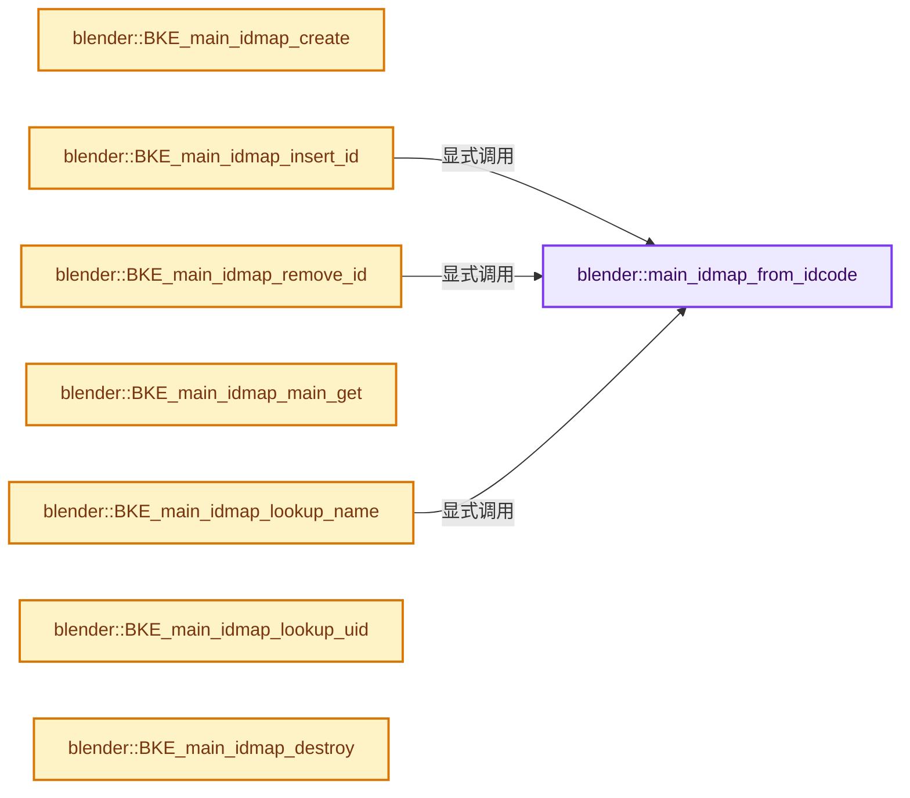
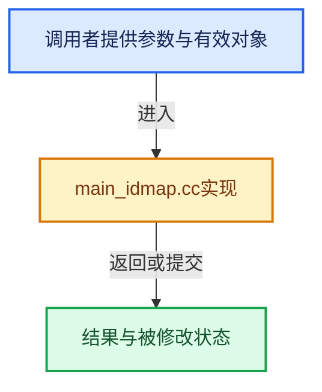

# 实现依赖专题：source/blender/blenkernel/intern/main_idmap.cc

[方向导航](README.md) · [符号索引](../%E7%AC%A6%E5%8F%B7%E4%BE%9D%E8%B5%96%E4%B8%8E%E5%AE%9E%E7%8E%B0%E7%B4%A2%E5%BC%95.md)

本专题从正文实际调用进入，集中保存共享实现。函数有稳定锚点，可从调用处直接跳到对应完整函数；递归与互相调用通过回链组织。

## 本文件的实现关系






## 完整成员与函数实现

<a id="f-db70fbd11a04eef9"></a>

### `blender::main_idmap_from_idcode`

实现位置：[source/blender/blenkernel/intern/main_idmap.cc](../../../../../source/blender/blenkernel/intern/main_idmap.cc) · L68—L78。

接口参数：

- `IDNameLib_Map *id_map`
- `short id_type`

**教学注释版**

<!-- annotated:7285c7f11c00ab -->

```cpp
static IDNameLib_TypeMap *main_idmap_from_idcode(IDNameLib_Map *id_map, short id_type)
{
  if (id_map->idmap_types & MAIN_IDMAP_TYPE_NAME) {
    for (int i = 0; i < INDEX_ID_MAX; i++) {
      if (id_map->type_maps[i].id_type == id_type) {
        return &id_map->type_maps[i];
      }
    }
  }
  return nullptr;
}
```

<details>
<summary>核对原始源码：source/blender/blenkernel/intern/main_idmap.cc · L68—L78</summary>

<!-- original:7285c7f11c00ab:source/blender/blenkernel/intern/main_idmap.cc:68:78 -->

```cpp
static IDNameLib_TypeMap *main_idmap_from_idcode(IDNameLib_Map *id_map, short id_type)
{
  if (id_map->idmap_types & MAIN_IDMAP_TYPE_NAME) {
    for (int i = 0; i < INDEX_ID_MAX; i++) {
      if (id_map->type_maps[i].id_type == id_type) {
        return &id_map->type_maps[i];
      }
    }
  }
  return nullptr;
}
```

</details>

**结果出口**

- `return &id_map->type_maps[i];`
- `return nullptr;`

**继续追踪实现**

本实现没有需要继续展开的显式调用；检查返回表达式、对象转换和调用者前置条件。

<a id="f-4777c27b08eeb641"></a>

### `blender::BKE_main_idmap_create`

实现位置：[source/blender/blenkernel/intern/main_idmap.cc](../../../../../source/blender/blenkernel/intern/main_idmap.cc) · L80—L123。

接口参数：

- `Main *bmain`
- `const bool create_valid_ids_set`
- `Main *old_bmain`
- `const int idmap_types`

**教学注释版**

<!-- annotated:34ce80bdefad7d -->

```cpp
IDNameLib_Map *BKE_main_idmap_create(Main *bmain,
                                     const bool create_valid_ids_set,
                                     Main *old_bmain,
                                     const int idmap_types)
{
  IDNameLib_Map *id_map = MEM_new_uninitialized<IDNameLib_Map>(__func__);
  id_map->bmain = bmain;
  id_map->idmap_types = idmap_types;

  int index = 0;
  while (index < INDEX_ID_MAX) {
    IDNameLib_TypeMap *type_map = &id_map->type_maps[index];
    type_map->map = nullptr;
    type_map->id_type = BKE_idtype_idcode_iter_step(&index);
    BLI_assert(type_map->id_type != 0);
  }
  BLI_assert(index == INDEX_ID_MAX);
  id_map->type_maps_keys_pool = nullptr;

  if (idmap_types & MAIN_IDMAP_TYPE_UID) {
    ID *id;
    id_map->uid_map = MEM_new<Map<uint32_t, ID *>>(__func__);
    FOREACH_MAIN_ID_BEGIN (bmain, id) {
      BLI_assert(id->session_uid != MAIN_ID_SESSION_UID_UNSET);
      id_map->uid_map->add_new(id->session_uid, id);
    }
    FOREACH_MAIN_ID_END;
  }
  else {
    id_map->uid_map = nullptr;
  }

  if (create_valid_ids_set) {
    id_map->valid_id_pointers = BKE_main_set_create(bmain, nullptr);
    if (old_bmain != nullptr) {
      id_map->valid_id_pointers = BKE_main_set_create(old_bmain, id_map->valid_id_pointers);
    }
  }
  else {
    id_map->valid_id_pointers = nullptr;
  }

  return id_map;
}
```

<details>
<summary>核对原始源码：source/blender/blenkernel/intern/main_idmap.cc · L80—L123</summary>

<!-- original:34ce80bdefad7d:source/blender/blenkernel/intern/main_idmap.cc:80:123 -->

```cpp
IDNameLib_Map *BKE_main_idmap_create(Main *bmain,
                                     const bool create_valid_ids_set,
                                     Main *old_bmain,
                                     const int idmap_types)
{
  IDNameLib_Map *id_map = MEM_new_uninitialized<IDNameLib_Map>(__func__);
  id_map->bmain = bmain;
  id_map->idmap_types = idmap_types;

  int index = 0;
  while (index < INDEX_ID_MAX) {
    IDNameLib_TypeMap *type_map = &id_map->type_maps[index];
    type_map->map = nullptr;
    type_map->id_type = BKE_idtype_idcode_iter_step(&index);
    BLI_assert(type_map->id_type != 0);
  }
  BLI_assert(index == INDEX_ID_MAX);
  id_map->type_maps_keys_pool = nullptr;

  if (idmap_types & MAIN_IDMAP_TYPE_UID) {
    ID *id;
    id_map->uid_map = MEM_new<Map<uint32_t, ID *>>(__func__);
    FOREACH_MAIN_ID_BEGIN (bmain, id) {
      BLI_assert(id->session_uid != MAIN_ID_SESSION_UID_UNSET);
      id_map->uid_map->add_new(id->session_uid, id);
    }
    FOREACH_MAIN_ID_END;
  }
  else {
    id_map->uid_map = nullptr;
  }

  if (create_valid_ids_set) {
    id_map->valid_id_pointers = BKE_main_set_create(bmain, nullptr);
    if (old_bmain != nullptr) {
      id_map->valid_id_pointers = BKE_main_set_create(old_bmain, id_map->valid_id_pointers);
    }
  }
  else {
    id_map->valid_id_pointers = nullptr;
  }

  return id_map;
}
```

</details>

**沿实际写入检查状态**

- `id_map->bmain = bmain;`
- `id_map->idmap_types = idmap_types;`
- `type_map->map = nullptr;`
- `type_map->id_type = BKE_idtype_idcode_iter_step(&index);`
- `id_map->type_maps_keys_pool = nullptr;`
- `id_map->uid_map = MEM_new<Map<uint32_t, ID *>>(__func__);`
- `id_map->uid_map = nullptr;`
- `id_map->valid_id_pointers = BKE_main_set_create(bmain, nullptr);`
- `id_map->valid_id_pointers = BKE_main_set_create(old_bmain, id_map->valid_id_pointers);`
- `id_map->valid_id_pointers = nullptr;`

**结果出口**

- `return id_map;`

**继续追踪实现**

- `MEM_new_uninitialized<IDNameLib_Map>` → [MEM_new_uninitialized · L590](../03-%E5%86%85%E5%AD%98%E5%88%86%E9%85%8D%E4%B8%8E%E8%BF%90%E8%A1%8C%E6%97%B6%E7%B1%BB%E5%9E%8B/%E4%BE%9D%E8%B5%96-MEM_guardedalloc-b54eca.md#f-c773b2e5b8fe70e4)；[MEM_new_uninitialized · L124](../03-%E5%86%85%E5%AD%98%E5%88%86%E9%85%8D%E4%B8%8E%E8%BF%90%E8%A1%8C%E6%97%B6%E7%B1%BB%E5%9E%8B/%E4%BE%9D%E8%B5%96-mallocn-afdcd4.md#f-28a7e00a1e67f699)。同名重载需按实参类型选择。
- `BKE_idtype_idcode_iter_step` → [blender::BKE_idtype_idcode_iter_step · L483](%E4%BE%9D%E8%B5%96-idtype-cbba99.md#f-6615b57797bae0c6)。
- `BLI_assert` → [BLI_assert · L48](../01-%E5%9F%BA%E7%A1%80%E5%AE%B9%E5%99%A8%E4%B8%8E%E7%8E%B0%E4%BB%A3CPP/%E4%BE%9D%E8%B5%96-BLI_assert-cc98e8.md#m-57a88495704d)；[BLI_assert · L63](../01-%E5%9F%BA%E7%A1%80%E5%AE%B9%E5%99%A8%E4%B8%8E%E7%8E%B0%E4%BB%A3CPP/%E4%BE%9D%E8%B5%96-BLI_assert-cc98e8.md#m-d07050020cb5)。宏定义由构建条件选择。
- `MEM_new<Map<uint32_t, ID *>>` → [MEM_new · L351](../03-%E5%86%85%E5%AD%98%E5%88%86%E9%85%8D%E4%B8%8E%E8%BF%90%E8%A1%8C%E6%97%B6%E7%B1%BB%E5%9E%8B/%E4%BE%9D%E8%B5%96-MEM_guardedalloc-b54eca.md#f-115f9b6784f89912)。
- `id_map->uid_map->add_new` → [调用协议](../%E6%A8%A1%E6%9D%BF%E5%AE%8F%E4%B8%8E%E5%8A%A8%E6%80%81%E5%88%86%E6%B4%BE%E5%8D%8F%E8%AE%AE.md)：接收对象类型依赖auto、返回值或模板实例；不按同名猜测目标。调用位置L104。
- `BKE_main_set_create` → [blender::BKE_main_set_create · L788](%E4%BE%9D%E8%B5%96-main-ffa8b3.md#f-7ad4a018052e4fff)。

<a id="f-e0c3d5c59b3df7d0"></a>

### `blender::BKE_main_idmap_insert_id`

实现位置：[source/blender/blenkernel/intern/main_idmap.cc](../../../../../source/blender/blenkernel/intern/main_idmap.cc) · L125—L148。

接口参数：

- `IDNameLib_Map *id_map`
- `ID *id`

**教学注释版**

<!-- annotated:260751b7059ea0 -->

```cpp
void BKE_main_idmap_insert_id(IDNameLib_Map *id_map, ID *id)
{
  if (id_map->idmap_types & MAIN_IDMAP_TYPE_NAME) {
    const short id_type = GS(id->name);
    IDNameLib_TypeMap *type_map = main_idmap_from_idcode(id_map, id_type);

    /* No need to do anything if map has not been lazily created yet. */
    if (LIKELY(type_map != nullptr) && type_map->map != nullptr) {
      BLI_assert(id_map->type_maps_keys_pool != nullptr);

      IDNameLib_Key *key = static_cast<IDNameLib_Key *>(
          BLI_mempool_alloc(id_map->type_maps_keys_pool));
      key->name = id->name + 2;
      key->lib = id->lib;
      BLI_ghash_insert(type_map->map, key, id);
    }
  }

  if (id_map->idmap_types & MAIN_IDMAP_TYPE_UID) {
    BLI_assert(id_map->uid_map != nullptr);
    BLI_assert(id->session_uid != MAIN_ID_SESSION_UID_UNSET);
    id_map->uid_map->add_new(id->session_uid, id);
  }
}
```

<details>
<summary>核对原始源码：source/blender/blenkernel/intern/main_idmap.cc · L125—L148</summary>

<!-- original:260751b7059ea0:source/blender/blenkernel/intern/main_idmap.cc:125:148 -->

```cpp
void BKE_main_idmap_insert_id(IDNameLib_Map *id_map, ID *id)
{
  if (id_map->idmap_types & MAIN_IDMAP_TYPE_NAME) {
    const short id_type = GS(id->name);
    IDNameLib_TypeMap *type_map = main_idmap_from_idcode(id_map, id_type);

    /* No need to do anything if map has not been lazily created yet. */
    if (LIKELY(type_map != nullptr) && type_map->map != nullptr) {
      BLI_assert(id_map->type_maps_keys_pool != nullptr);

      IDNameLib_Key *key = static_cast<IDNameLib_Key *>(
          BLI_mempool_alloc(id_map->type_maps_keys_pool));
      key->name = id->name + 2;
      key->lib = id->lib;
      BLI_ghash_insert(type_map->map, key, id);
    }
  }

  if (id_map->idmap_types & MAIN_IDMAP_TYPE_UID) {
    BLI_assert(id_map->uid_map != nullptr);
    BLI_assert(id->session_uid != MAIN_ID_SESSION_UID_UNSET);
    id_map->uid_map->add_new(id->session_uid, id);
  }
}
```

</details>

**沿实际写入检查状态**

- `key->name = id->name + 2;`
- `key->lib = id->lib;`

**继续追踪实现**

- `GS` → [blender::GS · L410](%E4%BE%9D%E8%B5%96-DNA_ID-3eb091.md#f-c3ff509f79f21b05)。
- `main_idmap_from_idcode` → [blender::main_idmap_from_idcode · L68](%E4%BE%9D%E8%B5%96-main_idmap-d73128.md#f-db70fbd11a04eef9)。
- `LIKELY` → [LIKELY · L51](../03-%E5%86%85%E5%AD%98%E5%88%86%E9%85%8D%E4%B8%8E%E8%BF%90%E8%A1%8C%E6%97%B6%E7%B1%BB%E5%9E%8B/%E4%BE%9D%E8%B5%96-mallocn_intern-e4d317.md#m-53ea5e2ff73b)；[LIKELY · L54](../03-%E5%86%85%E5%AD%98%E5%88%86%E9%85%8D%E4%B8%8E%E8%BF%90%E8%A1%8C%E6%97%B6%E7%B1%BB%E5%9E%8B/%E4%BE%9D%E8%B5%96-mallocn_intern-e4d317.md#m-bb82bdeee493)；[LIKELY · L107](%E4%BE%9D%E8%B5%96-defines-cd82f8.md#m-bd6166173f61)；[LIKELY · L110](%E4%BE%9D%E8%B5%96-defines-cd82f8.md#m-2c2ad9a348a5)；[LIKELY · L543](../01-%E5%9F%BA%E7%A1%80%E5%AE%B9%E5%99%A8%E4%B8%8E%E7%8E%B0%E4%BB%A3CPP/%E4%BE%9D%E8%B5%96-BLI_utildefines-293a0a.md#m-eeacc3e1dee8)；[LIKELY · L546](../01-%E5%9F%BA%E7%A1%80%E5%AE%B9%E5%99%A8%E4%B8%8E%E7%8E%B0%E4%BB%A3CPP/%E4%BE%9D%E8%B5%96-BLI_utildefines-293a0a.md#m-26b4114d7b77)。宏定义由构建条件选择。
- `BLI_assert` → [BLI_assert · L48](../01-%E5%9F%BA%E7%A1%80%E5%AE%B9%E5%99%A8%E4%B8%8E%E7%8E%B0%E4%BB%A3CPP/%E4%BE%9D%E8%B5%96-BLI_assert-cc98e8.md#m-57a88495704d)；[BLI_assert · L63](../01-%E5%9F%BA%E7%A1%80%E5%AE%B9%E5%99%A8%E4%B8%8E%E7%8E%B0%E4%BB%A3CPP/%E4%BE%9D%E8%B5%96-BLI_assert-cc98e8.md#m-d07050020cb5)。宏定义由构建条件选择。
- `BLI_mempool_alloc` → [blender::BLI_mempool_alloc · L387](../01-%E5%9F%BA%E7%A1%80%E5%AE%B9%E5%99%A8%E4%B8%8E%E7%8E%B0%E4%BB%A3CPP/%E4%BE%9D%E8%B5%96-BLI_mempool-991442.md#f-2e4ccb76db23671b)；[blender::BLI_mempool_alloc · L33](../01-%E5%9F%BA%E7%A1%80%E5%AE%B9%E5%99%A8%E4%B8%8E%E7%8E%B0%E4%BB%A3CPP/%E4%BE%9D%E8%B5%96-BLI_mempool-4b5fa7.md#f-3a0a9f741b9d9972)。同名重载需按实参类型选择。
- `BLI_ghash_insert` → [blender::BLI_ghash_insert · L711](../02-%E5%93%88%E5%B8%8C%E8%A1%A8%E4%B8%8E%E5%85%B3%E8%81%94%E6%95%B0%E6%8D%AE%E7%BB%93%E6%9E%84/%E4%BE%9D%E8%B5%96-BLI_ghash-ceaea0.md#f-b42d4e109f8d76f5)。
- `id_map->uid_map->add_new` → [调用协议](../%E6%A8%A1%E6%9D%BF%E5%AE%8F%E4%B8%8E%E5%8A%A8%E6%80%81%E5%88%86%E6%B4%BE%E5%8D%8F%E8%AE%AE.md)：接收对象类型依赖auto、返回值或模板实例；不按同名猜测目标。调用位置L146。

<a id="f-a927698f2d5b4a93"></a>

### `blender::BKE_main_idmap_remove_id`

实现位置：[source/blender/blenkernel/intern/main_idmap.cc](../../../../../source/blender/blenkernel/intern/main_idmap.cc) · L150—L172。

接口参数：

- `IDNameLib_Map *id_map`
- `const ID *id`

**教学注释版**

<!-- annotated:771554751aca8d -->

```cpp
void BKE_main_idmap_remove_id(IDNameLib_Map *id_map, const ID *id)
{
  if (id_map->idmap_types & MAIN_IDMAP_TYPE_NAME) {
    const short id_type = GS(id->name);
    IDNameLib_TypeMap *type_map = main_idmap_from_idcode(id_map, id_type);

    /* No need to do anything if map has not been lazily created yet. */
    if (LIKELY(type_map != nullptr) && type_map->map != nullptr) {
      BLI_assert(id_map->type_maps_keys_pool != nullptr);

      /* NOTE: We cannot free the key from the MemPool here, would need new API from GHash to also
       * retrieve key pointer. Not a big deal for now */
      IDNameLib_Key key{id->name + 2, id->lib};
      BLI_ghash_remove(type_map->map, &key, nullptr, nullptr);
    }
  }

  if (id_map->idmap_types & MAIN_IDMAP_TYPE_UID) {
    BLI_assert(id_map->uid_map != nullptr);
    BLI_assert(id->session_uid != MAIN_ID_SESSION_UID_UNSET);
    id_map->uid_map->remove(id->session_uid);
  }
}
```

<details>
<summary>核对原始源码：source/blender/blenkernel/intern/main_idmap.cc · L150—L172</summary>

<!-- original:771554751aca8d:source/blender/blenkernel/intern/main_idmap.cc:150:172 -->

```cpp
void BKE_main_idmap_remove_id(IDNameLib_Map *id_map, const ID *id)
{
  if (id_map->idmap_types & MAIN_IDMAP_TYPE_NAME) {
    const short id_type = GS(id->name);
    IDNameLib_TypeMap *type_map = main_idmap_from_idcode(id_map, id_type);

    /* No need to do anything if map has not been lazily created yet. */
    if (LIKELY(type_map != nullptr) && type_map->map != nullptr) {
      BLI_assert(id_map->type_maps_keys_pool != nullptr);

      /* NOTE: We cannot free the key from the MemPool here, would need new API from GHash to also
       * retrieve key pointer. Not a big deal for now */
      IDNameLib_Key key{id->name + 2, id->lib};
      BLI_ghash_remove(type_map->map, &key, nullptr, nullptr);
    }
  }

  if (id_map->idmap_types & MAIN_IDMAP_TYPE_UID) {
    BLI_assert(id_map->uid_map != nullptr);
    BLI_assert(id->session_uid != MAIN_ID_SESSION_UID_UNSET);
    id_map->uid_map->remove(id->session_uid);
  }
}
```

</details>

**继续追踪实现**

- `GS` → [blender::GS · L410](%E4%BE%9D%E8%B5%96-DNA_ID-3eb091.md#f-c3ff509f79f21b05)。
- `main_idmap_from_idcode` → [blender::main_idmap_from_idcode · L68](%E4%BE%9D%E8%B5%96-main_idmap-d73128.md#f-db70fbd11a04eef9)。
- `LIKELY` → [LIKELY · L51](../03-%E5%86%85%E5%AD%98%E5%88%86%E9%85%8D%E4%B8%8E%E8%BF%90%E8%A1%8C%E6%97%B6%E7%B1%BB%E5%9E%8B/%E4%BE%9D%E8%B5%96-mallocn_intern-e4d317.md#m-53ea5e2ff73b)；[LIKELY · L54](../03-%E5%86%85%E5%AD%98%E5%88%86%E9%85%8D%E4%B8%8E%E8%BF%90%E8%A1%8C%E6%97%B6%E7%B1%BB%E5%9E%8B/%E4%BE%9D%E8%B5%96-mallocn_intern-e4d317.md#m-bb82bdeee493)；[LIKELY · L107](%E4%BE%9D%E8%B5%96-defines-cd82f8.md#m-bd6166173f61)；[LIKELY · L110](%E4%BE%9D%E8%B5%96-defines-cd82f8.md#m-2c2ad9a348a5)；[LIKELY · L543](../01-%E5%9F%BA%E7%A1%80%E5%AE%B9%E5%99%A8%E4%B8%8E%E7%8E%B0%E4%BB%A3CPP/%E4%BE%9D%E8%B5%96-BLI_utildefines-293a0a.md#m-eeacc3e1dee8)；[LIKELY · L546](../01-%E5%9F%BA%E7%A1%80%E5%AE%B9%E5%99%A8%E4%B8%8E%E7%8E%B0%E4%BB%A3CPP/%E4%BE%9D%E8%B5%96-BLI_utildefines-293a0a.md#m-26b4114d7b77)。宏定义由构建条件选择。
- `BLI_assert` → [BLI_assert · L48](../01-%E5%9F%BA%E7%A1%80%E5%AE%B9%E5%99%A8%E4%B8%8E%E7%8E%B0%E4%BB%A3CPP/%E4%BE%9D%E8%B5%96-BLI_assert-cc98e8.md#m-57a88495704d)；[BLI_assert · L63](../01-%E5%9F%BA%E7%A1%80%E5%AE%B9%E5%99%A8%E4%B8%8E%E7%8E%B0%E4%BB%A3CPP/%E4%BE%9D%E8%B5%96-BLI_assert-cc98e8.md#m-d07050020cb5)。宏定义由构建条件选择。
- `BLI_ghash_remove` → [blender::BLI_ghash_remove · L792](../02-%E5%93%88%E5%B8%8C%E8%A1%A8%E4%B8%8E%E5%85%B3%E8%81%94%E6%95%B0%E6%8D%AE%E7%BB%93%E6%9E%84/%E4%BE%9D%E8%B5%96-BLI_ghash-ceaea0.md#f-055d583b61662552)。
- `id_map->uid_map->remove` → [调用协议](../%E6%A8%A1%E6%9D%BF%E5%AE%8F%E4%B8%8E%E5%8A%A8%E6%80%81%E5%88%86%E6%B4%BE%E5%8D%8F%E8%AE%AE.md)：接收对象类型依赖auto、返回值或模板实例；不按同名猜测目标。调用位置L170。

<a id="f-11f64d95a0c8b346"></a>

### `blender::BKE_main_idmap_main_get`

实现位置：[source/blender/blenkernel/intern/main_idmap.cc](../../../../../source/blender/blenkernel/intern/main_idmap.cc) · L174—L177。

接口参数：

- `IDNameLib_Map *id_map`

**教学注释版**

<!-- annotated:efb883b584e927 -->

```cpp
Main *BKE_main_idmap_main_get(IDNameLib_Map *id_map)
{
  return id_map->bmain;
}
```

<details>
<summary>核对原始源码：source/blender/blenkernel/intern/main_idmap.cc · L174—L177</summary>

<!-- original:efb883b584e927:source/blender/blenkernel/intern/main_idmap.cc:174:177 -->

```cpp
Main *BKE_main_idmap_main_get(IDNameLib_Map *id_map)
{
  return id_map->bmain;
}
```

</details>

**结果出口**

- `return id_map->bmain;`

**继续追踪实现**

本实现没有需要继续展开的显式调用；检查返回表达式、对象转换和调用者前置条件。

<a id="f-ab42aa463254757f"></a>

### `blender::BKE_main_idmap_lookup_name`

实现位置：[source/blender/blenkernel/intern/main_idmap.cc](../../../../../source/blender/blenkernel/intern/main_idmap.cc) · L196—L227。

接口参数：

- `IDNameLib_Map *id_map`
- `short id_type`
- `const char *name`
- `const Library *lib`

**教学注释版**

<!-- annotated:3a3d394eb07a31 -->

```cpp
ID *BKE_main_idmap_lookup_name(IDNameLib_Map *id_map,
                               short id_type,
                               const char *name,
                               const Library *lib)
{
  IDNameLib_TypeMap *type_map = main_idmap_from_idcode(id_map, id_type);

  if (type_map == nullptr) [[unlikely]] {
    return nullptr;
  }

  /* Lazy init. */
  if (type_map->map == nullptr) {
    if (id_map->type_maps_keys_pool == nullptr) {
      id_map->type_maps_keys_pool = BLI_mempool_create(
          sizeof(IDNameLib_Key), 1024, 1024, BLI_MEMPOOL_NOP);
    }

    GHash *map = type_map->map = BLI_ghash_new(idkey_hash, idkey_cmp, __func__);
    ListBaseT<ID> *lb = which_libbase(id_map->bmain, id_type);
    for (ID *id = lb->first(); id; id = static_cast<ID *>(id->next)) {
      IDNameLib_Key *key = static_cast<IDNameLib_Key *>(
          BLI_mempool_alloc(id_map->type_maps_keys_pool));
      key->name = id->name + 2;
      key->lib = id->lib;
      BLI_ghash_insert(map, key, id);
    }
  }

  const IDNameLib_Key key_lookup = {name, lib};
  return static_cast<ID *>(BLI_ghash_lookup(type_map->map, &key_lookup));
}
```

<details>
<summary>核对原始源码：source/blender/blenkernel/intern/main_idmap.cc · L196—L227</summary>

<!-- original:3a3d394eb07a31:source/blender/blenkernel/intern/main_idmap.cc:196:227 -->

```cpp
ID *BKE_main_idmap_lookup_name(IDNameLib_Map *id_map,
                               short id_type,
                               const char *name,
                               const Library *lib)
{
  IDNameLib_TypeMap *type_map = main_idmap_from_idcode(id_map, id_type);

  if (type_map == nullptr) [[unlikely]] {
    return nullptr;
  }

  /* Lazy init. */
  if (type_map->map == nullptr) {
    if (id_map->type_maps_keys_pool == nullptr) {
      id_map->type_maps_keys_pool = BLI_mempool_create(
          sizeof(IDNameLib_Key), 1024, 1024, BLI_MEMPOOL_NOP);
    }

    GHash *map = type_map->map = BLI_ghash_new(idkey_hash, idkey_cmp, __func__);
    ListBaseT<ID> *lb = which_libbase(id_map->bmain, id_type);
    for (ID *id = lb->first(); id; id = static_cast<ID *>(id->next)) {
      IDNameLib_Key *key = static_cast<IDNameLib_Key *>(
          BLI_mempool_alloc(id_map->type_maps_keys_pool));
      key->name = id->name + 2;
      key->lib = id->lib;
      BLI_ghash_insert(map, key, id);
    }
  }

  const IDNameLib_Key key_lookup = {name, lib};
  return static_cast<ID *>(BLI_ghash_lookup(type_map->map, &key_lookup));
}
```

</details>

**沿实际写入检查状态**

- `id_map->type_maps_keys_pool = BLI_mempool_create(`
- `key->name = id->name + 2;`
- `key->lib = id->lib;`

**结果出口**

- `return nullptr;`
- `return static_cast<ID *>(BLI_ghash_lookup(type_map->map, &key_lookup));`

**继续追踪实现**

- `main_idmap_from_idcode` → [blender::main_idmap_from_idcode · L68](%E4%BE%9D%E8%B5%96-main_idmap-d73128.md#f-db70fbd11a04eef9)。
- `BLI_mempool_create` → [blender::BLI_mempool_create · L320](../01-%E5%9F%BA%E7%A1%80%E5%AE%B9%E5%99%A8%E4%B8%8E%E7%8E%B0%E4%BB%A3CPP/%E4%BE%9D%E8%B5%96-BLI_mempool-991442.md#f-90a2c14d1b30f9cf)。
- `BLI_ghash_new` → [blender::BLI_ghash_new · L690](../02-%E5%93%88%E5%B8%8C%E8%A1%A8%E4%B8%8E%E5%85%B3%E8%81%94%E6%95%B0%E6%8D%AE%E7%BB%93%E6%9E%84/%E4%BE%9D%E8%B5%96-BLI_ghash-ceaea0.md#f-0c5878692f40fa70)。
- `which_libbase` → [blender::which_libbase · L1073](%E4%BE%9D%E8%B5%96-main-ffa8b3.md#f-87eb528420a3faf0)。
- `lb->first` → [blender::ListBaseT::first · L102](%E4%BE%9D%E8%B5%96-DNA_listBase-48dbc9.md#f-3d12ff35da057c9e)；[blender::ListBaseT::first · L106](%E4%BE%9D%E8%B5%96-DNA_listBase-48dbc9.md#f-0df87c3480e059f9)。同名重载需按实参类型选择。
- `BLI_mempool_alloc` → [blender::BLI_mempool_alloc · L387](../01-%E5%9F%BA%E7%A1%80%E5%AE%B9%E5%99%A8%E4%B8%8E%E7%8E%B0%E4%BB%A3CPP/%E4%BE%9D%E8%B5%96-BLI_mempool-991442.md#f-2e4ccb76db23671b)；[blender::BLI_mempool_alloc · L33](../01-%E5%9F%BA%E7%A1%80%E5%AE%B9%E5%99%A8%E4%B8%8E%E7%8E%B0%E4%BB%A3CPP/%E4%BE%9D%E8%B5%96-BLI_mempool-4b5fa7.md#f-3a0a9f741b9d9972)。同名重载需按实参类型选择。
- `BLI_ghash_insert` → [blender::BLI_ghash_insert · L711](../02-%E5%93%88%E5%B8%8C%E8%A1%A8%E4%B8%8E%E5%85%B3%E8%81%94%E6%95%B0%E6%8D%AE%E7%BB%93%E6%9E%84/%E4%BE%9D%E8%B5%96-BLI_ghash-ceaea0.md#f-b42d4e109f8d76f5)。
- `BLI_ghash_lookup` → [blender::BLI_ghash_lookup · L735](../02-%E5%93%88%E5%B8%8C%E8%A1%A8%E4%B8%8E%E5%85%B3%E8%81%94%E6%95%B0%E6%8D%AE%E7%BB%93%E6%9E%84/%E4%BE%9D%E8%B5%96-BLI_ghash-ceaea0.md#f-8937b91445541501)。

<a id="f-bd82825004dcc6e7"></a>

### `blender::BKE_main_idmap_lookup_uid`

实现位置：[source/blender/blenkernel/intern/main_idmap.cc](../../../../../source/blender/blenkernel/intern/main_idmap.cc) · L243—L249。

接口参数：

- `IDNameLib_Map *id_map`
- `const uint session_uid`

**教学注释版**

<!-- annotated:55c16eceddc32c -->

```cpp
ID *BKE_main_idmap_lookup_uid(IDNameLib_Map *id_map, const uint session_uid)
{
  if (id_map->idmap_types & MAIN_IDMAP_TYPE_UID) {
    return id_map->uid_map->lookup_default(session_uid, nullptr);
  }
  return nullptr;
}
```

<details>
<summary>核对原始源码：source/blender/blenkernel/intern/main_idmap.cc · L243—L249</summary>

<!-- original:55c16eceddc32c:source/blender/blenkernel/intern/main_idmap.cc:243:249 -->

```cpp
ID *BKE_main_idmap_lookup_uid(IDNameLib_Map *id_map, const uint session_uid)
{
  if (id_map->idmap_types & MAIN_IDMAP_TYPE_UID) {
    return id_map->uid_map->lookup_default(session_uid, nullptr);
  }
  return nullptr;
}
```

</details>

**结果出口**

- `return id_map->uid_map->lookup_default(session_uid, nullptr);`
- `return nullptr;`

**继续追踪实现**

- `id_map->uid_map->lookup_default` → [调用协议](../%E6%A8%A1%E6%9D%BF%E5%AE%8F%E4%B8%8E%E5%8A%A8%E6%80%81%E5%88%86%E6%B4%BE%E5%8D%8F%E8%AE%AE.md)：接收对象类型依赖auto、返回值或模板实例；不按同名猜测目标。调用位置L246。

<a id="f-7f50dd5ba5e79c0d"></a>

### `blender::BKE_main_idmap_destroy`

实现位置：[source/blender/blenkernel/intern/main_idmap.cc](../../../../../source/blender/blenkernel/intern/main_idmap.cc) · L269—L291。

接口参数：

- `IDNameLib_Map *id_map`

**教学注释版**

<!-- annotated:13a56f5c1e296f -->

```cpp
void BKE_main_idmap_destroy(IDNameLib_Map *id_map)
{
  if (id_map->idmap_types & MAIN_IDMAP_TYPE_NAME) {
    for (IDNameLib_TypeMap &type_map : id_map->type_maps) {
      if (type_map.map) {
        BLI_ghash_free(type_map.map, nullptr, nullptr);
        type_map.map = nullptr;
      }
    }
    if (id_map->type_maps_keys_pool != nullptr) {
      BLI_mempool_destroy(id_map->type_maps_keys_pool);
      id_map->type_maps_keys_pool = nullptr;
    }
  }
  if (id_map->idmap_types & MAIN_IDMAP_TYPE_UID) {
    MEM_delete(id_map->uid_map);
  }

  BLI_assert(id_map->type_maps_keys_pool == nullptr);

  MEM_delete(id_map->valid_id_pointers);
  MEM_delete(id_map);
}
```

<details>
<summary>核对原始源码：source/blender/blenkernel/intern/main_idmap.cc · L269—L291</summary>

<!-- original:13a56f5c1e296f:source/blender/blenkernel/intern/main_idmap.cc:269:291 -->

```cpp
void BKE_main_idmap_destroy(IDNameLib_Map *id_map)
{
  if (id_map->idmap_types & MAIN_IDMAP_TYPE_NAME) {
    for (IDNameLib_TypeMap &type_map : id_map->type_maps) {
      if (type_map.map) {
        BLI_ghash_free(type_map.map, nullptr, nullptr);
        type_map.map = nullptr;
      }
    }
    if (id_map->type_maps_keys_pool != nullptr) {
      BLI_mempool_destroy(id_map->type_maps_keys_pool);
      id_map->type_maps_keys_pool = nullptr;
    }
  }
  if (id_map->idmap_types & MAIN_IDMAP_TYPE_UID) {
    MEM_delete(id_map->uid_map);
  }

  BLI_assert(id_map->type_maps_keys_pool == nullptr);

  MEM_delete(id_map->valid_id_pointers);
  MEM_delete(id_map);
}
```

</details>

**沿实际写入检查状态**

- `type_map.map = nullptr;`
- `id_map->type_maps_keys_pool = nullptr;`

**继续追踪实现**

- `BLI_ghash_free` → [blender::BLI_ghash_free · L866](../02-%E5%93%88%E5%B8%8C%E8%A1%A8%E4%B8%8E%E5%85%B3%E8%81%94%E6%95%B0%E6%8D%AE%E7%BB%93%E6%9E%84/%E4%BE%9D%E8%B5%96-BLI_ghash-ceaea0.md#f-ab6fda2cc049587d)。
- `BLI_mempool_destroy` → [blender::BLI_mempool_destroy · L844](../01-%E5%9F%BA%E7%A1%80%E5%AE%B9%E5%99%A8%E4%B8%8E%E7%8E%B0%E4%BB%A3CPP/%E4%BE%9D%E8%B5%96-BLI_mempool-991442.md#f-6f09741326791f2d)。
- `MEM_delete` → [MEM_delete · L400](../03-%E5%86%85%E5%AD%98%E5%88%86%E9%85%8D%E4%B8%8E%E8%BF%90%E8%A1%8C%E6%97%B6%E7%B1%BB%E5%9E%8B/%E4%BE%9D%E8%B5%96-MEM_guardedalloc-b54eca.md#f-9049ffdd1682887c)。
- `BLI_assert` → [BLI_assert · L48](../01-%E5%9F%BA%E7%A1%80%E5%AE%B9%E5%99%A8%E4%B8%8E%E7%8E%B0%E4%BB%A3CPP/%E4%BE%9D%E8%B5%96-BLI_assert-cc98e8.md#m-57a88495704d)；[BLI_assert · L63](../01-%E5%9F%BA%E7%A1%80%E5%AE%B9%E5%99%A8%E4%B8%8E%E7%8E%B0%E4%BB%A3CPP/%E4%BE%9D%E8%B5%96-BLI_assert-cc98e8.md#m-d07050020cb5)。宏定义由构建条件选择。
