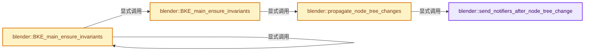

# 实现依赖专题：source/blender/blenkernel/intern/main_invariants.cc

[方向导航](README.md) · [符号索引](../%E7%AC%A6%E5%8F%B7%E4%BE%9D%E8%B5%96%E4%B8%8E%E5%AE%9E%E7%8E%B0%E7%B4%A2%E5%BC%95.md)

本专题从正文实际调用进入，集中保存共享实现。函数有稳定锚点，可从调用处直接跳到对应完整函数；递归与互相调用通过回链组织。

## 本文件的实现关系




## 完整成员与函数实现

<a id="f-c4812d692938f7ee"></a>

### `blender::send_notifiers_after_node_tree_change`

实现位置：[source/blender/blenkernel/intern/main_invariants.cc](../../../../../source/blender/blenkernel/intern/main_invariants.cc) · L22—L57。

接口参数：

- `ID *id`
- `bNodeTree *ntree`

**教学注释版**

<!-- annotated:46a0b27241e6a1 -->

```cpp
static void send_notifiers_after_node_tree_change(ID *id, bNodeTree *ntree)
{
  WM_main_add_notifier(NC_NODE | NA_EDITED, id);

  if (ntree->type == NTREE_SHADER && id != nullptr) {
    if (GS(id->name) == ID_MA) {
      WM_main_add_notifier(NC_MATERIAL | ND_SHADING, id);
    }
    else if (GS(id->name) == ID_LA) {
      WM_main_add_notifier(NC_LAMP | ND_LIGHTING, id);
    }
    else if (GS(id->name) == ID_WO) {
      WM_main_add_notifier(NC_WORLD | ND_WORLD, id);
    }
  }
  else if (ntree->type == NTREE_COMPOSIT) {
    /* The notifier category `NC_SCENE` has some special handling in #wm_event_do_notifiers. When
     * the id that is passed as the reference is not a scene or not the active scene/sequencer
     * scene, then the notifier is dropped. So we need to pass `nullptr` here to make sure the
     * notifier is sent. */
    WM_main_add_notifier(NC_SCENE | ND_NODES, nullptr);
    WM_main_add_notifier(NC_SCENE | ND_COMPO_RESULT, nullptr);
  }
  else if (ntree->type == NTREE_TEXTURE) {
    WM_main_add_notifier(NC_TEXTURE | ND_NODES, id);
  }
  else if (ntree->type == NTREE_GEOMETRY) {
    WM_main_add_notifier(NC_OBJECT | ND_MODIFIER, id);
    if (ntree->geometry_node_asset_traits) {
      if (ntree->geometry_node_asset_traits->flag & GEO_NODE_ASSET_TOOL) {
        /* Notifier to re-register node group operators. */
        WM_main_add_notifier(NC_NODE | ND_NODE_ASSET_DATA, id);
      }
    }
  }
}
```

<details>
<summary>核对原始源码：source/blender/blenkernel/intern/main_invariants.cc · L22—L57</summary>

<!-- original:46a0b27241e6a1:source/blender/blenkernel/intern/main_invariants.cc:22:57 -->

```cpp
static void send_notifiers_after_node_tree_change(ID *id, bNodeTree *ntree)
{
  WM_main_add_notifier(NC_NODE | NA_EDITED, id);

  if (ntree->type == NTREE_SHADER && id != nullptr) {
    if (GS(id->name) == ID_MA) {
      WM_main_add_notifier(NC_MATERIAL | ND_SHADING, id);
    }
    else if (GS(id->name) == ID_LA) {
      WM_main_add_notifier(NC_LAMP | ND_LIGHTING, id);
    }
    else if (GS(id->name) == ID_WO) {
      WM_main_add_notifier(NC_WORLD | ND_WORLD, id);
    }
  }
  else if (ntree->type == NTREE_COMPOSIT) {
    /* The notifier category `NC_SCENE` has some special handling in #wm_event_do_notifiers. When
     * the id that is passed as the reference is not a scene or not the active scene/sequencer
     * scene, then the notifier is dropped. So we need to pass `nullptr` here to make sure the
     * notifier is sent. */
    WM_main_add_notifier(NC_SCENE | ND_NODES, nullptr);
    WM_main_add_notifier(NC_SCENE | ND_COMPO_RESULT, nullptr);
  }
  else if (ntree->type == NTREE_TEXTURE) {
    WM_main_add_notifier(NC_TEXTURE | ND_NODES, id);
  }
  else if (ntree->type == NTREE_GEOMETRY) {
    WM_main_add_notifier(NC_OBJECT | ND_MODIFIER, id);
    if (ntree->geometry_node_asset_traits) {
      if (ntree->geometry_node_asset_traits->flag & GEO_NODE_ASSET_TOOL) {
        /* Notifier to re-register node group operators. */
        WM_main_add_notifier(NC_NODE | ND_NODE_ASSET_DATA, id);
      }
    }
  }
}
```

</details>

**继续追踪实现**

- `WM_main_add_notifier` → [blender::WM_main_add_notifier · L403](%E4%BE%9D%E8%B5%96-wm_event_system-a0fa4f.md#f-29a090eae8ebe51c)。
- `GS` → [blender::GS · L410](%E4%BE%9D%E8%B5%96-DNA_ID-3eb091.md#f-c3ff509f79f21b05)。

<a id="f-24c58914f379fc03"></a>

### `blender::propagate_node_tree_changes`

实现位置：[source/blender/blenkernel/intern/main_invariants.cc](../../../../../source/blender/blenkernel/intern/main_invariants.cc) · L59—L81。

接口参数：

- `Main &bmain`
- `const std::optional<Span<ID *>> modified_ids`

**教学注释版**

<!-- annotated:bd56b30f208b31 -->

```cpp
static void propagate_node_tree_changes(Main &bmain, const std::optional<Span<ID *>> modified_ids)
{
  NodeTreeUpdateExtraParams params;
  params.tree_changed_fn = [](bNodeTree &ntree, ID &owner_id) {
    send_notifiers_after_node_tree_change(&owner_id, &ntree);
    DEG_id_tag_update(&ntree.id, ID_RECALC_SYNC_TO_EVAL);
  };
  params.tree_output_changed_fn = [](bNodeTree &ntree, ID & /*owner_id*/) {
    DEG_id_tag_update(&ntree.id, ID_RECALC_NTREE_OUTPUT);
  };

  std::optional<Vector<bNodeTree *>> modified_trees;
  if (modified_ids.has_value()) {
    modified_trees.emplace();
    for (ID *id : *modified_ids) {
      if (GS(id->name) == ID_NT) {
        modified_trees->append(reinterpret_cast<bNodeTree *>(id));
      }
    }
  }

  BKE_ntree_update(bmain, modified_trees, params);
}
```

<details>
<summary>核对原始源码：source/blender/blenkernel/intern/main_invariants.cc · L59—L81</summary>

<!-- original:bd56b30f208b31:source/blender/blenkernel/intern/main_invariants.cc:59:81 -->

```cpp
static void propagate_node_tree_changes(Main &bmain, const std::optional<Span<ID *>> modified_ids)
{
  NodeTreeUpdateExtraParams params;
  params.tree_changed_fn = [](bNodeTree &ntree, ID &owner_id) {
    send_notifiers_after_node_tree_change(&owner_id, &ntree);
    DEG_id_tag_update(&ntree.id, ID_RECALC_SYNC_TO_EVAL);
  };
  params.tree_output_changed_fn = [](bNodeTree &ntree, ID & /*owner_id*/) {
    DEG_id_tag_update(&ntree.id, ID_RECALC_NTREE_OUTPUT);
  };

  std::optional<Vector<bNodeTree *>> modified_trees;
  if (modified_ids.has_value()) {
    modified_trees.emplace();
    for (ID *id : *modified_ids) {
      if (GS(id->name) == ID_NT) {
        modified_trees->append(reinterpret_cast<bNodeTree *>(id));
      }
    }
  }

  BKE_ntree_update(bmain, modified_trees, params);
}
```

</details>

**沿实际写入检查状态**

- `params.tree_changed_fn = [](bNodeTree &ntree, ID &owner_id) {`
- `params.tree_output_changed_fn = [](bNodeTree &ntree, ID & /*owner_id*/) {`

**继续追踪实现**

- `send_notifiers_after_node_tree_change` → [blender::send_notifiers_after_node_tree_change · L22](%E4%BE%9D%E8%B5%96-main_invariants-daa29b.md#f-c4812d692938f7ee)。
- `DEG_id_tag_update` → [blender::DEG_id_tag_update · L844](../11-Depsgraph%E4%B8%8E%E5%B9%B6%E8%A1%8C%E4%BB%BB%E5%8A%A1%E7%B3%BB%E7%BB%9F/%E4%BE%9D%E8%B5%96-depsgraph_tag-d8b3c7.md#f-62d2949dd168bb81)。
- `modified_ids.has_value` → [外部契约](https://eel.is/c++draft/)：这个边界按实际表达式及所属类型核对参数、返回值、寿命与失败行为。这里提供接口入口，不声称已解释该第三方版本的内部实现。
- `modified_trees.emplace` → [外部契约](https://eel.is/c++draft/)：这个边界按实际表达式及所属类型核对参数、返回值、寿命与失败行为。这里提供接口入口，不声称已解释该第三方版本的内部实现。
- `GS` → [blender::GS · L410](%E4%BE%9D%E8%B5%96-DNA_ID-3eb091.md#f-c3ff509f79f21b05)。
- `modified_trees->append` → [外部契约](https://eel.is/c++draft/)：这个边界按实际表达式及所属类型核对参数、返回值、寿命与失败行为。这里提供接口入口，不声称已解释该第三方版本的内部实现。
- `BKE_ntree_update` → [blender::BKE_ntree_update · L2402](%E4%BE%9D%E8%B5%96-node_tree_update-60230f.md#f-fdf82497b5773feb)。

<a id="f-d000e07611ba6e47"></a>

### `blender::BKE_main_ensure_invariants`

实现位置：[source/blender/blenkernel/intern/main_invariants.cc](../../../../../source/blender/blenkernel/intern/main_invariants.cc) · L83—L86。

接口参数：

- `Main &bmain`
- `const std::optional<Span<ID *>> modified_ids`

**教学注释版**

<!-- annotated:3654318800adb7 -->

```cpp
void BKE_main_ensure_invariants(Main &bmain, const std::optional<Span<ID *>> modified_ids)
{
  propagate_node_tree_changes(bmain, modified_ids);
}
```

<details>
<summary>核对原始源码：source/blender/blenkernel/intern/main_invariants.cc · L83—L86</summary>

<!-- original:3654318800adb7:source/blender/blenkernel/intern/main_invariants.cc:83:86 -->

```cpp
void BKE_main_ensure_invariants(Main &bmain, const std::optional<Span<ID *>> modified_ids)
{
  propagate_node_tree_changes(bmain, modified_ids);
}
```

</details>

**继续追踪实现**

- `propagate_node_tree_changes` → [blender::propagate_node_tree_changes · L59](%E4%BE%9D%E8%B5%96-main_invariants-daa29b.md#f-24c58914f379fc03)。

<a id="f-72ec2a2d72c96f20"></a>

### `blender::BKE_main_ensure_invariants`

实现位置：[source/blender/blenkernel/intern/main_invariants.cc](../../../../../source/blender/blenkernel/intern/main_invariants.cc) · L88—L91。

接口参数：

- `Main &bmain`
- `ID &modified_id`

**教学注释版**

<!-- annotated:3aeb127fdf8671 -->

```cpp
void BKE_main_ensure_invariants(Main &bmain, ID &modified_id)
{
  BKE_main_ensure_invariants(bmain, {{&modified_id}});
}
```

<details>
<summary>核对原始源码：source/blender/blenkernel/intern/main_invariants.cc · L88—L91</summary>

<!-- original:3aeb127fdf8671:source/blender/blenkernel/intern/main_invariants.cc:88:91 -->

```cpp
void BKE_main_ensure_invariants(Main &bmain, ID &modified_id)
{
  BKE_main_ensure_invariants(bmain, {{&modified_id}});
}
```

</details>

**继续追踪实现**

- `BKE_main_ensure_invariants` → [blender::BKE_main_ensure_invariants · L83](%E4%BE%9D%E8%B5%96-main_invariants-daa29b.md#f-d000e07611ba6e47)；[blender::BKE_main_ensure_invariants · L88](%E4%BE%9D%E8%B5%96-main_invariants-daa29b.md#f-72ec2a2d72c96f20)。同名重载需按实参类型选择。
