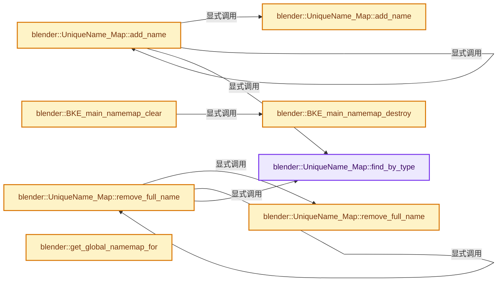

# 实现依赖专题：source/blender/blenkernel/intern/main_namemap.cc

[方向导航](README.md) · [符号索引](../%E7%AC%A6%E5%8F%B7%E4%BE%9D%E8%B5%96%E4%B8%8E%E5%AE%9E%E7%8E%B0%E7%B4%A2%E5%BC%95.md)

本专题从正文实际调用进入，集中保存共享实现。函数有稳定锚点，可从调用处直接跳到对应完整函数；递归与互相调用通过回链组织。

## 本文件的实现关系




## 完整成员与函数实现

<a id="f-f9ab76ecdc42b7d0"></a>

### `blender::UniqueName_Map::find_by_type`

实现位置：[source/blender/blenkernel/intern/main_namemap.cc](../../../../../source/blender/blenkernel/intern/main_namemap.cc) · L186—L190。

接口参数：

- `const short id_type`

**教学注释版**

<!-- annotated:c08286262ddd18 -->

```cpp
  UniqueName_TypeMap &find_by_type(const short id_type)
  {
    int index = BKE_idtype_idcode_to_index(id_type);
    return type_maps[size_t(index)];
  }
```

<details>
<summary>核对原始源码：source/blender/blenkernel/intern/main_namemap.cc · L186—L190</summary>

<!-- original:c08286262ddd18:source/blender/blenkernel/intern/main_namemap.cc:186:190 -->

```cpp
  UniqueName_TypeMap &find_by_type(const short id_type)
  {
    int index = BKE_idtype_idcode_to_index(id_type);
    return type_maps[size_t(index)];
  }
```

</details>

**结果出口**

- `return type_maps[size_t(index)];`

**继续追踪实现**

- `BKE_idtype_idcode_to_index` → [blender::BKE_idtype_idcode_to_index · L338](%E4%BE%9D%E8%B5%96-idtype-cbba99.md#f-ec4756d10e8e5ef0)。

<a id="f-9f93d1fdd4c04df8"></a>

### `blender::UniqueName_Map::add_name`

实现位置：[source/blender/blenkernel/intern/main_namemap.cc](../../../../../source/blender/blenkernel/intern/main_namemap.cc) · L245—L273。

接口参数：

- `UniqueName_TypeMap &type_map`
- `StringRef name_full`
- `StringRef name_base`
- `const int number`

**教学注释版**

<!-- annotated:9dadc4ba3d91f6 -->

```cpp
  void add_name(UniqueName_TypeMap &type_map,
                StringRef name_full,
                StringRef name_base,
                const int number)
  {
    BLI_assert(name_full.size() < MAX_ID_NAME - 2);

    if (this->is_global) {
      /* By definition adding to global map is always successful. */
      int &count = type_map.full_names.lookup_or_add_as(name_full, 0);
      if (!count) {
        std::unique_ptr<UniqueName_Value> &val = type_map.base_name_to_num_suffix.lookup_or_add_as(
            // [讲解] std::make_unique<UniqueName_Value>：创建独占拥有的对象，拥有关系可移动，get返回的借用指针不自动延长寿命。
            name_base, std::make_unique<UniqueName_Value>(UniqueName_Value{}));
        val->mark_used(number);
      }
      count++;
      return;
    }

    if (!type_map.full_names.add(name_full, 1)) {
      BLI_assert_msg(
          false, "Adding a name to Main namemaps that was already in it, should never happen.");
      return;
    }

    std::unique_ptr<UniqueName_Value> &val = type_map.base_name_to_num_suffix.lookup_or_add_as(
        name_base, std::make_unique<UniqueName_Value>(UniqueName_Value{}));
    val->mark_used(number);
  }
```

<details>
<summary>核对原始源码：source/blender/blenkernel/intern/main_namemap.cc · L245—L273</summary>

<!-- original:9dadc4ba3d91f6:source/blender/blenkernel/intern/main_namemap.cc:245:273 -->

```cpp
  void add_name(UniqueName_TypeMap &type_map,
                StringRef name_full,
                StringRef name_base,
                const int number)
  {
    BLI_assert(name_full.size() < MAX_ID_NAME - 2);

    if (this->is_global) {
      /* By definition adding to global map is always successful. */
      int &count = type_map.full_names.lookup_or_add_as(name_full, 0);
      if (!count) {
        std::unique_ptr<UniqueName_Value> &val = type_map.base_name_to_num_suffix.lookup_or_add_as(
            name_base, std::make_unique<UniqueName_Value>(UniqueName_Value{}));
        val->mark_used(number);
      }
      count++;
      return;
    }

    if (!type_map.full_names.add(name_full, 1)) {
      BLI_assert_msg(
          false, "Adding a name to Main namemaps that was already in it, should never happen.");
      return;
    }

    std::unique_ptr<UniqueName_Value> &val = type_map.base_name_to_num_suffix.lookup_or_add_as(
        name_base, std::make_unique<UniqueName_Value>(UniqueName_Value{}));
    val->mark_used(number);
  }
```

</details>

**继续追踪实现**

- `BLI_assert` → [BLI_assert · L48](../01-%E5%9F%BA%E7%A1%80%E5%AE%B9%E5%99%A8%E4%B8%8E%E7%8E%B0%E4%BB%A3CPP/%E4%BE%9D%E8%B5%96-BLI_assert-cc98e8.md#m-57a88495704d)；[BLI_assert · L63](../01-%E5%9F%BA%E7%A1%80%E5%AE%B9%E5%99%A8%E4%B8%8E%E7%8E%B0%E4%BB%A3CPP/%E4%BE%9D%E8%B5%96-BLI_assert-cc98e8.md#m-d07050020cb5)。宏定义由构建条件选择。
- `name_full.size` → [调用协议](../%E6%A8%A1%E6%9D%BF%E5%AE%8F%E4%B8%8E%E5%8A%A8%E6%80%81%E5%88%86%E6%B4%BE%E5%8D%8F%E8%AE%AE.md)：由接收对象具体类型或运行时策略提供实现。调用位置L250。
- `type_map.full_names.lookup_or_add_as` → [调用协议](../%E6%A8%A1%E6%9D%BF%E5%AE%8F%E4%B8%8E%E5%8A%A8%E6%80%81%E5%88%86%E6%B4%BE%E5%8D%8F%E8%AE%AE.md)：接收对象类型依赖auto、返回值或模板实例；不按同名猜测目标。调用位置L254。
- `type_map.base_name_to_num_suffix.lookup_or_add_as` → [调用协议](../%E6%A8%A1%E6%9D%BF%E5%AE%8F%E4%B8%8E%E5%8A%A8%E6%80%81%E5%88%86%E6%B4%BE%E5%8D%8F%E8%AE%AE.md)：接收对象类型依赖auto、返回值或模板实例；不按同名猜测目标。调用位置L256。
- `std::make_unique<UniqueName_Value>` → [外部契约](https://eel.is/c++draft/unique.ptr.create)：创建独占拥有的对象，拥有关系可移动，get返回的借用指针不自动延长寿命。
- `val->mark_used` → [外部契约](https://eel.is/c++draft/)：这个边界按实际表达式及所属类型核对参数、返回值、寿命与失败行为。这里提供接口入口，不声称已解释该第三方版本的内部实现。
- `type_map.full_names.add` → [调用协议](../%E6%A8%A1%E6%9D%BF%E5%AE%8F%E4%B8%8E%E5%8A%A8%E6%80%81%E5%88%86%E6%B4%BE%E5%8D%8F%E8%AE%AE.md)：接收对象类型依赖auto、返回值或模板实例；不按同名猜测目标。调用位置L264。
- `BLI_assert_msg` → [BLI_assert_msg · L55](../01-%E5%9F%BA%E7%A1%80%E5%AE%B9%E5%99%A8%E4%B8%8E%E7%8E%B0%E4%BB%A3CPP/%E4%BE%9D%E8%B5%96-BLI_assert-cc98e8.md#m-695eed20dceb)；[BLI_assert_msg · L64](../01-%E5%9F%BA%E7%A1%80%E5%AE%B9%E5%99%A8%E4%B8%8E%E7%8E%B0%E4%BB%A3CPP/%E4%BE%9D%E8%B5%96-BLI_assert-cc98e8.md#m-7de5563de4db)。宏定义由构建条件选择。

<a id="f-ca42c1241bf4c0e5"></a>

### `blender::UniqueName_Map::add_name`

实现位置：[source/blender/blenkernel/intern/main_namemap.cc](../../../../../source/blender/blenkernel/intern/main_namemap.cc) · L274—L277。

接口参数：

- `const short id_type`
- `StringRef name_full`
- `StringRef name_base`
- `const int number`

**教学注释版**

<!-- annotated:9000417a923680 -->

```cpp
  void add_name(const short id_type, StringRef name_full, StringRef name_base, const int number)
  {
    this->add_name(this->find_by_type(id_type), name_full, name_base, number);
  }
```

<details>
<summary>核对原始源码：source/blender/blenkernel/intern/main_namemap.cc · L274—L277</summary>

<!-- original:9000417a923680:source/blender/blenkernel/intern/main_namemap.cc:274:277 -->

```cpp
  void add_name(const short id_type, StringRef name_full, StringRef name_base, const int number)
  {
    this->add_name(this->find_by_type(id_type), name_full, name_base, number);
  }
```

</details>

**继续追踪实现**

- `this->add_name` → [blender::UniqueName_Map::add_name · L245](%E4%BE%9D%E8%B5%96-main_namemap-dbe2fc.md#f-9f93d1fdd4c04df8)；[blender::UniqueName_Map::add_name · L274](%E4%BE%9D%E8%B5%96-main_namemap-dbe2fc.md#f-ca42c1241bf4c0e5)。同名重载需按实参类型选择。
- `this->find_by_type` → [blender::UniqueName_Map::find_by_type · L186](%E4%BE%9D%E8%B5%96-main_namemap-dbe2fc.md#f-f9ab76ecdc42b7d0)。

<a id="f-4738497a6456acc6"></a>

### `blender::UniqueName_Map::remove_full_name`

实现位置：[source/blender/blenkernel/intern/main_namemap.cc](../../../../../source/blender/blenkernel/intern/main_namemap.cc) · L281—L332。

接口参数：

- `UniqueName_TypeMap &type_map`
- `StringRef name_full`

**教学注释版**

<!-- annotated:1f5b67c357f537 -->

```cpp
  void remove_full_name(UniqueName_TypeMap &type_map, StringRef name_full)
  {
    BLI_assert(name_full.size() < MAX_ID_NAME - 2);

    int number = 0;
    const std::string name_base = BLI_string_split_name_number(name_full, '.', number);
    std::unique_ptr<UniqueName_Value> *val = nullptr;

    if (this->is_global) {
      /* By definition adding to global map is always successful. */
      int *count = type_map.full_names.lookup_ptr(name_full);
      if (!count) {
        BLI_assert_msg(
            false, "Removing a name from Main namemaps that was not in it, should never happen.");
        return;
      }
      if (*count > 1) {
        (*count)--;
        /* If there are still one or more usages of this number, do not mark it as unused in the
         * global map, so do not lookup for the #UniqueName_Value of its basename. */
      }
      else {
        BLI_assert(*count == 1);
        type_map.full_names.remove_contained(name_full);
        val = type_map.base_name_to_num_suffix.lookup_ptr(name_base);
        if (!val) {
          BLI_assert_unreachable();
          return;
        }
      }
    }
    else {
      if (!type_map.full_names.remove(name_full)) {
        BLI_assert_msg(
            false, "Removing a name from Main namemaps that was not in it, should never happen.");
        return;
      }
      val = type_map.base_name_to_num_suffix.lookup_ptr(name_base);
      if (!val) {
        BLI_assert_unreachable();
        return;
      }
    }

    if (val) {
      val->get()->mark_unused(number);
      if (!val->get()->max_value_in_use) {
        /* This was the only base name usage, remove the whole key. */
        type_map.base_name_to_num_suffix.remove(name_base);
      }
    }
  }
```

<details>
<summary>核对原始源码：source/blender/blenkernel/intern/main_namemap.cc · L281—L332</summary>

<!-- original:1f5b67c357f537:source/blender/blenkernel/intern/main_namemap.cc:281:332 -->

```cpp
  void remove_full_name(UniqueName_TypeMap &type_map, StringRef name_full)
  {
    BLI_assert(name_full.size() < MAX_ID_NAME - 2);

    int number = 0;
    const std::string name_base = BLI_string_split_name_number(name_full, '.', number);
    std::unique_ptr<UniqueName_Value> *val = nullptr;

    if (this->is_global) {
      /* By definition adding to global map is always successful. */
      int *count = type_map.full_names.lookup_ptr(name_full);
      if (!count) {
        BLI_assert_msg(
            false, "Removing a name from Main namemaps that was not in it, should never happen.");
        return;
      }
      if (*count > 1) {
        (*count)--;
        /* If there are still one or more usages of this number, do not mark it as unused in the
         * global map, so do not lookup for the #UniqueName_Value of its basename. */
      }
      else {
        BLI_assert(*count == 1);
        type_map.full_names.remove_contained(name_full);
        val = type_map.base_name_to_num_suffix.lookup_ptr(name_base);
        if (!val) {
          BLI_assert_unreachable();
          return;
        }
      }
    }
    else {
      if (!type_map.full_names.remove(name_full)) {
        BLI_assert_msg(
            false, "Removing a name from Main namemaps that was not in it, should never happen.");
        return;
      }
      val = type_map.base_name_to_num_suffix.lookup_ptr(name_base);
      if (!val) {
        BLI_assert_unreachable();
        return;
      }
    }

    if (val) {
      val->get()->mark_unused(number);
      if (!val->get()->max_value_in_use) {
        /* This was the only base name usage, remove the whole key. */
        type_map.base_name_to_num_suffix.remove(name_base);
      }
    }
  }
```

</details>

**沿实际写入检查状态**

- `val = type_map.base_name_to_num_suffix.lookup_ptr(name_base);`

**继续追踪实现**

- `BLI_assert` → [BLI_assert · L48](../01-%E5%9F%BA%E7%A1%80%E5%AE%B9%E5%99%A8%E4%B8%8E%E7%8E%B0%E4%BB%A3CPP/%E4%BE%9D%E8%B5%96-BLI_assert-cc98e8.md#m-57a88495704d)；[BLI_assert · L63](../01-%E5%9F%BA%E7%A1%80%E5%AE%B9%E5%99%A8%E4%B8%8E%E7%8E%B0%E4%BB%A3CPP/%E4%BE%9D%E8%B5%96-BLI_assert-cc98e8.md#m-d07050020cb5)。宏定义由构建条件选择。
- `name_full.size` → [调用协议](../%E6%A8%A1%E6%9D%BF%E5%AE%8F%E4%B8%8E%E5%8A%A8%E6%80%81%E5%88%86%E6%B4%BE%E5%8D%8F%E8%AE%AE.md)：由接收对象具体类型或运行时策略提供实现。调用位置L283。
- `BLI_string_split_name_number` → [blender::BLI_string_split_name_number · L190](../01-%E5%9F%BA%E7%A1%80%E5%AE%B9%E5%99%A8%E4%B8%8E%E7%8E%B0%E4%BB%A3CPP/%E4%BE%9D%E8%B5%96-string_utils-bbfe0c.md#f-a94e773e26eb8221)；[blender::BLI_string_split_name_number · L218](../01-%E5%9F%BA%E7%A1%80%E5%AE%B9%E5%99%A8%E4%B8%8E%E7%8E%B0%E4%BB%A3CPP/%E4%BE%9D%E8%B5%96-string_utils-bbfe0c.md#f-b2b541e978f36495)。同名重载需按实参类型选择。
- `type_map.full_names.lookup_ptr` → [调用协议](../%E6%A8%A1%E6%9D%BF%E5%AE%8F%E4%B8%8E%E5%8A%A8%E6%80%81%E5%88%86%E6%B4%BE%E5%8D%8F%E8%AE%AE.md)：接收对象类型依赖auto、返回值或模板实例；不按同名猜测目标。调用位置L291。
- `BLI_assert_msg` → [BLI_assert_msg · L55](../01-%E5%9F%BA%E7%A1%80%E5%AE%B9%E5%99%A8%E4%B8%8E%E7%8E%B0%E4%BB%A3CPP/%E4%BE%9D%E8%B5%96-BLI_assert-cc98e8.md#m-695eed20dceb)；[BLI_assert_msg · L64](../01-%E5%9F%BA%E7%A1%80%E5%AE%B9%E5%99%A8%E4%B8%8E%E7%8E%B0%E4%BB%A3CPP/%E4%BE%9D%E8%B5%96-BLI_assert-cc98e8.md#m-7de5563de4db)。宏定义由构建条件选择。
- `type_map.full_names.remove_contained` → [调用协议](../%E6%A8%A1%E6%9D%BF%E5%AE%8F%E4%B8%8E%E5%8A%A8%E6%80%81%E5%88%86%E6%B4%BE%E5%8D%8F%E8%AE%AE.md)：接收对象类型依赖auto、返回值或模板实例；不按同名猜测目标。调用位置L304。
- `type_map.base_name_to_num_suffix.lookup_ptr` → [调用协议](../%E6%A8%A1%E6%9D%BF%E5%AE%8F%E4%B8%8E%E5%8A%A8%E6%80%81%E5%88%86%E6%B4%BE%E5%8D%8F%E8%AE%AE.md)：接收对象类型依赖auto、返回值或模板实例；不按同名猜测目标。调用位置L305。
- `BLI_assert_unreachable` → [BLI_assert_unreachable · L77](../01-%E5%9F%BA%E7%A1%80%E5%AE%B9%E5%99%A8%E4%B8%8E%E7%8E%B0%E4%BB%A3CPP/%E4%BE%9D%E8%B5%96-BLI_assert-cc98e8.md#m-7a2d91a67d8e)。宏定义由构建条件选择。
- `type_map.full_names.remove` → [调用协议](../%E6%A8%A1%E6%9D%BF%E5%AE%8F%E4%B8%8E%E5%8A%A8%E6%80%81%E5%88%86%E6%B4%BE%E5%8D%8F%E8%AE%AE.md)：接收对象类型依赖auto、返回值或模板实例；不按同名猜测目标。调用位置L313。
- `val->get()->mark_unused` → [调用协议](../%E6%A8%A1%E6%9D%BF%E5%AE%8F%E4%B8%8E%E5%8A%A8%E6%80%81%E5%88%86%E6%B4%BE%E5%8D%8F%E8%AE%AE.md)：接收对象类型依赖auto、返回值或模板实例；不按同名猜测目标。调用位置L326。
- `val->get` → [外部契约](https://eel.is/c++draft/)：这个边界按实际表达式及所属类型核对参数、返回值、寿命与失败行为。这里提供接口入口，不声称已解释该第三方版本的内部实现。
- `type_map.base_name_to_num_suffix.remove` → [调用协议](../%E6%A8%A1%E6%9D%BF%E5%AE%8F%E4%B8%8E%E5%8A%A8%E6%80%81%E5%88%86%E6%B4%BE%E5%8D%8F%E8%AE%AE.md)：接收对象类型依赖auto、返回值或模板实例；不按同名猜测目标。调用位置L329。

<a id="f-0237821aefb52b14"></a>

### `blender::UniqueName_Map::remove_full_name`

实现位置：[source/blender/blenkernel/intern/main_namemap.cc](../../../../../source/blender/blenkernel/intern/main_namemap.cc) · L333—L336。

接口参数：

- `const short id_type`
- `StringRef name_full`

**教学注释版**

<!-- annotated:dd830c16cb087a -->

```cpp
  void remove_full_name(const short id_type, StringRef name_full)
  {
    this->remove_full_name(this->find_by_type(id_type), name_full);
  }
```

<details>
<summary>核对原始源码：source/blender/blenkernel/intern/main_namemap.cc · L333—L336</summary>

<!-- original:dd830c16cb087a:source/blender/blenkernel/intern/main_namemap.cc:333:336 -->

```cpp
  void remove_full_name(const short id_type, StringRef name_full)
  {
    this->remove_full_name(this->find_by_type(id_type), name_full);
  }
```

</details>

**继续追踪实现**

- `this->remove_full_name` → [blender::UniqueName_Map::remove_full_name · L281](%E4%BE%9D%E8%B5%96-main_namemap-dbe2fc.md#f-4738497a6456acc6)；[blender::UniqueName_Map::remove_full_name · L333](%E4%BE%9D%E8%B5%96-main_namemap-dbe2fc.md#f-0237821aefb52b14)。同名重载需按实参类型选择。
- `this->find_by_type` → [blender::UniqueName_Map::find_by_type · L186](%E4%BE%9D%E8%B5%96-main_namemap-dbe2fc.md#f-f9ab76ecdc42b7d0)。

<a id="f-b750ca92d0438dad"></a>

### `blender::BKE_main_namemap_destroy`

实现位置：[source/blender/blenkernel/intern/main_namemap.cc](../../../../../source/blender/blenkernel/intern/main_namemap.cc) · L339—L356。

接口参数：

- `UniqueName_Map **r_name_map`

**教学注释版**

<!-- annotated:113e39196e010f -->

```cpp
void BKE_main_namemap_destroy(UniqueName_Map **r_name_map)
{
  if (*r_name_map == nullptr) {
    return;
  }
#ifdef DEBUG_PRINT_MEMORY_USAGE
  int64_t size_full_names = 0;
  int64_t size_base_names = 0;
  for (const UniqueName_TypeMap &type_map : (*r_name_map)->type_maps) {
    size_full_names += type_map.full_names.size_in_bytes();
    size_base_names += type_map.base_name_to_num_suffix.size_in_bytes();
  }
  printf("NameMap memory usage: full_names %.1fKB, base_names %.1fKB\n",
         size_full_names / 1024.0,
         size_base_names / 1024.0);
#endif
  MEM_SAFE_DELETE(*r_name_map);
}
```

<details>
<summary>核对原始源码：source/blender/blenkernel/intern/main_namemap.cc · L339—L356</summary>

<!-- original:113e39196e010f:source/blender/blenkernel/intern/main_namemap.cc:339:356 -->

```cpp
void BKE_main_namemap_destroy(UniqueName_Map **r_name_map)
{
  if (*r_name_map == nullptr) {
    return;
  }
#ifdef DEBUG_PRINT_MEMORY_USAGE
  int64_t size_full_names = 0;
  int64_t size_base_names = 0;
  for (const UniqueName_TypeMap &type_map : (*r_name_map)->type_maps) {
    size_full_names += type_map.full_names.size_in_bytes();
    size_base_names += type_map.base_name_to_num_suffix.size_in_bytes();
  }
  printf("NameMap memory usage: full_names %.1fKB, base_names %.1fKB\n",
         size_full_names / 1024.0,
         size_base_names / 1024.0);
#endif
  MEM_SAFE_DELETE(*r_name_map);
}
```

</details>

**沿实际写入检查状态**

- `size_full_names += type_map.full_names.size_in_bytes();`
- `size_base_names += type_map.base_name_to_num_suffix.size_in_bytes();`

**继续追踪实现**

- `type_map.full_names.size_in_bytes` → [调用协议](../%E6%A8%A1%E6%9D%BF%E5%AE%8F%E4%B8%8E%E5%8A%A8%E6%80%81%E5%88%86%E6%B4%BE%E5%8D%8F%E8%AE%AE.md)：接收对象类型依赖auto、返回值或模板实例；不按同名猜测目标。调用位置L348。
- `type_map.base_name_to_num_suffix.size_in_bytes` → [调用协议](../%E6%A8%A1%E6%9D%BF%E5%AE%8F%E4%B8%8E%E5%8A%A8%E6%80%81%E5%88%86%E6%B4%BE%E5%8D%8F%E8%AE%AE.md)：接收对象类型依赖auto、返回值或模板实例；不按同名猜测目标。调用位置L349。
- `printf` → [外部契约](https://eel.is/c++draft/)：这个边界按实际表达式及所属类型核对参数、返回值、寿命与失败行为。这里提供接口入口，不声称已解释该第三方版本的内部实现。
- `MEM_SAFE_DELETE` → [MEM_SAFE_DELETE · L436](../03-%E5%86%85%E5%AD%98%E5%88%86%E9%85%8D%E4%B8%8E%E8%BF%90%E8%A1%8C%E6%97%B6%E7%B1%BB%E5%9E%8B/%E4%BE%9D%E8%B5%96-MEM_guardedalloc-b54eca.md#m-eadb3bc5b902)。宏定义由构建条件选择。

<a id="f-bd5a891ea90138e9"></a>

### `blender::BKE_main_namemap_clear`

实现位置：[source/blender/blenkernel/intern/main_namemap.cc](../../../../../source/blender/blenkernel/intern/main_namemap.cc) · L358—L380。

接口参数：

- `Main &bmain`

**教学注释版**

<!-- annotated:083519f1b5c6ea -->

```cpp
void BKE_main_namemap_clear(Main &bmain)
{
  auto bmain_namemap_clear = [](Main *bmain_iter) -> void {
    BKE_main_namemap_destroy(&bmain_iter->name_map);
    BKE_main_namemap_destroy(&bmain_iter->name_map_global);
    for (Library *lib_iter = bmain_iter->libraries.first(); lib_iter != nullptr;
         lib_iter = static_cast<Library *>(lib_iter->id.next))
    {
      BKE_main_namemap_destroy(&lib_iter->runtime->name_map);
    }
  };

  if (bmain.split_mains) {
    BLI_assert_msg(bmain.split_mains->contains(&bmain),
                   "Main should always be part of its own `split_mains`");
    for (Main *bmain_iter : *bmain.split_mains) {
      bmain_namemap_clear(bmain_iter);
    }
  }
  else {
    bmain_namemap_clear(&bmain);
  }
}
```

<details>
<summary>核对原始源码：source/blender/blenkernel/intern/main_namemap.cc · L358—L380</summary>

<!-- original:083519f1b5c6ea:source/blender/blenkernel/intern/main_namemap.cc:358:380 -->

```cpp
void BKE_main_namemap_clear(Main &bmain)
{
  auto bmain_namemap_clear = [](Main *bmain_iter) -> void {
    BKE_main_namemap_destroy(&bmain_iter->name_map);
    BKE_main_namemap_destroy(&bmain_iter->name_map_global);
    for (Library *lib_iter = bmain_iter->libraries.first(); lib_iter != nullptr;
         lib_iter = static_cast<Library *>(lib_iter->id.next))
    {
      BKE_main_namemap_destroy(&lib_iter->runtime->name_map);
    }
  };

  if (bmain.split_mains) {
    BLI_assert_msg(bmain.split_mains->contains(&bmain),
                   "Main should always be part of its own `split_mains`");
    for (Main *bmain_iter : *bmain.split_mains) {
      bmain_namemap_clear(bmain_iter);
    }
  }
  else {
    bmain_namemap_clear(&bmain);
  }
}
```

</details>

**沿实际写入检查状态**

- `lib_iter = static_cast<Library *>(lib_iter->id.next))`

**继续追踪实现**

- `BKE_main_namemap_destroy` → [blender::BKE_main_namemap_destroy · L339](%E4%BE%9D%E8%B5%96-main_namemap-dbe2fc.md#f-b750ca92d0438dad)。
- `bmain_iter->libraries.first` → [调用协议](../%E6%A8%A1%E6%9D%BF%E5%AE%8F%E4%B8%8E%E5%8A%A8%E6%80%81%E5%88%86%E6%B4%BE%E5%8D%8F%E8%AE%AE.md)：接收对象类型依赖auto、返回值或模板实例；不按同名猜测目标。调用位置L363。
- `BLI_assert_msg` → [BLI_assert_msg · L55](../01-%E5%9F%BA%E7%A1%80%E5%AE%B9%E5%99%A8%E4%B8%8E%E7%8E%B0%E4%BB%A3CPP/%E4%BE%9D%E8%B5%96-BLI_assert-cc98e8.md#m-695eed20dceb)；[BLI_assert_msg · L64](../01-%E5%9F%BA%E7%A1%80%E5%AE%B9%E5%99%A8%E4%B8%8E%E7%8E%B0%E4%BB%A3CPP/%E4%BE%9D%E8%B5%96-BLI_assert-cc98e8.md#m-7de5563de4db)。宏定义由构建条件选择。
- `bmain.split_mains->contains` → [调用协议](../%E6%A8%A1%E6%9D%BF%E5%AE%8F%E4%B8%8E%E5%8A%A8%E6%80%81%E5%88%86%E6%B4%BE%E5%8D%8F%E8%AE%AE.md)：接收对象类型依赖auto、返回值或模板实例；不按同名猜测目标。调用位置L371。
- `bmain_namemap_clear` → [调用协议](../%E6%A8%A1%E6%9D%BF%E5%AE%8F%E4%B8%8E%E5%8A%A8%E6%80%81%E5%88%86%E6%B4%BE%E5%8D%8F%E8%AE%AE.md)：局部可调用对象，须结合其初始化与捕获环境。调用位置L374。

<a id="f-30a0043ab4afb810"></a>

### `blender::get_global_namemap_for`

实现位置：[source/blender/blenkernel/intern/main_namemap.cc](../../../../../source/blender/blenkernel/intern/main_namemap.cc) · L386—L395。

接口参数：

- `Main &bmain`
- `ID *ignore_id`
- `const bool ensure_created`

**教学注释版**

<!-- annotated:446a64a9008ae9 -->

```cpp
static UniqueName_Map *get_global_namemap_for(Main &bmain,
                                              ID *ignore_id,
                                              const bool ensure_created)
{
  if (ensure_created && bmain.name_map_global == nullptr) {
    bmain.name_map_global = MEM_new<UniqueName_Map>(__func__, true);
    bmain.name_map_global->populate(bmain, nullptr, ignore_id);
  }
  return bmain.name_map_global;
}
```

<details>
<summary>核对原始源码：source/blender/blenkernel/intern/main_namemap.cc · L386—L395</summary>

<!-- original:446a64a9008ae9:source/blender/blenkernel/intern/main_namemap.cc:386:395 -->

```cpp
static UniqueName_Map *get_global_namemap_for(Main &bmain,
                                              ID *ignore_id,
                                              const bool ensure_created)
{
  if (ensure_created && bmain.name_map_global == nullptr) {
    bmain.name_map_global = MEM_new<UniqueName_Map>(__func__, true);
    bmain.name_map_global->populate(bmain, nullptr, ignore_id);
  }
  return bmain.name_map_global;
}
```

</details>

**沿实际写入检查状态**

- `bmain.name_map_global = MEM_new<UniqueName_Map>(__func__, true);`

**结果出口**

- `return bmain.name_map_global;`

**继续追踪实现**

- `MEM_new<UniqueName_Map>` → [MEM_new · L351](../03-%E5%86%85%E5%AD%98%E5%88%86%E9%85%8D%E4%B8%8E%E8%BF%90%E8%A1%8C%E6%97%B6%E7%B1%BB%E5%9E%8B/%E4%BE%9D%E8%B5%96-MEM_guardedalloc-b54eca.md#f-115f9b6784f89912)。
- `bmain.name_map_global->populate` → [调用协议](../%E6%A8%A1%E6%9D%BF%E5%AE%8F%E4%B8%8E%E5%8A%A8%E6%80%81%E5%88%86%E6%B4%BE%E5%8D%8F%E8%AE%AE.md)：接收对象类型依赖auto、返回值或模板实例；不按同名猜测目标。调用位置L392。

<a id="f-0dcfae9986ec83b4"></a>

### `blender::get_namemap_for`

实现位置：[source/blender/blenkernel/intern/main_namemap.cc](../../../../../source/blender/blenkernel/intern/main_namemap.cc) · L401—L418。

接口参数：

- `Main &bmain`
- `Library *lib`
- `ID *ignore_id`
- `const bool ensure_created`

**教学注释版**

<!-- annotated:b1970b8ae73552 -->

```cpp
static UniqueName_Map *get_namemap_for(Main &bmain,
                                       Library *lib,
                                       ID *ignore_id,
                                       const bool ensure_created)
{
  if (lib != nullptr) {
    if (ensure_created && lib->runtime->name_map == nullptr) {
      lib->runtime->name_map = MEM_new<UniqueName_Map>(__func__, false);
      lib->runtime->name_map->populate(bmain, lib, ignore_id);
    }
    return lib->runtime->name_map;
  }
  if (ensure_created && bmain.name_map == nullptr) {
    bmain.name_map = MEM_new<UniqueName_Map>(__func__, false);
    bmain.name_map->populate(bmain, lib, ignore_id);
  }
  return bmain.name_map;
}
```

<details>
<summary>核对原始源码：source/blender/blenkernel/intern/main_namemap.cc · L401—L418</summary>

<!-- original:b1970b8ae73552:source/blender/blenkernel/intern/main_namemap.cc:401:418 -->

```cpp
static UniqueName_Map *get_namemap_for(Main &bmain,
                                       Library *lib,
                                       ID *ignore_id,
                                       const bool ensure_created)
{
  if (lib != nullptr) {
    if (ensure_created && lib->runtime->name_map == nullptr) {
      lib->runtime->name_map = MEM_new<UniqueName_Map>(__func__, false);
      lib->runtime->name_map->populate(bmain, lib, ignore_id);
    }
    return lib->runtime->name_map;
  }
  if (ensure_created && bmain.name_map == nullptr) {
    bmain.name_map = MEM_new<UniqueName_Map>(__func__, false);
    bmain.name_map->populate(bmain, lib, ignore_id);
  }
  return bmain.name_map;
}
```

</details>

**沿实际写入检查状态**

- `lib->runtime->name_map = MEM_new<UniqueName_Map>(__func__, false);`
- `bmain.name_map = MEM_new<UniqueName_Map>(__func__, false);`

**结果出口**

- `return lib->runtime->name_map;`
- `return bmain.name_map;`

**继续追踪实现**

- `MEM_new<UniqueName_Map>` → [MEM_new · L351](../03-%E5%86%85%E5%AD%98%E5%88%86%E9%85%8D%E4%B8%8E%E8%BF%90%E8%A1%8C%E6%97%B6%E7%B1%BB%E5%9E%8B/%E4%BE%9D%E8%B5%96-MEM_guardedalloc-b54eca.md#f-115f9b6784f89912)。
- `lib->runtime->name_map->populate` → [调用协议](../%E6%A8%A1%E6%9D%BF%E5%AE%8F%E4%B8%8E%E5%8A%A8%E6%80%81%E5%88%86%E6%B4%BE%E5%8D%8F%E8%AE%AE.md)：接收对象类型依赖auto、返回值或模板实例；不按同名猜测目标。调用位置L409。
- `bmain.name_map->populate` → [调用协议](../%E6%A8%A1%E6%9D%BF%E5%AE%8F%E4%B8%8E%E5%8A%A8%E6%80%81%E5%88%86%E6%B4%BE%E5%8D%8F%E8%AE%AE.md)：接收对象类型依赖auto、返回值或模板实例；不按同名猜测目标。调用位置L415。

<a id="f-b16a23d1f3350b58"></a>

### `blender::BKE_main_namemap_contain_name`

实现位置：[source/blender/blenkernel/intern/main_namemap.cc](../../../../../source/blender/blenkernel/intern/main_namemap.cc) · L430—L438。

接口参数：

- `Main &bmain`
- `Library *lib`
- `const short id_type`
- `StringRef name`

**教学注释版**

<!-- annotated:daa7b39e1d19da -->

```cpp
bool BKE_main_namemap_contain_name(Main &bmain, Library *lib, const short id_type, StringRef name)
{
  UniqueName_Map *name_map = get_namemap_for(bmain, lib, nullptr, true);
  BLI_assert(name_map != nullptr);
  BLI_assert(name.size() < MAX_ID_NAME - 2);
  UniqueName_TypeMap &type_map = name_map->find_by_type(id_type);

  return type_map.full_names.contains(name);
}
```

<details>
<summary>核对原始源码：source/blender/blenkernel/intern/main_namemap.cc · L430—L438</summary>

<!-- original:daa7b39e1d19da:source/blender/blenkernel/intern/main_namemap.cc:430:438 -->

```cpp
bool BKE_main_namemap_contain_name(Main &bmain, Library *lib, const short id_type, StringRef name)
{
  UniqueName_Map *name_map = get_namemap_for(bmain, lib, nullptr, true);
  BLI_assert(name_map != nullptr);
  BLI_assert(name.size() < MAX_ID_NAME - 2);
  UniqueName_TypeMap &type_map = name_map->find_by_type(id_type);

  return type_map.full_names.contains(name);
}
```

</details>

**结果出口**

- `return type_map.full_names.contains(name);`

**继续追踪实现**

- `get_namemap_for` → [blender::get_namemap_for · L401](%E4%BE%9D%E8%B5%96-main_namemap-dbe2fc.md#f-0dcfae9986ec83b4)。
- `BLI_assert` → [BLI_assert · L48](../01-%E5%9F%BA%E7%A1%80%E5%AE%B9%E5%99%A8%E4%B8%8E%E7%8E%B0%E4%BB%A3CPP/%E4%BE%9D%E8%B5%96-BLI_assert-cc98e8.md#m-57a88495704d)；[BLI_assert · L63](../01-%E5%9F%BA%E7%A1%80%E5%AE%B9%E5%99%A8%E4%B8%8E%E7%8E%B0%E4%BB%A3CPP/%E4%BE%9D%E8%B5%96-BLI_assert-cc98e8.md#m-d07050020cb5)。宏定义由构建条件选择。
- `name.size` → [blender::MainAllIDsIterator::size · L1291](%E4%BE%9D%E8%B5%96-main-ffa8b3.md#f-520d1311c646452f)。
- `name_map->find_by_type` → [blender::UniqueName_Map::find_by_type · L186](%E4%BE%9D%E8%B5%96-main_namemap-dbe2fc.md#f-f9ab76ecdc42b7d0)。
- `type_map.full_names.contains` → [调用协议](../%E6%A8%A1%E6%9D%BF%E5%AE%8F%E4%B8%8E%E5%8A%A8%E6%80%81%E5%88%86%E6%B4%BE%E5%8D%8F%E8%AE%AE.md)：接收对象类型依赖auto、返回值或模板实例；不按同名猜测目标。调用位置L437。

<a id="f-1e69d5c303c8ac17"></a>

### `blender::id_name_final_build`

实现位置：[source/blender/blenkernel/intern/main_namemap.cc](../../../../../source/blender/blenkernel/intern/main_namemap.cc) · L452—L525。

接口参数：

- `UniqueName_TypeMap &type_map`
- `const StringRefNull base_name`
- `const int number`
- `std::string &r_name_final`

**教学注释版**

<!-- annotated:8dfb81c42fc458 -->

```cpp
static bool id_name_final_build(UniqueName_TypeMap &type_map,
                                const StringRefNull base_name,
                                const int number,
                                std::string &r_name_final)
{
  /* In case no number value is available, current base name cannot be used to generate a final
   * full name. */
  if (number != NO_AVAILABLE_NUMBER) {
    BLI_assert(number >= 0 && number <= MAX_NUMBER);
    r_name_final = fmt::format("{}.{:03}", base_name, number);
    /* Most common case, there is a valid number suffix value and it fits in the #MAX_ID_NAME - 2
     * length limit.
     */
    if (r_name_final.size() < MAX_ID_NAME - 2) {
      return true;
    }
  }

  /* The base name cannot be used as-is, it needs to be modified, and a new number suffix must be
   * generated for it. */
  r_name_final = base_name;

  /* If the base name is long enough, shorten it by one (UTF8) char, until a base name with
   * available number suffixes is found. */
  while (r_name_final.size() > 8) {
    char base_name_modified[MAX_ID_NAME - 2];

    BLI_strncpy(base_name_modified, r_name_final.c_str(), r_name_final.size() + 1);
    base_name_modified[r_name_final.size() - 1] = '\0';
    /* Raw truncation of an UTF8 string may generate invalid UTF8 char-code at the end.
     * Ensure we get a valid one now. */
    BLI_str_utf8_invalid_strip(base_name_modified, r_name_final.size() - 1);

    r_name_final = base_name_modified;
    std::unique_ptr<UniqueName_Value> *val = type_map.base_name_to_num_suffix.lookup_ptr(
        r_name_final);
    if (!val || val->get()->max_value_in_use.value_or(0) < MAX_NUMBER) {
      return false;
    }
  }
  /* Else, extend the name with an increasing three-or-more-digits number, as it's better to add
   * gibberish at the end of a short name, rather than shorten it further. */
  uint64_t suffix = 1;
  const StringRef new_base_name = r_name_final;
  r_name_final = fmt::format("{}_{:03}", r_name_final, suffix);
  while (r_name_final.size() < MAX_ID_NAME - 2 - 12) {
    std::unique_ptr<UniqueName_Value> *val = type_map.base_name_to_num_suffix.lookup_ptr(
        r_name_final);
    if (!val || val->get()->max_value_in_use.value_or(0) < MAX_NUMBER) {
      return false;
    }
    suffix++;
    r_name_final = fmt::format("{}_{:03}", new_base_name, suffix);
  }

  /* WARNING: This code is absolute last defense, essentially theoretical case at this point.
   * It is not expected to ever be reached in practice. It is also virtually impossible to actually
   * test that case, given the enormous amount of IDs that would need to be created before it is
   * reached. */
  CLOG_ERROR(&LOG,
             "Impossible to find an available name for '%s' base name, even by editing that base "
             "name. This should never happen in real-life scenarii. Now trying to brute-force "
             "generate random names until a free one is found.",
             base_name.c_str());
  BLI_assert(new_base_name.size() <= 8);
  while (true) {
    r_name_final = fmt::format("{}_{}", new_base_name, uint32_t(get_default_hash(r_name_final)));
    std::unique_ptr<UniqueName_Value> *val = type_map.base_name_to_num_suffix.lookup_ptr(
        r_name_final);
    if (!val || val->get()->max_value_in_use.value_or(0) < MAX_NUMBER) {
      return false;
    }
  }
}
```

<details>
<summary>核对原始源码：source/blender/blenkernel/intern/main_namemap.cc · L452—L525</summary>

<!-- original:8dfb81c42fc458:source/blender/blenkernel/intern/main_namemap.cc:452:525 -->

```cpp
static bool id_name_final_build(UniqueName_TypeMap &type_map,
                                const StringRefNull base_name,
                                const int number,
                                std::string &r_name_final)
{
  /* In case no number value is available, current base name cannot be used to generate a final
   * full name. */
  if (number != NO_AVAILABLE_NUMBER) {
    BLI_assert(number >= 0 && number <= MAX_NUMBER);
    r_name_final = fmt::format("{}.{:03}", base_name, number);
    /* Most common case, there is a valid number suffix value and it fits in the #MAX_ID_NAME - 2
     * length limit.
     */
    if (r_name_final.size() < MAX_ID_NAME - 2) {
      return true;
    }
  }

  /* The base name cannot be used as-is, it needs to be modified, and a new number suffix must be
   * generated for it. */
  r_name_final = base_name;

  /* If the base name is long enough, shorten it by one (UTF8) char, until a base name with
   * available number suffixes is found. */
  while (r_name_final.size() > 8) {
    char base_name_modified[MAX_ID_NAME - 2];

    BLI_strncpy(base_name_modified, r_name_final.c_str(), r_name_final.size() + 1);
    base_name_modified[r_name_final.size() - 1] = '\0';
    /* Raw truncation of an UTF8 string may generate invalid UTF8 char-code at the end.
     * Ensure we get a valid one now. */
    BLI_str_utf8_invalid_strip(base_name_modified, r_name_final.size() - 1);

    r_name_final = base_name_modified;
    std::unique_ptr<UniqueName_Value> *val = type_map.base_name_to_num_suffix.lookup_ptr(
        r_name_final);
    if (!val || val->get()->max_value_in_use.value_or(0) < MAX_NUMBER) {
      return false;
    }
  }
  /* Else, extend the name with an increasing three-or-more-digits number, as it's better to add
   * gibberish at the end of a short name, rather than shorten it further. */
  uint64_t suffix = 1;
  const StringRef new_base_name = r_name_final;
  r_name_final = fmt::format("{}_{:03}", r_name_final, suffix);
  while (r_name_final.size() < MAX_ID_NAME - 2 - 12) {
    std::unique_ptr<UniqueName_Value> *val = type_map.base_name_to_num_suffix.lookup_ptr(
        r_name_final);
    if (!val || val->get()->max_value_in_use.value_or(0) < MAX_NUMBER) {
      return false;
    }
    suffix++;
    r_name_final = fmt::format("{}_{:03}", new_base_name, suffix);
  }

  /* WARNING: This code is absolute last defense, essentially theoretical case at this point.
   * It is not expected to ever be reached in practice. It is also virtually impossible to actually
   * test that case, given the enormous amount of IDs that would need to be created before it is
   * reached. */
  CLOG_ERROR(&LOG,
             "Impossible to find an available name for '%s' base name, even by editing that base "
             "name. This should never happen in real-life scenarii. Now trying to brute-force "
             "generate random names until a free one is found.",
             base_name.c_str());
  BLI_assert(new_base_name.size() <= 8);
  while (true) {
    r_name_final = fmt::format("{}_{}", new_base_name, uint32_t(get_default_hash(r_name_final)));
    std::unique_ptr<UniqueName_Value> *val = type_map.base_name_to_num_suffix.lookup_ptr(
        r_name_final);
    if (!val || val->get()->max_value_in_use.value_or(0) < MAX_NUMBER) {
      return false;
    }
  }
}
```

</details>

**沿实际写入检查状态**

- `r_name_final = fmt::format("{}.{:03}", base_name, number);`
- `r_name_final = base_name;`
- `r_name_final = base_name_modified;`
- `r_name_final = fmt::format("{}_{:03}", r_name_final, suffix);`
- `r_name_final = fmt::format("{}_{:03}", new_base_name, suffix);`
- `r_name_final = fmt::format("{}_{}", new_base_name, uint32_t(get_default_hash(r_name_final)));`

**结果出口**

- `return true;`
- `return false;`

**继续追踪实现**

- `BLI_assert` → [BLI_assert · L48](../01-%E5%9F%BA%E7%A1%80%E5%AE%B9%E5%99%A8%E4%B8%8E%E7%8E%B0%E4%BB%A3CPP/%E4%BE%9D%E8%B5%96-BLI_assert-cc98e8.md#m-57a88495704d)；[BLI_assert · L63](../01-%E5%9F%BA%E7%A1%80%E5%AE%B9%E5%99%A8%E4%B8%8E%E7%8E%B0%E4%BB%A3CPP/%E4%BE%9D%E8%B5%96-BLI_assert-cc98e8.md#m-d07050020cb5)。宏定义由构建条件选择。
- `fmt::format` → [外部契约](https://fmt.dev/latest/api/)：按fmt接口的格式字符串与参数类型契约使用，格式化不改变被格式化对象的拥有关系。
- `r_name_final.size` → [外部契约](https://eel.is/c++draft/)：这个边界按实际表达式及所属类型核对参数、返回值、寿命与失败行为。这里提供接口入口，不声称已解释该第三方版本的内部实现。
- `BLI_strncpy` → [blender::BLI_strncpy · L70](../01-%E5%9F%BA%E7%A1%80%E5%AE%B9%E5%99%A8%E4%B8%8E%E7%8E%B0%E4%BB%A3CPP/%E4%BE%9D%E8%B5%96-string-1d986f.md#f-6324147b0d116da1)。
- `r_name_final.c_str` → [外部契约](https://eel.is/c++draft/)：这个边界按实际表达式及所属类型核对参数、返回值、寿命与失败行为。这里提供接口入口，不声称已解释该第三方版本的内部实现。
- `BLI_str_utf8_invalid_strip` → [blender::BLI_str_utf8_invalid_strip · L289](../01-%E5%9F%BA%E7%A1%80%E5%AE%B9%E5%99%A8%E4%B8%8E%E7%8E%B0%E4%BB%A3CPP/%E4%BE%9D%E8%B5%96-string_utf8-3c62ca.md#f-1870ea2045c820fa)。
- `type_map.base_name_to_num_suffix.lookup_ptr` → [调用协议](../%E6%A8%A1%E6%9D%BF%E5%AE%8F%E4%B8%8E%E5%8A%A8%E6%80%81%E5%88%86%E6%B4%BE%E5%8D%8F%E8%AE%AE.md)：接收对象类型依赖auto、返回值或模板实例；不按同名猜测目标。调用位置L486。
- `val->get()->max_value_in_use.value_or` → [调用协议](../%E6%A8%A1%E6%9D%BF%E5%AE%8F%E4%B8%8E%E5%8A%A8%E6%80%81%E5%88%86%E6%B4%BE%E5%8D%8F%E8%AE%AE.md)：接收对象类型依赖auto、返回值或模板实例；不按同名猜测目标。调用位置L488。
- `val->get` → [外部契约](https://eel.is/c++draft/)：这个边界按实际表达式及所属类型核对参数、返回值、寿命与失败行为。这里提供接口入口，不声称已解释该第三方版本的内部实现。
- `CLOG_ERROR` → [CLOG_ERROR · L188](%E4%BE%9D%E8%B5%96-CLG_log-e9051b.md#m-081575cdc8d0)。宏定义由构建条件选择。
- `base_name.c_str` → [blender::StringRefNull::c_str · L544](../01-%E5%9F%BA%E7%A1%80%E5%AE%B9%E5%99%A8%E4%B8%8E%E7%8E%B0%E4%BB%A3CPP/15-StringRef%E5%AD%97%E7%AC%A6%E4%B8%B2%E8%A7%86%E5%9B%BE.md#f-4a8bbfe1e6d00757)。
- `new_base_name.size` → [blender::MainAllIDsIterator::size · L1291](%E4%BE%9D%E8%B5%96-main-ffa8b3.md#f-520d1311c646452f)。
- `get_default_hash` → [blender::get_default_hash · L251](../02-%E5%93%88%E5%B8%8C%E8%A1%A8%E4%B8%8E%E5%85%B3%E8%81%94%E6%95%B0%E6%8D%AE%E7%BB%93%E6%9E%84/01-%E5%93%88%E5%B8%8C%E4%B8%8E%E7%9B%B8%E7%AD%89%E5%A5%91%E7%BA%A6.md#f-5f2c246aedf3dc0a)。

<a id="f-30492473020e3046"></a>

### `blender::namemap_get_name`

实现位置：[source/blender/blenkernel/intern/main_namemap.cc](../../../../../source/blender/blenkernel/intern/main_namemap.cc) · L527—L591。

接口参数：

- `Main &bmain`
- `ID &id`
- `std::string &r_name_full`
- `const bool do_unique_in_bmain`

**教学注释版**

<!-- annotated:7b24946cf64be0 -->

```cpp
static bool namemap_get_name(Main &bmain,
                             ID &id,
                             std::string &r_name_full,
                             const bool do_unique_in_bmain)
{
  UniqueName_Map *name_map = do_unique_in_bmain ? get_global_namemap_for(bmain, &id, true) :
                                                  get_namemap_for(bmain, id.lib, &id, true);
  UniqueName_Map *name_map_other = do_unique_in_bmain ?
                                       get_namemap_for(bmain, id.lib, &id, false) :
                                       get_global_namemap_for(bmain, &id, false);
  BLI_assert(name_map != nullptr);
  BLI_assert(r_name_full.size() < MAX_ID_NAME - 2);
  UniqueName_TypeMap &type_map = name_map->find_by_type(GS(id.name));

  bool is_name_changed = false;

  while (true) {
    /* Get the name and number parts ("name.number"). */
    int number = 0;
    const std::string name_base = BLI_string_split_name_number(r_name_full, '.', number);
    std::unique_ptr<UniqueName_Value> &val = type_map.base_name_to_num_suffix.lookup_or_add_as(
        // [讲解] std::make_unique<UniqueName_Value>：创建独占拥有的对象，拥有关系可移动，get返回的借用指针不自动延长寿命。
        name_base, std::make_unique<UniqueName_Value>(UniqueName_Value{}));

    /* If the full original name is unused, and its number suffix is unused, or is above the max
     * managed value, the name can be used directly.
     *
     * NOTE: The second part of the check is designed to prevent issues with different names with
     * the same name base, and the same numeric value as suffix, but written differently.
     * E.g. `Mesh.001` and `Mesh.1` would both "use" the numeric suffix for base name `Mesh`.
     * Removing `Mesh.1` would then mark `001` suffix as available, which would be incorrect. */
    if (!type_map.full_names.contains(r_name_full)) {
      name_map->add_name(type_map, r_name_full, name_base, number);
      if (name_map_other != nullptr) {
        name_map_other->add_name(GS(id.name), r_name_full, name_base, number);
      }
      return is_name_changed;
    }

    /* At this point, if this is the first iteration, the initially given name is colliding with an
     * existing ID name, and has to be modified. If this is a later iteration, the given name has
     * already been modified one way or another. */
    is_name_changed = true;

    /* The base name and current number suffix are already used.
     * Request the lowest available valid number suffix (will return #NO_AVAILABLE_NUMBER if none
     * are available for the current base name). */
    const int number_to_use = val->get_smallest_unused();

    /* Try to build final name from the current base name and the number.
     * Note that this will fail if the suffix number is #NO_AVAILABLE_NUMBER, or if the base name
     * and suffix number would give a too long name. In such cases, this call will modify
     * the base name and put it into r_name_full, and a new iteration to find a suitable suffix
     * number and valid full name is needed. */
    if (!id_name_final_build(type_map, name_base, number_to_use, r_name_full)) {
      continue;
    }

    /* All good, add final name to the set. */
    name_map->add_name(type_map, r_name_full, name_base, number_to_use);
    if (name_map_other != nullptr) {
      name_map_other->add_name(GS(id.name), r_name_full, name_base, number_to_use);
    }
    return is_name_changed;
  }
}
```

<details>
<summary>核对原始源码：source/blender/blenkernel/intern/main_namemap.cc · L527—L591</summary>

<!-- original:7b24946cf64be0:source/blender/blenkernel/intern/main_namemap.cc:527:591 -->

```cpp
static bool namemap_get_name(Main &bmain,
                             ID &id,
                             std::string &r_name_full,
                             const bool do_unique_in_bmain)
{
  UniqueName_Map *name_map = do_unique_in_bmain ? get_global_namemap_for(bmain, &id, true) :
                                                  get_namemap_for(bmain, id.lib, &id, true);
  UniqueName_Map *name_map_other = do_unique_in_bmain ?
                                       get_namemap_for(bmain, id.lib, &id, false) :
                                       get_global_namemap_for(bmain, &id, false);
  BLI_assert(name_map != nullptr);
  BLI_assert(r_name_full.size() < MAX_ID_NAME - 2);
  UniqueName_TypeMap &type_map = name_map->find_by_type(GS(id.name));

  bool is_name_changed = false;

  while (true) {
    /* Get the name and number parts ("name.number"). */
    int number = 0;
    const std::string name_base = BLI_string_split_name_number(r_name_full, '.', number);
    std::unique_ptr<UniqueName_Value> &val = type_map.base_name_to_num_suffix.lookup_or_add_as(
        name_base, std::make_unique<UniqueName_Value>(UniqueName_Value{}));

    /* If the full original name is unused, and its number suffix is unused, or is above the max
     * managed value, the name can be used directly.
     *
     * NOTE: The second part of the check is designed to prevent issues with different names with
     * the same name base, and the same numeric value as suffix, but written differently.
     * E.g. `Mesh.001` and `Mesh.1` would both "use" the numeric suffix for base name `Mesh`.
     * Removing `Mesh.1` would then mark `001` suffix as available, which would be incorrect. */
    if (!type_map.full_names.contains(r_name_full)) {
      name_map->add_name(type_map, r_name_full, name_base, number);
      if (name_map_other != nullptr) {
        name_map_other->add_name(GS(id.name), r_name_full, name_base, number);
      }
      return is_name_changed;
    }

    /* At this point, if this is the first iteration, the initially given name is colliding with an
     * existing ID name, and has to be modified. If this is a later iteration, the given name has
     * already been modified one way or another. */
    is_name_changed = true;

    /* The base name and current number suffix are already used.
     * Request the lowest available valid number suffix (will return #NO_AVAILABLE_NUMBER if none
     * are available for the current base name). */
    const int number_to_use = val->get_smallest_unused();

    /* Try to build final name from the current base name and the number.
     * Note that this will fail if the suffix number is #NO_AVAILABLE_NUMBER, or if the base name
     * and suffix number would give a too long name. In such cases, this call will modify
     * the base name and put it into r_name_full, and a new iteration to find a suitable suffix
     * number and valid full name is needed. */
    if (!id_name_final_build(type_map, name_base, number_to_use, r_name_full)) {
      continue;
    }

    /* All good, add final name to the set. */
    name_map->add_name(type_map, r_name_full, name_base, number_to_use);
    if (name_map_other != nullptr) {
      name_map_other->add_name(GS(id.name), r_name_full, name_base, number_to_use);
    }
    return is_name_changed;
  }
}
```

</details>

**沿实际写入检查状态**

- `is_name_changed = true;`

**结果出口**

- `return is_name_changed;`

**继续追踪实现**

- `get_global_namemap_for` → [blender::get_global_namemap_for · L386](%E4%BE%9D%E8%B5%96-main_namemap-dbe2fc.md#f-30a0043ab4afb810)。
- `get_namemap_for` → [blender::get_namemap_for · L401](%E4%BE%9D%E8%B5%96-main_namemap-dbe2fc.md#f-0dcfae9986ec83b4)。
- `BLI_assert` → [BLI_assert · L48](../01-%E5%9F%BA%E7%A1%80%E5%AE%B9%E5%99%A8%E4%B8%8E%E7%8E%B0%E4%BB%A3CPP/%E4%BE%9D%E8%B5%96-BLI_assert-cc98e8.md#m-57a88495704d)；[BLI_assert · L63](../01-%E5%9F%BA%E7%A1%80%E5%AE%B9%E5%99%A8%E4%B8%8E%E7%8E%B0%E4%BB%A3CPP/%E4%BE%9D%E8%B5%96-BLI_assert-cc98e8.md#m-d07050020cb5)。宏定义由构建条件选择。
- `r_name_full.size` → [外部契约](https://eel.is/c++draft/)：这个边界按实际表达式及所属类型核对参数、返回值、寿命与失败行为。这里提供接口入口，不声称已解释该第三方版本的内部实现。
- `name_map->find_by_type` → [blender::UniqueName_Map::find_by_type · L186](%E4%BE%9D%E8%B5%96-main_namemap-dbe2fc.md#f-f9ab76ecdc42b7d0)。
- `GS` → [blender::GS · L410](%E4%BE%9D%E8%B5%96-DNA_ID-3eb091.md#f-c3ff509f79f21b05)。
- `BLI_string_split_name_number` → [blender::BLI_string_split_name_number · L190](../01-%E5%9F%BA%E7%A1%80%E5%AE%B9%E5%99%A8%E4%B8%8E%E7%8E%B0%E4%BB%A3CPP/%E4%BE%9D%E8%B5%96-string_utils-bbfe0c.md#f-a94e773e26eb8221)；[blender::BLI_string_split_name_number · L218](../01-%E5%9F%BA%E7%A1%80%E5%AE%B9%E5%99%A8%E4%B8%8E%E7%8E%B0%E4%BB%A3CPP/%E4%BE%9D%E8%B5%96-string_utils-bbfe0c.md#f-b2b541e978f36495)。同名重载需按实参类型选择。
- `type_map.base_name_to_num_suffix.lookup_or_add_as` → [调用协议](../%E6%A8%A1%E6%9D%BF%E5%AE%8F%E4%B8%8E%E5%8A%A8%E6%80%81%E5%88%86%E6%B4%BE%E5%8D%8F%E8%AE%AE.md)：接收对象类型依赖auto、返回值或模板实例；不按同名猜测目标。调用位置L547。
- `std::make_unique<UniqueName_Value>` → [外部契约](https://eel.is/c++draft/unique.ptr.create)：创建独占拥有的对象，拥有关系可移动，get返回的借用指针不自动延长寿命。
- `type_map.full_names.contains` → [调用协议](../%E6%A8%A1%E6%9D%BF%E5%AE%8F%E4%B8%8E%E5%8A%A8%E6%80%81%E5%88%86%E6%B4%BE%E5%8D%8F%E8%AE%AE.md)：接收对象类型依赖auto、返回值或模板实例；不按同名猜测目标。调用位置L557。
- `name_map->add_name` → [blender::UniqueName_Map::add_name · L245](%E4%BE%9D%E8%B5%96-main_namemap-dbe2fc.md#f-9f93d1fdd4c04df8)；[blender::UniqueName_Map::add_name · L274](%E4%BE%9D%E8%B5%96-main_namemap-dbe2fc.md#f-ca42c1241bf4c0e5)。同名重载需按实参类型选择。
- `name_map_other->add_name` → [blender::UniqueName_Map::add_name · L245](%E4%BE%9D%E8%B5%96-main_namemap-dbe2fc.md#f-9f93d1fdd4c04df8)；[blender::UniqueName_Map::add_name · L274](%E4%BE%9D%E8%B5%96-main_namemap-dbe2fc.md#f-ca42c1241bf4c0e5)。同名重载需按实参类型选择。
- `val->get_smallest_unused` → [外部契约](https://eel.is/c++draft/)：这个边界按实际表达式及所属类型核对参数、返回值、寿命与失败行为。这里提供接口入口，不声称已解释该第三方版本的内部实现。
- `id_name_final_build` → [blender::id_name_final_build · L452](%E4%BE%9D%E8%B5%96-main_namemap-dbe2fc.md#f-1e69d5c303c8ac17)。

<a id="f-6eb6a4b526acf350"></a>

### `blender::BKE_main_namemap_get_unique_name`

实现位置：[source/blender/blenkernel/intern/main_namemap.cc](../../../../../source/blender/blenkernel/intern/main_namemap.cc) · L593—L601。

接口参数：

- `Main &bmain`
- `ID &id`
- `char *r_name`

**教学注释版**

<!-- annotated:ad0bce430a5bd9 -->

```cpp
bool BKE_main_namemap_get_unique_name(Main &bmain, ID &id, char *r_name)
{
  std::string r_name_full = r_name;
  BLI_assert(r_name_full.size() < MAX_ID_NAME - 2);
  const bool is_name_modified = namemap_get_name(bmain, id, r_name_full, false);
  BLI_assert(r_name_full.size() < MAX_ID_NAME - 2);
  BLI_strncpy(r_name, r_name_full.c_str(), MAX_ID_NAME - 2);
  return is_name_modified;
}
```

<details>
<summary>核对原始源码：source/blender/blenkernel/intern/main_namemap.cc · L593—L601</summary>

<!-- original:ad0bce430a5bd9:source/blender/blenkernel/intern/main_namemap.cc:593:601 -->

```cpp
bool BKE_main_namemap_get_unique_name(Main &bmain, ID &id, char *r_name)
{
  std::string r_name_full = r_name;
  BLI_assert(r_name_full.size() < MAX_ID_NAME - 2);
  const bool is_name_modified = namemap_get_name(bmain, id, r_name_full, false);
  BLI_assert(r_name_full.size() < MAX_ID_NAME - 2);
  BLI_strncpy(r_name, r_name_full.c_str(), MAX_ID_NAME - 2);
  return is_name_modified;
}
```

</details>

**结果出口**

- `return is_name_modified;`

**继续追踪实现**

- `BLI_assert` → [BLI_assert · L48](../01-%E5%9F%BA%E7%A1%80%E5%AE%B9%E5%99%A8%E4%B8%8E%E7%8E%B0%E4%BB%A3CPP/%E4%BE%9D%E8%B5%96-BLI_assert-cc98e8.md#m-57a88495704d)；[BLI_assert · L63](../01-%E5%9F%BA%E7%A1%80%E5%AE%B9%E5%99%A8%E4%B8%8E%E7%8E%B0%E4%BB%A3CPP/%E4%BE%9D%E8%B5%96-BLI_assert-cc98e8.md#m-d07050020cb5)。宏定义由构建条件选择。
- `r_name_full.size` → [外部契约](https://eel.is/c++draft/)：这个边界按实际表达式及所属类型核对参数、返回值、寿命与失败行为。这里提供接口入口，不声称已解释该第三方版本的内部实现。
- `namemap_get_name` → [blender::namemap_get_name · L527](%E4%BE%9D%E8%B5%96-main_namemap-dbe2fc.md#f-30492473020e3046)。
- `BLI_strncpy` → [blender::BLI_strncpy · L70](../01-%E5%9F%BA%E7%A1%80%E5%AE%B9%E5%99%A8%E4%B8%8E%E7%8E%B0%E4%BB%A3CPP/%E4%BE%9D%E8%B5%96-string-1d986f.md#f-6324147b0d116da1)。
- `r_name_full.c_str` → [外部契约](https://eel.is/c++draft/)：这个边界按实际表达式及所属类型核对参数、返回值、寿命与失败行为。这里提供接口入口，不声称已解释该第三方版本的内部实现。

<a id="f-d91b5fc184decf9f"></a>

### `blender::BKE_main_global_namemap_get_unique_name`

实现位置：[source/blender/blenkernel/intern/main_namemap.cc](../../../../../source/blender/blenkernel/intern/main_namemap.cc) · L602—L610。

接口参数：

- `Main &bmain`
- `ID &id`
- `char *r_name`

**教学注释版**

<!-- annotated:ad3fe1724b1496 -->

```cpp
bool BKE_main_global_namemap_get_unique_name(Main &bmain, ID &id, char *r_name)
{
  std::string r_name_full = r_name;
  BLI_assert(r_name_full.size() < MAX_ID_NAME - 2);
  const bool is_name_modified = namemap_get_name(bmain, id, r_name_full, true);
  BLI_assert(r_name_full.size() < MAX_ID_NAME - 2);
  BLI_strncpy(r_name, r_name_full.c_str(), MAX_ID_NAME - 2);
  return is_name_modified;
}
```

<details>
<summary>核对原始源码：source/blender/blenkernel/intern/main_namemap.cc · L602—L610</summary>

<!-- original:ad3fe1724b1496:source/blender/blenkernel/intern/main_namemap.cc:602:610 -->

```cpp
bool BKE_main_global_namemap_get_unique_name(Main &bmain, ID &id, char *r_name)
{
  std::string r_name_full = r_name;
  BLI_assert(r_name_full.size() < MAX_ID_NAME - 2);
  const bool is_name_modified = namemap_get_name(bmain, id, r_name_full, true);
  BLI_assert(r_name_full.size() < MAX_ID_NAME - 2);
  BLI_strncpy(r_name, r_name_full.c_str(), MAX_ID_NAME - 2);
  return is_name_modified;
}
```

</details>

**结果出口**

- `return is_name_modified;`

**继续追踪实现**

- `BLI_assert` → [BLI_assert · L48](../01-%E5%9F%BA%E7%A1%80%E5%AE%B9%E5%99%A8%E4%B8%8E%E7%8E%B0%E4%BB%A3CPP/%E4%BE%9D%E8%B5%96-BLI_assert-cc98e8.md#m-57a88495704d)；[BLI_assert · L63](../01-%E5%9F%BA%E7%A1%80%E5%AE%B9%E5%99%A8%E4%B8%8E%E7%8E%B0%E4%BB%A3CPP/%E4%BE%9D%E8%B5%96-BLI_assert-cc98e8.md#m-d07050020cb5)。宏定义由构建条件选择。
- `r_name_full.size` → [外部契约](https://eel.is/c++draft/)：这个边界按实际表达式及所属类型核对参数、返回值、寿命与失败行为。这里提供接口入口，不声称已解释该第三方版本的内部实现。
- `namemap_get_name` → [blender::namemap_get_name · L527](%E4%BE%9D%E8%B5%96-main_namemap-dbe2fc.md#f-30492473020e3046)。
- `BLI_strncpy` → [blender::BLI_strncpy · L70](../01-%E5%9F%BA%E7%A1%80%E5%AE%B9%E5%99%A8%E4%B8%8E%E7%8E%B0%E4%BB%A3CPP/%E4%BE%9D%E8%B5%96-string-1d986f.md#f-6324147b0d116da1)。
- `r_name_full.c_str` → [外部契约](https://eel.is/c++draft/)：这个边界按实际表达式及所属类型核对参数、返回值、寿命与失败行为。这里提供接口入口，不声称已解释该第三方版本的内部实现。

<a id="f-61fb0649bdf69d89"></a>

### `blender::BKE_main_namemap_remove_id`

实现位置：[source/blender/blenkernel/intern/main_namemap.cc](../../../../../source/blender/blenkernel/intern/main_namemap.cc) · L612—L630。

接口参数：

- `Main &bmain`
- `ID &id`

**教学注释版**

<!-- annotated:242bb1dcc60e0c -->

```cpp
void BKE_main_namemap_remove_id(Main &bmain, ID &id)
{
  StringRef name = BKE_id_name(id);
  if (name.is_empty()) {
    /* Name is empty or not initialized yet, nothing to remove. */
    return;
  }
  const short id_code = GS(id.name);

  UniqueName_Map *name_map_local = get_namemap_for(bmain, id.lib, nullptr, false);
  if (name_map_local) {
    name_map_local->remove_full_name(id_code, name);
  }

  UniqueName_Map *name_map_global = get_global_namemap_for(bmain, nullptr, false);
  if (name_map_global) {
    name_map_global->remove_full_name(id_code, name);
  }
}
```

<details>
<summary>核对原始源码：source/blender/blenkernel/intern/main_namemap.cc · L612—L630</summary>

<!-- original:242bb1dcc60e0c:source/blender/blenkernel/intern/main_namemap.cc:612:630 -->

```cpp
void BKE_main_namemap_remove_id(Main &bmain, ID &id)
{
  StringRef name = BKE_id_name(id);
  if (name.is_empty()) {
    /* Name is empty or not initialized yet, nothing to remove. */
    return;
  }
  const short id_code = GS(id.name);

  UniqueName_Map *name_map_local = get_namemap_for(bmain, id.lib, nullptr, false);
  if (name_map_local) {
    name_map_local->remove_full_name(id_code, name);
  }

  UniqueName_Map *name_map_global = get_global_namemap_for(bmain, nullptr, false);
  if (name_map_global) {
    name_map_global->remove_full_name(id_code, name);
  }
}
```

</details>

**继续追踪实现**

- `BKE_id_name` → [blender::BKE_id_name · L1001](%E4%BE%9D%E8%B5%96-BKE_lib_id-3c6ccd.md#f-b9397f1fe1fcc017)；[blender::BKE_id_name · L1005](%E4%BE%9D%E8%B5%96-BKE_lib_id-3c6ccd.md#f-c026427d13979145)。同名重载需按实参类型选择。
- `name.is_empty` → [blender::Bounds<T>::is_empty · L533](../12-%E7%A9%BA%E9%97%B4%E6%95%B0%E6%8D%AE%E7%BB%93%E6%9E%84%E4%B8%8E%E5%87%A0%E4%BD%95%E7%AE%97%E6%B3%95/07-Bounds%E4%B8%8EBVH%E5%AF%B9%E6%AF%94.md#f-55ac376b3d0a0944)；[blender::GVArrayCommon::is_empty · L767](../04-%E8%99%9A%E6%8B%9F%E6%95%B0%E7%BB%84%E4%B8%8E%E7%B4%A2%E5%BC%95%E9%80%89%E6%8B%A9/05-GVArray%E8%BF%90%E8%A1%8C%E6%97%B6%E7%B1%BB%E5%9E%8B.md#f-c1da602ffc5555f9)；[blender::StringRefBase::is_empty · L201](../01-%E5%9F%BA%E7%A1%80%E5%AE%B9%E5%99%A8%E4%B8%8E%E7%8E%B0%E4%BB%A3CPP/15-StringRef%E5%AD%97%E7%AC%A6%E4%B8%B2%E8%A7%86%E5%9B%BE.md#f-9f6c3d2da1cb1796)；[blender::KDTreeNew<T>::is_empty · L498](../12-%E7%A9%BA%E9%97%B4%E6%95%B0%E6%8D%AE%E7%BB%93%E6%9E%84%E4%B8%8E%E5%87%A0%E4%BD%95%E7%AE%97%E6%B3%95/05-K%E8%BF%91%E9%82%BB%E4%B8%8E%E8%8C%83%E5%9B%B4%E6%9F%A5%E8%AF%A2.md#f-67f0ff91cf00b00b)。同名重载需按实参类型选择。
- `GS` → [blender::GS · L410](%E4%BE%9D%E8%B5%96-DNA_ID-3eb091.md#f-c3ff509f79f21b05)。
- `get_namemap_for` → [blender::get_namemap_for · L401](%E4%BE%9D%E8%B5%96-main_namemap-dbe2fc.md#f-0dcfae9986ec83b4)。
- `name_map_local->remove_full_name` → [blender::UniqueName_Map::remove_full_name · L281](%E4%BE%9D%E8%B5%96-main_namemap-dbe2fc.md#f-4738497a6456acc6)；[blender::UniqueName_Map::remove_full_name · L333](%E4%BE%9D%E8%B5%96-main_namemap-dbe2fc.md#f-0237821aefb52b14)。同名重载需按实参类型选择。
- `get_global_namemap_for` → [blender::get_global_namemap_for · L386](%E4%BE%9D%E8%B5%96-main_namemap-dbe2fc.md#f-30a0043ab4afb810)。
- `name_map_global->remove_full_name` → [blender::UniqueName_Map::remove_full_name · L281](%E4%BE%9D%E8%B5%96-main_namemap-dbe2fc.md#f-4738497a6456acc6)；[blender::UniqueName_Map::remove_full_name · L333](%E4%BE%9D%E8%B5%96-main_namemap-dbe2fc.md#f-0237821aefb52b14)。同名重载需按实参类型选择。

<a id="f-56d2bf6edd854c36"></a>

### `blender::main_namemap_validate_and_fix`

实现位置：[source/blender/blenkernel/intern/main_namemap.cc](../../../../../source/blender/blenkernel/intern/main_namemap.cc) · L645—L773。

接口参数：

- `Main &bmain`
- `const bool do_fix`

**教学注释版**

<!-- annotated:34c64ce35c3ced -->

```cpp
static bool main_namemap_validate_and_fix(Main &bmain, const bool do_fix)
{
  Set<Uniqueness_Key> id_names_libs;
  Set<ID *> id_validated;
  bool is_valid = true;
  ListBaseT<ID> *lb_iter;
  FOREACH_MAIN_LISTBASE_BEGIN (&bmain, lb_iter) {
    for (ID &id_iter : lb_iter->items_mutable()) {
      // [讲解] id_validated.contains：查询活项数量或键是否存在。
      if (id_validated.contains(&id_iter)) {
        /* Do not re-check an already validated ID. */
        continue;
      }

      Uniqueness_Key key = {id_iter.name, id_iter.lib};
      // [讲解] id_names_libs.add：按哈希与相等关系加入键或键值。
      if (!id_names_libs.add(key)) {
        is_valid = false;
        if (do_fix) {
          CLOG_WARN(&LOG,
                    "ID name '%s' (from library '%s') is found more than once",
                    id_iter.name,
                    id_iter.lib != nullptr ? id_iter.lib->filepath : "<None>");
          /* NOTE: this may imply moving this ID in its listbase. The logic below will add the ID
           * to the validated set if it can now be added to `id_names_libs`, and will prevent
           * further checking (which would fail again, since the new ID name/lib key has already
           * been added to `id_names_libs`). */
          BKE_id_new_name_validate(bmain,
                                   *which_libbase(&bmain, GS(id_iter.name)),
                                   id_iter,
                                   nullptr,
                                   IDNewNameMode::RenameExistingNever,
                                   true);
          key.name = id_iter.name;
          if (!id_names_libs.add(key)) {
            /* This is a serious error, very likely a bug, keep it as CLOG_ERROR even when doing
             * fixes. */
            CLOG_ERROR(&LOG,
                       "\tID has been renamed to '%s', but it still seems to be already in use",
                       id_iter.name);
          }
          else {
            CLOG_WARN(&LOG, "\tID has been renamed to '%s'", id_iter.name);
            id_validated.add(&id_iter);
          }
        }
        else {
          CLOG_ERROR(&LOG,
                     "ID name '%s' (from library '%s') is found more than once",
                     id_iter.name,
                     id_iter.lib != nullptr ? id_iter.lib->filepath : "<None>");
        }
      }

      UniqueName_Map *name_map = get_namemap_for(bmain, id_iter.lib, &id_iter, false);
      if (name_map == nullptr) {
        continue;
      }
      UniqueName_TypeMap &type_map = name_map->find_by_type(GS(id_iter.name));

      /* Remove full name from the set. */
      const std::string id_name = BKE_id_name(id_iter);
      if (!type_map.full_names.contains(id_name)) {
        is_valid = false;
        if (do_fix) {
          CLOG_WARN(
              &LOG,
              "ID name '%s' (from library '%s') exists in current Main, but is not listed in "
              "the namemap",
              id_iter.name,
              id_iter.lib != nullptr ? id_iter.lib->filepath : "<None>");
        }
        else {
          CLOG_ERROR(
              &LOG,
              "ID name '%s' (from library '%s') exists in current Main, but is not listed in "
              "the namemap",
              id_iter.name,
              id_iter.lib != nullptr ? id_iter.lib->filepath : "<None>");
        }
      }
    }
  }
  FOREACH_MAIN_LISTBASE_END;

  Library *lib = nullptr;
  UniqueName_Map *name_map = bmain.name_map;
  do {
    if (name_map) {
      int i = 0;
      for (short idcode = BKE_idtype_idcode_iter_step(&i); idcode != 0;
           idcode = BKE_idtype_idcode_iter_step(&i))
      {
        UniqueName_TypeMap &type_map = name_map->find_by_type(idcode);
        for (const std::string &id_name : type_map.full_names.keys()) {
          Uniqueness_Key key = {
              fmt::format("{}{}", StringRef{reinterpret_cast<char *>(&idcode), 2}, id_name), lib};
          if (!id_names_libs.contains(key)) {
            is_valid = false;
            if (do_fix) {
              CLOG_WARN(&LOG,
                        "ID name '%s' (from library '%s') is listed in the namemap, but does not "
                        "exists in current Main",
                        key.name.c_str(),
                        lib != nullptr ? lib->filepath : "<None>");
            }
            else {
              CLOG_ERROR(&LOG,
                         "ID name '%s' (from library '%s') is listed in the namemap, but does not "
                         "exists in current Main",
                         key.name.c_str(),
                         lib != nullptr ? lib->filepath : "<None>");
            }
          }
        }
      }
    }

    lib = static_cast<Library *>((lib == nullptr) ? bmain.libraries.first() : lib->id.next);
    name_map = (lib != nullptr) ? lib->runtime->name_map : nullptr;
  } while (lib != nullptr);

  if (is_valid || !do_fix) {
    return is_valid;
  }

  /* Clear all existing name-maps. */
  BKE_main_namemap_clear(bmain);

  return is_valid;
}
```

<details>
<summary>核对原始源码：source/blender/blenkernel/intern/main_namemap.cc · L645—L773</summary>

<!-- original:34c64ce35c3ced:source/blender/blenkernel/intern/main_namemap.cc:645:773 -->

```cpp
static bool main_namemap_validate_and_fix(Main &bmain, const bool do_fix)
{
  Set<Uniqueness_Key> id_names_libs;
  Set<ID *> id_validated;
  bool is_valid = true;
  ListBaseT<ID> *lb_iter;
  FOREACH_MAIN_LISTBASE_BEGIN (&bmain, lb_iter) {
    for (ID &id_iter : lb_iter->items_mutable()) {
      if (id_validated.contains(&id_iter)) {
        /* Do not re-check an already validated ID. */
        continue;
      }

      Uniqueness_Key key = {id_iter.name, id_iter.lib};
      if (!id_names_libs.add(key)) {
        is_valid = false;
        if (do_fix) {
          CLOG_WARN(&LOG,
                    "ID name '%s' (from library '%s') is found more than once",
                    id_iter.name,
                    id_iter.lib != nullptr ? id_iter.lib->filepath : "<None>");
          /* NOTE: this may imply moving this ID in its listbase. The logic below will add the ID
           * to the validated set if it can now be added to `id_names_libs`, and will prevent
           * further checking (which would fail again, since the new ID name/lib key has already
           * been added to `id_names_libs`). */
          BKE_id_new_name_validate(bmain,
                                   *which_libbase(&bmain, GS(id_iter.name)),
                                   id_iter,
                                   nullptr,
                                   IDNewNameMode::RenameExistingNever,
                                   true);
          key.name = id_iter.name;
          if (!id_names_libs.add(key)) {
            /* This is a serious error, very likely a bug, keep it as CLOG_ERROR even when doing
             * fixes. */
            CLOG_ERROR(&LOG,
                       "\tID has been renamed to '%s', but it still seems to be already in use",
                       id_iter.name);
          }
          else {
            CLOG_WARN(&LOG, "\tID has been renamed to '%s'", id_iter.name);
            id_validated.add(&id_iter);
          }
        }
        else {
          CLOG_ERROR(&LOG,
                     "ID name '%s' (from library '%s') is found more than once",
                     id_iter.name,
                     id_iter.lib != nullptr ? id_iter.lib->filepath : "<None>");
        }
      }

      UniqueName_Map *name_map = get_namemap_for(bmain, id_iter.lib, &id_iter, false);
      if (name_map == nullptr) {
        continue;
      }
      UniqueName_TypeMap &type_map = name_map->find_by_type(GS(id_iter.name));

      /* Remove full name from the set. */
      const std::string id_name = BKE_id_name(id_iter);
      if (!type_map.full_names.contains(id_name)) {
        is_valid = false;
        if (do_fix) {
          CLOG_WARN(
              &LOG,
              "ID name '%s' (from library '%s') exists in current Main, but is not listed in "
              "the namemap",
              id_iter.name,
              id_iter.lib != nullptr ? id_iter.lib->filepath : "<None>");
        }
        else {
          CLOG_ERROR(
              &LOG,
              "ID name '%s' (from library '%s') exists in current Main, but is not listed in "
              "the namemap",
              id_iter.name,
              id_iter.lib != nullptr ? id_iter.lib->filepath : "<None>");
        }
      }
    }
  }
  FOREACH_MAIN_LISTBASE_END;

  Library *lib = nullptr;
  UniqueName_Map *name_map = bmain.name_map;
  do {
    if (name_map) {
      int i = 0;
      for (short idcode = BKE_idtype_idcode_iter_step(&i); idcode != 0;
           idcode = BKE_idtype_idcode_iter_step(&i))
      {
        UniqueName_TypeMap &type_map = name_map->find_by_type(idcode);
        for (const std::string &id_name : type_map.full_names.keys()) {
          Uniqueness_Key key = {
              fmt::format("{}{}", StringRef{reinterpret_cast<char *>(&idcode), 2}, id_name), lib};
          if (!id_names_libs.contains(key)) {
            is_valid = false;
            if (do_fix) {
              CLOG_WARN(&LOG,
                        "ID name '%s' (from library '%s') is listed in the namemap, but does not "
                        "exists in current Main",
                        key.name.c_str(),
                        lib != nullptr ? lib->filepath : "<None>");
            }
            else {
              CLOG_ERROR(&LOG,
                         "ID name '%s' (from library '%s') is listed in the namemap, but does not "
                         "exists in current Main",
                         key.name.c_str(),
                         lib != nullptr ? lib->filepath : "<None>");
            }
          }
        }
      }
    }

    lib = static_cast<Library *>((lib == nullptr) ? bmain.libraries.first() : lib->id.next);
    name_map = (lib != nullptr) ? lib->runtime->name_map : nullptr;
  } while (lib != nullptr);

  if (is_valid || !do_fix) {
    return is_valid;
  }

  /* Clear all existing name-maps. */
  BKE_main_namemap_clear(bmain);

  return is_valid;
}
```

</details>

**沿实际写入检查状态**

- `is_valid = false;`
- `key.name = id_iter.name;`
- `idcode = BKE_idtype_idcode_iter_step(&i))`
- `lib = static_cast<Library *>((lib == nullptr) ? bmain.libraries.first() : lib->id.next);`
- `name_map = (lib != nullptr) ? lib->runtime->name_map : nullptr;`

**结果出口**

- `return is_valid;`

**继续追踪实现**

- `FOREACH_MAIN_LISTBASE_BEGIN` → [FOREACH_MAIN_LISTBASE_BEGIN · L705](%E4%BE%9D%E8%B5%96-BKE_main-626d8f.md#m-85586e66025e)。宏定义由构建条件选择。
- `lb_iter->items_mutable` → [blender::ListBaseT::items_mutable · L163](%E4%BE%9D%E8%B5%96-DNA_listBase-48dbc9.md#f-cc603252f543d4ad)。
- `id_validated.contains` → [blender::Set::contains · L310](../02-%E5%93%88%E5%B8%8C%E8%A1%A8%E4%B8%8E%E5%85%B3%E8%81%94%E6%95%B0%E6%8D%AE%E7%BB%93%E6%9E%84/08-Set%E4%B8%8E%E9%9B%86%E5%90%88%E8%AF%AD%E4%B9%89.md#f-af7099799494350e)。
- `id_names_libs.add` → [blender::Set::add · L248](../02-%E5%93%88%E5%B8%8C%E8%A1%A8%E4%B8%8E%E5%85%B3%E8%81%94%E6%95%B0%E6%8D%AE%E7%BB%93%E6%9E%84/08-Set%E4%B8%8E%E9%9B%86%E5%90%88%E8%AF%AD%E4%B9%89.md#f-c7498809c2327fba)；[blender::Set::add · L252](../02-%E5%93%88%E5%B8%8C%E8%A1%A8%E4%B8%8E%E5%85%B3%E8%81%94%E6%95%B0%E6%8D%AE%E7%BB%93%E6%9E%84/08-Set%E4%B8%8E%E9%9B%86%E5%90%88%E8%AF%AD%E4%B9%89.md#f-e3ac8d1c52c03c2b)。同名重载需按实参类型选择。
- `CLOG_WARN` → [CLOG_WARN · L189](%E4%BE%9D%E8%B5%96-CLG_log-e9051b.md#m-9da21a06cdbe)。宏定义由构建条件选择。
- `BKE_id_new_name_validate` → [blender::BKE_id_new_name_validate · L1999](%E4%BE%9D%E8%B5%96-lib_id-d4e6bd.md#f-41b18cbf65cad8f7)。
- `which_libbase` → [blender::which_libbase · L1073](%E4%BE%9D%E8%B5%96-main-ffa8b3.md#f-87eb528420a3faf0)。
- `GS` → [blender::GS · L410](%E4%BE%9D%E8%B5%96-DNA_ID-3eb091.md#f-c3ff509f79f21b05)。
- `CLOG_ERROR` → [CLOG_ERROR · L188](%E4%BE%9D%E8%B5%96-CLG_log-e9051b.md#m-081575cdc8d0)。宏定义由构建条件选择。
- `id_validated.add` → [blender::Set::add · L248](../02-%E5%93%88%E5%B8%8C%E8%A1%A8%E4%B8%8E%E5%85%B3%E8%81%94%E6%95%B0%E6%8D%AE%E7%BB%93%E6%9E%84/08-Set%E4%B8%8E%E9%9B%86%E5%90%88%E8%AF%AD%E4%B9%89.md#f-c7498809c2327fba)；[blender::Set::add · L252](../02-%E5%93%88%E5%B8%8C%E8%A1%A8%E4%B8%8E%E5%85%B3%E8%81%94%E6%95%B0%E6%8D%AE%E7%BB%93%E6%9E%84/08-Set%E4%B8%8E%E9%9B%86%E5%90%88%E8%AF%AD%E4%B9%89.md#f-e3ac8d1c52c03c2b)。同名重载需按实参类型选择。
- `get_namemap_for` → [blender::get_namemap_for · L401](%E4%BE%9D%E8%B5%96-main_namemap-dbe2fc.md#f-0dcfae9986ec83b4)。
- `name_map->find_by_type` → [blender::UniqueName_Map::find_by_type · L186](%E4%BE%9D%E8%B5%96-main_namemap-dbe2fc.md#f-f9ab76ecdc42b7d0)。
- `BKE_id_name` → [blender::BKE_id_name · L1001](%E4%BE%9D%E8%B5%96-BKE_lib_id-3c6ccd.md#f-b9397f1fe1fcc017)；[blender::BKE_id_name · L1005](%E4%BE%9D%E8%B5%96-BKE_lib_id-3c6ccd.md#f-c026427d13979145)。同名重载需按实参类型选择。
- `type_map.full_names.contains` → [调用协议](../%E6%A8%A1%E6%9D%BF%E5%AE%8F%E4%B8%8E%E5%8A%A8%E6%80%81%E5%88%86%E6%B4%BE%E5%8D%8F%E8%AE%AE.md)：接收对象类型依赖auto、返回值或模板实例；不按同名猜测目标。调用位置L705。
- `BKE_idtype_idcode_iter_step` → [blender::BKE_idtype_idcode_iter_step · L483](%E4%BE%9D%E8%B5%96-idtype-cbba99.md#f-6615b57797bae0c6)。
- `type_map.full_names.keys` → [调用协议](../%E6%A8%A1%E6%9D%BF%E5%AE%8F%E4%B8%8E%E5%8A%A8%E6%80%81%E5%88%86%E6%B4%BE%E5%8D%8F%E8%AE%AE.md)：接收对象类型依赖auto、返回值或模板实例；不按同名猜测目标。调用位置L737。
- `fmt::format` → [外部契约](https://fmt.dev/latest/api/)：按fmt接口的格式字符串与参数类型契约使用，格式化不改变被格式化对象的拥有关系。
- `id_names_libs.contains` → [blender::Set::contains · L310](../02-%E5%93%88%E5%B8%8C%E8%A1%A8%E4%B8%8E%E5%85%B3%E8%81%94%E6%95%B0%E6%8D%AE%E7%BB%93%E6%9E%84/08-Set%E4%B8%8E%E9%9B%86%E5%90%88%E8%AF%AD%E4%B9%89.md#f-af7099799494350e)。
- `key.name.c_str` → [调用协议](../%E6%A8%A1%E6%9D%BF%E5%AE%8F%E4%B8%8E%E5%8A%A8%E6%80%81%E5%88%86%E6%B4%BE%E5%8D%8F%E8%AE%AE.md)：接收对象类型依赖auto、返回值或模板实例；不按同名猜测目标。调用位置L746。
- `bmain.libraries.first` → [调用协议](../%E6%A8%A1%E6%9D%BF%E5%AE%8F%E4%B8%8E%E5%8A%A8%E6%80%81%E5%88%86%E6%B4%BE%E5%8D%8F%E8%AE%AE.md)：接收对象类型依赖auto、返回值或模板实例；不按同名猜测目标。调用位置L761。
- `BKE_main_namemap_clear` → [blender::BKE_main_namemap_clear · L358](%E4%BE%9D%E8%B5%96-main_namemap-dbe2fc.md#f-bd5a891ea90138e9)。

<a id="f-7cabc7cfcf649303"></a>

### `blender::BKE_main_namemap_validate_and_fix`

实现位置：[source/blender/blenkernel/intern/main_namemap.cc](../../../../../source/blender/blenkernel/intern/main_namemap.cc) · L775—L780。

接口参数：

- `Main &bmain`

**教学注释版**

<!-- annotated:76bce58819b163 -->

```cpp
bool BKE_main_namemap_validate_and_fix(Main &bmain)
{
  const bool is_valid = main_namemap_validate_and_fix(bmain, true);
  BLI_assert(main_namemap_validate_and_fix(bmain, false));
  return is_valid;
}
```

<details>
<summary>核对原始源码：source/blender/blenkernel/intern/main_namemap.cc · L775—L780</summary>

<!-- original:76bce58819b163:source/blender/blenkernel/intern/main_namemap.cc:775:780 -->

```cpp
bool BKE_main_namemap_validate_and_fix(Main &bmain)
{
  const bool is_valid = main_namemap_validate_and_fix(bmain, true);
  BLI_assert(main_namemap_validate_and_fix(bmain, false));
  return is_valid;
}
```

</details>

**结果出口**

- `return is_valid;`

**继续追踪实现**

- `main_namemap_validate_and_fix` → [blender::main_namemap_validate_and_fix · L645](%E4%BE%9D%E8%B5%96-main_namemap-dbe2fc.md#f-56d2bf6edd854c36)。
- `BLI_assert` → [BLI_assert · L48](../01-%E5%9F%BA%E7%A1%80%E5%AE%B9%E5%99%A8%E4%B8%8E%E7%8E%B0%E4%BB%A3CPP/%E4%BE%9D%E8%B5%96-BLI_assert-cc98e8.md#m-57a88495704d)；[BLI_assert · L63](../01-%E5%9F%BA%E7%A1%80%E5%AE%B9%E5%99%A8%E4%B8%8E%E7%8E%B0%E4%BB%A3CPP/%E4%BE%9D%E8%B5%96-BLI_assert-cc98e8.md#m-d07050020cb5)。宏定义由构建条件选择。

<a id="f-0625e2ff6dfe8398"></a>

### `blender::BKE_main_namemap_validate`

实现位置：[source/blender/blenkernel/intern/main_namemap.cc](../../../../../source/blender/blenkernel/intern/main_namemap.cc) · L782—L785。

接口参数：

- `Main &bmain`

**教学注释版**

<!-- annotated:671de748aa3e76 -->

```cpp
bool BKE_main_namemap_validate(Main &bmain)
{
  return main_namemap_validate_and_fix(bmain, false);
}
```

<details>
<summary>核对原始源码：source/blender/blenkernel/intern/main_namemap.cc · L782—L785</summary>

<!-- original:671de748aa3e76:source/blender/blenkernel/intern/main_namemap.cc:782:785 -->

```cpp
bool BKE_main_namemap_validate(Main &bmain)
{
  return main_namemap_validate_and_fix(bmain, false);
}
```

</details>

**结果出口**

- `return main_namemap_validate_and_fix(bmain, false);`

**继续追踪实现**

- `main_namemap_validate_and_fix` → [blender::main_namemap_validate_and_fix · L645](%E4%BE%9D%E8%B5%96-main_namemap-dbe2fc.md#f-56d2bf6edd854c36)。
