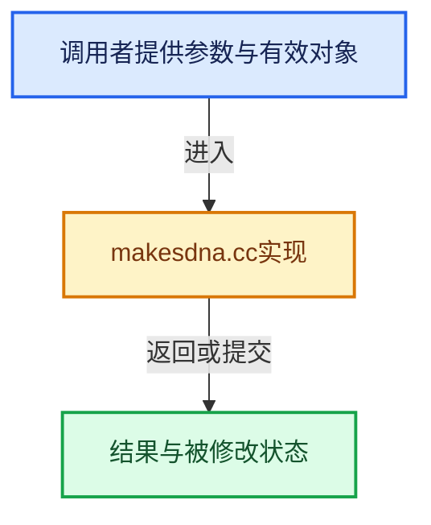

# 实现依赖专题：source/blender/makesdna/intern/makesdna.cc

[方向导航](README.md) · [符号索引](../%E7%AC%A6%E5%8F%B7%E4%BE%9D%E8%B5%96%E4%B8%8E%E5%AE%9E%E7%8E%B0%E7%B4%A2%E5%BC%95.md)

本专题从正文实际调用进入，集中保存共享实现。函数有稳定锚点，可从调用处直接跳到对应完整函数；递归与互相调用通过回链组织。

## 本文件的实现关系





## 相关类型布局与成员入口

<a id="t-d30839b6061f"></a>

### `blender::TypeTable::GetIDFn`

原始声明：[source/blender/makesdna/intern/makesdna.cc](../../../../../source/blender/makesdna/intern/makesdna.cc) · L112—L118。

以下保留类的数据声明与编译条件，成员函数实现通过后面的精确链接阅读。

<!-- annotated:bfa82f938c3a6a -->

```cpp
  class GetIDFn {
   public:
```

<details>
<summary>核对原始源码：source/blender/makesdna/intern/makesdna.cc · L112—L113</summary>

<!-- original:bfa82f938c3a6a:source/blender/makesdna/intern/makesdna.cc:112:113 -->

```cpp
  class GetIDFn {
   public:
```

</details>

<!-- annotated:2ec28f5eeddf8f -->

```cpp
  };
```

<details>
<summary>核对原始源码：source/blender/makesdna/intern/makesdna.cc · L118—L118</summary>

<!-- original:2ec28f5eeddf8f:source/blender/makesdna/intern/makesdna.cc:118:118 -->

```cpp
  };
```

</details>


## 完整成员与函数实现

<a id="f-271abb6037f85c2b"></a>

### `blender::BLI_system_backtrace`

实现位置：[source/blender/makesdna/intern/makesdna.cc](../../../../../source/blender/makesdna/intern/makesdna.cc) · L81—L84。

接口参数：

- `FILE *fp`

**教学注释版**

<!-- annotated:7bfb894fb9a1b2 -->

```cpp
void BLI_system_backtrace(FILE *fp)
{
  (void)fp;
}
```

<details>
<summary>核对原始源码：source/blender/makesdna/intern/makesdna.cc · L81—L84</summary>

<!-- original:7bfb894fb9a1b2:source/blender/makesdna/intern/makesdna.cc:81:84 -->

```cpp
void BLI_system_backtrace(FILE *fp)
{
  (void)fp;
}
```

</details>

**继续追踪实现**

本实现没有需要继续展开的显式调用；检查返回表达式、对象转换和调用者前置条件。
