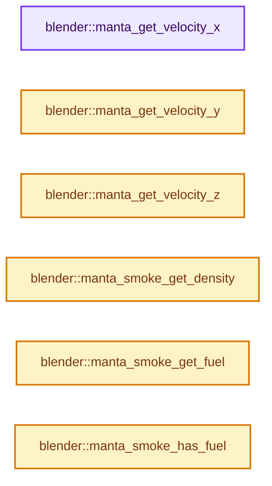
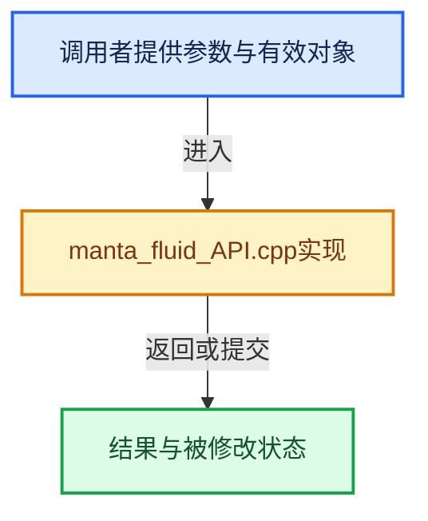

# 实现依赖专题：intern/mantaflow/intern/manta_fluid_API.cpp

[方向导航](README.md) · [符号索引](../%E7%AC%A6%E5%8F%B7%E4%BE%9D%E8%B5%96%E4%B8%8E%E5%AE%9E%E7%8E%B0%E7%B4%A2%E5%BC%95.md)

本专题从正文实际调用进入，集中保存共享实现。函数有稳定锚点，可从调用处直接跳到对应完整函数；递归与互相调用通过回链组织。

## 本文件的实现关系






## 完整成员与函数实现

<a id="f-4a23a2951f3233c1"></a>

### `blender::manta_get_velocity_x`

实现位置：[intern/mantaflow/intern/manta_fluid_API.cpp](../../../../../intern/mantaflow/intern/manta_fluid_API.cpp) · L175—L178。

接口参数：

- `MANTA *fluid`

**教学注释版**

<!-- annotated:c5b220c233f4a3 -->

```cpp
float *manta_get_velocity_x(MANTA *fluid)
{
  return fluid->getVelocityX();
}
```

<details>
<summary>核对原始源码：intern/mantaflow/intern/manta_fluid_API.cpp · L175—L178</summary>

<!-- original:c5b220c233f4a3:intern/mantaflow/intern/manta_fluid_API.cpp:175:178 -->

```cpp
float *manta_get_velocity_x(MANTA *fluid)
{
  return fluid->getVelocityX();
}
```

</details>

**结果出口**

- `return fluid->getVelocityX();`

**继续追踪实现**

- `fluid->getVelocityX` → [blender::MANTA::getVelocityX · L183](%E4%BE%9D%E8%B5%96-MANTA_main-c7c58e.md#f-c90647c370fe9e0c)。

<a id="f-10418de2e724134d"></a>

### `blender::manta_get_velocity_y`

实现位置：[intern/mantaflow/intern/manta_fluid_API.cpp](../../../../../intern/mantaflow/intern/manta_fluid_API.cpp) · L179—L182。

接口参数：

- `MANTA *fluid`

**教学注释版**

<!-- annotated:078135f6f6e692 -->

```cpp
float *manta_get_velocity_y(MANTA *fluid)
{
  return fluid->getVelocityY();
}
```

<details>
<summary>核对原始源码：intern/mantaflow/intern/manta_fluid_API.cpp · L179—L182</summary>

<!-- original:078135f6f6e692:intern/mantaflow/intern/manta_fluid_API.cpp:179:182 -->

```cpp
float *manta_get_velocity_y(MANTA *fluid)
{
  return fluid->getVelocityY();
}
```

</details>

**结果出口**

- `return fluid->getVelocityY();`

**继续追踪实现**

- `fluid->getVelocityY` → [blender::MANTA::getVelocityY · L187](%E4%BE%9D%E8%B5%96-MANTA_main-c7c58e.md#f-0ff5fb0fb43eebe4)。

<a id="f-5625407d5868acae"></a>

### `blender::manta_get_velocity_z`

实现位置：[intern/mantaflow/intern/manta_fluid_API.cpp](../../../../../intern/mantaflow/intern/manta_fluid_API.cpp) · L183—L186。

接口参数：

- `MANTA *fluid`

**教学注释版**

<!-- annotated:5fa1df3edf4425 -->

```cpp
float *manta_get_velocity_z(MANTA *fluid)
{
  return fluid->getVelocityZ();
}
```

<details>
<summary>核对原始源码：intern/mantaflow/intern/manta_fluid_API.cpp · L183—L186</summary>

<!-- original:5fa1df3edf4425:intern/mantaflow/intern/manta_fluid_API.cpp:183:186 -->

```cpp
float *manta_get_velocity_z(MANTA *fluid)
{
  return fluid->getVelocityZ();
}
```

</details>

**结果出口**

- `return fluid->getVelocityZ();`

**继续追踪实现**

- `fluid->getVelocityZ` → [blender::MANTA::getVelocityZ · L191](%E4%BE%9D%E8%B5%96-MANTA_main-c7c58e.md#f-c0d5f2d81b9d74e4)。

<a id="f-f6a2f50cb9ff6258"></a>

### `blender::manta_smoke_get_density`

实现位置：[intern/mantaflow/intern/manta_fluid_API.cpp](../../../../../intern/mantaflow/intern/manta_fluid_API.cpp) · L411—L414。

接口参数：

- `MANTA *smoke`

**教学注释版**

<!-- annotated:d23d3eb6eefe23 -->

```cpp
float *manta_smoke_get_density(MANTA *smoke)
{
  return smoke->getDensity();
}
```

<details>
<summary>核对原始源码：intern/mantaflow/intern/manta_fluid_API.cpp · L411—L414</summary>

<!-- original:d23d3eb6eefe23:intern/mantaflow/intern/manta_fluid_API.cpp:411:414 -->

```cpp
float *manta_smoke_get_density(MANTA *smoke)
{
  return smoke->getDensity();
}
```

</details>

**结果出口**

- `return smoke->getDensity();`

**继续追踪实现**

- `smoke->getDensity` → [blender::MANTA::getDensity · L175](%E4%BE%9D%E8%B5%96-MANTA_main-c7c58e.md#f-f158ecac233f5e10)。

<a id="f-8fffd3e2ac29a1b8"></a>

### `blender::manta_smoke_get_fuel`

实现位置：[intern/mantaflow/intern/manta_fluid_API.cpp](../../../../../intern/mantaflow/intern/manta_fluid_API.cpp) · L415—L418。

接口参数：

- `MANTA *smoke`

**教学注释版**

<!-- annotated:0a793c0fae6122 -->

```cpp
float *manta_smoke_get_fuel(MANTA *smoke)
{
  return smoke->getFuel();
}
```

<details>
<summary>核对原始源码：intern/mantaflow/intern/manta_fluid_API.cpp · L415—L418</summary>

<!-- original:0a793c0fae6122:intern/mantaflow/intern/manta_fluid_API.cpp:415:418 -->

```cpp
float *manta_smoke_get_fuel(MANTA *smoke)
{
  return smoke->getFuel();
}
```

</details>

**结果出口**

- `return smoke->getFuel();`

**继续追踪实现**

- `smoke->getFuel` → [blender::MANTA::getFuel · L259](%E4%BE%9D%E8%B5%96-MANTA_main-c7c58e.md#f-373a73d2255bf62e)。

<a id="f-0f8a92d03e48f57b"></a>

### `blender::manta_smoke_has_fuel`

实现位置：[intern/mantaflow/intern/manta_fluid_API.cpp](../../../../../intern/mantaflow/intern/manta_fluid_API.cpp) · L492—L495。

接口参数：

- `MANTA *smoke`

**教学注释版**

<!-- annotated:7a7da484bb290c -->

```cpp
bool manta_smoke_has_fuel(MANTA *smoke)
{
  return smoke->getFuel() != nullptr;
}
```

<details>
<summary>核对原始源码：intern/mantaflow/intern/manta_fluid_API.cpp · L492—L495</summary>

<!-- original:7a7da484bb290c:intern/mantaflow/intern/manta_fluid_API.cpp:492:495 -->

```cpp
bool manta_smoke_has_fuel(MANTA *smoke)
{
  return smoke->getFuel() != nullptr;
}
```

</details>

**结果出口**

- `return smoke->getFuel() != nullptr;`

**继续追踪实现**

- `smoke->getFuel` → [blender::MANTA::getFuel · L259](%E4%BE%9D%E8%B5%96-MANTA_main-c7c58e.md#f-373a73d2255bf62e)。
