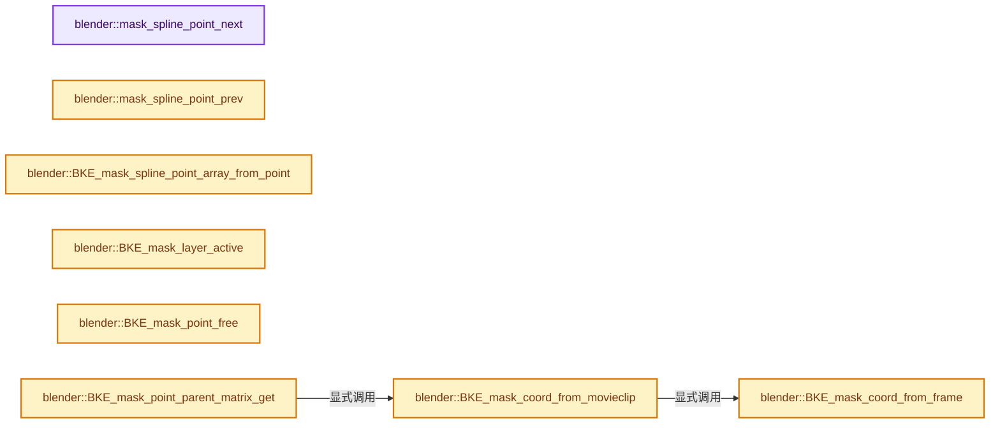
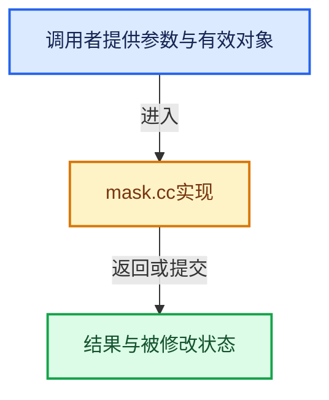

# 实现依赖专题：source/blender/blenkernel/intern/mask.cc

[方向导航](README.md) · [符号索引](../%E7%AC%A6%E5%8F%B7%E4%BE%9D%E8%B5%96%E4%B8%8E%E5%AE%9E%E7%8E%B0%E7%B4%A2%E5%BC%95.md)

本专题从正文实际调用进入，集中保存共享实现。函数有稳定锚点，可从调用处直接跳到对应完整函数；递归与互相调用通过回链组织。

## 本文件的实现关系






## 完整成员与函数实现

<a id="f-027efcb713b1f1d1"></a>

### `blender::mask_spline_point_next`

实现位置：[source/blender/blenkernel/intern/mask.cc](../../../../../source/blender/blenkernel/intern/mask.cc) · L238—L251。

接口参数：

- `MaskSpline *spline`
- `MaskSplinePoint *points_array`
- `MaskSplinePoint *point`

**教学注释版**

<!-- annotated:b344af6344a5ee -->

```cpp
static MaskSplinePoint *mask_spline_point_next(MaskSpline *spline,
                                               MaskSplinePoint *points_array,
                                               MaskSplinePoint *point)
{
  if (point == &points_array[spline->tot_point - 1]) {
    if (spline->flag & MASK_SPLINE_CYCLIC) {
      return &points_array[0];
    }

    return nullptr;
  }

  return point + 1;
}
```

<details>
<summary>核对原始源码：source/blender/blenkernel/intern/mask.cc · L238—L251</summary>

<!-- original:b344af6344a5ee:source/blender/blenkernel/intern/mask.cc:238:251 -->

```cpp
static MaskSplinePoint *mask_spline_point_next(MaskSpline *spline,
                                               MaskSplinePoint *points_array,
                                               MaskSplinePoint *point)
{
  if (point == &points_array[spline->tot_point - 1]) {
    if (spline->flag & MASK_SPLINE_CYCLIC) {
      return &points_array[0];
    }

    return nullptr;
  }

  return point + 1;
}
```

</details>

**结果出口**

- `return &points_array[0];`
- `return nullptr;`
- `return point + 1;`

**继续追踪实现**

本实现没有需要继续展开的显式调用；检查返回表达式、对象转换和调用者前置条件。

<a id="f-3ced975f495ec664"></a>

### `blender::mask_spline_point_prev`

实现位置：[source/blender/blenkernel/intern/mask.cc](../../../../../source/blender/blenkernel/intern/mask.cc) · L253—L266。

接口参数：

- `MaskSpline *spline`
- `MaskSplinePoint *points_array`
- `MaskSplinePoint *point`

**教学注释版**

<!-- annotated:88ab38baba0569 -->

```cpp
static MaskSplinePoint *mask_spline_point_prev(MaskSpline *spline,
                                               MaskSplinePoint *points_array,
                                               MaskSplinePoint *point)
{
  if (point == points_array) {
    if (spline->flag & MASK_SPLINE_CYCLIC) {
      return &points_array[spline->tot_point - 1];
    }

    return nullptr;
  }

  return point - 1;
}
```

<details>
<summary>核对原始源码：source/blender/blenkernel/intern/mask.cc · L253—L266</summary>

<!-- original:88ab38baba0569:source/blender/blenkernel/intern/mask.cc:253:266 -->

```cpp
static MaskSplinePoint *mask_spline_point_prev(MaskSpline *spline,
                                               MaskSplinePoint *points_array,
                                               MaskSplinePoint *point)
{
  if (point == points_array) {
    if (spline->flag & MASK_SPLINE_CYCLIC) {
      return &points_array[spline->tot_point - 1];
    }

    return nullptr;
  }

  return point - 1;
}
```

</details>

**结果出口**

- `return &points_array[spline->tot_point - 1];`
- `return nullptr;`
- `return point - 1;`

**继续追踪实现**

本实现没有需要继续展开的显式调用；检查返回表达式、对象转换和调用者前置条件。

<a id="f-5b114cde1e70d501"></a>

### `blender::BKE_mask_spline_point_array_from_point`

实现位置：[source/blender/blenkernel/intern/mask.cc](../../../../../source/blender/blenkernel/intern/mask.cc) · L289—L305。

接口参数：

- `MaskSpline *spline`
- `const MaskSplinePoint *point_ref`

**教学注释版**

<!-- annotated:e602545de4c06d -->

```cpp
MaskSplinePoint *BKE_mask_spline_point_array_from_point(MaskSpline *spline,
                                                        const MaskSplinePoint *point_ref)
{
  if ((point_ref >= spline->points) && (point_ref < &spline->points[spline->tot_point])) {
    return spline->points;
  }

  MaskSplinePoint *points_deform = spline->runtime->points_deform.data();
  if ((point_ref >= points_deform) &&
      (point_ref < points_deform + spline->runtime->points_deform.size()))
  {
    return points_deform;
  }

  BLI_assert_msg(0, "wrong array");
  return nullptr;
}
```

<details>
<summary>核对原始源码：source/blender/blenkernel/intern/mask.cc · L289—L305</summary>

<!-- original:e602545de4c06d:source/blender/blenkernel/intern/mask.cc:289:305 -->

```cpp
MaskSplinePoint *BKE_mask_spline_point_array_from_point(MaskSpline *spline,
                                                        const MaskSplinePoint *point_ref)
{
  if ((point_ref >= spline->points) && (point_ref < &spline->points[spline->tot_point])) {
    return spline->points;
  }

  MaskSplinePoint *points_deform = spline->runtime->points_deform.data();
  if ((point_ref >= points_deform) &&
      (point_ref < points_deform + spline->runtime->points_deform.size()))
  {
    return points_deform;
  }

  BLI_assert_msg(0, "wrong array");
  return nullptr;
}
```

</details>

**结果出口**

- `return spline->points;`
- `return points_deform;`
- `return nullptr;`

**继续追踪实现**

- `spline->runtime->points_deform.data` → [调用协议](../%E6%A8%A1%E6%9D%BF%E5%AE%8F%E4%B8%8E%E5%8A%A8%E6%80%81%E5%88%86%E6%B4%BE%E5%8D%8F%E8%AE%AE.md)：接收对象类型依赖auto、返回值或模板实例；不按同名猜测目标。调用位置L296。
- `spline->runtime->points_deform.size` → [调用协议](../%E6%A8%A1%E6%9D%BF%E5%AE%8F%E4%B8%8E%E5%8A%A8%E6%80%81%E5%88%86%E6%B4%BE%E5%8D%8F%E8%AE%AE.md)：接收对象类型依赖auto、返回值或模板实例；不按同名猜测目标。调用位置L298。
- `BLI_assert_msg` → [BLI_assert_msg · L55](../01-%E5%9F%BA%E7%A1%80%E5%AE%B9%E5%99%A8%E4%B8%8E%E7%8E%B0%E4%BB%A3CPP/%E4%BE%9D%E8%B5%96-BLI_assert-cc98e8.md#m-695eed20dceb)；[BLI_assert_msg · L64](../01-%E5%9F%BA%E7%A1%80%E5%AE%B9%E5%99%A8%E4%B8%8E%E7%8E%B0%E4%BB%A3CPP/%E4%BE%9D%E8%B5%96-BLI_assert-cc98e8.md#m-7de5563de4db)。宏定义由构建条件选择。

<a id="f-4ca37b5bf77eaaed"></a>

### `blender::BKE_mask_layer_active`

实现位置：[source/blender/blenkernel/intern/mask.cc](../../../../../source/blender/blenkernel/intern/mask.cc) · L329—L332。

接口参数：

- `Mask *mask`

**教学注释版**

<!-- annotated:47d1b968ad35e5 -->

```cpp
MaskLayer *BKE_mask_layer_active(Mask *mask)
{
  return static_cast<MaskLayer *>(BLI_findlink(&mask->masklayers, mask->masklay_act));
}
```

<details>
<summary>核对原始源码：source/blender/blenkernel/intern/mask.cc · L329—L332</summary>

<!-- original:47d1b968ad35e5:source/blender/blenkernel/intern/mask.cc:329:332 -->

```cpp
MaskLayer *BKE_mask_layer_active(Mask *mask)
{
  return static_cast<MaskLayer *>(BLI_findlink(&mask->masklayers, mask->masklay_act));
}
```

</details>

**结果出口**

- `return static_cast<MaskLayer *>(BLI_findlink(&mask->masklayers, mask->masklay_act));`

**继续追踪实现**

- `BLI_findlink` → [blender::BLI_findlink · L541](../01-%E5%9F%BA%E7%A1%80%E5%AE%B9%E5%99%A8%E4%B8%8E%E7%8E%B0%E4%BB%A3CPP/%E4%BE%9D%E8%B5%96-listbase-2816d9.md#f-6d3fd65974b4e808)。

<a id="f-0e22fdb3b739376d"></a>

### `blender::BKE_mask_point_free`

实现位置：[source/blender/blenkernel/intern/mask.cc](../../../../../source/blender/blenkernel/intern/mask.cc) · L1026—L1031。

接口参数：

- `MaskSplinePoint *point`

**教学注释版**

<!-- annotated:e98c011bcae729 -->

```cpp
void BKE_mask_point_free(MaskSplinePoint *point)
{
  if (point->uw) {
    MEM_delete(point->uw);
  }
}
```

<details>
<summary>核对原始源码：source/blender/blenkernel/intern/mask.cc · L1026—L1031</summary>

<!-- original:e98c011bcae729:source/blender/blenkernel/intern/mask.cc:1026:1031 -->

```cpp
void BKE_mask_point_free(MaskSplinePoint *point)
{
  if (point->uw) {
    MEM_delete(point->uw);
  }
}
```

</details>

**继续追踪实现**

- `MEM_delete` → [MEM_delete · L400](../03-%E5%86%85%E5%AD%98%E5%88%86%E9%85%8D%E4%B8%8E%E8%BF%90%E8%A1%8C%E6%97%B6%E7%B1%BB%E5%9E%8B/%E4%BE%9D%E8%B5%96-MEM_guardedalloc-b54eca.md#f-9049ffdd1682887c)。

<a id="f-c25e75dc88c2b557"></a>

### `blender::BKE_mask_coord_from_frame`

实现位置：[source/blender/blenkernel/intern/mask.cc](../../../../../source/blender/blenkernel/intern/mask.cc) · L1162—L1176。

接口参数：

- `float r_co[2]`
- `const float co[2]`
- `const float frame_size[2]`

**教学注释版**

<!-- annotated:e656cce4367ba4 -->

```cpp
void BKE_mask_coord_from_frame(float r_co[2], const float co[2], const float frame_size[2])
{
  if (frame_size[0] == frame_size[1]) {
    r_co[0] = co[0];
    r_co[1] = co[1];
  }
  else if (frame_size[0] < frame_size[1]) {
    r_co[0] = ((co[0] - 0.5f) * (frame_size[0] / frame_size[1])) + 0.5f;
    r_co[1] = co[1];
  }
  else { /* (frame_size[0] > frame_size[1]) */
    r_co[0] = co[0];
    r_co[1] = ((co[1] - 0.5f) * (frame_size[1] / frame_size[0])) + 0.5f;
  }
}
```

<details>
<summary>核对原始源码：source/blender/blenkernel/intern/mask.cc · L1162—L1176</summary>

<!-- original:e656cce4367ba4:source/blender/blenkernel/intern/mask.cc:1162:1176 -->

```cpp
void BKE_mask_coord_from_frame(float r_co[2], const float co[2], const float frame_size[2])
{
  if (frame_size[0] == frame_size[1]) {
    r_co[0] = co[0];
    r_co[1] = co[1];
  }
  else if (frame_size[0] < frame_size[1]) {
    r_co[0] = ((co[0] - 0.5f) * (frame_size[0] / frame_size[1])) + 0.5f;
    r_co[1] = co[1];
  }
  else { /* (frame_size[0] > frame_size[1]) */
    r_co[0] = co[0];
    r_co[1] = ((co[1] - 0.5f) * (frame_size[1] / frame_size[0])) + 0.5f;
  }
}
```

</details>

**沿实际写入检查状态**

- `r_co[0] = co[0];`
- `r_co[1] = co[1];`
- `r_co[0] = ((co[0] - 0.5f) * (frame_size[0] / frame_size[1])) + 0.5f;`
- `r_co[1] = ((co[1] - 0.5f) * (frame_size[1] / frame_size[0])) + 0.5f;`

**继续追踪实现**

本实现没有需要继续展开的显式调用；检查返回表达式、对象转换和调用者前置条件。

<a id="f-b929688dc7adbbaa"></a>

### `blender::BKE_mask_coord_from_movieclip`

实现位置：[source/blender/blenkernel/intern/mask.cc](../../../../../source/blender/blenkernel/intern/mask.cc) · L1178—L1193。

接口参数：

- `MovieClip *clip`
- `MovieClipUser *user`
- `float r_co[2]`
- `const float co[2]`

**教学注释版**

<!-- annotated:7e319691867cf5 -->

```cpp
void BKE_mask_coord_from_movieclip(MovieClip *clip,
                                   MovieClipUser *user,
                                   float r_co[2],
                                   const float co[2])
{
  float aspx, aspy;
  float frame_size[2];

  /* scaling for the clip */
  BKE_movieclip_get_size_fl(clip, user, frame_size);
  BKE_movieclip_get_aspect(clip, &aspx, &aspy);

  frame_size[1] *= (aspy / aspx);

  BKE_mask_coord_from_frame(r_co, co, frame_size);
}
```

<details>
<summary>核对原始源码：source/blender/blenkernel/intern/mask.cc · L1178—L1193</summary>

<!-- original:7e319691867cf5:source/blender/blenkernel/intern/mask.cc:1178:1193 -->

```cpp
void BKE_mask_coord_from_movieclip(MovieClip *clip,
                                   MovieClipUser *user,
                                   float r_co[2],
                                   const float co[2])
{
  float aspx, aspy;
  float frame_size[2];

  /* scaling for the clip */
  BKE_movieclip_get_size_fl(clip, user, frame_size);
  BKE_movieclip_get_aspect(clip, &aspx, &aspy);

  frame_size[1] *= (aspy / aspx);

  BKE_mask_coord_from_frame(r_co, co, frame_size);
}
```

</details>

**沿实际写入检查状态**

- `frame_size[1] *= (aspy / aspx);`

**继续追踪实现**

- `BKE_movieclip_get_size_fl` → [blender::BKE_movieclip_get_size_fl · L1473](%E4%BE%9D%E8%B5%96-movieclip-625888.md#f-866b8d1d3a07e44c)。
- `BKE_movieclip_get_aspect` → [blender::BKE_movieclip_get_aspect · L1503](%E4%BE%9D%E8%B5%96-movieclip-625888.md#f-63e7c1f4674274e8)。
- `BKE_mask_coord_from_frame` → [blender::BKE_mask_coord_from_frame · L1162](%E4%BE%9D%E8%B5%96-mask-6d7faa.md#f-c25e75dc88c2b557)。

<a id="f-1c35a2c71cb63c40"></a>

### `blender::BKE_mask_point_parent_matrix_get`

实现位置：[source/blender/blenkernel/intern/mask.cc](../../../../../source/blender/blenkernel/intern/mask.cc) · L1255—L1326。

接口参数：

- `MaskSplinePoint *point`
- `float ctime`
- `float parent_matrix[3][3]`

**教学注释版**

<!-- annotated:4a365033f2e622 -->

```cpp
void BKE_mask_point_parent_matrix_get(MaskSplinePoint *point,
                                      float ctime,
                                      float parent_matrix[3][3])
{
  MaskParent *parent = &point->parent;

  unit_m3(parent_matrix);

  if (!parent) {
    return;
  }

  if (parent->id_type == ID_MC) {
    if (parent->id) {
      MovieClip *clip = id_cast<MovieClip *>(parent->id);
      MovieTracking *tracking = static_cast<MovieTracking *>(&clip->tracking);
      MovieTrackingObject *ob = BKE_tracking_object_get_named(tracking, parent->parent);

      if (ob) {
        MovieClipUser user = {};
        float clip_framenr = BKE_movieclip_remap_scene_to_clip_frame(clip, ctime);
        BKE_movieclip_user_set_frame(&user, ctime);

        if (parent->type == MASK_PARENT_POINT_TRACK) {
          MovieTrackingTrack *track = BKE_tracking_object_find_track_with_name(ob,
                                                                               parent->sub_parent);

          if (track) {
            float marker_position[2], parent_co[2];
            BKE_tracking_marker_get_subframe_position(track, clip_framenr, marker_position);
            BKE_mask_coord_from_movieclip(clip, &user, parent_co, marker_position);
            sub_v2_v2v2(parent_matrix[2], parent_co, parent->parent_orig);
          }
        }
        else /* if (parent->type == MASK_PARENT_PLANE_TRACK) */ {
          MovieTrackingPlaneTrack *plane_track = BKE_tracking_object_find_plane_track_with_name(
              ob, parent->sub_parent);

          if (plane_track) {
            float corners[4][2];
            float aspx, aspy;
            float frame_size[2], H[3][3], mask_from_clip_matrix[3][3], mask_to_clip_matrix[3][3];

            BKE_tracking_plane_marker_get_subframe_corners(plane_track, ctime, corners);
            BKE_tracking_homography_between_two_quads(parent->parent_corners_orig, corners, H);

            unit_m3(mask_from_clip_matrix);

            BKE_movieclip_get_size_fl(clip, &user, frame_size);
            BKE_movieclip_get_aspect(clip, &aspx, &aspy);

            frame_size[1] *= (aspy / aspx);
            if (frame_size[0] == frame_size[1]) {
              /* pass */
            }
            else if (frame_size[0] < frame_size[1]) {
              mask_from_clip_matrix[0][0] = frame_size[1] / frame_size[0];
              mask_from_clip_matrix[2][0] = -0.5f * (frame_size[1] / frame_size[0]) + 0.5f;
            }
            else { /* (frame_size[0] > frame_size[1]) */
              mask_from_clip_matrix[1][1] = frame_size[1] / frame_size[0];
              mask_from_clip_matrix[2][1] = -0.5f * (frame_size[1] / frame_size[0]) + 0.5f;
            }

            invert_m3_m3(mask_to_clip_matrix, mask_from_clip_matrix);
            mul_m3_series(parent_matrix, mask_from_clip_matrix, H, mask_to_clip_matrix);
          }
        }
      }
    }
  }
}
```

<details>
<summary>核对原始源码：source/blender/blenkernel/intern/mask.cc · L1255—L1326</summary>

<!-- original:4a365033f2e622:source/blender/blenkernel/intern/mask.cc:1255:1326 -->

```cpp
void BKE_mask_point_parent_matrix_get(MaskSplinePoint *point,
                                      float ctime,
                                      float parent_matrix[3][3])
{
  MaskParent *parent = &point->parent;

  unit_m3(parent_matrix);

  if (!parent) {
    return;
  }

  if (parent->id_type == ID_MC) {
    if (parent->id) {
      MovieClip *clip = id_cast<MovieClip *>(parent->id);
      MovieTracking *tracking = static_cast<MovieTracking *>(&clip->tracking);
      MovieTrackingObject *ob = BKE_tracking_object_get_named(tracking, parent->parent);

      if (ob) {
        MovieClipUser user = {};
        float clip_framenr = BKE_movieclip_remap_scene_to_clip_frame(clip, ctime);
        BKE_movieclip_user_set_frame(&user, ctime);

        if (parent->type == MASK_PARENT_POINT_TRACK) {
          MovieTrackingTrack *track = BKE_tracking_object_find_track_with_name(ob,
                                                                               parent->sub_parent);

          if (track) {
            float marker_position[2], parent_co[2];
            BKE_tracking_marker_get_subframe_position(track, clip_framenr, marker_position);
            BKE_mask_coord_from_movieclip(clip, &user, parent_co, marker_position);
            sub_v2_v2v2(parent_matrix[2], parent_co, parent->parent_orig);
          }
        }
        else /* if (parent->type == MASK_PARENT_PLANE_TRACK) */ {
          MovieTrackingPlaneTrack *plane_track = BKE_tracking_object_find_plane_track_with_name(
              ob, parent->sub_parent);

          if (plane_track) {
            float corners[4][2];
            float aspx, aspy;
            float frame_size[2], H[3][3], mask_from_clip_matrix[3][3], mask_to_clip_matrix[3][3];

            BKE_tracking_plane_marker_get_subframe_corners(plane_track, ctime, corners);
            BKE_tracking_homography_between_two_quads(parent->parent_corners_orig, corners, H);

            unit_m3(mask_from_clip_matrix);

            BKE_movieclip_get_size_fl(clip, &user, frame_size);
            BKE_movieclip_get_aspect(clip, &aspx, &aspy);

            frame_size[1] *= (aspy / aspx);
            if (frame_size[0] == frame_size[1]) {
              /* pass */
            }
            else if (frame_size[0] < frame_size[1]) {
              mask_from_clip_matrix[0][0] = frame_size[1] / frame_size[0];
              mask_from_clip_matrix[2][0] = -0.5f * (frame_size[1] / frame_size[0]) + 0.5f;
            }
            else { /* (frame_size[0] > frame_size[1]) */
              mask_from_clip_matrix[1][1] = frame_size[1] / frame_size[0];
              mask_from_clip_matrix[2][1] = -0.5f * (frame_size[1] / frame_size[0]) + 0.5f;
            }

            invert_m3_m3(mask_to_clip_matrix, mask_from_clip_matrix);
            mul_m3_series(parent_matrix, mask_from_clip_matrix, H, mask_to_clip_matrix);
          }
        }
      }
    }
  }
}
```

</details>

**沿实际写入检查状态**

- `frame_size[1] *= (aspy / aspx);`
- `mask_from_clip_matrix[0][0] = frame_size[1] / frame_size[0];`
- `mask_from_clip_matrix[2][0] = -0.5f * (frame_size[1] / frame_size[0]) + 0.5f;`
- `mask_from_clip_matrix[1][1] = frame_size[1] / frame_size[0];`
- `mask_from_clip_matrix[2][1] = -0.5f * (frame_size[1] / frame_size[0]) + 0.5f;`

**继续追踪实现**

- `unit_m3` → [blender::unit_m3 · L47](../12-%E7%A9%BA%E9%97%B4%E6%95%B0%E6%8D%AE%E7%BB%93%E6%9E%84%E4%B8%8E%E5%87%A0%E4%BD%95%E7%AE%97%E6%B3%95/%E4%BE%9D%E8%B5%96-math_matrix_c-004123.md#f-85e0073adca4ccff)。
- `id_cast<MovieClip *>` → [blender::id_cast · L1417](%E4%BE%9D%E8%B5%96-DNA_ID-3eb091.md#f-6c8ac6412850ac5a)。
- `BKE_tracking_object_get_named` → [blender::BKE_tracking_object_get_named · L1971](%E4%BE%9D%E8%B5%96-tracking-31679a.md#f-294118b68c0403d7)。
- `BKE_movieclip_remap_scene_to_clip_frame` → [blender::BKE_movieclip_remap_scene_to_clip_frame · L1813](%E4%BE%9D%E8%B5%96-movieclip-625888.md#f-5cc6b2d4d90d2906)。
- `BKE_movieclip_user_set_frame` → [blender::BKE_movieclip_user_set_frame · L1529](%E4%BE%9D%E8%B5%96-movieclip-625888.md#f-3f5d6f11af86b6c2)。
- `BKE_tracking_object_find_track_with_name` → [blender::BKE_tracking_object_find_track_with_name · L1998](%E4%BE%9D%E8%B5%96-tracking-31679a.md#f-6086caadf5853e5b)。
- `BKE_tracking_marker_get_subframe_position` → [blender::BKE_tracking_marker_get_subframe_position · L1512](%E4%BE%9D%E8%B5%96-tracking-31679a.md#f-5b78ef1e12d1ceb8)。
- `BKE_mask_coord_from_movieclip` → [blender::BKE_mask_coord_from_movieclip · L1178](%E4%BE%9D%E8%B5%96-mask-6d7faa.md#f-b929688dc7adbbaa)。
- `sub_v2_v2v2` → [blender::sub_v2_v2v2 · L335](../12-%E7%A9%BA%E9%97%B4%E6%95%B0%E6%8D%AE%E7%BB%93%E6%9E%84%E4%B8%8E%E5%87%A0%E4%BD%95%E7%AE%97%E6%B3%95/%E4%BE%9D%E8%B5%96-math_vector_inline-0c8541.md#f-f37d18ab53de26ca)。
- `BKE_tracking_object_find_plane_track_with_name` → [blender::BKE_tracking_object_find_plane_track_with_name · L2010](%E4%BE%9D%E8%B5%96-tracking-31679a.md#f-f906bb93da984223)。
- `BKE_tracking_plane_marker_get_subframe_corners` → [blender::BKE_tracking_plane_marker_get_subframe_corners · L1871](%E4%BE%9D%E8%B5%96-tracking-31679a.md#f-d1ca206fdd55dd25)。
- `BKE_tracking_homography_between_two_quads` → [blender::BKE_tracking_homography_between_two_quads · L214](%E4%BE%9D%E8%B5%96-tracking_plane_tracker-c65989.md#f-932a0b47143b8963)。
- `BKE_movieclip_get_size_fl` → [blender::BKE_movieclip_get_size_fl · L1473](%E4%BE%9D%E8%B5%96-movieclip-625888.md#f-866b8d1d3a07e44c)。
- `BKE_movieclip_get_aspect` → [blender::BKE_movieclip_get_aspect · L1503](%E4%BE%9D%E8%B5%96-movieclip-625888.md#f-63e7c1f4674274e8)。
- `invert_m3_m3` → [blender::invert_m3_m3 · L1043](../12-%E7%A9%BA%E9%97%B4%E6%95%B0%E6%8D%AE%E7%BB%93%E6%9E%84%E4%B8%8E%E5%87%A0%E4%BD%95%E7%AE%97%E6%B3%95/%E4%BE%9D%E8%B5%96-math_matrix_c-004123.md#f-3807bacd2e4afbad)。
- `mul_m3_series` → [mul_m3_series · L174](../12-%E7%A9%BA%E9%97%B4%E6%95%B0%E6%8D%AE%E7%BB%93%E6%9E%84%E4%B8%8E%E5%87%A0%E4%BD%95%E7%AE%97%E6%B3%95/%E4%BE%9D%E8%B5%96-BLI_math_matrix_c-8ca9e4.md#m-9478433580df)。宏定义由构建条件选择。

<a id="f-bcb18f034c96ce3c"></a>

### `blender::mask_calc_point_handle`

实现位置：[source/blender/blenkernel/intern/mask.cc](../../../../../source/blender/blenkernel/intern/mask.cc) · L1328—L1376。

接口参数：

- `MaskSplinePoint *point`
- `MaskSplinePoint *point_prev`
- `MaskSplinePoint *point_next`

**教学注释版**

<!-- annotated:cc3909a44b3d08 -->

```cpp
static void mask_calc_point_handle(MaskSplinePoint *point,
                                   MaskSplinePoint *point_prev,
                                   MaskSplinePoint *point_next)
{
  BezTriple *bezt = &point->bezt;
  BezTriple *bezt_prev = nullptr, *bezt_next = nullptr;
  // int handle_type = bezt->h1;

  if (point_prev) {
    bezt_prev = &point_prev->bezt;
  }

  if (point_next) {
    bezt_next = &point_next->bezt;
  }

#if 1
  if (bezt_prev || bezt_next) {
    BKE_nurb_handle_calc(bezt, bezt_prev, bezt_next, false, 0);
  }
#else
  if (handle_type == HD_VECT) {
    BKE_nurb_handle_calc(bezt, bezt_prev, bezt_next, 0, 0);
  }
  else if (handle_type == HD_AUTO) {
    BKE_nurb_handle_calc(bezt, bezt_prev, bezt_next, 0, 0);
  }
  else if (ELEM(handle_type, HD_ALIGN, HD_ALIGN_DOUBLESIDE)) {
    float v1[3], v2[3];
    float vec[3], h[3];

    sub_v3_v3v3(v1, bezt->vec[0], bezt->vec[1]);
    sub_v3_v3v3(v2, bezt->vec[2], bezt->vec[1]);
    add_v3_v3v3(vec, v1, v2);

    if (len_squared_v3(vec) > (1e-3f * 1e-3f)) {
      h[0] = vec[1];
      h[1] = -vec[0];
      h[2] = 0.0f;
    }
    else {
      copy_v3_v3(h, v1);
    }

    add_v3_v3v3(bezt->vec[0], bezt->vec[1], h);
    sub_v3_v3v3(bezt->vec[2], bezt->vec[1], h);
  }
#endif
}
```

<details>
<summary>核对原始源码：source/blender/blenkernel/intern/mask.cc · L1328—L1376</summary>

<!-- original:cc3909a44b3d08:source/blender/blenkernel/intern/mask.cc:1328:1376 -->

```cpp
static void mask_calc_point_handle(MaskSplinePoint *point,
                                   MaskSplinePoint *point_prev,
                                   MaskSplinePoint *point_next)
{
  BezTriple *bezt = &point->bezt;
  BezTriple *bezt_prev = nullptr, *bezt_next = nullptr;
  // int handle_type = bezt->h1;

  if (point_prev) {
    bezt_prev = &point_prev->bezt;
  }

  if (point_next) {
    bezt_next = &point_next->bezt;
  }

#if 1
  if (bezt_prev || bezt_next) {
    BKE_nurb_handle_calc(bezt, bezt_prev, bezt_next, false, 0);
  }
#else
  if (handle_type == HD_VECT) {
    BKE_nurb_handle_calc(bezt, bezt_prev, bezt_next, 0, 0);
  }
  else if (handle_type == HD_AUTO) {
    BKE_nurb_handle_calc(bezt, bezt_prev, bezt_next, 0, 0);
  }
  else if (ELEM(handle_type, HD_ALIGN, HD_ALIGN_DOUBLESIDE)) {
    float v1[3], v2[3];
    float vec[3], h[3];

    sub_v3_v3v3(v1, bezt->vec[0], bezt->vec[1]);
    sub_v3_v3v3(v2, bezt->vec[2], bezt->vec[1]);
    add_v3_v3v3(vec, v1, v2);

    if (len_squared_v3(vec) > (1e-3f * 1e-3f)) {
      h[0] = vec[1];
      h[1] = -vec[0];
      h[2] = 0.0f;
    }
    else {
      copy_v3_v3(h, v1);
    }

    add_v3_v3v3(bezt->vec[0], bezt->vec[1], h);
    sub_v3_v3v3(bezt->vec[2], bezt->vec[1], h);
  }
#endif
}
```

</details>

**沿实际写入检查状态**

- `bezt_prev = &point_prev->bezt;`
- `bezt_next = &point_next->bezt;`
- `h[0] = vec[1];`
- `h[1] = -vec[0];`
- `h[2] = 0.0f;`

**继续追踪实现**

- `BKE_nurb_handle_calc` → [blender::BKE_nurb_handle_calc · L3975](%E4%BE%9D%E8%B5%96-curve-ae13d5.md#f-dc8871044a0dda66)。
- `ELEM` → [ELEM · L88](%E4%BE%9D%E8%B5%96-GHOST_utildefines-34b996.md#m-d28724a15928)；[ELEM · L135](../01-%E5%9F%BA%E7%A1%80%E5%AE%B9%E5%99%A8%E4%B8%8E%E7%8E%B0%E4%BB%A3CPP/%E4%BE%9D%E8%B5%96-BLI_utildefines-293a0a.md#m-d6572de7cae0)。宏定义由构建条件选择。
- `sub_v3_v3v3` → [blender::sub_v3_v3v3 · L360](../12-%E7%A9%BA%E9%97%B4%E6%95%B0%E6%8D%AE%E7%BB%93%E6%9E%84%E4%B8%8E%E5%87%A0%E4%BD%95%E7%AE%97%E6%B3%95/%E4%BE%9D%E8%B5%96-math_vector_inline-0c8541.md#f-23781c252db8b30c)。
- `add_v3_v3v3` → [blender::add_v3_v3v3 · L300](../12-%E7%A9%BA%E9%97%B4%E6%95%B0%E6%8D%AE%E7%BB%93%E6%9E%84%E4%B8%8E%E5%87%A0%E4%BD%95%E7%AE%97%E6%B3%95/%E4%BE%9D%E8%B5%96-math_vector_inline-0c8541.md#f-7343b459d0d3db69)。
- `len_squared_v3` → [blender::len_squared_v3 · L724](../12-%E7%A9%BA%E9%97%B4%E6%95%B0%E6%8D%AE%E7%BB%93%E6%9E%84%E4%B8%8E%E5%87%A0%E4%BD%95%E7%AE%97%E6%B3%95/%E4%BE%9D%E8%B5%96-math_vector_inline-0c8541.md#f-089409f6f09f82ef)。
- `copy_v3_v3` → [blender::copy_v3_v3 · L47](../12-%E7%A9%BA%E9%97%B4%E6%95%B0%E6%8D%AE%E7%BB%93%E6%9E%84%E4%B8%8E%E5%87%A0%E4%BD%95%E7%AE%97%E6%B3%95/%E4%BE%9D%E8%B5%96-math_vector_inline-0c8541.md#f-037a0d5fa5060bd6)。

<a id="f-62aff1543a9cf821"></a>

### `blender::BKE_mask_get_handle_point_adjacent`

实现位置：[source/blender/blenkernel/intern/mask.cc](../../../../../source/blender/blenkernel/intern/mask.cc) · L1378—L1388。

接口参数：

- `MaskSpline *spline`
- `MaskSplinePoint *point`
- `MaskSplinePoint **r_point_prev`
- `MaskSplinePoint **r_point_next`

**教学注释版**

<!-- annotated:f3a562526ba2e3 -->

```cpp
void BKE_mask_get_handle_point_adjacent(MaskSpline *spline,
                                        MaskSplinePoint *point,
                                        MaskSplinePoint **r_point_prev,
                                        MaskSplinePoint **r_point_next)
{
  /* TODO: could avoid calling this at such low level. */
  MaskSplinePoint *points_array = BKE_mask_spline_point_array_from_point(spline, point);

  *r_point_prev = mask_spline_point_prev(spline, points_array, point);
  *r_point_next = mask_spline_point_next(spline, points_array, point);
}
```

<details>
<summary>核对原始源码：source/blender/blenkernel/intern/mask.cc · L1378—L1388</summary>

<!-- original:f3a562526ba2e3:source/blender/blenkernel/intern/mask.cc:1378:1388 -->

```cpp
void BKE_mask_get_handle_point_adjacent(MaskSpline *spline,
                                        MaskSplinePoint *point,
                                        MaskSplinePoint **r_point_prev,
                                        MaskSplinePoint **r_point_next)
{
  /* TODO: could avoid calling this at such low level. */
  MaskSplinePoint *points_array = BKE_mask_spline_point_array_from_point(spline, point);

  *r_point_prev = mask_spline_point_prev(spline, points_array, point);
  *r_point_next = mask_spline_point_next(spline, points_array, point);
}
```

</details>

**继续追踪实现**

- `BKE_mask_spline_point_array_from_point` → [blender::BKE_mask_spline_point_array_from_point · L289](%E4%BE%9D%E8%B5%96-mask-6d7faa.md#f-5b114cde1e70d501)。
- `mask_spline_point_prev` → [blender::mask_spline_point_prev · L253](%E4%BE%9D%E8%B5%96-mask-6d7faa.md#f-3ced975f495ec664)。
- `mask_spline_point_next` → [blender::mask_spline_point_next · L238](%E4%BE%9D%E8%B5%96-mask-6d7faa.md#f-027efcb713b1f1d1)。

<a id="f-df1668f2c215d3b7"></a>

### `blender::BKE_mask_calc_handle_point`

实现位置：[source/blender/blenkernel/intern/mask.cc](../../../../../source/blender/blenkernel/intern/mask.cc) · L1418—L1425。

接口参数：

- `MaskSpline *spline`
- `MaskSplinePoint *point`

**教学注释版**

<!-- annotated:e361bcfe4703d6 -->

```cpp
void BKE_mask_calc_handle_point(MaskSpline *spline, MaskSplinePoint *point)
{
  MaskSplinePoint *point_prev, *point_next;

  BKE_mask_get_handle_point_adjacent(spline, point, &point_prev, &point_next);

  mask_calc_point_handle(point, point_prev, point_next);
}
```

<details>
<summary>核对原始源码：source/blender/blenkernel/intern/mask.cc · L1418—L1425</summary>

<!-- original:e361bcfe4703d6:source/blender/blenkernel/intern/mask.cc:1418:1425 -->

```cpp
void BKE_mask_calc_handle_point(MaskSpline *spline, MaskSplinePoint *point)
{
  MaskSplinePoint *point_prev, *point_next;

  BKE_mask_get_handle_point_adjacent(spline, point, &point_prev, &point_next);

  mask_calc_point_handle(point, point_prev, point_next);
}
```

</details>

**继续追踪实现**

- `BKE_mask_get_handle_point_adjacent` → [blender::BKE_mask_get_handle_point_adjacent · L1378](%E4%BE%9D%E8%B5%96-mask-6d7faa.md#f-62aff1543a9cf821)。
- `mask_calc_point_handle` → [blender::mask_calc_point_handle · L1328](%E4%BE%9D%E8%B5%96-mask-6d7faa.md#f-bcb18f034c96ce3c)。

<a id="f-15cea96633378ca7"></a>

### `blender::BKE_mask_layer_calc_handles`

实现位置：[source/blender/blenkernel/intern/mask.cc](../../../../../source/blender/blenkernel/intern/mask.cc) · L1501—L1508。

接口参数：

- `MaskLayer *masklay`

**教学注释版**

<!-- annotated:75984060230ce6 -->

```cpp
void BKE_mask_layer_calc_handles(MaskLayer *masklay)
{
  for (MaskSpline &spline : masklay->splines) {
    for (int i = 0; i < spline.tot_point; i++) {
      BKE_mask_calc_handle_point(&spline, &spline.points[i]);
    }
  }
}
```

<details>
<summary>核对原始源码：source/blender/blenkernel/intern/mask.cc · L1501—L1508</summary>

<!-- original:75984060230ce6:source/blender/blenkernel/intern/mask.cc:1501:1508 -->

```cpp
void BKE_mask_layer_calc_handles(MaskLayer *masklay)
{
  for (MaskSpline &spline : masklay->splines) {
    for (int i = 0; i < spline.tot_point; i++) {
      BKE_mask_calc_handle_point(&spline, &spline.points[i]);
    }
  }
}
```

</details>

**继续追踪实现**

- `BKE_mask_calc_handle_point` → [blender::BKE_mask_calc_handle_point · L1418](%E4%BE%9D%E8%B5%96-mask-6d7faa.md#f-df1668f2c215d3b7)。

<a id="f-9955aad59695a420"></a>

### `blender::BKE_mask_spline_ensure_deform`

实现位置：[source/blender/blenkernel/intern/mask.cc](../../../../../source/blender/blenkernel/intern/mask.cc) · L1510—L1519。

接口参数：

- `MaskSpline *spline`

**教学注释版**

<!-- annotated:2f1ce52a6d0060 -->

```cpp
void BKE_mask_spline_ensure_deform(MaskSpline *spline)
{
  if (spline->runtime->points_deform.size() != spline->tot_point) {
    for (MaskSplinePoint &point : spline->runtime->points_deform) {
      BKE_mask_point_free(&point);
    }

    spline->runtime->points_deform.reinitialize(spline->tot_point);
  }
}
```

<details>
<summary>核对原始源码：source/blender/blenkernel/intern/mask.cc · L1510—L1519</summary>

<!-- original:2f1ce52a6d0060:source/blender/blenkernel/intern/mask.cc:1510:1519 -->

```cpp
void BKE_mask_spline_ensure_deform(MaskSpline *spline)
{
  if (spline->runtime->points_deform.size() != spline->tot_point) {
    for (MaskSplinePoint &point : spline->runtime->points_deform) {
      BKE_mask_point_free(&point);
    }

    spline->runtime->points_deform.reinitialize(spline->tot_point);
  }
}
```

</details>

**继续追踪实现**

- `spline->runtime->points_deform.size` → [调用协议](../%E6%A8%A1%E6%9D%BF%E5%AE%8F%E4%B8%8E%E5%8A%A8%E6%80%81%E5%88%86%E6%B4%BE%E5%8D%8F%E8%AE%AE.md)：接收对象类型依赖auto、返回值或模板实例；不按同名猜测目标。调用位置L1512。
- `BKE_mask_point_free` → [blender::BKE_mask_point_free · L1026](%E4%BE%9D%E8%B5%96-mask-6d7faa.md#f-0e22fdb3b739376d)。
- `spline->runtime->points_deform.reinitialize` → [调用协议](../%E6%A8%A1%E6%9D%BF%E5%AE%8F%E4%B8%8E%E5%8A%A8%E6%80%81%E5%88%86%E6%B4%BE%E5%8D%8F%E8%AE%AE.md)：接收对象类型依赖auto、返回值或模板实例；不按同名猜测目标。调用位置L1517。

<a id="f-be948bc7434616a0"></a>

### `blender::BKE_mask_parent_init`

实现位置：[source/blender/blenkernel/intern/mask.cc](../../../../../source/blender/blenkernel/intern/mask.cc) · L1538—L1541。

接口参数：

- `MaskParent *parent`

**教学注释版**

<!-- annotated:2d37f8d2b68051 -->

```cpp
void BKE_mask_parent_init(MaskParent *parent)
{
  parent->id_type = ID_MC;
}
```

<details>
<summary>核对原始源码：source/blender/blenkernel/intern/mask.cc · L1538—L1541</summary>

<!-- original:2d37f8d2b68051:source/blender/blenkernel/intern/mask.cc:1538:1541 -->

```cpp
void BKE_mask_parent_init(MaskParent *parent)
{
  parent->id_type = ID_MC;
}
```

</details>

**沿实际写入检查状态**

- `parent->id_type = ID_MC;`

**继续追踪实现**

本实现没有需要继续展开的显式调用；检查返回表达式、对象转换和调用者前置条件。

<a id="f-8a1948777e606576"></a>

### `blender::BKE_mask_layer_is_animated`

实现位置：[source/blender/blenkernel/intern/mask.cc](../../../../../source/blender/blenkernel/intern/mask.cc) · L1546—L1550。

接口参数：

- `MaskLayer &mask_layer`

**教学注释版**

<!-- annotated:06dbdbe981b940 -->

```cpp
bool BKE_mask_layer_is_animated(MaskLayer &mask_layer)
{
  /* At least two spline shapes are needed for an animation. */
  return !mask_layer.splines_shapes.is_empty() && !mask_layer.splines_shapes.is_single();
}
```

<details>
<summary>核对原始源码：source/blender/blenkernel/intern/mask.cc · L1546—L1550</summary>

<!-- original:06dbdbe981b940:source/blender/blenkernel/intern/mask.cc:1546:1550 -->

```cpp
bool BKE_mask_layer_is_animated(MaskLayer &mask_layer)
{
  /* At least two spline shapes are needed for an animation. */
  return !mask_layer.splines_shapes.is_empty() && !mask_layer.splines_shapes.is_single();
}
```

</details>

**结果出口**

- `return !mask_layer.splines_shapes.is_empty() && !mask_layer.splines_shapes.is_single();`

**继续追踪实现**

- `mask_layer.splines_shapes.is_empty` → [调用协议](../%E6%A8%A1%E6%9D%BF%E5%AE%8F%E4%B8%8E%E5%8A%A8%E6%80%81%E5%88%86%E6%B4%BE%E5%8D%8F%E8%AE%AE.md)：接收对象类型依赖auto、返回值或模板实例；不按同名猜测目标。调用位置L1549。
- `mask_layer.splines_shapes.is_single` → [调用协议](../%E6%A8%A1%E6%9D%BF%E5%AE%8F%E4%B8%8E%E5%8A%A8%E6%80%81%E5%88%86%E6%B4%BE%E5%8D%8F%E8%AE%AE.md)：接收对象类型依赖auto、返回值或模板实例；不按同名猜测目标。调用位置L1549。

<a id="f-560f292349777c57"></a>

### `blender::BKE_mask_is_animated`

实现位置：[source/blender/blenkernel/intern/mask.cc](../../../../../source/blender/blenkernel/intern/mask.cc) · L1552—L1560。

接口参数：

- `Mask &mask`

**教学注释版**

<!-- annotated:efb8b6fe960ecf -->

```cpp
bool BKE_mask_is_animated(Mask &mask)
{
  for (MaskLayer &mask_layer : mask.masklayers) {
    if (BKE_mask_layer_is_animated(mask_layer)) {
      return true;
    }
  }
  return false;
}
```

<details>
<summary>核对原始源码：source/blender/blenkernel/intern/mask.cc · L1552—L1560</summary>

<!-- original:efb8b6fe960ecf:source/blender/blenkernel/intern/mask.cc:1552:1560 -->

```cpp
bool BKE_mask_is_animated(Mask &mask)
{
  for (MaskLayer &mask_layer : mask.masklayers) {
    if (BKE_mask_layer_is_animated(mask_layer)) {
      return true;
    }
  }
  return false;
}
```

</details>

**结果出口**

- `return true;`
- `return false;`

**继续追踪实现**

- `BKE_mask_layer_is_animated` → [blender::BKE_mask_layer_is_animated · L1546](%E4%BE%9D%E8%B5%96-mask-6d7faa.md#f-8a1948777e606576)。

<a id="f-e3ffa06860402588"></a>

### `blender::BKE_mask_layer_shape_totvert`

实现位置：[source/blender/blenkernel/intern/mask.cc](../../../../../source/blender/blenkernel/intern/mask.cc) · L1562—L1571。

接口参数：

- `MaskLayer *masklay`

**教学注释版**

<!-- annotated:010c043c17b6ab -->

```cpp
int BKE_mask_layer_shape_totvert(MaskLayer *masklay)
{
  int tot = 0;

  for (MaskSpline &spline : masklay->splines) {
    tot += spline.tot_point;
  }

  return tot;
}
```

<details>
<summary>核对原始源码：source/blender/blenkernel/intern/mask.cc · L1562—L1571</summary>

<!-- original:010c043c17b6ab:source/blender/blenkernel/intern/mask.cc:1562:1571 -->

```cpp
int BKE_mask_layer_shape_totvert(MaskLayer *masklay)
{
  int tot = 0;

  for (MaskSpline &spline : masklay->splines) {
    tot += spline.tot_point;
  }

  return tot;
}
```

</details>

**沿实际写入检查状态**

- `tot += spline.tot_point;`

**结果出口**

- `return tot;`

**继续追踪实现**

本实现没有需要继续展开的显式调用；检查返回表达式、对象转换和调用者前置条件。

<a id="f-01df24883389ece3"></a>

### `blender::mask_layer_shape_to_mask_point`

实现位置：[source/blender/blenkernel/intern/mask.cc](../../../../../source/blender/blenkernel/intern/mask.cc) · L1582—L1589。

接口参数：

- `BezTriple *bezt`
- `const MaskLayerShapeElem *shape`

**教学注释版**

<!-- annotated:9f8af4994cbaf8 -->

```cpp
static void mask_layer_shape_to_mask_point(BezTriple *bezt, const MaskLayerShapeElem *shape)
{
  copy_v2_v2(bezt->vec[0], shape->point[0]);
  copy_v2_v2(bezt->vec[1], shape->point[1]);
  copy_v2_v2(bezt->vec[2], shape->point[2]);
  bezt->weight = shape->weight;
  bezt->radius = shape->radius;
}
```

<details>
<summary>核对原始源码：source/blender/blenkernel/intern/mask.cc · L1582—L1589</summary>

<!-- original:9f8af4994cbaf8:source/blender/blenkernel/intern/mask.cc:1582:1589 -->

```cpp
static void mask_layer_shape_to_mask_point(BezTriple *bezt, const MaskLayerShapeElem *shape)
{
  copy_v2_v2(bezt->vec[0], shape->point[0]);
  copy_v2_v2(bezt->vec[1], shape->point[1]);
  copy_v2_v2(bezt->vec[2], shape->point[2]);
  bezt->weight = shape->weight;
  bezt->radius = shape->radius;
}
```

</details>

**沿实际写入检查状态**

- `bezt->weight = shape->weight;`
- `bezt->radius = shape->radius;`

**继续追踪实现**

- `copy_v2_v2` → [blender::copy_v2_v2 · L41](../12-%E7%A9%BA%E9%97%B4%E6%95%B0%E6%8D%AE%E7%BB%93%E6%9E%84%E4%B8%8E%E5%87%A0%E4%BD%95%E7%AE%97%E6%B3%95/%E4%BE%9D%E8%B5%96-math_vector_inline-0c8541.md#f-e736ee2dd71cd821)。

<a id="f-0f8f30b351d7533b"></a>

### `blender::BKE_mask_layer_shape_to_mask`

实现位置：[source/blender/blenkernel/intern/mask.cc](../../../../../source/blender/blenkernel/intern/mask.cc) · L1614—L1635。

接口参数：

- `MaskLayer *masklay`
- `MaskLayerShape *masklay_shape`

**教学注释版**

<!-- annotated:5b22e225fd90df -->

```cpp
void BKE_mask_layer_shape_to_mask(MaskLayer *masklay, MaskLayerShape *masklay_shape)
{
  int tot = BKE_mask_layer_shape_totvert(masklay);

  if (masklay_shape->tot_vert == tot) {
    const MaskLayerShapeElem *points = masklay_shape->vertices();

    for (MaskSpline &spline : masklay->splines) {
      for (int i = 0; i < spline.tot_point; i++) {
        mask_layer_shape_to_mask_point(&spline.points[i].bezt, points);
        points++;
      }
    }
  }
  else {
    CLOG_ERROR(&LOG,
               "vert mismatch %d != %d (frame %d)",
               masklay_shape->tot_vert,
               tot,
               masklay_shape->frame);
  }
}
```

<details>
<summary>核对原始源码：source/blender/blenkernel/intern/mask.cc · L1614—L1635</summary>

<!-- original:5b22e225fd90df:source/blender/blenkernel/intern/mask.cc:1614:1635 -->

```cpp
void BKE_mask_layer_shape_to_mask(MaskLayer *masklay, MaskLayerShape *masklay_shape)
{
  int tot = BKE_mask_layer_shape_totvert(masklay);

  if (masklay_shape->tot_vert == tot) {
    const MaskLayerShapeElem *points = masklay_shape->vertices();

    for (MaskSpline &spline : masklay->splines) {
      for (int i = 0; i < spline.tot_point; i++) {
        mask_layer_shape_to_mask_point(&spline.points[i].bezt, points);
        points++;
      }
    }
  }
  else {
    CLOG_ERROR(&LOG,
               "vert mismatch %d != %d (frame %d)",
               masklay_shape->tot_vert,
               tot,
               masklay_shape->frame);
  }
}
```

</details>

**继续追踪实现**

- `BKE_mask_layer_shape_totvert` → [blender::BKE_mask_layer_shape_totvert · L1562](%E4%BE%9D%E8%B5%96-mask-6d7faa.md#f-e3ffa06860402588)。
- `masklay_shape->vertices` → [blender::MaskLayerShape::vertices · L247](%E4%BE%9D%E8%B5%96-DNA_mask_types-e891f4.md#f-a679d19e93426610)；[blender::MaskLayerShape::vertices · L251](%E4%BE%9D%E8%B5%96-DNA_mask_types-e891f4.md#f-8fe43975ffd56052)。同名重载需按实参类型选择。
- `mask_layer_shape_to_mask_point` → [blender::mask_layer_shape_to_mask_point · L1582](%E4%BE%9D%E8%B5%96-mask-6d7faa.md#f-01df24883389ece3)。
- `CLOG_ERROR` → [CLOG_ERROR · L188](%E4%BE%9D%E8%B5%96-CLG_log-e9051b.md#m-081575cdc8d0)。宏定义由构建条件选择。

<a id="f-a697ed2abd5f1036"></a>

### `blender::interp_v2_v2v2_flfl`

实现位置：[source/blender/blenkernel/intern/mask.cc](../../../../../source/blender/blenkernel/intern/mask.cc) · L1637—L1642。

接口参数：

- `float target[2]`
- `const float a[2]`
- `const float b[2]`
- `const float t`
- `const float s`

**教学注释版**

<!-- annotated:c68efb12e16725 -->

```cpp
BLI_INLINE void interp_v2_v2v2_flfl(
    float target[2], const float a[2], const float b[2], const float t, const float s)
{
  target[0] = s * a[0] + t * b[0];
  target[1] = s * a[1] + t * b[1];
}
```

<details>
<summary>核对原始源码：source/blender/blenkernel/intern/mask.cc · L1637—L1642</summary>

<!-- original:c68efb12e16725:source/blender/blenkernel/intern/mask.cc:1637:1642 -->

```cpp
BLI_INLINE void interp_v2_v2v2_flfl(
    float target[2], const float a[2], const float b[2], const float t, const float s)
{
  target[0] = s * a[0] + t * b[0];
  target[1] = s * a[1] + t * b[1];
}
```

</details>

**沿实际写入检查状态**

- `target[0] = s * a[0] + t * b[0];`
- `target[1] = s * a[1] + t * b[1];`

**继续追踪实现**

本实现没有需要继续展开的显式调用；检查返回表达式、对象转换和调用者前置条件。

<a id="f-747e0d70a2a2abc1"></a>

### `blender::BKE_mask_layer_shape_to_mask_interp`

实现位置：[source/blender/blenkernel/intern/mask.cc](../../../../../source/blender/blenkernel/intern/mask.cc) · L1644—L1677。

接口参数：

- `MaskLayer *masklay`
- `MaskLayerShape *masklay_shape_a`
- `MaskLayerShape *masklay_shape_b`
- `const float fac`

**教学注释版**

<!-- annotated:dcc865733d962d -->

```cpp
void BKE_mask_layer_shape_to_mask_interp(MaskLayer *masklay,
                                         MaskLayerShape *masklay_shape_a,
                                         MaskLayerShape *masklay_shape_b,
                                         const float fac)
{
  int tot = BKE_mask_layer_shape_totvert(masklay);
  if (masklay_shape_a->tot_vert == tot && masklay_shape_b->tot_vert == tot) {
    const MaskLayerShapeElem *fp_a = masklay_shape_a->vertices();
    const MaskLayerShapeElem *fp_b = masklay_shape_b->vertices();
    const float ifac = 1.0f - fac;

    for (MaskSpline &spline : masklay->splines) {
      for (int i = 0; i < spline.tot_point; i++) {
        BezTriple *bezt = &spline.points[i].bezt;
        interp_v2_v2v2_flfl(bezt->vec[0], fp_a->point[0], fp_b->point[0], fac, ifac);
        interp_v2_v2v2_flfl(bezt->vec[1], fp_a->point[1], fp_b->point[1], fac, ifac);
        interp_v2_v2v2_flfl(bezt->vec[2], fp_a->point[2], fp_b->point[2], fac, ifac);
        bezt->weight = (fp_a->weight * ifac) + (fp_b->weight * fac);
        bezt->radius = (fp_a->radius * ifac) + (fp_b->radius * fac);
        fp_a++;
        fp_b++;
      }
    }
  }
  else {
    CLOG_ERROR(&LOG,
               "vert mismatch %d != %d != %d (frame %d - %d)",
               masklay_shape_a->tot_vert,
               masklay_shape_b->tot_vert,
               tot,
               masklay_shape_a->frame,
               masklay_shape_b->frame);
  }
}
```

<details>
<summary>核对原始源码：source/blender/blenkernel/intern/mask.cc · L1644—L1677</summary>

<!-- original:dcc865733d962d:source/blender/blenkernel/intern/mask.cc:1644:1677 -->

```cpp
void BKE_mask_layer_shape_to_mask_interp(MaskLayer *masklay,
                                         MaskLayerShape *masklay_shape_a,
                                         MaskLayerShape *masklay_shape_b,
                                         const float fac)
{
  int tot = BKE_mask_layer_shape_totvert(masklay);
  if (masklay_shape_a->tot_vert == tot && masklay_shape_b->tot_vert == tot) {
    const MaskLayerShapeElem *fp_a = masklay_shape_a->vertices();
    const MaskLayerShapeElem *fp_b = masklay_shape_b->vertices();
    const float ifac = 1.0f - fac;

    for (MaskSpline &spline : masklay->splines) {
      for (int i = 0; i < spline.tot_point; i++) {
        BezTriple *bezt = &spline.points[i].bezt;
        interp_v2_v2v2_flfl(bezt->vec[0], fp_a->point[0], fp_b->point[0], fac, ifac);
        interp_v2_v2v2_flfl(bezt->vec[1], fp_a->point[1], fp_b->point[1], fac, ifac);
        interp_v2_v2v2_flfl(bezt->vec[2], fp_a->point[2], fp_b->point[2], fac, ifac);
        bezt->weight = (fp_a->weight * ifac) + (fp_b->weight * fac);
        bezt->radius = (fp_a->radius * ifac) + (fp_b->radius * fac);
        fp_a++;
        fp_b++;
      }
    }
  }
  else {
    CLOG_ERROR(&LOG,
               "vert mismatch %d != %d != %d (frame %d - %d)",
               masklay_shape_a->tot_vert,
               masklay_shape_b->tot_vert,
               tot,
               masklay_shape_a->frame,
               masklay_shape_b->frame);
  }
}
```

</details>

**沿实际写入检查状态**

- `bezt->weight = (fp_a->weight * ifac) + (fp_b->weight * fac);`
- `bezt->radius = (fp_a->radius * ifac) + (fp_b->radius * fac);`

**继续追踪实现**

- `BKE_mask_layer_shape_totvert` → [blender::BKE_mask_layer_shape_totvert · L1562](%E4%BE%9D%E8%B5%96-mask-6d7faa.md#f-e3ffa06860402588)。
- `masklay_shape_a->vertices` → [blender::MaskLayerShape::vertices · L247](%E4%BE%9D%E8%B5%96-DNA_mask_types-e891f4.md#f-a679d19e93426610)；[blender::MaskLayerShape::vertices · L251](%E4%BE%9D%E8%B5%96-DNA_mask_types-e891f4.md#f-8fe43975ffd56052)。同名重载需按实参类型选择。
- `masklay_shape_b->vertices` → [blender::MaskLayerShape::vertices · L247](%E4%BE%9D%E8%B5%96-DNA_mask_types-e891f4.md#f-a679d19e93426610)；[blender::MaskLayerShape::vertices · L251](%E4%BE%9D%E8%B5%96-DNA_mask_types-e891f4.md#f-8fe43975ffd56052)。同名重载需按实参类型选择。
- `interp_v2_v2v2_flfl` → [blender::interp_v2_v2v2_flfl · L1637](%E4%BE%9D%E8%B5%96-mask-6d7faa.md#f-a697ed2abd5f1036)。
- `CLOG_ERROR` → [CLOG_ERROR · L188](%E4%BE%9D%E8%B5%96-CLG_log-e9051b.md#m-081575cdc8d0)。宏定义由构建条件选择。

<a id="f-fb2ee13cc777729b"></a>

### `blender::BKE_mask_layer_shape_find_frame_range`

实现位置：[source/blender/blenkernel/intern/mask.cc](../../../../../source/blender/blenkernel/intern/mask.cc) · L1693—L1732。

接口参数：

- `MaskLayer *masklay`
- `const float frame`
- `MaskLayerShape **r_masklay_shape_a`
- `MaskLayerShape **r_masklay_shape_b`

**教学注释版**

<!-- annotated:59f20913f61d6e -->

```cpp
int BKE_mask_layer_shape_find_frame_range(MaskLayer *masklay,
                                          const float frame,
                                          MaskLayerShape **r_masklay_shape_a,
                                          MaskLayerShape **r_masklay_shape_b)
{
  MaskLayerShape *masklay_shape;

  for (masklay_shape = masklay->splines_shapes.first(); masklay_shape;
       masklay_shape = masklay_shape->next)
  {
    if (frame == masklay_shape->frame) {
      *r_masklay_shape_a = masklay_shape;
      *r_masklay_shape_b = nullptr;
      return 1;
    }
    if (frame < masklay_shape->frame) {
      if (masklay_shape->prev) {
        *r_masklay_shape_a = masklay_shape->prev;
        *r_masklay_shape_b = masklay_shape;
        return 2;
      }

      *r_masklay_shape_a = masklay_shape;
      *r_masklay_shape_b = nullptr;
      return 1;
    }
  }

  masklay_shape = masklay->splines_shapes.last();
  if (masklay_shape) {
    *r_masklay_shape_a = masklay_shape;
    *r_masklay_shape_b = nullptr;
    return 1;
  }

  *r_masklay_shape_a = nullptr;
  *r_masklay_shape_b = nullptr;

  return 0;
}
```

<details>
<summary>核对原始源码：source/blender/blenkernel/intern/mask.cc · L1693—L1732</summary>

<!-- original:59f20913f61d6e:source/blender/blenkernel/intern/mask.cc:1693:1732 -->

```cpp
int BKE_mask_layer_shape_find_frame_range(MaskLayer *masklay,
                                          const float frame,
                                          MaskLayerShape **r_masklay_shape_a,
                                          MaskLayerShape **r_masklay_shape_b)
{
  MaskLayerShape *masklay_shape;

  for (masklay_shape = masklay->splines_shapes.first(); masklay_shape;
       masklay_shape = masklay_shape->next)
  {
    if (frame == masklay_shape->frame) {
      *r_masklay_shape_a = masklay_shape;
      *r_masklay_shape_b = nullptr;
      return 1;
    }
    if (frame < masklay_shape->frame) {
      if (masklay_shape->prev) {
        *r_masklay_shape_a = masklay_shape->prev;
        *r_masklay_shape_b = masklay_shape;
        return 2;
      }

      *r_masklay_shape_a = masklay_shape;
      *r_masklay_shape_b = nullptr;
      return 1;
    }
  }

  masklay_shape = masklay->splines_shapes.last();
  if (masklay_shape) {
    *r_masklay_shape_a = masklay_shape;
    *r_masklay_shape_b = nullptr;
    return 1;
  }

  *r_masklay_shape_a = nullptr;
  *r_masklay_shape_b = nullptr;

  return 0;
}
```

</details>

**沿实际写入检查状态**

- `masklay_shape = masklay_shape->next)`
- `masklay_shape = masklay->splines_shapes.last();`

**结果出口**

- `return 1;`
- `return 2;`
- `return 0;`

**继续追踪实现**

- `masklay->splines_shapes.first` → [调用协议](../%E6%A8%A1%E6%9D%BF%E5%AE%8F%E4%B8%8E%E5%8A%A8%E6%80%81%E5%88%86%E6%B4%BE%E5%8D%8F%E8%AE%AE.md)：接收对象类型依赖auto、返回值或模板实例；不按同名猜测目标。调用位置L1700。
- `masklay->splines_shapes.last` → [调用协议](../%E6%A8%A1%E6%9D%BF%E5%AE%8F%E4%B8%8E%E5%8A%A8%E6%80%81%E5%88%86%E6%B4%BE%E5%8D%8F%E8%AE%AE.md)：接收对象类型依赖auto、返回值或模板实例；不按同名猜测目标。调用位置L1721。
