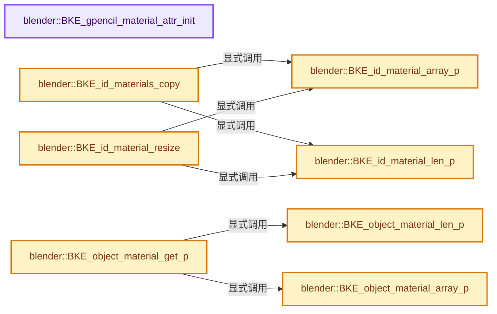
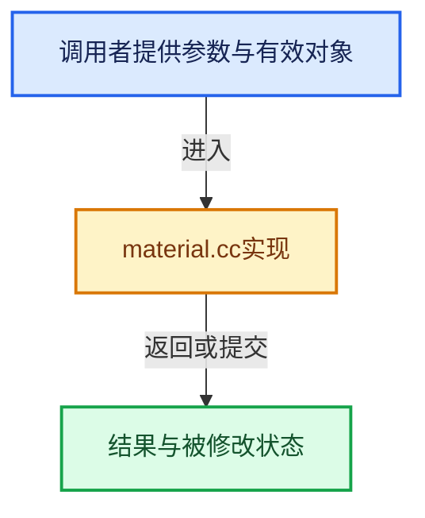

# 实现依赖专题：source/blender/blenkernel/intern/material.cc

[方向导航](README.md) · [符号索引](../%E7%AC%A6%E5%8F%B7%E4%BE%9D%E8%B5%96%E4%B8%8E%E5%AE%9E%E7%8E%B0%E7%B4%A2%E5%BC%95.md)

本专题从正文实际调用进入，集中保存共享实现。函数有稳定锚点，可从调用处直接跳到对应完整函数；递归与互相调用通过回链组织。

## 本文件的实现关系






## 完整成员与函数实现

<a id="f-a80fe200a186af59"></a>

### `blender::BKE_gpencil_material_attr_init`

实现位置：[source/blender/blenkernel/intern/material.cc](../../../../../source/blender/blenkernel/intern/material.cc) · L302—L327。

接口参数：

- `Material *ma`

**教学注释版**

<!-- annotated:e5ca2b01f30ce6 -->

```cpp
void BKE_gpencil_material_attr_init(Material *ma)
{
  if ((ma) && (ma->gp_style == nullptr)) {
    ma->gp_style = MEM_new<MaterialGPencilStyle>("Grease Pencil Material Settings");

    MaterialGPencilStyle *gp_style = ma->gp_style;
    /* set basic settings */
    gp_style->stroke_rgba[3] = 1.0f;
    gp_style->fill_rgba[3] = 1.0f;
    ARRAY_SET_ITEMS(gp_style->texture_scale, 1.0f, 1.0f);
    gp_style->texture_offset[0] = -0.5f;
    gp_style->texture_pixsize = 100.0f;
    gp_style->mix_factor = 0.5f;
    gp_style->placement_mode = GP_MATERIAL_PLACEMENT_RADIUS;
    gp_style->placement_count = 1;
    gp_style->placement_density = 10.0f;
    gp_style->placement_radius_spacing = 100.0f;
    gp_style->random_size_factor = 0.0f;
    gp_style->random_strength_factor = 0.0f;
    gp_style->random_rotation_factor = 0.0f;
    gp_style->random_hue_factor = 0.0f;
    gp_style->random_saturation_factor = 0.0f;
    gp_style->random_value_factor = 0.0f;
    gp_style->random_noise_scale = 1.0f;
  }
}
```

<details>
<summary>核对原始源码：source/blender/blenkernel/intern/material.cc · L302—L327</summary>

<!-- original:e5ca2b01f30ce6:source/blender/blenkernel/intern/material.cc:302:327 -->

```cpp
void BKE_gpencil_material_attr_init(Material *ma)
{
  if ((ma) && (ma->gp_style == nullptr)) {
    ma->gp_style = MEM_new<MaterialGPencilStyle>("Grease Pencil Material Settings");

    MaterialGPencilStyle *gp_style = ma->gp_style;
    /* set basic settings */
    gp_style->stroke_rgba[3] = 1.0f;
    gp_style->fill_rgba[3] = 1.0f;
    ARRAY_SET_ITEMS(gp_style->texture_scale, 1.0f, 1.0f);
    gp_style->texture_offset[0] = -0.5f;
    gp_style->texture_pixsize = 100.0f;
    gp_style->mix_factor = 0.5f;
    gp_style->placement_mode = GP_MATERIAL_PLACEMENT_RADIUS;
    gp_style->placement_count = 1;
    gp_style->placement_density = 10.0f;
    gp_style->placement_radius_spacing = 100.0f;
    gp_style->random_size_factor = 0.0f;
    gp_style->random_strength_factor = 0.0f;
    gp_style->random_rotation_factor = 0.0f;
    gp_style->random_hue_factor = 0.0f;
    gp_style->random_saturation_factor = 0.0f;
    gp_style->random_value_factor = 0.0f;
    gp_style->random_noise_scale = 1.0f;
  }
}
```

</details>

**沿实际写入检查状态**

- `ma->gp_style = MEM_new<MaterialGPencilStyle>("Grease Pencil Material Settings");`
- `gp_style->stroke_rgba[3] = 1.0f;`
- `gp_style->fill_rgba[3] = 1.0f;`
- `gp_style->texture_offset[0] = -0.5f;`
- `gp_style->texture_pixsize = 100.0f;`
- `gp_style->mix_factor = 0.5f;`
- `gp_style->placement_mode = GP_MATERIAL_PLACEMENT_RADIUS;`
- `gp_style->placement_count = 1;`
- `gp_style->placement_density = 10.0f;`
- `gp_style->placement_radius_spacing = 100.0f;`
- `gp_style->random_size_factor = 0.0f;`
- `gp_style->random_strength_factor = 0.0f;`
- `gp_style->random_rotation_factor = 0.0f;`
- `gp_style->random_hue_factor = 0.0f;`
- `gp_style->random_saturation_factor = 0.0f;`
- `gp_style->random_value_factor = 0.0f;`
- `gp_style->random_noise_scale = 1.0f;`

**继续追踪实现**

- `MEM_new<MaterialGPencilStyle>` → [MEM_new · L351](../03-%E5%86%85%E5%AD%98%E5%88%86%E9%85%8D%E4%B8%8E%E8%BF%90%E8%A1%8C%E6%97%B6%E7%B1%BB%E5%9E%8B/%E4%BE%9D%E8%B5%96-MEM_guardedalloc-b54eca.md#f-115f9b6784f89912)。
- `ARRAY_SET_ITEMS` → [ARRAY_SET_ITEMS · L304](../01-%E5%9F%BA%E7%A1%80%E5%AE%B9%E5%99%A8%E4%B8%8E%E7%8E%B0%E4%BB%A3CPP/%E4%BE%9D%E8%B5%96-BLI_utildefines-293a0a.md#m-80336b50a95e)。宏定义由构建条件选择。

<a id="f-278ab1eded35c40e"></a>

### `blender::BKE_object_material_array_p`

实现位置：[source/blender/blenkernel/intern/material.cc](../../../../../source/blender/blenkernel/intern/material.cc) · L372—L403。

接口参数：

- `Object *ob`

**教学注释版**

<!-- annotated:a1c70ee54b6902 -->

```cpp
Material ***BKE_object_material_array_p(Object *ob)
{
  if (ob->type == OB_MESH) {
    Mesh *mesh = id_cast<Mesh *>(ob->data);
    return &(mesh->mat);
  }
  if (ELEM(ob->type, OB_CURVES_LEGACY, OB_FONT, OB_SURF)) {
    Curve *cu = id_cast<Curve *>(ob->data);
    return &(cu->mat);
  }
  if (ob->type == OB_MBALL) {
    MetaBall *mb = id_cast<MetaBall *>(ob->data);
    return &(mb->mat);
  }
  if (ob->type == OB_CURVES) {
    Curves *curves = id_cast<Curves *>(ob->data);
    return &(curves->mat);
  }
  if (ob->type == OB_POINTCLOUD) {
    PointCloud *pointcloud = id_cast<PointCloud *>(ob->data);
    return &(pointcloud->mat);
  }
  if (ob->type == OB_VOLUME) {
    Volume *volume = id_cast<Volume *>(ob->data);
    return &(volume->mat);
  }
  if (ob->type == OB_GREASE_PENCIL) {
    GreasePencil *grease_pencil = id_cast<GreasePencil *>(ob->data);
    return &(grease_pencil->material_array);
  }
  return nullptr;
}
```

<details>
<summary>核对原始源码：source/blender/blenkernel/intern/material.cc · L372—L403</summary>

<!-- original:a1c70ee54b6902:source/blender/blenkernel/intern/material.cc:372:403 -->

```cpp
Material ***BKE_object_material_array_p(Object *ob)
{
  if (ob->type == OB_MESH) {
    Mesh *mesh = id_cast<Mesh *>(ob->data);
    return &(mesh->mat);
  }
  if (ELEM(ob->type, OB_CURVES_LEGACY, OB_FONT, OB_SURF)) {
    Curve *cu = id_cast<Curve *>(ob->data);
    return &(cu->mat);
  }
  if (ob->type == OB_MBALL) {
    MetaBall *mb = id_cast<MetaBall *>(ob->data);
    return &(mb->mat);
  }
  if (ob->type == OB_CURVES) {
    Curves *curves = id_cast<Curves *>(ob->data);
    return &(curves->mat);
  }
  if (ob->type == OB_POINTCLOUD) {
    PointCloud *pointcloud = id_cast<PointCloud *>(ob->data);
    return &(pointcloud->mat);
  }
  if (ob->type == OB_VOLUME) {
    Volume *volume = id_cast<Volume *>(ob->data);
    return &(volume->mat);
  }
  if (ob->type == OB_GREASE_PENCIL) {
    GreasePencil *grease_pencil = id_cast<GreasePencil *>(ob->data);
    return &(grease_pencil->material_array);
  }
  return nullptr;
}
```

</details>

**结果出口**

- `return &(mesh->mat);`
- `return &(cu->mat);`
- `return &(mb->mat);`
- `return &(curves->mat);`
- `return &(pointcloud->mat);`
- `return &(volume->mat);`
- `return &(grease_pencil->material_array);`
- `return nullptr;`

**继续追踪实现**

- `id_cast<Mesh *>` → [blender::id_cast · L1417](%E4%BE%9D%E8%B5%96-DNA_ID-3eb091.md#f-6c8ac6412850ac5a)。
- `ELEM` → [ELEM · L88](%E4%BE%9D%E8%B5%96-GHOST_utildefines-34b996.md#m-d28724a15928)；[ELEM · L135](../01-%E5%9F%BA%E7%A1%80%E5%AE%B9%E5%99%A8%E4%B8%8E%E7%8E%B0%E4%BB%A3CPP/%E4%BE%9D%E8%B5%96-BLI_utildefines-293a0a.md#m-d6572de7cae0)。宏定义由构建条件选择。
- `id_cast<Curve *>` → [blender::id_cast · L1417](%E4%BE%9D%E8%B5%96-DNA_ID-3eb091.md#f-6c8ac6412850ac5a)。
- `id_cast<MetaBall *>` → [blender::id_cast · L1417](%E4%BE%9D%E8%B5%96-DNA_ID-3eb091.md#f-6c8ac6412850ac5a)。
- `id_cast<Curves *>` → [blender::id_cast · L1417](%E4%BE%9D%E8%B5%96-DNA_ID-3eb091.md#f-6c8ac6412850ac5a)。
- `id_cast<PointCloud *>` → [blender::id_cast · L1417](%E4%BE%9D%E8%B5%96-DNA_ID-3eb091.md#f-6c8ac6412850ac5a)。
- `id_cast<Volume *>` → [blender::id_cast · L1417](%E4%BE%9D%E8%B5%96-DNA_ID-3eb091.md#f-6c8ac6412850ac5a)。
- `id_cast<GreasePencil *>` → [blender::id_cast · L1417](%E4%BE%9D%E8%B5%96-DNA_ID-3eb091.md#f-6c8ac6412850ac5a)。

<a id="f-4bef3241c966494d"></a>

### `blender::BKE_object_material_len_p`

实现位置：[source/blender/blenkernel/intern/material.cc](../../../../../source/blender/blenkernel/intern/material.cc) · L405—L436。

接口参数：

- `Object *ob`

**教学注释版**

<!-- annotated:fd9a455fce7dcb -->

```cpp
short *BKE_object_material_len_p(Object *ob)
{
  if (ob->type == OB_MESH) {
    Mesh *mesh = id_cast<Mesh *>(ob->data);
    return &(mesh->totcol);
  }
  if (ELEM(ob->type, OB_CURVES_LEGACY, OB_FONT, OB_SURF)) {
    Curve *cu = id_cast<Curve *>(ob->data);
    return &(cu->totcol);
  }
  if (ob->type == OB_MBALL) {
    MetaBall *mb = id_cast<MetaBall *>(ob->data);
    return &(mb->totcol);
  }
  if (ob->type == OB_CURVES) {
    Curves *curves = id_cast<Curves *>(ob->data);
    return &(curves->totcol);
  }
  if (ob->type == OB_POINTCLOUD) {
    PointCloud *pointcloud = id_cast<PointCloud *>(ob->data);
    return &(pointcloud->totcol);
  }
  if (ob->type == OB_VOLUME) {
    Volume *volume = id_cast<Volume *>(ob->data);
    return &(volume->totcol);
  }
  if (ob->type == OB_GREASE_PENCIL) {
    GreasePencil *grease_pencil = id_cast<GreasePencil *>(ob->data);
    return &(grease_pencil->material_array_num);
  }
  return nullptr;
}
```

<details>
<summary>核对原始源码：source/blender/blenkernel/intern/material.cc · L405—L436</summary>

<!-- original:fd9a455fce7dcb:source/blender/blenkernel/intern/material.cc:405:436 -->

```cpp
short *BKE_object_material_len_p(Object *ob)
{
  if (ob->type == OB_MESH) {
    Mesh *mesh = id_cast<Mesh *>(ob->data);
    return &(mesh->totcol);
  }
  if (ELEM(ob->type, OB_CURVES_LEGACY, OB_FONT, OB_SURF)) {
    Curve *cu = id_cast<Curve *>(ob->data);
    return &(cu->totcol);
  }
  if (ob->type == OB_MBALL) {
    MetaBall *mb = id_cast<MetaBall *>(ob->data);
    return &(mb->totcol);
  }
  if (ob->type == OB_CURVES) {
    Curves *curves = id_cast<Curves *>(ob->data);
    return &(curves->totcol);
  }
  if (ob->type == OB_POINTCLOUD) {
    PointCloud *pointcloud = id_cast<PointCloud *>(ob->data);
    return &(pointcloud->totcol);
  }
  if (ob->type == OB_VOLUME) {
    Volume *volume = id_cast<Volume *>(ob->data);
    return &(volume->totcol);
  }
  if (ob->type == OB_GREASE_PENCIL) {
    GreasePencil *grease_pencil = id_cast<GreasePencil *>(ob->data);
    return &(grease_pencil->material_array_num);
  }
  return nullptr;
}
```

</details>

**结果出口**

- `return &(mesh->totcol);`
- `return &(cu->totcol);`
- `return &(mb->totcol);`
- `return &(curves->totcol);`
- `return &(pointcloud->totcol);`
- `return &(volume->totcol);`
- `return &(grease_pencil->material_array_num);`
- `return nullptr;`

**继续追踪实现**

- `id_cast<Mesh *>` → [blender::id_cast · L1417](%E4%BE%9D%E8%B5%96-DNA_ID-3eb091.md#f-6c8ac6412850ac5a)。
- `ELEM` → [ELEM · L88](%E4%BE%9D%E8%B5%96-GHOST_utildefines-34b996.md#m-d28724a15928)；[ELEM · L135](../01-%E5%9F%BA%E7%A1%80%E5%AE%B9%E5%99%A8%E4%B8%8E%E7%8E%B0%E4%BB%A3CPP/%E4%BE%9D%E8%B5%96-BLI_utildefines-293a0a.md#m-d6572de7cae0)。宏定义由构建条件选择。
- `id_cast<Curve *>` → [blender::id_cast · L1417](%E4%BE%9D%E8%B5%96-DNA_ID-3eb091.md#f-6c8ac6412850ac5a)。
- `id_cast<MetaBall *>` → [blender::id_cast · L1417](%E4%BE%9D%E8%B5%96-DNA_ID-3eb091.md#f-6c8ac6412850ac5a)。
- `id_cast<Curves *>` → [blender::id_cast · L1417](%E4%BE%9D%E8%B5%96-DNA_ID-3eb091.md#f-6c8ac6412850ac5a)。
- `id_cast<PointCloud *>` → [blender::id_cast · L1417](%E4%BE%9D%E8%B5%96-DNA_ID-3eb091.md#f-6c8ac6412850ac5a)。
- `id_cast<Volume *>` → [blender::id_cast · L1417](%E4%BE%9D%E8%B5%96-DNA_ID-3eb091.md#f-6c8ac6412850ac5a)。
- `id_cast<GreasePencil *>` → [blender::id_cast · L1417](%E4%BE%9D%E8%B5%96-DNA_ID-3eb091.md#f-6c8ac6412850ac5a)。

<a id="f-eceda413ff66d694"></a>

### `blender::BKE_id_material_array_p`

实现位置：[source/blender/blenkernel/intern/material.cc](../../../../../source/blender/blenkernel/intern/material.cc) · L438—L464。

接口参数：

- `ID *id`

**教学注释版**

<!-- annotated:91f3dfb91c280e -->

```cpp
Material ***BKE_id_material_array_p(ID *id)
{
  /* ensure we don't try get materials from non-obdata */
  BLI_assert(OB_DATA_SUPPORT_ID(GS(id->name)));

  switch (GS(id->name)) {
    case ID_ME:
      return &((id_cast<Mesh *>(id))->mat);
    case ID_CU_LEGACY:
      return &((id_cast<Curve *>(id))->mat);
    case ID_MB:
      return &((id_cast<MetaBall *>(id))->mat);
    case ID_GD_LEGACY:
      return &((id_cast<bGPdata *>(id))->mat);
    case ID_CV:
      return &((id_cast<Curves *>(id))->mat);
    case ID_PT:
      return &((id_cast<PointCloud *>(id))->mat);
    case ID_VO:
      return &((id_cast<Volume *>(id))->mat);
    case ID_GP:
      return &((id_cast<GreasePencil *>(id))->material_array);
    default:
      break;
  }
  return nullptr;
}
```

<details>
<summary>核对原始源码：source/blender/blenkernel/intern/material.cc · L438—L464</summary>

<!-- original:91f3dfb91c280e:source/blender/blenkernel/intern/material.cc:438:464 -->

```cpp
Material ***BKE_id_material_array_p(ID *id)
{
  /* ensure we don't try get materials from non-obdata */
  BLI_assert(OB_DATA_SUPPORT_ID(GS(id->name)));

  switch (GS(id->name)) {
    case ID_ME:
      return &((id_cast<Mesh *>(id))->mat);
    case ID_CU_LEGACY:
      return &((id_cast<Curve *>(id))->mat);
    case ID_MB:
      return &((id_cast<MetaBall *>(id))->mat);
    case ID_GD_LEGACY:
      return &((id_cast<bGPdata *>(id))->mat);
    case ID_CV:
      return &((id_cast<Curves *>(id))->mat);
    case ID_PT:
      return &((id_cast<PointCloud *>(id))->mat);
    case ID_VO:
      return &((id_cast<Volume *>(id))->mat);
    case ID_GP:
      return &((id_cast<GreasePencil *>(id))->material_array);
    default:
      break;
  }
  return nullptr;
}
```

</details>

**结果出口**

- `return &((id_cast<Mesh *>(id))->mat);`
- `return &((id_cast<Curve *>(id))->mat);`
- `return &((id_cast<MetaBall *>(id))->mat);`
- `return &((id_cast<bGPdata *>(id))->mat);`
- `return &((id_cast<Curves *>(id))->mat);`
- `return &((id_cast<PointCloud *>(id))->mat);`
- `return &((id_cast<Volume *>(id))->mat);`
- `return &((id_cast<GreasePencil *>(id))->material_array);`
- `return nullptr;`

**继续追踪实现**

- `BLI_assert` → [BLI_assert · L48](../01-%E5%9F%BA%E7%A1%80%E5%AE%B9%E5%99%A8%E4%B8%8E%E7%8E%B0%E4%BB%A3CPP/%E4%BE%9D%E8%B5%96-BLI_assert-cc98e8.md#m-57a88495704d)；[BLI_assert · L63](../01-%E5%9F%BA%E7%A1%80%E5%AE%B9%E5%99%A8%E4%B8%8E%E7%8E%B0%E4%BB%A3CPP/%E4%BE%9D%E8%B5%96-BLI_assert-cc98e8.md#m-d07050020cb5)。宏定义由构建条件选择。
- `OB_DATA_SUPPORT_ID` → [OB_DATA_SUPPORT_ID · L757](%E4%BE%9D%E8%B5%96-DNA_object_types-2c8fa3.md#m-6e26060bd356)。宏定义由构建条件选择。
- `GS` → [blender::GS · L410](%E4%BE%9D%E8%B5%96-DNA_ID-3eb091.md#f-c3ff509f79f21b05)。
- `id_cast<Mesh *>` → [blender::id_cast · L1417](%E4%BE%9D%E8%B5%96-DNA_ID-3eb091.md#f-6c8ac6412850ac5a)。
- `id_cast<Curve *>` → [blender::id_cast · L1417](%E4%BE%9D%E8%B5%96-DNA_ID-3eb091.md#f-6c8ac6412850ac5a)。
- `id_cast<MetaBall *>` → [blender::id_cast · L1417](%E4%BE%9D%E8%B5%96-DNA_ID-3eb091.md#f-6c8ac6412850ac5a)。
- `id_cast<bGPdata *>` → [blender::id_cast · L1417](%E4%BE%9D%E8%B5%96-DNA_ID-3eb091.md#f-6c8ac6412850ac5a)。
- `id_cast<Curves *>` → [blender::id_cast · L1417](%E4%BE%9D%E8%B5%96-DNA_ID-3eb091.md#f-6c8ac6412850ac5a)。
- `id_cast<PointCloud *>` → [blender::id_cast · L1417](%E4%BE%9D%E8%B5%96-DNA_ID-3eb091.md#f-6c8ac6412850ac5a)。
- `id_cast<Volume *>` → [blender::id_cast · L1417](%E4%BE%9D%E8%B5%96-DNA_ID-3eb091.md#f-6c8ac6412850ac5a)。
- `id_cast<GreasePencil *>` → [blender::id_cast · L1417](%E4%BE%9D%E8%B5%96-DNA_ID-3eb091.md#f-6c8ac6412850ac5a)。

<a id="f-be8f40b00b2e0acc"></a>

### `blender::BKE_id_material_len_p`

实现位置：[source/blender/blenkernel/intern/material.cc](../../../../../source/blender/blenkernel/intern/material.cc) · L466—L492。

接口参数：

- `ID *id`

**教学注释版**

<!-- annotated:de9196654386d2 -->

```cpp
short *BKE_id_material_len_p(ID *id)
{
  /* ensure we don't try get materials from non-obdata */
  BLI_assert(OB_DATA_SUPPORT_ID(GS(id->name)));

  switch (GS(id->name)) {
    case ID_ME:
      return &((id_cast<Mesh *>(id))->totcol);
    case ID_CU_LEGACY:
      return &((id_cast<Curve *>(id))->totcol);
    case ID_MB:
      return &((id_cast<MetaBall *>(id))->totcol);
    case ID_GD_LEGACY:
      return &((id_cast<bGPdata *>(id))->totcol);
    case ID_CV:
      return &((id_cast<Curves *>(id))->totcol);
    case ID_PT:
      return &((id_cast<PointCloud *>(id))->totcol);
    case ID_VO:
      return &((id_cast<Volume *>(id))->totcol);
    case ID_GP:
      return &((id_cast<GreasePencil *>(id))->material_array_num);
    default:
      break;
  }
  return nullptr;
}
```

<details>
<summary>核对原始源码：source/blender/blenkernel/intern/material.cc · L466—L492</summary>

<!-- original:de9196654386d2:source/blender/blenkernel/intern/material.cc:466:492 -->

```cpp
short *BKE_id_material_len_p(ID *id)
{
  /* ensure we don't try get materials from non-obdata */
  BLI_assert(OB_DATA_SUPPORT_ID(GS(id->name)));

  switch (GS(id->name)) {
    case ID_ME:
      return &((id_cast<Mesh *>(id))->totcol);
    case ID_CU_LEGACY:
      return &((id_cast<Curve *>(id))->totcol);
    case ID_MB:
      return &((id_cast<MetaBall *>(id))->totcol);
    case ID_GD_LEGACY:
      return &((id_cast<bGPdata *>(id))->totcol);
    case ID_CV:
      return &((id_cast<Curves *>(id))->totcol);
    case ID_PT:
      return &((id_cast<PointCloud *>(id))->totcol);
    case ID_VO:
      return &((id_cast<Volume *>(id))->totcol);
    case ID_GP:
      return &((id_cast<GreasePencil *>(id))->material_array_num);
    default:
      break;
  }
  return nullptr;
}
```

</details>

**结果出口**

- `return &((id_cast<Mesh *>(id))->totcol);`
- `return &((id_cast<Curve *>(id))->totcol);`
- `return &((id_cast<MetaBall *>(id))->totcol);`
- `return &((id_cast<bGPdata *>(id))->totcol);`
- `return &((id_cast<Curves *>(id))->totcol);`
- `return &((id_cast<PointCloud *>(id))->totcol);`
- `return &((id_cast<Volume *>(id))->totcol);`
- `return &((id_cast<GreasePencil *>(id))->material_array_num);`
- `return nullptr;`

**继续追踪实现**

- `BLI_assert` → [BLI_assert · L48](../01-%E5%9F%BA%E7%A1%80%E5%AE%B9%E5%99%A8%E4%B8%8E%E7%8E%B0%E4%BB%A3CPP/%E4%BE%9D%E8%B5%96-BLI_assert-cc98e8.md#m-57a88495704d)；[BLI_assert · L63](../01-%E5%9F%BA%E7%A1%80%E5%AE%B9%E5%99%A8%E4%B8%8E%E7%8E%B0%E4%BB%A3CPP/%E4%BE%9D%E8%B5%96-BLI_assert-cc98e8.md#m-d07050020cb5)。宏定义由构建条件选择。
- `OB_DATA_SUPPORT_ID` → [OB_DATA_SUPPORT_ID · L757](%E4%BE%9D%E8%B5%96-DNA_object_types-2c8fa3.md#m-6e26060bd356)。宏定义由构建条件选择。
- `GS` → [blender::GS · L410](%E4%BE%9D%E8%B5%96-DNA_ID-3eb091.md#f-c3ff509f79f21b05)。
- `id_cast<Mesh *>` → [blender::id_cast · L1417](%E4%BE%9D%E8%B5%96-DNA_ID-3eb091.md#f-6c8ac6412850ac5a)。
- `id_cast<Curve *>` → [blender::id_cast · L1417](%E4%BE%9D%E8%B5%96-DNA_ID-3eb091.md#f-6c8ac6412850ac5a)。
- `id_cast<MetaBall *>` → [blender::id_cast · L1417](%E4%BE%9D%E8%B5%96-DNA_ID-3eb091.md#f-6c8ac6412850ac5a)。
- `id_cast<bGPdata *>` → [blender::id_cast · L1417](%E4%BE%9D%E8%B5%96-DNA_ID-3eb091.md#f-6c8ac6412850ac5a)。
- `id_cast<Curves *>` → [blender::id_cast · L1417](%E4%BE%9D%E8%B5%96-DNA_ID-3eb091.md#f-6c8ac6412850ac5a)。
- `id_cast<PointCloud *>` → [blender::id_cast · L1417](%E4%BE%9D%E8%B5%96-DNA_ID-3eb091.md#f-6c8ac6412850ac5a)。
- `id_cast<Volume *>` → [blender::id_cast · L1417](%E4%BE%9D%E8%B5%96-DNA_ID-3eb091.md#f-6c8ac6412850ac5a)。
- `id_cast<GreasePencil *>` → [blender::id_cast · L1417](%E4%BE%9D%E8%B5%96-DNA_ID-3eb091.md#f-6c8ac6412850ac5a)。

<a id="f-597c9a199fdac8d7"></a>

### `blender::BKE_id_materials_copy`

实现位置：[source/blender/blenkernel/intern/material.cc](../../../../../source/blender/blenkernel/intern/material.cc) · L576—L595。

接口参数：

- `Main *bmain`
- `ID *id_src`
- `ID *id_dst`

**教学注释版**

<!-- annotated:2d10e5c9ae9aee -->

```cpp
void BKE_id_materials_copy(Main *bmain, ID *id_src, ID *id_dst)
{
  Material ***matar_src = BKE_id_material_array_p(id_src);
  const short *materials_len_p_src = BKE_id_material_len_p(id_src);

  Material ***matar_dst = BKE_id_material_array_p(id_dst);
  short *materials_len_p_dst = BKE_id_material_len_p(id_dst);

  *materials_len_p_dst = *materials_len_p_src;
  if (*materials_len_p_src != 0) {
    (*matar_dst) = MEM_dupalloc(*matar_src);

    for (int a = 0; a < *materials_len_p_src; a++) {
      id_us_plus(id_cast<ID *>((*matar_dst)[a]));
    }

    DEG_id_tag_update(id_dst, ID_RECALC_SYNC_TO_EVAL);
    DEG_relations_tag_update(bmain);
  }
}
```

<details>
<summary>核对原始源码：source/blender/blenkernel/intern/material.cc · L576—L595</summary>

<!-- original:2d10e5c9ae9aee:source/blender/blenkernel/intern/material.cc:576:595 -->

```cpp
void BKE_id_materials_copy(Main *bmain, ID *id_src, ID *id_dst)
{
  Material ***matar_src = BKE_id_material_array_p(id_src);
  const short *materials_len_p_src = BKE_id_material_len_p(id_src);

  Material ***matar_dst = BKE_id_material_array_p(id_dst);
  short *materials_len_p_dst = BKE_id_material_len_p(id_dst);

  *materials_len_p_dst = *materials_len_p_src;
  if (*materials_len_p_src != 0) {
    (*matar_dst) = MEM_dupalloc(*matar_src);

    for (int a = 0; a < *materials_len_p_src; a++) {
      id_us_plus(id_cast<ID *>((*matar_dst)[a]));
    }

    DEG_id_tag_update(id_dst, ID_RECALC_SYNC_TO_EVAL);
    DEG_relations_tag_update(bmain);
  }
}
```

</details>

**继续追踪实现**

- `BKE_id_material_array_p` → [blender::BKE_id_material_array_p · L438](%E4%BE%9D%E8%B5%96-material-aea8ec.md#f-eceda413ff66d694)。
- `BKE_id_material_len_p` → [blender::BKE_id_material_len_p · L466](%E4%BE%9D%E8%B5%96-material-aea8ec.md#f-be8f40b00b2e0acc)。
- `MEM_dupalloc` → [MEM_dupalloc · L627](../03-%E5%86%85%E5%AD%98%E5%88%86%E9%85%8D%E4%B8%8E%E8%BF%90%E8%A1%8C%E6%97%B6%E7%B1%BB%E5%9E%8B/%E4%BE%9D%E8%B5%96-MEM_guardedalloc-b54eca.md#f-78a72b71e3c57010)。
- `id_us_plus` → [blender::id_us_plus · L433](%E4%BE%9D%E8%B5%96-lib_id-d4e6bd.md#f-1b90ef7608c4f32e)。
- `id_cast<ID *>` → [blender::id_cast · L1417](%E4%BE%9D%E8%B5%96-DNA_ID-3eb091.md#f-6c8ac6412850ac5a)。
- `DEG_id_tag_update` → [blender::DEG_id_tag_update · L844](../11-Depsgraph%E4%B8%8E%E5%B9%B6%E8%A1%8C%E4%BB%BB%E5%8A%A1%E7%B3%BB%E7%BB%9F/%E4%BE%9D%E8%B5%96-depsgraph_tag-d8b3c7.md#f-62d2949dd168bb81)。
- `DEG_relations_tag_update` → [blender::DEG_relations_tag_update · L350](../11-Depsgraph%E4%B8%8E%E5%B9%B6%E8%A1%8C%E4%BB%BB%E5%8A%A1%E7%B3%BB%E7%BB%9F/%E4%BE%9D%E8%B5%96-depsgraph_build-ea2fc8.md#f-2910c78540652980)。

<a id="f-dc659473e6540997"></a>

### `blender::BKE_id_material_resize`

实现位置：[source/blender/blenkernel/intern/material.cc](../../../../../source/blender/blenkernel/intern/material.cc) · L597—L630。

接口参数：

- `Main *bmain`
- `ID *id`
- `short totcol`
- `bool do_id_user`

**教学注释版**

<!-- annotated:8032945d5b9056 -->

```cpp
void BKE_id_material_resize(Main *bmain, ID *id, short totcol, bool do_id_user)
{
  Material ***matar = BKE_id_material_array_p(id);
  short *totcolp = BKE_id_material_len_p(id);

  if (matar == nullptr) {
    return;
  }
  if (totcol == *totcolp) {
    /* Prevent depsgraph update and relations tag when nothing changed. */
    return;
  }

  if (do_id_user && totcol < (*totcolp)) {
    short i;
    for (i = totcol; i < (*totcolp); i++) {
      id_us_min(id_cast<ID *>((*matar)[i]));
    }
  }

  if (totcol == 0) {
    if (*totcolp) {
      MEM_delete(*matar);
      *matar = nullptr;
    }
  }
  else {
    *matar = static_cast<Material **>(MEM_realloc_zeroed(*matar, sizeof(void *) * totcol));
  }
  *totcolp = totcol;

  DEG_id_tag_update(id, ID_RECALC_SYNC_TO_EVAL);
  DEG_relations_tag_update(bmain);
}
```

<details>
<summary>核对原始源码：source/blender/blenkernel/intern/material.cc · L597—L630</summary>

<!-- original:8032945d5b9056:source/blender/blenkernel/intern/material.cc:597:630 -->

```cpp
void BKE_id_material_resize(Main *bmain, ID *id, short totcol, bool do_id_user)
{
  Material ***matar = BKE_id_material_array_p(id);
  short *totcolp = BKE_id_material_len_p(id);

  if (matar == nullptr) {
    return;
  }
  if (totcol == *totcolp) {
    /* Prevent depsgraph update and relations tag when nothing changed. */
    return;
  }

  if (do_id_user && totcol < (*totcolp)) {
    short i;
    for (i = totcol; i < (*totcolp); i++) {
      id_us_min(id_cast<ID *>((*matar)[i]));
    }
  }

  if (totcol == 0) {
    if (*totcolp) {
      MEM_delete(*matar);
      *matar = nullptr;
    }
  }
  else {
    *matar = static_cast<Material **>(MEM_realloc_zeroed(*matar, sizeof(void *) * totcol));
  }
  *totcolp = totcol;

  DEG_id_tag_update(id, ID_RECALC_SYNC_TO_EVAL);
  DEG_relations_tag_update(bmain);
}
```

</details>

**继续追踪实现**

- `BKE_id_material_array_p` → [blender::BKE_id_material_array_p · L438](%E4%BE%9D%E8%B5%96-material-aea8ec.md#f-eceda413ff66d694)。
- `BKE_id_material_len_p` → [blender::BKE_id_material_len_p · L466](%E4%BE%9D%E8%B5%96-material-aea8ec.md#f-be8f40b00b2e0acc)。
- `id_us_min` → [blender::id_us_min · L441](%E4%BE%9D%E8%B5%96-lib_id-d4e6bd.md#f-c5e5246a79962257)。
- `id_cast<ID *>` → [blender::id_cast · L1417](%E4%BE%9D%E8%B5%96-DNA_ID-3eb091.md#f-6c8ac6412850ac5a)。
- `MEM_delete` → [MEM_delete · L400](../03-%E5%86%85%E5%AD%98%E5%88%86%E9%85%8D%E4%B8%8E%E8%BF%90%E8%A1%8C%E6%97%B6%E7%B1%BB%E5%9E%8B/%E4%BE%9D%E8%B5%96-MEM_guardedalloc-b54eca.md#f-9049ffdd1682887c)。
- `MEM_realloc_zeroed` → [MEM_realloc_zeroed · L119](../03-%E5%86%85%E5%AD%98%E5%88%86%E9%85%8D%E4%B8%8E%E8%BF%90%E8%A1%8C%E6%97%B6%E7%B1%BB%E5%9E%8B/%E4%BE%9D%E8%B5%96-MEM_guardedalloc-b54eca.md#m-db4054295a6d)。宏定义由构建条件选择。
- `DEG_id_tag_update` → [blender::DEG_id_tag_update · L844](../11-Depsgraph%E4%B8%8E%E5%B9%B6%E8%A1%8C%E4%BB%BB%E5%8A%A1%E7%B3%BB%E7%BB%9F/%E4%BE%9D%E8%B5%96-depsgraph_tag-d8b3c7.md#f-62d2949dd168bb81)。
- `DEG_relations_tag_update` → [blender::DEG_relations_tag_update · L350](../11-Depsgraph%E4%B8%8E%E5%B9%B6%E8%A1%8C%E4%BB%BB%E5%8A%A1%E7%B3%BB%E7%BB%9F/%E4%BE%9D%E8%B5%96-depsgraph_build-ea2fc8.md#f-2910c78540652980)。

<a id="f-5cdee594d1f2723e"></a>

### `blender::BKE_object_material_get_p`

实现位置：[source/blender/blenkernel/intern/material.cc](../../../../../source/blender/blenkernel/intern/material.cc) · L718—L757。

接口参数：

- `Object *ob`
- `short act`

**教学注释版**

<!-- annotated:13a4df6638b17c -->

```cpp
Material **BKE_object_material_get_p(Object *ob, short act)
{
  Material ***matarar, **ma_p;
  const short *totcolp;

  if (ob == nullptr) {
    return nullptr;
  }

  /* if object cannot have material, (totcolp == nullptr) */
  totcolp = BKE_object_material_len_p(ob);
  if (totcolp == nullptr || *totcolp == 0) {
    return nullptr;
  }

  /* Clamp to number of slots if index is out of range, same convention as used for rendering. */
  const int slot_index = clamp_i(act - 1, 0, *totcolp - 1);

  /* Fix inconsistency which may happen when library linked data reduces the number of
   * slots but object was not updated. Ideally should be fixed elsewhere. */
  // [讲解] std::min<int>：按比较关系选取较小值；截断范围时还需先满足非负和可表示范围，min本身不会证明边界安全。
  ob->totcol = std::min<int>(*totcolp, ob->totcol);

  if (slot_index < ob->totcol && ob->matbits && ob->matbits[slot_index]) {
    /* Use object material slot. */
    ma_p = &ob->mat[slot_index];
  }
  else {
    /* Use data material slot. */
    matarar = BKE_object_material_array_p(ob);

    if (matarar && *matarar) {
      ma_p = &(*matarar)[slot_index];
    }
    else {
      ma_p = nullptr;
    }
  }

  return ma_p;
}
```

<details>
<summary>核对原始源码：source/blender/blenkernel/intern/material.cc · L718—L757</summary>

<!-- original:13a4df6638b17c:source/blender/blenkernel/intern/material.cc:718:757 -->

```cpp
Material **BKE_object_material_get_p(Object *ob, short act)
{
  Material ***matarar, **ma_p;
  const short *totcolp;

  if (ob == nullptr) {
    return nullptr;
  }

  /* if object cannot have material, (totcolp == nullptr) */
  totcolp = BKE_object_material_len_p(ob);
  if (totcolp == nullptr || *totcolp == 0) {
    return nullptr;
  }

  /* Clamp to number of slots if index is out of range, same convention as used for rendering. */
  const int slot_index = clamp_i(act - 1, 0, *totcolp - 1);

  /* Fix inconsistency which may happen when library linked data reduces the number of
   * slots but object was not updated. Ideally should be fixed elsewhere. */
  ob->totcol = std::min<int>(*totcolp, ob->totcol);

  if (slot_index < ob->totcol && ob->matbits && ob->matbits[slot_index]) {
    /* Use object material slot. */
    ma_p = &ob->mat[slot_index];
  }
  else {
    /* Use data material slot. */
    matarar = BKE_object_material_array_p(ob);

    if (matarar && *matarar) {
      ma_p = &(*matarar)[slot_index];
    }
    else {
      ma_p = nullptr;
    }
  }

  return ma_p;
}
```

</details>

**沿实际写入检查状态**

- `totcolp = BKE_object_material_len_p(ob);`
- `ob->totcol = std::min<int>(*totcolp, ob->totcol);`
- `ma_p = &ob->mat[slot_index];`
- `matarar = BKE_object_material_array_p(ob);`
- `ma_p = &(*matarar)[slot_index];`
- `ma_p = nullptr;`

**结果出口**

- `return nullptr;`
- `return ma_p;`

**继续追踪实现**

- `BKE_object_material_len_p` → [blender::BKE_object_material_len_p · L405](%E4%BE%9D%E8%B5%96-material-aea8ec.md#f-4bef3241c966494d)。
- `clamp_i` → [blender::clamp_i · L400](../12-%E7%A9%BA%E9%97%B4%E6%95%B0%E6%8D%AE%E7%BB%93%E6%9E%84%E4%B8%8E%E5%87%A0%E4%BD%95%E7%AE%97%E6%B3%95/%E4%BE%9D%E8%B5%96-math_base_inline-546b00.md#f-e9a0b16ec537d580)。
- `std::min<int>` → [外部契约](https://eel.is/c++draft/alg.min.max)：按比较关系选取较小值；截断范围时还需先满足非负和可表示范围，min本身不会证明边界安全。
- `BKE_object_material_array_p` → [blender::BKE_object_material_array_p · L372](%E4%BE%9D%E8%B5%96-material-aea8ec.md#f-278ab1eded35c40e)。

<a id="f-9e9ad276ccef84b3"></a>

### `blender::BKE_object_material_get`

实现位置：[source/blender/blenkernel/intern/material.cc](../../../../../source/blender/blenkernel/intern/material.cc) · L759—L771。

接口参数：

- `Object *ob`
- `short act`

**教学注释版**

<!-- annotated:31efeb1ef0c005 -->

```cpp
Material *BKE_object_material_get(Object *ob, short act)
{
  Material **ma_p = BKE_object_material_get_p(ob, act);
  /* Grease Pencil objects currently make the assumption that the returned material has Grease
   * Pencil settings. Ensure that this is the case otherwise return `nullptr`. */
  if (ob->type == OB_GREASE_PENCIL && ma_p != nullptr) {
    Material *ma = *ma_p;
    if (ma != nullptr) {
      return ma->gp_style != nullptr ? ma : nullptr;
    }
  }
  return ma_p ? *ma_p : nullptr;
}
```

<details>
<summary>核对原始源码：source/blender/blenkernel/intern/material.cc · L759—L771</summary>

<!-- original:31efeb1ef0c005:source/blender/blenkernel/intern/material.cc:759:771 -->

```cpp
Material *BKE_object_material_get(Object *ob, short act)
{
  Material **ma_p = BKE_object_material_get_p(ob, act);
  /* Grease Pencil objects currently make the assumption that the returned material has Grease
   * Pencil settings. Ensure that this is the case otherwise return `nullptr`. */
  if (ob->type == OB_GREASE_PENCIL && ma_p != nullptr) {
    Material *ma = *ma_p;
    if (ma != nullptr) {
      return ma->gp_style != nullptr ? ma : nullptr;
    }
  }
  return ma_p ? *ma_p : nullptr;
}
```

</details>

**结果出口**

- `return ma->gp_style != nullptr ? ma : nullptr;`
- `return ma_p ? *ma_p : nullptr;`

**继续追踪实现**

- `BKE_object_material_get_p` → [blender::BKE_object_material_get_p · L718](%E4%BE%9D%E8%B5%96-material-aea8ec.md#f-5cdee594d1f2723e)。

<a id="f-d5f7d2b7e392f5c2"></a>

### `blender::get_evaluated_object_data_with_materials`

实现位置：[source/blender/blenkernel/intern/material.cc](../../../../../source/blender/blenkernel/intern/material.cc) · L773—L785。

接口参数：

- `const Object *ob`

**教学注释版**

<!-- annotated:c3bd5a4972983e -->

```cpp
static const ID *get_evaluated_object_data_with_materials(const Object *ob)
{
  const ID *data = ob->data;
  /* Meshes in edit mode need special handling. */
  if (ob->type == OB_MESH && ob->mode == OB_MODE_EDIT) {
    const Mesh *mesh = id_cast<const Mesh *>(ob->data);
    const Mesh *editmesh_eval_final = BKE_object_get_editmesh_eval_final(ob);
    if (mesh->runtime->edit_mesh && editmesh_eval_final) {
      data = &editmesh_eval_final->id;
    }
  }
  return data;
}
```

<details>
<summary>核对原始源码：source/blender/blenkernel/intern/material.cc · L773—L785</summary>

<!-- original:c3bd5a4972983e:source/blender/blenkernel/intern/material.cc:773:785 -->

```cpp
static const ID *get_evaluated_object_data_with_materials(const Object *ob)
{
  const ID *data = ob->data;
  /* Meshes in edit mode need special handling. */
  if (ob->type == OB_MESH && ob->mode == OB_MODE_EDIT) {
    const Mesh *mesh = id_cast<const Mesh *>(ob->data);
    const Mesh *editmesh_eval_final = BKE_object_get_editmesh_eval_final(ob);
    if (mesh->runtime->edit_mesh && editmesh_eval_final) {
      data = &editmesh_eval_final->id;
    }
  }
  return data;
}
```

</details>

**沿实际写入检查状态**

- `data = &editmesh_eval_final->id;`

**结果出口**

- `return data;`

**继续追踪实现**

- `id_cast<const Mesh *>` → [blender::id_cast · L1417](%E4%BE%9D%E8%B5%96-DNA_ID-3eb091.md#f-6c8ac6412850ac5a)。
- `BKE_object_get_editmesh_eval_final` → [blender::BKE_object_get_editmesh_eval_final · L4477](%E4%BE%9D%E8%B5%96-object-843689.md#f-1788f7ea6bf8faec)。

<a id="f-fe6f97fc391647f0"></a>

### `blender::BKE_object_material_get_eval`

实现位置：[source/blender/blenkernel/intern/material.cc](../../../../../source/blender/blenkernel/intern/material.cc) · L787—L791。

接口参数：

- `Object *ob`
- `short act`

**教学注释版**

<!-- annotated:2fc0abe192a411 -->

```cpp
Material *BKE_object_material_get_eval(Object *ob, short act)
{
  const ID *data = get_evaluated_object_data_with_materials(ob);
  return const_cast<Material *>(BKE_object_material_get_eval(*ob, *data, act));
}
```

<details>
<summary>核对原始源码：source/blender/blenkernel/intern/material.cc · L787—L791</summary>

<!-- original:2fc0abe192a411:source/blender/blenkernel/intern/material.cc:787:791 -->

```cpp
Material *BKE_object_material_get_eval(Object *ob, short act)
{
  const ID *data = get_evaluated_object_data_with_materials(ob);
  return const_cast<Material *>(BKE_object_material_get_eval(*ob, *data, act));
}
```

</details>

**结果出口**

- `return const_cast<Material *>(BKE_object_material_get_eval(*ob, *data, act));`

**继续追踪实现**

- `get_evaluated_object_data_with_materials` → [blender::get_evaluated_object_data_with_materials · L773](%E4%BE%9D%E8%B5%96-material-aea8ec.md#f-d5f7d2b7e392f5c2)。
- `BKE_object_material_get_eval` → [blender::BKE_object_material_get_eval · L787](%E4%BE%9D%E8%B5%96-material-aea8ec.md#f-fe6f97fc391647f0)；[blender::BKE_object_material_get_eval · L793](%E4%BE%9D%E8%B5%96-material-aea8ec.md#f-854520efc76ed2e3)。同名重载需按实参类型选择。

<a id="f-854520efc76ed2e3"></a>

### `blender::BKE_object_material_get_eval`

实现位置：[source/blender/blenkernel/intern/material.cc](../../../../../source/blender/blenkernel/intern/material.cc) · L793—L831。

接口参数：

- `const Object &ob`
- `const ID &data`
- `const short act`

**教学注释版**

<!-- annotated:256a59c084d654 -->

```cpp
const Material *BKE_object_material_get_eval(const Object &ob, const ID &data, const short act)
{
  BLI_assert(DEG_is_evaluated(&ob));

  const int slots_num = BKE_object_material_count_eval(ob, data);

  if (slots_num == 0) {
    return nullptr;
  }

  /* Clamp to number of slots if index is out of range, same convention as used for rendering. */
  const int slot_index = clamp_i(act - 1, 0, slots_num - 1);
  const int tot_slots_object = ob.totcol;

  /* Check if slot is overwritten by object. */
  if (slot_index < tot_slots_object) {
    if (ob.matbits) {
      if (ob.matbits[slot_index]) {
        Material *material = ob.mat[slot_index];
        if (material != nullptr) {
          return material;
        }
      }
    }
  }

  /* Otherwise use data from object-data. */
  const short *data_slots_num_ptr = BKE_id_material_len_p(const_cast<ID *>(&data));
  if (!data_slots_num_ptr) {
    return nullptr;
  }
  const int data_slots_num = *data_slots_num_ptr;
  Material **data_materials = *BKE_id_material_array_p(const_cast<ID *>(&data));
  if (slot_index < data_slots_num) {
    Material *material = data_materials[slot_index];
    return material;
  }
  return nullptr;
}
```

<details>
<summary>核对原始源码：source/blender/blenkernel/intern/material.cc · L793—L831</summary>

<!-- original:256a59c084d654:source/blender/blenkernel/intern/material.cc:793:831 -->

```cpp
const Material *BKE_object_material_get_eval(const Object &ob, const ID &data, const short act)
{
  BLI_assert(DEG_is_evaluated(&ob));

  const int slots_num = BKE_object_material_count_eval(ob, data);

  if (slots_num == 0) {
    return nullptr;
  }

  /* Clamp to number of slots if index is out of range, same convention as used for rendering. */
  const int slot_index = clamp_i(act - 1, 0, slots_num - 1);
  const int tot_slots_object = ob.totcol;

  /* Check if slot is overwritten by object. */
  if (slot_index < tot_slots_object) {
    if (ob.matbits) {
      if (ob.matbits[slot_index]) {
        Material *material = ob.mat[slot_index];
        if (material != nullptr) {
          return material;
        }
      }
    }
  }

  /* Otherwise use data from object-data. */
  const short *data_slots_num_ptr = BKE_id_material_len_p(const_cast<ID *>(&data));
  if (!data_slots_num_ptr) {
    return nullptr;
  }
  const int data_slots_num = *data_slots_num_ptr;
  Material **data_materials = *BKE_id_material_array_p(const_cast<ID *>(&data));
  if (slot_index < data_slots_num) {
    Material *material = data_materials[slot_index];
    return material;
  }
  return nullptr;
}
```

</details>

**结果出口**

- `return nullptr;`
- `return material;`

**继续追踪实现**

- `BLI_assert` → [BLI_assert · L48](../01-%E5%9F%BA%E7%A1%80%E5%AE%B9%E5%99%A8%E4%B8%8E%E7%8E%B0%E4%BB%A3CPP/%E4%BE%9D%E8%B5%96-BLI_assert-cc98e8.md#m-57a88495704d)；[BLI_assert · L63](../01-%E5%9F%BA%E7%A1%80%E5%AE%B9%E5%99%A8%E4%B8%8E%E7%8E%B0%E4%BB%A3CPP/%E4%BE%9D%E8%B5%96-BLI_assert-cc98e8.md#m-d07050020cb5)。宏定义由构建条件选择。
- `DEG_is_evaluated` → [blender::DEG_is_evaluated · L170](../11-Depsgraph%E4%B8%8E%E5%B9%B6%E8%A1%8C%E4%BB%BB%E5%8A%A1%E7%B3%BB%E7%BB%9F/%E4%BE%9D%E8%B5%96-DEG_depsgraph_query-db0d31.md#f-23a1423b8d446719)。
- `BKE_object_material_count_eval` → [blender::BKE_object_material_count_eval · L833](%E4%BE%9D%E8%B5%96-material-aea8ec.md#f-ef7e98e18511886a)；[blender::BKE_object_material_count_eval · L845](%E4%BE%9D%E8%B5%96-material-aea8ec.md#f-245da498ddf21821)。同名重载需按实参类型选择。
- `clamp_i` → [blender::clamp_i · L400](../12-%E7%A9%BA%E9%97%B4%E6%95%B0%E6%8D%AE%E7%BB%93%E6%9E%84%E4%B8%8E%E5%87%A0%E4%BD%95%E7%AE%97%E6%B3%95/%E4%BE%9D%E8%B5%96-math_base_inline-546b00.md#f-e9a0b16ec537d580)。
- `BKE_id_material_len_p` → [blender::BKE_id_material_len_p · L466](%E4%BE%9D%E8%B5%96-material-aea8ec.md#f-be8f40b00b2e0acc)。
- `BKE_id_material_array_p` → [blender::BKE_id_material_array_p · L438](%E4%BE%9D%E8%B5%96-material-aea8ec.md#f-eceda413ff66d694)。

<a id="f-ef7e98e18511886a"></a>

### `blender::BKE_object_material_count_eval`

实现位置：[source/blender/blenkernel/intern/material.cc](../../../../../source/blender/blenkernel/intern/material.cc) · L833—L843。

接口参数：

- `const Object *ob`

**教学注释版**

<!-- annotated:5d21c49b85bd31 -->

```cpp
int BKE_object_material_count_eval(const Object *ob)
{
  BLI_assert(DEG_is_evaluated(ob));
  if (ob->type == OB_EMPTY) {
    return 0;
  }
  BLI_assert(ob->data != nullptr);
  const ID *id = get_evaluated_object_data_with_materials(const_cast<Object *>(ob));
  const short *len_p = BKE_id_material_len_p(const_cast<ID *>(id));
  // [讲解] std::max：按比较关系选取较大值。本讲解中的增长公式同时满足最低请求和几何增长；若保存返回引用，还需注意实参寿命。
  return std::max(ob->totcol, len_p ? *len_p : 0);
}
```

<details>
<summary>核对原始源码：source/blender/blenkernel/intern/material.cc · L833—L843</summary>

<!-- original:5d21c49b85bd31:source/blender/blenkernel/intern/material.cc:833:843 -->

```cpp
int BKE_object_material_count_eval(const Object *ob)
{
  BLI_assert(DEG_is_evaluated(ob));
  if (ob->type == OB_EMPTY) {
    return 0;
  }
  BLI_assert(ob->data != nullptr);
  const ID *id = get_evaluated_object_data_with_materials(const_cast<Object *>(ob));
  const short *len_p = BKE_id_material_len_p(const_cast<ID *>(id));
  return std::max(ob->totcol, len_p ? *len_p : 0);
}
```

</details>

**结果出口**

- `return 0;`
- `return std::max(ob->totcol, len_p ? *len_p : 0);`

**继续追踪实现**

- `BLI_assert` → [BLI_assert · L48](../01-%E5%9F%BA%E7%A1%80%E5%AE%B9%E5%99%A8%E4%B8%8E%E7%8E%B0%E4%BB%A3CPP/%E4%BE%9D%E8%B5%96-BLI_assert-cc98e8.md#m-57a88495704d)；[BLI_assert · L63](../01-%E5%9F%BA%E7%A1%80%E5%AE%B9%E5%99%A8%E4%B8%8E%E7%8E%B0%E4%BB%A3CPP/%E4%BE%9D%E8%B5%96-BLI_assert-cc98e8.md#m-d07050020cb5)。宏定义由构建条件选择。
- `DEG_is_evaluated` → [blender::DEG_is_evaluated · L170](../11-Depsgraph%E4%B8%8E%E5%B9%B6%E8%A1%8C%E4%BB%BB%E5%8A%A1%E7%B3%BB%E7%BB%9F/%E4%BE%9D%E8%B5%96-DEG_depsgraph_query-db0d31.md#f-23a1423b8d446719)。
- `get_evaluated_object_data_with_materials` → [blender::get_evaluated_object_data_with_materials · L773](%E4%BE%9D%E8%B5%96-material-aea8ec.md#f-d5f7d2b7e392f5c2)。
- `BKE_id_material_len_p` → [blender::BKE_id_material_len_p · L466](%E4%BE%9D%E8%B5%96-material-aea8ec.md#f-be8f40b00b2e0acc)。
- `std::max` → [外部契约](https://eel.is/c++draft/alg.min.max)：按比较关系选取较大值。本讲解中的增长公式同时满足最低请求和几何增长；若保存返回引用，还需注意实参寿命。

<a id="f-245da498ddf21821"></a>

### `blender::BKE_object_material_count_eval`

实现位置：[source/blender/blenkernel/intern/material.cc](../../../../../source/blender/blenkernel/intern/material.cc) · L845—L854。

接口参数：

- `const Object &ob`
- `const ID &data`

**教学注释版**

<!-- annotated:5787e39d5110d7 -->

```cpp
int BKE_object_material_count_eval(const Object &ob, const ID &data)
{
  BLI_assert(DEG_is_evaluated(&ob));
  if (ob.type == OB_EMPTY) {
    return 0;
  }
  BLI_assert(ob.data != nullptr);
  const short *len_p = BKE_id_material_len_p(const_cast<ID *>(&data));
  // [讲解] std::max：按比较关系选取较大值。本讲解中的增长公式同时满足最低请求和几何增长；若保存返回引用，还需注意实参寿命。
  return std::max(ob.totcol, len_p ? *len_p : 0);
}
```

<details>
<summary>核对原始源码：source/blender/blenkernel/intern/material.cc · L845—L854</summary>

<!-- original:5787e39d5110d7:source/blender/blenkernel/intern/material.cc:845:854 -->

```cpp
int BKE_object_material_count_eval(const Object &ob, const ID &data)
{
  BLI_assert(DEG_is_evaluated(&ob));
  if (ob.type == OB_EMPTY) {
    return 0;
  }
  BLI_assert(ob.data != nullptr);
  const short *len_p = BKE_id_material_len_p(const_cast<ID *>(&data));
  return std::max(ob.totcol, len_p ? *len_p : 0);
}
```

</details>

**结果出口**

- `return 0;`
- `return std::max(ob.totcol, len_p ? *len_p : 0);`

**继续追踪实现**

- `BLI_assert` → [BLI_assert · L48](../01-%E5%9F%BA%E7%A1%80%E5%AE%B9%E5%99%A8%E4%B8%8E%E7%8E%B0%E4%BB%A3CPP/%E4%BE%9D%E8%B5%96-BLI_assert-cc98e8.md#m-57a88495704d)；[BLI_assert · L63](../01-%E5%9F%BA%E7%A1%80%E5%AE%B9%E5%99%A8%E4%B8%8E%E7%8E%B0%E4%BB%A3CPP/%E4%BE%9D%E8%B5%96-BLI_assert-cc98e8.md#m-d07050020cb5)。宏定义由构建条件选择。
- `DEG_is_evaluated` → [blender::DEG_is_evaluated · L170](../11-Depsgraph%E4%B8%8E%E5%B9%B6%E8%A1%8C%E4%BB%BB%E5%8A%A1%E7%B3%BB%E7%BB%9F/%E4%BE%9D%E8%B5%96-DEG_depsgraph_query-db0d31.md#f-23a1423b8d446719)。
- `BKE_id_material_len_p` → [blender::BKE_id_material_len_p · L466](%E4%BE%9D%E8%B5%96-material-aea8ec.md#f-be8f40b00b2e0acc)。
- `std::max` → [外部契约](https://eel.is/c++draft/alg.min.max)：按比较关系选取较大值。本讲解中的增长公式同时满足最低请求和几何增长；若保存返回引用，还需注意实参寿命。

<a id="f-6b795c8907f30cf5"></a>

### `blender::BKE_id_material_index_max_eval`

实现位置：[source/blender/blenkernel/intern/material.cc](../../../../../source/blender/blenkernel/intern/material.cc) · L856—L881。

接口参数：

- `const ID &id`

**教学注释版**

<!-- annotated:d1bf95b3269e11 -->

```cpp
std::optional<int> BKE_id_material_index_max_eval(const ID &id)
{
  switch (GS(id.name)) {
    case ID_ME:
      return reinterpret_cast<const Mesh &>(id).material_index_max();
    case ID_CU_LEGACY:
      return reinterpret_cast<const Curve &>(id).material_index_max();
    case ID_CV:
      return reinterpret_cast<const Curves &>(id).geometry.wrap().material_index_max();
    case ID_PT:
      return reinterpret_cast<const PointCloud &>(id).material_index_max();
    case ID_GP:
      return reinterpret_cast<const GreasePencil &>(id).material_index_max();
    case ID_VO:
    case ID_MB:
      /* Always use the first material. */
      return 0;
    case ID_GD_LEGACY:
      /* Is not rendered anymore. */
      BLI_assert_unreachable();
      return 0;
    default:
      break;
  }
  return 0;
}
```

<details>
<summary>核对原始源码：source/blender/blenkernel/intern/material.cc · L856—L881</summary>

<!-- original:d1bf95b3269e11:source/blender/blenkernel/intern/material.cc:856:881 -->

```cpp
std::optional<int> BKE_id_material_index_max_eval(const ID &id)
{
  switch (GS(id.name)) {
    case ID_ME:
      return reinterpret_cast<const Mesh &>(id).material_index_max();
    case ID_CU_LEGACY:
      return reinterpret_cast<const Curve &>(id).material_index_max();
    case ID_CV:
      return reinterpret_cast<const Curves &>(id).geometry.wrap().material_index_max();
    case ID_PT:
      return reinterpret_cast<const PointCloud &>(id).material_index_max();
    case ID_GP:
      return reinterpret_cast<const GreasePencil &>(id).material_index_max();
    case ID_VO:
    case ID_MB:
      /* Always use the first material. */
      return 0;
    case ID_GD_LEGACY:
      /* Is not rendered anymore. */
      BLI_assert_unreachable();
      return 0;
    default:
      break;
  }
  return 0;
}
```

</details>

**结果出口**

- `return reinterpret_cast<const Mesh &>(id).material_index_max();`
- `return reinterpret_cast<const Curve &>(id).material_index_max();`
- `return reinterpret_cast<const Curves &>(id).geometry.wrap().material_index_max();`
- `return reinterpret_cast<const PointCloud &>(id).material_index_max();`
- `return reinterpret_cast<const GreasePencil &>(id).material_index_max();`
- `return 0;`

**继续追踪实现**

- `GS` → [blender::GS · L410](%E4%BE%9D%E8%B5%96-DNA_ID-3eb091.md#f-c3ff509f79f21b05)。
- `reinterpret_cast<const Mesh &>(id).material_index_max` → [调用协议](../%E6%A8%A1%E6%9D%BF%E5%AE%8F%E4%B8%8E%E5%8A%A8%E6%80%81%E5%88%86%E6%B4%BE%E5%8D%8F%E8%AE%AE.md)：接收对象类型依赖auto、返回值或模板实例；不按同名猜测目标。调用位置L860。
- `reinterpret_cast<const Curve &>(id).material_index_max` → [调用协议](../%E6%A8%A1%E6%9D%BF%E5%AE%8F%E4%B8%8E%E5%8A%A8%E6%80%81%E5%88%86%E6%B4%BE%E5%8D%8F%E8%AE%AE.md)：接收对象类型依赖auto、返回值或模板实例；不按同名猜测目标。调用位置L862。
- `reinterpret_cast<const Curves &>(id).geometry.wrap().material_index_max` → [调用协议](../%E6%A8%A1%E6%9D%BF%E5%AE%8F%E4%B8%8E%E5%8A%A8%E6%80%81%E5%88%86%E6%B4%BE%E5%8D%8F%E8%AE%AE.md)：接收对象类型依赖auto、返回值或模板实例；不按同名猜测目标。调用位置L864。
- `reinterpret_cast<const Curves &>(id).geometry.wrap` → [调用协议](../%E6%A8%A1%E6%9D%BF%E5%AE%8F%E4%B8%8E%E5%8A%A8%E6%80%81%E5%88%86%E6%B4%BE%E5%8D%8F%E8%AE%AE.md)：接收对象类型依赖auto、返回值或模板实例；不按同名猜测目标。调用位置L864。
- `reinterpret_cast<const PointCloud &>(id).material_index_max` → [调用协议](../%E6%A8%A1%E6%9D%BF%E5%AE%8F%E4%B8%8E%E5%8A%A8%E6%80%81%E5%88%86%E6%B4%BE%E5%8D%8F%E8%AE%AE.md)：接收对象类型依赖auto、返回值或模板实例；不按同名猜测目标。调用位置L866。
- `reinterpret_cast<const GreasePencil &>(id).material_index_max` → [调用协议](../%E6%A8%A1%E6%9D%BF%E5%AE%8F%E4%B8%8E%E5%8A%A8%E6%80%81%E5%88%86%E6%B4%BE%E5%8D%8F%E8%AE%AE.md)：接收对象类型依赖auto、返回值或模板实例；不按同名猜测目标。调用位置L868。
- `BLI_assert_unreachable` → [BLI_assert_unreachable · L77](../01-%E5%9F%BA%E7%A1%80%E5%AE%B9%E5%99%A8%E4%B8%8E%E7%8E%B0%E4%BB%A3CPP/%E4%BE%9D%E8%B5%96-BLI_assert-cc98e8.md#m-7a2d91a67d8e)。宏定义由构建条件选择。

<a id="f-54149818112236cb"></a>

### `blender::BKE_id_material_used_with_fallback_eval`

实现位置：[source/blender/blenkernel/intern/material.cc](../../../../../source/blender/blenkernel/intern/material.cc) · L891—L895。

接口参数：

- `const ID &id`

**教学注释版**

<!-- annotated:0ce89ac35ae448 -->

```cpp
int BKE_id_material_used_with_fallback_eval(const ID &id)
{
  // [讲解] std::max：按比较关系选取较大值。本讲解中的增长公式同时满足最低请求和几何增长；若保存返回引用，还需注意实参寿命。
  const int max_material_index = std::max(0, BKE_id_material_index_max_eval(id).value_or(0));
  return max_material_index + 1;
}
```

<details>
<summary>核对原始源码：source/blender/blenkernel/intern/material.cc · L891—L895</summary>

<!-- original:0ce89ac35ae448:source/blender/blenkernel/intern/material.cc:891:895 -->

```cpp
int BKE_id_material_used_with_fallback_eval(const ID &id)
{
  const int max_material_index = std::max(0, BKE_id_material_index_max_eval(id).value_or(0));
  return max_material_index + 1;
}
```

</details>

**结果出口**

- `return max_material_index + 1;`

**继续追踪实现**

- `std::max` → [外部契约](https://eel.is/c++draft/alg.min.max)：按比较关系选取较大值。本讲解中的增长公式同时满足最低请求和几何增长；若保存返回引用，还需注意实参寿命。
- `BKE_id_material_index_max_eval(id).value_or` → [调用协议](../%E6%A8%A1%E6%9D%BF%E5%AE%8F%E4%B8%8E%E5%8A%A8%E6%80%81%E5%88%86%E6%B4%BE%E5%8D%8F%E8%AE%AE.md)：接收对象类型依赖auto、返回值或模板实例；不按同名猜测目标。调用位置L893。
- `BKE_id_material_index_max_eval` → [blender::BKE_id_material_index_max_eval · L856](%E4%BE%9D%E8%B5%96-material-aea8ec.md#f-6b795c8907f30cf5)。

<a id="f-db4360f7b410441f"></a>

### `blender::BKE_object_material_used_with_fallback_eval`

实现位置：[source/blender/blenkernel/intern/material.cc](../../../../../source/blender/blenkernel/intern/material.cc) · L897—L901。

接口参数：

- `const Object &ob`

**教学注释版**

<!-- annotated:bd883537c1ffc3 -->

```cpp
int BKE_object_material_used_with_fallback_eval(const Object &ob)
{
  const ID *data = get_evaluated_object_data_with_materials(&ob);
  return BKE_id_material_used_with_fallback_eval(*data);
}
```

<details>
<summary>核对原始源码：source/blender/blenkernel/intern/material.cc · L897—L901</summary>

<!-- original:bd883537c1ffc3:source/blender/blenkernel/intern/material.cc:897:901 -->

```cpp
int BKE_object_material_used_with_fallback_eval(const Object &ob)
{
  const ID *data = get_evaluated_object_data_with_materials(&ob);
  return BKE_id_material_used_with_fallback_eval(*data);
}
```

</details>

**结果出口**

- `return BKE_id_material_used_with_fallback_eval(*data);`

**继续追踪实现**

- `get_evaluated_object_data_with_materials` → [blender::get_evaluated_object_data_with_materials · L773](%E4%BE%9D%E8%B5%96-material-aea8ec.md#f-d5f7d2b7e392f5c2)。
- `BKE_id_material_used_with_fallback_eval` → [blender::BKE_id_material_used_with_fallback_eval · L891](%E4%BE%9D%E8%B5%96-material-aea8ec.md#f-54149818112236cb)。

<a id="f-7866f6e63209c2a0"></a>

### `blender::BKE_id_material_eval_assign`

实现位置：[source/blender/blenkernel/intern/material.cc](../../../../../source/blender/blenkernel/intern/material.cc) · L903—L928。

接口参数：

- `ID *id`
- `int slot`
- `Material *material`

**教学注释版**

<!-- annotated:9f80b26eca8f68 -->

```cpp
void BKE_id_material_eval_assign(ID *id, int slot, Material *material)
{
  BLI_assert(slot >= 1);
  Material ***materials_ptr = BKE_id_material_array_p(id);
  short *len_ptr = BKE_id_material_len_p(id);
  if (ELEM(nullptr, materials_ptr, len_ptr)) {
    BLI_assert_unreachable();
    return;
  }

  const int slot_index = slot - 1;
  const int old_length = *len_ptr;

  if (slot_index >= old_length) {
    /* Need to grow slots array. */
    const int new_length = slot_index + 1;
    *materials_ptr = static_cast<Material **>(
        MEM_realloc_uninitialized(*materials_ptr, sizeof(void *) * new_length));
    *len_ptr = new_length;
    for (int i = old_length; i < new_length; i++) {
      (*materials_ptr)[i] = nullptr;
    }
  }

  (*materials_ptr)[slot_index] = material;
}
```

<details>
<summary>核对原始源码：source/blender/blenkernel/intern/material.cc · L903—L928</summary>

<!-- original:9f80b26eca8f68:source/blender/blenkernel/intern/material.cc:903:928 -->

```cpp
void BKE_id_material_eval_assign(ID *id, int slot, Material *material)
{
  BLI_assert(slot >= 1);
  Material ***materials_ptr = BKE_id_material_array_p(id);
  short *len_ptr = BKE_id_material_len_p(id);
  if (ELEM(nullptr, materials_ptr, len_ptr)) {
    BLI_assert_unreachable();
    return;
  }

  const int slot_index = slot - 1;
  const int old_length = *len_ptr;

  if (slot_index >= old_length) {
    /* Need to grow slots array. */
    const int new_length = slot_index + 1;
    *materials_ptr = static_cast<Material **>(
        MEM_realloc_uninitialized(*materials_ptr, sizeof(void *) * new_length));
    *len_ptr = new_length;
    for (int i = old_length; i < new_length; i++) {
      (*materials_ptr)[i] = nullptr;
    }
  }

  (*materials_ptr)[slot_index] = material;
}
```

</details>

**继续追踪实现**

- `BLI_assert` → [BLI_assert · L48](../01-%E5%9F%BA%E7%A1%80%E5%AE%B9%E5%99%A8%E4%B8%8E%E7%8E%B0%E4%BB%A3CPP/%E4%BE%9D%E8%B5%96-BLI_assert-cc98e8.md#m-57a88495704d)；[BLI_assert · L63](../01-%E5%9F%BA%E7%A1%80%E5%AE%B9%E5%99%A8%E4%B8%8E%E7%8E%B0%E4%BB%A3CPP/%E4%BE%9D%E8%B5%96-BLI_assert-cc98e8.md#m-d07050020cb5)。宏定义由构建条件选择。
- `BKE_id_material_array_p` → [blender::BKE_id_material_array_p · L438](%E4%BE%9D%E8%B5%96-material-aea8ec.md#f-eceda413ff66d694)。
- `BKE_id_material_len_p` → [blender::BKE_id_material_len_p · L466](%E4%BE%9D%E8%B5%96-material-aea8ec.md#f-be8f40b00b2e0acc)。
- `ELEM` → [ELEM · L88](%E4%BE%9D%E8%B5%96-GHOST_utildefines-34b996.md#m-d28724a15928)；[ELEM · L135](../01-%E5%9F%BA%E7%A1%80%E5%AE%B9%E5%99%A8%E4%B8%8E%E7%8E%B0%E4%BB%A3CPP/%E4%BE%9D%E8%B5%96-BLI_utildefines-293a0a.md#m-d6572de7cae0)。宏定义由构建条件选择。
- `BLI_assert_unreachable` → [BLI_assert_unreachable · L77](../01-%E5%9F%BA%E7%A1%80%E5%AE%B9%E5%99%A8%E4%B8%8E%E7%8E%B0%E4%BB%A3CPP/%E4%BE%9D%E8%B5%96-BLI_assert-cc98e8.md#m-7a2d91a67d8e)。宏定义由构建条件选择。
- `MEM_realloc_uninitialized` → [MEM_realloc_uninitialized · L118](../03-%E5%86%85%E5%AD%98%E5%88%86%E9%85%8D%E4%B8%8E%E8%BF%90%E8%A1%8C%E6%97%B6%E7%B1%BB%E5%9E%8B/%E4%BE%9D%E8%B5%96-MEM_guardedalloc-b54eca.md#m-813b7cd3fcff)。宏定义由构建条件选择。

<a id="f-7ab53a5a12f32d0c"></a>

### `blender::BKE_object_material_index_get`

实现位置：[source/blender/blenkernel/intern/material.cc](../../../../../source/blender/blenkernel/intern/material.cc) · L941—L952。

接口参数：

- `Object *ob`
- `const Material *ma`

**教学注释版**

<!-- annotated:a51203d0c1469d -->

```cpp
int BKE_object_material_index_get(Object *ob, const Material *ma)
{
  short *totcol = BKE_object_material_len_p(ob);
  Material *read_ma = nullptr;
  for (short i = 0; i < *totcol; i++) {
    read_ma = BKE_object_material_get(ob, i + 1);
    if (ma == read_ma) {
      return i;
    }
  }
  return -1;
}
```

<details>
<summary>核对原始源码：source/blender/blenkernel/intern/material.cc · L941—L952</summary>

<!-- original:a51203d0c1469d:source/blender/blenkernel/intern/material.cc:941:952 -->

```cpp
int BKE_object_material_index_get(Object *ob, const Material *ma)
{
  short *totcol = BKE_object_material_len_p(ob);
  Material *read_ma = nullptr;
  for (short i = 0; i < *totcol; i++) {
    read_ma = BKE_object_material_get(ob, i + 1);
    if (ma == read_ma) {
      return i;
    }
  }
  return -1;
}
```

</details>

**沿实际写入检查状态**

- `read_ma = BKE_object_material_get(ob, i + 1);`

**结果出口**

- `return i;`
- `return -1;`

**继续追踪实现**

- `BKE_object_material_len_p` → [blender::BKE_object_material_len_p · L405](%E4%BE%9D%E8%B5%96-material-aea8ec.md#f-4bef3241c966494d)。
- `BKE_object_material_get` → [blender::BKE_object_material_get · L759](%E4%BE%9D%E8%B5%96-material-aea8ec.md#f-9e9ad276ccef84b3)。

<a id="f-e93d4158a7af41c3"></a>

### `blender::BKE_gpencil_material_settings`

实现位置：[source/blender/blenkernel/intern/material.cc](../../../../../source/blender/blenkernel/intern/material.cc) · L991—L1003。

接口参数：

- `Object *ob`
- `short act`

**教学注释版**

<!-- annotated:36dbb2695b2336 -->

```cpp
MaterialGPencilStyle *BKE_gpencil_material_settings(Object *ob, short act)
{
  Material *ma = BKE_object_material_get(ob, act);
  if (ma != nullptr) {
    if (ma->gp_style == nullptr) {
      BKE_gpencil_material_attr_init(ma);
    }

    return ma->gp_style;
  }

  return BKE_material_default_gpencil()->gp_style;
}
```

<details>
<summary>核对原始源码：source/blender/blenkernel/intern/material.cc · L991—L1003</summary>

<!-- original:36dbb2695b2336:source/blender/blenkernel/intern/material.cc:991:1003 -->

```cpp
MaterialGPencilStyle *BKE_gpencil_material_settings(Object *ob, short act)
{
  Material *ma = BKE_object_material_get(ob, act);
  if (ma != nullptr) {
    if (ma->gp_style == nullptr) {
      BKE_gpencil_material_attr_init(ma);
    }

    return ma->gp_style;
  }

  return BKE_material_default_gpencil()->gp_style;
}
```

</details>

**结果出口**

- `return ma->gp_style;`
- `return BKE_material_default_gpencil()->gp_style;`

**继续追踪实现**

- `BKE_object_material_get` → [blender::BKE_object_material_get · L759](%E4%BE%9D%E8%B5%96-material-aea8ec.md#f-9e9ad276ccef84b3)。
- `BKE_gpencil_material_attr_init` → [blender::BKE_gpencil_material_attr_init · L302](%E4%BE%9D%E8%B5%96-material-aea8ec.md#f-a80fe200a186af59)。
- `BKE_material_default_gpencil` → [blender::BKE_material_default_gpencil · L2319](%E4%BE%9D%E8%B5%96-material-aea8ec.md#f-0e8aca4b6667722c)。

<a id="f-1921b2e3958e6cf7"></a>

### `blender::BKE_object_material_active_index_sanitize`

实现位置：[source/blender/blenkernel/intern/material.cc](../../../../../source/blender/blenkernel/intern/material.cc) · L1010—L1014。

接口参数：

- `Object *ob`

**教学注释版**

<!-- annotated:d73c1c049b20f9 -->

```cpp
void BKE_object_material_active_index_sanitize(Object *ob)
{
  const int min_index = (ob->totcol) ? 1 : 0;
  ob->actcol = std::clamp(ob->actcol, min_index, ob->totcol);
}
```

<details>
<summary>核对原始源码：source/blender/blenkernel/intern/material.cc · L1010—L1014</summary>

<!-- original:d73c1c049b20f9:source/blender/blenkernel/intern/material.cc:1010:1014 -->

```cpp
void BKE_object_material_active_index_sanitize(Object *ob)
{
  const int min_index = (ob->totcol) ? 1 : 0;
  ob->actcol = std::clamp(ob->actcol, min_index, ob->totcol);
}
```

</details>

**沿实际写入检查状态**

- `ob->actcol = std::clamp(ob->actcol, min_index, ob->totcol);`

**继续追踪实现**

- `std::clamp` → [外部契约](https://eel.is/c++draft/)：这个边界按实际表达式及所属类型核对参数、返回值、寿命与失败行为。这里提供接口入口，不声称已解释该第三方版本的内部实现。

<a id="f-ad327e5bb833bb81"></a>

### `blender::BKE_object_material_resize`

实现位置：[source/blender/blenkernel/intern/material.cc](../../../../../source/blender/blenkernel/intern/material.cc) · L1016—L1058。

接口参数：

- `Main *bmain`
- `Object *ob`
- `const short totcol`
- `bool do_id_user`

**教学注释版**

<!-- annotated:ad2b54f5f5264d -->

```cpp
void BKE_object_material_resize(Main *bmain, Object *ob, const short totcol, bool do_id_user)
{
  if (totcol == ob->totcol) {
    /* Prevent depsgraph update and relations tag when nothing changed. */
    return;
  }

  Material **newmatar;
  char *newmatbits;

  if (do_id_user && totcol < ob->totcol) {
    for (int i = totcol; i < ob->totcol; i++) {
      id_us_min(id_cast<ID *>(ob->mat[i]));
    }
  }

  if (totcol == 0) {
    if (ob->totcol) {
      MEM_delete(ob->mat);
      MEM_delete(ob->matbits);
      ob->mat = nullptr;
      ob->matbits = nullptr;
    }
  }
  else if (ob->totcol < totcol) {
    newmatar = MEM_new_array_zeroed<Material *>(totcol, "newmatar");
    newmatbits = MEM_new_array_zeroed<char>(totcol, "newmatbits");
    if (ob->totcol) {
      // [讲解] memcpy：复制字节，源与目标不应重叠。类型生命周期、对齐和可复制表示须由调用者证明，不是任意对象的复制构造。
      memcpy(newmatar, ob->mat, sizeof(void *) * ob->totcol);
      memcpy(newmatbits, ob->matbits, sizeof(char) * ob->totcol);
      MEM_delete(ob->mat);
      MEM_delete(ob->matbits);
    }
    ob->mat = newmatar;
    ob->matbits = newmatbits;
  }
  /* XXX(@ideasman42): why not realloc on shrink? */

  ob->totcol = totcol;

  DEG_id_tag_update(&ob->id, ID_RECALC_SYNC_TO_EVAL | ID_RECALC_GEOMETRY);
  DEG_relations_tag_update(bmain);
}
```

<details>
<summary>核对原始源码：source/blender/blenkernel/intern/material.cc · L1016—L1058</summary>

<!-- original:ad2b54f5f5264d:source/blender/blenkernel/intern/material.cc:1016:1058 -->

```cpp
void BKE_object_material_resize(Main *bmain, Object *ob, const short totcol, bool do_id_user)
{
  if (totcol == ob->totcol) {
    /* Prevent depsgraph update and relations tag when nothing changed. */
    return;
  }

  Material **newmatar;
  char *newmatbits;

  if (do_id_user && totcol < ob->totcol) {
    for (int i = totcol; i < ob->totcol; i++) {
      id_us_min(id_cast<ID *>(ob->mat[i]));
    }
  }

  if (totcol == 0) {
    if (ob->totcol) {
      MEM_delete(ob->mat);
      MEM_delete(ob->matbits);
      ob->mat = nullptr;
      ob->matbits = nullptr;
    }
  }
  else if (ob->totcol < totcol) {
    newmatar = MEM_new_array_zeroed<Material *>(totcol, "newmatar");
    newmatbits = MEM_new_array_zeroed<char>(totcol, "newmatbits");
    if (ob->totcol) {
      memcpy(newmatar, ob->mat, sizeof(void *) * ob->totcol);
      memcpy(newmatbits, ob->matbits, sizeof(char) * ob->totcol);
      MEM_delete(ob->mat);
      MEM_delete(ob->matbits);
    }
    ob->mat = newmatar;
    ob->matbits = newmatbits;
  }
  /* XXX(@ideasman42): why not realloc on shrink? */

  ob->totcol = totcol;

  DEG_id_tag_update(&ob->id, ID_RECALC_SYNC_TO_EVAL | ID_RECALC_GEOMETRY);
  DEG_relations_tag_update(bmain);
}
```

</details>

**沿实际写入检查状态**

- `ob->mat = nullptr;`
- `ob->matbits = nullptr;`
- `newmatar = MEM_new_array_zeroed<Material *>(totcol, "newmatar");`
- `newmatbits = MEM_new_array_zeroed<char>(totcol, "newmatbits");`
- `ob->mat = newmatar;`
- `ob->matbits = newmatbits;`
- `ob->totcol = totcol;`

**继续追踪实现**

- `id_us_min` → [blender::id_us_min · L441](%E4%BE%9D%E8%B5%96-lib_id-d4e6bd.md#f-c5e5246a79962257)。
- `id_cast<ID *>` → [blender::id_cast · L1417](%E4%BE%9D%E8%B5%96-DNA_ID-3eb091.md#f-6c8ac6412850ac5a)。
- `MEM_delete` → [MEM_delete · L400](../03-%E5%86%85%E5%AD%98%E5%88%86%E9%85%8D%E4%B8%8E%E8%BF%90%E8%A1%8C%E6%97%B6%E7%B1%BB%E5%9E%8B/%E4%BE%9D%E8%B5%96-MEM_guardedalloc-b54eca.md#f-9049ffdd1682887c)。
- `MEM_new_array_zeroed<Material *>` → [MEM_new_array_zeroed · L566](../03-%E5%86%85%E5%AD%98%E5%88%86%E9%85%8D%E4%B8%8E%E8%BF%90%E8%A1%8C%E6%97%B6%E7%B1%BB%E5%9E%8B/%E4%BE%9D%E8%B5%96-MEM_guardedalloc-b54eca.md#f-3a0cf63fb5216500)；[MEM_new_array_zeroed · L119](../03-%E5%86%85%E5%AD%98%E5%88%86%E9%85%8D%E4%B8%8E%E8%BF%90%E8%A1%8C%E6%97%B6%E7%B1%BB%E5%9E%8B/%E4%BE%9D%E8%B5%96-mallocn-afdcd4.md#f-6825557da566fdbe)。同名重载需按实参类型选择。
- `MEM_new_array_zeroed<char>` → [MEM_new_array_zeroed · L566](../03-%E5%86%85%E5%AD%98%E5%88%86%E9%85%8D%E4%B8%8E%E8%BF%90%E8%A1%8C%E6%97%B6%E7%B1%BB%E5%9E%8B/%E4%BE%9D%E8%B5%96-MEM_guardedalloc-b54eca.md#f-3a0cf63fb5216500)；[MEM_new_array_zeroed · L119](../03-%E5%86%85%E5%AD%98%E5%88%86%E9%85%8D%E4%B8%8E%E8%BF%90%E8%A1%8C%E6%97%B6%E7%B1%BB%E5%9E%8B/%E4%BE%9D%E8%B5%96-mallocn-afdcd4.md#f-6825557da566fdbe)。同名重载需按实参类型选择。
- `memcpy` → [外部契约](https://eel.is/c++draft/cstring.syn)：复制字节，源与目标不应重叠。类型生命周期、对齐和可复制表示须由调用者证明，不是任意对象的复制构造。
- `DEG_id_tag_update` → [blender::DEG_id_tag_update · L844](../11-Depsgraph%E4%B8%8E%E5%B9%B6%E8%A1%8C%E4%BB%BB%E5%8A%A1%E7%B3%BB%E7%BB%9F/%E4%BE%9D%E8%B5%96-depsgraph_tag-d8b3c7.md#f-62d2949dd168bb81)。
- `DEG_relations_tag_update` → [blender::DEG_relations_tag_update · L350](../11-Depsgraph%E4%B8%8E%E5%B9%B6%E8%A1%8C%E4%BB%BB%E5%8A%A1%E7%B3%BB%E7%BB%9F/%E4%BE%9D%E8%B5%96-depsgraph_build-ea2fc8.md#f-2910c78540652980)。

<a id="f-b879972e7f061cb6"></a>

### `blender::BKE_object_materials_sync_length`

实现位置：[source/blender/blenkernel/intern/material.cc](../../../../../source/blender/blenkernel/intern/material.cc) · L1060—L1080。

接口参数：

- `Main *bmain`
- `Object *ob`
- `ID *id`

**教学注释版**

<!-- annotated:98e36c55760373 -->

```cpp
void BKE_object_materials_sync_length(Main *bmain, Object *ob, ID *id)
{
  const short *totcol;

  if (id == nullptr || (totcol = BKE_id_material_len_p(id)) == nullptr) {
    return;
  }

  if ((ob->id.tag & ID_TAG_MISSING) == 0 && (id->tag & ID_TAG_MISSING) != 0) {
    /* Exception: In case the object is a valid data, but its obdata is an empty place-holder,
     * use object's material slots amount as reference.
     * This avoids losing materials in a local object when its linked obdata goes missing.
     * See #92780. */
    BKE_id_material_resize(bmain, id, short(ob->totcol), false);
  }
  else {
    /* Normal case: the use the obdata amount of materials slots to update the object's one. */
    BKE_object_material_resize(bmain, ob, *totcol, false);
    BKE_object_material_active_index_sanitize(ob);
  }
}
```

<details>
<summary>核对原始源码：source/blender/blenkernel/intern/material.cc · L1060—L1080</summary>

<!-- original:98e36c55760373:source/blender/blenkernel/intern/material.cc:1060:1080 -->

```cpp
void BKE_object_materials_sync_length(Main *bmain, Object *ob, ID *id)
{
  const short *totcol;

  if (id == nullptr || (totcol = BKE_id_material_len_p(id)) == nullptr) {
    return;
  }

  if ((ob->id.tag & ID_TAG_MISSING) == 0 && (id->tag & ID_TAG_MISSING) != 0) {
    /* Exception: In case the object is a valid data, but its obdata is an empty place-holder,
     * use object's material slots amount as reference.
     * This avoids losing materials in a local object when its linked obdata goes missing.
     * See #92780. */
    BKE_id_material_resize(bmain, id, short(ob->totcol), false);
  }
  else {
    /* Normal case: the use the obdata amount of materials slots to update the object's one. */
    BKE_object_material_resize(bmain, ob, *totcol, false);
    BKE_object_material_active_index_sanitize(ob);
  }
}
```

</details>

**继续追踪实现**

- `BKE_id_material_len_p` → [blender::BKE_id_material_len_p · L466](%E4%BE%9D%E8%B5%96-material-aea8ec.md#f-be8f40b00b2e0acc)。
- `BKE_id_material_resize` → [blender::BKE_id_material_resize · L597](%E4%BE%9D%E8%B5%96-material-aea8ec.md#f-dc659473e6540997)。
- `BKE_object_material_resize` → [blender::BKE_object_material_resize · L1016](%E4%BE%9D%E8%B5%96-material-aea8ec.md#f-ad327e5bb833bb81)。
- `BKE_object_material_active_index_sanitize` → [blender::BKE_object_material_active_index_sanitize · L1010](%E4%BE%9D%E8%B5%96-material-aea8ec.md#f-1921b2e3958e6cf7)。

<a id="f-beffe030de2aaa4a"></a>

### `blender::BKE_object_material_remap_calc`

实现位置：[source/blender/blenkernel/intern/material.cc](../../../../../source/blender/blenkernel/intern/material.cc) · L1326—L1370。

接口参数：

- `Object *ob_dst`
- `Object *ob_src`
- `short *remap_src_to_dst`

**教学注释版**

<!-- annotated:0d244a581d8427 -->

```cpp
void BKE_object_material_remap_calc(Object *ob_dst, Object *ob_src, short *remap_src_to_dst)
{
  if (ob_src->totcol == 0) {
    return;
  }

  Map<Material *, int> mat_map;
  // [讲解] mat_map.reserve：重新组织槽位或准备容量。
  mat_map.reserve(ob_src->totcol);

  for (int i = 0; i < ob_dst->totcol; i++) {
    Material *ma_src = BKE_object_material_get(ob_dst, i + 1);
    // [讲解] mat_map.add：按哈希与相等关系加入键或键值。
    mat_map.add(ma_src, i);
  }

  /* setup default mapping (when materials don't match) */
  {
    int i = 0;
    if (ob_dst->totcol >= ob_src->totcol) {
      for (; i < ob_src->totcol; i++) {
        remap_src_to_dst[i] = i;
      }
    }
    else {
      for (; i < ob_dst->totcol; i++) {
        remap_src_to_dst[i] = i;
      }
      for (; i < ob_src->totcol; i++) {
        remap_src_to_dst[i] = 0;
      }
    }
  }

  for (int i = 0; i < ob_src->totcol; i++) {
    Material *ma_src = BKE_object_material_get(ob_src, i + 1);

    if ((i < ob_dst->totcol) && (ma_src == BKE_object_material_get(ob_dst, i + 1))) {
      /* when objects have exact matching materials - keep existing index */
    }
    else {
      // [讲解] mat_map.lookup_ptr：按键查找对应项。
      if (const int *index_src_p = mat_map.lookup_ptr(ma_src)) {
        remap_src_to_dst[i] = *index_src_p;
      }
    }
  }
}
```

<details>
<summary>核对原始源码：source/blender/blenkernel/intern/material.cc · L1326—L1370</summary>

<!-- original:0d244a581d8427:source/blender/blenkernel/intern/material.cc:1326:1370 -->

```cpp
void BKE_object_material_remap_calc(Object *ob_dst, Object *ob_src, short *remap_src_to_dst)
{
  if (ob_src->totcol == 0) {
    return;
  }

  Map<Material *, int> mat_map;
  mat_map.reserve(ob_src->totcol);

  for (int i = 0; i < ob_dst->totcol; i++) {
    Material *ma_src = BKE_object_material_get(ob_dst, i + 1);
    mat_map.add(ma_src, i);
  }

  /* setup default mapping (when materials don't match) */
  {
    int i = 0;
    if (ob_dst->totcol >= ob_src->totcol) {
      for (; i < ob_src->totcol; i++) {
        remap_src_to_dst[i] = i;
      }
    }
    else {
      for (; i < ob_dst->totcol; i++) {
        remap_src_to_dst[i] = i;
      }
      for (; i < ob_src->totcol; i++) {
        remap_src_to_dst[i] = 0;
      }
    }
  }

  for (int i = 0; i < ob_src->totcol; i++) {
    Material *ma_src = BKE_object_material_get(ob_src, i + 1);

    if ((i < ob_dst->totcol) && (ma_src == BKE_object_material_get(ob_dst, i + 1))) {
      /* when objects have exact matching materials - keep existing index */
    }
    else {
      if (const int *index_src_p = mat_map.lookup_ptr(ma_src)) {
        remap_src_to_dst[i] = *index_src_p;
      }
    }
  }
}
```

</details>

**沿实际写入检查状态**

- `remap_src_to_dst[i] = i;`
- `remap_src_to_dst[i] = 0;`
- `remap_src_to_dst[i] = *index_src_p;`

**继续追踪实现**

- `mat_map.reserve` → [blender::Map::reserve · L1028](../02-%E5%93%88%E5%B8%8C%E8%A1%A8%E4%B8%8E%E5%85%B3%E8%81%94%E6%95%B0%E6%8D%AE%E7%BB%93%E6%9E%84/06-%E5%88%A0%E9%99%A4%E5%A2%93%E7%A2%91%E4%B8%8E%E5%80%BC%E9%94%80%E6%AF%81.md#f-03761191d90c03e9)。
- `BKE_object_material_get` → [blender::BKE_object_material_get · L759](%E4%BE%9D%E8%B5%96-material-aea8ec.md#f-9e9ad276ccef84b3)。
- `mat_map.add` → [blender::Map::add · L295](../02-%E5%93%88%E5%B8%8C%E8%A1%A8%E4%B8%8E%E5%85%B3%E8%81%94%E6%95%B0%E6%8D%AE%E7%BB%93%E6%9E%84/04-Map%E6%9F%A5%E6%89%BE%E4%B8%8E%E9%94%AE%E8%AE%BF%E9%97%AE.md#f-8d38101abf162f88)；[blender::Map::add · L299](../02-%E5%93%88%E5%B8%8C%E8%A1%A8%E4%B8%8E%E5%85%B3%E8%81%94%E6%95%B0%E6%8D%AE%E7%BB%93%E6%9E%84/04-Map%E6%9F%A5%E6%89%BE%E4%B8%8E%E9%94%AE%E8%AE%BF%E9%97%AE.md#f-1f59510cdfbd9f87)；[blender::Map::add · L303](../02-%E5%93%88%E5%B8%8C%E8%A1%A8%E4%B8%8E%E5%85%B3%E8%81%94%E6%95%B0%E6%8D%AE%E7%BB%93%E6%9E%84/04-Map%E6%9F%A5%E6%89%BE%E4%B8%8E%E9%94%AE%E8%AE%BF%E9%97%AE.md#f-645e0522347aa018)；[blender::Map::add · L307](../02-%E5%93%88%E5%B8%8C%E8%A1%A8%E4%B8%8E%E5%85%B3%E8%81%94%E6%95%B0%E6%8D%AE%E7%BB%93%E6%9E%84/04-Map%E6%9F%A5%E6%89%BE%E4%B8%8E%E9%94%AE%E8%AE%BF%E9%97%AE.md#f-03405db0730cedc0)。同名重载需按实参类型选择。
- `mat_map.lookup_ptr` → [blender::Map::lookup_ptr · L508](../02-%E5%93%88%E5%B8%8C%E8%A1%A8%E4%B8%8E%E5%85%B3%E8%81%94%E6%95%B0%E6%8D%AE%E7%BB%93%E6%9E%84/04-Map%E6%9F%A5%E6%89%BE%E4%B8%8E%E9%94%AE%E8%AE%BF%E9%97%AE.md#f-90844510a761dcb2)；[blender::Map::lookup_ptr · L512](../02-%E5%93%88%E5%B8%8C%E8%A1%A8%E4%B8%8E%E5%85%B3%E8%81%94%E6%95%B0%E6%8D%AE%E7%BB%93%E6%9E%84/04-Map%E6%9F%A5%E6%89%BE%E4%B8%8E%E9%94%AE%E8%AE%BF%E9%97%AE.md#f-ce017485b88f4b2c)。同名重载需按实参类型选择。

<a id="f-0f7ad07e81ecca70"></a>

### `blender::ntree_foreach_texnode_recursive`

实现位置：[source/blender/blenkernel/intern/material.cc](../../../../../source/blender/blenkernel/intern/material.cc) · L1645—L1675。

接口参数：

- `bNodeTree *nodetree`
- `ForEachTexNodeCallback callback`
- `void *userdata`
- `ePaintSlotFilter slot_filter`

**教学注释版**

<!-- annotated:192e8be70bb5f2 -->

```cpp
static bool ntree_foreach_texnode_recursive(bNodeTree *nodetree,
                                            ForEachTexNodeCallback callback,
                                            void *userdata,
                                            ePaintSlotFilter slot_filter)
{
  const bool do_image_nodes = (slot_filter & PAINT_SLOT_IMAGE) != 0;
  const bool do_color_attributes = (slot_filter & PAINT_SLOT_COLOR_ATTRIBUTE) != 0;
  for (bNode *node : nodetree->all_nodes()) {
    if (do_image_nodes && node->typeinfo->nclass == NODE_CLASS_TEXTURE &&
        node->typeinfo->type_legacy == SH_NODE_TEX_IMAGE && node->id)
    {
      if (!callback(nodetree, node, userdata)) {
        return false;
      }
    }
    if (do_color_attributes && node->typeinfo->type_legacy == SH_NODE_ATTRIBUTE) {
      if (!callback(nodetree, node, userdata)) {
        return false;
      }
    }
    else if (node->is_group() && node->id) {
      /* recurse into the node group and see if it contains any textures */
      if (!ntree_foreach_texnode_recursive(
              id_cast<bNodeTree *>(node->id), callback, userdata, slot_filter))
      {
        return false;
      }
    }
  }
  return true;
}
```

<details>
<summary>核对原始源码：source/blender/blenkernel/intern/material.cc · L1645—L1675</summary>

<!-- original:192e8be70bb5f2:source/blender/blenkernel/intern/material.cc:1645:1675 -->

```cpp
static bool ntree_foreach_texnode_recursive(bNodeTree *nodetree,
                                            ForEachTexNodeCallback callback,
                                            void *userdata,
                                            ePaintSlotFilter slot_filter)
{
  const bool do_image_nodes = (slot_filter & PAINT_SLOT_IMAGE) != 0;
  const bool do_color_attributes = (slot_filter & PAINT_SLOT_COLOR_ATTRIBUTE) != 0;
  for (bNode *node : nodetree->all_nodes()) {
    if (do_image_nodes && node->typeinfo->nclass == NODE_CLASS_TEXTURE &&
        node->typeinfo->type_legacy == SH_NODE_TEX_IMAGE && node->id)
    {
      if (!callback(nodetree, node, userdata)) {
        return false;
      }
    }
    if (do_color_attributes && node->typeinfo->type_legacy == SH_NODE_ATTRIBUTE) {
      if (!callback(nodetree, node, userdata)) {
        return false;
      }
    }
    else if (node->is_group() && node->id) {
      /* recurse into the node group and see if it contains any textures */
      if (!ntree_foreach_texnode_recursive(
              id_cast<bNodeTree *>(node->id), callback, userdata, slot_filter))
      {
        return false;
      }
    }
  }
  return true;
}
```

</details>

**结果出口**

- `return false;`
- `return true;`

**继续追踪实现**

- `nodetree->all_nodes` → [blender::bNodeTree::all_nodes · L500](%E4%BE%9D%E8%B5%96-BKE_node_runtime-ee561b.md#f-cda455cbcc6c7f36)；[blender::bNodeTree::all_nodes · L505](%E4%BE%9D%E8%B5%96-BKE_node_runtime-ee561b.md#f-358b65e5678f8a32)。同名重载需按实参类型选择。
- `callback` → [调用协议](../%E6%A8%A1%E6%9D%BF%E5%AE%8F%E4%B8%8E%E5%8A%A8%E6%80%81%E5%88%86%E6%B4%BE%E5%8D%8F%E8%AE%AE.md)：局部可调用对象，须结合其初始化与捕获环境。调用位置L1656。
- `node->is_group` → [调用协议](../%E6%A8%A1%E6%9D%BF%E5%AE%8F%E4%B8%8E%E5%8A%A8%E6%80%81%E5%88%86%E6%B4%BE%E5%8D%8F%E8%AE%AE.md)：接收对象类型依赖auto、返回值或模板实例；不按同名猜测目标。调用位置L1665。
- `ntree_foreach_texnode_recursive` → [blender::ntree_foreach_texnode_recursive · L1645](%E4%BE%9D%E8%B5%96-material-aea8ec.md#f-0f7ad07e81ecca70)。
- `id_cast<bNodeTree *>` → [blender::id_cast · L1417](%E4%BE%9D%E8%B5%96-DNA_ID-3eb091.md#f-6c8ac6412850ac5a)。

<a id="f-bfec702ece53d1a2"></a>

### `blender::count_texture_nodes_recursive`

实现位置：[source/blender/blenkernel/intern/material.cc](../../../../../source/blender/blenkernel/intern/material.cc) · L1683—L1689。

接口参数：

- `bNodeTree *nodetree`
- `ePaintSlotFilter slot_filter`

**教学注释版**

<!-- annotated:8301a0a2487f76 -->

```cpp
static int count_texture_nodes_recursive(bNodeTree *nodetree, ePaintSlotFilter slot_filter)
{
  int tex_nodes = 0;
  ntree_foreach_texnode_recursive(nodetree, count_texture_nodes_cb, &tex_nodes, slot_filter);

  return tex_nodes;
}
```

<details>
<summary>核对原始源码：source/blender/blenkernel/intern/material.cc · L1683—L1689</summary>

<!-- original:8301a0a2487f76:source/blender/blenkernel/intern/material.cc:1683:1689 -->

```cpp
static int count_texture_nodes_recursive(bNodeTree *nodetree, ePaintSlotFilter slot_filter)
{
  int tex_nodes = 0;
  ntree_foreach_texnode_recursive(nodetree, count_texture_nodes_cb, &tex_nodes, slot_filter);

  return tex_nodes;
}
```

</details>

**结果出口**

- `return tex_nodes;`

**继续追踪实现**

- `ntree_foreach_texnode_recursive` → [blender::ntree_foreach_texnode_recursive · L1645](%E4%BE%9D%E8%B5%96-material-aea8ec.md#f-0f7ad07e81ecca70)。

<a id="f-9f3ff53483e74d77"></a>

### `blender::fill_texpaint_slots_recursive`

实现位置：[source/blender/blenkernel/intern/material.cc](../../../../../source/blender/blenkernel/intern/material.cc) · L1763—L1772。

接口参数：

- `bNodeTree *nodetree`
- `bNode *active_node`
- `const Object *ob`
- `Material *ma`
- `int slot_len`
- `ePaintSlotFilter slot_filter`

**教学注释版**

<!-- annotated:3f1f693d9c9d40 -->

```cpp
static void fill_texpaint_slots_recursive(bNodeTree *nodetree,
                                          bNode *active_node,
                                          const Object *ob,
                                          Material *ma,
                                          int slot_len,
                                          ePaintSlotFilter slot_filter)
{
  FillTexPaintSlotsData fill_data = {active_node, ob, ma, 0, slot_len};
  ntree_foreach_texnode_recursive(nodetree, fill_texpaint_slots_cb, &fill_data, slot_filter);
}
```

<details>
<summary>核对原始源码：source/blender/blenkernel/intern/material.cc · L1763—L1772</summary>

<!-- original:3f1f693d9c9d40:source/blender/blenkernel/intern/material.cc:1763:1772 -->

```cpp
static void fill_texpaint_slots_recursive(bNodeTree *nodetree,
                                          bNode *active_node,
                                          const Object *ob,
                                          Material *ma,
                                          int slot_len,
                                          ePaintSlotFilter slot_filter)
{
  FillTexPaintSlotsData fill_data = {active_node, ob, ma, 0, slot_len};
  ntree_foreach_texnode_recursive(nodetree, fill_texpaint_slots_cb, &fill_data, slot_filter);
}
```

</details>

**继续追踪实现**

- `ntree_foreach_texnode_recursive` → [blender::ntree_foreach_texnode_recursive · L1645](%E4%BE%9D%E8%B5%96-material-aea8ec.md#f-0f7ad07e81ecca70)。

<a id="f-8d0a528d3c25054e"></a>

### `blender::BKE_texpaint_slot_refresh_cache`

实现位置：[source/blender/blenkernel/intern/material.cc](../../../../../source/blender/blenkernel/intern/material.cc) · L1774—L1836。

接口参数：

- `Scene *scene`
- `Material *ma`
- `const Object *ob`

**教学注释版**

<!-- annotated:31960a25c5f060 -->

```cpp
void BKE_texpaint_slot_refresh_cache(Scene *scene, Material *ma, const Object *ob)
{
  if (!ma) {
    return;
  }

  const ePaintSlotFilter slot_filter = PAINT_SLOT_IMAGE;

  const TexPaintSlot *prev_texpaintslot = ma->texpaintslot;
  const int prev_paint_active_slot = ma->paint_active_slot;
  const int prev_paint_clone_slot = ma->paint_clone_slot;
  const int prev_tot_slots = ma->tot_slots;

  ma->texpaintslot = nullptr;
  ma->tot_slots = 0;

  if (scene->toolsettings->imapaint.mode == IMAGEPAINT_MODE_IMAGE) {
    ma->paint_active_slot = 0;
    ma->paint_clone_slot = 0;
  }
  else if (!(ma->nodetree)) {
    ma->paint_active_slot = 0;
    ma->paint_clone_slot = 0;
  }
  else {
    int count = count_texture_nodes_recursive(ma->nodetree, slot_filter);

    if (count == 0) {
      ma->paint_active_slot = 0;
      ma->paint_clone_slot = 0;
    }
    else {
      ma->texpaintslot = MEM_new_array<TexPaintSlot>(count, "texpaint_slots");

      bNode *active_node = bke::node_get_active_paint_canvas(*ma->nodetree);

      fill_texpaint_slots_recursive(ma->nodetree, active_node, ob, ma, count, slot_filter);

      ma->tot_slots = count;

      if (ma->paint_active_slot >= count) {
        ma->paint_active_slot = count - 1;
      }

      if (ma->paint_clone_slot >= count) {
        ma->paint_clone_slot = count - 1;
      }
    }
  }

  /* Copy-on-eval needed when adding texture slot on an object with no materials.
   * But do it only when slots actually change to avoid continuous depsgraph updates. */
  if (ma->tot_slots != prev_tot_slots || ma->paint_active_slot != prev_paint_active_slot ||
      ma->paint_clone_slot != prev_paint_clone_slot ||
      (ma->texpaintslot && prev_texpaintslot &&
       memcmp(ma->texpaintslot, prev_texpaintslot, sizeof(*ma->texpaintslot) * ma->tot_slots) !=
           0))
  {
    DEG_id_tag_update(&ma->id, ID_RECALC_SHADING | ID_RECALC_SYNC_TO_EVAL);
  }

  MEM_SAFE_DELETE(prev_texpaintslot);
}
```

<details>
<summary>核对原始源码：source/blender/blenkernel/intern/material.cc · L1774—L1836</summary>

<!-- original:31960a25c5f060:source/blender/blenkernel/intern/material.cc:1774:1836 -->

```cpp
void BKE_texpaint_slot_refresh_cache(Scene *scene, Material *ma, const Object *ob)
{
  if (!ma) {
    return;
  }

  const ePaintSlotFilter slot_filter = PAINT_SLOT_IMAGE;

  const TexPaintSlot *prev_texpaintslot = ma->texpaintslot;
  const int prev_paint_active_slot = ma->paint_active_slot;
  const int prev_paint_clone_slot = ma->paint_clone_slot;
  const int prev_tot_slots = ma->tot_slots;

  ma->texpaintslot = nullptr;
  ma->tot_slots = 0;

  if (scene->toolsettings->imapaint.mode == IMAGEPAINT_MODE_IMAGE) {
    ma->paint_active_slot = 0;
    ma->paint_clone_slot = 0;
  }
  else if (!(ma->nodetree)) {
    ma->paint_active_slot = 0;
    ma->paint_clone_slot = 0;
  }
  else {
    int count = count_texture_nodes_recursive(ma->nodetree, slot_filter);

    if (count == 0) {
      ma->paint_active_slot = 0;
      ma->paint_clone_slot = 0;
    }
    else {
      ma->texpaintslot = MEM_new_array<TexPaintSlot>(count, "texpaint_slots");

      bNode *active_node = bke::node_get_active_paint_canvas(*ma->nodetree);

      fill_texpaint_slots_recursive(ma->nodetree, active_node, ob, ma, count, slot_filter);

      ma->tot_slots = count;

      if (ma->paint_active_slot >= count) {
        ma->paint_active_slot = count - 1;
      }

      if (ma->paint_clone_slot >= count) {
        ma->paint_clone_slot = count - 1;
      }
    }
  }

  /* Copy-on-eval needed when adding texture slot on an object with no materials.
   * But do it only when slots actually change to avoid continuous depsgraph updates. */
  if (ma->tot_slots != prev_tot_slots || ma->paint_active_slot != prev_paint_active_slot ||
      ma->paint_clone_slot != prev_paint_clone_slot ||
      (ma->texpaintslot && prev_texpaintslot &&
       memcmp(ma->texpaintslot, prev_texpaintslot, sizeof(*ma->texpaintslot) * ma->tot_slots) !=
           0))
  {
    DEG_id_tag_update(&ma->id, ID_RECALC_SHADING | ID_RECALC_SYNC_TO_EVAL);
  }

  MEM_SAFE_DELETE(prev_texpaintslot);
}
```

</details>

**沿实际写入检查状态**

- `ma->texpaintslot = nullptr;`
- `ma->tot_slots = 0;`
- `ma->paint_active_slot = 0;`
- `ma->paint_clone_slot = 0;`
- `ma->texpaintslot = MEM_new_array<TexPaintSlot>(count, "texpaint_slots");`
- `ma->tot_slots = count;`
- `ma->paint_active_slot = count - 1;`
- `ma->paint_clone_slot = count - 1;`

**继续追踪实现**

- `count_texture_nodes_recursive` → [blender::count_texture_nodes_recursive · L1683](%E4%BE%9D%E8%B5%96-material-aea8ec.md#f-bfec702ece53d1a2)。
- `MEM_new_array<TexPaintSlot>` → [MEM_new_array · L372](../03-%E5%86%85%E5%AD%98%E5%88%86%E9%85%8D%E4%B8%8E%E8%BF%90%E8%A1%8C%E6%97%B6%E7%B1%BB%E5%9E%8B/%E4%BE%9D%E8%B5%96-MEM_guardedalloc-b54eca.md#f-56b8fe3d391af460)。
- `bke::node_get_active_paint_canvas` → [blender::bke::node_get_active_paint_canvas · L504](../09-LazyFunction%E4%B8%8E%E8%8A%82%E7%82%B9%E6%89%A7%E8%A1%8C%E6%9E%B6%E6%9E%84/%E4%BE%9D%E8%B5%96-node_shader_util-6b7d04.md#f-6218682732acfb85)。
- `fill_texpaint_slots_recursive` → [blender::fill_texpaint_slots_recursive · L1763](%E4%BE%9D%E8%B5%96-material-aea8ec.md#f-9f3ff53483e74d77)。
- `memcmp` → [外部契约](https://eel.is/c++draft/)：这个边界按实际表达式及所属类型核对参数、返回值、寿命与失败行为。这里提供接口入口，不声称已解释该第三方版本的内部实现。
- `DEG_id_tag_update` → [blender::DEG_id_tag_update · L844](../11-Depsgraph%E4%B8%8E%E5%B9%B6%E8%A1%8C%E4%BB%BB%E5%8A%A1%E7%B3%BB%E7%BB%9F/%E4%BE%9D%E8%B5%96-depsgraph_tag-d8b3c7.md#f-62d2949dd168bb81)。
- `MEM_SAFE_DELETE` → [MEM_SAFE_DELETE · L436](../03-%E5%86%85%E5%AD%98%E5%88%86%E9%85%8D%E4%B8%8E%E8%BF%90%E8%A1%8C%E6%97%B6%E7%B1%BB%E5%9E%8B/%E4%BE%9D%E8%B5%96-MEM_guardedalloc-b54eca.md#m-eadb3bc5b902)。宏定义由构建条件选择。

<a id="f-36837f2d11b9057c"></a>

### `blender::BKE_texpaint_slots_refresh_object`

实现位置：[source/blender/blenkernel/intern/material.cc](../../../../../source/blender/blenkernel/intern/material.cc) · L1838—L1844。

接口参数：

- `Scene *scene`
- `Object *ob`

**教学注释版**

<!-- annotated:336d23da07dc8f -->

```cpp
void BKE_texpaint_slots_refresh_object(Scene *scene, Object *ob)
{
  for (int i = 1; i < ob->totcol + 1; i++) {
    Material *ma = BKE_object_material_get(ob, i);
    BKE_texpaint_slot_refresh_cache(scene, ma, ob);
  }
}
```

<details>
<summary>核对原始源码：source/blender/blenkernel/intern/material.cc · L1838—L1844</summary>

<!-- original:336d23da07dc8f:source/blender/blenkernel/intern/material.cc:1838:1844 -->

```cpp
void BKE_texpaint_slots_refresh_object(Scene *scene, Object *ob)
{
  for (int i = 1; i < ob->totcol + 1; i++) {
    Material *ma = BKE_object_material_get(ob, i);
    BKE_texpaint_slot_refresh_cache(scene, ma, ob);
  }
}
```

</details>

**继续追踪实现**

- `BKE_object_material_get` → [blender::BKE_object_material_get · L759](%E4%BE%9D%E8%B5%96-material-aea8ec.md#f-9e9ad276ccef84b3)。
- `BKE_texpaint_slot_refresh_cache` → [blender::BKE_texpaint_slot_refresh_cache · L1774](%E4%BE%9D%E8%B5%96-material-aea8ec.md#f-8d0a528d3c25054e)。

<a id="f-78154e19f069c7bd"></a>

### `blender::BKE_material_eval`

实现位置：[source/blender/blenkernel/intern/material.cc](../../../../../source/blender/blenkernel/intern/material.cc) · L2149—L2153。

接口参数：

- `Depsgraph *depsgraph`
- `Material *material`

**教学注释版**

<!-- annotated:eb828242030366 -->

```cpp
void BKE_material_eval(Depsgraph *depsgraph, Material *material)
{
  DEG_debug_print_eval(depsgraph, __func__, material->id.name, material);
  GPU_material_free(&material->gpumaterial);
}
```

<details>
<summary>核对原始源码：source/blender/blenkernel/intern/material.cc · L2149—L2153</summary>

<!-- original:eb828242030366:source/blender/blenkernel/intern/material.cc:2149:2153 -->

```cpp
void BKE_material_eval(Depsgraph *depsgraph, Material *material)
{
  DEG_debug_print_eval(depsgraph, __func__, material->id.name, material);
  GPU_material_free(&material->gpumaterial);
}
```

</details>

**继续追踪实现**

- `DEG_debug_print_eval` → [blender::DEG_debug_print_eval · L240](../11-Depsgraph%E4%B8%8E%E5%B9%B6%E8%A1%8C%E4%BB%BB%E5%8A%A1%E7%B3%BB%E7%BB%9F/%E4%BE%9D%E8%B5%96-depsgraph_debug-f95ade.md#f-f2c4ea506dd14a2f)。
- `GPU_material_free` → [blender::GPU_material_free · L288](%E4%BE%9D%E8%B5%96-gpu_material-e8dc22.md#f-dabf0b556ae042cd)。

<a id="f-122e52a857e870c2"></a>

### `blender::BKE_material_default_surface`

实现位置：[source/blender/blenkernel/intern/material.cc](../../../../../source/blender/blenkernel/intern/material.cc) · L2309—L2312。

**教学注释版**

<!-- annotated:ac1e7948370b09 -->

```cpp
Material *BKE_material_default_surface()
{
  return default_material_surface;
}
```

<details>
<summary>核对原始源码：source/blender/blenkernel/intern/material.cc · L2309—L2312</summary>

<!-- original:ac1e7948370b09:source/blender/blenkernel/intern/material.cc:2309:2312 -->

```cpp
Material *BKE_material_default_surface()
{
  return default_material_surface;
}
```

</details>

**结果出口**

- `return default_material_surface;`

**继续追踪实现**

本实现没有需要继续展开的显式调用；检查返回表达式、对象转换和调用者前置条件。

<a id="f-fe2f74d347314fd9"></a>

### `blender::BKE_material_default_volume`

实现位置：[source/blender/blenkernel/intern/material.cc](../../../../../source/blender/blenkernel/intern/material.cc) · L2314—L2317。

**教学注释版**

<!-- annotated:2ae0468bc803a5 -->

```cpp
Material *BKE_material_default_volume()
{
  return default_material_volume;
}
```

<details>
<summary>核对原始源码：source/blender/blenkernel/intern/material.cc · L2314—L2317</summary>

<!-- original:2ae0468bc803a5:source/blender/blenkernel/intern/material.cc:2314:2317 -->

```cpp
Material *BKE_material_default_volume()
{
  return default_material_volume;
}
```

</details>

**结果出口**

- `return default_material_volume;`

**继续追踪实现**

本实现没有需要继续展开的显式调用；检查返回表达式、对象转换和调用者前置条件。

<a id="f-0e8aca4b6667722c"></a>

### `blender::BKE_material_default_gpencil`

实现位置：[source/blender/blenkernel/intern/material.cc](../../../../../source/blender/blenkernel/intern/material.cc) · L2319—L2322。

**教学注释版**

<!-- annotated:48be2d69d01d5e -->

```cpp
Material *BKE_material_default_gpencil()
{
  return default_material_gpencil;
}
```

<details>
<summary>核对原始源码：source/blender/blenkernel/intern/material.cc · L2319—L2322</summary>

<!-- original:48be2d69d01d5e:source/blender/blenkernel/intern/material.cc:2319:2322 -->

```cpp
Material *BKE_material_default_gpencil()
{
  return default_material_gpencil;
}
```

</details>

**结果出口**

- `return default_material_gpencil;`

**继续追踪实现**

本实现没有需要继续展开的显式调用；检查返回表达式、对象转换和调用者前置条件。

<a id="f-bb5aaa4e8e1e88bb"></a>

### `blender::BKE_material_default_gsplat`

实现位置：[source/blender/blenkernel/intern/material.cc](../../../../../source/blender/blenkernel/intern/material.cc) · L2324—L2327。

**教学注释版**

<!-- annotated:a20a32032285a7 -->

```cpp
Material *BKE_material_default_gsplat()
{
  return default_material_gsplat;
}
```

<details>
<summary>核对原始源码：source/blender/blenkernel/intern/material.cc · L2324—L2327</summary>

<!-- original:a20a32032285a7:source/blender/blenkernel/intern/material.cc:2324:2327 -->

```cpp
Material *BKE_material_default_gsplat()
{
  return default_material_gsplat;
}
```

</details>

**结果出口**

- `return default_material_gsplat;`

**继续追踪实现**

本实现没有需要继续展开的显式调用；检查返回表达式、对象转换和调用者前置条件。
