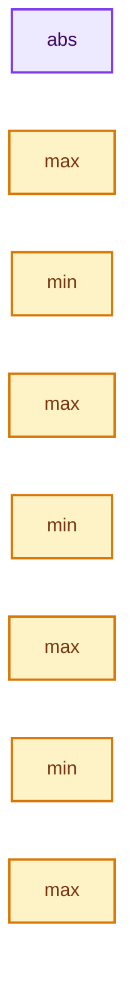
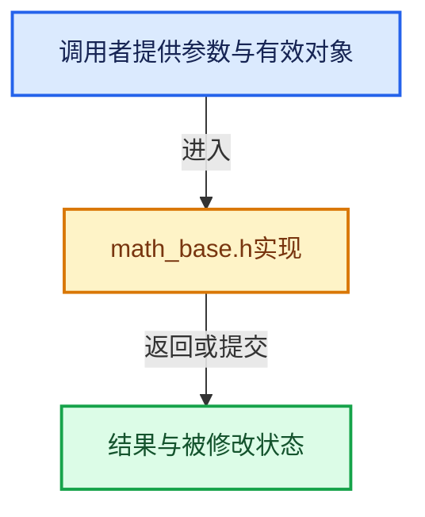

# 实现依赖专题：intern/cycles/util/math_base.h

[方向导航](README.md) · [符号索引](../%E7%AC%A6%E5%8F%B7%E4%BE%9D%E8%B5%96%E4%B8%8E%E5%AE%9E%E7%8E%B0%E7%B4%A2%E5%BC%95.md)

本专题从正文实际调用进入，集中保存共享实现。函数有稳定锚点，可从调用处直接跳到对应完整函数；递归与互相调用通过回链组织。

## 本文件的实现关系






<a id="m-ec002db2e0ff"></a>

## 宏 `isfinite`

<!-- annotated:0ba4a734cf9d12 -->

```cpp
#    define isfinite(x) sycl::isfinite((x))
#    define isnan(x) sycl::isnan((x))
```

<details>
<summary>核对原始源码：intern/cycles/util/math_base.h · L125—L126</summary>

<!-- original:0ba4a734cf9d12:intern/cycles/util/math_base.h:125:126 -->

```cpp
#    define isfinite(x) sycl::isfinite((x))
#    define isnan(x) sycl::isnan((x))
```

</details>

宏在预处理阶段展开，参数替换、重复求值和条件编译应直接从该定义检查。与普通函数不同，宏不会自动提供参数类型检查；构建配置选择哪个定义需结合外围条件。

## 完整成员与函数实现

<a id="f-f9539991b305db43"></a>

### `abs`

实现位置：[intern/cycles/util/math_base.h](../../../../../intern/cycles/util/math_base.h) · L129—L132。

接口参数：

- `const int x`

**教学注释版**

<!-- annotated:790374862246b0 -->

```cpp
ccl_device_inline int abs(const int x)
{
  return (x > 0) ? x : -x;
}
```

<details>
<summary>核对原始源码：intern/cycles/util/math_base.h · L129—L132</summary>

<!-- original:790374862246b0:intern/cycles/util/math_base.h:129:132 -->

```cpp
ccl_device_inline int abs(const int x)
{
  return (x > 0) ? x : -x;
}
```

</details>

**结果出口**

- `return (x > 0) ? x : -x;`

**继续追踪实现**

本实现没有需要继续展开的显式调用；检查返回表达式、对象转换和调用者前置条件。

<a id="f-be3bc38e3153af35"></a>

### `max`

实现位置：[intern/cycles/util/math_base.h](../../../../../intern/cycles/util/math_base.h) · L134—L137。

接口参数：

- `const int a`
- `const int b`

**教学注释版**

<!-- annotated:ce93c3af1f59db -->

```cpp
ccl_device_inline int max(const int a, const int b)
{
  return (a > b) ? a : b;
}
```

<details>
<summary>核对原始源码：intern/cycles/util/math_base.h · L134—L137</summary>

<!-- original:ce93c3af1f59db:intern/cycles/util/math_base.h:134:137 -->

```cpp
ccl_device_inline int max(const int a, const int b)
{
  return (a > b) ? a : b;
}
```

</details>

**结果出口**

- `return (a > b) ? a : b;`

**继续追踪实现**

本实现没有需要继续展开的显式调用；检查返回表达式、对象转换和调用者前置条件。

<a id="f-132cbc27cd589027"></a>

### `min`

实现位置：[intern/cycles/util/math_base.h](../../../../../intern/cycles/util/math_base.h) · L139—L142。

接口参数：

- `const int a`
- `const int b`

**教学注释版**

<!-- annotated:d86ac8c7edf2b1 -->

```cpp
ccl_device_inline int min(const int a, const int b)
{
  return (a < b) ? a : b;
}
```

<details>
<summary>核对原始源码：intern/cycles/util/math_base.h · L139—L142</summary>

<!-- original:d86ac8c7edf2b1:intern/cycles/util/math_base.h:139:142 -->

```cpp
ccl_device_inline int min(const int a, const int b)
{
  return (a < b) ? a : b;
}
```

</details>

**结果出口**

- `return (a < b) ? a : b;`

**继续追踪实现**

本实现没有需要继续展开的显式调用；检查返回表达式、对象转换和调用者前置条件。

<a id="f-cb944bef941ca727"></a>

### `max`

实现位置：[intern/cycles/util/math_base.h](../../../../../intern/cycles/util/math_base.h) · L144—L147。

接口参数：

- `const uint32_t a`
- `const uint32_t b`

**教学注释版**

<!-- annotated:2ab2882c280311 -->

```cpp
ccl_device_inline uint32_t max(const uint32_t a, const uint32_t b)
{
  return (a > b) ? a : b;
}
```

<details>
<summary>核对原始源码：intern/cycles/util/math_base.h · L144—L147</summary>

<!-- original:2ab2882c280311:intern/cycles/util/math_base.h:144:147 -->

```cpp
ccl_device_inline uint32_t max(const uint32_t a, const uint32_t b)
{
  return (a > b) ? a : b;
}
```

</details>

**结果出口**

- `return (a > b) ? a : b;`

**继续追踪实现**

本实现没有需要继续展开的显式调用；检查返回表达式、对象转换和调用者前置条件。

<a id="f-733b8b6acf5f9cb8"></a>

### `min`

实现位置：[intern/cycles/util/math_base.h](../../../../../intern/cycles/util/math_base.h) · L149—L152。

接口参数：

- `const uint32_t a`
- `const uint32_t b`

**教学注释版**

<!-- annotated:8f85fe22c6b4c1 -->

```cpp
ccl_device_inline uint32_t min(const uint32_t a, const uint32_t b)
{
  return (a < b) ? a : b;
}
```

<details>
<summary>核对原始源码：intern/cycles/util/math_base.h · L149—L152</summary>

<!-- original:8f85fe22c6b4c1:intern/cycles/util/math_base.h:149:152 -->

```cpp
ccl_device_inline uint32_t min(const uint32_t a, const uint32_t b)
{
  return (a < b) ? a : b;
}
```

</details>

**结果出口**

- `return (a < b) ? a : b;`

**继续追踪实现**

本实现没有需要继续展开的显式调用；检查返回表达式、对象转换和调用者前置条件。

<a id="f-8e59280f98f73041"></a>

### `max`

实现位置：[intern/cycles/util/math_base.h](../../../../../intern/cycles/util/math_base.h) · L154—L157。

接口参数：

- `const uint64_t a`
- `const uint64_t b`

**教学注释版**

<!-- annotated:1742f8a02d6eaa -->

```cpp
ccl_device_inline uint64_t max(const uint64_t a, const uint64_t b)
{
  return (a > b) ? a : b;
}
```

<details>
<summary>核对原始源码：intern/cycles/util/math_base.h · L154—L157</summary>

<!-- original:1742f8a02d6eaa:intern/cycles/util/math_base.h:154:157 -->

```cpp
ccl_device_inline uint64_t max(const uint64_t a, const uint64_t b)
{
  return (a > b) ? a : b;
}
```

</details>

**结果出口**

- `return (a > b) ? a : b;`

**继续追踪实现**

本实现没有需要继续展开的显式调用；检查返回表达式、对象转换和调用者前置条件。

<a id="f-176637a5db19a58e"></a>

### `min`

实现位置：[intern/cycles/util/math_base.h](../../../../../intern/cycles/util/math_base.h) · L159—L162。

接口参数：

- `const uint64_t a`
- `const uint64_t b`

**教学注释版**

<!-- annotated:b56f78aa8ef733 -->

```cpp
ccl_device_inline uint64_t min(const uint64_t a, const uint64_t b)
{
  return (a < b) ? a : b;
}
```

<details>
<summary>核对原始源码：intern/cycles/util/math_base.h · L159—L162</summary>

<!-- original:b56f78aa8ef733:intern/cycles/util/math_base.h:159:162 -->

```cpp
ccl_device_inline uint64_t min(const uint64_t a, const uint64_t b)
{
  return (a < b) ? a : b;
}
```

</details>

**结果出口**

- `return (a < b) ? a : b;`

**继续追踪实现**

本实现没有需要继续展开的显式调用；检查返回表达式、对象转换和调用者前置条件。

<a id="f-dfaf6a7778834912"></a>

### `max`

实现位置：[intern/cycles/util/math_base.h](../../../../../intern/cycles/util/math_base.h) · L171—L175。

接口参数：

- `T a`
- `T b`

**教学注释版**

<!-- annotated:780387df489a17 -->

```cpp
template<class T>
ccl_device_inline typename std::enable_if_t<std::is_same_v<T, size_t>, T> max(T a, T b)
{
  return (a > b) ? a : b;
}
```

<details>
<summary>核对原始源码：intern/cycles/util/math_base.h · L171—L175</summary>

<!-- original:780387df489a17:intern/cycles/util/math_base.h:171:175 -->

```cpp
template<class T>
ccl_device_inline typename std::enable_if_t<std::is_same_v<T, size_t>, T> max(T a, T b)
{
  return (a > b) ? a : b;
}
```

</details>

**结果出口**

- `return (a > b) ? a : b;`

**继续追踪实现**

本实现没有需要继续展开的显式调用；检查返回表达式、对象转换和调用者前置条件。

<a id="f-0b9990b19e0aeca9"></a>

### `min`

实现位置：[intern/cycles/util/math_base.h](../../../../../intern/cycles/util/math_base.h) · L177—L181。

接口参数：

- `T a`
- `T b`

**教学注释版**

<!-- annotated:9f2c0f65fe72ea -->

```cpp
template<class T>
ccl_device_inline typename std::enable_if_t<std::is_same_v<T, size_t>, T> min(T a, T b)
{
  return (a < b) ? a : b;
}
```

<details>
<summary>核对原始源码：intern/cycles/util/math_base.h · L177—L181</summary>

<!-- original:9f2c0f65fe72ea:intern/cycles/util/math_base.h:177:181 -->

```cpp
template<class T>
ccl_device_inline typename std::enable_if_t<std::is_same_v<T, size_t>, T> min(T a, T b)
{
  return (a < b) ? a : b;
}
```

</details>

**结果出口**

- `return (a < b) ? a : b;`

**继续追踪实现**

本实现没有需要继续展开的显式调用；检查返回表达式、对象转换和调用者前置条件。

<a id="f-39b21f7718ce6dcd"></a>

### `max`

实现位置：[intern/cycles/util/math_base.h](../../../../../intern/cycles/util/math_base.h) · L183—L186。

接口参数：

- `const float a`
- `const float b`

**教学注释版**

<!-- annotated:04b62d50a1fff0 -->

```cpp
ccl_device_inline float max(const float a, const float b)
{
  return (a > b) ? a : b;
}
```

<details>
<summary>核对原始源码：intern/cycles/util/math_base.h · L183—L186</summary>

<!-- original:04b62d50a1fff0:intern/cycles/util/math_base.h:183:186 -->

```cpp
ccl_device_inline float max(const float a, const float b)
{
  return (a > b) ? a : b;
}
```

</details>

**结果出口**

- `return (a > b) ? a : b;`

**继续追踪实现**

本实现没有需要继续展开的显式调用；检查返回表达式、对象转换和调用者前置条件。

<a id="f-6fbc336efe06d407"></a>

### `min`

实现位置：[intern/cycles/util/math_base.h](../../../../../intern/cycles/util/math_base.h) · L188—L191。

接口参数：

- `const float a`
- `const float b`

**教学注释版**

<!-- annotated:04bb6139ffff39 -->

```cpp
ccl_device_inline float min(const float a, const float b)
{
  return (a < b) ? a : b;
}
```

<details>
<summary>核对原始源码：intern/cycles/util/math_base.h · L188—L191</summary>

<!-- original:04bb6139ffff39:intern/cycles/util/math_base.h:188:191 -->

```cpp
ccl_device_inline float min(const float a, const float b)
{
  return (a < b) ? a : b;
}
```

</details>

**结果出口**

- `return (a < b) ? a : b;`

**继续追踪实现**

本实现没有需要继续展开的显式调用；检查返回表达式、对象转换和调用者前置条件。

<a id="f-d13b975582ffcad7"></a>

### `max`

实现位置：[intern/cycles/util/math_base.h](../../../../../intern/cycles/util/math_base.h) · L193—L196。

接口参数：

- `const double a`
- `const double b`

**教学注释版**

<!-- annotated:e64bd57e6b3be1 -->

```cpp
ccl_device_inline double max(const double a, const double b)
{
  return (a > b) ? a : b;
}
```

<details>
<summary>核对原始源码：intern/cycles/util/math_base.h · L193—L196</summary>

<!-- original:e64bd57e6b3be1:intern/cycles/util/math_base.h:193:196 -->

```cpp
ccl_device_inline double max(const double a, const double b)
{
  return (a > b) ? a : b;
}
```

</details>

**结果出口**

- `return (a > b) ? a : b;`

**继续追踪实现**

本实现没有需要继续展开的显式调用；检查返回表达式、对象转换和调用者前置条件。

<a id="f-43dfeca9722749ab"></a>

### `min`

实现位置：[intern/cycles/util/math_base.h](../../../../../intern/cycles/util/math_base.h) · L198—L201。

接口参数：

- `const double a`
- `const double b`

**教学注释版**

<!-- annotated:28923bd3ad8814 -->

```cpp
ccl_device_inline double min(const double a, const double b)
{
  return (a < b) ? a : b;
}
```

<details>
<summary>核对原始源码：intern/cycles/util/math_base.h · L198—L201</summary>

<!-- original:28923bd3ad8814:intern/cycles/util/math_base.h:198:201 -->

```cpp
ccl_device_inline double min(const double a, const double b)
{
  return (a < b) ? a : b;
}
```

</details>

**结果出口**

- `return (a < b) ? a : b;`

**继续追踪实现**

本实现没有需要继续展开的显式调用；检查返回表达式、对象转换和调用者前置条件。

<a id="f-e33db4b370eb8fc4"></a>

### `clamp`

实现位置：[intern/cycles/util/math_base.h](../../../../../intern/cycles/util/math_base.h) · L380—L383。

接口参数：

- `const int a`
- `const int mn`
- `const int mx`

**教学注释版**

<!-- annotated:d790cb63b87556 -->

```cpp
ccl_device_inline int clamp(const int a, const int mn, const int mx)
{
  return min(max(a, mn), mx);
}
```

<details>
<summary>核对原始源码：intern/cycles/util/math_base.h · L380—L383</summary>

<!-- original:d790cb63b87556:intern/cycles/util/math_base.h:380:383 -->

```cpp
ccl_device_inline int clamp(const int a, const int mn, const int mx)
{
  return min(max(a, mn), mx);
}
```

</details>

**结果出口**

- `return min(max(a, mn), mx);`

**继续追踪实现**

- `min` → [min · L139](%E4%BE%9D%E8%B5%96-math_base-b01ba9.md#f-132cbc27cd589027)；[min · L149](%E4%BE%9D%E8%B5%96-math_base-b01ba9.md#f-733b8b6acf5f9cb8)；[min · L159](%E4%BE%9D%E8%B5%96-math_base-b01ba9.md#f-176637a5db19a58e)；[min · L177](%E4%BE%9D%E8%B5%96-math_base-b01ba9.md#f-0b9990b19e0aeca9)；[min · L188](%E4%BE%9D%E8%B5%96-math_base-b01ba9.md#f-6fbc336efe06d407)；[min · L198](%E4%BE%9D%E8%B5%96-math_base-b01ba9.md#f-43dfeca9722749ab)。同名重载需按实参类型选择。
- `max` → [max · L134](%E4%BE%9D%E8%B5%96-math_base-b01ba9.md#f-be3bc38e3153af35)；[max · L144](%E4%BE%9D%E8%B5%96-math_base-b01ba9.md#f-cb944bef941ca727)；[max · L154](%E4%BE%9D%E8%B5%96-math_base-b01ba9.md#f-8e59280f98f73041)；[max · L171](%E4%BE%9D%E8%B5%96-math_base-b01ba9.md#f-dfaf6a7778834912)；[max · L183](%E4%BE%9D%E8%B5%96-math_base-b01ba9.md#f-39b21f7718ce6dcd)；[max · L193](%E4%BE%9D%E8%B5%96-math_base-b01ba9.md#f-d13b975582ffcad7)。同名重载需按实参类型选择。

<a id="f-e8960e0757e1c254"></a>

### `clamp`

实现位置：[intern/cycles/util/math_base.h](../../../../../intern/cycles/util/math_base.h) · L385—L388。

接口参数：

- `const float a`
- `const float mn`
- `const float mx`

**教学注释版**

<!-- annotated:c095e1e552bb54 -->

```cpp
ccl_device_inline float clamp(const float a, const float mn, const float mx)
{
  return min(max(a, mn), mx);
}
```

<details>
<summary>核对原始源码：intern/cycles/util/math_base.h · L385—L388</summary>

<!-- original:c095e1e552bb54:intern/cycles/util/math_base.h:385:388 -->

```cpp
ccl_device_inline float clamp(const float a, const float mn, const float mx)
{
  return min(max(a, mn), mx);
}
```

</details>

**结果出口**

- `return min(max(a, mn), mx);`

**继续追踪实现**

- `min` → [min · L139](%E4%BE%9D%E8%B5%96-math_base-b01ba9.md#f-132cbc27cd589027)；[min · L149](%E4%BE%9D%E8%B5%96-math_base-b01ba9.md#f-733b8b6acf5f9cb8)；[min · L159](%E4%BE%9D%E8%B5%96-math_base-b01ba9.md#f-176637a5db19a58e)；[min · L177](%E4%BE%9D%E8%B5%96-math_base-b01ba9.md#f-0b9990b19e0aeca9)；[min · L188](%E4%BE%9D%E8%B5%96-math_base-b01ba9.md#f-6fbc336efe06d407)；[min · L198](%E4%BE%9D%E8%B5%96-math_base-b01ba9.md#f-43dfeca9722749ab)。同名重载需按实参类型选择。
- `max` → [max · L134](%E4%BE%9D%E8%B5%96-math_base-b01ba9.md#f-be3bc38e3153af35)；[max · L144](%E4%BE%9D%E8%B5%96-math_base-b01ba9.md#f-cb944bef941ca727)；[max · L154](%E4%BE%9D%E8%B5%96-math_base-b01ba9.md#f-8e59280f98f73041)；[max · L171](%E4%BE%9D%E8%B5%96-math_base-b01ba9.md#f-dfaf6a7778834912)；[max · L183](%E4%BE%9D%E8%B5%96-math_base-b01ba9.md#f-39b21f7718ce6dcd)；[max · L193](%E4%BE%9D%E8%B5%96-math_base-b01ba9.md#f-d13b975582ffcad7)。同名重载需按实参类型选择。

<a id="f-c4d2373616f78322"></a>

### `interp`

实现位置：[intern/cycles/util/math_base.h](../../../../../intern/cycles/util/math_base.h) · L549—L552。

接口参数：

- `const float a`
- `const float b`
- `const float t`

**教学注释版**

<!-- annotated:60dc41eaac78ac -->

```cpp
ccl_device_inline float interp(const float a, const float b, const float t)
{
  return a + t * (b - a);
}
```

<details>
<summary>核对原始源码：intern/cycles/util/math_base.h · L549—L552</summary>

<!-- original:60dc41eaac78ac:intern/cycles/util/math_base.h:549:552 -->

```cpp
ccl_device_inline float interp(const float a, const float b, const float t)
{
  return a + t * (b - a);
}
```

</details>

**结果出口**

- `return a + t * (b - a);`

**继续追踪实现**

本实现没有需要继续展开的显式调用；检查返回表达式、对象转换和调用者前置条件。

<a id="f-9e07315cb86204da"></a>

### `inversesqrtf`

实现位置：[intern/cycles/util/math_base.h](../../../../../intern/cycles/util/math_base.h) · L576—L583。

接口参数：

- `const float f`

**教学注释版**

<!-- annotated:93a82570b31a78 -->

```cpp
ccl_device_inline float inversesqrtf(const float f)
{
#if defined(__KERNEL_METAL__)
  return (f > 0.0f) ? metal::rsqrt(f) : 0.0f;
#else
  return (f > 0.0f) ? 1.0f / sqrtf(f) : 0.0f;
#endif
}
```

<details>
<summary>核对原始源码：intern/cycles/util/math_base.h · L576—L583</summary>

<!-- original:93a82570b31a78:intern/cycles/util/math_base.h:576:583 -->

```cpp
ccl_device_inline float inversesqrtf(const float f)
{
#if defined(__KERNEL_METAL__)
  return (f > 0.0f) ? metal::rsqrt(f) : 0.0f;
#else
  return (f > 0.0f) ? 1.0f / sqrtf(f) : 0.0f;
#endif
}
```

</details>

**结果出口**

- `return (f > 0.0f) ? metal::rsqrt(f) : 0.0f;`
- `return (f > 0.0f) ? 1.0f / sqrtf(f) : 0.0f;`

**继续追踪实现**

- `metal::rsqrt` → [调用协议](../%E6%A8%A1%E6%9D%BF%E5%AE%8F%E4%B8%8E%E5%8A%A8%E6%80%81%E5%88%86%E6%B4%BE%E5%8D%8F%E8%AE%AE.md)：函数指针、局部可调用对象或未展开的宏；必须结合调用者环境。调用位置L579。
- `sqrtf` → [外部契约](https://eel.is/c++draft/)：这个边界按实际表达式及所属类型核对参数、返回值、寿命与失败行为。这里提供接口入口，不声称已解释该第三方版本的内部实现。

<a id="f-b0596b05c81b9418"></a>

### `safe_acosf`

实现位置：[intern/cycles/util/math_base.h](../../../../../intern/cycles/util/math_base.h) · L590—L593。

接口参数：

- `const float a`

**教学注释版**

<!-- annotated:e8a88ad268b591 -->

```cpp
ccl_device float safe_acosf(const float a)
{
  return acosf(clamp(a, -1.0f, 1.0f));
}
```

<details>
<summary>核对原始源码：intern/cycles/util/math_base.h · L590—L593</summary>

<!-- original:e8a88ad268b591:intern/cycles/util/math_base.h:590:593 -->

```cpp
ccl_device float safe_acosf(const float a)
{
  return acosf(clamp(a, -1.0f, 1.0f));
}
```

</details>

**结果出口**

- `return acosf(clamp(a, -1.0f, 1.0f));`

**继续追踪实现**

- `acosf` → [acosf · L170](%E4%BE%9D%E8%B5%96-compat-56205c.md#m-68452ab01424)；[acosf · L268](%E4%BE%9D%E8%B5%96-compat-efe0e9.md#m-a0383e8919c5)；[acosf · L46](%E4%BE%9D%E8%B5%96-GPU_shader_shared_utils-0adda3.md#m-68745dafe7bd)；[acosf · L67](%E4%BE%9D%E8%B5%96-GPU_shader_shared_utils-0adda3.md#m-a19449c3be49)。宏定义由构建条件选择。
- `clamp` → [clamp · L380](%E4%BE%9D%E8%B5%96-math_base-b01ba9.md#f-e33db4b370eb8fc4)；[clamp · L385](%E4%BE%9D%E8%B5%96-math_base-b01ba9.md#f-e8960e0757e1c254)。同名重载需按实参类型选择。

<a id="f-f87b0bde247c7230"></a>

### `sqr`

实现位置：[intern/cycles/util/math_base.h](../../../../../intern/cycles/util/math_base.h) · L651—L654。

接口参数：

- `const float a`

**教学注释版**

<!-- annotated:cf4a4897791ed5 -->

```cpp
ccl_device_inline float sqr(const float a)
{
  return a * a;
}
```

<details>
<summary>核对原始源码：intern/cycles/util/math_base.h · L651—L654</summary>

<!-- original:cf4a4897791ed5:intern/cycles/util/math_base.h:651:654 -->

```cpp
ccl_device_inline float sqr(const float a)
{
  return a * a;
}
```

</details>

**结果出口**

- `return a * a;`

**继续追踪实现**

本实现没有需要继续展开的显式调用；检查返回表达式、对象转换和调用者前置条件。
