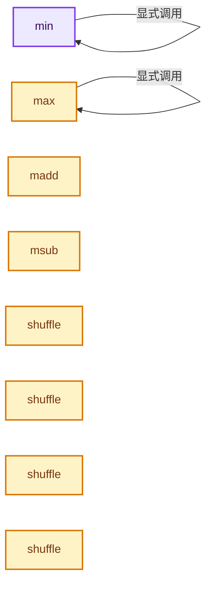
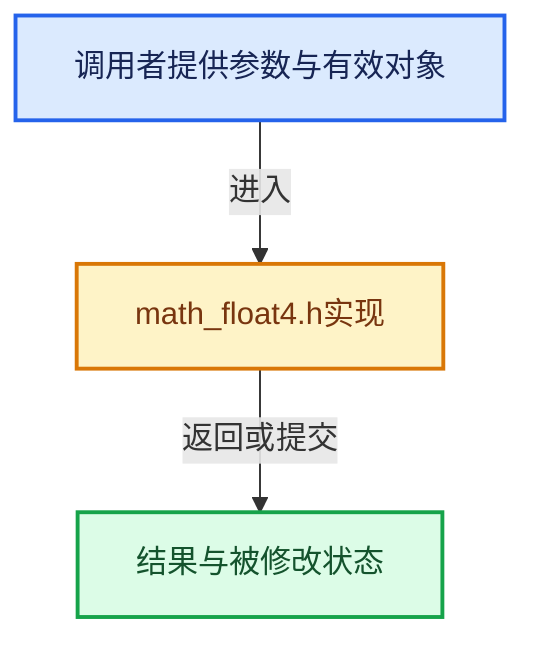

# 实现依赖专题：intern/cycles/util/math_float4.h

[方向导航](README.md) · [符号索引](../%E7%AC%A6%E5%8F%B7%E4%BE%9D%E8%B5%96%E4%B8%8E%E5%AE%9E%E7%8E%B0%E7%B4%A2%E5%BC%95.md)

本专题从正文实际调用进入，集中保存共享实现。函数有稳定锚点，可从调用处直接跳到对应完整函数；递归与互相调用通过回链组织。

## 本文件的实现关系






## 完整成员与函数实现

<a id="f-66c307394ea4fc4d"></a>

### `min`

实现位置：[intern/cycles/util/math_float4.h](../../../../../intern/cycles/util/math_float4.h) · L214—L221。

接口参数：

- `const float4 a`
- `const float4 b`

**教学注释版**

<!-- annotated:e517568f099f3d -->

```cpp
ccl_device_inline float4 min(const float4 a, const float4 b)
{
#  ifdef __KERNEL_SSE__
  return float4(_mm_min_ps(a.m128, b.m128));
#  else
  return make_float4(min(a.x, b.x), min(a.y, b.y), min(a.z, b.z), min(a.w, b.w));
#  endif
}
```

<details>
<summary>核对原始源码：intern/cycles/util/math_float4.h · L214—L221</summary>

<!-- original:e517568f099f3d:intern/cycles/util/math_float4.h:214:221 -->

```cpp
ccl_device_inline float4 min(const float4 a, const float4 b)
{
#  ifdef __KERNEL_SSE__
  return float4(_mm_min_ps(a.m128, b.m128));
#  else
  return make_float4(min(a.x, b.x), min(a.y, b.y), min(a.z, b.z), min(a.w, b.w));
#  endif
}
```

</details>

**结果出口**

- `return float4(_mm_min_ps(a.m128, b.m128));`
- `return make_float4(min(a.x, b.x), min(a.y, b.y), min(a.z, b.z), min(a.w, b.w));`

**继续追踪实现**

- `float4` → [float4 · L56](%E4%BE%9D%E8%B5%96-radial_tiling_shared-98abf9.md#m-f0908e385c5b)；[float4 · L60](../01-%E5%9F%BA%E7%A1%80%E5%AE%B9%E5%99%A8%E4%B8%8E%E7%8E%B0%E4%BB%A3CPP/%E4%BE%9D%E8%B5%96-radial_tiling_shared-7989a4.md#m-7962dcdc288b)；[float4 · L56](%E4%BE%9D%E8%B5%96-node_radial_tiling_shared-b14bc2.md#m-adb8e9e87775)；[float4 · L642](%E4%BE%9D%E8%B5%96-smaa-b67bc2.md#m-9362daaa821c)。宏定义由构建条件选择。
- `_mm_min_ps` → [调用协议](../%E6%A8%A1%E6%9D%BF%E5%AE%8F%E4%B8%8E%E5%8A%A8%E6%80%81%E5%88%86%E6%B4%BE%E5%8D%8F%E8%AE%AE.md)：函数指针、局部可调用对象或未展开的宏；必须结合调用者环境。调用位置L217。
- `make_float4` → [make_float4 · L64](%E4%BE%9D%E8%B5%96-types_float4-fe598f.md#f-f781281b7fbc5189)；[make_float4 · L75](%E4%BE%9D%E8%B5%96-types_float4-fe598f.md#f-2e8408c671c6317a)；[make_float4 · L84](%E4%BE%9D%E8%B5%96-types_float4-fe598f.md#f-ef834c3f77ccb52c)；[make_float4 · L89](%E4%BE%9D%E8%B5%96-types_float4-fe598f.md#f-15e15c112cd5e990)；[make_float4 · L99](%E4%BE%9D%E8%B5%96-types_float4-fe598f.md#f-5220543e0b1ee3d0)；[make_float4 · L165](%E4%BE%9D%E8%B5%96-types_dual-2ddd2c.md#f-1f8eb02651757016)；[make_float4 · L172](%E4%BE%9D%E8%B5%96-types_dual-2ddd2c.md#f-5f2db29d80cd0f87)；[make_float4 · L86](%E4%BE%9D%E8%B5%96-math_quaternion-957b27.md#f-42407d59cf9cb53a)。同名重载需按实参类型选择。
- `min` → [min · L214](%E4%BE%9D%E8%B5%96-math_float4-2d91ea.md#f-66c307394ea4fc4d)。

<a id="f-6d01bd81cfae3de4"></a>

### `max`

实现位置：[intern/cycles/util/math_float4.h](../../../../../intern/cycles/util/math_float4.h) · L223—L230。

接口参数：

- `const float4 a`
- `const float4 b`

**教学注释版**

<!-- annotated:a48c1d78823e59 -->

```cpp
ccl_device_inline float4 max(const float4 a, const float4 b)
{
#  ifdef __KERNEL_SSE__
  return float4(_mm_max_ps(a.m128, b.m128));
#  else
  return make_float4(max(a.x, b.x), max(a.y, b.y), max(a.z, b.z), max(a.w, b.w));
#  endif
}
```

<details>
<summary>核对原始源码：intern/cycles/util/math_float4.h · L223—L230</summary>

<!-- original:a48c1d78823e59:intern/cycles/util/math_float4.h:223:230 -->

```cpp
ccl_device_inline float4 max(const float4 a, const float4 b)
{
#  ifdef __KERNEL_SSE__
  return float4(_mm_max_ps(a.m128, b.m128));
#  else
  return make_float4(max(a.x, b.x), max(a.y, b.y), max(a.z, b.z), max(a.w, b.w));
#  endif
}
```

</details>

**结果出口**

- `return float4(_mm_max_ps(a.m128, b.m128));`
- `return make_float4(max(a.x, b.x), max(a.y, b.y), max(a.z, b.z), max(a.w, b.w));`

**继续追踪实现**

- `float4` → [float4 · L56](%E4%BE%9D%E8%B5%96-radial_tiling_shared-98abf9.md#m-f0908e385c5b)；[float4 · L60](../01-%E5%9F%BA%E7%A1%80%E5%AE%B9%E5%99%A8%E4%B8%8E%E7%8E%B0%E4%BB%A3CPP/%E4%BE%9D%E8%B5%96-radial_tiling_shared-7989a4.md#m-7962dcdc288b)；[float4 · L56](%E4%BE%9D%E8%B5%96-node_radial_tiling_shared-b14bc2.md#m-adb8e9e87775)；[float4 · L642](%E4%BE%9D%E8%B5%96-smaa-b67bc2.md#m-9362daaa821c)。宏定义由构建条件选择。
- `_mm_max_ps` → [调用协议](../%E6%A8%A1%E6%9D%BF%E5%AE%8F%E4%B8%8E%E5%8A%A8%E6%80%81%E5%88%86%E6%B4%BE%E5%8D%8F%E8%AE%AE.md)：函数指针、局部可调用对象或未展开的宏；必须结合调用者环境。调用位置L226。
- `make_float4` → [make_float4 · L64](%E4%BE%9D%E8%B5%96-types_float4-fe598f.md#f-f781281b7fbc5189)；[make_float4 · L75](%E4%BE%9D%E8%B5%96-types_float4-fe598f.md#f-2e8408c671c6317a)；[make_float4 · L84](%E4%BE%9D%E8%B5%96-types_float4-fe598f.md#f-ef834c3f77ccb52c)；[make_float4 · L89](%E4%BE%9D%E8%B5%96-types_float4-fe598f.md#f-15e15c112cd5e990)；[make_float4 · L99](%E4%BE%9D%E8%B5%96-types_float4-fe598f.md#f-5220543e0b1ee3d0)；[make_float4 · L165](%E4%BE%9D%E8%B5%96-types_dual-2ddd2c.md#f-1f8eb02651757016)；[make_float4 · L172](%E4%BE%9D%E8%B5%96-types_dual-2ddd2c.md#f-5f2db29d80cd0f87)；[make_float4 · L86](%E4%BE%9D%E8%B5%96-math_quaternion-957b27.md#f-42407d59cf9cb53a)。同名重载需按实参类型选择。
- `max` → [max · L223](%E4%BE%9D%E8%B5%96-math_float4-2d91ea.md#f-6d01bd81cfae3de4)。

<a id="f-1c60d87464696174"></a>

### `madd`

实现位置：[intern/cycles/util/math_float4.h](../../../../../intern/cycles/util/math_float4.h) · L238—L251。

接口参数：

- `const float4 a`
- `const float4 b`
- `const float4 c`

**教学注释版**

<!-- annotated:c9bc3d4876465d -->

```cpp
ccl_device_inline float4 madd(const float4 a, const float4 b, const float4 c)
{
#ifdef __KERNEL_SSE__
#  ifdef __KERNEL_NEON__
  return float4(vfmaq_f32(c, a, b));
#  elif defined(__KERNEL_AVX2__)
  return float4(_mm_fmadd_ps(a, b, c));
#  else
  return a * b + c;
#  endif
#else
  return a * b + c;
#endif
}
```

<details>
<summary>核对原始源码：intern/cycles/util/math_float4.h · L238—L251</summary>

<!-- original:c9bc3d4876465d:intern/cycles/util/math_float4.h:238:251 -->

```cpp
ccl_device_inline float4 madd(const float4 a, const float4 b, const float4 c)
{
#ifdef __KERNEL_SSE__
#  ifdef __KERNEL_NEON__
  return float4(vfmaq_f32(c, a, b));
#  elif defined(__KERNEL_AVX2__)
  return float4(_mm_fmadd_ps(a, b, c));
#  else
  return a * b + c;
#  endif
#else
  return a * b + c;
#endif
}
```

</details>

**结果出口**

- `return float4(vfmaq_f32(c, a, b));`
- `return float4(_mm_fmadd_ps(a, b, c));`
- `return a * b + c;`

**继续追踪实现**

- `float4` → [float4 · L56](%E4%BE%9D%E8%B5%96-radial_tiling_shared-98abf9.md#m-f0908e385c5b)；[float4 · L60](../01-%E5%9F%BA%E7%A1%80%E5%AE%B9%E5%99%A8%E4%B8%8E%E7%8E%B0%E4%BB%A3CPP/%E4%BE%9D%E8%B5%96-radial_tiling_shared-7989a4.md#m-7962dcdc288b)；[float4 · L56](%E4%BE%9D%E8%B5%96-node_radial_tiling_shared-b14bc2.md#m-adb8e9e87775)；[float4 · L642](%E4%BE%9D%E8%B5%96-smaa-b67bc2.md#m-9362daaa821c)。宏定义由构建条件选择。
- `vfmaq_f32` → [调用协议](../%E6%A8%A1%E6%9D%BF%E5%AE%8F%E4%B8%8E%E5%8A%A8%E6%80%81%E5%88%86%E6%B4%BE%E5%8D%8F%E8%AE%AE.md)：函数指针、局部可调用对象或未展开的宏；必须结合调用者环境。调用位置L242。
- `_mm_fmadd_ps` → [调用协议](../%E6%A8%A1%E6%9D%BF%E5%AE%8F%E4%B8%8E%E5%8A%A8%E6%80%81%E5%88%86%E6%B4%BE%E5%8D%8F%E8%AE%AE.md)：函数指针、局部可调用对象或未展开的宏；必须结合调用者环境。调用位置L244。

<a id="f-c1ee59e753b8cf35"></a>

### `msub`

实现位置：[intern/cycles/util/math_float4.h](../../../../../intern/cycles/util/math_float4.h) · L253—L266。

接口参数：

- `const float4 a`
- `const float4 b`
- `const float4 c`

**教学注释版**

<!-- annotated:ddfc239d286c0d -->

```cpp
ccl_device_inline float4 msub(const float4 a, const float4 b, const float4 c)
{
#ifdef __KERNEL_SSE__
#  ifdef __KERNEL_NEON__
  return float4(vfmaq_f32(vnegq_f32(c), a, b));
#  elif defined(__KERNEL_AVX2__)
  return float4(_mm_fmsub_ps(a, b, c));
#  else
  return a * b - c;
#  endif
#else
  return a * b - c;
#endif
}
```

<details>
<summary>核对原始源码：intern/cycles/util/math_float4.h · L253—L266</summary>

<!-- original:ddfc239d286c0d:intern/cycles/util/math_float4.h:253:266 -->

```cpp
ccl_device_inline float4 msub(const float4 a, const float4 b, const float4 c)
{
#ifdef __KERNEL_SSE__
#  ifdef __KERNEL_NEON__
  return float4(vfmaq_f32(vnegq_f32(c), a, b));
#  elif defined(__KERNEL_AVX2__)
  return float4(_mm_fmsub_ps(a, b, c));
#  else
  return a * b - c;
#  endif
#else
  return a * b - c;
#endif
}
```

</details>

**结果出口**

- `return float4(vfmaq_f32(vnegq_f32(c), a, b));`
- `return float4(_mm_fmsub_ps(a, b, c));`
- `return a * b - c;`

**继续追踪实现**

- `float4` → [float4 · L56](%E4%BE%9D%E8%B5%96-radial_tiling_shared-98abf9.md#m-f0908e385c5b)；[float4 · L60](../01-%E5%9F%BA%E7%A1%80%E5%AE%B9%E5%99%A8%E4%B8%8E%E7%8E%B0%E4%BB%A3CPP/%E4%BE%9D%E8%B5%96-radial_tiling_shared-7989a4.md#m-7962dcdc288b)；[float4 · L56](%E4%BE%9D%E8%B5%96-node_radial_tiling_shared-b14bc2.md#m-adb8e9e87775)；[float4 · L642](%E4%BE%9D%E8%B5%96-smaa-b67bc2.md#m-9362daaa821c)。宏定义由构建条件选择。
- `vfmaq_f32` → [调用协议](../%E6%A8%A1%E6%9D%BF%E5%AE%8F%E4%B8%8E%E5%8A%A8%E6%80%81%E5%88%86%E6%B4%BE%E5%8D%8F%E8%AE%AE.md)：函数指针、局部可调用对象或未展开的宏；必须结合调用者环境。调用位置L257。
- `vnegq_f32` → [调用协议](../%E6%A8%A1%E6%9D%BF%E5%AE%8F%E4%B8%8E%E5%8A%A8%E6%80%81%E5%88%86%E6%B4%BE%E5%8D%8F%E8%AE%AE.md)：函数指针、局部可调用对象或未展开的宏；必须结合调用者环境。调用位置L257。
- `_mm_fmsub_ps` → [调用协议](../%E6%A8%A1%E6%9D%BF%E5%AE%8F%E4%B8%8E%E5%8A%A8%E6%80%81%E5%88%86%E6%B4%BE%E5%8D%8F%E8%AE%AE.md)：函数指针、局部可调用对象或未展开的宏；必须结合调用者环境。调用位置L259。

<a id="f-482643c1a13b2404"></a>

### `shuffle`

实现位置：[intern/cycles/util/math_float4.h](../../../../../intern/cycles/util/math_float4.h) · L269—L278。

接口参数：

- `const float4 a`

**教学注释版**

<!-- annotated:2f46e941cb27ce -->

```cpp
template<size_t i0, const size_t i1, const size_t i2, const size_t i3>
__forceinline float4 shuffle(const float4 a)
{
#  ifdef __KERNEL_NEON__
  return float4(shuffle_neon<float32x4_t, i0, i1, i2, i3>(a.m128));
#  else
  return float4(
      _mm_castsi128_ps(_mm_shuffle_epi32(_mm_castps_si128(a), _MM_SHUFFLE(i3, i2, i1, i0))));
#  endif
}
```

<details>
<summary>核对原始源码：intern/cycles/util/math_float4.h · L269—L278</summary>

<!-- original:2f46e941cb27ce:intern/cycles/util/math_float4.h:269:278 -->

```cpp
template<size_t i0, const size_t i1, const size_t i2, const size_t i3>
__forceinline float4 shuffle(const float4 a)
{
#  ifdef __KERNEL_NEON__
  return float4(shuffle_neon<float32x4_t, i0, i1, i2, i3>(a.m128));
#  else
  return float4(
      _mm_castsi128_ps(_mm_shuffle_epi32(_mm_castps_si128(a), _MM_SHUFFLE(i3, i2, i1, i0))));
#  endif
}
```

</details>

**结果出口**

- `return float4(shuffle_neon<float32x4_t, i0, i1, i2, i3>(a.m128));`
- `return float4(`

**继续追踪实现**

- `float4` → [float4 · L56](%E4%BE%9D%E8%B5%96-radial_tiling_shared-98abf9.md#m-f0908e385c5b)；[float4 · L60](../01-%E5%9F%BA%E7%A1%80%E5%AE%B9%E5%99%A8%E4%B8%8E%E7%8E%B0%E4%BB%A3CPP/%E4%BE%9D%E8%B5%96-radial_tiling_shared-7989a4.md#m-7962dcdc288b)；[float4 · L56](%E4%BE%9D%E8%B5%96-node_radial_tiling_shared-b14bc2.md#m-adb8e9e87775)；[float4 · L642](%E4%BE%9D%E8%B5%96-smaa-b67bc2.md#m-9362daaa821c)。宏定义由构建条件选择。
- `shuffle_neon<float32x4_t, i0, i1, i2, i3>` → [shuffle_neon · L176](%E4%BE%9D%E8%B5%96-simd-b50468.md#f-314108216374b68b)；[shuffle_neon · L202](%E4%BE%9D%E8%B5%96-simd-b50468.md#f-e81bcc281996bf36)。同名重载需按实参类型选择。
- `_mm_castsi128_ps` → [调用协议](../%E6%A8%A1%E6%9D%BF%E5%AE%8F%E4%B8%8E%E5%8A%A8%E6%80%81%E5%88%86%E6%B4%BE%E5%8D%8F%E8%AE%AE.md)：函数指针、局部可调用对象或未展开的宏；必须结合调用者环境。调用位置L276。
- `_mm_shuffle_epi32` → [调用协议](../%E6%A8%A1%E6%9D%BF%E5%AE%8F%E4%B8%8E%E5%8A%A8%E6%80%81%E5%88%86%E6%B4%BE%E5%8D%8F%E8%AE%AE.md)：函数指针、局部可调用对象或未展开的宏；必须结合调用者环境。调用位置L276。
- `_mm_castps_si128` → [调用协议](../%E6%A8%A1%E6%9D%BF%E5%AE%8F%E4%B8%8E%E5%8A%A8%E6%80%81%E5%88%86%E6%B4%BE%E5%8D%8F%E8%AE%AE.md)：函数指针、局部可调用对象或未展开的宏；必须结合调用者环境。调用位置L276。
- `_MM_SHUFFLE` → [调用协议](../%E6%A8%A1%E6%9D%BF%E5%AE%8F%E4%B8%8E%E5%8A%A8%E6%80%81%E5%88%86%E6%B4%BE%E5%8D%8F%E8%AE%AE.md)：函数指针、局部可调用对象或未展开的宏；必须结合调用者环境。调用位置L276。

<a id="f-72f031d0b6ec9db3"></a>

### `shuffle`

实现位置：[intern/cycles/util/math_float4.h](../../../../../intern/cycles/util/math_float4.h) · L280—L283。

接口参数：

- `const float4 a`

**教学注释版**

<!-- annotated:95df45fab97b2c -->

```cpp
template<> __forceinline float4 shuffle<0, 1, 0, 1>(const float4 a)
{
  return float4(_mm_movelh_ps(a, a));
}
```

<details>
<summary>核对原始源码：intern/cycles/util/math_float4.h · L280—L283</summary>

<!-- original:95df45fab97b2c:intern/cycles/util/math_float4.h:280:283 -->

```cpp
template<> __forceinline float4 shuffle<0, 1, 0, 1>(const float4 a)
{
  return float4(_mm_movelh_ps(a, a));
}
```

</details>

**结果出口**

- `return float4(_mm_movelh_ps(a, a));`

**继续追踪实现**

- `float4` → [float4 · L56](%E4%BE%9D%E8%B5%96-radial_tiling_shared-98abf9.md#m-f0908e385c5b)；[float4 · L60](../01-%E5%9F%BA%E7%A1%80%E5%AE%B9%E5%99%A8%E4%B8%8E%E7%8E%B0%E4%BB%A3CPP/%E4%BE%9D%E8%B5%96-radial_tiling_shared-7989a4.md#m-7962dcdc288b)；[float4 · L56](%E4%BE%9D%E8%B5%96-node_radial_tiling_shared-b14bc2.md#m-adb8e9e87775)；[float4 · L642](%E4%BE%9D%E8%B5%96-smaa-b67bc2.md#m-9362daaa821c)。宏定义由构建条件选择。
- `_mm_movelh_ps` → [调用协议](../%E6%A8%A1%E6%9D%BF%E5%AE%8F%E4%B8%8E%E5%8A%A8%E6%80%81%E5%88%86%E6%B4%BE%E5%8D%8F%E8%AE%AE.md)：函数指针、局部可调用对象或未展开的宏；必须结合调用者环境。调用位置L282。

<a id="f-ce6e8c861185b553"></a>

### `shuffle`

实现位置：[intern/cycles/util/math_float4.h](../../../../../intern/cycles/util/math_float4.h) · L285—L288。

接口参数：

- `const float4 a`

**教学注释版**

<!-- annotated:d44e0d41969e3c -->

```cpp
template<> __forceinline float4 shuffle<2, 3, 2, 3>(const float4 a)
{
  return float4(_mm_movehl_ps(a, a));
}
```

<details>
<summary>核对原始源码：intern/cycles/util/math_float4.h · L285—L288</summary>

<!-- original:d44e0d41969e3c:intern/cycles/util/math_float4.h:285:288 -->

```cpp
template<> __forceinline float4 shuffle<2, 3, 2, 3>(const float4 a)
{
  return float4(_mm_movehl_ps(a, a));
}
```

</details>

**结果出口**

- `return float4(_mm_movehl_ps(a, a));`

**继续追踪实现**

- `float4` → [float4 · L56](%E4%BE%9D%E8%B5%96-radial_tiling_shared-98abf9.md#m-f0908e385c5b)；[float4 · L60](../01-%E5%9F%BA%E7%A1%80%E5%AE%B9%E5%99%A8%E4%B8%8E%E7%8E%B0%E4%BB%A3CPP/%E4%BE%9D%E8%B5%96-radial_tiling_shared-7989a4.md#m-7962dcdc288b)；[float4 · L56](%E4%BE%9D%E8%B5%96-node_radial_tiling_shared-b14bc2.md#m-adb8e9e87775)；[float4 · L642](%E4%BE%9D%E8%B5%96-smaa-b67bc2.md#m-9362daaa821c)。宏定义由构建条件选择。
- `_mm_movehl_ps` → [调用协议](../%E6%A8%A1%E6%9D%BF%E5%AE%8F%E4%B8%8E%E5%8A%A8%E6%80%81%E5%88%86%E6%B4%BE%E5%8D%8F%E8%AE%AE.md)：函数指针、局部可调用对象或未展开的宏；必须结合调用者环境。调用位置L287。

<a id="f-f08ebe2fe109dbb3"></a>

### `shuffle`

实现位置：[intern/cycles/util/math_float4.h](../../../../../intern/cycles/util/math_float4.h) · L291—L294。

接口参数：

- `const float4 a`

**教学注释版**

<!-- annotated:5f51c8511a9571 -->

```cpp
template<> __forceinline float4 shuffle<0, 0, 2, 2>(const float4 a)
{
  return float4(_mm_moveldup_ps(a));
}
```

<details>
<summary>核对原始源码：intern/cycles/util/math_float4.h · L291—L294</summary>

<!-- original:5f51c8511a9571:intern/cycles/util/math_float4.h:291:294 -->

```cpp
template<> __forceinline float4 shuffle<0, 0, 2, 2>(const float4 a)
{
  return float4(_mm_moveldup_ps(a));
}
```

</details>

**结果出口**

- `return float4(_mm_moveldup_ps(a));`

**继续追踪实现**

- `float4` → [float4 · L56](%E4%BE%9D%E8%B5%96-radial_tiling_shared-98abf9.md#m-f0908e385c5b)；[float4 · L60](../01-%E5%9F%BA%E7%A1%80%E5%AE%B9%E5%99%A8%E4%B8%8E%E7%8E%B0%E4%BB%A3CPP/%E4%BE%9D%E8%B5%96-radial_tiling_shared-7989a4.md#m-7962dcdc288b)；[float4 · L56](%E4%BE%9D%E8%B5%96-node_radial_tiling_shared-b14bc2.md#m-adb8e9e87775)；[float4 · L642](%E4%BE%9D%E8%B5%96-smaa-b67bc2.md#m-9362daaa821c)。宏定义由构建条件选择。
- `_mm_moveldup_ps` → [调用协议](../%E6%A8%A1%E6%9D%BF%E5%AE%8F%E4%B8%8E%E5%8A%A8%E6%80%81%E5%88%86%E6%B4%BE%E5%8D%8F%E8%AE%AE.md)：函数指针、局部可调用对象或未展开的宏；必须结合调用者环境。调用位置L293。

<a id="f-841d8c4ce3a0c76d"></a>

### `shuffle`

实现位置：[intern/cycles/util/math_float4.h](../../../../../intern/cycles/util/math_float4.h) · L296—L299。

接口参数：

- `const float4 a`

**教学注释版**

<!-- annotated:938763b8d5da53 -->

```cpp
template<> __forceinline float4 shuffle<1, 1, 3, 3>(const float4 a)
{
  return float4(_mm_movehdup_ps(a));
}
```

<details>
<summary>核对原始源码：intern/cycles/util/math_float4.h · L296—L299</summary>

<!-- original:938763b8d5da53:intern/cycles/util/math_float4.h:296:299 -->

```cpp
template<> __forceinline float4 shuffle<1, 1, 3, 3>(const float4 a)
{
  return float4(_mm_movehdup_ps(a));
}
```

</details>

**结果出口**

- `return float4(_mm_movehdup_ps(a));`

**继续追踪实现**

- `float4` → [float4 · L56](%E4%BE%9D%E8%B5%96-radial_tiling_shared-98abf9.md#m-f0908e385c5b)；[float4 · L60](../01-%E5%9F%BA%E7%A1%80%E5%AE%B9%E5%99%A8%E4%B8%8E%E7%8E%B0%E4%BB%A3CPP/%E4%BE%9D%E8%B5%96-radial_tiling_shared-7989a4.md#m-7962dcdc288b)；[float4 · L56](%E4%BE%9D%E8%B5%96-node_radial_tiling_shared-b14bc2.md#m-adb8e9e87775)；[float4 · L642](%E4%BE%9D%E8%B5%96-smaa-b67bc2.md#m-9362daaa821c)。宏定义由构建条件选择。
- `_mm_movehdup_ps` → [调用协议](../%E6%A8%A1%E6%9D%BF%E5%AE%8F%E4%B8%8E%E5%8A%A8%E6%80%81%E5%88%86%E6%B4%BE%E5%8D%8F%E8%AE%AE.md)：函数指针、局部可调用对象或未展开的宏；必须结合调用者环境。调用位置L298。

<a id="f-af5a97263fd9728c"></a>

### `shuffle`

实现位置：[intern/cycles/util/math_float4.h](../../../../../intern/cycles/util/math_float4.h) · L302—L310。

接口参数：

- `const float4 a`
- `const float4 b`

**教学注释版**

<!-- annotated:4d8bf25ddc3441 -->

```cpp
template<size_t i0, const size_t i1, const size_t i2, const size_t i3>
__forceinline float4 shuffle(const float4 a, const float4 b)
{
#  ifdef __KERNEL_NEON__
  return float4(shuffle_neon<float32x4_t, i0, i1, i2, i3>(a, b));
#  else
  return float4(_mm_shuffle_ps(a, b, _MM_SHUFFLE(i3, i2, i1, i0)));
#  endif
}
```

<details>
<summary>核对原始源码：intern/cycles/util/math_float4.h · L302—L310</summary>

<!-- original:4d8bf25ddc3441:intern/cycles/util/math_float4.h:302:310 -->

```cpp
template<size_t i0, const size_t i1, const size_t i2, const size_t i3>
__forceinline float4 shuffle(const float4 a, const float4 b)
{
#  ifdef __KERNEL_NEON__
  return float4(shuffle_neon<float32x4_t, i0, i1, i2, i3>(a, b));
#  else
  return float4(_mm_shuffle_ps(a, b, _MM_SHUFFLE(i3, i2, i1, i0)));
#  endif
}
```

</details>

**结果出口**

- `return float4(shuffle_neon<float32x4_t, i0, i1, i2, i3>(a, b));`
- `return float4(_mm_shuffle_ps(a, b, _MM_SHUFFLE(i3, i2, i1, i0)));`

**继续追踪实现**

- `float4` → [float4 · L56](%E4%BE%9D%E8%B5%96-radial_tiling_shared-98abf9.md#m-f0908e385c5b)；[float4 · L60](../01-%E5%9F%BA%E7%A1%80%E5%AE%B9%E5%99%A8%E4%B8%8E%E7%8E%B0%E4%BB%A3CPP/%E4%BE%9D%E8%B5%96-radial_tiling_shared-7989a4.md#m-7962dcdc288b)；[float4 · L56](%E4%BE%9D%E8%B5%96-node_radial_tiling_shared-b14bc2.md#m-adb8e9e87775)；[float4 · L642](%E4%BE%9D%E8%B5%96-smaa-b67bc2.md#m-9362daaa821c)。宏定义由构建条件选择。
- `shuffle_neon<float32x4_t, i0, i1, i2, i3>` → [shuffle_neon · L176](%E4%BE%9D%E8%B5%96-simd-b50468.md#f-314108216374b68b)；[shuffle_neon · L202](%E4%BE%9D%E8%B5%96-simd-b50468.md#f-e81bcc281996bf36)。同名重载需按实参类型选择。
- `_mm_shuffle_ps` → [调用协议](../%E6%A8%A1%E6%9D%BF%E5%AE%8F%E4%B8%8E%E5%8A%A8%E6%80%81%E5%88%86%E6%B4%BE%E5%8D%8F%E8%AE%AE.md)：函数指针、局部可调用对象或未展开的宏；必须结合调用者环境。调用位置L308。
- `_MM_SHUFFLE` → [调用协议](../%E6%A8%A1%E6%9D%BF%E5%AE%8F%E4%B8%8E%E5%8A%A8%E6%80%81%E5%88%86%E6%B4%BE%E5%8D%8F%E8%AE%AE.md)：函数指针、局部可调用对象或未展开的宏；必须结合调用者环境。调用位置L308。

<a id="f-ff1cf2799e9bfd34"></a>

### `shuffle`

实现位置：[intern/cycles/util/math_float4.h](../../../../../intern/cycles/util/math_float4.h) · L312—L315。

接口参数：

- `const float4 a`

**教学注释版**

<!-- annotated:8747fb1459eb12 -->

```cpp
template<size_t i0> __forceinline float4 shuffle(const float4 a)
{
  return shuffle<i0, i0, i0, i0>(a);
}
```

<details>
<summary>核对原始源码：intern/cycles/util/math_float4.h · L312—L315</summary>

<!-- original:8747fb1459eb12:intern/cycles/util/math_float4.h:312:315 -->

```cpp
template<size_t i0> __forceinline float4 shuffle(const float4 a)
{
  return shuffle<i0, i0, i0, i0>(a);
}
```

</details>

**结果出口**

- `return shuffle<i0, i0, i0, i0>(a);`

**继续追踪实现**

- `shuffle<i0, i0, i0, i0>` → [shuffle · L269](%E4%BE%9D%E8%B5%96-math_float4-2d91ea.md#f-482643c1a13b2404)；[shuffle · L280](%E4%BE%9D%E8%B5%96-math_float4-2d91ea.md#f-72f031d0b6ec9db3)；[shuffle · L285](%E4%BE%9D%E8%B5%96-math_float4-2d91ea.md#f-ce6e8c861185b553)；[shuffle · L291](%E4%BE%9D%E8%B5%96-math_float4-2d91ea.md#f-f08ebe2fe109dbb3)；[shuffle · L296](%E4%BE%9D%E8%B5%96-math_float4-2d91ea.md#f-841d8c4ce3a0c76d)；[shuffle · L302](%E4%BE%9D%E8%B5%96-math_float4-2d91ea.md#f-af5a97263fd9728c)；[shuffle · L312](%E4%BE%9D%E8%B5%96-math_float4-2d91ea.md#f-ff1cf2799e9bfd34)；[shuffle · L316](%E4%BE%9D%E8%B5%96-math_float4-2d91ea.md#f-2ff695fd13d1a966)；[shuffle · L325](%E4%BE%9D%E8%B5%96-math_float4-2d91ea.md#f-7e1c91bb33798733)；[shuffle · L330](%E4%BE%9D%E8%B5%96-math_float4-2d91ea.md#f-cc16bc1baed46033)。同名重载需按实参类型选择。

<a id="f-2ff695fd13d1a966"></a>

### `shuffle`

实现位置：[intern/cycles/util/math_float4.h](../../../../../intern/cycles/util/math_float4.h) · L316—L323。

接口参数：

- `const float4 a`
- `const float4 b`

**教学注释版**

<!-- annotated:633bb32390cf8f -->

```cpp
template<size_t i0> __forceinline float4 shuffle(const float4 a, const float4 b)
{
#  ifdef __KERNEL_NEON__
  return float4(shuffle_neon<float32x4_t, i0, i0, i0, i0>(a, b));
#  else
  return float4(_mm_shuffle_ps(a, b, _MM_SHUFFLE(i0, i0, i0, i0)));
#  endif
}
```

<details>
<summary>核对原始源码：intern/cycles/util/math_float4.h · L316—L323</summary>

<!-- original:633bb32390cf8f:intern/cycles/util/math_float4.h:316:323 -->

```cpp
template<size_t i0> __forceinline float4 shuffle(const float4 a, const float4 b)
{
#  ifdef __KERNEL_NEON__
  return float4(shuffle_neon<float32x4_t, i0, i0, i0, i0>(a, b));
#  else
  return float4(_mm_shuffle_ps(a, b, _MM_SHUFFLE(i0, i0, i0, i0)));
#  endif
}
```

</details>

**结果出口**

- `return float4(shuffle_neon<float32x4_t, i0, i0, i0, i0>(a, b));`
- `return float4(_mm_shuffle_ps(a, b, _MM_SHUFFLE(i0, i0, i0, i0)));`

**继续追踪实现**

- `float4` → [float4 · L56](%E4%BE%9D%E8%B5%96-radial_tiling_shared-98abf9.md#m-f0908e385c5b)；[float4 · L60](../01-%E5%9F%BA%E7%A1%80%E5%AE%B9%E5%99%A8%E4%B8%8E%E7%8E%B0%E4%BB%A3CPP/%E4%BE%9D%E8%B5%96-radial_tiling_shared-7989a4.md#m-7962dcdc288b)；[float4 · L56](%E4%BE%9D%E8%B5%96-node_radial_tiling_shared-b14bc2.md#m-adb8e9e87775)；[float4 · L642](%E4%BE%9D%E8%B5%96-smaa-b67bc2.md#m-9362daaa821c)。宏定义由构建条件选择。
- `shuffle_neon<float32x4_t, i0, i0, i0, i0>` → [shuffle_neon · L176](%E4%BE%9D%E8%B5%96-simd-b50468.md#f-314108216374b68b)；[shuffle_neon · L202](%E4%BE%9D%E8%B5%96-simd-b50468.md#f-e81bcc281996bf36)。同名重载需按实参类型选择。
- `_mm_shuffle_ps` → [调用协议](../%E6%A8%A1%E6%9D%BF%E5%AE%8F%E4%B8%8E%E5%8A%A8%E6%80%81%E5%88%86%E6%B4%BE%E5%8D%8F%E8%AE%AE.md)：函数指针、局部可调用对象或未展开的宏；必须结合调用者环境。调用位置L321。
- `_MM_SHUFFLE` → [调用协议](../%E6%A8%A1%E6%9D%BF%E5%AE%8F%E4%B8%8E%E5%8A%A8%E6%80%81%E5%88%86%E6%B4%BE%E5%8D%8F%E8%AE%AE.md)：函数指针、局部可调用对象或未展开的宏；必须结合调用者环境。调用位置L321。

<a id="f-7e1c91bb33798733"></a>

### `shuffle`

实现位置：[intern/cycles/util/math_float4.h](../../../../../intern/cycles/util/math_float4.h) · L325—L328。

接口参数：

- `const float4 a`
- `const float4 b`

**教学注释版**

<!-- annotated:272f79e65f49a3 -->

```cpp
template<> __forceinline float4 shuffle<0, 1, 0, 1>(const float4 a, const float4 b)
{
  return float4(_mm_movelh_ps(a, b));
}
```

<details>
<summary>核对原始源码：intern/cycles/util/math_float4.h · L325—L328</summary>

<!-- original:272f79e65f49a3:intern/cycles/util/math_float4.h:325:328 -->

```cpp
template<> __forceinline float4 shuffle<0, 1, 0, 1>(const float4 a, const float4 b)
{
  return float4(_mm_movelh_ps(a, b));
}
```

</details>

**结果出口**

- `return float4(_mm_movelh_ps(a, b));`

**继续追踪实现**

- `float4` → [float4 · L56](%E4%BE%9D%E8%B5%96-radial_tiling_shared-98abf9.md#m-f0908e385c5b)；[float4 · L60](../01-%E5%9F%BA%E7%A1%80%E5%AE%B9%E5%99%A8%E4%B8%8E%E7%8E%B0%E4%BB%A3CPP/%E4%BE%9D%E8%B5%96-radial_tiling_shared-7989a4.md#m-7962dcdc288b)；[float4 · L56](%E4%BE%9D%E8%B5%96-node_radial_tiling_shared-b14bc2.md#m-adb8e9e87775)；[float4 · L642](%E4%BE%9D%E8%B5%96-smaa-b67bc2.md#m-9362daaa821c)。宏定义由构建条件选择。
- `_mm_movelh_ps` → [调用协议](../%E6%A8%A1%E6%9D%BF%E5%AE%8F%E4%B8%8E%E5%8A%A8%E6%80%81%E5%88%86%E6%B4%BE%E5%8D%8F%E8%AE%AE.md)：函数指针、局部可调用对象或未展开的宏；必须结合调用者环境。调用位置L327。

<a id="f-cc16bc1baed46033"></a>

### `shuffle`

实现位置：[intern/cycles/util/math_float4.h](../../../../../intern/cycles/util/math_float4.h) · L330—L333。

接口参数：

- `const float4 a`
- `const float4 b`

**教学注释版**

<!-- annotated:7865ef73f016aa -->

```cpp
template<> __forceinline float4 shuffle<2, 3, 2, 3>(const float4 a, const float4 b)
{
  return float4(_mm_movehl_ps(b, a));
}
```

<details>
<summary>核对原始源码：intern/cycles/util/math_float4.h · L330—L333</summary>

<!-- original:7865ef73f016aa:intern/cycles/util/math_float4.h:330:333 -->

```cpp
template<> __forceinline float4 shuffle<2, 3, 2, 3>(const float4 a, const float4 b)
{
  return float4(_mm_movehl_ps(b, a));
}
```

</details>

**结果出口**

- `return float4(_mm_movehl_ps(b, a));`

**继续追踪实现**

- `float4` → [float4 · L56](%E4%BE%9D%E8%B5%96-radial_tiling_shared-98abf9.md#m-f0908e385c5b)；[float4 · L60](../01-%E5%9F%BA%E7%A1%80%E5%AE%B9%E5%99%A8%E4%B8%8E%E7%8E%B0%E4%BB%A3CPP/%E4%BE%9D%E8%B5%96-radial_tiling_shared-7989a4.md#m-7962dcdc288b)；[float4 · L56](%E4%BE%9D%E8%B5%96-node_radial_tiling_shared-b14bc2.md#m-adb8e9e87775)；[float4 · L642](%E4%BE%9D%E8%B5%96-smaa-b67bc2.md#m-9362daaa821c)。宏定义由构建条件选择。
- `_mm_movehl_ps` → [调用协议](../%E6%A8%A1%E6%9D%BF%E5%AE%8F%E4%B8%8E%E5%8A%A8%E6%80%81%E5%88%86%E6%B4%BE%E5%8D%8F%E8%AE%AE.md)：函数指针、局部可调用对象或未展开的宏；必须结合调用者环境。调用位置L332。

<a id="f-66bab7788a88350d"></a>

### `dot`

实现位置：[intern/cycles/util/math_float4.h](../../../../../intern/cycles/util/math_float4.h) · L391—L403。

接口参数：

- `const float4 a`
- `const float4 b`

**教学注释版**

<!-- annotated:0b7d675569a82f -->

```cpp
ccl_device_inline float dot(const float4 a, const float4 b)
{
#  if defined(__KERNEL_SSE42__) && defined(__KERNEL_SSE__)
#    if defined(__KERNEL_NEON__)
  const __m128 t = vmulq_f32(a, b);
  return vaddvq_f32(t);
#    else
  return _mm_cvtss_f32(_mm_dp_ps(a, b, 0xFF));
#    endif
#  else
  return (a.x * b.x + a.y * b.y) + (a.z * b.z + a.w * b.w);
#  endif
}
```

<details>
<summary>核对原始源码：intern/cycles/util/math_float4.h · L391—L403</summary>

<!-- original:0b7d675569a82f:intern/cycles/util/math_float4.h:391:403 -->

```cpp
ccl_device_inline float dot(const float4 a, const float4 b)
{
#  if defined(__KERNEL_SSE42__) && defined(__KERNEL_SSE__)
#    if defined(__KERNEL_NEON__)
  const __m128 t = vmulq_f32(a, b);
  return vaddvq_f32(t);
#    else
  return _mm_cvtss_f32(_mm_dp_ps(a, b, 0xFF));
#    endif
#  else
  return (a.x * b.x + a.y * b.y) + (a.z * b.z + a.w * b.w);
#  endif
}
```

</details>

**结果出口**

- `return vaddvq_f32(t);`
- `return _mm_cvtss_f32(_mm_dp_ps(a, b, 0xFF));`
- `return (a.x * b.x + a.y * b.y) + (a.z * b.z + a.w * b.w);`

**继续追踪实现**

- `vmulq_f32` → [调用协议](../%E6%A8%A1%E6%9D%BF%E5%AE%8F%E4%B8%8E%E5%8A%A8%E6%80%81%E5%88%86%E6%B4%BE%E5%8D%8F%E8%AE%AE.md)：函数指针、局部可调用对象或未展开的宏；必须结合调用者环境。调用位置L395。
- `vaddvq_f32` → [调用协议](../%E6%A8%A1%E6%9D%BF%E5%AE%8F%E4%B8%8E%E5%8A%A8%E6%80%81%E5%88%86%E6%B4%BE%E5%8D%8F%E8%AE%AE.md)：函数指针、局部可调用对象或未展开的宏；必须结合调用者环境。调用位置L396。
- `_mm_cvtss_f32` → [调用协议](../%E6%A8%A1%E6%9D%BF%E5%AE%8F%E4%B8%8E%E5%8A%A8%E6%80%81%E5%88%86%E6%B4%BE%E5%8D%8F%E8%AE%AE.md)：函数指针、局部可调用对象或未展开的宏；必须结合调用者环境。调用位置L398。
- `_mm_dp_ps` → [调用协议](../%E6%A8%A1%E6%9D%BF%E5%AE%8F%E4%B8%8E%E5%8A%A8%E6%80%81%E5%88%86%E6%B4%BE%E5%8D%8F%E8%AE%AE.md)：函数指针、局部可调用对象或未展开的宏；必须结合调用者环境。调用位置L398。

<a id="f-29e4111dc3b54304"></a>

### `len`

实现位置：[intern/cycles/util/math_float4.h](../../../../../intern/cycles/util/math_float4.h) · L406—L409。

接口参数：

- `const float4 a`

**教学注释版**

<!-- annotated:ae240e06d015bb -->

```cpp
ccl_device_inline float len(const float4 a)
{
  return sqrtf(dot(a, a));
}
```

<details>
<summary>核对原始源码：intern/cycles/util/math_float4.h · L406—L409</summary>

<!-- original:ae240e06d015bb:intern/cycles/util/math_float4.h:406:409 -->

```cpp
ccl_device_inline float len(const float4 a)
{
  return sqrtf(dot(a, a));
}
```

</details>

**结果出口**

- `return sqrtf(dot(a, a));`

**继续追踪实现**

- `sqrtf` → [外部契约](https://eel.is/c++draft/)：这个边界按实际表达式及所属类型核对参数、返回值、寿命与失败行为。这里提供接口入口，不声称已解释该第三方版本的内部实现。
- `dot` → [dot · L391](%E4%BE%9D%E8%B5%96-math_float4-2d91ea.md#f-66bab7788a88350d)。

<a id="f-c5f484e2bddaad6f"></a>

### `sqr`

实现位置：[intern/cycles/util/math_float4.h](../../../../../intern/cycles/util/math_float4.h) · L416—L419。

接口参数：

- `const float4 a`

**教学注释版**

<!-- annotated:50b5266f9b1699 -->

```cpp
ccl_device_inline float4 sqr(const float4 a)
{
  return a * a;
}
```

<details>
<summary>核对原始源码：intern/cycles/util/math_float4.h · L416—L419</summary>

<!-- original:50b5266f9b1699:intern/cycles/util/math_float4.h:416:419 -->

```cpp
ccl_device_inline float4 sqr(const float4 a)
{
  return a * a;
}
```

</details>

**结果出口**

- `return a * a;`

**继续追踪实现**

本实现没有需要继续展开的显式调用；检查返回表达式、对象转换和调用者前置条件。

<a id="f-47c1848f44fe4b56"></a>

### `cross`

实现位置：[intern/cycles/util/math_float4.h](../../../../../intern/cycles/util/math_float4.h) · L436—L444。

接口参数：

- `const float4 a`
- `const float4 b`

**教学注释版**

<!-- annotated:1a824621d52689 -->

```cpp
ccl_device_inline float4 cross(const float4 a, const float4 b)
{
#  ifdef __KERNEL_SSE__
  return (shuffle<1, 2, 0, 0>(a) * shuffle<2, 0, 1, 0>(b)) -
         (shuffle<2, 0, 1, 0>(a) * shuffle<1, 2, 0, 0>(b));
#  else
  return make_float4(a.y * b.z - a.z * b.y, a.z * b.x - a.x * b.z, a.x * b.y - a.y * b.x, 0.0f);
#  endif
}
```

<details>
<summary>核对原始源码：intern/cycles/util/math_float4.h · L436—L444</summary>

<!-- original:1a824621d52689:intern/cycles/util/math_float4.h:436:444 -->

```cpp
ccl_device_inline float4 cross(const float4 a, const float4 b)
{
#  ifdef __KERNEL_SSE__
  return (shuffle<1, 2, 0, 0>(a) * shuffle<2, 0, 1, 0>(b)) -
         (shuffle<2, 0, 1, 0>(a) * shuffle<1, 2, 0, 0>(b));
#  else
  return make_float4(a.y * b.z - a.z * b.y, a.z * b.x - a.x * b.z, a.x * b.y - a.y * b.x, 0.0f);
#  endif
}
```

</details>

**结果出口**

- `return (shuffle<1, 2, 0, 0>(a) * shuffle<2, 0, 1, 0>(b)) -`
- `return make_float4(a.y * b.z - a.z * b.y, a.z * b.x - a.x * b.z, a.x * b.y - a.y * b.x, 0.0f);`

**继续追踪实现**

- `shuffle<1, 2, 0, 0>` → [shuffle · L269](%E4%BE%9D%E8%B5%96-math_float4-2d91ea.md#f-482643c1a13b2404)；[shuffle · L280](%E4%BE%9D%E8%B5%96-math_float4-2d91ea.md#f-72f031d0b6ec9db3)；[shuffle · L285](%E4%BE%9D%E8%B5%96-math_float4-2d91ea.md#f-ce6e8c861185b553)；[shuffle · L291](%E4%BE%9D%E8%B5%96-math_float4-2d91ea.md#f-f08ebe2fe109dbb3)；[shuffle · L296](%E4%BE%9D%E8%B5%96-math_float4-2d91ea.md#f-841d8c4ce3a0c76d)；[shuffle · L302](%E4%BE%9D%E8%B5%96-math_float4-2d91ea.md#f-af5a97263fd9728c)；[shuffle · L312](%E4%BE%9D%E8%B5%96-math_float4-2d91ea.md#f-ff1cf2799e9bfd34)；[shuffle · L316](%E4%BE%9D%E8%B5%96-math_float4-2d91ea.md#f-2ff695fd13d1a966)；[shuffle · L325](%E4%BE%9D%E8%B5%96-math_float4-2d91ea.md#f-7e1c91bb33798733)；[shuffle · L330](%E4%BE%9D%E8%B5%96-math_float4-2d91ea.md#f-cc16bc1baed46033)。同名重载需按实参类型选择。
- `shuffle<2, 0, 1, 0>` → [shuffle · L269](%E4%BE%9D%E8%B5%96-math_float4-2d91ea.md#f-482643c1a13b2404)；[shuffle · L280](%E4%BE%9D%E8%B5%96-math_float4-2d91ea.md#f-72f031d0b6ec9db3)；[shuffle · L285](%E4%BE%9D%E8%B5%96-math_float4-2d91ea.md#f-ce6e8c861185b553)；[shuffle · L291](%E4%BE%9D%E8%B5%96-math_float4-2d91ea.md#f-f08ebe2fe109dbb3)；[shuffle · L296](%E4%BE%9D%E8%B5%96-math_float4-2d91ea.md#f-841d8c4ce3a0c76d)；[shuffle · L302](%E4%BE%9D%E8%B5%96-math_float4-2d91ea.md#f-af5a97263fd9728c)；[shuffle · L312](%E4%BE%9D%E8%B5%96-math_float4-2d91ea.md#f-ff1cf2799e9bfd34)；[shuffle · L316](%E4%BE%9D%E8%B5%96-math_float4-2d91ea.md#f-2ff695fd13d1a966)；[shuffle · L325](%E4%BE%9D%E8%B5%96-math_float4-2d91ea.md#f-7e1c91bb33798733)；[shuffle · L330](%E4%BE%9D%E8%B5%96-math_float4-2d91ea.md#f-cc16bc1baed46033)。同名重载需按实参类型选择。
- `make_float4` → [make_float4 · L64](%E4%BE%9D%E8%B5%96-types_float4-fe598f.md#f-f781281b7fbc5189)；[make_float4 · L75](%E4%BE%9D%E8%B5%96-types_float4-fe598f.md#f-2e8408c671c6317a)；[make_float4 · L84](%E4%BE%9D%E8%B5%96-types_float4-fe598f.md#f-ef834c3f77ccb52c)；[make_float4 · L89](%E4%BE%9D%E8%B5%96-types_float4-fe598f.md#f-15e15c112cd5e990)；[make_float4 · L99](%E4%BE%9D%E8%B5%96-types_float4-fe598f.md#f-5220543e0b1ee3d0)；[make_float4 · L165](%E4%BE%9D%E8%B5%96-types_dual-2ddd2c.md#f-1f8eb02651757016)；[make_float4 · L172](%E4%BE%9D%E8%B5%96-types_dual-2ddd2c.md#f-5f2db29d80cd0f87)；[make_float4 · L86](%E4%BE%9D%E8%B5%96-math_quaternion-957b27.md#f-42407d59cf9cb53a)。同名重载需按实参类型选择。

<a id="f-25d06efa592ab5f5"></a>

### `normalize`

实现位置：[intern/cycles/util/math_float4.h](../../../../../intern/cycles/util/math_float4.h) · L460—L463。

接口参数：

- `const float4 a`

**教学注释版**

<!-- annotated:94f8e24f12fa9b -->

```cpp
ccl_device_inline float4 normalize(const float4 a)
{
  return a / len(a);
}
```

<details>
<summary>核对原始源码：intern/cycles/util/math_float4.h · L460—L463</summary>

<!-- original:94f8e24f12fa9b:intern/cycles/util/math_float4.h:460:463 -->

```cpp
ccl_device_inline float4 normalize(const float4 a)
{
  return a / len(a);
}
```

</details>

**结果出口**

- `return a / len(a);`

**继续追踪实现**

- `len` → [len · L406](%E4%BE%9D%E8%B5%96-math_float4-2d91ea.md#f-29e4111dc3b54304)。

<a id="f-0a8847d7bb4ae3b3"></a>

### `fmod`

实现位置：[intern/cycles/util/math_float4.h](../../../../../intern/cycles/util/math_float4.h) · L488—L502。

接口参数：

- `const float4 a`
- `const float b`

**教学注释版**

<!-- annotated:ea165ef4791595 -->

```cpp
ccl_device_inline float4 fmod(const float4 a, const float b)
{
#  if defined(__KERNEL_NEON__)
  /* Use native Neon instructions.
   * The logic is the same as the SSE code below, but on Apple M2 Ultra this seems to be faster.
   * Possibly due to some runtime checks in _mm_round_ps which do not get properly inlined. */
  const float32x4_t iquot = vrndq_f32(a / b);
  return float4(vsubq_f32(a, vmulq_f32(iquot, vdupq_n_f32(b))));
#  elif defined(__KERNEL_SSE42__) && defined(__KERNEL_SSE__)
  const __m128 iquot = _mm_round_ps(a / b, _MM_FROUND_TRUNC);
  return float4(_mm_sub_ps(a, _mm_mul_ps(iquot, _mm_set1_ps(b))));
#  else
  return make_float4(fmodf(a.x, b), fmodf(a.y, b), fmodf(a.z, b), fmodf(a.w, b));
#  endif
}
```

<details>
<summary>核对原始源码：intern/cycles/util/math_float4.h · L488—L502</summary>

<!-- original:ea165ef4791595:intern/cycles/util/math_float4.h:488:502 -->

```cpp
ccl_device_inline float4 fmod(const float4 a, const float b)
{
#  if defined(__KERNEL_NEON__)
  /* Use native Neon instructions.
   * The logic is the same as the SSE code below, but on Apple M2 Ultra this seems to be faster.
   * Possibly due to some runtime checks in _mm_round_ps which do not get properly inlined. */
  const float32x4_t iquot = vrndq_f32(a / b);
  return float4(vsubq_f32(a, vmulq_f32(iquot, vdupq_n_f32(b))));
#  elif defined(__KERNEL_SSE42__) && defined(__KERNEL_SSE__)
  const __m128 iquot = _mm_round_ps(a / b, _MM_FROUND_TRUNC);
  return float4(_mm_sub_ps(a, _mm_mul_ps(iquot, _mm_set1_ps(b))));
#  else
  return make_float4(fmodf(a.x, b), fmodf(a.y, b), fmodf(a.z, b), fmodf(a.w, b));
#  endif
}
```

</details>

**结果出口**

- `return float4(vsubq_f32(a, vmulq_f32(iquot, vdupq_n_f32(b))));`
- `return float4(_mm_sub_ps(a, _mm_mul_ps(iquot, _mm_set1_ps(b))));`
- `return make_float4(fmodf(a.x, b), fmodf(a.y, b), fmodf(a.z, b), fmodf(a.w, b));`

**继续追踪实现**

- `vrndq_f32` → [调用协议](../%E6%A8%A1%E6%9D%BF%E5%AE%8F%E4%B8%8E%E5%8A%A8%E6%80%81%E5%88%86%E6%B4%BE%E5%8D%8F%E8%AE%AE.md)：函数指针、局部可调用对象或未展开的宏；必须结合调用者环境。调用位置L494。
- `float4` → [float4 · L56](%E4%BE%9D%E8%B5%96-radial_tiling_shared-98abf9.md#m-f0908e385c5b)；[float4 · L60](../01-%E5%9F%BA%E7%A1%80%E5%AE%B9%E5%99%A8%E4%B8%8E%E7%8E%B0%E4%BB%A3CPP/%E4%BE%9D%E8%B5%96-radial_tiling_shared-7989a4.md#m-7962dcdc288b)；[float4 · L56](%E4%BE%9D%E8%B5%96-node_radial_tiling_shared-b14bc2.md#m-adb8e9e87775)；[float4 · L642](%E4%BE%9D%E8%B5%96-smaa-b67bc2.md#m-9362daaa821c)。宏定义由构建条件选择。
- `vsubq_f32` → [调用协议](../%E6%A8%A1%E6%9D%BF%E5%AE%8F%E4%B8%8E%E5%8A%A8%E6%80%81%E5%88%86%E6%B4%BE%E5%8D%8F%E8%AE%AE.md)：函数指针、局部可调用对象或未展开的宏；必须结合调用者环境。调用位置L495。
- `vmulq_f32` → [调用协议](../%E6%A8%A1%E6%9D%BF%E5%AE%8F%E4%B8%8E%E5%8A%A8%E6%80%81%E5%88%86%E6%B4%BE%E5%8D%8F%E8%AE%AE.md)：函数指针、局部可调用对象或未展开的宏；必须结合调用者环境。调用位置L495。
- `vdupq_n_f32` → [调用协议](../%E6%A8%A1%E6%9D%BF%E5%AE%8F%E4%B8%8E%E5%8A%A8%E6%80%81%E5%88%86%E6%B4%BE%E5%8D%8F%E8%AE%AE.md)：函数指针、局部可调用对象或未展开的宏；必须结合调用者环境。调用位置L495。
- `_mm_round_ps` → [调用协议](../%E6%A8%A1%E6%9D%BF%E5%AE%8F%E4%B8%8E%E5%8A%A8%E6%80%81%E5%88%86%E6%B4%BE%E5%8D%8F%E8%AE%AE.md)：函数指针、局部可调用对象或未展开的宏；必须结合调用者环境。调用位置L497。
- `_mm_sub_ps` → [调用协议](../%E6%A8%A1%E6%9D%BF%E5%AE%8F%E4%B8%8E%E5%8A%A8%E6%80%81%E5%88%86%E6%B4%BE%E5%8D%8F%E8%AE%AE.md)：函数指针、局部可调用对象或未展开的宏；必须结合调用者环境。调用位置L498。
- `_mm_mul_ps` → [调用协议](../%E6%A8%A1%E6%9D%BF%E5%AE%8F%E4%B8%8E%E5%8A%A8%E6%80%81%E5%88%86%E6%B4%BE%E5%8D%8F%E8%AE%AE.md)：函数指针、局部可调用对象或未展开的宏；必须结合调用者环境。调用位置L498。
- `_mm_set1_ps` → [调用协议](../%E6%A8%A1%E6%9D%BF%E5%AE%8F%E4%B8%8E%E5%8A%A8%E6%80%81%E5%88%86%E6%B4%BE%E5%8D%8F%E8%AE%AE.md)：函数指针、局部可调用对象或未展开的宏；必须结合调用者环境。调用位置L498。
- `make_float4` → [make_float4 · L64](%E4%BE%9D%E8%B5%96-types_float4-fe598f.md#f-f781281b7fbc5189)；[make_float4 · L75](%E4%BE%9D%E8%B5%96-types_float4-fe598f.md#f-2e8408c671c6317a)；[make_float4 · L84](%E4%BE%9D%E8%B5%96-types_float4-fe598f.md#f-ef834c3f77ccb52c)；[make_float4 · L89](%E4%BE%9D%E8%B5%96-types_float4-fe598f.md#f-15e15c112cd5e990)；[make_float4 · L99](%E4%BE%9D%E8%B5%96-types_float4-fe598f.md#f-5220543e0b1ee3d0)；[make_float4 · L165](%E4%BE%9D%E8%B5%96-types_dual-2ddd2c.md#f-1f8eb02651757016)；[make_float4 · L172](%E4%BE%9D%E8%B5%96-types_dual-2ddd2c.md#f-5f2db29d80cd0f87)；[make_float4 · L86](%E4%BE%9D%E8%B5%96-math_quaternion-957b27.md#f-42407d59cf9cb53a)。同名重载需按实参类型选择。
- `fmodf` → [fmodf · L182](%E4%BE%9D%E8%B5%96-compat-56205c.md#m-56e5993ab048)；[fmodf · L277](%E4%BE%9D%E8%B5%96-compat-efe0e9.md#m-d7e7e2616aed)。宏定义由构建条件选择。

<a id="f-8f39108ecb93668d"></a>

### `interp`

实现位置：[intern/cycles/util/math_float4.h](../../../../../intern/cycles/util/math_float4.h) · L638—L641。

接口参数：

- `float4 a`
- `float4 b`
- `float t`

**教学注释版**

<!-- annotated:3d7cd2fb7c8d47 -->

```cpp
ccl_device_inline float4 interp(float4 a, float4 b, float t)
{
  return a + t * (b - a);
}
```

<details>
<summary>核对原始源码：intern/cycles/util/math_float4.h · L638—L641</summary>

<!-- original:3d7cd2fb7c8d47:intern/cycles/util/math_float4.h:638:641 -->

```cpp
ccl_device_inline float4 interp(float4 a, float4 b, float t)
{
  return a + t * (b - a);
}
```

</details>

**结果出口**

- `return a + t * (b - a);`

**继续追踪实现**

本实现没有需要继续展开的显式调用；检查返回表达式、对象转换和调用者前置条件。

<a id="f-b54003768ffb0606"></a>

### `copy_v4_v4`

实现位置：[intern/cycles/util/math_float4.h](../../../../../intern/cycles/util/math_float4.h) · L666—L672。

接口参数：

- `ccl_private float *r`
- `const float4 val`

**教学注释版**

<!-- annotated:1211587985e065 -->

```cpp
ccl_device_inline void copy_v4_v4(ccl_private float *r, const float4 val)
{
  r[0] = val.x;
  r[1] = val.y;
  r[2] = val.z;
  r[3] = val.w;
}
```

<details>
<summary>核对原始源码：intern/cycles/util/math_float4.h · L666—L672</summary>

<!-- original:1211587985e065:intern/cycles/util/math_float4.h:666:672 -->

```cpp
ccl_device_inline void copy_v4_v4(ccl_private float *r, const float4 val)
{
  r[0] = val.x;
  r[1] = val.y;
  r[2] = val.z;
  r[3] = val.w;
}
```

</details>

**沿实际写入检查状态**

- `r[0] = val.x;`
- `r[1] = val.y;`
- `r[2] = val.z;`
- `r[3] = val.w;`

**继续追踪实现**

本实现没有需要继续展开的显式调用；检查返回表达式、对象转换和调用者前置条件。
