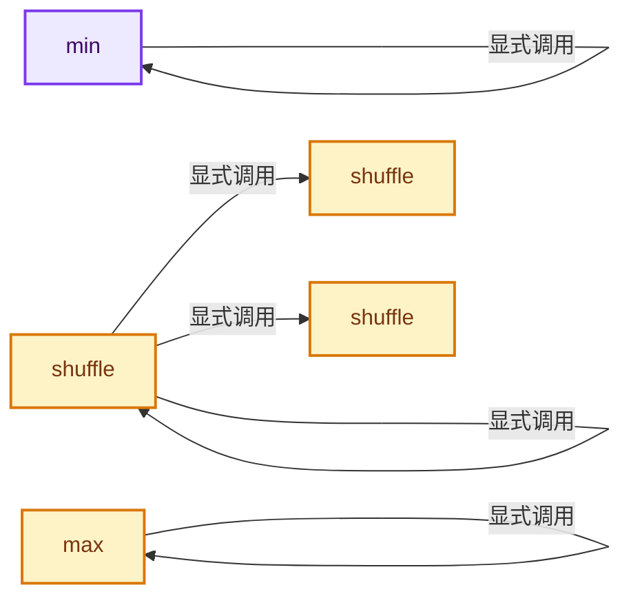
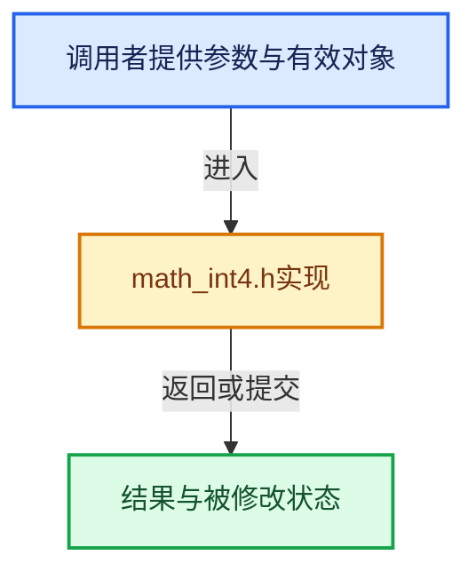

# 实现依赖专题：intern/cycles/util/math_int4.h

[方向导航](README.md) · [符号索引](../%E7%AC%A6%E5%8F%B7%E4%BE%9D%E8%B5%96%E4%B8%8E%E5%AE%9E%E7%8E%B0%E7%B4%A2%E5%BC%95.md)

本专题从正文实际调用进入，集中保存共享实现。函数有稳定锚点，可从调用处直接跳到对应完整函数；递归与互相调用通过回链组织。

## 本文件的实现关系






## 完整成员与函数实现

<a id="f-80d13bb330598f80"></a>

### `min`

实现位置：[intern/cycles/util/math_int4.h](../../../../../intern/cycles/util/math_int4.h) · L214—L221。

接口参数：

- `const int4 a`
- `const int4 b`

**教学注释版**

<!-- annotated:d828c8aaf7c999 -->

```cpp
ccl_device_inline int4 min(const int4 a, const int4 b)
{
#  if defined(__KERNEL_SSE__) && defined(__KERNEL_SSE42__)
  return int4(_mm_min_epi32(a.m128, b.m128));
#  else
  return make_int4(min(a.x, b.x), min(a.y, b.y), min(a.z, b.z), min(a.w, b.w));
#  endif
}
```

<details>
<summary>核对原始源码：intern/cycles/util/math_int4.h · L214—L221</summary>

<!-- original:d828c8aaf7c999:intern/cycles/util/math_int4.h:214:221 -->

```cpp
ccl_device_inline int4 min(const int4 a, const int4 b)
{
#  if defined(__KERNEL_SSE__) && defined(__KERNEL_SSE42__)
  return int4(_mm_min_epi32(a.m128, b.m128));
#  else
  return make_int4(min(a.x, b.x), min(a.y, b.y), min(a.z, b.z), min(a.w, b.w));
#  endif
}
```

</details>

**结果出口**

- `return int4(_mm_min_epi32(a.m128, b.m128));`
- `return make_int4(min(a.x, b.x), min(a.y, b.y), min(a.z, b.z), min(a.w, b.w));`

**继续追踪实现**

- `int4` → [int4 · L645](%E4%BE%9D%E8%B5%96-smaa-b67bc2.md#m-98b3207edab6)。宏定义由构建条件选择。
- `_mm_min_epi32` → [调用协议](../%E6%A8%A1%E6%9D%BF%E5%AE%8F%E4%B8%8E%E5%8A%A8%E6%80%81%E5%88%86%E6%B4%BE%E5%8D%8F%E8%AE%AE.md)：函数指针、局部可调用对象或未展开的宏；必须结合调用者环境。调用位置L217。
- `make_int4` → [make_int4 · L60](%E4%BE%9D%E8%B5%96-types_int4-5a7d8e.md#f-ab97557e133c890f)；[make_int4 · L70](%E4%BE%9D%E8%B5%96-types_int4-5a7d8e.md#f-60990fb5d8e34bb5)；[make_int4 · L113](%E4%BE%9D%E8%B5%96-types_float4-fe598f.md#f-28d168ed52f4eb21)；[make_int4 · L145](%E4%BE%9D%E8%B5%96-types_float3-48c65a.md#f-c407afc205585b82)。同名重载需按实参类型选择。
- `min` → [min · L214](%E4%BE%9D%E8%B5%96-math_int4-34bf39.md#f-80d13bb330598f80)。

<a id="f-5ce4cecb9a3a087a"></a>

### `max`

实现位置：[intern/cycles/util/math_int4.h](../../../../../intern/cycles/util/math_int4.h) · L223—L230。

接口参数：

- `const int4 a`
- `const int4 b`

**教学注释版**

<!-- annotated:0865f57b3e343b -->

```cpp
ccl_device_inline int4 max(const int4 a, const int4 b)
{
#  if defined(__KERNEL_SSE__) && defined(__KERNEL_SSE42__)
  return int4(_mm_max_epi32(a.m128, b.m128));
#  else
  return make_int4(max(a.x, b.x), max(a.y, b.y), max(a.z, b.z), max(a.w, b.w));
#  endif
}
```

<details>
<summary>核对原始源码：intern/cycles/util/math_int4.h · L223—L230</summary>

<!-- original:0865f57b3e343b:intern/cycles/util/math_int4.h:223:230 -->

```cpp
ccl_device_inline int4 max(const int4 a, const int4 b)
{
#  if defined(__KERNEL_SSE__) && defined(__KERNEL_SSE42__)
  return int4(_mm_max_epi32(a.m128, b.m128));
#  else
  return make_int4(max(a.x, b.x), max(a.y, b.y), max(a.z, b.z), max(a.w, b.w));
#  endif
}
```

</details>

**结果出口**

- `return int4(_mm_max_epi32(a.m128, b.m128));`
- `return make_int4(max(a.x, b.x), max(a.y, b.y), max(a.z, b.z), max(a.w, b.w));`

**继续追踪实现**

- `int4` → [int4 · L645](%E4%BE%9D%E8%B5%96-smaa-b67bc2.md#m-98b3207edab6)。宏定义由构建条件选择。
- `_mm_max_epi32` → [调用协议](../%E6%A8%A1%E6%9D%BF%E5%AE%8F%E4%B8%8E%E5%8A%A8%E6%80%81%E5%88%86%E6%B4%BE%E5%8D%8F%E8%AE%AE.md)：函数指针、局部可调用对象或未展开的宏；必须结合调用者环境。调用位置L226。
- `make_int4` → [make_int4 · L60](%E4%BE%9D%E8%B5%96-types_int4-5a7d8e.md#f-ab97557e133c890f)；[make_int4 · L70](%E4%BE%9D%E8%B5%96-types_int4-5a7d8e.md#f-60990fb5d8e34bb5)；[make_int4 · L113](%E4%BE%9D%E8%B5%96-types_float4-fe598f.md#f-28d168ed52f4eb21)；[make_int4 · L145](%E4%BE%9D%E8%B5%96-types_float3-48c65a.md#f-c407afc205585b82)。同名重载需按实参类型选择。
- `max` → [max · L223](%E4%BE%9D%E8%B5%96-math_int4-34bf39.md#f-5ce4cecb9a3a087a)。

<a id="f-5ad20144a94229f8"></a>

### `shuffle`

实现位置：[intern/cycles/util/math_int4.h](../../../../../intern/cycles/util/math_int4.h) · L273—L282。

接口参数：

- `const int4 a`

**教学注释版**

<!-- annotated:13ebe5530af82b -->

```cpp
template<size_t i0, const size_t i1, const size_t i2, const size_t i3>
ccl_device_forceinline int4 shuffle(const int4 a)
{
#  ifdef __KERNEL_NEON__
  int32x4_t result = shuffle_neon<int32x4_t, i0, i1, i2, i3>(vreinterpretq_s32_m128i(a));
  return int4(vreinterpretq_m128i_s32(result));
#  else
  return int4(_mm_shuffle_epi32(a, _MM_SHUFFLE(i3, i2, i1, i0)));
#  endif
}
```

<details>
<summary>核对原始源码：intern/cycles/util/math_int4.h · L273—L282</summary>

<!-- original:13ebe5530af82b:intern/cycles/util/math_int4.h:273:282 -->

```cpp
template<size_t i0, const size_t i1, const size_t i2, const size_t i3>
ccl_device_forceinline int4 shuffle(const int4 a)
{
#  ifdef __KERNEL_NEON__
  int32x4_t result = shuffle_neon<int32x4_t, i0, i1, i2, i3>(vreinterpretq_s32_m128i(a));
  return int4(vreinterpretq_m128i_s32(result));
#  else
  return int4(_mm_shuffle_epi32(a, _MM_SHUFFLE(i3, i2, i1, i0)));
#  endif
}
```

</details>

**结果出口**

- `return int4(vreinterpretq_m128i_s32(result));`
- `return int4(_mm_shuffle_epi32(a, _MM_SHUFFLE(i3, i2, i1, i0)));`

**继续追踪实现**

- `shuffle_neon<int32x4_t, i0, i1, i2, i3>` → [shuffle_neon · L176](%E4%BE%9D%E8%B5%96-simd-b50468.md#f-314108216374b68b)；[shuffle_neon · L202](%E4%BE%9D%E8%B5%96-simd-b50468.md#f-e81bcc281996bf36)。同名重载需按实参类型选择。
- `vreinterpretq_s32_m128i` → [调用协议](../%E6%A8%A1%E6%9D%BF%E5%AE%8F%E4%B8%8E%E5%8A%A8%E6%80%81%E5%88%86%E6%B4%BE%E5%8D%8F%E8%AE%AE.md)：函数指针、局部可调用对象或未展开的宏；必须结合调用者环境。调用位置L277。
- `int4` → [int4 · L645](%E4%BE%9D%E8%B5%96-smaa-b67bc2.md#m-98b3207edab6)。宏定义由构建条件选择。
- `vreinterpretq_m128i_s32` → [调用协议](../%E6%A8%A1%E6%9D%BF%E5%AE%8F%E4%B8%8E%E5%8A%A8%E6%80%81%E5%88%86%E6%B4%BE%E5%8D%8F%E8%AE%AE.md)：函数指针、局部可调用对象或未展开的宏；必须结合调用者环境。调用位置L278。
- `_mm_shuffle_epi32` → [调用协议](../%E6%A8%A1%E6%9D%BF%E5%AE%8F%E4%B8%8E%E5%8A%A8%E6%80%81%E5%88%86%E6%B4%BE%E5%8D%8F%E8%AE%AE.md)：函数指针、局部可调用对象或未展开的宏；必须结合调用者环境。调用位置L280。
- `_MM_SHUFFLE` → [调用协议](../%E6%A8%A1%E6%9D%BF%E5%AE%8F%E4%B8%8E%E5%8A%A8%E6%80%81%E5%88%86%E6%B4%BE%E5%8D%8F%E8%AE%AE.md)：函数指针、局部可调用对象或未展开的宏；必须结合调用者环境。调用位置L280。

<a id="f-f72024a6e1e087d9"></a>

### `shuffle`

实现位置：[intern/cycles/util/math_int4.h](../../../../../intern/cycles/util/math_int4.h) · L284—L295。

接口参数：

- `const int4 a`
- `const int4 b`

**教学注释版**

<!-- annotated:38a544c2a9910b -->

```cpp
template<size_t i0, const size_t i1, const size_t i2, const size_t i3>
ccl_device_forceinline int4 shuffle(const int4 a, const int4 b)
{
#  ifdef __KERNEL_NEON__
  int32x4_t result = shuffle_neon<int32x4_t, i0, i1, i2, i3>(vreinterpretq_s32_m128i(a),
                                                             vreinterpretq_s32_m128i(b));
  return int4(vreinterpretq_m128i_s32(result));
#  else
  return int4(_mm_castps_si128(
      _mm_shuffle_ps(_mm_castsi128_ps(a), _mm_castsi128_ps(b), _MM_SHUFFLE(i3, i2, i1, i0))));
#  endif
}
```

<details>
<summary>核对原始源码：intern/cycles/util/math_int4.h · L284—L295</summary>

<!-- original:38a544c2a9910b:intern/cycles/util/math_int4.h:284:295 -->

```cpp
template<size_t i0, const size_t i1, const size_t i2, const size_t i3>
ccl_device_forceinline int4 shuffle(const int4 a, const int4 b)
{
#  ifdef __KERNEL_NEON__
  int32x4_t result = shuffle_neon<int32x4_t, i0, i1, i2, i3>(vreinterpretq_s32_m128i(a),
                                                             vreinterpretq_s32_m128i(b));
  return int4(vreinterpretq_m128i_s32(result));
#  else
  return int4(_mm_castps_si128(
      _mm_shuffle_ps(_mm_castsi128_ps(a), _mm_castsi128_ps(b), _MM_SHUFFLE(i3, i2, i1, i0))));
#  endif
}
```

</details>

**结果出口**

- `return int4(vreinterpretq_m128i_s32(result));`
- `return int4(_mm_castps_si128(`

**继续追踪实现**

- `shuffle_neon<int32x4_t, i0, i1, i2, i3>` → [shuffle_neon · L176](%E4%BE%9D%E8%B5%96-simd-b50468.md#f-314108216374b68b)；[shuffle_neon · L202](%E4%BE%9D%E8%B5%96-simd-b50468.md#f-e81bcc281996bf36)。同名重载需按实参类型选择。
- `vreinterpretq_s32_m128i` → [调用协议](../%E6%A8%A1%E6%9D%BF%E5%AE%8F%E4%B8%8E%E5%8A%A8%E6%80%81%E5%88%86%E6%B4%BE%E5%8D%8F%E8%AE%AE.md)：函数指针、局部可调用对象或未展开的宏；必须结合调用者环境。调用位置L288。
- `int4` → [int4 · L645](%E4%BE%9D%E8%B5%96-smaa-b67bc2.md#m-98b3207edab6)。宏定义由构建条件选择。
- `vreinterpretq_m128i_s32` → [调用协议](../%E6%A8%A1%E6%9D%BF%E5%AE%8F%E4%B8%8E%E5%8A%A8%E6%80%81%E5%88%86%E6%B4%BE%E5%8D%8F%E8%AE%AE.md)：函数指针、局部可调用对象或未展开的宏；必须结合调用者环境。调用位置L290。
- `_mm_castps_si128` → [调用协议](../%E6%A8%A1%E6%9D%BF%E5%AE%8F%E4%B8%8E%E5%8A%A8%E6%80%81%E5%88%86%E6%B4%BE%E5%8D%8F%E8%AE%AE.md)：函数指针、局部可调用对象或未展开的宏；必须结合调用者环境。调用位置L292。
- `_mm_shuffle_ps` → [调用协议](../%E6%A8%A1%E6%9D%BF%E5%AE%8F%E4%B8%8E%E5%8A%A8%E6%80%81%E5%88%86%E6%B4%BE%E5%8D%8F%E8%AE%AE.md)：函数指针、局部可调用对象或未展开的宏；必须结合调用者环境。调用位置L293。
- `_mm_castsi128_ps` → [调用协议](../%E6%A8%A1%E6%9D%BF%E5%AE%8F%E4%B8%8E%E5%8A%A8%E6%80%81%E5%88%86%E6%B4%BE%E5%8D%8F%E8%AE%AE.md)：函数指针、局部可调用对象或未展开的宏；必须结合调用者环境。调用位置L293。
- `_MM_SHUFFLE` → [调用协议](../%E6%A8%A1%E6%9D%BF%E5%AE%8F%E4%B8%8E%E5%8A%A8%E6%80%81%E5%88%86%E6%B4%BE%E5%8D%8F%E8%AE%AE.md)：函数指针、局部可调用对象或未展开的宏；必须结合调用者环境。调用位置L293。

<a id="f-cad30e076ef9298e"></a>

### `shuffle`

实现位置：[intern/cycles/util/math_int4.h](../../../../../intern/cycles/util/math_int4.h) · L297—L300。

接口参数：

- `const int4 b`

**教学注释版**

<!-- annotated:07207b0b78a2fb -->

```cpp
template<size_t i0> ccl_device_forceinline int4 shuffle(const int4 b)
{
  return shuffle<i0, i0, i0, i0>(b);
}
```

<details>
<summary>核对原始源码：intern/cycles/util/math_int4.h · L297—L300</summary>

<!-- original:07207b0b78a2fb:intern/cycles/util/math_int4.h:297:300 -->

```cpp
template<size_t i0> ccl_device_forceinline int4 shuffle(const int4 b)
{
  return shuffle<i0, i0, i0, i0>(b);
}
```

</details>

**结果出口**

- `return shuffle<i0, i0, i0, i0>(b);`

**继续追踪实现**

- `shuffle<i0, i0, i0, i0>` → [shuffle · L273](%E4%BE%9D%E8%B5%96-math_int4-34bf39.md#f-5ad20144a94229f8)；[shuffle · L284](%E4%BE%9D%E8%B5%96-math_int4-34bf39.md#f-f72024a6e1e087d9)；[shuffle · L297](%E4%BE%9D%E8%B5%96-math_int4-34bf39.md#f-cad30e076ef9298e)。同名重载需按实参类型选择。
