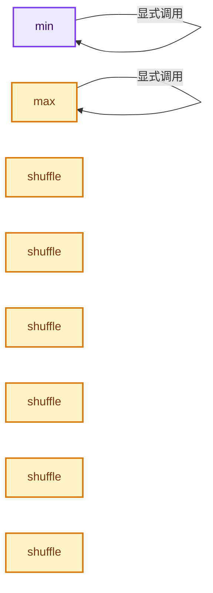
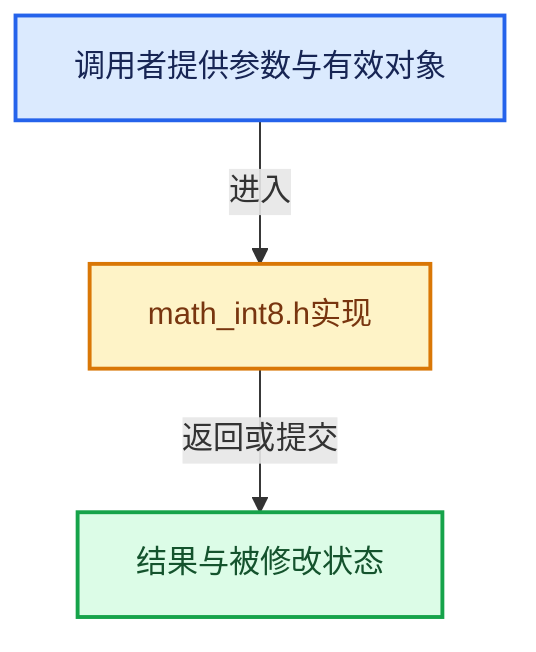

# 实现依赖专题：intern/cycles/util/math_int8.h

[方向导航](README.md) · [符号索引](../%E7%AC%A6%E5%8F%B7%E4%BE%9D%E8%B5%96%E4%B8%8E%E5%AE%9E%E7%8E%B0%E7%B4%A2%E5%BC%95.md)

本专题从正文实际调用进入，集中保存共享实现。函数有稳定锚点，可从调用处直接跳到对应完整函数；递归与互相调用通过回链组织。

## 本文件的实现关系






## 完整成员与函数实现

<a id="f-400011938c4cd2cd"></a>

### `min`

实现位置：[intern/cycles/util/math_int8.h](../../../../../intern/cycles/util/math_int8.h) · L226—L240。

接口参数：

- `vint8 a`
- `vint8 b`

**教学注释版**

<!-- annotated:203291e18c3bf6 -->

```cpp
ccl_device_inline vint8 min(vint8 a, vint8 b)
{
#  if defined(__KERNEL_AVX__) && defined(__KERNEL_AVX41__)
  return vint8(_mm256_min_epi32(a.m256, b.m256));
#  else
  return make_vint8(min(a.a, b.a),
                    min(a.b, b.b),
                    min(a.c, b.c),
                    min(a.d, b.d),
                    min(a.e, b.e),
                    min(a.f, b.f),
                    min(a.g, b.g),
                    min(a.h, b.h));
#  endif
}
```

<details>
<summary>核对原始源码：intern/cycles/util/math_int8.h · L226—L240</summary>

<!-- original:203291e18c3bf6:intern/cycles/util/math_int8.h:226:240 -->

```cpp
ccl_device_inline vint8 min(vint8 a, vint8 b)
{
#  if defined(__KERNEL_AVX__) && defined(__KERNEL_AVX41__)
  return vint8(_mm256_min_epi32(a.m256, b.m256));
#  else
  return make_vint8(min(a.a, b.a),
                    min(a.b, b.b),
                    min(a.c, b.c),
                    min(a.d, b.d),
                    min(a.e, b.e),
                    min(a.f, b.f),
                    min(a.g, b.g),
                    min(a.h, b.h));
#  endif
}
```

</details>

**结果出口**

- `return vint8(_mm256_min_epi32(a.m256, b.m256));`
- `return make_vint8(min(a.a, b.a),`

**继续追踪实现**

- `vint8` → [vint8 · L28](%E4%BE%9D%E8%B5%96-types_int8-f5dcfc.md#f-759902d0720c104d)；[vint8 · L29](%E4%BE%9D%E8%B5%96-types_int8-f5dcfc.md#f-081c9716e2fec522)；[vint8 · L30](%E4%BE%9D%E8%B5%96-types_int8-f5dcfc.md#f-feb9d679504529e9)。同名重载需按实参类型选择。
- `_mm256_min_epi32` → [调用协议](../%E6%A8%A1%E6%9D%BF%E5%AE%8F%E4%B8%8E%E5%8A%A8%E6%80%81%E5%88%86%E6%B4%BE%E5%8D%8F%E8%AE%AE.md)：函数指针、局部可调用对象或未展开的宏；必须结合调用者环境。调用位置L229。
- `make_vint8` → [make_vint8 · L66](%E4%BE%9D%E8%B5%96-types_int8-f5dcfc.md#f-90569d387963ae8e)；[make_vint8 · L76](%E4%BE%9D%E8%B5%96-types_int8-f5dcfc.md#f-8d871b1066a69f10)；[make_vint8 · L85](%E4%BE%9D%E8%B5%96-types_int8-f5dcfc.md#f-bceeb0aa08937ec3)；[make_vint8 · L124](%E4%BE%9D%E8%B5%96-types_float8-8fe1c9.md#f-35b4ba58a2246c63)。同名重载需按实参类型选择。
- `min` → [min · L226](%E4%BE%9D%E8%B5%96-math_int8-80ce43.md#f-400011938c4cd2cd)。

<a id="f-e1400b85f504d6d4"></a>

### `max`

实现位置：[intern/cycles/util/math_int8.h](../../../../../intern/cycles/util/math_int8.h) · L242—L256。

接口参数：

- `vint8 a`
- `vint8 b`

**教学注释版**

<!-- annotated:16a582cc0f999c -->

```cpp
ccl_device_inline vint8 max(vint8 a, vint8 b)
{
#  if defined(__KERNEL_AVX__) && defined(__KERNEL_AVX41__)
  return vint8(_mm256_max_epi32(a.m256, b.m256));
#  else
  return make_vint8(max(a.a, b.a),
                    max(a.b, b.b),
                    max(a.c, b.c),
                    max(a.d, b.d),
                    max(a.e, b.e),
                    max(a.f, b.f),
                    max(a.g, b.g),
                    max(a.h, b.h));
#  endif
}
```

<details>
<summary>核对原始源码：intern/cycles/util/math_int8.h · L242—L256</summary>

<!-- original:16a582cc0f999c:intern/cycles/util/math_int8.h:242:256 -->

```cpp
ccl_device_inline vint8 max(vint8 a, vint8 b)
{
#  if defined(__KERNEL_AVX__) && defined(__KERNEL_AVX41__)
  return vint8(_mm256_max_epi32(a.m256, b.m256));
#  else
  return make_vint8(max(a.a, b.a),
                    max(a.b, b.b),
                    max(a.c, b.c),
                    max(a.d, b.d),
                    max(a.e, b.e),
                    max(a.f, b.f),
                    max(a.g, b.g),
                    max(a.h, b.h));
#  endif
}
```

</details>

**结果出口**

- `return vint8(_mm256_max_epi32(a.m256, b.m256));`
- `return make_vint8(max(a.a, b.a),`

**继续追踪实现**

- `vint8` → [vint8 · L28](%E4%BE%9D%E8%B5%96-types_int8-f5dcfc.md#f-759902d0720c104d)；[vint8 · L29](%E4%BE%9D%E8%B5%96-types_int8-f5dcfc.md#f-081c9716e2fec522)；[vint8 · L30](%E4%BE%9D%E8%B5%96-types_int8-f5dcfc.md#f-feb9d679504529e9)。同名重载需按实参类型选择。
- `_mm256_max_epi32` → [调用协议](../%E6%A8%A1%E6%9D%BF%E5%AE%8F%E4%B8%8E%E5%8A%A8%E6%80%81%E5%88%86%E6%B4%BE%E5%8D%8F%E8%AE%AE.md)：函数指针、局部可调用对象或未展开的宏；必须结合调用者环境。调用位置L245。
- `make_vint8` → [make_vint8 · L66](%E4%BE%9D%E8%B5%96-types_int8-f5dcfc.md#f-90569d387963ae8e)；[make_vint8 · L76](%E4%BE%9D%E8%B5%96-types_int8-f5dcfc.md#f-8d871b1066a69f10)；[make_vint8 · L85](%E4%BE%9D%E8%B5%96-types_int8-f5dcfc.md#f-bceeb0aa08937ec3)；[make_vint8 · L124](%E4%BE%9D%E8%B5%96-types_float8-8fe1c9.md#f-35b4ba58a2246c63)。同名重载需按实参类型选择。
- `max` → [max · L242](%E4%BE%9D%E8%B5%96-math_int8-80ce43.md#f-e1400b85f504d6d4)。

<a id="f-4e96e4a5bb775d9d"></a>

### `shuffle`

实现位置：[intern/cycles/util/math_int8.h](../../../../../intern/cycles/util/math_int8.h) · L307—L311。

接口参数：

- `const vint8 a`

**教学注释版**

<!-- annotated:349b8f8abcc3f4 -->

```cpp
template<size_t i> const ccl_device_forceinline vint8 shuffle(const vint8 a)
{
  return vint8(
      _mm256_castps_si256(_mm256_permute_ps(_mm256_castsi256_ps(a), _MM_SHUFFLE(i, i, i, i))));
}
```

<details>
<summary>核对原始源码：intern/cycles/util/math_int8.h · L307—L311</summary>

<!-- original:349b8f8abcc3f4:intern/cycles/util/math_int8.h:307:311 -->

```cpp
template<size_t i> const ccl_device_forceinline vint8 shuffle(const vint8 a)
{
  return vint8(
      _mm256_castps_si256(_mm256_permute_ps(_mm256_castsi256_ps(a), _MM_SHUFFLE(i, i, i, i))));
}
```

</details>

**结果出口**

- `return vint8(`

**继续追踪实现**

- `vint8` → [vint8 · L28](%E4%BE%9D%E8%B5%96-types_int8-f5dcfc.md#f-759902d0720c104d)；[vint8 · L29](%E4%BE%9D%E8%B5%96-types_int8-f5dcfc.md#f-081c9716e2fec522)；[vint8 · L30](%E4%BE%9D%E8%B5%96-types_int8-f5dcfc.md#f-feb9d679504529e9)。同名重载需按实参类型选择。
- `_mm256_castps_si256` → [调用协议](../%E6%A8%A1%E6%9D%BF%E5%AE%8F%E4%B8%8E%E5%8A%A8%E6%80%81%E5%88%86%E6%B4%BE%E5%8D%8F%E8%AE%AE.md)：函数指针、局部可调用对象或未展开的宏；必须结合调用者环境。调用位置L310。
- `_mm256_permute_ps` → [调用协议](../%E6%A8%A1%E6%9D%BF%E5%AE%8F%E4%B8%8E%E5%8A%A8%E6%80%81%E5%88%86%E6%B4%BE%E5%8D%8F%E8%AE%AE.md)：函数指针、局部可调用对象或未展开的宏；必须结合调用者环境。调用位置L310。
- `_mm256_castsi256_ps` → [调用协议](../%E6%A8%A1%E6%9D%BF%E5%AE%8F%E4%B8%8E%E5%8A%A8%E6%80%81%E5%88%86%E6%B4%BE%E5%8D%8F%E8%AE%AE.md)：函数指针、局部可调用对象或未展开的宏；必须结合调用者环境。调用位置L310。
- `_MM_SHUFFLE` → [调用协议](../%E6%A8%A1%E6%9D%BF%E5%AE%8F%E4%B8%8E%E5%8A%A8%E6%80%81%E5%88%86%E6%B4%BE%E5%8D%8F%E8%AE%AE.md)：函数指针、局部可调用对象或未展开的宏；必须结合调用者环境。调用位置L310。

<a id="f-1494d2d2828a50ea"></a>

### `shuffle`

实现位置：[intern/cycles/util/math_int8.h](../../../../../intern/cycles/util/math_int8.h) · L313—L316。

接口参数：

- `const vint8 a`

**教学注释版**

<!-- annotated:92d1b6c755d0be -->

```cpp
template<size_t i0, const size_t i1> const ccl_device_forceinline vint8 shuffle(const vint8 a)
{
  return vint8(_mm256_permute2f128_si256(a, a, (i1 << 4) | (i0 << 0)));
}
```

<details>
<summary>核对原始源码：intern/cycles/util/math_int8.h · L313—L316</summary>

<!-- original:92d1b6c755d0be:intern/cycles/util/math_int8.h:313:316 -->

```cpp
template<size_t i0, const size_t i1> const ccl_device_forceinline vint8 shuffle(const vint8 a)
{
  return vint8(_mm256_permute2f128_si256(a, a, (i1 << 4) | (i0 << 0)));
}
```

</details>

**结果出口**

- `return vint8(_mm256_permute2f128_si256(a, a, (i1 << 4) | (i0 << 0)));`

**继续追踪实现**

- `vint8` → [vint8 · L28](%E4%BE%9D%E8%B5%96-types_int8-f5dcfc.md#f-759902d0720c104d)；[vint8 · L29](%E4%BE%9D%E8%B5%96-types_int8-f5dcfc.md#f-081c9716e2fec522)；[vint8 · L30](%E4%BE%9D%E8%B5%96-types_int8-f5dcfc.md#f-feb9d679504529e9)。同名重载需按实参类型选择。
- `_mm256_permute2f128_si256` → [调用协议](../%E6%A8%A1%E6%9D%BF%E5%AE%8F%E4%B8%8E%E5%8A%A8%E6%80%81%E5%88%86%E6%B4%BE%E5%8D%8F%E8%AE%AE.md)：函数指针、局部可调用对象或未展开的宏；必须结合调用者环境。调用位置L315。

<a id="f-dfdd2ebc1f3110d2"></a>

### `shuffle`

实现位置：[intern/cycles/util/math_int8.h](../../../../../intern/cycles/util/math_int8.h) · L318—L322。

接口参数：

- `const vint8 a`
- `const vint8 b`

**教学注释版**

<!-- annotated:a70ea04d08ada7 -->

```cpp
template<size_t i0, const size_t i1>
const ccl_device_forceinline vint8 shuffle(const vint8 a, const vint8 b)
{
  return vint8(_mm256_permute2f128_si256(a, b, (i1 << 4) | (i0 << 0)));
}
```

<details>
<summary>核对原始源码：intern/cycles/util/math_int8.h · L318—L322</summary>

<!-- original:a70ea04d08ada7:intern/cycles/util/math_int8.h:318:322 -->

```cpp
template<size_t i0, const size_t i1>
const ccl_device_forceinline vint8 shuffle(const vint8 a, const vint8 b)
{
  return vint8(_mm256_permute2f128_si256(a, b, (i1 << 4) | (i0 << 0)));
}
```

</details>

**结果出口**

- `return vint8(_mm256_permute2f128_si256(a, b, (i1 << 4) | (i0 << 0)));`

**继续追踪实现**

- `vint8` → [vint8 · L28](%E4%BE%9D%E8%B5%96-types_int8-f5dcfc.md#f-759902d0720c104d)；[vint8 · L29](%E4%BE%9D%E8%B5%96-types_int8-f5dcfc.md#f-081c9716e2fec522)；[vint8 · L30](%E4%BE%9D%E8%B5%96-types_int8-f5dcfc.md#f-feb9d679504529e9)。同名重载需按实参类型选择。
- `_mm256_permute2f128_si256` → [调用协议](../%E6%A8%A1%E6%9D%BF%E5%AE%8F%E4%B8%8E%E5%8A%A8%E6%80%81%E5%88%86%E6%B4%BE%E5%8D%8F%E8%AE%AE.md)：函数指针、局部可调用对象或未展开的宏；必须结合调用者环境。调用位置L321。

<a id="f-307e12847ba5ab8e"></a>

### `shuffle`

实现位置：[intern/cycles/util/math_int8.h](../../../../../intern/cycles/util/math_int8.h) · L324—L329。

接口参数：

- `const vint8 a`

**教学注释版**

<!-- annotated:90cc2b97c9f8a2 -->

```cpp
template<size_t i0, const size_t i1, const size_t i2, const size_t i3>
const ccl_device_forceinline vint8 shuffle(const vint8 a)
{
  return vint8(
      _mm256_castps_si256(_mm256_permute_ps(_mm256_castsi256_ps(a), _MM_SHUFFLE(i3, i2, i1, i0))));
}
```

<details>
<summary>核对原始源码：intern/cycles/util/math_int8.h · L324—L329</summary>

<!-- original:90cc2b97c9f8a2:intern/cycles/util/math_int8.h:324:329 -->

```cpp
template<size_t i0, const size_t i1, const size_t i2, const size_t i3>
const ccl_device_forceinline vint8 shuffle(const vint8 a)
{
  return vint8(
      _mm256_castps_si256(_mm256_permute_ps(_mm256_castsi256_ps(a), _MM_SHUFFLE(i3, i2, i1, i0))));
}
```

</details>

**结果出口**

- `return vint8(`

**继续追踪实现**

- `vint8` → [vint8 · L28](%E4%BE%9D%E8%B5%96-types_int8-f5dcfc.md#f-759902d0720c104d)；[vint8 · L29](%E4%BE%9D%E8%B5%96-types_int8-f5dcfc.md#f-081c9716e2fec522)；[vint8 · L30](%E4%BE%9D%E8%B5%96-types_int8-f5dcfc.md#f-feb9d679504529e9)。同名重载需按实参类型选择。
- `_mm256_castps_si256` → [调用协议](../%E6%A8%A1%E6%9D%BF%E5%AE%8F%E4%B8%8E%E5%8A%A8%E6%80%81%E5%88%86%E6%B4%BE%E5%8D%8F%E8%AE%AE.md)：函数指针、局部可调用对象或未展开的宏；必须结合调用者环境。调用位置L328。
- `_mm256_permute_ps` → [调用协议](../%E6%A8%A1%E6%9D%BF%E5%AE%8F%E4%B8%8E%E5%8A%A8%E6%80%81%E5%88%86%E6%B4%BE%E5%8D%8F%E8%AE%AE.md)：函数指针、局部可调用对象或未展开的宏；必须结合调用者环境。调用位置L328。
- `_mm256_castsi256_ps` → [调用协议](../%E6%A8%A1%E6%9D%BF%E5%AE%8F%E4%B8%8E%E5%8A%A8%E6%80%81%E5%88%86%E6%B4%BE%E5%8D%8F%E8%AE%AE.md)：函数指针、局部可调用对象或未展开的宏；必须结合调用者环境。调用位置L328。
- `_MM_SHUFFLE` → [调用协议](../%E6%A8%A1%E6%9D%BF%E5%AE%8F%E4%B8%8E%E5%8A%A8%E6%80%81%E5%88%86%E6%B4%BE%E5%8D%8F%E8%AE%AE.md)：函数指针、局部可调用对象或未展开的宏；必须结合调用者环境。调用位置L328。

<a id="f-435867ee373d570b"></a>

### `shuffle`

实现位置：[intern/cycles/util/math_int8.h](../../../../../intern/cycles/util/math_int8.h) · L331—L336。

接口参数：

- `const vint8 a`
- `const vint8 b`

**教学注释版**

<!-- annotated:a9acc030515aac -->

```cpp
template<size_t i0, const size_t i1, const size_t i2, const size_t i3>
const ccl_device_forceinline vint8 shuffle(const vint8 a, const vint8 b)
{
  return vint8(_mm256_castps_si256(_mm256_shuffle_ps(
      _mm256_castsi256_ps(a), _mm256_castsi256_ps(b), _MM_SHUFFLE(i3, i2, i1, i0))));
}
```

<details>
<summary>核对原始源码：intern/cycles/util/math_int8.h · L331—L336</summary>

<!-- original:a9acc030515aac:intern/cycles/util/math_int8.h:331:336 -->

```cpp
template<size_t i0, const size_t i1, const size_t i2, const size_t i3>
const ccl_device_forceinline vint8 shuffle(const vint8 a, const vint8 b)
{
  return vint8(_mm256_castps_si256(_mm256_shuffle_ps(
      _mm256_castsi256_ps(a), _mm256_castsi256_ps(b), _MM_SHUFFLE(i3, i2, i1, i0))));
}
```

</details>

**结果出口**

- `return vint8(_mm256_castps_si256(_mm256_shuffle_ps(`

**继续追踪实现**

- `vint8` → [vint8 · L28](%E4%BE%9D%E8%B5%96-types_int8-f5dcfc.md#f-759902d0720c104d)；[vint8 · L29](%E4%BE%9D%E8%B5%96-types_int8-f5dcfc.md#f-081c9716e2fec522)；[vint8 · L30](%E4%BE%9D%E8%B5%96-types_int8-f5dcfc.md#f-feb9d679504529e9)。同名重载需按实参类型选择。
- `_mm256_castps_si256` → [调用协议](../%E6%A8%A1%E6%9D%BF%E5%AE%8F%E4%B8%8E%E5%8A%A8%E6%80%81%E5%88%86%E6%B4%BE%E5%8D%8F%E8%AE%AE.md)：函数指针、局部可调用对象或未展开的宏；必须结合调用者环境。调用位置L334。
- `_mm256_shuffle_ps` → [调用协议](../%E6%A8%A1%E6%9D%BF%E5%AE%8F%E4%B8%8E%E5%8A%A8%E6%80%81%E5%88%86%E6%B4%BE%E5%8D%8F%E8%AE%AE.md)：函数指针、局部可调用对象或未展开的宏；必须结合调用者环境。调用位置L334。
- `_mm256_castsi256_ps` → [调用协议](../%E6%A8%A1%E6%9D%BF%E5%AE%8F%E4%B8%8E%E5%8A%A8%E6%80%81%E5%88%86%E6%B4%BE%E5%8D%8F%E8%AE%AE.md)：函数指针、局部可调用对象或未展开的宏；必须结合调用者环境。调用位置L335。
- `_MM_SHUFFLE` → [调用协议](../%E6%A8%A1%E6%9D%BF%E5%AE%8F%E4%B8%8E%E5%8A%A8%E6%80%81%E5%88%86%E6%B4%BE%E5%8D%8F%E8%AE%AE.md)：函数指针、局部可调用对象或未展开的宏；必须结合调用者环境。调用位置L335。

<a id="f-826dec998cc2dddb"></a>

### `shuffle`

实现位置：[intern/cycles/util/math_int8.h](../../../../../intern/cycles/util/math_int8.h) · L338—L341。

接口参数：

- `const vint8 b`

**教学注释版**

<!-- annotated:482c7a46a3708f -->

```cpp
template<> __forceinline const vint8 shuffle<0, 0, 2, 2>(const vint8 b)
{
  return vint8(_mm256_castps_si256(_mm256_moveldup_ps(_mm256_castsi256_ps(b))));
}
```

<details>
<summary>核对原始源码：intern/cycles/util/math_int8.h · L338—L341</summary>

<!-- original:482c7a46a3708f:intern/cycles/util/math_int8.h:338:341 -->

```cpp
template<> __forceinline const vint8 shuffle<0, 0, 2, 2>(const vint8 b)
{
  return vint8(_mm256_castps_si256(_mm256_moveldup_ps(_mm256_castsi256_ps(b))));
}
```

</details>

**结果出口**

- `return vint8(_mm256_castps_si256(_mm256_moveldup_ps(_mm256_castsi256_ps(b))));`

**继续追踪实现**

- `vint8` → [vint8 · L28](%E4%BE%9D%E8%B5%96-types_int8-f5dcfc.md#f-759902d0720c104d)；[vint8 · L29](%E4%BE%9D%E8%B5%96-types_int8-f5dcfc.md#f-081c9716e2fec522)；[vint8 · L30](%E4%BE%9D%E8%B5%96-types_int8-f5dcfc.md#f-feb9d679504529e9)。同名重载需按实参类型选择。
- `_mm256_castps_si256` → [调用协议](../%E6%A8%A1%E6%9D%BF%E5%AE%8F%E4%B8%8E%E5%8A%A8%E6%80%81%E5%88%86%E6%B4%BE%E5%8D%8F%E8%AE%AE.md)：函数指针、局部可调用对象或未展开的宏；必须结合调用者环境。调用位置L340。
- `_mm256_moveldup_ps` → [调用协议](../%E6%A8%A1%E6%9D%BF%E5%AE%8F%E4%B8%8E%E5%8A%A8%E6%80%81%E5%88%86%E6%B4%BE%E5%8D%8F%E8%AE%AE.md)：函数指针、局部可调用对象或未展开的宏；必须结合调用者环境。调用位置L340。
- `_mm256_castsi256_ps` → [调用协议](../%E6%A8%A1%E6%9D%BF%E5%AE%8F%E4%B8%8E%E5%8A%A8%E6%80%81%E5%88%86%E6%B4%BE%E5%8D%8F%E8%AE%AE.md)：函数指针、局部可调用对象或未展开的宏；必须结合调用者环境。调用位置L340。

<a id="f-1e3d1a67200101b1"></a>

### `shuffle`

实现位置：[intern/cycles/util/math_int8.h](../../../../../intern/cycles/util/math_int8.h) · L342—L345。

接口参数：

- `const vint8 b`

**教学注释版**

<!-- annotated:bb7f828b467271 -->

```cpp
template<> __forceinline const vint8 shuffle<1, 1, 3, 3>(const vint8 b)
{
  return vint8(_mm256_castps_si256(_mm256_movehdup_ps(_mm256_castsi256_ps(b))));
}
```

<details>
<summary>核对原始源码：intern/cycles/util/math_int8.h · L342—L345</summary>

<!-- original:bb7f828b467271:intern/cycles/util/math_int8.h:342:345 -->

```cpp
template<> __forceinline const vint8 shuffle<1, 1, 3, 3>(const vint8 b)
{
  return vint8(_mm256_castps_si256(_mm256_movehdup_ps(_mm256_castsi256_ps(b))));
}
```

</details>

**结果出口**

- `return vint8(_mm256_castps_si256(_mm256_movehdup_ps(_mm256_castsi256_ps(b))));`

**继续追踪实现**

- `vint8` → [vint8 · L28](%E4%BE%9D%E8%B5%96-types_int8-f5dcfc.md#f-759902d0720c104d)；[vint8 · L29](%E4%BE%9D%E8%B5%96-types_int8-f5dcfc.md#f-081c9716e2fec522)；[vint8 · L30](%E4%BE%9D%E8%B5%96-types_int8-f5dcfc.md#f-feb9d679504529e9)。同名重载需按实参类型选择。
- `_mm256_castps_si256` → [调用协议](../%E6%A8%A1%E6%9D%BF%E5%AE%8F%E4%B8%8E%E5%8A%A8%E6%80%81%E5%88%86%E6%B4%BE%E5%8D%8F%E8%AE%AE.md)：函数指针、局部可调用对象或未展开的宏；必须结合调用者环境。调用位置L344。
- `_mm256_movehdup_ps` → [调用协议](../%E6%A8%A1%E6%9D%BF%E5%AE%8F%E4%B8%8E%E5%8A%A8%E6%80%81%E5%88%86%E6%B4%BE%E5%8D%8F%E8%AE%AE.md)：函数指针、局部可调用对象或未展开的宏；必须结合调用者环境。调用位置L344。
- `_mm256_castsi256_ps` → [调用协议](../%E6%A8%A1%E6%9D%BF%E5%AE%8F%E4%B8%8E%E5%8A%A8%E6%80%81%E5%88%86%E6%B4%BE%E5%8D%8F%E8%AE%AE.md)：函数指针、局部可调用对象或未展开的宏；必须结合调用者环境。调用位置L344。

<a id="f-520189eab29f5c61"></a>

### `shuffle`

实现位置：[intern/cycles/util/math_int8.h](../../../../../intern/cycles/util/math_int8.h) · L346—L350。

接口参数：

- `const vint8 b`

**教学注释版**

<!-- annotated:843d0c4500797c -->

```cpp
template<> __forceinline const vint8 shuffle<0, 1, 0, 1>(const vint8 b)
{
  return vint8(_mm256_castps_si256(
      _mm256_castpd_ps(_mm256_movedup_pd(_mm256_castps_pd(_mm256_castsi256_ps(b))))));
}
```

<details>
<summary>核对原始源码：intern/cycles/util/math_int8.h · L346—L350</summary>

<!-- original:843d0c4500797c:intern/cycles/util/math_int8.h:346:350 -->

```cpp
template<> __forceinline const vint8 shuffle<0, 1, 0, 1>(const vint8 b)
{
  return vint8(_mm256_castps_si256(
      _mm256_castpd_ps(_mm256_movedup_pd(_mm256_castps_pd(_mm256_castsi256_ps(b))))));
}
```

</details>

**结果出口**

- `return vint8(_mm256_castps_si256(`

**继续追踪实现**

- `vint8` → [vint8 · L28](%E4%BE%9D%E8%B5%96-types_int8-f5dcfc.md#f-759902d0720c104d)；[vint8 · L29](%E4%BE%9D%E8%B5%96-types_int8-f5dcfc.md#f-081c9716e2fec522)；[vint8 · L30](%E4%BE%9D%E8%B5%96-types_int8-f5dcfc.md#f-feb9d679504529e9)。同名重载需按实参类型选择。
- `_mm256_castps_si256` → [调用协议](../%E6%A8%A1%E6%9D%BF%E5%AE%8F%E4%B8%8E%E5%8A%A8%E6%80%81%E5%88%86%E6%B4%BE%E5%8D%8F%E8%AE%AE.md)：函数指针、局部可调用对象或未展开的宏；必须结合调用者环境。调用位置L348。
- `_mm256_castpd_ps` → [调用协议](../%E6%A8%A1%E6%9D%BF%E5%AE%8F%E4%B8%8E%E5%8A%A8%E6%80%81%E5%88%86%E6%B4%BE%E5%8D%8F%E8%AE%AE.md)：函数指针、局部可调用对象或未展开的宏；必须结合调用者环境。调用位置L349。
- `_mm256_movedup_pd` → [调用协议](../%E6%A8%A1%E6%9D%BF%E5%AE%8F%E4%B8%8E%E5%8A%A8%E6%80%81%E5%88%86%E6%B4%BE%E5%8D%8F%E8%AE%AE.md)：函数指针、局部可调用对象或未展开的宏；必须结合调用者环境。调用位置L349。
- `_mm256_castps_pd` → [调用协议](../%E6%A8%A1%E6%9D%BF%E5%AE%8F%E4%B8%8E%E5%8A%A8%E6%80%81%E5%88%86%E6%B4%BE%E5%8D%8F%E8%AE%AE.md)：函数指针、局部可调用对象或未展开的宏；必须结合调用者环境。调用位置L349。
- `_mm256_castsi256_ps` → [调用协议](../%E6%A8%A1%E6%9D%BF%E5%AE%8F%E4%B8%8E%E5%8A%A8%E6%80%81%E5%88%86%E6%B4%BE%E5%8D%8F%E8%AE%AE.md)：函数指针、局部可调用对象或未展开的宏；必须结合调用者环境。调用位置L349。
