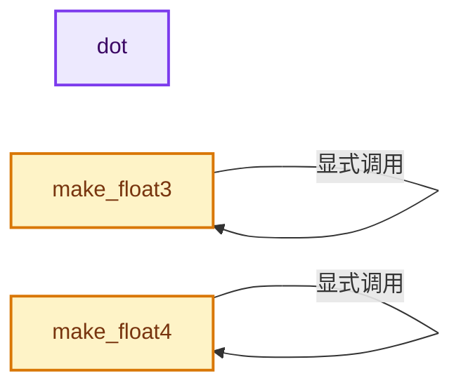

# 实现依赖专题：intern/cycles/util/math_quaternion.h

[方向导航](README.md) · [符号索引](../%E7%AC%A6%E5%8F%B7%E4%BE%9D%E8%B5%96%E4%B8%8E%E5%AE%9E%E7%8E%B0%E7%B4%A2%E5%BC%95.md)

本专题从正文实际调用进入，集中保存共享实现。函数有稳定锚点，可从调用处直接跳到对应完整函数；递归与互相调用通过回链组织。

## 本文件的实现关系




## 完整成员与函数实现

<a id="f-e434705e781b49d6"></a>

### `dot`

实现位置：[intern/cycles/util/math_quaternion.h](../../../../../intern/cycles/util/math_quaternion.h) · L50—L53。

接口参数：

- `const Quaternion a`
- `const Quaternion b`

**教学注释版**

<!-- annotated:1c9b21d25922bf -->

```cpp
ccl_device_inline float dot(const Quaternion a, const Quaternion b)
{
  return a.w * b.w + a.x * b.x + a.y * b.y + a.z * b.z;
}
```

<details>
<summary>核对原始源码：intern/cycles/util/math_quaternion.h · L50—L53</summary>

<!-- original:1c9b21d25922bf:intern/cycles/util/math_quaternion.h:50:53 -->

```cpp
ccl_device_inline float dot(const Quaternion a, const Quaternion b)
{
  return a.w * b.w + a.x * b.x + a.y * b.y + a.z * b.z;
}
```

</details>

**结果出口**

- `return a.w * b.w + a.x * b.x + a.y * b.y + a.z * b.z;`

**继续追踪实现**

本实现没有需要继续展开的显式调用；检查返回表达式、对象转换和调用者前置条件。

<a id="f-c614570b864bdc58"></a>

### `make_float3`

实现位置：[intern/cycles/util/math_quaternion.h](../../../../../intern/cycles/util/math_quaternion.h) · L80—L84。

接口参数：

- `const Quaternion q`

**教学注释版**

<!-- annotated:d2c500a39a5b05 -->

```cpp
ccl_device_inline float3 make_float3(const Quaternion q)
{
  /* Matches legacy storage and attribute access: make_float3(make_float4(q.w, q.x, q.y, q.z)) */
  return make_float3(q.w, q.x, q.y);
}
```

<details>
<summary>核对原始源码：intern/cycles/util/math_quaternion.h · L80—L84</summary>

<!-- original:d2c500a39a5b05:intern/cycles/util/math_quaternion.h:80:84 -->

```cpp
ccl_device_inline float3 make_float3(const Quaternion q)
{
  /* Matches legacy storage and attribute access: make_float3(make_float4(q.w, q.x, q.y, q.z)) */
  return make_float3(q.w, q.x, q.y);
}
```

</details>

**结果出口**

- `return make_float3(q.w, q.x, q.y);`

**继续追踪实现**

- `make_float3` → [make_float3 · L80](%E4%BE%9D%E8%B5%96-math_quaternion-957b27.md#f-c614570b864bdc58)。

<a id="f-42407d59cf9cb53a"></a>

### `make_float4`

实现位置：[intern/cycles/util/math_quaternion.h](../../../../../intern/cycles/util/math_quaternion.h) · L86—L90。

接口参数：

- `const Quaternion q`

**教学注释版**

<!-- annotated:27da1633ddff99 -->

```cpp
ccl_device_inline float4 make_float4(const Quaternion q)
{
  /* Matches legacy storage and attribute access: make_float4(q.w, q.x, q.y, q.z) */
  return make_float4(q.w, q.x, q.y, q.z);
}
```

<details>
<summary>核对原始源码：intern/cycles/util/math_quaternion.h · L86—L90</summary>

<!-- original:27da1633ddff99:intern/cycles/util/math_quaternion.h:86:90 -->

```cpp
ccl_device_inline float4 make_float4(const Quaternion q)
{
  /* Matches legacy storage and attribute access: make_float4(q.w, q.x, q.y, q.z) */
  return make_float4(q.w, q.x, q.y, q.z);
}
```

</details>

**结果出口**

- `return make_float4(q.w, q.x, q.y, q.z);`

**继续追踪实现**

- `make_float4` → [make_float4 · L86](%E4%BE%9D%E8%B5%96-math_quaternion-957b27.md#f-42407d59cf9cb53a)。
