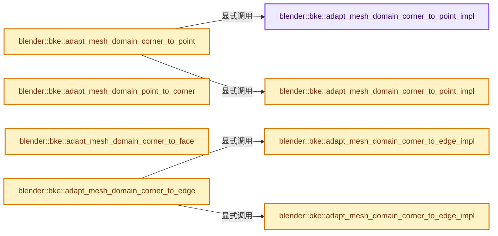

# 实现依赖专题：source/blender/blenkernel/intern/mesh_attributes.cc

[方向导航](README.md) · [符号索引](../%E7%AC%A6%E5%8F%B7%E4%BE%9D%E8%B5%96%E4%B8%8E%E5%AE%9E%E7%8E%B0%E7%B4%A2%E5%BC%95.md)

本专题从正文实际调用进入，集中保存共享实现。函数有稳定锚点，可从调用处直接跳到对应完整函数；递归与互相调用通过回链组织。

## 本文件的实现关系




## 完整成员与函数实现

<a id="f-84fabaffc4b43437"></a>

### `blender::bke::adapt_mesh_domain_corner_to_point_impl`

实现位置：[source/blender/blenkernel/intern/mesh_attributes.cc](../../../../../source/blender/blenkernel/intern/mesh_attributes.cc) · L28—L50。

接口参数：

- `const Mesh &mesh`
- `const VArray<T> &src`
- `MutableSpan<T> r_dst`

**教学注释版**

<!-- annotated:ba40dfb56b6898 -->

```cpp
template<typename T>
static void adapt_mesh_domain_corner_to_point_impl(const Mesh &mesh,
                                                   const VArray<T> &src,
                                                   MutableSpan<T> r_dst)
{
  // [讲解] r_dst.size：查询视图长度或生成对应有效索引区间。
  BLI_assert(r_dst.size() == mesh.verts_num);
  const GroupedSpan<int> vert_to_face_map = mesh.vert_to_face_map();
  const Span<int> corner_verts = mesh.corner_verts();
  const OffsetIndices<int> faces = mesh.faces();

  threading::parallel_for(vert_to_face_map.index_range(), 2048, [&](const IndexRange range) {
    for (const int64_t vert : range) {
      const Span<int> vert_faces = vert_to_face_map[vert];

      attribute_math::DefaultMixer<T> mixer({&r_dst[vert], 1});
      for (const int face : vert_faces) {
        const int corner = mesh::face_find_corner_from_vert(faces[face], corner_verts, int(vert));
        mixer.mix_in(0, src[corner]);
      }
      mixer.finalize();
    }
  });
}
```

<details>
<summary>核对原始源码：source/blender/blenkernel/intern/mesh_attributes.cc · L28—L50</summary>

<!-- original:ba40dfb56b6898:source/blender/blenkernel/intern/mesh_attributes.cc:28:50 -->

```cpp
template<typename T>
static void adapt_mesh_domain_corner_to_point_impl(const Mesh &mesh,
                                                   const VArray<T> &src,
                                                   MutableSpan<T> r_dst)
{
  BLI_assert(r_dst.size() == mesh.verts_num);
  const GroupedSpan<int> vert_to_face_map = mesh.vert_to_face_map();
  const Span<int> corner_verts = mesh.corner_verts();
  const OffsetIndices<int> faces = mesh.faces();

  threading::parallel_for(vert_to_face_map.index_range(), 2048, [&](const IndexRange range) {
    for (const int64_t vert : range) {
      const Span<int> vert_faces = vert_to_face_map[vert];

      attribute_math::DefaultMixer<T> mixer({&r_dst[vert], 1});
      for (const int face : vert_faces) {
        const int corner = mesh::face_find_corner_from_vert(faces[face], corner_verts, int(vert));
        mixer.mix_in(0, src[corner]);
      }
      mixer.finalize();
    }
  });
}
```

</details>

**继续追踪实现**

- `BLI_assert` → [BLI_assert · L48](../01-%E5%9F%BA%E7%A1%80%E5%AE%B9%E5%99%A8%E4%B8%8E%E7%8E%B0%E4%BB%A3CPP/%E4%BE%9D%E8%B5%96-BLI_assert-cc98e8.md#m-57a88495704d)；[BLI_assert · L63](../01-%E5%9F%BA%E7%A1%80%E5%AE%B9%E5%99%A8%E4%B8%8E%E7%8E%B0%E4%BB%A3CPP/%E4%BE%9D%E8%B5%96-BLI_assert-cc98e8.md#m-d07050020cb5)。宏定义由构建条件选择。
- `r_dst.size` → [blender::MutableSpan::size · L499](../01-%E5%9F%BA%E7%A1%80%E5%AE%B9%E5%99%A8%E4%B8%8E%E7%8E%B0%E4%BB%A3CPP/06-MutableSpan%E5%8F%AF%E5%86%99%E8%A7%86%E5%9B%BE.md#f-1de6a66839c304a8)；[blender::gpu::shader::parser::MutableSpan::size · L87](%E4%BE%9D%E8%B5%96-utils-06433d.md#f-5e684af6ee7990e9)。同名重载需按实参类型选择。
- `mesh.vert_to_face_map` → [blender::Mesh::vert_to_face_map · L119](../06-%E9%9A%90%E5%BC%8F%E5%85%B1%E4%BA%AB%E4%B8%8E%E7%BC%93%E5%AD%98%E7%B3%BB%E7%BB%9F/10-%E5%B1%80%E9%83%A8%E6%9B%B4%E6%96%B0%E4%B8%8E%E5%A4%B1%E6%95%88%E4%BF%AE%E5%A4%8D.md#f-343af7b6eb5a9239)。
- `mesh.corner_verts` → [Mesh::corner_verts · L1238](03-MPoly%E8%BF%81%E7%A7%BB%E4%B8%8E%E5%85%BC%E5%AE%B9.md#f-a59c61f583b64bc4)。
- `mesh.faces` → [Mesh::faces · L1217](03-MPoly%E8%BF%81%E7%A7%BB%E4%B8%8E%E5%85%BC%E5%AE%B9.md#f-ea444760154e17b2)。
- `threading::parallel_for` → [blender::threading::parallel_for · L68](../11-Depsgraph%E4%B8%8E%E5%B9%B6%E8%A1%8C%E4%BB%BB%E5%8A%A1%E7%B3%BB%E7%BB%9F/07-%E4%BB%BB%E5%8A%A1%E6%B1%A0%E4%B8%8ETBB%E6%8E%A5%E5%85%A5.md#f-838294754c24426c)。
- `vert_to_face_map.index_range` → [blender::offset_indices::GroupedSpan::index_range · L143](02-OffsetIndices%E5%AE%8C%E6%95%B4%E6%8E%A5%E5%8F%A3.md#f-b8ff7336d5914412)。
- `mesh::face_find_corner_from_vert` → [blender::bke::mesh::face_find_corner_from_vert · L327](01-Mesh%E9%A1%B6%E7%82%B9%E8%BE%B9%E9%9D%A2%E8%A7%92%E7%82%B9.md#f-6d7f1e04f4b052aa)。
- `mixer.mix_in` → [调用协议](../%E6%A8%A1%E6%9D%BF%E5%AE%8F%E4%B8%8E%E5%8A%A8%E6%80%81%E5%88%86%E6%B4%BE%E5%8D%8F%E8%AE%AE.md)：由接收对象具体类型或运行时策略提供实现。调用位置L45。
- `mixer.finalize` → [调用协议](../%E6%A8%A1%E6%9D%BF%E5%AE%8F%E4%B8%8E%E5%8A%A8%E6%80%81%E5%88%86%E6%B4%BE%E5%8D%8F%E8%AE%AE.md)：由接收对象具体类型或运行时策略提供实现。调用位置L47。

<a id="f-3b6d7a5983c37397"></a>

### `blender::bke::adapt_mesh_domain_corner_to_point_impl`

实现位置：[source/blender/blenkernel/intern/mesh_attributes.cc](../../../../../source/blender/blenkernel/intern/mesh_attributes.cc) · L53—L73。

接口参数：

- `const Mesh &mesh`
- `const VArray<bool> &src`
- `MutableSpan<bool> r_dst`

**教学注释版**

<!-- annotated:7805bbbe178723 -->

```cpp
template<>
void adapt_mesh_domain_corner_to_point_impl(const Mesh &mesh,
                                            const VArray<bool> &src,
                                            MutableSpan<bool> r_dst)
{
  // [讲解] r_dst.size：查询视图长度或生成对应有效索引区间。
  BLI_assert(r_dst.size() == mesh.verts_num);
  const Span<int> corner_verts = mesh.corner_verts();

  // [讲解] r_dst.fill：修改已有目标元素，不改变底层容器长度。
  r_dst.fill(true);
  threading::parallel_for(IndexRange(mesh.corners_num), 4096, [&](const IndexRange range) {
    for (const int corner : range) {
      const int vert = corner_verts[corner];
      if (!src[corner]) {
        r_dst[vert] = false;
      }
    }
  });

  /* Deselect loose vertices without corners that are still selected from the 'true' default. */
  index_mask::masked_fill(r_dst, false, mesh.loose_verts());
}
```

<details>
<summary>核对原始源码：source/blender/blenkernel/intern/mesh_attributes.cc · L53—L73</summary>

<!-- original:7805bbbe178723:source/blender/blenkernel/intern/mesh_attributes.cc:53:73 -->

```cpp
template<>
void adapt_mesh_domain_corner_to_point_impl(const Mesh &mesh,
                                            const VArray<bool> &src,
                                            MutableSpan<bool> r_dst)
{
  BLI_assert(r_dst.size() == mesh.verts_num);
  const Span<int> corner_verts = mesh.corner_verts();

  r_dst.fill(true);
  threading::parallel_for(IndexRange(mesh.corners_num), 4096, [&](const IndexRange range) {
    for (const int corner : range) {
      const int vert = corner_verts[corner];
      if (!src[corner]) {
        r_dst[vert] = false;
      }
    }
  });

  /* Deselect loose vertices without corners that are still selected from the 'true' default. */
  index_mask::masked_fill(r_dst, false, mesh.loose_verts());
}
```

</details>

**沿实际写入检查状态**

- `r_dst[vert] = false;`

**继续追踪实现**

- `BLI_assert` → [BLI_assert · L48](../01-%E5%9F%BA%E7%A1%80%E5%AE%B9%E5%99%A8%E4%B8%8E%E7%8E%B0%E4%BB%A3CPP/%E4%BE%9D%E8%B5%96-BLI_assert-cc98e8.md#m-57a88495704d)；[BLI_assert · L63](../01-%E5%9F%BA%E7%A1%80%E5%AE%B9%E5%99%A8%E4%B8%8E%E7%8E%B0%E4%BB%A3CPP/%E4%BE%9D%E8%B5%96-BLI_assert-cc98e8.md#m-d07050020cb5)。宏定义由构建条件选择。
- `r_dst.size` → [blender::MutableSpan::size · L499](../01-%E5%9F%BA%E7%A1%80%E5%AE%B9%E5%99%A8%E4%B8%8E%E7%8E%B0%E4%BB%A3CPP/06-MutableSpan%E5%8F%AF%E5%86%99%E8%A7%86%E5%9B%BE.md#f-1de6a66839c304a8)；[blender::gpu::shader::parser::MutableSpan::size · L87](%E4%BE%9D%E8%B5%96-utils-06433d.md#f-5e684af6ee7990e9)。同名重载需按实参类型选择。
- `mesh.corner_verts` → [Mesh::corner_verts · L1238](03-MPoly%E8%BF%81%E7%A7%BB%E4%B8%8E%E5%85%BC%E5%AE%B9.md#f-a59c61f583b64bc4)。
- `r_dst.fill` → [blender::MutableSpan::fill · L523](../01-%E5%9F%BA%E7%A1%80%E5%AE%B9%E5%99%A8%E4%B8%8E%E7%8E%B0%E4%BB%A3CPP/06-MutableSpan%E5%8F%AF%E5%86%99%E8%A7%86%E5%9B%BE.md#f-8daedd52c727ec26)。
- `threading::parallel_for` → [blender::threading::parallel_for · L68](../11-Depsgraph%E4%B8%8E%E5%B9%B6%E8%A1%8C%E4%BB%BB%E5%8A%A1%E7%B3%BB%E7%BB%9F/07-%E4%BB%BB%E5%8A%A1%E6%B1%A0%E4%B8%8ETBB%E6%8E%A5%E5%85%A5.md#f-838294754c24426c)。
- `IndexRange` → [blender::IndexRange](../01-%E5%9F%BA%E7%A1%80%E5%AE%B9%E5%99%A8%E4%B8%8E%E7%8E%B0%E4%BB%A3CPP/%E4%BE%9D%E8%B5%96-BLI_index_range-7d7cc5.md#t-caa3466d6776)；[blender::gpu::shader::parser::IndexRange](%E4%BE%9D%E8%B5%96-utils-06433d.md#t-82d2bd4ea71c)；[blender::IndexRange](%E4%BE%9D%E8%B5%96-DNA_node_types-6708b9.md#t-0448cc889d39)。
- `index_mask::masked_fill` → [blender::index_mask::masked_fill · L1261](../04-%E8%99%9A%E6%8B%9F%E6%95%B0%E7%BB%84%E4%B8%8E%E7%B4%A2%E5%BC%95%E9%80%89%E6%8B%A9/12-%E9%87%8D%E6%9E%84%E5%8E%86%E5%8F%B2%E4%B8%8E%E5%9F%BA%E5%87%86%E7%BB%83%E4%B9%A0.md#f-00f1f611c7000f05)。
- `mesh.loose_verts` → [blender::Mesh::loose_verts · L163](../06-%E9%9A%90%E5%BC%8F%E5%85%B1%E4%BA%AB%E4%B8%8E%E7%BC%93%E5%AD%98%E7%B3%BB%E7%BB%9F/10-%E5%B1%80%E9%83%A8%E6%9B%B4%E6%96%B0%E4%B8%8E%E5%A4%B1%E6%95%88%E4%BF%AE%E5%A4%8D.md#f-9f31b4f671ff9085)。

<a id="f-46c3930d7aca7d6b"></a>

### `blender::bke::adapt_mesh_domain_corner_to_point`

实现位置：[source/blender/blenkernel/intern/mesh_attributes.cc](../../../../../source/blender/blenkernel/intern/mesh_attributes.cc) · L75—L87。

接口参数：

- `const Mesh &mesh`
- `const GVArray &varray`

**教学注释版**

<!-- annotated:8a731c35693fc5 -->

```cpp
static GVArray adapt_mesh_domain_corner_to_point(const Mesh &mesh, const GVArray &varray)
{
  GArray<> values(varray.type(), mesh.verts_num);
  attribute_math::to_static_type(varray.type(), [&]<typename T>() {
    if constexpr (!std::is_void_v<attribute_math::DefaultMixer<T>>) {
      /* We compute all interpolated values at once, because for this interpolation, one has to
       * iterate over all loops anyway. */
      adapt_mesh_domain_corner_to_point_impl<T>(
          mesh, varray.typed<T>(), values.as_mutable_span().typed<T>());
    }
  });
  // [讲解] std::move：把表达式转换成可供移动重载选择的值类别；不保证真的移动，不结束源对象寿命，对const值可能选择复制。
  return GVArray::from_garray(std::move(values));
}
```

<details>
<summary>核对原始源码：source/blender/blenkernel/intern/mesh_attributes.cc · L75—L87</summary>

<!-- original:8a731c35693fc5:source/blender/blenkernel/intern/mesh_attributes.cc:75:87 -->

```cpp
static GVArray adapt_mesh_domain_corner_to_point(const Mesh &mesh, const GVArray &varray)
{
  GArray<> values(varray.type(), mesh.verts_num);
  attribute_math::to_static_type(varray.type(), [&]<typename T>() {
    if constexpr (!std::is_void_v<attribute_math::DefaultMixer<T>>) {
      /* We compute all interpolated values at once, because for this interpolation, one has to
       * iterate over all loops anyway. */
      adapt_mesh_domain_corner_to_point_impl<T>(
          mesh, varray.typed<T>(), values.as_mutable_span().typed<T>());
    }
  });
  return GVArray::from_garray(std::move(values));
}
```

</details>

**结果出口**

- `return GVArray::from_garray(std::move(values));`

**继续追踪实现**

- `varray.type` → [blender::bke::GeometryComponent::type · L86](../06-%E9%9A%90%E5%BC%8F%E5%85%B1%E4%BA%AB%E4%B8%8E%E7%BC%93%E5%AD%98%E7%B3%BB%E7%BB%9F/05-GeometrySet%E8%AF%BB%E5%86%99%E4%B8%8E%E5%A4%8D%E5%88%B6.md#f-f73336c224943890)。
- `attribute_math::to_static_type` → [blender::bke::attribute_math::to_static_type · L35](%E4%BE%9D%E8%B5%96-BKE_attribute_math-ac7998.md#f-fdfaf0b86a24f278)；[blender::bke::attribute_math::to_static_type · L52](%E4%BE%9D%E8%B5%96-BKE_attribute_math-ac7998.md#f-5346ade4e816ebd6)。同名重载需按实参类型选择。
- `adapt_mesh_domain_corner_to_point_impl<T>` → [blender::bke::adapt_mesh_domain_corner_to_point_impl · L28](%E4%BE%9D%E8%B5%96-mesh_attributes-dc90c4.md#f-84fabaffc4b43437)；[blender::bke::adapt_mesh_domain_corner_to_point_impl · L53](%E4%BE%9D%E8%B5%96-mesh_attributes-dc90c4.md#f-3b6d7a5983c37397)。同名重载需按实参类型选择。
- `varray.typed<T>` → [blender::GVArray::typed · L913](../04-%E8%99%9A%E6%8B%9F%E6%95%B0%E7%BB%84%E4%B8%8E%E7%B4%A2%E5%BC%95%E9%80%89%E6%8B%A9/05-GVArray%E8%BF%90%E8%A1%8C%E6%97%B6%E7%B1%BB%E5%9E%8B.md#f-c17d1cd75ef41a17)。
- `values.as_mutable_span().typed<T>` → [调用协议](../%E6%A8%A1%E6%9D%BF%E5%AE%8F%E4%B8%8E%E5%8A%A8%E6%80%81%E5%88%86%E6%B4%BE%E5%8D%8F%E8%AE%AE.md)：接收对象类型依赖auto、返回值或模板实例；不按同名猜测目标。调用位置L83。
- `values.as_mutable_span` → [blender::GArray::as_mutable_span · L198](../03-%E5%86%85%E5%AD%98%E5%88%86%E9%85%8D%E4%B8%8E%E8%BF%90%E8%A1%8C%E6%97%B6%E7%B1%BB%E5%9E%8B/11-GSpan%E4%B8%8EGArray.md#f-2f8508997cf678b6)。
- `GVArray::from_garray` → [blender::GVArray::from_garray · L647](../04-%E8%99%9A%E6%8B%9F%E6%95%B0%E7%BB%84%E4%B8%8E%E7%B4%A2%E5%BC%95%E9%80%89%E6%8B%A9/05-GVArray%E8%BF%90%E8%A1%8C%E6%97%B6%E7%B1%BB%E5%9E%8B.md#f-1b814aa9b1fb3a37)。
- `std::move` → [外部契约](https://eel.is/c++draft/utility.forward)：把表达式转换成可供移动重载选择的值类别；不保证真的移动，不结束源对象寿命，对const值可能选择复制。

<a id="f-6ae918b7b4747560"></a>

### `blender::bke::adapt_mesh_domain_point_to_corner`

实现位置：[source/blender/blenkernel/intern/mesh_attributes.cc](../../../../../source/blender/blenkernel/intern/mesh_attributes.cc) · L92—L104。

接口参数：

- `const Mesh &mesh`
- `const GVArray &varray`

**教学注释版**

<!-- annotated:a7c7b8a76d9de4 -->

```cpp
static GVArray adapt_mesh_domain_point_to_corner(const Mesh &mesh, const GVArray &varray)
{
  const Span<int> corner_verts = mesh.corner_verts();

  GVArray new_varray;
  attribute_math::to_static_type(varray.type(), [&]<typename T>() {
    new_varray = VArray<T>::from_func(
        mesh.corners_num, [corner_verts, varray = varray.typed<T>()](const int64_t corner) {
          return varray[corner_verts[corner]];
        });
  });
  return new_varray;
}
```

<details>
<summary>核对原始源码：source/blender/blenkernel/intern/mesh_attributes.cc · L92—L104</summary>

<!-- original:a7c7b8a76d9de4:source/blender/blenkernel/intern/mesh_attributes.cc:92:104 -->

```cpp
static GVArray adapt_mesh_domain_point_to_corner(const Mesh &mesh, const GVArray &varray)
{
  const Span<int> corner_verts = mesh.corner_verts();

  GVArray new_varray;
  attribute_math::to_static_type(varray.type(), [&]<typename T>() {
    new_varray = VArray<T>::from_func(
        mesh.corners_num, [corner_verts, varray = varray.typed<T>()](const int64_t corner) {
          return varray[corner_verts[corner]];
        });
  });
  return new_varray;
}
```

</details>

**沿实际写入检查状态**

- `new_varray = VArray<T>::from_func(`

**结果出口**

- `return varray[corner_verts[corner]];`
- `return new_varray;`

**继续追踪实现**

- `mesh.corner_verts` → [Mesh::corner_verts · L1238](03-MPoly%E8%BF%81%E7%A7%BB%E4%B8%8E%E5%85%BC%E5%AE%B9.md#f-a59c61f583b64bc4)。
- `attribute_math::to_static_type` → [blender::bke::attribute_math::to_static_type · L35](%E4%BE%9D%E8%B5%96-BKE_attribute_math-ac7998.md#f-fdfaf0b86a24f278)；[blender::bke::attribute_math::to_static_type · L52](%E4%BE%9D%E8%B5%96-BKE_attribute_math-ac7998.md#f-5346ade4e816ebd6)。同名重载需按实参类型选择。
- `varray.type` → [blender::bke::GeometryComponent::type · L86](../06-%E9%9A%90%E5%BC%8F%E5%85%B1%E4%BA%AB%E4%B8%8E%E7%BC%93%E5%AD%98%E7%B3%BB%E7%BB%9F/05-GeometrySet%E8%AF%BB%E5%86%99%E4%B8%8E%E5%A4%8D%E5%88%B6.md#f-f73336c224943890)。
- `VArray<T>::from_func` → [blender::GVArray::from_func · L935](../04-%E8%99%9A%E6%8B%9F%E6%95%B0%E7%BB%84%E4%B8%8E%E7%B4%A2%E5%BC%95%E9%80%89%E6%8B%A9/05-GVArray%E8%BF%90%E8%A1%8C%E6%97%B6%E7%B1%BB%E5%9E%8B.md#f-5284f38409debf59)；[blender::VArray::from_func · L777](../04-%E8%99%9A%E6%8B%9F%E6%95%B0%E7%BB%84%E4%B8%8E%E7%B4%A2%E5%BC%95%E9%80%89%E6%8B%A9/03-%E5%8D%95%E5%80%BC%E4%B8%8ESpan%E8%A1%A8%E7%A4%BA.md#f-960f6d3e81b7819d)。同名重载需按实参类型选择。
- `varray.typed<T>` → [blender::GVArray::typed · L913](../04-%E8%99%9A%E6%8B%9F%E6%95%B0%E7%BB%84%E4%B8%8E%E7%B4%A2%E5%BC%95%E9%80%89%E6%8B%A9/05-GVArray%E8%BF%90%E8%A1%8C%E6%97%B6%E7%B1%BB%E5%9E%8B.md#f-c17d1cd75ef41a17)。

<a id="f-d48624d8ee89e250"></a>

### `blender::bke::adapt_mesh_domain_corner_to_face`

实现位置：[source/blender/blenkernel/intern/mesh_attributes.cc](../../../../../source/blender/blenkernel/intern/mesh_attributes.cc) · L106—L141。

接口参数：

- `const Mesh &mesh`
- `const GVArray &varray`

**教学注释版**

<!-- annotated:4b132a9c13d154 -->

```cpp
static GVArray adapt_mesh_domain_corner_to_face(const Mesh &mesh, const GVArray &varray)
{
  const OffsetIndices faces = mesh.faces();

  GVArray new_varray;
  attribute_math::to_static_type(varray.type(), [&]<typename T>() {
    if constexpr (!std::is_void_v<attribute_math::DefaultMixer<T>>) {
      if constexpr (std::is_same_v<T, bool>) {
        new_varray = VArray<T>::from_func(
            // [讲解] faces.size：读取连续区间或分组的边界信息。
            faces.size(), [faces, varray = varray.typed<bool>()](const int face_index) {
              /* A face is selected if all of its corners were selected. */
              for (const int corner : faces[face_index]) {
                if (!varray[corner]) {
                  return false;
                }
              }
              return true;
            });
      }
      else {
        new_varray = VArray<T>::from_func(
            faces.size(), [faces, varray = varray.typed<T>()](const int face_index) {
              T return_value;
              attribute_math::DefaultMixer<T> mixer({&return_value, 1});
              for (const int corner : faces[face_index]) {
                const T value = varray[corner];
                mixer.mix_in(0, value);
              }
              mixer.finalize();
              return return_value;
            });
      }
    }
  });
  return new_varray;
}
```

<details>
<summary>核对原始源码：source/blender/blenkernel/intern/mesh_attributes.cc · L106—L141</summary>

<!-- original:4b132a9c13d154:source/blender/blenkernel/intern/mesh_attributes.cc:106:141 -->

```cpp
static GVArray adapt_mesh_domain_corner_to_face(const Mesh &mesh, const GVArray &varray)
{
  const OffsetIndices faces = mesh.faces();

  GVArray new_varray;
  attribute_math::to_static_type(varray.type(), [&]<typename T>() {
    if constexpr (!std::is_void_v<attribute_math::DefaultMixer<T>>) {
      if constexpr (std::is_same_v<T, bool>) {
        new_varray = VArray<T>::from_func(
            faces.size(), [faces, varray = varray.typed<bool>()](const int face_index) {
              /* A face is selected if all of its corners were selected. */
              for (const int corner : faces[face_index]) {
                if (!varray[corner]) {
                  return false;
                }
              }
              return true;
            });
      }
      else {
        new_varray = VArray<T>::from_func(
            faces.size(), [faces, varray = varray.typed<T>()](const int face_index) {
              T return_value;
              attribute_math::DefaultMixer<T> mixer({&return_value, 1});
              for (const int corner : faces[face_index]) {
                const T value = varray[corner];
                mixer.mix_in(0, value);
              }
              mixer.finalize();
              return return_value;
            });
      }
    }
  });
  return new_varray;
}
```

</details>

**沿实际写入检查状态**

- `new_varray = VArray<T>::from_func(`

**结果出口**

- `return false;`
- `return true;`
- `return return_value;`
- `return new_varray;`

**继续追踪实现**

- `mesh.faces` → [Mesh::faces · L1217](03-MPoly%E8%BF%81%E7%A7%BB%E4%B8%8E%E5%85%BC%E5%AE%B9.md#f-ea444760154e17b2)。
- `attribute_math::to_static_type` → [blender::bke::attribute_math::to_static_type · L35](%E4%BE%9D%E8%B5%96-BKE_attribute_math-ac7998.md#f-fdfaf0b86a24f278)；[blender::bke::attribute_math::to_static_type · L52](%E4%BE%9D%E8%B5%96-BKE_attribute_math-ac7998.md#f-5346ade4e816ebd6)。同名重载需按实参类型选择。
- `varray.type` → [blender::bke::GeometryComponent::type · L86](../06-%E9%9A%90%E5%BC%8F%E5%85%B1%E4%BA%AB%E4%B8%8E%E7%BC%93%E5%AD%98%E7%B3%BB%E7%BB%9F/05-GeometrySet%E8%AF%BB%E5%86%99%E4%B8%8E%E5%A4%8D%E5%88%B6.md#f-f73336c224943890)。
- `VArray<T>::from_func` → [blender::GVArray::from_func · L935](../04-%E8%99%9A%E6%8B%9F%E6%95%B0%E7%BB%84%E4%B8%8E%E7%B4%A2%E5%BC%95%E9%80%89%E6%8B%A9/05-GVArray%E8%BF%90%E8%A1%8C%E6%97%B6%E7%B1%BB%E5%9E%8B.md#f-5284f38409debf59)；[blender::VArray::from_func · L777](../04-%E8%99%9A%E6%8B%9F%E6%95%B0%E7%BB%84%E4%B8%8E%E7%B4%A2%E5%BC%95%E9%80%89%E6%8B%A9/03-%E5%8D%95%E5%80%BC%E4%B8%8ESpan%E8%A1%A8%E7%A4%BA.md#f-960f6d3e81b7819d)。同名重载需按实参类型选择。
- `faces.size` → [blender::offset_indices::OffsetIndices::size · L67](02-OffsetIndices%E5%AE%8C%E6%95%B4%E6%8E%A5%E5%8F%A3.md#f-e238abc62ed42abd)。
- `varray.typed<bool>` → [blender::GVArray::typed · L913](../04-%E8%99%9A%E6%8B%9F%E6%95%B0%E7%BB%84%E4%B8%8E%E7%B4%A2%E5%BC%95%E9%80%89%E6%8B%A9/05-GVArray%E8%BF%90%E8%A1%8C%E6%97%B6%E7%B1%BB%E5%9E%8B.md#f-c17d1cd75ef41a17)。
- `varray.typed<T>` → [blender::GVArray::typed · L913](../04-%E8%99%9A%E6%8B%9F%E6%95%B0%E7%BB%84%E4%B8%8E%E7%B4%A2%E5%BC%95%E9%80%89%E6%8B%A9/05-GVArray%E8%BF%90%E8%A1%8C%E6%97%B6%E7%B1%BB%E5%9E%8B.md#f-c17d1cd75ef41a17)。
- `mixer.mix_in` → [调用协议](../%E6%A8%A1%E6%9D%BF%E5%AE%8F%E4%B8%8E%E5%8A%A8%E6%80%81%E5%88%86%E6%B4%BE%E5%8D%8F%E8%AE%AE.md)：由接收对象具体类型或运行时策略提供实现。调用位置L132。
- `mixer.finalize` → [调用协议](../%E6%A8%A1%E6%9D%BF%E5%AE%8F%E4%B8%8E%E5%8A%A8%E6%80%81%E5%88%86%E6%B4%BE%E5%8D%8F%E8%AE%AE.md)：由接收对象具体类型或运行时策略提供实现。调用位置L134。

<a id="f-b8856db7d88ddfb5"></a>

### `blender::bke::adapt_mesh_domain_corner_to_edge_impl`

实现位置：[source/blender/blenkernel/intern/mesh_attributes.cc](../../../../../source/blender/blenkernel/intern/mesh_attributes.cc) · L143—L167。

接口参数：

- `const Mesh &mesh`
- `const VArray<T> &old_values`
- `MutableSpan<T> r_values`

**教学注释版**

<!-- annotated:72323bbc27728d -->

```cpp
template<typename T>
static void adapt_mesh_domain_corner_to_edge_impl(const Mesh &mesh,
                                                  const VArray<T> &old_values,
                                                  MutableSpan<T> r_values)
{
  // [讲解] r_values.size：查询视图长度或生成对应有效索引区间。
  BLI_assert(r_values.size() == mesh.edges_num);
  const OffsetIndices faces = mesh.faces();
  const Span<int> corner_edges = mesh.corner_edges();

  attribute_math::DefaultMixer<T> mixer(r_values);

  for (const int face_index : faces.index_range()) {
    const IndexRange face = faces[face_index];

    /* For every edge, mix values from the two adjacent corners (the current and next corner). */
    for (const int corner : face) {
      const int next_corner = mesh::face_corner_next(face, corner);
      const int edge_index = corner_edges[corner];
      mixer.mix_in(edge_index, old_values[corner]);
      mixer.mix_in(edge_index, old_values[next_corner]);
    }
  }

  mixer.finalize();
}
```

<details>
<summary>核对原始源码：source/blender/blenkernel/intern/mesh_attributes.cc · L143—L167</summary>

<!-- original:72323bbc27728d:source/blender/blenkernel/intern/mesh_attributes.cc:143:167 -->

```cpp
template<typename T>
static void adapt_mesh_domain_corner_to_edge_impl(const Mesh &mesh,
                                                  const VArray<T> &old_values,
                                                  MutableSpan<T> r_values)
{
  BLI_assert(r_values.size() == mesh.edges_num);
  const OffsetIndices faces = mesh.faces();
  const Span<int> corner_edges = mesh.corner_edges();

  attribute_math::DefaultMixer<T> mixer(r_values);

  for (const int face_index : faces.index_range()) {
    const IndexRange face = faces[face_index];

    /* For every edge, mix values from the two adjacent corners (the current and next corner). */
    for (const int corner : face) {
      const int next_corner = mesh::face_corner_next(face, corner);
      const int edge_index = corner_edges[corner];
      mixer.mix_in(edge_index, old_values[corner]);
      mixer.mix_in(edge_index, old_values[next_corner]);
    }
  }

  mixer.finalize();
}
```

</details>

**继续追踪实现**

- `BLI_assert` → [BLI_assert · L48](../01-%E5%9F%BA%E7%A1%80%E5%AE%B9%E5%99%A8%E4%B8%8E%E7%8E%B0%E4%BB%A3CPP/%E4%BE%9D%E8%B5%96-BLI_assert-cc98e8.md#m-57a88495704d)；[BLI_assert · L63](../01-%E5%9F%BA%E7%A1%80%E5%AE%B9%E5%99%A8%E4%B8%8E%E7%8E%B0%E4%BB%A3CPP/%E4%BE%9D%E8%B5%96-BLI_assert-cc98e8.md#m-d07050020cb5)。宏定义由构建条件选择。
- `r_values.size` → [blender::MutableSpan::size · L499](../01-%E5%9F%BA%E7%A1%80%E5%AE%B9%E5%99%A8%E4%B8%8E%E7%8E%B0%E4%BB%A3CPP/06-MutableSpan%E5%8F%AF%E5%86%99%E8%A7%86%E5%9B%BE.md#f-1de6a66839c304a8)；[blender::gpu::shader::parser::MutableSpan::size · L87](%E4%BE%9D%E8%B5%96-utils-06433d.md#f-5e684af6ee7990e9)。同名重载需按实参类型选择。
- `mesh.faces` → [Mesh::faces · L1217](03-MPoly%E8%BF%81%E7%A7%BB%E4%B8%8E%E5%85%BC%E5%AE%B9.md#f-ea444760154e17b2)。
- `mesh.corner_edges` → [Mesh::corner_edges · L1252](03-MPoly%E8%BF%81%E7%A7%BB%E4%B8%8E%E5%85%BC%E5%AE%B9.md#f-687b790868e7f257)。
- `faces.index_range` → [blender::offset_indices::OffsetIndices::index_range · L77](02-OffsetIndices%E5%AE%8C%E6%95%B4%E6%8E%A5%E5%8F%A3.md#f-19b5ca1456de007d)。
- `mesh::face_corner_next` → [blender::bke::mesh::face_corner_next · L315](01-Mesh%E9%A1%B6%E7%82%B9%E8%BE%B9%E9%9D%A2%E8%A7%92%E7%82%B9.md#f-bf639df87b51fe48)。
- `mixer.mix_in` → [调用协议](../%E6%A8%A1%E6%9D%BF%E5%AE%8F%E4%B8%8E%E5%8A%A8%E6%80%81%E5%88%86%E6%B4%BE%E5%8D%8F%E8%AE%AE.md)：由接收对象具体类型或运行时策略提供实现。调用位置L161。
- `mixer.finalize` → [调用协议](../%E6%A8%A1%E6%9D%BF%E5%AE%8F%E4%B8%8E%E5%8A%A8%E6%80%81%E5%88%86%E6%B4%BE%E5%8D%8F%E8%AE%AE.md)：由接收对象具体类型或运行时策略提供实现。调用位置L166。

<a id="f-abfbcd790cbf9b0d"></a>

### `blender::bke::adapt_mesh_domain_corner_to_edge_impl`

实现位置：[source/blender/blenkernel/intern/mesh_attributes.cc](../../../../../source/blender/blenkernel/intern/mesh_attributes.cc) · L170—L193。

接口参数：

- `const Mesh &mesh`
- `const VArray<bool> &old_values`
- `MutableSpan<bool> r_values`

**教学注释版**

<!-- annotated:388ea5daa093e6 -->

```cpp
template<>
void adapt_mesh_domain_corner_to_edge_impl(const Mesh &mesh,
                                           const VArray<bool> &old_values,
                                           MutableSpan<bool> r_values)
{
  // [讲解] r_values.size：查询视图长度或生成对应有效索引区间。
  BLI_assert(r_values.size() == mesh.edges_num);
  const OffsetIndices faces = mesh.faces();
  const Span<int> corner_edges = mesh.corner_edges();

  // [讲解] r_values.fill：修改已有目标元素，不改变底层容器长度。
  r_values.fill(true);
  for (const int face_index : faces.index_range()) {
    const IndexRange face = faces[face_index];

    for (const int corner : face) {
      const int next_corner = mesh::face_corner_next(face, corner);
      const int edge_index = corner_edges[corner];
      if (!old_values[corner] || !old_values[next_corner]) {
        r_values[edge_index] = false;
      }
    }
  }

  index_mask::masked_fill(r_values, false, mesh.loose_edges());
}
```

<details>
<summary>核对原始源码：source/blender/blenkernel/intern/mesh_attributes.cc · L170—L193</summary>

<!-- original:388ea5daa093e6:source/blender/blenkernel/intern/mesh_attributes.cc:170:193 -->

```cpp
template<>
void adapt_mesh_domain_corner_to_edge_impl(const Mesh &mesh,
                                           const VArray<bool> &old_values,
                                           MutableSpan<bool> r_values)
{
  BLI_assert(r_values.size() == mesh.edges_num);
  const OffsetIndices faces = mesh.faces();
  const Span<int> corner_edges = mesh.corner_edges();

  r_values.fill(true);
  for (const int face_index : faces.index_range()) {
    const IndexRange face = faces[face_index];

    for (const int corner : face) {
      const int next_corner = mesh::face_corner_next(face, corner);
      const int edge_index = corner_edges[corner];
      if (!old_values[corner] || !old_values[next_corner]) {
        r_values[edge_index] = false;
      }
    }
  }

  index_mask::masked_fill(r_values, false, mesh.loose_edges());
}
```

</details>

**沿实际写入检查状态**

- `r_values[edge_index] = false;`

**继续追踪实现**

- `BLI_assert` → [BLI_assert · L48](../01-%E5%9F%BA%E7%A1%80%E5%AE%B9%E5%99%A8%E4%B8%8E%E7%8E%B0%E4%BB%A3CPP/%E4%BE%9D%E8%B5%96-BLI_assert-cc98e8.md#m-57a88495704d)；[BLI_assert · L63](../01-%E5%9F%BA%E7%A1%80%E5%AE%B9%E5%99%A8%E4%B8%8E%E7%8E%B0%E4%BB%A3CPP/%E4%BE%9D%E8%B5%96-BLI_assert-cc98e8.md#m-d07050020cb5)。宏定义由构建条件选择。
- `r_values.size` → [blender::MutableSpan::size · L499](../01-%E5%9F%BA%E7%A1%80%E5%AE%B9%E5%99%A8%E4%B8%8E%E7%8E%B0%E4%BB%A3CPP/06-MutableSpan%E5%8F%AF%E5%86%99%E8%A7%86%E5%9B%BE.md#f-1de6a66839c304a8)；[blender::gpu::shader::parser::MutableSpan::size · L87](%E4%BE%9D%E8%B5%96-utils-06433d.md#f-5e684af6ee7990e9)。同名重载需按实参类型选择。
- `mesh.faces` → [Mesh::faces · L1217](03-MPoly%E8%BF%81%E7%A7%BB%E4%B8%8E%E5%85%BC%E5%AE%B9.md#f-ea444760154e17b2)。
- `mesh.corner_edges` → [Mesh::corner_edges · L1252](03-MPoly%E8%BF%81%E7%A7%BB%E4%B8%8E%E5%85%BC%E5%AE%B9.md#f-687b790868e7f257)。
- `r_values.fill` → [blender::MutableSpan::fill · L523](../01-%E5%9F%BA%E7%A1%80%E5%AE%B9%E5%99%A8%E4%B8%8E%E7%8E%B0%E4%BB%A3CPP/06-MutableSpan%E5%8F%AF%E5%86%99%E8%A7%86%E5%9B%BE.md#f-8daedd52c727ec26)。
- `faces.index_range` → [blender::offset_indices::OffsetIndices::index_range · L77](02-OffsetIndices%E5%AE%8C%E6%95%B4%E6%8E%A5%E5%8F%A3.md#f-19b5ca1456de007d)。
- `mesh::face_corner_next` → [blender::bke::mesh::face_corner_next · L315](01-Mesh%E9%A1%B6%E7%82%B9%E8%BE%B9%E9%9D%A2%E8%A7%92%E7%82%B9.md#f-bf639df87b51fe48)。
- `index_mask::masked_fill` → [blender::index_mask::masked_fill · L1261](../04-%E8%99%9A%E6%8B%9F%E6%95%B0%E7%BB%84%E4%B8%8E%E7%B4%A2%E5%BC%95%E9%80%89%E6%8B%A9/12-%E9%87%8D%E6%9E%84%E5%8E%86%E5%8F%B2%E4%B8%8E%E5%9F%BA%E5%87%86%E7%BB%83%E4%B9%A0.md#f-00f1f611c7000f05)。
- `mesh.loose_edges` → [blender::Mesh::loose_edges · L194](../06-%E9%9A%90%E5%BC%8F%E5%85%B1%E4%BA%AB%E4%B8%8E%E7%BC%93%E5%AD%98%E7%B3%BB%E7%BB%9F/10-%E5%B1%80%E9%83%A8%E6%9B%B4%E6%96%B0%E4%B8%8E%E5%A4%B1%E6%95%88%E4%BF%AE%E5%A4%8D.md#f-80e2cb4f8c0f449d)。

<a id="f-30959ba7add4ec9d"></a>

### `blender::bke::adapt_mesh_domain_corner_to_edge`

实现位置：[source/blender/blenkernel/intern/mesh_attributes.cc](../../../../../source/blender/blenkernel/intern/mesh_attributes.cc) · L195—L205。

接口参数：

- `const Mesh &mesh`
- `const GVArray &varray`

**教学注释版**

<!-- annotated:09cfe2fdcb28f5 -->

```cpp
static GVArray adapt_mesh_domain_corner_to_edge(const Mesh &mesh, const GVArray &varray)
{
  GArray<> values(varray.type(), mesh.edges_num);
  attribute_math::to_static_type(varray.type(), [&]<typename T>() {
    if constexpr (!std::is_void_v<attribute_math::DefaultMixer<T>>) {
      adapt_mesh_domain_corner_to_edge_impl<T>(
          mesh, varray.typed<T>(), values.as_mutable_span().typed<T>());
    }
  });
  // [讲解] std::move：把表达式转换成可供移动重载选择的值类别；不保证真的移动，不结束源对象寿命，对const值可能选择复制。
  return GVArray::from_garray(std::move(values));
}
```

<details>
<summary>核对原始源码：source/blender/blenkernel/intern/mesh_attributes.cc · L195—L205</summary>

<!-- original:09cfe2fdcb28f5:source/blender/blenkernel/intern/mesh_attributes.cc:195:205 -->

```cpp
static GVArray adapt_mesh_domain_corner_to_edge(const Mesh &mesh, const GVArray &varray)
{
  GArray<> values(varray.type(), mesh.edges_num);
  attribute_math::to_static_type(varray.type(), [&]<typename T>() {
    if constexpr (!std::is_void_v<attribute_math::DefaultMixer<T>>) {
      adapt_mesh_domain_corner_to_edge_impl<T>(
          mesh, varray.typed<T>(), values.as_mutable_span().typed<T>());
    }
  });
  return GVArray::from_garray(std::move(values));
}
```

</details>

**结果出口**

- `return GVArray::from_garray(std::move(values));`

**继续追踪实现**

- `varray.type` → [blender::bke::GeometryComponent::type · L86](../06-%E9%9A%90%E5%BC%8F%E5%85%B1%E4%BA%AB%E4%B8%8E%E7%BC%93%E5%AD%98%E7%B3%BB%E7%BB%9F/05-GeometrySet%E8%AF%BB%E5%86%99%E4%B8%8E%E5%A4%8D%E5%88%B6.md#f-f73336c224943890)。
- `attribute_math::to_static_type` → [blender::bke::attribute_math::to_static_type · L35](%E4%BE%9D%E8%B5%96-BKE_attribute_math-ac7998.md#f-fdfaf0b86a24f278)；[blender::bke::attribute_math::to_static_type · L52](%E4%BE%9D%E8%B5%96-BKE_attribute_math-ac7998.md#f-5346ade4e816ebd6)。同名重载需按实参类型选择。
- `adapt_mesh_domain_corner_to_edge_impl<T>` → [blender::bke::adapt_mesh_domain_corner_to_edge_impl · L143](%E4%BE%9D%E8%B5%96-mesh_attributes-dc90c4.md#f-b8856db7d88ddfb5)；[blender::bke::adapt_mesh_domain_corner_to_edge_impl · L170](%E4%BE%9D%E8%B5%96-mesh_attributes-dc90c4.md#f-abfbcd790cbf9b0d)。同名重载需按实参类型选择。
- `varray.typed<T>` → [blender::GVArray::typed · L913](../04-%E8%99%9A%E6%8B%9F%E6%95%B0%E7%BB%84%E4%B8%8E%E7%B4%A2%E5%BC%95%E9%80%89%E6%8B%A9/05-GVArray%E8%BF%90%E8%A1%8C%E6%97%B6%E7%B1%BB%E5%9E%8B.md#f-c17d1cd75ef41a17)。
- `values.as_mutable_span().typed<T>` → [调用协议](../%E6%A8%A1%E6%9D%BF%E5%AE%8F%E4%B8%8E%E5%8A%A8%E6%80%81%E5%88%86%E6%B4%BE%E5%8D%8F%E8%AE%AE.md)：接收对象类型依赖auto、返回值或模板实例；不按同名猜测目标。调用位置L201。
- `values.as_mutable_span` → [blender::GArray::as_mutable_span · L198](../03-%E5%86%85%E5%AD%98%E5%88%86%E9%85%8D%E4%B8%8E%E8%BF%90%E8%A1%8C%E6%97%B6%E7%B1%BB%E5%9E%8B/11-GSpan%E4%B8%8EGArray.md#f-2f8508997cf678b6)。
- `GVArray::from_garray` → [blender::GVArray::from_garray · L647](../04-%E8%99%9A%E6%8B%9F%E6%95%B0%E7%BB%84%E4%B8%8E%E7%B4%A2%E5%BC%95%E9%80%89%E6%8B%A9/05-GVArray%E8%BF%90%E8%A1%8C%E6%97%B6%E7%B1%BB%E5%9E%8B.md#f-1b814aa9b1fb3a37)。
- `std::move` → [外部契约](https://eel.is/c++draft/utility.forward)：把表达式转换成可供移动重载选择的值类别；不保证真的移动，不结束源对象寿命，对const值可能选择复制。

<a id="f-d3030235becb22e5"></a>

### `blender::bke::adapt_mesh_domain_face_to_point`

实现位置：[source/blender/blenkernel/intern/mesh_attributes.cc](../../../../../source/blender/blenkernel/intern/mesh_attributes.cc) · L207—L239。

接口参数：

- `const Mesh &mesh`
- `const GVArray &varray`

**教学注释版**

<!-- annotated:299ae06988ca67 -->

```cpp
static GVArray adapt_mesh_domain_face_to_point(const Mesh &mesh, const GVArray &varray)
{
  GVArray new_varray;
  attribute_math::to_static_type(varray.type(), [&]<typename T>() {
    if constexpr (!std::is_void_v<attribute_math::DefaultMixer<T>>) {
      VArray<T> src = varray.typed<T>();
      const GroupedSpan<int> vert_to_face_map = mesh.vert_to_face_map();
      if constexpr (std::is_same_v<T, bool>) {
        new_varray = VArray<T>::from_func(
            mesh.verts_num, [vert_to_face_map, src](const int point_i) {
              const Span<int> vert_faces = vert_to_face_map[point_i];
              /* A vertex is selected if any of the connected faces were selected. */
              return std::any_of(
                  // [讲解] vert_faces.begin：返回借用范围的地址。
                  vert_faces.begin(), vert_faces.end(), [&](const int face) { return src[face]; });
            });
      }
      else {
        new_varray = VArray<T>::from_func(
            mesh.verts_num, [vert_to_face_map, src](const int point_i) {
              const Span<int> vert_faces = vert_to_face_map[point_i];
              T return_value;
              attribute_math::DefaultMixer<T> mixer({&return_value, 1});
              for (const int face : vert_faces) {
                mixer.mix_in(0, src[face]);
              }
              mixer.finalize();
              return return_value;
            });
      }
    }
  });
  return new_varray;
}
```

<details>
<summary>核对原始源码：source/blender/blenkernel/intern/mesh_attributes.cc · L207—L239</summary>

<!-- original:299ae06988ca67:source/blender/blenkernel/intern/mesh_attributes.cc:207:239 -->

```cpp
static GVArray adapt_mesh_domain_face_to_point(const Mesh &mesh, const GVArray &varray)
{
  GVArray new_varray;
  attribute_math::to_static_type(varray.type(), [&]<typename T>() {
    if constexpr (!std::is_void_v<attribute_math::DefaultMixer<T>>) {
      VArray<T> src = varray.typed<T>();
      const GroupedSpan<int> vert_to_face_map = mesh.vert_to_face_map();
      if constexpr (std::is_same_v<T, bool>) {
        new_varray = VArray<T>::from_func(
            mesh.verts_num, [vert_to_face_map, src](const int point_i) {
              const Span<int> vert_faces = vert_to_face_map[point_i];
              /* A vertex is selected if any of the connected faces were selected. */
              return std::any_of(
                  vert_faces.begin(), vert_faces.end(), [&](const int face) { return src[face]; });
            });
      }
      else {
        new_varray = VArray<T>::from_func(
            mesh.verts_num, [vert_to_face_map, src](const int point_i) {
              const Span<int> vert_faces = vert_to_face_map[point_i];
              T return_value;
              attribute_math::DefaultMixer<T> mixer({&return_value, 1});
              for (const int face : vert_faces) {
                mixer.mix_in(0, src[face]);
              }
              mixer.finalize();
              return return_value;
            });
      }
    }
  });
  return new_varray;
}
```

</details>

**沿实际写入检查状态**

- `new_varray = VArray<T>::from_func(`

**结果出口**

- `return std::any_of(`
- `return return_value;`
- `return new_varray;`

**继续追踪实现**

- `attribute_math::to_static_type` → [blender::bke::attribute_math::to_static_type · L35](%E4%BE%9D%E8%B5%96-BKE_attribute_math-ac7998.md#f-fdfaf0b86a24f278)；[blender::bke::attribute_math::to_static_type · L52](%E4%BE%9D%E8%B5%96-BKE_attribute_math-ac7998.md#f-5346ade4e816ebd6)。同名重载需按实参类型选择。
- `varray.type` → [blender::bke::GeometryComponent::type · L86](../06-%E9%9A%90%E5%BC%8F%E5%85%B1%E4%BA%AB%E4%B8%8E%E7%BC%93%E5%AD%98%E7%B3%BB%E7%BB%9F/05-GeometrySet%E8%AF%BB%E5%86%99%E4%B8%8E%E5%A4%8D%E5%88%B6.md#f-f73336c224943890)。
- `varray.typed<T>` → [blender::GVArray::typed · L913](../04-%E8%99%9A%E6%8B%9F%E6%95%B0%E7%BB%84%E4%B8%8E%E7%B4%A2%E5%BC%95%E9%80%89%E6%8B%A9/05-GVArray%E8%BF%90%E8%A1%8C%E6%97%B6%E7%B1%BB%E5%9E%8B.md#f-c17d1cd75ef41a17)。
- `mesh.vert_to_face_map` → [blender::Mesh::vert_to_face_map · L119](../06-%E9%9A%90%E5%BC%8F%E5%85%B1%E4%BA%AB%E4%B8%8E%E7%BC%93%E5%AD%98%E7%B3%BB%E7%BB%9F/10-%E5%B1%80%E9%83%A8%E6%9B%B4%E6%96%B0%E4%B8%8E%E5%A4%B1%E6%95%88%E4%BF%AE%E5%A4%8D.md#f-343af7b6eb5a9239)。
- `VArray<T>::from_func` → [blender::GVArray::from_func · L935](../04-%E8%99%9A%E6%8B%9F%E6%95%B0%E7%BB%84%E4%B8%8E%E7%B4%A2%E5%BC%95%E9%80%89%E6%8B%A9/05-GVArray%E8%BF%90%E8%A1%8C%E6%97%B6%E7%B1%BB%E5%9E%8B.md#f-5284f38409debf59)；[blender::VArray::from_func · L777](../04-%E8%99%9A%E6%8B%9F%E6%95%B0%E7%BB%84%E4%B8%8E%E7%B4%A2%E5%BC%95%E9%80%89%E6%8B%A9/03-%E5%8D%95%E5%80%BC%E4%B8%8ESpan%E8%A1%A8%E7%A4%BA.md#f-960f6d3e81b7819d)。同名重载需按实参类型选择。
- `std::any_of` → [外部契约](https://eel.is/c++draft/)：这个边界按实际表达式及所属类型核对参数、返回值、寿命与失败行为。这里提供接口入口，不声称已解释该第三方版本的内部实现。
- `vert_faces.begin` → [blender::Span::begin · L224](../01-%E5%9F%BA%E7%A1%80%E5%AE%B9%E5%99%A8%E4%B8%8E%E7%8E%B0%E4%BB%A3CPP/05-Span%E5%8F%AA%E8%AF%BB%E8%BF%9E%E7%BB%AD%E8%A7%86%E5%9B%BE.md#f-415883b512284f46)。
- `vert_faces.end` → [blender::Span::end · L228](../01-%E5%9F%BA%E7%A1%80%E5%AE%B9%E5%99%A8%E4%B8%8E%E7%8E%B0%E4%BB%A3CPP/05-Span%E5%8F%AA%E8%AF%BB%E8%BF%9E%E7%BB%AD%E8%A7%86%E5%9B%BE.md#f-a7d8b9e494c291a7)。
- `mixer.mix_in` → [调用协议](../%E6%A8%A1%E6%9D%BF%E5%AE%8F%E4%B8%8E%E5%8A%A8%E6%80%81%E5%88%86%E6%B4%BE%E5%8D%8F%E8%AE%AE.md)：由接收对象具体类型或运行时策略提供实现。调用位置L230。
- `mixer.finalize` → [调用协议](../%E6%A8%A1%E6%9D%BF%E5%AE%8F%E4%B8%8E%E5%8A%A8%E6%80%81%E5%88%86%E6%B4%BE%E5%8D%8F%E8%AE%AE.md)：由接收对象具体类型或运行时策略提供实现。调用位置L232。

<a id="f-9189c8f6710f623a"></a>

### `blender::bke::adapt_mesh_domain_face_to_corner`

实现位置：[source/blender/blenkernel/intern/mesh_attributes.cc](../../../../../source/blender/blenkernel/intern/mesh_attributes.cc) · L242—L248。

接口参数：

- `const Mesh &mesh`
- `const GVArray &varray`

**教学注释版**

<!-- annotated:d9950626f70eec -->

```cpp
static GVArray adapt_mesh_domain_face_to_corner(const Mesh &mesh, const GVArray &varray)
{
  const OffsetIndices faces = mesh.faces();
  GArray<> values(varray.type(), mesh.corners_num);
  attribute_math::gather_to_groups(faces, faces.index_range(), GVArraySpan(varray), values);
  // [讲解] std::move：把表达式转换成可供移动重载选择的值类别；不保证真的移动，不结束源对象寿命，对const值可能选择复制。
  return GVArray::from_garray(std::move(values));
}
```

<details>
<summary>核对原始源码：source/blender/blenkernel/intern/mesh_attributes.cc · L242—L248</summary>

<!-- original:d9950626f70eec:source/blender/blenkernel/intern/mesh_attributes.cc:242:248 -->

```cpp
static GVArray adapt_mesh_domain_face_to_corner(const Mesh &mesh, const GVArray &varray)
{
  const OffsetIndices faces = mesh.faces();
  GArray<> values(varray.type(), mesh.corners_num);
  attribute_math::gather_to_groups(faces, faces.index_range(), GVArraySpan(varray), values);
  return GVArray::from_garray(std::move(values));
}
```

</details>

**结果出口**

- `return GVArray::from_garray(std::move(values));`

**继续追踪实现**

- `mesh.faces` → [Mesh::faces · L1217](03-MPoly%E8%BF%81%E7%A7%BB%E4%B8%8E%E5%85%BC%E5%AE%B9.md#f-ea444760154e17b2)。
- `varray.type` → [blender::bke::GeometryComponent::type · L86](../06-%E9%9A%90%E5%BC%8F%E5%85%B1%E4%BA%AB%E4%B8%8E%E7%BC%93%E5%AD%98%E7%B3%BB%E7%BB%9F/05-GeometrySet%E8%AF%BB%E5%86%99%E4%B8%8E%E5%A4%8D%E5%88%B6.md#f-f73336c224943890)。
- `attribute_math::gather_to_groups` → [blender::bke::attribute_math::gather_to_groups · L474](%E4%BE%9D%E8%B5%96-attribute_math-ecaf96.md#f-c3bbe4a1f7605be1)。
- `faces.index_range` → [blender::offset_indices::OffsetIndices::index_range · L77](02-OffsetIndices%E5%AE%8C%E6%95%B4%E6%8E%A5%E5%8F%A3.md#f-19b5ca1456de007d)。
- `GVArraySpan` → [blender::GVArraySpan](../04-%E8%99%9A%E6%8B%9F%E6%95%B0%E7%BB%84%E4%B8%8E%E7%B4%A2%E5%BC%95%E9%80%89%E6%8B%A9/%E4%BE%9D%E8%B5%96-BLI_generic_virtual_array-626a4a.md#t-231ca0de7a32)。
- `GVArray::from_garray` → [blender::GVArray::from_garray · L647](../04-%E8%99%9A%E6%8B%9F%E6%95%B0%E7%BB%84%E4%B8%8E%E7%B4%A2%E5%BC%95%E9%80%89%E6%8B%A9/05-GVArray%E8%BF%90%E8%A1%8C%E6%97%B6%E7%B1%BB%E5%9E%8B.md#f-1b814aa9b1fb3a37)。
- `std::move` → [外部契约](https://eel.is/c++draft/utility.forward)：把表达式转换成可供移动重载选择的值类别；不保证真的移动，不结束源对象寿命，对const值可能选择复制。

<a id="f-d1a8371862d78457"></a>

### `blender::bke::adapt_mesh_domain_face_to_edge_impl`

实现位置：[source/blender/blenkernel/intern/mesh_attributes.cc](../../../../../source/blender/blenkernel/intern/mesh_attributes.cc) · L250—L268。

接口参数：

- `const Mesh &mesh`
- `const VArray<T> &old_values`
- `MutableSpan<T> r_values`

**教学注释版**

<!-- annotated:b30cd923b78765 -->

```cpp
template<typename T>
void adapt_mesh_domain_face_to_edge_impl(const Mesh &mesh,
                                         const VArray<T> &old_values,
                                         MutableSpan<T> r_values)
{
  // [讲解] r_values.size：查询视图长度或生成对应有效索引区间。
  BLI_assert(r_values.size() == mesh.edges_num);
  const OffsetIndices faces = mesh.faces();
  const Span<int> corner_edges = mesh.corner_edges();

  attribute_math::DefaultMixer<T> mixer(r_values);

  for (const int face_index : faces.index_range()) {
    const T value = old_values[face_index];
    // [讲解] corner_edges.slice：建立原连续范围的子视图。
    for (const int edge : corner_edges.slice(faces[face_index])) {
      mixer.mix_in(edge, value);
    }
  }
  mixer.finalize();
}
```

<details>
<summary>核对原始源码：source/blender/blenkernel/intern/mesh_attributes.cc · L250—L268</summary>

<!-- original:b30cd923b78765:source/blender/blenkernel/intern/mesh_attributes.cc:250:268 -->

```cpp
template<typename T>
void adapt_mesh_domain_face_to_edge_impl(const Mesh &mesh,
                                         const VArray<T> &old_values,
                                         MutableSpan<T> r_values)
{
  BLI_assert(r_values.size() == mesh.edges_num);
  const OffsetIndices faces = mesh.faces();
  const Span<int> corner_edges = mesh.corner_edges();

  attribute_math::DefaultMixer<T> mixer(r_values);

  for (const int face_index : faces.index_range()) {
    const T value = old_values[face_index];
    for (const int edge : corner_edges.slice(faces[face_index])) {
      mixer.mix_in(edge, value);
    }
  }
  mixer.finalize();
}
```

</details>

**继续追踪实现**

- `BLI_assert` → [BLI_assert · L48](../01-%E5%9F%BA%E7%A1%80%E5%AE%B9%E5%99%A8%E4%B8%8E%E7%8E%B0%E4%BB%A3CPP/%E4%BE%9D%E8%B5%96-BLI_assert-cc98e8.md#m-57a88495704d)；[BLI_assert · L63](../01-%E5%9F%BA%E7%A1%80%E5%AE%B9%E5%99%A8%E4%B8%8E%E7%8E%B0%E4%BB%A3CPP/%E4%BE%9D%E8%B5%96-BLI_assert-cc98e8.md#m-d07050020cb5)。宏定义由构建条件选择。
- `r_values.size` → [blender::MutableSpan::size · L499](../01-%E5%9F%BA%E7%A1%80%E5%AE%B9%E5%99%A8%E4%B8%8E%E7%8E%B0%E4%BB%A3CPP/06-MutableSpan%E5%8F%AF%E5%86%99%E8%A7%86%E5%9B%BE.md#f-1de6a66839c304a8)；[blender::gpu::shader::parser::MutableSpan::size · L87](%E4%BE%9D%E8%B5%96-utils-06433d.md#f-5e684af6ee7990e9)。同名重载需按实参类型选择。
- `mesh.faces` → [Mesh::faces · L1217](03-MPoly%E8%BF%81%E7%A7%BB%E4%B8%8E%E5%85%BC%E5%AE%B9.md#f-ea444760154e17b2)。
- `mesh.corner_edges` → [Mesh::corner_edges · L1252](03-MPoly%E8%BF%81%E7%A7%BB%E4%B8%8E%E5%85%BC%E5%AE%B9.md#f-687b790868e7f257)。
- `faces.index_range` → [blender::offset_indices::OffsetIndices::index_range · L77](02-OffsetIndices%E5%AE%8C%E6%95%B4%E6%8E%A5%E5%8F%A3.md#f-19b5ca1456de007d)。
- `corner_edges.slice` → [blender::Span::slice · L141](../01-%E5%9F%BA%E7%A1%80%E5%AE%B9%E5%99%A8%E4%B8%8E%E7%8E%B0%E4%BB%A3CPP/05-Span%E5%8F%AA%E8%AF%BB%E8%BF%9E%E7%BB%AD%E8%A7%86%E5%9B%BE.md#f-380a0e8fdcbd53cc)；[blender::Span::slice · L149](../01-%E5%9F%BA%E7%A1%80%E5%AE%B9%E5%99%A8%E4%B8%8E%E7%8E%B0%E4%BB%A3CPP/05-Span%E5%8F%AA%E8%AF%BB%E8%BF%9E%E7%BB%AD%E8%A7%86%E5%9B%BE.md#f-9b9c15e78dd54eec)。同名重载需按实参类型选择。
- `mixer.mix_in` → [调用协议](../%E6%A8%A1%E6%9D%BF%E5%AE%8F%E4%B8%8E%E5%8A%A8%E6%80%81%E5%88%86%E6%B4%BE%E5%8D%8F%E8%AE%AE.md)：由接收对象具体类型或运行时策略提供实现。调用位置L264。
- `mixer.finalize` → [调用协议](../%E6%A8%A1%E6%9D%BF%E5%AE%8F%E4%B8%8E%E5%8A%A8%E6%80%81%E5%88%86%E6%B4%BE%E5%8D%8F%E8%AE%AE.md)：由接收对象具体类型或运行时策略提供实现。调用位置L267。

<a id="f-f301054434be32a9"></a>

### `blender::bke::adapt_mesh_domain_face_to_edge_impl`

实现位置：[source/blender/blenkernel/intern/mesh_attributes.cc](../../../../../source/blender/blenkernel/intern/mesh_attributes.cc) · L271—L290。

接口参数：

- `const Mesh &mesh`
- `const VArray<bool> &old_values`
- `MutableSpan<bool> r_values`

**教学注释版**

<!-- annotated:fee8cd7f89b8ae -->

```cpp
template<>
void adapt_mesh_domain_face_to_edge_impl(const Mesh &mesh,
                                         const VArray<bool> &old_values,
                                         MutableSpan<bool> r_values)
{
  // [讲解] r_values.size：查询视图长度或生成对应有效索引区间。
  BLI_assert(r_values.size() == mesh.edges_num);
  const OffsetIndices faces = mesh.faces();
  const Span<int> corner_edges = mesh.corner_edges();

  // [讲解] r_values.fill：修改已有目标元素，不改变底层容器长度。
  r_values.fill(false);
  threading::parallel_for(faces.index_range(), 2048, [&](const IndexRange range) {
    for (const int face_index : range) {
      if (old_values[face_index]) {
        // [讲解] corner_edges.slice：建立原连续范围的子视图。
        for (const int edge : corner_edges.slice(faces[face_index])) {
          r_values[edge] = true;
        }
      }
    }
  });
}
```

<details>
<summary>核对原始源码：source/blender/blenkernel/intern/mesh_attributes.cc · L271—L290</summary>

<!-- original:fee8cd7f89b8ae:source/blender/blenkernel/intern/mesh_attributes.cc:271:290 -->

```cpp
template<>
void adapt_mesh_domain_face_to_edge_impl(const Mesh &mesh,
                                         const VArray<bool> &old_values,
                                         MutableSpan<bool> r_values)
{
  BLI_assert(r_values.size() == mesh.edges_num);
  const OffsetIndices faces = mesh.faces();
  const Span<int> corner_edges = mesh.corner_edges();

  r_values.fill(false);
  threading::parallel_for(faces.index_range(), 2048, [&](const IndexRange range) {
    for (const int face_index : range) {
      if (old_values[face_index]) {
        for (const int edge : corner_edges.slice(faces[face_index])) {
          r_values[edge] = true;
        }
      }
    }
  });
}
```

</details>

**沿实际写入检查状态**

- `r_values[edge] = true;`

**继续追踪实现**

- `BLI_assert` → [BLI_assert · L48](../01-%E5%9F%BA%E7%A1%80%E5%AE%B9%E5%99%A8%E4%B8%8E%E7%8E%B0%E4%BB%A3CPP/%E4%BE%9D%E8%B5%96-BLI_assert-cc98e8.md#m-57a88495704d)；[BLI_assert · L63](../01-%E5%9F%BA%E7%A1%80%E5%AE%B9%E5%99%A8%E4%B8%8E%E7%8E%B0%E4%BB%A3CPP/%E4%BE%9D%E8%B5%96-BLI_assert-cc98e8.md#m-d07050020cb5)。宏定义由构建条件选择。
- `r_values.size` → [blender::MutableSpan::size · L499](../01-%E5%9F%BA%E7%A1%80%E5%AE%B9%E5%99%A8%E4%B8%8E%E7%8E%B0%E4%BB%A3CPP/06-MutableSpan%E5%8F%AF%E5%86%99%E8%A7%86%E5%9B%BE.md#f-1de6a66839c304a8)；[blender::gpu::shader::parser::MutableSpan::size · L87](%E4%BE%9D%E8%B5%96-utils-06433d.md#f-5e684af6ee7990e9)。同名重载需按实参类型选择。
- `mesh.faces` → [Mesh::faces · L1217](03-MPoly%E8%BF%81%E7%A7%BB%E4%B8%8E%E5%85%BC%E5%AE%B9.md#f-ea444760154e17b2)。
- `mesh.corner_edges` → [Mesh::corner_edges · L1252](03-MPoly%E8%BF%81%E7%A7%BB%E4%B8%8E%E5%85%BC%E5%AE%B9.md#f-687b790868e7f257)。
- `r_values.fill` → [blender::MutableSpan::fill · L523](../01-%E5%9F%BA%E7%A1%80%E5%AE%B9%E5%99%A8%E4%B8%8E%E7%8E%B0%E4%BB%A3CPP/06-MutableSpan%E5%8F%AF%E5%86%99%E8%A7%86%E5%9B%BE.md#f-8daedd52c727ec26)。
- `threading::parallel_for` → [blender::threading::parallel_for · L68](../11-Depsgraph%E4%B8%8E%E5%B9%B6%E8%A1%8C%E4%BB%BB%E5%8A%A1%E7%B3%BB%E7%BB%9F/07-%E4%BB%BB%E5%8A%A1%E6%B1%A0%E4%B8%8ETBB%E6%8E%A5%E5%85%A5.md#f-838294754c24426c)。
- `faces.index_range` → [blender::offset_indices::OffsetIndices::index_range · L77](02-OffsetIndices%E5%AE%8C%E6%95%B4%E6%8E%A5%E5%8F%A3.md#f-19b5ca1456de007d)。
- `corner_edges.slice` → [blender::Span::slice · L141](../01-%E5%9F%BA%E7%A1%80%E5%AE%B9%E5%99%A8%E4%B8%8E%E7%8E%B0%E4%BB%A3CPP/05-Span%E5%8F%AA%E8%AF%BB%E8%BF%9E%E7%BB%AD%E8%A7%86%E5%9B%BE.md#f-380a0e8fdcbd53cc)；[blender::Span::slice · L149](../01-%E5%9F%BA%E7%A1%80%E5%AE%B9%E5%99%A8%E4%B8%8E%E7%8E%B0%E4%BB%A3CPP/05-Span%E5%8F%AA%E8%AF%BB%E8%BF%9E%E7%BB%AD%E8%A7%86%E5%9B%BE.md#f-9b9c15e78dd54eec)。同名重载需按实参类型选择。

<a id="f-79114222473ca5bc"></a>

### `blender::bke::adapt_mesh_domain_face_to_edge`

实现位置：[source/blender/blenkernel/intern/mesh_attributes.cc](../../../../../source/blender/blenkernel/intern/mesh_attributes.cc) · L292—L302。

接口参数：

- `const Mesh &mesh`
- `const GVArray &varray`

**教学注释版**

<!-- annotated:db6d9fe7b95936 -->

```cpp
static GVArray adapt_mesh_domain_face_to_edge(const Mesh &mesh, const GVArray &varray)
{
  GArray<> values(varray.type(), mesh.edges_num);
  attribute_math::to_static_type(varray.type(), [&]<typename T>() {
    if constexpr (!std::is_void_v<attribute_math::DefaultMixer<T>>) {
      adapt_mesh_domain_face_to_edge_impl<T>(
          mesh, varray.typed<T>(), values.as_mutable_span().typed<T>());
    }
  });
  // [讲解] std::move：把表达式转换成可供移动重载选择的值类别；不保证真的移动，不结束源对象寿命，对const值可能选择复制。
  return GVArray::from_garray(std::move(values));
}
```

<details>
<summary>核对原始源码：source/blender/blenkernel/intern/mesh_attributes.cc · L292—L302</summary>

<!-- original:db6d9fe7b95936:source/blender/blenkernel/intern/mesh_attributes.cc:292:302 -->

```cpp
static GVArray adapt_mesh_domain_face_to_edge(const Mesh &mesh, const GVArray &varray)
{
  GArray<> values(varray.type(), mesh.edges_num);
  attribute_math::to_static_type(varray.type(), [&]<typename T>() {
    if constexpr (!std::is_void_v<attribute_math::DefaultMixer<T>>) {
      adapt_mesh_domain_face_to_edge_impl<T>(
          mesh, varray.typed<T>(), values.as_mutable_span().typed<T>());
    }
  });
  return GVArray::from_garray(std::move(values));
}
```

</details>

**结果出口**

- `return GVArray::from_garray(std::move(values));`

**继续追踪实现**

- `varray.type` → [blender::bke::GeometryComponent::type · L86](../06-%E9%9A%90%E5%BC%8F%E5%85%B1%E4%BA%AB%E4%B8%8E%E7%BC%93%E5%AD%98%E7%B3%BB%E7%BB%9F/05-GeometrySet%E8%AF%BB%E5%86%99%E4%B8%8E%E5%A4%8D%E5%88%B6.md#f-f73336c224943890)。
- `attribute_math::to_static_type` → [blender::bke::attribute_math::to_static_type · L35](%E4%BE%9D%E8%B5%96-BKE_attribute_math-ac7998.md#f-fdfaf0b86a24f278)；[blender::bke::attribute_math::to_static_type · L52](%E4%BE%9D%E8%B5%96-BKE_attribute_math-ac7998.md#f-5346ade4e816ebd6)。同名重载需按实参类型选择。
- `adapt_mesh_domain_face_to_edge_impl<T>` → [blender::bke::adapt_mesh_domain_face_to_edge_impl · L250](%E4%BE%9D%E8%B5%96-mesh_attributes-dc90c4.md#f-d1a8371862d78457)；[blender::bke::adapt_mesh_domain_face_to_edge_impl · L271](%E4%BE%9D%E8%B5%96-mesh_attributes-dc90c4.md#f-f301054434be32a9)。同名重载需按实参类型选择。
- `varray.typed<T>` → [blender::GVArray::typed · L913](../04-%E8%99%9A%E6%8B%9F%E6%95%B0%E7%BB%84%E4%B8%8E%E7%B4%A2%E5%BC%95%E9%80%89%E6%8B%A9/05-GVArray%E8%BF%90%E8%A1%8C%E6%97%B6%E7%B1%BB%E5%9E%8B.md#f-c17d1cd75ef41a17)。
- `values.as_mutable_span().typed<T>` → [调用协议](../%E6%A8%A1%E6%9D%BF%E5%AE%8F%E4%B8%8E%E5%8A%A8%E6%80%81%E5%88%86%E6%B4%BE%E5%8D%8F%E8%AE%AE.md)：接收对象类型依赖auto、返回值或模板实例；不按同名猜测目标。调用位置L298。
- `values.as_mutable_span` → [blender::GArray::as_mutable_span · L198](../03-%E5%86%85%E5%AD%98%E5%88%86%E9%85%8D%E4%B8%8E%E8%BF%90%E8%A1%8C%E6%97%B6%E7%B1%BB%E5%9E%8B/11-GSpan%E4%B8%8EGArray.md#f-2f8508997cf678b6)。
- `GVArray::from_garray` → [blender::GVArray::from_garray · L647](../04-%E8%99%9A%E6%8B%9F%E6%95%B0%E7%BB%84%E4%B8%8E%E7%B4%A2%E5%BC%95%E9%80%89%E6%8B%A9/05-GVArray%E8%BF%90%E8%A1%8C%E6%97%B6%E7%B1%BB%E5%9E%8B.md#f-1b814aa9b1fb3a37)。
- `std::move` → [外部契约](https://eel.is/c++draft/utility.forward)：把表达式转换成可供移动重载选择的值类别；不保证真的移动，不结束源对象寿命，对const值可能选择复制。

<a id="f-1a0158d162c65b4f"></a>

### `blender::bke::adapt_mesh_domain_point_to_face`

实现位置：[source/blender/blenkernel/intern/mesh_attributes.cc](../../../../../source/blender/blenkernel/intern/mesh_attributes.cc) · L304—L341。

接口参数：

- `const Mesh &mesh`
- `const GVArray &varray`

**教学注释版**

<!-- annotated:5aaae52d1f6e5e -->

```cpp
static GVArray adapt_mesh_domain_point_to_face(const Mesh &mesh, const GVArray &varray)
{
  const OffsetIndices faces = mesh.faces();
  const Span<int> corner_verts = mesh.corner_verts();

  GVArray new_varray;
  attribute_math::to_static_type(varray.type(), [&]<typename T>() {
    if constexpr (!std::is_void_v<attribute_math::DefaultMixer<T>>) {
      if constexpr (std::is_same_v<T, bool>) {
        new_varray = VArray<T>::from_func(
            mesh.faces_num,
            [corner_verts, faces, varray = varray.typed<bool>()](const int face_index) {
              /* A face is selected if all of its vertices were selected. */
              // [讲解] corner_verts.slice：建立原连续范围的子视图。
              for (const int vert : corner_verts.slice(faces[face_index])) {
                if (!varray[vert]) {
                  return false;
                }
              }
              return true;
            });
      }
      else {
        new_varray = VArray<T>::from_func(
            mesh.faces_num,
            [corner_verts, faces, varray = varray.typed<T>()](const int face_index) {
              T return_value;
              attribute_math::DefaultMixer<T> mixer({&return_value, 1});
              for (const int vert : corner_verts.slice(faces[face_index])) {
                mixer.mix_in(0, varray[vert]);
              }
              mixer.finalize();
              return return_value;
            });
      }
    }
  });
  return new_varray;
}
```

<details>
<summary>核对原始源码：source/blender/blenkernel/intern/mesh_attributes.cc · L304—L341</summary>

<!-- original:5aaae52d1f6e5e:source/blender/blenkernel/intern/mesh_attributes.cc:304:341 -->

```cpp
static GVArray adapt_mesh_domain_point_to_face(const Mesh &mesh, const GVArray &varray)
{
  const OffsetIndices faces = mesh.faces();
  const Span<int> corner_verts = mesh.corner_verts();

  GVArray new_varray;
  attribute_math::to_static_type(varray.type(), [&]<typename T>() {
    if constexpr (!std::is_void_v<attribute_math::DefaultMixer<T>>) {
      if constexpr (std::is_same_v<T, bool>) {
        new_varray = VArray<T>::from_func(
            mesh.faces_num,
            [corner_verts, faces, varray = varray.typed<bool>()](const int face_index) {
              /* A face is selected if all of its vertices were selected. */
              for (const int vert : corner_verts.slice(faces[face_index])) {
                if (!varray[vert]) {
                  return false;
                }
              }
              return true;
            });
      }
      else {
        new_varray = VArray<T>::from_func(
            mesh.faces_num,
            [corner_verts, faces, varray = varray.typed<T>()](const int face_index) {
              T return_value;
              attribute_math::DefaultMixer<T> mixer({&return_value, 1});
              for (const int vert : corner_verts.slice(faces[face_index])) {
                mixer.mix_in(0, varray[vert]);
              }
              mixer.finalize();
              return return_value;
            });
      }
    }
  });
  return new_varray;
}
```

</details>

**沿实际写入检查状态**

- `new_varray = VArray<T>::from_func(`

**结果出口**

- `return false;`
- `return true;`
- `return return_value;`
- `return new_varray;`

**继续追踪实现**

- `mesh.faces` → [Mesh::faces · L1217](03-MPoly%E8%BF%81%E7%A7%BB%E4%B8%8E%E5%85%BC%E5%AE%B9.md#f-ea444760154e17b2)。
- `mesh.corner_verts` → [Mesh::corner_verts · L1238](03-MPoly%E8%BF%81%E7%A7%BB%E4%B8%8E%E5%85%BC%E5%AE%B9.md#f-a59c61f583b64bc4)。
- `attribute_math::to_static_type` → [blender::bke::attribute_math::to_static_type · L35](%E4%BE%9D%E8%B5%96-BKE_attribute_math-ac7998.md#f-fdfaf0b86a24f278)；[blender::bke::attribute_math::to_static_type · L52](%E4%BE%9D%E8%B5%96-BKE_attribute_math-ac7998.md#f-5346ade4e816ebd6)。同名重载需按实参类型选择。
- `varray.type` → [blender::bke::GeometryComponent::type · L86](../06-%E9%9A%90%E5%BC%8F%E5%85%B1%E4%BA%AB%E4%B8%8E%E7%BC%93%E5%AD%98%E7%B3%BB%E7%BB%9F/05-GeometrySet%E8%AF%BB%E5%86%99%E4%B8%8E%E5%A4%8D%E5%88%B6.md#f-f73336c224943890)。
- `VArray<T>::from_func` → [blender::GVArray::from_func · L935](../04-%E8%99%9A%E6%8B%9F%E6%95%B0%E7%BB%84%E4%B8%8E%E7%B4%A2%E5%BC%95%E9%80%89%E6%8B%A9/05-GVArray%E8%BF%90%E8%A1%8C%E6%97%B6%E7%B1%BB%E5%9E%8B.md#f-5284f38409debf59)；[blender::VArray::from_func · L777](../04-%E8%99%9A%E6%8B%9F%E6%95%B0%E7%BB%84%E4%B8%8E%E7%B4%A2%E5%BC%95%E9%80%89%E6%8B%A9/03-%E5%8D%95%E5%80%BC%E4%B8%8ESpan%E8%A1%A8%E7%A4%BA.md#f-960f6d3e81b7819d)。同名重载需按实参类型选择。
- `varray.typed<bool>` → [blender::GVArray::typed · L913](../04-%E8%99%9A%E6%8B%9F%E6%95%B0%E7%BB%84%E4%B8%8E%E7%B4%A2%E5%BC%95%E9%80%89%E6%8B%A9/05-GVArray%E8%BF%90%E8%A1%8C%E6%97%B6%E7%B1%BB%E5%9E%8B.md#f-c17d1cd75ef41a17)。
- `corner_verts.slice` → [blender::Span::slice · L141](../01-%E5%9F%BA%E7%A1%80%E5%AE%B9%E5%99%A8%E4%B8%8E%E7%8E%B0%E4%BB%A3CPP/05-Span%E5%8F%AA%E8%AF%BB%E8%BF%9E%E7%BB%AD%E8%A7%86%E5%9B%BE.md#f-380a0e8fdcbd53cc)；[blender::Span::slice · L149](../01-%E5%9F%BA%E7%A1%80%E5%AE%B9%E5%99%A8%E4%B8%8E%E7%8E%B0%E4%BB%A3CPP/05-Span%E5%8F%AA%E8%AF%BB%E8%BF%9E%E7%BB%AD%E8%A7%86%E5%9B%BE.md#f-9b9c15e78dd54eec)。同名重载需按实参类型选择。
- `varray.typed<T>` → [blender::GVArray::typed · L913](../04-%E8%99%9A%E6%8B%9F%E6%95%B0%E7%BB%84%E4%B8%8E%E7%B4%A2%E5%BC%95%E9%80%89%E6%8B%A9/05-GVArray%E8%BF%90%E8%A1%8C%E6%97%B6%E7%B1%BB%E5%9E%8B.md#f-c17d1cd75ef41a17)。
- `mixer.mix_in` → [调用协议](../%E6%A8%A1%E6%9D%BF%E5%AE%8F%E4%B8%8E%E5%8A%A8%E6%80%81%E5%88%86%E6%B4%BE%E5%8D%8F%E8%AE%AE.md)：由接收对象具体类型或运行时策略提供实现。调用位置L332。
- `mixer.finalize` → [调用协议](../%E6%A8%A1%E6%9D%BF%E5%AE%8F%E4%B8%8E%E5%8A%A8%E6%80%81%E5%88%86%E6%B4%BE%E5%8D%8F%E8%AE%AE.md)：由接收对象具体类型或运行时策略提供实现。调用位置L334。

<a id="f-74e8ee2a3f9a8890"></a>

### `blender::bke::adapt_mesh_domain_point_to_edge`

实现位置：[source/blender/blenkernel/intern/mesh_attributes.cc](../../../../../source/blender/blenkernel/intern/mesh_attributes.cc) · L343—L368。

接口参数：

- `const Mesh &mesh`
- `const GVArray &varray`

**教学注释版**

<!-- annotated:f8697a47260488 -->

```cpp
static GVArray adapt_mesh_domain_point_to_edge(const Mesh &mesh, const GVArray &varray)
{
  const Span<int2> edges = mesh.edges();

  GVArray new_varray;
  attribute_math::to_static_type(varray.type(), [&]<typename T>() {
    if constexpr (!std::is_void_v<attribute_math::DefaultMixer<T>>) {
      if constexpr (std::is_same_v<T, bool>) {
        /* An edge is selected if both of its vertices were selected. */
        new_varray = VArray<bool>::from_func(
            // [讲解] edges.size：查询视图长度或生成对应有效索引区间。
            edges.size(), [edges, varray = varray.typed<bool>()](const int edge_index) {
              const int2 &edge = edges[edge_index];
              return varray[edge[0]] && varray[edge[1]];
            });
      }
      else {
        new_varray = VArray<T>::from_func(
            edges.size(), [edges, varray = varray.typed<T>()](const int edge_index) {
              const int2 &edge = edges[edge_index];
              return attribute_math::mix2(0.5f, varray[edge[0]], varray[edge[1]]);
            });
      }
    }
  });
  return new_varray;
}
```

<details>
<summary>核对原始源码：source/blender/blenkernel/intern/mesh_attributes.cc · L343—L368</summary>

<!-- original:f8697a47260488:source/blender/blenkernel/intern/mesh_attributes.cc:343:368 -->

```cpp
static GVArray adapt_mesh_domain_point_to_edge(const Mesh &mesh, const GVArray &varray)
{
  const Span<int2> edges = mesh.edges();

  GVArray new_varray;
  attribute_math::to_static_type(varray.type(), [&]<typename T>() {
    if constexpr (!std::is_void_v<attribute_math::DefaultMixer<T>>) {
      if constexpr (std::is_same_v<T, bool>) {
        /* An edge is selected if both of its vertices were selected. */
        new_varray = VArray<bool>::from_func(
            edges.size(), [edges, varray = varray.typed<bool>()](const int edge_index) {
              const int2 &edge = edges[edge_index];
              return varray[edge[0]] && varray[edge[1]];
            });
      }
      else {
        new_varray = VArray<T>::from_func(
            edges.size(), [edges, varray = varray.typed<T>()](const int edge_index) {
              const int2 &edge = edges[edge_index];
              return attribute_math::mix2(0.5f, varray[edge[0]], varray[edge[1]]);
            });
      }
    }
  });
  return new_varray;
}
```

</details>

**沿实际写入检查状态**

- `new_varray = VArray<bool>::from_func(`
- `new_varray = VArray<T>::from_func(`

**结果出口**

- `return varray[edge[0]] && varray[edge[1]];`
- `return attribute_math::mix2(0.5f, varray[edge[0]], varray[edge[1]]);`
- `return new_varray;`

**继续追踪实现**

- `mesh.edges` → [Mesh::edges · L1205](03-MPoly%E8%BF%81%E7%A7%BB%E4%B8%8E%E5%85%BC%E5%AE%B9.md#f-7232f6756b674d12)。
- `attribute_math::to_static_type` → [blender::bke::attribute_math::to_static_type · L35](%E4%BE%9D%E8%B5%96-BKE_attribute_math-ac7998.md#f-fdfaf0b86a24f278)；[blender::bke::attribute_math::to_static_type · L52](%E4%BE%9D%E8%B5%96-BKE_attribute_math-ac7998.md#f-5346ade4e816ebd6)。同名重载需按实参类型选择。
- `varray.type` → [blender::bke::GeometryComponent::type · L86](../06-%E9%9A%90%E5%BC%8F%E5%85%B1%E4%BA%AB%E4%B8%8E%E7%BC%93%E5%AD%98%E7%B3%BB%E7%BB%9F/05-GeometrySet%E8%AF%BB%E5%86%99%E4%B8%8E%E5%A4%8D%E5%88%B6.md#f-f73336c224943890)。
- `VArray<bool>::from_func` → [blender::GVArray::from_func · L935](../04-%E8%99%9A%E6%8B%9F%E6%95%B0%E7%BB%84%E4%B8%8E%E7%B4%A2%E5%BC%95%E9%80%89%E6%8B%A9/05-GVArray%E8%BF%90%E8%A1%8C%E6%97%B6%E7%B1%BB%E5%9E%8B.md#f-5284f38409debf59)；[blender::VArray::from_func · L777](../04-%E8%99%9A%E6%8B%9F%E6%95%B0%E7%BB%84%E4%B8%8E%E7%B4%A2%E5%BC%95%E9%80%89%E6%8B%A9/03-%E5%8D%95%E5%80%BC%E4%B8%8ESpan%E8%A1%A8%E7%A4%BA.md#f-960f6d3e81b7819d)。同名重载需按实参类型选择。
- `edges.size` → [blender::Span::size · L256](../01-%E5%9F%BA%E7%A1%80%E5%AE%B9%E5%99%A8%E4%B8%8E%E7%8E%B0%E4%BB%A3CPP/05-Span%E5%8F%AA%E8%AF%BB%E8%BF%9E%E7%BB%AD%E8%A7%86%E5%9B%BE.md#f-5f80fa006089c998)。
- `varray.typed<bool>` → [blender::GVArray::typed · L913](../04-%E8%99%9A%E6%8B%9F%E6%95%B0%E7%BB%84%E4%B8%8E%E7%B4%A2%E5%BC%95%E9%80%89%E6%8B%A9/05-GVArray%E8%BF%90%E8%A1%8C%E6%97%B6%E7%B1%BB%E5%9E%8B.md#f-c17d1cd75ef41a17)。
- `VArray<T>::from_func` → [blender::GVArray::from_func · L935](../04-%E8%99%9A%E6%8B%9F%E6%95%B0%E7%BB%84%E4%B8%8E%E7%B4%A2%E5%BC%95%E9%80%89%E6%8B%A9/05-GVArray%E8%BF%90%E8%A1%8C%E6%97%B6%E7%B1%BB%E5%9E%8B.md#f-5284f38409debf59)；[blender::VArray::from_func · L777](../04-%E8%99%9A%E6%8B%9F%E6%95%B0%E7%BB%84%E4%B8%8E%E7%B4%A2%E5%BC%95%E9%80%89%E6%8B%A9/03-%E5%8D%95%E5%80%BC%E4%B8%8ESpan%E8%A1%A8%E7%A4%BA.md#f-960f6d3e81b7819d)。同名重载需按实参类型选择。
- `varray.typed<T>` → [blender::GVArray::typed · L913](../04-%E8%99%9A%E6%8B%9F%E6%95%B0%E7%BB%84%E4%B8%8E%E7%B4%A2%E5%BC%95%E9%80%89%E6%8B%A9/05-GVArray%E8%BF%90%E8%A1%8C%E6%97%B6%E7%B1%BB%E5%9E%8B.md#f-c17d1cd75ef41a17)。
- `attribute_math::mix2` → [blender::bke::attribute_math::mix2 · L22](%E4%BE%9D%E8%B5%96-attribute_math-ecaf96.md#f-c2b7b4b88dd0f972)；[blender::bke::attribute_math::mix2 · L49](%E4%BE%9D%E8%B5%96-attribute_math-ecaf96.md#f-14302ad73c537ec9)。同名重载需按实参类型选择。

<a id="f-7255926f7987d8df"></a>

### `blender::bke::adapt_mesh_domain_edge_to_corner_impl`

实现位置：[source/blender/blenkernel/intern/mesh_attributes.cc](../../../../../source/blender/blenkernel/intern/mesh_attributes.cc) · L370—L395。

接口参数：

- `const Mesh &mesh`
- `const VArray<T> &old_values`
- `MutableSpan<T> r_values`

**教学注释版**

<!-- annotated:e3c59bec897913 -->

```cpp
template<typename T>
void adapt_mesh_domain_edge_to_corner_impl(const Mesh &mesh,
                                           const VArray<T> &old_values,
                                           MutableSpan<T> r_values)
{
  // [讲解] r_values.size：查询视图长度或生成对应有效索引区间。
  BLI_assert(r_values.size() == mesh.corners_num);
  const OffsetIndices faces = mesh.faces();
  const Span<int> corner_edges = mesh.corner_edges();

  attribute_math::DefaultMixer<T> mixer(r_values);

  for (const int face_index : faces.index_range()) {
    const IndexRange face = faces[face_index];

    /* For every corner, mix the values from the adjacent edges on the face. */
    for (const int corner : face) {
      const int corner_prev = mesh::face_corner_prev(face, corner);
      const int edge = corner_edges[corner];
      const int edge_prev = corner_edges[corner_prev];
      mixer.mix_in(corner, old_values[edge]);
      mixer.mix_in(corner, old_values[edge_prev]);
    }
  }

  mixer.finalize();
}
```

<details>
<summary>核对原始源码：source/blender/blenkernel/intern/mesh_attributes.cc · L370—L395</summary>

<!-- original:e3c59bec897913:source/blender/blenkernel/intern/mesh_attributes.cc:370:395 -->

```cpp
template<typename T>
void adapt_mesh_domain_edge_to_corner_impl(const Mesh &mesh,
                                           const VArray<T> &old_values,
                                           MutableSpan<T> r_values)
{
  BLI_assert(r_values.size() == mesh.corners_num);
  const OffsetIndices faces = mesh.faces();
  const Span<int> corner_edges = mesh.corner_edges();

  attribute_math::DefaultMixer<T> mixer(r_values);

  for (const int face_index : faces.index_range()) {
    const IndexRange face = faces[face_index];

    /* For every corner, mix the values from the adjacent edges on the face. */
    for (const int corner : face) {
      const int corner_prev = mesh::face_corner_prev(face, corner);
      const int edge = corner_edges[corner];
      const int edge_prev = corner_edges[corner_prev];
      mixer.mix_in(corner, old_values[edge]);
      mixer.mix_in(corner, old_values[edge_prev]);
    }
  }

  mixer.finalize();
}
```

</details>

**继续追踪实现**

- `BLI_assert` → [BLI_assert · L48](../01-%E5%9F%BA%E7%A1%80%E5%AE%B9%E5%99%A8%E4%B8%8E%E7%8E%B0%E4%BB%A3CPP/%E4%BE%9D%E8%B5%96-BLI_assert-cc98e8.md#m-57a88495704d)；[BLI_assert · L63](../01-%E5%9F%BA%E7%A1%80%E5%AE%B9%E5%99%A8%E4%B8%8E%E7%8E%B0%E4%BB%A3CPP/%E4%BE%9D%E8%B5%96-BLI_assert-cc98e8.md#m-d07050020cb5)。宏定义由构建条件选择。
- `r_values.size` → [blender::MutableSpan::size · L499](../01-%E5%9F%BA%E7%A1%80%E5%AE%B9%E5%99%A8%E4%B8%8E%E7%8E%B0%E4%BB%A3CPP/06-MutableSpan%E5%8F%AF%E5%86%99%E8%A7%86%E5%9B%BE.md#f-1de6a66839c304a8)；[blender::gpu::shader::parser::MutableSpan::size · L87](%E4%BE%9D%E8%B5%96-utils-06433d.md#f-5e684af6ee7990e9)。同名重载需按实参类型选择。
- `mesh.faces` → [Mesh::faces · L1217](03-MPoly%E8%BF%81%E7%A7%BB%E4%B8%8E%E5%85%BC%E5%AE%B9.md#f-ea444760154e17b2)。
- `mesh.corner_edges` → [Mesh::corner_edges · L1252](03-MPoly%E8%BF%81%E7%A7%BB%E4%B8%8E%E5%85%BC%E5%AE%B9.md#f-687b790868e7f257)。
- `faces.index_range` → [blender::offset_indices::OffsetIndices::index_range · L77](02-OffsetIndices%E5%AE%8C%E6%95%B4%E6%8E%A5%E5%8F%A3.md#f-19b5ca1456de007d)。
- `mesh::face_corner_prev` → [blender::bke::mesh::face_corner_prev · L306](01-Mesh%E9%A1%B6%E7%82%B9%E8%BE%B9%E9%9D%A2%E8%A7%92%E7%82%B9.md#f-7d8f15af3216c9f5)。
- `mixer.mix_in` → [调用协议](../%E6%A8%A1%E6%9D%BF%E5%AE%8F%E4%B8%8E%E5%8A%A8%E6%80%81%E5%88%86%E6%B4%BE%E5%8D%8F%E8%AE%AE.md)：由接收对象具体类型或运行时策略提供实现。调用位置L389。
- `mixer.finalize` → [调用协议](../%E6%A8%A1%E6%9D%BF%E5%AE%8F%E4%B8%8E%E5%8A%A8%E6%80%81%E5%88%86%E6%B4%BE%E5%8D%8F%E8%AE%AE.md)：由接收对象具体类型或运行时策略提供实现。调用位置L394。

<a id="f-2b3d459a641a3d27"></a>

### `blender::bke::adapt_mesh_domain_edge_to_corner_impl`

实现位置：[source/blender/blenkernel/intern/mesh_attributes.cc](../../../../../source/blender/blenkernel/intern/mesh_attributes.cc) · L398—L422。

接口参数：

- `const Mesh &mesh`
- `const VArray<bool> &old_values`
- `MutableSpan<bool> r_values`

**教学注释版**

<!-- annotated:53481a6ce1f90c -->

```cpp
template<>
void adapt_mesh_domain_edge_to_corner_impl(const Mesh &mesh,
                                           const VArray<bool> &old_values,
                                           MutableSpan<bool> r_values)
{
  // [讲解] r_values.size：查询视图长度或生成对应有效索引区间。
  BLI_assert(r_values.size() == mesh.corners_num);
  const OffsetIndices faces = mesh.faces();
  const Span<int> corner_edges = mesh.corner_edges();

  // [讲解] r_values.fill：修改已有目标元素，不改变底层容器长度。
  r_values.fill(false);

  threading::parallel_for(faces.index_range(), 2048, [&](const IndexRange range) {
    for (const int face_index : range) {
      const IndexRange face = faces[face_index];
      for (const int corner : face) {
        const int corner_prev = mesh::face_corner_prev(face, corner);
        const int edge = corner_edges[corner];
        const int edge_prev = corner_edges[corner_prev];
        if (old_values[edge] && old_values[edge_prev]) {
          r_values[corner] = true;
        }
      }
    }
  });
}
```

<details>
<summary>核对原始源码：source/blender/blenkernel/intern/mesh_attributes.cc · L398—L422</summary>

<!-- original:53481a6ce1f90c:source/blender/blenkernel/intern/mesh_attributes.cc:398:422 -->

```cpp
template<>
void adapt_mesh_domain_edge_to_corner_impl(const Mesh &mesh,
                                           const VArray<bool> &old_values,
                                           MutableSpan<bool> r_values)
{
  BLI_assert(r_values.size() == mesh.corners_num);
  const OffsetIndices faces = mesh.faces();
  const Span<int> corner_edges = mesh.corner_edges();

  r_values.fill(false);

  threading::parallel_for(faces.index_range(), 2048, [&](const IndexRange range) {
    for (const int face_index : range) {
      const IndexRange face = faces[face_index];
      for (const int corner : face) {
        const int corner_prev = mesh::face_corner_prev(face, corner);
        const int edge = corner_edges[corner];
        const int edge_prev = corner_edges[corner_prev];
        if (old_values[edge] && old_values[edge_prev]) {
          r_values[corner] = true;
        }
      }
    }
  });
}
```

</details>

**沿实际写入检查状态**

- `r_values[corner] = true;`

**继续追踪实现**

- `BLI_assert` → [BLI_assert · L48](../01-%E5%9F%BA%E7%A1%80%E5%AE%B9%E5%99%A8%E4%B8%8E%E7%8E%B0%E4%BB%A3CPP/%E4%BE%9D%E8%B5%96-BLI_assert-cc98e8.md#m-57a88495704d)；[BLI_assert · L63](../01-%E5%9F%BA%E7%A1%80%E5%AE%B9%E5%99%A8%E4%B8%8E%E7%8E%B0%E4%BB%A3CPP/%E4%BE%9D%E8%B5%96-BLI_assert-cc98e8.md#m-d07050020cb5)。宏定义由构建条件选择。
- `r_values.size` → [blender::MutableSpan::size · L499](../01-%E5%9F%BA%E7%A1%80%E5%AE%B9%E5%99%A8%E4%B8%8E%E7%8E%B0%E4%BB%A3CPP/06-MutableSpan%E5%8F%AF%E5%86%99%E8%A7%86%E5%9B%BE.md#f-1de6a66839c304a8)；[blender::gpu::shader::parser::MutableSpan::size · L87](%E4%BE%9D%E8%B5%96-utils-06433d.md#f-5e684af6ee7990e9)。同名重载需按实参类型选择。
- `mesh.faces` → [Mesh::faces · L1217](03-MPoly%E8%BF%81%E7%A7%BB%E4%B8%8E%E5%85%BC%E5%AE%B9.md#f-ea444760154e17b2)。
- `mesh.corner_edges` → [Mesh::corner_edges · L1252](03-MPoly%E8%BF%81%E7%A7%BB%E4%B8%8E%E5%85%BC%E5%AE%B9.md#f-687b790868e7f257)。
- `r_values.fill` → [blender::MutableSpan::fill · L523](../01-%E5%9F%BA%E7%A1%80%E5%AE%B9%E5%99%A8%E4%B8%8E%E7%8E%B0%E4%BB%A3CPP/06-MutableSpan%E5%8F%AF%E5%86%99%E8%A7%86%E5%9B%BE.md#f-8daedd52c727ec26)。
- `threading::parallel_for` → [blender::threading::parallel_for · L68](../11-Depsgraph%E4%B8%8E%E5%B9%B6%E8%A1%8C%E4%BB%BB%E5%8A%A1%E7%B3%BB%E7%BB%9F/07-%E4%BB%BB%E5%8A%A1%E6%B1%A0%E4%B8%8ETBB%E6%8E%A5%E5%85%A5.md#f-838294754c24426c)。
- `faces.index_range` → [blender::offset_indices::OffsetIndices::index_range · L77](02-OffsetIndices%E5%AE%8C%E6%95%B4%E6%8E%A5%E5%8F%A3.md#f-19b5ca1456de007d)。
- `mesh::face_corner_prev` → [blender::bke::mesh::face_corner_prev · L306](01-Mesh%E9%A1%B6%E7%82%B9%E8%BE%B9%E9%9D%A2%E8%A7%92%E7%82%B9.md#f-7d8f15af3216c9f5)。

<a id="f-aa7525ec0b7bd4db"></a>

### `blender::bke::adapt_mesh_domain_edge_to_corner`

实现位置：[source/blender/blenkernel/intern/mesh_attributes.cc](../../../../../source/blender/blenkernel/intern/mesh_attributes.cc) · L424—L434。

接口参数：

- `const Mesh &mesh`
- `const GVArray &varray`

**教学注释版**

<!-- annotated:9a5ff79c9e276e -->

```cpp
static GVArray adapt_mesh_domain_edge_to_corner(const Mesh &mesh, const GVArray &varray)
{
  GArray<> values(varray.type(), mesh.corners_num);
  attribute_math::to_static_type(varray.type(), [&]<typename T>() {
    if constexpr (!std::is_void_v<attribute_math::DefaultMixer<T>>) {
      adapt_mesh_domain_edge_to_corner_impl<T>(
          mesh, varray.typed<T>(), values.as_mutable_span().typed<T>());
    }
  });
  // [讲解] std::move：把表达式转换成可供移动重载选择的值类别；不保证真的移动，不结束源对象寿命，对const值可能选择复制。
  return GVArray::from_garray(std::move(values));
}
```

<details>
<summary>核对原始源码：source/blender/blenkernel/intern/mesh_attributes.cc · L424—L434</summary>

<!-- original:9a5ff79c9e276e:source/blender/blenkernel/intern/mesh_attributes.cc:424:434 -->

```cpp
static GVArray adapt_mesh_domain_edge_to_corner(const Mesh &mesh, const GVArray &varray)
{
  GArray<> values(varray.type(), mesh.corners_num);
  attribute_math::to_static_type(varray.type(), [&]<typename T>() {
    if constexpr (!std::is_void_v<attribute_math::DefaultMixer<T>>) {
      adapt_mesh_domain_edge_to_corner_impl<T>(
          mesh, varray.typed<T>(), values.as_mutable_span().typed<T>());
    }
  });
  return GVArray::from_garray(std::move(values));
}
```

</details>

**结果出口**

- `return GVArray::from_garray(std::move(values));`

**继续追踪实现**

- `varray.type` → [blender::bke::GeometryComponent::type · L86](../06-%E9%9A%90%E5%BC%8F%E5%85%B1%E4%BA%AB%E4%B8%8E%E7%BC%93%E5%AD%98%E7%B3%BB%E7%BB%9F/05-GeometrySet%E8%AF%BB%E5%86%99%E4%B8%8E%E5%A4%8D%E5%88%B6.md#f-f73336c224943890)。
- `attribute_math::to_static_type` → [blender::bke::attribute_math::to_static_type · L35](%E4%BE%9D%E8%B5%96-BKE_attribute_math-ac7998.md#f-fdfaf0b86a24f278)；[blender::bke::attribute_math::to_static_type · L52](%E4%BE%9D%E8%B5%96-BKE_attribute_math-ac7998.md#f-5346ade4e816ebd6)。同名重载需按实参类型选择。
- `adapt_mesh_domain_edge_to_corner_impl<T>` → [blender::bke::adapt_mesh_domain_edge_to_corner_impl · L370](%E4%BE%9D%E8%B5%96-mesh_attributes-dc90c4.md#f-7255926f7987d8df)；[blender::bke::adapt_mesh_domain_edge_to_corner_impl · L398](%E4%BE%9D%E8%B5%96-mesh_attributes-dc90c4.md#f-2b3d459a641a3d27)。同名重载需按实参类型选择。
- `varray.typed<T>` → [blender::GVArray::typed · L913](../04-%E8%99%9A%E6%8B%9F%E6%95%B0%E7%BB%84%E4%B8%8E%E7%B4%A2%E5%BC%95%E9%80%89%E6%8B%A9/05-GVArray%E8%BF%90%E8%A1%8C%E6%97%B6%E7%B1%BB%E5%9E%8B.md#f-c17d1cd75ef41a17)。
- `values.as_mutable_span().typed<T>` → [调用协议](../%E6%A8%A1%E6%9D%BF%E5%AE%8F%E4%B8%8E%E5%8A%A8%E6%80%81%E5%88%86%E6%B4%BE%E5%8D%8F%E8%AE%AE.md)：接收对象类型依赖auto、返回值或模板实例；不按同名猜测目标。调用位置L430。
- `values.as_mutable_span` → [blender::GArray::as_mutable_span · L198](../03-%E5%86%85%E5%AD%98%E5%88%86%E9%85%8D%E4%B8%8E%E8%BF%90%E8%A1%8C%E6%97%B6%E7%B1%BB%E5%9E%8B/11-GSpan%E4%B8%8EGArray.md#f-2f8508997cf678b6)。
- `GVArray::from_garray` → [blender::GVArray::from_garray · L647](../04-%E8%99%9A%E6%8B%9F%E6%95%B0%E7%BB%84%E4%B8%8E%E7%B4%A2%E5%BC%95%E9%80%89%E6%8B%A9/05-GVArray%E8%BF%90%E8%A1%8C%E6%97%B6%E7%B1%BB%E5%9E%8B.md#f-1b814aa9b1fb3a37)。
- `std::move` → [外部契约](https://eel.is/c++draft/utility.forward)：把表达式转换成可供移动重载选择的值类别；不保证真的移动，不结束源对象寿命，对const值可能选择复制。

<a id="f-40a31ac3aba1e4ed"></a>

### `blender::bke::adapt_mesh_domain_edge_to_point_impl`

实现位置：[source/blender/blenkernel/intern/mesh_attributes.cc](../../../../../source/blender/blenkernel/intern/mesh_attributes.cc) · L436—L454。

接口参数：

- `const Mesh &mesh`
- `const VArray<T> &old_values`
- `MutableSpan<T> r_values`

**教学注释版**

<!-- annotated:14b8249ec2c6dd -->

```cpp
template<typename T>
static void adapt_mesh_domain_edge_to_point_impl(const Mesh &mesh,
                                                 const VArray<T> &old_values,
                                                 MutableSpan<T> r_values)
{
  // [讲解] r_values.size：查询视图长度或生成对应有效索引区间。
  BLI_assert(r_values.size() == mesh.verts_num);
  const Span<int2> edges = mesh.edges();

  attribute_math::DefaultMixer<T> mixer(r_values);

  for (const int edge_index : IndexRange(mesh.edges_num)) {
    const int2 &edge = edges[edge_index];
    const T value = old_values[edge_index];
    mixer.mix_in(edge[0], value);
    mixer.mix_in(edge[1], value);
  }

  mixer.finalize();
}
```

<details>
<summary>核对原始源码：source/blender/blenkernel/intern/mesh_attributes.cc · L436—L454</summary>

<!-- original:14b8249ec2c6dd:source/blender/blenkernel/intern/mesh_attributes.cc:436:454 -->

```cpp
template<typename T>
static void adapt_mesh_domain_edge_to_point_impl(const Mesh &mesh,
                                                 const VArray<T> &old_values,
                                                 MutableSpan<T> r_values)
{
  BLI_assert(r_values.size() == mesh.verts_num);
  const Span<int2> edges = mesh.edges();

  attribute_math::DefaultMixer<T> mixer(r_values);

  for (const int edge_index : IndexRange(mesh.edges_num)) {
    const int2 &edge = edges[edge_index];
    const T value = old_values[edge_index];
    mixer.mix_in(edge[0], value);
    mixer.mix_in(edge[1], value);
  }

  mixer.finalize();
}
```

</details>

**继续追踪实现**

- `BLI_assert` → [BLI_assert · L48](../01-%E5%9F%BA%E7%A1%80%E5%AE%B9%E5%99%A8%E4%B8%8E%E7%8E%B0%E4%BB%A3CPP/%E4%BE%9D%E8%B5%96-BLI_assert-cc98e8.md#m-57a88495704d)；[BLI_assert · L63](../01-%E5%9F%BA%E7%A1%80%E5%AE%B9%E5%99%A8%E4%B8%8E%E7%8E%B0%E4%BB%A3CPP/%E4%BE%9D%E8%B5%96-BLI_assert-cc98e8.md#m-d07050020cb5)。宏定义由构建条件选择。
- `r_values.size` → [blender::MutableSpan::size · L499](../01-%E5%9F%BA%E7%A1%80%E5%AE%B9%E5%99%A8%E4%B8%8E%E7%8E%B0%E4%BB%A3CPP/06-MutableSpan%E5%8F%AF%E5%86%99%E8%A7%86%E5%9B%BE.md#f-1de6a66839c304a8)；[blender::gpu::shader::parser::MutableSpan::size · L87](%E4%BE%9D%E8%B5%96-utils-06433d.md#f-5e684af6ee7990e9)。同名重载需按实参类型选择。
- `mesh.edges` → [Mesh::edges · L1205](03-MPoly%E8%BF%81%E7%A7%BB%E4%B8%8E%E5%85%BC%E5%AE%B9.md#f-7232f6756b674d12)。
- `IndexRange` → [blender::IndexRange](../01-%E5%9F%BA%E7%A1%80%E5%AE%B9%E5%99%A8%E4%B8%8E%E7%8E%B0%E4%BB%A3CPP/%E4%BE%9D%E8%B5%96-BLI_index_range-7d7cc5.md#t-caa3466d6776)；[blender::gpu::shader::parser::IndexRange](%E4%BE%9D%E8%B5%96-utils-06433d.md#t-82d2bd4ea71c)；[blender::IndexRange](%E4%BE%9D%E8%B5%96-DNA_node_types-6708b9.md#t-0448cc889d39)。
- `mixer.mix_in` → [调用协议](../%E6%A8%A1%E6%9D%BF%E5%AE%8F%E4%B8%8E%E5%8A%A8%E6%80%81%E5%88%86%E6%B4%BE%E5%8D%8F%E8%AE%AE.md)：由接收对象具体类型或运行时策略提供实现。调用位置L449。
- `mixer.finalize` → [调用协议](../%E6%A8%A1%E6%9D%BF%E5%AE%8F%E4%B8%8E%E5%8A%A8%E6%80%81%E5%88%86%E6%B4%BE%E5%8D%8F%E8%AE%AE.md)：由接收对象具体类型或运行时策略提供实现。调用位置L453。

<a id="f-fbc1fe1bfaf2c95f"></a>

### `blender::bke::adapt_mesh_domain_edge_to_point_impl`

实现位置：[source/blender/blenkernel/intern/mesh_attributes.cc](../../../../../source/blender/blenkernel/intern/mesh_attributes.cc) · L457—L477。

接口参数：

- `const Mesh &mesh`
- `const VArray<bool> &old_values`
- `MutableSpan<bool> r_values`

**教学注释版**

<!-- annotated:a5510164d327ab -->

```cpp
template<>
void adapt_mesh_domain_edge_to_point_impl(const Mesh &mesh,
                                          const VArray<bool> &old_values,
                                          MutableSpan<bool> r_values)
{
  // [讲解] r_values.size：查询视图长度或生成对应有效索引区间。
  BLI_assert(r_values.size() == mesh.verts_num);
  const Span<int2> edges = mesh.edges();

  /* Multiple threads can write to the same index here, but they are only
   * writing true, and writing to single bytes is expected to be threadsafe. */
  // [讲解] r_values.fill：修改已有目标元素，不改变底层容器长度。
  r_values.fill(false);
  // [讲解] edges.index_range：查询视图长度或生成对应有效索引区间。
  threading::parallel_for(edges.index_range(), 4096, [&](const IndexRange range) {
    for (const int edge_index : range) {
      if (old_values[edge_index]) {
        const int2 &edge = edges[edge_index];
        r_values[edge[0]] = true;
        r_values[edge[1]] = true;
      }
    }
  });
}
```

<details>
<summary>核对原始源码：source/blender/blenkernel/intern/mesh_attributes.cc · L457—L477</summary>

<!-- original:a5510164d327ab:source/blender/blenkernel/intern/mesh_attributes.cc:457:477 -->

```cpp
template<>
void adapt_mesh_domain_edge_to_point_impl(const Mesh &mesh,
                                          const VArray<bool> &old_values,
                                          MutableSpan<bool> r_values)
{
  BLI_assert(r_values.size() == mesh.verts_num);
  const Span<int2> edges = mesh.edges();

  /* Multiple threads can write to the same index here, but they are only
   * writing true, and writing to single bytes is expected to be threadsafe. */
  r_values.fill(false);
  threading::parallel_for(edges.index_range(), 4096, [&](const IndexRange range) {
    for (const int edge_index : range) {
      if (old_values[edge_index]) {
        const int2 &edge = edges[edge_index];
        r_values[edge[0]] = true;
        r_values[edge[1]] = true;
      }
    }
  });
}
```

</details>

**沿实际写入检查状态**

- `r_values[edge[0]] = true;`
- `r_values[edge[1]] = true;`

**继续追踪实现**

- `BLI_assert` → [BLI_assert · L48](../01-%E5%9F%BA%E7%A1%80%E5%AE%B9%E5%99%A8%E4%B8%8E%E7%8E%B0%E4%BB%A3CPP/%E4%BE%9D%E8%B5%96-BLI_assert-cc98e8.md#m-57a88495704d)；[BLI_assert · L63](../01-%E5%9F%BA%E7%A1%80%E5%AE%B9%E5%99%A8%E4%B8%8E%E7%8E%B0%E4%BB%A3CPP/%E4%BE%9D%E8%B5%96-BLI_assert-cc98e8.md#m-d07050020cb5)。宏定义由构建条件选择。
- `r_values.size` → [blender::MutableSpan::size · L499](../01-%E5%9F%BA%E7%A1%80%E5%AE%B9%E5%99%A8%E4%B8%8E%E7%8E%B0%E4%BB%A3CPP/06-MutableSpan%E5%8F%AF%E5%86%99%E8%A7%86%E5%9B%BE.md#f-1de6a66839c304a8)；[blender::gpu::shader::parser::MutableSpan::size · L87](%E4%BE%9D%E8%B5%96-utils-06433d.md#f-5e684af6ee7990e9)。同名重载需按实参类型选择。
- `mesh.edges` → [Mesh::edges · L1205](03-MPoly%E8%BF%81%E7%A7%BB%E4%B8%8E%E5%85%BC%E5%AE%B9.md#f-7232f6756b674d12)。
- `r_values.fill` → [blender::MutableSpan::fill · L523](../01-%E5%9F%BA%E7%A1%80%E5%AE%B9%E5%99%A8%E4%B8%8E%E7%8E%B0%E4%BB%A3CPP/06-MutableSpan%E5%8F%AF%E5%86%99%E8%A7%86%E5%9B%BE.md#f-8daedd52c727ec26)。
- `threading::parallel_for` → [blender::threading::parallel_for · L68](../11-Depsgraph%E4%B8%8E%E5%B9%B6%E8%A1%8C%E4%BB%BB%E5%8A%A1%E7%B3%BB%E7%BB%9F/07-%E4%BB%BB%E5%8A%A1%E6%B1%A0%E4%B8%8ETBB%E6%8E%A5%E5%85%A5.md#f-838294754c24426c)。
- `edges.index_range` → [blender::Span::index_range · L405](../01-%E5%9F%BA%E7%A1%80%E5%AE%B9%E5%99%A8%E4%B8%8E%E7%8E%B0%E4%BB%A3CPP/05-Span%E5%8F%AA%E8%AF%BB%E8%BF%9E%E7%BB%AD%E8%A7%86%E5%9B%BE.md#f-caaa9b06e13e53e0)。

<a id="f-f78b63b4e71ec9bc"></a>

### `blender::bke::adapt_mesh_domain_edge_to_point`

实现位置：[source/blender/blenkernel/intern/mesh_attributes.cc](../../../../../source/blender/blenkernel/intern/mesh_attributes.cc) · L479—L489。

接口参数：

- `const Mesh &mesh`
- `const GVArray &varray`

**教学注释版**

<!-- annotated:e803ac14a5d297 -->

```cpp
static GVArray adapt_mesh_domain_edge_to_point(const Mesh &mesh, const GVArray &varray)
{
  GArray<> values(varray.type(), mesh.verts_num);
  attribute_math::to_static_type(varray.type(), [&]<typename T>() {
    if constexpr (!std::is_void_v<attribute_math::DefaultMixer<T>>) {
      adapt_mesh_domain_edge_to_point_impl<T>(
          mesh, varray.typed<T>(), values.as_mutable_span().typed<T>());
    }
  });
  // [讲解] std::move：把表达式转换成可供移动重载选择的值类别；不保证真的移动，不结束源对象寿命，对const值可能选择复制。
  return GVArray::from_garray(std::move(values));
}
```

<details>
<summary>核对原始源码：source/blender/blenkernel/intern/mesh_attributes.cc · L479—L489</summary>

<!-- original:e803ac14a5d297:source/blender/blenkernel/intern/mesh_attributes.cc:479:489 -->

```cpp
static GVArray adapt_mesh_domain_edge_to_point(const Mesh &mesh, const GVArray &varray)
{
  GArray<> values(varray.type(), mesh.verts_num);
  attribute_math::to_static_type(varray.type(), [&]<typename T>() {
    if constexpr (!std::is_void_v<attribute_math::DefaultMixer<T>>) {
      adapt_mesh_domain_edge_to_point_impl<T>(
          mesh, varray.typed<T>(), values.as_mutable_span().typed<T>());
    }
  });
  return GVArray::from_garray(std::move(values));
}
```

</details>

**结果出口**

- `return GVArray::from_garray(std::move(values));`

**继续追踪实现**

- `varray.type` → [blender::bke::GeometryComponent::type · L86](../06-%E9%9A%90%E5%BC%8F%E5%85%B1%E4%BA%AB%E4%B8%8E%E7%BC%93%E5%AD%98%E7%B3%BB%E7%BB%9F/05-GeometrySet%E8%AF%BB%E5%86%99%E4%B8%8E%E5%A4%8D%E5%88%B6.md#f-f73336c224943890)。
- `attribute_math::to_static_type` → [blender::bke::attribute_math::to_static_type · L35](%E4%BE%9D%E8%B5%96-BKE_attribute_math-ac7998.md#f-fdfaf0b86a24f278)；[blender::bke::attribute_math::to_static_type · L52](%E4%BE%9D%E8%B5%96-BKE_attribute_math-ac7998.md#f-5346ade4e816ebd6)。同名重载需按实参类型选择。
- `adapt_mesh_domain_edge_to_point_impl<T>` → [blender::bke::adapt_mesh_domain_edge_to_point_impl · L436](%E4%BE%9D%E8%B5%96-mesh_attributes-dc90c4.md#f-40a31ac3aba1e4ed)；[blender::bke::adapt_mesh_domain_edge_to_point_impl · L457](%E4%BE%9D%E8%B5%96-mesh_attributes-dc90c4.md#f-fbc1fe1bfaf2c95f)。同名重载需按实参类型选择。
- `varray.typed<T>` → [blender::GVArray::typed · L913](../04-%E8%99%9A%E6%8B%9F%E6%95%B0%E7%BB%84%E4%B8%8E%E7%B4%A2%E5%BC%95%E9%80%89%E6%8B%A9/05-GVArray%E8%BF%90%E8%A1%8C%E6%97%B6%E7%B1%BB%E5%9E%8B.md#f-c17d1cd75ef41a17)。
- `values.as_mutable_span().typed<T>` → [调用协议](../%E6%A8%A1%E6%9D%BF%E5%AE%8F%E4%B8%8E%E5%8A%A8%E6%80%81%E5%88%86%E6%B4%BE%E5%8D%8F%E8%AE%AE.md)：接收对象类型依赖auto、返回值或模板实例；不按同名猜测目标。调用位置L485。
- `values.as_mutable_span` → [blender::GArray::as_mutable_span · L198](../03-%E5%86%85%E5%AD%98%E5%88%86%E9%85%8D%E4%B8%8E%E8%BF%90%E8%A1%8C%E6%97%B6%E7%B1%BB%E5%9E%8B/11-GSpan%E4%B8%8EGArray.md#f-2f8508997cf678b6)。
- `GVArray::from_garray` → [blender::GVArray::from_garray · L647](../04-%E8%99%9A%E6%8B%9F%E6%95%B0%E7%BB%84%E4%B8%8E%E7%B4%A2%E5%BC%95%E9%80%89%E6%8B%A9/05-GVArray%E8%BF%90%E8%A1%8C%E6%97%B6%E7%B1%BB%E5%9E%8B.md#f-1b814aa9b1fb3a37)。
- `std::move` → [外部契约](https://eel.is/c++draft/utility.forward)：把表达式转换成可供移动重载选择的值类别；不保证真的移动，不结束源对象寿命，对const值可能选择复制。

<a id="f-86c1c41b5c45d2a6"></a>

### `blender::bke::adapt_mesh_domain_edge_to_face`

实现位置：[source/blender/blenkernel/intern/mesh_attributes.cc](../../../../../source/blender/blenkernel/intern/mesh_attributes.cc) · L491—L526。

接口参数：

- `const Mesh &mesh`
- `const GVArray &varray`

**教学注释版**

<!-- annotated:b6a1b53975e70c -->

```cpp
static GVArray adapt_mesh_domain_edge_to_face(const Mesh &mesh, const GVArray &varray)
{
  const OffsetIndices faces = mesh.faces();
  const Span<int> corner_edges = mesh.corner_edges();

  GVArray new_varray;
  attribute_math::to_static_type(varray.type(), [&]<typename T>() {
    if constexpr (!std::is_void_v<attribute_math::DefaultMixer<T>>) {
      if constexpr (std::is_same_v<T, bool>) {
        /* A face is selected if all of its edges are selected. */
        new_varray = VArray<bool>::from_func(
            // [讲解] faces.size：读取连续区间或分组的边界信息。
            faces.size(), [corner_edges, faces, varray = varray.typed<T>()](const int face_index) {
              // [讲解] corner_edges.slice：建立原连续范围的子视图。
              for (const int edge : corner_edges.slice(faces[face_index])) {
                if (!varray[edge]) {
                  return false;
                }
              }
              return true;
            });
      }
      else {
        new_varray = VArray<T>::from_func(
            faces.size(), [corner_edges, faces, varray = varray.typed<T>()](const int face_index) {
              T return_value;
              attribute_math::DefaultMixer<T> mixer({&return_value, 1});
              for (const int edge : corner_edges.slice(faces[face_index])) {
                mixer.mix_in(0, varray[edge]);
              }
              mixer.finalize();
              return return_value;
            });
      }
    }
  });
  return new_varray;
}
```

<details>
<summary>核对原始源码：source/blender/blenkernel/intern/mesh_attributes.cc · L491—L526</summary>

<!-- original:b6a1b53975e70c:source/blender/blenkernel/intern/mesh_attributes.cc:491:526 -->

```cpp
static GVArray adapt_mesh_domain_edge_to_face(const Mesh &mesh, const GVArray &varray)
{
  const OffsetIndices faces = mesh.faces();
  const Span<int> corner_edges = mesh.corner_edges();

  GVArray new_varray;
  attribute_math::to_static_type(varray.type(), [&]<typename T>() {
    if constexpr (!std::is_void_v<attribute_math::DefaultMixer<T>>) {
      if constexpr (std::is_same_v<T, bool>) {
        /* A face is selected if all of its edges are selected. */
        new_varray = VArray<bool>::from_func(
            faces.size(), [corner_edges, faces, varray = varray.typed<T>()](const int face_index) {
              for (const int edge : corner_edges.slice(faces[face_index])) {
                if (!varray[edge]) {
                  return false;
                }
              }
              return true;
            });
      }
      else {
        new_varray = VArray<T>::from_func(
            faces.size(), [corner_edges, faces, varray = varray.typed<T>()](const int face_index) {
              T return_value;
              attribute_math::DefaultMixer<T> mixer({&return_value, 1});
              for (const int edge : corner_edges.slice(faces[face_index])) {
                mixer.mix_in(0, varray[edge]);
              }
              mixer.finalize();
              return return_value;
            });
      }
    }
  });
  return new_varray;
}
```

</details>

**沿实际写入检查状态**

- `new_varray = VArray<bool>::from_func(`
- `new_varray = VArray<T>::from_func(`

**结果出口**

- `return false;`
- `return true;`
- `return return_value;`
- `return new_varray;`

**继续追踪实现**

- `mesh.faces` → [Mesh::faces · L1217](03-MPoly%E8%BF%81%E7%A7%BB%E4%B8%8E%E5%85%BC%E5%AE%B9.md#f-ea444760154e17b2)。
- `mesh.corner_edges` → [Mesh::corner_edges · L1252](03-MPoly%E8%BF%81%E7%A7%BB%E4%B8%8E%E5%85%BC%E5%AE%B9.md#f-687b790868e7f257)。
- `attribute_math::to_static_type` → [blender::bke::attribute_math::to_static_type · L35](%E4%BE%9D%E8%B5%96-BKE_attribute_math-ac7998.md#f-fdfaf0b86a24f278)；[blender::bke::attribute_math::to_static_type · L52](%E4%BE%9D%E8%B5%96-BKE_attribute_math-ac7998.md#f-5346ade4e816ebd6)。同名重载需按实参类型选择。
- `varray.type` → [blender::bke::GeometryComponent::type · L86](../06-%E9%9A%90%E5%BC%8F%E5%85%B1%E4%BA%AB%E4%B8%8E%E7%BC%93%E5%AD%98%E7%B3%BB%E7%BB%9F/05-GeometrySet%E8%AF%BB%E5%86%99%E4%B8%8E%E5%A4%8D%E5%88%B6.md#f-f73336c224943890)。
- `VArray<bool>::from_func` → [blender::GVArray::from_func · L935](../04-%E8%99%9A%E6%8B%9F%E6%95%B0%E7%BB%84%E4%B8%8E%E7%B4%A2%E5%BC%95%E9%80%89%E6%8B%A9/05-GVArray%E8%BF%90%E8%A1%8C%E6%97%B6%E7%B1%BB%E5%9E%8B.md#f-5284f38409debf59)；[blender::VArray::from_func · L777](../04-%E8%99%9A%E6%8B%9F%E6%95%B0%E7%BB%84%E4%B8%8E%E7%B4%A2%E5%BC%95%E9%80%89%E6%8B%A9/03-%E5%8D%95%E5%80%BC%E4%B8%8ESpan%E8%A1%A8%E7%A4%BA.md#f-960f6d3e81b7819d)。同名重载需按实参类型选择。
- `faces.size` → [blender::offset_indices::OffsetIndices::size · L67](02-OffsetIndices%E5%AE%8C%E6%95%B4%E6%8E%A5%E5%8F%A3.md#f-e238abc62ed42abd)。
- `varray.typed<T>` → [blender::GVArray::typed · L913](../04-%E8%99%9A%E6%8B%9F%E6%95%B0%E7%BB%84%E4%B8%8E%E7%B4%A2%E5%BC%95%E9%80%89%E6%8B%A9/05-GVArray%E8%BF%90%E8%A1%8C%E6%97%B6%E7%B1%BB%E5%9E%8B.md#f-c17d1cd75ef41a17)。
- `corner_edges.slice` → [blender::Span::slice · L141](../01-%E5%9F%BA%E7%A1%80%E5%AE%B9%E5%99%A8%E4%B8%8E%E7%8E%B0%E4%BB%A3CPP/05-Span%E5%8F%AA%E8%AF%BB%E8%BF%9E%E7%BB%AD%E8%A7%86%E5%9B%BE.md#f-380a0e8fdcbd53cc)；[blender::Span::slice · L149](../01-%E5%9F%BA%E7%A1%80%E5%AE%B9%E5%99%A8%E4%B8%8E%E7%8E%B0%E4%BB%A3CPP/05-Span%E5%8F%AA%E8%AF%BB%E8%BF%9E%E7%BB%AD%E8%A7%86%E5%9B%BE.md#f-9b9c15e78dd54eec)。同名重载需按实参类型选择。
- `VArray<T>::from_func` → [blender::GVArray::from_func · L935](../04-%E8%99%9A%E6%8B%9F%E6%95%B0%E7%BB%84%E4%B8%8E%E7%B4%A2%E5%BC%95%E9%80%89%E6%8B%A9/05-GVArray%E8%BF%90%E8%A1%8C%E6%97%B6%E7%B1%BB%E5%9E%8B.md#f-5284f38409debf59)；[blender::VArray::from_func · L777](../04-%E8%99%9A%E6%8B%9F%E6%95%B0%E7%BB%84%E4%B8%8E%E7%B4%A2%E5%BC%95%E9%80%89%E6%8B%A9/03-%E5%8D%95%E5%80%BC%E4%B8%8ESpan%E8%A1%A8%E7%A4%BA.md#f-960f6d3e81b7819d)。同名重载需按实参类型选择。
- `mixer.mix_in` → [调用协议](../%E6%A8%A1%E6%9D%BF%E5%AE%8F%E4%B8%8E%E5%8A%A8%E6%80%81%E5%88%86%E6%B4%BE%E5%8D%8F%E8%AE%AE.md)：由接收对象具体类型或运行时策略提供实现。调用位置L517。
- `mixer.finalize` → [调用协议](../%E6%A8%A1%E6%9D%BF%E5%AE%8F%E4%B8%8E%E5%8A%A8%E6%80%81%E5%88%86%E6%B4%BE%E5%8D%8F%E8%AE%AE.md)：由接收对象具体类型或运行时策略提供实现。调用位置L519。

<a id="f-10a4cd6bdd94a334"></a>

### `blender::bke::can_simple_adapt_for_single`

实现位置：[source/blender/blenkernel/intern/mesh_attributes.cc](../../../../../source/blender/blenkernel/intern/mesh_attributes.cc) · L528—L564。

接口参数：

- `const Mesh &mesh`
- `const AttrDomain from_domain`
- `const AttrDomain to_domain`

**教学注释版**

<!-- annotated:ee65a973dcfcb9 -->

```cpp
static bool can_simple_adapt_for_single(const Mesh &mesh,
                                        const AttrDomain from_domain,
                                        const AttrDomain to_domain)
{
  /* For some domain combinations, a single value will always map directly. For others, there may
   * be loose elements on the result domain that should have the default value rather than the
   * single value from the source. */
  switch (from_domain) {
    case AttrDomain::Point:
      /* All other domains are always connected to points. */
      return true;
    case AttrDomain::Edge:
      if (to_domain == AttrDomain::Point) {
        return mesh.loose_verts().is_empty();
      }
      return true;
    case AttrDomain::Face:
      if (to_domain == AttrDomain::Point) {
        return mesh.verts_no_face().is_empty();
      }
      if (to_domain == AttrDomain::Edge) {
        return mesh.loose_edges().is_empty();
      }
      return true;
    case AttrDomain::Corner:
      if (to_domain == AttrDomain::Point) {
        return mesh.verts_no_face().is_empty();
      }
      if (to_domain == AttrDomain::Edge) {
        return mesh.loose_edges().is_empty();
      }
      return true;
    default:
      BLI_assert_unreachable();
      return false;
  }
}
```

<details>
<summary>核对原始源码：source/blender/blenkernel/intern/mesh_attributes.cc · L528—L564</summary>

<!-- original:ee65a973dcfcb9:source/blender/blenkernel/intern/mesh_attributes.cc:528:564 -->

```cpp
static bool can_simple_adapt_for_single(const Mesh &mesh,
                                        const AttrDomain from_domain,
                                        const AttrDomain to_domain)
{
  /* For some domain combinations, a single value will always map directly. For others, there may
   * be loose elements on the result domain that should have the default value rather than the
   * single value from the source. */
  switch (from_domain) {
    case AttrDomain::Point:
      /* All other domains are always connected to points. */
      return true;
    case AttrDomain::Edge:
      if (to_domain == AttrDomain::Point) {
        return mesh.loose_verts().is_empty();
      }
      return true;
    case AttrDomain::Face:
      if (to_domain == AttrDomain::Point) {
        return mesh.verts_no_face().is_empty();
      }
      if (to_domain == AttrDomain::Edge) {
        return mesh.loose_edges().is_empty();
      }
      return true;
    case AttrDomain::Corner:
      if (to_domain == AttrDomain::Point) {
        return mesh.verts_no_face().is_empty();
      }
      if (to_domain == AttrDomain::Edge) {
        return mesh.loose_edges().is_empty();
      }
      return true;
    default:
      BLI_assert_unreachable();
      return false;
  }
}
```

</details>

**结果出口**

- `return true;`
- `return mesh.loose_verts().is_empty();`
- `return mesh.verts_no_face().is_empty();`
- `return mesh.loose_edges().is_empty();`
- `return false;`

**继续追踪实现**

- `mesh.loose_verts().is_empty` → [调用协议](../%E6%A8%A1%E6%9D%BF%E5%AE%8F%E4%B8%8E%E5%8A%A8%E6%80%81%E5%88%86%E6%B4%BE%E5%8D%8F%E8%AE%AE.md)：接收对象类型依赖auto、返回值或模板实例；不按同名猜测目标。调用位置L541。
- `mesh.loose_verts` → [blender::Mesh::loose_verts · L163](../06-%E9%9A%90%E5%BC%8F%E5%85%B1%E4%BA%AB%E4%B8%8E%E7%BC%93%E5%AD%98%E7%B3%BB%E7%BB%9F/10-%E5%B1%80%E9%83%A8%E6%9B%B4%E6%96%B0%E4%B8%8E%E5%A4%B1%E6%95%88%E4%BF%AE%E5%A4%8D.md#f-9f31b4f671ff9085)。
- `mesh.verts_no_face().is_empty` → [调用协议](../%E6%A8%A1%E6%9D%BF%E5%AE%8F%E4%B8%8E%E5%8A%A8%E6%80%81%E5%88%86%E6%B4%BE%E5%8D%8F%E8%AE%AE.md)：接收对象类型依赖auto、返回值或模板实例；不按同名猜测目标。调用位置L546。
- `mesh.verts_no_face` → [blender::Mesh::verts_no_face · L176](../06-%E9%9A%90%E5%BC%8F%E5%85%B1%E4%BA%AB%E4%B8%8E%E7%BC%93%E5%AD%98%E7%B3%BB%E7%BB%9F/10-%E5%B1%80%E9%83%A8%E6%9B%B4%E6%96%B0%E4%B8%8E%E5%A4%B1%E6%95%88%E4%BF%AE%E5%A4%8D.md#f-11b9bed425be6cbf)。
- `mesh.loose_edges().is_empty` → [调用协议](../%E6%A8%A1%E6%9D%BF%E5%AE%8F%E4%B8%8E%E5%8A%A8%E6%80%81%E5%88%86%E6%B4%BE%E5%8D%8F%E8%AE%AE.md)：接收对象类型依赖auto、返回值或模板实例；不按同名猜测目标。调用位置L549。
- `mesh.loose_edges` → [blender::Mesh::loose_edges · L194](../06-%E9%9A%90%E5%BC%8F%E5%85%B1%E4%BA%AB%E4%B8%8E%E7%BC%93%E5%AD%98%E7%B3%BB%E7%BB%9F/10-%E5%B1%80%E9%83%A8%E6%9B%B4%E6%96%B0%E4%B8%8E%E5%A4%B1%E6%95%88%E4%BF%AE%E5%A4%8D.md#f-80e2cb4f8c0f449d)。
- `BLI_assert_unreachable` → [BLI_assert_unreachable · L77](../01-%E5%9F%BA%E7%A1%80%E5%AE%B9%E5%99%A8%E4%B8%8E%E7%8E%B0%E4%BB%A3CPP/%E4%BE%9D%E8%B5%96-BLI_assert-cc98e8.md#m-7a2d91a67d8e)。宏定义由构建条件选择。

<a id="f-8e6aefe396de3c2e"></a>

### `blender::bke::adapt_mesh_attribute_domain`

实现位置：[source/blender/blenkernel/intern/mesh_attributes.cc](../../../../../source/blender/blenkernel/intern/mesh_attributes.cc) · L566—L646。

接口参数：

- `const Mesh &mesh`
- `const GVArray &varray`
- `const AttrDomain from_domain`
- `const AttrDomain to_domain`

**教学注释版**

<!-- annotated:ed43e86c03b145 -->

```cpp
static GVArray adapt_mesh_attribute_domain(const Mesh &mesh,
                                           const GVArray &varray,
                                           const AttrDomain from_domain,
                                           const AttrDomain to_domain)
{
  if (!varray) {
    return {};
  }
  if (varray.is_empty()) {
    return {};
  }
  if (from_domain == to_domain) {
    return varray;
  }
  if (varray.is_single()) {
    if (can_simple_adapt_for_single(mesh, from_domain, to_domain)) {
      BUFFER_FOR_CPP_TYPE_VALUE(varray.type(), value);
      varray.get_internal_single(value);
      return GVArray::from_single(varray.type(), mesh.attributes().domain_size(to_domain), value);
    }
  }

  switch (from_domain) {
    case AttrDomain::Corner: {
      switch (to_domain) {
        case AttrDomain::Point:
          return adapt_mesh_domain_corner_to_point(mesh, varray);
        case AttrDomain::Face:
          return adapt_mesh_domain_corner_to_face(mesh, varray);
        case AttrDomain::Edge:
          return adapt_mesh_domain_corner_to_edge(mesh, varray);
        default:
          break;
      }
      break;
    }
    case AttrDomain::Point: {
      switch (to_domain) {
        case AttrDomain::Corner:
          return adapt_mesh_domain_point_to_corner(mesh, varray);
        case AttrDomain::Face:
          return adapt_mesh_domain_point_to_face(mesh, varray);
        case AttrDomain::Edge:
          return adapt_mesh_domain_point_to_edge(mesh, varray);
        default:
          break;
      }
      break;
    }
    case AttrDomain::Face: {
      switch (to_domain) {
        case AttrDomain::Point:
          return adapt_mesh_domain_face_to_point(mesh, varray);
        case AttrDomain::Corner:
          return adapt_mesh_domain_face_to_corner(mesh, varray);
        case AttrDomain::Edge:
          return adapt_mesh_domain_face_to_edge(mesh, varray);
        default:
          break;
      }
      break;
    }
    case AttrDomain::Edge: {
      switch (to_domain) {
        case AttrDomain::Corner:
          return adapt_mesh_domain_edge_to_corner(mesh, varray);
        case AttrDomain::Point:
          return adapt_mesh_domain_edge_to_point(mesh, varray);
        case AttrDomain::Face:
          return adapt_mesh_domain_edge_to_face(mesh, varray);
        default:
          break;
      }
      break;
    }
    default:
      break;
  }

  return {};
}
```

<details>
<summary>核对原始源码：source/blender/blenkernel/intern/mesh_attributes.cc · L566—L646</summary>

<!-- original:ed43e86c03b145:source/blender/blenkernel/intern/mesh_attributes.cc:566:646 -->

```cpp
static GVArray adapt_mesh_attribute_domain(const Mesh &mesh,
                                           const GVArray &varray,
                                           const AttrDomain from_domain,
                                           const AttrDomain to_domain)
{
  if (!varray) {
    return {};
  }
  if (varray.is_empty()) {
    return {};
  }
  if (from_domain == to_domain) {
    return varray;
  }
  if (varray.is_single()) {
    if (can_simple_adapt_for_single(mesh, from_domain, to_domain)) {
      BUFFER_FOR_CPP_TYPE_VALUE(varray.type(), value);
      varray.get_internal_single(value);
      return GVArray::from_single(varray.type(), mesh.attributes().domain_size(to_domain), value);
    }
  }

  switch (from_domain) {
    case AttrDomain::Corner: {
      switch (to_domain) {
        case AttrDomain::Point:
          return adapt_mesh_domain_corner_to_point(mesh, varray);
        case AttrDomain::Face:
          return adapt_mesh_domain_corner_to_face(mesh, varray);
        case AttrDomain::Edge:
          return adapt_mesh_domain_corner_to_edge(mesh, varray);
        default:
          break;
      }
      break;
    }
    case AttrDomain::Point: {
      switch (to_domain) {
        case AttrDomain::Corner:
          return adapt_mesh_domain_point_to_corner(mesh, varray);
        case AttrDomain::Face:
          return adapt_mesh_domain_point_to_face(mesh, varray);
        case AttrDomain::Edge:
          return adapt_mesh_domain_point_to_edge(mesh, varray);
        default:
          break;
      }
      break;
    }
    case AttrDomain::Face: {
      switch (to_domain) {
        case AttrDomain::Point:
          return adapt_mesh_domain_face_to_point(mesh, varray);
        case AttrDomain::Corner:
          return adapt_mesh_domain_face_to_corner(mesh, varray);
        case AttrDomain::Edge:
          return adapt_mesh_domain_face_to_edge(mesh, varray);
        default:
          break;
      }
      break;
    }
    case AttrDomain::Edge: {
      switch (to_domain) {
        case AttrDomain::Corner:
          return adapt_mesh_domain_edge_to_corner(mesh, varray);
        case AttrDomain::Point:
          return adapt_mesh_domain_edge_to_point(mesh, varray);
        case AttrDomain::Face:
          return adapt_mesh_domain_edge_to_face(mesh, varray);
        default:
          break;
      }
      break;
    }
    default:
      break;
  }

  return {};
}
```

</details>

**结果出口**

- `return {};`
- `return varray;`
- `return GVArray::from_single(varray.type(), mesh.attributes().domain_size(to_domain), value);`
- `return adapt_mesh_domain_corner_to_point(mesh, varray);`
- `return adapt_mesh_domain_corner_to_face(mesh, varray);`
- `return adapt_mesh_domain_corner_to_edge(mesh, varray);`
- `return adapt_mesh_domain_point_to_corner(mesh, varray);`
- `return adapt_mesh_domain_point_to_face(mesh, varray);`
- `return adapt_mesh_domain_point_to_edge(mesh, varray);`
- `return adapt_mesh_domain_face_to_point(mesh, varray);`
- `return adapt_mesh_domain_face_to_corner(mesh, varray);`
- `return adapt_mesh_domain_face_to_edge(mesh, varray);`
- `return adapt_mesh_domain_edge_to_corner(mesh, varray);`
- `return adapt_mesh_domain_edge_to_point(mesh, varray);`
- `return adapt_mesh_domain_edge_to_face(mesh, varray);`

**继续追踪实现**

- `varray.is_empty` → [blender::bke::GeometryComponent::is_empty · L91](../06-%E9%9A%90%E5%BC%8F%E5%85%B1%E4%BA%AB%E4%B8%8E%E7%BC%93%E5%AD%98%E7%B3%BB%E7%BB%9F/05-GeometrySet%E8%AF%BB%E5%86%99%E4%B8%8E%E5%A4%8D%E5%88%B6.md#f-b4b017a3f04968a2)；[blender::bke::GeometrySet::is_empty · L421](../06-%E9%9A%90%E5%BC%8F%E5%85%B1%E4%BA%AB%E4%B8%8E%E7%BC%93%E5%AD%98%E7%B3%BB%E7%BB%9F/05-GeometrySet%E8%AF%BB%E5%86%99%E4%B8%8E%E5%A4%8D%E5%88%B6.md#f-20c815c1f8a499ee)；[blender::bke::PointCloudComponent::is_empty · L92](%E4%BE%9D%E8%B5%96-geometry_component_pointcloud-0caac6.md#f-e0104f6194e87181)；[blender::bke::MeshComponent::is_empty · L93](%E4%BE%9D%E8%B5%96-geometry_component_mesh-de716f.md#f-eac7c7f83e51b70f)；[blender::bke::InstancesComponent::is_empty · L49](%E4%BE%9D%E8%B5%96-geometry_component_instances-4b1341.md#f-e7b62928c3e1cb2c)；[blender::bke::GreasePencilComponent::is_empty · L87](%E4%BE%9D%E8%B5%96-geometry_component_grease_pencil-01c648.md#f-10b636a364f1ebd9)；[blender::bke::CurveComponent::is_empty · L100](%E4%BE%9D%E8%B5%96-geometry_component_curves-b84d24.md#f-73f54f029c3003d3)。同名重载需按实参类型选择。
- `varray.is_single` → [调用协议](../%E6%A8%A1%E6%9D%BF%E5%AE%8F%E4%B8%8E%E5%8A%A8%E6%80%81%E5%88%86%E6%B4%BE%E5%8D%8F%E8%AE%AE.md)：由接收对象具体类型或运行时策略提供实现。调用位置L580。
- `can_simple_adapt_for_single` → [blender::bke::can_simple_adapt_for_single · L528](%E4%BE%9D%E8%B5%96-mesh_attributes-dc90c4.md#f-10a4cd6bdd94a334)。
- `BUFFER_FOR_CPP_TYPE_VALUE` → [BUFFER_FOR_CPP_TYPE_VALUE · L460](../03-%E5%86%85%E5%AD%98%E5%88%86%E9%85%8D%E4%B8%8E%E8%BF%90%E8%A1%8C%E6%97%B6%E7%B1%BB%E5%9E%8B/%E4%BE%9D%E8%B5%96-BLI_cpp_type-7649cc.md#m-ef0157733591)。宏定义由构建条件选择。
- `varray.type` → [blender::bke::GeometryComponent::type · L86](../06-%E9%9A%90%E5%BC%8F%E5%85%B1%E4%BA%AB%E4%B8%8E%E7%BC%93%E5%AD%98%E7%B3%BB%E7%BB%9F/05-GeometrySet%E8%AF%BB%E5%86%99%E4%B8%8E%E5%A4%8D%E5%88%B6.md#f-f73336c224943890)。
- `varray.get_internal_single` → [调用协议](../%E6%A8%A1%E6%9D%BF%E5%AE%8F%E4%B8%8E%E5%8A%A8%E6%80%81%E5%88%86%E6%B4%BE%E5%8D%8F%E8%AE%AE.md)：由接收对象具体类型或运行时策略提供实现。调用位置L583。
- `GVArray::from_single` → [blender::GVArray::from_single · L880](../04-%E8%99%9A%E6%8B%9F%E6%95%B0%E7%BB%84%E4%B8%8E%E7%B4%A2%E5%BC%95%E9%80%89%E6%8B%A9/05-GVArray%E8%BF%90%E8%A1%8C%E6%97%B6%E7%B1%BB%E5%9E%8B.md#f-1c85e09520e47c5a)。
- `mesh.attributes().domain_size` → [调用协议](../%E6%A8%A1%E6%9D%BF%E5%AE%8F%E4%B8%8E%E5%8A%A8%E6%80%81%E5%88%86%E6%B4%BE%E5%8D%8F%E8%AE%AE.md)：接收对象类型依赖auto、返回值或模板实例；不按同名猜测目标。调用位置L584。
- `mesh.attributes` → [Mesh::attributes · L1298](03-MPoly%E8%BF%81%E7%A7%BB%E4%B8%8E%E5%85%BC%E5%AE%B9.md#f-607bbfe3e57cfc7f)。
- `adapt_mesh_domain_corner_to_point` → [blender::bke::adapt_mesh_domain_corner_to_point · L75](%E4%BE%9D%E8%B5%96-mesh_attributes-dc90c4.md#f-46c3930d7aca7d6b)。
- `adapt_mesh_domain_corner_to_face` → [blender::bke::adapt_mesh_domain_corner_to_face · L106](%E4%BE%9D%E8%B5%96-mesh_attributes-dc90c4.md#f-d48624d8ee89e250)。
- `adapt_mesh_domain_corner_to_edge` → [blender::bke::adapt_mesh_domain_corner_to_edge · L195](%E4%BE%9D%E8%B5%96-mesh_attributes-dc90c4.md#f-30959ba7add4ec9d)。
- `adapt_mesh_domain_point_to_corner` → [blender::bke::adapt_mesh_domain_point_to_corner · L92](%E4%BE%9D%E8%B5%96-mesh_attributes-dc90c4.md#f-6ae918b7b4747560)。
- `adapt_mesh_domain_point_to_face` → [blender::bke::adapt_mesh_domain_point_to_face · L304](%E4%BE%9D%E8%B5%96-mesh_attributes-dc90c4.md#f-1a0158d162c65b4f)。
- `adapt_mesh_domain_point_to_edge` → [blender::bke::adapt_mesh_domain_point_to_edge · L343](%E4%BE%9D%E8%B5%96-mesh_attributes-dc90c4.md#f-74e8ee2a3f9a8890)。
- `adapt_mesh_domain_face_to_point` → [blender::bke::adapt_mesh_domain_face_to_point · L207](%E4%BE%9D%E8%B5%96-mesh_attributes-dc90c4.md#f-d3030235becb22e5)。
- `adapt_mesh_domain_face_to_corner` → [blender::bke::adapt_mesh_domain_face_to_corner · L242](%E4%BE%9D%E8%B5%96-mesh_attributes-dc90c4.md#f-9189c8f6710f623a)。
- `adapt_mesh_domain_face_to_edge` → [blender::bke::adapt_mesh_domain_face_to_edge · L292](%E4%BE%9D%E8%B5%96-mesh_attributes-dc90c4.md#f-79114222473ca5bc)。
- `adapt_mesh_domain_edge_to_corner` → [blender::bke::adapt_mesh_domain_edge_to_corner · L424](%E4%BE%9D%E8%B5%96-mesh_attributes-dc90c4.md#f-aa7525ec0b7bd4db)。
- `adapt_mesh_domain_edge_to_point` → [blender::bke::adapt_mesh_domain_edge_to_point · L479](%E4%BE%9D%E8%B5%96-mesh_attributes-dc90c4.md#f-f78b63b4e71ec9bc)。
- `adapt_mesh_domain_edge_to_face` → [blender::bke::adapt_mesh_domain_edge_to_face · L491](%E4%BE%9D%E8%B5%96-mesh_attributes-dc90c4.md#f-86c1c41b5c45d2a6)。

<a id="f-3f3c5bc2afcb8819"></a>

### `blender::bke::changed_tags`

实现位置：[source/blender/blenkernel/intern/mesh_attributes.cc](../../../../../source/blender/blenkernel/intern/mesh_attributes.cc) · L678—L691。

**教学注释版**

<!-- annotated:c8149be050f750 -->

```cpp
static const auto &changed_tags()
{
  static Map<StringRef, AttrUpdateOnChange> attributes{
      {"position", tag_positions_changed},
      {"sharp_edge", tag_sharpness_changed},
      {"sharp_face", tag_sharpness_changed},
      {"material_index", tag_material_index_changed},
      {".hide_vert", tag_visibility_changed},
      {".hide_edge", tag_visibility_changed},
      {".hide_poly", tag_visibility_changed},
      {"custom_normal", tag_custom_normals_changed},
  };
  return attributes;
}
```

<details>
<summary>核对原始源码：source/blender/blenkernel/intern/mesh_attributes.cc · L678—L691</summary>

<!-- original:c8149be050f750:source/blender/blenkernel/intern/mesh_attributes.cc:678:691 -->

```cpp
static const auto &changed_tags()
{
  static Map<StringRef, AttrUpdateOnChange> attributes{
      {"position", tag_positions_changed},
      {"sharp_edge", tag_sharpness_changed},
      {"sharp_face", tag_sharpness_changed},
      {"material_index", tag_material_index_changed},
      {".hide_vert", tag_visibility_changed},
      {".hide_edge", tag_visibility_changed},
      {".hide_poly", tag_visibility_changed},
      {"custom_normal", tag_custom_normals_changed},
  };
  return attributes;
}
```

</details>

**结果出口**

- `return attributes;`

**继续追踪实现**

本实现没有需要继续展开的显式调用；检查返回表达式、对象转换和调用者前置条件。

<a id="f-1a0de47a6ad73e69"></a>

### `blender::bke::array_storage_required`

实现位置：[source/blender/blenkernel/intern/mesh_attributes.cc](../../../../../source/blender/blenkernel/intern/mesh_attributes.cc) · L693—L697。

**教学注释版**

<!-- annotated:380177c9fcb513 -->

```cpp
static const auto &array_storage_required()
{
  static Set<StringRef> attributes{"position", ".edge_verts", ".corner_vert", ".corner_edge"};
  return attributes;
}
```

<details>
<summary>核对原始源码：source/blender/blenkernel/intern/mesh_attributes.cc · L693—L697</summary>

<!-- original:380177c9fcb513:source/blender/blenkernel/intern/mesh_attributes.cc:693:697 -->

```cpp
static const auto &array_storage_required()
{
  static Set<StringRef> attributes{"position", ".edge_verts", ".corner_vert", ".corner_edge"};
  return attributes;
}
```

</details>

**结果出口**

- `return attributes;`

**继续追踪实现**

本实现没有需要继续展开的显式调用；检查返回表达式、对象转换和调用者前置条件。

<a id="f-f1d25ebe5f93dc71"></a>

### `blender::bke::get_domain_size`

实现位置：[source/blender/blenkernel/intern/mesh_attributes.cc](../../../../../source/blender/blenkernel/intern/mesh_attributes.cc) · L699—L714。

接口参数：

- `const void *owner`
- `const AttrDomain domain`

**教学注释版**

<!-- annotated:a5674d5d85d652 -->

```cpp
static int get_domain_size(const void *owner, const AttrDomain domain)
{
  const Mesh *mesh = static_cast<const Mesh *>(owner);
  switch (domain) {
    case AttrDomain::Point:
      return mesh->verts_num;
    case AttrDomain::Edge:
      return mesh->edges_num;
    case AttrDomain::Face:
      return mesh->faces_num;
    case AttrDomain::Corner:
      return mesh->corners_num;
    default:
      return 0;
  }
}
```

<details>
<summary>核对原始源码：source/blender/blenkernel/intern/mesh_attributes.cc · L699—L714</summary>

<!-- original:a5674d5d85d652:source/blender/blenkernel/intern/mesh_attributes.cc:699:714 -->

```cpp
static int get_domain_size(const void *owner, const AttrDomain domain)
{
  const Mesh *mesh = static_cast<const Mesh *>(owner);
  switch (domain) {
    case AttrDomain::Point:
      return mesh->verts_num;
    case AttrDomain::Edge:
      return mesh->edges_num;
    case AttrDomain::Face:
      return mesh->faces_num;
    case AttrDomain::Corner:
      return mesh->corners_num;
    default:
      return 0;
  }
}
```

</details>

**结果出口**

- `return mesh->verts_num;`
- `return mesh->edges_num;`
- `return mesh->faces_num;`
- `return mesh->corners_num;`
- `return 0;`

**继续追踪实现**

本实现没有需要继续展开的显式调用；检查返回表达式、对象转换和调用者前置条件。

<a id="f-499be082e0d1827a"></a>

### `blender::bke::reader_for_vertex_group_index`

实现位置：[source/blender/blenkernel/intern/mesh_attributes.cc](../../../../../source/blender/blenkernel/intern/mesh_attributes.cc) · L716—L725。

接口参数：

- `const Mesh &mesh`
- `const Span<MDeformVert> dverts`
- `const int vertex_group_index`

**教学注释版**

<!-- annotated:aac4c1c8e99d81 -->

```cpp
static GAttributeReader reader_for_vertex_group_index(const Mesh &mesh,
                                                      const Span<MDeformVert> dverts,
                                                      const int vertex_group_index)
{
  BLI_assert(vertex_group_index >= 0);
  // [讲解] dverts.is_empty：查询视图长度或生成对应有效索引区间。
  if (dverts.is_empty()) {
    return {VArray<float>::from_single(0.0f, mesh.verts_num), AttrDomain::Point};
  }
  return {varray_for_deform_verts(dverts, vertex_group_index), AttrDomain::Point};
}
```

<details>
<summary>核对原始源码：source/blender/blenkernel/intern/mesh_attributes.cc · L716—L725</summary>

<!-- original:aac4c1c8e99d81:source/blender/blenkernel/intern/mesh_attributes.cc:716:725 -->

```cpp
static GAttributeReader reader_for_vertex_group_index(const Mesh &mesh,
                                                      const Span<MDeformVert> dverts,
                                                      const int vertex_group_index)
{
  BLI_assert(vertex_group_index >= 0);
  if (dverts.is_empty()) {
    return {VArray<float>::from_single(0.0f, mesh.verts_num), AttrDomain::Point};
  }
  return {varray_for_deform_verts(dverts, vertex_group_index), AttrDomain::Point};
}
```

</details>

**结果出口**

- `return {VArray<float>::from_single(0.0f, mesh.verts_num), AttrDomain::Point};`
- `return {varray_for_deform_verts(dverts, vertex_group_index), AttrDomain::Point};`

**继续追踪实现**

- `BLI_assert` → [BLI_assert · L48](../01-%E5%9F%BA%E7%A1%80%E5%AE%B9%E5%99%A8%E4%B8%8E%E7%8E%B0%E4%BB%A3CPP/%E4%BE%9D%E8%B5%96-BLI_assert-cc98e8.md#m-57a88495704d)；[BLI_assert · L63](../01-%E5%9F%BA%E7%A1%80%E5%AE%B9%E5%99%A8%E4%B8%8E%E7%8E%B0%E4%BB%A3CPP/%E4%BE%9D%E8%B5%96-BLI_assert-cc98e8.md#m-d07050020cb5)。宏定义由构建条件选择。
- `dverts.is_empty` → [blender::Span::is_empty · L264](../01-%E5%9F%BA%E7%A1%80%E5%AE%B9%E5%99%A8%E4%B8%8E%E7%8E%B0%E4%BB%A3CPP/05-Span%E5%8F%AA%E8%AF%BB%E8%BF%9E%E7%BB%AD%E8%A7%86%E5%9B%BE.md#f-8cc1d7ba8feb50e6)。
- `VArray<float>::from_single` → [blender::GVArray::from_single · L880](../04-%E8%99%9A%E6%8B%9F%E6%95%B0%E7%BB%84%E4%B8%8E%E7%B4%A2%E5%BC%95%E9%80%89%E6%8B%A9/05-GVArray%E8%BF%90%E8%A1%8C%E6%97%B6%E7%B1%BB%E5%9E%8B.md#f-1c85e09520e47c5a)；[blender::VArray::from_single · L759](../04-%E8%99%9A%E6%8B%9F%E6%95%B0%E7%BB%84%E4%B8%8E%E7%B4%A2%E5%BC%95%E9%80%89%E6%8B%A9/03-%E5%8D%95%E5%80%BC%E4%B8%8ESpan%E8%A1%A8%E7%A4%BA.md#f-ea0b7b864c7f4785)。同名重载需按实参类型选择。
- `varray_for_deform_verts` → [blender::bke::varray_for_deform_verts · L1748](%E4%BE%9D%E8%B5%96-deform-6949f4.md#f-f393c344c435ea02)。

<a id="f-d00c252bb2160da7"></a>

### `blender::bke::try_get_vertex_group`

实现位置：[source/blender/blenkernel/intern/mesh_attributes.cc](../../../../../source/blender/blenkernel/intern/mesh_attributes.cc) · L727—L739。

接口参数：

- `const void *owner`
- `const StringRef name`

**教学注释版**

<!-- annotated:2d8dffda96973c -->

```cpp
static GAttributeReader try_get_vertex_group(const void *owner, const StringRef name)
{
  const Mesh *mesh = static_cast<const Mesh *>(owner);
  if (mesh == nullptr) {
    return {};
  }
  const int vertex_group_index = BKE_defgroup_name_index(&mesh->vertex_group_names, name);
  if (vertex_group_index < 0) {
    return {};
  }
  const Span<MDeformVert> dverts = mesh->deform_verts();
  return reader_for_vertex_group_index(*mesh, dverts, vertex_group_index);
}
```

<details>
<summary>核对原始源码：source/blender/blenkernel/intern/mesh_attributes.cc · L727—L739</summary>

<!-- original:2d8dffda96973c:source/blender/blenkernel/intern/mesh_attributes.cc:727:739 -->

```cpp
static GAttributeReader try_get_vertex_group(const void *owner, const StringRef name)
{
  const Mesh *mesh = static_cast<const Mesh *>(owner);
  if (mesh == nullptr) {
    return {};
  }
  const int vertex_group_index = BKE_defgroup_name_index(&mesh->vertex_group_names, name);
  if (vertex_group_index < 0) {
    return {};
  }
  const Span<MDeformVert> dverts = mesh->deform_verts();
  return reader_for_vertex_group_index(*mesh, dverts, vertex_group_index);
}
```

</details>

**结果出口**

- `return {};`
- `return reader_for_vertex_group_index(*mesh, dverts, vertex_group_index);`

**继续追踪实现**

- `BKE_defgroup_name_index` → [blender::BKE_defgroup_name_index · L544](%E4%BE%9D%E8%B5%96-deform-6949f4.md#f-41ba0c2309b689c8)。
- `mesh->deform_verts` → [Mesh::deform_verts · L1266](03-MPoly%E8%BF%81%E7%A7%BB%E4%B8%8E%E5%85%BC%E5%AE%B9.md#f-4c0433aad24aa301)。
- `reader_for_vertex_group_index` → [blender::bke::reader_for_vertex_group_index · L716](%E4%BE%9D%E8%B5%96-mesh_attributes-dc90c4.md#f-499be082e0d1827a)。

<a id="f-32864d124987a18d"></a>

### `blender::bke::try_get_vertex_group_for_write`

实现位置：[source/blender/blenkernel/intern/mesh_attributes.cc](../../../../../source/blender/blenkernel/intern/mesh_attributes.cc) · L741—L753。

接口参数：

- `void *owner`
- `const StringRef name`

**教学注释版**

<!-- annotated:209f7ce43375f1 -->

```cpp
static GAttributeWriter try_get_vertex_group_for_write(void *owner, const StringRef name)
{
  Mesh *mesh = static_cast<Mesh *>(owner);
  if (mesh == nullptr) {
    return {};
  }
  const int vertex_group_index = BKE_defgroup_name_index(&mesh->vertex_group_names, name);
  if (vertex_group_index < 0) {
    return {};
  }
  MutableSpan<MDeformVert> dverts = mesh->deform_verts_for_write();
  return {varray_for_mutable_deform_verts(dverts, vertex_group_index), AttrDomain::Point};
}
```

<details>
<summary>核对原始源码：source/blender/blenkernel/intern/mesh_attributes.cc · L741—L753</summary>

<!-- original:209f7ce43375f1:source/blender/blenkernel/intern/mesh_attributes.cc:741:753 -->

```cpp
static GAttributeWriter try_get_vertex_group_for_write(void *owner, const StringRef name)
{
  Mesh *mesh = static_cast<Mesh *>(owner);
  if (mesh == nullptr) {
    return {};
  }
  const int vertex_group_index = BKE_defgroup_name_index(&mesh->vertex_group_names, name);
  if (vertex_group_index < 0) {
    return {};
  }
  MutableSpan<MDeformVert> dverts = mesh->deform_verts_for_write();
  return {varray_for_mutable_deform_verts(dverts, vertex_group_index), AttrDomain::Point};
}
```

</details>

**结果出口**

- `return {};`
- `return {varray_for_mutable_deform_verts(dverts, vertex_group_index), AttrDomain::Point};`

**继续追踪实现**

- `BKE_defgroup_name_index` → [blender::BKE_defgroup_name_index · L544](%E4%BE%9D%E8%B5%96-deform-6949f4.md#f-41ba0c2309b689c8)。
- `mesh->deform_verts_for_write` → [Mesh::deform_verts_for_write · L1275](03-MPoly%E8%BF%81%E7%A7%BB%E4%B8%8E%E5%85%BC%E5%AE%B9.md#f-7f671db4897482dc)。
- `varray_for_mutable_deform_verts` → [blender::bke::varray_for_mutable_deform_verts · L1752](%E4%BE%9D%E8%B5%96-deform-6949f4.md#f-d919764a24976874)。

<a id="f-867757be4b584861"></a>

### `blender::bke::foreach_vertex_group`

实现位置：[source/blender/blenkernel/intern/mesh_attributes.cc](../../../../../source/blender/blenkernel/intern/mesh_attributes.cc) · L755—L776。

接口参数：

- `const void *owner`
- `FunctionRef<void(const AttributeIter &)> fn`
- `const AttributeIter &`

**教学注释版**

<!-- annotated:6333edd703e423 -->

```cpp
static bool foreach_vertex_group(const void *owner, FunctionRef<void(const AttributeIter &)> fn)
{
  const Mesh *mesh = static_cast<const Mesh *>(owner);
  if (mesh == nullptr) {
    return true;
  }
  const AttributeAccessor accessor = mesh->attributes();
  const Span<MDeformVert> dverts = mesh->deform_verts();

  for (const auto [group_index, group] : mesh->vertex_group_names.enumerate()) {
    const int index = group_index;
    const auto get_fn = [&]() { return reader_for_vertex_group_index(*mesh, dverts, index); };
    AttributeIter iter{group.name, AttrDomain::Point, bke::AttrType::Float, get_fn};
    iter.is_builtin = false;
    iter.accessor = &accessor;
    fn(iter);
    if (iter.is_stopped()) {
      return false;
    }
  }
  return true;
}
```

<details>
<summary>核对原始源码：source/blender/blenkernel/intern/mesh_attributes.cc · L755—L776</summary>

<!-- original:6333edd703e423:source/blender/blenkernel/intern/mesh_attributes.cc:755:776 -->

```cpp
static bool foreach_vertex_group(const void *owner, FunctionRef<void(const AttributeIter &)> fn)
{
  const Mesh *mesh = static_cast<const Mesh *>(owner);
  if (mesh == nullptr) {
    return true;
  }
  const AttributeAccessor accessor = mesh->attributes();
  const Span<MDeformVert> dverts = mesh->deform_verts();

  for (const auto [group_index, group] : mesh->vertex_group_names.enumerate()) {
    const int index = group_index;
    const auto get_fn = [&]() { return reader_for_vertex_group_index(*mesh, dverts, index); };
    AttributeIter iter{group.name, AttrDomain::Point, bke::AttrType::Float, get_fn};
    iter.is_builtin = false;
    iter.accessor = &accessor;
    fn(iter);
    if (iter.is_stopped()) {
      return false;
    }
  }
  return true;
}
```

</details>

**沿实际写入检查状态**

- `iter.is_builtin = false;`
- `iter.accessor = &accessor;`

**结果出口**

- `return true;`
- `return false;`

**继续追踪实现**

- `mesh->attributes` → [Mesh::attributes · L1298](03-MPoly%E8%BF%81%E7%A7%BB%E4%B8%8E%E5%85%BC%E5%AE%B9.md#f-607bbfe3e57cfc7f)。
- `mesh->deform_verts` → [Mesh::deform_verts · L1266](03-MPoly%E8%BF%81%E7%A7%BB%E4%B8%8E%E5%85%BC%E5%AE%B9.md#f-4c0433aad24aa301)。
- `mesh->vertex_group_names.enumerate` → [调用协议](../%E6%A8%A1%E6%9D%BF%E5%AE%8F%E4%B8%8E%E5%8A%A8%E6%80%81%E5%88%86%E6%B4%BE%E5%8D%8F%E8%AE%AE.md)：接收对象类型依赖auto、返回值或模板实例；不按同名猜测目标。调用位置L764。
- `reader_for_vertex_group_index` → [blender::bke::reader_for_vertex_group_index · L716](%E4%BE%9D%E8%B5%96-mesh_attributes-dc90c4.md#f-499be082e0d1827a)。
- `fn` → [调用协议](../%E6%A8%A1%E6%9D%BF%E5%AE%8F%E4%B8%8E%E5%8A%A8%E6%80%81%E5%88%86%E6%B4%BE%E5%8D%8F%E8%AE%AE.md)：局部可调用对象，须结合其初始化与捕获环境。调用位置L770。
- `iter.is_stopped` → [blender::bke::AttributeIter::is_stopped · L419](08-AttributeAccessor%E6%8E%A5%E5%8F%A3.md#f-78d44598b8fa0c04)。

<a id="f-a75e9723044c171e"></a>

### `blender::bke::builtin_attributes`

实现位置：[source/blender/blenkernel/intern/mesh_attributes.cc](../../../../../source/blender/blenkernel/intern/mesh_attributes.cc) · L778—L829。

**教学注释版**

<!-- annotated:0c4a31fbc92255 -->

```cpp
static const auto &builtin_attributes()
{
  static auto attributes = []() {
    Map<StringRef, AttrBuiltinInfo> map;

    AttrBuiltinInfo position(AttrDomain::Point, AttrType::Float3);
    position.deletable = false;
    // [讲解] map.add_new：按哈希与相等关系加入键或键值。
    map.add_new("position", std::move(position));

    static const auto material_index_clamp = mf::build::SI1_SO<int, int>(
        "Material Index Validate",
        [](int value) {
          /* Use #short for the maximum since many areas still use that type for indices. */
          // [讲解] std::numeric_limits<short>::max：按比较关系选取较大值。本讲解中的增长公式同时满足最低请求和几何增长；若保存返回引用，还需注意实参寿命。
          return std::clamp<int>(value, 0, std::numeric_limits<short>::max());
        },
        mf::build::exec_presets::AllSpanOrSingle());
    AttrBuiltinInfo material_index(AttrDomain::Face, AttrType::Int32);
    material_index.validator = AttributeValidator{&material_index_clamp};
    // [讲解] std::move：把表达式转换成可供移动重载选择的值类别；不保证真的移动，不结束源对象寿命，对const值可能选择复制。
    map.add_new("material_index", std::move(material_index));

    static const auto int2_index_clamp = mf::build::SI1_SO<int2, int2>(
        "Index Validate",
        [](int2 value) { return math::max(value, int2(0)); },
        mf::build::exec_presets::AllSpanOrSingle());
    AttrBuiltinInfo edge_verts(AttrDomain::Edge, AttrType::Int32_2D);
    edge_verts.validator = AttributeValidator{&int2_index_clamp};
    map.add_new(".edge_verts", std::move(edge_verts));

    /* NOTE: This clamping is more of a last resort, since it's quite easy to make an
     * invalid mesh that will crash Blender by arbitrarily editing this attribute. */
    static const auto int_index_clamp = mf::build::SI1_SO<int, int>(
        "Index Validate",
        [](int value) { return std::max(value, 0); },
        mf::build::exec_presets::AllSpanOrSingle());
    AttrBuiltinInfo corner_vert(AttrDomain::Corner, AttrType::Int32);
    corner_vert.validator = AttributeValidator{&int_index_clamp};
    map.add_new(".corner_vert", std::move(corner_vert));

    AttrBuiltinInfo corner_edge(AttrDomain::Corner, AttrType::Int32);
    corner_edge.validator = AttributeValidator{&int_index_clamp};
    map.add_new(".corner_edge", std::move(corner_edge));

    AttrBuiltinInfo sharp_face(AttrDomain::Face, AttrType::Bool);
    map.add_new("sharp_face", std::move(sharp_face));

    AttrBuiltinInfo sharp_edge(AttrDomain::Edge, AttrType::Bool);
    map.add_new("sharp_edge", std::move(sharp_edge));

    return map;
  }();
  return attributes;
}
```

<details>
<summary>核对原始源码：source/blender/blenkernel/intern/mesh_attributes.cc · L778—L829</summary>

<!-- original:0c4a31fbc92255:source/blender/blenkernel/intern/mesh_attributes.cc:778:829 -->

```cpp
static const auto &builtin_attributes()
{
  static auto attributes = []() {
    Map<StringRef, AttrBuiltinInfo> map;

    AttrBuiltinInfo position(AttrDomain::Point, AttrType::Float3);
    position.deletable = false;
    map.add_new("position", std::move(position));

    static const auto material_index_clamp = mf::build::SI1_SO<int, int>(
        "Material Index Validate",
        [](int value) {
          /* Use #short for the maximum since many areas still use that type for indices. */
          return std::clamp<int>(value, 0, std::numeric_limits<short>::max());
        },
        mf::build::exec_presets::AllSpanOrSingle());
    AttrBuiltinInfo material_index(AttrDomain::Face, AttrType::Int32);
    material_index.validator = AttributeValidator{&material_index_clamp};
    map.add_new("material_index", std::move(material_index));

    static const auto int2_index_clamp = mf::build::SI1_SO<int2, int2>(
        "Index Validate",
        [](int2 value) { return math::max(value, int2(0)); },
        mf::build::exec_presets::AllSpanOrSingle());
    AttrBuiltinInfo edge_verts(AttrDomain::Edge, AttrType::Int32_2D);
    edge_verts.validator = AttributeValidator{&int2_index_clamp};
    map.add_new(".edge_verts", std::move(edge_verts));

    /* NOTE: This clamping is more of a last resort, since it's quite easy to make an
     * invalid mesh that will crash Blender by arbitrarily editing this attribute. */
    static const auto int_index_clamp = mf::build::SI1_SO<int, int>(
        "Index Validate",
        [](int value) { return std::max(value, 0); },
        mf::build::exec_presets::AllSpanOrSingle());
    AttrBuiltinInfo corner_vert(AttrDomain::Corner, AttrType::Int32);
    corner_vert.validator = AttributeValidator{&int_index_clamp};
    map.add_new(".corner_vert", std::move(corner_vert));

    AttrBuiltinInfo corner_edge(AttrDomain::Corner, AttrType::Int32);
    corner_edge.validator = AttributeValidator{&int_index_clamp};
    map.add_new(".corner_edge", std::move(corner_edge));

    AttrBuiltinInfo sharp_face(AttrDomain::Face, AttrType::Bool);
    map.add_new("sharp_face", std::move(sharp_face));

    AttrBuiltinInfo sharp_edge(AttrDomain::Edge, AttrType::Bool);
    map.add_new("sharp_edge", std::move(sharp_edge));

    return map;
  }();
  return attributes;
}
```

</details>

**沿实际写入检查状态**

- `position.deletable = false;`
- `material_index.validator = AttributeValidator{&material_index_clamp};`
- `edge_verts.validator = AttributeValidator{&int2_index_clamp};`
- `corner_vert.validator = AttributeValidator{&int_index_clamp};`
- `corner_edge.validator = AttributeValidator{&int_index_clamp};`

**结果出口**

- `return std::clamp<int>(value, 0, std::numeric_limits<short>::max());`
- `return map;`
- `return attributes;`

**继续追踪实现**

- `[]() { Map<StringRef, AttrBuiltinInfo> map; AttrBuiltinInfo position(AttrDomain::Point, AttrType::Float3); position.deletable = false; map.add_new("position", std::move(position)); …（完整表达式见本函数源码）` → [调用协议](../%E6%A8%A1%E6%9D%BF%E5%AE%8F%E4%B8%8E%E5%8A%A8%E6%80%81%E5%88%86%E6%B4%BE%E5%8D%8F%E8%AE%AE.md)：函数指针、局部可调用对象或未展开的宏；必须结合调用者环境。调用位置L780。
- `map.add_new` → [blender::Map::add_new · L265](../02-%E5%93%88%E5%B8%8C%E8%A1%A8%E4%B8%8E%E5%85%B3%E8%81%94%E6%95%B0%E6%8D%AE%E7%BB%93%E6%9E%84/02-Map%E6%80%BB%E4%BD%93%E5%B8%83%E5%B1%80.md#f-521ff0865e8229d0)；[blender::Map::add_new · L269](../02-%E5%93%88%E5%B8%8C%E8%A1%A8%E4%B8%8E%E5%85%B3%E8%81%94%E6%95%B0%E6%8D%AE%E7%BB%93%E6%9E%84/02-Map%E6%80%BB%E4%BD%93%E5%B8%83%E5%B1%80.md#f-d89cee0e3d2848a0)；[blender::Map::add_new · L273](../02-%E5%93%88%E5%B8%8C%E8%A1%A8%E4%B8%8E%E5%85%B3%E8%81%94%E6%95%B0%E6%8D%AE%E7%BB%93%E6%9E%84/02-Map%E6%80%BB%E4%BD%93%E5%B8%83%E5%B1%80.md#f-c13142c32e703ebd)；[blender::Map::add_new · L277](../02-%E5%93%88%E5%B8%8C%E8%A1%A8%E4%B8%8E%E5%85%B3%E8%81%94%E6%95%B0%E6%8D%AE%E7%BB%93%E6%9E%84/04-Map%E6%9F%A5%E6%89%BE%E4%B8%8E%E9%94%AE%E8%AE%BF%E9%97%AE.md#f-da1e537f229db040)。同名重载需按实参类型选择。
- `std::move` → [外部契约](https://eel.is/c++draft/utility.forward)：把表达式转换成可供移动重载选择的值类别；不保证真的移动，不结束源对象寿命，对const值可能选择复制。
- `mf::build::SI1_SO<int, int>` → [blender::fn::multi_function::build::SI1_SO · L552](../07-MultiFunction%E4%B8%8E%E6%89%B9%E9%87%8F%E6%89%A7%E8%A1%8C/06-%E5%87%BD%E6%95%B0%E6%9E%84%E5%BB%BA%E5%99%A8.md#f-436db9c1ae3c5c8f)。
- `std::clamp<int>` → [外部契约](https://eel.is/c++draft/)：这个边界按实际表达式及所属类型核对参数、返回值、寿命与失败行为。这里提供接口入口，不声称已解释该第三方版本的内部实现。
- `std::numeric_limits<short>::max` → [外部契约](https://eel.is/c++draft/alg.min.max)：按比较关系选取较大值。本讲解中的增长公式同时满足最低请求和几何增长；若保存返回引用，还需注意实参寿命。
- `mf::build::exec_presets::AllSpanOrSingle` → [blender::fn::multi_function::build::exec_presets::AllSpanOrSingle](../07-MultiFunction%E4%B8%8E%E6%89%B9%E9%87%8F%E6%89%A7%E8%A1%8C/%E4%BE%9D%E8%B5%96-FN_multi_function_builder-404df7.md#t-270ed26a4400)。
- `mf::build::SI1_SO<int2, int2>` → [blender::fn::multi_function::build::SI1_SO · L552](../07-MultiFunction%E4%B8%8E%E6%89%B9%E9%87%8F%E6%89%A7%E8%A1%8C/06-%E5%87%BD%E6%95%B0%E6%9E%84%E5%BB%BA%E5%99%A8.md#f-436db9c1ae3c5c8f)。
- `math::max` → [blender::math::max · L87](../12-%E7%A9%BA%E9%97%B4%E6%95%B0%E6%8D%AE%E7%BB%93%E6%9E%84%E4%B8%8E%E5%87%A0%E4%BD%95%E7%AE%97%E6%B3%95/%E4%BE%9D%E8%B5%96-BLI_math_vector-906a87.md#f-9be564a293777d6b)；[blender::math::max · L96](../12-%E7%A9%BA%E9%97%B4%E6%95%B0%E6%8D%AE%E7%BB%93%E6%9E%84%E4%B8%8E%E5%87%A0%E4%BD%95%E7%AE%97%E6%B3%95/%E4%BE%9D%E8%B5%96-BLI_math_vector-906a87.md#f-ce32dff37d0af3bc)；[blender::math::max · L112](../12-%E7%A9%BA%E9%97%B4%E6%95%B0%E6%8D%AE%E7%BB%93%E6%9E%84%E4%B8%8E%E5%87%A0%E4%BD%95%E7%AE%97%E6%B3%95/%E4%BE%9D%E8%B5%96-BLI_math_vector-906a87.md#f-668eb1fcf1fa8292)；[blender::math::max · L49](../12-%E7%A9%BA%E9%97%B4%E6%95%B0%E6%8D%AE%E7%BB%93%E6%9E%84%E4%B8%8E%E5%87%A0%E4%BD%95%E7%AE%97%E6%B3%95/%E4%BE%9D%E8%B5%96-BLI_math_base-0728eb.md#f-a6991ca3d12937e1)。同名重载需按实参类型选择。
- `int2` → [int2 · L643](%E4%BE%9D%E8%B5%96-smaa-b67bc2.md#m-8960c8e6139d)。宏定义由构建条件选择。
- `std::max` → [外部契约](https://eel.is/c++draft/alg.min.max)：按比较关系选取较大值。本讲解中的增长公式同时满足最低请求和几何增长；若保存返回引用，还需注意实参寿命。

<a id="f-517276f1621bc991"></a>

### `blender::bke::get_mesh_accessor_functions`

实现位置：[source/blender/blenkernel/intern/mesh_attributes.cc](../../../../../source/blender/blenkernel/intern/mesh_attributes.cc) · L831—L1016。

**教学注释版**

<!-- annotated:510fc198fd4c48 -->

```cpp
static AttributeAccessorFunctions get_mesh_accessor_functions()
{
  AttributeAccessorFunctions fn{};
  fn.domain_supported = [](const void * /*owner*/, const AttrDomain domain) {
    return ELEM(domain, AttrDomain::Point, AttrDomain::Edge, AttrDomain::Face, AttrDomain::Corner);
  };
  fn.domain_size = get_domain_size;
  fn.builtin_domain_and_type = [](const void * /*owner*/,
                                  const StringRef name) -> std::optional<AttributeDomainAndType> {
    const AttrBuiltinInfo *info = builtin_attributes().lookup_ptr(name);
    if (!info) {
      return std::nullopt;
    }
    return AttributeDomainAndType{info->domain, info->type};
  };
  fn.get_builtin_default = [](const void * /*owner*/, StringRef name) -> GPointer {
    const AttrBuiltinInfo &info = builtin_attributes().lookup(name);
    return info.default_value;
  };
  fn.lookup_meta_data = [](const void *owner, StringRef name) -> std::optional<AttributeMetaData> {
    const Mesh &mesh = *static_cast<const Mesh *>(owner);
    if (BKE_defgroup_name_index(&mesh.vertex_group_names, name) != -1) {
      return AttributeMetaData{AttrDomain::Point, AttrType::Float};
    }
    const AttributeStorage &storage = mesh.attribute_storage.wrap();
    const Attribute *attr = storage.lookup(name);
    if (!attr) {
      return std::nullopt;
    }
    return AttributeMetaData{attr->domain(), attr->data_type()};
  };
  fn.lookup = [](const void *owner, const StringRef name) -> GAttributeReader {
    const Mesh &mesh = *static_cast<const Mesh *>(owner);

    if (GAttributeReader vertex_group = try_get_vertex_group(owner, name)) {
      return vertex_group;
    }

    const AttributeStorage &storage = mesh.attribute_storage.wrap();
    const Attribute *attr = storage.lookup(name);
    if (!attr) {
      return {};
    }
    const int domain_size = get_domain_size(owner, attr->domain());
    return attribute_to_reader(*attr, attr->domain(), domain_size);
  };
  fn.adapt_domain = [](const void *owner,
                       const GVArray &varray,
                       const AttrDomain from_domain,
                       const AttrDomain to_domain) -> GVArray {
    const Mesh &mesh = *static_cast<const Mesh *>(owner);
    return adapt_mesh_attribute_domain(mesh, varray, from_domain, to_domain);
  };
  fn.foreach_attribute = [](const void *owner,
                            const FunctionRef<void(const AttributeIter &)> fn,
                            const AttributeAccessor &accessor) {
    const Mesh &mesh = *static_cast<const Mesh *>(owner);

    const bool should_continue = foreach_vertex_group(owner, fn);
    if (!should_continue) {
      return;
    }

    const AttributeStorage &storage = mesh.attribute_storage.wrap();
    for (const Attribute &attr : storage) {
      const auto get_fn = [&]() {
        const int domain_size = get_domain_size(owner, attr.domain());
        return attribute_to_reader(attr, attr.domain(), domain_size);
      };
      AttributeIter iter(attr.name(), attr.domain(), attr.data_type(), get_fn);
      iter.is_builtin = builtin_attributes().contains(attr.name());
      iter.storage_type = attr.storage_type();
      iter.accessor = &accessor;
      fn(iter);
      if (iter.is_stopped()) {
        break;
      }
    }
  };
  fn.lookup_validator = [](const void * /*owner*/, const StringRef name) -> AttributeValidator {
    const AttrBuiltinInfo *info = builtin_attributes().lookup_ptr(name);
    if (!info) {
      return {};
    }
    return info->validator;
  };
  fn.lookup_for_write = [](void *owner, const StringRef name) -> GAttributeWriter {
    Mesh &mesh = *static_cast<Mesh *>(owner);

    if (GAttributeWriter vertex_group = try_get_vertex_group_for_write(owner, name)) {
      return vertex_group;
    }

    AttributeStorage &storage = mesh.attribute_storage.wrap();
    Attribute *attr = storage.lookup(name);
    if (!attr) {
      return {};
    }
    const int domain_size = get_domain_size(owner, attr->domain());
    return attribute_to_writer(&mesh, changed_tags(), domain_size, *attr);
  };
  fn.remove = [](void *owner, const StringRef name) -> bool {
    Mesh &mesh = *static_cast<Mesh *>(owner);

    if (try_delete_vertex_group(
            mesh.vertex_group_names, name, [&]() { return mesh.deform_verts_for_write(); }))
    {
      return true;
    }

    AttributeStorage &storage = mesh.attribute_storage.wrap();
    if (const AttrBuiltinInfo *info = builtin_attributes().lookup_ptr(name)) {
      if (!info->deletable) {
        return false;
      }
    }
    const std::optional<AttrUpdateOnChange> fn = changed_tags().lookup_try(name);
    const bool removed = storage.remove(name);
    if (!removed) {
      return false;
    }
    if (fn) {
      (*fn)(owner);
    }
    return true;
  };
  fn.add = [](void *owner,
              const StringRef name,
              const AttrDomain domain,
              const AttrType type,
              const AttributeInit &initializer) {
    Mesh &mesh = *static_cast<Mesh *>(owner);
    const int domain_size = get_domain_size(owner, domain);
    AttributeStorage &storage = mesh.attribute_storage.wrap();
    if (const AttrBuiltinInfo *info = builtin_attributes().lookup_ptr(name)) {
      if (info->domain != domain || info->type != type) {
        return false;
      }
    }
    if (storage.lookup(name)) {
      return false;
    }
    const bool array = array_storage_required().contains(name);
    Attribute::DataVariant data = attribute_init_to_data(type, domain_size, initializer, array);
    // [讲解] std::move：把表达式转换成可供移动重载选择的值类别；不保证真的移动，不结束源对象寿命，对const值可能选择复制。
    storage.add(name, domain, type, std::move(data));
    if (initializer.type != AttributeInit::Type::Construct) {
      if (const std::optional<AttrUpdateOnChange> fn = changed_tags().lookup_try(name)) {
        (*fn)(owner);
      }
    }
    return true;
  };
  fn.rename = [](void *owner, const Map<StringRef, StringRef> &name_map, bool overwrite) {
    Mesh &mesh = *static_cast<Mesh *>(owner);
    return rename_attributes(
        mesh.attribute_storage.wrap(),
        name_map,
        overwrite,
        builtin_attributes(),
        array_storage_required(),
        [&](const bke::AttrDomain domain) { return get_domain_size(owner, domain); },
        &mesh.vertex_group_names,
        [&]() { return mesh.deform_verts_for_write(); });
  };
  fn.assign_data = [](void *owner, StringRef name, const AttributeInit &initializer) {
    Mesh &mesh = *static_cast<Mesh *>(owner);
    AttributeStorage &storage = mesh.attribute_storage.wrap();
    Attribute *attr = storage.lookup(name);
    if (!attr) {
      return false;
    }
    Attribute::DataVariant data = attribute_init_to_data(attr->data_type(),
                                                         get_domain_size(owner, attr->domain()),
                                                         initializer,
                                                         array_storage_required().contains(name));
    attr->assign_data(std::move(data));
    if (initializer.type != AttributeInit::Type::Construct) {
      if (const std::optional<AttrUpdateOnChange> fn = changed_tags().lookup_try(name)) {
        (*fn)(owner);
      }
    }
    return true;
  };

  return fn;
}
```

<details>
<summary>核对原始源码：source/blender/blenkernel/intern/mesh_attributes.cc · L831—L1016</summary>

<!-- original:510fc198fd4c48:source/blender/blenkernel/intern/mesh_attributes.cc:831:1016 -->

```cpp
static AttributeAccessorFunctions get_mesh_accessor_functions()
{
  AttributeAccessorFunctions fn{};
  fn.domain_supported = [](const void * /*owner*/, const AttrDomain domain) {
    return ELEM(domain, AttrDomain::Point, AttrDomain::Edge, AttrDomain::Face, AttrDomain::Corner);
  };
  fn.domain_size = get_domain_size;
  fn.builtin_domain_and_type = [](const void * /*owner*/,
                                  const StringRef name) -> std::optional<AttributeDomainAndType> {
    const AttrBuiltinInfo *info = builtin_attributes().lookup_ptr(name);
    if (!info) {
      return std::nullopt;
    }
    return AttributeDomainAndType{info->domain, info->type};
  };
  fn.get_builtin_default = [](const void * /*owner*/, StringRef name) -> GPointer {
    const AttrBuiltinInfo &info = builtin_attributes().lookup(name);
    return info.default_value;
  };
  fn.lookup_meta_data = [](const void *owner, StringRef name) -> std::optional<AttributeMetaData> {
    const Mesh &mesh = *static_cast<const Mesh *>(owner);
    if (BKE_defgroup_name_index(&mesh.vertex_group_names, name) != -1) {
      return AttributeMetaData{AttrDomain::Point, AttrType::Float};
    }
    const AttributeStorage &storage = mesh.attribute_storage.wrap();
    const Attribute *attr = storage.lookup(name);
    if (!attr) {
      return std::nullopt;
    }
    return AttributeMetaData{attr->domain(), attr->data_type()};
  };
  fn.lookup = [](const void *owner, const StringRef name) -> GAttributeReader {
    const Mesh &mesh = *static_cast<const Mesh *>(owner);

    if (GAttributeReader vertex_group = try_get_vertex_group(owner, name)) {
      return vertex_group;
    }

    const AttributeStorage &storage = mesh.attribute_storage.wrap();
    const Attribute *attr = storage.lookup(name);
    if (!attr) {
      return {};
    }
    const int domain_size = get_domain_size(owner, attr->domain());
    return attribute_to_reader(*attr, attr->domain(), domain_size);
  };
  fn.adapt_domain = [](const void *owner,
                       const GVArray &varray,
                       const AttrDomain from_domain,
                       const AttrDomain to_domain) -> GVArray {
    const Mesh &mesh = *static_cast<const Mesh *>(owner);
    return adapt_mesh_attribute_domain(mesh, varray, from_domain, to_domain);
  };
  fn.foreach_attribute = [](const void *owner,
                            const FunctionRef<void(const AttributeIter &)> fn,
                            const AttributeAccessor &accessor) {
    const Mesh &mesh = *static_cast<const Mesh *>(owner);

    const bool should_continue = foreach_vertex_group(owner, fn);
    if (!should_continue) {
      return;
    }

    const AttributeStorage &storage = mesh.attribute_storage.wrap();
    for (const Attribute &attr : storage) {
      const auto get_fn = [&]() {
        const int domain_size = get_domain_size(owner, attr.domain());
        return attribute_to_reader(attr, attr.domain(), domain_size);
      };
      AttributeIter iter(attr.name(), attr.domain(), attr.data_type(), get_fn);
      iter.is_builtin = builtin_attributes().contains(attr.name());
      iter.storage_type = attr.storage_type();
      iter.accessor = &accessor;
      fn(iter);
      if (iter.is_stopped()) {
        break;
      }
    }
  };
  fn.lookup_validator = [](const void * /*owner*/, const StringRef name) -> AttributeValidator {
    const AttrBuiltinInfo *info = builtin_attributes().lookup_ptr(name);
    if (!info) {
      return {};
    }
    return info->validator;
  };
  fn.lookup_for_write = [](void *owner, const StringRef name) -> GAttributeWriter {
    Mesh &mesh = *static_cast<Mesh *>(owner);

    if (GAttributeWriter vertex_group = try_get_vertex_group_for_write(owner, name)) {
      return vertex_group;
    }

    AttributeStorage &storage = mesh.attribute_storage.wrap();
    Attribute *attr = storage.lookup(name);
    if (!attr) {
      return {};
    }
    const int domain_size = get_domain_size(owner, attr->domain());
    return attribute_to_writer(&mesh, changed_tags(), domain_size, *attr);
  };
  fn.remove = [](void *owner, const StringRef name) -> bool {
    Mesh &mesh = *static_cast<Mesh *>(owner);

    if (try_delete_vertex_group(
            mesh.vertex_group_names, name, [&]() { return mesh.deform_verts_for_write(); }))
    {
      return true;
    }

    AttributeStorage &storage = mesh.attribute_storage.wrap();
    if (const AttrBuiltinInfo *info = builtin_attributes().lookup_ptr(name)) {
      if (!info->deletable) {
        return false;
      }
    }
    const std::optional<AttrUpdateOnChange> fn = changed_tags().lookup_try(name);
    const bool removed = storage.remove(name);
    if (!removed) {
      return false;
    }
    if (fn) {
      (*fn)(owner);
    }
    return true;
  };
  fn.add = [](void *owner,
              const StringRef name,
              const AttrDomain domain,
              const AttrType type,
              const AttributeInit &initializer) {
    Mesh &mesh = *static_cast<Mesh *>(owner);
    const int domain_size = get_domain_size(owner, domain);
    AttributeStorage &storage = mesh.attribute_storage.wrap();
    if (const AttrBuiltinInfo *info = builtin_attributes().lookup_ptr(name)) {
      if (info->domain != domain || info->type != type) {
        return false;
      }
    }
    if (storage.lookup(name)) {
      return false;
    }
    const bool array = array_storage_required().contains(name);
    Attribute::DataVariant data = attribute_init_to_data(type, domain_size, initializer, array);
    storage.add(name, domain, type, std::move(data));
    if (initializer.type != AttributeInit::Type::Construct) {
      if (const std::optional<AttrUpdateOnChange> fn = changed_tags().lookup_try(name)) {
        (*fn)(owner);
      }
    }
    return true;
  };
  fn.rename = [](void *owner, const Map<StringRef, StringRef> &name_map, bool overwrite) {
    Mesh &mesh = *static_cast<Mesh *>(owner);
    return rename_attributes(
        mesh.attribute_storage.wrap(),
        name_map,
        overwrite,
        builtin_attributes(),
        array_storage_required(),
        [&](const bke::AttrDomain domain) { return get_domain_size(owner, domain); },
        &mesh.vertex_group_names,
        [&]() { return mesh.deform_verts_for_write(); });
  };
  fn.assign_data = [](void *owner, StringRef name, const AttributeInit &initializer) {
    Mesh &mesh = *static_cast<Mesh *>(owner);
    AttributeStorage &storage = mesh.attribute_storage.wrap();
    Attribute *attr = storage.lookup(name);
    if (!attr) {
      return false;
    }
    Attribute::DataVariant data = attribute_init_to_data(attr->data_type(),
                                                         get_domain_size(owner, attr->domain()),
                                                         initializer,
                                                         array_storage_required().contains(name));
    attr->assign_data(std::move(data));
    if (initializer.type != AttributeInit::Type::Construct) {
      if (const std::optional<AttrUpdateOnChange> fn = changed_tags().lookup_try(name)) {
        (*fn)(owner);
      }
    }
    return true;
  };

  return fn;
}
```

</details>

**沿实际写入检查状态**

- `fn.domain_supported = [](const void * /*owner*/, const AttrDomain domain) {`
- `fn.domain_size = get_domain_size;`
- `fn.builtin_domain_and_type = [](const void * /*owner*/,`
- `fn.get_builtin_default = [](const void * /*owner*/, StringRef name) -> GPointer {`
- `fn.lookup_meta_data = [](const void *owner, StringRef name) -> std::optional<AttributeMetaData> {`
- `fn.lookup = [](const void *owner, const StringRef name) -> GAttributeReader {`
- `fn.adapt_domain = [](const void *owner,`
- `fn.foreach_attribute = [](const void *owner,`
- `iter.is_builtin = builtin_attributes().contains(attr.name());`
- `iter.storage_type = attr.storage_type();`
- `iter.accessor = &accessor;`
- `fn.lookup_validator = [](const void * /*owner*/, const StringRef name) -> AttributeValidator {`
- `fn.lookup_for_write = [](void *owner, const StringRef name) -> GAttributeWriter {`
- `fn.remove = [](void *owner, const StringRef name) -> bool {`
- `fn.add = [](void *owner,`
- `fn.rename = [](void *owner, const Map<StringRef, StringRef> &name_map, bool overwrite) {`
- `fn.assign_data = [](void *owner, StringRef name, const AttributeInit &initializer) {`

**结果出口**

- `return ELEM(domain, AttrDomain::Point, AttrDomain::Edge, AttrDomain::Face, AttrDomain::Corner);`
- `return std::nullopt;`
- `return AttributeDomainAndType{info->domain, info->type};`
- `return info.default_value;`
- `return AttributeMetaData{AttrDomain::Point, AttrType::Float};`
- `return AttributeMetaData{attr->domain(), attr->data_type()};`
- `return vertex_group;`
- `return {};`
- `return attribute_to_reader(*attr, attr->domain(), domain_size);`
- `return adapt_mesh_attribute_domain(mesh, varray, from_domain, to_domain);`
- `return attribute_to_reader(attr, attr.domain(), domain_size);`
- `return info->validator;`
- `return attribute_to_writer(&mesh, changed_tags(), domain_size, *attr);`
- `return true;`
- `return false;`
- `return rename_attributes(`
- `return fn;`

**继续追踪实现**

- `ELEM` → [ELEM · L88](%E4%BE%9D%E8%B5%96-GHOST_utildefines-34b996.md#m-d28724a15928)；[ELEM · L135](../01-%E5%9F%BA%E7%A1%80%E5%AE%B9%E5%99%A8%E4%B8%8E%E7%8E%B0%E4%BB%A3CPP/%E4%BE%9D%E8%B5%96-BLI_utildefines-293a0a.md#m-d6572de7cae0)。宏定义由构建条件选择。
- `builtin_attributes().lookup_ptr` → [调用协议](../%E6%A8%A1%E6%9D%BF%E5%AE%8F%E4%B8%8E%E5%8A%A8%E6%80%81%E5%88%86%E6%B4%BE%E5%8D%8F%E8%AE%AE.md)：接收对象类型依赖auto、返回值或模板实例；不按同名猜测目标。调用位置L840。
- `builtin_attributes` → [blender::bke::builtin_attributes · L778](%E4%BE%9D%E8%B5%96-mesh_attributes-dc90c4.md#f-a75e9723044c171e)。
- `builtin_attributes().lookup` → [调用协议](../%E6%A8%A1%E6%9D%BF%E5%AE%8F%E4%B8%8E%E5%8A%A8%E6%80%81%E5%88%86%E6%B4%BE%E5%8D%8F%E8%AE%AE.md)：接收对象类型依赖auto、返回值或模板实例；不按同名猜测目标。调用位置L847。
- `BKE_defgroup_name_index` → [blender::BKE_defgroup_name_index · L544](%E4%BE%9D%E8%B5%96-deform-6949f4.md#f-41ba0c2309b689c8)。
- `mesh.attribute_storage.wrap` → [调用协议](../%E6%A8%A1%E6%9D%BF%E5%AE%8F%E4%B8%8E%E5%8A%A8%E6%80%81%E5%88%86%E6%B4%BE%E5%8D%8F%E8%AE%AE.md)：接收对象类型依赖auto、返回值或模板实例；不按同名猜测目标。调用位置L855。
- `storage.lookup` → [blender::bke::AttributeStorage::lookup · L218](%E4%BE%9D%E8%B5%96-attribute_storage-1cb73b.md#f-7fdc83fb77004833)；[blender::bke::AttributeStorage::lookup · L228](%E4%BE%9D%E8%B5%96-attribute_storage-1cb73b.md#f-4c9ec35a31afcd06)。同名重载需按实参类型选择。
- `attr->domain` → [blender::bke::Attribute::domain · L286](10-%E5%B8%83%E5%B1%80%E5%85%BC%E5%AE%B9%E4%B8%8E%E5%87%A0%E4%BD%95%E5%AE%9E%E6%88%98.md#f-03667cd47954e9ff)。
- `attr->data_type` → [blender::bke::Attribute::data_type · L291](10-%E5%B8%83%E5%B1%80%E5%85%BC%E5%AE%B9%E4%B8%8E%E5%87%A0%E4%BD%95%E5%AE%9E%E6%88%98.md#f-d86548da166fa237)。
- `try_get_vertex_group` → [blender::bke::try_get_vertex_group · L727](%E4%BE%9D%E8%B5%96-mesh_attributes-dc90c4.md#f-d00c252bb2160da7)。
- `get_domain_size` → [blender::bke::get_domain_size · L699](%E4%BE%9D%E8%B5%96-mesh_attributes-dc90c4.md#f-f1d25ebe5f93dc71)。
- `attribute_to_reader` → [blender::bke::attribute_to_reader · L21](%E4%BE%9D%E8%B5%96-attribute_storage_access-f9a095.md#f-163d13c9de0f1d4b)。
- `adapt_mesh_attribute_domain` → [blender::bke::adapt_mesh_attribute_domain · L566](%E4%BE%9D%E8%B5%96-mesh_attributes-dc90c4.md#f-8e6aefe396de3c2e)。
- `foreach_vertex_group` → [blender::bke::foreach_vertex_group · L755](%E4%BE%9D%E8%B5%96-mesh_attributes-dc90c4.md#f-867757be4b584861)。
- `attr.domain` → [blender::bke::Attribute::domain · L286](10-%E5%B8%83%E5%B1%80%E5%85%BC%E5%AE%B9%E4%B8%8E%E5%87%A0%E4%BD%95%E5%AE%9E%E6%88%98.md#f-03667cd47954e9ff)。
- `attr.name` → [blender::bke::Attribute::name · L281](10-%E5%B8%83%E5%B1%80%E5%85%BC%E5%AE%B9%E4%B8%8E%E5%87%A0%E4%BD%95%E5%AE%9E%E6%88%98.md#f-673c10c3082f9df5)。
- `attr.data_type` → [blender::bke::Attribute::data_type · L291](10-%E5%B8%83%E5%B1%80%E5%85%BC%E5%AE%B9%E4%B8%8E%E5%87%A0%E4%BD%95%E5%AE%9E%E6%88%98.md#f-d86548da166fa237)。
- `builtin_attributes().contains` → [调用协议](../%E6%A8%A1%E6%9D%BF%E5%AE%8F%E4%B8%8E%E5%8A%A8%E6%80%81%E5%88%86%E6%B4%BE%E5%8D%8F%E8%AE%AE.md)：接收对象类型依赖auto、返回值或模板实例；不按同名猜测目标。调用位置L901。
- `attr.storage_type` → [blender::bke::Attribute::storage_type · L301](10-%E5%B8%83%E5%B1%80%E5%85%BC%E5%AE%B9%E4%B8%8E%E5%87%A0%E4%BD%95%E5%AE%9E%E6%88%98.md#f-e08ee0374bedc01d)。
- `fn` → [调用协议](../%E6%A8%A1%E6%9D%BF%E5%AE%8F%E4%B8%8E%E5%8A%A8%E6%80%81%E5%88%86%E6%B4%BE%E5%8D%8F%E8%AE%AE.md)：局部可调用对象，须结合其初始化与捕获环境。调用位置L904。
- `iter.is_stopped` → [blender::bke::AttributeIter::is_stopped · L419](08-AttributeAccessor%E6%8E%A5%E5%8F%A3.md#f-78d44598b8fa0c04)。
- `try_get_vertex_group_for_write` → [blender::bke::try_get_vertex_group_for_write · L741](%E4%BE%9D%E8%B5%96-mesh_attributes-dc90c4.md#f-32864d124987a18d)。
- `attribute_to_writer` → [blender::bke::attribute_to_writer · L44](%E4%BE%9D%E8%B5%96-attribute_storage_access-f9a095.md#f-75cf114d7fc03fa8)。
- `changed_tags` → [blender::bke::changed_tags · L678](%E4%BE%9D%E8%B5%96-mesh_attributes-dc90c4.md#f-3f3c5bc2afcb8819)。
- `try_delete_vertex_group` → [blender::bke::try_delete_vertex_group · L225](%E4%BE%9D%E8%B5%96-attribute_storage_access-f9a095.md#f-24633f19fddba82e)。
- `mesh.deform_verts_for_write` → [Mesh::deform_verts_for_write · L1275](03-MPoly%E8%BF%81%E7%A7%BB%E4%B8%8E%E5%85%BC%E5%AE%B9.md#f-7f671db4897482dc)。
- `changed_tags().lookup_try` → [调用协议](../%E6%A8%A1%E6%9D%BF%E5%AE%8F%E4%B8%8E%E5%8A%A8%E6%80%81%E5%88%86%E6%B4%BE%E5%8D%8F%E8%AE%AE.md)：接收对象类型依赖auto、返回值或模板实例；不按同名猜测目标。调用位置L947。
- `storage.remove` → [blender::bke::AttributeStorage::remove · L255](%E4%BE%9D%E8%B5%96-attribute_storage-1cb73b.md#f-65b1c61b542236ae)；[blender::bke::AttributeStorage::remove · L270](%E4%BE%9D%E8%B5%96-attribute_storage-1cb73b.md#f-10bfcc160f8e979a)；[blender::bke::AttributeStorage::remove · L277](%E4%BE%9D%E8%B5%96-attribute_storage-1cb73b.md#f-be56394a344a175b)。同名重载需按实参类型选择。
- `(*fn)` → [调用协议](../%E6%A8%A1%E6%9D%BF%E5%AE%8F%E4%B8%8E%E5%8A%A8%E6%80%81%E5%88%86%E6%B4%BE%E5%8D%8F%E8%AE%AE.md)：局部可调用对象，须结合其初始化与捕获环境。调用位置L953。
- `array_storage_required().contains` → [调用协议](../%E6%A8%A1%E6%9D%BF%E5%AE%8F%E4%B8%8E%E5%8A%A8%E6%80%81%E5%88%86%E6%B4%BE%E5%8D%8F%E8%AE%AE.md)：接收对象类型依赖auto、返回值或模板实例；不按同名猜测目标。调用位置L973。
- `array_storage_required` → [blender::bke::array_storage_required · L693](%E4%BE%9D%E8%B5%96-mesh_attributes-dc90c4.md#f-1a0de47a6ad73e69)。
- `attribute_init_to_data` → [blender::bke::attribute_init_to_data · L80](%E4%BE%9D%E8%B5%96-attribute_storage_access-f9a095.md#f-34e72146abce4b23)。
- `storage.add` → [blender::bke::AttributeStorage::add · L238](%E4%BE%9D%E8%B5%96-attribute_storage-1cb73b.md#f-b78aa43de4dafd5f)。
- `std::move` → [外部契约](https://eel.is/c++draft/utility.forward)：把表达式转换成可供移动重载选择的值类别；不保证真的移动，不结束源对象寿命，对const值可能选择复制。
- `rename_attributes` → [blender::bke::rename_attributes · L286](%E4%BE%9D%E8%B5%96-attribute_storage_access-f9a095.md#f-3b17282afd84c493)。
- `attr->assign_data` → [blender::bke::Attribute::assign_data · L312](10-%E5%B8%83%E5%B1%80%E5%85%BC%E5%AE%B9%E4%B8%8E%E5%87%A0%E4%BD%95%E5%AE%9E%E6%88%98.md#f-9fcff5d02b6d8c44)。

<a id="f-29f5d8f40f81ca0e"></a>

### `blender::bke::mesh_attribute_accessor_functions`

实现位置：[source/blender/blenkernel/intern/mesh_attributes.cc](../../../../../source/blender/blenkernel/intern/mesh_attributes.cc) · L1018—L1022。

**教学注释版**

<!-- annotated:65366769464564 -->

```cpp
const AttributeAccessorFunctions &mesh_attribute_accessor_functions()
{
  static const AttributeAccessorFunctions fn = get_mesh_accessor_functions();
  return fn;
}
```

<details>
<summary>核对原始源码：source/blender/blenkernel/intern/mesh_attributes.cc · L1018—L1022</summary>

<!-- original:65366769464564:source/blender/blenkernel/intern/mesh_attributes.cc:1018:1022 -->

```cpp
const AttributeAccessorFunctions &mesh_attribute_accessor_functions()
{
  static const AttributeAccessorFunctions fn = get_mesh_accessor_functions();
  return fn;
}
```

</details>

**结果出口**

- `return fn;`

**继续追踪实现**

- `get_mesh_accessor_functions` → [blender::bke::get_mesh_accessor_functions · L831](%E4%BE%9D%E8%B5%96-mesh_attributes-dc90c4.md#f-517276f1621bc991)。
