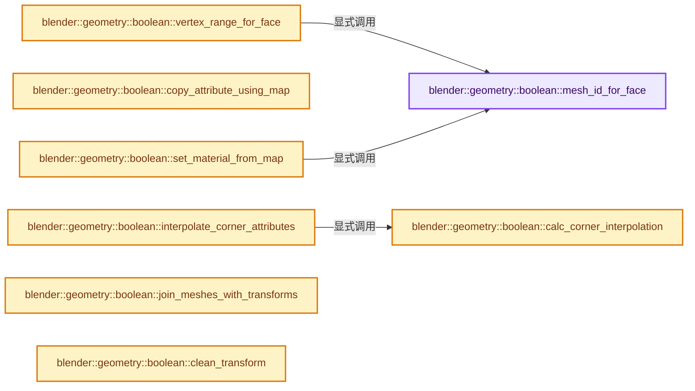

# 实现依赖专题：source/blender/geometry/intern/mesh_boolean.cc

[方向导航](README.md) · [符号索引](../%E7%AC%A6%E5%8F%B7%E4%BE%9D%E8%B5%96%E4%B8%8E%E5%AE%9E%E7%8E%B0%E7%B4%A2%E5%BC%95.md)

本专题从正文实际调用进入，集中保存共享实现。函数有稳定锚点，可从调用处直接跳到对应完整函数；递归与互相调用通过回链组织。

## 本文件的实现关系




## 完整成员与函数实现

<a id="f-3ea4f3a2be5702f5"></a>

### `blender::geometry::boolean::mesh_id_for_face`

实现位置：[source/blender/geometry/intern/mesh_boolean.cc](../../../../../source/blender/geometry/intern/mesh_boolean.cc) · L75—L83。

接口参数：

- `const int face_id`
- `const MeshOffsets &mesh_offsets`

**教学注释版**

<!-- annotated:54ef87e3d39034 -->

```cpp
int mesh_id_for_face(const int face_id, const MeshOffsets &mesh_offsets)
{
  for (const int mesh_id : mesh_offsets.face_offsets.index_range()) {
    if (mesh_offsets.face_offsets[mesh_id].contains(face_id)) {
      return mesh_id;
    }
  }
  return -1;
}
```

<details>
<summary>核对原始源码：source/blender/geometry/intern/mesh_boolean.cc · L75—L83</summary>

<!-- original:54ef87e3d39034:source/blender/geometry/intern/mesh_boolean.cc:75:83 -->

```cpp
int mesh_id_for_face(const int face_id, const MeshOffsets &mesh_offsets)
{
  for (const int mesh_id : mesh_offsets.face_offsets.index_range()) {
    if (mesh_offsets.face_offsets[mesh_id].contains(face_id)) {
      return mesh_id;
    }
  }
  return -1;
}
```

</details>

**结果出口**

- `return mesh_id;`
- `return -1;`

**继续追踪实现**

- `mesh_offsets.face_offsets.index_range` → [调用协议](../%E6%A8%A1%E6%9D%BF%E5%AE%8F%E4%B8%8E%E5%8A%A8%E6%80%81%E5%88%86%E6%B4%BE%E5%8D%8F%E8%AE%AE.md)：接收对象类型依赖auto、返回值或模板实例；不按同名猜测目标。调用位置L77。
- `mesh_offsets.face_offsets[mesh_id].contains` → [调用协议](../%E6%A8%A1%E6%9D%BF%E5%AE%8F%E4%B8%8E%E5%8A%A8%E6%80%81%E5%88%86%E6%B4%BE%E5%8D%8F%E8%AE%AE.md)：接收对象类型依赖auto、返回值或模板实例；不按同名猜测目标。调用位置L78。

<a id="f-85e4a5fc75d95ed5"></a>

### `blender::geometry::boolean::vertex_range_for_face`

实现位置：[source/blender/geometry/intern/mesh_boolean.cc](../../../../../source/blender/geometry/intern/mesh_boolean.cc) · L85—L93。

接口参数：

- `const int face_id`
- `const MeshOffsets &mesh_offsets`

**教学注释版**

<!-- annotated:5874476f1a8d83 -->

```cpp
IndexRange vertex_range_for_face(const int face_id, const MeshOffsets &mesh_offsets)
{
  const int mesh_id = mesh_id_for_face(face_id, mesh_offsets);
  if (mesh_id == -1) {
    return IndexRange();
  }
  return IndexRange::from_begin_end(mesh_offsets.vert_start[mesh_id],
                                    mesh_offsets.vert_start[mesh_id + 1]);
}
```

<details>
<summary>核对原始源码：source/blender/geometry/intern/mesh_boolean.cc · L85—L93</summary>

<!-- original:5874476f1a8d83:source/blender/geometry/intern/mesh_boolean.cc:85:93 -->

```cpp
IndexRange vertex_range_for_face(const int face_id, const MeshOffsets &mesh_offsets)
{
  const int mesh_id = mesh_id_for_face(face_id, mesh_offsets);
  if (mesh_id == -1) {
    return IndexRange();
  }
  return IndexRange::from_begin_end(mesh_offsets.vert_start[mesh_id],
                                    mesh_offsets.vert_start[mesh_id + 1]);
}
```

</details>

**结果出口**

- `return IndexRange();`
- `return IndexRange::from_begin_end(mesh_offsets.vert_start[mesh_id],`

**继续追踪实现**

- `mesh_id_for_face` → [blender::geometry::boolean::mesh_id_for_face · L75](%E4%BE%9D%E8%B5%96-mesh_boolean-f78e67.md#f-3ea4f3a2be5702f5)。
- `IndexRange` → [blender::IndexRange](../01-%E5%9F%BA%E7%A1%80%E5%AE%B9%E5%99%A8%E4%B8%8E%E7%8E%B0%E4%BB%A3CPP/%E4%BE%9D%E8%B5%96-BLI_index_range-7d7cc5.md#t-caa3466d6776)；[blender::gpu::shader::parser::IndexRange](%E4%BE%9D%E8%B5%96-utils-06433d.md#t-82d2bd4ea71c)；[blender::IndexRange](%E4%BE%9D%E8%B5%96-DNA_node_types-6708b9.md#t-0448cc889d39)。
- `IndexRange::from_begin_end` → [blender::IndexRange::from_begin_end · L78](../01-%E5%9F%BA%E7%A1%80%E5%AE%B9%E5%99%A8%E4%B8%8E%E7%8E%B0%E4%BB%A3CPP/04-IndexRange%E8%BF%9E%E7%BB%AD%E6%95%B4%E6%95%B0%E5%8C%BA%E9%97%B4.md#f-a523839fb9650253)。

<a id="f-24698a244c57f753"></a>

### `blender::geometry::boolean::copy_attribute_using_map`

实现位置：[source/blender/geometry/intern/mesh_boolean.cc](../../../../../source/blender/geometry/intern/mesh_boolean.cc) · L95—L103。

接口参数：

- `const GSpan src`
- `const Span<int> out_to_in_map`
- `GMutableSpan dst`

**教学注释版**

<!-- annotated:f9b5ae1d30d4e7 -->

```cpp
void copy_attribute_using_map(const GSpan src, const Span<int> out_to_in_map, GMutableSpan dst)
{
  const CPPType &type = dst.type();
  IndexMaskMemory memory;
  const IndexMask valid_mask = array_utils::indices_non_negative(
      IndexRange(dst.size()), out_to_in_map, memory);
  bke::attribute_math::gather(src, out_to_in_map, valid_mask, dst);
  type.value_initialize_indices(dst.data(), valid_mask.complement(IndexRange(dst.size()), memory));
}
```

<details>
<summary>核对原始源码：source/blender/geometry/intern/mesh_boolean.cc · L95—L103</summary>

<!-- original:f9b5ae1d30d4e7:source/blender/geometry/intern/mesh_boolean.cc:95:103 -->

```cpp
void copy_attribute_using_map(const GSpan src, const Span<int> out_to_in_map, GMutableSpan dst)
{
  const CPPType &type = dst.type();
  IndexMaskMemory memory;
  const IndexMask valid_mask = array_utils::indices_non_negative(
      IndexRange(dst.size()), out_to_in_map, memory);
  bke::attribute_math::gather(src, out_to_in_map, valid_mask, dst);
  type.value_initialize_indices(dst.data(), valid_mask.complement(IndexRange(dst.size()), memory));
}
```

</details>

**继续追踪实现**

- `dst.type` → [blender::GMutableSpan::type · L182](../03-%E5%86%85%E5%AD%98%E5%88%86%E9%85%8D%E4%B8%8E%E8%BF%90%E8%A1%8C%E6%97%B6%E7%B1%BB%E5%9E%8B/11-GSpan%E4%B8%8EGArray.md#f-74385040046c86d5)。
- `array_utils::indices_non_negative` → [blender::array_utils::indices_non_negative · L455](../01-%E5%9F%BA%E7%A1%80%E5%AE%B9%E5%99%A8%E4%B8%8E%E7%8E%B0%E4%BB%A3CPP/%E4%BE%9D%E8%B5%96-array_utils-cbb70f.md#f-2c083cdfa58fcf58)。
- `IndexRange` → [blender::IndexRange](../01-%E5%9F%BA%E7%A1%80%E5%AE%B9%E5%99%A8%E4%B8%8E%E7%8E%B0%E4%BB%A3CPP/%E4%BE%9D%E8%B5%96-BLI_index_range-7d7cc5.md#t-caa3466d6776)；[blender::gpu::shader::parser::IndexRange](%E4%BE%9D%E8%B5%96-utils-06433d.md#t-82d2bd4ea71c)；[blender::IndexRange](%E4%BE%9D%E8%B5%96-DNA_node_types-6708b9.md#t-0448cc889d39)。
- `dst.size` → [blender::GMutableSpan::size · L198](../03-%E5%86%85%E5%AD%98%E5%88%86%E9%85%8D%E4%B8%8E%E8%BF%90%E8%A1%8C%E6%97%B6%E7%B1%BB%E5%9E%8B/11-GSpan%E4%B8%8EGArray.md#f-ecf8873167fb66c8)。
- `bke::attribute_math::gather` → [blender::bke::attribute_math::gather · L423](%E4%BE%9D%E8%B5%96-attribute_math-ecaf96.md#f-b6baceb74af92359)；[blender::bke::attribute_math::gather · L428](%E4%BE%9D%E8%B5%96-attribute_math-ecaf96.md#f-2516f95595549791)；[blender::bke::attribute_math::gather · L433](%E4%BE%9D%E8%B5%96-attribute_math-ecaf96.md#f-a5162715f16ef3e5)；[blender::bke::attribute_math::gather · L438](%E4%BE%9D%E8%B5%96-attribute_math-ecaf96.md#f-dda898f8cb8735c3)。同名重载需按实参类型选择。
- `type.value_initialize_indices` → [blender::CPPType::value_initialize_indices · L552](../03-%E5%86%85%E5%AD%98%E5%88%86%E9%85%8D%E4%B8%8E%E8%BF%90%E8%A1%8C%E6%97%B6%E7%B1%BB%E5%9E%8B/09-CPPType%E5%A4%8D%E5%88%B6%E7%A7%BB%E5%8A%A8%E9%87%8D%E5%AE%9A%E4%BD%8D.md#f-8a08e958708a4989)。
- `dst.data` → [blender::GMutableSpan::data · L208](../03-%E5%86%85%E5%AD%98%E5%88%86%E9%85%8D%E4%B8%8E%E8%BF%90%E8%A1%8C%E6%97%B6%E7%B1%BB%E5%9E%8B/11-GSpan%E4%B8%8EGArray.md#f-f951536a0bdbb159)。
- `valid_mask.complement` → [blender::index_mask::IndexMask::complement · L407](../04-%E8%99%9A%E6%8B%9F%E6%95%B0%E7%BB%84%E4%B8%8E%E7%B4%A2%E5%BC%95%E9%80%89%E6%8B%A9/10-IndexMask%E6%9E%84%E5%BB%BA%E4%B8%8E%E5%B9%B6%E8%A1%8C.md#f-1e9932d5baa6f719)。

<a id="f-8a08a07fcdba54ab"></a>

### `blender::geometry::boolean::calc_corner_interpolation`

实现位置：[source/blender/geometry/intern/mesh_boolean.cc](../../../../../source/blender/geometry/intern/mesh_boolean.cc) · L124—L220。

接口参数：

- `const Mesh &output_mesh`
- `const Mesh &input_mesh`
- `const Span<int> out_to_in_corner_map`
- `const Span<int> out_to_in_face_map`
- `CornerInterpolation &r_interp`

**教学注释版**

<!-- annotated:93cde2c39f688d -->

```cpp
static void calc_corner_interpolation(const Mesh &output_mesh,
                                      const Mesh &input_mesh,
                                      const Span<int> out_to_in_corner_map,
                                      const Span<int> out_to_in_face_map,
                                      CornerInterpolation &r_interp)
{
  const OffsetIndices<int> output_faces = output_mesh.faces();
  const OffsetIndices<int> input_faces = input_mesh.faces();
  const Span<int> input_corner_verts = input_mesh.corner_verts();
  const Span<float3> input_vert_positions = input_mesh.vert_positions();
  const Span<int> output_corner_verts = output_mesh.corner_verts();
  const Span<float3> output_vert_positions = output_mesh.vert_positions();

  /* Count the interpolated corners and their weights per face to allocate flat arrays. */
  // [讲解] output_faces.size：读取连续区间或分组的边界信息。
  Array<int> interp_corner_offsets_data(output_faces.size() + 1);
  Array<int> weight_offsets_data(output_faces.size() + 1);
  threading::parallel_for(output_faces.index_range(), 4096, [&](const IndexRange range) {
    for (const int out_face : range) {
      // [讲解] out_to_in_corner_map.slice：建立原连续范围的子视图。
      const Span<int> face_map = out_to_in_corner_map.slice(output_faces[out_face]);
      // [讲解] face_map.begin：返回借用范围的地址。
      const int interp_num = std::count(face_map.begin(), face_map.end(), -1);
      const int in_face_size = input_faces[out_to_in_face_map[out_face]].size();
      interp_corner_offsets_data[out_face] = interp_num;
      weight_offsets_data[out_face] = interp_num * in_face_size;
    }
  });
  const OffsetIndices<int> interp_corner_offsets = offset_indices::accumulate_counts_to_offsets(
      interp_corner_offsets_data);
  const OffsetIndices<int> weight_offsets = offset_indices::accumulate_counts_to_offsets(
      weight_offsets_data);

  Array<int> interp_corners(interp_corner_offsets.total_size());
  r_interp.group_offsets.reinitialize(interp_corner_offsets.total_size() + 1);
  r_interp.flipped.reinitialize(interp_corner_offsets.total_size());
  r_interp.src_corners.reinitialize(weight_offsets.total_size());
  r_interp.weights.reinitialize(weight_offsets.total_size());

  /* Loop per output face, as there is an expensive calculation that needs to be done per face. */
  threading::parallel_for(output_faces.index_range(), 256, [&](const IndexRange range) {
    Vector<float2, 20> cos_2d;
    for (const int out_face_index : range) {
      const IndexRange interp_range = interp_corner_offsets[out_face_index];
      // [讲解] interp_range.is_empty：读取连续区间或分组的边界信息。
      if (interp_range.is_empty()) {
        continue;
      }
      const int in_face_index = out_to_in_face_map[out_face_index];
      const IndexRange in_face = input_faces[in_face_index];
      const IndexRange out_face = output_faces[out_face_index];

      /* First get coordinates of input face projected onto 2d. */
      const Span<int> in_face_verts = input_corner_verts.slice(in_face);
      const int in_face_size = in_face.size();
      const Span<int> out_face_verts = output_corner_verts.slice(out_face);
      // [讲解] cos_2d.resize：把有效元素数调整为new_size。增长路径构造新元素，缩小路径销毁尾部对象，最后才提交新的end_。
      cos_2d.resize(in_face_size);
      // [讲解] cos_2d.data：提供当前存储或有效范围的地址。
      float (*cos_2d_p)[2] = reinterpret_cast<float (*)[2]>(cos_2d.data());
      const float3 axis_dominant = bke::mesh::face_normal_calc(input_vert_positions,
                                                               in_face_verts);
      float3x3 axis_mat;
      axis_dominant_v3_to_m3(axis_mat.ptr(), axis_dominant);
      /* We also need to know if the output face has a flipped normal compared
       * to the corresponding input face (used if we have custom normals).
       */
      const float3 out_face_normal = bke::mesh::face_normal_calc(output_vert_positions,
                                                                 out_face_verts);
      const bool face_is_flipped = math::dot(axis_dominant, out_face_normal) < 0.0;
      // [讲解] in_face_verts.index_range：查询视图长度或生成对应有效索引区间。
      for (const int i : in_face_verts.index_range()) {
        const float3 &co = input_vert_positions[in_face_verts[i]];
        cos_2d[i] = (axis_mat * co).xy();
      }

      const int weights_start = weight_offsets[out_face_index].start();
      int interp_i = 0;
      for (const int out_c : out_face) {
        if (out_to_in_corner_map[out_c] != -1) {
          continue;
        }
        const int corner_i = interp_range[interp_i];
        const IndexRange group(weights_start + interp_i * in_face_size, in_face_size);
        interp_corners[corner_i] = out_c;
        // [讲解] group.start：读取连续区间或分组的边界信息。
        r_interp.group_offsets[corner_i] = group.start();
        r_interp.flipped[corner_i] = face_is_flipped;
        array_utils::fill_index_range<int>(r_interp.src_corners.as_mutable_span().slice(group),
                                           in_face.start());

        const int out_v = output_corner_verts[out_c];
        float2 co;
        mul_v2_m3v3(co, axis_mat.ptr(), output_vert_positions[out_v]);
        interp_weights_poly_v2(&r_interp.weights[group.start()], cos_2d_p, in_face_size, co);
        interp_i++;
      }
    }
  });
  r_interp.group_offsets.last() = weight_offsets.total_size();

  // [讲解] interp_corners.as_span：提供数组的借用访问入口。
  r_interp.interp_mask = IndexMask::from_indices(interp_corners.as_span(), r_interp.memory);
  r_interp.copy_mask = r_interp.interp_mask.complement(IndexRange(out_to_in_corner_map.size()),
                                                       r_interp.memory);
}
```

<details>
<summary>核对原始源码：source/blender/geometry/intern/mesh_boolean.cc · L124—L220</summary>

<!-- original:93cde2c39f688d:source/blender/geometry/intern/mesh_boolean.cc:124:220 -->

```cpp
static void calc_corner_interpolation(const Mesh &output_mesh,
                                      const Mesh &input_mesh,
                                      const Span<int> out_to_in_corner_map,
                                      const Span<int> out_to_in_face_map,
                                      CornerInterpolation &r_interp)
{
  const OffsetIndices<int> output_faces = output_mesh.faces();
  const OffsetIndices<int> input_faces = input_mesh.faces();
  const Span<int> input_corner_verts = input_mesh.corner_verts();
  const Span<float3> input_vert_positions = input_mesh.vert_positions();
  const Span<int> output_corner_verts = output_mesh.corner_verts();
  const Span<float3> output_vert_positions = output_mesh.vert_positions();

  /* Count the interpolated corners and their weights per face to allocate flat arrays. */
  Array<int> interp_corner_offsets_data(output_faces.size() + 1);
  Array<int> weight_offsets_data(output_faces.size() + 1);
  threading::parallel_for(output_faces.index_range(), 4096, [&](const IndexRange range) {
    for (const int out_face : range) {
      const Span<int> face_map = out_to_in_corner_map.slice(output_faces[out_face]);
      const int interp_num = std::count(face_map.begin(), face_map.end(), -1);
      const int in_face_size = input_faces[out_to_in_face_map[out_face]].size();
      interp_corner_offsets_data[out_face] = interp_num;
      weight_offsets_data[out_face] = interp_num * in_face_size;
    }
  });
  const OffsetIndices<int> interp_corner_offsets = offset_indices::accumulate_counts_to_offsets(
      interp_corner_offsets_data);
  const OffsetIndices<int> weight_offsets = offset_indices::accumulate_counts_to_offsets(
      weight_offsets_data);

  Array<int> interp_corners(interp_corner_offsets.total_size());
  r_interp.group_offsets.reinitialize(interp_corner_offsets.total_size() + 1);
  r_interp.flipped.reinitialize(interp_corner_offsets.total_size());
  r_interp.src_corners.reinitialize(weight_offsets.total_size());
  r_interp.weights.reinitialize(weight_offsets.total_size());

  /* Loop per output face, as there is an expensive calculation that needs to be done per face. */
  threading::parallel_for(output_faces.index_range(), 256, [&](const IndexRange range) {
    Vector<float2, 20> cos_2d;
    for (const int out_face_index : range) {
      const IndexRange interp_range = interp_corner_offsets[out_face_index];
      if (interp_range.is_empty()) {
        continue;
      }
      const int in_face_index = out_to_in_face_map[out_face_index];
      const IndexRange in_face = input_faces[in_face_index];
      const IndexRange out_face = output_faces[out_face_index];

      /* First get coordinates of input face projected onto 2d. */
      const Span<int> in_face_verts = input_corner_verts.slice(in_face);
      const int in_face_size = in_face.size();
      const Span<int> out_face_verts = output_corner_verts.slice(out_face);
      cos_2d.resize(in_face_size);
      float (*cos_2d_p)[2] = reinterpret_cast<float (*)[2]>(cos_2d.data());
      const float3 axis_dominant = bke::mesh::face_normal_calc(input_vert_positions,
                                                               in_face_verts);
      float3x3 axis_mat;
      axis_dominant_v3_to_m3(axis_mat.ptr(), axis_dominant);
      /* We also need to know if the output face has a flipped normal compared
       * to the corresponding input face (used if we have custom normals).
       */
      const float3 out_face_normal = bke::mesh::face_normal_calc(output_vert_positions,
                                                                 out_face_verts);
      const bool face_is_flipped = math::dot(axis_dominant, out_face_normal) < 0.0;
      for (const int i : in_face_verts.index_range()) {
        const float3 &co = input_vert_positions[in_face_verts[i]];
        cos_2d[i] = (axis_mat * co).xy();
      }

      const int weights_start = weight_offsets[out_face_index].start();
      int interp_i = 0;
      for (const int out_c : out_face) {
        if (out_to_in_corner_map[out_c] != -1) {
          continue;
        }
        const int corner_i = interp_range[interp_i];
        const IndexRange group(weights_start + interp_i * in_face_size, in_face_size);
        interp_corners[corner_i] = out_c;
        r_interp.group_offsets[corner_i] = group.start();
        r_interp.flipped[corner_i] = face_is_flipped;
        array_utils::fill_index_range<int>(r_interp.src_corners.as_mutable_span().slice(group),
                                           in_face.start());

        const int out_v = output_corner_verts[out_c];
        float2 co;
        mul_v2_m3v3(co, axis_mat.ptr(), output_vert_positions[out_v]);
        interp_weights_poly_v2(&r_interp.weights[group.start()], cos_2d_p, in_face_size, co);
        interp_i++;
      }
    }
  });
  r_interp.group_offsets.last() = weight_offsets.total_size();

  r_interp.interp_mask = IndexMask::from_indices(interp_corners.as_span(), r_interp.memory);
  r_interp.copy_mask = r_interp.interp_mask.complement(IndexRange(out_to_in_corner_map.size()),
                                                       r_interp.memory);
}
```

</details>

**沿实际写入检查状态**

- `interp_corner_offsets_data[out_face] = interp_num;`
- `weight_offsets_data[out_face] = interp_num * in_face_size;`
- `cos_2d[i] = (axis_mat * co).xy();`
- `interp_corners[corner_i] = out_c;`
- `r_interp.group_offsets[corner_i] = group.start();`
- `r_interp.flipped[corner_i] = face_is_flipped;`
- `r_interp.interp_mask = IndexMask::from_indices(interp_corners.as_span(), r_interp.memory);`
- `r_interp.copy_mask = r_interp.interp_mask.complement(IndexRange(out_to_in_corner_map.size()),`

**继续追踪实现**

- `output_mesh.faces` → [Mesh::faces · L1217](03-MPoly%E8%BF%81%E7%A7%BB%E4%B8%8E%E5%85%BC%E5%AE%B9.md#f-ea444760154e17b2)。
- `input_mesh.faces` → [Mesh::faces · L1217](03-MPoly%E8%BF%81%E7%A7%BB%E4%B8%8E%E5%85%BC%E5%AE%B9.md#f-ea444760154e17b2)。
- `input_mesh.corner_verts` → [Mesh::corner_verts · L1238](03-MPoly%E8%BF%81%E7%A7%BB%E4%B8%8E%E5%85%BC%E5%AE%B9.md#f-a59c61f583b64bc4)。
- `input_mesh.vert_positions` → [Mesh::vert_positions · L1193](03-MPoly%E8%BF%81%E7%A7%BB%E4%B8%8E%E5%85%BC%E5%AE%B9.md#f-ae4177e5c5f2b371)。
- `output_mesh.corner_verts` → [Mesh::corner_verts · L1238](03-MPoly%E8%BF%81%E7%A7%BB%E4%B8%8E%E5%85%BC%E5%AE%B9.md#f-a59c61f583b64bc4)。
- `output_mesh.vert_positions` → [Mesh::vert_positions · L1193](03-MPoly%E8%BF%81%E7%A7%BB%E4%B8%8E%E5%85%BC%E5%AE%B9.md#f-ae4177e5c5f2b371)。
- `output_faces.size` → [blender::offset_indices::OffsetIndices::size · L67](02-OffsetIndices%E5%AE%8C%E6%95%B4%E6%8E%A5%E5%8F%A3.md#f-e238abc62ed42abd)。
- `threading::parallel_for` → [blender::threading::parallel_for · L68](../11-Depsgraph%E4%B8%8E%E5%B9%B6%E8%A1%8C%E4%BB%BB%E5%8A%A1%E7%B3%BB%E7%BB%9F/07-%E4%BB%BB%E5%8A%A1%E6%B1%A0%E4%B8%8ETBB%E6%8E%A5%E5%85%A5.md#f-838294754c24426c)。
- `output_faces.index_range` → [blender::offset_indices::OffsetIndices::index_range · L77](02-OffsetIndices%E5%AE%8C%E6%95%B4%E6%8E%A5%E5%8F%A3.md#f-19b5ca1456de007d)。
- `out_to_in_corner_map.slice` → [blender::Span::slice · L141](../01-%E5%9F%BA%E7%A1%80%E5%AE%B9%E5%99%A8%E4%B8%8E%E7%8E%B0%E4%BB%A3CPP/05-Span%E5%8F%AA%E8%AF%BB%E8%BF%9E%E7%BB%AD%E8%A7%86%E5%9B%BE.md#f-380a0e8fdcbd53cc)；[blender::Span::slice · L149](../01-%E5%9F%BA%E7%A1%80%E5%AE%B9%E5%99%A8%E4%B8%8E%E7%8E%B0%E4%BB%A3CPP/05-Span%E5%8F%AA%E8%AF%BB%E8%BF%9E%E7%BB%AD%E8%A7%86%E5%9B%BE.md#f-9b9c15e78dd54eec)。同名重载需按实参类型选择。
- `std::count` → [外部契约](https://eel.is/c++draft/)：这个边界按实际表达式及所属类型核对参数、返回值、寿命与失败行为。这里提供接口入口，不声称已解释该第三方版本的内部实现。
- `face_map.begin` → [blender::Span::begin · L224](../01-%E5%9F%BA%E7%A1%80%E5%AE%B9%E5%99%A8%E4%B8%8E%E7%8E%B0%E4%BB%A3CPP/05-Span%E5%8F%AA%E8%AF%BB%E8%BF%9E%E7%BB%AD%E8%A7%86%E5%9B%BE.md#f-415883b512284f46)。
- `face_map.end` → [blender::Span::end · L228](../01-%E5%9F%BA%E7%A1%80%E5%AE%B9%E5%99%A8%E4%B8%8E%E7%8E%B0%E4%BB%A3CPP/05-Span%E5%8F%AA%E8%AF%BB%E8%BF%9E%E7%BB%AD%E8%A7%86%E5%9B%BE.md#f-a7d8b9e494c291a7)。
- `input_faces[out_to_in_face_map[out_face]].size` → [调用协议](../%E6%A8%A1%E6%9D%BF%E5%AE%8F%E4%B8%8E%E5%8A%A8%E6%80%81%E5%88%86%E6%B4%BE%E5%8D%8F%E8%AE%AE.md)：接收对象类型依赖auto、返回值或模板实例；不按同名猜测目标。调用位置L144。
- `offset_indices::accumulate_counts_to_offsets` → [blender::offset_indices::accumulate_counts_to_offsets · L24](05-%E9%82%BB%E6%8E%A5%E5%85%B3%E7%B3%BB%E4%B8%8E%E5%89%8D%E7%BC%80%E5%92%8C.md#f-cfa9fbd186afcdd5)。
- `interp_corner_offsets.total_size` → [blender::offset_indices::OffsetIndices::total_size · L58](02-OffsetIndices%E5%AE%8C%E6%95%B4%E6%8E%A5%E5%8F%A3.md#f-c111ffdac7a19248)。
- `r_interp.group_offsets.reinitialize` → [调用协议](../%E6%A8%A1%E6%9D%BF%E5%AE%8F%E4%B8%8E%E5%8A%A8%E6%80%81%E5%88%86%E6%B4%BE%E5%8D%8F%E8%AE%AE.md)：接收对象类型依赖auto、返回值或模板实例；不按同名猜测目标。调用位置L155。
- `r_interp.flipped.reinitialize` → [调用协议](../%E6%A8%A1%E6%9D%BF%E5%AE%8F%E4%B8%8E%E5%8A%A8%E6%80%81%E5%88%86%E6%B4%BE%E5%8D%8F%E8%AE%AE.md)：接收对象类型依赖auto、返回值或模板实例；不按同名猜测目标。调用位置L156。
- `r_interp.src_corners.reinitialize` → [调用协议](../%E6%A8%A1%E6%9D%BF%E5%AE%8F%E4%B8%8E%E5%8A%A8%E6%80%81%E5%88%86%E6%B4%BE%E5%8D%8F%E8%AE%AE.md)：接收对象类型依赖auto、返回值或模板实例；不按同名猜测目标。调用位置L157。
- `weight_offsets.total_size` → [blender::offset_indices::OffsetIndices::total_size · L58](02-OffsetIndices%E5%AE%8C%E6%95%B4%E6%8E%A5%E5%8F%A3.md#f-c111ffdac7a19248)。
- `r_interp.weights.reinitialize` → [调用协议](../%E6%A8%A1%E6%9D%BF%E5%AE%8F%E4%B8%8E%E5%8A%A8%E6%80%81%E5%88%86%E6%B4%BE%E5%8D%8F%E8%AE%AE.md)：接收对象类型依赖auto、返回值或模板实例；不按同名猜测目标。调用位置L158。
- `interp_range.is_empty` → [blender::IndexRange::is_empty · L169](../01-%E5%9F%BA%E7%A1%80%E5%AE%B9%E5%99%A8%E4%B8%8E%E7%8E%B0%E4%BB%A3CPP/04-IndexRange%E8%BF%9E%E7%BB%AD%E6%95%B4%E6%95%B0%E5%8C%BA%E9%97%B4.md#f-9501e070be01ff71)。
- `input_corner_verts.slice` → [blender::Span::slice · L141](../01-%E5%9F%BA%E7%A1%80%E5%AE%B9%E5%99%A8%E4%B8%8E%E7%8E%B0%E4%BB%A3CPP/05-Span%E5%8F%AA%E8%AF%BB%E8%BF%9E%E7%BB%AD%E8%A7%86%E5%9B%BE.md#f-380a0e8fdcbd53cc)；[blender::Span::slice · L149](../01-%E5%9F%BA%E7%A1%80%E5%AE%B9%E5%99%A8%E4%B8%8E%E7%8E%B0%E4%BB%A3CPP/05-Span%E5%8F%AA%E8%AF%BB%E8%BF%9E%E7%BB%AD%E8%A7%86%E5%9B%BE.md#f-9b9c15e78dd54eec)。同名重载需按实参类型选择。
- `in_face.size` → [blender::IndexRange::size · L156](../01-%E5%9F%BA%E7%A1%80%E5%AE%B9%E5%99%A8%E4%B8%8E%E7%8E%B0%E4%BB%A3CPP/04-IndexRange%E8%BF%9E%E7%BB%AD%E6%95%B4%E6%95%B0%E5%8C%BA%E9%97%B4.md#f-05f66c3ebb2fdfec)。
- `output_corner_verts.slice` → [blender::Span::slice · L141](../01-%E5%9F%BA%E7%A1%80%E5%AE%B9%E5%99%A8%E4%B8%8E%E7%8E%B0%E4%BB%A3CPP/05-Span%E5%8F%AA%E8%AF%BB%E8%BF%9E%E7%BB%AD%E8%A7%86%E5%9B%BE.md#f-380a0e8fdcbd53cc)；[blender::Span::slice · L149](../01-%E5%9F%BA%E7%A1%80%E5%AE%B9%E5%99%A8%E4%B8%8E%E7%8E%B0%E4%BB%A3CPP/05-Span%E5%8F%AA%E8%AF%BB%E8%BF%9E%E7%BB%AD%E8%A7%86%E5%9B%BE.md#f-9b9c15e78dd54eec)。同名重载需按实参类型选择。
- `cos_2d.resize` → [blender::Vector::resize · L418](../01-%E5%9F%BA%E7%A1%80%E5%AE%B9%E5%99%A8%E4%B8%8E%E7%8E%B0%E4%BB%A3CPP/10-Vector%E6%89%A9%E5%AE%B9%E4%B8%8E%E5%A2%9E%E9%95%BF.md#f-059312cabb8abe3a)；[blender::Vector::resize · L439](../01-%E5%9F%BA%E7%A1%80%E5%AE%B9%E5%99%A8%E4%B8%8E%E7%8E%B0%E4%BB%A3CPP/10-Vector%E6%89%A9%E5%AE%B9%E4%B8%8E%E5%A2%9E%E9%95%BF.md#f-ab8f94924ebe2d12)。同名重载需按实参类型选择。
- `cos_2d.data` → [blender::Vector::data · L954](../01-%E5%9F%BA%E7%A1%80%E5%AE%B9%E5%99%A8%E4%B8%8E%E7%8E%B0%E4%BB%A3CPP/12-Vector%E5%BC%82%E5%B8%B8%E5%AE%89%E5%85%A8%E4%B8%8E%E8%BE%B9%E7%95%8C.md#f-6e441591404715bc)；[blender::Vector::data · L962](../01-%E5%9F%BA%E7%A1%80%E5%AE%B9%E5%99%A8%E4%B8%8E%E7%8E%B0%E4%BB%A3CPP/12-Vector%E5%BC%82%E5%B8%B8%E5%AE%89%E5%85%A8%E4%B8%8E%E8%BE%B9%E7%95%8C.md#f-4bc78d4954c1021a)。同名重载需按实参类型选择。
- `bke::mesh::face_normal_calc` → [blender::bke::mesh::face_normal_calc · L143](../06-%E9%9A%90%E5%BC%8F%E5%85%B1%E4%BA%AB%E4%B8%8E%E7%BC%93%E5%AD%98%E7%B3%BB%E7%BB%9F/08-%E6%B3%95%E7%BA%BF%E7%BC%93%E5%AD%98%E7%9A%84%E7%9C%9F%E5%AE%9E%E4%BE%9D%E8%B5%96.md#f-d62af7ecfb61b003)。
- `axis_dominant_v3_to_m3` → [blender::axis_dominant_v3_to_m3 · L3702](../12-%E7%A9%BA%E9%97%B4%E6%95%B0%E6%8D%AE%E7%BB%93%E6%9E%84%E4%B8%8E%E5%87%A0%E4%BD%95%E7%AE%97%E6%B3%95/%E4%BE%9D%E8%B5%96-math_geom-8d91a3.md#f-3e28943552d479d7)。
- `axis_mat.ptr` → [调用协议](../%E6%A8%A1%E6%9D%BF%E5%AE%8F%E4%B8%8E%E5%8A%A8%E6%80%81%E5%88%86%E6%B4%BE%E5%8D%8F%E8%AE%AE.md)：由接收对象具体类型或运行时策略提供实现。调用位置L181。
- `math::dot` → [blender::math::dot · L430](../12-%E7%A9%BA%E9%97%B4%E6%95%B0%E6%8D%AE%E7%BB%93%E6%9E%84%E4%B8%8E%E5%87%A0%E4%BD%95%E7%AE%97%E6%B3%95/%E4%BE%9D%E8%B5%96-BLI_math_vector-906a87.md#f-6f0c6a081b107428)；[blender::math::dot · L198](../12-%E7%A9%BA%E9%97%B4%E6%95%B0%E6%8D%AE%E7%BB%93%E6%9E%84%E4%B8%8E%E5%87%A0%E4%BD%95%E7%AE%97%E6%B3%95/%E4%BE%9D%E8%B5%96-BLI_math_quaternion-cf105d.md#f-5b1ef457981dbc76)。同名重载需按实参类型选择。
- `in_face_verts.index_range` → [blender::Span::index_range · L405](../01-%E5%9F%BA%E7%A1%80%E5%AE%B9%E5%99%A8%E4%B8%8E%E7%8E%B0%E4%BB%A3CPP/05-Span%E5%8F%AA%E8%AF%BB%E8%BF%9E%E7%BB%AD%E8%A7%86%E5%9B%BE.md#f-caaa9b06e13e53e0)。
- `(axis_mat * co).xy` → [调用协议](../%E6%A8%A1%E6%9D%BF%E5%AE%8F%E4%B8%8E%E5%8A%A8%E6%80%81%E5%88%86%E6%B4%BE%E5%8D%8F%E8%AE%AE.md)：接收对象类型依赖auto、返回值或模板实例；不按同名猜测目标。调用位置L190。
- `weight_offsets[out_face_index].start` → [调用协议](../%E6%A8%A1%E6%9D%BF%E5%AE%8F%E4%B8%8E%E5%8A%A8%E6%80%81%E5%88%86%E6%B4%BE%E5%8D%8F%E8%AE%AE.md)：接收对象类型依赖auto、返回值或模板实例；不按同名猜测目标。调用位置L193。
- `group.start` → [blender::IndexRange::start · L243](../01-%E5%9F%BA%E7%A1%80%E5%AE%B9%E5%99%A8%E4%B8%8E%E7%8E%B0%E4%BB%A3CPP/04-IndexRange%E8%BF%9E%E7%BB%AD%E6%95%B4%E6%95%B0%E5%8C%BA%E9%97%B4.md#f-99d2195bd9cfd1f0)。
- `array_utils::fill_index_range<int>` → [blender::array_utils::fill_index_range · L434](07-%E5%88%86%E7%BB%84%E8%AE%BF%E9%97%AE%E4%B8%8E%E5%8F%8D%E5%90%91%E7%B4%A2%E5%BC%95.md#f-f8128b104d76df0f)；[blender::array_utils::fill_index_range · L439](07-%E5%88%86%E7%BB%84%E8%AE%BF%E9%97%AE%E4%B8%8E%E5%8F%8D%E5%90%91%E7%B4%A2%E5%BC%95.md#f-95ca84458bfc7e7e)；[blender::array_utils::fill_index_range · L445](07-%E5%88%86%E7%BB%84%E8%AE%BF%E9%97%AE%E4%B8%8E%E5%8F%8D%E5%90%91%E7%B4%A2%E5%BC%95.md#f-c11b114c213cd61a)。同名重载需按实参类型选择。
- `r_interp.src_corners.as_mutable_span().slice` → [调用协议](../%E6%A8%A1%E6%9D%BF%E5%AE%8F%E4%B8%8E%E5%8A%A8%E6%80%81%E5%88%86%E6%B4%BE%E5%8D%8F%E8%AE%AE.md)：接收对象类型依赖auto、返回值或模板实例；不按同名猜测目标。调用位置L204。
- `r_interp.src_corners.as_mutable_span` → [调用协议](../%E6%A8%A1%E6%9D%BF%E5%AE%8F%E4%B8%8E%E5%8A%A8%E6%80%81%E5%88%86%E6%B4%BE%E5%8D%8F%E8%AE%AE.md)：接收对象类型依赖auto、返回值或模板实例；不按同名猜测目标。调用位置L204。
- `in_face.start` → [blender::IndexRange::start · L243](../01-%E5%9F%BA%E7%A1%80%E5%AE%B9%E5%99%A8%E4%B8%8E%E7%8E%B0%E4%BB%A3CPP/04-IndexRange%E8%BF%9E%E7%BB%AD%E6%95%B4%E6%95%B0%E5%8C%BA%E9%97%B4.md#f-99d2195bd9cfd1f0)。
- `mul_v2_m3v3` → [blender::mul_v2_m3v3 · L844](../12-%E7%A9%BA%E9%97%B4%E6%95%B0%E6%8D%AE%E7%BB%93%E6%9E%84%E4%B8%8E%E5%87%A0%E4%BD%95%E7%AE%97%E6%B3%95/%E4%BE%9D%E8%B5%96-math_matrix_c-004123.md#f-2550a487d003ca6b)。
- `interp_weights_poly_v2` → [blender::interp_weights_poly_v2 · L4350](../12-%E7%A9%BA%E9%97%B4%E6%95%B0%E6%8D%AE%E7%BB%93%E6%9E%84%E4%B8%8E%E5%87%A0%E4%BD%95%E7%AE%97%E6%B3%95/%E4%BE%9D%E8%B5%96-math_geom-8d91a3.md#f-73ffea639341cdd5)。
- `r_interp.group_offsets.last` → [调用协议](../%E6%A8%A1%E6%9D%BF%E5%AE%8F%E4%B8%8E%E5%8A%A8%E6%80%81%E5%88%86%E6%B4%BE%E5%8D%8F%E8%AE%AE.md)：接收对象类型依赖auto、返回值或模板实例；不按同名猜测目标。调用位置L215。
- `IndexMask::from_indices` → [blender::index_mask::IndexMask::from_indices · L414](../04-%E8%99%9A%E6%8B%9F%E6%95%B0%E7%BB%84%E4%B8%8E%E7%B4%A2%E5%BC%95%E9%80%89%E6%8B%A9/10-IndexMask%E6%9E%84%E5%BB%BA%E4%B8%8E%E5%B9%B6%E8%A1%8C.md#f-85c4cb3a40ba9bbe)。
- `interp_corners.as_span` → [blender::Array::as_span · L254](../01-%E5%9F%BA%E7%A1%80%E5%AE%B9%E5%99%A8%E4%B8%8E%E7%8E%B0%E4%BB%A3CPP/08-Array%E5%A4%8D%E5%88%B6%E7%A7%BB%E5%8A%A8%E4%B8%8E%E9%94%80%E6%AF%81.md#f-05fc77056a242032)。
- `r_interp.interp_mask.complement` → [调用协议](../%E6%A8%A1%E6%9D%BF%E5%AE%8F%E4%B8%8E%E5%8A%A8%E6%80%81%E5%88%86%E6%B4%BE%E5%8D%8F%E8%AE%AE.md)：接收对象类型依赖auto、返回值或模板实例；不按同名猜测目标。调用位置L218。
- `IndexRange` → [blender::IndexRange](../01-%E5%9F%BA%E7%A1%80%E5%AE%B9%E5%99%A8%E4%B8%8E%E7%8E%B0%E4%BB%A3CPP/%E4%BE%9D%E8%B5%96-BLI_index_range-7d7cc5.md#t-caa3466d6776)；[blender::gpu::shader::parser::IndexRange](%E4%BE%9D%E8%B5%96-utils-06433d.md#t-82d2bd4ea71c)；[blender::IndexRange](%E4%BE%9D%E8%B5%96-DNA_node_types-6708b9.md#t-0448cc889d39)。
- `out_to_in_corner_map.size` → [blender::Span::size · L256](../01-%E5%9F%BA%E7%A1%80%E5%AE%B9%E5%99%A8%E4%B8%8E%E7%8E%B0%E4%BB%A3CPP/05-Span%E5%8F%AA%E8%AF%BB%E8%BF%9E%E7%BB%AD%E8%A7%86%E5%9B%BE.md#f-5f80fa006089c998)。

<a id="f-485c30a7f3d8bc47"></a>

### `blender::geometry::boolean::interpolate_corner_attributes`

实现位置：[source/blender/geometry/intern/mesh_boolean.cc](../../../../../source/blender/geometry/intern/mesh_boolean.cc) · L222—L281。

接口参数：

- `bke::MutableAttributeAccessor output_attrs`
- `const bke::AttributeAccessor input_attrs`
- `Mesh *output_mesh`
- `const Mesh *input_mesh`
- `const Span<int> out_to_in_corner_map`
- `const Span<int> out_to_in_face_map`

**教学注释版**

<!-- annotated:75ad2cb321857b -->

```cpp
void interpolate_corner_attributes(bke::MutableAttributeAccessor output_attrs,
                                   const bke::AttributeAccessor input_attrs,
                                   Mesh *output_mesh,
                                   const Mesh *input_mesh,
                                   const Span<int> out_to_in_corner_map,
                                   const Span<int> out_to_in_face_map)
{
#  ifdef DEBUG_TIME
  timeit::ScopedTimer timer("interpolate corner attributes");
#  endif
  /* Only calculated when there is an attribute to interpolate. */
  std::optional<CornerInterpolation> interp;

  input_attrs.foreach_attribute([&](const bke::AttributeIter &iter) {
    if (iter.domain != bke::AttrDomain::Corner || ELEM(iter.name, ".corner_vert", ".corner_edge"))
    {
      return;
    }
    const bke::GAttributeReader reader = iter.get();
    if (!reader) {
      return;
    }

    const CommonVArrayInfo info = reader.varray.common_info();
    if (info.type == CommonVArrayInfo::Type::Single) {
      const bke::AttributeInitValue init(GPointer(reader.varray.type(), info.data));
      output_attrs.add(iter.name, iter.domain, iter.data_type, init);
      return;
    }

    if (!interp) {
      interp.emplace();
      calc_corner_interpolation(
          *output_mesh, *input_mesh, out_to_in_corner_map, out_to_in_face_map, *interp);
    }

    bke::GSpanAttributeWriter dst = output_attrs.lookup_or_add_for_write_only_span(
        iter.name, iter.domain, iter.data_type);
    const GVArraySpan src(*reader);
    bke::attribute_math::gather(src, out_to_in_corner_map, interp->copy_mask, dst.span);
    bke::attribute_math::mix_groups(src,
                                    OffsetIndices<int>(interp->group_offsets),
                                    interp->src_corners,
                                    interp->weights.as_span(),
                                    interp->interp_mask,
                                    dst.span);
    if (iter.name == "custom_normal" && dst.span.type().is<float3>()) {
      /* The joined mesh has converted custom normals to float3. */
      MutableSpan<float3> normals = dst.span.typed<float3>();
      interp->interp_mask.foreach_index(
          [&](const int corner, const int pos) {
            if (interp->flipped[pos]) {
              normals[corner] = -normals[corner];
            }
          },
          exec_mode::grain_size(4096));
    }
    dst.finish();
  });
}
```

<details>
<summary>核对原始源码：source/blender/geometry/intern/mesh_boolean.cc · L222—L281</summary>

<!-- original:75ad2cb321857b:source/blender/geometry/intern/mesh_boolean.cc:222:281 -->

```cpp
void interpolate_corner_attributes(bke::MutableAttributeAccessor output_attrs,
                                   const bke::AttributeAccessor input_attrs,
                                   Mesh *output_mesh,
                                   const Mesh *input_mesh,
                                   const Span<int> out_to_in_corner_map,
                                   const Span<int> out_to_in_face_map)
{
#  ifdef DEBUG_TIME
  timeit::ScopedTimer timer("interpolate corner attributes");
#  endif
  /* Only calculated when there is an attribute to interpolate. */
  std::optional<CornerInterpolation> interp;

  input_attrs.foreach_attribute([&](const bke::AttributeIter &iter) {
    if (iter.domain != bke::AttrDomain::Corner || ELEM(iter.name, ".corner_vert", ".corner_edge"))
    {
      return;
    }
    const bke::GAttributeReader reader = iter.get();
    if (!reader) {
      return;
    }

    const CommonVArrayInfo info = reader.varray.common_info();
    if (info.type == CommonVArrayInfo::Type::Single) {
      const bke::AttributeInitValue init(GPointer(reader.varray.type(), info.data));
      output_attrs.add(iter.name, iter.domain, iter.data_type, init);
      return;
    }

    if (!interp) {
      interp.emplace();
      calc_corner_interpolation(
          *output_mesh, *input_mesh, out_to_in_corner_map, out_to_in_face_map, *interp);
    }

    bke::GSpanAttributeWriter dst = output_attrs.lookup_or_add_for_write_only_span(
        iter.name, iter.domain, iter.data_type);
    const GVArraySpan src(*reader);
    bke::attribute_math::gather(src, out_to_in_corner_map, interp->copy_mask, dst.span);
    bke::attribute_math::mix_groups(src,
                                    OffsetIndices<int>(interp->group_offsets),
                                    interp->src_corners,
                                    interp->weights.as_span(),
                                    interp->interp_mask,
                                    dst.span);
    if (iter.name == "custom_normal" && dst.span.type().is<float3>()) {
      /* The joined mesh has converted custom normals to float3. */
      MutableSpan<float3> normals = dst.span.typed<float3>();
      interp->interp_mask.foreach_index(
          [&](const int corner, const int pos) {
            if (interp->flipped[pos]) {
              normals[corner] = -normals[corner];
            }
          },
          exec_mode::grain_size(4096));
    }
    dst.finish();
  });
}
```

</details>

**沿实际写入检查状态**

- `normals[corner] = -normals[corner];`

**继续追踪实现**

- `input_attrs.foreach_attribute` → [blender::bke::AttributeAccessor::foreach_attribute · L687](08-AttributeAccessor%E6%8E%A5%E5%8F%A3.md#f-44723ac57e0d1fa4)。
- `ELEM` → [ELEM · L88](%E4%BE%9D%E8%B5%96-GHOST_utildefines-34b996.md#m-d28724a15928)；[ELEM · L135](../01-%E5%9F%BA%E7%A1%80%E5%AE%B9%E5%99%A8%E4%B8%8E%E7%8E%B0%E4%BB%A3CPP/%E4%BE%9D%E8%B5%96-BLI_utildefines-293a0a.md#m-d6572de7cae0)。宏定义由构建条件选择。
- `iter.get` → [blender::bke::AttributeIter::get · L408](%E4%BE%9D%E8%B5%96-attribute_access-bceef3.md#f-2c1e25e65fcbed9b)；[blender::bke::AttributeIter::get · L425](08-AttributeAccessor%E6%8E%A5%E5%8F%A3.md#f-96c11326ce251969)；[blender::bke::AttributeIter::get · L433](08-AttributeAccessor%E6%8E%A5%E5%8F%A3.md#f-cf743236e80abe49)；[blender::bke::AttributeIter::get · L438](08-AttributeAccessor%E6%8E%A5%E5%8F%A3.md#f-9aafba5d0c4d4d23)；[blender::bke::AttributeIter::get · L443](08-AttributeAccessor%E6%8E%A5%E5%8F%A3.md#f-bee09d0823c91cdb)。同名重载需按实参类型选择。
- `reader.varray.common_info` → [调用协议](../%E6%A8%A1%E6%9D%BF%E5%AE%8F%E4%B8%8E%E5%8A%A8%E6%80%81%E5%88%86%E6%B4%BE%E5%8D%8F%E8%AE%AE.md)：接收对象类型依赖auto、返回值或模板实例；不按同名猜测目标。调用位置L245。
- `GPointer` → [blender::GPointer::GPointer · L93](../03-%E5%86%85%E5%AD%98%E5%88%86%E9%85%8D%E4%B8%8E%E8%BF%90%E8%A1%8C%E6%97%B6%E7%B1%BB%E5%9E%8B/12-%E5%BC%82%E6%9E%84%E5%80%BC%E5%AD%98%E5%82%A8%E5%AE%9E%E6%88%98.md#f-40f7a024c1e541df)；[blender::GPointer::GPointer · L95](../03-%E5%86%85%E5%AD%98%E5%88%86%E9%85%8D%E4%B8%8E%E8%BF%90%E8%A1%8C%E6%97%B6%E7%B1%BB%E5%9E%8B/12-%E5%BC%82%E6%9E%84%E5%80%BC%E5%AD%98%E5%82%A8%E5%AE%9E%E6%88%98.md#f-e981128b9c36f9ef)；[blender::GPointer::GPointer · L97](../03-%E5%86%85%E5%AD%98%E5%88%86%E9%85%8D%E4%B8%8E%E8%BF%90%E8%A1%8C%E6%97%B6%E7%B1%BB%E5%9E%8B/12-%E5%BC%82%E6%9E%84%E5%80%BC%E5%AD%98%E5%82%A8%E5%AE%9E%E6%88%98.md#f-5d3066175455aed0)；[blender::GPointer::GPointer · L103](../03-%E5%86%85%E5%AD%98%E5%88%86%E9%85%8D%E4%B8%8E%E8%BF%90%E8%A1%8C%E6%97%B6%E7%B1%BB%E5%9E%8B/12-%E5%BC%82%E6%9E%84%E5%80%BC%E5%AD%98%E5%82%A8%E5%AE%9E%E6%88%98.md#f-9194d11793ea4a06)；[blender::GPointer::GPointer · L105](../03-%E5%86%85%E5%AD%98%E5%88%86%E9%85%8D%E4%B8%8E%E8%BF%90%E8%A1%8C%E6%97%B6%E7%B1%BB%E5%9E%8B/12-%E5%BC%82%E6%9E%84%E5%80%BC%E5%AD%98%E5%82%A8%E5%AE%9E%E6%88%98.md#f-1a9887b65d37a9ca)。同名重载需按实参类型选择。
- `reader.varray.type` → [调用协议](../%E6%A8%A1%E6%9D%BF%E5%AE%8F%E4%B8%8E%E5%8A%A8%E6%80%81%E5%88%86%E6%B4%BE%E5%8D%8F%E8%AE%AE.md)：接收对象类型依赖auto、返回值或模板实例；不按同名猜测目标。调用位置L247。
- `output_attrs.add` → [blender::bke::MutableAttributeAccessor::add · L769](08-AttributeAccessor%E6%8E%A5%E5%8F%A3.md#f-5fa7f06d7e22891a)；[blender::bke::MutableAttributeAccessor::add · L785](08-AttributeAccessor%E6%8E%A5%E5%8F%A3.md#f-42998ceb23ada8cc)。同名重载需按实参类型选择。
- `interp.emplace` → [外部契约](https://eel.is/c++draft/)：这个边界按实际表达式及所属类型核对参数、返回值、寿命与失败行为。这里提供接口入口，不声称已解释该第三方版本的内部实现。
- `calc_corner_interpolation` → [blender::geometry::boolean::calc_corner_interpolation · L124](%E4%BE%9D%E8%B5%96-mesh_boolean-f78e67.md#f-8a08a07fcdba54ab)。
- `output_attrs.lookup_or_add_for_write_only_span` → [blender::bke::MutableAttributeAccessor::lookup_or_add_for_write_only_span · L546](%E4%BE%9D%E8%B5%96-attribute_access-bceef3.md#f-97af899f7983a038)；[blender::bke::MutableAttributeAccessor::lookup_or_add_for_write_only_span · L891](08-AttributeAccessor%E6%8E%A5%E5%8F%A3.md#f-ee8d09f75408ac4f)。同名重载需按实参类型选择。
- `bke::attribute_math::gather` → [blender::bke::attribute_math::gather · L423](%E4%BE%9D%E8%B5%96-attribute_math-ecaf96.md#f-b6baceb74af92359)；[blender::bke::attribute_math::gather · L428](%E4%BE%9D%E8%B5%96-attribute_math-ecaf96.md#f-2516f95595549791)；[blender::bke::attribute_math::gather · L433](%E4%BE%9D%E8%B5%96-attribute_math-ecaf96.md#f-a5162715f16ef3e5)；[blender::bke::attribute_math::gather · L438](%E4%BE%9D%E8%B5%96-attribute_math-ecaf96.md#f-dda898f8cb8735c3)。同名重载需按实参类型选择。
- `bke::attribute_math::mix_groups` → [blender::bke::attribute_math::mix_groups · L290](%E4%BE%9D%E8%B5%96-attribute_math-ecaf96.md#f-049a79a9aa129b44)；[blender::bke::attribute_math::mix_groups · L327](%E4%BE%9D%E8%B5%96-attribute_math-ecaf96.md#f-be28245bea119bfd)；[blender::bke::attribute_math::mix_groups · L342](%E4%BE%9D%E8%B5%96-attribute_math-ecaf96.md#f-c57e6de692715e84)；[blender::bke::attribute_math::mix_groups · L352](%E4%BE%9D%E8%B5%96-attribute_math-ecaf96.md#f-dde639221bbf2e24)；[blender::bke::attribute_math::mix_groups · L905](%E4%BE%9D%E8%B5%96-BKE_attribute_math-ac7998.md#f-632fe461d8c4b06e)；[blender::bke::attribute_math::mix_groups · L912](%E4%BE%9D%E8%B5%96-BKE_attribute_math-ac7998.md#f-3d00f529c78c7fcd)。同名重载需按实参类型选择。
- `OffsetIndices<int>` → [blender::offset_indices::OffsetIndices::OffsetIndices · L44](02-OffsetIndices%E5%AE%8C%E6%95%B4%E6%8E%A5%E5%8F%A3.md#f-52a26009810ef8ec)；[blender::offset_indices::OffsetIndices::OffsetIndices · L45](02-OffsetIndices%E5%AE%8C%E6%95%B4%E6%8E%A5%E5%8F%A3.md#f-7be713f9489f3dd7)；[blender::offset_indices::OffsetIndices::OffsetIndices · L55](02-OffsetIndices%E5%AE%8C%E6%95%B4%E6%8E%A5%E5%8F%A3.md#f-db7e81a5ec2dfb8d)。同名重载需按实参类型选择。
- `interp->weights.as_span` → [调用协议](../%E6%A8%A1%E6%9D%BF%E5%AE%8F%E4%B8%8E%E5%8A%A8%E6%80%81%E5%88%86%E6%B4%BE%E5%8D%8F%E8%AE%AE.md)：接收对象类型依赖auto、返回值或模板实例；不按同名猜测目标。调用位置L265。
- `dst.span.type().is<float3>` → [调用协议](../%E6%A8%A1%E6%9D%BF%E5%AE%8F%E4%B8%8E%E5%8A%A8%E6%80%81%E5%88%86%E6%B4%BE%E5%8D%8F%E8%AE%AE.md)：接收对象类型依赖auto、返回值或模板实例；不按同名猜测目标。调用位置L268。
- `dst.span.type` → [调用协议](../%E6%A8%A1%E6%9D%BF%E5%AE%8F%E4%B8%8E%E5%8A%A8%E6%80%81%E5%88%86%E6%B4%BE%E5%8D%8F%E8%AE%AE.md)：接收对象类型依赖auto、返回值或模板实例；不按同名猜测目标。调用位置L268。
- `dst.span.typed<float3>` → [调用协议](../%E6%A8%A1%E6%9D%BF%E5%AE%8F%E4%B8%8E%E5%8A%A8%E6%80%81%E5%88%86%E6%B4%BE%E5%8D%8F%E8%AE%AE.md)：接收对象类型依赖auto、返回值或模板实例；不按同名猜测目标。调用位置L270。
- `interp->interp_mask.foreach_index` → [调用协议](../%E6%A8%A1%E6%9D%BF%E5%AE%8F%E4%B8%8E%E5%8A%A8%E6%80%81%E5%88%86%E6%B4%BE%E5%8D%8F%E8%AE%AE.md)：接收对象类型依赖auto、返回值或模板实例；不按同名猜测目标。调用位置L271。
- `exec_mode::grain_size` → [blender::exec_mode::grain_size · L79](../01-%E5%9F%BA%E7%A1%80%E5%AE%B9%E5%99%A8%E4%B8%8E%E7%8E%B0%E4%BB%A3CPP/%E4%BE%9D%E8%B5%96-BLI_execution_mode-1528fb.md#f-0b4fc2f9fa6e66e7)。
- `dst.finish` → [blender::bke::GSpanAttributeWriter::finish · L372](08-AttributeAccessor%E6%8E%A5%E5%8F%A3.md#f-6e58c9c72c82f592)。

<a id="f-0bedcfdd6306f1a1"></a>

### `blender::geometry::boolean::set_material_from_map`

实现位置：[source/blender/geometry/intern/mesh_boolean.cc](../../../../../source/blender/geometry/intern/mesh_boolean.cc) · L283—L306。

接口参数：

- `const Span<int> out_to_in_map`
- `const Span<Array<short>> material_remaps`
- `const Span<const Mesh *> meshes`
- `const MeshOffsets &mesh_offsets`
- `const MutableSpan<int> dst`

**教学注释版**

<!-- annotated:74b93f0524eb83 -->

```cpp
void set_material_from_map(const Span<int> out_to_in_map,
                           const Span<Array<short>> material_remaps,
                           const Span<const Mesh *> meshes,
                           const MeshOffsets &mesh_offsets,
                           const MutableSpan<int> dst)
{
  // [讲解] material_remaps.size：查询视图长度或生成对应有效索引区间。
  BLI_assert(material_remaps.size() > 0);
  Array<VArray<int>> material_varrays(meshes.size());
  // [讲解] meshes.index_range：查询视图长度或生成对应有效索引区间。
  for (const int i : meshes.index_range()) {
    bke::AttributeAccessor input_attrs = meshes[i]->attributes();
    material_varrays[i] = *input_attrs.lookup_or_default<int>(
        "material_index", bke::AttrDomain::Face, 0);
  }
  threading::parallel_for(out_to_in_map.index_range(), 8192, [&](const IndexRange range) {
    for (const int out_f : range) {
      const int in_f = out_to_in_map[out_f];
      const int mesh_id = mesh_id_for_face(in_f, mesh_offsets);
      const int in_f_local = in_f - mesh_offsets.face_start[mesh_id];
      const int orig = material_varrays[mesh_id][in_f_local];
      const Array<short> &map = material_remaps[mesh_id];
      dst[out_f] = (orig >= 0 && orig < map.size()) ? map[orig] : orig;
    }
  });
}
```

<details>
<summary>核对原始源码：source/blender/geometry/intern/mesh_boolean.cc · L283—L306</summary>

<!-- original:74b93f0524eb83:source/blender/geometry/intern/mesh_boolean.cc:283:306 -->

```cpp
void set_material_from_map(const Span<int> out_to_in_map,
                           const Span<Array<short>> material_remaps,
                           const Span<const Mesh *> meshes,
                           const MeshOffsets &mesh_offsets,
                           const MutableSpan<int> dst)
{
  BLI_assert(material_remaps.size() > 0);
  Array<VArray<int>> material_varrays(meshes.size());
  for (const int i : meshes.index_range()) {
    bke::AttributeAccessor input_attrs = meshes[i]->attributes();
    material_varrays[i] = *input_attrs.lookup_or_default<int>(
        "material_index", bke::AttrDomain::Face, 0);
  }
  threading::parallel_for(out_to_in_map.index_range(), 8192, [&](const IndexRange range) {
    for (const int out_f : range) {
      const int in_f = out_to_in_map[out_f];
      const int mesh_id = mesh_id_for_face(in_f, mesh_offsets);
      const int in_f_local = in_f - mesh_offsets.face_start[mesh_id];
      const int orig = material_varrays[mesh_id][in_f_local];
      const Array<short> &map = material_remaps[mesh_id];
      dst[out_f] = (orig >= 0 && orig < map.size()) ? map[orig] : orig;
    }
  });
}
```

</details>

**沿实际写入检查状态**

- `material_varrays[i] = *input_attrs.lookup_or_default<int>(`
- `dst[out_f] = (orig >= 0 && orig < map.size()) ? map[orig] : orig;`

**继续追踪实现**

- `BLI_assert` → [BLI_assert · L48](../01-%E5%9F%BA%E7%A1%80%E5%AE%B9%E5%99%A8%E4%B8%8E%E7%8E%B0%E4%BB%A3CPP/%E4%BE%9D%E8%B5%96-BLI_assert-cc98e8.md#m-57a88495704d)；[BLI_assert · L63](../01-%E5%9F%BA%E7%A1%80%E5%AE%B9%E5%99%A8%E4%B8%8E%E7%8E%B0%E4%BB%A3CPP/%E4%BE%9D%E8%B5%96-BLI_assert-cc98e8.md#m-d07050020cb5)。宏定义由构建条件选择。
- `material_remaps.size` → [blender::Span::size · L256](../01-%E5%9F%BA%E7%A1%80%E5%AE%B9%E5%99%A8%E4%B8%8E%E7%8E%B0%E4%BB%A3CPP/05-Span%E5%8F%AA%E8%AF%BB%E8%BF%9E%E7%BB%AD%E8%A7%86%E5%9B%BE.md#f-5f80fa006089c998)。
- `meshes.size` → [blender::Span::size · L256](../01-%E5%9F%BA%E7%A1%80%E5%AE%B9%E5%99%A8%E4%B8%8E%E7%8E%B0%E4%BB%A3CPP/05-Span%E5%8F%AA%E8%AF%BB%E8%BF%9E%E7%BB%AD%E8%A7%86%E5%9B%BE.md#f-5f80fa006089c998)。
- `meshes.index_range` → [blender::Span::index_range · L405](../01-%E5%9F%BA%E7%A1%80%E5%AE%B9%E5%99%A8%E4%B8%8E%E7%8E%B0%E4%BB%A3CPP/05-Span%E5%8F%AA%E8%AF%BB%E8%BF%9E%E7%BB%AD%E8%A7%86%E5%9B%BE.md#f-caaa9b06e13e53e0)。
- `meshes[i]->attributes` → [调用协议](../%E6%A8%A1%E6%9D%BF%E5%AE%8F%E4%B8%8E%E5%8A%A8%E6%80%81%E5%88%86%E6%B4%BE%E5%8D%8F%E8%AE%AE.md)：接收对象类型依赖auto、返回值或模板实例；不按同名猜测目标。调用位置L292。
- `input_attrs.lookup_or_default<int>` → [blender::bke::AttributeAccessor::lookup_or_default · L415](%E4%BE%9D%E8%B5%96-attribute_access-bceef3.md#f-a0cc3e316f1da4bd)；[blender::bke::AttributeAccessor::lookup_or_default · L643](08-AttributeAccessor%E6%8E%A5%E5%8F%A3.md#f-e3d2ed81ebe0af61)。同名重载需按实参类型选择。
- `threading::parallel_for` → [blender::threading::parallel_for · L68](../11-Depsgraph%E4%B8%8E%E5%B9%B6%E8%A1%8C%E4%BB%BB%E5%8A%A1%E7%B3%BB%E7%BB%9F/07-%E4%BB%BB%E5%8A%A1%E6%B1%A0%E4%B8%8ETBB%E6%8E%A5%E5%85%A5.md#f-838294754c24426c)。
- `out_to_in_map.index_range` → [blender::Span::index_range · L405](../01-%E5%9F%BA%E7%A1%80%E5%AE%B9%E5%99%A8%E4%B8%8E%E7%8E%B0%E4%BB%A3CPP/05-Span%E5%8F%AA%E8%AF%BB%E8%BF%9E%E7%BB%AD%E8%A7%86%E5%9B%BE.md#f-caaa9b06e13e53e0)。
- `mesh_id_for_face` → [blender::geometry::boolean::mesh_id_for_face · L75](%E4%BE%9D%E8%B5%96-mesh_boolean-f78e67.md#f-3ea4f3a2be5702f5)。
- `map.size` → [blender::Array::size · L267](../01-%E5%9F%BA%E7%A1%80%E5%AE%B9%E5%99%A8%E4%B8%8E%E7%8E%B0%E4%BB%A3CPP/08-Array%E5%A4%8D%E5%88%B6%E7%A7%BB%E5%8A%A8%E4%B8%8E%E9%94%80%E6%AF%81.md#f-c13f1b5a44f423b2)。

<a id="f-6614634116c69191"></a>

### `blender::geometry::boolean::join_meshes_with_transforms`

实现位置：[source/blender/geometry/intern/mesh_boolean.cc](../../../../../source/blender/geometry/intern/mesh_boolean.cc) · L308—L331。

接口参数：

- `const Span<const Mesh *> meshes`
- `const Span<float4x4> transforms`

**教学注释版**

<!-- annotated:0572be4449a009 -->

```cpp
bke::GeometrySet join_meshes_with_transforms(const Span<const Mesh *> meshes,
                                             const Span<float4x4> transforms)
{
#  ifdef DEBUG_TIME
  timeit::ScopedTimer jtimer(__func__);
#  endif
  bke::Instances instances;
  // [讲解] meshes.size：查询视图长度或生成对应有效索引区间。
  instances.resize(meshes.size());
  instances.transforms_for_write().copy_from(transforms);
  MutableSpan<int> handles = instances.reference_handles_for_write();

  Map<const Mesh *, int> handle_by_mesh;
  // [讲解] meshes.index_range：查询视图长度或生成对应有效索引区间。
  for (const int i : meshes.index_range()) {
    // [讲解] handle_by_mesh.lookup_or_add_cb：把查找与缺失时创建合成一次操作。
    handles[i] = handle_by_mesh.lookup_or_add_cb(meshes[i], [&]() {
      bke::GeometrySet geometry = bke::GeometrySet::from_mesh(
          const_cast<Mesh *>(meshes[i]), bke::GeometryOwnershipType::ReadOnly);
      // [讲解] std::move：把表达式转换成可供移动重载选择的值类别；不保证真的移动，不结束源对象寿命，对const值可能选择复制。
      return instances.add_new_reference(std::move(geometry));
    });
  }
  return geometry::realize_instances(
             bke::GeometrySet::from_instances(&instances, bke::GeometryOwnershipType::Editable),
             geometry::RealizeInstancesOptions())
      .geometry;
}
```

<details>
<summary>核对原始源码：source/blender/geometry/intern/mesh_boolean.cc · L308—L331</summary>

<!-- original:0572be4449a009:source/blender/geometry/intern/mesh_boolean.cc:308:331 -->

```cpp
bke::GeometrySet join_meshes_with_transforms(const Span<const Mesh *> meshes,
                                             const Span<float4x4> transforms)
{
#  ifdef DEBUG_TIME
  timeit::ScopedTimer jtimer(__func__);
#  endif
  bke::Instances instances;
  instances.resize(meshes.size());
  instances.transforms_for_write().copy_from(transforms);
  MutableSpan<int> handles = instances.reference_handles_for_write();

  Map<const Mesh *, int> handle_by_mesh;
  for (const int i : meshes.index_range()) {
    handles[i] = handle_by_mesh.lookup_or_add_cb(meshes[i], [&]() {
      bke::GeometrySet geometry = bke::GeometrySet::from_mesh(
          const_cast<Mesh *>(meshes[i]), bke::GeometryOwnershipType::ReadOnly);
      return instances.add_new_reference(std::move(geometry));
    });
  }
  return geometry::realize_instances(
             bke::GeometrySet::from_instances(&instances, bke::GeometryOwnershipType::Editable),
             geometry::RealizeInstancesOptions())
      .geometry;
}
```

</details>

**沿实际写入检查状态**

- `handles[i] = handle_by_mesh.lookup_or_add_cb(meshes[i], [&]() {`

**结果出口**

- `return instances.add_new_reference(std::move(geometry));`
- `return geometry::realize_instances(`

**继续追踪实现**

- `instances.resize` → [blender::bke::Instances::resize · L216](%E4%BE%9D%E8%B5%96-instances-5b2776.md#f-35631267d05118c0)。
- `meshes.size` → [blender::Span::size · L256](../01-%E5%9F%BA%E7%A1%80%E5%AE%B9%E5%99%A8%E4%B8%8E%E7%8E%B0%E4%BB%A3CPP/05-Span%E5%8F%AA%E8%AF%BB%E8%BF%9E%E7%BB%AD%E8%A7%86%E5%9B%BE.md#f-5f80fa006089c998)。
- `instances.transforms_for_write().copy_from` → [调用协议](../%E6%A8%A1%E6%9D%BF%E5%AE%8F%E4%B8%8E%E5%8A%A8%E6%80%81%E5%88%86%E6%B4%BE%E5%8D%8F%E8%AE%AE.md)：接收对象类型依赖auto、返回值或模板实例；不按同名猜测目标。调用位置L316。
- `instances.transforms_for_write` → [blender::bke::Instances::transforms_for_write · L242](%E4%BE%9D%E8%B5%96-instances-5b2776.md#f-0350d6057ae379dc)。
- `instances.reference_handles_for_write` → [blender::bke::Instances::reference_handles_for_write · L229](%E4%BE%9D%E8%B5%96-instances-5b2776.md#f-8feaf9ceec17e391)。
- `meshes.index_range` → [blender::Span::index_range · L405](../01-%E5%9F%BA%E7%A1%80%E5%AE%B9%E5%99%A8%E4%B8%8E%E7%8E%B0%E4%BB%A3CPP/05-Span%E5%8F%AA%E8%AF%BB%E8%BF%9E%E7%BB%AD%E8%A7%86%E5%9B%BE.md#f-caaa9b06e13e53e0)。
- `handle_by_mesh.lookup_or_add_cb` → [blender::Map::lookup_or_add_cb · L619](../02-%E5%93%88%E5%B8%8C%E8%A1%A8%E4%B8%8E%E5%85%B3%E8%81%94%E6%95%B0%E6%8D%AE%E7%BB%93%E6%9E%84/05-Map%E6%8F%92%E5%85%A5%E4%B8%8E%E5%9B%9E%E8%B0%83.md#f-6e15bb75721c1170)；[blender::Map::lookup_or_add_cb · L624](../02-%E5%93%88%E5%B8%8C%E8%A1%A8%E4%B8%8E%E5%85%B3%E8%81%94%E6%95%B0%E6%8D%AE%E7%BB%93%E6%9E%84/05-Map%E6%8F%92%E5%85%A5%E4%B8%8E%E5%9B%9E%E8%B0%83.md#f-9685875870107c12)。同名重载需按实参类型选择。
- `bke::GeometrySet::from_mesh` → [blender::bke::GeometrySet::from_mesh · L427](../06-%E9%9A%90%E5%BC%8F%E5%85%B1%E4%BA%AB%E4%B8%8E%E7%BC%93%E5%AD%98%E7%B3%BB%E7%BB%9F/05-GeometrySet%E8%AF%BB%E5%86%99%E4%B8%8E%E5%A4%8D%E5%88%B6.md#f-2a5e9b771a337510)。
- `instances.add_new_reference` → [blender::bke::Instances::add_new_reference · L284](%E4%BE%9D%E8%B5%96-instances-5b2776.md#f-fde187bc84995b87)。
- `std::move` → [外部契约](https://eel.is/c++draft/utility.forward)：把表达式转换成可供移动重载选择的值类别；不保证真的移动，不结束源对象寿命，对const值可能选择复制。
- `geometry::realize_instances` → [blender::geometry::realize_instances · L2925](%E4%BE%9D%E8%B5%96-realize_instances-35ae92.md#f-1bab21a4d5d19aba)；[blender::geometry::realize_instances · L2939](%E4%BE%9D%E8%B5%96-realize_instances-35ae92.md#f-7004abf3ef784a6a)。同名重载需按实参类型选择。
- `bke::GeometrySet::from_instances` → [blender::bke::GeometrySet::from_instances · L455](../06-%E9%9A%90%E5%BC%8F%E5%85%B1%E4%BA%AB%E4%B8%8E%E7%BC%93%E5%AD%98%E7%B3%BB%E7%BB%9F/05-GeometrySet%E8%AF%BB%E5%86%99%E4%B8%8E%E5%A4%8D%E5%88%B6.md#f-0c23a168248fb2cb)；[blender::bke::GeometrySet::from_instances · L462](../06-%E9%9A%90%E5%BC%8F%E5%85%B1%E4%BA%AB%E4%B8%8E%E7%BC%93%E5%AD%98%E7%B3%BB%E7%BB%9F/05-GeometrySet%E8%AF%BB%E5%86%99%E4%B8%8E%E5%A4%8D%E5%88%B6.md#f-447a100ea7cfda47)。同名重载需按实参类型选择。
- `geometry::RealizeInstancesOptions` → [blender::geometry::RealizeInstancesOptions](%E4%BE%9D%E8%B5%96-GEO_realize_instances-75a10a.md#t-49fe544f4cd4)。

<a id="f-53fa9337a1baa7fe"></a>

### `blender::geometry::boolean::clean_transform`

实现位置：[source/blender/geometry/intern/mesh_boolean.cc](../../../../../source/blender/geometry/intern/mesh_boolean.cc) · L352—L372。

接口参数：

- `const float4x4 &mat`

**教学注释版**

<!-- annotated:5d3ec66b791626 -->

```cpp
static float4x4 clean_transform(const float4x4 &mat)
{
  float4x4 cleaned;
  const float fuzz = 1e-6f;
  for (int i = 0; i < 4; i++) {
    for (int j = 0; j < 4; j++) {
      float f = mat[i][j];
      if (fabsf(f) <= fuzz) {
        f = 0.0f;
      }
      else if (fabsf(f - 1.0f) <= fuzz) {
        f = 1.0f;
      }
      else if (fabsf(f + 1.0f) <= fuzz) {
        f = -1.0f;
      }
      cleaned[i][j] = f;
    }
  }
  return cleaned;
}
```

<details>
<summary>核对原始源码：source/blender/geometry/intern/mesh_boolean.cc · L352—L372</summary>

<!-- original:5d3ec66b791626:source/blender/geometry/intern/mesh_boolean.cc:352:372 -->

```cpp
static float4x4 clean_transform(const float4x4 &mat)
{
  float4x4 cleaned;
  const float fuzz = 1e-6f;
  for (int i = 0; i < 4; i++) {
    for (int j = 0; j < 4; j++) {
      float f = mat[i][j];
      if (fabsf(f) <= fuzz) {
        f = 0.0f;
      }
      else if (fabsf(f - 1.0f) <= fuzz) {
        f = 1.0f;
      }
      else if (fabsf(f + 1.0f) <= fuzz) {
        f = -1.0f;
      }
      cleaned[i][j] = f;
    }
  }
  return cleaned;
}
```

</details>

**沿实际写入检查状态**

- `f = 0.0f;`
- `f = 1.0f;`
- `f = -1.0f;`
- `cleaned[i][j] = f;`

**结果出口**

- `return cleaned;`

**继续追踪实现**

- `fabsf` → [fabsf · L21](%E4%BE%9D%E8%B5%96-radial_tiling_shared-98abf9.md#m-02cc4c69cfb3)；[fabsf · L43](%E4%BE%9D%E8%B5%96-radial_tiling_shared-98abf9.md#m-04effe61803b)；[fabsf · L74](%E4%BE%9D%E8%B5%96-radial_tiling_shared-98abf9.md#m-927dd4eba7dc)；[fabsf · L25](../01-%E5%9F%BA%E7%A1%80%E5%AE%B9%E5%99%A8%E4%B8%8E%E7%8E%B0%E4%BB%A3CPP/%E4%BE%9D%E8%B5%96-radial_tiling_shared-7989a4.md#m-8348d6b3d08f)；[fabsf · L47](../01-%E5%9F%BA%E7%A1%80%E5%AE%B9%E5%99%A8%E4%B8%8E%E7%8E%B0%E4%BB%A3CPP/%E4%BE%9D%E8%B5%96-radial_tiling_shared-7989a4.md#m-13b7e0b6d84f)；[fabsf · L78](../01-%E5%9F%BA%E7%A1%80%E5%AE%B9%E5%99%A8%E4%B8%8E%E7%8E%B0%E4%BB%A3CPP/%E4%BE%9D%E8%B5%96-radial_tiling_shared-7989a4.md#m-326c83464a0d)；[fabsf · L21](%E4%BE%9D%E8%B5%96-node_radial_tiling_shared-b14bc2.md#m-7c3ee12fc119)；[fabsf · L43](%E4%BE%9D%E8%B5%96-node_radial_tiling_shared-b14bc2.md#m-9112db0e2dd1)；[fabsf · L74](%E4%BE%9D%E8%B5%96-node_radial_tiling_shared-b14bc2.md#m-ee4e61908a6f)；[fabsf · L167](%E4%BE%9D%E8%B5%96-compat-56205c.md#m-b039ee6c1601)；[fabsf · L265](%E4%BE%9D%E8%B5%96-compat-efe0e9.md#m-6b21869e9f3f)。宏定义由构建条件选择。

<a id="f-b7f71be5ecae3ca4"></a>

### `blender::geometry::boolean::clean_float3`

实现位置：[source/blender/geometry/intern/mesh_boolean.cc](../../../../../source/blender/geometry/intern/mesh_boolean.cc) · L374—L387。

接口参数：

- `const float3 &co`

**教学注释版**

<!-- annotated:0b84d400e56c8d -->

```cpp
static float3 clean_float3(const float3 &co)
{
  float3 cleaned = co;
  if (!isfinite(co[0])) [[unlikely]] {
    cleaned[0] = 0.0f;
  }
  if (!isfinite(co[1])) [[unlikely]] {
    cleaned[1] = 0.0f;
  }
  if (!isfinite(co[2])) [[unlikely]] {
    cleaned[2] = 0.0f;
  }
  return cleaned;
}
```

<details>
<summary>核对原始源码：source/blender/geometry/intern/mesh_boolean.cc · L374—L387</summary>

<!-- original:0b84d400e56c8d:source/blender/geometry/intern/mesh_boolean.cc:374:387 -->

```cpp
static float3 clean_float3(const float3 &co)
{
  float3 cleaned = co;
  if (!isfinite(co[0])) [[unlikely]] {
    cleaned[0] = 0.0f;
  }
  if (!isfinite(co[1])) [[unlikely]] {
    cleaned[1] = 0.0f;
  }
  if (!isfinite(co[2])) [[unlikely]] {
    cleaned[2] = 0.0f;
  }
  return cleaned;
}
```

</details>

**沿实际写入检查状态**

- `cleaned[0] = 0.0f;`
- `cleaned[1] = 0.0f;`
- `cleaned[2] = 0.0f;`

**结果出口**

- `return cleaned;`

**继续追踪实现**

- `isfinite` → [isfinite · L125](%E4%BE%9D%E8%B5%96-math_base-b01ba9.md#m-ec002db2e0ff)。宏定义由构建条件选择。

<a id="f-6aa8e700bb2cc058"></a>

### `blender::geometry::boolean::MeshesToIMeshInfo::input_mesh_for_imesh_vert`

实现位置：[source/blender/geometry/intern/mesh_boolean.cc](../../../../../source/blender/geometry/intern/mesh_boolean.cc) · L422—L432。

接口参数：

- `int imesh_v`

**教学注释版**

<!-- annotated:9ae7a496904646 -->

```cpp
int MeshesToIMeshInfo::input_mesh_for_imesh_vert(int imesh_v) const
{
  const Span<int> offsets = this->mesh_offsets.vert_offsets.data();
  // [讲解] offsets.size：查询视图长度或生成对应有效索引区间。
  int n = int(offsets.size());
  for (int i = 0; i < n - 1; ++i) {
    if (imesh_v < offsets[i + 1]) {
      return i;
    }
  }
  return n - 1;
}
```

<details>
<summary>核对原始源码：source/blender/geometry/intern/mesh_boolean.cc · L422—L432</summary>

<!-- original:9ae7a496904646:source/blender/geometry/intern/mesh_boolean.cc:422:432 -->

```cpp
int MeshesToIMeshInfo::input_mesh_for_imesh_vert(int imesh_v) const
{
  const Span<int> offsets = this->mesh_offsets.vert_offsets.data();
  int n = int(offsets.size());
  for (int i = 0; i < n - 1; ++i) {
    if (imesh_v < offsets[i + 1]) {
      return i;
    }
  }
  return n - 1;
}
```

</details>

**结果出口**

- `return i;`
- `return n - 1;`

**继续追踪实现**

- `this->mesh_offsets.vert_offsets.data` → [调用协议](../%E6%A8%A1%E6%9D%BF%E5%AE%8F%E4%B8%8E%E5%8A%A8%E6%80%81%E5%88%86%E6%B4%BE%E5%8D%8F%E8%AE%AE.md)：接收对象类型依赖auto、返回值或模板实例；不按同名猜测目标。调用位置L424。
- `offsets.size` → [blender::Span::size · L256](../01-%E5%9F%BA%E7%A1%80%E5%AE%B9%E5%99%A8%E4%B8%8E%E7%8E%B0%E4%BB%A3CPP/05-Span%E5%8F%AA%E8%AF%BB%E8%BF%9E%E7%BB%AD%E8%A7%86%E5%9B%BE.md#f-5f80fa006089c998)。

<a id="f-84bbe6c63e348d03"></a>

### `blender::geometry::boolean::meshes_to_imesh`

实现位置：[source/blender/geometry/intern/mesh_boolean.cc](../../../../../source/blender/geometry/intern/mesh_boolean.cc) · L474—L591。

接口参数：

- `Span<const Mesh *> meshes`
- `Span<float4x4> transforms`
- `Span<Array<short>> material_remaps`
- `meshintersect::IMeshArena &arena`
- `MeshesToIMeshInfo *r_info`

**教学注释版**

<!-- annotated:6c35bd7d812762 -->

```cpp
static meshintersect::IMesh meshes_to_imesh(Span<const Mesh *> meshes,
                                            Span<float4x4> transforms,
                                            Span<Array<short>> material_remaps,
                                            meshintersect::IMeshArena &arena,
                                            MeshesToIMeshInfo *r_info)
{
  // [讲解] meshes.size：查询视图长度或生成对应有效索引区间。
  int nmeshes = meshes.size();
  BLI_assert(nmeshes > 0);
  r_info->meshes = meshes;
  const int totvert = r_info->mesh_offsets.vert_offsets.total_size();
  const int faces_num = r_info->mesh_offsets.face_offsets.total_size();

  /* Estimate the number of vertices and faces in the boolean output,
   * so that the memory arena can reserve some space. It is OK if these
   * estimates are wrong. */
  const int estimate_num_outv = 3 * totvert;
  const int estimate_num_outf = 4 * faces_num;
  arena.reserve(estimate_num_outv, estimate_num_outf);
  r_info->mesh_to_imesh_vert.reinitialize(totvert);
  r_info->mesh_to_imesh_face.reinitialize(faces_num);
  r_info->to_target_transform.reinitialize(nmeshes);
  r_info->has_negative_transform.reinitialize(nmeshes);
  r_info->material_remaps = material_remaps;
  int v = 0;
  int e = 0;
  int f = 0;

  /* Put these Vectors here, with a size unlikely to need resizing,
   * so that the loop to make new Faces will likely not need to allocate
   * over and over. */
  Vector<const meshintersect::Vert *, estimated_max_facelen> face_vert;
  Vector<int, estimated_max_facelen> face_edge_orig;

  /* To convert the coordinates of meshes 1, 2, etc. into the local space
   * of the target, multiply each transform by the inverse of the
   * target matrix. Exact Boolean works better if these matrices are 'cleaned'
   *  -- see the comment for the `clean_transform` function, above. */

  /* For each input `Mesh`, make `Vert`s and `Face`s for the corresponding
   * vertices and polygons, and keep track of the original indices (using the
   * concatenating offset scheme) inside the `Vert`s and `Face`s.
   * When making `Face`s, we also put in the original indices for edges that
   * make up the polygons using the same scheme. */
  // [讲解] meshes.index_range：查询视图长度或生成对应有效索引区间。
  for (int mi : meshes.index_range()) {
    const Mesh *mesh = meshes[mi];
    /* Get matrix that transforms a coordinate in meshes[mi]'s local space
     * to the target space. */
    // [讲解] transforms.is_empty：查询视图长度或生成对应有效索引区间。
    r_info->to_target_transform[mi] = transforms.is_empty() ? float4x4::identity() :
                                                              clean_transform(transforms[mi]);
    r_info->has_negative_transform[mi] = math::is_negative(r_info->to_target_transform[mi]);

    /* All meshes 1 and up will be transformed into the local space of operand 0.
     * Historical behavior of the modifier has been to flip the faces of any meshes
     * that would have a negative transform if you do that. */
    bool need_face_flip = r_info->has_negative_transform[mi] != r_info->has_negative_transform[0];

    Vector<meshintersect::Vert *> verts(mesh->verts_num);
    const Span<float3> vert_positions = mesh->vert_positions();
    const OffsetIndices faces = mesh->faces();
    const Span<int> corner_verts = mesh->corner_verts();
    const Span<int> corner_edges = mesh->corner_edges();

    /* Allocate verts
     * Skip the matrix multiplication for each point when there is no transform for a mesh,
     * for example when the first mesh is already in the target space. (Note the logic
     * directly above, which uses an identity matrix with an empty input transform). */
    if (transforms.is_empty() || r_info->to_target_transform[mi] == float4x4::identity()) {
      threading::parallel_for(vert_positions.index_range(), 2048, [&](IndexRange range) {
        for (int i : range) {
          float3 co = clean_float3(vert_positions[i]);
          mpq3 mco = mpq3(co.x, co.y, co.z);
          double3 dco(mco[0].get_d(), mco[1].get_d(), mco[2].get_d());
          verts[i] = new meshintersect::Vert(mco, dco, meshintersect::NO_INDEX, i);
        }
      });
    }
    else {
      threading::parallel_for(vert_positions.index_range(), 2048, [&](IndexRange range) {
        for (int i : range) {
          float3 co = math::transform_point(r_info->to_target_transform[mi],
                                            clean_float3(vert_positions[i]));
          mpq3 mco = mpq3(co.x, co.y, co.z);
          double3 dco(mco[0].get_d(), mco[1].get_d(), mco[2].get_d());
          verts[i] = new meshintersect::Vert(mco, dco, meshintersect::NO_INDEX, i);
        }
      });
    }
    for (int i : vert_positions.index_range()) {
      r_info->mesh_to_imesh_vert[v] = arena.add_or_find_vert(verts[i]);
      ++v;
    }

    for (const int face_i : faces.index_range()) {
      const IndexRange face = faces[face_i];
      int flen = face.size();
      // [讲解] face_vert.resize：把有效元素数调整为new_size。增长路径构造新元素，缩小路径销毁尾部对象，最后才提交新的end_。
      face_vert.resize(flen);
      face_edge_orig.resize(flen);
      for (int i = 0; i < flen; ++i) {
        const int corner_i = face[i];
        int mverti = r_info->mesh_offsets.vert_offsets[mi][corner_verts[corner_i]];
        const meshintersect::Vert *fv = r_info->mesh_to_imesh_vert[mverti];
        if (need_face_flip) {
          face_vert[flen - i - 1] = fv;
          int iedge = i < flen - 1 ? flen - i - 2 : flen - 1;
          face_edge_orig[iedge] = e + corner_edges[corner_i];
        }
        else {
          face_vert[i] = fv;
          face_edge_orig[i] = e + corner_edges[corner_i];
        }
      }
      r_info->mesh_to_imesh_face[f] = arena.add_face(face_vert, f, face_edge_orig);
      ++f;
    }
    e += mesh->edges_num;
  }
  return meshintersect::IMesh(r_info->mesh_to_imesh_face);
}
```

<details>
<summary>核对原始源码：source/blender/geometry/intern/mesh_boolean.cc · L474—L591</summary>

<!-- original:6c35bd7d812762:source/blender/geometry/intern/mesh_boolean.cc:474:591 -->

```cpp
static meshintersect::IMesh meshes_to_imesh(Span<const Mesh *> meshes,
                                            Span<float4x4> transforms,
                                            Span<Array<short>> material_remaps,
                                            meshintersect::IMeshArena &arena,
                                            MeshesToIMeshInfo *r_info)
{
  int nmeshes = meshes.size();
  BLI_assert(nmeshes > 0);
  r_info->meshes = meshes;
  const int totvert = r_info->mesh_offsets.vert_offsets.total_size();
  const int faces_num = r_info->mesh_offsets.face_offsets.total_size();

  /* Estimate the number of vertices and faces in the boolean output,
   * so that the memory arena can reserve some space. It is OK if these
   * estimates are wrong. */
  const int estimate_num_outv = 3 * totvert;
  const int estimate_num_outf = 4 * faces_num;
  arena.reserve(estimate_num_outv, estimate_num_outf);
  r_info->mesh_to_imesh_vert.reinitialize(totvert);
  r_info->mesh_to_imesh_face.reinitialize(faces_num);
  r_info->to_target_transform.reinitialize(nmeshes);
  r_info->has_negative_transform.reinitialize(nmeshes);
  r_info->material_remaps = material_remaps;
  int v = 0;
  int e = 0;
  int f = 0;

  /* Put these Vectors here, with a size unlikely to need resizing,
   * so that the loop to make new Faces will likely not need to allocate
   * over and over. */
  Vector<const meshintersect::Vert *, estimated_max_facelen> face_vert;
  Vector<int, estimated_max_facelen> face_edge_orig;

  /* To convert the coordinates of meshes 1, 2, etc. into the local space
   * of the target, multiply each transform by the inverse of the
   * target matrix. Exact Boolean works better if these matrices are 'cleaned'
   *  -- see the comment for the `clean_transform` function, above. */

  /* For each input `Mesh`, make `Vert`s and `Face`s for the corresponding
   * vertices and polygons, and keep track of the original indices (using the
   * concatenating offset scheme) inside the `Vert`s and `Face`s.
   * When making `Face`s, we also put in the original indices for edges that
   * make up the polygons using the same scheme. */
  for (int mi : meshes.index_range()) {
    const Mesh *mesh = meshes[mi];
    /* Get matrix that transforms a coordinate in meshes[mi]'s local space
     * to the target space. */
    r_info->to_target_transform[mi] = transforms.is_empty() ? float4x4::identity() :
                                                              clean_transform(transforms[mi]);
    r_info->has_negative_transform[mi] = math::is_negative(r_info->to_target_transform[mi]);

    /* All meshes 1 and up will be transformed into the local space of operand 0.
     * Historical behavior of the modifier has been to flip the faces of any meshes
     * that would have a negative transform if you do that. */
    bool need_face_flip = r_info->has_negative_transform[mi] != r_info->has_negative_transform[0];

    Vector<meshintersect::Vert *> verts(mesh->verts_num);
    const Span<float3> vert_positions = mesh->vert_positions();
    const OffsetIndices faces = mesh->faces();
    const Span<int> corner_verts = mesh->corner_verts();
    const Span<int> corner_edges = mesh->corner_edges();

    /* Allocate verts
     * Skip the matrix multiplication for each point when there is no transform for a mesh,
     * for example when the first mesh is already in the target space. (Note the logic
     * directly above, which uses an identity matrix with an empty input transform). */
    if (transforms.is_empty() || r_info->to_target_transform[mi] == float4x4::identity()) {
      threading::parallel_for(vert_positions.index_range(), 2048, [&](IndexRange range) {
        for (int i : range) {
          float3 co = clean_float3(vert_positions[i]);
          mpq3 mco = mpq3(co.x, co.y, co.z);
          double3 dco(mco[0].get_d(), mco[1].get_d(), mco[2].get_d());
          verts[i] = new meshintersect::Vert(mco, dco, meshintersect::NO_INDEX, i);
        }
      });
    }
    else {
      threading::parallel_for(vert_positions.index_range(), 2048, [&](IndexRange range) {
        for (int i : range) {
          float3 co = math::transform_point(r_info->to_target_transform[mi],
                                            clean_float3(vert_positions[i]));
          mpq3 mco = mpq3(co.x, co.y, co.z);
          double3 dco(mco[0].get_d(), mco[1].get_d(), mco[2].get_d());
          verts[i] = new meshintersect::Vert(mco, dco, meshintersect::NO_INDEX, i);
        }
      });
    }
    for (int i : vert_positions.index_range()) {
      r_info->mesh_to_imesh_vert[v] = arena.add_or_find_vert(verts[i]);
      ++v;
    }

    for (const int face_i : faces.index_range()) {
      const IndexRange face = faces[face_i];
      int flen = face.size();
      face_vert.resize(flen);
      face_edge_orig.resize(flen);
      for (int i = 0; i < flen; ++i) {
        const int corner_i = face[i];
        int mverti = r_info->mesh_offsets.vert_offsets[mi][corner_verts[corner_i]];
        const meshintersect::Vert *fv = r_info->mesh_to_imesh_vert[mverti];
        if (need_face_flip) {
          face_vert[flen - i - 1] = fv;
          int iedge = i < flen - 1 ? flen - i - 2 : flen - 1;
          face_edge_orig[iedge] = e + corner_edges[corner_i];
        }
        else {
          face_vert[i] = fv;
          face_edge_orig[i] = e + corner_edges[corner_i];
        }
      }
      r_info->mesh_to_imesh_face[f] = arena.add_face(face_vert, f, face_edge_orig);
      ++f;
    }
    e += mesh->edges_num;
  }
  return meshintersect::IMesh(r_info->mesh_to_imesh_face);
}
```

</details>

**沿实际写入检查状态**

- `r_info->meshes = meshes;`
- `r_info->material_remaps = material_remaps;`
- `r_info->to_target_transform[mi] = transforms.is_empty() ? float4x4::identity() :`
- `r_info->has_negative_transform[mi] = math::is_negative(r_info->to_target_transform[mi]);`
- `verts[i] = new meshintersect::Vert(mco, dco, meshintersect::NO_INDEX, i);`
- `r_info->mesh_to_imesh_vert[v] = arena.add_or_find_vert(verts[i]);`
- `face_edge_orig[iedge] = e + corner_edges[corner_i];`
- `face_vert[i] = fv;`
- `face_edge_orig[i] = e + corner_edges[corner_i];`
- `r_info->mesh_to_imesh_face[f] = arena.add_face(face_vert, f, face_edge_orig);`
- `e += mesh->edges_num;`

**结果出口**

- `return meshintersect::IMesh(r_info->mesh_to_imesh_face);`

**继续追踪实现**

- `meshes.size` → [blender::Span::size · L256](../01-%E5%9F%BA%E7%A1%80%E5%AE%B9%E5%99%A8%E4%B8%8E%E7%8E%B0%E4%BB%A3CPP/05-Span%E5%8F%AA%E8%AF%BB%E8%BF%9E%E7%BB%AD%E8%A7%86%E5%9B%BE.md#f-5f80fa006089c998)。
- `BLI_assert` → [BLI_assert · L48](../01-%E5%9F%BA%E7%A1%80%E5%AE%B9%E5%99%A8%E4%B8%8E%E7%8E%B0%E4%BB%A3CPP/%E4%BE%9D%E8%B5%96-BLI_assert-cc98e8.md#m-57a88495704d)；[BLI_assert · L63](../01-%E5%9F%BA%E7%A1%80%E5%AE%B9%E5%99%A8%E4%B8%8E%E7%8E%B0%E4%BB%A3CPP/%E4%BE%9D%E8%B5%96-BLI_assert-cc98e8.md#m-d07050020cb5)。宏定义由构建条件选择。
- `r_info->mesh_offsets.vert_offsets.total_size` → [调用协议](../%E6%A8%A1%E6%9D%BF%E5%AE%8F%E4%B8%8E%E5%8A%A8%E6%80%81%E5%88%86%E6%B4%BE%E5%8D%8F%E8%AE%AE.md)：接收对象类型依赖auto、返回值或模板实例；不按同名猜测目标。调用位置L483。
- `r_info->mesh_offsets.face_offsets.total_size` → [调用协议](../%E6%A8%A1%E6%9D%BF%E5%AE%8F%E4%B8%8E%E5%8A%A8%E6%80%81%E5%88%86%E6%B4%BE%E5%8D%8F%E8%AE%AE.md)：接收对象类型依赖auto、返回值或模板实例；不按同名猜测目标。调用位置L484。
- `arena.reserve` → [blender::meshintersect::IMeshArena::reserve · L482](../01-%E5%9F%BA%E7%A1%80%E5%AE%B9%E5%99%A8%E4%B8%8E%E7%8E%B0%E4%BB%A3CPP/%E4%BE%9D%E8%B5%96-mesh_intersect-3f2f20.md#f-abdff16518c225ae)。
- `r_info->mesh_to_imesh_vert.reinitialize` → [调用协议](../%E6%A8%A1%E6%9D%BF%E5%AE%8F%E4%B8%8E%E5%8A%A8%E6%80%81%E5%88%86%E6%B4%BE%E5%8D%8F%E8%AE%AE.md)：接收对象类型依赖auto、返回值或模板实例；不按同名猜测目标。调用位置L492。
- `r_info->mesh_to_imesh_face.reinitialize` → [调用协议](../%E6%A8%A1%E6%9D%BF%E5%AE%8F%E4%B8%8E%E5%8A%A8%E6%80%81%E5%88%86%E6%B4%BE%E5%8D%8F%E8%AE%AE.md)：接收对象类型依赖auto、返回值或模板实例；不按同名猜测目标。调用位置L493。
- `r_info->to_target_transform.reinitialize` → [调用协议](../%E6%A8%A1%E6%9D%BF%E5%AE%8F%E4%B8%8E%E5%8A%A8%E6%80%81%E5%88%86%E6%B4%BE%E5%8D%8F%E8%AE%AE.md)：接收对象类型依赖auto、返回值或模板实例；不按同名猜测目标。调用位置L494。
- `r_info->has_negative_transform.reinitialize` → [调用协议](../%E6%A8%A1%E6%9D%BF%E5%AE%8F%E4%B8%8E%E5%8A%A8%E6%80%81%E5%88%86%E6%B4%BE%E5%8D%8F%E8%AE%AE.md)：接收对象类型依赖auto、返回值或模板实例；不按同名猜测目标。调用位置L495。
- `meshes.index_range` → [blender::Span::index_range · L405](../01-%E5%9F%BA%E7%A1%80%E5%AE%B9%E5%99%A8%E4%B8%8E%E7%8E%B0%E4%BB%A3CPP/05-Span%E5%8F%AA%E8%AF%BB%E8%BF%9E%E7%BB%AD%E8%A7%86%E5%9B%BE.md#f-caaa9b06e13e53e0)。
- `transforms.is_empty` → [blender::Span::is_empty · L264](../01-%E5%9F%BA%E7%A1%80%E5%AE%B9%E5%99%A8%E4%B8%8E%E7%8E%B0%E4%BB%A3CPP/05-Span%E5%8F%AA%E8%AF%BB%E8%BF%9E%E7%BB%AD%E8%A7%86%E5%9B%BE.md#f-8cc1d7ba8feb50e6)。
- `float4x4::identity` → [调用协议](../%E6%A8%A1%E6%9D%BF%E5%AE%8F%E4%B8%8E%E5%8A%A8%E6%80%81%E5%88%86%E6%B4%BE%E5%8D%8F%E8%AE%AE.md)：函数指针、局部可调用对象或未展开的宏；必须结合调用者环境。调用位置L521。
- `clean_transform` → [blender::geometry::boolean::clean_transform · L352](%E4%BE%9D%E8%B5%96-mesh_boolean-f78e67.md#f-53fa9337a1baa7fe)。
- `math::is_negative` → [blender::math::is_negative · L143](../12-%E7%A9%BA%E9%97%B4%E6%95%B0%E6%8D%AE%E7%BB%93%E6%9E%84%E4%B8%8E%E5%87%A0%E4%BD%95%E7%AE%97%E6%B3%95/%E4%BE%9D%E8%B5%96-math_matrix-d7d8ee.md#f-e64cbbc72a405f83)；[blender::math::is_negative · L148](../12-%E7%A9%BA%E9%97%B4%E6%95%B0%E6%8D%AE%E7%BB%93%E6%9E%84%E4%B8%8E%E5%87%A0%E4%BD%95%E7%AE%97%E6%B3%95/%E4%BE%9D%E8%B5%96-math_matrix-d7d8ee.md#f-45e6f0a41831fd92)。同名重载需按实参类型选择。
- `mesh->vert_positions` → [Mesh::vert_positions · L1193](03-MPoly%E8%BF%81%E7%A7%BB%E4%B8%8E%E5%85%BC%E5%AE%B9.md#f-ae4177e5c5f2b371)。
- `mesh->faces` → [Mesh::faces · L1217](03-MPoly%E8%BF%81%E7%A7%BB%E4%B8%8E%E5%85%BC%E5%AE%B9.md#f-ea444760154e17b2)。
- `mesh->corner_verts` → [Mesh::corner_verts · L1238](03-MPoly%E8%BF%81%E7%A7%BB%E4%B8%8E%E5%85%BC%E5%AE%B9.md#f-a59c61f583b64bc4)。
- `mesh->corner_edges` → [Mesh::corner_edges · L1252](03-MPoly%E8%BF%81%E7%A7%BB%E4%B8%8E%E5%85%BC%E5%AE%B9.md#f-687b790868e7f257)。
- `threading::parallel_for` → [blender::threading::parallel_for · L68](../11-Depsgraph%E4%B8%8E%E5%B9%B6%E8%A1%8C%E4%BB%BB%E5%8A%A1%E7%B3%BB%E7%BB%9F/07-%E4%BB%BB%E5%8A%A1%E6%B1%A0%E4%B8%8ETBB%E6%8E%A5%E5%85%A5.md#f-838294754c24426c)。
- `vert_positions.index_range` → [blender::Span::index_range · L405](../01-%E5%9F%BA%E7%A1%80%E5%AE%B9%E5%99%A8%E4%B8%8E%E7%8E%B0%E4%BB%A3CPP/05-Span%E5%8F%AA%E8%AF%BB%E8%BF%9E%E7%BB%AD%E8%A7%86%E5%9B%BE.md#f-caaa9b06e13e53e0)。
- `clean_float3` → [blender::geometry::boolean::clean_float3 · L374](%E4%BE%9D%E8%B5%96-mesh_boolean-f78e67.md#f-b7f71be5ecae3ca4)。
- `mpq3` → [调用协议](../%E6%A8%A1%E6%9D%BF%E5%AE%8F%E4%B8%8E%E5%8A%A8%E6%80%81%E5%88%86%E6%B4%BE%E5%8D%8F%E8%AE%AE.md)：函数指针、局部可调用对象或未展开的宏；必须结合调用者环境。调用位置L544。
- `mco[0].get_d` → [调用协议](../%E6%A8%A1%E6%9D%BF%E5%AE%8F%E4%B8%8E%E5%8A%A8%E6%80%81%E5%88%86%E6%B4%BE%E5%8D%8F%E8%AE%AE.md)：接收对象类型依赖auto、返回值或模板实例；不按同名猜测目标。调用位置L545。
- `mco[1].get_d` → [调用协议](../%E6%A8%A1%E6%9D%BF%E5%AE%8F%E4%B8%8E%E5%8A%A8%E6%80%81%E5%88%86%E6%B4%BE%E5%8D%8F%E8%AE%AE.md)：接收对象类型依赖auto、返回值或模板实例；不按同名猜测目标。调用位置L545。
- `mco[2].get_d` → [调用协议](../%E6%A8%A1%E6%9D%BF%E5%AE%8F%E4%B8%8E%E5%8A%A8%E6%80%81%E5%88%86%E6%B4%BE%E5%8D%8F%E8%AE%AE.md)：接收对象类型依赖auto、返回值或模板实例；不按同名猜测目标。调用位置L545。
- `math::transform_point` → [blender::math::transform_point · L318](../12-%E7%A9%BA%E9%97%B4%E6%95%B0%E6%8D%AE%E7%BB%93%E6%9E%84%E4%B8%8E%E5%87%A0%E4%BD%95%E7%AE%97%E6%B3%95/%E4%BE%9D%E8%B5%96-BLI_math_quaternion-cf105d.md#f-e52a2e8c12e32657)；[blender::math::transform_point · L491](../12-%E7%A9%BA%E9%97%B4%E6%95%B0%E6%8D%AE%E7%BB%93%E6%9E%84%E4%B8%8E%E5%87%A0%E4%BD%95%E7%AE%97%E6%B3%95/%E4%BE%9D%E8%B5%96-BLI_math_quaternion-cf105d.md#f-6c9f8362c60efe6c)；[blender::math::transform_point · L445](../12-%E7%A9%BA%E9%97%B4%E6%95%B0%E6%8D%AE%E7%BB%93%E6%9E%84%E4%B8%8E%E5%87%A0%E4%BD%95%E7%AE%97%E6%B3%95/%E4%BE%9D%E8%B5%96-BLI_math_basis_types-fc7090.md#f-a151fd44ae743502)。同名重载需按实参类型选择。
- `arena.add_or_find_vert` → [blender::meshintersect::IMeshArena::add_or_find_vert · L497](../01-%E5%9F%BA%E7%A1%80%E5%AE%B9%E5%99%A8%E4%B8%8E%E7%8E%B0%E4%BB%A3CPP/%E4%BE%9D%E8%B5%96-mesh_intersect-3f2f20.md#f-525363e2a219ccab)；[blender::meshintersect::IMeshArena::add_or_find_vert · L502](../01-%E5%9F%BA%E7%A1%80%E5%AE%B9%E5%99%A8%E4%B8%8E%E7%8E%B0%E4%BB%A3CPP/%E4%BE%9D%E8%B5%96-mesh_intersect-3f2f20.md#f-5c10fda292c74f3d)；[blender::meshintersect::IMeshArena::add_or_find_vert · L525](../01-%E5%9F%BA%E7%A1%80%E5%AE%B9%E5%99%A8%E4%B8%8E%E7%8E%B0%E4%BB%A3CPP/%E4%BE%9D%E8%B5%96-mesh_intersect-3f2f20.md#f-aa6d9d8eef5f16e1)。同名重载需按实参类型选择。
- `faces.index_range` → [blender::offset_indices::OffsetIndices::index_range · L77](02-OffsetIndices%E5%AE%8C%E6%95%B4%E6%8E%A5%E5%8F%A3.md#f-19b5ca1456de007d)。
- `face.size` → [blender::IndexRange::size · L156](../01-%E5%9F%BA%E7%A1%80%E5%AE%B9%E5%99%A8%E4%B8%8E%E7%8E%B0%E4%BB%A3CPP/04-IndexRange%E8%BF%9E%E7%BB%AD%E6%95%B4%E6%95%B0%E5%8C%BA%E9%97%B4.md#f-05f66c3ebb2fdfec)。
- `face_vert.resize` → [blender::Vector::resize · L418](../01-%E5%9F%BA%E7%A1%80%E5%AE%B9%E5%99%A8%E4%B8%8E%E7%8E%B0%E4%BB%A3CPP/10-Vector%E6%89%A9%E5%AE%B9%E4%B8%8E%E5%A2%9E%E9%95%BF.md#f-059312cabb8abe3a)；[blender::Vector::resize · L439](../01-%E5%9F%BA%E7%A1%80%E5%AE%B9%E5%99%A8%E4%B8%8E%E7%8E%B0%E4%BB%A3CPP/10-Vector%E6%89%A9%E5%AE%B9%E4%B8%8E%E5%A2%9E%E9%95%BF.md#f-ab8f94924ebe2d12)。同名重载需按实参类型选择。
- `face_edge_orig.resize` → [blender::Vector::resize · L418](../01-%E5%9F%BA%E7%A1%80%E5%AE%B9%E5%99%A8%E4%B8%8E%E7%8E%B0%E4%BB%A3CPP/10-Vector%E6%89%A9%E5%AE%B9%E4%B8%8E%E5%A2%9E%E9%95%BF.md#f-059312cabb8abe3a)；[blender::Vector::resize · L439](../01-%E5%9F%BA%E7%A1%80%E5%AE%B9%E5%99%A8%E4%B8%8E%E7%8E%B0%E4%BB%A3CPP/10-Vector%E6%89%A9%E5%AE%B9%E4%B8%8E%E5%A2%9E%E9%95%BF.md#f-ab8f94924ebe2d12)。同名重载需按实参类型选择。
- `arena.add_face` → [blender::meshintersect::IMeshArena::add_face · L507](../01-%E5%9F%BA%E7%A1%80%E5%AE%B9%E5%99%A8%E4%B8%8E%E7%8E%B0%E4%BB%A3CPP/%E4%BE%9D%E8%B5%96-mesh_intersect-3f2f20.md#f-3a68cd3713c51cce)；[blender::meshintersect::IMeshArena::add_face · L515](../01-%E5%9F%BA%E7%A1%80%E5%AE%B9%E5%99%A8%E4%B8%8E%E7%8E%B0%E4%BB%A3CPP/%E4%BE%9D%E8%B5%96-mesh_intersect-3f2f20.md#f-ef40c791363e0ea9)；[blender::meshintersect::IMeshArena::add_face · L520](../01-%E5%9F%BA%E7%A1%80%E5%AE%B9%E5%99%A8%E4%B8%8E%E7%8E%B0%E4%BB%A3CPP/%E4%BE%9D%E8%B5%96-mesh_intersect-3f2f20.md#f-dcbc874c2618f4c4)。同名重载需按实参类型选择。
- `meshintersect::IMesh` → [blender::meshintersect::IMesh::IMesh · L249](../01-%E5%9F%BA%E7%A1%80%E5%AE%B9%E5%99%A8%E4%B8%8E%E7%8E%B0%E4%BB%A3CPP/%E4%BE%9D%E8%B5%96-BLI_mesh_intersect-db7f59.md#f-a634f97a36e1e530)；[blender::meshintersect::IMesh::IMesh · L250](../01-%E5%9F%BA%E7%A1%80%E5%AE%B9%E5%99%A8%E4%B8%8E%E7%8E%B0%E4%BB%A3CPP/%E4%BE%9D%E8%B5%96-BLI_mesh_intersect-db7f59.md#f-3bf7e33468786690)。同名重载需按实参类型选择。

<a id="f-c27b50271ca264de"></a>

### `blender::geometry::boolean::fill_orig_loops`

实现位置：[source/blender/geometry/intern/mesh_boolean.cc](../../../../../source/blender/geometry/intern/mesh_boolean.cc) · L603—L670。

接口参数：

- `const meshintersect::Face *f`
- `const IndexRange orig_face`
- `const Span<int> orig_corner_verts`
- `int orig_me_index`
- `MeshesToIMeshInfo &mim`
- `MutableSpan<int> r_orig_loops`

**教学注释版**

<!-- annotated:7c549d2350f4b7 -->

```cpp
static int fill_orig_loops(const meshintersect::Face *f,
                           const IndexRange orig_face,
                           const Span<int> orig_corner_verts,
                           int orig_me_index,
                           MeshesToIMeshInfo &mim,
                           MutableSpan<int> r_orig_loops)
{
  // [讲解] r_orig_loops.fill：修改已有目标元素，不改变底层容器长度。
  r_orig_loops.fill(-1);
  const IndexRange orig_mesh_verts_range = mim.mesh_offsets.vert_offsets[orig_me_index];

  // [讲解] orig_face.size：读取连续区间或分组的边界信息。
  int orig_mplen = orig_face.size();
  if (f->size() != orig_mplen) {
    return 0;
  }
  BLI_assert(r_orig_loops.size() == orig_mplen);
  /* We'll look for the case where the first vertex in f has an original vertex
   * that is the same as one in orig_me (after correcting for offset in mim meshes).
   * Then see that loop and any subsequent ones have the same start and end vertex.
   * This may miss some cases of partial alignment, but that's OK since discovering
   * aligned loops is only an optimization to avoid some re-interpolation.
   */
  int first_orig_v = f->vert[0]->orig;
  if (first_orig_v == meshintersect::NO_INDEX) {
    return 0;
  }
  /* It is possible that the original vert was merged with another in another mesh. */
  if (orig_me_index != mim.input_mesh_for_imesh_vert(first_orig_v)) {
    return 0;
  }
  /* Assume all vertices in each face is unique. */
  int offset = -1;
  for (int i = 0; i < orig_mplen; ++i) {
    // [讲解] orig_face.start：读取连续区间或分组的边界信息。
    int loop_i = i + orig_face.start();
    if (orig_corner_verts[loop_i] == first_orig_v) {
      offset = i;
      break;
    }
  }
  if (offset == -1) {
    return 0;
  }
  int num_orig_loops_found = 0;
  for (int mp_loop_index = 0; mp_loop_index < orig_mplen; ++mp_loop_index) {
    int orig_mp_loop_index = (mp_loop_index + offset) % orig_mplen;
    const int vert_i = orig_corner_verts[orig_face.start() + orig_mp_loop_index];
    int fv_orig = f->vert[mp_loop_index]->orig;
    if (fv_orig != meshintersect::NO_INDEX) {
      if (!orig_mesh_verts_range.contains(fv_orig)) {
        fv_orig = meshintersect::NO_INDEX;
      }
    }
    if (vert_i == fv_orig) {
      const int vert_next =
          orig_corner_verts[orig_face.start() + ((orig_mp_loop_index + 1) % orig_mplen)];
      int fvnext_orig = f->vert[(mp_loop_index + 1) % orig_mplen]->orig;
      if (fvnext_orig != meshintersect::NO_INDEX) {
        if (!orig_mesh_verts_range.contains(fvnext_orig)) {
          fvnext_orig = meshintersect::NO_INDEX;
        }
      }
      if (vert_next == fvnext_orig) {
        r_orig_loops[mp_loop_index] = orig_face.start() + orig_mp_loop_index;
        ++num_orig_loops_found;
      }
    }
  }
  return num_orig_loops_found;
}
```

<details>
<summary>核对原始源码：source/blender/geometry/intern/mesh_boolean.cc · L603—L670</summary>

<!-- original:7c549d2350f4b7:source/blender/geometry/intern/mesh_boolean.cc:603:670 -->

```cpp
static int fill_orig_loops(const meshintersect::Face *f,
                           const IndexRange orig_face,
                           const Span<int> orig_corner_verts,
                           int orig_me_index,
                           MeshesToIMeshInfo &mim,
                           MutableSpan<int> r_orig_loops)
{
  r_orig_loops.fill(-1);
  const IndexRange orig_mesh_verts_range = mim.mesh_offsets.vert_offsets[orig_me_index];

  int orig_mplen = orig_face.size();
  if (f->size() != orig_mplen) {
    return 0;
  }
  BLI_assert(r_orig_loops.size() == orig_mplen);
  /* We'll look for the case where the first vertex in f has an original vertex
   * that is the same as one in orig_me (after correcting for offset in mim meshes).
   * Then see that loop and any subsequent ones have the same start and end vertex.
   * This may miss some cases of partial alignment, but that's OK since discovering
   * aligned loops is only an optimization to avoid some re-interpolation.
   */
  int first_orig_v = f->vert[0]->orig;
  if (first_orig_v == meshintersect::NO_INDEX) {
    return 0;
  }
  /* It is possible that the original vert was merged with another in another mesh. */
  if (orig_me_index != mim.input_mesh_for_imesh_vert(first_orig_v)) {
    return 0;
  }
  /* Assume all vertices in each face is unique. */
  int offset = -1;
  for (int i = 0; i < orig_mplen; ++i) {
    int loop_i = i + orig_face.start();
    if (orig_corner_verts[loop_i] == first_orig_v) {
      offset = i;
      break;
    }
  }
  if (offset == -1) {
    return 0;
  }
  int num_orig_loops_found = 0;
  for (int mp_loop_index = 0; mp_loop_index < orig_mplen; ++mp_loop_index) {
    int orig_mp_loop_index = (mp_loop_index + offset) % orig_mplen;
    const int vert_i = orig_corner_verts[orig_face.start() + orig_mp_loop_index];
    int fv_orig = f->vert[mp_loop_index]->orig;
    if (fv_orig != meshintersect::NO_INDEX) {
      if (!orig_mesh_verts_range.contains(fv_orig)) {
        fv_orig = meshintersect::NO_INDEX;
      }
    }
    if (vert_i == fv_orig) {
      const int vert_next =
          orig_corner_verts[orig_face.start() + ((orig_mp_loop_index + 1) % orig_mplen)];
      int fvnext_orig = f->vert[(mp_loop_index + 1) % orig_mplen]->orig;
      if (fvnext_orig != meshintersect::NO_INDEX) {
        if (!orig_mesh_verts_range.contains(fvnext_orig)) {
          fvnext_orig = meshintersect::NO_INDEX;
        }
      }
      if (vert_next == fvnext_orig) {
        r_orig_loops[mp_loop_index] = orig_face.start() + orig_mp_loop_index;
        ++num_orig_loops_found;
      }
    }
  }
  return num_orig_loops_found;
}
```

</details>

**沿实际写入检查状态**

- `offset = i;`
- `fv_orig = meshintersect::NO_INDEX;`
- `fvnext_orig = meshintersect::NO_INDEX;`
- `r_orig_loops[mp_loop_index] = orig_face.start() + orig_mp_loop_index;`

**结果出口**

- `return 0;`
- `return num_orig_loops_found;`

**继续追踪实现**

- `r_orig_loops.fill` → [blender::MutableSpan::fill · L523](../01-%E5%9F%BA%E7%A1%80%E5%AE%B9%E5%99%A8%E4%B8%8E%E7%8E%B0%E4%BB%A3CPP/06-MutableSpan%E5%8F%AF%E5%86%99%E8%A7%86%E5%9B%BE.md#f-8daedd52c727ec26)。
- `orig_face.size` → [blender::IndexRange::size · L156](../01-%E5%9F%BA%E7%A1%80%E5%AE%B9%E5%99%A8%E4%B8%8E%E7%8E%B0%E4%BB%A3CPP/04-IndexRange%E8%BF%9E%E7%BB%AD%E6%95%B4%E6%95%B0%E5%8C%BA%E9%97%B4.md#f-05f66c3ebb2fdfec)。
- `f->size` → [blender::meshintersect::Face::size · L156](../01-%E5%9F%BA%E7%A1%80%E5%AE%B9%E5%99%A8%E4%B8%8E%E7%8E%B0%E4%BB%A3CPP/%E4%BE%9D%E8%B5%96-BLI_mesh_intersect-db7f59.md#f-ae8917c425c3684c)。
- `BLI_assert` → [BLI_assert · L48](../01-%E5%9F%BA%E7%A1%80%E5%AE%B9%E5%99%A8%E4%B8%8E%E7%8E%B0%E4%BB%A3CPP/%E4%BE%9D%E8%B5%96-BLI_assert-cc98e8.md#m-57a88495704d)；[BLI_assert · L63](../01-%E5%9F%BA%E7%A1%80%E5%AE%B9%E5%99%A8%E4%B8%8E%E7%8E%B0%E4%BB%A3CPP/%E4%BE%9D%E8%B5%96-BLI_assert-cc98e8.md#m-d07050020cb5)。宏定义由构建条件选择。
- `r_orig_loops.size` → [blender::MutableSpan::size · L499](../01-%E5%9F%BA%E7%A1%80%E5%AE%B9%E5%99%A8%E4%B8%8E%E7%8E%B0%E4%BB%A3CPP/06-MutableSpan%E5%8F%AF%E5%86%99%E8%A7%86%E5%9B%BE.md#f-1de6a66839c304a8)；[blender::gpu::shader::parser::MutableSpan::size · L87](%E4%BE%9D%E8%B5%96-utils-06433d.md#f-5e684af6ee7990e9)。同名重载需按实参类型选择。
- `mim.input_mesh_for_imesh_vert` → [blender::geometry::boolean::MeshesToIMeshInfo::input_mesh_for_imesh_vert · L422](%E4%BE%9D%E8%B5%96-mesh_boolean-f78e67.md#f-6aa8e700bb2cc058)。
- `orig_face.start` → [blender::IndexRange::start · L243](../01-%E5%9F%BA%E7%A1%80%E5%AE%B9%E5%99%A8%E4%B8%8E%E7%8E%B0%E4%BB%A3CPP/04-IndexRange%E8%BF%9E%E7%BB%AD%E6%95%B4%E6%95%B0%E5%8C%BA%E9%97%B4.md#f-99d2195bd9cfd1f0)。
- `orig_mesh_verts_range.contains` → [blender::IndexRange::contains · L251](../01-%E5%9F%BA%E7%A1%80%E5%AE%B9%E5%99%A8%E4%B8%8E%E7%8E%B0%E4%BB%A3CPP/04-IndexRange%E8%BF%9E%E7%BB%AD%E6%95%B4%E6%95%B0%E5%8C%BA%E9%97%B4.md#f-1a01eaa28eaecd5c)；[blender::IndexRange::contains · L259](../01-%E5%9F%BA%E7%A1%80%E5%AE%B9%E5%99%A8%E4%B8%8E%E7%8E%B0%E4%BB%A3CPP/04-IndexRange%E8%BF%9E%E7%BB%AD%E6%95%B4%E6%95%B0%E5%8C%BA%E9%97%B4.md#f-8eb195a52f17a51f)。同名重载需按实参类型选择。

<a id="f-1de5473e1f4ab85d"></a>

### `blender::geometry::boolean::copy_or_interp_loop_attributes`

实现位置：[source/blender/geometry/intern/mesh_boolean.cc](../../../../../source/blender/geometry/intern/mesh_boolean.cc) · L675—L702。

接口参数：

- `const meshintersect::IMesh *im`
- `Mesh *dest_mesh`
- `const Span<int> dst_to_src_face_map`
- `MeshesToIMeshInfo &mim`

**教学注释版**

<!-- annotated:ca72185e19d50e -->

```cpp
static void copy_or_interp_loop_attributes(const meshintersect::IMesh *im,
                                           Mesh *dest_mesh,
                                           const Span<int> dst_to_src_face_map,
                                           MeshesToIMeshInfo &mim)
{
  const OffsetIndices<int> src_faces = mim.joined_mesh->faces();
  const Span<int> orig_corner_verts = mim.joined_mesh->corner_verts();
  const OffsetIndices<int> dst_faces = dest_mesh->faces();

  Array<int> dst_to_src_corner_map(dst_faces.total_size());
  for (const int face : dst_faces.index_range()) {
    const meshintersect::Face *f = im->face(face);
    const int mesh_index = mesh_id_for_face(f->orig, mim.mesh_offsets);
    fill_orig_loops(f,
                    src_faces[f->orig],
                    orig_corner_verts,
                    mesh_index,
                    mim,
                    // [讲解] dst_to_src_corner_map.as_mutable_span：提供数组的借用访问入口。
                    dst_to_src_corner_map.as_mutable_span().slice(dst_faces[face]));
  }

  interpolate_corner_attributes(dest_mesh->attributes_for_write(),
                                mim.joined_mesh->attributes(),
                                dest_mesh,
                                mim.joined_mesh,
                                dst_to_src_corner_map,
                                dst_to_src_face_map);
}
```

<details>
<summary>核对原始源码：source/blender/geometry/intern/mesh_boolean.cc · L675—L702</summary>

<!-- original:ca72185e19d50e:source/blender/geometry/intern/mesh_boolean.cc:675:702 -->

```cpp
static void copy_or_interp_loop_attributes(const meshintersect::IMesh *im,
                                           Mesh *dest_mesh,
                                           const Span<int> dst_to_src_face_map,
                                           MeshesToIMeshInfo &mim)
{
  const OffsetIndices<int> src_faces = mim.joined_mesh->faces();
  const Span<int> orig_corner_verts = mim.joined_mesh->corner_verts();
  const OffsetIndices<int> dst_faces = dest_mesh->faces();

  Array<int> dst_to_src_corner_map(dst_faces.total_size());
  for (const int face : dst_faces.index_range()) {
    const meshintersect::Face *f = im->face(face);
    const int mesh_index = mesh_id_for_face(f->orig, mim.mesh_offsets);
    fill_orig_loops(f,
                    src_faces[f->orig],
                    orig_corner_verts,
                    mesh_index,
                    mim,
                    dst_to_src_corner_map.as_mutable_span().slice(dst_faces[face]));
  }

  interpolate_corner_attributes(dest_mesh->attributes_for_write(),
                                mim.joined_mesh->attributes(),
                                dest_mesh,
                                mim.joined_mesh,
                                dst_to_src_corner_map,
                                dst_to_src_face_map);
}
```

</details>

**继续追踪实现**

- `mim.joined_mesh->faces` → [调用协议](../%E6%A8%A1%E6%9D%BF%E5%AE%8F%E4%B8%8E%E5%8A%A8%E6%80%81%E5%88%86%E6%B4%BE%E5%8D%8F%E8%AE%AE.md)：接收对象类型依赖auto、返回值或模板实例；不按同名猜测目标。调用位置L680。
- `mim.joined_mesh->corner_verts` → [调用协议](../%E6%A8%A1%E6%9D%BF%E5%AE%8F%E4%B8%8E%E5%8A%A8%E6%80%81%E5%88%86%E6%B4%BE%E5%8D%8F%E8%AE%AE.md)：接收对象类型依赖auto、返回值或模板实例；不按同名猜测目标。调用位置L681。
- `dest_mesh->faces` → [Mesh::faces · L1217](03-MPoly%E8%BF%81%E7%A7%BB%E4%B8%8E%E5%85%BC%E5%AE%B9.md#f-ea444760154e17b2)。
- `dst_faces.total_size` → [blender::offset_indices::OffsetIndices::total_size · L58](02-OffsetIndices%E5%AE%8C%E6%95%B4%E6%8E%A5%E5%8F%A3.md#f-c111ffdac7a19248)。
- `dst_faces.index_range` → [blender::offset_indices::OffsetIndices::index_range · L77](02-OffsetIndices%E5%AE%8C%E6%95%B4%E6%8E%A5%E5%8F%A3.md#f-19b5ca1456de007d)。
- `im->face` → [blender::meshintersect::IMesh::face · L253](../01-%E5%9F%BA%E7%A1%80%E5%AE%B9%E5%99%A8%E4%B8%8E%E7%8E%B0%E4%BB%A3CPP/%E4%BE%9D%E8%B5%96-BLI_mesh_intersect-db7f59.md#f-02419d5b631de370)。
- `mesh_id_for_face` → [blender::geometry::boolean::mesh_id_for_face · L75](%E4%BE%9D%E8%B5%96-mesh_boolean-f78e67.md#f-3ea4f3a2be5702f5)。
- `fill_orig_loops` → [blender::geometry::boolean::fill_orig_loops · L603](%E4%BE%9D%E8%B5%96-mesh_boolean-f78e67.md#f-c27b50271ca264de)。
- `dst_to_src_corner_map.as_mutable_span().slice` → [调用协议](../%E6%A8%A1%E6%9D%BF%E5%AE%8F%E4%B8%8E%E5%8A%A8%E6%80%81%E5%88%86%E6%B4%BE%E5%8D%8F%E8%AE%AE.md)：接收对象类型依赖auto、返回值或模板实例；不按同名猜测目标。调用位置L693。
- `dst_to_src_corner_map.as_mutable_span` → [blender::Array::as_mutable_span · L259](../01-%E5%9F%BA%E7%A1%80%E5%AE%B9%E5%99%A8%E4%B8%8E%E7%8E%B0%E4%BB%A3CPP/08-Array%E5%A4%8D%E5%88%B6%E7%A7%BB%E5%8A%A8%E4%B8%8E%E9%94%80%E6%AF%81.md#f-4e91de9f1337c144)。
- `interpolate_corner_attributes` → [blender::geometry::boolean::interpolate_corner_attributes · L222](%E4%BE%9D%E8%B5%96-mesh_boolean-f78e67.md#f-485c30a7f3d8bc47)。
- `dest_mesh->attributes_for_write` → [Mesh::attributes_for_write · L1303](03-MPoly%E8%BF%81%E7%A7%BB%E4%B8%8E%E5%85%BC%E5%AE%B9.md#f-ca7af2f1a15f0bc4)。
- `mim.joined_mesh->attributes` → [调用协议](../%E6%A8%A1%E6%9D%BF%E5%AE%8F%E4%B8%8E%E5%8A%A8%E6%80%81%E5%88%86%E6%B4%BE%E5%8D%8F%E8%AE%AE.md)：接收对象类型依赖auto、返回值或模板实例；不按同名猜测目标。调用位置L697。

<a id="f-178f7b3a741194d4"></a>

### `blender::geometry::boolean::gather_attributes_with_check`

实现位置：[source/blender/geometry/intern/mesh_boolean.cc](../../../../../source/blender/geometry/intern/mesh_boolean.cc) · L704—L736。

接口参数：

- `const bke::AttributeAccessor src_attributes`
- `const bke::AttrDomain src_domain`
- `const bke::AttrDomain dst_domain`
- `const bke::AttributeFilter &attribute_filter`
- `const Span<int> dst_to_src_map`
- `bke::MutableAttributeAccessor dst_attributes`

**教学注释版**

<!-- annotated:c034884274b0d0 -->

```cpp
static void gather_attributes_with_check(const bke::AttributeAccessor src_attributes,
                                         const bke::AttrDomain src_domain,
                                         const bke::AttrDomain dst_domain,
                                         const bke::AttributeFilter &attribute_filter,
                                         const Span<int> dst_to_src_map,
                                         bke::MutableAttributeAccessor dst_attributes)
{
  src_attributes.foreach_attribute([&](const bke::AttributeIter &iter) {
    if (iter.domain != src_domain) {
      return;
    }
    if (iter.data_type == bke::AttrType::String) {
      return;
    }
    if (attribute_filter.allow_skip(iter.name)) {
      return;
    }
    const bke::GAttributeReader src = iter.get(src_domain);
    const CommonVArrayInfo info = src.varray.common_info();
    if (info.type == CommonVArrayInfo::Type::Single) {
      const bke::AttributeInitValue init(GPointer(src.varray.type(), info.data));
      dst_attributes.add(iter.name, iter.domain, iter.data_type, init);
      return;
    }
    bke::GSpanAttributeWriter dst = dst_attributes.lookup_or_add_for_write_only_span(
        iter.name, dst_domain, iter.data_type);
    if (!dst) {
      return;
    }
    copy_attribute_using_map(GVArraySpan(*src), dst_to_src_map, dst.span);
    dst.finish();
  });
}
```

<details>
<summary>核对原始源码：source/blender/geometry/intern/mesh_boolean.cc · L704—L736</summary>

<!-- original:c034884274b0d0:source/blender/geometry/intern/mesh_boolean.cc:704:736 -->

```cpp
static void gather_attributes_with_check(const bke::AttributeAccessor src_attributes,
                                         const bke::AttrDomain src_domain,
                                         const bke::AttrDomain dst_domain,
                                         const bke::AttributeFilter &attribute_filter,
                                         const Span<int> dst_to_src_map,
                                         bke::MutableAttributeAccessor dst_attributes)
{
  src_attributes.foreach_attribute([&](const bke::AttributeIter &iter) {
    if (iter.domain != src_domain) {
      return;
    }
    if (iter.data_type == bke::AttrType::String) {
      return;
    }
    if (attribute_filter.allow_skip(iter.name)) {
      return;
    }
    const bke::GAttributeReader src = iter.get(src_domain);
    const CommonVArrayInfo info = src.varray.common_info();
    if (info.type == CommonVArrayInfo::Type::Single) {
      const bke::AttributeInitValue init(GPointer(src.varray.type(), info.data));
      dst_attributes.add(iter.name, iter.domain, iter.data_type, init);
      return;
    }
    bke::GSpanAttributeWriter dst = dst_attributes.lookup_or_add_for_write_only_span(
        iter.name, dst_domain, iter.data_type);
    if (!dst) {
      return;
    }
    copy_attribute_using_map(GVArraySpan(*src), dst_to_src_map, dst.span);
    dst.finish();
  });
}
```

</details>

**继续追踪实现**

- `src_attributes.foreach_attribute` → [blender::bke::AttributeAccessor::foreach_attribute · L687](08-AttributeAccessor%E6%8E%A5%E5%8F%A3.md#f-44723ac57e0d1fa4)。
- `attribute_filter.allow_skip` → [blender::bke::AttributeFilter::allow_skip · L49](../10-%E5%BC%95%E7%94%A8%E7%94%9F%E5%91%BD%E5%91%A8%E6%9C%9F%E4%B8%8EClosure/04-%E5%BC%95%E7%94%A8%E4%BC%A0%E6%92%AD%E4%B8%8E%E8%BF%87%E6%BB%A4.md#f-58a977257551e818)。
- `iter.get` → [blender::bke::AttributeIter::get · L408](%E4%BE%9D%E8%B5%96-attribute_access-bceef3.md#f-2c1e25e65fcbed9b)；[blender::bke::AttributeIter::get · L425](08-AttributeAccessor%E6%8E%A5%E5%8F%A3.md#f-96c11326ce251969)；[blender::bke::AttributeIter::get · L433](08-AttributeAccessor%E6%8E%A5%E5%8F%A3.md#f-cf743236e80abe49)；[blender::bke::AttributeIter::get · L438](08-AttributeAccessor%E6%8E%A5%E5%8F%A3.md#f-9aafba5d0c4d4d23)；[blender::bke::AttributeIter::get · L443](08-AttributeAccessor%E6%8E%A5%E5%8F%A3.md#f-bee09d0823c91cdb)。同名重载需按实参类型选择。
- `src.varray.common_info` → [调用协议](../%E6%A8%A1%E6%9D%BF%E5%AE%8F%E4%B8%8E%E5%8A%A8%E6%80%81%E5%88%86%E6%B4%BE%E5%8D%8F%E8%AE%AE.md)：接收对象类型依赖auto、返回值或模板实例；不按同名猜测目标。调用位置L722。
- `GPointer` → [blender::GPointer::GPointer · L93](../03-%E5%86%85%E5%AD%98%E5%88%86%E9%85%8D%E4%B8%8E%E8%BF%90%E8%A1%8C%E6%97%B6%E7%B1%BB%E5%9E%8B/12-%E5%BC%82%E6%9E%84%E5%80%BC%E5%AD%98%E5%82%A8%E5%AE%9E%E6%88%98.md#f-40f7a024c1e541df)；[blender::GPointer::GPointer · L95](../03-%E5%86%85%E5%AD%98%E5%88%86%E9%85%8D%E4%B8%8E%E8%BF%90%E8%A1%8C%E6%97%B6%E7%B1%BB%E5%9E%8B/12-%E5%BC%82%E6%9E%84%E5%80%BC%E5%AD%98%E5%82%A8%E5%AE%9E%E6%88%98.md#f-e981128b9c36f9ef)；[blender::GPointer::GPointer · L97](../03-%E5%86%85%E5%AD%98%E5%88%86%E9%85%8D%E4%B8%8E%E8%BF%90%E8%A1%8C%E6%97%B6%E7%B1%BB%E5%9E%8B/12-%E5%BC%82%E6%9E%84%E5%80%BC%E5%AD%98%E5%82%A8%E5%AE%9E%E6%88%98.md#f-5d3066175455aed0)；[blender::GPointer::GPointer · L103](../03-%E5%86%85%E5%AD%98%E5%88%86%E9%85%8D%E4%B8%8E%E8%BF%90%E8%A1%8C%E6%97%B6%E7%B1%BB%E5%9E%8B/12-%E5%BC%82%E6%9E%84%E5%80%BC%E5%AD%98%E5%82%A8%E5%AE%9E%E6%88%98.md#f-9194d11793ea4a06)；[blender::GPointer::GPointer · L105](../03-%E5%86%85%E5%AD%98%E5%88%86%E9%85%8D%E4%B8%8E%E8%BF%90%E8%A1%8C%E6%97%B6%E7%B1%BB%E5%9E%8B/12-%E5%BC%82%E6%9E%84%E5%80%BC%E5%AD%98%E5%82%A8%E5%AE%9E%E6%88%98.md#f-1a9887b65d37a9ca)。同名重载需按实参类型选择。
- `src.varray.type` → [调用协议](../%E6%A8%A1%E6%9D%BF%E5%AE%8F%E4%B8%8E%E5%8A%A8%E6%80%81%E5%88%86%E6%B4%BE%E5%8D%8F%E8%AE%AE.md)：接收对象类型依赖auto、返回值或模板实例；不按同名猜测目标。调用位置L724。
- `dst_attributes.add` → [blender::bke::MutableAttributeAccessor::add · L769](08-AttributeAccessor%E6%8E%A5%E5%8F%A3.md#f-5fa7f06d7e22891a)；[blender::bke::MutableAttributeAccessor::add · L785](08-AttributeAccessor%E6%8E%A5%E5%8F%A3.md#f-42998ceb23ada8cc)。同名重载需按实参类型选择。
- `dst_attributes.lookup_or_add_for_write_only_span` → [blender::bke::MutableAttributeAccessor::lookup_or_add_for_write_only_span · L546](%E4%BE%9D%E8%B5%96-attribute_access-bceef3.md#f-97af899f7983a038)；[blender::bke::MutableAttributeAccessor::lookup_or_add_for_write_only_span · L891](08-AttributeAccessor%E6%8E%A5%E5%8F%A3.md#f-ee8d09f75408ac4f)。同名重载需按实参类型选择。
- `copy_attribute_using_map` → [blender::geometry::boolean::copy_attribute_using_map · L95](%E4%BE%9D%E8%B5%96-mesh_boolean-f78e67.md#f-24698a244c57f753)。
- `GVArraySpan` → [blender::GVArraySpan](../04-%E8%99%9A%E6%8B%9F%E6%95%B0%E7%BB%84%E4%B8%8E%E7%B4%A2%E5%BC%95%E9%80%89%E6%8B%A9/%E4%BE%9D%E8%B5%96-BLI_generic_virtual_array-626a4a.md#t-231ca0de7a32)。
- `dst.finish` → [blender::bke::GSpanAttributeWriter::finish · L372](08-AttributeAccessor%E6%8E%A5%E5%8F%A3.md#f-6e58c9c72c82f592)。

<a id="f-3b4efaacc5b9795b"></a>

### `blender::geometry::boolean::imesh_to_mesh`

实现位置：[source/blender/geometry/intern/mesh_boolean.cc](../../../../../source/blender/geometry/intern/mesh_boolean.cc) · L742—L867。

接口参数：

- `meshintersect::IMesh *im`
- `MeshesToIMeshInfo &mim`

**教学注释版**

<!-- annotated:0da6009d4e056e -->

```cpp
static Mesh *imesh_to_mesh(meshintersect::IMesh *im, MeshesToIMeshInfo &mim)
{
  constexpr int dbg_level = 0;

  im->populate_vert();
  int out_totvert = im->vert_size();
  int out_faces_num = im->face_size();
  int out_totloop = 0;
  for (const meshintersect::Face *f : im->faces()) {
    out_totloop += f->size();
  }
  /* Will calculate edges later. */
  Mesh *result = BKE_mesh_new_nomain(out_totvert, 0, out_faces_num, out_totloop);
  BKE_mesh_copy_parameters_for_eval(result, mim.joined_mesh);
  bke::MutableAttributeAccessor dst_attributes = result->attributes_for_write();

  static_assert(meshintersect::NO_INDEX == -1);

  /* Set the vertex coordinate values and other data. */
  MutableSpan<float3> positions = result->vert_positions_for_write();
  threading::parallel_for(im->vert_index_range(), 4096, [&](const IndexRange range) {
    for (const int vert : range) {
      const meshintersect::Vert *v = im->vert(vert);
      copy_v3fl_v3db(positions[vert], v->co);
    }
  });

  {
    Array<int> dst_to_src_vert(out_totvert);
    // [讲解] positions.index_range：查询视图长度或生成对应有效索引区间。
    threading::parallel_for(positions.index_range(), 4096, [&](const IndexRange range) {
      for (const int vert : range) {
        const meshintersect::Vert *v = im->vert(vert);
        dst_to_src_vert[vert] = v->orig;
      }
    });
    gather_attributes_with_check(mim.joined_mesh->attributes(),
                                 bke::AttrDomain::Point,
                                 bke::AttrDomain::Point,
                                 bke::attribute_filter_from_skip_ref({"position"}),
                                 dst_to_src_vert,
                                 dst_attributes);
  }

  {
    OffsetIndices<int> dst_faces;
    if (out_faces_num != 0) {
      MutableSpan<int> face_offsets = result->face_offsets_for_write();
      threading::parallel_for(im->face_index_range(), 4096, [&](const IndexRange range) {
        for (const int face : range) {
          const meshintersect::Face *f = im->face(face);
          face_offsets[face] = f->size();
        }
      });
      dst_faces = offset_indices::accumulate_counts_to_offsets(face_offsets);
    }

    MutableSpan<int> dst_corner_verts = result->corner_verts_for_write();
    threading::parallel_for(im->face_index_range(), 4096, [&](const IndexRange range) {
      for (const int face : range) {
        const meshintersect::Face *f = im->face(face);
        // [讲解] dst_corner_verts.slice：建立原连续范围的子视图。
        MutableSpan<int> face_verts = dst_corner_verts.slice(dst_faces[face]);
        for (const int i : face_verts.index_range()) {
          face_verts[i] = im->lookup_vert(f->vert[i]);
        }
      }
    });

    Array<int> dst_to_src_face(out_faces_num);
    threading::parallel_for(im->face_index_range(), 4096, [&](const IndexRange range) {
      for (const int face : range) {
        const meshintersect::Face *f = im->face(face);
        dst_to_src_face[face] = f->orig;
      }
    });
    gather_attributes_with_check(mim.joined_mesh->attributes(),
                                 bke::AttrDomain::Face,
                                 bke::AttrDomain::Face,
                                 bke::attribute_filter_from_skip_ref({"material_index"}),
                                 dst_to_src_face,
                                 dst_attributes);

    if (mim.joined_mesh->attributes().contains("material_index")) {
      bke::SpanAttributeWriter dst_indices = dst_attributes.lookup_or_add_for_write_only_span<int>(
          "material_index", bke::AttrDomain::Face);
      if (mim.material_remaps.is_empty()) {
        const VArraySpan src = *mim.joined_mesh->attributes().lookup<int>("material_index");
        copy_attribute_using_map(src, dst_to_src_face, dst_indices.span);
      }
      else {
        set_material_from_map(
            dst_to_src_face, mim.material_remaps, mim.meshes, mim.mesh_offsets, dst_indices.span);
      }
      dst_indices.finish();
    }

    copy_or_interp_loop_attributes(im, result, dst_to_src_face, mim);
  }

  bke::mesh_calc_edges(*result, false, false);

  {
    Array<int> dst_to_src_edge(result->edges_num, -1);
    const OffsetIndices dst_polys = result->faces();
    const Span<int> dst_corner_edges = result->corner_edges();
    for (int fi : im->face_index_range()) {
      const meshintersect::Face *f = im->face(fi);
      const IndexRange face = dst_polys[fi];
      for (int j : f->index_range()) {
        if (f->edge_orig[j] != meshintersect::NO_INDEX) {
          dst_to_src_edge[dst_corner_edges[face[j]]] = f->edge_orig[j];
        }
      }
    }
    gather_attributes_with_check(mim.joined_mesh->attributes(),
                                 bke::AttrDomain::Edge,
                                 bke::AttrDomain::Edge,
                                 bke::attribute_filter_from_skip_ref({".edge_verts"}),
                                 dst_to_src_edge,
                                 dst_attributes);
  }

  if (dbg_level > 0) {
    bke::mesh_validate(*result, true);
  }
  return result;
}
```

<details>
<summary>核对原始源码：source/blender/geometry/intern/mesh_boolean.cc · L742—L867</summary>

<!-- original:0da6009d4e056e:source/blender/geometry/intern/mesh_boolean.cc:742:867 -->

```cpp
static Mesh *imesh_to_mesh(meshintersect::IMesh *im, MeshesToIMeshInfo &mim)
{
  constexpr int dbg_level = 0;

  im->populate_vert();
  int out_totvert = im->vert_size();
  int out_faces_num = im->face_size();
  int out_totloop = 0;
  for (const meshintersect::Face *f : im->faces()) {
    out_totloop += f->size();
  }
  /* Will calculate edges later. */
  Mesh *result = BKE_mesh_new_nomain(out_totvert, 0, out_faces_num, out_totloop);
  BKE_mesh_copy_parameters_for_eval(result, mim.joined_mesh);
  bke::MutableAttributeAccessor dst_attributes = result->attributes_for_write();

  static_assert(meshintersect::NO_INDEX == -1);

  /* Set the vertex coordinate values and other data. */
  MutableSpan<float3> positions = result->vert_positions_for_write();
  threading::parallel_for(im->vert_index_range(), 4096, [&](const IndexRange range) {
    for (const int vert : range) {
      const meshintersect::Vert *v = im->vert(vert);
      copy_v3fl_v3db(positions[vert], v->co);
    }
  });

  {
    Array<int> dst_to_src_vert(out_totvert);
    threading::parallel_for(positions.index_range(), 4096, [&](const IndexRange range) {
      for (const int vert : range) {
        const meshintersect::Vert *v = im->vert(vert);
        dst_to_src_vert[vert] = v->orig;
      }
    });
    gather_attributes_with_check(mim.joined_mesh->attributes(),
                                 bke::AttrDomain::Point,
                                 bke::AttrDomain::Point,
                                 bke::attribute_filter_from_skip_ref({"position"}),
                                 dst_to_src_vert,
                                 dst_attributes);
  }

  {
    OffsetIndices<int> dst_faces;
    if (out_faces_num != 0) {
      MutableSpan<int> face_offsets = result->face_offsets_for_write();
      threading::parallel_for(im->face_index_range(), 4096, [&](const IndexRange range) {
        for (const int face : range) {
          const meshintersect::Face *f = im->face(face);
          face_offsets[face] = f->size();
        }
      });
      dst_faces = offset_indices::accumulate_counts_to_offsets(face_offsets);
    }

    MutableSpan<int> dst_corner_verts = result->corner_verts_for_write();
    threading::parallel_for(im->face_index_range(), 4096, [&](const IndexRange range) {
      for (const int face : range) {
        const meshintersect::Face *f = im->face(face);
        MutableSpan<int> face_verts = dst_corner_verts.slice(dst_faces[face]);
        for (const int i : face_verts.index_range()) {
          face_verts[i] = im->lookup_vert(f->vert[i]);
        }
      }
    });

    Array<int> dst_to_src_face(out_faces_num);
    threading::parallel_for(im->face_index_range(), 4096, [&](const IndexRange range) {
      for (const int face : range) {
        const meshintersect::Face *f = im->face(face);
        dst_to_src_face[face] = f->orig;
      }
    });
    gather_attributes_with_check(mim.joined_mesh->attributes(),
                                 bke::AttrDomain::Face,
                                 bke::AttrDomain::Face,
                                 bke::attribute_filter_from_skip_ref({"material_index"}),
                                 dst_to_src_face,
                                 dst_attributes);

    if (mim.joined_mesh->attributes().contains("material_index")) {
      bke::SpanAttributeWriter dst_indices = dst_attributes.lookup_or_add_for_write_only_span<int>(
          "material_index", bke::AttrDomain::Face);
      if (mim.material_remaps.is_empty()) {
        const VArraySpan src = *mim.joined_mesh->attributes().lookup<int>("material_index");
        copy_attribute_using_map(src, dst_to_src_face, dst_indices.span);
      }
      else {
        set_material_from_map(
            dst_to_src_face, mim.material_remaps, mim.meshes, mim.mesh_offsets, dst_indices.span);
      }
      dst_indices.finish();
    }

    copy_or_interp_loop_attributes(im, result, dst_to_src_face, mim);
  }

  bke::mesh_calc_edges(*result, false, false);

  {
    Array<int> dst_to_src_edge(result->edges_num, -1);
    const OffsetIndices dst_polys = result->faces();
    const Span<int> dst_corner_edges = result->corner_edges();
    for (int fi : im->face_index_range()) {
      const meshintersect::Face *f = im->face(fi);
      const IndexRange face = dst_polys[fi];
      for (int j : f->index_range()) {
        if (f->edge_orig[j] != meshintersect::NO_INDEX) {
          dst_to_src_edge[dst_corner_edges[face[j]]] = f->edge_orig[j];
        }
      }
    }
    gather_attributes_with_check(mim.joined_mesh->attributes(),
                                 bke::AttrDomain::Edge,
                                 bke::AttrDomain::Edge,
                                 bke::attribute_filter_from_skip_ref({".edge_verts"}),
                                 dst_to_src_edge,
                                 dst_attributes);
  }

  if (dbg_level > 0) {
    bke::mesh_validate(*result, true);
  }
  return result;
}
```

</details>

**沿实际写入检查状态**

- `out_totloop += f->size();`
- `dst_to_src_vert[vert] = v->orig;`
- `face_offsets[face] = f->size();`
- `dst_faces = offset_indices::accumulate_counts_to_offsets(face_offsets);`
- `face_verts[i] = im->lookup_vert(f->vert[i]);`
- `dst_to_src_face[face] = f->orig;`
- `dst_to_src_edge[dst_corner_edges[face[j]]] = f->edge_orig[j];`

**结果出口**

- `return result;`

**继续追踪实现**

- `im->populate_vert` → [blender::meshintersect::IMesh::populate_vert · L545](../01-%E5%9F%BA%E7%A1%80%E5%AE%B9%E5%99%A8%E4%B8%8E%E7%8E%B0%E4%BB%A3CPP/%E4%BE%9D%E8%B5%96-mesh_intersect-3f2f20.md#f-baabda882eb3bd9b)；[blender::meshintersect::IMesh::populate_vert · L554](../01-%E5%9F%BA%E7%A1%80%E5%AE%B9%E5%99%A8%E4%B8%8E%E7%8E%B0%E4%BB%A3CPP/%E4%BE%9D%E8%B5%96-mesh_intersect-3f2f20.md#f-0ab095211800b44d)。同名重载需按实参类型选择。
- `im->vert_size` → [blender::meshintersect::IMesh::vert_size · L263](../01-%E5%9F%BA%E7%A1%80%E5%AE%B9%E5%99%A8%E4%B8%8E%E7%8E%B0%E4%BB%A3CPP/%E4%BE%9D%E8%B5%96-BLI_mesh_intersect-db7f59.md#f-1e4f5fe3aa468b26)。
- `im->face_size` → [blender::meshintersect::IMesh::face_size · L258](../01-%E5%9F%BA%E7%A1%80%E5%AE%B9%E5%99%A8%E4%B8%8E%E7%8E%B0%E4%BB%A3CPP/%E4%BE%9D%E8%B5%96-BLI_mesh_intersect-db7f59.md#f-12b9bd3f4e861301)。
- `im->faces` → [blender::meshintersect::IMesh::faces · L314](../01-%E5%9F%BA%E7%A1%80%E5%AE%B9%E5%99%A8%E4%B8%8E%E7%8E%B0%E4%BB%A3CPP/%E4%BE%9D%E8%B5%96-BLI_mesh_intersect-db7f59.md#f-d7cce97e16d068d6)。
- `f->size` → [blender::meshintersect::Face::size · L156](../01-%E5%9F%BA%E7%A1%80%E5%AE%B9%E5%99%A8%E4%B8%8E%E7%8E%B0%E4%BB%A3CPP/%E4%BE%9D%E8%B5%96-BLI_mesh_intersect-db7f59.md#f-ae8917c425c3684c)。
- `BKE_mesh_new_nomain` → [BKE_mesh_new_nomain · L1376](03-MPoly%E8%BF%81%E7%A7%BB%E4%B8%8E%E5%85%BC%E5%AE%B9.md#f-d63806a6e34190f2)。
- `BKE_mesh_copy_parameters_for_eval` → [BKE_mesh_copy_parameters_for_eval · L1484](03-MPoly%E8%BF%81%E7%A7%BB%E4%B8%8E%E5%85%BC%E5%AE%B9.md#f-71bebe4e73fe4c13)。
- `result->attributes_for_write` → [Mesh::attributes_for_write · L1303](03-MPoly%E8%BF%81%E7%A7%BB%E4%B8%8E%E5%85%BC%E5%AE%B9.md#f-ca7af2f1a15f0bc4)。
- `result->vert_positions_for_write` → [Mesh::vert_positions_for_write · L1199](03-MPoly%E8%BF%81%E7%A7%BB%E4%B8%8E%E5%85%BC%E5%AE%B9.md#f-ae8d77205112d843)。
- `threading::parallel_for` → [blender::threading::parallel_for · L68](../11-Depsgraph%E4%B8%8E%E5%B9%B6%E8%A1%8C%E4%BB%BB%E5%8A%A1%E7%B3%BB%E7%BB%9F/07-%E4%BB%BB%E5%8A%A1%E6%B1%A0%E4%B8%8ETBB%E6%8E%A5%E5%85%A5.md#f-838294754c24426c)。
- `im->vert_index_range` → [blender::meshintersect::IMesh::vert_index_range · L297](../01-%E5%9F%BA%E7%A1%80%E5%AE%B9%E5%99%A8%E4%B8%8E%E7%8E%B0%E4%BB%A3CPP/%E4%BE%9D%E8%B5%96-BLI_mesh_intersect-db7f59.md#f-63fe7400c5e87d01)。
- `im->vert` → [blender::meshintersect::IMesh::vert · L284](../01-%E5%9F%BA%E7%A1%80%E5%AE%B9%E5%99%A8%E4%B8%8E%E7%8E%B0%E4%BB%A3CPP/%E4%BE%9D%E8%B5%96-BLI_mesh_intersect-db7f59.md#f-23ce1c473fac1492)。
- `copy_v3fl_v3db` → [blender::copy_v3fl_v3db · L181](../12-%E7%A9%BA%E9%97%B4%E6%95%B0%E6%8D%AE%E7%BB%93%E6%9E%84%E4%B8%8E%E5%87%A0%E4%BD%95%E7%AE%97%E6%B3%95/%E4%BE%9D%E8%B5%96-math_vector_inline-0c8541.md#f-add3848dbbb4c190)。
- `positions.index_range` → [blender::MutableSpan::index_range · L676](../01-%E5%9F%BA%E7%A1%80%E5%AE%B9%E5%99%A8%E4%B8%8E%E7%8E%B0%E4%BB%A3CPP/06-MutableSpan%E5%8F%AF%E5%86%99%E8%A7%86%E5%9B%BE.md#f-f9a9d59a69ca64b5)。
- `gather_attributes_with_check` → [blender::geometry::boolean::gather_attributes_with_check · L704](%E4%BE%9D%E8%B5%96-mesh_boolean-f78e67.md#f-178f7b3a741194d4)。
- `mim.joined_mesh->attributes` → [调用协议](../%E6%A8%A1%E6%9D%BF%E5%AE%8F%E4%B8%8E%E5%8A%A8%E6%80%81%E5%88%86%E6%B4%BE%E5%8D%8F%E8%AE%AE.md)：接收对象类型依赖auto、返回值或模板实例；不按同名猜测目标。调用位置L777。
- `bke::attribute_filter_from_skip_ref` → [blender::bke::attribute_filter_from_skip_ref · L66](../10-%E5%BC%95%E7%94%A8%E7%94%9F%E5%91%BD%E5%91%A8%E6%9C%9F%E4%B8%8EClosure/04-%E5%BC%95%E7%94%A8%E4%BC%A0%E6%92%AD%E4%B8%8E%E8%BF%87%E6%BB%A4.md#f-daf63eca081bf88f)；[blender::bke::attribute_filter_from_skip_ref · L77](../10-%E5%BC%95%E7%94%A8%E7%94%9F%E5%91%BD%E5%91%A8%E6%9C%9F%E4%B8%8EClosure/04-%E5%BC%95%E7%94%A8%E4%BC%A0%E6%92%AD%E4%B8%8E%E8%BF%87%E6%BB%A4.md#f-cec0791774e42016)。同名重载需按实参类型选择。
- `result->face_offsets_for_write` → [Mesh::face_offsets_for_write · L1228](03-MPoly%E8%BF%81%E7%A7%BB%E4%B8%8E%E5%85%BC%E5%AE%B9.md#f-483f42747ab436a2)。
- `im->face_index_range` → [blender::meshintersect::IMesh::face_index_range · L303](../01-%E5%9F%BA%E7%A1%80%E5%AE%B9%E5%99%A8%E4%B8%8E%E7%8E%B0%E4%BB%A3CPP/%E4%BE%9D%E8%B5%96-BLI_mesh_intersect-db7f59.md#f-f99d06ca9b4d4bf3)。
- `im->face` → [blender::meshintersect::IMesh::face · L253](../01-%E5%9F%BA%E7%A1%80%E5%AE%B9%E5%99%A8%E4%B8%8E%E7%8E%B0%E4%BB%A3CPP/%E4%BE%9D%E8%B5%96-BLI_mesh_intersect-db7f59.md#f-02419d5b631de370)。
- `offset_indices::accumulate_counts_to_offsets` → [blender::offset_indices::accumulate_counts_to_offsets · L24](05-%E9%82%BB%E6%8E%A5%E5%85%B3%E7%B3%BB%E4%B8%8E%E5%89%8D%E7%BC%80%E5%92%8C.md#f-cfa9fbd186afcdd5)。
- `result->corner_verts_for_write` → [Mesh::corner_verts_for_write · L1246](03-MPoly%E8%BF%81%E7%A7%BB%E4%B8%8E%E5%85%BC%E5%AE%B9.md#f-6dfaf316a81ba215)。
- `dst_corner_verts.slice` → [blender::MutableSpan::slice · L579](../01-%E5%9F%BA%E7%A1%80%E5%AE%B9%E5%99%A8%E4%B8%8E%E7%8E%B0%E4%BB%A3CPP/06-MutableSpan%E5%8F%AF%E5%86%99%E8%A7%86%E5%9B%BE.md#f-6808b4aefbf58808)；[blender::MutableSpan::slice · L587](../01-%E5%9F%BA%E7%A1%80%E5%AE%B9%E5%99%A8%E4%B8%8E%E7%8E%B0%E4%BB%A3CPP/06-MutableSpan%E5%8F%AF%E5%86%99%E8%A7%86%E5%9B%BE.md#f-c05b010821861e4f)。同名重载需按实参类型选择。
- `face_verts.index_range` → [blender::MutableSpan::index_range · L676](../01-%E5%9F%BA%E7%A1%80%E5%AE%B9%E5%99%A8%E4%B8%8E%E7%8E%B0%E4%BB%A3CPP/06-MutableSpan%E5%8F%AF%E5%86%99%E8%A7%86%E5%9B%BE.md#f-f9a9d59a69ca64b5)。
- `im->lookup_vert` → [blender::meshintersect::IMesh::lookup_vert · L291](../01-%E5%9F%BA%E7%A1%80%E5%AE%B9%E5%99%A8%E4%B8%8E%E7%8E%B0%E4%BB%A3CPP/%E4%BE%9D%E8%B5%96-BLI_mesh_intersect-db7f59.md#f-537622ab267fbb35)。
- `mim.joined_mesh->attributes().contains` → [调用协议](../%E6%A8%A1%E6%9D%BF%E5%AE%8F%E4%B8%8E%E5%8A%A8%E6%80%81%E5%88%86%E6%B4%BE%E5%8D%8F%E8%AE%AE.md)：接收对象类型依赖auto、返回值或模板实例；不按同名猜测目标。调用位置L823。
- `dst_attributes.lookup_or_add_for_write_only_span<int>` → [blender::bke::MutableAttributeAccessor::lookup_or_add_for_write_only_span · L546](%E4%BE%9D%E8%B5%96-attribute_access-bceef3.md#f-97af899f7983a038)；[blender::bke::MutableAttributeAccessor::lookup_or_add_for_write_only_span · L891](08-AttributeAccessor%E6%8E%A5%E5%8F%A3.md#f-ee8d09f75408ac4f)。同名重载需按实参类型选择。
- `mim.material_remaps.is_empty` → [调用协议](../%E6%A8%A1%E6%9D%BF%E5%AE%8F%E4%B8%8E%E5%8A%A8%E6%80%81%E5%88%86%E6%B4%BE%E5%8D%8F%E8%AE%AE.md)：接收对象类型依赖auto、返回值或模板实例；不按同名猜测目标。调用位置L826。
- `mim.joined_mesh->attributes().lookup<int>` → [调用协议](../%E6%A8%A1%E6%9D%BF%E5%AE%8F%E4%B8%8E%E5%8A%A8%E6%80%81%E5%88%86%E6%B4%BE%E5%8D%8F%E8%AE%AE.md)：接收对象类型依赖auto、返回值或模板实例；不按同名猜测目标。调用位置L827。
- `copy_attribute_using_map` → [blender::geometry::boolean::copy_attribute_using_map · L95](%E4%BE%9D%E8%B5%96-mesh_boolean-f78e67.md#f-24698a244c57f753)。
- `set_material_from_map` → [blender::geometry::boolean::set_material_from_map · L283](%E4%BE%9D%E8%B5%96-mesh_boolean-f78e67.md#f-0bedcfdd6306f1a1)。
- `dst_indices.finish` → [blender::bke::SpanAttributeWriter::finish · L279](08-AttributeAccessor%E6%8E%A5%E5%8F%A3.md#f-585970a3b1bd4da4)。
- `copy_or_interp_loop_attributes` → [blender::geometry::boolean::copy_or_interp_loop_attributes · L675](%E4%BE%9D%E8%B5%96-mesh_boolean-f78e67.md#f-1de5473e1f4ab85d)。
- `bke::mesh_calc_edges` → [blender::bke::mesh_calc_edges · L234](%E4%BE%9D%E8%B5%96-mesh_calc_edges-37447c.md#f-8dc1463382ec6743)；[blender::bke::mesh_calc_edges · L578](%E4%BE%9D%E8%B5%96-mesh_calc_edges-37447c.md#f-1312012cc732ca47)。同名重载需按实参类型选择。
- `result->faces` → [Mesh::faces · L1217](03-MPoly%E8%BF%81%E7%A7%BB%E4%B8%8E%E5%85%BC%E5%AE%B9.md#f-ea444760154e17b2)。
- `result->corner_edges` → [Mesh::corner_edges · L1252](03-MPoly%E8%BF%81%E7%A7%BB%E4%B8%8E%E5%85%BC%E5%AE%B9.md#f-687b790868e7f257)。
- `f->index_range` → [blender::meshintersect::Face::index_range · L171](../01-%E5%9F%BA%E7%A1%80%E5%AE%B9%E5%99%A8%E4%B8%8E%E7%8E%B0%E4%BB%A3CPP/%E4%BE%9D%E8%B5%96-BLI_mesh_intersect-db7f59.md#f-6d7b67dcb755ec3b)。
- `bke::mesh_validate` → [blender::bke::mesh_validate · L979](%E4%BE%9D%E8%B5%96-mesh_validate-569560.md#f-7ef5ef79b703e44f)。

<a id="f-712922c44fda9779"></a>

### `blender::geometry::boolean::operation_to_mesh_arr_mode`

实现位置：[source/blender/geometry/intern/mesh_boolean.cc](../../../../../source/blender/geometry/intern/mesh_boolean.cc) · L869—L881。

接口参数：

- `const Operation operation`

**教学注释版**

<!-- annotated:87237d7769c6c8 -->

```cpp
static meshintersect::BoolOpType operation_to_mesh_arr_mode(const Operation operation)
{
  switch (operation) {
    case Operation::Intersect:
      return meshintersect::BoolOpType::Intersect;
    case Operation::Union:
      return meshintersect::BoolOpType::Union;
    case Operation::Difference:
      return meshintersect::BoolOpType::Difference;
  }
  BLI_assert_unreachable();
  return meshintersect::BoolOpType::None;
}
```

<details>
<summary>核对原始源码：source/blender/geometry/intern/mesh_boolean.cc · L869—L881</summary>

<!-- original:87237d7769c6c8:source/blender/geometry/intern/mesh_boolean.cc:869:881 -->

```cpp
static meshintersect::BoolOpType operation_to_mesh_arr_mode(const Operation operation)
{
  switch (operation) {
    case Operation::Intersect:
      return meshintersect::BoolOpType::Intersect;
    case Operation::Union:
      return meshintersect::BoolOpType::Union;
    case Operation::Difference:
      return meshintersect::BoolOpType::Difference;
  }
  BLI_assert_unreachable();
  return meshintersect::BoolOpType::None;
}
```

</details>

**结果出口**

- `return meshintersect::BoolOpType::Intersect;`
- `return meshintersect::BoolOpType::Union;`
- `return meshintersect::BoolOpType::Difference;`
- `return meshintersect::BoolOpType::None;`

**继续追踪实现**

- `BLI_assert_unreachable` → [BLI_assert_unreachable · L77](../01-%E5%9F%BA%E7%A1%80%E5%AE%B9%E5%99%A8%E4%B8%8E%E7%8E%B0%E4%BB%A3CPP/%E4%BE%9D%E8%B5%96-BLI_assert-cc98e8.md#m-7a2d91a67d8e)。宏定义由构建条件选择。

<a id="f-5ccefafd0c720fba"></a>

### `blender::geometry::boolean::mesh_boolean_mesh_arr`

实现位置：[source/blender/geometry/intern/mesh_boolean.cc](../../../../../source/blender/geometry/intern/mesh_boolean.cc) · L883—L938。

接口参数：

- `Span<const Mesh *> meshes`
- `Span<float4x4> transforms`
- `Span<Array<short>> material_remaps`
- `const bool use_self`
- `const bool hole_tolerant`
- `const meshintersect::BoolOpType boolean_mode`
- `Vector<int> *r_intersecting_edges`

**教学注释版**

<!-- annotated:acaf7db3a7cbe4 -->

```cpp
static Mesh *mesh_boolean_mesh_arr(Span<const Mesh *> meshes,
                                   Span<float4x4> transforms,
                                   Span<Array<short>> material_remaps,
                                   const bool use_self,
                                   const bool hole_tolerant,
                                   const meshintersect::BoolOpType boolean_mode,
                                   Vector<int> *r_intersecting_edges)
{
  // [讲解] transforms.is_empty：查询视图长度或生成对应有效索引区间。
  BLI_assert(transforms.is_empty() || meshes.size() == transforms.size());
  // [讲解] material_remaps.size：查询视图长度或生成对应有效索引区间。
  BLI_assert(material_remaps.is_empty() || material_remaps.size() == meshes.size());
  if (meshes.size() <= 0) {
    return nullptr;
  }

  bke::GeometrySet joined_meshes_set = join_meshes_with_transforms(meshes, transforms);
  const Mesh *joined_mesh = joined_meshes_set.get_mesh();
  if (!joined_mesh) {
    return nullptr;
  }

  const int dbg_level = 0;
  if (dbg_level > 0) {
    std::cout << "\nOLD_MESH_INTERSECT, nmeshes = " << meshes.size() << "\n";
  }
  MeshesToIMeshInfo mim(meshes);
  mim.joined_mesh = joined_mesh;
  meshintersect::IMeshArena arena;
  meshintersect::IMesh m_in = meshes_to_imesh(meshes, transforms, material_remaps, arena, &mim);
  const auto shape_fn = [&](int f) { return mesh_id_for_face(f, mim.mesh_offsets); };
  meshintersect::IMesh m_out = boolean_mesh(
      m_in, boolean_mode, meshes.size(), shape_fn, use_self, hole_tolerant, nullptr, &arena);
  if (dbg_level > 0) {
    std::cout << m_out;
    write_obj_mesh(m_out, "m_out");
  }

  Mesh *result = imesh_to_mesh(&m_out, mim);

  /* Store intersecting edge indices. */
  if (r_intersecting_edges != nullptr) {
    const OffsetIndices faces = result->faces();
    const Span<int> corner_edges = result->corner_edges();
    for (int fi : m_out.face_index_range()) {
      const meshintersect::Face &face = *m_out.face(fi);
      const IndexRange mesh_face = faces[fi];
      for (int i : face.index_range()) {
        if (face.is_intersect[i]) {
          int e_index = corner_edges[mesh_face[i]];
          // [讲解] r_intersecting_edges->append：在尾部建立新元素，必要时先扩大存储。
          r_intersecting_edges->append(e_index);
        }
      }
    }
  }

  return result;
}
```

<details>
<summary>核对原始源码：source/blender/geometry/intern/mesh_boolean.cc · L883—L938</summary>

<!-- original:acaf7db3a7cbe4:source/blender/geometry/intern/mesh_boolean.cc:883:938 -->

```cpp
static Mesh *mesh_boolean_mesh_arr(Span<const Mesh *> meshes,
                                   Span<float4x4> transforms,
                                   Span<Array<short>> material_remaps,
                                   const bool use_self,
                                   const bool hole_tolerant,
                                   const meshintersect::BoolOpType boolean_mode,
                                   Vector<int> *r_intersecting_edges)
{
  BLI_assert(transforms.is_empty() || meshes.size() == transforms.size());
  BLI_assert(material_remaps.is_empty() || material_remaps.size() == meshes.size());
  if (meshes.size() <= 0) {
    return nullptr;
  }

  bke::GeometrySet joined_meshes_set = join_meshes_with_transforms(meshes, transforms);
  const Mesh *joined_mesh = joined_meshes_set.get_mesh();
  if (!joined_mesh) {
    return nullptr;
  }

  const int dbg_level = 0;
  if (dbg_level > 0) {
    std::cout << "\nOLD_MESH_INTERSECT, nmeshes = " << meshes.size() << "\n";
  }
  MeshesToIMeshInfo mim(meshes);
  mim.joined_mesh = joined_mesh;
  meshintersect::IMeshArena arena;
  meshintersect::IMesh m_in = meshes_to_imesh(meshes, transforms, material_remaps, arena, &mim);
  const auto shape_fn = [&](int f) { return mesh_id_for_face(f, mim.mesh_offsets); };
  meshintersect::IMesh m_out = boolean_mesh(
      m_in, boolean_mode, meshes.size(), shape_fn, use_self, hole_tolerant, nullptr, &arena);
  if (dbg_level > 0) {
    std::cout << m_out;
    write_obj_mesh(m_out, "m_out");
  }

  Mesh *result = imesh_to_mesh(&m_out, mim);

  /* Store intersecting edge indices. */
  if (r_intersecting_edges != nullptr) {
    const OffsetIndices faces = result->faces();
    const Span<int> corner_edges = result->corner_edges();
    for (int fi : m_out.face_index_range()) {
      const meshintersect::Face &face = *m_out.face(fi);
      const IndexRange mesh_face = faces[fi];
      for (int i : face.index_range()) {
        if (face.is_intersect[i]) {
          int e_index = corner_edges[mesh_face[i]];
          r_intersecting_edges->append(e_index);
        }
      }
    }
  }

  return result;
}
```

</details>

**沿实际写入检查状态**

- `mim.joined_mesh = joined_mesh;`

**结果出口**

- `return nullptr;`
- `return result;`

**继续追踪实现**

- `BLI_assert` → [BLI_assert · L48](../01-%E5%9F%BA%E7%A1%80%E5%AE%B9%E5%99%A8%E4%B8%8E%E7%8E%B0%E4%BB%A3CPP/%E4%BE%9D%E8%B5%96-BLI_assert-cc98e8.md#m-57a88495704d)；[BLI_assert · L63](../01-%E5%9F%BA%E7%A1%80%E5%AE%B9%E5%99%A8%E4%B8%8E%E7%8E%B0%E4%BB%A3CPP/%E4%BE%9D%E8%B5%96-BLI_assert-cc98e8.md#m-d07050020cb5)。宏定义由构建条件选择。
- `transforms.is_empty` → [blender::Span::is_empty · L264](../01-%E5%9F%BA%E7%A1%80%E5%AE%B9%E5%99%A8%E4%B8%8E%E7%8E%B0%E4%BB%A3CPP/05-Span%E5%8F%AA%E8%AF%BB%E8%BF%9E%E7%BB%AD%E8%A7%86%E5%9B%BE.md#f-8cc1d7ba8feb50e6)。
- `meshes.size` → [blender::Span::size · L256](../01-%E5%9F%BA%E7%A1%80%E5%AE%B9%E5%99%A8%E4%B8%8E%E7%8E%B0%E4%BB%A3CPP/05-Span%E5%8F%AA%E8%AF%BB%E8%BF%9E%E7%BB%AD%E8%A7%86%E5%9B%BE.md#f-5f80fa006089c998)。
- `transforms.size` → [blender::Span::size · L256](../01-%E5%9F%BA%E7%A1%80%E5%AE%B9%E5%99%A8%E4%B8%8E%E7%8E%B0%E4%BB%A3CPP/05-Span%E5%8F%AA%E8%AF%BB%E8%BF%9E%E7%BB%AD%E8%A7%86%E5%9B%BE.md#f-5f80fa006089c998)。
- `material_remaps.is_empty` → [blender::Span::is_empty · L264](../01-%E5%9F%BA%E7%A1%80%E5%AE%B9%E5%99%A8%E4%B8%8E%E7%8E%B0%E4%BB%A3CPP/05-Span%E5%8F%AA%E8%AF%BB%E8%BF%9E%E7%BB%AD%E8%A7%86%E5%9B%BE.md#f-8cc1d7ba8feb50e6)。
- `material_remaps.size` → [blender::Span::size · L256](../01-%E5%9F%BA%E7%A1%80%E5%AE%B9%E5%99%A8%E4%B8%8E%E7%8E%B0%E4%BB%A3CPP/05-Span%E5%8F%AA%E8%AF%BB%E8%BF%9E%E7%BB%AD%E8%A7%86%E5%9B%BE.md#f-5f80fa006089c998)。
- `join_meshes_with_transforms` → [blender::geometry::boolean::join_meshes_with_transforms · L308](%E4%BE%9D%E8%B5%96-mesh_boolean-f78e67.md#f-6614634116c69191)。
- `joined_meshes_set.get_mesh` → [blender::bke::GeometrySet::get_mesh · L315](../06-%E9%9A%90%E5%BC%8F%E5%85%B1%E4%BA%AB%E4%B8%8E%E7%BC%93%E5%AD%98%E7%B3%BB%E7%BB%9F/05-GeometrySet%E8%AF%BB%E5%86%99%E4%B8%8E%E5%A4%8D%E5%88%B6.md#f-25151145065d998b)。
- `meshes_to_imesh` → [blender::geometry::boolean::meshes_to_imesh · L474](%E4%BE%9D%E8%B5%96-mesh_boolean-f78e67.md#f-84bbe6c63e348d03)。
- `mesh_id_for_face` → [blender::geometry::boolean::mesh_id_for_face · L75](%E4%BE%9D%E8%B5%96-mesh_boolean-f78e67.md#f-3ea4f3a2be5702f5)。
- `boolean_mesh` → [blender::meshintersect::boolean_mesh · L3686](../01-%E5%9F%BA%E7%A1%80%E5%AE%B9%E5%99%A8%E4%B8%8E%E7%8E%B0%E4%BB%A3CPP/%E4%BE%9D%E8%B5%96-mesh_boolean-f80b18.md#f-be09a251df56212e)。
- `write_obj_mesh` → [blender::meshintersect::write_obj_mesh · L3010](../01-%E5%9F%BA%E7%A1%80%E5%AE%B9%E5%99%A8%E4%B8%8E%E7%8E%B0%E4%BB%A3CPP/%E4%BE%9D%E8%B5%96-mesh_intersect-3f2f20.md#f-3244bfb52929e374)。
- `imesh_to_mesh` → [blender::geometry::boolean::imesh_to_mesh · L742](%E4%BE%9D%E8%B5%96-mesh_boolean-f78e67.md#f-3b4efaacc5b9795b)。
- `result->faces` → [Mesh::faces · L1217](03-MPoly%E8%BF%81%E7%A7%BB%E4%B8%8E%E5%85%BC%E5%AE%B9.md#f-ea444760154e17b2)。
- `result->corner_edges` → [Mesh::corner_edges · L1252](03-MPoly%E8%BF%81%E7%A7%BB%E4%B8%8E%E5%85%BC%E5%AE%B9.md#f-687b790868e7f257)。
- `m_out.face_index_range` → [blender::meshintersect::IMesh::face_index_range · L303](../01-%E5%9F%BA%E7%A1%80%E5%AE%B9%E5%99%A8%E4%B8%8E%E7%8E%B0%E4%BB%A3CPP/%E4%BE%9D%E8%B5%96-BLI_mesh_intersect-db7f59.md#f-f99d06ca9b4d4bf3)。
- `m_out.face` → [blender::meshintersect::IMesh::face · L253](../01-%E5%9F%BA%E7%A1%80%E5%AE%B9%E5%99%A8%E4%B8%8E%E7%8E%B0%E4%BB%A3CPP/%E4%BE%9D%E8%B5%96-BLI_mesh_intersect-db7f59.md#f-02419d5b631de370)。
- `face.index_range` → [blender::meshintersect::Face::index_range · L171](../01-%E5%9F%BA%E7%A1%80%E5%AE%B9%E5%99%A8%E4%B8%8E%E7%8E%B0%E4%BB%A3CPP/%E4%BE%9D%E8%B5%96-BLI_mesh_intersect-db7f59.md#f-6d7b67dcb755ec3b)。
- `r_intersecting_edges->append` → [blender::Vector::append · L498](../01-%E5%9F%BA%E7%A1%80%E5%AE%B9%E5%99%A8%E4%B8%8E%E7%8E%B0%E4%BB%A3CPP/11-Vector%E6%8F%92%E5%85%A5%E5%88%A0%E9%99%A4%E4%B8%8E%E9%87%8D%E6%8E%92.md#f-5bde268a69e443ec)；[blender::Vector::append · L502](../01-%E5%9F%BA%E7%A1%80%E5%AE%B9%E5%99%A8%E4%B8%8E%E7%8E%B0%E4%BB%A3CPP/11-Vector%E6%8F%92%E5%85%A5%E5%88%A0%E9%99%A4%E4%B8%8E%E9%87%8D%E6%8E%92.md#f-591e0b15e6308532)。同名重载需按实参类型选择。

<a id="f-3c0092ec4bf51ea9"></a>

### `blender::geometry::boolean::mesh_bm_concat`

实现位置：[source/blender/geometry/intern/mesh_boolean.cc](../../../../../source/blender/geometry/intern/mesh_boolean.cc) · L976—L1094。

接口参数：

- `Span<const Mesh *> meshes`
- `Span<float4x4> transforms`
- `Span<Array<short>> material_remaps`
- `Array<std::array<BMLoop *, 3>> &r_looptris`

**教学注释版**

<!-- annotated:c644657b2d3cfd -->

```cpp
static BMesh *mesh_bm_concat(Span<const Mesh *> meshes,
                             Span<float4x4> transforms,
                             Span<Array<short>> material_remaps,
                             Array<std::array<BMLoop *, 3>> &r_looptris)
{
  // [讲解] meshes.size：查询视图长度或生成对应有效索引区间。
  const int meshes_num = meshes.size();
  BLI_assert(meshes_num >= 1);
  Array<bool> is_negative_transform(meshes_num);
  Array<bool> is_flip(meshes_num);
  const int tsize = transforms.size();
  for (const int i : IndexRange(meshes_num)) {
    if (tsize > i) {
      is_negative_transform[i] = math::is_negative(transforms[i]);
      is_flip[i] = is_negative_transform[i] != is_negative_transform[0];
    }
    else {
      is_negative_transform[i] = false;
      is_flip[i] = false;
    }
  }

  /* Make a BMesh that will be a concatenation of the elements of all the meshes */
  BMAllocTemplate allocsize;
  allocsize.totvert = 0;
  allocsize.totedge = 0;
  allocsize.totloop = 0;
  allocsize.totface = 0;
  // [讲解] meshes.index_range：查询视图长度或生成对应有效索引区间。
  for (const int i : meshes.index_range()) {
    allocsize.totvert += meshes[i]->verts_num;
    allocsize.totedge += meshes[i]->edges_num;
    allocsize.totloop += meshes[i]->corners_num;
    allocsize.totface += meshes[i]->faces_num;
  }

  BMeshCreateParams bmesh_create_params{};
  BMesh *bm = BM_mesh_create(&allocsize, &bmesh_create_params);

  BM_mesh_copy_init_customdata_from_mesh_array(
      // [讲解] meshes.begin：返回借用范围的地址。
      bm, const_cast<const Mesh **>(meshes.begin()), meshes_num, &allocsize);

  BMeshFromMeshParams bmesh_from_mesh_params{};
  bmesh_from_mesh_params.calc_face_normal = true;
  bmesh_from_mesh_params.calc_vert_normal = true;

  Array<int> verts_end(meshes_num);
  Array<int> faces_end(meshes_num);
  verts_end[0] = meshes[0]->verts_num;
  faces_end[0] = meshes[0]->faces_num;
  for (const int i : meshes.index_range()) {
    /* Append meshes[i] elements and data to bm. */
    BM_mesh_bm_from_me(bm, meshes[i], &bmesh_from_mesh_params);
    if (i > 0) {
      verts_end[i] = verts_end[i - 1] + meshes[i]->verts_num;
      faces_end[i] = faces_end[i - 1] + meshes[i]->faces_num;
      if (is_flip[i]) {
        /* Need to flip face normals to match that of mesh[0]. */
        const int cd_loop_mdisp_offset = CustomData_get_offset(&bm->ldata, CD_MDISPS);
        BM_mesh_elem_table_ensure(bm, BM_FACE);
        for (int j = faces_end[i - 1]; j < faces_end[i]; j++) {
          BMFace *efa = bm->ftable[j];
          BM_face_normal_flip_ex(bm, efa, cd_loop_mdisp_offset, true);
        }
      }
    }
  }

  /* Make a triangulation of all polys before transforming vertices
   * so we can use the original normals. */
  const int looptris_tot = poly_to_tri_count(bm->totface, bm->totloop);
  // [讲解] r_looptris.reinitialize：以新长度重建数组。
  r_looptris.reinitialize(looptris_tot);
  BM_mesh_calc_tessellation_beauty(bm, r_looptris);

  /* Transform the vertices that into the desired target_transform space. */
  BMIter iter;
  BMVert *eve;
  int i = 0;
  int mesh_index = 0;
  BM_ITER_MESH (eve, &iter, bm, BM_VERTS_OF_MESH) {
    copy_v3_v3(eve->co, math::transform_point(transforms[mesh_index], float3(eve->co)));
    ++i;
    if (i == verts_end[mesh_index]) {
      mesh_index++;
    }
  }

  /* Transform face normals and tag the first-operand faces.
   * Also, apply material remaps. */
  BMFace *efa;
  i = 0;
  mesh_index = 0;
  BM_ITER_MESH (efa, &iter, bm, BM_FACES_OF_MESH) {
    copy_v3_v3(efa->no, math::transform_direction(transforms[mesh_index], float3(efa->no)));
    if (is_negative_transform[mesh_index]) {
      negate_v3(efa->no);
    }
    normalize_v3(efa->no);

    /* Temp tag used in `face_boolean_operand()` to test for operand 0. */
    if (i < faces_end[0]) {
      BM_elem_flag_enable(efa, BM_FACE_TAG);
    }

    /* Remap material. */
    int cur_mat = efa->mat_nr;
    if (cur_mat < material_remaps[mesh_index].size()) {
      int new_mat = material_remaps[mesh_index][cur_mat];
      if (new_mat >= 0) {
        efa->mat_nr = material_remaps[mesh_index][cur_mat];
      }
    }

    ++i;
    if (i == faces_end[mesh_index]) {
      mesh_index++;
    }
  }

  return bm;
}
```

<details>
<summary>核对原始源码：source/blender/geometry/intern/mesh_boolean.cc · L976—L1094</summary>

<!-- original:c644657b2d3cfd:source/blender/geometry/intern/mesh_boolean.cc:976:1094 -->

```cpp
static BMesh *mesh_bm_concat(Span<const Mesh *> meshes,
                             Span<float4x4> transforms,
                             Span<Array<short>> material_remaps,
                             Array<std::array<BMLoop *, 3>> &r_looptris)
{
  const int meshes_num = meshes.size();
  BLI_assert(meshes_num >= 1);
  Array<bool> is_negative_transform(meshes_num);
  Array<bool> is_flip(meshes_num);
  const int tsize = transforms.size();
  for (const int i : IndexRange(meshes_num)) {
    if (tsize > i) {
      is_negative_transform[i] = math::is_negative(transforms[i]);
      is_flip[i] = is_negative_transform[i] != is_negative_transform[0];
    }
    else {
      is_negative_transform[i] = false;
      is_flip[i] = false;
    }
  }

  /* Make a BMesh that will be a concatenation of the elements of all the meshes */
  BMAllocTemplate allocsize;
  allocsize.totvert = 0;
  allocsize.totedge = 0;
  allocsize.totloop = 0;
  allocsize.totface = 0;
  for (const int i : meshes.index_range()) {
    allocsize.totvert += meshes[i]->verts_num;
    allocsize.totedge += meshes[i]->edges_num;
    allocsize.totloop += meshes[i]->corners_num;
    allocsize.totface += meshes[i]->faces_num;
  }

  BMeshCreateParams bmesh_create_params{};
  BMesh *bm = BM_mesh_create(&allocsize, &bmesh_create_params);

  BM_mesh_copy_init_customdata_from_mesh_array(
      bm, const_cast<const Mesh **>(meshes.begin()), meshes_num, &allocsize);

  BMeshFromMeshParams bmesh_from_mesh_params{};
  bmesh_from_mesh_params.calc_face_normal = true;
  bmesh_from_mesh_params.calc_vert_normal = true;

  Array<int> verts_end(meshes_num);
  Array<int> faces_end(meshes_num);
  verts_end[0] = meshes[0]->verts_num;
  faces_end[0] = meshes[0]->faces_num;
  for (const int i : meshes.index_range()) {
    /* Append meshes[i] elements and data to bm. */
    BM_mesh_bm_from_me(bm, meshes[i], &bmesh_from_mesh_params);
    if (i > 0) {
      verts_end[i] = verts_end[i - 1] + meshes[i]->verts_num;
      faces_end[i] = faces_end[i - 1] + meshes[i]->faces_num;
      if (is_flip[i]) {
        /* Need to flip face normals to match that of mesh[0]. */
        const int cd_loop_mdisp_offset = CustomData_get_offset(&bm->ldata, CD_MDISPS);
        BM_mesh_elem_table_ensure(bm, BM_FACE);
        for (int j = faces_end[i - 1]; j < faces_end[i]; j++) {
          BMFace *efa = bm->ftable[j];
          BM_face_normal_flip_ex(bm, efa, cd_loop_mdisp_offset, true);
        }
      }
    }
  }

  /* Make a triangulation of all polys before transforming vertices
   * so we can use the original normals. */
  const int looptris_tot = poly_to_tri_count(bm->totface, bm->totloop);
  r_looptris.reinitialize(looptris_tot);
  BM_mesh_calc_tessellation_beauty(bm, r_looptris);

  /* Transform the vertices that into the desired target_transform space. */
  BMIter iter;
  BMVert *eve;
  int i = 0;
  int mesh_index = 0;
  BM_ITER_MESH (eve, &iter, bm, BM_VERTS_OF_MESH) {
    copy_v3_v3(eve->co, math::transform_point(transforms[mesh_index], float3(eve->co)));
    ++i;
    if (i == verts_end[mesh_index]) {
      mesh_index++;
    }
  }

  /* Transform face normals and tag the first-operand faces.
   * Also, apply material remaps. */
  BMFace *efa;
  i = 0;
  mesh_index = 0;
  BM_ITER_MESH (efa, &iter, bm, BM_FACES_OF_MESH) {
    copy_v3_v3(efa->no, math::transform_direction(transforms[mesh_index], float3(efa->no)));
    if (is_negative_transform[mesh_index]) {
      negate_v3(efa->no);
    }
    normalize_v3(efa->no);

    /* Temp tag used in `face_boolean_operand()` to test for operand 0. */
    if (i < faces_end[0]) {
      BM_elem_flag_enable(efa, BM_FACE_TAG);
    }

    /* Remap material. */
    int cur_mat = efa->mat_nr;
    if (cur_mat < material_remaps[mesh_index].size()) {
      int new_mat = material_remaps[mesh_index][cur_mat];
      if (new_mat >= 0) {
        efa->mat_nr = material_remaps[mesh_index][cur_mat];
      }
    }

    ++i;
    if (i == faces_end[mesh_index]) {
      mesh_index++;
    }
  }

  return bm;
}
```

</details>

**沿实际写入检查状态**

- `is_negative_transform[i] = math::is_negative(transforms[i]);`
- `is_flip[i] = is_negative_transform[i] != is_negative_transform[0];`
- `is_negative_transform[i] = false;`
- `is_flip[i] = false;`
- `allocsize.totvert = 0;`
- `allocsize.totedge = 0;`
- `allocsize.totloop = 0;`
- `allocsize.totface = 0;`
- `allocsize.totvert += meshes[i]->verts_num;`
- `allocsize.totedge += meshes[i]->edges_num;`
- `allocsize.totloop += meshes[i]->corners_num;`
- `allocsize.totface += meshes[i]->faces_num;`
- `bmesh_from_mesh_params.calc_face_normal = true;`
- `bmesh_from_mesh_params.calc_vert_normal = true;`
- `verts_end[0] = meshes[0]->verts_num;`
- `faces_end[0] = meshes[0]->faces_num;`
- `verts_end[i] = verts_end[i - 1] + meshes[i]->verts_num;`
- `faces_end[i] = faces_end[i - 1] + meshes[i]->faces_num;`
- `i = 0;`
- `mesh_index = 0;`
- `efa->mat_nr = material_remaps[mesh_index][cur_mat];`

**结果出口**

- `return bm;`

**继续追踪实现**

- `meshes.size` → [blender::Span::size · L256](../01-%E5%9F%BA%E7%A1%80%E5%AE%B9%E5%99%A8%E4%B8%8E%E7%8E%B0%E4%BB%A3CPP/05-Span%E5%8F%AA%E8%AF%BB%E8%BF%9E%E7%BB%AD%E8%A7%86%E5%9B%BE.md#f-5f80fa006089c998)。
- `BLI_assert` → [BLI_assert · L48](../01-%E5%9F%BA%E7%A1%80%E5%AE%B9%E5%99%A8%E4%B8%8E%E7%8E%B0%E4%BB%A3CPP/%E4%BE%9D%E8%B5%96-BLI_assert-cc98e8.md#m-57a88495704d)；[BLI_assert · L63](../01-%E5%9F%BA%E7%A1%80%E5%AE%B9%E5%99%A8%E4%B8%8E%E7%8E%B0%E4%BB%A3CPP/%E4%BE%9D%E8%B5%96-BLI_assert-cc98e8.md#m-d07050020cb5)。宏定义由构建条件选择。
- `transforms.size` → [blender::Span::size · L256](../01-%E5%9F%BA%E7%A1%80%E5%AE%B9%E5%99%A8%E4%B8%8E%E7%8E%B0%E4%BB%A3CPP/05-Span%E5%8F%AA%E8%AF%BB%E8%BF%9E%E7%BB%AD%E8%A7%86%E5%9B%BE.md#f-5f80fa006089c998)。
- `IndexRange` → [blender::IndexRange](../01-%E5%9F%BA%E7%A1%80%E5%AE%B9%E5%99%A8%E4%B8%8E%E7%8E%B0%E4%BB%A3CPP/%E4%BE%9D%E8%B5%96-BLI_index_range-7d7cc5.md#t-caa3466d6776)；[blender::gpu::shader::parser::IndexRange](%E4%BE%9D%E8%B5%96-utils-06433d.md#t-82d2bd4ea71c)；[blender::IndexRange](%E4%BE%9D%E8%B5%96-DNA_node_types-6708b9.md#t-0448cc889d39)。
- `math::is_negative` → [blender::math::is_negative · L143](../12-%E7%A9%BA%E9%97%B4%E6%95%B0%E6%8D%AE%E7%BB%93%E6%9E%84%E4%B8%8E%E5%87%A0%E4%BD%95%E7%AE%97%E6%B3%95/%E4%BE%9D%E8%B5%96-math_matrix-d7d8ee.md#f-e64cbbc72a405f83)；[blender::math::is_negative · L148](../12-%E7%A9%BA%E9%97%B4%E6%95%B0%E6%8D%AE%E7%BB%93%E6%9E%84%E4%B8%8E%E5%87%A0%E4%BD%95%E7%AE%97%E6%B3%95/%E4%BE%9D%E8%B5%96-math_matrix-d7d8ee.md#f-45e6f0a41831fd92)。同名重载需按实参类型选择。
- `meshes.index_range` → [blender::Span::index_range · L405](../01-%E5%9F%BA%E7%A1%80%E5%AE%B9%E5%99%A8%E4%B8%8E%E7%8E%B0%E4%BB%A3CPP/05-Span%E5%8F%AA%E8%AF%BB%E8%BF%9E%E7%BB%AD%E8%A7%86%E5%9B%BE.md#f-caaa9b06e13e53e0)。
- `BM_mesh_create` → [blender::BM_mesh_create · L128](%E4%BE%9D%E8%B5%96-bmesh_mesh-283e2d.md#f-af852087bbdba512)。
- `BM_mesh_copy_init_customdata_from_mesh_array` → [blender::BM_mesh_copy_init_customdata_from_mesh_array · L477](%E4%BE%9D%E8%B5%96-bmesh_construct-9cb32e.md#f-136a664637202840)。
- `meshes.begin` → [blender::Span::begin · L224](../01-%E5%9F%BA%E7%A1%80%E5%AE%B9%E5%99%A8%E4%B8%8E%E7%8E%B0%E4%BB%A3CPP/05-Span%E5%8F%AA%E8%AF%BB%E8%BF%9E%E7%BB%AD%E8%A7%86%E5%9B%BE.md#f-415883b512284f46)。
- `BM_mesh_bm_from_me` → [blender::BM_mesh_bm_from_me · L318](%E4%BE%9D%E8%B5%96-bmesh_mesh_convert-19b1b9.md#f-42cdcd301dcfbcd6)。
- `CustomData_get_offset` → [blender::CustomData_get_offset · L3379](%E4%BE%9D%E8%B5%96-customdata-2eef81.md#f-e0e230c6120acc9a)。
- `BM_mesh_elem_table_ensure` → [blender::BM_mesh_elem_table_ensure · L565](%E4%BE%9D%E8%B5%96-bmesh_mesh-283e2d.md#f-09c6d14d1229a707)。
- `BM_face_normal_flip_ex` → [blender::BM_face_normal_flip_ex · L1068](%E4%BE%9D%E8%B5%96-bmesh_polygon-a8ec8c.md#f-5aa6a665802f7449)。
- `poly_to_tri_count` → [调用协议](../%E6%A8%A1%E6%9D%BF%E5%AE%8F%E4%B8%8E%E5%8A%A8%E6%80%81%E5%88%86%E6%B4%BE%E5%8D%8F%E8%AE%AE.md)：函数指针、局部可调用对象或未展开的宏；必须结合调用者环境。调用位置L1044。
- `r_looptris.reinitialize` → [blender::Array::reinitialize · L430](../01-%E5%9F%BA%E7%A1%80%E5%AE%B9%E5%99%A8%E4%B8%8E%E7%8E%B0%E4%BB%A3CPP/08-Array%E5%A4%8D%E5%88%B6%E7%A7%BB%E5%8A%A8%E4%B8%8E%E9%94%80%E6%AF%81.md#f-3414f619e246b688)。
- `BM_mesh_calc_tessellation_beauty` → [blender::BM_mesh_calc_tessellation_beauty · L537](%E4%BE%9D%E8%B5%96-bmesh_mesh_tessellate-948e63.md#f-46f71d023aa796a3)。
- `BM_ITER_MESH` → [BM_ITER_MESH · L72](%E4%BE%9D%E8%B5%96-bmesh_iterators-13971c.md#m-cfc837c73218)。宏定义由构建条件选择。
- `copy_v3_v3` → [调用协议](../%E6%A8%A1%E6%9D%BF%E5%AE%8F%E4%B8%8E%E5%8A%A8%E6%80%81%E5%88%86%E6%B4%BE%E5%8D%8F%E8%AE%AE.md)：函数指针、局部可调用对象或未展开的宏；必须结合调用者环境。调用位置L1054。
- `math::transform_point` → [blender::math::transform_point · L318](../12-%E7%A9%BA%E9%97%B4%E6%95%B0%E6%8D%AE%E7%BB%93%E6%9E%84%E4%B8%8E%E5%87%A0%E4%BD%95%E7%AE%97%E6%B3%95/%E4%BE%9D%E8%B5%96-BLI_math_quaternion-cf105d.md#f-e52a2e8c12e32657)；[blender::math::transform_point · L491](../12-%E7%A9%BA%E9%97%B4%E6%95%B0%E6%8D%AE%E7%BB%93%E6%9E%84%E4%B8%8E%E5%87%A0%E4%BD%95%E7%AE%97%E6%B3%95/%E4%BE%9D%E8%B5%96-BLI_math_quaternion-cf105d.md#f-6c9f8362c60efe6c)；[blender::math::transform_point · L445](../12-%E7%A9%BA%E9%97%B4%E6%95%B0%E6%8D%AE%E7%BB%93%E6%9E%84%E4%B8%8E%E5%87%A0%E4%BD%95%E7%AE%97%E6%B3%95/%E4%BE%9D%E8%B5%96-BLI_math_basis_types-fc7090.md#f-a151fd44ae743502)。同名重载需按实参类型选择。
- `float3` → [float3 · L641](%E4%BE%9D%E8%B5%96-smaa-b67bc2.md#m-0ea8254cfdb4)。宏定义由构建条件选择。
- `math::transform_direction` → [调用协议](../%E6%A8%A1%E6%9D%BF%E5%AE%8F%E4%B8%8E%E5%8A%A8%E6%80%81%E5%88%86%E6%B4%BE%E5%8D%8F%E8%AE%AE.md)：函数指针、局部可调用对象或未展开的宏；必须结合调用者环境。调用位置L1067。
- `negate_v3` → [blender::negate_v3 · L571](../12-%E7%A9%BA%E9%97%B4%E6%95%B0%E6%8D%AE%E7%BB%93%E6%9E%84%E4%B8%8E%E5%87%A0%E4%BD%95%E7%AE%97%E6%B3%95/%E4%BE%9D%E8%B5%96-math_vector_inline-0c8541.md#f-10baf09f690bcba8)。
- `normalize_v3` → [blender::normalize_v3 · L933](../12-%E7%A9%BA%E9%97%B4%E6%95%B0%E6%8D%AE%E7%BB%93%E6%9E%84%E4%B8%8E%E5%87%A0%E4%BD%95%E7%AE%97%E6%B3%95/%E4%BE%9D%E8%B5%96-math_vector_inline-0c8541.md#f-5f3257e657ef732c)。
- `BM_elem_flag_enable` → [BM_elem_flag_enable · L23](%E4%BE%9D%E8%B5%96-bmesh_inline-74f1be.md#m-4400242f1540)。宏定义由构建条件选择。
- `material_remaps[mesh_index].size` → [调用协议](../%E6%A8%A1%E6%9D%BF%E5%AE%8F%E4%B8%8E%E5%8A%A8%E6%80%81%E5%88%86%E6%B4%BE%E5%8D%8F%E8%AE%AE.md)：接收对象类型依赖auto、返回值或模板实例；不按同名猜测目标。调用位置L1080。

<a id="f-3482319510b7ac7e"></a>

### `blender::geometry::boolean::operation_to_float_mode`

实现位置：[source/blender/geometry/intern/mesh_boolean.cc](../../../../../source/blender/geometry/intern/mesh_boolean.cc) · L1096—L1108。

接口参数：

- `const Operation operation`

**教学注释版**

<!-- annotated:6149683f4d448e -->

```cpp
static int operation_to_float_mode(const Operation operation)
{
  switch (operation) {
    case Operation::Intersect:
      return BMESH_ISECT_BOOLEAN_ISECT;
    case Operation::Union:
      return BMESH_ISECT_BOOLEAN_UNION;
    case Operation::Difference:
      return BMESH_ISECT_BOOLEAN_DIFFERENCE;
  }
  BLI_assert_unreachable();
  return BMESH_ISECT_BOOLEAN_NONE;
}
```

<details>
<summary>核对原始源码：source/blender/geometry/intern/mesh_boolean.cc · L1096—L1108</summary>

<!-- original:6149683f4d448e:source/blender/geometry/intern/mesh_boolean.cc:1096:1108 -->

```cpp
static int operation_to_float_mode(const Operation operation)
{
  switch (operation) {
    case Operation::Intersect:
      return BMESH_ISECT_BOOLEAN_ISECT;
    case Operation::Union:
      return BMESH_ISECT_BOOLEAN_UNION;
    case Operation::Difference:
      return BMESH_ISECT_BOOLEAN_DIFFERENCE;
  }
  BLI_assert_unreachable();
  return BMESH_ISECT_BOOLEAN_NONE;
}
```

</details>

**结果出口**

- `return BMESH_ISECT_BOOLEAN_ISECT;`
- `return BMESH_ISECT_BOOLEAN_UNION;`
- `return BMESH_ISECT_BOOLEAN_DIFFERENCE;`
- `return BMESH_ISECT_BOOLEAN_NONE;`

**继续追踪实现**

- `BLI_assert_unreachable` → [BLI_assert_unreachable · L77](../01-%E5%9F%BA%E7%A1%80%E5%AE%B9%E5%99%A8%E4%B8%8E%E7%8E%B0%E4%BB%A3CPP/%E4%BE%9D%E8%B5%96-BLI_assert-cc98e8.md#m-7a2d91a67d8e)。宏定义由构建条件选择。

<a id="f-c36cbd0c9522e119"></a>

### `blender::geometry::boolean::mesh_boolean_float`

实现位置：[source/blender/geometry/intern/mesh_boolean.cc](../../../../../source/blender/geometry/intern/mesh_boolean.cc) · L1110—L1190。

接口参数：

- `Span<const Mesh *> meshes`
- `Span<float4x4> transforms`
- `Span<Array<short>> material_remaps`
- `const int boolean_mode`
- `Vector<int> *`

**教学注释版**

<!-- annotated:2ae3a34814787e -->

```cpp
static Mesh *mesh_boolean_float(Span<const Mesh *> meshes,
                                Span<float4x4> transforms,
                                Span<Array<short>> material_remaps,
                                const int boolean_mode,
                                Vector<int> * /*r_intersecting_edges*/)
{
  // [讲解] meshes.size：查询视图长度或生成对应有效索引区间。
  BLI_assert(meshes.size() == transforms.size() || transforms.size() == 0);
  BLI_assert(material_remaps.size() == 0 || material_remaps.size() == meshes.size());
  // [讲解] meshes.is_empty：查询视图长度或生成对应有效索引区间。
  if (meshes.is_empty()) {
    return nullptr;
  }

  if (meshes.size() == 1) {
    /* The float solver doesn't do self union. Just return nullptr, which will
     * cause geometry nodes to leave the input as is. */
    return BKE_mesh_copy_for_eval(*meshes[0]);
  }

  Array<std::array<BMLoop *, 3>> looptris;
  if (meshes.size() == 2) {
    BMesh *bm = mesh_bm_concat(meshes, transforms, material_remaps, looptris);
    BM_mesh_intersect(bm,
                      looptris,
                      face_boolean_operand,
                      nullptr,
                      false,
                      false,
                      true,
                      true,
                      false,
                      false,
                      boolean_mode,
                      1e-6f);
    Mesh *result = BKE_mesh_from_bmesh_for_eval_nomain(bm, nullptr, meshes[0]);
    BM_mesh_free(bm);
    return result;
  }

  /* Iteratively operate with each operand. */
  Array<const Mesh *> two_meshes = {meshes[0], meshes[1]};
  Array<float4x4> two_transforms = {transforms[0], transforms[1]};
  Array<Array<short>> two_remaps = {material_remaps[0], material_remaps[1]};
  Mesh *prev_result_mesh = nullptr;
  // [讲解] meshes.index_range：查询视图长度或生成对应有效索引区间。
  for (const int i : meshes.index_range().drop_back(1)) {
    BMesh *bm = mesh_bm_concat(two_meshes, two_transforms, two_remaps, looptris);
    BM_mesh_intersect(bm,
                      looptris,
                      face_boolean_operand,
                      nullptr,
                      false,
                      false,
                      true,
                      true,
                      false,
                      false,
                      boolean_mode,
                      1e-6f);
    Mesh *result_i_mesh = BKE_mesh_from_bmesh_for_eval_nomain(bm, nullptr, meshes[0]);
    BM_mesh_free(bm);
    if (prev_result_mesh != nullptr) {
      /* Except in the first iteration, two_meshes[0] holds the intermediate
       * mesh result from the previous iteration. */
      BKE_id_free(nullptr, prev_result_mesh);
    }
    if (i < meshes.size() - 2) {
      two_meshes[0] = result_i_mesh;
      two_meshes[1] = meshes[i + 2];
      two_transforms[0] = float4x4::identity();
      two_transforms[1] = transforms[i + 2];
      two_remaps[0] = {};
      two_remaps[1] = material_remaps[i + 2];
      prev_result_mesh = result_i_mesh;
    }
    else {
      return result_i_mesh;
    }
  }

  BLI_assert_unreachable();
  return nullptr;
}
```

<details>
<summary>核对原始源码：source/blender/geometry/intern/mesh_boolean.cc · L1110—L1190</summary>

<!-- original:2ae3a34814787e:source/blender/geometry/intern/mesh_boolean.cc:1110:1190 -->

```cpp
static Mesh *mesh_boolean_float(Span<const Mesh *> meshes,
                                Span<float4x4> transforms,
                                Span<Array<short>> material_remaps,
                                const int boolean_mode,
                                Vector<int> * /*r_intersecting_edges*/)
{
  BLI_assert(meshes.size() == transforms.size() || transforms.size() == 0);
  BLI_assert(material_remaps.size() == 0 || material_remaps.size() == meshes.size());
  if (meshes.is_empty()) {
    return nullptr;
  }

  if (meshes.size() == 1) {
    /* The float solver doesn't do self union. Just return nullptr, which will
     * cause geometry nodes to leave the input as is. */
    return BKE_mesh_copy_for_eval(*meshes[0]);
  }

  Array<std::array<BMLoop *, 3>> looptris;
  if (meshes.size() == 2) {
    BMesh *bm = mesh_bm_concat(meshes, transforms, material_remaps, looptris);
    BM_mesh_intersect(bm,
                      looptris,
                      face_boolean_operand,
                      nullptr,
                      false,
                      false,
                      true,
                      true,
                      false,
                      false,
                      boolean_mode,
                      1e-6f);
    Mesh *result = BKE_mesh_from_bmesh_for_eval_nomain(bm, nullptr, meshes[0]);
    BM_mesh_free(bm);
    return result;
  }

  /* Iteratively operate with each operand. */
  Array<const Mesh *> two_meshes = {meshes[0], meshes[1]};
  Array<float4x4> two_transforms = {transforms[0], transforms[1]};
  Array<Array<short>> two_remaps = {material_remaps[0], material_remaps[1]};
  Mesh *prev_result_mesh = nullptr;
  for (const int i : meshes.index_range().drop_back(1)) {
    BMesh *bm = mesh_bm_concat(two_meshes, two_transforms, two_remaps, looptris);
    BM_mesh_intersect(bm,
                      looptris,
                      face_boolean_operand,
                      nullptr,
                      false,
                      false,
                      true,
                      true,
                      false,
                      false,
                      boolean_mode,
                      1e-6f);
    Mesh *result_i_mesh = BKE_mesh_from_bmesh_for_eval_nomain(bm, nullptr, meshes[0]);
    BM_mesh_free(bm);
    if (prev_result_mesh != nullptr) {
      /* Except in the first iteration, two_meshes[0] holds the intermediate
       * mesh result from the previous iteration. */
      BKE_id_free(nullptr, prev_result_mesh);
    }
    if (i < meshes.size() - 2) {
      two_meshes[0] = result_i_mesh;
      two_meshes[1] = meshes[i + 2];
      two_transforms[0] = float4x4::identity();
      two_transforms[1] = transforms[i + 2];
      two_remaps[0] = {};
      two_remaps[1] = material_remaps[i + 2];
      prev_result_mesh = result_i_mesh;
    }
    else {
      return result_i_mesh;
    }
  }

  BLI_assert_unreachable();
  return nullptr;
}
```

</details>

**沿实际写入检查状态**

- `two_meshes[0] = result_i_mesh;`
- `two_meshes[1] = meshes[i + 2];`
- `two_transforms[0] = float4x4::identity();`
- `two_transforms[1] = transforms[i + 2];`
- `two_remaps[0] = {};`
- `two_remaps[1] = material_remaps[i + 2];`
- `prev_result_mesh = result_i_mesh;`

**结果出口**

- `return nullptr;`
- `return BKE_mesh_copy_for_eval(*meshes[0]);`
- `return result;`
- `return result_i_mesh;`

**继续追踪实现**

- `BLI_assert` → [BLI_assert · L48](../01-%E5%9F%BA%E7%A1%80%E5%AE%B9%E5%99%A8%E4%B8%8E%E7%8E%B0%E4%BB%A3CPP/%E4%BE%9D%E8%B5%96-BLI_assert-cc98e8.md#m-57a88495704d)；[BLI_assert · L63](../01-%E5%9F%BA%E7%A1%80%E5%AE%B9%E5%99%A8%E4%B8%8E%E7%8E%B0%E4%BB%A3CPP/%E4%BE%9D%E8%B5%96-BLI_assert-cc98e8.md#m-d07050020cb5)。宏定义由构建条件选择。
- `meshes.size` → [blender::Span::size · L256](../01-%E5%9F%BA%E7%A1%80%E5%AE%B9%E5%99%A8%E4%B8%8E%E7%8E%B0%E4%BB%A3CPP/05-Span%E5%8F%AA%E8%AF%BB%E8%BF%9E%E7%BB%AD%E8%A7%86%E5%9B%BE.md#f-5f80fa006089c998)。
- `transforms.size` → [blender::Span::size · L256](../01-%E5%9F%BA%E7%A1%80%E5%AE%B9%E5%99%A8%E4%B8%8E%E7%8E%B0%E4%BB%A3CPP/05-Span%E5%8F%AA%E8%AF%BB%E8%BF%9E%E7%BB%AD%E8%A7%86%E5%9B%BE.md#f-5f80fa006089c998)。
- `material_remaps.size` → [blender::Span::size · L256](../01-%E5%9F%BA%E7%A1%80%E5%AE%B9%E5%99%A8%E4%B8%8E%E7%8E%B0%E4%BB%A3CPP/05-Span%E5%8F%AA%E8%AF%BB%E8%BF%9E%E7%BB%AD%E8%A7%86%E5%9B%BE.md#f-5f80fa006089c998)。
- `meshes.is_empty` → [blender::Span::is_empty · L264](../01-%E5%9F%BA%E7%A1%80%E5%AE%B9%E5%99%A8%E4%B8%8E%E7%8E%B0%E4%BB%A3CPP/05-Span%E5%8F%AA%E8%AF%BB%E8%BF%9E%E7%BB%AD%E8%A7%86%E5%9B%BE.md#f-8cc1d7ba8feb50e6)。
- `BKE_mesh_copy_for_eval` → [BKE_mesh_copy_for_eval · L1577](03-MPoly%E8%BF%81%E7%A7%BB%E4%B8%8E%E5%85%BC%E5%AE%B9.md#f-32e8f0e51faecc10)。
- `mesh_bm_concat` → [blender::geometry::boolean::mesh_bm_concat · L976](%E4%BE%9D%E8%B5%96-mesh_boolean-f78e67.md#f-3c0092ec4bf51ea9)。
- `BM_mesh_intersect` → [blender::BM_mesh_intersect · L955](%E4%BE%9D%E8%B5%96-bmesh_intersect-82b651.md#f-d96a66932dd7ab7a)。
- `BKE_mesh_from_bmesh_for_eval_nomain` → [BKE_mesh_from_bmesh_for_eval_nomain · L1620](03-MPoly%E8%BF%81%E7%A7%BB%E4%B8%8E%E5%85%BC%E5%AE%B9.md#f-92b713674a1be50c)。
- `BM_mesh_free` → [blender::BM_mesh_free · L264](%E4%BE%9D%E8%B5%96-bmesh_mesh-283e2d.md#f-3871ddd58daba48c)。
- `meshes.index_range().drop_back` → [调用协议](../%E6%A8%A1%E6%9D%BF%E5%AE%8F%E4%B8%8E%E5%8A%A8%E6%80%81%E5%88%86%E6%B4%BE%E5%8D%8F%E8%AE%AE.md)：接收对象类型依赖auto、返回值或模板实例；不按同名猜测目标。调用位置L1153。
- `meshes.index_range` → [blender::Span::index_range · L405](../01-%E5%9F%BA%E7%A1%80%E5%AE%B9%E5%99%A8%E4%B8%8E%E7%8E%B0%E4%BB%A3CPP/05-Span%E5%8F%AA%E8%AF%BB%E8%BF%9E%E7%BB%AD%E8%A7%86%E5%9B%BE.md#f-caaa9b06e13e53e0)。
- `BKE_id_free` → [blender::BKE_id_free · L224](%E4%BE%9D%E8%B5%96-lib_id_delete-0cb33f.md#f-28ed02c41d0f2d5b)。
- `float4x4::identity` → [调用协议](../%E6%A8%A1%E6%9D%BF%E5%AE%8F%E4%B8%8E%E5%8A%A8%E6%80%81%E5%88%86%E6%B4%BE%E5%8D%8F%E8%AE%AE.md)：函数指针、局部可调用对象或未展开的宏；必须结合调用者环境。调用位置L1177。
- `BLI_assert_unreachable` → [BLI_assert_unreachable · L77](../01-%E5%9F%BA%E7%A1%80%E5%AE%B9%E5%99%A8%E4%B8%8E%E7%8E%B0%E4%BB%A3CPP/%E4%BE%9D%E8%B5%96-BLI_assert-cc98e8.md#m-7a2d91a67d8e)。宏定义由构建条件选择。

<a id="f-bf71ed997da331ce"></a>

### `blender::geometry::boolean::write_boolean_benchmark_time`

实现位置：[source/blender/geometry/intern/mesh_boolean.cc](../../../../../source/blender/geometry/intern/mesh_boolean.cc) · L1194—L1225。

接口参数：

- `StringRef solver`
- `StringRef op`
- `const Mesh *mesh1`
- `const Mesh *mesh2`
- `float time_ms`

**教学注释版**

<!-- annotated:0f6ebdb4c63f56 -->

```cpp
static void write_boolean_benchmark_time(
    StringRef solver, StringRef op, const Mesh *mesh1, const Mesh *mesh2, float time_ms)
{
  StringRef mesh1_name = mesh1 ? mesh1->id.name + 2 : "";
  StringRef mesh2_name = mesh2 ? mesh2->id.name + 2 : "";
  const int num_faces_1 = mesh1 ? mesh1->faces_num : 0;
  const int num_faces_2 = mesh2 ? mesh2->faces_num : 0;
  const int num_tris_1 = mesh1 ? mesh1->corner_tris().size() : 0;
  const int num_tris_2 = mesh2 ? mesh2->corner_tris().size() : 0;
  const int threads = BLI_system_num_threads_override_get();

  /* Add header line if file doesn't exist yet. */
  bool first_time = false;
  if (!std::filesystem::exists(BENCHMARK_FILE)) {
    first_time = true;
  }
  /* Open the benchmark file in append mode. */
  std::ofstream outfile(BENCHMARK_FILE, std::ios_base::app);

  if (outfile.is_open()) {
    if (first_time) {
      outfile << "solver,op,mesh1,mesh2,face1,face2,tris1,tris2,time_in_ms,threads" << std::endl;
    }
    outfile << solver << "," << op << ",\"" << mesh1_name << "\",\"" << mesh2_name << "\","
            << num_faces_1 << "," << num_faces_2 << "," << num_tris_1 << "," << num_tris_2 << ","
            << time_ms << "," << threads << std::endl;
    outfile.close();
  }
  else {
    std::cerr << "Unable to open benchmark file: " << BENCHMARK_FILE << std::endl;
  }
}
```

<details>
<summary>核对原始源码：source/blender/geometry/intern/mesh_boolean.cc · L1194—L1225</summary>

<!-- original:0f6ebdb4c63f56:source/blender/geometry/intern/mesh_boolean.cc:1194:1225 -->

```cpp
static void write_boolean_benchmark_time(
    StringRef solver, StringRef op, const Mesh *mesh1, const Mesh *mesh2, float time_ms)
{
  StringRef mesh1_name = mesh1 ? mesh1->id.name + 2 : "";
  StringRef mesh2_name = mesh2 ? mesh2->id.name + 2 : "";
  const int num_faces_1 = mesh1 ? mesh1->faces_num : 0;
  const int num_faces_2 = mesh2 ? mesh2->faces_num : 0;
  const int num_tris_1 = mesh1 ? mesh1->corner_tris().size() : 0;
  const int num_tris_2 = mesh2 ? mesh2->corner_tris().size() : 0;
  const int threads = BLI_system_num_threads_override_get();

  /* Add header line if file doesn't exist yet. */
  bool first_time = false;
  if (!std::filesystem::exists(BENCHMARK_FILE)) {
    first_time = true;
  }
  /* Open the benchmark file in append mode. */
  std::ofstream outfile(BENCHMARK_FILE, std::ios_base::app);

  if (outfile.is_open()) {
    if (first_time) {
      outfile << "solver,op,mesh1,mesh2,face1,face2,tris1,tris2,time_in_ms,threads" << std::endl;
    }
    outfile << solver << "," << op << ",\"" << mesh1_name << "\",\"" << mesh2_name << "\","
            << num_faces_1 << "," << num_faces_2 << "," << num_tris_1 << "," << num_tris_2 << ","
            << time_ms << "," << threads << std::endl;
    outfile.close();
  }
  else {
    std::cerr << "Unable to open benchmark file: " << BENCHMARK_FILE << std::endl;
  }
}
```

</details>

**沿实际写入检查状态**

- `first_time = true;`

**继续追踪实现**

- `mesh1->corner_tris().size` → [调用协议](../%E6%A8%A1%E6%9D%BF%E5%AE%8F%E4%B8%8E%E5%8A%A8%E6%80%81%E5%88%86%E6%B4%BE%E5%8D%8F%E8%AE%AE.md)：接收对象类型依赖auto、返回值或模板实例；不按同名猜测目标。调用位置L1201。
- `mesh1->corner_tris` → [blender::Mesh::corner_tris · L264](../06-%E9%9A%90%E5%BC%8F%E5%85%B1%E4%BA%AB%E4%B8%8E%E7%BC%93%E5%AD%98%E7%B3%BB%E7%BB%9F/10-%E5%B1%80%E9%83%A8%E6%9B%B4%E6%96%B0%E4%B8%8E%E5%A4%B1%E6%95%88%E4%BF%AE%E5%A4%8D.md#f-9bb421790000fc20)。
- `mesh2->corner_tris().size` → [调用协议](../%E6%A8%A1%E6%9D%BF%E5%AE%8F%E4%B8%8E%E5%8A%A8%E6%80%81%E5%88%86%E6%B4%BE%E5%8D%8F%E8%AE%AE.md)：接收对象类型依赖auto、返回值或模板实例；不按同名猜测目标。调用位置L1202。
- `mesh2->corner_tris` → [blender::Mesh::corner_tris · L264](../06-%E9%9A%90%E5%BC%8F%E5%85%B1%E4%BA%AB%E4%B8%8E%E7%BC%93%E5%AD%98%E7%B3%BB%E7%BB%9F/10-%E5%B1%80%E9%83%A8%E6%9B%B4%E6%96%B0%E4%B8%8E%E5%A4%B1%E6%95%88%E4%BF%AE%E5%A4%8D.md#f-9bb421790000fc20)。
- `BLI_system_num_threads_override_get` → [BLI_system_num_threads_override_get · L299](../01-%E5%9F%BA%E7%A1%80%E5%AE%B9%E5%99%A8%E4%B8%8E%E7%8E%B0%E4%BB%A3CPP/%E4%BE%9D%E8%B5%96-threads-a036bf.md#f-60300d2554231109)。
- `std::filesystem::exists` → [外部契约](https://eel.is/c++draft/)：这个边界按实际表达式及所属类型核对参数、返回值、寿命与失败行为。这里提供接口入口，不声称已解释该第三方版本的内部实现。
- `outfile.is_open` → [外部契约](https://eel.is/c++draft/)：这个边界按实际表达式及所属类型核对参数、返回值、寿命与失败行为。这里提供接口入口，不声称已解释该第三方版本的内部实现。
- `outfile.close` → [外部契约](https://eel.is/c++draft/)：这个边界按实际表达式及所属类型核对参数、返回值、寿命与失败行为。这里提供接口入口，不声称已解释该第三方版本的内部实现。

<a id="f-9c2d8b1e830be6c6"></a>

### `blender::geometry::boolean::mesh_boolean`

实现位置：[source/blender/geometry/intern/mesh_boolean.cc](../../../../../source/blender/geometry/intern/mesh_boolean.cc) · L1230—L1292。

接口参数：

- `Span<const Mesh *> meshes`
- `Span<float4x4> transforms`
- `Span<Array<short>> material_remaps`
- `BooleanOpParameters op_params`
- `Solver solver`
- `Vector<int> *r_intersecting_edges`
- `BooleanError *r_error`

**教学注释版**

<!-- annotated:8f29b158fca792 -->

```cpp
Mesh *mesh_boolean(Span<const Mesh *> meshes,
                   Span<float4x4> transforms,
                   Span<Array<short>> material_remaps,
                   BooleanOpParameters op_params,
                   Solver solver,
                   Vector<int> *r_intersecting_edges,
                   BooleanError *r_error)
{
  Mesh *ans = nullptr;
#ifdef BENCHMARK_TIME
  const timeit::TimePoint start_time = timeit::Clock::now();
#endif
  switch (solver) {
    case Solver::Float:
      r_error->type = BooleanErrorType::NoError;
      ans = mesh_boolean_float(meshes,
                               transforms,
                               material_remaps,
                               operation_to_float_mode(op_params.boolean_mode),
                               r_intersecting_edges);
      break;
    case Solver::MeshArr:
#ifdef WITH_GMP
      r_error->type = BooleanErrorType::NoError;
      ans = mesh_boolean_mesh_arr(meshes,
                                  transforms,
                                  material_remaps,
                                  !op_params.no_self_intersections,
                                  !op_params.watertight,
                                  operation_to_mesh_arr_mode(op_params.boolean_mode),
                                  r_intersecting_edges);
#else
      r_error->type = BooleanErrorType::SolverNotAvailable;
#endif
      break;
    case Solver::Manifold:
#ifdef WITH_MANIFOLD
      ans = mesh_boolean_manifold(
          meshes, transforms, material_remaps, op_params, r_intersecting_edges, r_error);
#else
      r_error->type = BooleanErrorType::SolverNotAvailable;
#endif
      break;
    default:
      BLI_assert_unreachable();
  }
#ifdef BENCHMARK_TIME
  const timeit::TimePoint end_time = timeit::Clock::now();
  const timeit::Nanoseconds duration = end_time - start_time;
  float time_ms = duration.count() / 1.0e6f;
  Operation op = op_params.boolean_mode;
  const char *opstr = op == Operation::Intersect ?
                          "intersect" :
                          (op == Operation::Union ? "union" : "difference");
  // [讲解] meshes.size：查询视图长度或生成对应有效索引区间。
  const Mesh *mesh1 = meshes.size() > 0 ? meshes[0] : nullptr;
  const Mesh *mesh2 = meshes.size() > 0 ? meshes[1] : nullptr;
  const char *solverstr = solver == Solver::Float   ? "float" :
                          solver == Solver::MeshArr ? "mesharr" :
                                                      "manifold";
  write_boolean_benchmark_time(solverstr, opstr, mesh1, mesh2, time_ms);
#endif
  return ans;
}
```

<details>
<summary>核对原始源码：source/blender/geometry/intern/mesh_boolean.cc · L1230—L1292</summary>

<!-- original:8f29b158fca792:source/blender/geometry/intern/mesh_boolean.cc:1230:1292 -->

```cpp
Mesh *mesh_boolean(Span<const Mesh *> meshes,
                   Span<float4x4> transforms,
                   Span<Array<short>> material_remaps,
                   BooleanOpParameters op_params,
                   Solver solver,
                   Vector<int> *r_intersecting_edges,
                   BooleanError *r_error)
{
  Mesh *ans = nullptr;
#ifdef BENCHMARK_TIME
  const timeit::TimePoint start_time = timeit::Clock::now();
#endif
  switch (solver) {
    case Solver::Float:
      r_error->type = BooleanErrorType::NoError;
      ans = mesh_boolean_float(meshes,
                               transforms,
                               material_remaps,
                               operation_to_float_mode(op_params.boolean_mode),
                               r_intersecting_edges);
      break;
    case Solver::MeshArr:
#ifdef WITH_GMP
      r_error->type = BooleanErrorType::NoError;
      ans = mesh_boolean_mesh_arr(meshes,
                                  transforms,
                                  material_remaps,
                                  !op_params.no_self_intersections,
                                  !op_params.watertight,
                                  operation_to_mesh_arr_mode(op_params.boolean_mode),
                                  r_intersecting_edges);
#else
      r_error->type = BooleanErrorType::SolverNotAvailable;
#endif
      break;
    case Solver::Manifold:
#ifdef WITH_MANIFOLD
      ans = mesh_boolean_manifold(
          meshes, transforms, material_remaps, op_params, r_intersecting_edges, r_error);
#else
      r_error->type = BooleanErrorType::SolverNotAvailable;
#endif
      break;
    default:
      BLI_assert_unreachable();
  }
#ifdef BENCHMARK_TIME
  const timeit::TimePoint end_time = timeit::Clock::now();
  const timeit::Nanoseconds duration = end_time - start_time;
  float time_ms = duration.count() / 1.0e6f;
  Operation op = op_params.boolean_mode;
  const char *opstr = op == Operation::Intersect ?
                          "intersect" :
                          (op == Operation::Union ? "union" : "difference");
  const Mesh *mesh1 = meshes.size() > 0 ? meshes[0] : nullptr;
  const Mesh *mesh2 = meshes.size() > 0 ? meshes[1] : nullptr;
  const char *solverstr = solver == Solver::Float   ? "float" :
                          solver == Solver::MeshArr ? "mesharr" :
                                                      "manifold";
  write_boolean_benchmark_time(solverstr, opstr, mesh1, mesh2, time_ms);
#endif
  return ans;
}
```

</details>

**沿实际写入检查状态**

- `r_error->type = BooleanErrorType::NoError;`
- `ans = mesh_boolean_float(meshes,`
- `ans = mesh_boolean_mesh_arr(meshes,`
- `r_error->type = BooleanErrorType::SolverNotAvailable;`
- `ans = mesh_boolean_manifold(`

**结果出口**

- `return ans;`

**继续追踪实现**

- `timeit::Clock::now` → [调用协议](../%E6%A8%A1%E6%9D%BF%E5%AE%8F%E4%B8%8E%E5%8A%A8%E6%80%81%E5%88%86%E6%B4%BE%E5%8D%8F%E8%AE%AE.md)：函数指针、局部可调用对象或未展开的宏；必须结合调用者环境。调用位置L1240。
- `mesh_boolean_float` → [blender::geometry::boolean::mesh_boolean_float · L1110](%E4%BE%9D%E8%B5%96-mesh_boolean-f78e67.md#f-c36cbd0c9522e119)。
- `operation_to_float_mode` → [blender::geometry::boolean::operation_to_float_mode · L1096](%E4%BE%9D%E8%B5%96-mesh_boolean-f78e67.md#f-3482319510b7ac7e)。
- `mesh_boolean_mesh_arr` → [blender::geometry::boolean::mesh_boolean_mesh_arr · L883](%E4%BE%9D%E8%B5%96-mesh_boolean-f78e67.md#f-5ccefafd0c720fba)。
- `operation_to_mesh_arr_mode` → [blender::geometry::boolean::operation_to_mesh_arr_mode · L869](%E4%BE%9D%E8%B5%96-mesh_boolean-f78e67.md#f-712922c44fda9779)。
- `mesh_boolean_manifold` → [blender::geometry::boolean::mesh_boolean_manifold · L1804](%E4%BE%9D%E8%B5%96-mesh_boolean_manifold-582498.md#f-c2884fa76cfaa65c)。
- `BLI_assert_unreachable` → [BLI_assert_unreachable · L77](../01-%E5%9F%BA%E7%A1%80%E5%AE%B9%E5%99%A8%E4%B8%8E%E7%8E%B0%E4%BB%A3CPP/%E4%BE%9D%E8%B5%96-BLI_assert-cc98e8.md#m-7a2d91a67d8e)。宏定义由构建条件选择。
- `duration.count` → [调用协议](../%E6%A8%A1%E6%9D%BF%E5%AE%8F%E4%B8%8E%E5%8A%A8%E6%80%81%E5%88%86%E6%B4%BE%E5%8D%8F%E8%AE%AE.md)：由接收对象具体类型或运行时策略提供实现。调用位置L1279。
- `meshes.size` → [blender::Span::size · L256](../01-%E5%9F%BA%E7%A1%80%E5%AE%B9%E5%99%A8%E4%B8%8E%E7%8E%B0%E4%BB%A3CPP/05-Span%E5%8F%AA%E8%AF%BB%E8%BF%9E%E7%BB%AD%E8%A7%86%E5%9B%BE.md#f-5f80fa006089c998)。
- `write_boolean_benchmark_time` → [blender::geometry::boolean::write_boolean_benchmark_time · L1194](%E4%BE%9D%E8%B5%96-mesh_boolean-f78e67.md#f-bf71ed997da331ce)。
