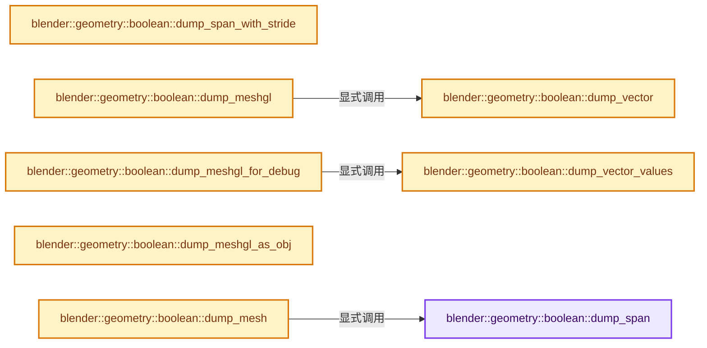
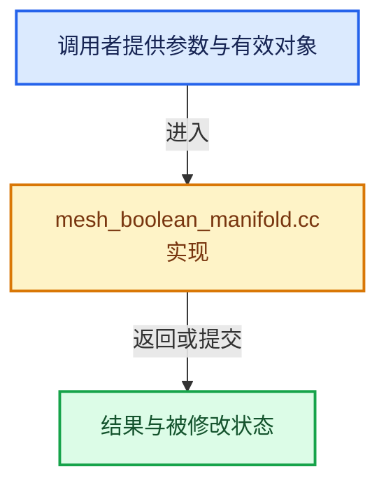

# 实现依赖专题：source/blender/geometry/intern/mesh_boolean_manifold.cc

[方向导航](README.md) · [符号索引](../%E7%AC%A6%E5%8F%B7%E4%BE%9D%E8%B5%96%E4%B8%8E%E5%AE%9E%E7%8E%B0%E7%B4%A2%E5%BC%95.md)

本专题从正文实际调用进入，集中保存共享实现。函数有稳定锚点，可从调用处直接跳到对应完整函数；递归与互相调用通过回链组织。

## 本文件的实现关系






## 完整成员与函数实现

<a id="f-4b4eb3dc5e809571"></a>

### `blender::geometry::boolean::dump_span`

实现位置：[source/blender/geometry/intern/mesh_boolean_manifold.cc](../../../../../source/blender/geometry/intern/mesh_boolean_manifold.cc) · L58—L68。

接口参数：

- `Span<T> span`
- `const std::string &name`

**教学注释版**

<!-- annotated:0dfd97dd2581e9 -->

```cpp
template<typename T> static void dump_span(Span<T> span, const std::string &name)
{
  std::cout << name << ":";
  // [讲解] span.index_range：查询视图长度或生成对应有效索引区间。
  for (const int i : span.index_range()) {
    if (i % 10 == 0) {
      std::cout << "\n[" << i << "] ";
    }
    std::cout << span[i] << " ";
  }
  std::cout << "\n";
}
```

<details>
<summary>核对原始源码：source/blender/geometry/intern/mesh_boolean_manifold.cc · L58—L68</summary>

<!-- original:0dfd97dd2581e9:source/blender/geometry/intern/mesh_boolean_manifold.cc:58:68 -->

```cpp
template<typename T> static void dump_span(Span<T> span, const std::string &name)
{
  std::cout << name << ":";
  for (const int i : span.index_range()) {
    if (i % 10 == 0) {
      std::cout << "\n[" << i << "] ";
    }
    std::cout << span[i] << " ";
  }
  std::cout << "\n";
}
```

</details>

**继续追踪实现**

- `span.index_range` → [blender::Span::index_range · L405](../01-%E5%9F%BA%E7%A1%80%E5%AE%B9%E5%99%A8%E4%B8%8E%E7%8E%B0%E4%BB%A3CPP/05-Span%E5%8F%AA%E8%AF%BB%E8%BF%9E%E7%BB%AD%E8%A7%86%E5%9B%BE.md#f-caaa9b06e13e53e0)。

<a id="f-c33da299b456b7db"></a>

### `blender::geometry::boolean::dump_span_with_stride`

实现位置：[source/blender/geometry/intern/mesh_boolean_manifold.cc](../../../../../source/blender/geometry/intern/mesh_boolean_manifold.cc) · L70—L84。

接口参数：

- `Span<T> span`
- `int stride`
- `const std::string &name`

**教学注释版**

<!-- annotated:17f9565e8ef390 -->

```cpp
template<typename T>
static void dump_span_with_stride(Span<T> span, int stride, const std::string &name)
{
  std::cout << name << ":";
  // [讲解] span.index_range：查询视图长度或生成对应有效索引区间。
  for (const int i : span.index_range()) {
    if (i % 10 == 0) {
      std::cout << "\n[" << i << "] ";
    }
    std::cout << span[i] << " ";
    if (stride > 1 && (i % stride) == stride - 1) {
      std::cout << "/ ";
    }
  }
  std::cout << "\n";
}
```

<details>
<summary>核对原始源码：source/blender/geometry/intern/mesh_boolean_manifold.cc · L70—L84</summary>

<!-- original:17f9565e8ef390:source/blender/geometry/intern/mesh_boolean_manifold.cc:70:84 -->

```cpp
template<typename T>
static void dump_span_with_stride(Span<T> span, int stride, const std::string &name)
{
  std::cout << name << ":";
  for (const int i : span.index_range()) {
    if (i % 10 == 0) {
      std::cout << "\n[" << i << "] ";
    }
    std::cout << span[i] << " ";
    if (stride > 1 && (i % stride) == stride - 1) {
      std::cout << "/ ";
    }
  }
  std::cout << "\n";
}
```

</details>

**继续追踪实现**

- `span.index_range` → [blender::Span::index_range · L405](../01-%E5%9F%BA%E7%A1%80%E5%AE%B9%E5%99%A8%E4%B8%8E%E7%8E%B0%E4%BB%A3CPP/05-Span%E5%8F%AA%E8%AF%BB%E8%BF%9E%E7%BB%AD%E8%A7%86%E5%9B%BE.md#f-caaa9b06e13e53e0)。

<a id="f-d780da5dc41ce19d"></a>

### `blender::geometry::boolean::dump_vector`

实现位置：[source/blender/geometry/intern/mesh_boolean_manifold.cc](../../../../../source/blender/geometry/intern/mesh_boolean_manifold.cc) · L86—L100。

接口参数：

- `const std::vector<T> &vec`
- `int stride`
- `const std::string &name`

**教学注释版**

<!-- annotated:e0ae1c644a7cf2 -->

```cpp
template<typename T>
static void dump_vector(const std::vector<T> &vec, int stride, const std::string &name)
{
  std::cout << name << ":";
  for (int i = 0; i < vec.size(); i++) {
    if (i % 10 == 0) {
      std::cout << "\n[" << i << "] ";
    }
    std::cout << vec[i] << " ";
    if (stride > 1 && (i % stride) == stride - 1) {
      std::cout << "/ ";
    }
  }
  std::cout << "\n";
}
```

<details>
<summary>核对原始源码：source/blender/geometry/intern/mesh_boolean_manifold.cc · L86—L100</summary>

<!-- original:e0ae1c644a7cf2:source/blender/geometry/intern/mesh_boolean_manifold.cc:86:100 -->

```cpp
template<typename T>
static void dump_vector(const std::vector<T> &vec, int stride, const std::string &name)
{
  std::cout << name << ":";
  for (int i = 0; i < vec.size(); i++) {
    if (i % 10 == 0) {
      std::cout << "\n[" << i << "] ";
    }
    std::cout << vec[i] << " ";
    if (stride > 1 && (i % stride) == stride - 1) {
      std::cout << "/ ";
    }
  }
  std::cout << "\n";
}
```

</details>

**继续追踪实现**

- `vec.size` → [外部契约](https://eel.is/c++draft/)：这个边界按实际表达式及所属类型核对参数、返回值、寿命与失败行为。这里提供接口入口，不声称已解释该第三方版本的内部实现。

<a id="f-05b772dd18d4cf85"></a>

### `blender::geometry::boolean::dump_vector_values`

实现位置：[source/blender/geometry/intern/mesh_boolean_manifold.cc](../../../../../source/blender/geometry/intern/mesh_boolean_manifold.cc) · L102—L120。

接口参数：

- `const std::string indent`
- `const std::string &assign_to`
- `const std::vector<T> &vec`

**教学注释版**

<!-- annotated:93d041e6873a76 -->

```cpp
template<typename T>
static void dump_vector_values(const std::string indent,
                               const std::string &assign_to,
                               const std::vector<T> &vec)
{
  std::cout << indent << assign_to << " = { ";
  for (int i = 0; i < vec.size(); i++) {
    if (i > 0 && (i % 10) == 0) {
      std::cout << "\n" << indent << indent;
    }
    std::cout << vec[i];
    if (i == vec.size() - 1) {
      std::cout << " };\n";
    }
    else {
      std::cout << ", ";
    }
  }
}
```

<details>
<summary>核对原始源码：source/blender/geometry/intern/mesh_boolean_manifold.cc · L102—L120</summary>

<!-- original:93d041e6873a76:source/blender/geometry/intern/mesh_boolean_manifold.cc:102:120 -->

```cpp
template<typename T>
static void dump_vector_values(const std::string indent,
                               const std::string &assign_to,
                               const std::vector<T> &vec)
{
  std::cout << indent << assign_to << " = { ";
  for (int i = 0; i < vec.size(); i++) {
    if (i > 0 && (i % 10) == 0) {
      std::cout << "\n" << indent << indent;
    }
    std::cout << vec[i];
    if (i == vec.size() - 1) {
      std::cout << " };\n";
    }
    else {
      std::cout << ", ";
    }
  }
}
```

</details>

**继续追踪实现**

- `vec.size` → [外部契约](https://eel.is/c++draft/)：这个边界按实际表达式及所属类型核对参数、返回值、寿命与失败行为。这里提供接口入口，不声称已解释该第三方版本的内部实现。

<a id="f-cc5006e18fcf6d5e"></a>

### `blender::geometry::boolean::dump_meshgl`

实现位置：[source/blender/geometry/intern/mesh_boolean_manifold.cc](../../../../../source/blender/geometry/intern/mesh_boolean_manifold.cc) · L122—L136。

接口参数：

- `const MeshGL &mgl`
- `const std::string &name`

**教学注释版**

<!-- annotated:65f75783af50f1 -->

```cpp
static void dump_meshgl(const MeshGL &mgl, const std::string &name)
{
  std::cout << "\nMeshGL " << name << ":\n"
            << "num verts = " << mgl.NumVert() << "\nnum triangles = " << mgl.NumTri() << "\n"
            << "\n";
  dump_vector(mgl.vertProperties, mgl.numProp, "vertProperties");
  dump_vector(mgl.triVerts, 3, "triVerts");
  dump_vector(mgl.faceID, 1, "faceID");
  if (!mgl.mergeFromVert.empty()) {
    dump_vector(mgl.mergeFromVert, 1, "mergeFromVert");
    dump_vector(mgl.mergeToVert, 1, "mergeToVert");
  }
  dump_vector(mgl.runIndex, 1, "runIndex");
  dump_vector(mgl.runOriginalID, 1, "runOrigiinalID");
}
```

<details>
<summary>核对原始源码：source/blender/geometry/intern/mesh_boolean_manifold.cc · L122—L136</summary>

<!-- original:65f75783af50f1:source/blender/geometry/intern/mesh_boolean_manifold.cc:122:136 -->

```cpp
static void dump_meshgl(const MeshGL &mgl, const std::string &name)
{
  std::cout << "\nMeshGL " << name << ":\n"
            << "num verts = " << mgl.NumVert() << "\nnum triangles = " << mgl.NumTri() << "\n"
            << "\n";
  dump_vector(mgl.vertProperties, mgl.numProp, "vertProperties");
  dump_vector(mgl.triVerts, 3, "triVerts");
  dump_vector(mgl.faceID, 1, "faceID");
  if (!mgl.mergeFromVert.empty()) {
    dump_vector(mgl.mergeFromVert, 1, "mergeFromVert");
    dump_vector(mgl.mergeToVert, 1, "mergeToVert");
  }
  dump_vector(mgl.runIndex, 1, "runIndex");
  dump_vector(mgl.runOriginalID, 1, "runOrigiinalID");
}
```

</details>

**继续追踪实现**

- `mgl.NumVert` → [调用协议](../%E6%A8%A1%E6%9D%BF%E5%AE%8F%E4%B8%8E%E5%8A%A8%E6%80%81%E5%88%86%E6%B4%BE%E5%8D%8F%E8%AE%AE.md)：由接收对象具体类型或运行时策略提供实现。调用位置L125。
- `mgl.NumTri` → [调用协议](../%E6%A8%A1%E6%9D%BF%E5%AE%8F%E4%B8%8E%E5%8A%A8%E6%80%81%E5%88%86%E6%B4%BE%E5%8D%8F%E8%AE%AE.md)：由接收对象具体类型或运行时策略提供实现。调用位置L125。
- `dump_vector` → [blender::geometry::boolean::dump_vector · L86](%E4%BE%9D%E8%B5%96-mesh_boolean_manifold-582498.md#f-d780da5dc41ce19d)。
- `mgl.mergeFromVert.empty` → [调用协议](../%E6%A8%A1%E6%9D%BF%E5%AE%8F%E4%B8%8E%E5%8A%A8%E6%80%81%E5%88%86%E6%B4%BE%E5%8D%8F%E8%AE%AE.md)：接收对象类型依赖auto、返回值或模板实例；不按同名猜测目标。调用位置L130。

<a id="f-3382e8b63fcb94c8"></a>

### `blender::geometry::boolean::dump_meshgl_for_debug`

实现位置：[source/blender/geometry/intern/mesh_boolean_manifold.cc](../../../../../source/blender/geometry/intern/mesh_boolean_manifold.cc) · L138—L162。

接口参数：

- `const MeshGL &mgl`

**教学注释版**

<!-- annotated:e08955b9a081d7 -->

```cpp
[[maybe_unused]] static void dump_meshgl_for_debug(const MeshGL &mgl)
{
  std::string indent = "    ";
  std::cout << indent << "MeshGL m;\n";
  std::cout << std::setprecision(9);
  std::cout << indent << "m.numProp = " << mgl.numProp << ";\n";
  dump_vector_values(indent, "m.vertProperties", mgl.vertProperties);
  dump_vector_values(indent, "m.triVerts", mgl.triVerts);
  if (!mgl.mergeFromVert.empty()) {
    dump_vector_values(indent, "m.mergeFromVert", mgl.mergeFromVert);
    dump_vector_values(indent, "m.mergeToVert", mgl.mergeToVert);
  }
  dump_vector_values(indent, "m.runIndex", mgl.runIndex);
  dump_vector_values(indent, "m.runOriginalID", mgl.runOriginalID);
  dump_vector_values(indent, "m.faceID", mgl.faceID);
  if (!mgl.runTransform.empty()) {
    dump_vector_values(indent, "m.runTransform", mgl.runTransform);
  }
  if (!mgl.halfedgeTangent.empty()) {
    dump_vector_values(indent, "m.halfedgeTangent", mgl.halfedgeTangent);
  }
  if (mgl.tolerance != 0) {
    std::cout << indent << "m.tolerance = " << mgl.tolerance << ";\n";
  }
}
```

<details>
<summary>核对原始源码：source/blender/geometry/intern/mesh_boolean_manifold.cc · L138—L162</summary>

<!-- original:e08955b9a081d7:source/blender/geometry/intern/mesh_boolean_manifold.cc:138:162 -->

```cpp
[[maybe_unused]] static void dump_meshgl_for_debug(const MeshGL &mgl)
{
  std::string indent = "    ";
  std::cout << indent << "MeshGL m;\n";
  std::cout << std::setprecision(9);
  std::cout << indent << "m.numProp = " << mgl.numProp << ";\n";
  dump_vector_values(indent, "m.vertProperties", mgl.vertProperties);
  dump_vector_values(indent, "m.triVerts", mgl.triVerts);
  if (!mgl.mergeFromVert.empty()) {
    dump_vector_values(indent, "m.mergeFromVert", mgl.mergeFromVert);
    dump_vector_values(indent, "m.mergeToVert", mgl.mergeToVert);
  }
  dump_vector_values(indent, "m.runIndex", mgl.runIndex);
  dump_vector_values(indent, "m.runOriginalID", mgl.runOriginalID);
  dump_vector_values(indent, "m.faceID", mgl.faceID);
  if (!mgl.runTransform.empty()) {
    dump_vector_values(indent, "m.runTransform", mgl.runTransform);
  }
  if (!mgl.halfedgeTangent.empty()) {
    dump_vector_values(indent, "m.halfedgeTangent", mgl.halfedgeTangent);
  }
  if (mgl.tolerance != 0) {
    std::cout << indent << "m.tolerance = " << mgl.tolerance << ";\n";
  }
}
```

</details>

**继续追踪实现**

- `std::setprecision` → [外部契约](https://eel.is/c++draft/)：这个边界按实际表达式及所属类型核对参数、返回值、寿命与失败行为。这里提供接口入口，不声称已解释该第三方版本的内部实现。
- `dump_vector_values` → [blender::geometry::boolean::dump_vector_values · L102](%E4%BE%9D%E8%B5%96-mesh_boolean_manifold-582498.md#f-05b772dd18d4cf85)。
- `mgl.mergeFromVert.empty` → [调用协议](../%E6%A8%A1%E6%9D%BF%E5%AE%8F%E4%B8%8E%E5%8A%A8%E6%80%81%E5%88%86%E6%B4%BE%E5%8D%8F%E8%AE%AE.md)：接收对象类型依赖auto、返回值或模板实例；不按同名猜测目标。调用位置L146。
- `mgl.runTransform.empty` → [调用协议](../%E6%A8%A1%E6%9D%BF%E5%AE%8F%E4%B8%8E%E5%8A%A8%E6%80%81%E5%88%86%E6%B4%BE%E5%8D%8F%E8%AE%AE.md)：接收对象类型依赖auto、返回值或模板实例；不按同名猜测目标。调用位置L153。
- `mgl.halfedgeTangent.empty` → [调用协议](../%E6%A8%A1%E6%9D%BF%E5%AE%8F%E4%B8%8E%E5%8A%A8%E6%80%81%E5%88%86%E6%B4%BE%E5%8D%8F%E8%AE%AE.md)：接收对象类型依赖auto、返回值或模板实例；不按同名猜测目标。调用位置L156。

<a id="f-72250740db2954be"></a>

### `blender::geometry::boolean::dump_meshgl_as_obj`

实现位置：[source/blender/geometry/intern/mesh_boolean_manifold.cc](../../../../../source/blender/geometry/intern/mesh_boolean_manifold.cc) · L164—L180。

接口参数：

- `const MeshGL &mgl`

**教学注释版**

<!-- annotated:e25d6e5f7eacf0 -->

```cpp
[[maybe_unused]] static void dump_meshgl_as_obj(const MeshGL &mgl)
{
  std::cout << "\n# Meshgl as OBJ\n";
  std::cout << std::setprecision(9);
  for (const int v : IndexRange(mgl.NumVert())) {
    const int k = v * 3;
    std::cout << "v " << mgl.vertProperties[k] << " " << mgl.vertProperties[k + 1] << " "
              << mgl.vertProperties[k + 2] << "\n";
  }
  std::cout << "\n";
  for (const int t : IndexRange(mgl.NumTri())) {
    const int k = t * 3;
    std::cout << "f " << mgl.triVerts[k] << " " << mgl.triVerts[k + 1] << " "
              << mgl.triVerts[k + 2] << "\n";
  }
  std::cout << "\n";
}
```

<details>
<summary>核对原始源码：source/blender/geometry/intern/mesh_boolean_manifold.cc · L164—L180</summary>

<!-- original:e25d6e5f7eacf0:source/blender/geometry/intern/mesh_boolean_manifold.cc:164:180 -->

```cpp
[[maybe_unused]] static void dump_meshgl_as_obj(const MeshGL &mgl)
{
  std::cout << "\n# Meshgl as OBJ\n";
  std::cout << std::setprecision(9);
  for (const int v : IndexRange(mgl.NumVert())) {
    const int k = v * 3;
    std::cout << "v " << mgl.vertProperties[k] << " " << mgl.vertProperties[k + 1] << " "
              << mgl.vertProperties[k + 2] << "\n";
  }
  std::cout << "\n";
  for (const int t : IndexRange(mgl.NumTri())) {
    const int k = t * 3;
    std::cout << "f " << mgl.triVerts[k] << " " << mgl.triVerts[k + 1] << " "
              << mgl.triVerts[k + 2] << "\n";
  }
  std::cout << "\n";
}
```

</details>

**继续追踪实现**

- `std::setprecision` → [外部契约](https://eel.is/c++draft/)：这个边界按实际表达式及所属类型核对参数、返回值、寿命与失败行为。这里提供接口入口，不声称已解释该第三方版本的内部实现。
- `IndexRange` → [blender::IndexRange](../01-%E5%9F%BA%E7%A1%80%E5%AE%B9%E5%99%A8%E4%B8%8E%E7%8E%B0%E4%BB%A3CPP/%E4%BE%9D%E8%B5%96-BLI_index_range-7d7cc5.md#t-caa3466d6776)；[blender::gpu::shader::parser::IndexRange](%E4%BE%9D%E8%B5%96-utils-06433d.md#t-82d2bd4ea71c)；[blender::IndexRange](%E4%BE%9D%E8%B5%96-DNA_node_types-6708b9.md#t-0448cc889d39)。
- `mgl.NumVert` → [调用协议](../%E6%A8%A1%E6%9D%BF%E5%AE%8F%E4%B8%8E%E5%8A%A8%E6%80%81%E5%88%86%E6%B4%BE%E5%8D%8F%E8%AE%AE.md)：由接收对象具体类型或运行时策略提供实现。调用位置L168。
- `mgl.NumTri` → [调用协议](../%E6%A8%A1%E6%9D%BF%E5%AE%8F%E4%B8%8E%E5%8A%A8%E6%80%81%E5%88%86%E6%B4%BE%E5%8D%8F%E8%AE%AE.md)：由接收对象具体类型或运行时策略提供实现。调用位置L174。

<a id="f-3274af5d9f7c04bd"></a>

### `blender::geometry::boolean::dump_mesh`

实现位置：[source/blender/geometry/intern/mesh_boolean_manifold.cc](../../../../../source/blender/geometry/intern/mesh_boolean_manifold.cc) · L185—L235。

接口参数：

- `const Mesh *mesh`
- `const std::string &name`

**教学注释版**

<!-- annotated:04b5b226fd2f4c -->

```cpp
static void dump_mesh(const Mesh *mesh, const std::string &name)
{
  std::cout << "\nMesh " << name << ":\n"
            << "verts_num = " << mesh->verts_num << "\nfaces_num = " << mesh->faces_num
            << "\nedges_num = " << mesh->edges_num << "\ncorners_num = " << mesh->corners_num
            << "\n";
  dump_span(mesh->vert_positions(), "verts");
  dump_span(mesh->edges(), "edges");
  dump_span(mesh->corner_verts(), "corner_verts");
  dump_span(mesh->corner_edges(), "corner_edges");
  dump_span(mesh->face_offsets(), "face_offsets");
  std::cout << "triangulation:\n";
  dump_span(mesh->corner_tris(), "corner_tris");
  dump_span(mesh->corner_tri_faces(), "corner_tri_faces");
  std::cout << "attributes:\n";
  bke::AttributeAccessor attrs = mesh->attributes();
  attrs.foreach_attribute([&](const bke::AttributeIter &iter) {
    if (ELEM(iter.name, "position", ".edge_verts", ".corner_vert", ".corner_edge")) {
      return;
    }
    const int di = int8_t(iter.domain);
    const char *domain = (di >= 0 && di < ATTR_DOMAIN_NUM) ? domain_names[di] : "?";
    std::string label = std::string(domain) + ": " + iter.name;
    switch (iter.data_type) {
      case bke::AttrType::Float: {
        VArraySpan<float> floatspan(*attrs.lookup<float>(iter.name));
        dump_span(floatspan, label);
      } break;
      case bke::AttrType::Int32:
      case bke::AttrType::Bool: {
        const VArraySpan<int> intspan(*attrs.lookup<int>(iter.name));
        dump_span(intspan, label);
      } break;
      case bke::AttrType::Float3: {
        const VArraySpan<float3> float3span(*attrs.lookup<float3>(iter.name));
        dump_span(float3span, label);
      } break;
      case bke::AttrType::Float2: {
        const VArraySpan<float2> float2span(*attrs.lookup<float2>(iter.name));
        dump_span(float2span, label);
      } break;
      default:
        std::cout << label << " attribute not dumped\n";
        break;
    }
  });
  std::cout << "materials:\n";
  for (int i = 0; i < mesh->totcol; i++) {
    std::cout << "[" << i << "]: " << (mesh->mat[i] ? mesh->mat[i]->id.name + 2 : "none") << "\n";
  }
}
```

<details>
<summary>核对原始源码：source/blender/geometry/intern/mesh_boolean_manifold.cc · L185—L235</summary>

<!-- original:04b5b226fd2f4c:source/blender/geometry/intern/mesh_boolean_manifold.cc:185:235 -->

```cpp
static void dump_mesh(const Mesh *mesh, const std::string &name)
{
  std::cout << "\nMesh " << name << ":\n"
            << "verts_num = " << mesh->verts_num << "\nfaces_num = " << mesh->faces_num
            << "\nedges_num = " << mesh->edges_num << "\ncorners_num = " << mesh->corners_num
            << "\n";
  dump_span(mesh->vert_positions(), "verts");
  dump_span(mesh->edges(), "edges");
  dump_span(mesh->corner_verts(), "corner_verts");
  dump_span(mesh->corner_edges(), "corner_edges");
  dump_span(mesh->face_offsets(), "face_offsets");
  std::cout << "triangulation:\n";
  dump_span(mesh->corner_tris(), "corner_tris");
  dump_span(mesh->corner_tri_faces(), "corner_tri_faces");
  std::cout << "attributes:\n";
  bke::AttributeAccessor attrs = mesh->attributes();
  attrs.foreach_attribute([&](const bke::AttributeIter &iter) {
    if (ELEM(iter.name, "position", ".edge_verts", ".corner_vert", ".corner_edge")) {
      return;
    }
    const int di = int8_t(iter.domain);
    const char *domain = (di >= 0 && di < ATTR_DOMAIN_NUM) ? domain_names[di] : "?";
    std::string label = std::string(domain) + ": " + iter.name;
    switch (iter.data_type) {
      case bke::AttrType::Float: {
        VArraySpan<float> floatspan(*attrs.lookup<float>(iter.name));
        dump_span(floatspan, label);
      } break;
      case bke::AttrType::Int32:
      case bke::AttrType::Bool: {
        const VArraySpan<int> intspan(*attrs.lookup<int>(iter.name));
        dump_span(intspan, label);
      } break;
      case bke::AttrType::Float3: {
        const VArraySpan<float3> float3span(*attrs.lookup<float3>(iter.name));
        dump_span(float3span, label);
      } break;
      case bke::AttrType::Float2: {
        const VArraySpan<float2> float2span(*attrs.lookup<float2>(iter.name));
        dump_span(float2span, label);
      } break;
      default:
        std::cout << label << " attribute not dumped\n";
        break;
    }
  });
  std::cout << "materials:\n";
  for (int i = 0; i < mesh->totcol; i++) {
    std::cout << "[" << i << "]: " << (mesh->mat[i] ? mesh->mat[i]->id.name + 2 : "none") << "\n";
  }
}
```

</details>

**继续追踪实现**

- `dump_span` → [blender::geometry::boolean::dump_span · L58](%E4%BE%9D%E8%B5%96-mesh_boolean_manifold-582498.md#f-4b4eb3dc5e809571)。
- `mesh->vert_positions` → [Mesh::vert_positions · L1193](03-MPoly%E8%BF%81%E7%A7%BB%E4%B8%8E%E5%85%BC%E5%AE%B9.md#f-ae4177e5c5f2b371)。
- `mesh->edges` → [Mesh::edges · L1205](03-MPoly%E8%BF%81%E7%A7%BB%E4%B8%8E%E5%85%BC%E5%AE%B9.md#f-7232f6756b674d12)。
- `mesh->corner_verts` → [Mesh::corner_verts · L1238](03-MPoly%E8%BF%81%E7%A7%BB%E4%B8%8E%E5%85%BC%E5%AE%B9.md#f-a59c61f583b64bc4)。
- `mesh->corner_edges` → [Mesh::corner_edges · L1252](03-MPoly%E8%BF%81%E7%A7%BB%E4%B8%8E%E5%85%BC%E5%AE%B9.md#f-687b790868e7f257)。
- `mesh->face_offsets` → [Mesh::face_offsets · L1221](03-MPoly%E8%BF%81%E7%A7%BB%E4%B8%8E%E5%85%BC%E5%AE%B9.md#f-49a5e24b1b5e8989)。
- `mesh->corner_tris` → [blender::Mesh::corner_tris · L264](../06-%E9%9A%90%E5%BC%8F%E5%85%B1%E4%BA%AB%E4%B8%8E%E7%BC%93%E5%AD%98%E7%B3%BB%E7%BB%9F/10-%E5%B1%80%E9%83%A8%E6%9B%B4%E6%96%B0%E4%B8%8E%E5%A4%B1%E6%95%88%E4%BF%AE%E5%A4%8D.md#f-9bb421790000fc20)。
- `mesh->corner_tri_faces` → [blender::Mesh::corner_tri_faces · L285](../06-%E9%9A%90%E5%BC%8F%E5%85%B1%E4%BA%AB%E4%B8%8E%E7%BC%93%E5%AD%98%E7%B3%BB%E7%BB%9F/10-%E5%B1%80%E9%83%A8%E6%9B%B4%E6%96%B0%E4%B8%8E%E5%A4%B1%E6%95%88%E4%BF%AE%E5%A4%8D.md#f-94cfee90bf521ed4)。
- `mesh->attributes` → [Mesh::attributes · L1298](03-MPoly%E8%BF%81%E7%A7%BB%E4%B8%8E%E5%85%BC%E5%AE%B9.md#f-607bbfe3e57cfc7f)。
- `attrs.foreach_attribute` → [blender::bke::AttributeAccessor::foreach_attribute · L687](08-AttributeAccessor%E6%8E%A5%E5%8F%A3.md#f-44723ac57e0d1fa4)。
- `ELEM` → [ELEM · L88](%E4%BE%9D%E8%B5%96-GHOST_utildefines-34b996.md#m-d28724a15928)；[ELEM · L135](../01-%E5%9F%BA%E7%A1%80%E5%AE%B9%E5%99%A8%E4%B8%8E%E7%8E%B0%E4%BB%A3CPP/%E4%BE%9D%E8%B5%96-BLI_utildefines-293a0a.md#m-d6572de7cae0)。宏定义由构建条件选择。
- `std::string` → [外部契约](https://eel.is/c++draft/)：这个边界按实际表达式及所属类型核对参数、返回值、寿命与失败行为。这里提供接口入口，不声称已解释该第三方版本的内部实现。
- `attrs.lookup<float>` → [blender::bke::AttributeAccessor::lookup · L401](%E4%BE%9D%E8%B5%96-attribute_access-bceef3.md#f-4673351b7bb3b651)；[blender::bke::AttributeAccessor::lookup · L585](08-AttributeAccessor%E6%8E%A5%E5%8F%A3.md#f-432b90c796a80893)；[blender::bke::AttributeAccessor::lookup · L602](08-AttributeAccessor%E6%8E%A5%E5%8F%A3.md#f-a60c1a45b85155d9)；[blender::bke::AttributeAccessor::lookup · L611](08-AttributeAccessor%E6%8E%A5%E5%8F%A3.md#f-16ca459803fc30a6)；[blender::bke::AttributeAccessor::lookup · L620](08-AttributeAccessor%E6%8E%A5%E5%8F%A3.md#f-403fd8a9d1a16c6d)。同名重载需按实参类型选择。
- `attrs.lookup<int>` → [blender::bke::AttributeAccessor::lookup · L401](%E4%BE%9D%E8%B5%96-attribute_access-bceef3.md#f-4673351b7bb3b651)；[blender::bke::AttributeAccessor::lookup · L585](08-AttributeAccessor%E6%8E%A5%E5%8F%A3.md#f-432b90c796a80893)；[blender::bke::AttributeAccessor::lookup · L602](08-AttributeAccessor%E6%8E%A5%E5%8F%A3.md#f-a60c1a45b85155d9)；[blender::bke::AttributeAccessor::lookup · L611](08-AttributeAccessor%E6%8E%A5%E5%8F%A3.md#f-16ca459803fc30a6)；[blender::bke::AttributeAccessor::lookup · L620](08-AttributeAccessor%E6%8E%A5%E5%8F%A3.md#f-403fd8a9d1a16c6d)。同名重载需按实参类型选择。
- `attrs.lookup<float3>` → [blender::bke::AttributeAccessor::lookup · L401](%E4%BE%9D%E8%B5%96-attribute_access-bceef3.md#f-4673351b7bb3b651)；[blender::bke::AttributeAccessor::lookup · L585](08-AttributeAccessor%E6%8E%A5%E5%8F%A3.md#f-432b90c796a80893)；[blender::bke::AttributeAccessor::lookup · L602](08-AttributeAccessor%E6%8E%A5%E5%8F%A3.md#f-a60c1a45b85155d9)；[blender::bke::AttributeAccessor::lookup · L611](08-AttributeAccessor%E6%8E%A5%E5%8F%A3.md#f-16ca459803fc30a6)；[blender::bke::AttributeAccessor::lookup · L620](08-AttributeAccessor%E6%8E%A5%E5%8F%A3.md#f-403fd8a9d1a16c6d)。同名重载需按实参类型选择。
- `attrs.lookup<float2>` → [blender::bke::AttributeAccessor::lookup · L401](%E4%BE%9D%E8%B5%96-attribute_access-bceef3.md#f-4673351b7bb3b651)；[blender::bke::AttributeAccessor::lookup · L585](08-AttributeAccessor%E6%8E%A5%E5%8F%A3.md#f-432b90c796a80893)；[blender::bke::AttributeAccessor::lookup · L602](08-AttributeAccessor%E6%8E%A5%E5%8F%A3.md#f-a60c1a45b85155d9)；[blender::bke::AttributeAccessor::lookup · L611](08-AttributeAccessor%E6%8E%A5%E5%8F%A3.md#f-16ca459803fc30a6)；[blender::bke::AttributeAccessor::lookup · L620](08-AttributeAccessor%E6%8E%A5%E5%8F%A3.md#f-403fd8a9d1a16c6d)。同名重载需按实参类型选择。

<a id="f-2d302360857e2dcd"></a>

### `blender::geometry::boolean::get_manifold`

实现位置：[source/blender/geometry/intern/mesh_boolean_manifold.cc](../../../../../source/blender/geometry/intern/mesh_boolean_manifold.cc) · L253—L327。

接口参数：

- `Manifold &manifold`
- `const Span<const Mesh *> meshes`
- `int mesh_index`
- `const MeshOffsets &mesh_offsets`

**教学注释版**

<!-- annotated:7381e5ace68baa -->

```cpp
static void get_manifold(Manifold &manifold,
                         const Span<const Mesh *> meshes,
                         int mesh_index,
                         const MeshOffsets &mesh_offsets)
{
  constexpr int dbg_level = 0;
  if (dbg_level > 0) {
    std::cout << "get_manifold for mesh " << mesh_index << "\n";
  }
  /* Use the original mesh for simplicity for some things, and use the joined mesh for data that
   * could have been affected by a transform input. A potential optimization would be retrieving
   * the data from an original mesh instead if the corresponding transform was the identity. */
  const Mesh &mesh = *meshes[mesh_index];
  const OffsetIndices<int> faces = mesh.faces();
  const Span<int> corner_verts = mesh.corner_verts();
  const Span<int3> corner_tris = mesh.corner_tris();

  MeshGL meshgl;

  constexpr int props_num = 3;
  meshgl.numProp = props_num;
  meshgl.vertProperties.resize(size_t(mesh.verts_num) * props_num);
  array_utils::copy(mesh.vert_positions(), MutableSpan(meshgl.vertProperties).cast<float3>());

  /* Using separate a OriginalID for each input face will prevent co-planar
   * faces from being merged.  We need this until the fix introduced in
   * Manifold at version 3.1.0. */
  constexpr bool use_runids = false;
  if (use_runids) {
    meshgl.runIndex.resize(mesh.faces_num);
    meshgl.runOriginalID.resize(mesh.faces_num);
  }

  const int face_start = mesh_offsets.face_start[mesh_index];

  // [讲解] corner_tris.size：查询视图长度或生成对应有效索引区间。
  meshgl.faceID.resize(corner_tris.size());
  /* Inlined copy of #corner_tris_calc_face_indices with an offset added to the face index. */
  MutableSpan face_ids = MutableSpan(meshgl.faceID);
  threading::parallel_for(faces.index_range(), 1024, [&](const IndexRange range) {
    for (const int i : range) {
      const IndexRange face = faces[i];
      // [讲解] face.start：读取连续区间或分组的边界信息。
      const int start = poly_to_tri_count(int(i), int(face.start()));
      const int num = bke::mesh::face_triangles_num(int(face.size()));
      // [讲解] face_ids.slice：建立原连续范围的子视图。
      face_ids.slice(start, num).fill(uint32_t(i + face_start));
      if (use_runids) {
        meshgl.runOriginalID[i] = face_start + i;
        meshgl.runIndex[i] = start * 3;
      }
    }
  });

  meshgl.triVerts.resize(corner_tris.size() * 3);
  MutableSpan vert_tris = MutableSpan(meshgl.triVerts).cast<int3>();
  bke::mesh::vert_tris_from_corner_tris(corner_verts, corner_tris, vert_tris);

  if (!use_runids) {
    meshgl.runIndex.resize(2);
    meshgl.runOriginalID.resize(1);
    meshgl.runIndex[0] = 0;
    meshgl.runIndex[1] = corner_tris.size() * 3;
    meshgl.runOriginalID[0] = mesh_index;
  }
  if (dbg_level > 0) {
    dump_meshgl(meshgl, "converted result for mesh " + std::to_string(mesh_index));
    if (dbg_level > 1) {
      dump_meshgl_for_debug(meshgl);
    }
  }
  {
#  ifdef DEBUG_TIME
    timeit::ScopedTimer mtimer("manifold constructor from meshgl");
#  endif
    manifold = Manifold(meshgl);
  }
}
```

<details>
<summary>核对原始源码：source/blender/geometry/intern/mesh_boolean_manifold.cc · L253—L327</summary>

<!-- original:7381e5ace68baa:source/blender/geometry/intern/mesh_boolean_manifold.cc:253:327 -->

```cpp
static void get_manifold(Manifold &manifold,
                         const Span<const Mesh *> meshes,
                         int mesh_index,
                         const MeshOffsets &mesh_offsets)
{
  constexpr int dbg_level = 0;
  if (dbg_level > 0) {
    std::cout << "get_manifold for mesh " << mesh_index << "\n";
  }
  /* Use the original mesh for simplicity for some things, and use the joined mesh for data that
   * could have been affected by a transform input. A potential optimization would be retrieving
   * the data from an original mesh instead if the corresponding transform was the identity. */
  const Mesh &mesh = *meshes[mesh_index];
  const OffsetIndices<int> faces = mesh.faces();
  const Span<int> corner_verts = mesh.corner_verts();
  const Span<int3> corner_tris = mesh.corner_tris();

  MeshGL meshgl;

  constexpr int props_num = 3;
  meshgl.numProp = props_num;
  meshgl.vertProperties.resize(size_t(mesh.verts_num) * props_num);
  array_utils::copy(mesh.vert_positions(), MutableSpan(meshgl.vertProperties).cast<float3>());

  /* Using separate a OriginalID for each input face will prevent co-planar
   * faces from being merged.  We need this until the fix introduced in
   * Manifold at version 3.1.0. */
  constexpr bool use_runids = false;
  if (use_runids) {
    meshgl.runIndex.resize(mesh.faces_num);
    meshgl.runOriginalID.resize(mesh.faces_num);
  }

  const int face_start = mesh_offsets.face_start[mesh_index];

  meshgl.faceID.resize(corner_tris.size());
  /* Inlined copy of #corner_tris_calc_face_indices with an offset added to the face index. */
  MutableSpan face_ids = MutableSpan(meshgl.faceID);
  threading::parallel_for(faces.index_range(), 1024, [&](const IndexRange range) {
    for (const int i : range) {
      const IndexRange face = faces[i];
      const int start = poly_to_tri_count(int(i), int(face.start()));
      const int num = bke::mesh::face_triangles_num(int(face.size()));
      face_ids.slice(start, num).fill(uint32_t(i + face_start));
      if (use_runids) {
        meshgl.runOriginalID[i] = face_start + i;
        meshgl.runIndex[i] = start * 3;
      }
    }
  });

  meshgl.triVerts.resize(corner_tris.size() * 3);
  MutableSpan vert_tris = MutableSpan(meshgl.triVerts).cast<int3>();
  bke::mesh::vert_tris_from_corner_tris(corner_verts, corner_tris, vert_tris);

  if (!use_runids) {
    meshgl.runIndex.resize(2);
    meshgl.runOriginalID.resize(1);
    meshgl.runIndex[0] = 0;
    meshgl.runIndex[1] = corner_tris.size() * 3;
    meshgl.runOriginalID[0] = mesh_index;
  }
  if (dbg_level > 0) {
    dump_meshgl(meshgl, "converted result for mesh " + std::to_string(mesh_index));
    if (dbg_level > 1) {
      dump_meshgl_for_debug(meshgl);
    }
  }
  {
#  ifdef DEBUG_TIME
    timeit::ScopedTimer mtimer("manifold constructor from meshgl");
#  endif
    manifold = Manifold(meshgl);
  }
}
```

</details>

**沿实际写入检查状态**

- `meshgl.numProp = props_num;`
- `meshgl.runOriginalID[i] = face_start + i;`
- `meshgl.runIndex[i] = start * 3;`
- `meshgl.runIndex[0] = 0;`
- `meshgl.runIndex[1] = corner_tris.size() * 3;`
- `meshgl.runOriginalID[0] = mesh_index;`
- `manifold = Manifold(meshgl);`

**继续追踪实现**

- `mesh.faces` → [Mesh::faces · L1217](03-MPoly%E8%BF%81%E7%A7%BB%E4%B8%8E%E5%85%BC%E5%AE%B9.md#f-ea444760154e17b2)。
- `mesh.corner_verts` → [Mesh::corner_verts · L1238](03-MPoly%E8%BF%81%E7%A7%BB%E4%B8%8E%E5%85%BC%E5%AE%B9.md#f-a59c61f583b64bc4)。
- `mesh.corner_tris` → [blender::Mesh::corner_tris · L264](../06-%E9%9A%90%E5%BC%8F%E5%85%B1%E4%BA%AB%E4%B8%8E%E7%BC%93%E5%AD%98%E7%B3%BB%E7%BB%9F/10-%E5%B1%80%E9%83%A8%E6%9B%B4%E6%96%B0%E4%B8%8E%E5%A4%B1%E6%95%88%E4%BF%AE%E5%A4%8D.md#f-9bb421790000fc20)。
- `meshgl.vertProperties.resize` → [调用协议](../%E6%A8%A1%E6%9D%BF%E5%AE%8F%E4%B8%8E%E5%8A%A8%E6%80%81%E5%88%86%E6%B4%BE%E5%8D%8F%E8%AE%AE.md)：接收对象类型依赖auto、返回值或模板实例；不按同名猜测目标。调用位置L274。
- `array_utils::copy` → [blender::array_utils::copy · L54](../01-%E5%9F%BA%E7%A1%80%E5%AE%B9%E5%99%A8%E4%B8%8E%E7%8E%B0%E4%BB%A3CPP/20-%E5%AE%B9%E5%99%A8%E9%80%89%E6%8B%A9%E4%B8%8E%E7%8B%AC%E7%AB%8B%E5%AE%9E%E7%8E%B0.md#f-82e21acdac93f91c)；[blender::array_utils::copy · L72](../01-%E5%9F%BA%E7%A1%80%E5%AE%B9%E5%99%A8%E4%B8%8E%E7%8E%B0%E4%BB%A3CPP/20-%E5%AE%B9%E5%99%A8%E9%80%89%E6%8B%A9%E4%B8%8E%E7%8B%AC%E7%AB%8B%E5%AE%9E%E7%8E%B0.md#f-ee9c17de026a6c9a)；[blender::array_utils::copy · L98](../01-%E5%9F%BA%E7%A1%80%E5%AE%B9%E5%99%A8%E4%B8%8E%E7%8E%B0%E4%BB%A3CPP/20-%E5%AE%B9%E5%99%A8%E9%80%89%E6%8B%A9%E4%B8%8E%E7%8B%AC%E7%AB%8B%E5%AE%9E%E7%8E%B0.md#f-ec9fd099c7280717)；[blender::array_utils::copy · L27](../01-%E5%9F%BA%E7%A1%80%E5%AE%B9%E5%99%A8%E4%B8%8E%E7%8E%B0%E4%BB%A3CPP/%E4%BE%9D%E8%B5%96-array_utils-cbb70f.md#f-245f7c23437cf35f)；[blender::array_utils::copy · L43](../01-%E5%9F%BA%E7%A1%80%E5%AE%B9%E5%99%A8%E4%B8%8E%E7%8E%B0%E4%BB%A3CPP/%E4%BE%9D%E8%B5%96-array_utils-cbb70f.md#f-6170524934215b36)。同名重载需按实参类型选择。
- `mesh.vert_positions` → [Mesh::vert_positions · L1193](03-MPoly%E8%BF%81%E7%A7%BB%E4%B8%8E%E5%85%BC%E5%AE%B9.md#f-ae4177e5c5f2b371)。
- `MutableSpan(meshgl.vertProperties).cast<float3>` → [调用协议](../%E6%A8%A1%E6%9D%BF%E5%AE%8F%E4%B8%8E%E5%8A%A8%E6%80%81%E5%88%86%E6%B4%BE%E5%8D%8F%E8%AE%AE.md)：接收对象类型依赖auto、返回值或模板实例；不按同名猜测目标。调用位置L275。
- `MutableSpan` → [blender::MutableSpan::MutableSpan · L462](../01-%E5%9F%BA%E7%A1%80%E5%AE%B9%E5%99%A8%E4%B8%8E%E7%8E%B0%E4%BB%A3CPP/06-MutableSpan%E5%8F%AF%E5%86%99%E8%A7%86%E5%9B%BE.md#f-0f07034aaffc3384)；[blender::MutableSpan::MutableSpan · L464](../01-%E5%9F%BA%E7%A1%80%E5%AE%B9%E5%99%A8%E4%B8%8E%E7%8E%B0%E4%BB%A3CPP/06-MutableSpan%E5%8F%AF%E5%86%99%E8%A7%86%E5%9B%BE.md#f-39977234ad0ce192)；[blender::MutableSpan::MutableSpan · L466](../01-%E5%9F%BA%E7%A1%80%E5%AE%B9%E5%99%A8%E4%B8%8E%E7%8E%B0%E4%BB%A3CPP/06-MutableSpan%E5%8F%AF%E5%86%99%E8%A7%86%E5%9B%BE.md#f-ee249b5042dd38aa)；[blender::MutableSpan::MutableSpan · L468](../01-%E5%9F%BA%E7%A1%80%E5%AE%B9%E5%99%A8%E4%B8%8E%E7%8E%B0%E4%BB%A3CPP/06-MutableSpan%E5%8F%AF%E5%86%99%E8%A7%86%E5%9B%BE.md#f-479c5f85921e531f)；[blender::MutableSpan::MutableSpan · L477](../01-%E5%9F%BA%E7%A1%80%E5%AE%B9%E5%99%A8%E4%B8%8E%E7%8E%B0%E4%BB%A3CPP/06-MutableSpan%E5%8F%AF%E5%86%99%E8%A7%86%E5%9B%BE.md#f-afcce5325e6f19e0)。同名重载需按实参类型选择。
- `meshgl.runIndex.resize` → [调用协议](../%E6%A8%A1%E6%9D%BF%E5%AE%8F%E4%B8%8E%E5%8A%A8%E6%80%81%E5%88%86%E6%B4%BE%E5%8D%8F%E8%AE%AE.md)：接收对象类型依赖auto、返回值或模板实例；不按同名猜测目标。调用位置L282。
- `meshgl.runOriginalID.resize` → [调用协议](../%E6%A8%A1%E6%9D%BF%E5%AE%8F%E4%B8%8E%E5%8A%A8%E6%80%81%E5%88%86%E6%B4%BE%E5%8D%8F%E8%AE%AE.md)：接收对象类型依赖auto、返回值或模板实例；不按同名猜测目标。调用位置L283。
- `meshgl.faceID.resize` → [调用协议](../%E6%A8%A1%E6%9D%BF%E5%AE%8F%E4%B8%8E%E5%8A%A8%E6%80%81%E5%88%86%E6%B4%BE%E5%8D%8F%E8%AE%AE.md)：接收对象类型依赖auto、返回值或模板实例；不按同名猜测目标。调用位置L288。
- `corner_tris.size` → [blender::Span::size · L256](../01-%E5%9F%BA%E7%A1%80%E5%AE%B9%E5%99%A8%E4%B8%8E%E7%8E%B0%E4%BB%A3CPP/05-Span%E5%8F%AA%E8%AF%BB%E8%BF%9E%E7%BB%AD%E8%A7%86%E5%9B%BE.md#f-5f80fa006089c998)。
- `threading::parallel_for` → [blender::threading::parallel_for · L68](../11-Depsgraph%E4%B8%8E%E5%B9%B6%E8%A1%8C%E4%BB%BB%E5%8A%A1%E7%B3%BB%E7%BB%9F/07-%E4%BB%BB%E5%8A%A1%E6%B1%A0%E4%B8%8ETBB%E6%8E%A5%E5%85%A5.md#f-838294754c24426c)。
- `faces.index_range` → [blender::offset_indices::OffsetIndices::index_range · L77](02-OffsetIndices%E5%AE%8C%E6%95%B4%E6%8E%A5%E5%8F%A3.md#f-19b5ca1456de007d)。
- `poly_to_tri_count` → [调用协议](../%E6%A8%A1%E6%9D%BF%E5%AE%8F%E4%B8%8E%E5%8A%A8%E6%80%81%E5%88%86%E6%B4%BE%E5%8D%8F%E8%AE%AE.md)：函数指针、局部可调用对象或未展开的宏；必须结合调用者环境。调用位置L294。
- `face.start` → [blender::IndexRange::start · L243](../01-%E5%9F%BA%E7%A1%80%E5%AE%B9%E5%99%A8%E4%B8%8E%E7%8E%B0%E4%BB%A3CPP/04-IndexRange%E8%BF%9E%E7%BB%AD%E6%95%B4%E6%95%B0%E5%8C%BA%E9%97%B4.md#f-99d2195bd9cfd1f0)。
- `bke::mesh::face_triangles_num` → [blender::bke::mesh::face_triangles_num · L350](01-Mesh%E9%A1%B6%E7%82%B9%E8%BE%B9%E9%9D%A2%E8%A7%92%E7%82%B9.md#f-720b4d927730b800)。
- `face.size` → [blender::IndexRange::size · L156](../01-%E5%9F%BA%E7%A1%80%E5%AE%B9%E5%99%A8%E4%B8%8E%E7%8E%B0%E4%BB%A3CPP/04-IndexRange%E8%BF%9E%E7%BB%AD%E6%95%B4%E6%95%B0%E5%8C%BA%E9%97%B4.md#f-05f66c3ebb2fdfec)。
- `face_ids.slice(start, num).fill` → [调用协议](../%E6%A8%A1%E6%9D%BF%E5%AE%8F%E4%B8%8E%E5%8A%A8%E6%80%81%E5%88%86%E6%B4%BE%E5%8D%8F%E8%AE%AE.md)：接收对象类型依赖auto、返回值或模板实例；不按同名猜测目标。调用位置L296。
- `face_ids.slice` → [blender::MutableSpan::slice · L579](../01-%E5%9F%BA%E7%A1%80%E5%AE%B9%E5%99%A8%E4%B8%8E%E7%8E%B0%E4%BB%A3CPP/06-MutableSpan%E5%8F%AF%E5%86%99%E8%A7%86%E5%9B%BE.md#f-6808b4aefbf58808)；[blender::MutableSpan::slice · L587](../01-%E5%9F%BA%E7%A1%80%E5%AE%B9%E5%99%A8%E4%B8%8E%E7%8E%B0%E4%BB%A3CPP/06-MutableSpan%E5%8F%AF%E5%86%99%E8%A7%86%E5%9B%BE.md#f-c05b010821861e4f)。同名重载需按实参类型选择。
- `meshgl.triVerts.resize` → [调用协议](../%E6%A8%A1%E6%9D%BF%E5%AE%8F%E4%B8%8E%E5%8A%A8%E6%80%81%E5%88%86%E6%B4%BE%E5%8D%8F%E8%AE%AE.md)：接收对象类型依赖auto、返回值或模板实例；不按同名猜测目标。调用位置L304。
- `MutableSpan(meshgl.triVerts).cast<int3>` → [调用协议](../%E6%A8%A1%E6%9D%BF%E5%AE%8F%E4%B8%8E%E5%8A%A8%E6%80%81%E5%88%86%E6%B4%BE%E5%8D%8F%E8%AE%AE.md)：接收对象类型依赖auto、返回值或模板实例；不按同名猜测目标。调用位置L305。
- `bke::mesh::vert_tris_from_corner_tris` → [blender::bke::mesh::vert_tris_from_corner_tris · L238](%E4%BE%9D%E8%B5%96-mesh_tessellate-a0d323.md#f-148011c2040a8b1e)。
- `dump_meshgl` → [blender::geometry::boolean::dump_meshgl · L122](%E4%BE%9D%E8%B5%96-mesh_boolean_manifold-582498.md#f-cc5006e18fcf6d5e)。
- `std::to_string` → [外部契约](https://eel.is/c++draft/)：这个边界按实际表达式及所属类型核对参数、返回值、寿命与失败行为。这里提供接口入口，不声称已解释该第三方版本的内部实现。
- `dump_meshgl_for_debug` → [blender::geometry::boolean::dump_meshgl_for_debug · L138](%E4%BE%9D%E8%B5%96-mesh_boolean_manifold-582498.md#f-3382e8b63fcb94c8)。
- `Manifold` → [调用协议](../%E6%A8%A1%E6%9D%BF%E5%AE%8F%E4%B8%8E%E5%8A%A8%E6%80%81%E5%88%86%E6%B4%BE%E5%8D%8F%E8%AE%AE.md)：函数指针、局部可调用对象或未展开的宏；必须结合调用者环境。调用位置L325。

<a id="f-fd9f8c2ba56791f6"></a>

### `blender::geometry::boolean::get_manifolds`

实现位置：[source/blender/geometry/intern/mesh_boolean_manifold.cc](../../../../../source/blender/geometry/intern/mesh_boolean_manifold.cc) · L333—L380。

接口参数：

- `MutableSpan<Manifold> manifolds`
- `const Span<const Mesh *> meshes`
- `const Span<float4x4> transforms`
- `const MeshOffsets &mesh_offsets`

**教学注释版**

<!-- annotated:86b0f30231f1bc -->

```cpp
static void get_manifolds(MutableSpan<Manifold> manifolds,
                          const Span<const Mesh *> meshes,
                          const Span<float4x4> transforms,
                          const MeshOffsets &mesh_offsets)
{
  constexpr int dbg_level = 0;
  if (dbg_level > 0) {
    std::cout << "GET_MANIFOLDS\n";
    std::cout << "\nMesh Offset (starts):\n";
    dump_span(mesh_offsets.vert_start.as_span(), "vert");
    dump_span(mesh_offsets.face_start.as_span(), "face");
    dump_span(mesh_offsets.edge_start.as_span(), "edge");
    dump_span(mesh_offsets.corner_start.as_span(), "corner");
  }
  // [讲解] manifolds.size：查询视图长度或生成对应有效索引区间。
  const int meshes_num = manifolds.size();

  /* Transforming the original input meshes is a simple way to reuse the #Mesh::corner_tris() cache
   * for un-transformed meshes. This should reduce memory usage and help to avoid unnecessary cache
   * re-computations. */
  Array<const Mesh *> transformed_meshes(meshes_num);
  // [讲解] meshes.index_range：查询视图长度或生成对应有效索引区间。
  for (const int i : meshes.index_range()) {
    if (math::is_identity(transforms[i])) {
      transformed_meshes[i] = meshes[i];
    }
    else {
      Mesh *transformed_mesh = BKE_mesh_copy_for_eval(*meshes[i]);
      bke::mesh_transform(*transformed_mesh, transforms[i], false);
      transformed_meshes[i] = transformed_mesh;
    }
  }

  if (dbg_level > 0) {
    for (const int mesh_index : IndexRange(meshes_num)) {
      get_manifold(manifolds[mesh_index], transformed_meshes, mesh_index, mesh_offsets);
    }
  }
  else {
    threading::parallel_for_each(IndexRange(meshes_num), [&](int mesh_index) {
      get_manifold(manifolds[mesh_index], transformed_meshes, mesh_index, mesh_offsets);
    });
  }

  for (const int i : transformed_meshes.index_range()) {
    if (transformed_meshes[i] != meshes[i]) {
      BKE_id_free(nullptr, const_cast<Mesh *>(transformed_meshes[i]));
    }
  }
}
```

<details>
<summary>核对原始源码：source/blender/geometry/intern/mesh_boolean_manifold.cc · L333—L380</summary>

<!-- original:86b0f30231f1bc:source/blender/geometry/intern/mesh_boolean_manifold.cc:333:380 -->

```cpp
static void get_manifolds(MutableSpan<Manifold> manifolds,
                          const Span<const Mesh *> meshes,
                          const Span<float4x4> transforms,
                          const MeshOffsets &mesh_offsets)
{
  constexpr int dbg_level = 0;
  if (dbg_level > 0) {
    std::cout << "GET_MANIFOLDS\n";
    std::cout << "\nMesh Offset (starts):\n";
    dump_span(mesh_offsets.vert_start.as_span(), "vert");
    dump_span(mesh_offsets.face_start.as_span(), "face");
    dump_span(mesh_offsets.edge_start.as_span(), "edge");
    dump_span(mesh_offsets.corner_start.as_span(), "corner");
  }
  const int meshes_num = manifolds.size();

  /* Transforming the original input meshes is a simple way to reuse the #Mesh::corner_tris() cache
   * for un-transformed meshes. This should reduce memory usage and help to avoid unnecessary cache
   * re-computations. */
  Array<const Mesh *> transformed_meshes(meshes_num);
  for (const int i : meshes.index_range()) {
    if (math::is_identity(transforms[i])) {
      transformed_meshes[i] = meshes[i];
    }
    else {
      Mesh *transformed_mesh = BKE_mesh_copy_for_eval(*meshes[i]);
      bke::mesh_transform(*transformed_mesh, transforms[i], false);
      transformed_meshes[i] = transformed_mesh;
    }
  }

  if (dbg_level > 0) {
    for (const int mesh_index : IndexRange(meshes_num)) {
      get_manifold(manifolds[mesh_index], transformed_meshes, mesh_index, mesh_offsets);
    }
  }
  else {
    threading::parallel_for_each(IndexRange(meshes_num), [&](int mesh_index) {
      get_manifold(manifolds[mesh_index], transformed_meshes, mesh_index, mesh_offsets);
    });
  }

  for (const int i : transformed_meshes.index_range()) {
    if (transformed_meshes[i] != meshes[i]) {
      BKE_id_free(nullptr, const_cast<Mesh *>(transformed_meshes[i]));
    }
  }
}
```

</details>

**沿实际写入检查状态**

- `transformed_meshes[i] = meshes[i];`
- `transformed_meshes[i] = transformed_mesh;`

**继续追踪实现**

- `dump_span` → [blender::geometry::boolean::dump_span · L58](%E4%BE%9D%E8%B5%96-mesh_boolean_manifold-582498.md#f-4b4eb3dc5e809571)。
- `mesh_offsets.vert_start.as_span` → [调用协议](../%E6%A8%A1%E6%9D%BF%E5%AE%8F%E4%B8%8E%E5%8A%A8%E6%80%81%E5%88%86%E6%B4%BE%E5%8D%8F%E8%AE%AE.md)：接收对象类型依赖auto、返回值或模板实例；不按同名猜测目标。调用位置L342。
- `mesh_offsets.face_start.as_span` → [调用协议](../%E6%A8%A1%E6%9D%BF%E5%AE%8F%E4%B8%8E%E5%8A%A8%E6%80%81%E5%88%86%E6%B4%BE%E5%8D%8F%E8%AE%AE.md)：接收对象类型依赖auto、返回值或模板实例；不按同名猜测目标。调用位置L343。
- `mesh_offsets.edge_start.as_span` → [调用协议](../%E6%A8%A1%E6%9D%BF%E5%AE%8F%E4%B8%8E%E5%8A%A8%E6%80%81%E5%88%86%E6%B4%BE%E5%8D%8F%E8%AE%AE.md)：接收对象类型依赖auto、返回值或模板实例；不按同名猜测目标。调用位置L344。
- `mesh_offsets.corner_start.as_span` → [调用协议](../%E6%A8%A1%E6%9D%BF%E5%AE%8F%E4%B8%8E%E5%8A%A8%E6%80%81%E5%88%86%E6%B4%BE%E5%8D%8F%E8%AE%AE.md)：接收对象类型依赖auto、返回值或模板实例；不按同名猜测目标。调用位置L345。
- `manifolds.size` → [blender::MutableSpan::size · L499](../01-%E5%9F%BA%E7%A1%80%E5%AE%B9%E5%99%A8%E4%B8%8E%E7%8E%B0%E4%BB%A3CPP/06-MutableSpan%E5%8F%AF%E5%86%99%E8%A7%86%E5%9B%BE.md#f-1de6a66839c304a8)；[blender::gpu::shader::parser::MutableSpan::size · L87](%E4%BE%9D%E8%B5%96-utils-06433d.md#f-5e684af6ee7990e9)。同名重载需按实参类型选择。
- `meshes.index_range` → [blender::Span::index_range · L405](../01-%E5%9F%BA%E7%A1%80%E5%AE%B9%E5%99%A8%E4%B8%8E%E7%8E%B0%E4%BB%A3CPP/05-Span%E5%8F%AA%E8%AF%BB%E8%BF%9E%E7%BB%AD%E8%A7%86%E5%9B%BE.md#f-caaa9b06e13e53e0)。
- `math::is_identity` → [blender::math::is_identity · L527](../12-%E7%A9%BA%E9%97%B4%E6%95%B0%E6%8D%AE%E7%BB%93%E6%9E%84%E4%B8%8E%E5%87%A0%E4%BD%95%E7%AE%97%E6%B3%95/%E4%BE%9D%E8%B5%96-BLI_math_matrix-b7b2b4.md#f-1e04397ebb6e35bb)。
- `BKE_mesh_copy_for_eval` → [BKE_mesh_copy_for_eval · L1577](03-MPoly%E8%BF%81%E7%A7%BB%E4%B8%8E%E5%85%BC%E5%AE%B9.md#f-32e8f0e51faecc10)。
- `bke::mesh_transform` → [bke::mesh_transform · L2091](03-MPoly%E8%BF%81%E7%A7%BB%E4%B8%8E%E5%85%BC%E5%AE%B9.md#f-642e61047e97e364)。
- `IndexRange` → [blender::IndexRange](../01-%E5%9F%BA%E7%A1%80%E5%AE%B9%E5%99%A8%E4%B8%8E%E7%8E%B0%E4%BB%A3CPP/%E4%BE%9D%E8%B5%96-BLI_index_range-7d7cc5.md#t-caa3466d6776)；[blender::gpu::shader::parser::IndexRange](%E4%BE%9D%E8%B5%96-utils-06433d.md#t-82d2bd4ea71c)；[blender::IndexRange](%E4%BE%9D%E8%B5%96-DNA_node_types-6708b9.md#t-0448cc889d39)。
- `get_manifold` → [blender::geometry::boolean::get_manifold · L253](%E4%BE%9D%E8%B5%96-mesh_boolean_manifold-582498.md#f-2d302360857e2dcd)。
- `threading::parallel_for_each` → [blender::threading::parallel_for_each · L30](../11-Depsgraph%E4%B8%8E%E5%B9%B6%E8%A1%8C%E4%BB%BB%E5%8A%A1%E7%B3%BB%E7%BB%9F/07-%E4%BB%BB%E5%8A%A1%E6%B1%A0%E4%B8%8ETBB%E6%8E%A5%E5%85%A5.md#f-d5604027445ef0f5)。
- `transformed_meshes.index_range` → [blender::Array::index_range · L371](../01-%E5%9F%BA%E7%A1%80%E5%AE%B9%E5%99%A8%E4%B8%8E%E7%8E%B0%E4%BB%A3CPP/08-Array%E5%A4%8D%E5%88%B6%E7%A7%BB%E5%8A%A8%E4%B8%8E%E9%94%80%E6%AF%81.md#f-50a09e14742887a0)。
- `BKE_id_free` → [blender::BKE_id_free · L224](%E4%BE%9D%E8%B5%96-lib_id_delete-0cb33f.md#f-28ed02c41d0f2d5b)。

<a id="f-7a5998595982c49a"></a>

### `blender::geometry::boolean::clean_meshgl`

实现位置：[source/blender/geometry/intern/mesh_boolean_manifold.cc](../../../../../source/blender/geometry/intern/mesh_boolean_manifold.cc) · L387—L446。

接口参数：

- `MeshGL &mgl`

**教学注释版**

<!-- annotated:928bee5e65bc98 -->

```cpp
static void clean_meshgl(MeshGL &mgl)
{
  /* See if any triangle has out-of-bounds or repeated vertex indices.
   * Usually there won't be any, so do this test as fast as possible.
   */
  const int numtri = mgl.NumTri();
  const int numvert = mgl.NumVert();
  auto bad_tri = [&mgl, numvert](const int t) {
    const int k = t * 3;
    const uint32_t i0 = mgl.triVerts[k];
    const uint32_t i1 = mgl.triVerts[k + 1];
    const uint32_t i2 = mgl.triVerts[k + 2];
    if (i0 >= numvert || i1 >= numvert || i2 >= numvert || i0 == i1 || i0 == i2 || i1 == i2) {
      return true;
    }
    return false;
  };
  const bool any_bad_faces = threading::parallel_reduce(
      IndexRange(numtri),
      20000,
      false,
      [&](const IndexRange range, const bool init) {
        if (init) {
          return true;
        }
        for (const int t : range) {
          if (bad_tri(t)) {
            return true;
          }
        }
        return false;
      },
      [](const bool a, const bool b) { return a || b; });
  if (!any_bad_faces) {
    /* No cleaning necessary. */
    return;
  }

  int from_t = 0;
  int to_t = 0;
  int from_3t = 0;
  int to_3t = 0;
  while (from_t < numtri) {
    if (bad_tri(from_t)) {
      from_t++;
      from_3t += 3;
    }
    else {
      mgl.triVerts[to_3t++] = mgl.triVerts[from_3t++];
      mgl.triVerts[to_3t++] = mgl.triVerts[from_3t++];
      mgl.triVerts[to_3t++] = mgl.triVerts[from_3t++];
      mgl.faceID[to_t++] = mgl.faceID[from_t++];
    }
  }
  const int num_deleted = from_t - to_t;
  mgl.triVerts.resize(mgl.triVerts.size() - 3 * num_deleted);
  mgl.faceID.resize(mgl.faceID.size() - num_deleted);
  /* Note: if need runOriginalIDs those should be adjusted too,
   * but we aren't currently using those.*/
}
```

<details>
<summary>核对原始源码：source/blender/geometry/intern/mesh_boolean_manifold.cc · L387—L446</summary>

<!-- original:928bee5e65bc98:source/blender/geometry/intern/mesh_boolean_manifold.cc:387:446 -->

```cpp
static void clean_meshgl(MeshGL &mgl)
{
  /* See if any triangle has out-of-bounds or repeated vertex indices.
   * Usually there won't be any, so do this test as fast as possible.
   */
  const int numtri = mgl.NumTri();
  const int numvert = mgl.NumVert();
  auto bad_tri = [&mgl, numvert](const int t) {
    const int k = t * 3;
    const uint32_t i0 = mgl.triVerts[k];
    const uint32_t i1 = mgl.triVerts[k + 1];
    const uint32_t i2 = mgl.triVerts[k + 2];
    if (i0 >= numvert || i1 >= numvert || i2 >= numvert || i0 == i1 || i0 == i2 || i1 == i2) {
      return true;
    }
    return false;
  };
  const bool any_bad_faces = threading::parallel_reduce(
      IndexRange(numtri),
      20000,
      false,
      [&](const IndexRange range, const bool init) {
        if (init) {
          return true;
        }
        for (const int t : range) {
          if (bad_tri(t)) {
            return true;
          }
        }
        return false;
      },
      [](const bool a, const bool b) { return a || b; });
  if (!any_bad_faces) {
    /* No cleaning necessary. */
    return;
  }

  int from_t = 0;
  int to_t = 0;
  int from_3t = 0;
  int to_3t = 0;
  while (from_t < numtri) {
    if (bad_tri(from_t)) {
      from_t++;
      from_3t += 3;
    }
    else {
      mgl.triVerts[to_3t++] = mgl.triVerts[from_3t++];
      mgl.triVerts[to_3t++] = mgl.triVerts[from_3t++];
      mgl.triVerts[to_3t++] = mgl.triVerts[from_3t++];
      mgl.faceID[to_t++] = mgl.faceID[from_t++];
    }
  }
  const int num_deleted = from_t - to_t;
  mgl.triVerts.resize(mgl.triVerts.size() - 3 * num_deleted);
  mgl.faceID.resize(mgl.faceID.size() - num_deleted);
  /* Note: if need runOriginalIDs those should be adjusted too,
   * but we aren't currently using those.*/
}
```

</details>

**沿实际写入检查状态**

- `from_3t += 3;`

**结果出口**

- `return true;`
- `return false;`

**继续追踪实现**

- `mgl.NumTri` → [调用协议](../%E6%A8%A1%E6%9D%BF%E5%AE%8F%E4%B8%8E%E5%8A%A8%E6%80%81%E5%88%86%E6%B4%BE%E5%8D%8F%E8%AE%AE.md)：由接收对象具体类型或运行时策略提供实现。调用位置L392。
- `mgl.NumVert` → [调用协议](../%E6%A8%A1%E6%9D%BF%E5%AE%8F%E4%B8%8E%E5%8A%A8%E6%80%81%E5%88%86%E6%B4%BE%E5%8D%8F%E8%AE%AE.md)：由接收对象具体类型或运行时策略提供实现。调用位置L393。
- `threading::parallel_reduce` → [blender::threading::parallel_reduce · L126](../11-Depsgraph%E4%B8%8E%E5%B9%B6%E8%A1%8C%E4%BB%BB%E5%8A%A1%E7%B3%BB%E7%BB%9F/07-%E4%BB%BB%E5%8A%A1%E6%B1%A0%E4%B8%8ETBB%E6%8E%A5%E5%85%A5.md#f-9225ddb5efb97fcc)。
- `IndexRange` → [blender::IndexRange](../01-%E5%9F%BA%E7%A1%80%E5%AE%B9%E5%99%A8%E4%B8%8E%E7%8E%B0%E4%BB%A3CPP/%E4%BE%9D%E8%B5%96-BLI_index_range-7d7cc5.md#t-caa3466d6776)；[blender::gpu::shader::parser::IndexRange](%E4%BE%9D%E8%B5%96-utils-06433d.md#t-82d2bd4ea71c)；[blender::IndexRange](%E4%BE%9D%E8%B5%96-DNA_node_types-6708b9.md#t-0448cc889d39)。
- `bad_tri` → [调用协议](../%E6%A8%A1%E6%9D%BF%E5%AE%8F%E4%B8%8E%E5%8A%A8%E6%80%81%E5%88%86%E6%B4%BE%E5%8D%8F%E8%AE%AE.md)：局部可调用对象，须结合其初始化与捕获环境。调用位置L413。
- `mgl.triVerts.resize` → [调用协议](../%E6%A8%A1%E6%9D%BF%E5%AE%8F%E4%B8%8E%E5%8A%A8%E6%80%81%E5%88%86%E6%B4%BE%E5%8D%8F%E8%AE%AE.md)：接收对象类型依赖auto、返回值或模板实例；不按同名猜测目标。调用位置L442。
- `mgl.triVerts.size` → [调用协议](../%E6%A8%A1%E6%9D%BF%E5%AE%8F%E4%B8%8E%E5%8A%A8%E6%80%81%E5%88%86%E6%B4%BE%E5%8D%8F%E8%AE%AE.md)：接收对象类型依赖auto、返回值或模板实例；不按同名猜测目标。调用位置L442。
- `mgl.faceID.resize` → [调用协议](../%E6%A8%A1%E6%9D%BF%E5%AE%8F%E4%B8%8E%E5%8A%A8%E6%80%81%E5%88%86%E6%B4%BE%E5%8D%8F%E8%AE%AE.md)：接收对象类型依赖auto、返回值或模板实例；不按同名猜测目标。调用位置L443。
- `mgl.faceID.size` → [调用协议](../%E6%A8%A1%E6%9D%BF%E5%AE%8F%E4%B8%8E%E5%8A%A8%E6%80%81%E5%88%86%E6%B4%BE%E5%8D%8F%E8%AE%AE.md)：接收对象类型依赖auto、返回值或模板实例；不按同名猜测目标。调用位置L443。

<a id="f-f09038a7ece7b9e5"></a>

### `blender::geometry::boolean::OutFace::find_vert_index`

实现位置：[source/blender/geometry/intern/mesh_boolean_manifold.cc](../../../../../source/blender/geometry/intern/mesh_boolean_manifold.cc) · L458—L461。

接口参数：

- `int v`

**教学注释版**

<!-- annotated:addfe261e25870 -->

```cpp
  int find_vert_index(int v) const
  {
    return verts.first_index_of_try(v);
  }
```

<details>
<summary>核对原始源码：source/blender/geometry/intern/mesh_boolean_manifold.cc · L458—L461</summary>

<!-- original:addfe261e25870:source/blender/geometry/intern/mesh_boolean_manifold.cc:458:461 -->

```cpp
  int find_vert_index(int v) const
  {
    return verts.first_index_of_try(v);
  }
```

</details>

**结果出口**

- `return verts.first_index_of_try(v);`

**继续追踪实现**

- `verts.first_index_of_try` → [blender::Vector::first_index_of_try · L913](../01-%E5%9F%BA%E7%A1%80%E5%AE%B9%E5%99%A8%E4%B8%8E%E7%8E%B0%E4%BB%A3CPP/11-Vector%E6%8F%92%E5%85%A5%E5%88%A0%E9%99%A4%E4%B8%8E%E9%87%8D%E6%8E%92.md#f-0ce44a0b2bae5853)。

<a id="f-ce8ecf9830900e55"></a>

### `blender::geometry::boolean::MeshAssembly::vert_position`

实现位置：[source/blender/geometry/intern/mesh_boolean_manifold.cc](../../../../../source/blender/geometry/intern/mesh_boolean_manifold.cc) · L482—L486。

接口参数：

- `const int v`

**教学注释版**

<!-- annotated:eafd562bfd8a6a -->

```cpp
  float3 vert_position(const int v) const
  {
    const int start = vertpos_stride * v;
    return float3(vertpos[start], vertpos[start + 1], vertpos[start + 2]);
  }
```

<details>
<summary>核对原始源码：source/blender/geometry/intern/mesh_boolean_manifold.cc · L482—L486</summary>

<!-- original:eafd562bfd8a6a:source/blender/geometry/intern/mesh_boolean_manifold.cc:482:486 -->

```cpp
  float3 vert_position(const int v) const
  {
    const int start = vertpos_stride * v;
    return float3(vertpos[start], vertpos[start + 1], vertpos[start + 2]);
  }
```

</details>

**结果出口**

- `return float3(vertpos[start], vertpos[start + 1], vertpos[start + 2]);`

**继续追踪实现**

- `float3` → [float3 · L641](%E4%BE%9D%E8%B5%96-smaa-b67bc2.md#m-0ea8254cfdb4)。宏定义由构建条件选择。

<a id="f-321e37f2d4c7af4c"></a>

### `blender::geometry::boolean::MeshAssembly::mapped_vert`

实现位置：[source/blender/geometry/intern/mesh_boolean_manifold.cc](../../../../../source/blender/geometry/intern/mesh_boolean_manifold.cc) · L488—L494。

接口参数：

- `const int v`

**教学注释版**

<!-- annotated:26f30c96ce13f5 -->

```cpp
  int mapped_vert(const int v) const
  {
    if (!new_faces.is_empty()) {
      return old_to_new_vert_map[v];
    }
    return v;
  }
```

<details>
<summary>核对原始源码：source/blender/geometry/intern/mesh_boolean_manifold.cc · L488—L494</summary>

<!-- original:26f30c96ce13f5:source/blender/geometry/intern/mesh_boolean_manifold.cc:488:494 -->

```cpp
  int mapped_vert(const int v) const
  {
    if (!new_faces.is_empty()) {
      return old_to_new_vert_map[v];
    }
    return v;
  }
```

</details>

**结果出口**

- `return old_to_new_vert_map[v];`
- `return v;`

**继续追踪实现**

- `new_faces.is_empty` → [blender::Vector::is_empty · L792](../01-%E5%9F%BA%E7%A1%80%E5%AE%B9%E5%99%A8%E4%B8%8E%E7%8E%B0%E4%BB%A3CPP/11-Vector%E6%8F%92%E5%85%A5%E5%88%A0%E9%99%A4%E4%B8%8E%E9%87%8D%E6%8E%92.md#f-937bbd9cb80bdcc8)。

<a id="f-40f2b40a6eb4a99d"></a>

### `blender::geometry::boolean::OutToInMaps::ensure_face_map`

实现位置：[source/blender/geometry/intern/mesh_boolean_manifold.cc](../../../../../source/blender/geometry/intern/mesh_boolean_manifold.cc) · L532—L551。

**教学注释版**

<!-- annotated:a006a709bd99ed -->

```cpp
Span<int> OutToInMaps::ensure_face_map()
{
  // [讲解] face_map_.is_empty：查询固定有效长度及其索引范围。
  if (!face_map_.is_empty()) {
    return face_map_;
  }
  /* The MeshAssembly's new_faces should map one to one with output faces. */
#  ifdef DEBUG_TIME
  timeit::ScopedTimer timer("filling face map");
#  endif
  // [讲解] face_map_.reinitialize：以新长度重建数组。
  face_map_.reinitialize(output_mesh_->faces_num);
  // [讲解] face_map_.size：查询固定有效长度及其索引范围。
  BLI_assert(mesh_assembly_->new_faces.size() == face_map_.size());
  constexpr int grain_size = 50000;
  threading::parallel_for(
      mesh_assembly_->new_faces.index_range(), grain_size, [&](const IndexRange range) {
        for (const int i : range) {
          face_map_[i] = mesh_assembly_->new_faces[i].face_id;
        }
      });
  return face_map_;
}
```

<details>
<summary>核对原始源码：source/blender/geometry/intern/mesh_boolean_manifold.cc · L532—L551</summary>

<!-- original:a006a709bd99ed:source/blender/geometry/intern/mesh_boolean_manifold.cc:532:551 -->

```cpp
Span<int> OutToInMaps::ensure_face_map()
{
  if (!face_map_.is_empty()) {
    return face_map_;
  }
  /* The MeshAssembly's new_faces should map one to one with output faces. */
#  ifdef DEBUG_TIME
  timeit::ScopedTimer timer("filling face map");
#  endif
  face_map_.reinitialize(output_mesh_->faces_num);
  BLI_assert(mesh_assembly_->new_faces.size() == face_map_.size());
  constexpr int grain_size = 50000;
  threading::parallel_for(
      mesh_assembly_->new_faces.index_range(), grain_size, [&](const IndexRange range) {
        for (const int i : range) {
          face_map_[i] = mesh_assembly_->new_faces[i].face_id;
        }
      });
  return face_map_;
}
```

</details>

**沿实际写入检查状态**

- `face_map_[i] = mesh_assembly_->new_faces[i].face_id;`

**结果出口**

- `return face_map_;`

**继续追踪实现**

- `face_map_.is_empty` → [blender::Array::is_empty · L275](../01-%E5%9F%BA%E7%A1%80%E5%AE%B9%E5%99%A8%E4%B8%8E%E7%8E%B0%E4%BB%A3CPP/08-Array%E5%A4%8D%E5%88%B6%E7%A7%BB%E5%8A%A8%E4%B8%8E%E9%94%80%E6%AF%81.md#f-5eba6dba0f0e521b)。
- `face_map_.reinitialize` → [blender::Array::reinitialize · L430](../01-%E5%9F%BA%E7%A1%80%E5%AE%B9%E5%99%A8%E4%B8%8E%E7%8E%B0%E4%BB%A3CPP/08-Array%E5%A4%8D%E5%88%B6%E7%A7%BB%E5%8A%A8%E4%B8%8E%E9%94%80%E6%AF%81.md#f-3414f619e246b688)。
- `BLI_assert` → [BLI_assert · L48](../01-%E5%9F%BA%E7%A1%80%E5%AE%B9%E5%99%A8%E4%B8%8E%E7%8E%B0%E4%BB%A3CPP/%E4%BE%9D%E8%B5%96-BLI_assert-cc98e8.md#m-57a88495704d)；[BLI_assert · L63](../01-%E5%9F%BA%E7%A1%80%E5%AE%B9%E5%99%A8%E4%B8%8E%E7%8E%B0%E4%BB%A3CPP/%E4%BE%9D%E8%B5%96-BLI_assert-cc98e8.md#m-d07050020cb5)。宏定义由构建条件选择。
- `mesh_assembly_->new_faces.size` → [调用协议](../%E6%A8%A1%E6%9D%BF%E5%AE%8F%E4%B8%8E%E5%8A%A8%E6%80%81%E5%88%86%E6%B4%BE%E5%8D%8F%E8%AE%AE.md)：接收对象类型依赖auto、返回值或模板实例；不按同名猜测目标。调用位置L542。
- `face_map_.size` → [blender::Array::size · L267](../01-%E5%9F%BA%E7%A1%80%E5%AE%B9%E5%99%A8%E4%B8%8E%E7%8E%B0%E4%BB%A3CPP/08-Array%E5%A4%8D%E5%88%B6%E7%A7%BB%E5%8A%A8%E4%B8%8E%E9%94%80%E6%AF%81.md#f-c13f1b5a44f423b2)。
- `threading::parallel_for` → [blender::threading::parallel_for · L68](../11-Depsgraph%E4%B8%8E%E5%B9%B6%E8%A1%8C%E4%BB%BB%E5%8A%A1%E7%B3%BB%E7%BB%9F/07-%E4%BB%BB%E5%8A%A1%E6%B1%A0%E4%B8%8ETBB%E6%8E%A5%E5%85%A5.md#f-838294754c24426c)。
- `mesh_assembly_->new_faces.index_range` → [调用协议](../%E6%A8%A1%E6%9D%BF%E5%AE%8F%E4%B8%8E%E5%8A%A8%E6%80%81%E5%88%86%E6%B4%BE%E5%8D%8F%E8%AE%AE.md)：接收对象类型依赖auto、返回值或模板实例；不按同名猜测目标。调用位置L545。

<a id="f-761e84c120a1312f"></a>

### `blender::geometry::boolean::OutToInMaps::ensure_vertex_map`

实现位置：[source/blender/geometry/intern/mesh_boolean_manifold.cc](../../../../../source/blender/geometry/intern/mesh_boolean_manifold.cc) · L553—L597。

**教学注释版**

<!-- annotated:7255d9e7de26ca -->

```cpp
Span<int> OutToInMaps::ensure_vertex_map()
{
  // [讲解] vertex_map_.is_empty：查询固定有效长度及其索引范围。
  if (!vertex_map_.is_empty()) {
    return vertex_map_;
  }
  /* There may be better ways, but for now we discover the output to input
   * vertex mapping by going through the output faces, and for each, looking
   * through the vertices of the corresponding input face for matches.
   */
  const Span<int> face_map = this->ensure_face_map();
#  ifdef DEBUG_TIME
  timeit::ScopedTimer timer("filling vertex map");
#  endif
  vertex_map_ = Array<int>(output_mesh_->verts_num, -1);
  /* To parallelize this, need to deal with the fact that this will
   * have different threads wanting to write vertex_map, and also want
   * determinism of which one wins if there is more than one possibility.
   */
  const OffsetIndices<int> in_faces = joined_mesh_->faces();
  const OffsetIndices<int> out_faces = output_mesh_->faces();
  const Span<int> in_corner_verts = joined_mesh_->corner_verts();
  const Span<int> out_corner_verts = output_mesh_->corner_verts();
  const Span<float3> out_vert_positions = output_mesh_->vert_positions();
  const Span<float3> in_vert_positions = joined_mesh_->vert_positions();
  for (const int out_face_index : IndexRange(output_mesh_->faces_num)) {
    const int in_face_index = face_map[out_face_index];
    const IndexRange in_face = in_faces[in_face_index];
    const IndexRange out_face = out_faces[out_face_index];
    // [讲解] in_corner_verts.slice：建立原连续范围的子视图。
    const Span<int> in_face_verts = in_corner_verts.slice(in_face);
    for (const int out_v : out_corner_verts.slice(out_face)) {
      if (vertex_map_[out_v] != -1) {
        continue;
      }
      float3 out_pos = out_vert_positions[out_v];
      // [讲解] in_face_verts.begin：返回借用范围的地址。
      const auto *it = std::find_if(in_face_verts.begin(), in_face_verts.end(), [&](int in_v) {
        return out_pos == in_vert_positions[in_v];
      });
      // [讲解] in_face_verts.end：返回借用范围的地址。
      if (it != in_face_verts.end()) {
        int in_v = in_face_verts[std::distance(in_face_verts.begin(), it)];
        vertex_map_[out_v] = in_v;
      }
    }
  }
  return vertex_map_;
}
```

<details>
<summary>核对原始源码：source/blender/geometry/intern/mesh_boolean_manifold.cc · L553—L597</summary>

<!-- original:7255d9e7de26ca:source/blender/geometry/intern/mesh_boolean_manifold.cc:553:597 -->

```cpp
Span<int> OutToInMaps::ensure_vertex_map()
{
  if (!vertex_map_.is_empty()) {
    return vertex_map_;
  }
  /* There may be better ways, but for now we discover the output to input
   * vertex mapping by going through the output faces, and for each, looking
   * through the vertices of the corresponding input face for matches.
   */
  const Span<int> face_map = this->ensure_face_map();
#  ifdef DEBUG_TIME
  timeit::ScopedTimer timer("filling vertex map");
#  endif
  vertex_map_ = Array<int>(output_mesh_->verts_num, -1);
  /* To parallelize this, need to deal with the fact that this will
   * have different threads wanting to write vertex_map, and also want
   * determinism of which one wins if there is more than one possibility.
   */
  const OffsetIndices<int> in_faces = joined_mesh_->faces();
  const OffsetIndices<int> out_faces = output_mesh_->faces();
  const Span<int> in_corner_verts = joined_mesh_->corner_verts();
  const Span<int> out_corner_verts = output_mesh_->corner_verts();
  const Span<float3> out_vert_positions = output_mesh_->vert_positions();
  const Span<float3> in_vert_positions = joined_mesh_->vert_positions();
  for (const int out_face_index : IndexRange(output_mesh_->faces_num)) {
    const int in_face_index = face_map[out_face_index];
    const IndexRange in_face = in_faces[in_face_index];
    const IndexRange out_face = out_faces[out_face_index];
    const Span<int> in_face_verts = in_corner_verts.slice(in_face);
    for (const int out_v : out_corner_verts.slice(out_face)) {
      if (vertex_map_[out_v] != -1) {
        continue;
      }
      float3 out_pos = out_vert_positions[out_v];
      const auto *it = std::find_if(in_face_verts.begin(), in_face_verts.end(), [&](int in_v) {
        return out_pos == in_vert_positions[in_v];
      });
      if (it != in_face_verts.end()) {
        int in_v = in_face_verts[std::distance(in_face_verts.begin(), it)];
        vertex_map_[out_v] = in_v;
      }
    }
  }
  return vertex_map_;
}
```

</details>

**沿实际写入检查状态**

- `vertex_map_ = Array<int>(output_mesh_->verts_num, -1);`
- `vertex_map_[out_v] = in_v;`

**结果出口**

- `return vertex_map_;`
- `return out_pos == in_vert_positions[in_v];`

**继续追踪实现**

- `vertex_map_.is_empty` → [blender::Array::is_empty · L275](../01-%E5%9F%BA%E7%A1%80%E5%AE%B9%E5%99%A8%E4%B8%8E%E7%8E%B0%E4%BB%A3CPP/08-Array%E5%A4%8D%E5%88%B6%E7%A7%BB%E5%8A%A8%E4%B8%8E%E9%94%80%E6%AF%81.md#f-5eba6dba0f0e521b)。
- `this->ensure_face_map` → [blender::geometry::boolean::OutToInMaps::ensure_face_map · L532](%E4%BE%9D%E8%B5%96-mesh_boolean_manifold-582498.md#f-40f2b40a6eb4a99d)。
- `Array<int>` → [blender::Array::Array · L78](../01-%E5%9F%BA%E7%A1%80%E5%AE%B9%E5%99%A8%E4%B8%8E%E7%8E%B0%E4%BB%A3CPP/07-Array%E6%9E%84%E9%80%A0%E4%B8%8E%E5%AD%98%E5%82%A8.md#f-001fd5eb3c658238)；[blender::Array::Array · L84](../01-%E5%9F%BA%E7%A1%80%E5%AE%B9%E5%99%A8%E4%B8%8E%E7%8E%B0%E4%BB%A3CPP/07-Array%E6%9E%84%E9%80%A0%E4%B8%8E%E5%AD%98%E5%82%A8.md#f-674e2f10361a462b)；[blender::Array::Array · L89](../01-%E5%9F%BA%E7%A1%80%E5%AE%B9%E5%99%A8%E4%B8%8E%E7%8E%B0%E4%BB%A3CPP/07-Array%E6%9E%84%E9%80%A0%E4%B8%8E%E5%AD%98%E5%82%A8.md#f-aa1e5908a9b67557)；[blender::Array::Array · L103](../01-%E5%9F%BA%E7%A1%80%E5%AE%B9%E5%99%A8%E4%B8%8E%E7%8E%B0%E4%BB%A3CPP/07-Array%E6%9E%84%E9%80%A0%E4%B8%8E%E5%AD%98%E5%82%A8.md#f-b141be39084346f3)；[blender::Array::Array · L110](../01-%E5%9F%BA%E7%A1%80%E5%AE%B9%E5%99%A8%E4%B8%8E%E7%8E%B0%E4%BB%A3CPP/07-Array%E6%9E%84%E9%80%A0%E4%B8%8E%E5%AD%98%E5%82%A8.md#f-452e276f39e81a2a)；[blender::Array::Array · L123](../01-%E5%9F%BA%E7%A1%80%E5%AE%B9%E5%99%A8%E4%B8%8E%E7%8E%B0%E4%BB%A3CPP/07-Array%E6%9E%84%E9%80%A0%E4%B8%8E%E5%AD%98%E5%82%A8.md#f-646aa58152ec44f6)；[blender::Array::Array · L135](../01-%E5%9F%BA%E7%A1%80%E5%AE%B9%E5%99%A8%E4%B8%8E%E7%8E%B0%E4%BB%A3CPP/07-Array%E6%9E%84%E9%80%A0%E4%B8%8E%E5%AD%98%E5%82%A8.md#f-0a9de4a549125f99)；[blender::Array::Array · L168](../01-%E5%9F%BA%E7%A1%80%E5%AE%B9%E5%99%A8%E4%B8%8E%E7%8E%B0%E4%BB%A3CPP/07-Array%E6%9E%84%E9%80%A0%E4%B8%8E%E5%AD%98%E5%82%A8.md#f-31f001eb92069e9d)；[blender::Array::Array · L176](../01-%E5%9F%BA%E7%A1%80%E5%AE%B9%E5%99%A8%E4%B8%8E%E7%8E%B0%E4%BB%A3CPP/07-Array%E6%9E%84%E9%80%A0%E4%B8%8E%E5%AD%98%E5%82%A8.md#f-cf8148f06fc6747a)；[blender::Array::Array · L178](../01-%E5%9F%BA%E7%A1%80%E5%AE%B9%E5%99%A8%E4%B8%8E%E7%8E%B0%E4%BB%A3CPP/07-Array%E6%9E%84%E9%80%A0%E4%B8%8E%E5%AD%98%E5%82%A8.md#f-2ddca2fb9dd964b3)。同名重载需按实参类型选择。
- `joined_mesh_->faces` → [Mesh::faces · L1217](03-MPoly%E8%BF%81%E7%A7%BB%E4%B8%8E%E5%85%BC%E5%AE%B9.md#f-ea444760154e17b2)。
- `output_mesh_->faces` → [Mesh::faces · L1217](03-MPoly%E8%BF%81%E7%A7%BB%E4%B8%8E%E5%85%BC%E5%AE%B9.md#f-ea444760154e17b2)。
- `joined_mesh_->corner_verts` → [Mesh::corner_verts · L1238](03-MPoly%E8%BF%81%E7%A7%BB%E4%B8%8E%E5%85%BC%E5%AE%B9.md#f-a59c61f583b64bc4)。
- `output_mesh_->corner_verts` → [Mesh::corner_verts · L1238](03-MPoly%E8%BF%81%E7%A7%BB%E4%B8%8E%E5%85%BC%E5%AE%B9.md#f-a59c61f583b64bc4)。
- `output_mesh_->vert_positions` → [Mesh::vert_positions · L1193](03-MPoly%E8%BF%81%E7%A7%BB%E4%B8%8E%E5%85%BC%E5%AE%B9.md#f-ae4177e5c5f2b371)。
- `joined_mesh_->vert_positions` → [Mesh::vert_positions · L1193](03-MPoly%E8%BF%81%E7%A7%BB%E4%B8%8E%E5%85%BC%E5%AE%B9.md#f-ae4177e5c5f2b371)。
- `IndexRange` → [blender::IndexRange](../01-%E5%9F%BA%E7%A1%80%E5%AE%B9%E5%99%A8%E4%B8%8E%E7%8E%B0%E4%BB%A3CPP/%E4%BE%9D%E8%B5%96-BLI_index_range-7d7cc5.md#t-caa3466d6776)；[blender::gpu::shader::parser::IndexRange](%E4%BE%9D%E8%B5%96-utils-06433d.md#t-82d2bd4ea71c)；[blender::IndexRange](%E4%BE%9D%E8%B5%96-DNA_node_types-6708b9.md#t-0448cc889d39)。
- `in_corner_verts.slice` → [blender::Span::slice · L141](../01-%E5%9F%BA%E7%A1%80%E5%AE%B9%E5%99%A8%E4%B8%8E%E7%8E%B0%E4%BB%A3CPP/05-Span%E5%8F%AA%E8%AF%BB%E8%BF%9E%E7%BB%AD%E8%A7%86%E5%9B%BE.md#f-380a0e8fdcbd53cc)；[blender::Span::slice · L149](../01-%E5%9F%BA%E7%A1%80%E5%AE%B9%E5%99%A8%E4%B8%8E%E7%8E%B0%E4%BB%A3CPP/05-Span%E5%8F%AA%E8%AF%BB%E8%BF%9E%E7%BB%AD%E8%A7%86%E5%9B%BE.md#f-9b9c15e78dd54eec)。同名重载需按实参类型选择。
- `out_corner_verts.slice` → [blender::Span::slice · L141](../01-%E5%9F%BA%E7%A1%80%E5%AE%B9%E5%99%A8%E4%B8%8E%E7%8E%B0%E4%BB%A3CPP/05-Span%E5%8F%AA%E8%AF%BB%E8%BF%9E%E7%BB%AD%E8%A7%86%E5%9B%BE.md#f-380a0e8fdcbd53cc)；[blender::Span::slice · L149](../01-%E5%9F%BA%E7%A1%80%E5%AE%B9%E5%99%A8%E4%B8%8E%E7%8E%B0%E4%BB%A3CPP/05-Span%E5%8F%AA%E8%AF%BB%E8%BF%9E%E7%BB%AD%E8%A7%86%E5%9B%BE.md#f-9b9c15e78dd54eec)。同名重载需按实参类型选择。
- `std::find_if` → [外部契约](https://eel.is/c++draft/)：这个边界按实际表达式及所属类型核对参数、返回值、寿命与失败行为。这里提供接口入口，不声称已解释该第三方版本的内部实现。
- `in_face_verts.begin` → [blender::Span::begin · L224](../01-%E5%9F%BA%E7%A1%80%E5%AE%B9%E5%99%A8%E4%B8%8E%E7%8E%B0%E4%BB%A3CPP/05-Span%E5%8F%AA%E8%AF%BB%E8%BF%9E%E7%BB%AD%E8%A7%86%E5%9B%BE.md#f-415883b512284f46)。
- `in_face_verts.end` → [blender::Span::end · L228](../01-%E5%9F%BA%E7%A1%80%E5%AE%B9%E5%99%A8%E4%B8%8E%E7%8E%B0%E4%BB%A3CPP/05-Span%E5%8F%AA%E8%AF%BB%E8%BF%9E%E7%BB%AD%E8%A7%86%E5%9B%BE.md#f-a7d8b9e494c291a7)。
- `std::distance` → [外部契约](https://eel.is/c++draft/)：这个边界按实际表达式及所属类型核对参数、返回值、寿命与失败行为。这里提供接口入口，不声称已解释该第三方版本的内部实现。

<a id="f-84a24516af194216"></a>

### `blender::geometry::boolean::OutToInMaps::ensure_corner_map`

实现位置：[source/blender/geometry/intern/mesh_boolean_manifold.cc](../../../../../source/blender/geometry/intern/mesh_boolean_manifold.cc) · L599—L641。

**教学注释版**

<!-- annotated:70ceea93f1b393 -->

```cpp
Span<int> OutToInMaps::ensure_corner_map()
{
  // [讲解] corner_map_.is_empty：查询固定有效长度及其索引范围。
  if (!corner_map_.is_empty()) {
    return corner_map_;
  }
  /* There may be better ways, but for now we discover the output to input
   * corner mapping by going through the output faces, and for each, looking
   * through the corners of the corresponding input face for matches of the
   * vertex involved.
   */
  const Span<int> face_map = this->ensure_face_map();
  const Span<int> vert_map = this->ensure_vertex_map();
#  ifdef DEBUG_TIME
  timeit::ScopedTimer timer("filling corner map");
#  endif
  corner_map_ = Array<int>(output_mesh_->corners_num, -1);
  const OffsetIndices<int> in_faces = joined_mesh_->faces();
  const OffsetIndices<int> out_faces = output_mesh_->faces();
  const Span<int> in_corner_verts = joined_mesh_->corner_verts();
  const Span<int> out_corner_verts = output_mesh_->corner_verts();
  constexpr int grain_size = 10000;
  threading::parallel_for(
      IndexRange(output_mesh_->faces_num), grain_size, [&](const IndexRange range) {
        for (const int out_face_index : range) {
          const int in_face_index = face_map[out_face_index];
          const IndexRange in_face = in_faces[in_face_index];
          for (const int out_c : out_faces[out_face_index]) {
            BLI_assert(corner_map_[out_c] == -1);
            const int out_v = out_corner_verts[out_c];
            const int in_v = vert_map[out_v];
            if (in_v == -1) {
              continue;
            }
            // [讲解] in_corner_verts.slice：建立原连续范围的子视图。
            const int in_face_i = in_corner_verts.slice(in_face).first_index_try(in_v);
            if (in_face_i != -1) {
              const int in_c = in_face[in_face_i];
              corner_map_[out_c] = in_c;
            }
          }
        }
      });
  return corner_map_;
}
```

<details>
<summary>核对原始源码：source/blender/geometry/intern/mesh_boolean_manifold.cc · L599—L641</summary>

<!-- original:70ceea93f1b393:source/blender/geometry/intern/mesh_boolean_manifold.cc:599:641 -->

```cpp
Span<int> OutToInMaps::ensure_corner_map()
{
  if (!corner_map_.is_empty()) {
    return corner_map_;
  }
  /* There may be better ways, but for now we discover the output to input
   * corner mapping by going through the output faces, and for each, looking
   * through the corners of the corresponding input face for matches of the
   * vertex involved.
   */
  const Span<int> face_map = this->ensure_face_map();
  const Span<int> vert_map = this->ensure_vertex_map();
#  ifdef DEBUG_TIME
  timeit::ScopedTimer timer("filling corner map");
#  endif
  corner_map_ = Array<int>(output_mesh_->corners_num, -1);
  const OffsetIndices<int> in_faces = joined_mesh_->faces();
  const OffsetIndices<int> out_faces = output_mesh_->faces();
  const Span<int> in_corner_verts = joined_mesh_->corner_verts();
  const Span<int> out_corner_verts = output_mesh_->corner_verts();
  constexpr int grain_size = 10000;
  threading::parallel_for(
      IndexRange(output_mesh_->faces_num), grain_size, [&](const IndexRange range) {
        for (const int out_face_index : range) {
          const int in_face_index = face_map[out_face_index];
          const IndexRange in_face = in_faces[in_face_index];
          for (const int out_c : out_faces[out_face_index]) {
            BLI_assert(corner_map_[out_c] == -1);
            const int out_v = out_corner_verts[out_c];
            const int in_v = vert_map[out_v];
            if (in_v == -1) {
              continue;
            }
            const int in_face_i = in_corner_verts.slice(in_face).first_index_try(in_v);
            if (in_face_i != -1) {
              const int in_c = in_face[in_face_i];
              corner_map_[out_c] = in_c;
            }
          }
        }
      });
  return corner_map_;
}
```

</details>

**沿实际写入检查状态**

- `corner_map_ = Array<int>(output_mesh_->corners_num, -1);`
- `corner_map_[out_c] = in_c;`

**结果出口**

- `return corner_map_;`

**继续追踪实现**

- `corner_map_.is_empty` → [blender::Array::is_empty · L275](../01-%E5%9F%BA%E7%A1%80%E5%AE%B9%E5%99%A8%E4%B8%8E%E7%8E%B0%E4%BB%A3CPP/08-Array%E5%A4%8D%E5%88%B6%E7%A7%BB%E5%8A%A8%E4%B8%8E%E9%94%80%E6%AF%81.md#f-5eba6dba0f0e521b)。
- `this->ensure_face_map` → [blender::geometry::boolean::OutToInMaps::ensure_face_map · L532](%E4%BE%9D%E8%B5%96-mesh_boolean_manifold-582498.md#f-40f2b40a6eb4a99d)。
- `this->ensure_vertex_map` → [blender::geometry::boolean::OutToInMaps::ensure_vertex_map · L553](%E4%BE%9D%E8%B5%96-mesh_boolean_manifold-582498.md#f-761e84c120a1312f)。
- `Array<int>` → [blender::Array::Array · L78](../01-%E5%9F%BA%E7%A1%80%E5%AE%B9%E5%99%A8%E4%B8%8E%E7%8E%B0%E4%BB%A3CPP/07-Array%E6%9E%84%E9%80%A0%E4%B8%8E%E5%AD%98%E5%82%A8.md#f-001fd5eb3c658238)；[blender::Array::Array · L84](../01-%E5%9F%BA%E7%A1%80%E5%AE%B9%E5%99%A8%E4%B8%8E%E7%8E%B0%E4%BB%A3CPP/07-Array%E6%9E%84%E9%80%A0%E4%B8%8E%E5%AD%98%E5%82%A8.md#f-674e2f10361a462b)；[blender::Array::Array · L89](../01-%E5%9F%BA%E7%A1%80%E5%AE%B9%E5%99%A8%E4%B8%8E%E7%8E%B0%E4%BB%A3CPP/07-Array%E6%9E%84%E9%80%A0%E4%B8%8E%E5%AD%98%E5%82%A8.md#f-aa1e5908a9b67557)；[blender::Array::Array · L103](../01-%E5%9F%BA%E7%A1%80%E5%AE%B9%E5%99%A8%E4%B8%8E%E7%8E%B0%E4%BB%A3CPP/07-Array%E6%9E%84%E9%80%A0%E4%B8%8E%E5%AD%98%E5%82%A8.md#f-b141be39084346f3)；[blender::Array::Array · L110](../01-%E5%9F%BA%E7%A1%80%E5%AE%B9%E5%99%A8%E4%B8%8E%E7%8E%B0%E4%BB%A3CPP/07-Array%E6%9E%84%E9%80%A0%E4%B8%8E%E5%AD%98%E5%82%A8.md#f-452e276f39e81a2a)；[blender::Array::Array · L123](../01-%E5%9F%BA%E7%A1%80%E5%AE%B9%E5%99%A8%E4%B8%8E%E7%8E%B0%E4%BB%A3CPP/07-Array%E6%9E%84%E9%80%A0%E4%B8%8E%E5%AD%98%E5%82%A8.md#f-646aa58152ec44f6)；[blender::Array::Array · L135](../01-%E5%9F%BA%E7%A1%80%E5%AE%B9%E5%99%A8%E4%B8%8E%E7%8E%B0%E4%BB%A3CPP/07-Array%E6%9E%84%E9%80%A0%E4%B8%8E%E5%AD%98%E5%82%A8.md#f-0a9de4a549125f99)；[blender::Array::Array · L168](../01-%E5%9F%BA%E7%A1%80%E5%AE%B9%E5%99%A8%E4%B8%8E%E7%8E%B0%E4%BB%A3CPP/07-Array%E6%9E%84%E9%80%A0%E4%B8%8E%E5%AD%98%E5%82%A8.md#f-31f001eb92069e9d)；[blender::Array::Array · L176](../01-%E5%9F%BA%E7%A1%80%E5%AE%B9%E5%99%A8%E4%B8%8E%E7%8E%B0%E4%BB%A3CPP/07-Array%E6%9E%84%E9%80%A0%E4%B8%8E%E5%AD%98%E5%82%A8.md#f-cf8148f06fc6747a)；[blender::Array::Array · L178](../01-%E5%9F%BA%E7%A1%80%E5%AE%B9%E5%99%A8%E4%B8%8E%E7%8E%B0%E4%BB%A3CPP/07-Array%E6%9E%84%E9%80%A0%E4%B8%8E%E5%AD%98%E5%82%A8.md#f-2ddca2fb9dd964b3)。同名重载需按实参类型选择。
- `joined_mesh_->faces` → [Mesh::faces · L1217](03-MPoly%E8%BF%81%E7%A7%BB%E4%B8%8E%E5%85%BC%E5%AE%B9.md#f-ea444760154e17b2)。
- `output_mesh_->faces` → [Mesh::faces · L1217](03-MPoly%E8%BF%81%E7%A7%BB%E4%B8%8E%E5%85%BC%E5%AE%B9.md#f-ea444760154e17b2)。
- `joined_mesh_->corner_verts` → [Mesh::corner_verts · L1238](03-MPoly%E8%BF%81%E7%A7%BB%E4%B8%8E%E5%85%BC%E5%AE%B9.md#f-a59c61f583b64bc4)。
- `output_mesh_->corner_verts` → [Mesh::corner_verts · L1238](03-MPoly%E8%BF%81%E7%A7%BB%E4%B8%8E%E5%85%BC%E5%AE%B9.md#f-a59c61f583b64bc4)。
- `threading::parallel_for` → [blender::threading::parallel_for · L68](../11-Depsgraph%E4%B8%8E%E5%B9%B6%E8%A1%8C%E4%BB%BB%E5%8A%A1%E7%B3%BB%E7%BB%9F/07-%E4%BB%BB%E5%8A%A1%E6%B1%A0%E4%B8%8ETBB%E6%8E%A5%E5%85%A5.md#f-838294754c24426c)。
- `IndexRange` → [blender::IndexRange](../01-%E5%9F%BA%E7%A1%80%E5%AE%B9%E5%99%A8%E4%B8%8E%E7%8E%B0%E4%BB%A3CPP/%E4%BE%9D%E8%B5%96-BLI_index_range-7d7cc5.md#t-caa3466d6776)；[blender::gpu::shader::parser::IndexRange](%E4%BE%9D%E8%B5%96-utils-06433d.md#t-82d2bd4ea71c)；[blender::IndexRange](%E4%BE%9D%E8%B5%96-DNA_node_types-6708b9.md#t-0448cc889d39)。
- `BLI_assert` → [BLI_assert · L48](../01-%E5%9F%BA%E7%A1%80%E5%AE%B9%E5%99%A8%E4%B8%8E%E7%8E%B0%E4%BB%A3CPP/%E4%BE%9D%E8%B5%96-BLI_assert-cc98e8.md#m-57a88495704d)；[BLI_assert · L63](../01-%E5%9F%BA%E7%A1%80%E5%AE%B9%E5%99%A8%E4%B8%8E%E7%8E%B0%E4%BB%A3CPP/%E4%BE%9D%E8%B5%96-BLI_assert-cc98e8.md#m-d07050020cb5)。宏定义由构建条件选择。
- `in_corner_verts.slice(in_face).first_index_try` → [调用协议](../%E6%A8%A1%E6%9D%BF%E5%AE%8F%E4%B8%8E%E5%8A%A8%E6%80%81%E5%88%86%E6%B4%BE%E5%8D%8F%E8%AE%AE.md)：接收对象类型依赖auto、返回值或模板实例；不按同名猜测目标。调用位置L632。
- `in_corner_verts.slice` → [blender::Span::slice · L141](../01-%E5%9F%BA%E7%A1%80%E5%AE%B9%E5%99%A8%E4%B8%8E%E7%8E%B0%E4%BB%A3CPP/05-Span%E5%8F%AA%E8%AF%BB%E8%BF%9E%E7%BB%AD%E8%A7%86%E5%9B%BE.md#f-380a0e8fdcbd53cc)；[blender::Span::slice · L149](../01-%E5%9F%BA%E7%A1%80%E5%AE%B9%E5%99%A8%E4%B8%8E%E7%8E%B0%E4%BB%A3CPP/05-Span%E5%8F%AA%E8%AF%BB%E8%BF%9E%E7%BB%AD%E8%A7%86%E5%9B%BE.md#f-9b9c15e78dd54eec)。同名重载需按实参类型选择。

<a id="f-a11e43dac0706395"></a>

### `blender::geometry::boolean::same_dir`

实现位置：[source/blender/geometry/intern/mesh_boolean_manifold.cc](../../../../../source/blender/geometry/intern/mesh_boolean_manifold.cc) · L643—L653。

接口参数：

- `const float3 &p1`
- `const float3 &p2`
- `const float3 &q1`
- `const float3 &q2`

**教学注释版**

<!-- annotated:91c56e5f89aa2c -->

```cpp
static bool same_dir(const float3 &p1, const float3 &p2, const float3 &q1, const float3 &q2)
{
  float3 p = p1 - p2;
  float3 q = q1 - q2;
  float pq = math::length(p) * math::length(q);
  if (pq == 0.0f) {
    return true;
  }
  float abs_cos_pq = math::abs(math::dot(p, q) / pq);
  return (math::abs(abs_cos_pq - 1.0f) <= 1e-5f);
}
```

<details>
<summary>核对原始源码：source/blender/geometry/intern/mesh_boolean_manifold.cc · L643—L653</summary>

<!-- original:91c56e5f89aa2c:source/blender/geometry/intern/mesh_boolean_manifold.cc:643:653 -->

```cpp
static bool same_dir(const float3 &p1, const float3 &p2, const float3 &q1, const float3 &q2)
{
  float3 p = p1 - p2;
  float3 q = q1 - q2;
  float pq = math::length(p) * math::length(q);
  if (pq == 0.0f) {
    return true;
  }
  float abs_cos_pq = math::abs(math::dot(p, q) / pq);
  return (math::abs(abs_cos_pq - 1.0f) <= 1e-5f);
}
```

</details>

**结果出口**

- `return true;`
- `return (math::abs(abs_cos_pq - 1.0f) <= 1e-5f);`

**继续追踪实现**

- `math::length` → [blender::math::length · L40](../12-%E7%A9%BA%E9%97%B4%E6%95%B0%E6%8D%AE%E7%BB%93%E6%9E%84%E4%B8%8E%E5%87%A0%E4%BD%95%E7%AE%97%E6%B3%95/%E4%BE%9D%E8%B5%96-BLI_math_vector_mpq_types-faeefa.md#f-16c31b0e3391026f)；[blender::math::length · L49](../12-%E7%A9%BA%E9%97%B4%E6%95%B0%E6%8D%AE%E7%BB%93%E6%9E%84%E4%B8%8E%E5%87%A0%E4%BD%95%E7%AE%97%E6%B3%95/%E4%BE%9D%E8%B5%96-BLI_math_vector_mpq_types-faeefa.md#f-82d5aa193c621065)；[blender::math::length · L457](../12-%E7%A9%BA%E9%97%B4%E6%95%B0%E6%8D%AE%E7%BB%93%E6%9E%84%E4%B8%8E%E5%87%A0%E4%BD%95%E7%AE%97%E6%B3%95/%E4%BE%9D%E8%B5%96-BLI_math_vector-906a87.md#f-2c7dceafa898907c)。同名重载需按实参类型选择。
- `math::abs` → [blender::math::abs · L38](../12-%E7%A9%BA%E9%97%B4%E6%95%B0%E6%8D%AE%E7%BB%93%E6%9E%84%E4%B8%8E%E5%87%A0%E4%BD%95%E7%AE%97%E6%B3%95/%E4%BE%9D%E8%B5%96-BLI_math_vector-906a87.md#f-e755530125bc2198)；[blender::math::abs · L201](../12-%E7%A9%BA%E9%97%B4%E6%95%B0%E6%8D%AE%E7%BB%93%E6%9E%84%E4%B8%8E%E5%87%A0%E4%BD%95%E7%AE%97%E6%B3%95/%E4%BE%9D%E8%B5%96-BLI_math_basis_types-fc7090.md#f-a137ffce39989ffc)；[blender::math::abs · L33](../12-%E7%A9%BA%E9%97%B4%E6%95%B0%E6%8D%AE%E7%BB%93%E6%9E%84%E4%B8%8E%E5%87%A0%E4%BD%95%E7%AE%97%E6%B3%95/%E4%BE%9D%E8%B5%96-BLI_math_base-0728eb.md#f-a2c9c981f4e8420c)。同名重载需按实参类型选择。
- `math::dot` → [blender::math::dot · L430](../12-%E7%A9%BA%E9%97%B4%E6%95%B0%E6%8D%AE%E7%BB%93%E6%9E%84%E4%B8%8E%E5%87%A0%E4%BD%95%E7%AE%97%E6%B3%95/%E4%BE%9D%E8%B5%96-BLI_math_vector-906a87.md#f-6f0c6a081b107428)；[blender::math::dot · L198](../12-%E7%A9%BA%E9%97%B4%E6%95%B0%E6%8D%AE%E7%BB%93%E6%9E%84%E4%B8%8E%E5%87%A0%E4%BD%95%E7%AE%97%E6%B3%95/%E4%BE%9D%E8%B5%96-BLI_math_quaternion-cf105d.md#f-5b1ef457981dbc76)。同名重载需按实参类型选择。

<a id="f-055af7bc6c2960fb"></a>

### `blender::geometry::boolean::OutToInMaps::ensure_edge_map`

实现位置：[source/blender/geometry/intern/mesh_boolean_manifold.cc](../../../../../source/blender/geometry/intern/mesh_boolean_manifold.cc) · L655—L821。

**教学注释版**

<!-- annotated:75451e9c791e5c -->

```cpp
Span<int> OutToInMaps::ensure_edge_map()
{
  constexpr int dbg_level = 0;
  // [讲解] edge_map_.is_empty：查询固定有效长度及其索引范围。
  if (!edge_map_.is_empty()) {
    return edge_map_;
  }
  if (dbg_level > 0) {
    std::cout << "\nensure_edge_map\n";
    if (dbg_level > 1) {
      dump_mesh(joined_mesh_, "joined_mesh");
      dump_mesh(output_mesh_, "output_mesh");
    }
  }
  /* There may be better ways to get the edge map, but for now
   * we go through the output faces, and for each edge, see if
   * there is an input edge in the corresponding input face that
   * has one or the other end in common, and if only one end is
   * in common, is in approximately the same direction.
   * We can assume that the output and input are manifold.
   * So if there is an edge that starts or ends at a corner in
   * the corresponding input face, then we need only look for the
   * "starts at" case, because if it is "ends at" in this face, it
   * should be "starts at" in the matching face.
   */
  const Span<int> face_map = this->ensure_face_map();
  const Span<int> vert_map = this->ensure_vertex_map();
  const Span<int> corner_map = this->ensure_corner_map();
  /* To parallelize this, would need a way to figure out that
   * this is the "canonical" edge representative so that only
   * one thread tries to write this. Or could use atomic operations.
   */
#  ifdef DEBUG_TIME
  timeit::ScopedTimer timer("filling edge map");
#  endif
  edge_map_ = Array<int>(output_mesh_->edges_num, -1);
  const Span<int> out_corner_edges = output_mesh_->corner_edges();
  const Span<int> out_corner_verts = output_mesh_->corner_verts();
  const Span<int2> out_edges = output_mesh_->edges();
  const Span<float3> out_positions = output_mesh_->vert_positions();
  const Span<int> in_corner_edges = joined_mesh_->corner_edges();
  const Span<int> in_corner_verts = joined_mesh_->corner_verts();
  const Span<int2> in_edges = joined_mesh_->edges();
  const Span<float3> in_positions = joined_mesh_->vert_positions();
  const OffsetIndices<int> in_faces = joined_mesh_->faces();
  const OffsetIndices<int> out_faces = output_mesh_->faces();
  Array<bool> done_edge(output_mesh_->edges_num, false);
  for (const int out_face_index : IndexRange(output_mesh_->faces_num)) {
    const int in_face_index = face_map[out_face_index];
    const IndexRange in_face = in_faces[in_face_index];
    const IndexRange in_face_vert_range = vertex_range_for_face(in_face_index, *mesh_offsets_);
    if (dbg_level > 0) {
      std::cout << "process out_face = " << out_face_index << ", in_face = " << in_face_index
                << "\n";
    }
    for (const int out_c : out_faces[out_face_index]) {
      const int in_c = corner_map[out_c];
      if (dbg_level > 0) {
        std::cout << "  out_c = " << out_c << ", in_c = " << in_c << "\n";
      }
      if (in_c == -1) {
        /* No possible "starts at" match here. */
        continue;
      }
      const int out_e = out_corner_edges[out_c];
      if (dbg_level > 0) {
        std::cout << "  out_e = " << out_e << ", done = " << done_edge[out_e] << "\n";
      }
      if (done_edge[out_e]) {
        continue;
      }
      const int out_v = out_corner_verts[out_c];
      const int in_e = in_corner_edges[in_c];
      const int in_v = in_corner_verts[in_c];
      /* Because of corner mapping, the output vertex should map to the input one. */
      BLI_assert(vert_map[out_v] == in_v);
      int2 out_e_v = out_edges[out_e];
      if (out_e_v[0] != out_v) {
        out_e_v = {out_e_v[1], out_e_v[0]};
      }
      int2 in_e_v = in_edges[in_e];
      if (in_e_v[0] != in_v) {
        in_e_v = {in_e_v[1], in_e_v[0]};
      }
      if (dbg_level > 0) {
        std::cout << "  out_v = " << out_v << ", in_e = " << in_e << ", in_v = " << in_v << "\n";
        std::cout << "  out_e_v = " << out_e_v << ", in_e_v = " << in_e_v << "\n";
        std::cout << "  vertex_map(out_e_v) = " << int2(vert_map[out_e_v[0]], vert_map[out_e_v[1]])
                  << "\n";
      }
      /* Here out_e_v should hold the output vertices in out_e, with the first
       * one being out_v, the vertex at corner out_c.
       * Similarly for in_e_v, with the first one being in_v.
       */
      BLI_assert(vert_map[out_e_v[0]] == in_e_v[0]);
      int edge_rep = -1;
      if (vert_map[out_e_v[1]] == in_e_v[1]) {
        /* Here both ends of the edges match. */
        if (dbg_level > 0) {
          std::cout << "  case 1, edge_rep = in_e = " << in_e << "\n";
        }
        edge_rep = in_e;
      }
      else if (!in_face_vert_range.contains(vert_map[out_e_v[1]])) {
        /* Here the "ends at" vertex of the output edge is a new vertex or in a different mesh.
         * Does the edge at least go in the same direction as in_e?
         */
        if (same_dir(out_positions[out_e_v[0]],
                     out_positions[out_e_v[1]],
                     in_positions[in_e_v[0]],
                     in_positions[in_e_v[1]]))
        {
          if (dbg_level > 0) {
            std::cout << "  case 2, edge_rep = in_e = " << in_e << "\n";
          }
          edge_rep = in_e;
        }
      }
      /* It is possible that the output face and corresponding
       * input face have opposite winding. So do all of the previous
       * again with the previous edge of input face but same edge of
       * output face.
       */
      if (edge_rep == -1) {
        const int in_c_prev = bke::mesh::face_corner_prev(in_face, in_c);
        const int in_e_prev = in_corner_edges[in_c_prev];
        const int in_v_prev = in_corner_verts[in_c_prev];
        int2 in_e_v_prev = in_edges[in_e_prev];
        if (in_e_v_prev[0] != in_v_prev) {
          in_e_v_prev = {in_e_v_prev[1], in_e_v_prev[0]};
        }
        if (dbg_level > 0) {
          std::cout << "  in_c_prev = " << in_c_prev << ", in_e_prev = " << in_e_prev
                    << ", in_v_prev = " << in_v_prev << "\n";
          std::cout << "  in_e_v_prev = " << in_e_v_prev << "\n";
        }
        if (vert_map[out_e_v[0]] == in_e_v_prev[1]) {
          if (vert_map[out_e_v[1]] == in_e_v_prev[0]) {
            if (dbg_level > 0) {
              std::cout << "  case 3, edge_rep = in_e_prev = " << in_e_prev << "\n";
            }
            edge_rep = in_e_prev;
          }
          else if (vert_map[out_e_v[1]] == -1) {
            if (same_dir(out_positions[out_e_v[0]],
                         out_positions[out_e_v[1]],
                         in_positions[in_e_v_prev[0]],
                         in_positions[in_e_v_prev[1]]))
            {
              if (dbg_level > 0) {
                std::cout << "  case 4, edge_rep = in_e_prev = " << in_e_prev << "\n";
              }
              edge_rep = in_e_prev;
            }
          }
        }
      }
      if (edge_rep != -1) {
        if (dbg_level > 0) {
          std::cout << "  found: set edge_map[" << out_e << "] = " << edge_rep << "\n";
        }
        edge_map_[out_e] = edge_rep;
        done_edge[out_e] = true;
      }
    }
  }
  return edge_map_;
}
```

<details>
<summary>核对原始源码：source/blender/geometry/intern/mesh_boolean_manifold.cc · L655—L821</summary>

<!-- original:75451e9c791e5c:source/blender/geometry/intern/mesh_boolean_manifold.cc:655:821 -->

```cpp
Span<int> OutToInMaps::ensure_edge_map()
{
  constexpr int dbg_level = 0;
  if (!edge_map_.is_empty()) {
    return edge_map_;
  }
  if (dbg_level > 0) {
    std::cout << "\nensure_edge_map\n";
    if (dbg_level > 1) {
      dump_mesh(joined_mesh_, "joined_mesh");
      dump_mesh(output_mesh_, "output_mesh");
    }
  }
  /* There may be better ways to get the edge map, but for now
   * we go through the output faces, and for each edge, see if
   * there is an input edge in the corresponding input face that
   * has one or the other end in common, and if only one end is
   * in common, is in approximately the same direction.
   * We can assume that the output and input are manifold.
   * So if there is an edge that starts or ends at a corner in
   * the corresponding input face, then we need only look for the
   * "starts at" case, because if it is "ends at" in this face, it
   * should be "starts at" in the matching face.
   */
  const Span<int> face_map = this->ensure_face_map();
  const Span<int> vert_map = this->ensure_vertex_map();
  const Span<int> corner_map = this->ensure_corner_map();
  /* To parallelize this, would need a way to figure out that
   * this is the "canonical" edge representative so that only
   * one thread tries to write this. Or could use atomic operations.
   */
#  ifdef DEBUG_TIME
  timeit::ScopedTimer timer("filling edge map");
#  endif
  edge_map_ = Array<int>(output_mesh_->edges_num, -1);
  const Span<int> out_corner_edges = output_mesh_->corner_edges();
  const Span<int> out_corner_verts = output_mesh_->corner_verts();
  const Span<int2> out_edges = output_mesh_->edges();
  const Span<float3> out_positions = output_mesh_->vert_positions();
  const Span<int> in_corner_edges = joined_mesh_->corner_edges();
  const Span<int> in_corner_verts = joined_mesh_->corner_verts();
  const Span<int2> in_edges = joined_mesh_->edges();
  const Span<float3> in_positions = joined_mesh_->vert_positions();
  const OffsetIndices<int> in_faces = joined_mesh_->faces();
  const OffsetIndices<int> out_faces = output_mesh_->faces();
  Array<bool> done_edge(output_mesh_->edges_num, false);
  for (const int out_face_index : IndexRange(output_mesh_->faces_num)) {
    const int in_face_index = face_map[out_face_index];
    const IndexRange in_face = in_faces[in_face_index];
    const IndexRange in_face_vert_range = vertex_range_for_face(in_face_index, *mesh_offsets_);
    if (dbg_level > 0) {
      std::cout << "process out_face = " << out_face_index << ", in_face = " << in_face_index
                << "\n";
    }
    for (const int out_c : out_faces[out_face_index]) {
      const int in_c = corner_map[out_c];
      if (dbg_level > 0) {
        std::cout << "  out_c = " << out_c << ", in_c = " << in_c << "\n";
      }
      if (in_c == -1) {
        /* No possible "starts at" match here. */
        continue;
      }
      const int out_e = out_corner_edges[out_c];
      if (dbg_level > 0) {
        std::cout << "  out_e = " << out_e << ", done = " << done_edge[out_e] << "\n";
      }
      if (done_edge[out_e]) {
        continue;
      }
      const int out_v = out_corner_verts[out_c];
      const int in_e = in_corner_edges[in_c];
      const int in_v = in_corner_verts[in_c];
      /* Because of corner mapping, the output vertex should map to the input one. */
      BLI_assert(vert_map[out_v] == in_v);
      int2 out_e_v = out_edges[out_e];
      if (out_e_v[0] != out_v) {
        out_e_v = {out_e_v[1], out_e_v[0]};
      }
      int2 in_e_v = in_edges[in_e];
      if (in_e_v[0] != in_v) {
        in_e_v = {in_e_v[1], in_e_v[0]};
      }
      if (dbg_level > 0) {
        std::cout << "  out_v = " << out_v << ", in_e = " << in_e << ", in_v = " << in_v << "\n";
        std::cout << "  out_e_v = " << out_e_v << ", in_e_v = " << in_e_v << "\n";
        std::cout << "  vertex_map(out_e_v) = " << int2(vert_map[out_e_v[0]], vert_map[out_e_v[1]])
                  << "\n";
      }
      /* Here out_e_v should hold the output vertices in out_e, with the first
       * one being out_v, the vertex at corner out_c.
       * Similarly for in_e_v, with the first one being in_v.
       */
      BLI_assert(vert_map[out_e_v[0]] == in_e_v[0]);
      int edge_rep = -1;
      if (vert_map[out_e_v[1]] == in_e_v[1]) {
        /* Here both ends of the edges match. */
        if (dbg_level > 0) {
          std::cout << "  case 1, edge_rep = in_e = " << in_e << "\n";
        }
        edge_rep = in_e;
      }
      else if (!in_face_vert_range.contains(vert_map[out_e_v[1]])) {
        /* Here the "ends at" vertex of the output edge is a new vertex or in a different mesh.
         * Does the edge at least go in the same direction as in_e?
         */
        if (same_dir(out_positions[out_e_v[0]],
                     out_positions[out_e_v[1]],
                     in_positions[in_e_v[0]],
                     in_positions[in_e_v[1]]))
        {
          if (dbg_level > 0) {
            std::cout << "  case 2, edge_rep = in_e = " << in_e << "\n";
          }
          edge_rep = in_e;
        }
      }
      /* It is possible that the output face and corresponding
       * input face have opposite winding. So do all of the previous
       * again with the previous edge of input face but same edge of
       * output face.
       */
      if (edge_rep == -1) {
        const int in_c_prev = bke::mesh::face_corner_prev(in_face, in_c);
        const int in_e_prev = in_corner_edges[in_c_prev];
        const int in_v_prev = in_corner_verts[in_c_prev];
        int2 in_e_v_prev = in_edges[in_e_prev];
        if (in_e_v_prev[0] != in_v_prev) {
          in_e_v_prev = {in_e_v_prev[1], in_e_v_prev[0]};
        }
        if (dbg_level > 0) {
          std::cout << "  in_c_prev = " << in_c_prev << ", in_e_prev = " << in_e_prev
                    << ", in_v_prev = " << in_v_prev << "\n";
          std::cout << "  in_e_v_prev = " << in_e_v_prev << "\n";
        }
        if (vert_map[out_e_v[0]] == in_e_v_prev[1]) {
          if (vert_map[out_e_v[1]] == in_e_v_prev[0]) {
            if (dbg_level > 0) {
              std::cout << "  case 3, edge_rep = in_e_prev = " << in_e_prev << "\n";
            }
            edge_rep = in_e_prev;
          }
          else if (vert_map[out_e_v[1]] == -1) {
            if (same_dir(out_positions[out_e_v[0]],
                         out_positions[out_e_v[1]],
                         in_positions[in_e_v_prev[0]],
                         in_positions[in_e_v_prev[1]]))
            {
              if (dbg_level > 0) {
                std::cout << "  case 4, edge_rep = in_e_prev = " << in_e_prev << "\n";
              }
              edge_rep = in_e_prev;
            }
          }
        }
      }
      if (edge_rep != -1) {
        if (dbg_level > 0) {
          std::cout << "  found: set edge_map[" << out_e << "] = " << edge_rep << "\n";
        }
        edge_map_[out_e] = edge_rep;
        done_edge[out_e] = true;
      }
    }
  }
  return edge_map_;
}
```

</details>

**沿实际写入检查状态**

- `edge_map_ = Array<int>(output_mesh_->edges_num, -1);`
- `out_e_v = {out_e_v[1], out_e_v[0]};`
- `in_e_v = {in_e_v[1], in_e_v[0]};`
- `edge_rep = in_e;`
- `in_e_v_prev = {in_e_v_prev[1], in_e_v_prev[0]};`
- `edge_rep = in_e_prev;`
- `edge_map_[out_e] = edge_rep;`
- `done_edge[out_e] = true;`

**结果出口**

- `return edge_map_;`

**继续追踪实现**

- `edge_map_.is_empty` → [blender::Array::is_empty · L275](../01-%E5%9F%BA%E7%A1%80%E5%AE%B9%E5%99%A8%E4%B8%8E%E7%8E%B0%E4%BB%A3CPP/08-Array%E5%A4%8D%E5%88%B6%E7%A7%BB%E5%8A%A8%E4%B8%8E%E9%94%80%E6%AF%81.md#f-5eba6dba0f0e521b)。
- `dump_mesh` → [blender::geometry::boolean::dump_mesh · L185](%E4%BE%9D%E8%B5%96-mesh_boolean_manifold-582498.md#f-3274af5d9f7c04bd)。
- `this->ensure_face_map` → [blender::geometry::boolean::OutToInMaps::ensure_face_map · L532](%E4%BE%9D%E8%B5%96-mesh_boolean_manifold-582498.md#f-40f2b40a6eb4a99d)。
- `this->ensure_vertex_map` → [blender::geometry::boolean::OutToInMaps::ensure_vertex_map · L553](%E4%BE%9D%E8%B5%96-mesh_boolean_manifold-582498.md#f-761e84c120a1312f)。
- `this->ensure_corner_map` → [blender::geometry::boolean::OutToInMaps::ensure_corner_map · L599](%E4%BE%9D%E8%B5%96-mesh_boolean_manifold-582498.md#f-84a24516af194216)。
- `Array<int>` → [blender::Array::Array · L78](../01-%E5%9F%BA%E7%A1%80%E5%AE%B9%E5%99%A8%E4%B8%8E%E7%8E%B0%E4%BB%A3CPP/07-Array%E6%9E%84%E9%80%A0%E4%B8%8E%E5%AD%98%E5%82%A8.md#f-001fd5eb3c658238)；[blender::Array::Array · L84](../01-%E5%9F%BA%E7%A1%80%E5%AE%B9%E5%99%A8%E4%B8%8E%E7%8E%B0%E4%BB%A3CPP/07-Array%E6%9E%84%E9%80%A0%E4%B8%8E%E5%AD%98%E5%82%A8.md#f-674e2f10361a462b)；[blender::Array::Array · L89](../01-%E5%9F%BA%E7%A1%80%E5%AE%B9%E5%99%A8%E4%B8%8E%E7%8E%B0%E4%BB%A3CPP/07-Array%E6%9E%84%E9%80%A0%E4%B8%8E%E5%AD%98%E5%82%A8.md#f-aa1e5908a9b67557)；[blender::Array::Array · L103](../01-%E5%9F%BA%E7%A1%80%E5%AE%B9%E5%99%A8%E4%B8%8E%E7%8E%B0%E4%BB%A3CPP/07-Array%E6%9E%84%E9%80%A0%E4%B8%8E%E5%AD%98%E5%82%A8.md#f-b141be39084346f3)；[blender::Array::Array · L110](../01-%E5%9F%BA%E7%A1%80%E5%AE%B9%E5%99%A8%E4%B8%8E%E7%8E%B0%E4%BB%A3CPP/07-Array%E6%9E%84%E9%80%A0%E4%B8%8E%E5%AD%98%E5%82%A8.md#f-452e276f39e81a2a)；[blender::Array::Array · L123](../01-%E5%9F%BA%E7%A1%80%E5%AE%B9%E5%99%A8%E4%B8%8E%E7%8E%B0%E4%BB%A3CPP/07-Array%E6%9E%84%E9%80%A0%E4%B8%8E%E5%AD%98%E5%82%A8.md#f-646aa58152ec44f6)；[blender::Array::Array · L135](../01-%E5%9F%BA%E7%A1%80%E5%AE%B9%E5%99%A8%E4%B8%8E%E7%8E%B0%E4%BB%A3CPP/07-Array%E6%9E%84%E9%80%A0%E4%B8%8E%E5%AD%98%E5%82%A8.md#f-0a9de4a549125f99)；[blender::Array::Array · L168](../01-%E5%9F%BA%E7%A1%80%E5%AE%B9%E5%99%A8%E4%B8%8E%E7%8E%B0%E4%BB%A3CPP/07-Array%E6%9E%84%E9%80%A0%E4%B8%8E%E5%AD%98%E5%82%A8.md#f-31f001eb92069e9d)；[blender::Array::Array · L176](../01-%E5%9F%BA%E7%A1%80%E5%AE%B9%E5%99%A8%E4%B8%8E%E7%8E%B0%E4%BB%A3CPP/07-Array%E6%9E%84%E9%80%A0%E4%B8%8E%E5%AD%98%E5%82%A8.md#f-cf8148f06fc6747a)；[blender::Array::Array · L178](../01-%E5%9F%BA%E7%A1%80%E5%AE%B9%E5%99%A8%E4%B8%8E%E7%8E%B0%E4%BB%A3CPP/07-Array%E6%9E%84%E9%80%A0%E4%B8%8E%E5%AD%98%E5%82%A8.md#f-2ddca2fb9dd964b3)。同名重载需按实参类型选择。
- `output_mesh_->corner_edges` → [Mesh::corner_edges · L1252](03-MPoly%E8%BF%81%E7%A7%BB%E4%B8%8E%E5%85%BC%E5%AE%B9.md#f-687b790868e7f257)。
- `output_mesh_->corner_verts` → [Mesh::corner_verts · L1238](03-MPoly%E8%BF%81%E7%A7%BB%E4%B8%8E%E5%85%BC%E5%AE%B9.md#f-a59c61f583b64bc4)。
- `output_mesh_->edges` → [Mesh::edges · L1205](03-MPoly%E8%BF%81%E7%A7%BB%E4%B8%8E%E5%85%BC%E5%AE%B9.md#f-7232f6756b674d12)。
- `output_mesh_->vert_positions` → [Mesh::vert_positions · L1193](03-MPoly%E8%BF%81%E7%A7%BB%E4%B8%8E%E5%85%BC%E5%AE%B9.md#f-ae4177e5c5f2b371)。
- `joined_mesh_->corner_edges` → [Mesh::corner_edges · L1252](03-MPoly%E8%BF%81%E7%A7%BB%E4%B8%8E%E5%85%BC%E5%AE%B9.md#f-687b790868e7f257)。
- `joined_mesh_->corner_verts` → [Mesh::corner_verts · L1238](03-MPoly%E8%BF%81%E7%A7%BB%E4%B8%8E%E5%85%BC%E5%AE%B9.md#f-a59c61f583b64bc4)。
- `joined_mesh_->edges` → [Mesh::edges · L1205](03-MPoly%E8%BF%81%E7%A7%BB%E4%B8%8E%E5%85%BC%E5%AE%B9.md#f-7232f6756b674d12)。
- `joined_mesh_->vert_positions` → [Mesh::vert_positions · L1193](03-MPoly%E8%BF%81%E7%A7%BB%E4%B8%8E%E5%85%BC%E5%AE%B9.md#f-ae4177e5c5f2b371)。
- `joined_mesh_->faces` → [Mesh::faces · L1217](03-MPoly%E8%BF%81%E7%A7%BB%E4%B8%8E%E5%85%BC%E5%AE%B9.md#f-ea444760154e17b2)。
- `output_mesh_->faces` → [Mesh::faces · L1217](03-MPoly%E8%BF%81%E7%A7%BB%E4%B8%8E%E5%85%BC%E5%AE%B9.md#f-ea444760154e17b2)。
- `IndexRange` → [blender::IndexRange](../01-%E5%9F%BA%E7%A1%80%E5%AE%B9%E5%99%A8%E4%B8%8E%E7%8E%B0%E4%BB%A3CPP/%E4%BE%9D%E8%B5%96-BLI_index_range-7d7cc5.md#t-caa3466d6776)；[blender::gpu::shader::parser::IndexRange](%E4%BE%9D%E8%B5%96-utils-06433d.md#t-82d2bd4ea71c)；[blender::IndexRange](%E4%BE%9D%E8%B5%96-DNA_node_types-6708b9.md#t-0448cc889d39)。
- `vertex_range_for_face` → [blender::geometry::boolean::vertex_range_for_face · L85](%E4%BE%9D%E8%B5%96-mesh_boolean-f78e67.md#f-85e4a5fc75d95ed5)。
- `BLI_assert` → [BLI_assert · L48](../01-%E5%9F%BA%E7%A1%80%E5%AE%B9%E5%99%A8%E4%B8%8E%E7%8E%B0%E4%BB%A3CPP/%E4%BE%9D%E8%B5%96-BLI_assert-cc98e8.md#m-57a88495704d)；[BLI_assert · L63](../01-%E5%9F%BA%E7%A1%80%E5%AE%B9%E5%99%A8%E4%B8%8E%E7%8E%B0%E4%BB%A3CPP/%E4%BE%9D%E8%B5%96-BLI_assert-cc98e8.md#m-d07050020cb5)。宏定义由构建条件选择。
- `int2` → [int2 · L643](%E4%BE%9D%E8%B5%96-smaa-b67bc2.md#m-8960c8e6139d)。宏定义由构建条件选择。
- `in_face_vert_range.contains` → [blender::IndexRange::contains · L251](../01-%E5%9F%BA%E7%A1%80%E5%AE%B9%E5%99%A8%E4%B8%8E%E7%8E%B0%E4%BB%A3CPP/04-IndexRange%E8%BF%9E%E7%BB%AD%E6%95%B4%E6%95%B0%E5%8C%BA%E9%97%B4.md#f-1a01eaa28eaecd5c)；[blender::IndexRange::contains · L259](../01-%E5%9F%BA%E7%A1%80%E5%AE%B9%E5%99%A8%E4%B8%8E%E7%8E%B0%E4%BB%A3CPP/04-IndexRange%E8%BF%9E%E7%BB%AD%E6%95%B4%E6%95%B0%E5%8C%BA%E9%97%B4.md#f-8eb195a52f17a51f)。同名重载需按实参类型选择。
- `same_dir` → [blender::geometry::boolean::same_dir · L643](%E4%BE%9D%E8%B5%96-mesh_boolean_manifold-582498.md#f-a11e43dac0706395)。
- `bke::mesh::face_corner_prev` → [blender::bke::mesh::face_corner_prev · L306](01-Mesh%E9%A1%B6%E7%82%B9%E8%BE%B9%E9%9D%A2%E8%A7%92%E7%82%B9.md#f-7d8f15af3216c9f5)。

<a id="f-6539bc7210bcc2be"></a>

### `blender::geometry::boolean::get_face_groups`

实现位置：[source/blender/geometry/intern/mesh_boolean_manifold.cc](../../../../../source/blender/geometry/intern/mesh_boolean_manifold.cc) · L831—L853。

接口参数：

- `const MeshGL &mgl`
- `int input_faces_num`

**教学注释版**

<!-- annotated:292d8969ac6471 -->

```cpp
static Array<Vector<int, face_group_inline>> get_face_groups(const MeshGL &mgl,
                                                             int input_faces_num)
{
#  ifdef DEBUG_TIME
  timeit::ScopedTimer timer("get_face_groups");
#  endif
  constexpr int dbg_level = 0;
  Array<Vector<int, face_group_inline>> fg(input_faces_num);
  const int tris_num = mgl.NumTri();
  BLI_assert(mgl.faceID.size() == tris_num);
  for (const int t : IndexRange(tris_num)) {
    const int faceid = mgl.faceID[t];
    fg[faceid].append(t);
  }
  if (dbg_level > 0) {
    std::cout << "face_groups\n";
    // [讲解] fg.index_range：查询固定有效长度及其索引范围。
    for (const int i : fg.index_range()) {
      std::cout << "orig face " << i;
      dump_span(fg[i].as_span(), "");
    }
  }
  return fg;
}
```

<details>
<summary>核对原始源码：source/blender/geometry/intern/mesh_boolean_manifold.cc · L831—L853</summary>

<!-- original:292d8969ac6471:source/blender/geometry/intern/mesh_boolean_manifold.cc:831:853 -->

```cpp
static Array<Vector<int, face_group_inline>> get_face_groups(const MeshGL &mgl,
                                                             int input_faces_num)
{
#  ifdef DEBUG_TIME
  timeit::ScopedTimer timer("get_face_groups");
#  endif
  constexpr int dbg_level = 0;
  Array<Vector<int, face_group_inline>> fg(input_faces_num);
  const int tris_num = mgl.NumTri();
  BLI_assert(mgl.faceID.size() == tris_num);
  for (const int t : IndexRange(tris_num)) {
    const int faceid = mgl.faceID[t];
    fg[faceid].append(t);
  }
  if (dbg_level > 0) {
    std::cout << "face_groups\n";
    for (const int i : fg.index_range()) {
      std::cout << "orig face " << i;
      dump_span(fg[i].as_span(), "");
    }
  }
  return fg;
}
```

</details>

**结果出口**

- `return fg;`

**继续追踪实现**

- `mgl.NumTri` → [调用协议](../%E6%A8%A1%E6%9D%BF%E5%AE%8F%E4%B8%8E%E5%8A%A8%E6%80%81%E5%88%86%E6%B4%BE%E5%8D%8F%E8%AE%AE.md)：由接收对象具体类型或运行时策略提供实现。调用位置L839。
- `BLI_assert` → [BLI_assert · L48](../01-%E5%9F%BA%E7%A1%80%E5%AE%B9%E5%99%A8%E4%B8%8E%E7%8E%B0%E4%BB%A3CPP/%E4%BE%9D%E8%B5%96-BLI_assert-cc98e8.md#m-57a88495704d)；[BLI_assert · L63](../01-%E5%9F%BA%E7%A1%80%E5%AE%B9%E5%99%A8%E4%B8%8E%E7%8E%B0%E4%BB%A3CPP/%E4%BE%9D%E8%B5%96-BLI_assert-cc98e8.md#m-d07050020cb5)。宏定义由构建条件选择。
- `mgl.faceID.size` → [调用协议](../%E6%A8%A1%E6%9D%BF%E5%AE%8F%E4%B8%8E%E5%8A%A8%E6%80%81%E5%88%86%E6%B4%BE%E5%8D%8F%E8%AE%AE.md)：接收对象类型依赖auto、返回值或模板实例；不按同名猜测目标。调用位置L840。
- `IndexRange` → [blender::IndexRange](../01-%E5%9F%BA%E7%A1%80%E5%AE%B9%E5%99%A8%E4%B8%8E%E7%8E%B0%E4%BB%A3CPP/%E4%BE%9D%E8%B5%96-BLI_index_range-7d7cc5.md#t-caa3466d6776)；[blender::gpu::shader::parser::IndexRange](%E4%BE%9D%E8%B5%96-utils-06433d.md#t-82d2bd4ea71c)；[blender::IndexRange](%E4%BE%9D%E8%B5%96-DNA_node_types-6708b9.md#t-0448cc889d39)。
- `fg[faceid].append` → [调用协议](../%E6%A8%A1%E6%9D%BF%E5%AE%8F%E4%B8%8E%E5%8A%A8%E6%80%81%E5%88%86%E6%B4%BE%E5%8D%8F%E8%AE%AE.md)：接收对象类型依赖auto、返回值或模板实例；不按同名猜测目标。调用位置L843。
- `fg.index_range` → [blender::Array::index_range · L371](../01-%E5%9F%BA%E7%A1%80%E5%AE%B9%E5%99%A8%E4%B8%8E%E7%8E%B0%E4%BB%A3CPP/08-Array%E5%A4%8D%E5%88%B6%E7%A7%BB%E5%8A%A8%E4%B8%8E%E9%94%80%E6%AF%81.md#f-50a09e14742887a0)。
- `dump_span` → [blender::geometry::boolean::dump_span · L58](%E4%BE%9D%E8%B5%96-mesh_boolean_manifold-582498.md#f-4b4eb3dc5e809571)。
- `fg[i].as_span` → [调用协议](../%E6%A8%A1%E6%9D%BF%E5%AE%8F%E4%B8%8E%E5%8A%A8%E6%80%81%E5%88%86%E6%B4%BE%E5%8D%8F%E8%AE%AE.md)：接收对象类型依赖auto、返回值或模板实例；不按同名猜测目标。调用位置L849。

<a id="f-baff451c99231bd3"></a>

### `blender::geometry::boolean::make_out_face`

实现位置：[source/blender/geometry/intern/mesh_boolean_manifold.cc](../../../../../source/blender/geometry/intern/mesh_boolean_manifold.cc) · L923—L933。

接口参数：

- `const MeshGL &mgl`
- `int tri_index`
- `int orig_face`

**教学注释版**

<!-- annotated:4ffdb378c2e821 -->

```cpp
static OutFace make_out_face(const MeshGL &mgl, int tri_index, int orig_face)
{
  OutFace ans;
  ans.verts = Vector<int, inline_outface_size>(3);
  const int k = 3 * tri_index;
  ans.verts[0] = mgl.triVerts[k];
  ans.verts[1] = mgl.triVerts[k + 1];
  ans.verts[2] = mgl.triVerts[k + 2];
  ans.face_id = orig_face;
  return ans;
}
```

<details>
<summary>核对原始源码：source/blender/geometry/intern/mesh_boolean_manifold.cc · L923—L933</summary>

<!-- original:4ffdb378c2e821:source/blender/geometry/intern/mesh_boolean_manifold.cc:923:933 -->

```cpp
static OutFace make_out_face(const MeshGL &mgl, int tri_index, int orig_face)
{
  OutFace ans;
  ans.verts = Vector<int, inline_outface_size>(3);
  const int k = 3 * tri_index;
  ans.verts[0] = mgl.triVerts[k];
  ans.verts[1] = mgl.triVerts[k + 1];
  ans.verts[2] = mgl.triVerts[k + 2];
  ans.face_id = orig_face;
  return ans;
}
```

</details>

**沿实际写入检查状态**

- `ans.verts = Vector<int, inline_outface_size>(3);`
- `ans.verts[0] = mgl.triVerts[k];`
- `ans.verts[1] = mgl.triVerts[k + 1];`
- `ans.verts[2] = mgl.triVerts[k + 2];`
- `ans.face_id = orig_face;`

**结果出口**

- `return ans;`

**继续追踪实现**

- `Vector<int, inline_outface_size>` → [KDL::Vector](%E4%BE%9D%E8%B5%96-traits-655f3e.md#t-3494ab227c7f)；[KDL::Vector](%E4%BE%9D%E8%B5%96-frames-531715.md#t-7db3cae4c06c)；[KDL::Vector](%E4%BE%9D%E8%B5%96-frames-531715.md#t-d9f123375f9e)；[blender::Vector](../01-%E5%9F%BA%E7%A1%80%E5%AE%B9%E5%99%A8%E4%B8%8E%E7%8E%B0%E4%BB%A3CPP/%E4%BE%9D%E8%B5%96-BLI_vector-c355b1.md#t-14451f176559)；[blender::nodes::decl::Vector](../09-LazyFunction%E4%B8%8E%E8%8A%82%E7%82%B9%E6%89%A7%E8%A1%8C%E6%9E%B6%E6%9E%84/%E4%BE%9D%E8%B5%96-NOD_socket_declarations-8d29c1.md#t-244cfac6be12)。

<a id="f-71c80c2787d69ff3"></a>

### `blender::geometry::boolean::SharedEdge::SharedEdge`

实现位置：[source/blender/geometry/intern/mesh_boolean_manifold.cc](../../../../../source/blender/geometry/intern/mesh_boolean_manifold.cc) · L952—L952。

接口参数：

- `int e1`
- `int e2`
- `int v1`
- `int v2`

**教学注释版**

<!-- annotated:8fc35635210687 -->

```cpp
  SharedEdge(int e1, int e2, int v1, int v2) : e1(e1), e2(e2), v1(v1), v2(v2) {}
```

<details>
<summary>核对原始源码：source/blender/geometry/intern/mesh_boolean_manifold.cc · L952—L952</summary>

<!-- original:8fc35635210687:source/blender/geometry/intern/mesh_boolean_manifold.cc:952:952 -->

```cpp
  SharedEdge(int e1, int e2, int v1, int v2) : e1(e1), e2(e2), v1(v1), v2(v2) {}
```

</details>

**继续追踪实现**

本实现没有需要继续展开的显式调用；检查返回表达式、对象转换和调用者前置条件。

<a id="f-c1e4fb112c294f9f"></a>

### `blender::geometry::boolean::SharedEdge::outface_group_face_indices`

实现位置：[source/blender/geometry/intern/mesh_boolean_manifold.cc](../../../../../source/blender/geometry/intern/mesh_boolean_manifold.cc) · L956—L959。

**教学注释版**

<!-- annotated:1171bceb1b6867 -->

```cpp
  int2 outface_group_face_indices() const
  {
    return int2(e1 / 3, e2 / 3);
  }
```

<details>
<summary>核对原始源码：source/blender/geometry/intern/mesh_boolean_manifold.cc · L956—L959</summary>

<!-- original:1171bceb1b6867:source/blender/geometry/intern/mesh_boolean_manifold.cc:956:959 -->

```cpp
  int2 outface_group_face_indices() const
  {
    return int2(e1 / 3, e2 / 3);
  }
```

</details>

**结果出口**

- `return int2(e1 / 3, e2 / 3);`

**继续追踪实现**

- `int2` → [int2 · L643](%E4%BE%9D%E8%B5%96-smaa-b67bc2.md#m-8960c8e6139d)。宏定义由构建条件选择。

<a id="f-f163062e5dd19d48"></a>

### `blender::geometry::boolean::canon_shared_edge`

实现位置：[source/blender/geometry/intern/mesh_boolean_manifold.cc](../../../../../source/blender/geometry/intern/mesh_boolean_manifold.cc) · L963—L969。

接口参数：

- `int e1`
- `int e2`
- `int v1`
- `int v2`

**教学注释版**

<!-- annotated:9cad8cf2a0a90e -->

```cpp
static inline SharedEdge canon_shared_edge(int e1, int e2, int v1, int v2)
{
  if (v1 < v2) {
    return SharedEdge(e1, e2, v1, v2);
  }
  return SharedEdge(e2, e1, v2, v1);
}
```

<details>
<summary>核对原始源码：source/blender/geometry/intern/mesh_boolean_manifold.cc · L963—L969</summary>

<!-- original:9cad8cf2a0a90e:source/blender/geometry/intern/mesh_boolean_manifold.cc:963:969 -->

```cpp
static inline SharedEdge canon_shared_edge(int e1, int e2, int v1, int v2)
{
  if (v1 < v2) {
    return SharedEdge(e1, e2, v1, v2);
  }
  return SharedEdge(e2, e1, v2, v1);
}
```

</details>

**结果出口**

- `return SharedEdge(e1, e2, v1, v2);`
- `return SharedEdge(e2, e1, v2, v1);`

**继续追踪实现**

- `SharedEdge` → [blender::geometry::boolean::SharedEdge::SharedEdge · L952](%E4%BE%9D%E8%B5%96-mesh_boolean_manifold-582498.md#f-71c80c2787d69ff3)。

<a id="f-85eb6dfc9e26616c"></a>

### `blender::geometry::boolean::get_shared_edge_from_pair`

实现位置：[source/blender/geometry/intern/mesh_boolean_manifold.cc](../../../../../source/blender/geometry/intern/mesh_boolean_manifold.cc) · L976—L1004。

接口参数：

- `const OutFace &tri1`
- `const OutFace &tri2`

**教学注释版**

<!-- annotated:fecb611693771b -->

```cpp
static SharedEdge get_shared_edge_from_pair(const OutFace &tri1, const OutFace &tri2)
{
  /* There should be at most one shared edge between the tri1 and tri2. Find it. */
  SharedEdge shared_edge(-1, -1, -1, -1);
  for (const int i1 : IndexRange(3)) {
    for (const int i2 : IndexRange(3)) {
      const int v1 = tri1.verts[i1];
      const int v2 = tri2.verts[i2];
      if (v1 == v2) {
        const int v1_next = tri1.verts[(i1 + 1) % 3];
        const int v2_prev = tri2.verts[(i2 + 2) % 3];
        if (v1_next == v2_prev) {
          shared_edge = SharedEdge(i1, 3 + ((i2 + 2) % 3), v1, v1_next);
          break;
        }
        const int v1_prev = tri1.verts[(i1 + 2) % 3];
        const int v2_next = tri2.verts[(i2 + 1) % 3];
        if (v1_prev == v2_next) {
          shared_edge = SharedEdge((i1 + 2) % 3, 3 + i2, v1_prev, v1);
          break;
        }
      }
    }
    if (shared_edge.e1 != -1) {
      break;
    }
  }
  return shared_edge;
}
```

<details>
<summary>核对原始源码：source/blender/geometry/intern/mesh_boolean_manifold.cc · L976—L1004</summary>

<!-- original:fecb611693771b:source/blender/geometry/intern/mesh_boolean_manifold.cc:976:1004 -->

```cpp
static SharedEdge get_shared_edge_from_pair(const OutFace &tri1, const OutFace &tri2)
{
  /* There should be at most one shared edge between the tri1 and tri2. Find it. */
  SharedEdge shared_edge(-1, -1, -1, -1);
  for (const int i1 : IndexRange(3)) {
    for (const int i2 : IndexRange(3)) {
      const int v1 = tri1.verts[i1];
      const int v2 = tri2.verts[i2];
      if (v1 == v2) {
        const int v1_next = tri1.verts[(i1 + 1) % 3];
        const int v2_prev = tri2.verts[(i2 + 2) % 3];
        if (v1_next == v2_prev) {
          shared_edge = SharedEdge(i1, 3 + ((i2 + 2) % 3), v1, v1_next);
          break;
        }
        const int v1_prev = tri1.verts[(i1 + 2) % 3];
        const int v2_next = tri2.verts[(i2 + 1) % 3];
        if (v1_prev == v2_next) {
          shared_edge = SharedEdge((i1 + 2) % 3, 3 + i2, v1_prev, v1);
          break;
        }
      }
    }
    if (shared_edge.e1 != -1) {
      break;
    }
  }
  return shared_edge;
}
```

</details>

**沿实际写入检查状态**

- `shared_edge = SharedEdge(i1, 3 + ((i2 + 2) % 3), v1, v1_next);`
- `shared_edge = SharedEdge((i1 + 2) % 3, 3 + i2, v1_prev, v1);`

**结果出口**

- `return shared_edge;`

**继续追踪实现**

- `IndexRange` → [blender::IndexRange](../01-%E5%9F%BA%E7%A1%80%E5%AE%B9%E5%99%A8%E4%B8%8E%E7%8E%B0%E4%BB%A3CPP/%E4%BE%9D%E8%B5%96-BLI_index_range-7d7cc5.md#t-caa3466d6776)；[blender::gpu::shader::parser::IndexRange](%E4%BE%9D%E8%B5%96-utils-06433d.md#t-82d2bd4ea71c)；[blender::IndexRange](%E4%BE%9D%E8%B5%96-DNA_node_types-6708b9.md#t-0448cc889d39)。
- `SharedEdge` → [blender::geometry::boolean::SharedEdge::SharedEdge · L952](%E4%BE%9D%E8%B5%96-mesh_boolean_manifold-582498.md#f-71c80c2787d69ff3)。

<a id="f-fa8eb4ade3d4bbe6"></a>

### `blender::geometry::boolean::get_shared_edges`

实现位置：[source/blender/geometry/intern/mesh_boolean_manifold.cc](../../../../../source/blender/geometry/intern/mesh_boolean_manifold.cc) · L1011—L1031。

接口参数：

- `Span<OutFace> faces`

**教学注释版**

<!-- annotated:a2f7a2a6985515 -->

```cpp
static Vector<SharedEdge> get_shared_edges(Span<OutFace> faces)
{
  Vector<SharedEdge> ans;
  /* Map from two vert indices making an edge to where that edge appears
   * in list of group edges. */
  Map<int2, int> edge_verts_to_tri;
  // [讲解] faces.index_range：查询视图长度或生成对应有效索引区间。
  for (const int face_index : faces.index_range()) {
    const OutFace &f = faces[face_index];
    for (const int i : IndexRange(3)) {
      int v1 = f.verts[i];
      int v2 = f.verts[(i + 1) % 3];
      int this_e = face_index * 3 + i;
      // [讲解] edge_verts_to_tri.add_new：按哈希与相等关系加入键或键值。
      edge_verts_to_tri.add_new(int2(v1, v2), this_e);
      // [讲解] edge_verts_to_tri.lookup_default：按键查找对应项。
      int other_e = edge_verts_to_tri.lookup_default(int2(v2, v1), -1);
      if (other_e != -1) {
        // [讲解] ans.append：在尾部建立新元素，必要时先扩大存储。
        ans.append(canon_shared_edge(this_e, other_e, v1, v2));
      }
    }
  }
  return ans;
}
```

<details>
<summary>核对原始源码：source/blender/geometry/intern/mesh_boolean_manifold.cc · L1011—L1031</summary>

<!-- original:a2f7a2a6985515:source/blender/geometry/intern/mesh_boolean_manifold.cc:1011:1031 -->

```cpp
static Vector<SharedEdge> get_shared_edges(Span<OutFace> faces)
{
  Vector<SharedEdge> ans;
  /* Map from two vert indices making an edge to where that edge appears
   * in list of group edges. */
  Map<int2, int> edge_verts_to_tri;
  for (const int face_index : faces.index_range()) {
    const OutFace &f = faces[face_index];
    for (const int i : IndexRange(3)) {
      int v1 = f.verts[i];
      int v2 = f.verts[(i + 1) % 3];
      int this_e = face_index * 3 + i;
      edge_verts_to_tri.add_new(int2(v1, v2), this_e);
      int other_e = edge_verts_to_tri.lookup_default(int2(v2, v1), -1);
      if (other_e != -1) {
        ans.append(canon_shared_edge(this_e, other_e, v1, v2));
      }
    }
  }
  return ans;
}
```

</details>

**结果出口**

- `return ans;`

**继续追踪实现**

- `faces.index_range` → [blender::Span::index_range · L405](../01-%E5%9F%BA%E7%A1%80%E5%AE%B9%E5%99%A8%E4%B8%8E%E7%8E%B0%E4%BB%A3CPP/05-Span%E5%8F%AA%E8%AF%BB%E8%BF%9E%E7%BB%AD%E8%A7%86%E5%9B%BE.md#f-caaa9b06e13e53e0)。
- `IndexRange` → [blender::IndexRange](../01-%E5%9F%BA%E7%A1%80%E5%AE%B9%E5%99%A8%E4%B8%8E%E7%8E%B0%E4%BB%A3CPP/%E4%BE%9D%E8%B5%96-BLI_index_range-7d7cc5.md#t-caa3466d6776)；[blender::gpu::shader::parser::IndexRange](%E4%BE%9D%E8%B5%96-utils-06433d.md#t-82d2bd4ea71c)；[blender::IndexRange](%E4%BE%9D%E8%B5%96-DNA_node_types-6708b9.md#t-0448cc889d39)。
- `edge_verts_to_tri.add_new` → [blender::Map::add_new · L265](../02-%E5%93%88%E5%B8%8C%E8%A1%A8%E4%B8%8E%E5%85%B3%E8%81%94%E6%95%B0%E6%8D%AE%E7%BB%93%E6%9E%84/02-Map%E6%80%BB%E4%BD%93%E5%B8%83%E5%B1%80.md#f-521ff0865e8229d0)；[blender::Map::add_new · L269](../02-%E5%93%88%E5%B8%8C%E8%A1%A8%E4%B8%8E%E5%85%B3%E8%81%94%E6%95%B0%E6%8D%AE%E7%BB%93%E6%9E%84/02-Map%E6%80%BB%E4%BD%93%E5%B8%83%E5%B1%80.md#f-d89cee0e3d2848a0)；[blender::Map::add_new · L273](../02-%E5%93%88%E5%B8%8C%E8%A1%A8%E4%B8%8E%E5%85%B3%E8%81%94%E6%95%B0%E6%8D%AE%E7%BB%93%E6%9E%84/02-Map%E6%80%BB%E4%BD%93%E5%B8%83%E5%B1%80.md#f-c13142c32e703ebd)；[blender::Map::add_new · L277](../02-%E5%93%88%E5%B8%8C%E8%A1%A8%E4%B8%8E%E5%85%B3%E8%81%94%E6%95%B0%E6%8D%AE%E7%BB%93%E6%9E%84/04-Map%E6%9F%A5%E6%89%BE%E4%B8%8E%E9%94%AE%E8%AE%BF%E9%97%AE.md#f-da1e537f229db040)。同名重载需按实参类型选择。
- `int2` → [int2 · L643](%E4%BE%9D%E8%B5%96-smaa-b67bc2.md#m-8960c8e6139d)。宏定义由构建条件选择。
- `edge_verts_to_tri.lookup_default` → [blender::Map::lookup_default · L570](../02-%E5%93%88%E5%B8%8C%E8%A1%A8%E4%B8%8E%E5%85%B3%E8%81%94%E6%95%B0%E6%8D%AE%E7%BB%93%E6%9E%84/05-Map%E6%8F%92%E5%85%A5%E4%B8%8E%E5%9B%9E%E8%B0%83.md#f-40294aaf345f6a8b)。
- `ans.append` → [blender::Vector::append · L498](../01-%E5%9F%BA%E7%A1%80%E5%AE%B9%E5%99%A8%E4%B8%8E%E7%8E%B0%E4%BB%A3CPP/11-Vector%E6%8F%92%E5%85%A5%E5%88%A0%E9%99%A4%E4%B8%8E%E9%87%8D%E6%8E%92.md#f-5bde268a69e443ec)；[blender::Vector::append · L502](../01-%E5%9F%BA%E7%A1%80%E5%AE%B9%E5%99%A8%E4%B8%8E%E7%8E%B0%E4%BB%A3CPP/11-Vector%E6%8F%92%E5%85%A5%E5%88%A0%E9%99%A4%E4%B8%8E%E9%87%8D%E6%8E%92.md#f-591e0b15e6308532)。同名重载需按实参类型选择。
- `canon_shared_edge` → [blender::geometry::boolean::canon_shared_edge · L963](%E4%BE%9D%E8%B5%96-mesh_boolean_manifold-582498.md#f-f163062e5dd19d48)。

<a id="f-9ad4a9b68cab0969"></a>

### `blender::geometry::boolean::is_legal_merge`

实现位置：[source/blender/geometry/intern/mesh_boolean_manifold.cc](../../../../../source/blender/geometry/intern/mesh_boolean_manifold.cc) · L1038—L1059。

接口参数：

- `const OutFace &f1`
- `const OutFace &f2`
- `int v1`
- `int v2`

**教学注释版**

<!-- annotated:1a8adce92c7476 -->

```cpp
static bool is_legal_merge(const OutFace &f1, const OutFace &f2, int v1, int v2)
{
  /* For now, just look for each non-splice-involved vertex of each face to see if
   * it is in the other face.
   * TODO: if the faces are big, sort both together and look for repeats after sorting.
   */
  for (const int v : f1.verts) {
    if (!ELEM(v, v1, v2)) {
      if (f2.find_vert_index(v) != -1) {
        return false;
      }
    }
  }
  for (const int v : f2.verts) {
    if (!ELEM(v, v1, v2)) {
      if (f1.find_vert_index(v) != -1) {
        return false;
      }
    }
  }
  return true;
}
```

<details>
<summary>核对原始源码：source/blender/geometry/intern/mesh_boolean_manifold.cc · L1038—L1059</summary>

<!-- original:1a8adce92c7476:source/blender/geometry/intern/mesh_boolean_manifold.cc:1038:1059 -->

```cpp
static bool is_legal_merge(const OutFace &f1, const OutFace &f2, int v1, int v2)
{
  /* For now, just look for each non-splice-involved vertex of each face to see if
   * it is in the other face.
   * TODO: if the faces are big, sort both together and look for repeats after sorting.
   */
  for (const int v : f1.verts) {
    if (!ELEM(v, v1, v2)) {
      if (f2.find_vert_index(v) != -1) {
        return false;
      }
    }
  }
  for (const int v : f2.verts) {
    if (!ELEM(v, v1, v2)) {
      if (f1.find_vert_index(v) != -1) {
        return false;
      }
    }
  }
  return true;
}
```

</details>

**结果出口**

- `return false;`
- `return true;`

**继续追踪实现**

- `ELEM` → [ELEM · L88](%E4%BE%9D%E8%B5%96-GHOST_utildefines-34b996.md#m-d28724a15928)；[ELEM · L135](../01-%E5%9F%BA%E7%A1%80%E5%AE%B9%E5%99%A8%E4%B8%8E%E7%8E%B0%E4%BB%A3CPP/%E4%BE%9D%E8%B5%96-BLI_utildefines-293a0a.md#m-d6572de7cae0)。宏定义由构建条件选择。
- `f2.find_vert_index` → [blender::geometry::boolean::OutFace::find_vert_index · L458](%E4%BE%9D%E8%B5%96-mesh_boolean_manifold-582498.md#f-f09038a7ece7b9e5)。
- `f1.find_vert_index` → [blender::geometry::boolean::OutFace::find_vert_index · L458](%E4%BE%9D%E8%B5%96-mesh_boolean_manifold-582498.md#f-f09038a7ece7b9e5)。

<a id="f-a0cf006cfe427eb9"></a>

### `blender::geometry::boolean::try_merge_out_face_pair`

实现位置：[source/blender/geometry/intern/mesh_boolean_manifold.cc](../../../../../source/blender/geometry/intern/mesh_boolean_manifold.cc) · L1069—L1127。

接口参数：

- `OutFace &f1`
- `const OutFace &f2`
- `const SharedEdge &se`

**教学注释版**

<!-- annotated:327ad7bf405c22 -->

```cpp
static bool try_merge_out_face_pair(OutFace &f1, const OutFace &f2, const SharedEdge &se)
{

  constexpr int dbg_level = 0;
  if (dbg_level > 0) {
    std::cout << "try_merge_out_face_pair\n";
    dump_span(f1.verts.as_span(), "f1");
    dump_span(f2.verts.as_span(), "f2");
    std::cout << "shared edge: "
              << "(e" << se.e1 << ",e" << se.e2 << ";v" << se.v1 << ",v" << se.v2 << ")\n";
  }
  const int f1_len = f1.verts.size();
  const int f2_len = f2.verts.size();
  const int v1 = se.v1;
  const int v2 = se.v2;
  /* Find i1, the index of the earlier of v1 and v2 in f1,
   * and i2, the index of the earlier of v1 and v2 in f2. */
  const int i1 = f1.find_vert_index(v1);
  BLI_assert(i1 != -1);
  const int i1_next = (i1 + 1) % f1_len;
  const int i2 = f2.find_vert_index(v2);
  BLI_assert(i2 != -1);
  const int i2_next = (i2 + 1) % f2_len;
  BLI_assert(f1.verts[i1] == v1 && f1.verts[i1_next] == v2);
  BLI_assert(f2.verts[i2] == v2 && f2.verts[i2_next] == v1);
  const bool can_merge = is_legal_merge(f1, f2, v1, v2);
  if (dbg_level > 0) {
    std::cout << "i1 = " << i1 << ", i2 = " << i2 << ", can_merge = " << can_merge << "\n";
  }
  if (!can_merge) {
    return false;
  }
  /* The merged face is the concatenation of these slices
   * (giving inclusive indices, with implied wrap-around at end of faces):
   * f1 : [0, i1]
   * f2 : [i2_next+1, i2_prev]
   * f1 : [i1_next, f1_len-1]
   */
  const int i2_prev = (i2 + f2_len - 1) % f2_len;
  const int i2_next_next = (i2_next + 1) % f2_len;
  const auto *f2_start_it = f2.verts.begin() + i2_next_next;
  const auto *f2_end_it = f2.verts.begin() + i2_prev + 1;
  if (f2_end_it > f2_start_it) {
    f1.verts.insert(i1_next, f2_start_it, f2_end_it);
  }
  else {
    const int n1 = std::distance(f2_start_it, f2.verts.end());
    if (n1 > 0) {
      f1.verts.insert(i1_next, f2_start_it, f2.verts.end());
    }
    if (n1 < f2_len - 2) {
      f1.verts.insert(i1_next + n1, f2.verts.begin(), f2_end_it);
    }
  }
  if (dbg_level > 0) {
    dump_span(f1.verts.as_span(), "merge result");
  }
  return true;
}
```

<details>
<summary>核对原始源码：source/blender/geometry/intern/mesh_boolean_manifold.cc · L1069—L1127</summary>

<!-- original:327ad7bf405c22:source/blender/geometry/intern/mesh_boolean_manifold.cc:1069:1127 -->

```cpp
static bool try_merge_out_face_pair(OutFace &f1, const OutFace &f2, const SharedEdge &se)
{

  constexpr int dbg_level = 0;
  if (dbg_level > 0) {
    std::cout << "try_merge_out_face_pair\n";
    dump_span(f1.verts.as_span(), "f1");
    dump_span(f2.verts.as_span(), "f2");
    std::cout << "shared edge: "
              << "(e" << se.e1 << ",e" << se.e2 << ";v" << se.v1 << ",v" << se.v2 << ")\n";
  }
  const int f1_len = f1.verts.size();
  const int f2_len = f2.verts.size();
  const int v1 = se.v1;
  const int v2 = se.v2;
  /* Find i1, the index of the earlier of v1 and v2 in f1,
   * and i2, the index of the earlier of v1 and v2 in f2. */
  const int i1 = f1.find_vert_index(v1);
  BLI_assert(i1 != -1);
  const int i1_next = (i1 + 1) % f1_len;
  const int i2 = f2.find_vert_index(v2);
  BLI_assert(i2 != -1);
  const int i2_next = (i2 + 1) % f2_len;
  BLI_assert(f1.verts[i1] == v1 && f1.verts[i1_next] == v2);
  BLI_assert(f2.verts[i2] == v2 && f2.verts[i2_next] == v1);
  const bool can_merge = is_legal_merge(f1, f2, v1, v2);
  if (dbg_level > 0) {
    std::cout << "i1 = " << i1 << ", i2 = " << i2 << ", can_merge = " << can_merge << "\n";
  }
  if (!can_merge) {
    return false;
  }
  /* The merged face is the concatenation of these slices
   * (giving inclusive indices, with implied wrap-around at end of faces):
   * f1 : [0, i1]
   * f2 : [i2_next+1, i2_prev]
   * f1 : [i1_next, f1_len-1]
   */
  const int i2_prev = (i2 + f2_len - 1) % f2_len;
  const int i2_next_next = (i2_next + 1) % f2_len;
  const auto *f2_start_it = f2.verts.begin() + i2_next_next;
  const auto *f2_end_it = f2.verts.begin() + i2_prev + 1;
  if (f2_end_it > f2_start_it) {
    f1.verts.insert(i1_next, f2_start_it, f2_end_it);
  }
  else {
    const int n1 = std::distance(f2_start_it, f2.verts.end());
    if (n1 > 0) {
      f1.verts.insert(i1_next, f2_start_it, f2.verts.end());
    }
    if (n1 < f2_len - 2) {
      f1.verts.insert(i1_next + n1, f2.verts.begin(), f2_end_it);
    }
  }
  if (dbg_level > 0) {
    dump_span(f1.verts.as_span(), "merge result");
  }
  return true;
}
```

</details>

**结果出口**

- `return false;`
- `return true;`

**继续追踪实现**

- `dump_span` → [blender::geometry::boolean::dump_span · L58](%E4%BE%9D%E8%B5%96-mesh_boolean_manifold-582498.md#f-4b4eb3dc5e809571)。
- `f1.verts.as_span` → [调用协议](../%E6%A8%A1%E6%9D%BF%E5%AE%8F%E4%B8%8E%E5%8A%A8%E6%80%81%E5%88%86%E6%B4%BE%E5%8D%8F%E8%AE%AE.md)：接收对象类型依赖auto、返回值或模板实例；不按同名猜测目标。调用位置L1075。
- `f2.verts.as_span` → [调用协议](../%E6%A8%A1%E6%9D%BF%E5%AE%8F%E4%B8%8E%E5%8A%A8%E6%80%81%E5%88%86%E6%B4%BE%E5%8D%8F%E8%AE%AE.md)：接收对象类型依赖auto、返回值或模板实例；不按同名猜测目标。调用位置L1076。
- `f1.verts.size` → [调用协议](../%E6%A8%A1%E6%9D%BF%E5%AE%8F%E4%B8%8E%E5%8A%A8%E6%80%81%E5%88%86%E6%B4%BE%E5%8D%8F%E8%AE%AE.md)：接收对象类型依赖auto、返回值或模板实例；不按同名猜测目标。调用位置L1080。
- `f2.verts.size` → [调用协议](../%E6%A8%A1%E6%9D%BF%E5%AE%8F%E4%B8%8E%E5%8A%A8%E6%80%81%E5%88%86%E6%B4%BE%E5%8D%8F%E8%AE%AE.md)：接收对象类型依赖auto、返回值或模板实例；不按同名猜测目标。调用位置L1081。
- `f1.find_vert_index` → [blender::geometry::boolean::OutFace::find_vert_index · L458](%E4%BE%9D%E8%B5%96-mesh_boolean_manifold-582498.md#f-f09038a7ece7b9e5)。
- `BLI_assert` → [BLI_assert · L48](../01-%E5%9F%BA%E7%A1%80%E5%AE%B9%E5%99%A8%E4%B8%8E%E7%8E%B0%E4%BB%A3CPP/%E4%BE%9D%E8%B5%96-BLI_assert-cc98e8.md#m-57a88495704d)；[BLI_assert · L63](../01-%E5%9F%BA%E7%A1%80%E5%AE%B9%E5%99%A8%E4%B8%8E%E7%8E%B0%E4%BB%A3CPP/%E4%BE%9D%E8%B5%96-BLI_assert-cc98e8.md#m-d07050020cb5)。宏定义由构建条件选择。
- `f2.find_vert_index` → [blender::geometry::boolean::OutFace::find_vert_index · L458](%E4%BE%9D%E8%B5%96-mesh_boolean_manifold-582498.md#f-f09038a7ece7b9e5)。
- `is_legal_merge` → [blender::geometry::boolean::is_legal_merge · L1038](%E4%BE%9D%E8%B5%96-mesh_boolean_manifold-582498.md#f-9ad4a9b68cab0969)。
- `f2.verts.begin` → [调用协议](../%E6%A8%A1%E6%9D%BF%E5%AE%8F%E4%B8%8E%E5%8A%A8%E6%80%81%E5%88%86%E6%B4%BE%E5%8D%8F%E8%AE%AE.md)：接收对象类型依赖auto、返回值或模板实例；不按同名猜测目标。调用位置L1109。
- `f1.verts.insert` → [调用协议](../%E6%A8%A1%E6%9D%BF%E5%AE%8F%E4%B8%8E%E5%8A%A8%E6%80%81%E5%88%86%E6%B4%BE%E5%8D%8F%E8%AE%AE.md)：接收对象类型依赖auto、返回值或模板实例；不按同名猜测目标。调用位置L1112。
- `std::distance` → [外部契约](https://eel.is/c++draft/)：这个边界按实际表达式及所属类型核对参数、返回值、寿命与失败行为。这里提供接口入口，不声称已解释该第三方版本的内部实现。
- `f2.verts.end` → [调用协议](../%E6%A8%A1%E6%9D%BF%E5%AE%8F%E4%B8%8E%E5%8A%A8%E6%80%81%E5%88%86%E6%B4%BE%E5%8D%8F%E8%AE%AE.md)：接收对象类型依赖auto、返回值或模板实例；不按同名猜测目标。调用位置L1115。

<a id="f-960e6718621af279"></a>

### `blender::geometry::boolean::merge_out_face_pair`

实现位置：[source/blender/geometry/intern/mesh_boolean_manifold.cc](../../../../../source/blender/geometry/intern/mesh_boolean_manifold.cc) · L1130—L1175。

接口参数：

- `Vector<OutFace> &faces`

**教学注释版**

<!-- annotated:5001e03744c926 -->

```cpp
static void merge_out_face_pair(Vector<OutFace> &faces)
{
  constexpr int dbg_level = 0;
  // [讲解] faces.size：用end_减begin_得到活元素数量。
  BLI_assert(faces.size() == 2);
  OutFace &tri1 = faces[0];
  OutFace &tri2 = faces[1];
  if (dbg_level > 0) {
    std::cout << "\nmerge_out_face_pair for faceid " << faces[0].face_id << "\n";
    dump_span(tri1.verts.as_span(), "tri1");
    dump_span(tri2.verts.as_span(), "tri2");
  }
  const SharedEdge shared_edge = get_shared_edge_from_pair(tri1, tri2);
  if (shared_edge.e1 == -1) {
    /* No shared edge, so no merging possible. */
    return;
  }
  const int va = shared_edge.v1;
  const int vb = shared_edge.v2;
  const int e1 = shared_edge.e1;
  const int e2 = shared_edge.e2;
  if (dbg_level > 0) {
    std::cout << "shared_edge = e" << e1 << ", e" << e2 << "; " << va << ", " << vb << "\n";
  }
  BLI_assert(e1 < 3 && e2 >= 3);
  /* Say tri1 has verts starting at pos e1 called a, b, c.
   * Then tri2 has verts starting at pos e2-3 called b, a, d.
   * So the quad we want is b, c, a, d.
   */
  const int vc = tri1.verts[(e1 + 2) % 3];
  const int vd = tri2.verts[(e2 - 3 + 2) % 3];
  BLI_assert(tri1.verts[e1] == va && tri1.verts[(e1 + 1) % 3] == vb && tri2.verts[e2 - 3] == vb &&
             tri2.verts[(e2 - 3 + 1) % 3] == va);
  if (vc == vd) {
    /* This can't happen geometrically, but maybe in extreme cases... */
    return;
  }
  tri1.verts.resize(4);
  tri1.verts[0] = vb;
  tri1.verts[1] = vc;
  tri1.verts[2] = va;
  tri1.verts[3] = vd;
  if (dbg_level > 0) {
    dump_span(tri1.verts.as_span(), "merged quad");
  }
  // [讲解] faces.resize：把有效元素数调整为new_size。增长路径构造新元素，缩小路径销毁尾部对象，最后才提交新的end_。
  faces.resize(1);
}
```

<details>
<summary>核对原始源码：source/blender/geometry/intern/mesh_boolean_manifold.cc · L1130—L1175</summary>

<!-- original:5001e03744c926:source/blender/geometry/intern/mesh_boolean_manifold.cc:1130:1175 -->

```cpp
static void merge_out_face_pair(Vector<OutFace> &faces)
{
  constexpr int dbg_level = 0;
  BLI_assert(faces.size() == 2);
  OutFace &tri1 = faces[0];
  OutFace &tri2 = faces[1];
  if (dbg_level > 0) {
    std::cout << "\nmerge_out_face_pair for faceid " << faces[0].face_id << "\n";
    dump_span(tri1.verts.as_span(), "tri1");
    dump_span(tri2.verts.as_span(), "tri2");
  }
  const SharedEdge shared_edge = get_shared_edge_from_pair(tri1, tri2);
  if (shared_edge.e1 == -1) {
    /* No shared edge, so no merging possible. */
    return;
  }
  const int va = shared_edge.v1;
  const int vb = shared_edge.v2;
  const int e1 = shared_edge.e1;
  const int e2 = shared_edge.e2;
  if (dbg_level > 0) {
    std::cout << "shared_edge = e" << e1 << ", e" << e2 << "; " << va << ", " << vb << "\n";
  }
  BLI_assert(e1 < 3 && e2 >= 3);
  /* Say tri1 has verts starting at pos e1 called a, b, c.
   * Then tri2 has verts starting at pos e2-3 called b, a, d.
   * So the quad we want is b, c, a, d.
   */
  const int vc = tri1.verts[(e1 + 2) % 3];
  const int vd = tri2.verts[(e2 - 3 + 2) % 3];
  BLI_assert(tri1.verts[e1] == va && tri1.verts[(e1 + 1) % 3] == vb && tri2.verts[e2 - 3] == vb &&
             tri2.verts[(e2 - 3 + 1) % 3] == va);
  if (vc == vd) {
    /* This can't happen geometrically, but maybe in extreme cases... */
    return;
  }
  tri1.verts.resize(4);
  tri1.verts[0] = vb;
  tri1.verts[1] = vc;
  tri1.verts[2] = va;
  tri1.verts[3] = vd;
  if (dbg_level > 0) {
    dump_span(tri1.verts.as_span(), "merged quad");
  }
  faces.resize(1);
}
```

</details>

**沿实际写入检查状态**

- `tri1.verts[0] = vb;`
- `tri1.verts[1] = vc;`
- `tri1.verts[2] = va;`
- `tri1.verts[3] = vd;`

**继续追踪实现**

- `BLI_assert` → [BLI_assert · L48](../01-%E5%9F%BA%E7%A1%80%E5%AE%B9%E5%99%A8%E4%B8%8E%E7%8E%B0%E4%BB%A3CPP/%E4%BE%9D%E8%B5%96-BLI_assert-cc98e8.md#m-57a88495704d)；[BLI_assert · L63](../01-%E5%9F%BA%E7%A1%80%E5%AE%B9%E5%99%A8%E4%B8%8E%E7%8E%B0%E4%BB%A3CPP/%E4%BE%9D%E8%B5%96-BLI_assert-cc98e8.md#m-d07050020cb5)。宏定义由构建条件选择。
- `faces.size` → [blender::Vector::size · L780](../01-%E5%9F%BA%E7%A1%80%E5%AE%B9%E5%99%A8%E4%B8%8E%E7%8E%B0%E4%BB%A3CPP/11-Vector%E6%8F%92%E5%85%A5%E5%88%A0%E9%99%A4%E4%B8%8E%E9%87%8D%E6%8E%92.md#f-714773731767349c)。
- `dump_span` → [blender::geometry::boolean::dump_span · L58](%E4%BE%9D%E8%B5%96-mesh_boolean_manifold-582498.md#f-4b4eb3dc5e809571)。
- `tri1.verts.as_span` → [调用协议](../%E6%A8%A1%E6%9D%BF%E5%AE%8F%E4%B8%8E%E5%8A%A8%E6%80%81%E5%88%86%E6%B4%BE%E5%8D%8F%E8%AE%AE.md)：接收对象类型依赖auto、返回值或模板实例；不按同名猜测目标。调用位置L1138。
- `tri2.verts.as_span` → [调用协议](../%E6%A8%A1%E6%9D%BF%E5%AE%8F%E4%B8%8E%E5%8A%A8%E6%80%81%E5%88%86%E6%B4%BE%E5%8D%8F%E8%AE%AE.md)：接收对象类型依赖auto、返回值或模板实例；不按同名猜测目标。调用位置L1139。
- `get_shared_edge_from_pair` → [blender::geometry::boolean::get_shared_edge_from_pair · L976](%E4%BE%9D%E8%B5%96-mesh_boolean_manifold-582498.md#f-85eb6dfc9e26616c)。
- `tri1.verts.resize` → [调用协议](../%E6%A8%A1%E6%9D%BF%E5%AE%8F%E4%B8%8E%E5%8A%A8%E6%80%81%E5%88%86%E6%B4%BE%E5%8D%8F%E8%AE%AE.md)：接收对象类型依赖auto、返回值或模板实例；不按同名猜测目标。调用位置L1166。
- `faces.resize` → [blender::Vector::resize · L418](../01-%E5%9F%BA%E7%A1%80%E5%AE%B9%E5%99%A8%E4%B8%8E%E7%8E%B0%E4%BB%A3CPP/10-Vector%E6%89%A9%E5%AE%B9%E4%B8%8E%E5%A2%9E%E9%95%BF.md#f-059312cabb8abe3a)；[blender::Vector::resize · L439](../01-%E5%9F%BA%E7%A1%80%E5%AE%B9%E5%99%A8%E4%B8%8E%E7%8E%B0%E4%BB%A3CPP/10-Vector%E6%89%A9%E5%AE%B9%E4%B8%8E%E5%A2%9E%E9%95%BF.md#f-ab8f94924ebe2d12)。同名重载需按实参类型选择。

<a id="f-e0d9bcf20a9949f6"></a>

### `blender::geometry::boolean::merge_out_faces`

实现位置：[source/blender/geometry/intern/mesh_boolean_manifold.cc](../../../../../source/blender/geometry/intern/mesh_boolean_manifold.cc) · L1182—L1278。

接口参数：

- `Vector<OutFace> &faces`

**教学注释版**

<!-- annotated:4dfe7cbbe39b40 -->

```cpp
static void merge_out_faces(Vector<OutFace> &faces)
{
  constexpr int dbg_level = 0;
  // [讲解] faces.size：用end_减begin_得到活元素数量。
  if (faces.size() <= 1) {
    return;
  }
  if (faces.size() == 2) {
    merge_out_face_pair(faces);
    return;
  }
  if (dbg_level > 0) {
    std::cout << "\nmerge_out_faces for faceid " << faces[0].face_id << "\n";
    for (const int i : faces.index_range()) {
      const OutFace &f = faces[i];
      dump_span(f.verts.as_span(), std::to_string(i));
    }
  }
  Vector<SharedEdge> shared_edges = get_shared_edges(faces);
  if (dbg_level > 0) {
    std::cout << "shared edges:\n";
    for (const SharedEdge &se : shared_edges) {
      std::cout << "(e" << se.e1 << ",e" << se.e2 << ";v" << se.v1 << ",v" << se.v2 << ")";
    }
    std::cout << "\n";
    // dump_span(shared_edges.as_span(), "shared edges");
  }
  if (shared_edges.is_empty()) {
    return;
  }
  /* `shared_edge_valid[i]` is true if both edges in shared_edges[i] are still alive. */
  Array<bool> shared_edge_valid(shared_edges.size(), true);
  /* If `merged_to_faces[i]` is not -1, then argument faces[i] has been merged to that other face.
   */
  Array<int> merged_to(faces.size(), -1);
  /* Local function to follow merged_to mappings as far as possible. */
  auto final_merged_to = [&](int f_orig) {
    BLI_assert(f_orig != -1);
    int f_mapped = f_orig;
    do {
      if (merged_to[f_mapped] != -1) {
        f_mapped = merged_to[f_mapped];
      }
    } while (merged_to[f_mapped] != -1);
    return f_mapped;
  };
  /* TODO: sort shared_edges by decreasing length. */
  for (const int i : shared_edges.index_range()) {
    if (!shared_edge_valid[i]) {
      continue;
    }
    const SharedEdge se = shared_edges[i];
    const int2 orig_faces = se.outface_group_face_indices();
    const int2 cur_faces = int2(final_merged_to(orig_faces[0]), final_merged_to(orig_faces[1]));
    const int f1 = cur_faces[0];
    const int f2 = cur_faces[1];
    if (f1 == -1 || f2 == -2) {
      continue;
    }
    if (dbg_level > 0) {
      std::cout << "try merge of faces " << f1 << " and " << f2 << "\n";
    }
    if (try_merge_out_face_pair(faces[f1], faces[f2], se)) {
      if (dbg_level > 0) {
        std::cout << "successful merge\n";
        dump_span(faces[f1].verts.as_span(), "new f1");
      }
      merged_to[f2] = f1;
    }
  }
  /* Now compress the surviving faces. */
  int move_from = 0;
  int move_to = 0;
  const int orig_faces_num = faces.size();
  while (move_from < orig_faces_num) {
    /* Don't move faces that have been merged elsewhere. */
    while (move_from < orig_faces_num && merged_to[move_from] != -1) {
      move_from++;
    }
    if (move_from >= orig_faces_num) {
      break;
    }
    if (move_to < move_from) {
      faces[move_to] = faces[move_from];
    }
    move_to++;
    move_from++;
  }
  if (move_to < orig_faces_num) {
    // [讲解] faces.resize：把有效元素数调整为new_size。增长路径构造新元素，缩小路径销毁尾部对象，最后才提交新的end_。
    faces.resize(move_to);
  }
  if (dbg_level > 0) {
    std::cout << "final faces:\n";
    for (const int i : faces.index_range()) {
      dump_span(faces[i].verts.as_span(), std::to_string(i));
    }
  }
}
```

<details>
<summary>核对原始源码：source/blender/geometry/intern/mesh_boolean_manifold.cc · L1182—L1278</summary>

<!-- original:4dfe7cbbe39b40:source/blender/geometry/intern/mesh_boolean_manifold.cc:1182:1278 -->

```cpp
static void merge_out_faces(Vector<OutFace> &faces)
{
  constexpr int dbg_level = 0;
  if (faces.size() <= 1) {
    return;
  }
  if (faces.size() == 2) {
    merge_out_face_pair(faces);
    return;
  }
  if (dbg_level > 0) {
    std::cout << "\nmerge_out_faces for faceid " << faces[0].face_id << "\n";
    for (const int i : faces.index_range()) {
      const OutFace &f = faces[i];
      dump_span(f.verts.as_span(), std::to_string(i));
    }
  }
  Vector<SharedEdge> shared_edges = get_shared_edges(faces);
  if (dbg_level > 0) {
    std::cout << "shared edges:\n";
    for (const SharedEdge &se : shared_edges) {
      std::cout << "(e" << se.e1 << ",e" << se.e2 << ";v" << se.v1 << ",v" << se.v2 << ")";
    }
    std::cout << "\n";
    // dump_span(shared_edges.as_span(), "shared edges");
  }
  if (shared_edges.is_empty()) {
    return;
  }
  /* `shared_edge_valid[i]` is true if both edges in shared_edges[i] are still alive. */
  Array<bool> shared_edge_valid(shared_edges.size(), true);
  /* If `merged_to_faces[i]` is not -1, then argument faces[i] has been merged to that other face.
   */
  Array<int> merged_to(faces.size(), -1);
  /* Local function to follow merged_to mappings as far as possible. */
  auto final_merged_to = [&](int f_orig) {
    BLI_assert(f_orig != -1);
    int f_mapped = f_orig;
    do {
      if (merged_to[f_mapped] != -1) {
        f_mapped = merged_to[f_mapped];
      }
    } while (merged_to[f_mapped] != -1);
    return f_mapped;
  };
  /* TODO: sort shared_edges by decreasing length. */
  for (const int i : shared_edges.index_range()) {
    if (!shared_edge_valid[i]) {
      continue;
    }
    const SharedEdge se = shared_edges[i];
    const int2 orig_faces = se.outface_group_face_indices();
    const int2 cur_faces = int2(final_merged_to(orig_faces[0]), final_merged_to(orig_faces[1]));
    const int f1 = cur_faces[0];
    const int f2 = cur_faces[1];
    if (f1 == -1 || f2 == -2) {
      continue;
    }
    if (dbg_level > 0) {
      std::cout << "try merge of faces " << f1 << " and " << f2 << "\n";
    }
    if (try_merge_out_face_pair(faces[f1], faces[f2], se)) {
      if (dbg_level > 0) {
        std::cout << "successful merge\n";
        dump_span(faces[f1].verts.as_span(), "new f1");
      }
      merged_to[f2] = f1;
    }
  }
  /* Now compress the surviving faces. */
  int move_from = 0;
  int move_to = 0;
  const int orig_faces_num = faces.size();
  while (move_from < orig_faces_num) {
    /* Don't move faces that have been merged elsewhere. */
    while (move_from < orig_faces_num && merged_to[move_from] != -1) {
      move_from++;
    }
    if (move_from >= orig_faces_num) {
      break;
    }
    if (move_to < move_from) {
      faces[move_to] = faces[move_from];
    }
    move_to++;
    move_from++;
  }
  if (move_to < orig_faces_num) {
    faces.resize(move_to);
  }
  if (dbg_level > 0) {
    std::cout << "final faces:\n";
    for (const int i : faces.index_range()) {
      dump_span(faces[i].verts.as_span(), std::to_string(i));
    }
  }
}
```

</details>

**沿实际写入检查状态**

- `f_mapped = merged_to[f_mapped];`
- `merged_to[f2] = f1;`
- `faces[move_to] = faces[move_from];`

**结果出口**

- `return f_mapped;`

**继续追踪实现**

- `faces.size` → [blender::Vector::size · L780](../01-%E5%9F%BA%E7%A1%80%E5%AE%B9%E5%99%A8%E4%B8%8E%E7%8E%B0%E4%BB%A3CPP/11-Vector%E6%8F%92%E5%85%A5%E5%88%A0%E9%99%A4%E4%B8%8E%E9%87%8D%E6%8E%92.md#f-714773731767349c)。
- `merge_out_face_pair` → [blender::geometry::boolean::merge_out_face_pair · L1130](%E4%BE%9D%E8%B5%96-mesh_boolean_manifold-582498.md#f-960e6718621af279)。
- `faces.index_range` → [blender::Vector::index_range · L1026](../01-%E5%9F%BA%E7%A1%80%E5%AE%B9%E5%99%A8%E4%B8%8E%E7%8E%B0%E4%BB%A3CPP/12-Vector%E5%BC%82%E5%B8%B8%E5%AE%89%E5%85%A8%E4%B8%8E%E8%BE%B9%E7%95%8C.md#f-ac29cf36ef185ab9)。
- `dump_span` → [blender::geometry::boolean::dump_span · L58](%E4%BE%9D%E8%B5%96-mesh_boolean_manifold-582498.md#f-4b4eb3dc5e809571)。
- `f.verts.as_span` → [调用协议](../%E6%A8%A1%E6%9D%BF%E5%AE%8F%E4%B8%8E%E5%8A%A8%E6%80%81%E5%88%86%E6%B4%BE%E5%8D%8F%E8%AE%AE.md)：接收对象类型依赖auto、返回值或模板实例；不按同名猜测目标。调用位置L1196。
- `std::to_string` → [外部契约](https://eel.is/c++draft/)：这个边界按实际表达式及所属类型核对参数、返回值、寿命与失败行为。这里提供接口入口，不声称已解释该第三方版本的内部实现。
- `get_shared_edges` → [blender::geometry::boolean::get_shared_edges · L1011](%E4%BE%9D%E8%B5%96-mesh_boolean_manifold-582498.md#f-fa8eb4ade3d4bbe6)。
- `shared_edges.is_empty` → [blender::Vector::is_empty · L792](../01-%E5%9F%BA%E7%A1%80%E5%AE%B9%E5%99%A8%E4%B8%8E%E7%8E%B0%E4%BB%A3CPP/11-Vector%E6%8F%92%E5%85%A5%E5%88%A0%E9%99%A4%E4%B8%8E%E9%87%8D%E6%8E%92.md#f-937bbd9cb80bdcc8)。
- `shared_edges.size` → [blender::Vector::size · L780](../01-%E5%9F%BA%E7%A1%80%E5%AE%B9%E5%99%A8%E4%B8%8E%E7%8E%B0%E4%BB%A3CPP/11-Vector%E6%8F%92%E5%85%A5%E5%88%A0%E9%99%A4%E4%B8%8E%E9%87%8D%E6%8E%92.md#f-714773731767349c)。
- `BLI_assert` → [BLI_assert · L48](../01-%E5%9F%BA%E7%A1%80%E5%AE%B9%E5%99%A8%E4%B8%8E%E7%8E%B0%E4%BB%A3CPP/%E4%BE%9D%E8%B5%96-BLI_assert-cc98e8.md#m-57a88495704d)；[BLI_assert · L63](../01-%E5%9F%BA%E7%A1%80%E5%AE%B9%E5%99%A8%E4%B8%8E%E7%8E%B0%E4%BB%A3CPP/%E4%BE%9D%E8%B5%96-BLI_assert-cc98e8.md#m-d07050020cb5)。宏定义由构建条件选择。
- `shared_edges.index_range` → [blender::Vector::index_range · L1026](../01-%E5%9F%BA%E7%A1%80%E5%AE%B9%E5%99%A8%E4%B8%8E%E7%8E%B0%E4%BB%A3CPP/12-Vector%E5%BC%82%E5%B8%B8%E5%AE%89%E5%85%A8%E4%B8%8E%E8%BE%B9%E7%95%8C.md#f-ac29cf36ef185ab9)。
- `se.outface_group_face_indices` → [blender::geometry::boolean::SharedEdge::outface_group_face_indices · L956](%E4%BE%9D%E8%B5%96-mesh_boolean_manifold-582498.md#f-c1e4fb112c294f9f)。
- `int2` → [int2 · L643](%E4%BE%9D%E8%B5%96-smaa-b67bc2.md#m-8960c8e6139d)。宏定义由构建条件选择。
- `final_merged_to` → [调用协议](../%E6%A8%A1%E6%9D%BF%E5%AE%8F%E4%B8%8E%E5%8A%A8%E6%80%81%E5%88%86%E6%B4%BE%E5%8D%8F%E8%AE%AE.md)：局部可调用对象，须结合其初始化与捕获环境。调用位置L1234。
- `try_merge_out_face_pair` → [blender::geometry::boolean::try_merge_out_face_pair · L1069](%E4%BE%9D%E8%B5%96-mesh_boolean_manifold-582498.md#f-a0cf006cfe427eb9)。
- `faces[f1].verts.as_span` → [调用协议](../%E6%A8%A1%E6%9D%BF%E5%AE%8F%E4%B8%8E%E5%8A%A8%E6%80%81%E5%88%86%E6%B4%BE%E5%8D%8F%E8%AE%AE.md)：接收对象类型依赖auto、返回值或模板实例；不按同名猜测目标。调用位置L1246。
- `faces.resize` → [blender::Vector::resize · L418](../01-%E5%9F%BA%E7%A1%80%E5%AE%B9%E5%99%A8%E4%B8%8E%E7%8E%B0%E4%BB%A3CPP/10-Vector%E6%89%A9%E5%AE%B9%E4%B8%8E%E5%A2%9E%E9%95%BF.md#f-059312cabb8abe3a)；[blender::Vector::resize · L439](../01-%E5%9F%BA%E7%A1%80%E5%AE%B9%E5%99%A8%E4%B8%8E%E7%8E%B0%E4%BB%A3CPP/10-Vector%E6%89%A9%E5%AE%B9%E4%B8%8E%E5%A2%9E%E9%95%BF.md#f-ab8f94924ebe2d12)。同名重载需按实参类型选择。
- `faces[i].verts.as_span` → [调用协议](../%E6%A8%A1%E6%9D%BF%E5%AE%8F%E4%B8%8E%E5%8A%A8%E6%80%81%E5%88%86%E6%B4%BE%E5%8D%8F%E8%AE%AE.md)：接收对象类型依赖auto、返回值或模板实例；不按同名猜测目标。调用位置L1275。

<a id="f-662c82993b68cfa6"></a>

### `blender::geometry::boolean::approx_in_line`

实现位置：[source/blender/geometry/intern/mesh_boolean_manifold.cc](../../../../../source/blender/geometry/intern/mesh_boolean_manifold.cc) · L1281—L1285。

接口参数：

- `const float3 &p0`
- `const float3 &p1`
- `const float3 &p2`

**教学注释版**

<!-- annotated:a74016d7cd1bec -->

```cpp
static inline bool approx_in_line(const float3 &p0, const float3 &p1, const float3 &p2)
{
  float cos_ang = math::dot(math::normalize(p1 - p0), math::normalize(p2 - p1));
  return math::abs(cos_ang - 1.0) < 1e-4;
}
```

<details>
<summary>核对原始源码：source/blender/geometry/intern/mesh_boolean_manifold.cc · L1281—L1285</summary>

<!-- original:a74016d7cd1bec:source/blender/geometry/intern/mesh_boolean_manifold.cc:1281:1285 -->

```cpp
static inline bool approx_in_line(const float3 &p0, const float3 &p1, const float3 &p2)
{
  float cos_ang = math::dot(math::normalize(p1 - p0), math::normalize(p2 - p1));
  return math::abs(cos_ang - 1.0) < 1e-4;
}
```

</details>

**结果出口**

- `return math::abs(cos_ang - 1.0) < 1e-4;`

**继续追踪实现**

- `math::dot` → [blender::math::dot · L430](../12-%E7%A9%BA%E9%97%B4%E6%95%B0%E6%8D%AE%E7%BB%93%E6%9E%84%E4%B8%8E%E5%87%A0%E4%BD%95%E7%AE%97%E6%B3%95/%E4%BE%9D%E8%B5%96-BLI_math_vector-906a87.md#f-6f0c6a081b107428)；[blender::math::dot · L198](../12-%E7%A9%BA%E9%97%B4%E6%95%B0%E6%8D%AE%E7%BB%93%E6%9E%84%E4%B8%8E%E5%87%A0%E4%BD%95%E7%AE%97%E6%B3%95/%E4%BE%9D%E8%B5%96-BLI_math_quaternion-cf105d.md#f-5b1ef457981dbc76)。同名重载需按实参类型选择。
- `math::normalize` → [blender::math::normalize · L542](../12-%E7%A9%BA%E9%97%B4%E6%95%B0%E6%8D%AE%E7%BB%93%E6%9E%84%E4%B8%8E%E5%87%A0%E4%BD%95%E7%AE%97%E6%B3%95/%E4%BE%9D%E8%B5%96-BLI_math_vector-906a87.md#f-5bea914457e11f7f)；[blender::math::normalize · L258](../12-%E7%A9%BA%E9%97%B4%E6%95%B0%E6%8D%AE%E7%BB%93%E6%9E%84%E4%B8%8E%E5%87%A0%E4%BD%95%E7%AE%97%E6%B3%95/%E4%BE%9D%E8%B5%96-BLI_math_quaternion-cf105d.md#f-5bf6b351333e4054)；[blender::math::normalize · L450](../12-%E7%A9%BA%E9%97%B4%E6%95%B0%E6%8D%AE%E7%BB%93%E6%9E%84%E4%B8%8E%E5%87%A0%E4%BD%95%E7%AE%97%E6%B3%95/%E4%BE%9D%E8%B5%96-BLI_math_quaternion-cf105d.md#f-b852cee8f0cc9b6a)；[blender::math::normalize · L745](../12-%E7%A9%BA%E9%97%B4%E6%95%B0%E6%8D%AE%E7%BB%93%E6%9E%84%E4%B8%8E%E5%87%A0%E4%BD%95%E7%AE%97%E6%B3%95/%E4%BE%9D%E8%B5%96-BLI_math_matrix-b7b2b4.md#f-2235cb6f5ec7ff18)；[blender::math::normalize · L783](../12-%E7%A9%BA%E9%97%B4%E6%95%B0%E6%8D%AE%E7%BB%93%E6%9E%84%E4%B8%8E%E5%87%A0%E4%BD%95%E7%AE%97%E6%B3%95/%E4%BE%9D%E8%B5%96-BLI_math_matrix-b7b2b4.md#f-0386bc4ee9ac7425)。同名重载需按实参类型选择。
- `math::abs` → [blender::math::abs · L38](../12-%E7%A9%BA%E9%97%B4%E6%95%B0%E6%8D%AE%E7%BB%93%E6%9E%84%E4%B8%8E%E5%87%A0%E4%BD%95%E7%AE%97%E6%B3%95/%E4%BE%9D%E8%B5%96-BLI_math_vector-906a87.md#f-e755530125bc2198)；[blender::math::abs · L201](../12-%E7%A9%BA%E9%97%B4%E6%95%B0%E6%8D%AE%E7%BB%93%E6%9E%84%E4%B8%8E%E5%87%A0%E4%BD%95%E7%AE%97%E6%B3%95/%E4%BE%9D%E8%B5%96-BLI_math_basis_types-fc7090.md#f-a137ffce39989ffc)；[blender::math::abs · L33](../12-%E7%A9%BA%E9%97%B4%E6%95%B0%E6%8D%AE%E7%BB%93%E6%9E%84%E4%B8%8E%E5%87%A0%E4%BD%95%E7%AE%97%E6%B3%95/%E4%BE%9D%E8%B5%96-BLI_math_base-0728eb.md#f-a2c9c981f4e8420c)。同名重载需按实参类型选择。

<a id="f-b82ee81880d19800"></a>

### `blender::geometry::boolean::dissolve_valence2_verts`

实现位置：[source/blender/geometry/intern/mesh_boolean_manifold.cc](../../../../../source/blender/geometry/intern/mesh_boolean_manifold.cc) · L1298—L1420。

接口参数：

- `MeshAssembly &ma`

**教学注释版**

<!-- annotated:dfc6f8cca9dd4e -->

```cpp
static void dissolve_valence2_verts(MeshAssembly &ma)
{
  const int vnum = ma.output_verts_num;
  Array<bool> dissolve(vnum, false);
  /* We'll remember up to two vertex neighbors for each vertex. */
  Array<std::pair<int, int>> neighbors(ma.output_verts_num, std::pair<int, int>(-1, -1));
  /* First, tentatively set dissolve based on neighbors. Alignment will be checked later. */
  for (const int f : ma.new_faces.index_range()) {
    const OutFace &face = ma.new_faces[f];
    const int fsize = face.verts.size();
    for (const int i : IndexRange(fsize)) {
      const int vprev = face.verts[(i - 1 + fsize) % fsize];
      const int v = face.verts[i];
      const int vnext = face.verts[(i + 1) % fsize];
      std::pair<int, int> &v_nbrs = neighbors[v];
      if (v_nbrs.first == -1) {
        /* First time we've seen v. Set the tentative neighbors. */
        v_nbrs.first = vprev;
        v_nbrs.second = vnext;
        /* Don't want to dissolve any vert of a triangle, even if triangle is degenerate. */
        dissolve[v] = fsize <= 3 ? false : true;
      }
      else {
        /* Some previous face had v. Disable dissolve unless if neighbors are the same, reversed,
         * or if this face is a triangle.
         */
        if (fsize == 3 || !(vprev == v_nbrs.second && vnext == v_nbrs.first)) {
          dissolve[v] = false;
        }
      }
    }
  }
  /* We can't dissolve so many verts in a face that it leaves less than a triangle.
   * This should be rare, since the above logic will prevent dissolving a vert from a triangle,
   * but it is possible that two or more verts are to be dissolved from a quad or ngon.
   * Do a pass to remove the possibility of dissolving anything from such faces. */
  for (const int f : ma.new_faces.index_range()) {
    const OutFace &face = ma.new_faces[f];
    const int fsize = face.verts.size();
    int num_dissolved = 0;
    for (const int i : IndexRange(fsize)) {
      if (dissolve[face.verts[i]]) {
        num_dissolved++;
      }
    }
    if (fsize - num_dissolved < 3) {
      for (const int i : IndexRange(fsize)) {
        dissolve[face.verts[i]] = false;
      }
    }
  }
  /* Now, for tentative dissolves, check "in a straight line" condition. */
  const int grain_size = 15000;
  bool any_dissolve = false;
  threading::parallel_for(IndexRange(vnum), grain_size, [&](const IndexRange range) {
    bool range_any_dissolve = false;
    for (const int v : range) {
      if (dissolve[v]) {
        std::pair<int, int> &v_nbrs = neighbors[v];
        BLI_assert(v_nbrs.first != -1 && v_nbrs.second != -1);
        const float3 p0 = ma.vert_position(v_nbrs.first);
        const float3 p1 = ma.vert_position(v);
        const float3 p2 = ma.vert_position(v_nbrs.second);
        if (!approx_in_line(p0, p1, p2)) {
          dissolve[v] = false;
        }
        else {
          range_any_dissolve = true;
        }
      }
    }
    if (range_any_dissolve) {
      /* No need for atomics here as this is a single byte. */
      any_dissolve = true;
    }
  });
  if (!any_dissolve) {
    return;
  }

  /* We need to compress out the dissolved vertices out of `ma.vertpos`,
   * remap all the faces to account for that compression,
   * and rebuild any faces containing those compressed verts.
   * The compressing part is a bit like #mesh_copy_selection. */
  IndexMaskMemory memory;
  IndexMask keep = IndexMask::from_bools_inverse(
      // [讲解] dissolve.index_range：查询固定有效长度及其索引范围。
      dissolve.index_range(), dissolve.as_span(), memory);
  const int new_vnum = keep.size();
  ma.old_to_new_vert_map.reinitialize(vnum);
  ma.old_to_new_vert_map.fill(-1);
  index_mask::build_reverse_map<int>(keep, ma.old_to_new_vert_map);

  /* Compress `vertpos` in place. Is there a parallel way to do this? */
  float *vpos_data = ma.vertpos.data();
  BLI_assert(ma.vertpos_stride == 3);
  for (const int old_v : IndexRange(vnum)) {
    const int new_v = ma.old_to_new_vert_map[old_v];
    BLI_assert(new_v <= old_v);
    if (new_v >= 0) {
      std::copy_n(vpos_data + 3 * old_v, 3, vpos_data + 3 * new_v);
    }
  }
  ma.vertpos = ma.vertpos.take_front(new_vnum * ma.vertpos_stride);
  ma.output_verts_num = new_vnum;

  /* Remap verts and compress dissolved verts in output faces. */
  threading::parallel_for(ma.new_faces.index_range(), 10000, [&](IndexRange range) {
    for (const int f : range) {
      OutFace &face = ma.new_faces[f];
      int i_to = 0;
      for (const int i_from : face.verts.index_range()) {
        const int mapped_v_from = ma.mapped_vert(face.verts[i_from]);
        if (mapped_v_from >= 0) {
          face.verts[i_to++] = mapped_v_from;
        }
      }
      if (i_to < face.verts.size()) {
        BLI_assert(i_to >= 3);
        face.verts.resize(i_to);
      }
    }
  });
}
```

<details>
<summary>核对原始源码：source/blender/geometry/intern/mesh_boolean_manifold.cc · L1298—L1420</summary>

<!-- original:dfc6f8cca9dd4e:source/blender/geometry/intern/mesh_boolean_manifold.cc:1298:1420 -->

```cpp
static void dissolve_valence2_verts(MeshAssembly &ma)
{
  const int vnum = ma.output_verts_num;
  Array<bool> dissolve(vnum, false);
  /* We'll remember up to two vertex neighbors for each vertex. */
  Array<std::pair<int, int>> neighbors(ma.output_verts_num, std::pair<int, int>(-1, -1));
  /* First, tentatively set dissolve based on neighbors. Alignment will be checked later. */
  for (const int f : ma.new_faces.index_range()) {
    const OutFace &face = ma.new_faces[f];
    const int fsize = face.verts.size();
    for (const int i : IndexRange(fsize)) {
      const int vprev = face.verts[(i - 1 + fsize) % fsize];
      const int v = face.verts[i];
      const int vnext = face.verts[(i + 1) % fsize];
      std::pair<int, int> &v_nbrs = neighbors[v];
      if (v_nbrs.first == -1) {
        /* First time we've seen v. Set the tentative neighbors. */
        v_nbrs.first = vprev;
        v_nbrs.second = vnext;
        /* Don't want to dissolve any vert of a triangle, even if triangle is degenerate. */
        dissolve[v] = fsize <= 3 ? false : true;
      }
      else {
        /* Some previous face had v. Disable dissolve unless if neighbors are the same, reversed,
         * or if this face is a triangle.
         */
        if (fsize == 3 || !(vprev == v_nbrs.second && vnext == v_nbrs.first)) {
          dissolve[v] = false;
        }
      }
    }
  }
  /* We can't dissolve so many verts in a face that it leaves less than a triangle.
   * This should be rare, since the above logic will prevent dissolving a vert from a triangle,
   * but it is possible that two or more verts are to be dissolved from a quad or ngon.
   * Do a pass to remove the possibility of dissolving anything from such faces. */
  for (const int f : ma.new_faces.index_range()) {
    const OutFace &face = ma.new_faces[f];
    const int fsize = face.verts.size();
    int num_dissolved = 0;
    for (const int i : IndexRange(fsize)) {
      if (dissolve[face.verts[i]]) {
        num_dissolved++;
      }
    }
    if (fsize - num_dissolved < 3) {
      for (const int i : IndexRange(fsize)) {
        dissolve[face.verts[i]] = false;
      }
    }
  }
  /* Now, for tentative dissolves, check "in a straight line" condition. */
  const int grain_size = 15000;
  bool any_dissolve = false;
  threading::parallel_for(IndexRange(vnum), grain_size, [&](const IndexRange range) {
    bool range_any_dissolve = false;
    for (const int v : range) {
      if (dissolve[v]) {
        std::pair<int, int> &v_nbrs = neighbors[v];
        BLI_assert(v_nbrs.first != -1 && v_nbrs.second != -1);
        const float3 p0 = ma.vert_position(v_nbrs.first);
        const float3 p1 = ma.vert_position(v);
        const float3 p2 = ma.vert_position(v_nbrs.second);
        if (!approx_in_line(p0, p1, p2)) {
          dissolve[v] = false;
        }
        else {
          range_any_dissolve = true;
        }
      }
    }
    if (range_any_dissolve) {
      /* No need for atomics here as this is a single byte. */
      any_dissolve = true;
    }
  });
  if (!any_dissolve) {
    return;
  }

  /* We need to compress out the dissolved vertices out of `ma.vertpos`,
   * remap all the faces to account for that compression,
   * and rebuild any faces containing those compressed verts.
   * The compressing part is a bit like #mesh_copy_selection. */
  IndexMaskMemory memory;
  IndexMask keep = IndexMask::from_bools_inverse(
      dissolve.index_range(), dissolve.as_span(), memory);
  const int new_vnum = keep.size();
  ma.old_to_new_vert_map.reinitialize(vnum);
  ma.old_to_new_vert_map.fill(-1);
  index_mask::build_reverse_map<int>(keep, ma.old_to_new_vert_map);

  /* Compress `vertpos` in place. Is there a parallel way to do this? */
  float *vpos_data = ma.vertpos.data();
  BLI_assert(ma.vertpos_stride == 3);
  for (const int old_v : IndexRange(vnum)) {
    const int new_v = ma.old_to_new_vert_map[old_v];
    BLI_assert(new_v <= old_v);
    if (new_v >= 0) {
      std::copy_n(vpos_data + 3 * old_v, 3, vpos_data + 3 * new_v);
    }
  }
  ma.vertpos = ma.vertpos.take_front(new_vnum * ma.vertpos_stride);
  ma.output_verts_num = new_vnum;

  /* Remap verts and compress dissolved verts in output faces. */
  threading::parallel_for(ma.new_faces.index_range(), 10000, [&](IndexRange range) {
    for (const int f : range) {
      OutFace &face = ma.new_faces[f];
      int i_to = 0;
      for (const int i_from : face.verts.index_range()) {
        const int mapped_v_from = ma.mapped_vert(face.verts[i_from]);
        if (mapped_v_from >= 0) {
          face.verts[i_to++] = mapped_v_from;
        }
      }
      if (i_to < face.verts.size()) {
        BLI_assert(i_to >= 3);
        face.verts.resize(i_to);
      }
    }
  });
}
```

</details>

**沿实际写入检查状态**

- `v_nbrs.first = vprev;`
- `v_nbrs.second = vnext;`
- `dissolve[v] = fsize <= 3 ? false : true;`
- `dissolve[v] = false;`
- `dissolve[face.verts[i]] = false;`
- `range_any_dissolve = true;`
- `any_dissolve = true;`
- `ma.vertpos = ma.vertpos.take_front(new_vnum * ma.vertpos_stride);`
- `ma.output_verts_num = new_vnum;`

**继续追踪实现**

- `std::pair<int, int>` → [外部契约](https://eel.is/c++draft/)：这个边界按实际表达式及所属类型核对参数、返回值、寿命与失败行为。这里提供接口入口，不声称已解释该第三方版本的内部实现。
- `ma.new_faces.index_range` → [调用协议](../%E6%A8%A1%E6%9D%BF%E5%AE%8F%E4%B8%8E%E5%8A%A8%E6%80%81%E5%88%86%E6%B4%BE%E5%8D%8F%E8%AE%AE.md)：接收对象类型依赖auto、返回值或模板实例；不按同名猜测目标。调用位置L1305。
- `face.verts.size` → [调用协议](../%E6%A8%A1%E6%9D%BF%E5%AE%8F%E4%B8%8E%E5%8A%A8%E6%80%81%E5%88%86%E6%B4%BE%E5%8D%8F%E8%AE%AE.md)：接收对象类型依赖auto、返回值或模板实例；不按同名猜测目标。调用位置L1307。
- `IndexRange` → [blender::IndexRange](../01-%E5%9F%BA%E7%A1%80%E5%AE%B9%E5%99%A8%E4%B8%8E%E7%8E%B0%E4%BB%A3CPP/%E4%BE%9D%E8%B5%96-BLI_index_range-7d7cc5.md#t-caa3466d6776)；[blender::gpu::shader::parser::IndexRange](%E4%BE%9D%E8%B5%96-utils-06433d.md#t-82d2bd4ea71c)；[blender::IndexRange](%E4%BE%9D%E8%B5%96-DNA_node_types-6708b9.md#t-0448cc889d39)。
- `threading::parallel_for` → [blender::threading::parallel_for · L68](../11-Depsgraph%E4%B8%8E%E5%B9%B6%E8%A1%8C%E4%BB%BB%E5%8A%A1%E7%B3%BB%E7%BB%9F/07-%E4%BB%BB%E5%8A%A1%E6%B1%A0%E4%B8%8ETBB%E6%8E%A5%E5%85%A5.md#f-838294754c24426c)。
- `BLI_assert` → [BLI_assert · L48](../01-%E5%9F%BA%E7%A1%80%E5%AE%B9%E5%99%A8%E4%B8%8E%E7%8E%B0%E4%BB%A3CPP/%E4%BE%9D%E8%B5%96-BLI_assert-cc98e8.md#m-57a88495704d)；[BLI_assert · L63](../01-%E5%9F%BA%E7%A1%80%E5%AE%B9%E5%99%A8%E4%B8%8E%E7%8E%B0%E4%BB%A3CPP/%E4%BE%9D%E8%B5%96-BLI_assert-cc98e8.md#m-d07050020cb5)。宏定义由构建条件选择。
- `ma.vert_position` → [blender::geometry::boolean::MeshAssembly::vert_position · L482](%E4%BE%9D%E8%B5%96-mesh_boolean_manifold-582498.md#f-ce8ecf9830900e55)。
- `approx_in_line` → [blender::geometry::boolean::approx_in_line · L1281](%E4%BE%9D%E8%B5%96-mesh_boolean_manifold-582498.md#f-662c82993b68cfa6)。
- `IndexMask::from_bools_inverse` → [blender::index_mask::IndexMask::from_bools_inverse · L603](../04-%E8%99%9A%E6%8B%9F%E6%95%B0%E7%BB%84%E4%B8%8E%E7%B4%A2%E5%BC%95%E9%80%89%E6%8B%A9/10-IndexMask%E6%9E%84%E5%BB%BA%E4%B8%8E%E5%B9%B6%E8%A1%8C.md#f-96442cca3bb6cc50)；[blender::index_mask::IndexMask::from_bools_inverse · L608](../04-%E8%99%9A%E6%8B%9F%E6%95%B0%E7%BB%84%E4%B8%8E%E7%B4%A2%E5%BC%95%E9%80%89%E6%8B%A9/10-IndexMask%E6%9E%84%E5%BB%BA%E4%B8%8E%E5%B9%B6%E8%A1%8C.md#f-c40b154f402a386c)；[blender::index_mask::IndexMask::from_bools_inverse · L640](../04-%E8%99%9A%E6%8B%9F%E6%95%B0%E7%BB%84%E4%B8%8E%E7%B4%A2%E5%BC%95%E9%80%89%E6%8B%A9/10-IndexMask%E6%9E%84%E5%BB%BA%E4%B8%8E%E5%B9%B6%E8%A1%8C.md#f-f2da3a64e1eb2558)；[blender::index_mask::IndexMask::from_bools_inverse · L668](../04-%E8%99%9A%E6%8B%9F%E6%95%B0%E7%BB%84%E4%B8%8E%E7%B4%A2%E5%BC%95%E9%80%89%E6%8B%A9/10-IndexMask%E6%9E%84%E5%BB%BA%E4%B8%8E%E5%B9%B6%E8%A1%8C.md#f-1975fcd2e2ded5f3)。同名重载需按实参类型选择。
- `dissolve.index_range` → [blender::Array::index_range · L371](../01-%E5%9F%BA%E7%A1%80%E5%AE%B9%E5%99%A8%E4%B8%8E%E7%8E%B0%E4%BB%A3CPP/08-Array%E5%A4%8D%E5%88%B6%E7%A7%BB%E5%8A%A8%E4%B8%8E%E9%94%80%E6%AF%81.md#f-50a09e14742887a0)。
- `dissolve.as_span` → [blender::Array::as_span · L254](../01-%E5%9F%BA%E7%A1%80%E5%AE%B9%E5%99%A8%E4%B8%8E%E7%8E%B0%E4%BB%A3CPP/08-Array%E5%A4%8D%E5%88%B6%E7%A7%BB%E5%8A%A8%E4%B8%8E%E9%94%80%E6%AF%81.md#f-05fc77056a242032)。
- `keep.size` → [blender::index_mask::IndexMask::size · L743](../04-%E8%99%9A%E6%8B%9F%E6%95%B0%E7%BB%84%E4%B8%8E%E7%B4%A2%E5%BC%95%E9%80%89%E6%8B%A9/09-%E5%88%86%E6%AE%B5%E5%AD%98%E5%82%A8%E4%B8%8E%E9%81%8D%E5%8E%86.md#f-0163b32abc9a0d9c)。
- `ma.old_to_new_vert_map.reinitialize` → [调用协议](../%E6%A8%A1%E6%9D%BF%E5%AE%8F%E4%B8%8E%E5%8A%A8%E6%80%81%E5%88%86%E6%B4%BE%E5%8D%8F%E8%AE%AE.md)：接收对象类型依赖auto、返回值或模板实例；不按同名猜测目标。调用位置L1386。
- `ma.old_to_new_vert_map.fill` → [调用协议](../%E6%A8%A1%E6%9D%BF%E5%AE%8F%E4%B8%8E%E5%8A%A8%E6%80%81%E5%88%86%E6%B4%BE%E5%8D%8F%E8%AE%AE.md)：接收对象类型依赖auto、返回值或模板实例；不按同名猜测目标。调用位置L1387。
- `index_mask::build_reverse_map<int>` → [blender::index_mask::build_reverse_map · L36](../04-%E8%99%9A%E6%8B%9F%E6%95%B0%E7%BB%84%E4%B8%8E%E7%B4%A2%E5%BC%95%E9%80%89%E6%8B%A9/10-IndexMask%E6%9E%84%E5%BB%BA%E4%B8%8E%E5%B9%B6%E8%A1%8C.md#f-70299191942ae7f9)。
- `ma.vertpos.data` → [调用协议](../%E6%A8%A1%E6%9D%BF%E5%AE%8F%E4%B8%8E%E5%8A%A8%E6%80%81%E5%88%86%E6%B4%BE%E5%8D%8F%E8%AE%AE.md)：接收对象类型依赖auto、返回值或模板实例；不按同名猜测目标。调用位置L1391。
- `std::copy_n` → [外部契约](https://eel.is/c++draft/)：这个边界按实际表达式及所属类型核对参数、返回值、寿命与失败行为。这里提供接口入口，不声称已解释该第三方版本的内部实现。
- `ma.vertpos.take_front` → [调用协议](../%E6%A8%A1%E6%9D%BF%E5%AE%8F%E4%B8%8E%E5%8A%A8%E6%80%81%E5%88%86%E6%B4%BE%E5%8D%8F%E8%AE%AE.md)：接收对象类型依赖auto、返回值或模板实例；不按同名猜测目标。调用位置L1400。
- `face.verts.index_range` → [调用协议](../%E6%A8%A1%E6%9D%BF%E5%AE%8F%E4%B8%8E%E5%8A%A8%E6%80%81%E5%88%86%E6%B4%BE%E5%8D%8F%E8%AE%AE.md)：接收对象类型依赖auto、返回值或模板实例；不按同名猜测目标。调用位置L1408。
- `ma.mapped_vert` → [blender::geometry::boolean::MeshAssembly::mapped_vert · L488](%E4%BE%9D%E8%B5%96-mesh_boolean_manifold-582498.md#f-321e37f2d4c7af4c)。
- `face.verts.resize` → [调用协议](../%E6%A8%A1%E6%9D%BF%E5%AE%8F%E4%B8%8E%E5%8A%A8%E6%80%81%E5%88%86%E6%B4%BE%E5%8D%8F%E8%AE%AE.md)：接收对象类型依赖auto、返回值或模板实例；不按同名猜测目标。调用位置L1416。

<a id="f-ee6bd6ea1b9b3dba"></a>

### `blender::geometry::boolean::assemble_mesh_from_meshgl`

实现位置：[source/blender/geometry/intern/mesh_boolean_manifold.cc](../../../../../source/blender/geometry/intern/mesh_boolean_manifold.cc) · L1431—L1503。

接口参数：

- `MeshGL &mgl`
- `const MeshOffsets &mesh_offsets`

**教学注释版**

<!-- annotated:aa5514ccbaa997 -->

```cpp
static MeshAssembly assemble_mesh_from_meshgl(MeshGL &mgl, const MeshOffsets &mesh_offsets)
{
#  ifdef DEBUG_TIME
  timeit::ScopedTimer timer("calculating assemble_mesh_from_meshgl");
#  endif
  constexpr int dbg_level = 0;
  if (dbg_level > 0) {
    std::cout << "assemble_mesh_from_meshgl\n";
  }
  MeshAssembly ma;
  ma.vertpos = MutableSpan<float>(&*mgl.vertProperties.begin(), mgl.vertProperties.size());
  ma.vertpos_stride = mgl.numProp;
  ma.input_verts_num = mesh_offsets.vert_start.last();
  ma.output_verts_num = ma.vertpos.size() / ma.vertpos_stride;
  const int input_faces_num = mesh_offsets.face_start.last();

  /* For each offset input mesh face, what mgl triangles have it as id? */
  Array<Vector<int, face_group_inline>> face_groups = get_face_groups(mgl, input_faces_num);
  if (dbg_level > 1) {
    std::cout << "groups:\n";
    // [讲解] face_groups.index_range：查询固定有效长度及其索引范围。
    for (const int i : face_groups.index_range()) {
      std::cout << "orig (offset) face " << i << ": ";
      dump_span(face_groups[i].as_span(), "");
    }
  }
  {
#  ifdef DEBUG_TIME
    timeit::ScopedTimer timer("face merging");
#  endif
    // [讲解] face_groups.size：查询固定有效长度及其索引范围。
    Vector<Vector<OutFace>> new_groups(face_groups.size());
    const int grain_size = 15000;
    threading::parallel_for(face_groups.index_range(), grain_size, [&](const IndexRange range) {
      for (const int gid : range) {
        const Span<int> group = face_groups[gid].as_span();
        Vector<OutFace> &group_faces = new_groups[gid] = Vector<OutFace, 4>(group.size());
        for (const int i : group_faces.index_range()) {
          int tri_index = group[i];
          group_faces[i] = make_out_face(mgl, tri_index, gid);
        }
        merge_out_faces(group_faces);
      }
    });
#  ifdef DEBUG_TIME
    timeit::ScopedTimer xtimer("copying groups at end");
#  endif
    for (const int i : new_groups.index_range()) {
      ma.new_faces.extend(new_groups[i].as_span());
    }
  }
  {
#  ifdef DEBUG_TIME
    timeit::ScopedTimer timer("valence-2-vertex dissolving");
#  endif
    dissolve_valence2_verts(ma);
    if (ma.old_to_new_vert_map.size() > 0) {
      /* We compressed ma.vertpos in place, but that really means
       * we compressed mgl.VertProperties, so we need to change its size. */
      mgl.vertProperties.resize(ma.vertpos.size());
    }
  }
  if (dbg_level > 0) {
    std::cout << "mesh_assembly result:\n";
    std::cout << "input_verts_num = " << ma.input_verts_num
              << ", output_verts_num = " << ma.output_verts_num << "\n";
    dump_span_with_stride(ma.vertpos.as_span(), ma.vertpos_stride, "vertpos");
    std::cout << "new_faces:\n";
    for (const int i : ma.new_faces.index_range()) {
      std::cout << i << ": face_id = " << ma.new_faces[i].face_id << "\nverts ";
      dump_span(ma.new_faces[i].verts.as_span(), "");
    }
  }
  return ma;
}
```

<details>
<summary>核对原始源码：source/blender/geometry/intern/mesh_boolean_manifold.cc · L1431—L1503</summary>

<!-- original:aa5514ccbaa997:source/blender/geometry/intern/mesh_boolean_manifold.cc:1431:1503 -->

```cpp
static MeshAssembly assemble_mesh_from_meshgl(MeshGL &mgl, const MeshOffsets &mesh_offsets)
{
#  ifdef DEBUG_TIME
  timeit::ScopedTimer timer("calculating assemble_mesh_from_meshgl");
#  endif
  constexpr int dbg_level = 0;
  if (dbg_level > 0) {
    std::cout << "assemble_mesh_from_meshgl\n";
  }
  MeshAssembly ma;
  ma.vertpos = MutableSpan<float>(&*mgl.vertProperties.begin(), mgl.vertProperties.size());
  ma.vertpos_stride = mgl.numProp;
  ma.input_verts_num = mesh_offsets.vert_start.last();
  ma.output_verts_num = ma.vertpos.size() / ma.vertpos_stride;
  const int input_faces_num = mesh_offsets.face_start.last();

  /* For each offset input mesh face, what mgl triangles have it as id? */
  Array<Vector<int, face_group_inline>> face_groups = get_face_groups(mgl, input_faces_num);
  if (dbg_level > 1) {
    std::cout << "groups:\n";
    for (const int i : face_groups.index_range()) {
      std::cout << "orig (offset) face " << i << ": ";
      dump_span(face_groups[i].as_span(), "");
    }
  }
  {
#  ifdef DEBUG_TIME
    timeit::ScopedTimer timer("face merging");
#  endif
    Vector<Vector<OutFace>> new_groups(face_groups.size());
    const int grain_size = 15000;
    threading::parallel_for(face_groups.index_range(), grain_size, [&](const IndexRange range) {
      for (const int gid : range) {
        const Span<int> group = face_groups[gid].as_span();
        Vector<OutFace> &group_faces = new_groups[gid] = Vector<OutFace, 4>(group.size());
        for (const int i : group_faces.index_range()) {
          int tri_index = group[i];
          group_faces[i] = make_out_face(mgl, tri_index, gid);
        }
        merge_out_faces(group_faces);
      }
    });
#  ifdef DEBUG_TIME
    timeit::ScopedTimer xtimer("copying groups at end");
#  endif
    for (const int i : new_groups.index_range()) {
      ma.new_faces.extend(new_groups[i].as_span());
    }
  }
  {
#  ifdef DEBUG_TIME
    timeit::ScopedTimer timer("valence-2-vertex dissolving");
#  endif
    dissolve_valence2_verts(ma);
    if (ma.old_to_new_vert_map.size() > 0) {
      /* We compressed ma.vertpos in place, but that really means
       * we compressed mgl.VertProperties, so we need to change its size. */
      mgl.vertProperties.resize(ma.vertpos.size());
    }
  }
  if (dbg_level > 0) {
    std::cout << "mesh_assembly result:\n";
    std::cout << "input_verts_num = " << ma.input_verts_num
              << ", output_verts_num = " << ma.output_verts_num << "\n";
    dump_span_with_stride(ma.vertpos.as_span(), ma.vertpos_stride, "vertpos");
    std::cout << "new_faces:\n";
    for (const int i : ma.new_faces.index_range()) {
      std::cout << i << ": face_id = " << ma.new_faces[i].face_id << "\nverts ";
      dump_span(ma.new_faces[i].verts.as_span(), "");
    }
  }
  return ma;
}
```

</details>

**沿实际写入检查状态**

- `ma.vertpos = MutableSpan<float>(&*mgl.vertProperties.begin(), mgl.vertProperties.size());`
- `ma.vertpos_stride = mgl.numProp;`
- `ma.input_verts_num = mesh_offsets.vert_start.last();`
- `ma.output_verts_num = ma.vertpos.size() / ma.vertpos_stride;`
- `group_faces[i] = make_out_face(mgl, tri_index, gid);`

**结果出口**

- `return ma;`

**继续追踪实现**

- `MutableSpan<float>` → [blender::MutableSpan::MutableSpan · L462](../01-%E5%9F%BA%E7%A1%80%E5%AE%B9%E5%99%A8%E4%B8%8E%E7%8E%B0%E4%BB%A3CPP/06-MutableSpan%E5%8F%AF%E5%86%99%E8%A7%86%E5%9B%BE.md#f-0f07034aaffc3384)；[blender::MutableSpan::MutableSpan · L464](../01-%E5%9F%BA%E7%A1%80%E5%AE%B9%E5%99%A8%E4%B8%8E%E7%8E%B0%E4%BB%A3CPP/06-MutableSpan%E5%8F%AF%E5%86%99%E8%A7%86%E5%9B%BE.md#f-39977234ad0ce192)；[blender::MutableSpan::MutableSpan · L466](../01-%E5%9F%BA%E7%A1%80%E5%AE%B9%E5%99%A8%E4%B8%8E%E7%8E%B0%E4%BB%A3CPP/06-MutableSpan%E5%8F%AF%E5%86%99%E8%A7%86%E5%9B%BE.md#f-ee249b5042dd38aa)；[blender::MutableSpan::MutableSpan · L468](../01-%E5%9F%BA%E7%A1%80%E5%AE%B9%E5%99%A8%E4%B8%8E%E7%8E%B0%E4%BB%A3CPP/06-MutableSpan%E5%8F%AF%E5%86%99%E8%A7%86%E5%9B%BE.md#f-479c5f85921e531f)；[blender::MutableSpan::MutableSpan · L477](../01-%E5%9F%BA%E7%A1%80%E5%AE%B9%E5%99%A8%E4%B8%8E%E7%8E%B0%E4%BB%A3CPP/06-MutableSpan%E5%8F%AF%E5%86%99%E8%A7%86%E5%9B%BE.md#f-afcce5325e6f19e0)。同名重载需按实参类型选择。
- `mgl.vertProperties.begin` → [调用协议](../%E6%A8%A1%E6%9D%BF%E5%AE%8F%E4%B8%8E%E5%8A%A8%E6%80%81%E5%88%86%E6%B4%BE%E5%8D%8F%E8%AE%AE.md)：接收对象类型依赖auto、返回值或模板实例；不按同名猜测目标。调用位置L1441。
- `mgl.vertProperties.size` → [调用协议](../%E6%A8%A1%E6%9D%BF%E5%AE%8F%E4%B8%8E%E5%8A%A8%E6%80%81%E5%88%86%E6%B4%BE%E5%8D%8F%E8%AE%AE.md)：接收对象类型依赖auto、返回值或模板实例；不按同名猜测目标。调用位置L1441。
- `mesh_offsets.vert_start.last` → [调用协议](../%E6%A8%A1%E6%9D%BF%E5%AE%8F%E4%B8%8E%E5%8A%A8%E6%80%81%E5%88%86%E6%B4%BE%E5%8D%8F%E8%AE%AE.md)：接收对象类型依赖auto、返回值或模板实例；不按同名猜测目标。调用位置L1443。
- `ma.vertpos.size` → [调用协议](../%E6%A8%A1%E6%9D%BF%E5%AE%8F%E4%B8%8E%E5%8A%A8%E6%80%81%E5%88%86%E6%B4%BE%E5%8D%8F%E8%AE%AE.md)：接收对象类型依赖auto、返回值或模板实例；不按同名猜测目标。调用位置L1444。
- `mesh_offsets.face_start.last` → [调用协议](../%E6%A8%A1%E6%9D%BF%E5%AE%8F%E4%B8%8E%E5%8A%A8%E6%80%81%E5%88%86%E6%B4%BE%E5%8D%8F%E8%AE%AE.md)：接收对象类型依赖auto、返回值或模板实例；不按同名猜测目标。调用位置L1445。
- `get_face_groups` → [blender::geometry::boolean::get_face_groups · L831](%E4%BE%9D%E8%B5%96-mesh_boolean_manifold-582498.md#f-6539bc7210bcc2be)。
- `face_groups.index_range` → [blender::Array::index_range · L371](../01-%E5%9F%BA%E7%A1%80%E5%AE%B9%E5%99%A8%E4%B8%8E%E7%8E%B0%E4%BB%A3CPP/08-Array%E5%A4%8D%E5%88%B6%E7%A7%BB%E5%8A%A8%E4%B8%8E%E9%94%80%E6%AF%81.md#f-50a09e14742887a0)。
- `dump_span` → [blender::geometry::boolean::dump_span · L58](%E4%BE%9D%E8%B5%96-mesh_boolean_manifold-582498.md#f-4b4eb3dc5e809571)。
- `face_groups[i].as_span` → [调用协议](../%E6%A8%A1%E6%9D%BF%E5%AE%8F%E4%B8%8E%E5%8A%A8%E6%80%81%E5%88%86%E6%B4%BE%E5%8D%8F%E8%AE%AE.md)：接收对象类型依赖auto、返回值或模板实例；不按同名猜测目标。调用位置L1453。
- `face_groups.size` → [blender::Array::size · L267](../01-%E5%9F%BA%E7%A1%80%E5%AE%B9%E5%99%A8%E4%B8%8E%E7%8E%B0%E4%BB%A3CPP/08-Array%E5%A4%8D%E5%88%B6%E7%A7%BB%E5%8A%A8%E4%B8%8E%E9%94%80%E6%AF%81.md#f-c13f1b5a44f423b2)。
- `threading::parallel_for` → [blender::threading::parallel_for · L68](../11-Depsgraph%E4%B8%8E%E5%B9%B6%E8%A1%8C%E4%BB%BB%E5%8A%A1%E7%B3%BB%E7%BB%9F/07-%E4%BB%BB%E5%8A%A1%E6%B1%A0%E4%B8%8ETBB%E6%8E%A5%E5%85%A5.md#f-838294754c24426c)。
- `face_groups[gid].as_span` → [调用协议](../%E6%A8%A1%E6%9D%BF%E5%AE%8F%E4%B8%8E%E5%8A%A8%E6%80%81%E5%88%86%E6%B4%BE%E5%8D%8F%E8%AE%AE.md)：接收对象类型依赖auto、返回值或模板实例；不按同名猜测目标。调用位置L1464。
- `Vector<OutFace, 4>` → [KDL::Vector](%E4%BE%9D%E8%B5%96-traits-655f3e.md#t-3494ab227c7f)；[KDL::Vector](%E4%BE%9D%E8%B5%96-frames-531715.md#t-7db3cae4c06c)；[KDL::Vector](%E4%BE%9D%E8%B5%96-frames-531715.md#t-d9f123375f9e)；[blender::Vector](../01-%E5%9F%BA%E7%A1%80%E5%AE%B9%E5%99%A8%E4%B8%8E%E7%8E%B0%E4%BB%A3CPP/%E4%BE%9D%E8%B5%96-BLI_vector-c355b1.md#t-14451f176559)；[blender::nodes::decl::Vector](../09-LazyFunction%E4%B8%8E%E8%8A%82%E7%82%B9%E6%89%A7%E8%A1%8C%E6%9E%B6%E6%9E%84/%E4%BE%9D%E8%B5%96-NOD_socket_declarations-8d29c1.md#t-244cfac6be12)。
- `group.size` → [blender::Span::size · L256](../01-%E5%9F%BA%E7%A1%80%E5%AE%B9%E5%99%A8%E4%B8%8E%E7%8E%B0%E4%BB%A3CPP/05-Span%E5%8F%AA%E8%AF%BB%E8%BF%9E%E7%BB%AD%E8%A7%86%E5%9B%BE.md#f-5f80fa006089c998)。
- `group_faces.index_range` → [blender::Vector::index_range · L1026](../01-%E5%9F%BA%E7%A1%80%E5%AE%B9%E5%99%A8%E4%B8%8E%E7%8E%B0%E4%BB%A3CPP/12-Vector%E5%BC%82%E5%B8%B8%E5%AE%89%E5%85%A8%E4%B8%8E%E8%BE%B9%E7%95%8C.md#f-ac29cf36ef185ab9)。
- `make_out_face` → [blender::geometry::boolean::make_out_face · L923](%E4%BE%9D%E8%B5%96-mesh_boolean_manifold-582498.md#f-baff451c99231bd3)。
- `merge_out_faces` → [blender::geometry::boolean::merge_out_faces · L1182](%E4%BE%9D%E8%B5%96-mesh_boolean_manifold-582498.md#f-e0d9bcf20a9949f6)。
- `new_groups.index_range` → [blender::Vector::index_range · L1026](../01-%E5%9F%BA%E7%A1%80%E5%AE%B9%E5%99%A8%E4%B8%8E%E7%8E%B0%E4%BB%A3CPP/12-Vector%E5%BC%82%E5%B8%B8%E5%AE%89%E5%85%A8%E4%B8%8E%E8%BE%B9%E7%95%8C.md#f-ac29cf36ef185ab9)。
- `ma.new_faces.extend` → [调用协议](../%E6%A8%A1%E6%9D%BF%E5%AE%8F%E4%B8%8E%E5%8A%A8%E6%80%81%E5%88%86%E6%B4%BE%E5%8D%8F%E8%AE%AE.md)：接收对象类型依赖auto、返回值或模板实例；不按同名猜测目标。调用位置L1477。
- `new_groups[i].as_span` → [调用协议](../%E6%A8%A1%E6%9D%BF%E5%AE%8F%E4%B8%8E%E5%8A%A8%E6%80%81%E5%88%86%E6%B4%BE%E5%8D%8F%E8%AE%AE.md)：接收对象类型依赖auto、返回值或模板实例；不按同名猜测目标。调用位置L1477。
- `dissolve_valence2_verts` → [blender::geometry::boolean::dissolve_valence2_verts · L1298](%E4%BE%9D%E8%B5%96-mesh_boolean_manifold-582498.md#f-b82ee81880d19800)。
- `ma.old_to_new_vert_map.size` → [调用协议](../%E6%A8%A1%E6%9D%BF%E5%AE%8F%E4%B8%8E%E5%8A%A8%E6%80%81%E5%88%86%E6%B4%BE%E5%8D%8F%E8%AE%AE.md)：接收对象类型依赖auto、返回值或模板实例；不按同名猜测目标。调用位置L1485。
- `mgl.vertProperties.resize` → [调用协议](../%E6%A8%A1%E6%9D%BF%E5%AE%8F%E4%B8%8E%E5%8A%A8%E6%80%81%E5%88%86%E6%B4%BE%E5%8D%8F%E8%AE%AE.md)：接收对象类型依赖auto、返回值或模板实例；不按同名猜测目标。调用位置L1488。
- `dump_span_with_stride` → [blender::geometry::boolean::dump_span_with_stride · L70](%E4%BE%9D%E8%B5%96-mesh_boolean_manifold-582498.md#f-c33da299b456b7db)。
- `ma.vertpos.as_span` → [调用协议](../%E6%A8%A1%E6%9D%BF%E5%AE%8F%E4%B8%8E%E5%8A%A8%E6%80%81%E5%88%86%E6%B4%BE%E5%8D%8F%E8%AE%AE.md)：接收对象类型依赖auto、返回值或模板实例；不按同名猜测目标。调用位置L1495。
- `ma.new_faces.index_range` → [调用协议](../%E6%A8%A1%E6%9D%BF%E5%AE%8F%E4%B8%8E%E5%8A%A8%E6%80%81%E5%88%86%E6%B4%BE%E5%8D%8F%E8%AE%AE.md)：接收对象类型依赖auto、返回值或模板实例；不按同名猜测目标。调用位置L1497。
- `ma.new_faces[i].verts.as_span` → [调用协议](../%E6%A8%A1%E6%9D%BF%E5%AE%8F%E4%B8%8E%E5%8A%A8%E6%80%81%E5%88%86%E6%B4%BE%E5%8D%8F%E8%AE%AE.md)：接收对象类型依赖auto、返回值或模板实例；不按同名猜测目标。调用位置L1499。

<a id="f-6e20884200b162fa"></a>

### `blender::geometry::boolean::get_intersecting_edges`

实现位置：[source/blender/geometry/intern/mesh_boolean_manifold.cc](../../../../../source/blender/geometry/intern/mesh_boolean_manifold.cc) · L1509—L1542。

接口参数：

- `Vector<int> *r_intersecting_edges`
- `const Mesh *mesh`
- `OutToInMaps &out_to_in`
- `const MeshOffsets &mesh_offsets`

**教学注释版**

<!-- annotated:370e58eaad10a0 -->

```cpp
static void get_intersecting_edges(Vector<int> *r_intersecting_edges,
                                   const Mesh *mesh,
                                   OutToInMaps &out_to_in,
                                   const MeshOffsets &mesh_offsets)
{
/* In a manifold mesh, every edge is adjacent to exactly two faces.
 * Find them, and when we have a pair, check to see if those faces came
 * from separate input meshes, and add the edge to r_intersecting_Edges if so. */
#  ifdef DEBUG_TIME
  timeit::ScopedTimer timer("get_intersecting_edges");
#  endif
  const OffsetIndices<int> faces = mesh->faces();
  const Span<int> corner_edges = mesh->corner_edges();
  const Span<int> face_map = out_to_in.ensure_face_map();
  Array<int> edge_first_face(mesh->edges_num, -1);
  for (int face_i : faces.index_range()) {
    // [讲解] corner_edges.slice：建立原连续范围的子视图。
    for (const int edge_i : corner_edges.slice(faces[face_i])) {
      int face2_i = edge_first_face[edge_i];
      if (face2_i == -1) {
        edge_first_face[edge_i] = face_i;
      }
      else {
        int in_face_i = face_map[face_i];
        int in_face2_i = face_map[face2_i];
        int m1 = mesh_id_for_face(in_face_i, mesh_offsets);
        int m2 = mesh_id_for_face(in_face2_i, mesh_offsets);
        BLI_assert(m1 != -1 && m2 != -1);
        if (m1 != m2) {
          // [讲解] r_intersecting_edges->append：在尾部建立新元素，必要时先扩大存储。
          r_intersecting_edges->append(edge_i);
        }
      }
    }
  }
}
```

<details>
<summary>核对原始源码：source/blender/geometry/intern/mesh_boolean_manifold.cc · L1509—L1542</summary>

<!-- original:370e58eaad10a0:source/blender/geometry/intern/mesh_boolean_manifold.cc:1509:1542 -->

```cpp
static void get_intersecting_edges(Vector<int> *r_intersecting_edges,
                                   const Mesh *mesh,
                                   OutToInMaps &out_to_in,
                                   const MeshOffsets &mesh_offsets)
{
/* In a manifold mesh, every edge is adjacent to exactly two faces.
 * Find them, and when we have a pair, check to see if those faces came
 * from separate input meshes, and add the edge to r_intersecting_Edges if so. */
#  ifdef DEBUG_TIME
  timeit::ScopedTimer timer("get_intersecting_edges");
#  endif
  const OffsetIndices<int> faces = mesh->faces();
  const Span<int> corner_edges = mesh->corner_edges();
  const Span<int> face_map = out_to_in.ensure_face_map();
  Array<int> edge_first_face(mesh->edges_num, -1);
  for (int face_i : faces.index_range()) {
    for (const int edge_i : corner_edges.slice(faces[face_i])) {
      int face2_i = edge_first_face[edge_i];
      if (face2_i == -1) {
        edge_first_face[edge_i] = face_i;
      }
      else {
        int in_face_i = face_map[face_i];
        int in_face2_i = face_map[face2_i];
        int m1 = mesh_id_for_face(in_face_i, mesh_offsets);
        int m2 = mesh_id_for_face(in_face2_i, mesh_offsets);
        BLI_assert(m1 != -1 && m2 != -1);
        if (m1 != m2) {
          r_intersecting_edges->append(edge_i);
        }
      }
    }
  }
}
```

</details>

**沿实际写入检查状态**

- `edge_first_face[edge_i] = face_i;`

**继续追踪实现**

- `mesh->faces` → [Mesh::faces · L1217](03-MPoly%E8%BF%81%E7%A7%BB%E4%B8%8E%E5%85%BC%E5%AE%B9.md#f-ea444760154e17b2)。
- `mesh->corner_edges` → [Mesh::corner_edges · L1252](03-MPoly%E8%BF%81%E7%A7%BB%E4%B8%8E%E5%85%BC%E5%AE%B9.md#f-687b790868e7f257)。
- `out_to_in.ensure_face_map` → [blender::geometry::boolean::OutToInMaps::ensure_face_map · L532](%E4%BE%9D%E8%B5%96-mesh_boolean_manifold-582498.md#f-40f2b40a6eb4a99d)。
- `faces.index_range` → [blender::offset_indices::OffsetIndices::index_range · L77](02-OffsetIndices%E5%AE%8C%E6%95%B4%E6%8E%A5%E5%8F%A3.md#f-19b5ca1456de007d)。
- `corner_edges.slice` → [blender::Span::slice · L141](../01-%E5%9F%BA%E7%A1%80%E5%AE%B9%E5%99%A8%E4%B8%8E%E7%8E%B0%E4%BB%A3CPP/05-Span%E5%8F%AA%E8%AF%BB%E8%BF%9E%E7%BB%AD%E8%A7%86%E5%9B%BE.md#f-380a0e8fdcbd53cc)；[blender::Span::slice · L149](../01-%E5%9F%BA%E7%A1%80%E5%AE%B9%E5%99%A8%E4%B8%8E%E7%8E%B0%E4%BB%A3CPP/05-Span%E5%8F%AA%E8%AF%BB%E8%BF%9E%E7%BB%AD%E8%A7%86%E5%9B%BE.md#f-9b9c15e78dd54eec)。同名重载需按实参类型选择。
- `mesh_id_for_face` → [blender::geometry::boolean::mesh_id_for_face · L75](%E4%BE%9D%E8%B5%96-mesh_boolean-f78e67.md#f-3ea4f3a2be5702f5)。
- `BLI_assert` → [BLI_assert · L48](../01-%E5%9F%BA%E7%A1%80%E5%AE%B9%E5%99%A8%E4%B8%8E%E7%8E%B0%E4%BB%A3CPP/%E4%BE%9D%E8%B5%96-BLI_assert-cc98e8.md#m-57a88495704d)；[BLI_assert · L63](../01-%E5%9F%BA%E7%A1%80%E5%AE%B9%E5%99%A8%E4%B8%8E%E7%8E%B0%E4%BB%A3CPP/%E4%BE%9D%E8%B5%96-BLI_assert-cc98e8.md#m-d07050020cb5)。宏定义由构建条件选择。
- `r_intersecting_edges->append` → [blender::Vector::append · L498](../01-%E5%9F%BA%E7%A1%80%E5%AE%B9%E5%99%A8%E4%B8%8E%E7%8E%B0%E4%BB%A3CPP/11-Vector%E6%8F%92%E5%85%A5%E5%88%A0%E9%99%A4%E4%B8%8E%E9%87%8D%E6%8E%92.md#f-5bde268a69e443ec)；[blender::Vector::append · L502](../01-%E5%9F%BA%E7%A1%80%E5%AE%B9%E5%99%A8%E4%B8%8E%E7%8E%B0%E4%BB%A3CPP/11-Vector%E6%8F%92%E5%85%A5%E5%88%A0%E9%99%A4%E4%B8%8E%E9%87%8D%E6%8E%92.md#f-591e0b15e6308532)。同名重载需按实参类型选择。

<a id="f-41311ba84c593217"></a>

### `blender::geometry::boolean::is_plane`

实现位置：[source/blender/geometry/intern/mesh_boolean_manifold.cc](../../../../../source/blender/geometry/intern/mesh_boolean_manifold.cc) · L1549—L1571。

接口参数：

- `const Mesh *mesh`
- `const float4x4 &transform`
- `float3 *r_normal`
- `float *r_origin_offset`

**教学注释版**

<!-- annotated:64b5e7d1e0068b -->

```cpp
static bool is_plane(const Mesh *mesh,
                     const float4x4 &transform,
                     float3 *r_normal,
                     float *r_origin_offset)
{
  if (mesh->faces_num != 1 || mesh->verts_num != 4) {
    return false;
  }
  float3 vpos[4];
  const Span<float3> positions = mesh->vert_positions();
  const Span<int> f_corners = mesh->corner_verts().slice(mesh->faces()[0]);
  for (int i = 0; i < 4; i++) {
    mul_v3_m4v3(vpos[i], transform.ptr(), positions[f_corners[i]]);
  }
  float3 norm1 = math::normal_tri(vpos[0], vpos[1], vpos[2]);
  float3 norm2 = math::normal_tri(vpos[0], vpos[2], vpos[3]);
  if (math::almost_equal_relative(norm1, norm2, 1e-5f)) {
    *r_normal = norm1;
    *r_origin_offset = math::dot(norm1, vpos[0]);
    return true;
  }
  return false;
}
```

<details>
<summary>核对原始源码：source/blender/geometry/intern/mesh_boolean_manifold.cc · L1549—L1571</summary>

<!-- original:64b5e7d1e0068b:source/blender/geometry/intern/mesh_boolean_manifold.cc:1549:1571 -->

```cpp
static bool is_plane(const Mesh *mesh,
                     const float4x4 &transform,
                     float3 *r_normal,
                     float *r_origin_offset)
{
  if (mesh->faces_num != 1 || mesh->verts_num != 4) {
    return false;
  }
  float3 vpos[4];
  const Span<float3> positions = mesh->vert_positions();
  const Span<int> f_corners = mesh->corner_verts().slice(mesh->faces()[0]);
  for (int i = 0; i < 4; i++) {
    mul_v3_m4v3(vpos[i], transform.ptr(), positions[f_corners[i]]);
  }
  float3 norm1 = math::normal_tri(vpos[0], vpos[1], vpos[2]);
  float3 norm2 = math::normal_tri(vpos[0], vpos[2], vpos[3]);
  if (math::almost_equal_relative(norm1, norm2, 1e-5f)) {
    *r_normal = norm1;
    *r_origin_offset = math::dot(norm1, vpos[0]);
    return true;
  }
  return false;
}
```

</details>

**结果出口**

- `return false;`
- `return true;`

**继续追踪实现**

- `mesh->vert_positions` → [Mesh::vert_positions · L1193](03-MPoly%E8%BF%81%E7%A7%BB%E4%B8%8E%E5%85%BC%E5%AE%B9.md#f-ae4177e5c5f2b371)。
- `mesh->corner_verts().slice` → [调用协议](../%E6%A8%A1%E6%9D%BF%E5%AE%8F%E4%B8%8E%E5%8A%A8%E6%80%81%E5%88%86%E6%B4%BE%E5%8D%8F%E8%AE%AE.md)：接收对象类型依赖auto、返回值或模板实例；不按同名猜测目标。调用位置L1559。
- `mesh->corner_verts` → [Mesh::corner_verts · L1238](03-MPoly%E8%BF%81%E7%A7%BB%E4%B8%8E%E5%85%BC%E5%AE%B9.md#f-a59c61f583b64bc4)。
- `mesh->faces` → [Mesh::faces · L1217](03-MPoly%E8%BF%81%E7%A7%BB%E4%B8%8E%E5%85%BC%E5%AE%B9.md#f-ea444760154e17b2)。
- `mul_v3_m4v3` → [blender::mul_v3_m4v3 · L687](../12-%E7%A9%BA%E9%97%B4%E6%95%B0%E6%8D%AE%E7%BB%93%E6%9E%84%E4%B8%8E%E5%87%A0%E4%BD%95%E7%AE%97%E6%B3%95/%E4%BE%9D%E8%B5%96-math_matrix_c-004123.md#f-31076c71c40783a8)。
- `transform.ptr` → [调用协议](../%E6%A8%A1%E6%9D%BF%E5%AE%8F%E4%B8%8E%E5%8A%A8%E6%80%81%E5%88%86%E6%B4%BE%E5%8D%8F%E8%AE%AE.md)：由接收对象具体类型或运行时策略提供实现。调用位置L1561。
- `math::normal_tri` → [blender::math::normal_tri · L623](../12-%E7%A9%BA%E9%97%B4%E6%95%B0%E6%8D%AE%E7%BB%93%E6%9E%84%E4%B8%8E%E5%87%A0%E4%BD%95%E7%AE%97%E6%B3%95/%E4%BE%9D%E8%B5%96-BLI_math_vector-906a87.md#f-757fbf3642200b08)。
- `math::almost_equal_relative` → [blender::math::almost_equal_relative · L24](../12-%E7%A9%BA%E9%97%B4%E6%95%B0%E6%8D%AE%E7%BB%93%E6%9E%84%E4%B8%8E%E5%87%A0%E4%BD%95%E7%AE%97%E6%B3%95/%E4%BE%9D%E8%B5%96-BLI_math_vector-906a87.md#f-9505b735b139eb36)。
- `math::dot` → [blender::math::dot · L430](../12-%E7%A9%BA%E9%97%B4%E6%95%B0%E6%8D%AE%E7%BB%93%E6%9E%84%E4%B8%8E%E5%87%A0%E4%BD%95%E7%AE%97%E6%B3%95/%E4%BE%9D%E8%B5%96-BLI_math_vector-906a87.md#f-6f0c6a081b107428)；[blender::math::dot · L198](../12-%E7%A9%BA%E9%97%B4%E6%95%B0%E6%8D%AE%E7%BB%93%E6%9E%84%E4%B8%8E%E5%87%A0%E4%BD%95%E7%AE%97%E6%B3%95/%E4%BE%9D%E8%B5%96-BLI_math_quaternion-cf105d.md#f-5b1ef457981dbc76)。同名重载需按实参类型选择。

<a id="f-00b8ac1fd8c57c28"></a>

### `blender::geometry::boolean::mesh_trim_manifold`

实现位置：[source/blender/geometry/intern/mesh_boolean_manifold.cc](../../../../../source/blender/geometry/intern/mesh_boolean_manifold.cc) · L1579—L1614。

接口参数：

- `Manifold &manifold0`
- `float3 normal`
- `float origin_offset`
- `const MeshOffsets &mesh_offsets`
- `BooleanError *r_error`

**教学注释版**

<!-- annotated:5d7afd9678b0f3 -->

```cpp
static MeshGL mesh_trim_manifold(Manifold &manifold0,
                                 float3 normal,
                                 float origin_offset,
                                 const MeshOffsets &mesh_offsets,
                                 BooleanError *r_error)
{
  Manifold man_result = manifold0.TrimByPlane(manifold::vec3(normal[0], normal[1], normal[2]),
                                              double(origin_offset));
  MeshGL meshgl = man_result.GetMeshGL();
  if (man_result.Status() != Manifold::Error::NoError) {
    if (man_result.Status() == Manifold::Error::ResultTooLarge) {
      r_error->type = BooleanErrorType::ResultTooBig;
    }
    else if (man_result.Status() == Manifold::Error::NotManifold) {
      r_error->type = BooleanErrorType::NonManifold;
    }
    else {
      r_error->type = BooleanErrorType::UnknownError;
    }
    return meshgl;
  }
  /* This meshgl_result has a non-standard (but non-zero) original ID for the
   * plane faces, and faceIDs that make no sense for them. Fix this.
   * But only do this if the result is not empty. */
  if (!meshgl.vertProperties.empty()) {
    BLI_assert(meshgl.runOriginalID.size() == 2 && meshgl.runOriginalID[1] > 0);
    meshgl.runOriginalID[1] = 1;
    BLI_assert(meshgl.runIndex.size() == 3);
    int plane_face_start = meshgl.runIndex[1] / 3;
    int plane_face_end = meshgl.runIndex[2] / 3;
    for (int i = plane_face_start; i < plane_face_end; i++) {
      meshgl.faceID[i] = mesh_offsets.face_offsets[1][0];
    }
  }
  return meshgl;
}
```

<details>
<summary>核对原始源码：source/blender/geometry/intern/mesh_boolean_manifold.cc · L1579—L1614</summary>

<!-- original:5d7afd9678b0f3:source/blender/geometry/intern/mesh_boolean_manifold.cc:1579:1614 -->

```cpp
static MeshGL mesh_trim_manifold(Manifold &manifold0,
                                 float3 normal,
                                 float origin_offset,
                                 const MeshOffsets &mesh_offsets,
                                 BooleanError *r_error)
{
  Manifold man_result = manifold0.TrimByPlane(manifold::vec3(normal[0], normal[1], normal[2]),
                                              double(origin_offset));
  MeshGL meshgl = man_result.GetMeshGL();
  if (man_result.Status() != Manifold::Error::NoError) {
    if (man_result.Status() == Manifold::Error::ResultTooLarge) {
      r_error->type = BooleanErrorType::ResultTooBig;
    }
    else if (man_result.Status() == Manifold::Error::NotManifold) {
      r_error->type = BooleanErrorType::NonManifold;
    }
    else {
      r_error->type = BooleanErrorType::UnknownError;
    }
    return meshgl;
  }
  /* This meshgl_result has a non-standard (but non-zero) original ID for the
   * plane faces, and faceIDs that make no sense for them. Fix this.
   * But only do this if the result is not empty. */
  if (!meshgl.vertProperties.empty()) {
    BLI_assert(meshgl.runOriginalID.size() == 2 && meshgl.runOriginalID[1] > 0);
    meshgl.runOriginalID[1] = 1;
    BLI_assert(meshgl.runIndex.size() == 3);
    int plane_face_start = meshgl.runIndex[1] / 3;
    int plane_face_end = meshgl.runIndex[2] / 3;
    for (int i = plane_face_start; i < plane_face_end; i++) {
      meshgl.faceID[i] = mesh_offsets.face_offsets[1][0];
    }
  }
  return meshgl;
}
```

</details>

**沿实际写入检查状态**

- `r_error->type = BooleanErrorType::ResultTooBig;`
- `r_error->type = BooleanErrorType::NonManifold;`
- `r_error->type = BooleanErrorType::UnknownError;`
- `meshgl.runOriginalID[1] = 1;`
- `meshgl.faceID[i] = mesh_offsets.face_offsets[1][0];`

**结果出口**

- `return meshgl;`

**继续追踪实现**

- `manifold0.TrimByPlane` → [调用协议](../%E6%A8%A1%E6%9D%BF%E5%AE%8F%E4%B8%8E%E5%8A%A8%E6%80%81%E5%88%86%E6%B4%BE%E5%8D%8F%E8%AE%AE.md)：由接收对象具体类型或运行时策略提供实现。调用位置L1585。
- `manifold::vec3` → [调用协议](../%E6%A8%A1%E6%9D%BF%E5%AE%8F%E4%B8%8E%E5%8A%A8%E6%80%81%E5%88%86%E6%B4%BE%E5%8D%8F%E8%AE%AE.md)：函数指针、局部可调用对象或未展开的宏；必须结合调用者环境。调用位置L1585。
- `man_result.GetMeshGL` → [调用协议](../%E6%A8%A1%E6%9D%BF%E5%AE%8F%E4%B8%8E%E5%8A%A8%E6%80%81%E5%88%86%E6%B4%BE%E5%8D%8F%E8%AE%AE.md)：由接收对象具体类型或运行时策略提供实现。调用位置L1587。
- `man_result.Status` → [libmv::LevenbergMarquardt::Status](%E4%BE%9D%E8%B5%96-levenberg_marquardt-261f51.md#t-1a814c059535)；[libmv::Dogleg::Status](%E4%BE%9D%E8%B5%96-dogleg-f988a4.md#t-2401bc5348ec)；[mv::Marker::Status](%E4%BE%9D%E8%B5%96-marker-f88969.md#t-b460b385790b)；[blender::asset_system::RemoteLibraryLoadingStatus::Status](%E4%BE%9D%E8%B5%96-AS_remote_library-b6a587.md#t-df66c153bcf0)；[blender::UnusedIDsData::Status](%E4%BE%9D%E8%B5%96-lib_query-3f8b96.md#t-02ee94421897)。
- `meshgl.vertProperties.empty` → [调用协议](../%E6%A8%A1%E6%9D%BF%E5%AE%8F%E4%B8%8E%E5%8A%A8%E6%80%81%E5%88%86%E6%B4%BE%E5%8D%8F%E8%AE%AE.md)：接收对象类型依赖auto、返回值或模板实例；不按同名猜测目标。调用位置L1603。
- `BLI_assert` → [BLI_assert · L48](../01-%E5%9F%BA%E7%A1%80%E5%AE%B9%E5%99%A8%E4%B8%8E%E7%8E%B0%E4%BB%A3CPP/%E4%BE%9D%E8%B5%96-BLI_assert-cc98e8.md#m-57a88495704d)；[BLI_assert · L63](../01-%E5%9F%BA%E7%A1%80%E5%AE%B9%E5%99%A8%E4%B8%8E%E7%8E%B0%E4%BB%A3CPP/%E4%BE%9D%E8%B5%96-BLI_assert-cc98e8.md#m-d07050020cb5)。宏定义由构建条件选择。
- `meshgl.runOriginalID.size` → [调用协议](../%E6%A8%A1%E6%9D%BF%E5%AE%8F%E4%B8%8E%E5%8A%A8%E6%80%81%E5%88%86%E6%B4%BE%E5%8D%8F%E8%AE%AE.md)：接收对象类型依赖auto、返回值或模板实例；不按同名猜测目标。调用位置L1604。
- `meshgl.runIndex.size` → [调用协议](../%E6%A8%A1%E6%9D%BF%E5%AE%8F%E4%B8%8E%E5%8A%A8%E6%80%81%E5%88%86%E6%B4%BE%E5%8D%8F%E8%AE%AE.md)：接收对象类型依赖auto、返回值或模板实例；不按同名猜测目标。调用位置L1606。

<a id="f-5eda5cae63ccc859"></a>

### `blender::geometry::boolean::meshgl_to_mesh`

实现位置：[source/blender/geometry/intern/mesh_boolean_manifold.cc](../../../../../source/blender/geometry/intern/mesh_boolean_manifold.cc) · L1622—L1802。

接口参数：

- `MeshGL &mgl`
- `const Mesh *joined_mesh`
- `Span<const Mesh *> meshes`
- `const Span<Array<short>> material_remaps`
- `const MeshOffsets &mesh_offsets`
- `Vector<int> *r_intersecting_edges`

**教学注释版**

<!-- annotated:52b758ae5fd178 -->

```cpp
static Mesh *meshgl_to_mesh(MeshGL &mgl,
                            const Mesh *joined_mesh,
                            Span<const Mesh *> meshes,
                            const Span<Array<short>> material_remaps,
                            const MeshOffsets &mesh_offsets,
                            Vector<int> *r_intersecting_edges)
{
  constexpr int dbg_level = 0;
  if (dbg_level > 0) {
    std::cout << "MESHGL_TO_MESH\n";
  }
#  ifdef DEBUG_TIME
  timeit::ScopedTimer timer("meshgl to mesh from joined_mesh");
#  endif
  BLI_assert(mgl.mergeFromVert.empty());

  if (mgl.vertProperties.empty() || mgl.triVerts.empty()) {
    Mesh *mesh = BKE_mesh_new_nomain(0, 0, 0, 0);
    BKE_mesh_copy_parameters_for_eval(mesh, joined_mesh);
    return mesh;
  }

  MeshAssembly ma = assemble_mesh_from_meshgl(mgl, mesh_offsets);
  const int verts_num = ma.output_verts_num;
  const int faces_num = ma.new_faces.size();

  /* Make a new Mesh, now that we know the number of vertices and faces. Corners will be counted
   * using the mesh's face offsets, and we will use Blender's parallelized function to calculate
   * edges later. */
  Mesh *mesh = bke::mesh_new_no_attributes(verts_num, 0, faces_num, 0);
  BKE_mesh_copy_parameters_for_eval(mesh, joined_mesh);

  /* First the face offsets store the size of each result face, then we accumulate them to form the
   * final offsets. */
  MutableSpan<int> face_offsets = mesh->face_offsets_for_write();
  threading::parallel_for(IndexRange(faces_num), 10'000, [&](const IndexRange range) {
    for (const int face : range) {
      face_offsets[face] = ma.new_faces[face].verts.size();
    }
  });
  const OffsetIndices<int> faces = offset_indices::accumulate_counts_to_offsets(face_offsets);
  mesh->corners_num = faces.total_size();

  bke::MutableAttributeAccessor output_attrs = mesh->attributes_for_write();

  /* Write corner vertex references. */
  {
#  ifdef DEBUG_TIME
    timeit::ScopedTimer timer_c("calculate faces");
#  endif
    output_attrs.add<int>(".corner_vert", bke::AttrDomain::Corner, bke::AttributeInitConstruct());
    MutableSpan<int> corner_verts = mesh->corner_verts_for_write();
    threading::parallel_for(IndexRange(faces_num), 10'000, [&](const IndexRange range) {
      for (const int face : range) {
        // [讲解] corner_verts.slice：建立原连续范围的子视图。
        corner_verts.slice(faces[face]).copy_from(ma.new_faces[face].verts);
      }
    });
  }

  /* Set the vertex positions, using implicit sharing to avoid copying any data. */
  {
#  ifdef DEBUG_TIME
    timeit::ScopedTimer timer_c("set positions");
#  endif
    BLI_assert(!output_attrs.contains("position"));
    BLI_assert(mgl.numProp == 3);
    auto *sharing_info = new ImplicitSharedValue<std::vector<float>>(
        // [讲解] std::move：把表达式转换成可供移动重载选择的值类别；不保证真的移动，不结束源对象寿命，对const值可能选择复制。
        std::move(mgl.vertProperties));
    const bke::AttributeInitShared init(sharing_info->data.data(), *sharing_info);
    output_attrs.add<float3>("position", bke::AttrDomain::Point, init);
    sharing_info->remove_user_and_delete_if_last();
  }

  {
#  ifdef DEBUG_TIME
    timeit::ScopedTimer timer_e("calculating edges");
#  endif
    bke::mesh_calc_edges(*mesh, false, false);
  }

  BLI_assert(bke::mesh_is_valid(*mesh));

  OutToInMaps out_to_in(&ma, joined_mesh, mesh, &mesh_offsets);

  {
#  ifdef DEBUG_TIME
    timeit::ScopedTimer timer_a("copying and interpolating attributes");
#  endif

    /* Copy attributes from joined_mesh to elements they are mapped to
     * in the new mesh. For most attributes, if there is no input element
     * mapping to it, the attribute value is left at default.
     * But for corner attributes (most importantly, UV maps), missing
     * values are interpolated in their containing face.
     * We'll do corner interpolation in a separate pass so as to do
     * such attributes at once for a given face.
     */
    bke::AttributeAccessor join_attrs = joined_mesh->attributes();

    join_attrs.foreach_attribute([&](const bke::AttributeIter &iter) {
      if (iter.domain == bke::AttrDomain::Corner) {
        /* Handled separately below. */
        return;
      }
      if (ELEM(iter.name,
               "position",
               ".edge_verts",
               ".corner_vert",
               ".corner_edge",
               "material_index"))
      {
        return;
      }
      const GVArray src = *iter.get();
      const CommonVArrayInfo info = src.common_info();
      if (info.type == CommonVArrayInfo::Type::Single) {
        const bke::AttributeInitValue init(GPointer(src.type(), info.data));
        output_attrs.add(iter.name, iter.domain, iter.data_type, init);
        return;
      }
      const GVArraySpan src_span = src;
      bke::GSpanAttributeWriter dst = output_attrs.lookup_or_add_for_write_only_span(
          iter.name, iter.domain, iter.data_type);
      switch (iter.domain) {
        case bke::AttrDomain::Point: {
          copy_attribute_using_map(src_span, out_to_in.ensure_vertex_map(), dst.span);
          break;
        }
        case bke::AttrDomain::Face: {
          copy_attribute_using_map(src_span, out_to_in.ensure_face_map(), dst.span);
          break;
        }
        case bke::AttrDomain::Edge: {
          copy_attribute_using_map(src_span, out_to_in.ensure_edge_map(), dst.span);
          break;
        }
        default: {
          BLI_assert_unreachable();
          break;
        }
      }
      dst.finish();
    });

    if (join_attrs.contains("material_index")) {
      /* If #material_remaps is non-empty, we need to use that map to set the
       * face "material_index" property instead of taking it from the joined mesh.
       * This should only happen if the user wants something other than the default
       * "transfer the materials" mode, which has already happened in the joined mesh. */
      bke::SpanAttributeWriter dst = output_attrs.lookup_or_add_for_write_only_span<int>(
          "material_index", bke::AttrDomain::Face);
      // [讲解] material_remaps.is_empty：查询视图长度或生成对应有效索引区间。
      if (material_remaps.is_empty()) {
        const VArraySpan src = *join_attrs.lookup<int>("material_index");
        copy_attribute_using_map(src, out_to_in.ensure_face_map(), dst.span);
      }
      else {
        set_material_from_map(
            out_to_in.ensure_face_map(), material_remaps, meshes, mesh_offsets, dst.span);
      }
      dst.finish();
    }

    interpolate_corner_attributes(output_attrs,
                                  join_attrs,
                                  mesh,
                                  joined_mesh,
                                  out_to_in.ensure_corner_map(),
                                  out_to_in.ensure_face_map());

    if (r_intersecting_edges != nullptr) {
      get_intersecting_edges(r_intersecting_edges, mesh, out_to_in, mesh_offsets);
    }
  }

  mesh->tag_loose_verts_none();
  mesh->tag_overlapping_none();

  BLI_assert(bke::mesh_is_valid(*mesh));

  return mesh;
}
```

<details>
<summary>核对原始源码：source/blender/geometry/intern/mesh_boolean_manifold.cc · L1622—L1802</summary>

<!-- original:52b758ae5fd178:source/blender/geometry/intern/mesh_boolean_manifold.cc:1622:1802 -->

```cpp
static Mesh *meshgl_to_mesh(MeshGL &mgl,
                            const Mesh *joined_mesh,
                            Span<const Mesh *> meshes,
                            const Span<Array<short>> material_remaps,
                            const MeshOffsets &mesh_offsets,
                            Vector<int> *r_intersecting_edges)
{
  constexpr int dbg_level = 0;
  if (dbg_level > 0) {
    std::cout << "MESHGL_TO_MESH\n";
  }
#  ifdef DEBUG_TIME
  timeit::ScopedTimer timer("meshgl to mesh from joined_mesh");
#  endif
  BLI_assert(mgl.mergeFromVert.empty());

  if (mgl.vertProperties.empty() || mgl.triVerts.empty()) {
    Mesh *mesh = BKE_mesh_new_nomain(0, 0, 0, 0);
    BKE_mesh_copy_parameters_for_eval(mesh, joined_mesh);
    return mesh;
  }

  MeshAssembly ma = assemble_mesh_from_meshgl(mgl, mesh_offsets);
  const int verts_num = ma.output_verts_num;
  const int faces_num = ma.new_faces.size();

  /* Make a new Mesh, now that we know the number of vertices and faces. Corners will be counted
   * using the mesh's face offsets, and we will use Blender's parallelized function to calculate
   * edges later. */
  Mesh *mesh = bke::mesh_new_no_attributes(verts_num, 0, faces_num, 0);
  BKE_mesh_copy_parameters_for_eval(mesh, joined_mesh);

  /* First the face offsets store the size of each result face, then we accumulate them to form the
   * final offsets. */
  MutableSpan<int> face_offsets = mesh->face_offsets_for_write();
  threading::parallel_for(IndexRange(faces_num), 10'000, [&](const IndexRange range) {
    for (const int face : range) {
      face_offsets[face] = ma.new_faces[face].verts.size();
    }
  });
  const OffsetIndices<int> faces = offset_indices::accumulate_counts_to_offsets(face_offsets);
  mesh->corners_num = faces.total_size();

  bke::MutableAttributeAccessor output_attrs = mesh->attributes_for_write();

  /* Write corner vertex references. */
  {
#  ifdef DEBUG_TIME
    timeit::ScopedTimer timer_c("calculate faces");
#  endif
    output_attrs.add<int>(".corner_vert", bke::AttrDomain::Corner, bke::AttributeInitConstruct());
    MutableSpan<int> corner_verts = mesh->corner_verts_for_write();
    threading::parallel_for(IndexRange(faces_num), 10'000, [&](const IndexRange range) {
      for (const int face : range) {
        corner_verts.slice(faces[face]).copy_from(ma.new_faces[face].verts);
      }
    });
  }

  /* Set the vertex positions, using implicit sharing to avoid copying any data. */
  {
#  ifdef DEBUG_TIME
    timeit::ScopedTimer timer_c("set positions");
#  endif
    BLI_assert(!output_attrs.contains("position"));
    BLI_assert(mgl.numProp == 3);
    auto *sharing_info = new ImplicitSharedValue<std::vector<float>>(
        std::move(mgl.vertProperties));
    const bke::AttributeInitShared init(sharing_info->data.data(), *sharing_info);
    output_attrs.add<float3>("position", bke::AttrDomain::Point, init);
    sharing_info->remove_user_and_delete_if_last();
  }

  {
#  ifdef DEBUG_TIME
    timeit::ScopedTimer timer_e("calculating edges");
#  endif
    bke::mesh_calc_edges(*mesh, false, false);
  }

  BLI_assert(bke::mesh_is_valid(*mesh));

  OutToInMaps out_to_in(&ma, joined_mesh, mesh, &mesh_offsets);

  {
#  ifdef DEBUG_TIME
    timeit::ScopedTimer timer_a("copying and interpolating attributes");
#  endif

    /* Copy attributes from joined_mesh to elements they are mapped to
     * in the new mesh. For most attributes, if there is no input element
     * mapping to it, the attribute value is left at default.
     * But for corner attributes (most importantly, UV maps), missing
     * values are interpolated in their containing face.
     * We'll do corner interpolation in a separate pass so as to do
     * such attributes at once for a given face.
     */
    bke::AttributeAccessor join_attrs = joined_mesh->attributes();

    join_attrs.foreach_attribute([&](const bke::AttributeIter &iter) {
      if (iter.domain == bke::AttrDomain::Corner) {
        /* Handled separately below. */
        return;
      }
      if (ELEM(iter.name,
               "position",
               ".edge_verts",
               ".corner_vert",
               ".corner_edge",
               "material_index"))
      {
        return;
      }
      const GVArray src = *iter.get();
      const CommonVArrayInfo info = src.common_info();
      if (info.type == CommonVArrayInfo::Type::Single) {
        const bke::AttributeInitValue init(GPointer(src.type(), info.data));
        output_attrs.add(iter.name, iter.domain, iter.data_type, init);
        return;
      }
      const GVArraySpan src_span = src;
      bke::GSpanAttributeWriter dst = output_attrs.lookup_or_add_for_write_only_span(
          iter.name, iter.domain, iter.data_type);
      switch (iter.domain) {
        case bke::AttrDomain::Point: {
          copy_attribute_using_map(src_span, out_to_in.ensure_vertex_map(), dst.span);
          break;
        }
        case bke::AttrDomain::Face: {
          copy_attribute_using_map(src_span, out_to_in.ensure_face_map(), dst.span);
          break;
        }
        case bke::AttrDomain::Edge: {
          copy_attribute_using_map(src_span, out_to_in.ensure_edge_map(), dst.span);
          break;
        }
        default: {
          BLI_assert_unreachable();
          break;
        }
      }
      dst.finish();
    });

    if (join_attrs.contains("material_index")) {
      /* If #material_remaps is non-empty, we need to use that map to set the
       * face "material_index" property instead of taking it from the joined mesh.
       * This should only happen if the user wants something other than the default
       * "transfer the materials" mode, which has already happened in the joined mesh. */
      bke::SpanAttributeWriter dst = output_attrs.lookup_or_add_for_write_only_span<int>(
          "material_index", bke::AttrDomain::Face);
      if (material_remaps.is_empty()) {
        const VArraySpan src = *join_attrs.lookup<int>("material_index");
        copy_attribute_using_map(src, out_to_in.ensure_face_map(), dst.span);
      }
      else {
        set_material_from_map(
            out_to_in.ensure_face_map(), material_remaps, meshes, mesh_offsets, dst.span);
      }
      dst.finish();
    }

    interpolate_corner_attributes(output_attrs,
                                  join_attrs,
                                  mesh,
                                  joined_mesh,
                                  out_to_in.ensure_corner_map(),
                                  out_to_in.ensure_face_map());

    if (r_intersecting_edges != nullptr) {
      get_intersecting_edges(r_intersecting_edges, mesh, out_to_in, mesh_offsets);
    }
  }

  mesh->tag_loose_verts_none();
  mesh->tag_overlapping_none();

  BLI_assert(bke::mesh_is_valid(*mesh));

  return mesh;
}
```

</details>

**沿实际写入检查状态**

- `face_offsets[face] = ma.new_faces[face].verts.size();`
- `mesh->corners_num = faces.total_size();`

**结果出口**

- `return mesh;`

**继续追踪实现**

- `BLI_assert` → [BLI_assert · L48](../01-%E5%9F%BA%E7%A1%80%E5%AE%B9%E5%99%A8%E4%B8%8E%E7%8E%B0%E4%BB%A3CPP/%E4%BE%9D%E8%B5%96-BLI_assert-cc98e8.md#m-57a88495704d)；[BLI_assert · L63](../01-%E5%9F%BA%E7%A1%80%E5%AE%B9%E5%99%A8%E4%B8%8E%E7%8E%B0%E4%BB%A3CPP/%E4%BE%9D%E8%B5%96-BLI_assert-cc98e8.md#m-d07050020cb5)。宏定义由构建条件选择。
- `mgl.mergeFromVert.empty` → [调用协议](../%E6%A8%A1%E6%9D%BF%E5%AE%8F%E4%B8%8E%E5%8A%A8%E6%80%81%E5%88%86%E6%B4%BE%E5%8D%8F%E8%AE%AE.md)：接收对象类型依赖auto、返回值或模板实例；不按同名猜测目标。调用位置L1636。
- `mgl.vertProperties.empty` → [调用协议](../%E6%A8%A1%E6%9D%BF%E5%AE%8F%E4%B8%8E%E5%8A%A8%E6%80%81%E5%88%86%E6%B4%BE%E5%8D%8F%E8%AE%AE.md)：接收对象类型依赖auto、返回值或模板实例；不按同名猜测目标。调用位置L1638。
- `mgl.triVerts.empty` → [调用协议](../%E6%A8%A1%E6%9D%BF%E5%AE%8F%E4%B8%8E%E5%8A%A8%E6%80%81%E5%88%86%E6%B4%BE%E5%8D%8F%E8%AE%AE.md)：接收对象类型依赖auto、返回值或模板实例；不按同名猜测目标。调用位置L1638。
- `BKE_mesh_new_nomain` → [BKE_mesh_new_nomain · L1376](03-MPoly%E8%BF%81%E7%A7%BB%E4%B8%8E%E5%85%BC%E5%AE%B9.md#f-d63806a6e34190f2)。
- `BKE_mesh_copy_parameters_for_eval` → [BKE_mesh_copy_parameters_for_eval · L1484](03-MPoly%E8%BF%81%E7%A7%BB%E4%B8%8E%E5%85%BC%E5%AE%B9.md#f-71bebe4e73fe4c13)。
- `assemble_mesh_from_meshgl` → [blender::geometry::boolean::assemble_mesh_from_meshgl · L1431](%E4%BE%9D%E8%B5%96-mesh_boolean_manifold-582498.md#f-ee6bd6ea1b9b3dba)。
- `ma.new_faces.size` → [调用协议](../%E6%A8%A1%E6%9D%BF%E5%AE%8F%E4%B8%8E%E5%8A%A8%E6%80%81%E5%88%86%E6%B4%BE%E5%8D%8F%E8%AE%AE.md)：接收对象类型依赖auto、返回值或模板实例；不按同名猜测目标。调用位置L1646。
- `bke::mesh_new_no_attributes` → [bke::mesh_new_no_attributes · L1413](03-MPoly%E8%BF%81%E7%A7%BB%E4%B8%8E%E5%85%BC%E5%AE%B9.md#f-7e0ad807b58050cf)。
- `mesh->face_offsets_for_write` → [Mesh::face_offsets_for_write · L1228](03-MPoly%E8%BF%81%E7%A7%BB%E4%B8%8E%E5%85%BC%E5%AE%B9.md#f-483f42747ab436a2)。
- `threading::parallel_for` → [blender::threading::parallel_for · L68](../11-Depsgraph%E4%B8%8E%E5%B9%B6%E8%A1%8C%E4%BB%BB%E5%8A%A1%E7%B3%BB%E7%BB%9F/07-%E4%BB%BB%E5%8A%A1%E6%B1%A0%E4%B8%8ETBB%E6%8E%A5%E5%85%A5.md#f-838294754c24426c)。
- `IndexRange` → [blender::IndexRange](../01-%E5%9F%BA%E7%A1%80%E5%AE%B9%E5%99%A8%E4%B8%8E%E7%8E%B0%E4%BB%A3CPP/%E4%BE%9D%E8%B5%96-BLI_index_range-7d7cc5.md#t-caa3466d6776)；[blender::gpu::shader::parser::IndexRange](%E4%BE%9D%E8%B5%96-utils-06433d.md#t-82d2bd4ea71c)；[blender::IndexRange](%E4%BE%9D%E8%B5%96-DNA_node_types-6708b9.md#t-0448cc889d39)。
- `ma.new_faces[face].verts.size` → [调用协议](../%E6%A8%A1%E6%9D%BF%E5%AE%8F%E4%B8%8E%E5%8A%A8%E6%80%81%E5%88%86%E6%B4%BE%E5%8D%8F%E8%AE%AE.md)：接收对象类型依赖auto、返回值或模板实例；不按同名猜测目标。调用位置L1659。
- `offset_indices::accumulate_counts_to_offsets` → [blender::offset_indices::accumulate_counts_to_offsets · L24](05-%E9%82%BB%E6%8E%A5%E5%85%B3%E7%B3%BB%E4%B8%8E%E5%89%8D%E7%BC%80%E5%92%8C.md#f-cfa9fbd186afcdd5)。
- `faces.total_size` → [blender::offset_indices::OffsetIndices::total_size · L58](02-OffsetIndices%E5%AE%8C%E6%95%B4%E6%8E%A5%E5%8F%A3.md#f-c111ffdac7a19248)。
- `mesh->attributes_for_write` → [Mesh::attributes_for_write · L1303](03-MPoly%E8%BF%81%E7%A7%BB%E4%B8%8E%E5%85%BC%E5%AE%B9.md#f-ca7af2f1a15f0bc4)。
- `output_attrs.add<int>` → [blender::bke::MutableAttributeAccessor::add · L769](08-AttributeAccessor%E6%8E%A5%E5%8F%A3.md#f-5fa7f06d7e22891a)；[blender::bke::MutableAttributeAccessor::add · L785](08-AttributeAccessor%E6%8E%A5%E5%8F%A3.md#f-42998ceb23ada8cc)。同名重载需按实参类型选择。
- `bke::AttributeInitConstruct` → [blender::bke::AttributeInitConstruct::AttributeInitConstruct · L90](08-AttributeAccessor%E6%8E%A5%E5%8F%A3.md#f-864cb8bb6c1e50b4)。
- `mesh->corner_verts_for_write` → [Mesh::corner_verts_for_write · L1246](03-MPoly%E8%BF%81%E7%A7%BB%E4%B8%8E%E5%85%BC%E5%AE%B9.md#f-6dfaf316a81ba215)。
- `corner_verts.slice(faces[face]).copy_from` → [调用协议](../%E6%A8%A1%E6%9D%BF%E5%AE%8F%E4%B8%8E%E5%8A%A8%E6%80%81%E5%88%86%E6%B4%BE%E5%8D%8F%E8%AE%AE.md)：接收对象类型依赖auto、返回值或模板实例；不按同名猜测目标。调用位置L1676。
- `corner_verts.slice` → [blender::MutableSpan::slice · L579](../01-%E5%9F%BA%E7%A1%80%E5%AE%B9%E5%99%A8%E4%B8%8E%E7%8E%B0%E4%BB%A3CPP/06-MutableSpan%E5%8F%AF%E5%86%99%E8%A7%86%E5%9B%BE.md#f-6808b4aefbf58808)；[blender::MutableSpan::slice · L587](../01-%E5%9F%BA%E7%A1%80%E5%AE%B9%E5%99%A8%E4%B8%8E%E7%8E%B0%E4%BB%A3CPP/06-MutableSpan%E5%8F%AF%E5%86%99%E8%A7%86%E5%9B%BE.md#f-c05b010821861e4f)。同名重载需按实参类型选择。
- `output_attrs.contains` → [调用协议](../%E6%A8%A1%E6%9D%BF%E5%AE%8F%E4%B8%8E%E5%8A%A8%E6%80%81%E5%88%86%E6%B4%BE%E5%8D%8F%E8%AE%AE.md)：由接收对象具体类型或运行时策略提供实现。调用位置L1686。
- `std::move` → [外部契约](https://eel.is/c++draft/utility.forward)：把表达式转换成可供移动重载选择的值类别；不保证真的移动，不结束源对象寿命，对const值可能选择复制。
- `sharing_info->data.data` → [调用协议](../%E6%A8%A1%E6%9D%BF%E5%AE%8F%E4%B8%8E%E5%8A%A8%E6%80%81%E5%88%86%E6%B4%BE%E5%8D%8F%E8%AE%AE.md)：接收对象类型依赖auto、返回值或模板实例；不按同名猜测目标。调用位置L1690。
- `output_attrs.add<float3>` → [blender::bke::MutableAttributeAccessor::add · L769](08-AttributeAccessor%E6%8E%A5%E5%8F%A3.md#f-5fa7f06d7e22891a)；[blender::bke::MutableAttributeAccessor::add · L785](08-AttributeAccessor%E6%8E%A5%E5%8F%A3.md#f-42998ceb23ada8cc)。同名重载需按实参类型选择。
- `sharing_info->remove_user_and_delete_if_last` → [调用协议](../%E6%A8%A1%E6%9D%BF%E5%AE%8F%E4%B8%8E%E5%8A%A8%E6%80%81%E5%88%86%E6%B4%BE%E5%8D%8F%E8%AE%AE.md)：接收对象类型依赖auto、返回值或模板实例；不按同名猜测目标。调用位置L1692。
- `bke::mesh_calc_edges` → [blender::bke::mesh_calc_edges · L234](%E4%BE%9D%E8%B5%96-mesh_calc_edges-37447c.md#f-8dc1463382ec6743)；[blender::bke::mesh_calc_edges · L578](%E4%BE%9D%E8%B5%96-mesh_calc_edges-37447c.md#f-1312012cc732ca47)。同名重载需按实参类型选择。
- `bke::mesh_is_valid` → [blender::bke::mesh_is_valid · L987](%E4%BE%9D%E8%B5%96-mesh_validate-569560.md#f-28e31f7aa8bc7c9e)。
- `joined_mesh->attributes` → [Mesh::attributes · L1298](03-MPoly%E8%BF%81%E7%A7%BB%E4%B8%8E%E5%85%BC%E5%AE%B9.md#f-607bbfe3e57cfc7f)。
- `join_attrs.foreach_attribute` → [blender::bke::AttributeAccessor::foreach_attribute · L687](08-AttributeAccessor%E6%8E%A5%E5%8F%A3.md#f-44723ac57e0d1fa4)。
- `ELEM` → [ELEM · L88](%E4%BE%9D%E8%B5%96-GHOST_utildefines-34b996.md#m-d28724a15928)；[ELEM · L135](../01-%E5%9F%BA%E7%A1%80%E5%AE%B9%E5%99%A8%E4%B8%8E%E7%8E%B0%E4%BB%A3CPP/%E4%BE%9D%E8%B5%96-BLI_utildefines-293a0a.md#m-d6572de7cae0)。宏定义由构建条件选择。
- `iter.get` → [blender::bke::AttributeIter::get · L408](%E4%BE%9D%E8%B5%96-attribute_access-bceef3.md#f-2c1e25e65fcbed9b)；[blender::bke::AttributeIter::get · L425](08-AttributeAccessor%E6%8E%A5%E5%8F%A3.md#f-96c11326ce251969)；[blender::bke::AttributeIter::get · L433](08-AttributeAccessor%E6%8E%A5%E5%8F%A3.md#f-cf743236e80abe49)；[blender::bke::AttributeIter::get · L438](08-AttributeAccessor%E6%8E%A5%E5%8F%A3.md#f-9aafba5d0c4d4d23)；[blender::bke::AttributeIter::get · L443](08-AttributeAccessor%E6%8E%A5%E5%8F%A3.md#f-bee09d0823c91cdb)。同名重载需按实参类型选择。
- `src.common_info` → [调用协议](../%E6%A8%A1%E6%9D%BF%E5%AE%8F%E4%B8%8E%E5%8A%A8%E6%80%81%E5%88%86%E6%B4%BE%E5%8D%8F%E8%AE%AE.md)：由接收对象具体类型或运行时策略提供实现。调用位置L1736。
- `GPointer` → [blender::GPointer::GPointer · L93](../03-%E5%86%85%E5%AD%98%E5%88%86%E9%85%8D%E4%B8%8E%E8%BF%90%E8%A1%8C%E6%97%B6%E7%B1%BB%E5%9E%8B/12-%E5%BC%82%E6%9E%84%E5%80%BC%E5%AD%98%E5%82%A8%E5%AE%9E%E6%88%98.md#f-40f7a024c1e541df)；[blender::GPointer::GPointer · L95](../03-%E5%86%85%E5%AD%98%E5%88%86%E9%85%8D%E4%B8%8E%E8%BF%90%E8%A1%8C%E6%97%B6%E7%B1%BB%E5%9E%8B/12-%E5%BC%82%E6%9E%84%E5%80%BC%E5%AD%98%E5%82%A8%E5%AE%9E%E6%88%98.md#f-e981128b9c36f9ef)；[blender::GPointer::GPointer · L97](../03-%E5%86%85%E5%AD%98%E5%88%86%E9%85%8D%E4%B8%8E%E8%BF%90%E8%A1%8C%E6%97%B6%E7%B1%BB%E5%9E%8B/12-%E5%BC%82%E6%9E%84%E5%80%BC%E5%AD%98%E5%82%A8%E5%AE%9E%E6%88%98.md#f-5d3066175455aed0)；[blender::GPointer::GPointer · L103](../03-%E5%86%85%E5%AD%98%E5%88%86%E9%85%8D%E4%B8%8E%E8%BF%90%E8%A1%8C%E6%97%B6%E7%B1%BB%E5%9E%8B/12-%E5%BC%82%E6%9E%84%E5%80%BC%E5%AD%98%E5%82%A8%E5%AE%9E%E6%88%98.md#f-9194d11793ea4a06)；[blender::GPointer::GPointer · L105](../03-%E5%86%85%E5%AD%98%E5%88%86%E9%85%8D%E4%B8%8E%E8%BF%90%E8%A1%8C%E6%97%B6%E7%B1%BB%E5%9E%8B/12-%E5%BC%82%E6%9E%84%E5%80%BC%E5%AD%98%E5%82%A8%E5%AE%9E%E6%88%98.md#f-1a9887b65d37a9ca)。同名重载需按实参类型选择。
- `src.type` → [调用协议](../%E6%A8%A1%E6%9D%BF%E5%AE%8F%E4%B8%8E%E5%8A%A8%E6%80%81%E5%88%86%E6%B4%BE%E5%8D%8F%E8%AE%AE.md)：由接收对象具体类型或运行时策略提供实现。调用位置L1738。
- `output_attrs.add` → [blender::bke::MutableAttributeAccessor::add · L769](08-AttributeAccessor%E6%8E%A5%E5%8F%A3.md#f-5fa7f06d7e22891a)；[blender::bke::MutableAttributeAccessor::add · L785](08-AttributeAccessor%E6%8E%A5%E5%8F%A3.md#f-42998ceb23ada8cc)。同名重载需按实参类型选择。
- `output_attrs.lookup_or_add_for_write_only_span` → [blender::bke::MutableAttributeAccessor::lookup_or_add_for_write_only_span · L546](%E4%BE%9D%E8%B5%96-attribute_access-bceef3.md#f-97af899f7983a038)；[blender::bke::MutableAttributeAccessor::lookup_or_add_for_write_only_span · L891](08-AttributeAccessor%E6%8E%A5%E5%8F%A3.md#f-ee8d09f75408ac4f)。同名重载需按实参类型选择。
- `copy_attribute_using_map` → [blender::geometry::boolean::copy_attribute_using_map · L95](%E4%BE%9D%E8%B5%96-mesh_boolean-f78e67.md#f-24698a244c57f753)。
- `out_to_in.ensure_vertex_map` → [blender::geometry::boolean::OutToInMaps::ensure_vertex_map · L553](%E4%BE%9D%E8%B5%96-mesh_boolean_manifold-582498.md#f-761e84c120a1312f)。
- `out_to_in.ensure_face_map` → [blender::geometry::boolean::OutToInMaps::ensure_face_map · L532](%E4%BE%9D%E8%B5%96-mesh_boolean_manifold-582498.md#f-40f2b40a6eb4a99d)。
- `out_to_in.ensure_edge_map` → [blender::geometry::boolean::OutToInMaps::ensure_edge_map · L655](%E4%BE%9D%E8%B5%96-mesh_boolean_manifold-582498.md#f-055af7bc6c2960fb)。
- `BLI_assert_unreachable` → [BLI_assert_unreachable · L77](../01-%E5%9F%BA%E7%A1%80%E5%AE%B9%E5%99%A8%E4%B8%8E%E7%8E%B0%E4%BB%A3CPP/%E4%BE%9D%E8%B5%96-BLI_assert-cc98e8.md#m-7a2d91a67d8e)。宏定义由构建条件选择。
- `dst.finish` → [blender::bke::SpanAttributeWriter::finish · L279](08-AttributeAccessor%E6%8E%A5%E5%8F%A3.md#f-585970a3b1bd4da4)。
- `join_attrs.contains` → [blender::bke::AttributeAccessor::contains · L525](08-AttributeAccessor%E6%8E%A5%E5%8F%A3.md#f-b0f1620f38a5372d)。
- `output_attrs.lookup_or_add_for_write_only_span<int>` → [blender::bke::MutableAttributeAccessor::lookup_or_add_for_write_only_span · L546](%E4%BE%9D%E8%B5%96-attribute_access-bceef3.md#f-97af899f7983a038)；[blender::bke::MutableAttributeAccessor::lookup_or_add_for_write_only_span · L891](08-AttributeAccessor%E6%8E%A5%E5%8F%A3.md#f-ee8d09f75408ac4f)。同名重载需按实参类型选择。
- `material_remaps.is_empty` → [blender::Span::is_empty · L264](../01-%E5%9F%BA%E7%A1%80%E5%AE%B9%E5%99%A8%E4%B8%8E%E7%8E%B0%E4%BB%A3CPP/05-Span%E5%8F%AA%E8%AF%BB%E8%BF%9E%E7%BB%AD%E8%A7%86%E5%9B%BE.md#f-8cc1d7ba8feb50e6)。
- `join_attrs.lookup<int>` → [blender::bke::AttributeAccessor::lookup · L401](%E4%BE%9D%E8%B5%96-attribute_access-bceef3.md#f-4673351b7bb3b651)；[blender::bke::AttributeAccessor::lookup · L585](08-AttributeAccessor%E6%8E%A5%E5%8F%A3.md#f-432b90c796a80893)；[blender::bke::AttributeAccessor::lookup · L602](08-AttributeAccessor%E6%8E%A5%E5%8F%A3.md#f-a60c1a45b85155d9)；[blender::bke::AttributeAccessor::lookup · L611](08-AttributeAccessor%E6%8E%A5%E5%8F%A3.md#f-16ca459803fc30a6)；[blender::bke::AttributeAccessor::lookup · L620](08-AttributeAccessor%E6%8E%A5%E5%8F%A3.md#f-403fd8a9d1a16c6d)。同名重载需按实参类型选择。
- `set_material_from_map` → [blender::geometry::boolean::set_material_from_map · L283](%E4%BE%9D%E8%B5%96-mesh_boolean-f78e67.md#f-0bedcfdd6306f1a1)。
- `interpolate_corner_attributes` → [blender::geometry::boolean::interpolate_corner_attributes · L222](%E4%BE%9D%E8%B5%96-mesh_boolean-f78e67.md#f-485c30a7f3d8bc47)。
- `out_to_in.ensure_corner_map` → [blender::geometry::boolean::OutToInMaps::ensure_corner_map · L599](%E4%BE%9D%E8%B5%96-mesh_boolean_manifold-582498.md#f-84a24516af194216)。
- `get_intersecting_edges` → [blender::geometry::boolean::get_intersecting_edges · L1509](%E4%BE%9D%E8%B5%96-mesh_boolean_manifold-582498.md#f-6e20884200b162fa)。
- `mesh->tag_loose_verts_none` → [blender::Mesh::tag_loose_verts_none · L207](../06-%E9%9A%90%E5%BC%8F%E5%85%B1%E4%BA%AB%E4%B8%8E%E7%BC%93%E5%AD%98%E7%B3%BB%E7%BB%9F/10-%E5%B1%80%E9%83%A8%E6%9B%B4%E6%96%B0%E4%B8%8E%E5%A4%B1%E6%95%88%E4%BF%AE%E5%A4%8D.md#f-496bb182c3efc1ed)。
- `mesh->tag_overlapping_none` → [blender::Mesh::tag_overlapping_none · L229](../06-%E9%9A%90%E5%BC%8F%E5%85%B1%E4%BA%AB%E4%B8%8E%E7%BC%93%E5%AD%98%E7%B3%BB%E7%BB%9F/10-%E5%B1%80%E9%83%A8%E6%9B%B4%E6%96%B0%E4%B8%8E%E5%A4%B1%E6%95%88%E4%BF%AE%E5%A4%8D.md#f-23199a5a728fd0dc)。

<a id="f-c2884fa76cfaa65c"></a>

### `blender::geometry::boolean::mesh_boolean_manifold`

实现位置：[source/blender/geometry/intern/mesh_boolean_manifold.cc](../../../../../source/blender/geometry/intern/mesh_boolean_manifold.cc) · L1804—L1919。

接口参数：

- `Span<const Mesh *> meshes`
- `const Span<float4x4> transforms`
- `const Span<Array<short>> material_remaps`
- `const BooleanOpParameters op_params`
- `Vector<int> *r_intersecting_edges`
- `BooleanError *r_error`

**教学注释版**

<!-- annotated:136690904c521d -->

```cpp
Mesh *mesh_boolean_manifold(Span<const Mesh *> meshes,
                            const Span<float4x4> transforms,
                            const Span<Array<short>> material_remaps,
                            const BooleanOpParameters op_params,
                            Vector<int> *r_intersecting_edges,
                            BooleanError *r_error)
{
  constexpr int dbg_level = 0;
  if (dbg_level > 0) {
    // [讲解] meshes.size：查询视图长度或生成对应有效索引区间。
    std::cout << "\nMESH_BOOLEAN_MANIFOLD with " << meshes.size() << " args\n";
  }
  r_error->type = BooleanErrorType::NoError;
  try {
#  ifdef DEBUG_TIME
    timeit::ScopedTimer timer("MANIFOLD BOOLEAN");
#  endif

    const int meshes_num = meshes.size();

    bke::GeometrySet joined_meshes_set = join_meshes_with_transforms(meshes, transforms);
    const Mesh *joined_mesh = joined_meshes_set.get_mesh();
    if (joined_mesh == nullptr) {
      return nullptr;
    }

    const MeshOffsets mesh_offsets(meshes);
    std::vector<Manifold> manifolds(meshes_num);
    get_manifolds(manifolds, meshes, transforms, mesh_offsets);

    MeshGL meshgl_result;
    Operation op = op_params.boolean_mode;
    if (std::any_of(manifolds.begin(),
                    manifolds.end(),
                    [](const Manifold &m) { return m.Status() != Manifold::Error::NoError; }))
    {
      /* Check special case of subtracting a plane, which Manifold can handle. */
      float3 normal;
      float origin_offset;
      if (meshes_num == 2 && op == Operation::Difference &&
          manifolds[0].Status() == Manifold::Error::NoError &&
          is_plane(meshes[1], transforms[1], &normal, &origin_offset))
      {
#  ifdef DEBUG_TIME
        timeit::ScopedTimer timer_trim("DOING BOOLEAN SLICE, GETTING MESH_GL RESULT");
#  endif
        meshgl_result = mesh_trim_manifold(
            manifolds[0], normal, origin_offset, mesh_offsets, r_error);
        if (r_error->type != BooleanErrorType::NoError) {
          return nullptr;
        }
      }
      else {
        for (int i = 0; i < manifolds.size(); i++) {
          if (manifolds[i].Status() == Manifold::Error::NotManifold) {
            r_error->type = BooleanErrorType::NonManifold;
            r_error->non_manifold_mesh_indices.append(i);
          }
        }

        if (r_error->non_manifold_mesh_indices.is_empty()) {
          r_error->type = BooleanErrorType::UnknownError;
        }
        return nullptr;
      }
    }
    else {
      manifold::OpType mop = op == Operation::Intersect ?
                                 manifold::OpType::Intersect :
                                 (op == Operation::Union ? manifold::OpType::Add :
                                                           manifold::OpType::Subtract);
#  ifdef DEBUG_TIME
      timeit::ScopedTimer timer_bool("DOING BOOLEAN, GETTING MESH_GL RESULT");
#  endif
      Manifold man_result = Manifold::BatchBoolean(manifolds, mop);
      meshgl_result = man_result.GetMeshGL();
      /* Have to wait until after converting to MeshGL to check status. */
      if (man_result.Status() != Manifold::Error::NoError) {
        if (man_result.Status() == Manifold::Error::ResultTooLarge) {
          r_error->type = BooleanErrorType::ResultTooBig;
        }
        else {
          r_error->type = BooleanErrorType::UnknownError;
        }
        if (dbg_level > 0) {
          std::cout << "manifold boolean returned with error status\n";
        }
        return nullptr;
      }
    }
    if (dbg_level > 0) {
      std::cout << "boolean result has " << meshgl_result.NumTri() << " tris\n";
      dump_meshgl(meshgl_result, "boolean result meshgl");
      if (dbg_level > 1) {
        dump_meshgl_as_obj(meshgl_result);
      }
    }
    clean_meshgl(meshgl_result);
    Mesh *mesh_result;
    {
#  ifdef DEBUG_TIME
      timeit::ScopedTimer timer_out("MESHGL RESULT TO MESH");
#  endif
      mesh_result = meshgl_to_mesh(
          meshgl_result, joined_mesh, meshes, material_remaps, mesh_offsets, r_intersecting_edges);
    }
    return mesh_result;
  }
  catch (const std::exception &e) {
    std::cout << "mesh_boolean_manifold: exception: " << e.what() << "\n";
  }
  catch (...) {
    std::cout << "mesh_boolean_manifold: unknown exception\n";
  }
  r_error->type = BooleanErrorType::UnknownError;
  return nullptr;
}
```

<details>
<summary>核对原始源码：source/blender/geometry/intern/mesh_boolean_manifold.cc · L1804—L1919</summary>

<!-- original:136690904c521d:source/blender/geometry/intern/mesh_boolean_manifold.cc:1804:1919 -->

```cpp
Mesh *mesh_boolean_manifold(Span<const Mesh *> meshes,
                            const Span<float4x4> transforms,
                            const Span<Array<short>> material_remaps,
                            const BooleanOpParameters op_params,
                            Vector<int> *r_intersecting_edges,
                            BooleanError *r_error)
{
  constexpr int dbg_level = 0;
  if (dbg_level > 0) {
    std::cout << "\nMESH_BOOLEAN_MANIFOLD with " << meshes.size() << " args\n";
  }
  r_error->type = BooleanErrorType::NoError;
  try {
#  ifdef DEBUG_TIME
    timeit::ScopedTimer timer("MANIFOLD BOOLEAN");
#  endif

    const int meshes_num = meshes.size();

    bke::GeometrySet joined_meshes_set = join_meshes_with_transforms(meshes, transforms);
    const Mesh *joined_mesh = joined_meshes_set.get_mesh();
    if (joined_mesh == nullptr) {
      return nullptr;
    }

    const MeshOffsets mesh_offsets(meshes);
    std::vector<Manifold> manifolds(meshes_num);
    get_manifolds(manifolds, meshes, transforms, mesh_offsets);

    MeshGL meshgl_result;
    Operation op = op_params.boolean_mode;
    if (std::any_of(manifolds.begin(),
                    manifolds.end(),
                    [](const Manifold &m) { return m.Status() != Manifold::Error::NoError; }))
    {
      /* Check special case of subtracting a plane, which Manifold can handle. */
      float3 normal;
      float origin_offset;
      if (meshes_num == 2 && op == Operation::Difference &&
          manifolds[0].Status() == Manifold::Error::NoError &&
          is_plane(meshes[1], transforms[1], &normal, &origin_offset))
      {
#  ifdef DEBUG_TIME
        timeit::ScopedTimer timer_trim("DOING BOOLEAN SLICE, GETTING MESH_GL RESULT");
#  endif
        meshgl_result = mesh_trim_manifold(
            manifolds[0], normal, origin_offset, mesh_offsets, r_error);
        if (r_error->type != BooleanErrorType::NoError) {
          return nullptr;
        }
      }
      else {
        for (int i = 0; i < manifolds.size(); i++) {
          if (manifolds[i].Status() == Manifold::Error::NotManifold) {
            r_error->type = BooleanErrorType::NonManifold;
            r_error->non_manifold_mesh_indices.append(i);
          }
        }

        if (r_error->non_manifold_mesh_indices.is_empty()) {
          r_error->type = BooleanErrorType::UnknownError;
        }
        return nullptr;
      }
    }
    else {
      manifold::OpType mop = op == Operation::Intersect ?
                                 manifold::OpType::Intersect :
                                 (op == Operation::Union ? manifold::OpType::Add :
                                                           manifold::OpType::Subtract);
#  ifdef DEBUG_TIME
      timeit::ScopedTimer timer_bool("DOING BOOLEAN, GETTING MESH_GL RESULT");
#  endif
      Manifold man_result = Manifold::BatchBoolean(manifolds, mop);
      meshgl_result = man_result.GetMeshGL();
      /* Have to wait until after converting to MeshGL to check status. */
      if (man_result.Status() != Manifold::Error::NoError) {
        if (man_result.Status() == Manifold::Error::ResultTooLarge) {
          r_error->type = BooleanErrorType::ResultTooBig;
        }
        else {
          r_error->type = BooleanErrorType::UnknownError;
        }
        if (dbg_level > 0) {
          std::cout << "manifold boolean returned with error status\n";
        }
        return nullptr;
      }
    }
    if (dbg_level > 0) {
      std::cout << "boolean result has " << meshgl_result.NumTri() << " tris\n";
      dump_meshgl(meshgl_result, "boolean result meshgl");
      if (dbg_level > 1) {
        dump_meshgl_as_obj(meshgl_result);
      }
    }
    clean_meshgl(meshgl_result);
    Mesh *mesh_result;
    {
#  ifdef DEBUG_TIME
      timeit::ScopedTimer timer_out("MESHGL RESULT TO MESH");
#  endif
      mesh_result = meshgl_to_mesh(
          meshgl_result, joined_mesh, meshes, material_remaps, mesh_offsets, r_intersecting_edges);
    }
    return mesh_result;
  }
  catch (const std::exception &e) {
    std::cout << "mesh_boolean_manifold: exception: " << e.what() << "\n";
  }
  catch (...) {
    std::cout << "mesh_boolean_manifold: unknown exception\n";
  }
  r_error->type = BooleanErrorType::UnknownError;
  return nullptr;
}
```

</details>

**沿实际写入检查状态**

- `r_error->type = BooleanErrorType::NoError;`
- `meshgl_result = mesh_trim_manifold(`
- `r_error->type = BooleanErrorType::NonManifold;`
- `r_error->type = BooleanErrorType::UnknownError;`
- `meshgl_result = man_result.GetMeshGL();`
- `r_error->type = BooleanErrorType::ResultTooBig;`
- `mesh_result = meshgl_to_mesh(`

**结果出口**

- `return nullptr;`
- `return mesh_result;`

**继续追踪实现**

- `meshes.size` → [blender::Span::size · L256](../01-%E5%9F%BA%E7%A1%80%E5%AE%B9%E5%99%A8%E4%B8%8E%E7%8E%B0%E4%BB%A3CPP/05-Span%E5%8F%AA%E8%AF%BB%E8%BF%9E%E7%BB%AD%E8%A7%86%E5%9B%BE.md#f-5f80fa006089c998)。
- `join_meshes_with_transforms` → [blender::geometry::boolean::join_meshes_with_transforms · L308](%E4%BE%9D%E8%B5%96-mesh_boolean-f78e67.md#f-6614634116c69191)。
- `joined_meshes_set.get_mesh` → [blender::bke::GeometrySet::get_mesh · L315](../06-%E9%9A%90%E5%BC%8F%E5%85%B1%E4%BA%AB%E4%B8%8E%E7%BC%93%E5%AD%98%E7%B3%BB%E7%BB%9F/05-GeometrySet%E8%AF%BB%E5%86%99%E4%B8%8E%E5%A4%8D%E5%88%B6.md#f-25151145065d998b)。
- `get_manifolds` → [blender::geometry::boolean::get_manifolds · L333](%E4%BE%9D%E8%B5%96-mesh_boolean_manifold-582498.md#f-fd9f8c2ba56791f6)。
- `std::any_of` → [外部契约](https://eel.is/c++draft/)：这个边界按实际表达式及所属类型核对参数、返回值、寿命与失败行为。这里提供接口入口，不声称已解释该第三方版本的内部实现。
- `manifolds.begin` → [外部契约](https://eel.is/c++draft/)：这个边界按实际表达式及所属类型核对参数、返回值、寿命与失败行为。这里提供接口入口，不声称已解释该第三方版本的内部实现。
- `manifolds.end` → [外部契约](https://eel.is/c++draft/)：这个边界按实际表达式及所属类型核对参数、返回值、寿命与失败行为。这里提供接口入口，不声称已解释该第三方版本的内部实现。
- `m.Status` → [libmv::LevenbergMarquardt::Status](%E4%BE%9D%E8%B5%96-levenberg_marquardt-261f51.md#t-1a814c059535)；[libmv::Dogleg::Status](%E4%BE%9D%E8%B5%96-dogleg-f988a4.md#t-2401bc5348ec)；[mv::Marker::Status](%E4%BE%9D%E8%B5%96-marker-f88969.md#t-b460b385790b)；[blender::asset_system::RemoteLibraryLoadingStatus::Status](%E4%BE%9D%E8%B5%96-AS_remote_library-b6a587.md#t-df66c153bcf0)；[blender::UnusedIDsData::Status](%E4%BE%9D%E8%B5%96-lib_query-3f8b96.md#t-02ee94421897)。
- `manifolds[0].Status` → [调用协议](../%E6%A8%A1%E6%9D%BF%E5%AE%8F%E4%B8%8E%E5%8A%A8%E6%80%81%E5%88%86%E6%B4%BE%E5%8D%8F%E8%AE%AE.md)：接收对象类型依赖auto、返回值或模板实例；不按同名猜测目标。调用位置L1843。
- `is_plane` → [blender::geometry::boolean::is_plane · L1549](%E4%BE%9D%E8%B5%96-mesh_boolean_manifold-582498.md#f-41311ba84c593217)。
- `mesh_trim_manifold` → [blender::geometry::boolean::mesh_trim_manifold · L1579](%E4%BE%9D%E8%B5%96-mesh_boolean_manifold-582498.md#f-00b8ac1fd8c57c28)。
- `manifolds.size` → [外部契约](https://eel.is/c++draft/)：这个边界按实际表达式及所属类型核对参数、返回值、寿命与失败行为。这里提供接口入口，不声称已解释该第三方版本的内部实现。
- `manifolds[i].Status` → [调用协议](../%E6%A8%A1%E6%9D%BF%E5%AE%8F%E4%B8%8E%E5%8A%A8%E6%80%81%E5%88%86%E6%B4%BE%E5%8D%8F%E8%AE%AE.md)：接收对象类型依赖auto、返回值或模板实例；不按同名猜测目标。调用位置L1857。
- `r_error->non_manifold_mesh_indices.append` → [调用协议](../%E6%A8%A1%E6%9D%BF%E5%AE%8F%E4%B8%8E%E5%8A%A8%E6%80%81%E5%88%86%E6%B4%BE%E5%8D%8F%E8%AE%AE.md)：接收对象类型依赖auto、返回值或模板实例；不按同名猜测目标。调用位置L1859。
- `r_error->non_manifold_mesh_indices.is_empty` → [调用协议](../%E6%A8%A1%E6%9D%BF%E5%AE%8F%E4%B8%8E%E5%8A%A8%E6%80%81%E5%88%86%E6%B4%BE%E5%8D%8F%E8%AE%AE.md)：接收对象类型依赖auto、返回值或模板实例；不按同名猜测目标。调用位置L1863。
- `Manifold::BatchBoolean` → [调用协议](../%E6%A8%A1%E6%9D%BF%E5%AE%8F%E4%B8%8E%E5%8A%A8%E6%80%81%E5%88%86%E6%B4%BE%E5%8D%8F%E8%AE%AE.md)：函数指针、局部可调用对象或未展开的宏；必须结合调用者环境。调用位置L1877。
- `man_result.GetMeshGL` → [调用协议](../%E6%A8%A1%E6%9D%BF%E5%AE%8F%E4%B8%8E%E5%8A%A8%E6%80%81%E5%88%86%E6%B4%BE%E5%8D%8F%E8%AE%AE.md)：由接收对象具体类型或运行时策略提供实现。调用位置L1878。
- `man_result.Status` → [libmv::LevenbergMarquardt::Status](%E4%BE%9D%E8%B5%96-levenberg_marquardt-261f51.md#t-1a814c059535)；[libmv::Dogleg::Status](%E4%BE%9D%E8%B5%96-dogleg-f988a4.md#t-2401bc5348ec)；[mv::Marker::Status](%E4%BE%9D%E8%B5%96-marker-f88969.md#t-b460b385790b)；[blender::asset_system::RemoteLibraryLoadingStatus::Status](%E4%BE%9D%E8%B5%96-AS_remote_library-b6a587.md#t-df66c153bcf0)；[blender::UnusedIDsData::Status](%E4%BE%9D%E8%B5%96-lib_query-3f8b96.md#t-02ee94421897)。
- `meshgl_result.NumTri` → [调用协议](../%E6%A8%A1%E6%9D%BF%E5%AE%8F%E4%B8%8E%E5%8A%A8%E6%80%81%E5%88%86%E6%B4%BE%E5%8D%8F%E8%AE%AE.md)：由接收对象具体类型或运行时策略提供实现。调用位置L1894。
- `dump_meshgl` → [blender::geometry::boolean::dump_meshgl · L122](%E4%BE%9D%E8%B5%96-mesh_boolean_manifold-582498.md#f-cc5006e18fcf6d5e)。
- `dump_meshgl_as_obj` → [blender::geometry::boolean::dump_meshgl_as_obj · L164](%E4%BE%9D%E8%B5%96-mesh_boolean_manifold-582498.md#f-72250740db2954be)。
- `clean_meshgl` → [blender::geometry::boolean::clean_meshgl · L387](%E4%BE%9D%E8%B5%96-mesh_boolean_manifold-582498.md#f-7a5998595982c49a)。
- `meshgl_to_mesh` → [blender::geometry::boolean::meshgl_to_mesh · L1622](%E4%BE%9D%E8%B5%96-mesh_boolean_manifold-582498.md#f-5eda5cae63ccc859)。
- `e.what` → [外部契约](https://eel.is/c++draft/)：这个边界按实际表达式及所属类型核对参数、返回值、寿命与失败行为。这里提供接口入口，不声称已解释该第三方版本的内部实现。
