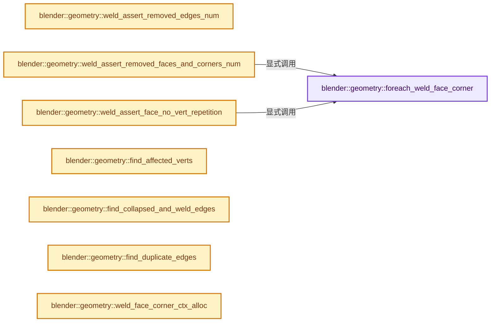

# 实现依赖专题：source/blender/geometry/intern/mesh_merge_verts.cc

[方向导航](README.md) · [符号索引](../%E7%AC%A6%E5%8F%B7%E4%BE%9D%E8%B5%96%E4%B8%8E%E5%AE%9E%E7%8E%B0%E7%B4%A2%E5%BC%95.md)

本专题从正文实际调用进入，集中保存共享实现。函数有稳定锚点，可从调用处直接跳到对应完整函数；递归与互相调用通过回链组织。

## 本文件的实现关系




## 相关类型布局与成员入口

<a id="t-54eb68fa0f61"></a>

### `blender::geometry::RemovedFacesAndCorners`

原始声明：[source/blender/geometry/intern/mesh_merge_verts.cc](../../../../../source/blender/geometry/intern/mesh_merge_verts.cc) · L70—L79。

成员布局：

- `int faces`
- `int corners`

以下保留类的数据声明与编译条件，成员函数实现通过后面的精确链接阅读。

<!-- annotated:ec6ab0153dd5be -->

```cpp
struct RemovedFacesAndCorners {
  int faces = 0;
  int corners = 0;

```

<details>
<summary>核对原始源码：source/blender/geometry/intern/mesh_merge_verts.cc · L70—L73</summary>

<!-- original:ec6ab0153dd5be:source/blender/geometry/intern/mesh_merge_verts.cc:70:73 -->

```cpp
struct RemovedFacesAndCorners {
  int faces = 0;
  int corners = 0;

```

</details>

<!-- annotated:994c800a50e134 -->

```cpp
};
```

<details>
<summary>核对原始源码：source/blender/geometry/intern/mesh_merge_verts.cc · L79—L79</summary>

<!-- original:994c800a50e134:source/blender/geometry/intern/mesh_merge_verts.cc:79:79 -->

```cpp
};
```

</details>


## 完整成员与函数实现

<a id="f-80200671d2b2500a"></a>

### `blender::geometry::foreach_weld_face_corner`

实现位置：[source/blender/geometry/intern/mesh_merge_verts.cc](../../../../../source/blender/geometry/intern/mesh_merge_verts.cc) · L114—L125。

接口参数：

- `const WeldFace &weld_face`
- `const Span<int> corner_next`
- `const Fn &fn`

**教学注释版**

<!-- annotated:0ec6cde8688e48 -->

```cpp
template<typename Fn>
static void foreach_weld_face_corner(const WeldFace &weld_face,
                                     const Span<int> corner_next,
                                     const Fn &fn)
{
  BLI_assert(weld_face.face_dst == OUT_OF_CONTEXT);
  int corner = weld_face.corner_start;
  do {
    fn(corner);
    corner = corner_next[corner];
  } while (corner != weld_face.corner_start);
}
```

<details>
<summary>核对原始源码：source/blender/geometry/intern/mesh_merge_verts.cc · L114—L125</summary>

<!-- original:0ec6cde8688e48:source/blender/geometry/intern/mesh_merge_verts.cc:114:125 -->

```cpp
template<typename Fn>
static void foreach_weld_face_corner(const WeldFace &weld_face,
                                     const Span<int> corner_next,
                                     const Fn &fn)
{
  BLI_assert(weld_face.face_dst == OUT_OF_CONTEXT);
  int corner = weld_face.corner_start;
  do {
    fn(corner);
    corner = corner_next[corner];
  } while (corner != weld_face.corner_start);
}
```

</details>

**沿实际写入检查状态**

- `corner = corner_next[corner];`

**继续追踪实现**

- `BLI_assert` → [BLI_assert · L48](../01-%E5%9F%BA%E7%A1%80%E5%AE%B9%E5%99%A8%E4%B8%8E%E7%8E%B0%E4%BB%A3CPP/%E4%BE%9D%E8%B5%96-BLI_assert-cc98e8.md#m-57a88495704d)；[BLI_assert · L63](../01-%E5%9F%BA%E7%A1%80%E5%AE%B9%E5%99%A8%E4%B8%8E%E7%8E%B0%E4%BB%A3CPP/%E4%BE%9D%E8%B5%96-BLI_assert-cc98e8.md#m-d07050020cb5)。宏定义由构建条件选择。
- `fn` → [调用协议](../%E6%A8%A1%E6%9D%BF%E5%AE%8F%E4%B8%8E%E5%8A%A8%E6%80%81%E5%88%86%E6%B4%BE%E5%8D%8F%E8%AE%AE.md)：局部可调用对象，须结合其初始化与捕获环境。调用位置L122。

<a id="f-4f35cb1309dd0d16"></a>

### `blender::geometry::weld_assert_removed_edges_num`

实现位置：[source/blender/geometry/intern/mesh_merge_verts.cc](../../../../../source/blender/geometry/intern/mesh_merge_verts.cc) · L132—L142。

接口参数：

- `Span<int> edge_src_to_target`
- `const int expected_removed_num`

**教学注释版**

<!-- annotated:c789692ff031e7 -->

```cpp
static void weld_assert_removed_edges_num(Span<int> edge_src_to_target,
                                          const int expected_removed_num)
{
  int kills = 0;
  // [讲解] edge_src_to_target.index_range：查询视图长度或生成对应有效索引区间。
  for (const int edge_src : edge_src_to_target.index_range()) {
    if (edge_src_to_target[edge_src] != edge_src) {
      kills++;
    }
  }
  BLI_assert(kills == expected_removed_num);
}
```

<details>
<summary>核对原始源码：source/blender/geometry/intern/mesh_merge_verts.cc · L132—L142</summary>

<!-- original:c789692ff031e7:source/blender/geometry/intern/mesh_merge_verts.cc:132:142 -->

```cpp
static void weld_assert_removed_edges_num(Span<int> edge_src_to_target,
                                          const int expected_removed_num)
{
  int kills = 0;
  for (const int edge_src : edge_src_to_target.index_range()) {
    if (edge_src_to_target[edge_src] != edge_src) {
      kills++;
    }
  }
  BLI_assert(kills == expected_removed_num);
}
```

</details>

**继续追踪实现**

- `edge_src_to_target.index_range` → [blender::Span::index_range · L405](../01-%E5%9F%BA%E7%A1%80%E5%AE%B9%E5%99%A8%E4%B8%8E%E7%8E%B0%E4%BB%A3CPP/05-Span%E5%8F%AA%E8%AF%BB%E8%BF%9E%E7%BB%AD%E8%A7%86%E5%9B%BE.md#f-caaa9b06e13e53e0)。
- `BLI_assert` → [BLI_assert · L48](../01-%E5%9F%BA%E7%A1%80%E5%AE%B9%E5%99%A8%E4%B8%8E%E7%8E%B0%E4%BB%A3CPP/%E4%BE%9D%E8%B5%96-BLI_assert-cc98e8.md#m-57a88495704d)；[BLI_assert · L63](../01-%E5%9F%BA%E7%A1%80%E5%AE%B9%E5%99%A8%E4%B8%8E%E7%8E%B0%E4%BB%A3CPP/%E4%BE%9D%E8%B5%96-BLI_assert-cc98e8.md#m-d07050020cb5)。宏定义由构建条件选择。

<a id="f-656d8d3f571f6262"></a>

### `blender::geometry::weld_assert_removed_faces_and_corners_num`

实现位置：[source/blender/geometry/intern/mesh_merge_verts.cc](../../../../../source/blender/geometry/intern/mesh_merge_verts.cc) · L144—L166。

接口参数：

- `const WeldMesh &weld_mesh`
- `const int expected_removed_faces_num`
- `const int expected_removed_corners_num`

**教学注释版**

<!-- annotated:f795500c376dbc -->

```cpp
static void weld_assert_removed_faces_and_corners_num(const WeldMesh &weld_mesh,
                                                      const int expected_removed_faces_num,
                                                      const int expected_removed_corners_num)
{
  const OffsetIndices<int> faces = weld_mesh.faces;
  int removed_faces = 0;
  int remaining_corners = 0;
  for (const int i : faces.index_range()) {
    if (weld_mesh.face_to_weld_face[i] == OUT_OF_CONTEXT) {
      remaining_corners += faces[i].size();
    }
  }
  for (const WeldFace &weld_face : weld_mesh.weld_faces) {
    if (weld_face.face_dst != OUT_OF_CONTEXT) {
      removed_faces++;
      continue;
    }
    foreach_weld_face_corner(
        weld_face, weld_mesh.corner_next, [&](const int /*corner*/) { remaining_corners++; });
  }
  BLI_assert(removed_faces == expected_removed_faces_num);
  BLI_assert(weld_mesh.corner_verts.size() - remaining_corners == expected_removed_corners_num);
}
```

<details>
<summary>核对原始源码：source/blender/geometry/intern/mesh_merge_verts.cc · L144—L166</summary>

<!-- original:f795500c376dbc:source/blender/geometry/intern/mesh_merge_verts.cc:144:166 -->

```cpp
static void weld_assert_removed_faces_and_corners_num(const WeldMesh &weld_mesh,
                                                      const int expected_removed_faces_num,
                                                      const int expected_removed_corners_num)
{
  const OffsetIndices<int> faces = weld_mesh.faces;
  int removed_faces = 0;
  int remaining_corners = 0;
  for (const int i : faces.index_range()) {
    if (weld_mesh.face_to_weld_face[i] == OUT_OF_CONTEXT) {
      remaining_corners += faces[i].size();
    }
  }
  for (const WeldFace &weld_face : weld_mesh.weld_faces) {
    if (weld_face.face_dst != OUT_OF_CONTEXT) {
      removed_faces++;
      continue;
    }
    foreach_weld_face_corner(
        weld_face, weld_mesh.corner_next, [&](const int /*corner*/) { remaining_corners++; });
  }
  BLI_assert(removed_faces == expected_removed_faces_num);
  BLI_assert(weld_mesh.corner_verts.size() - remaining_corners == expected_removed_corners_num);
}
```

</details>

**沿实际写入检查状态**

- `remaining_corners += faces[i].size();`

**继续追踪实现**

- `faces.index_range` → [blender::offset_indices::OffsetIndices::index_range · L77](02-OffsetIndices%E5%AE%8C%E6%95%B4%E6%8E%A5%E5%8F%A3.md#f-19b5ca1456de007d)。
- `faces[i].size` → [调用协议](../%E6%A8%A1%E6%9D%BF%E5%AE%8F%E4%B8%8E%E5%8A%A8%E6%80%81%E5%88%86%E6%B4%BE%E5%8D%8F%E8%AE%AE.md)：接收对象类型依赖auto、返回值或模板实例；不按同名猜测目标。调用位置L153。
- `foreach_weld_face_corner` → [blender::geometry::foreach_weld_face_corner · L114](%E4%BE%9D%E8%B5%96-mesh_merge_verts-bfe93a.md#f-80200671d2b2500a)。
- `BLI_assert` → [BLI_assert · L48](../01-%E5%9F%BA%E7%A1%80%E5%AE%B9%E5%99%A8%E4%B8%8E%E7%8E%B0%E4%BB%A3CPP/%E4%BE%9D%E8%B5%96-BLI_assert-cc98e8.md#m-57a88495704d)；[BLI_assert · L63](../01-%E5%9F%BA%E7%A1%80%E5%AE%B9%E5%99%A8%E4%B8%8E%E7%8E%B0%E4%BB%A3CPP/%E4%BE%9D%E8%B5%96-BLI_assert-cc98e8.md#m-d07050020cb5)。宏定义由构建条件选择。
- `weld_mesh.corner_verts.size` → [调用协议](../%E6%A8%A1%E6%9D%BF%E5%AE%8F%E4%B8%8E%E5%8A%A8%E6%80%81%E5%88%86%E6%B4%BE%E5%8D%8F%E8%AE%AE.md)：接收对象类型依赖auto、返回值或模板实例；不按同名猜测目标。调用位置L165。

<a id="f-4336665ea04aa9ae"></a>

### `blender::geometry::weld_assert_face_no_vert_repetition`

实现位置：[source/blender/geometry/intern/mesh_merge_verts.cc](../../../../../source/blender/geometry/intern/mesh_merge_verts.cc) · L168—L184。

接口参数：

- `const WeldFace &weld_face`
- `const WeldMesh &weld_mesh`

**教学注释版**

<!-- annotated:588d34204643de -->

```cpp
static void weld_assert_face_no_vert_repetition(const WeldFace &weld_face,
                                                const WeldMesh &weld_mesh)
{
  if (weld_face.face_dst != OUT_OF_CONTEXT) {
    return;
  }
  Vector<int> verts;
  foreach_weld_face_corner(weld_face, weld_mesh.corner_next, [&](const int corner) {
    // [讲解] verts.append：在尾部建立新元素，必要时先扩大存储。
    verts.append(weld_mesh.vert_src_to_target[weld_mesh.corner_verts[corner]]);
  });
  // [讲解] verts.size：用end_减begin_得到活元素数量。
  BLI_assert(verts.size() == weld_face.corners_num);
  for (const int i : verts.index_range()) {
    for (const int j : verts.index_range().drop_front(i + 1)) {
      BLI_assert(verts[i] != verts[j]);
    }
  }
}
```

<details>
<summary>核对原始源码：source/blender/geometry/intern/mesh_merge_verts.cc · L168—L184</summary>

<!-- original:588d34204643de:source/blender/geometry/intern/mesh_merge_verts.cc:168:184 -->

```cpp
static void weld_assert_face_no_vert_repetition(const WeldFace &weld_face,
                                                const WeldMesh &weld_mesh)
{
  if (weld_face.face_dst != OUT_OF_CONTEXT) {
    return;
  }
  Vector<int> verts;
  foreach_weld_face_corner(weld_face, weld_mesh.corner_next, [&](const int corner) {
    verts.append(weld_mesh.vert_src_to_target[weld_mesh.corner_verts[corner]]);
  });
  BLI_assert(verts.size() == weld_face.corners_num);
  for (const int i : verts.index_range()) {
    for (const int j : verts.index_range().drop_front(i + 1)) {
      BLI_assert(verts[i] != verts[j]);
    }
  }
}
```

</details>

**继续追踪实现**

- `foreach_weld_face_corner` → [blender::geometry::foreach_weld_face_corner · L114](%E4%BE%9D%E8%B5%96-mesh_merge_verts-bfe93a.md#f-80200671d2b2500a)。
- `verts.append` → [blender::Vector::append · L498](../01-%E5%9F%BA%E7%A1%80%E5%AE%B9%E5%99%A8%E4%B8%8E%E7%8E%B0%E4%BB%A3CPP/11-Vector%E6%8F%92%E5%85%A5%E5%88%A0%E9%99%A4%E4%B8%8E%E9%87%8D%E6%8E%92.md#f-5bde268a69e443ec)；[blender::Vector::append · L502](../01-%E5%9F%BA%E7%A1%80%E5%AE%B9%E5%99%A8%E4%B8%8E%E7%8E%B0%E4%BB%A3CPP/11-Vector%E6%8F%92%E5%85%A5%E5%88%A0%E9%99%A4%E4%B8%8E%E9%87%8D%E6%8E%92.md#f-591e0b15e6308532)。同名重载需按实参类型选择。
- `BLI_assert` → [BLI_assert · L48](../01-%E5%9F%BA%E7%A1%80%E5%AE%B9%E5%99%A8%E4%B8%8E%E7%8E%B0%E4%BB%A3CPP/%E4%BE%9D%E8%B5%96-BLI_assert-cc98e8.md#m-57a88495704d)；[BLI_assert · L63](../01-%E5%9F%BA%E7%A1%80%E5%AE%B9%E5%99%A8%E4%B8%8E%E7%8E%B0%E4%BB%A3CPP/%E4%BE%9D%E8%B5%96-BLI_assert-cc98e8.md#m-d07050020cb5)。宏定义由构建条件选择。
- `verts.size` → [blender::Vector::size · L780](../01-%E5%9F%BA%E7%A1%80%E5%AE%B9%E5%99%A8%E4%B8%8E%E7%8E%B0%E4%BB%A3CPP/11-Vector%E6%8F%92%E5%85%A5%E5%88%A0%E9%99%A4%E4%B8%8E%E9%87%8D%E6%8E%92.md#f-714773731767349c)。
- `verts.index_range` → [blender::Vector::index_range · L1026](../01-%E5%9F%BA%E7%A1%80%E5%AE%B9%E5%99%A8%E4%B8%8E%E7%8E%B0%E4%BB%A3CPP/12-Vector%E5%BC%82%E5%B8%B8%E5%AE%89%E5%85%A8%E4%B8%8E%E8%BE%B9%E7%95%8C.md#f-ac29cf36ef185ab9)。
- `verts.index_range().drop_front` → [调用协议](../%E6%A8%A1%E6%9D%BF%E5%AE%8F%E4%B8%8E%E5%8A%A8%E6%80%81%E5%88%86%E6%B4%BE%E5%8D%8F%E8%AE%AE.md)：接收对象类型依赖auto、返回值或模板实例；不按同名猜测目标。调用位置L180。

<a id="f-015a7822b7c650de"></a>

### `blender::geometry::find_affected_verts`

实现位置：[source/blender/geometry/intern/mesh_merge_verts.cc](../../../../../source/blender/geometry/intern/mesh_merge_verts.cc) · L198—L213。

接口参数：

- `const Span<int> vert_src_to_target`

**教学注释版**

<!-- annotated:b40335bbd96680 -->

```cpp
static Array<bool> find_affected_verts(const Span<int> vert_src_to_target)
{
  // [讲解] vert_src_to_target.size：查询视图长度或生成对应有效索引区间。
  Array<bool> affected(vert_src_to_target.size(), false);
  // [讲解] vert_src_to_target.index_range：查询视图长度或生成对应有效索引区间。
  threading::parallel_for(vert_src_to_target.index_range(), 4096, [&](const IndexRange range) {
    for (const int vert : range) {
      const int vert_target = vert_src_to_target[vert];
      if (vert_target != vert) {
        BLI_assert(vert_src_to_target[vert_target] == vert_target);
        affected[vert] = true;
        /* All threads will store the same "true" value. */
        affected[vert_target] = true;
      }
    }
  });
  return affected;
}
```

<details>
<summary>核对原始源码：source/blender/geometry/intern/mesh_merge_verts.cc · L198—L213</summary>

<!-- original:b40335bbd96680:source/blender/geometry/intern/mesh_merge_verts.cc:198:213 -->

```cpp
static Array<bool> find_affected_verts(const Span<int> vert_src_to_target)
{
  Array<bool> affected(vert_src_to_target.size(), false);
  threading::parallel_for(vert_src_to_target.index_range(), 4096, [&](const IndexRange range) {
    for (const int vert : range) {
      const int vert_target = vert_src_to_target[vert];
      if (vert_target != vert) {
        BLI_assert(vert_src_to_target[vert_target] == vert_target);
        affected[vert] = true;
        /* All threads will store the same "true" value. */
        affected[vert_target] = true;
      }
    }
  });
  return affected;
}
```

</details>

**沿实际写入检查状态**

- `affected[vert] = true;`
- `affected[vert_target] = true;`

**结果出口**

- `return affected;`

**继续追踪实现**

- `vert_src_to_target.size` → [blender::Span::size · L256](../01-%E5%9F%BA%E7%A1%80%E5%AE%B9%E5%99%A8%E4%B8%8E%E7%8E%B0%E4%BB%A3CPP/05-Span%E5%8F%AA%E8%AF%BB%E8%BF%9E%E7%BB%AD%E8%A7%86%E5%9B%BE.md#f-5f80fa006089c998)。
- `threading::parallel_for` → [blender::threading::parallel_for · L68](../11-Depsgraph%E4%B8%8E%E5%B9%B6%E8%A1%8C%E4%BB%BB%E5%8A%A1%E7%B3%BB%E7%BB%9F/07-%E4%BB%BB%E5%8A%A1%E6%B1%A0%E4%B8%8ETBB%E6%8E%A5%E5%85%A5.md#f-838294754c24426c)。
- `vert_src_to_target.index_range` → [blender::Span::index_range · L405](../01-%E5%9F%BA%E7%A1%80%E5%AE%B9%E5%99%A8%E4%B8%8E%E7%8E%B0%E4%BB%A3CPP/05-Span%E5%8F%AA%E8%AF%BB%E8%BF%9E%E7%BB%AD%E8%A7%86%E5%9B%BE.md#f-caaa9b06e13e53e0)。
- `BLI_assert` → [BLI_assert · L48](../01-%E5%9F%BA%E7%A1%80%E5%AE%B9%E5%99%A8%E4%B8%8E%E7%8E%B0%E4%BB%A3CPP/%E4%BE%9D%E8%B5%96-BLI_assert-cc98e8.md#m-57a88495704d)；[BLI_assert · L63](../01-%E5%9F%BA%E7%A1%80%E5%AE%B9%E5%99%A8%E4%B8%8E%E7%8E%B0%E4%BB%A3CPP/%E4%BE%9D%E8%B5%96-BLI_assert-cc98e8.md#m-d07050020cb5)。宏定义由构建条件选择。

<a id="f-132d622f154b1b95"></a>

### `blender::geometry::find_collapsed_and_weld_edges`

实现位置：[source/blender/geometry/intern/mesh_merge_verts.cc](../../../../../source/blender/geometry/intern/mesh_merge_verts.cc) · L229—L256。

接口参数：

- `const Span<int2> edges`
- `const Span<int> vert_src_to_target`
- `const Span<bool> vert_affected`
- `IndexMaskMemory &memory`
- `MutableSpan<int> r_edge_src_to_target`
- `int *r_collapsed_edges_num`

**教学注释版**

<!-- annotated:4128e9e53a7623 -->

```cpp
static IndexMask find_collapsed_and_weld_edges(const Span<int2> edges,
                                               const Span<int> vert_src_to_target,
                                               const Span<bool> vert_affected,
                                               IndexMaskMemory &memory,
                                               MutableSpan<int> r_edge_src_to_target,
                                               int *r_collapsed_edges_num)
{
  const IndexMask affected_edges = IndexMask::from_predicate(
      // [讲解] edges.index_range：查询视图长度或生成对应有效索引区间。
      edges.index_range(),
      memory,
      [&](const int edge) {
        return vert_affected[edges[edge][0]] || vert_affected[edges[edge][1]];
      },
      exec_mode::grain_size(4096));
  const IndexMask weld_edges = IndexMask::from_predicate(
      affected_edges,
      memory,
      [&](const int edge) {
        return vert_src_to_target[edges[edge][0]] != vert_src_to_target[edges[edge][1]];
      },
      exec_mode::grain_size(4096));
  const IndexMask collapsed_edges = IndexMask::from_difference(affected_edges, weld_edges, memory);

  array_utils::fill_index_range<int>(edges.index_range(), r_edge_src_to_target);
  index_mask::masked_fill(r_edge_src_to_target, ELEM_COLLAPSED, collapsed_edges);
  *r_collapsed_edges_num = collapsed_edges.size();
  return weld_edges;
}
```

<details>
<summary>核对原始源码：source/blender/geometry/intern/mesh_merge_verts.cc · L229—L256</summary>

<!-- original:4128e9e53a7623:source/blender/geometry/intern/mesh_merge_verts.cc:229:256 -->

```cpp
static IndexMask find_collapsed_and_weld_edges(const Span<int2> edges,
                                               const Span<int> vert_src_to_target,
                                               const Span<bool> vert_affected,
                                               IndexMaskMemory &memory,
                                               MutableSpan<int> r_edge_src_to_target,
                                               int *r_collapsed_edges_num)
{
  const IndexMask affected_edges = IndexMask::from_predicate(
      edges.index_range(),
      memory,
      [&](const int edge) {
        return vert_affected[edges[edge][0]] || vert_affected[edges[edge][1]];
      },
      exec_mode::grain_size(4096));
  const IndexMask weld_edges = IndexMask::from_predicate(
      affected_edges,
      memory,
      [&](const int edge) {
        return vert_src_to_target[edges[edge][0]] != vert_src_to_target[edges[edge][1]];
      },
      exec_mode::grain_size(4096));
  const IndexMask collapsed_edges = IndexMask::from_difference(affected_edges, weld_edges, memory);

  array_utils::fill_index_range<int>(edges.index_range(), r_edge_src_to_target);
  index_mask::masked_fill(r_edge_src_to_target, ELEM_COLLAPSED, collapsed_edges);
  *r_collapsed_edges_num = collapsed_edges.size();
  return weld_edges;
}
```

</details>

**结果出口**

- `return vert_affected[edges[edge][0]] || vert_affected[edges[edge][1]];`
- `return vert_src_to_target[edges[edge][0]] != vert_src_to_target[edges[edge][1]];`
- `return weld_edges;`

**继续追踪实现**

- `IndexMask::from_predicate` → [blender::index_mask::IndexMask::from_predicate · L1073](../04-%E8%99%9A%E6%8B%9F%E6%95%B0%E7%BB%84%E4%B8%8E%E7%B4%A2%E5%BC%95%E9%80%89%E6%8B%A9/12-%E9%87%8D%E6%9E%84%E5%8E%86%E5%8F%B2%E4%B8%8E%E5%9F%BA%E5%87%86%E7%BB%83%E4%B9%A0.md#f-3864daa059098df8)。
- `edges.index_range` → [blender::Span::index_range · L405](../01-%E5%9F%BA%E7%A1%80%E5%AE%B9%E5%99%A8%E4%B8%8E%E7%8E%B0%E4%BB%A3CPP/05-Span%E5%8F%AA%E8%AF%BB%E8%BF%9E%E7%BB%AD%E8%A7%86%E5%9B%BE.md#f-caaa9b06e13e53e0)。
- `exec_mode::grain_size` → [blender::exec_mode::grain_size · L79](../01-%E5%9F%BA%E7%A1%80%E5%AE%B9%E5%99%A8%E4%B8%8E%E7%8E%B0%E4%BB%A3CPP/%E4%BE%9D%E8%B5%96-BLI_execution_mode-1528fb.md#f-0b4fc2f9fa6e66e7)。
- `IndexMask::from_difference` → [blender::index_mask::IndexMask::from_difference · L718](../04-%E8%99%9A%E6%8B%9F%E6%95%B0%E7%BB%84%E4%B8%8E%E7%B4%A2%E5%BC%95%E9%80%89%E6%8B%A9/10-IndexMask%E6%9E%84%E5%BB%BA%E4%B8%8E%E5%B9%B6%E8%A1%8C.md#f-2cf6879a7399cc50)。
- `array_utils::fill_index_range<int>` → [blender::array_utils::fill_index_range · L434](07-%E5%88%86%E7%BB%84%E8%AE%BF%E9%97%AE%E4%B8%8E%E5%8F%8D%E5%90%91%E7%B4%A2%E5%BC%95.md#f-f8128b104d76df0f)；[blender::array_utils::fill_index_range · L439](07-%E5%88%86%E7%BB%84%E8%AE%BF%E9%97%AE%E4%B8%8E%E5%8F%8D%E5%90%91%E7%B4%A2%E5%BC%95.md#f-95ca84458bfc7e7e)；[blender::array_utils::fill_index_range · L445](07-%E5%88%86%E7%BB%84%E8%AE%BF%E9%97%AE%E4%B8%8E%E5%8F%8D%E5%90%91%E7%B4%A2%E5%BC%95.md#f-c11b114c213cd61a)。同名重载需按实参类型选择。
- `index_mask::masked_fill` → [blender::index_mask::masked_fill · L1261](../04-%E8%99%9A%E6%8B%9F%E6%95%B0%E7%BB%84%E4%B8%8E%E7%B4%A2%E5%BC%95%E9%80%89%E6%8B%A9/12-%E9%87%8D%E6%9E%84%E5%8E%86%E5%8F%B2%E4%B8%8E%E5%9F%BA%E5%87%86%E7%BB%83%E4%B9%A0.md#f-00f1f611c7000f05)。
- `collapsed_edges.size` → [blender::index_mask::IndexMask::size · L743](../04-%E8%99%9A%E6%8B%9F%E6%95%B0%E7%BB%84%E4%B8%8E%E7%B4%A2%E5%BC%95%E9%80%89%E6%8B%A9/09-%E5%88%86%E6%AE%B5%E5%AD%98%E5%82%A8%E4%B8%8E%E9%81%8D%E5%8E%86.md#f-0163b32abc9a0d9c)。

<a id="f-333eb327acc5009c"></a>

### `blender::geometry::find_duplicate_edges`

实现位置：[source/blender/geometry/intern/mesh_merge_verts.cc](../../../../../source/blender/geometry/intern/mesh_merge_verts.cc) · L264—L323。

接口参数：

- `const Span<int2> edges`
- `const Span<int> vert_src_to_target`
- `const IndexMask &weld_edges`
- `const int verts_num`
- `MutableSpan<int> r_edge_src_to_target`

**教学注释版**

<!-- annotated:81ccc417665390 -->

```cpp
static int find_duplicate_edges(const Span<int2> edges,
                                const Span<int> vert_src_to_target,
                                const IndexMask &weld_edges,
                                const int verts_num,
                                MutableSpan<int> r_edge_src_to_target)
{
  if (weld_edges.is_empty()) {
    return 0;
  }

  Array<int> edge_indices(weld_edges.size());
  Array<int> low_verts(weld_edges.size());
  Array<int> high_verts(weld_edges.size());
  weld_edges.foreach_index(
      [&](const int edge, const int pos) {
        const OrderedEdge verts(vert_src_to_target[edges[edge][0]],
                                vert_src_to_target[edges[edge][1]]);
        edge_indices[pos] = edge;
        low_verts[pos] = verts.v_low;
        high_verts[pos] = verts.v_high;
      },
      exec_mode::grain_size(4096));

  /* Duplicate edges share their lower vertex, so only edges in the same group can be duplicates.
   */
  Array<int> offset_data;
  Array<int> index_data;
  const OffsetIndices edges_by_low_vert = offset_indices::build_groups_from_indices(
                                              low_verts, verts_num, offset_data, index_data)
                                              .offsets;

  return threading::parallel_reduce(
      edges_by_low_vert.index_range(),
      1024,
      0,
      [&](const IndexRange range, int duplicates_num) {
        for (const int vert : range) {
          // [讲解] index_data.as_mutable_span：提供数组的借用访问入口。
          MutableSpan<int> group = index_data.as_mutable_span().slice(edges_by_low_vert[vert]);
          // [讲解] group.size：查询视图长度或生成对应有效索引区间。
          if (group.size() < 2) {
            continue;
          }
          /* After sorting by the higher vertex, duplicates are next to each other, and the first
           * of each group of duplicates has the lowest index. */
          std::ranges::sort(group, [&](const int a, const int b) {
            return std::pair(high_verts[a], a) < std::pair(high_verts[b], b);
          });
          int first = group[0];
          // [讲解] group.drop_front：从两端裁去或选取一定数量元素形成新视图。
          for (const int weld_edge : group.drop_front(1)) {
            if (high_verts[weld_edge] != high_verts[first]) {
              first = weld_edge;
              continue;
            }
            r_edge_src_to_target[edge_indices[weld_edge]] = edge_indices[first];
            duplicates_num++;
          }
        }
        return duplicates_num;
      },
      std::plus<>());
}
```

<details>
<summary>核对原始源码：source/blender/geometry/intern/mesh_merge_verts.cc · L264—L323</summary>

<!-- original:81ccc417665390:source/blender/geometry/intern/mesh_merge_verts.cc:264:323 -->

```cpp
static int find_duplicate_edges(const Span<int2> edges,
                                const Span<int> vert_src_to_target,
                                const IndexMask &weld_edges,
                                const int verts_num,
                                MutableSpan<int> r_edge_src_to_target)
{
  if (weld_edges.is_empty()) {
    return 0;
  }

  Array<int> edge_indices(weld_edges.size());
  Array<int> low_verts(weld_edges.size());
  Array<int> high_verts(weld_edges.size());
  weld_edges.foreach_index(
      [&](const int edge, const int pos) {
        const OrderedEdge verts(vert_src_to_target[edges[edge][0]],
                                vert_src_to_target[edges[edge][1]]);
        edge_indices[pos] = edge;
        low_verts[pos] = verts.v_low;
        high_verts[pos] = verts.v_high;
      },
      exec_mode::grain_size(4096));

  /* Duplicate edges share their lower vertex, so only edges in the same group can be duplicates.
   */
  Array<int> offset_data;
  Array<int> index_data;
  const OffsetIndices edges_by_low_vert = offset_indices::build_groups_from_indices(
                                              low_verts, verts_num, offset_data, index_data)
                                              .offsets;

  return threading::parallel_reduce(
      edges_by_low_vert.index_range(),
      1024,
      0,
      [&](const IndexRange range, int duplicates_num) {
        for (const int vert : range) {
          MutableSpan<int> group = index_data.as_mutable_span().slice(edges_by_low_vert[vert]);
          if (group.size() < 2) {
            continue;
          }
          /* After sorting by the higher vertex, duplicates are next to each other, and the first
           * of each group of duplicates has the lowest index. */
          std::ranges::sort(group, [&](const int a, const int b) {
            return std::pair(high_verts[a], a) < std::pair(high_verts[b], b);
          });
          int first = group[0];
          for (const int weld_edge : group.drop_front(1)) {
            if (high_verts[weld_edge] != high_verts[first]) {
              first = weld_edge;
              continue;
            }
            r_edge_src_to_target[edge_indices[weld_edge]] = edge_indices[first];
            duplicates_num++;
          }
        }
        return duplicates_num;
      },
      std::plus<>());
}
```

</details>

**沿实际写入检查状态**

- `edge_indices[pos] = edge;`
- `low_verts[pos] = verts.v_low;`
- `high_verts[pos] = verts.v_high;`
- `first = weld_edge;`
- `r_edge_src_to_target[edge_indices[weld_edge]] = edge_indices[first];`

**结果出口**

- `return 0;`
- `return threading::parallel_reduce(`
- `return std::pair(high_verts[a], a) < std::pair(high_verts[b], b);`
- `return duplicates_num;`

**继续追踪实现**

- `weld_edges.is_empty` → [blender::index_mask::IndexMask::is_empty · L748](../04-%E8%99%9A%E6%8B%9F%E6%95%B0%E7%BB%84%E4%B8%8E%E7%B4%A2%E5%BC%95%E9%80%89%E6%8B%A9/09-%E5%88%86%E6%AE%B5%E5%AD%98%E5%82%A8%E4%B8%8E%E9%81%8D%E5%8E%86.md#f-190ac996386064f4)。
- `weld_edges.size` → [blender::index_mask::IndexMask::size · L743](../04-%E8%99%9A%E6%8B%9F%E6%95%B0%E7%BB%84%E4%B8%8E%E7%B4%A2%E5%BC%95%E9%80%89%E6%8B%A9/09-%E5%88%86%E6%AE%B5%E5%AD%98%E5%82%A8%E4%B8%8E%E9%81%8D%E5%8E%86.md#f-0163b32abc9a0d9c)。
- `weld_edges.foreach_index` → [blender::index_mask::IndexMask::foreach_index · L855](../04-%E8%99%9A%E6%8B%9F%E6%95%B0%E7%BB%84%E4%B8%8E%E7%B4%A2%E5%BC%95%E9%80%89%E6%8B%A9/09-%E5%88%86%E6%AE%B5%E5%AD%98%E5%82%A8%E4%B8%8E%E9%81%8D%E5%8E%86.md#f-cd6cd317e2e2812c)。
- `exec_mode::grain_size` → [blender::exec_mode::grain_size · L79](../01-%E5%9F%BA%E7%A1%80%E5%AE%B9%E5%99%A8%E4%B8%8E%E7%8E%B0%E4%BB%A3CPP/%E4%BE%9D%E8%B5%96-BLI_execution_mode-1528fb.md#f-0b4fc2f9fa6e66e7)。
- `offset_indices::build_groups_from_indices` → [blender::offset_indices::build_groups_from_indices · L418](05-%E9%82%BB%E6%8E%A5%E5%85%B3%E7%B3%BB%E4%B8%8E%E5%89%8D%E7%BC%80%E5%92%8C.md#f-4c5bda776ec6ec9d)；[blender::offset_indices::build_groups_from_indices · L430](05-%E9%82%BB%E6%8E%A5%E5%85%B3%E7%B3%BB%E4%B8%8E%E5%89%8D%E7%BC%80%E5%92%8C.md#f-6b34988c9f051249)。同名重载需按实参类型选择。
- `threading::parallel_reduce` → [blender::threading::parallel_reduce · L126](../11-Depsgraph%E4%B8%8E%E5%B9%B6%E8%A1%8C%E4%BB%BB%E5%8A%A1%E7%B3%BB%E7%BB%9F/07-%E4%BB%BB%E5%8A%A1%E6%B1%A0%E4%B8%8ETBB%E6%8E%A5%E5%85%A5.md#f-9225ddb5efb97fcc)。
- `edges_by_low_vert.index_range` → [blender::offset_indices::OffsetIndices::index_range · L77](02-OffsetIndices%E5%AE%8C%E6%95%B4%E6%8E%A5%E5%8F%A3.md#f-19b5ca1456de007d)。
- `index_data.as_mutable_span().slice` → [调用协议](../%E6%A8%A1%E6%9D%BF%E5%AE%8F%E4%B8%8E%E5%8A%A8%E6%80%81%E5%88%86%E6%B4%BE%E5%8D%8F%E8%AE%AE.md)：接收对象类型依赖auto、返回值或模板实例；不按同名猜测目标。调用位置L301。
- `index_data.as_mutable_span` → [blender::Array::as_mutable_span · L259](../01-%E5%9F%BA%E7%A1%80%E5%AE%B9%E5%99%A8%E4%B8%8E%E7%8E%B0%E4%BB%A3CPP/08-Array%E5%A4%8D%E5%88%B6%E7%A7%BB%E5%8A%A8%E4%B8%8E%E9%94%80%E6%AF%81.md#f-4e91de9f1337c144)。
- `group.size` → [blender::MutableSpan::size · L499](../01-%E5%9F%BA%E7%A1%80%E5%AE%B9%E5%99%A8%E4%B8%8E%E7%8E%B0%E4%BB%A3CPP/06-MutableSpan%E5%8F%AF%E5%86%99%E8%A7%86%E5%9B%BE.md#f-1de6a66839c304a8)；[blender::gpu::shader::parser::MutableSpan::size · L87](%E4%BE%9D%E8%B5%96-utils-06433d.md#f-5e684af6ee7990e9)。同名重载需按实参类型选择。
- `std::ranges::sort` → [外部契约](https://eel.is/c++draft/)：这个边界按实际表达式及所属类型核对参数、返回值、寿命与失败行为。这里提供接口入口，不声称已解释该第三方版本的内部实现。
- `std::pair` → [外部契约](https://eel.is/c++draft/)：这个边界按实际表达式及所属类型核对参数、返回值、寿命与失败行为。这里提供接口入口，不声称已解释该第三方版本的内部实现。
- `group.drop_front` → [blender::MutableSpan::drop_front · L613](../01-%E5%9F%BA%E7%A1%80%E5%AE%B9%E5%99%A8%E4%B8%8E%E7%8E%B0%E4%BB%A3CPP/06-MutableSpan%E5%8F%AF%E5%86%99%E8%A7%86%E5%9B%BE.md#f-3ed1464d2e0d1608)。
- `std::plus<>` → [外部契约](https://eel.is/c++draft/)：这个边界按实际表达式及所属类型核对参数、返回值、寿命与失败行为。这里提供接口入口，不声称已解释该第三方版本的内部实现。

<a id="f-20042ce41bbb1675"></a>

### `blender::geometry::weld_face_corner_ctx_alloc`

实现位置：[source/blender/geometry/intern/mesh_merge_verts.cc](../../../../../source/blender/geometry/intern/mesh_merge_verts.cc) · L336—L413。

接口参数：

- `const OffsetIndices<int> faces`
- `const Span<int> corner_verts`
- `WeldMesh *r_weld_mesh`

**教学注释版**

<!-- annotated:4b13657ff25753 -->

```cpp
static void weld_face_corner_ctx_alloc(const OffsetIndices<int> faces,
                                       const Span<int> corner_verts,
                                       WeldMesh *r_weld_mesh)
{
  const Span<bool> vert_affected = r_weld_mesh->vert_affected;

  IndexMaskMemory memory;
  const IndexMask affected_faces = IndexMask::from_predicate(
      faces.index_range(),
      memory,
      [&](const int face) {
        // [讲解] corner_verts.slice：建立原连续范围的子视图。
        return std::ranges::any_of(corner_verts.slice(faces[face]),
                                   [&](const int vert) { return vert_affected[vert]; });
      },
      exec_mode::grain_size(1024));

  /* Estimate the maximum number of new faces created by splitting faces that contain the same
   * vertex multiple times after merging. We could be smarter here and actually count how many new
   * faces will be created. But counting this can be inefficient as it depends on the number of
   * non-consecutive self face merges. */
  const int maybe_new_faces_num = threading::parallel_reduce(
      affected_faces.index_range(),
      1024,
      0,
      [&](const IndexRange range, int maybe_new_faces_num) {
        affected_faces.slice(range).foreach_index([&](const int face_index) {
          const IndexRange face = faces[face_index];
          // [讲解] face.size：读取连续区间或分组的边界信息。
          if (face.size() <= 5) {
            return;
          }
          /* Corners are affected by the merge when their vertex or the next vertex merges. */
          int corner_ctx_num = 0;
          for (const int corner : face) {
            const int corner_next = bke::mesh::face_corner_next(face, corner);
            if (vert_affected[corner_verts[corner]] || vert_affected[corner_verts[corner_next]]) {
              corner_ctx_num++;
            }
          }
          if (corner_ctx_num > 1) {
            // [讲解] std::min：按比较关系选取较小值；截断范围时还需先满足非负和可表示范围，min本身不会证明边界安全。
            maybe_new_faces_num += std::min(int(face.size() / 3), corner_ctx_num) - 1;
          }
        });
        return maybe_new_faces_num;
      },
      std::plus<>());

  Array<int> corner_next(corner_verts.size());
  Array<int> face_to_weld_face(faces.size());
  Vector<WeldFace> weld_faces;
  // [讲解] weld_faces.reserve：确保可容纳至少min_capacity个元素；当前size和已有元素值不因容量请求本身而增加。
  weld_faces.reserve(affected_faces.size() + maybe_new_faces_num);
  // [讲解] weld_faces.resize：把有效元素数调整为new_size。增长路径构造新元素，缩小路径销毁尾部对象，最后才提交新的end_。
  weld_faces.resize(affected_faces.size());

  affected_faces.foreach_index(
      [&](const int face_index, const int weld_face_index) {
        const IndexRange face = faces[face_index];
        for (const int corner : face.drop_back(1)) {
          corner_next[corner] = corner + 1;
        }
        // [讲解] face.last：读取范围两端的有效索引或值。
        corner_next[face.last()] = face.first();

        WeldFace &weld_face = weld_faces[weld_face_index];
        weld_face.face_dst = OUT_OF_CONTEXT;
        weld_face.face_src = face_index;
        // [讲解] face.first：读取范围两端的有效索引或值。
        weld_face.corner_start = face.first();
        weld_face.corner_end = face.last();
        weld_face.corners_num = face.size();
        face_to_weld_face[face_index] = weld_face_index;
      },
      exec_mode::grain_size(1024));
  // [讲解] face_to_weld_face.as_mutable_span：提供数组的借用访问入口。
  index_mask::masked_fill(face_to_weld_face.as_mutable_span(),
                          OUT_OF_CONTEXT,
                          affected_faces.complement(faces.index_range(), memory));

  // [讲解] std::move：把表达式转换成可供移动重载选择的值类别；不保证真的移动，不结束源对象寿命，对const值可能选择复制。
  r_weld_mesh->weld_faces = std::move(weld_faces);
  r_weld_mesh->new_faces_num = 0;
  r_weld_mesh->corner_next = std::move(corner_next);
  r_weld_mesh->face_to_weld_face = std::move(face_to_weld_face);
}
```

<details>
<summary>核对原始源码：source/blender/geometry/intern/mesh_merge_verts.cc · L336—L413</summary>

<!-- original:4b13657ff25753:source/blender/geometry/intern/mesh_merge_verts.cc:336:413 -->

```cpp
static void weld_face_corner_ctx_alloc(const OffsetIndices<int> faces,
                                       const Span<int> corner_verts,
                                       WeldMesh *r_weld_mesh)
{
  const Span<bool> vert_affected = r_weld_mesh->vert_affected;

  IndexMaskMemory memory;
  const IndexMask affected_faces = IndexMask::from_predicate(
      faces.index_range(),
      memory,
      [&](const int face) {
        return std::ranges::any_of(corner_verts.slice(faces[face]),
                                   [&](const int vert) { return vert_affected[vert]; });
      },
      exec_mode::grain_size(1024));

  /* Estimate the maximum number of new faces created by splitting faces that contain the same
   * vertex multiple times after merging. We could be smarter here and actually count how many new
   * faces will be created. But counting this can be inefficient as it depends on the number of
   * non-consecutive self face merges. */
  const int maybe_new_faces_num = threading::parallel_reduce(
      affected_faces.index_range(),
      1024,
      0,
      [&](const IndexRange range, int maybe_new_faces_num) {
        affected_faces.slice(range).foreach_index([&](const int face_index) {
          const IndexRange face = faces[face_index];
          if (face.size() <= 5) {
            return;
          }
          /* Corners are affected by the merge when their vertex or the next vertex merges. */
          int corner_ctx_num = 0;
          for (const int corner : face) {
            const int corner_next = bke::mesh::face_corner_next(face, corner);
            if (vert_affected[corner_verts[corner]] || vert_affected[corner_verts[corner_next]]) {
              corner_ctx_num++;
            }
          }
          if (corner_ctx_num > 1) {
            maybe_new_faces_num += std::min(int(face.size() / 3), corner_ctx_num) - 1;
          }
        });
        return maybe_new_faces_num;
      },
      std::plus<>());

  Array<int> corner_next(corner_verts.size());
  Array<int> face_to_weld_face(faces.size());
  Vector<WeldFace> weld_faces;
  weld_faces.reserve(affected_faces.size() + maybe_new_faces_num);
  weld_faces.resize(affected_faces.size());

  affected_faces.foreach_index(
      [&](const int face_index, const int weld_face_index) {
        const IndexRange face = faces[face_index];
        for (const int corner : face.drop_back(1)) {
          corner_next[corner] = corner + 1;
        }
        corner_next[face.last()] = face.first();

        WeldFace &weld_face = weld_faces[weld_face_index];
        weld_face.face_dst = OUT_OF_CONTEXT;
        weld_face.face_src = face_index;
        weld_face.corner_start = face.first();
        weld_face.corner_end = face.last();
        weld_face.corners_num = face.size();
        face_to_weld_face[face_index] = weld_face_index;
      },
      exec_mode::grain_size(1024));
  index_mask::masked_fill(face_to_weld_face.as_mutable_span(),
                          OUT_OF_CONTEXT,
                          affected_faces.complement(faces.index_range(), memory));

  r_weld_mesh->weld_faces = std::move(weld_faces);
  r_weld_mesh->new_faces_num = 0;
  r_weld_mesh->corner_next = std::move(corner_next);
  r_weld_mesh->face_to_weld_face = std::move(face_to_weld_face);
}
```

</details>

**沿实际写入检查状态**

- `maybe_new_faces_num += std::min(int(face.size() / 3), corner_ctx_num) - 1;`
- `corner_next[corner] = corner + 1;`
- `weld_face.face_dst = OUT_OF_CONTEXT;`
- `weld_face.face_src = face_index;`
- `weld_face.corner_start = face.first();`
- `weld_face.corner_end = face.last();`
- `weld_face.corners_num = face.size();`
- `face_to_weld_face[face_index] = weld_face_index;`
- `r_weld_mesh->weld_faces = std::move(weld_faces);`
- `r_weld_mesh->new_faces_num = 0;`
- `r_weld_mesh->corner_next = std::move(corner_next);`
- `r_weld_mesh->face_to_weld_face = std::move(face_to_weld_face);`

**结果出口**

- `return std::ranges::any_of(corner_verts.slice(faces[face]),`
- `return maybe_new_faces_num;`

**继续追踪实现**

- `IndexMask::from_predicate` → [blender::index_mask::IndexMask::from_predicate · L1073](../04-%E8%99%9A%E6%8B%9F%E6%95%B0%E7%BB%84%E4%B8%8E%E7%B4%A2%E5%BC%95%E9%80%89%E6%8B%A9/12-%E9%87%8D%E6%9E%84%E5%8E%86%E5%8F%B2%E4%B8%8E%E5%9F%BA%E5%87%86%E7%BB%83%E4%B9%A0.md#f-3864daa059098df8)。
- `faces.index_range` → [blender::offset_indices::OffsetIndices::index_range · L77](02-OffsetIndices%E5%AE%8C%E6%95%B4%E6%8E%A5%E5%8F%A3.md#f-19b5ca1456de007d)。
- `std::ranges::any_of` → [外部契约](https://eel.is/c++draft/)：这个边界按实际表达式及所属类型核对参数、返回值、寿命与失败行为。这里提供接口入口，不声称已解释该第三方版本的内部实现。
- `corner_verts.slice` → [blender::Span::slice · L141](../01-%E5%9F%BA%E7%A1%80%E5%AE%B9%E5%99%A8%E4%B8%8E%E7%8E%B0%E4%BB%A3CPP/05-Span%E5%8F%AA%E8%AF%BB%E8%BF%9E%E7%BB%AD%E8%A7%86%E5%9B%BE.md#f-380a0e8fdcbd53cc)；[blender::Span::slice · L149](../01-%E5%9F%BA%E7%A1%80%E5%AE%B9%E5%99%A8%E4%B8%8E%E7%8E%B0%E4%BB%A3CPP/05-Span%E5%8F%AA%E8%AF%BB%E8%BF%9E%E7%BB%AD%E8%A7%86%E5%9B%BE.md#f-9b9c15e78dd54eec)。同名重载需按实参类型选择。
- `exec_mode::grain_size` → [blender::exec_mode::grain_size · L79](../01-%E5%9F%BA%E7%A1%80%E5%AE%B9%E5%99%A8%E4%B8%8E%E7%8E%B0%E4%BB%A3CPP/%E4%BE%9D%E8%B5%96-BLI_execution_mode-1528fb.md#f-0b4fc2f9fa6e66e7)。
- `threading::parallel_reduce` → [blender::threading::parallel_reduce · L126](../11-Depsgraph%E4%B8%8E%E5%B9%B6%E8%A1%8C%E4%BB%BB%E5%8A%A1%E7%B3%BB%E7%BB%9F/07-%E4%BB%BB%E5%8A%A1%E6%B1%A0%E4%B8%8ETBB%E6%8E%A5%E5%85%A5.md#f-9225ddb5efb97fcc)。
- `affected_faces.index_range` → [blender::index_mask::IndexMask::index_range · L753](../04-%E8%99%9A%E6%8B%9F%E6%95%B0%E7%BB%84%E4%B8%8E%E7%B4%A2%E5%BC%95%E9%80%89%E6%8B%A9/09-%E5%88%86%E6%AE%B5%E5%AD%98%E5%82%A8%E4%B8%8E%E9%81%8D%E5%8E%86.md#f-749c399cf5bc4035)。
- `affected_faces.slice(range).foreach_index` → [调用协议](../%E6%A8%A1%E6%9D%BF%E5%AE%8F%E4%B8%8E%E5%8A%A8%E6%80%81%E5%88%86%E6%B4%BE%E5%8D%8F%E8%AE%AE.md)：接收对象类型依赖auto、返回值或模板实例；不按同名猜测目标。调用位置L361。
- `affected_faces.slice` → [blender::index_mask::IndexMask::slice · L845](../04-%E8%99%9A%E6%8B%9F%E6%95%B0%E7%BB%84%E4%B8%8E%E7%B4%A2%E5%BC%95%E9%80%89%E6%8B%A9/09-%E5%88%86%E6%AE%B5%E5%AD%98%E5%82%A8%E4%B8%8E%E9%81%8D%E5%8E%86.md#f-8c3ef56b66c5f123)；[blender::index_mask::IndexMask::slice · L125](../04-%E8%99%9A%E6%8B%9F%E6%95%B0%E7%BB%84%E4%B8%8E%E7%B4%A2%E5%BC%95%E9%80%89%E6%8B%A9/10-IndexMask%E6%9E%84%E5%BB%BA%E4%B8%8E%E5%B9%B6%E8%A1%8C.md#f-ff79fd755a945991)；[blender::index_mask::IndexMask::slice · L144](../04-%E8%99%9A%E6%8B%9F%E6%95%B0%E7%BB%84%E4%B8%8E%E7%B4%A2%E5%BC%95%E9%80%89%E6%8B%A9/10-IndexMask%E6%9E%84%E5%BB%BA%E4%B8%8E%E5%B9%B6%E8%A1%8C.md#f-c8b1c9029be81481)。同名重载需按实参类型选择。
- `face.size` → [blender::IndexRange::size · L156](../01-%E5%9F%BA%E7%A1%80%E5%AE%B9%E5%99%A8%E4%B8%8E%E7%8E%B0%E4%BB%A3CPP/04-IndexRange%E8%BF%9E%E7%BB%AD%E6%95%B4%E6%95%B0%E5%8C%BA%E9%97%B4.md#f-05f66c3ebb2fdfec)。
- `bke::mesh::face_corner_next` → [blender::bke::mesh::face_corner_next · L315](01-Mesh%E9%A1%B6%E7%82%B9%E8%BE%B9%E9%9D%A2%E8%A7%92%E7%82%B9.md#f-bf639df87b51fe48)。
- `std::min` → [外部契约](https://eel.is/c++draft/alg.min.max)：按比较关系选取较小值；截断范围时还需先满足非负和可表示范围，min本身不会证明边界安全。
- `std::plus<>` → [外部契约](https://eel.is/c++draft/)：这个边界按实际表达式及所属类型核对参数、返回值、寿命与失败行为。这里提供接口入口，不声称已解释该第三方版本的内部实现。
- `corner_verts.size` → [blender::Span::size · L256](../01-%E5%9F%BA%E7%A1%80%E5%AE%B9%E5%99%A8%E4%B8%8E%E7%8E%B0%E4%BB%A3CPP/05-Span%E5%8F%AA%E8%AF%BB%E8%BF%9E%E7%BB%AD%E8%A7%86%E5%9B%BE.md#f-5f80fa006089c998)。
- `faces.size` → [blender::offset_indices::OffsetIndices::size · L67](02-OffsetIndices%E5%AE%8C%E6%95%B4%E6%8E%A5%E5%8F%A3.md#f-e238abc62ed42abd)。
- `weld_faces.reserve` → [blender::Vector::reserve · L405](../01-%E5%9F%BA%E7%A1%80%E5%AE%B9%E5%99%A8%E4%B8%8E%E7%8E%B0%E4%BB%A3CPP/10-Vector%E6%89%A9%E5%AE%B9%E4%B8%8E%E5%A2%9E%E9%95%BF.md#f-4cf9c0f00e01102e)。
- `affected_faces.size` → [blender::index_mask::IndexMask::size · L743](../04-%E8%99%9A%E6%8B%9F%E6%95%B0%E7%BB%84%E4%B8%8E%E7%B4%A2%E5%BC%95%E9%80%89%E6%8B%A9/09-%E5%88%86%E6%AE%B5%E5%AD%98%E5%82%A8%E4%B8%8E%E9%81%8D%E5%8E%86.md#f-0163b32abc9a0d9c)。
- `weld_faces.resize` → [blender::Vector::resize · L418](../01-%E5%9F%BA%E7%A1%80%E5%AE%B9%E5%99%A8%E4%B8%8E%E7%8E%B0%E4%BB%A3CPP/10-Vector%E6%89%A9%E5%AE%B9%E4%B8%8E%E5%A2%9E%E9%95%BF.md#f-059312cabb8abe3a)；[blender::Vector::resize · L439](../01-%E5%9F%BA%E7%A1%80%E5%AE%B9%E5%99%A8%E4%B8%8E%E7%8E%B0%E4%BB%A3CPP/10-Vector%E6%89%A9%E5%AE%B9%E4%B8%8E%E5%A2%9E%E9%95%BF.md#f-ab8f94924ebe2d12)。同名重载需按实参类型选择。
- `affected_faces.foreach_index` → [blender::index_mask::IndexMask::foreach_index · L855](../04-%E8%99%9A%E6%8B%9F%E6%95%B0%E7%BB%84%E4%B8%8E%E7%B4%A2%E5%BC%95%E9%80%89%E6%8B%A9/09-%E5%88%86%E6%AE%B5%E5%AD%98%E5%82%A8%E4%B8%8E%E9%81%8D%E5%8E%86.md#f-cd6cd317e2e2812c)。
- `face.drop_back` → [blender::IndexRange::drop_back · L317](../01-%E5%9F%BA%E7%A1%80%E5%AE%B9%E5%99%A8%E4%B8%8E%E7%8E%B0%E4%BB%A3CPP/04-IndexRange%E8%BF%9E%E7%BB%AD%E6%95%B4%E6%95%B0%E5%8C%BA%E9%97%B4.md#f-be17c307e5b14575)。
- `face.last` → [blender::IndexRange::last · L214](../01-%E5%9F%BA%E7%A1%80%E5%AE%B9%E5%99%A8%E4%B8%8E%E7%8E%B0%E4%BB%A3CPP/04-IndexRange%E8%BF%9E%E7%BB%AD%E6%95%B4%E6%95%B0%E5%8C%BA%E9%97%B4.md#f-66896c6351a40de1)；[blender::gpu::shader::parser::IndexRange::last · L62](%E4%BE%9D%E8%B5%96-utils-06433d.md#f-373501206569c3b3)。同名重载需按实参类型选择。
- `face.first` → [blender::IndexRange::first · L204](../01-%E5%9F%BA%E7%A1%80%E5%AE%B9%E5%99%A8%E4%B8%8E%E7%8E%B0%E4%BB%A3CPP/04-IndexRange%E8%BF%9E%E7%BB%AD%E6%95%B4%E6%95%B0%E5%8C%BA%E9%97%B4.md#f-ab443c94e531befa)。
- `index_mask::masked_fill` → [blender::index_mask::masked_fill · L1261](../04-%E8%99%9A%E6%8B%9F%E6%95%B0%E7%BB%84%E4%B8%8E%E7%B4%A2%E5%BC%95%E9%80%89%E6%8B%A9/12-%E9%87%8D%E6%9E%84%E5%8E%86%E5%8F%B2%E4%B8%8E%E5%9F%BA%E5%87%86%E7%BB%83%E4%B9%A0.md#f-00f1f611c7000f05)。
- `face_to_weld_face.as_mutable_span` → [blender::Array::as_mutable_span · L259](../01-%E5%9F%BA%E7%A1%80%E5%AE%B9%E5%99%A8%E4%B8%8E%E7%8E%B0%E4%BB%A3CPP/08-Array%E5%A4%8D%E5%88%B6%E7%A7%BB%E5%8A%A8%E4%B8%8E%E9%94%80%E6%AF%81.md#f-4e91de9f1337c144)。
- `affected_faces.complement` → [blender::index_mask::IndexMask::complement · L407](../04-%E8%99%9A%E6%8B%9F%E6%95%B0%E7%BB%84%E4%B8%8E%E7%B4%A2%E5%BC%95%E9%80%89%E6%8B%A9/10-IndexMask%E6%9E%84%E5%BB%BA%E4%B8%8E%E5%B9%B6%E8%A1%8C.md#f-1e9932d5baa6f719)。
- `std::move` → [外部契约](https://eel.is/c++draft/utility.forward)：把表达式转换成可供移动重载选择的值类别；不保证真的移动，不结束源对象寿命，对const值可能选择复制。

<a id="f-031f6955d9fe3ab0"></a>

### `blender::geometry::weld_face_split_recursive`

实现位置：[source/blender/geometry/intern/mesh_merge_verts.cc](../../../../../source/blender/geometry/intern/mesh_merge_verts.cc) · L416—L528。

接口参数：

- `int face_size`
- `const Span<int> corner_verts`
- `WeldFace *r_wp`
- `WeldMesh *r_weld_mesh`
- `RemovedFacesAndCorners &r_removed`

**教学注释版**

<!-- annotated:e04b6fd76cd7f8 -->

```cpp
static void weld_face_split_recursive(int face_size,
                                      const Span<int> corner_verts,
                                      WeldFace *r_wp,
                                      WeldMesh *r_weld_mesh,
                                      RemovedFacesAndCorners &r_removed)
{
  if (face_size < 3) {
    return;
  }

  const Span<int> vert_src_to_target = r_weld_mesh->vert_src_to_target;
  const Span<bool> vert_affected = r_weld_mesh->vert_affected;
  MutableSpan<int> corner_next = r_weld_mesh->corner_next;

  int removed_corners_num = 0;

  int corner_end = r_wp->corner_end;
  int corner_a_prev = corner_end;
  int corner_a = r_wp->corner_start;
  do {
    const int vert_a = vert_src_to_target[corner_verts[corner_a]];
    if (!vert_affected[vert_a]) {
      /* Only test vertices that will be merged. */
      corner_a_prev = corner_a;
      corner_a = corner_next[corner_a];
      continue;
    }

    int dist_a = 1;
    int lb_prev = corner_a;
    int corner_b = corner_next[corner_a];
    do {
      const int vert_b = vert_src_to_target[corner_verts[corner_b]];
      if (vert_a != vert_b) {
        dist_a++;
        lb_prev = corner_b;
        corner_b = corner_next[corner_b];
        continue;
      }

      int dist_b = face_size - dist_a;

      BLI_assert(dist_a != 0 && dist_b != 0);
      if (dist_a == 1 || dist_b == 1) {
        BLI_assert(dist_a != dist_b);
      }
      else if (dist_a == 2 && dist_b == 2) {
        /* All corners are "collapsed". */
        removed_corners_num += 4;
        dist_b = 0;
        r_wp->face_dst = ELEM_COLLAPSED;
        r_removed.faces += 1;
        r_removed.corners += removed_corners_num;
        /* Since all the corners are collapsed, avoid iterating through them.
         * This may result in wrong removed_faces_num counts. */
        return;
      }
      else {
        corner_next[corner_a_prev] = corner_b;
        corner_next[lb_prev] = corner_a;
        if (r_wp->corner_start == corner_a) {
          r_wp->corner_start = corner_b;
        }

        if (dist_a == 2) {
          removed_corners_num += 2;
        }
        else if (dist_b == 2) {
          removed_corners_num += 2;

          r_wp->corner_start = corner_a;
          r_wp->corner_end = corner_end = lb_prev;

          face_size = dist_a;
          break;
        }
        else {
          r_weld_mesh->weld_faces.increase_size_by_unchecked(1);
          r_weld_mesh->new_faces_num++;

          WeldFace *new_test = &r_weld_mesh->weld_faces.last();
          new_test->face_dst = OUT_OF_CONTEXT;
          new_test->face_src = r_wp->face_src;
          new_test->corner_start = corner_a;
          new_test->corner_end = lb_prev;
          new_test->corners_num = dist_a;
          weld_face_split_recursive(dist_a, corner_verts, new_test, r_weld_mesh, r_removed);
        }

        corner_a = corner_b;
        face_size = dist_b;

        dist_a = 1;
      }

      lb_prev = corner_b;
      corner_b = corner_next[corner_b];
    } while (lb_prev != corner_end);

    corner_a_prev = corner_a;
    if (corner_a == corner_end) {
      /* No need to start again. */
      break;
    }
    corner_a = corner_next[corner_a];
  } while (corner_a != corner_end);

  r_removed.corners += removed_corners_num;
  r_wp->corners_num = face_size;
#ifdef USE_WELD_DEBUG
  weld_assert_face_no_vert_repetition(*r_wp, *r_weld_mesh);
#endif
}
```

<details>
<summary>核对原始源码：source/blender/geometry/intern/mesh_merge_verts.cc · L416—L528</summary>

<!-- original:e04b6fd76cd7f8:source/blender/geometry/intern/mesh_merge_verts.cc:416:528 -->

```cpp
static void weld_face_split_recursive(int face_size,
                                      const Span<int> corner_verts,
                                      WeldFace *r_wp,
                                      WeldMesh *r_weld_mesh,
                                      RemovedFacesAndCorners &r_removed)
{
  if (face_size < 3) {
    return;
  }

  const Span<int> vert_src_to_target = r_weld_mesh->vert_src_to_target;
  const Span<bool> vert_affected = r_weld_mesh->vert_affected;
  MutableSpan<int> corner_next = r_weld_mesh->corner_next;

  int removed_corners_num = 0;

  int corner_end = r_wp->corner_end;
  int corner_a_prev = corner_end;
  int corner_a = r_wp->corner_start;
  do {
    const int vert_a = vert_src_to_target[corner_verts[corner_a]];
    if (!vert_affected[vert_a]) {
      /* Only test vertices that will be merged. */
      corner_a_prev = corner_a;
      corner_a = corner_next[corner_a];
      continue;
    }

    int dist_a = 1;
    int lb_prev = corner_a;
    int corner_b = corner_next[corner_a];
    do {
      const int vert_b = vert_src_to_target[corner_verts[corner_b]];
      if (vert_a != vert_b) {
        dist_a++;
        lb_prev = corner_b;
        corner_b = corner_next[corner_b];
        continue;
      }

      int dist_b = face_size - dist_a;

      BLI_assert(dist_a != 0 && dist_b != 0);
      if (dist_a == 1 || dist_b == 1) {
        BLI_assert(dist_a != dist_b);
      }
      else if (dist_a == 2 && dist_b == 2) {
        /* All corners are "collapsed". */
        removed_corners_num += 4;
        dist_b = 0;
        r_wp->face_dst = ELEM_COLLAPSED;
        r_removed.faces += 1;
        r_removed.corners += removed_corners_num;
        /* Since all the corners are collapsed, avoid iterating through them.
         * This may result in wrong removed_faces_num counts. */
        return;
      }
      else {
        corner_next[corner_a_prev] = corner_b;
        corner_next[lb_prev] = corner_a;
        if (r_wp->corner_start == corner_a) {
          r_wp->corner_start = corner_b;
        }

        if (dist_a == 2) {
          removed_corners_num += 2;
        }
        else if (dist_b == 2) {
          removed_corners_num += 2;

          r_wp->corner_start = corner_a;
          r_wp->corner_end = corner_end = lb_prev;

          face_size = dist_a;
          break;
        }
        else {
          r_weld_mesh->weld_faces.increase_size_by_unchecked(1);
          r_weld_mesh->new_faces_num++;

          WeldFace *new_test = &r_weld_mesh->weld_faces.last();
          new_test->face_dst = OUT_OF_CONTEXT;
          new_test->face_src = r_wp->face_src;
          new_test->corner_start = corner_a;
          new_test->corner_end = lb_prev;
          new_test->corners_num = dist_a;
          weld_face_split_recursive(dist_a, corner_verts, new_test, r_weld_mesh, r_removed);
        }

        corner_a = corner_b;
        face_size = dist_b;

        dist_a = 1;
      }

      lb_prev = corner_b;
      corner_b = corner_next[corner_b];
    } while (lb_prev != corner_end);

    corner_a_prev = corner_a;
    if (corner_a == corner_end) {
      /* No need to start again. */
      break;
    }
    corner_a = corner_next[corner_a];
  } while (corner_a != corner_end);

  r_removed.corners += removed_corners_num;
  r_wp->corners_num = face_size;
#ifdef USE_WELD_DEBUG
  weld_assert_face_no_vert_repetition(*r_wp, *r_weld_mesh);
#endif
}
```

</details>

**沿实际写入检查状态**

- `corner_a_prev = corner_a;`
- `corner_a = corner_next[corner_a];`
- `lb_prev = corner_b;`
- `corner_b = corner_next[corner_b];`
- `removed_corners_num += 4;`
- `dist_b = 0;`
- `r_wp->face_dst = ELEM_COLLAPSED;`
- `r_removed.faces += 1;`
- `r_removed.corners += removed_corners_num;`
- `corner_next[corner_a_prev] = corner_b;`
- `corner_next[lb_prev] = corner_a;`
- `r_wp->corner_start = corner_b;`
- `removed_corners_num += 2;`
- `r_wp->corner_start = corner_a;`
- `r_wp->corner_end = corner_end = lb_prev;`
- `face_size = dist_a;`
- `new_test->face_dst = OUT_OF_CONTEXT;`
- `new_test->face_src = r_wp->face_src;`
- `new_test->corner_start = corner_a;`
- `new_test->corner_end = lb_prev;`
- `new_test->corners_num = dist_a;`
- `corner_a = corner_b;`
- `face_size = dist_b;`
- `dist_a = 1;`
- `r_wp->corners_num = face_size;`

**继续追踪实现**

- `BLI_assert` → [BLI_assert · L48](../01-%E5%9F%BA%E7%A1%80%E5%AE%B9%E5%99%A8%E4%B8%8E%E7%8E%B0%E4%BB%A3CPP/%E4%BE%9D%E8%B5%96-BLI_assert-cc98e8.md#m-57a88495704d)；[BLI_assert · L63](../01-%E5%9F%BA%E7%A1%80%E5%AE%B9%E5%99%A8%E4%B8%8E%E7%8E%B0%E4%BB%A3CPP/%E4%BE%9D%E8%B5%96-BLI_assert-cc98e8.md#m-d07050020cb5)。宏定义由构建条件选择。
- `r_weld_mesh->weld_faces.increase_size_by_unchecked` → [调用协议](../%E6%A8%A1%E6%9D%BF%E5%AE%8F%E4%B8%8E%E5%8A%A8%E6%80%81%E5%88%86%E6%B4%BE%E5%8D%8F%E8%AE%AE.md)：接收对象类型依赖auto、返回值或模板实例；不按同名猜测目标。调用位置L493。
- `r_weld_mesh->weld_faces.last` → [调用协议](../%E6%A8%A1%E6%9D%BF%E5%AE%8F%E4%B8%8E%E5%8A%A8%E6%80%81%E5%88%86%E6%B4%BE%E5%8D%8F%E8%AE%AE.md)：接收对象类型依赖auto、返回值或模板实例；不按同名猜测目标。调用位置L496。
- `weld_face_split_recursive` → [blender::geometry::weld_face_split_recursive · L416](%E4%BE%9D%E8%B5%96-mesh_merge_verts-bfe93a.md#f-031f6955d9fe3ab0)。
- `weld_assert_face_no_vert_repetition` → [blender::geometry::weld_assert_face_no_vert_repetition · L168](%E4%BE%9D%E8%B5%96-mesh_merge_verts-bfe93a.md#f-4336665ea04aa9ae)。

<a id="f-bf41d682ecdc8747"></a>

### `blender::geometry::collapse_weld_face`

实现位置：[source/blender/geometry/intern/mesh_merge_verts.cc](../../../../../source/blender/geometry/intern/mesh_merge_verts.cc) · L534—L576。

接口参数：

- `const Span<int> corner_edges`
- `const Span<int> edge_src_to_target`
- `WeldFace &weld_face`
- `MutableSpan<int> corner_next`
- `RemovedFacesAndCorners &r_removed`

**教学注释版**

<!-- annotated:88235e9f4e262c -->

```cpp
static int collapse_weld_face(const Span<int> corner_edges,
                              const Span<int> edge_src_to_target,
                              WeldFace &weld_face,
                              MutableSpan<int> corner_next,
                              RemovedFacesAndCorners &r_removed)
{
  int face_size = (weld_face.corner_end - weld_face.corner_start) + 1;
  int corner_prev = -1;
  bool changed_corner_start = false;
  int corner = weld_face.corner_start;
  do {
    if (edge_src_to_target[corner_edges[corner]] == ELEM_COLLAPSED) {
      if (face_size == 3) {
        weld_face.face_dst = ELEM_COLLAPSED;
        r_removed.faces++;
        r_removed.corners += 3;
        return 0;
      }

      if (corner == weld_face.corner_start) {
        changed_corner_start = true;
      }

      r_removed.corners++;
      face_size--;
    }
    else {
      if (changed_corner_start) {
        weld_face.corner_start = corner;
        changed_corner_start = false;
      }
      if (corner_prev != -1) {
        corner_next[corner_prev] = corner;
      }
      corner_prev = corner;
    }
  } while (corner++ != weld_face.corner_end);

  corner_next[corner_prev] = weld_face.corner_start;
  weld_face.corner_end = corner_prev;
  weld_face.corners_num = face_size;
  return face_size;
}
```

<details>
<summary>核对原始源码：source/blender/geometry/intern/mesh_merge_verts.cc · L534—L576</summary>

<!-- original:88235e9f4e262c:source/blender/geometry/intern/mesh_merge_verts.cc:534:576 -->

```cpp
static int collapse_weld_face(const Span<int> corner_edges,
                              const Span<int> edge_src_to_target,
                              WeldFace &weld_face,
                              MutableSpan<int> corner_next,
                              RemovedFacesAndCorners &r_removed)
{
  int face_size = (weld_face.corner_end - weld_face.corner_start) + 1;
  int corner_prev = -1;
  bool changed_corner_start = false;
  int corner = weld_face.corner_start;
  do {
    if (edge_src_to_target[corner_edges[corner]] == ELEM_COLLAPSED) {
      if (face_size == 3) {
        weld_face.face_dst = ELEM_COLLAPSED;
        r_removed.faces++;
        r_removed.corners += 3;
        return 0;
      }

      if (corner == weld_face.corner_start) {
        changed_corner_start = true;
      }

      r_removed.corners++;
      face_size--;
    }
    else {
      if (changed_corner_start) {
        weld_face.corner_start = corner;
        changed_corner_start = false;
      }
      if (corner_prev != -1) {
        corner_next[corner_prev] = corner;
      }
      corner_prev = corner;
    }
  } while (corner++ != weld_face.corner_end);

  corner_next[corner_prev] = weld_face.corner_start;
  weld_face.corner_end = corner_prev;
  weld_face.corners_num = face_size;
  return face_size;
}
```

</details>

**沿实际写入检查状态**

- `weld_face.face_dst = ELEM_COLLAPSED;`
- `r_removed.corners += 3;`
- `changed_corner_start = true;`
- `weld_face.corner_start = corner;`
- `changed_corner_start = false;`
- `corner_next[corner_prev] = corner;`
- `corner_prev = corner;`
- `corner_next[corner_prev] = weld_face.corner_start;`
- `weld_face.corner_end = corner_prev;`
- `weld_face.corners_num = face_size;`

**结果出口**

- `return 0;`
- `return face_size;`

**继续追踪实现**

本实现没有需要继续展开的显式调用；检查返回表达式、对象转换和调用者前置条件。

<a id="f-019fff5baa1d163e"></a>

### `blender::geometry::weld_face_corner_ctx_setup_collapsed_and_split`

实现位置：[source/blender/geometry/intern/mesh_merge_verts.cc](../../../../../source/blender/geometry/intern/mesh_merge_verts.cc) · L584—L643。

接口参数：

- `const Span<int> corner_verts`
- `const Span<int> corner_edges`
- `const int remaining_edge_ctx_num`
- `WeldMesh *r_weld_mesh`

**教学注释版**

<!-- annotated:ae6c0e6dfbf207 -->

```cpp
static void weld_face_corner_ctx_setup_collapsed_and_split(const Span<int> corner_verts,
                                                           const Span<int> corner_edges,
                                                           const int remaining_edge_ctx_num,
                                                           WeldMesh *r_weld_mesh)
{
  if (remaining_edge_ctx_num == 0) {
    int removed_corners_num = 0;
    for (WeldFace &weld_face : r_weld_mesh->weld_faces) {
      removed_corners_num += weld_face.corners_num;
      weld_face.face_dst = ELEM_COLLAPSED;
    }
    r_weld_mesh->removed_faces_num = r_weld_mesh->weld_faces.size();
    r_weld_mesh->removed_corners_num = removed_corners_num;
    return;
  }

  /* Splitting adds new faces at the end of the vector, which has enough space reserved already, so
   * the existing faces aren't reallocated. Only the faces that already exist are visited here. */
  WeldFace *weld_faces = r_weld_mesh->weld_faces.data();
  const IndexRange weld_faces_src_range = r_weld_mesh->weld_faces.index_range();
  const Span<int> edge_src_to_target = r_weld_mesh->edge_src_to_target;
  MutableSpan<int> corner_next = r_weld_mesh->corner_next;

  /* Only faces with at least 6 corners can be split into two new faces with at least 3 corners.
   * All other faces are processed in parallel. Faces that may be split are split afterwards on a
   * single thread, so the new faces are added in a deterministic order. */
  constexpr int min_split_face_size = 6;
  RemovedFacesAndCorners removed = threading::parallel_reduce(
      weld_faces_src_range,
      1024,
      RemovedFacesAndCorners(),
      [&](const IndexRange range, RemovedFacesAndCorners removed) {
        for (const int i : range) {
          const int face_size = collapse_weld_face(
              corner_edges, edge_src_to_target, weld_faces[i], corner_next, removed);
          if (face_size > 0 && face_size < min_split_face_size) {
            weld_face_split_recursive(
                face_size, corner_verts, &weld_faces[i], r_weld_mesh, removed);
          }
        }
        return removed;
      },
      std::plus<>());

  for (const int i : weld_faces_src_range) {
    WeldFace &weld_face = weld_faces[i];
    if (weld_face.face_dst == OUT_OF_CONTEXT && weld_face.corners_num >= min_split_face_size) {
      weld_face_split_recursive(
          weld_face.corners_num, corner_verts, &weld_face, r_weld_mesh, removed);
    }
  }

  r_weld_mesh->removed_faces_num = removed.faces;
  r_weld_mesh->removed_corners_num = removed.corners;

#ifdef USE_WELD_DEBUG
  weld_assert_removed_faces_and_corners_num(
      *r_weld_mesh, r_weld_mesh->removed_faces_num, r_weld_mesh->removed_corners_num);
#endif
}
```

<details>
<summary>核对原始源码：source/blender/geometry/intern/mesh_merge_verts.cc · L584—L643</summary>

<!-- original:ae6c0e6dfbf207:source/blender/geometry/intern/mesh_merge_verts.cc:584:643 -->

```cpp
static void weld_face_corner_ctx_setup_collapsed_and_split(const Span<int> corner_verts,
                                                           const Span<int> corner_edges,
                                                           const int remaining_edge_ctx_num,
                                                           WeldMesh *r_weld_mesh)
{
  if (remaining_edge_ctx_num == 0) {
    int removed_corners_num = 0;
    for (WeldFace &weld_face : r_weld_mesh->weld_faces) {
      removed_corners_num += weld_face.corners_num;
      weld_face.face_dst = ELEM_COLLAPSED;
    }
    r_weld_mesh->removed_faces_num = r_weld_mesh->weld_faces.size();
    r_weld_mesh->removed_corners_num = removed_corners_num;
    return;
  }

  /* Splitting adds new faces at the end of the vector, which has enough space reserved already, so
   * the existing faces aren't reallocated. Only the faces that already exist are visited here. */
  WeldFace *weld_faces = r_weld_mesh->weld_faces.data();
  const IndexRange weld_faces_src_range = r_weld_mesh->weld_faces.index_range();
  const Span<int> edge_src_to_target = r_weld_mesh->edge_src_to_target;
  MutableSpan<int> corner_next = r_weld_mesh->corner_next;

  /* Only faces with at least 6 corners can be split into two new faces with at least 3 corners.
   * All other faces are processed in parallel. Faces that may be split are split afterwards on a
   * single thread, so the new faces are added in a deterministic order. */
  constexpr int min_split_face_size = 6;
  RemovedFacesAndCorners removed = threading::parallel_reduce(
      weld_faces_src_range,
      1024,
      RemovedFacesAndCorners(),
      [&](const IndexRange range, RemovedFacesAndCorners removed) {
        for (const int i : range) {
          const int face_size = collapse_weld_face(
              corner_edges, edge_src_to_target, weld_faces[i], corner_next, removed);
          if (face_size > 0 && face_size < min_split_face_size) {
            weld_face_split_recursive(
                face_size, corner_verts, &weld_faces[i], r_weld_mesh, removed);
          }
        }
        return removed;
      },
      std::plus<>());

  for (const int i : weld_faces_src_range) {
    WeldFace &weld_face = weld_faces[i];
    if (weld_face.face_dst == OUT_OF_CONTEXT && weld_face.corners_num >= min_split_face_size) {
      weld_face_split_recursive(
          weld_face.corners_num, corner_verts, &weld_face, r_weld_mesh, removed);
    }
  }

  r_weld_mesh->removed_faces_num = removed.faces;
  r_weld_mesh->removed_corners_num = removed.corners;

#ifdef USE_WELD_DEBUG
  weld_assert_removed_faces_and_corners_num(
      *r_weld_mesh, r_weld_mesh->removed_faces_num, r_weld_mesh->removed_corners_num);
#endif
}
```

</details>

**沿实际写入检查状态**

- `removed_corners_num += weld_face.corners_num;`
- `weld_face.face_dst = ELEM_COLLAPSED;`
- `r_weld_mesh->removed_faces_num = r_weld_mesh->weld_faces.size();`
- `r_weld_mesh->removed_corners_num = removed_corners_num;`
- `r_weld_mesh->removed_faces_num = removed.faces;`
- `r_weld_mesh->removed_corners_num = removed.corners;`

**结果出口**

- `return removed;`

**继续追踪实现**

- `r_weld_mesh->weld_faces.size` → [调用协议](../%E6%A8%A1%E6%9D%BF%E5%AE%8F%E4%B8%8E%E5%8A%A8%E6%80%81%E5%88%86%E6%B4%BE%E5%8D%8F%E8%AE%AE.md)：接收对象类型依赖auto、返回值或模板实例；不按同名猜测目标。调用位置L595。
- `r_weld_mesh->weld_faces.data` → [调用协议](../%E6%A8%A1%E6%9D%BF%E5%AE%8F%E4%B8%8E%E5%8A%A8%E6%80%81%E5%88%86%E6%B4%BE%E5%8D%8F%E8%AE%AE.md)：接收对象类型依赖auto、返回值或模板实例；不按同名猜测目标。调用位置L602。
- `r_weld_mesh->weld_faces.index_range` → [调用协议](../%E6%A8%A1%E6%9D%BF%E5%AE%8F%E4%B8%8E%E5%8A%A8%E6%80%81%E5%88%86%E6%B4%BE%E5%8D%8F%E8%AE%AE.md)：接收对象类型依赖auto、返回值或模板实例；不按同名猜测目标。调用位置L603。
- `threading::parallel_reduce` → [blender::threading::parallel_reduce · L126](../11-Depsgraph%E4%B8%8E%E5%B9%B6%E8%A1%8C%E4%BB%BB%E5%8A%A1%E7%B3%BB%E7%BB%9F/07-%E4%BB%BB%E5%8A%A1%E6%B1%A0%E4%B8%8ETBB%E6%8E%A5%E5%85%A5.md#f-9225ddb5efb97fcc)。
- `RemovedFacesAndCorners` → [blender::geometry::RemovedFacesAndCorners](%E4%BE%9D%E8%B5%96-mesh_merge_verts-bfe93a.md#t-54eb68fa0f61)。
- `collapse_weld_face` → [blender::geometry::collapse_weld_face · L534](%E4%BE%9D%E8%B5%96-mesh_merge_verts-bfe93a.md#f-bf41d682ecdc8747)。
- `weld_face_split_recursive` → [blender::geometry::weld_face_split_recursive · L416](%E4%BE%9D%E8%B5%96-mesh_merge_verts-bfe93a.md#f-031f6955d9fe3ab0)。
- `std::plus<>` → [外部契约](https://eel.is/c++draft/)：这个边界按实际表达式及所属类型核对参数、返回值、寿命与失败行为。这里提供接口入口，不声称已解释该第三方版本的内部实现。
- `weld_assert_removed_faces_and_corners_num` → [blender::geometry::weld_assert_removed_faces_and_corners_num · L144](%E4%BE%9D%E8%B5%96-mesh_merge_verts-bfe93a.md#f-656d8d3f571f6262)。

<a id="f-11e728da0ac98628"></a>

### `blender::geometry::weld_face_find_doubles`

实现位置：[source/blender/geometry/intern/mesh_merge_verts.cc](../../../../../source/blender/geometry/intern/mesh_merge_verts.cc) · L645—L692。

接口参数：

- `const Span<int> corner_verts`
- `WeldMesh *r_weld_mesh`

**教学注释版**

<!-- annotated:c95c4be56b10c2 -->

```cpp
static void weld_face_find_doubles(const Span<int> corner_verts, WeldMesh *r_weld_mesh)
{
  if (r_weld_mesh->removed_faces_num == r_weld_mesh->weld_faces.size()) {
    return;
  }

  MutableSpan<WeldFace> weld_faces = r_weld_mesh->weld_faces;
  const Span<int> vert_src_to_target = r_weld_mesh->vert_src_to_target;
  const Span<int> corner_next = r_weld_mesh->corner_next;

  IndexMaskMemory memory;
  const IndexMask remaining_faces = IndexMask::from_predicate(
      // [讲解] weld_faces.index_range：查询视图长度或生成对应有效索引区间。
      weld_faces.index_range(),
      memory,
      [&](const int i) { return weld_faces[i].face_dst == OUT_OF_CONTEXT; },
      exec_mode::grain_size(4096));

  /* Gather the vertices of the remaining faces after merging. */
  // [讲解] weld_faces.size：查询视图长度或生成对应有效索引区间。
  Array<int> face_offset_data(weld_faces.size() + 1, 0);
  remaining_faces.foreach_index(
      [&](const int i) { face_offset_data[i] = weld_faces[i].corners_num; },
      exec_mode::grain_size(4096));
  const OffsetIndices face_offsets = offset_indices::accumulate_counts_to_offsets(
      face_offset_data);
  Array<int> face_verts(face_offsets.total_size());
  remaining_faces.foreach_index(
      [&](const int i) {
        // [讲解] face_verts.as_mutable_span：提供数组的借用访问入口。
        int *vert = face_verts.as_mutable_span().slice(face_offsets[i]).data();
        foreach_weld_face_corner(weld_faces[i], corner_next, [&](const int corner) {
          *vert++ = vert_src_to_target[corner_verts[corner]];
        });
      },
      exec_mode::grain_size(1024));

  const IndexMask duplicate_faces = bke::find_duplicate_faces(
      face_offsets, face_verts, remaining_faces, memory);
  duplicate_faces.foreach_index([&](const int i) { weld_faces[i].face_dst = ELEM_DUPLICATE; },
                                exec_mode::grain_size(4096));

  r_weld_mesh->removed_faces_num += duplicate_faces.size();
  r_weld_mesh->removed_corners_num += offset_indices::sum_group_sizes(face_offsets,
                                                                      duplicate_faces);

#ifdef USE_WELD_DEBUG
  weld_assert_removed_faces_and_corners_num(
      *r_weld_mesh, r_weld_mesh->removed_faces_num, r_weld_mesh->removed_corners_num);
#endif
}
```

<details>
<summary>核对原始源码：source/blender/geometry/intern/mesh_merge_verts.cc · L645—L692</summary>

<!-- original:c95c4be56b10c2:source/blender/geometry/intern/mesh_merge_verts.cc:645:692 -->

```cpp
static void weld_face_find_doubles(const Span<int> corner_verts, WeldMesh *r_weld_mesh)
{
  if (r_weld_mesh->removed_faces_num == r_weld_mesh->weld_faces.size()) {
    return;
  }

  MutableSpan<WeldFace> weld_faces = r_weld_mesh->weld_faces;
  const Span<int> vert_src_to_target = r_weld_mesh->vert_src_to_target;
  const Span<int> corner_next = r_weld_mesh->corner_next;

  IndexMaskMemory memory;
  const IndexMask remaining_faces = IndexMask::from_predicate(
      weld_faces.index_range(),
      memory,
      [&](const int i) { return weld_faces[i].face_dst == OUT_OF_CONTEXT; },
      exec_mode::grain_size(4096));

  /* Gather the vertices of the remaining faces after merging. */
  Array<int> face_offset_data(weld_faces.size() + 1, 0);
  remaining_faces.foreach_index(
      [&](const int i) { face_offset_data[i] = weld_faces[i].corners_num; },
      exec_mode::grain_size(4096));
  const OffsetIndices face_offsets = offset_indices::accumulate_counts_to_offsets(
      face_offset_data);
  Array<int> face_verts(face_offsets.total_size());
  remaining_faces.foreach_index(
      [&](const int i) {
        int *vert = face_verts.as_mutable_span().slice(face_offsets[i]).data();
        foreach_weld_face_corner(weld_faces[i], corner_next, [&](const int corner) {
          *vert++ = vert_src_to_target[corner_verts[corner]];
        });
      },
      exec_mode::grain_size(1024));

  const IndexMask duplicate_faces = bke::find_duplicate_faces(
      face_offsets, face_verts, remaining_faces, memory);
  duplicate_faces.foreach_index([&](const int i) { weld_faces[i].face_dst = ELEM_DUPLICATE; },
                                exec_mode::grain_size(4096));

  r_weld_mesh->removed_faces_num += duplicate_faces.size();
  r_weld_mesh->removed_corners_num += offset_indices::sum_group_sizes(face_offsets,
                                                                      duplicate_faces);

#ifdef USE_WELD_DEBUG
  weld_assert_removed_faces_and_corners_num(
      *r_weld_mesh, r_weld_mesh->removed_faces_num, r_weld_mesh->removed_corners_num);
#endif
}
```

</details>

**沿实际写入检查状态**

- `r_weld_mesh->removed_faces_num += duplicate_faces.size();`
- `r_weld_mesh->removed_corners_num += offset_indices::sum_group_sizes(face_offsets,`

**继续追踪实现**

- `r_weld_mesh->weld_faces.size` → [调用协议](../%E6%A8%A1%E6%9D%BF%E5%AE%8F%E4%B8%8E%E5%8A%A8%E6%80%81%E5%88%86%E6%B4%BE%E5%8D%8F%E8%AE%AE.md)：接收对象类型依赖auto、返回值或模板实例；不按同名猜测目标。调用位置L647。
- `IndexMask::from_predicate` → [blender::index_mask::IndexMask::from_predicate · L1073](../04-%E8%99%9A%E6%8B%9F%E6%95%B0%E7%BB%84%E4%B8%8E%E7%B4%A2%E5%BC%95%E9%80%89%E6%8B%A9/12-%E9%87%8D%E6%9E%84%E5%8E%86%E5%8F%B2%E4%B8%8E%E5%9F%BA%E5%87%86%E7%BB%83%E4%B9%A0.md#f-3864daa059098df8)。
- `weld_faces.index_range` → [blender::MutableSpan::index_range · L676](../01-%E5%9F%BA%E7%A1%80%E5%AE%B9%E5%99%A8%E4%B8%8E%E7%8E%B0%E4%BB%A3CPP/06-MutableSpan%E5%8F%AF%E5%86%99%E8%A7%86%E5%9B%BE.md#f-f9a9d59a69ca64b5)。
- `exec_mode::grain_size` → [blender::exec_mode::grain_size · L79](../01-%E5%9F%BA%E7%A1%80%E5%AE%B9%E5%99%A8%E4%B8%8E%E7%8E%B0%E4%BB%A3CPP/%E4%BE%9D%E8%B5%96-BLI_execution_mode-1528fb.md#f-0b4fc2f9fa6e66e7)。
- `weld_faces.size` → [blender::MutableSpan::size · L499](../01-%E5%9F%BA%E7%A1%80%E5%AE%B9%E5%99%A8%E4%B8%8E%E7%8E%B0%E4%BB%A3CPP/06-MutableSpan%E5%8F%AF%E5%86%99%E8%A7%86%E5%9B%BE.md#f-1de6a66839c304a8)；[blender::gpu::shader::parser::MutableSpan::size · L87](%E4%BE%9D%E8%B5%96-utils-06433d.md#f-5e684af6ee7990e9)。同名重载需按实参类型选择。
- `remaining_faces.foreach_index` → [blender::index_mask::IndexMask::foreach_index · L855](../04-%E8%99%9A%E6%8B%9F%E6%95%B0%E7%BB%84%E4%B8%8E%E7%B4%A2%E5%BC%95%E9%80%89%E6%8B%A9/09-%E5%88%86%E6%AE%B5%E5%AD%98%E5%82%A8%E4%B8%8E%E9%81%8D%E5%8E%86.md#f-cd6cd317e2e2812c)。
- `offset_indices::accumulate_counts_to_offsets` → [blender::offset_indices::accumulate_counts_to_offsets · L24](05-%E9%82%BB%E6%8E%A5%E5%85%B3%E7%B3%BB%E4%B8%8E%E5%89%8D%E7%BC%80%E5%92%8C.md#f-cfa9fbd186afcdd5)。
- `face_offsets.total_size` → [blender::offset_indices::OffsetIndices::total_size · L58](02-OffsetIndices%E5%AE%8C%E6%95%B4%E6%8E%A5%E5%8F%A3.md#f-c111ffdac7a19248)。
- `face_verts.as_mutable_span().slice(face_offsets[i]).data` → [调用协议](../%E6%A8%A1%E6%9D%BF%E5%AE%8F%E4%B8%8E%E5%8A%A8%E6%80%81%E5%88%86%E6%B4%BE%E5%8D%8F%E8%AE%AE.md)：接收对象类型依赖auto、返回值或模板实例；不按同名猜测目标。调用位置L672。
- `face_verts.as_mutable_span().slice` → [调用协议](../%E6%A8%A1%E6%9D%BF%E5%AE%8F%E4%B8%8E%E5%8A%A8%E6%80%81%E5%88%86%E6%B4%BE%E5%8D%8F%E8%AE%AE.md)：接收对象类型依赖auto、返回值或模板实例；不按同名猜测目标。调用位置L672。
- `face_verts.as_mutable_span` → [blender::Array::as_mutable_span · L259](../01-%E5%9F%BA%E7%A1%80%E5%AE%B9%E5%99%A8%E4%B8%8E%E7%8E%B0%E4%BB%A3CPP/08-Array%E5%A4%8D%E5%88%B6%E7%A7%BB%E5%8A%A8%E4%B8%8E%E9%94%80%E6%AF%81.md#f-4e91de9f1337c144)。
- `foreach_weld_face_corner` → [blender::geometry::foreach_weld_face_corner · L114](%E4%BE%9D%E8%B5%96-mesh_merge_verts-bfe93a.md#f-80200671d2b2500a)。
- `bke::find_duplicate_faces` → [blender::bke::find_duplicate_faces · L305](%E4%BE%9D%E8%B5%96-mesh_validate-569560.md#f-19c2533a0bfdad5f)；[blender::bke::find_duplicate_faces · L395](%E4%BE%9D%E8%B5%96-mesh_validate-569560.md#f-b7045cf39796c2b0)。同名重载需按实参类型选择。
- `duplicate_faces.foreach_index` → [blender::index_mask::IndexMask::foreach_index · L855](../04-%E8%99%9A%E6%8B%9F%E6%95%B0%E7%BB%84%E4%B8%8E%E7%B4%A2%E5%BC%95%E9%80%89%E6%8B%A9/09-%E5%88%86%E6%AE%B5%E5%AD%98%E5%82%A8%E4%B8%8E%E9%81%8D%E5%8E%86.md#f-cd6cd317e2e2812c)。
- `duplicate_faces.size` → [blender::index_mask::IndexMask::size · L743](../04-%E8%99%9A%E6%8B%9F%E6%95%B0%E7%BB%84%E4%B8%8E%E7%B4%A2%E5%BC%95%E9%80%89%E6%8B%A9/09-%E5%88%86%E6%AE%B5%E5%AD%98%E5%82%A8%E4%B8%8E%E9%81%8D%E5%8E%86.md#f-0163b32abc9a0d9c)。
- `offset_indices::sum_group_sizes` → [blender::offset_indices::sum_group_sizes · L110](05-%E9%82%BB%E6%8E%A5%E5%85%B3%E7%B3%BB%E4%B8%8E%E5%89%8D%E7%BC%80%E5%92%8C.md#f-89e81645a99e1102)；[blender::offset_indices::sum_group_sizes · L119](05-%E9%82%BB%E6%8E%A5%E5%85%B3%E7%B3%BB%E4%B8%8E%E5%89%8D%E7%BC%80%E5%92%8C.md#f-2d8c42ca6d454833)。同名重载需按实参类型选择。
- `weld_assert_removed_faces_and_corners_num` → [blender::geometry::weld_assert_removed_faces_and_corners_num · L144](%E4%BE%9D%E8%B5%96-mesh_merge_verts-bfe93a.md#f-656d8d3f571f6262)。

<a id="f-57d52214320ce057"></a>

### `blender::geometry::weld_mesh_context_create`

实现位置：[source/blender/geometry/intern/mesh_merge_verts.cc](../../../../../source/blender/geometry/intern/mesh_merge_verts.cc) · L703—L750。

接口参数：

- `const Mesh &mesh`
- `const Span<int> vert_src_to_target`
- `const Span<bool> vert_affected`
- `const int removed_verts_num`
- `WeldMesh *r_weld_mesh`

**教学注释版**

<!-- annotated:e7b9fbee542838 -->

```cpp
static void weld_mesh_context_create(const Mesh &mesh,
                                     const Span<int> vert_src_to_target,
                                     const Span<bool> vert_affected,
                                     const int removed_verts_num,
                                     WeldMesh *r_weld_mesh)
{
  PRF_scope(ProfileCategory::Default);
  const Span<int2> edges = mesh.edges();
  const OffsetIndices faces = mesh.faces();
  const Span<int> corner_verts = mesh.corner_verts();
  const Span<int> corner_edges = mesh.corner_edges();

  r_weld_mesh->removed_verts_num = removed_verts_num;

  // [讲解] edges.size：查询视图长度或生成对应有效索引区间。
  r_weld_mesh->edge_src_to_target.reinitialize(edges.size());
  r_weld_mesh->vert_src_to_target = vert_src_to_target;
  r_weld_mesh->vert_affected = vert_affected;

#ifdef USE_WELD_DEBUG
  r_weld_mesh->corner_verts = corner_verts;
  r_weld_mesh->corner_edges = corner_edges;
  r_weld_mesh->faces = faces;
#endif

  IndexMaskMemory memory;
  int collapsed_edges_num;
  const IndexMask weld_edges = find_collapsed_and_weld_edges(edges,
                                                             vert_src_to_target,
                                                             vert_affected,
                                                             memory,
                                                             r_weld_mesh->edge_src_to_target,
                                                             &collapsed_edges_num);
  const int removed_double_edges_num = find_duplicate_edges(
      edges, vert_src_to_target, weld_edges, mesh.verts_num, r_weld_mesh->edge_src_to_target);

  r_weld_mesh->removed_edges_num = collapsed_edges_num + removed_double_edges_num;

#ifdef USE_WELD_DEBUG
  weld_assert_removed_edges_num(r_weld_mesh->edge_src_to_target, r_weld_mesh->removed_edges_num);
#endif

  weld_face_corner_ctx_alloc(faces, corner_verts, r_weld_mesh);

  weld_face_corner_ctx_setup_collapsed_and_split(
      corner_verts, corner_edges, weld_edges.size() - removed_double_edges_num, r_weld_mesh);

  weld_face_find_doubles(corner_verts, r_weld_mesh);
}
```

<details>
<summary>核对原始源码：source/blender/geometry/intern/mesh_merge_verts.cc · L703—L750</summary>

<!-- original:e7b9fbee542838:source/blender/geometry/intern/mesh_merge_verts.cc:703:750 -->

```cpp
static void weld_mesh_context_create(const Mesh &mesh,
                                     const Span<int> vert_src_to_target,
                                     const Span<bool> vert_affected,
                                     const int removed_verts_num,
                                     WeldMesh *r_weld_mesh)
{
  PRF_scope(ProfileCategory::Default);
  const Span<int2> edges = mesh.edges();
  const OffsetIndices faces = mesh.faces();
  const Span<int> corner_verts = mesh.corner_verts();
  const Span<int> corner_edges = mesh.corner_edges();

  r_weld_mesh->removed_verts_num = removed_verts_num;

  r_weld_mesh->edge_src_to_target.reinitialize(edges.size());
  r_weld_mesh->vert_src_to_target = vert_src_to_target;
  r_weld_mesh->vert_affected = vert_affected;

#ifdef USE_WELD_DEBUG
  r_weld_mesh->corner_verts = corner_verts;
  r_weld_mesh->corner_edges = corner_edges;
  r_weld_mesh->faces = faces;
#endif

  IndexMaskMemory memory;
  int collapsed_edges_num;
  const IndexMask weld_edges = find_collapsed_and_weld_edges(edges,
                                                             vert_src_to_target,
                                                             vert_affected,
                                                             memory,
                                                             r_weld_mesh->edge_src_to_target,
                                                             &collapsed_edges_num);
  const int removed_double_edges_num = find_duplicate_edges(
      edges, vert_src_to_target, weld_edges, mesh.verts_num, r_weld_mesh->edge_src_to_target);

  r_weld_mesh->removed_edges_num = collapsed_edges_num + removed_double_edges_num;

#ifdef USE_WELD_DEBUG
  weld_assert_removed_edges_num(r_weld_mesh->edge_src_to_target, r_weld_mesh->removed_edges_num);
#endif

  weld_face_corner_ctx_alloc(faces, corner_verts, r_weld_mesh);

  weld_face_corner_ctx_setup_collapsed_and_split(
      corner_verts, corner_edges, weld_edges.size() - removed_double_edges_num, r_weld_mesh);

  weld_face_find_doubles(corner_verts, r_weld_mesh);
}
```

</details>

**沿实际写入检查状态**

- `r_weld_mesh->removed_verts_num = removed_verts_num;`
- `r_weld_mesh->vert_src_to_target = vert_src_to_target;`
- `r_weld_mesh->vert_affected = vert_affected;`
- `r_weld_mesh->corner_verts = corner_verts;`
- `r_weld_mesh->corner_edges = corner_edges;`
- `r_weld_mesh->faces = faces;`
- `r_weld_mesh->removed_edges_num = collapsed_edges_num + removed_double_edges_num;`

**继续追踪实现**

- `PRF_scope` → [PRF_scope · L51](%E4%BE%9D%E8%B5%96-PRF_profile-5a3577.md#m-9f5e4ea0487b)；[PRF_scope · L90](%E4%BE%9D%E8%B5%96-PRF_profile-5a3577.md#m-8fc74ae4419e)。宏定义由构建条件选择。
- `mesh.edges` → [Mesh::edges · L1205](03-MPoly%E8%BF%81%E7%A7%BB%E4%B8%8E%E5%85%BC%E5%AE%B9.md#f-7232f6756b674d12)。
- `mesh.faces` → [Mesh::faces · L1217](03-MPoly%E8%BF%81%E7%A7%BB%E4%B8%8E%E5%85%BC%E5%AE%B9.md#f-ea444760154e17b2)。
- `mesh.corner_verts` → [Mesh::corner_verts · L1238](03-MPoly%E8%BF%81%E7%A7%BB%E4%B8%8E%E5%85%BC%E5%AE%B9.md#f-a59c61f583b64bc4)。
- `mesh.corner_edges` → [Mesh::corner_edges · L1252](03-MPoly%E8%BF%81%E7%A7%BB%E4%B8%8E%E5%85%BC%E5%AE%B9.md#f-687b790868e7f257)。
- `r_weld_mesh->edge_src_to_target.reinitialize` → [调用协议](../%E6%A8%A1%E6%9D%BF%E5%AE%8F%E4%B8%8E%E5%8A%A8%E6%80%81%E5%88%86%E6%B4%BE%E5%8D%8F%E8%AE%AE.md)：接收对象类型依赖auto、返回值或模板实例；不按同名猜测目标。调用位置L717。
- `edges.size` → [blender::Span::size · L256](../01-%E5%9F%BA%E7%A1%80%E5%AE%B9%E5%99%A8%E4%B8%8E%E7%8E%B0%E4%BB%A3CPP/05-Span%E5%8F%AA%E8%AF%BB%E8%BF%9E%E7%BB%AD%E8%A7%86%E5%9B%BE.md#f-5f80fa006089c998)。
- `find_collapsed_and_weld_edges` → [blender::geometry::find_collapsed_and_weld_edges · L229](%E4%BE%9D%E8%B5%96-mesh_merge_verts-bfe93a.md#f-132d622f154b1b95)。
- `find_duplicate_edges` → [blender::geometry::find_duplicate_edges · L264](%E4%BE%9D%E8%B5%96-mesh_merge_verts-bfe93a.md#f-333eb327acc5009c)。
- `weld_assert_removed_edges_num` → [blender::geometry::weld_assert_removed_edges_num · L132](%E4%BE%9D%E8%B5%96-mesh_merge_verts-bfe93a.md#f-4f35cb1309dd0d16)。
- `weld_face_corner_ctx_alloc` → [blender::geometry::weld_face_corner_ctx_alloc · L336](%E4%BE%9D%E8%B5%96-mesh_merge_verts-bfe93a.md#f-20042ce41bbb1675)。
- `weld_face_corner_ctx_setup_collapsed_and_split` → [blender::geometry::weld_face_corner_ctx_setup_collapsed_and_split · L584](%E4%BE%9D%E8%B5%96-mesh_merge_verts-bfe93a.md#f-019fff5baa1d163e)。
- `weld_edges.size` → [blender::index_mask::IndexMask::size · L743](../04-%E8%99%9A%E6%8B%9F%E6%95%B0%E7%BB%84%E4%B8%8E%E7%B4%A2%E5%BC%95%E9%80%89%E6%8B%A9/09-%E5%88%86%E6%AE%B5%E5%AD%98%E5%82%A8%E4%B8%8E%E9%81%8D%E5%8E%86.md#f-0163b32abc9a0d9c)。
- `weld_face_find_doubles` → [blender::geometry::weld_face_find_doubles · L645](%E4%BE%9D%E8%B5%96-mesh_merge_verts-bfe93a.md#f-11e728da0ac98628)。

<a id="f-3c56cb63559542ff"></a>

### `blender::geometry::merge_survivors`

实现位置：[source/blender/geometry/intern/mesh_merge_verts.cc](../../../../../source/blender/geometry/intern/mesh_merge_verts.cc) · L762—L766。

接口参数：

- `const Span<int> src_to_target`
- `IndexMaskMemory &memory`

**教学注释版**

<!-- annotated:fff6590a99c632 -->

```cpp
static IndexMask merge_survivors(const Span<int> src_to_target, IndexMaskMemory &memory)
{
  return IndexMask::from_predicate(
      // [讲解] src_to_target.index_range：查询视图长度或生成对应有效索引区间。
      src_to_target.index_range(), memory, [&](const int i) { return src_to_target[i] == i; });
}
```

<details>
<summary>核对原始源码：source/blender/geometry/intern/mesh_merge_verts.cc · L762—L766</summary>

<!-- original:fff6590a99c632:source/blender/geometry/intern/mesh_merge_verts.cc:762:766 -->

```cpp
static IndexMask merge_survivors(const Span<int> src_to_target, IndexMaskMemory &memory)
{
  return IndexMask::from_predicate(
      src_to_target.index_range(), memory, [&](const int i) { return src_to_target[i] == i; });
}
```

</details>

**结果出口**

- `return IndexMask::from_predicate(`

**继续追踪实现**

- `IndexMask::from_predicate` → [blender::index_mask::IndexMask::from_predicate · L1073](../04-%E8%99%9A%E6%8B%9F%E6%95%B0%E7%BB%84%E4%B8%8E%E7%B4%A2%E5%BC%95%E9%80%89%E6%8B%A9/12-%E9%87%8D%E6%9E%84%E5%8E%86%E5%8F%B2%E4%B8%8E%E5%9F%BA%E5%87%86%E7%BB%83%E4%B9%A0.md#f-3864daa059098df8)。
- `src_to_target.index_range` → [blender::Span::index_range · L405](../01-%E5%9F%BA%E7%A1%80%E5%AE%B9%E5%99%A8%E4%B8%8E%E7%8E%B0%E4%BB%A3CPP/05-Span%E5%8F%AA%E8%AF%BB%E8%BF%9E%E7%BB%AD%E8%A7%86%E5%9B%BE.md#f-caaa9b06e13e53e0)。

<a id="f-f1dbdcb6c676e6f3"></a>

### `blender::geometry::MergePropagationMap::mixed_groups`

实现位置：[source/blender/geometry/intern/mesh_merge_verts.cc](../../../../../source/blender/geometry/intern/mesh_merge_verts.cc) · L777—L780。

**教学注释版**

<!-- annotated:b92bff5c42c495 -->

```cpp
  GroupedSpan<int> mixed_groups() const
  {
    return {OffsetIndices<int>(mixed_offsets), mixed_indices};
  }
```

<details>
<summary>核对原始源码：source/blender/geometry/intern/mesh_merge_verts.cc · L777—L780</summary>

<!-- original:b92bff5c42c495:source/blender/geometry/intern/mesh_merge_verts.cc:777:780 -->

```cpp
  GroupedSpan<int> mixed_groups() const
  {
    return {OffsetIndices<int>(mixed_offsets), mixed_indices};
  }
```

</details>

**结果出口**

- `return {OffsetIndices<int>(mixed_offsets), mixed_indices};`

**继续追踪实现**

- `OffsetIndices<int>` → [blender::offset_indices::OffsetIndices::OffsetIndices · L44](02-OffsetIndices%E5%AE%8C%E6%95%B4%E6%8E%A5%E5%8F%A3.md#f-52a26009810ef8ec)；[blender::offset_indices::OffsetIndices::OffsetIndices · L45](02-OffsetIndices%E5%AE%8C%E6%95%B4%E6%8E%A5%E5%8F%A3.md#f-7be713f9489f3dd7)；[blender::offset_indices::OffsetIndices::OffsetIndices · L55](02-OffsetIndices%E5%AE%8C%E6%95%B4%E6%8E%A5%E5%8F%A3.md#f-db7e81a5ec2dfb8d)。同名重载需按实参类型选择。

<a id="f-175d7c6c244726fc"></a>

### `blender::geometry::merge_propagation_map`

实现位置：[source/blender/geometry/intern/mesh_merge_verts.cc](../../../../../source/blender/geometry/intern/mesh_merge_verts.cc) · L790—L845。

接口参数：

- `const Span<int> src_to_target`
- `const IndexMask &survivors`
- `const Span<int> src_to_dst`
- `const bool do_mix_data`
- `IndexMaskMemory &memory`

**教学注释版**

<!-- annotated:e5aa26d0c8b787 -->

```cpp
static MergePropagationMap merge_propagation_map(const Span<int> src_to_target,
                                                 const IndexMask &survivors,
                                                 const Span<int> src_to_dst,
                                                 const bool do_mix_data,
                                                 IndexMaskMemory &memory)
{
  PRF_scope(ProfileCategory::Default);
  MergePropagationMap map;
  map.dst_to_src.reinitialize(survivors.size());
  survivors.to_indices(map.dst_to_src.as_mutable_span());
  if (!do_mix_data) {
    return map;
  }

  /* Elements that merge into another element. */
  const IndexMask merged = IndexMask::from_predicate(
      // [讲解] src_to_target.index_range：查询视图长度或生成对应有效索引区间。
      src_to_target.index_range(), memory, [&](const int i) {
        return src_to_target[i] != i && src_to_target[i] >= 0;
      });
  if (merged.is_empty()) {
    return map;
  }

  /* Only the merged elements are grouped by their result element here, since grouping the
   * targets as well is significantly slower than inserting them afterwards. */
  Array<int> merged_dst(merged.size());
  // [讲解] merged_dst.as_mutable_span：提供数组的借用访问入口。
  array_utils::gather(GSpan(src_to_dst), merged, GMutableSpan(merged_dst.as_mutable_span()));
  Array<int> merged_offset_data;
  Array<int> merged_index_data;
  const GroupedSpan<int> merged_by_dst = offset_indices::build_groups_from_indices(
      merged_dst, survivors.size(), merged_offset_data, merged_index_data, merged);

  map.mixed = IndexMask::from_predicate(IndexRange(survivors.size()), memory, [&](const int dst) {
    return !merged_by_dst[dst].is_empty();
  });
  map.mixed_offsets.reinitialize(map.mixed.size() + 1);
  map.mixed.foreach_index_optimized<int>(
      [&](const int dst, const int pos) {
        /* The target is part of the group too. */
        map.mixed_offsets[pos] = merged_by_dst[dst].size() + 1;
      },
      exec_mode::grain_size(4096));
  const OffsetIndices mixed_offsets = offset_indices::accumulate_counts_to_offsets(
      map.mixed_offsets);

  /* Each group starts with the target, followed by the elements that merge into it. */
  map.mixed_indices.reinitialize(mixed_offsets.total_size());
  map.mixed.foreach_index(
      [&](const int dst, const int pos) {
        MutableSpan<int> group = map.mixed_indices.as_mutable_span().slice(mixed_offsets[pos]);
        // [讲解] group.first：按视图边界访问元素。
        group.first() = map.dst_to_src[dst];
        // [讲解] group.drop_front：从两端裁去或选取一定数量元素形成新视图。
        group.drop_front(1).copy_from(merged_by_dst[dst]);
      },
      exec_mode::grain_size(1024));
  return map;
}
```

<details>
<summary>核对原始源码：source/blender/geometry/intern/mesh_merge_verts.cc · L790—L845</summary>

<!-- original:e5aa26d0c8b787:source/blender/geometry/intern/mesh_merge_verts.cc:790:845 -->

```cpp
static MergePropagationMap merge_propagation_map(const Span<int> src_to_target,
                                                 const IndexMask &survivors,
                                                 const Span<int> src_to_dst,
                                                 const bool do_mix_data,
                                                 IndexMaskMemory &memory)
{
  PRF_scope(ProfileCategory::Default);
  MergePropagationMap map;
  map.dst_to_src.reinitialize(survivors.size());
  survivors.to_indices(map.dst_to_src.as_mutable_span());
  if (!do_mix_data) {
    return map;
  }

  /* Elements that merge into another element. */
  const IndexMask merged = IndexMask::from_predicate(
      src_to_target.index_range(), memory, [&](const int i) {
        return src_to_target[i] != i && src_to_target[i] >= 0;
      });
  if (merged.is_empty()) {
    return map;
  }

  /* Only the merged elements are grouped by their result element here, since grouping the
   * targets as well is significantly slower than inserting them afterwards. */
  Array<int> merged_dst(merged.size());
  array_utils::gather(GSpan(src_to_dst), merged, GMutableSpan(merged_dst.as_mutable_span()));
  Array<int> merged_offset_data;
  Array<int> merged_index_data;
  const GroupedSpan<int> merged_by_dst = offset_indices::build_groups_from_indices(
      merged_dst, survivors.size(), merged_offset_data, merged_index_data, merged);

  map.mixed = IndexMask::from_predicate(IndexRange(survivors.size()), memory, [&](const int dst) {
    return !merged_by_dst[dst].is_empty();
  });
  map.mixed_offsets.reinitialize(map.mixed.size() + 1);
  map.mixed.foreach_index_optimized<int>(
      [&](const int dst, const int pos) {
        /* The target is part of the group too. */
        map.mixed_offsets[pos] = merged_by_dst[dst].size() + 1;
      },
      exec_mode::grain_size(4096));
  const OffsetIndices mixed_offsets = offset_indices::accumulate_counts_to_offsets(
      map.mixed_offsets);

  /* Each group starts with the target, followed by the elements that merge into it. */
  map.mixed_indices.reinitialize(mixed_offsets.total_size());
  map.mixed.foreach_index(
      [&](const int dst, const int pos) {
        MutableSpan<int> group = map.mixed_indices.as_mutable_span().slice(mixed_offsets[pos]);
        group.first() = map.dst_to_src[dst];
        group.drop_front(1).copy_from(merged_by_dst[dst]);
      },
      exec_mode::grain_size(1024));
  return map;
}
```

</details>

**沿实际写入检查状态**

- `map.mixed = IndexMask::from_predicate(IndexRange(survivors.size()), memory, [&](const int dst) {`
- `map.mixed_offsets[pos] = merged_by_dst[dst].size() + 1;`

**结果出口**

- `return map;`
- `return src_to_target[i] != i && src_to_target[i] >= 0;`
- `return !merged_by_dst[dst].is_empty();`

**继续追踪实现**

- `PRF_scope` → [PRF_scope · L51](%E4%BE%9D%E8%B5%96-PRF_profile-5a3577.md#m-9f5e4ea0487b)；[PRF_scope · L90](%E4%BE%9D%E8%B5%96-PRF_profile-5a3577.md#m-8fc74ae4419e)。宏定义由构建条件选择。
- `map.dst_to_src.reinitialize` → [调用协议](../%E6%A8%A1%E6%9D%BF%E5%AE%8F%E4%B8%8E%E5%8A%A8%E6%80%81%E5%88%86%E6%B4%BE%E5%8D%8F%E8%AE%AE.md)：接收对象类型依赖auto、返回值或模板实例；不按同名猜测目标。调用位置L798。
- `survivors.size` → [blender::index_mask::IndexMask::size · L743](../04-%E8%99%9A%E6%8B%9F%E6%95%B0%E7%BB%84%E4%B8%8E%E7%B4%A2%E5%BC%95%E9%80%89%E6%8B%A9/09-%E5%88%86%E6%AE%B5%E5%AD%98%E5%82%A8%E4%B8%8E%E9%81%8D%E5%8E%86.md#f-0163b32abc9a0d9c)。
- `survivors.to_indices` → [blender::index_mask::IndexMask::to_indices · L1129](../04-%E8%99%9A%E6%8B%9F%E6%95%B0%E7%BB%84%E4%B8%8E%E7%B4%A2%E5%BC%95%E9%80%89%E6%8B%A9/12-%E9%87%8D%E6%9E%84%E5%8E%86%E5%8F%B2%E4%B8%8E%E5%9F%BA%E5%87%86%E7%BB%83%E4%B9%A0.md#f-9821e0729f14f866)；[blender::index_mask::IndexMask::to_indices · L766](../04-%E8%99%9A%E6%8B%9F%E6%95%B0%E7%BB%84%E4%B8%8E%E7%B4%A2%E5%BC%95%E9%80%89%E6%8B%A9/10-IndexMask%E6%9E%84%E5%BB%BA%E4%B8%8E%E5%B9%B6%E8%A1%8C.md#f-7d2f4148b6937424)。同名重载需按实参类型选择。
- `map.dst_to_src.as_mutable_span` → [调用协议](../%E6%A8%A1%E6%9D%BF%E5%AE%8F%E4%B8%8E%E5%8A%A8%E6%80%81%E5%88%86%E6%B4%BE%E5%8D%8F%E8%AE%AE.md)：接收对象类型依赖auto、返回值或模板实例；不按同名猜测目标。调用位置L799。
- `IndexMask::from_predicate` → [blender::index_mask::IndexMask::from_predicate · L1073](../04-%E8%99%9A%E6%8B%9F%E6%95%B0%E7%BB%84%E4%B8%8E%E7%B4%A2%E5%BC%95%E9%80%89%E6%8B%A9/12-%E9%87%8D%E6%9E%84%E5%8E%86%E5%8F%B2%E4%B8%8E%E5%9F%BA%E5%87%86%E7%BB%83%E4%B9%A0.md#f-3864daa059098df8)。
- `src_to_target.index_range` → [blender::Span::index_range · L405](../01-%E5%9F%BA%E7%A1%80%E5%AE%B9%E5%99%A8%E4%B8%8E%E7%8E%B0%E4%BB%A3CPP/05-Span%E5%8F%AA%E8%AF%BB%E8%BF%9E%E7%BB%AD%E8%A7%86%E5%9B%BE.md#f-caaa9b06e13e53e0)。
- `merged.is_empty` → [blender::index_mask::IndexMask::is_empty · L748](../04-%E8%99%9A%E6%8B%9F%E6%95%B0%E7%BB%84%E4%B8%8E%E7%B4%A2%E5%BC%95%E9%80%89%E6%8B%A9/09-%E5%88%86%E6%AE%B5%E5%AD%98%E5%82%A8%E4%B8%8E%E9%81%8D%E5%8E%86.md#f-190ac996386064f4)。
- `merged.size` → [blender::index_mask::IndexMask::size · L743](../04-%E8%99%9A%E6%8B%9F%E6%95%B0%E7%BB%84%E4%B8%8E%E7%B4%A2%E5%BC%95%E9%80%89%E6%8B%A9/09-%E5%88%86%E6%AE%B5%E5%AD%98%E5%82%A8%E4%B8%8E%E9%81%8D%E5%8E%86.md#f-0163b32abc9a0d9c)。
- `array_utils::gather` → [blender::array_utils::gather · L187](../01-%E5%9F%BA%E7%A1%80%E5%AE%B9%E5%99%A8%E4%B8%8E%E7%8E%B0%E4%BB%A3CPP/20-%E5%AE%B9%E5%99%A8%E9%80%89%E6%8B%A9%E4%B8%8E%E7%8B%AC%E7%AB%8B%E5%AE%9E%E7%8E%B0.md#f-1760adec5858a42f)；[blender::array_utils::gather · L209](../01-%E5%9F%BA%E7%A1%80%E5%AE%B9%E5%99%A8%E4%B8%8E%E7%8E%B0%E4%BB%A3CPP/20-%E5%AE%B9%E5%99%A8%E9%80%89%E6%8B%A9%E4%B8%8E%E7%8B%AC%E7%AB%8B%E5%AE%9E%E7%8E%B0.md#f-a9f65820788454bf)；[blender::array_utils::gather · L225](../01-%E5%9F%BA%E7%A1%80%E5%AE%B9%E5%99%A8%E4%B8%8E%E7%8E%B0%E4%BB%A3CPP/20-%E5%AE%B9%E5%99%A8%E9%80%89%E6%8B%A9%E4%B8%8E%E7%8B%AC%E7%AB%8B%E5%AE%9E%E7%8E%B0.md#f-279764b4196f0b63)；[blender::array_utils::gather · L237](../01-%E5%9F%BA%E7%A1%80%E5%AE%B9%E5%99%A8%E4%B8%8E%E7%8E%B0%E4%BB%A3CPP/20-%E5%AE%B9%E5%99%A8%E9%80%89%E6%8B%A9%E4%B8%8E%E7%8B%AC%E7%AB%8B%E5%AE%9E%E7%8E%B0.md#f-e310fd489b49341b)；[blender::array_utils::gather · L268](../01-%E5%9F%BA%E7%A1%80%E5%AE%B9%E5%99%A8%E4%B8%8E%E7%8E%B0%E4%BB%A3CPP/20-%E5%AE%B9%E5%99%A8%E9%80%89%E6%8B%A9%E4%B8%8E%E7%8B%AC%E7%AB%8B%E5%AE%9E%E7%8E%B0.md#f-7b21c29791903615)；[blender::array_utils::gather · L63](../01-%E5%9F%BA%E7%A1%80%E5%AE%B9%E5%99%A8%E4%B8%8E%E7%8E%B0%E4%BB%A3CPP/%E4%BE%9D%E8%B5%96-array_utils-cbb70f.md#f-5c2b501b03ddbb1f)；[blender::array_utils::gather · L82](../01-%E5%9F%BA%E7%A1%80%E5%AE%B9%E5%99%A8%E4%B8%8E%E7%8E%B0%E4%BB%A3CPP/%E4%BE%9D%E8%B5%96-array_utils-cbb70f.md#f-ea4dd9e673fe81e4)。同名重载需按实参类型选择。
- `GSpan` → [blender::GSpan::GSpan · L26](../03-%E5%86%85%E5%AD%98%E5%88%86%E9%85%8D%E4%B8%8E%E8%BF%90%E8%A1%8C%E6%97%B6%E7%B1%BB%E5%9E%8B/11-GSpan%E4%B8%8EGArray.md#f-9d0c95702007eea6)；[blender::GSpan::GSpan · L28](../03-%E5%86%85%E5%AD%98%E5%88%86%E9%85%8D%E4%B8%8E%E8%BF%90%E8%A1%8C%E6%97%B6%E7%B1%BB%E5%9E%8B/11-GSpan%E4%B8%8EGArray.md#f-6650bd08c7eecc66)；[blender::GSpan::GSpan · L37](../03-%E5%86%85%E5%AD%98%E5%88%86%E9%85%8D%E4%B8%8E%E8%BF%90%E8%A1%8C%E6%97%B6%E7%B1%BB%E5%9E%8B/11-GSpan%E4%B8%8EGArray.md#f-bf180950832673fb)；[blender::GSpan::GSpan · L39](../03-%E5%86%85%E5%AD%98%E5%88%86%E9%85%8D%E4%B8%8E%E8%BF%90%E8%A1%8C%E6%97%B6%E7%B1%BB%E5%9E%8B/11-GSpan%E4%B8%8EGArray.md#f-cf949d5590ea9ab6)；[blender::GSpan::GSpan · L41](../03-%E5%86%85%E5%AD%98%E5%88%86%E9%85%8D%E4%B8%8E%E8%BF%90%E8%A1%8C%E6%97%B6%E7%B1%BB%E5%9E%8B/11-GSpan%E4%B8%8EGArray.md#f-a66ab52ee0842aee)；[blender::GSpan::GSpan · L43](../03-%E5%86%85%E5%AD%98%E5%88%86%E9%85%8D%E4%B8%8E%E8%BF%90%E8%A1%8C%E6%97%B6%E7%B1%BB%E5%9E%8B/11-GSpan%E4%B8%8EGArray.md#f-d9084fa10964390f)；[blender::GSpan::GSpan · L49](../03-%E5%86%85%E5%AD%98%E5%88%86%E9%85%8D%E4%B8%8E%E8%BF%90%E8%A1%8C%E6%97%B6%E7%B1%BB%E5%9E%8B/11-GSpan%E4%B8%8EGArray.md#f-76e3de3cc3d65761)。同名重载需按实参类型选择。
- `GMutableSpan` → [blender::GMutableSpan::GMutableSpan · L152](../03-%E5%86%85%E5%AD%98%E5%88%86%E9%85%8D%E4%B8%8E%E8%BF%90%E8%A1%8C%E6%97%B6%E7%B1%BB%E5%9E%8B/11-GSpan%E4%B8%8EGArray.md#f-b4ef5399177eeedd)；[blender::GMutableSpan::GMutableSpan · L154](../03-%E5%86%85%E5%AD%98%E5%88%86%E9%85%8D%E4%B8%8E%E8%BF%90%E8%A1%8C%E6%97%B6%E7%B1%BB%E5%9E%8B/11-GSpan%E4%B8%8EGArray.md#f-6439a40f33c7a2e5)；[blender::GMutableSpan::GMutableSpan · L163](../03-%E5%86%85%E5%AD%98%E5%88%86%E9%85%8D%E4%B8%8E%E8%BF%90%E8%A1%8C%E6%97%B6%E7%B1%BB%E5%9E%8B/11-GSpan%E4%B8%8EGArray.md#f-6054339faadc1405)；[blender::GMutableSpan::GMutableSpan · L167](../03-%E5%86%85%E5%AD%98%E5%88%86%E9%85%8D%E4%B8%8E%E8%BF%90%E8%A1%8C%E6%97%B6%E7%B1%BB%E5%9E%8B/11-GSpan%E4%B8%8EGArray.md#f-d1333b42c7982310)；[blender::GMutableSpan::GMutableSpan · L169](../03-%E5%86%85%E5%AD%98%E5%88%86%E9%85%8D%E4%B8%8E%E8%BF%90%E8%A1%8C%E6%97%B6%E7%B1%BB%E5%9E%8B/11-GSpan%E4%B8%8EGArray.md#f-3584f997d0fe9a96)；[blender::GMutableSpan::GMutableSpan · L171](../03-%E5%86%85%E5%AD%98%E5%88%86%E9%85%8D%E4%B8%8E%E8%BF%90%E8%A1%8C%E6%97%B6%E7%B1%BB%E5%9E%8B/11-GSpan%E4%B8%8EGArray.md#f-3074afdbe5232417)。同名重载需按实参类型选择。
- `merged_dst.as_mutable_span` → [blender::Array::as_mutable_span · L259](../01-%E5%9F%BA%E7%A1%80%E5%AE%B9%E5%99%A8%E4%B8%8E%E7%8E%B0%E4%BB%A3CPP/08-Array%E5%A4%8D%E5%88%B6%E7%A7%BB%E5%8A%A8%E4%B8%8E%E9%94%80%E6%AF%81.md#f-4e91de9f1337c144)。
- `offset_indices::build_groups_from_indices` → [blender::offset_indices::build_groups_from_indices · L418](05-%E9%82%BB%E6%8E%A5%E5%85%B3%E7%B3%BB%E4%B8%8E%E5%89%8D%E7%BC%80%E5%92%8C.md#f-4c5bda776ec6ec9d)；[blender::offset_indices::build_groups_from_indices · L430](05-%E9%82%BB%E6%8E%A5%E5%85%B3%E7%B3%BB%E4%B8%8E%E5%89%8D%E7%BC%80%E5%92%8C.md#f-6b34988c9f051249)。同名重载需按实参类型选择。
- `IndexRange` → [blender::IndexRange](../01-%E5%9F%BA%E7%A1%80%E5%AE%B9%E5%99%A8%E4%B8%8E%E7%8E%B0%E4%BB%A3CPP/%E4%BE%9D%E8%B5%96-BLI_index_range-7d7cc5.md#t-caa3466d6776)；[blender::gpu::shader::parser::IndexRange](%E4%BE%9D%E8%B5%96-utils-06433d.md#t-82d2bd4ea71c)；[blender::IndexRange](%E4%BE%9D%E8%B5%96-DNA_node_types-6708b9.md#t-0448cc889d39)。
- `merged_by_dst[dst].is_empty` → [调用协议](../%E6%A8%A1%E6%9D%BF%E5%AE%8F%E4%B8%8E%E5%8A%A8%E6%80%81%E5%88%86%E6%B4%BE%E5%8D%8F%E8%AE%AE.md)：接收对象类型依赖auto、返回值或模板实例；不按同名猜测目标。调用位置L823。
- `map.mixed_offsets.reinitialize` → [调用协议](../%E6%A8%A1%E6%9D%BF%E5%AE%8F%E4%B8%8E%E5%8A%A8%E6%80%81%E5%88%86%E6%B4%BE%E5%8D%8F%E8%AE%AE.md)：接收对象类型依赖auto、返回值或模板实例；不按同名猜测目标。调用位置L825。
- `map.mixed.size` → [调用协议](../%E6%A8%A1%E6%9D%BF%E5%AE%8F%E4%B8%8E%E5%8A%A8%E6%80%81%E5%88%86%E6%B4%BE%E5%8D%8F%E8%AE%AE.md)：接收对象类型依赖auto、返回值或模板实例；不按同名猜测目标。调用位置L825。
- `map.mixed.foreach_index_optimized<int>` → [调用协议](../%E6%A8%A1%E6%9D%BF%E5%AE%8F%E4%B8%8E%E5%8A%A8%E6%80%81%E5%88%86%E6%B4%BE%E5%8D%8F%E8%AE%AE.md)：接收对象类型依赖auto、返回值或模板实例；不按同名猜测目标。调用位置L826。
- `merged_by_dst[dst].size` → [调用协议](../%E6%A8%A1%E6%9D%BF%E5%AE%8F%E4%B8%8E%E5%8A%A8%E6%80%81%E5%88%86%E6%B4%BE%E5%8D%8F%E8%AE%AE.md)：接收对象类型依赖auto、返回值或模板实例；不按同名猜测目标。调用位置L829。
- `exec_mode::grain_size` → [blender::exec_mode::grain_size · L79](../01-%E5%9F%BA%E7%A1%80%E5%AE%B9%E5%99%A8%E4%B8%8E%E7%8E%B0%E4%BB%A3CPP/%E4%BE%9D%E8%B5%96-BLI_execution_mode-1528fb.md#f-0b4fc2f9fa6e66e7)。
- `offset_indices::accumulate_counts_to_offsets` → [blender::offset_indices::accumulate_counts_to_offsets · L24](05-%E9%82%BB%E6%8E%A5%E5%85%B3%E7%B3%BB%E4%B8%8E%E5%89%8D%E7%BC%80%E5%92%8C.md#f-cfa9fbd186afcdd5)。
- `map.mixed_indices.reinitialize` → [调用协议](../%E6%A8%A1%E6%9D%BF%E5%AE%8F%E4%B8%8E%E5%8A%A8%E6%80%81%E5%88%86%E6%B4%BE%E5%8D%8F%E8%AE%AE.md)：接收对象类型依赖auto、返回值或模板实例；不按同名猜测目标。调用位置L836。
- `mixed_offsets.total_size` → [blender::offset_indices::OffsetIndices::total_size · L58](02-OffsetIndices%E5%AE%8C%E6%95%B4%E6%8E%A5%E5%8F%A3.md#f-c111ffdac7a19248)。
- `map.mixed.foreach_index` → [调用协议](../%E6%A8%A1%E6%9D%BF%E5%AE%8F%E4%B8%8E%E5%8A%A8%E6%80%81%E5%88%86%E6%B4%BE%E5%8D%8F%E8%AE%AE.md)：接收对象类型依赖auto、返回值或模板实例；不按同名猜测目标。调用位置L837。
- `map.mixed_indices.as_mutable_span().slice` → [调用协议](../%E6%A8%A1%E6%9D%BF%E5%AE%8F%E4%B8%8E%E5%8A%A8%E6%80%81%E5%88%86%E6%B4%BE%E5%8D%8F%E8%AE%AE.md)：接收对象类型依赖auto、返回值或模板实例；不按同名猜测目标。调用位置L839。
- `map.mixed_indices.as_mutable_span` → [调用协议](../%E6%A8%A1%E6%9D%BF%E5%AE%8F%E4%B8%8E%E5%8A%A8%E6%80%81%E5%88%86%E6%B4%BE%E5%8D%8F%E8%AE%AE.md)：接收对象类型依赖auto、返回值或模板实例；不按同名猜测目标。调用位置L839。
- `group.first` → [blender::MutableSpan::first · L685](../01-%E5%9F%BA%E7%A1%80%E5%AE%B9%E5%99%A8%E4%B8%8E%E7%8E%B0%E4%BB%A3CPP/06-MutableSpan%E5%8F%AF%E5%86%99%E8%A7%86%E5%9B%BE.md#f-3126bab9f43cee1c)。
- `group.drop_front(1).copy_from` → [调用协议](../%E6%A8%A1%E6%9D%BF%E5%AE%8F%E4%B8%8E%E5%8A%A8%E6%80%81%E5%88%86%E6%B4%BE%E5%8D%8F%E8%AE%AE.md)：接收对象类型依赖auto、返回值或模板实例；不按同名猜测目标。调用位置L841。
- `group.drop_front` → [blender::MutableSpan::drop_front · L613](../01-%E5%9F%BA%E7%A1%80%E5%AE%B9%E5%99%A8%E4%B8%8E%E7%8E%B0%E4%BB%A3CPP/06-MutableSpan%E5%8F%AF%E5%86%99%E8%A7%86%E5%9B%BE.md#f-3ed1464d2e0d1608)。

<a id="f-712ee1eb2e864297"></a>

### `blender::geometry::merge_src_to_dst_map`

实现位置：[source/blender/geometry/intern/mesh_merge_verts.cc](../../../../../source/blender/geometry/intern/mesh_merge_verts.cc) · L851—L867。

接口参数：

- `const Span<int> src_to_target`
- `const IndexMask &survivors`

**教学注释版**

<!-- annotated:c50b93ad80f329 -->

```cpp
static Array<int> merge_src_to_dst_map(const Span<int> src_to_target, const IndexMask &survivors)
{
  PRF_scope(ProfileCategory::Default);
  // [讲解] src_to_target.size：查询视图长度或生成对应有效索引区间。
  Array<int> src_to_dst(src_to_target.size());
  index_mask::build_reverse_map<int>(survivors, src_to_dst);

  // [讲解] src_to_target.index_range：查询视图长度或生成对应有效索引区间。
  threading::parallel_for(src_to_target.index_range(), 4096, [&](const IndexRange range) {
    for (const int i : range) {
      const int elem_target = src_to_target[i];
      if (elem_target != i) {
        /* Collapsed elements have no target. Any value will do, it's never read. */
        src_to_dst[i] = elem_target >= 0 ? src_to_dst[elem_target] : 0;
      }
    }
  });
  return src_to_dst;
}
```

<details>
<summary>核对原始源码：source/blender/geometry/intern/mesh_merge_verts.cc · L851—L867</summary>

<!-- original:c50b93ad80f329:source/blender/geometry/intern/mesh_merge_verts.cc:851:867 -->

```cpp
static Array<int> merge_src_to_dst_map(const Span<int> src_to_target, const IndexMask &survivors)
{
  PRF_scope(ProfileCategory::Default);
  Array<int> src_to_dst(src_to_target.size());
  index_mask::build_reverse_map<int>(survivors, src_to_dst);

  threading::parallel_for(src_to_target.index_range(), 4096, [&](const IndexRange range) {
    for (const int i : range) {
      const int elem_target = src_to_target[i];
      if (elem_target != i) {
        /* Collapsed elements have no target. Any value will do, it's never read. */
        src_to_dst[i] = elem_target >= 0 ? src_to_dst[elem_target] : 0;
      }
    }
  });
  return src_to_dst;
}
```

</details>

**沿实际写入检查状态**

- `src_to_dst[i] = elem_target >= 0 ? src_to_dst[elem_target] : 0;`

**结果出口**

- `return src_to_dst;`

**继续追踪实现**

- `PRF_scope` → [PRF_scope · L51](%E4%BE%9D%E8%B5%96-PRF_profile-5a3577.md#m-9f5e4ea0487b)；[PRF_scope · L90](%E4%BE%9D%E8%B5%96-PRF_profile-5a3577.md#m-8fc74ae4419e)。宏定义由构建条件选择。
- `src_to_target.size` → [blender::Span::size · L256](../01-%E5%9F%BA%E7%A1%80%E5%AE%B9%E5%99%A8%E4%B8%8E%E7%8E%B0%E4%BB%A3CPP/05-Span%E5%8F%AA%E8%AF%BB%E8%BF%9E%E7%BB%AD%E8%A7%86%E5%9B%BE.md#f-5f80fa006089c998)。
- `index_mask::build_reverse_map<int>` → [blender::index_mask::build_reverse_map · L36](../04-%E8%99%9A%E6%8B%9F%E6%95%B0%E7%BB%84%E4%B8%8E%E7%B4%A2%E5%BC%95%E9%80%89%E6%8B%A9/10-IndexMask%E6%9E%84%E5%BB%BA%E4%B8%8E%E5%B9%B6%E8%A1%8C.md#f-70299191942ae7f9)。
- `threading::parallel_for` → [blender::threading::parallel_for · L68](../11-Depsgraph%E4%B8%8E%E5%B9%B6%E8%A1%8C%E4%BB%BB%E5%8A%A1%E7%B3%BB%E7%BB%9F/07-%E4%BB%BB%E5%8A%A1%E6%B1%A0%E4%B8%8ETBB%E6%8E%A5%E5%85%A5.md#f-838294754c24426c)。
- `src_to_target.index_range` → [blender::Span::index_range · L405](../01-%E5%9F%BA%E7%A1%80%E5%AE%B9%E5%99%A8%E4%B8%8E%E7%8E%B0%E4%BB%A3CPP/05-Span%E5%8F%AA%E8%AF%BB%E8%BF%9E%E7%BB%AD%E8%A7%86%E5%9B%BE.md#f-caaa9b06e13e53e0)。

<a id="f-43cb919961c008a8"></a>

### `blender::geometry::copy_and_mix_attributes`

实现位置：[source/blender/geometry/intern/mesh_merge_verts.cc](../../../../../source/blender/geometry/intern/mesh_merge_verts.cc) · L880—L918。

接口参数：

- `const bke::AttributeAccessor src_attributes`
- `const bke::AttrDomain domain`
- `const bke::AttributeFilter &attribute_filter`
- `const MergePropagationMap &map`
- `bke::MutableAttributeAccessor dst_attributes`

**教学注释版**

<!-- annotated:37e04ff9f35348 -->

```cpp
static void copy_and_mix_attributes(const bke::AttributeAccessor src_attributes,
                                    const bke::AttrDomain domain,
                                    const bke::AttributeFilter &attribute_filter,
                                    const MergePropagationMap &map,
                                    bke::MutableAttributeAccessor dst_attributes)
{
  if (map.mixed.is_empty()) {
    bke::gather_attributes(
        src_attributes, domain, domain, attribute_filter, map.dst_to_src, dst_attributes);
    return;
  }
  src_attributes.foreach_attribute([&](const bke::AttributeIter &iter) {
    if (iter.domain != domain) {
      return;
    }
    if (iter.data_type == bke::AttrType::String) {
      return;
    }
    if (attribute_filter.allow_skip(iter.name)) {
      return;
    }
    const GVArray src_attr = *iter.get();
    const CommonVArrayInfo info = src_attr.common_info();
    if (info.type == CommonVArrayInfo::Type::Single) {
      const bke::AttributeInitValue init(GPointer(src_attr.type(), info.data));
      if (dst_attributes.add(iter.name, iter.domain, iter.data_type, init)) {
        return;
      }
    }
    const GVArraySpan src_span(src_attr);
    bke::GSpanAttributeWriter dst_attr = dst_attributes.lookup_or_add_for_write_only_span(
        iter.name, iter.domain, iter.data_type);
    bke::attribute_math::gather(src_span, map.dst_to_src.as_span(), dst_attr.span);
    const GroupedSpan<int> mixed_groups = map.mixed_groups();
    bke::attribute_math::mix_groups(
        src_span, mixed_groups.offsets, mixed_groups.data, std::nullopt, map.mixed, dst_attr.span);
    dst_attr.finish();
  });
}
```

<details>
<summary>核对原始源码：source/blender/geometry/intern/mesh_merge_verts.cc · L880—L918</summary>

<!-- original:37e04ff9f35348:source/blender/geometry/intern/mesh_merge_verts.cc:880:918 -->

```cpp
static void copy_and_mix_attributes(const bke::AttributeAccessor src_attributes,
                                    const bke::AttrDomain domain,
                                    const bke::AttributeFilter &attribute_filter,
                                    const MergePropagationMap &map,
                                    bke::MutableAttributeAccessor dst_attributes)
{
  if (map.mixed.is_empty()) {
    bke::gather_attributes(
        src_attributes, domain, domain, attribute_filter, map.dst_to_src, dst_attributes);
    return;
  }
  src_attributes.foreach_attribute([&](const bke::AttributeIter &iter) {
    if (iter.domain != domain) {
      return;
    }
    if (iter.data_type == bke::AttrType::String) {
      return;
    }
    if (attribute_filter.allow_skip(iter.name)) {
      return;
    }
    const GVArray src_attr = *iter.get();
    const CommonVArrayInfo info = src_attr.common_info();
    if (info.type == CommonVArrayInfo::Type::Single) {
      const bke::AttributeInitValue init(GPointer(src_attr.type(), info.data));
      if (dst_attributes.add(iter.name, iter.domain, iter.data_type, init)) {
        return;
      }
    }
    const GVArraySpan src_span(src_attr);
    bke::GSpanAttributeWriter dst_attr = dst_attributes.lookup_or_add_for_write_only_span(
        iter.name, iter.domain, iter.data_type);
    bke::attribute_math::gather(src_span, map.dst_to_src.as_span(), dst_attr.span);
    const GroupedSpan<int> mixed_groups = map.mixed_groups();
    bke::attribute_math::mix_groups(
        src_span, mixed_groups.offsets, mixed_groups.data, std::nullopt, map.mixed, dst_attr.span);
    dst_attr.finish();
  });
}
```

</details>

**继续追踪实现**

- `map.mixed.is_empty` → [调用协议](../%E6%A8%A1%E6%9D%BF%E5%AE%8F%E4%B8%8E%E5%8A%A8%E6%80%81%E5%88%86%E6%B4%BE%E5%8D%8F%E8%AE%AE.md)：接收对象类型依赖auto、返回值或模板实例；不按同名猜测目标。调用位置L886。
- `bke::gather_attributes` → [blender::bke::gather_attributes · L443](%E4%BE%9D%E8%B5%96-mesh_remesh_voxel-ec8066.md#f-eccc321412f0e74a)；[blender::bke::gather_attributes · L708](%E4%BE%9D%E8%B5%96-attribute_access-bceef3.md#f-309a1e4720f70b4a)；[blender::bke::gather_attributes · L749](%E4%BE%9D%E8%B5%96-attribute_access-bceef3.md#f-79f80f052936884d)。同名重载需按实参类型选择。
- `src_attributes.foreach_attribute` → [blender::bke::AttributeAccessor::foreach_attribute · L687](08-AttributeAccessor%E6%8E%A5%E5%8F%A3.md#f-44723ac57e0d1fa4)。
- `attribute_filter.allow_skip` → [blender::bke::AttributeFilter::allow_skip · L49](../10-%E5%BC%95%E7%94%A8%E7%94%9F%E5%91%BD%E5%91%A8%E6%9C%9F%E4%B8%8EClosure/04-%E5%BC%95%E7%94%A8%E4%BC%A0%E6%92%AD%E4%B8%8E%E8%BF%87%E6%BB%A4.md#f-58a977257551e818)。
- `iter.get` → [blender::bke::AttributeIter::get · L408](%E4%BE%9D%E8%B5%96-attribute_access-bceef3.md#f-2c1e25e65fcbed9b)；[blender::bke::AttributeIter::get · L425](08-AttributeAccessor%E6%8E%A5%E5%8F%A3.md#f-96c11326ce251969)；[blender::bke::AttributeIter::get · L433](08-AttributeAccessor%E6%8E%A5%E5%8F%A3.md#f-cf743236e80abe49)；[blender::bke::AttributeIter::get · L438](08-AttributeAccessor%E6%8E%A5%E5%8F%A3.md#f-9aafba5d0c4d4d23)；[blender::bke::AttributeIter::get · L443](08-AttributeAccessor%E6%8E%A5%E5%8F%A3.md#f-bee09d0823c91cdb)。同名重载需按实参类型选择。
- `src_attr.common_info` → [调用协议](../%E6%A8%A1%E6%9D%BF%E5%AE%8F%E4%B8%8E%E5%8A%A8%E6%80%81%E5%88%86%E6%B4%BE%E5%8D%8F%E8%AE%AE.md)：由接收对象具体类型或运行时策略提供实现。调用位置L902。
- `GPointer` → [blender::GPointer::GPointer · L93](../03-%E5%86%85%E5%AD%98%E5%88%86%E9%85%8D%E4%B8%8E%E8%BF%90%E8%A1%8C%E6%97%B6%E7%B1%BB%E5%9E%8B/12-%E5%BC%82%E6%9E%84%E5%80%BC%E5%AD%98%E5%82%A8%E5%AE%9E%E6%88%98.md#f-40f7a024c1e541df)；[blender::GPointer::GPointer · L95](../03-%E5%86%85%E5%AD%98%E5%88%86%E9%85%8D%E4%B8%8E%E8%BF%90%E8%A1%8C%E6%97%B6%E7%B1%BB%E5%9E%8B/12-%E5%BC%82%E6%9E%84%E5%80%BC%E5%AD%98%E5%82%A8%E5%AE%9E%E6%88%98.md#f-e981128b9c36f9ef)；[blender::GPointer::GPointer · L97](../03-%E5%86%85%E5%AD%98%E5%88%86%E9%85%8D%E4%B8%8E%E8%BF%90%E8%A1%8C%E6%97%B6%E7%B1%BB%E5%9E%8B/12-%E5%BC%82%E6%9E%84%E5%80%BC%E5%AD%98%E5%82%A8%E5%AE%9E%E6%88%98.md#f-5d3066175455aed0)；[blender::GPointer::GPointer · L103](../03-%E5%86%85%E5%AD%98%E5%88%86%E9%85%8D%E4%B8%8E%E8%BF%90%E8%A1%8C%E6%97%B6%E7%B1%BB%E5%9E%8B/12-%E5%BC%82%E6%9E%84%E5%80%BC%E5%AD%98%E5%82%A8%E5%AE%9E%E6%88%98.md#f-9194d11793ea4a06)；[blender::GPointer::GPointer · L105](../03-%E5%86%85%E5%AD%98%E5%88%86%E9%85%8D%E4%B8%8E%E8%BF%90%E8%A1%8C%E6%97%B6%E7%B1%BB%E5%9E%8B/12-%E5%BC%82%E6%9E%84%E5%80%BC%E5%AD%98%E5%82%A8%E5%AE%9E%E6%88%98.md#f-1a9887b65d37a9ca)。同名重载需按实参类型选择。
- `src_attr.type` → [调用协议](../%E6%A8%A1%E6%9D%BF%E5%AE%8F%E4%B8%8E%E5%8A%A8%E6%80%81%E5%88%86%E6%B4%BE%E5%8D%8F%E8%AE%AE.md)：由接收对象具体类型或运行时策略提供实现。调用位置L904。
- `dst_attributes.add` → [blender::bke::MutableAttributeAccessor::add · L769](08-AttributeAccessor%E6%8E%A5%E5%8F%A3.md#f-5fa7f06d7e22891a)；[blender::bke::MutableAttributeAccessor::add · L785](08-AttributeAccessor%E6%8E%A5%E5%8F%A3.md#f-42998ceb23ada8cc)。同名重载需按实参类型选择。
- `dst_attributes.lookup_or_add_for_write_only_span` → [blender::bke::MutableAttributeAccessor::lookup_or_add_for_write_only_span · L546](%E4%BE%9D%E8%B5%96-attribute_access-bceef3.md#f-97af899f7983a038)；[blender::bke::MutableAttributeAccessor::lookup_or_add_for_write_only_span · L891](08-AttributeAccessor%E6%8E%A5%E5%8F%A3.md#f-ee8d09f75408ac4f)。同名重载需按实参类型选择。
- `bke::attribute_math::gather` → [blender::bke::attribute_math::gather · L423](%E4%BE%9D%E8%B5%96-attribute_math-ecaf96.md#f-b6baceb74af92359)；[blender::bke::attribute_math::gather · L428](%E4%BE%9D%E8%B5%96-attribute_math-ecaf96.md#f-2516f95595549791)；[blender::bke::attribute_math::gather · L433](%E4%BE%9D%E8%B5%96-attribute_math-ecaf96.md#f-a5162715f16ef3e5)；[blender::bke::attribute_math::gather · L438](%E4%BE%9D%E8%B5%96-attribute_math-ecaf96.md#f-dda898f8cb8735c3)。同名重载需按实参类型选择。
- `map.dst_to_src.as_span` → [调用协议](../%E6%A8%A1%E6%9D%BF%E5%AE%8F%E4%B8%8E%E5%8A%A8%E6%80%81%E5%88%86%E6%B4%BE%E5%8D%8F%E8%AE%AE.md)：接收对象类型依赖auto、返回值或模板实例；不按同名猜测目标。调用位置L912。
- `map.mixed_groups` → [blender::geometry::MergePropagationMap::mixed_groups · L777](%E4%BE%9D%E8%B5%96-mesh_merge_verts-bfe93a.md#f-f1dbdcb6c676e6f3)。
- `bke::attribute_math::mix_groups` → [blender::bke::attribute_math::mix_groups · L290](%E4%BE%9D%E8%B5%96-attribute_math-ecaf96.md#f-049a79a9aa129b44)；[blender::bke::attribute_math::mix_groups · L327](%E4%BE%9D%E8%B5%96-attribute_math-ecaf96.md#f-be28245bea119bfd)；[blender::bke::attribute_math::mix_groups · L342](%E4%BE%9D%E8%B5%96-attribute_math-ecaf96.md#f-c57e6de692715e84)；[blender::bke::attribute_math::mix_groups · L352](%E4%BE%9D%E8%B5%96-attribute_math-ecaf96.md#f-dde639221bbf2e24)；[blender::bke::attribute_math::mix_groups · L905](%E4%BE%9D%E8%B5%96-BKE_attribute_math-ac7998.md#f-632fe461d8c4b06e)；[blender::bke::attribute_math::mix_groups · L912](%E4%BE%9D%E8%B5%96-BKE_attribute_math-ac7998.md#f-3d00f529c78c7fcd)。同名重载需按实参类型选择。
- `dst_attr.finish` → [blender::bke::GSpanAttributeWriter::finish · L372](08-AttributeAccessor%E6%8E%A5%E5%8F%A3.md#f-6e58c9c72c82f592)。

<a id="f-5f504e07e315bff6"></a>

### `blender::geometry::mix_vertex_groups`

实现位置：[source/blender/geometry/intern/mesh_merge_verts.cc](../../../../../source/blender/geometry/intern/mesh_merge_verts.cc) · L920—L937。

接口参数：

- `const Mesh &mesh_src`
- `const MergePropagationMap &map`
- `Mesh &mesh_dst`

**教学注释版**

<!-- annotated:ca2577f5bca84f -->

```cpp
static void mix_vertex_groups(const Mesh &mesh_src, const MergePropagationMap &map, Mesh &mesh_dst)
{
  const Span<MDeformVert> src_dverts = mesh_src.deform_verts();
  // [讲解] src_dverts.is_empty：查询视图长度或生成对应有效索引区间。
  if (src_dverts.is_empty()) {
    return;
  }
  MutableSpan<MDeformVert> dst_dverts = mesh_dst.deform_verts_for_write();
  const GroupedSpan<int> mixed_groups = map.mixed_groups();
  IndexMaskMemory memory;
  // [讲解] dst_dverts.index_range：查询视图长度或生成对应有效索引区间。
  const IndexMask copied = map.mixed.complement(dst_dverts.index_range(), memory);
  bke::gather_deform_verts(src_dverts, map.dst_to_src, copied, dst_dverts);
  threading::parallel_for(map.mixed.index_range(), 256, [&](const IndexRange range) {
    bke::MDeformWeightSet weights;
    map.mixed.slice(range).foreach_index([&](const int dst_vert, const int pos) {
      dst_dverts[dst_vert] = mix_deform_verts(src_dverts, mixed_groups[range[pos]], {}, weights);
    });
  });
}
```

<details>
<summary>核对原始源码：source/blender/geometry/intern/mesh_merge_verts.cc · L920—L937</summary>

<!-- original:ca2577f5bca84f:source/blender/geometry/intern/mesh_merge_verts.cc:920:937 -->

```cpp
static void mix_vertex_groups(const Mesh &mesh_src, const MergePropagationMap &map, Mesh &mesh_dst)
{
  const Span<MDeformVert> src_dverts = mesh_src.deform_verts();
  if (src_dverts.is_empty()) {
    return;
  }
  MutableSpan<MDeformVert> dst_dverts = mesh_dst.deform_verts_for_write();
  const GroupedSpan<int> mixed_groups = map.mixed_groups();
  IndexMaskMemory memory;
  const IndexMask copied = map.mixed.complement(dst_dverts.index_range(), memory);
  bke::gather_deform_verts(src_dverts, map.dst_to_src, copied, dst_dverts);
  threading::parallel_for(map.mixed.index_range(), 256, [&](const IndexRange range) {
    bke::MDeformWeightSet weights;
    map.mixed.slice(range).foreach_index([&](const int dst_vert, const int pos) {
      dst_dverts[dst_vert] = mix_deform_verts(src_dverts, mixed_groups[range[pos]], {}, weights);
    });
  });
}
```

</details>

**沿实际写入检查状态**

- `dst_dverts[dst_vert] = mix_deform_verts(src_dverts, mixed_groups[range[pos]], {}, weights);`

**继续追踪实现**

- `mesh_src.deform_verts` → [Mesh::deform_verts · L1266](03-MPoly%E8%BF%81%E7%A7%BB%E4%B8%8E%E5%85%BC%E5%AE%B9.md#f-4c0433aad24aa301)。
- `src_dverts.is_empty` → [blender::Span::is_empty · L264](../01-%E5%9F%BA%E7%A1%80%E5%AE%B9%E5%99%A8%E4%B8%8E%E7%8E%B0%E4%BB%A3CPP/05-Span%E5%8F%AA%E8%AF%BB%E8%BF%9E%E7%BB%AD%E8%A7%86%E5%9B%BE.md#f-8cc1d7ba8feb50e6)。
- `mesh_dst.deform_verts_for_write` → [Mesh::deform_verts_for_write · L1275](03-MPoly%E8%BF%81%E7%A7%BB%E4%B8%8E%E5%85%BC%E5%AE%B9.md#f-7f671db4897482dc)。
- `map.mixed_groups` → [blender::geometry::MergePropagationMap::mixed_groups · L777](%E4%BE%9D%E8%B5%96-mesh_merge_verts-bfe93a.md#f-f1dbdcb6c676e6f3)。
- `map.mixed.complement` → [调用协议](../%E6%A8%A1%E6%9D%BF%E5%AE%8F%E4%B8%8E%E5%8A%A8%E6%80%81%E5%88%86%E6%B4%BE%E5%8D%8F%E8%AE%AE.md)：接收对象类型依赖auto、返回值或模板实例；不按同名猜测目标。调用位置L929。
- `dst_dverts.index_range` → [blender::MutableSpan::index_range · L676](../01-%E5%9F%BA%E7%A1%80%E5%AE%B9%E5%99%A8%E4%B8%8E%E7%8E%B0%E4%BB%A3CPP/06-MutableSpan%E5%8F%AF%E5%86%99%E8%A7%86%E5%9B%BE.md#f-f9a9d59a69ca64b5)。
- `bke::gather_deform_verts` → [blender::bke::gather_deform_verts · L1774](%E4%BE%9D%E8%B5%96-deform-6949f4.md#f-5979a1ab6515ae01)；[blender::bke::gather_deform_verts · L1780](%E4%BE%9D%E8%B5%96-deform-6949f4.md#f-bef6314a5f0a3486)；[blender::bke::gather_deform_verts · L1795](%E4%BE%9D%E8%B5%96-deform-6949f4.md#f-db825705eab06d08)。同名重载需按实参类型选择。
- `threading::parallel_for` → [blender::threading::parallel_for · L68](../11-Depsgraph%E4%B8%8E%E5%B9%B6%E8%A1%8C%E4%BB%BB%E5%8A%A1%E7%B3%BB%E7%BB%9F/07-%E4%BB%BB%E5%8A%A1%E6%B1%A0%E4%B8%8ETBB%E6%8E%A5%E5%85%A5.md#f-838294754c24426c)。
- `map.mixed.index_range` → [调用协议](../%E6%A8%A1%E6%9D%BF%E5%AE%8F%E4%B8%8E%E5%8A%A8%E6%80%81%E5%88%86%E6%B4%BE%E5%8D%8F%E8%AE%AE.md)：接收对象类型依赖auto、返回值或模板实例；不按同名猜测目标。调用位置L931。
- `map.mixed.slice(range).foreach_index` → [调用协议](../%E6%A8%A1%E6%9D%BF%E5%AE%8F%E4%B8%8E%E5%8A%A8%E6%80%81%E5%88%86%E6%B4%BE%E5%8D%8F%E8%AE%AE.md)：接收对象类型依赖auto、返回值或模板实例；不按同名猜测目标。调用位置L933。
- `map.mixed.slice` → [调用协议](../%E6%A8%A1%E6%9D%BF%E5%AE%8F%E4%B8%8E%E5%8A%A8%E6%80%81%E5%88%86%E6%B4%BE%E5%8D%8F%E8%AE%AE.md)：接收对象类型依赖auto、返回值或模板实例；不按同名猜测目标。调用位置L933。
- `mix_deform_verts` → [blender::bke::mix_deform_verts · L1809](%E4%BE%9D%E8%B5%96-deform-6949f4.md#f-acfe78bcfb3ff818)。

<a id="f-030c676910663d9d"></a>

### `blender::geometry::get_vertex_group_names`

实现位置：[source/blender/geometry/intern/mesh_merge_verts.cc](../../../../../source/blender/geometry/intern/mesh_merge_verts.cc) · L939—L946。

接口参数：

- `const Mesh &mesh`

**教学注释版**

<!-- annotated:c3cac2b3f21590 -->

```cpp
static Set<StringRef> get_vertex_group_names(const Mesh &mesh)
{
  Set<StringRef> names;
  for (bDeformGroup &group : mesh.vertex_group_names) {
    // [讲解] names.add：按哈希与相等关系加入键或键值。
    names.add(group.name);
  }
  return names;
}
```

<details>
<summary>核对原始源码：source/blender/geometry/intern/mesh_merge_verts.cc · L939—L946</summary>

<!-- original:c3cac2b3f21590:source/blender/geometry/intern/mesh_merge_verts.cc:939:946 -->

```cpp
static Set<StringRef> get_vertex_group_names(const Mesh &mesh)
{
  Set<StringRef> names;
  for (bDeformGroup &group : mesh.vertex_group_names) {
    names.add(group.name);
  }
  return names;
}
```

</details>

**结果出口**

- `return names;`

**继续追踪实现**

- `names.add` → [blender::Set::add · L248](../02-%E5%93%88%E5%B8%8C%E8%A1%A8%E4%B8%8E%E5%85%B3%E8%81%94%E6%95%B0%E6%8D%AE%E7%BB%93%E6%9E%84/08-Set%E4%B8%8E%E9%9B%86%E5%90%88%E8%AF%AD%E4%B9%89.md#f-c7498809c2327fba)；[blender::Set::add · L252](../02-%E5%93%88%E5%B8%8C%E8%A1%A8%E4%B8%8E%E5%85%B3%E8%81%94%E6%95%B0%E6%8D%AE%E7%BB%93%E6%9E%84/08-Set%E4%B8%8E%E9%9B%86%E5%90%88%E8%AF%AD%E4%B9%89.md#f-e3ac8d1c52c03c2b)。同名重载需按实参类型选择。

<a id="f-9b4d08b2a835cadf"></a>

### `blender::geometry::create_merged_mesh`

实现位置：[source/blender/geometry/intern/mesh_merge_verts.cc](../../../../../source/blender/geometry/intern/mesh_merge_verts.cc) · L948—L1277。

接口参数：

- `const Mesh &mesh`
- `const Span<int> vert_src_to_target`
- `const int removed_vertex_count`
- `const bool do_mix_data`
- `const bke::AttributeFilter &attribute_filter`

**教学注释版**

<!-- annotated:e88289cde8666a -->

```cpp
static Mesh *create_merged_mesh(const Mesh &mesh,
                                const Span<int> vert_src_to_target,
                                const int removed_vertex_count,
                                const bool do_mix_data,
                                const bke::AttributeFilter &attribute_filter)
{
  PRF_scope(ProfileCategory::Default);
#ifdef USE_WELD_DEBUG_TIME
  SCOPED_TIMER(__func__);
#endif

  const Span<int2> src_edges = mesh.edges();
  const OffsetIndices src_faces = mesh.faces();
  const Span<int> src_corner_verts = mesh.corner_verts();
  const Span<int> src_corner_edges = mesh.corner_edges();
  const bke::AttributeAccessor src_attributes = mesh.attributes();
  const int src_verts_num = mesh.verts_num;
  const int src_edges_num = mesh.edges_num;

  const Array<bool> vert_affected = find_affected_verts(vert_src_to_target);

  WeldMesh weld_mesh;
  weld_mesh_context_create(
      mesh, vert_src_to_target, vert_affected, removed_vertex_count, &weld_mesh);

  const int dst_verts_num = src_verts_num - weld_mesh.removed_verts_num;
  const int dst_edges_num = src_edges_num - weld_mesh.removed_edges_num;
  // [讲解] src_corner_verts.size：查询视图长度或生成对应有效索引区间。
  const int dst_corners_num = src_corner_verts.size() - weld_mesh.removed_corners_num;
  const int dst_faces_num = src_faces.size() - weld_mesh.removed_faces_num +
                            weld_mesh.new_faces_num;

  Mesh *result = BKE_mesh_new_nomain(dst_verts_num, dst_edges_num, dst_faces_num, dst_corners_num);
  BKE_mesh_copy_parameters_for_eval(result, &mesh);
  MutableSpan<int2> dst_edges = result->edges_for_write();
  MutableSpan<int> dst_face_offsets = result->face_offsets_for_write();
  MutableSpan<int> dst_corner_verts = result->corner_verts_for_write();
  MutableSpan<int> dst_corner_edges = result->corner_edges_for_write();
  bke::MutableAttributeAccessor dst_attributes = result->attributes_for_write();

  /* Vertices. */

  IndexMaskMemory mask_memory;
  const IndexMask vert_survivors = merge_survivors(vert_src_to_target, mask_memory);
  BLI_assert(vert_survivors.size() == dst_verts_num);

  const Array<int> vert_src_to_dst = merge_src_to_dst_map(vert_src_to_target, vert_survivors);
  const MergePropagationMap vert_map = merge_propagation_map(
      vert_src_to_target, vert_survivors, vert_src_to_dst, do_mix_data, mask_memory);

  const Set<StringRef> vertex_group_names = get_vertex_group_names(mesh);
  copy_and_mix_attributes(
      src_attributes,
      bke::AttrDomain::Point,
      bke::attribute_filter_with_skip_ref(attribute_filter, vertex_group_names),
      vert_map,
      dst_attributes);
  mix_vertex_groups(mesh, vert_map, *result);
  if (CustomData_has_layer(&mesh.vert_data, CD_ORIGINDEX)) {
    const Span src(static_cast<const int *>(CustomData_get_layer(&mesh.vert_data, CD_ORIGINDEX)),
                   mesh.verts_num);
    MutableSpan dst(static_cast<int *>(CustomData_add_layer(
                        &result->vert_data, CD_ORIGINDEX, CD_CONSTRUCT, result->verts_num)),
                    result->verts_num);
    array_utils::gather(src, vert_map.dst_to_src.as_span(), dst);
  }

  /* Edges. */

  const IndexMask edge_survivors = merge_survivors(weld_mesh.edge_src_to_target, mask_memory);
  BLI_assert(edge_survivors.size() == dst_edges_num);

  const Array<int> edge_src_to_dst = merge_src_to_dst_map(weld_mesh.edge_src_to_target,
                                                          edge_survivors);
  const MergePropagationMap edge_map = merge_propagation_map(
      weld_mesh.edge_src_to_target, edge_survivors, edge_src_to_dst, do_mix_data, mask_memory);

  copy_and_mix_attributes(src_attributes,
                          bke::AttrDomain::Edge,
                          bke::attribute_filter_with_skip_ref(attribute_filter, {".edge_verts"}),
                          edge_map,
                          dst_attributes);
  if (CustomData_has_layer(&mesh.edge_data, CD_ORIGINDEX)) {
    const Span src(static_cast<const int *>(CustomData_get_layer(&mesh.edge_data, CD_ORIGINDEX)),
                   mesh.edges_num);
    MutableSpan dst(static_cast<int *>(CustomData_add_layer(
                        &result->edge_data, CD_ORIGINDEX, CD_CONSTRUCT, result->edges_num)),
                    result->edges_num);
    array_utils::gather(src, edge_map.dst_to_src.as_span(), dst);
  }

  // [讲解] dst_edges.index_range：查询视图长度或生成对应有效索引区间。
  threading::parallel_for(dst_edges.index_range(), 2048, [&](const IndexRange range) {
    for (const int dst_edge_index : range) {
      const int2 src_edge = src_edges[edge_map.dst_to_src[dst_edge_index]];
      dst_edges[dst_edge_index] = int2(vert_src_to_dst[src_edge[0]], vert_src_to_dst[src_edge[1]]);
    }
  });

  /* Faces and corners. */

  const Span<WeldFace> weld_faces = weld_mesh.weld_faces;
  const Span<int> corner_next = weld_mesh.corner_next;

  /* The source faces that remain keep their order, followed by the new faces created by splitting
   * source faces. */
  const IndexMask kept_src_faces = IndexMask::from_predicate(
      src_faces.index_range(),
      mask_memory,
      [&](const int face) {
        const int face_ctx = weld_mesh.face_to_weld_face[face];
        return face_ctx == OUT_OF_CONTEXT || weld_faces[face_ctx].face_dst == OUT_OF_CONTEXT;
      },
      exec_mode::grain_size(4096));
  const IndexMask kept_new_faces = IndexMask::from_predicate(
      weld_faces.index_range().take_back(weld_mesh.new_faces_num),
      mask_memory,
      [&](const int weld_face) { return weld_faces[weld_face].face_dst == OUT_OF_CONTEXT; },
      exec_mode::grain_size(4096));
  BLI_assert(kept_src_faces.size() + kept_new_faces.size() == dst_faces_num);
  const IndexRange dst_new_faces(kept_src_faces.size(), kept_new_faces.size());

  kept_src_faces.foreach_index(
      [&](const int src_face, const int dst_face) {
        const int face_ctx = weld_mesh.face_to_weld_face[src_face];
        dst_face_offsets[dst_face] = face_ctx == OUT_OF_CONTEXT ? src_faces[src_face].size() :
                                                                  weld_faces[face_ctx].corners_num;
      },
      exec_mode::grain_size(4096));
  kept_new_faces.foreach_index(
      [&](const int weld_face, const int pos) {
        dst_face_offsets[dst_new_faces[pos]] = weld_faces[weld_face].corners_num;
      },
      exec_mode::grain_size(4096));
  // [讲解] dst_face_offsets.is_empty：查询视图长度或生成对应有效索引区间。
  if (!dst_face_offsets.is_empty()) {
    offset_indices::accumulate_counts_to_offsets(dst_face_offsets);
  }
  const OffsetIndices dst_faces = result->faces();
  BLI_assert(dst_faces.total_size() == dst_corners_num);

  /* The source corners merged into a result corner are the corners of the source face with the
   * same vertex after merging. Only corners with affected vertices can have more than one. */
  const auto foreach_corner_in_group =
      [&](const IndexRange src_face, const int corner, const auto &fn) {
        const int vert = vert_src_to_target[src_corner_verts[corner]];
        if (!vert_affected[vert]) {
          fn(corner);
          return;
        }
        for (const int group_corner : src_face) {
          if (vert_src_to_target[src_corner_verts[group_corner]] == vert) {
            fn(group_corner);
          }
        }
      };

  /* Count the result corners of every weld face that are created from multiple source corners,
   * and their source corners, so that only those need groups for mixing attribute values. */
  Array<int> mixed_corner_offset_data(weld_faces.size() + 1, 0);
  Array<int> mixed_source_offset_data(weld_faces.size() + 1, 0);
  threading::parallel_for(weld_faces.index_range(), 1024, [&](const IndexRange range) {
    for (const int i : range) {
      const WeldFace &weld_face = weld_faces[i];
      if (weld_face.face_dst != OUT_OF_CONTEXT) {
        continue;
      }
      const IndexRange src_face = src_faces[weld_face.face_src];
      foreach_weld_face_corner(weld_face, corner_next, [&](const int corner) {
        int group_size = 0;
        foreach_corner_in_group(
            src_face, corner, [&](const int /*group_corner*/) { group_size++; });
        if (group_size > 1) {
          mixed_corner_offset_data[i]++;
          mixed_source_offset_data[i] += group_size;
        }
      });
    }
  });
  const OffsetIndices mixed_corners_by_weld_face = offset_indices::accumulate_counts_to_offsets(
      mixed_corner_offset_data);
  const OffsetIndices mixed_sources_by_weld_face = offset_indices::accumulate_counts_to_offsets(
      mixed_source_offset_data);

  MergePropagationMap corner_map;
  corner_map.dst_to_src.reinitialize(dst_corners_num);
  Array<int> mixed_dst_corners(mixed_corners_by_weld_face.total_size());
  corner_map.mixed_offsets.reinitialize(mixed_corners_by_weld_face.total_size() + 1);
  corner_map.mixed_indices.reinitialize(mixed_sources_by_weld_face.total_size());
  corner_map.mixed_offsets.last() = corner_map.mixed_indices.size();

  const auto fill_weld_face = [&](const int weld_face_index, const IndexRange dst_face) {
    const WeldFace &weld_face = weld_faces[weld_face_index];
    const IndexRange src_face = src_faces[weld_face.face_src];
    // [讲解] dst_face.start：读取连续区间或分组的边界信息。
    int dst_corner = dst_face.start();
    int mixed_corner = mixed_corners_by_weld_face[weld_face_index].start();
    int mixed_source = mixed_sources_by_weld_face[weld_face_index].start();
    foreach_weld_face_corner(weld_face, corner_next, [&](const int corner) {
      const int vert = vert_src_to_target[src_corner_verts[corner]];
      const int edge = weld_mesh.edge_src_to_target[src_corner_edges[corner]];
      dst_corner_verts[dst_corner] = vert_src_to_dst[vert];
      dst_corner_edges[dst_corner] = edge_src_to_dst[edge];

      int group_size = 0;
      foreach_corner_in_group(src_face, corner, [&](const int group_corner) {
        if (group_size++ == 0) {
          corner_map.dst_to_src[dst_corner] = group_corner;
        }
      });
      if (group_size > 1) {
        mixed_dst_corners[mixed_corner] = dst_corner;
        corner_map.mixed_offsets[mixed_corner] = mixed_source;
        foreach_corner_in_group(src_face, corner, [&](const int group_corner) {
          corner_map.mixed_indices[mixed_source++] = group_corner;
        });
        mixed_corner++;
      }
      dst_corner++;
    });
    // [讲解] dst_face.one_after_last：读取连续区间或分组的边界信息。
    BLI_assert(dst_corner == dst_face.one_after_last());
  };

  kept_src_faces.foreach_index(
      [&](const int src_face_index, const int dst_face_index) {
        const IndexRange dst_face = dst_faces[dst_face_index];
        const int face_ctx = weld_mesh.face_to_weld_face[src_face_index];
        if (face_ctx != OUT_OF_CONTEXT) {
          fill_weld_face(face_ctx, dst_face);
          return;
        }
        const IndexRange src_face = src_faces[src_face_index];
        for (const int i : src_face.index_range()) {
          dst_corner_verts[dst_face[i]] = vert_src_to_dst[src_corner_verts[src_face[i]]];
          dst_corner_edges[dst_face[i]] = edge_src_to_dst[src_corner_edges[src_face[i]]];
          corner_map.dst_to_src[dst_face[i]] = src_face[i];
        }
      },
      exec_mode::grain_size(512));
  kept_new_faces.foreach_index(
      [&](const int weld_face, const int pos) {
        fill_weld_face(weld_face, dst_faces[dst_new_faces[pos]]);
      },
      exec_mode::grain_size(512));
  // [讲解] mixed_dst_corners.as_span：提供数组的借用访问入口。
  corner_map.mixed = IndexMask::from_indices(mixed_dst_corners.as_span(), mask_memory);

  /* Face attributes. New faces get default values. */
  src_attributes.foreach_attribute([&](const bke::AttributeIter &iter) {
    if (iter.domain != bke::AttrDomain::Face) {
      return;
    }
    if (attribute_filter.allow_skip(iter.name)) {
      return;
    }
    const bke::GAttributeReader src_attr = iter.get();
    const CommonVArrayInfo info = src_attr.varray.common_info();
    if (info.type == CommonVArrayInfo::Type::Single) {
      const bke::AttributeInitValue init(GPointer(src_attr.varray.type(), info.data));
      if (dst_attributes.add(iter.name, iter.domain, iter.data_type, init)) {
        return;
      }
    }
    if (kept_src_faces.size() == src_faces.size() && dst_new_faces.is_empty() &&
        src_attr.sharing_info && src_attr.varray.is_span())
    {
      const bke::AttributeInitShared init(src_attr.varray.get_internal_span().data(),
                                          *src_attr.sharing_info);
      if (dst_attributes.add(iter.name, iter.domain, iter.data_type, init)) {
        return;
      }
    }
    const CPPType &type = src_attr.varray.type();
    bke::GSpanAttributeWriter dst_attr = dst_attributes.lookup_or_add_for_write_only_span(
        iter.name, iter.domain, iter.data_type);
    array_utils::gather(
        src_attr.varray, kept_src_faces, dst_attr.span.take_front(kept_src_faces.size()));
    GMutableSpan default_data = dst_attr.span.slice(dst_new_faces);
    type.fill_assign_n(type.default_value(), default_data.data(), default_data.size());
    dst_attr.finish();
  });

  if (CustomData_has_layer(&mesh.face_data, CD_ORIGINDEX)) {
    const Span src(static_cast<const int *>(CustomData_get_layer(&mesh.face_data, CD_ORIGINDEX)),
                   mesh.faces_num);
    MutableSpan dst(static_cast<int *>(CustomData_add_layer(
                        &result->face_data, CD_ORIGINDEX, CD_CONSTRUCT, result->faces_num)),
                    result->faces_num);
    array_utils::gather(
        GSpan(src), kept_src_faces, GMutableSpan(dst.take_front(kept_src_faces.size())));
    dst.slice(dst_new_faces).fill(ORIGINDEX_NONE);
  }

  copy_and_mix_attributes(
      src_attributes,
      bke::AttrDomain::Corner,
      bke::attribute_filter_with_skip_ref(attribute_filter, {".corner_vert", ".corner_edge"}),
      corner_map,
      dst_attributes);
  if (const auto *src = static_cast<const float2 *>(
          CustomData_get_layer(&mesh.corner_data, CD_ORIGSPACE_MLOOP)))
  {
    float2 *dst = static_cast<float2 *>(CustomData_add_layer(
        &result->corner_data, CD_ORIGSPACE_MLOOP, CD_CONSTRUCT, result->corners_num));
    const Span src_span(src, mesh.corners_num);
    const MutableSpan dst_span(dst, result->corners_num);
    array_utils::gather(src_span, corner_map.dst_to_src.as_span(), dst_span);
    const GroupedSpan<int> mixed_groups = corner_map.mixed_groups();
    bke::attribute_math::mix_groups(GSpan(src_span),
                                    mixed_groups.offsets,
                                    mixed_groups.data,
                                    std::nullopt,
                                    corner_map.mixed,
                                    GMutableSpan(dst_span));
  }

  for (const eCustomDataType type : {CD_MDISPS, CD_GRID_PAINT_MASK}) {
    if (!CustomData_has_layer(&mesh.corner_data, type)) {
      continue;
    }
    CustomData_add_layer(&result->corner_data, type, CD_CONSTRUCT, result->corners_num);
    for (const int dst_corner : IndexRange(result->corners_num)) {
      CustomData_copy_layer_type_data(&mesh.corner_data,
                                      &result->corner_data,
                                      type,
                                      corner_map.dst_to_src[dst_corner],
                                      dst_corner,
                                      1);
    }
  }

  debug_randomize_mesh_order(result);

  return result;
}
```

<details>
<summary>核对原始源码：source/blender/geometry/intern/mesh_merge_verts.cc · L948—L1277</summary>

<!-- original:e88289cde8666a:source/blender/geometry/intern/mesh_merge_verts.cc:948:1277 -->

```cpp
static Mesh *create_merged_mesh(const Mesh &mesh,
                                const Span<int> vert_src_to_target,
                                const int removed_vertex_count,
                                const bool do_mix_data,
                                const bke::AttributeFilter &attribute_filter)
{
  PRF_scope(ProfileCategory::Default);
#ifdef USE_WELD_DEBUG_TIME
  SCOPED_TIMER(__func__);
#endif

  const Span<int2> src_edges = mesh.edges();
  const OffsetIndices src_faces = mesh.faces();
  const Span<int> src_corner_verts = mesh.corner_verts();
  const Span<int> src_corner_edges = mesh.corner_edges();
  const bke::AttributeAccessor src_attributes = mesh.attributes();
  const int src_verts_num = mesh.verts_num;
  const int src_edges_num = mesh.edges_num;

  const Array<bool> vert_affected = find_affected_verts(vert_src_to_target);

  WeldMesh weld_mesh;
  weld_mesh_context_create(
      mesh, vert_src_to_target, vert_affected, removed_vertex_count, &weld_mesh);

  const int dst_verts_num = src_verts_num - weld_mesh.removed_verts_num;
  const int dst_edges_num = src_edges_num - weld_mesh.removed_edges_num;
  const int dst_corners_num = src_corner_verts.size() - weld_mesh.removed_corners_num;
  const int dst_faces_num = src_faces.size() - weld_mesh.removed_faces_num +
                            weld_mesh.new_faces_num;

  Mesh *result = BKE_mesh_new_nomain(dst_verts_num, dst_edges_num, dst_faces_num, dst_corners_num);
  BKE_mesh_copy_parameters_for_eval(result, &mesh);
  MutableSpan<int2> dst_edges = result->edges_for_write();
  MutableSpan<int> dst_face_offsets = result->face_offsets_for_write();
  MutableSpan<int> dst_corner_verts = result->corner_verts_for_write();
  MutableSpan<int> dst_corner_edges = result->corner_edges_for_write();
  bke::MutableAttributeAccessor dst_attributes = result->attributes_for_write();

  /* Vertices. */

  IndexMaskMemory mask_memory;
  const IndexMask vert_survivors = merge_survivors(vert_src_to_target, mask_memory);
  BLI_assert(vert_survivors.size() == dst_verts_num);

  const Array<int> vert_src_to_dst = merge_src_to_dst_map(vert_src_to_target, vert_survivors);
  const MergePropagationMap vert_map = merge_propagation_map(
      vert_src_to_target, vert_survivors, vert_src_to_dst, do_mix_data, mask_memory);

  const Set<StringRef> vertex_group_names = get_vertex_group_names(mesh);
  copy_and_mix_attributes(
      src_attributes,
      bke::AttrDomain::Point,
      bke::attribute_filter_with_skip_ref(attribute_filter, vertex_group_names),
      vert_map,
      dst_attributes);
  mix_vertex_groups(mesh, vert_map, *result);
  if (CustomData_has_layer(&mesh.vert_data, CD_ORIGINDEX)) {
    const Span src(static_cast<const int *>(CustomData_get_layer(&mesh.vert_data, CD_ORIGINDEX)),
                   mesh.verts_num);
    MutableSpan dst(static_cast<int *>(CustomData_add_layer(
                        &result->vert_data, CD_ORIGINDEX, CD_CONSTRUCT, result->verts_num)),
                    result->verts_num);
    array_utils::gather(src, vert_map.dst_to_src.as_span(), dst);
  }

  /* Edges. */

  const IndexMask edge_survivors = merge_survivors(weld_mesh.edge_src_to_target, mask_memory);
  BLI_assert(edge_survivors.size() == dst_edges_num);

  const Array<int> edge_src_to_dst = merge_src_to_dst_map(weld_mesh.edge_src_to_target,
                                                          edge_survivors);
  const MergePropagationMap edge_map = merge_propagation_map(
      weld_mesh.edge_src_to_target, edge_survivors, edge_src_to_dst, do_mix_data, mask_memory);

  copy_and_mix_attributes(src_attributes,
                          bke::AttrDomain::Edge,
                          bke::attribute_filter_with_skip_ref(attribute_filter, {".edge_verts"}),
                          edge_map,
                          dst_attributes);
  if (CustomData_has_layer(&mesh.edge_data, CD_ORIGINDEX)) {
    const Span src(static_cast<const int *>(CustomData_get_layer(&mesh.edge_data, CD_ORIGINDEX)),
                   mesh.edges_num);
    MutableSpan dst(static_cast<int *>(CustomData_add_layer(
                        &result->edge_data, CD_ORIGINDEX, CD_CONSTRUCT, result->edges_num)),
                    result->edges_num);
    array_utils::gather(src, edge_map.dst_to_src.as_span(), dst);
  }

  threading::parallel_for(dst_edges.index_range(), 2048, [&](const IndexRange range) {
    for (const int dst_edge_index : range) {
      const int2 src_edge = src_edges[edge_map.dst_to_src[dst_edge_index]];
      dst_edges[dst_edge_index] = int2(vert_src_to_dst[src_edge[0]], vert_src_to_dst[src_edge[1]]);
    }
  });

  /* Faces and corners. */

  const Span<WeldFace> weld_faces = weld_mesh.weld_faces;
  const Span<int> corner_next = weld_mesh.corner_next;

  /* The source faces that remain keep their order, followed by the new faces created by splitting
   * source faces. */
  const IndexMask kept_src_faces = IndexMask::from_predicate(
      src_faces.index_range(),
      mask_memory,
      [&](const int face) {
        const int face_ctx = weld_mesh.face_to_weld_face[face];
        return face_ctx == OUT_OF_CONTEXT || weld_faces[face_ctx].face_dst == OUT_OF_CONTEXT;
      },
      exec_mode::grain_size(4096));
  const IndexMask kept_new_faces = IndexMask::from_predicate(
      weld_faces.index_range().take_back(weld_mesh.new_faces_num),
      mask_memory,
      [&](const int weld_face) { return weld_faces[weld_face].face_dst == OUT_OF_CONTEXT; },
      exec_mode::grain_size(4096));
  BLI_assert(kept_src_faces.size() + kept_new_faces.size() == dst_faces_num);
  const IndexRange dst_new_faces(kept_src_faces.size(), kept_new_faces.size());

  kept_src_faces.foreach_index(
      [&](const int src_face, const int dst_face) {
        const int face_ctx = weld_mesh.face_to_weld_face[src_face];
        dst_face_offsets[dst_face] = face_ctx == OUT_OF_CONTEXT ? src_faces[src_face].size() :
                                                                  weld_faces[face_ctx].corners_num;
      },
      exec_mode::grain_size(4096));
  kept_new_faces.foreach_index(
      [&](const int weld_face, const int pos) {
        dst_face_offsets[dst_new_faces[pos]] = weld_faces[weld_face].corners_num;
      },
      exec_mode::grain_size(4096));
  if (!dst_face_offsets.is_empty()) {
    offset_indices::accumulate_counts_to_offsets(dst_face_offsets);
  }
  const OffsetIndices dst_faces = result->faces();
  BLI_assert(dst_faces.total_size() == dst_corners_num);

  /* The source corners merged into a result corner are the corners of the source face with the
   * same vertex after merging. Only corners with affected vertices can have more than one. */
  const auto foreach_corner_in_group =
      [&](const IndexRange src_face, const int corner, const auto &fn) {
        const int vert = vert_src_to_target[src_corner_verts[corner]];
        if (!vert_affected[vert]) {
          fn(corner);
          return;
        }
        for (const int group_corner : src_face) {
          if (vert_src_to_target[src_corner_verts[group_corner]] == vert) {
            fn(group_corner);
          }
        }
      };

  /* Count the result corners of every weld face that are created from multiple source corners,
   * and their source corners, so that only those need groups for mixing attribute values. */
  Array<int> mixed_corner_offset_data(weld_faces.size() + 1, 0);
  Array<int> mixed_source_offset_data(weld_faces.size() + 1, 0);
  threading::parallel_for(weld_faces.index_range(), 1024, [&](const IndexRange range) {
    for (const int i : range) {
      const WeldFace &weld_face = weld_faces[i];
      if (weld_face.face_dst != OUT_OF_CONTEXT) {
        continue;
      }
      const IndexRange src_face = src_faces[weld_face.face_src];
      foreach_weld_face_corner(weld_face, corner_next, [&](const int corner) {
        int group_size = 0;
        foreach_corner_in_group(
            src_face, corner, [&](const int /*group_corner*/) { group_size++; });
        if (group_size > 1) {
          mixed_corner_offset_data[i]++;
          mixed_source_offset_data[i] += group_size;
        }
      });
    }
  });
  const OffsetIndices mixed_corners_by_weld_face = offset_indices::accumulate_counts_to_offsets(
      mixed_corner_offset_data);
  const OffsetIndices mixed_sources_by_weld_face = offset_indices::accumulate_counts_to_offsets(
      mixed_source_offset_data);

  MergePropagationMap corner_map;
  corner_map.dst_to_src.reinitialize(dst_corners_num);
  Array<int> mixed_dst_corners(mixed_corners_by_weld_face.total_size());
  corner_map.mixed_offsets.reinitialize(mixed_corners_by_weld_face.total_size() + 1);
  corner_map.mixed_indices.reinitialize(mixed_sources_by_weld_face.total_size());
  corner_map.mixed_offsets.last() = corner_map.mixed_indices.size();

  const auto fill_weld_face = [&](const int weld_face_index, const IndexRange dst_face) {
    const WeldFace &weld_face = weld_faces[weld_face_index];
    const IndexRange src_face = src_faces[weld_face.face_src];
    int dst_corner = dst_face.start();
    int mixed_corner = mixed_corners_by_weld_face[weld_face_index].start();
    int mixed_source = mixed_sources_by_weld_face[weld_face_index].start();
    foreach_weld_face_corner(weld_face, corner_next, [&](const int corner) {
      const int vert = vert_src_to_target[src_corner_verts[corner]];
      const int edge = weld_mesh.edge_src_to_target[src_corner_edges[corner]];
      dst_corner_verts[dst_corner] = vert_src_to_dst[vert];
      dst_corner_edges[dst_corner] = edge_src_to_dst[edge];

      int group_size = 0;
      foreach_corner_in_group(src_face, corner, [&](const int group_corner) {
        if (group_size++ == 0) {
          corner_map.dst_to_src[dst_corner] = group_corner;
        }
      });
      if (group_size > 1) {
        mixed_dst_corners[mixed_corner] = dst_corner;
        corner_map.mixed_offsets[mixed_corner] = mixed_source;
        foreach_corner_in_group(src_face, corner, [&](const int group_corner) {
          corner_map.mixed_indices[mixed_source++] = group_corner;
        });
        mixed_corner++;
      }
      dst_corner++;
    });
    BLI_assert(dst_corner == dst_face.one_after_last());
  };

  kept_src_faces.foreach_index(
      [&](const int src_face_index, const int dst_face_index) {
        const IndexRange dst_face = dst_faces[dst_face_index];
        const int face_ctx = weld_mesh.face_to_weld_face[src_face_index];
        if (face_ctx != OUT_OF_CONTEXT) {
          fill_weld_face(face_ctx, dst_face);
          return;
        }
        const IndexRange src_face = src_faces[src_face_index];
        for (const int i : src_face.index_range()) {
          dst_corner_verts[dst_face[i]] = vert_src_to_dst[src_corner_verts[src_face[i]]];
          dst_corner_edges[dst_face[i]] = edge_src_to_dst[src_corner_edges[src_face[i]]];
          corner_map.dst_to_src[dst_face[i]] = src_face[i];
        }
      },
      exec_mode::grain_size(512));
  kept_new_faces.foreach_index(
      [&](const int weld_face, const int pos) {
        fill_weld_face(weld_face, dst_faces[dst_new_faces[pos]]);
      },
      exec_mode::grain_size(512));
  corner_map.mixed = IndexMask::from_indices(mixed_dst_corners.as_span(), mask_memory);

  /* Face attributes. New faces get default values. */
  src_attributes.foreach_attribute([&](const bke::AttributeIter &iter) {
    if (iter.domain != bke::AttrDomain::Face) {
      return;
    }
    if (attribute_filter.allow_skip(iter.name)) {
      return;
    }
    const bke::GAttributeReader src_attr = iter.get();
    const CommonVArrayInfo info = src_attr.varray.common_info();
    if (info.type == CommonVArrayInfo::Type::Single) {
      const bke::AttributeInitValue init(GPointer(src_attr.varray.type(), info.data));
      if (dst_attributes.add(iter.name, iter.domain, iter.data_type, init)) {
        return;
      }
    }
    if (kept_src_faces.size() == src_faces.size() && dst_new_faces.is_empty() &&
        src_attr.sharing_info && src_attr.varray.is_span())
    {
      const bke::AttributeInitShared init(src_attr.varray.get_internal_span().data(),
                                          *src_attr.sharing_info);
      if (dst_attributes.add(iter.name, iter.domain, iter.data_type, init)) {
        return;
      }
    }
    const CPPType &type = src_attr.varray.type();
    bke::GSpanAttributeWriter dst_attr = dst_attributes.lookup_or_add_for_write_only_span(
        iter.name, iter.domain, iter.data_type);
    array_utils::gather(
        src_attr.varray, kept_src_faces, dst_attr.span.take_front(kept_src_faces.size()));
    GMutableSpan default_data = dst_attr.span.slice(dst_new_faces);
    type.fill_assign_n(type.default_value(), default_data.data(), default_data.size());
    dst_attr.finish();
  });

  if (CustomData_has_layer(&mesh.face_data, CD_ORIGINDEX)) {
    const Span src(static_cast<const int *>(CustomData_get_layer(&mesh.face_data, CD_ORIGINDEX)),
                   mesh.faces_num);
    MutableSpan dst(static_cast<int *>(CustomData_add_layer(
                        &result->face_data, CD_ORIGINDEX, CD_CONSTRUCT, result->faces_num)),
                    result->faces_num);
    array_utils::gather(
        GSpan(src), kept_src_faces, GMutableSpan(dst.take_front(kept_src_faces.size())));
    dst.slice(dst_new_faces).fill(ORIGINDEX_NONE);
  }

  copy_and_mix_attributes(
      src_attributes,
      bke::AttrDomain::Corner,
      bke::attribute_filter_with_skip_ref(attribute_filter, {".corner_vert", ".corner_edge"}),
      corner_map,
      dst_attributes);
  if (const auto *src = static_cast<const float2 *>(
          CustomData_get_layer(&mesh.corner_data, CD_ORIGSPACE_MLOOP)))
  {
    float2 *dst = static_cast<float2 *>(CustomData_add_layer(
        &result->corner_data, CD_ORIGSPACE_MLOOP, CD_CONSTRUCT, result->corners_num));
    const Span src_span(src, mesh.corners_num);
    const MutableSpan dst_span(dst, result->corners_num);
    array_utils::gather(src_span, corner_map.dst_to_src.as_span(), dst_span);
    const GroupedSpan<int> mixed_groups = corner_map.mixed_groups();
    bke::attribute_math::mix_groups(GSpan(src_span),
                                    mixed_groups.offsets,
                                    mixed_groups.data,
                                    std::nullopt,
                                    corner_map.mixed,
                                    GMutableSpan(dst_span));
  }

  for (const eCustomDataType type : {CD_MDISPS, CD_GRID_PAINT_MASK}) {
    if (!CustomData_has_layer(&mesh.corner_data, type)) {
      continue;
    }
    CustomData_add_layer(&result->corner_data, type, CD_CONSTRUCT, result->corners_num);
    for (const int dst_corner : IndexRange(result->corners_num)) {
      CustomData_copy_layer_type_data(&mesh.corner_data,
                                      &result->corner_data,
                                      type,
                                      corner_map.dst_to_src[dst_corner],
                                      dst_corner,
                                      1);
    }
  }

  debug_randomize_mesh_order(result);

  return result;
}
```

</details>

**沿实际写入检查状态**

- `dst_edges[dst_edge_index] = int2(vert_src_to_dst[src_edge[0]], vert_src_to_dst[src_edge[1]]);`
- `dst_face_offsets[dst_face] = face_ctx == OUT_OF_CONTEXT ? src_faces[src_face].size() :`
- `dst_face_offsets[dst_new_faces[pos]] = weld_faces[weld_face].corners_num;`
- `mixed_source_offset_data[i] += group_size;`
- `dst_corner_verts[dst_corner] = vert_src_to_dst[vert];`
- `dst_corner_edges[dst_corner] = edge_src_to_dst[edge];`
- `corner_map.dst_to_src[dst_corner] = group_corner;`
- `mixed_dst_corners[mixed_corner] = dst_corner;`
- `corner_map.mixed_offsets[mixed_corner] = mixed_source;`
- `dst_corner_verts[dst_face[i]] = vert_src_to_dst[src_corner_verts[src_face[i]]];`
- `dst_corner_edges[dst_face[i]] = edge_src_to_dst[src_corner_edges[src_face[i]]];`
- `corner_map.dst_to_src[dst_face[i]] = src_face[i];`
- `corner_map.mixed = IndexMask::from_indices(mixed_dst_corners.as_span(), mask_memory);`

**结果出口**

- `return face_ctx == OUT_OF_CONTEXT || weld_faces[face_ctx].face_dst == OUT_OF_CONTEXT;`
- `return result;`

**继续追踪实现**

- `PRF_scope` → [PRF_scope · L51](%E4%BE%9D%E8%B5%96-PRF_profile-5a3577.md#m-9f5e4ea0487b)；[PRF_scope · L90](%E4%BE%9D%E8%B5%96-PRF_profile-5a3577.md#m-8fc74ae4419e)。宏定义由构建条件选择。
- `SCOPED_TIMER` → [SCOPED_TIMER · L64](../01-%E5%9F%BA%E7%A1%80%E5%AE%B9%E5%99%A8%E4%B8%8E%E7%8E%B0%E4%BB%A3CPP/%E4%BE%9D%E8%B5%96-BLI_timeit-5eb48e.md#m-583d4ad21fbe)。宏定义由构建条件选择。
- `mesh.edges` → [Mesh::edges · L1205](03-MPoly%E8%BF%81%E7%A7%BB%E4%B8%8E%E5%85%BC%E5%AE%B9.md#f-7232f6756b674d12)。
- `mesh.faces` → [Mesh::faces · L1217](03-MPoly%E8%BF%81%E7%A7%BB%E4%B8%8E%E5%85%BC%E5%AE%B9.md#f-ea444760154e17b2)。
- `mesh.corner_verts` → [Mesh::corner_verts · L1238](03-MPoly%E8%BF%81%E7%A7%BB%E4%B8%8E%E5%85%BC%E5%AE%B9.md#f-a59c61f583b64bc4)。
- `mesh.corner_edges` → [Mesh::corner_edges · L1252](03-MPoly%E8%BF%81%E7%A7%BB%E4%B8%8E%E5%85%BC%E5%AE%B9.md#f-687b790868e7f257)。
- `mesh.attributes` → [Mesh::attributes · L1298](03-MPoly%E8%BF%81%E7%A7%BB%E4%B8%8E%E5%85%BC%E5%AE%B9.md#f-607bbfe3e57cfc7f)。
- `find_affected_verts` → [blender::geometry::find_affected_verts · L198](%E4%BE%9D%E8%B5%96-mesh_merge_verts-bfe93a.md#f-015a7822b7c650de)。
- `weld_mesh_context_create` → [blender::geometry::weld_mesh_context_create · L703](%E4%BE%9D%E8%B5%96-mesh_merge_verts-bfe93a.md#f-57d52214320ce057)。
- `src_corner_verts.size` → [blender::Span::size · L256](../01-%E5%9F%BA%E7%A1%80%E5%AE%B9%E5%99%A8%E4%B8%8E%E7%8E%B0%E4%BB%A3CPP/05-Span%E5%8F%AA%E8%AF%BB%E8%BF%9E%E7%BB%AD%E8%A7%86%E5%9B%BE.md#f-5f80fa006089c998)。
- `src_faces.size` → [blender::offset_indices::OffsetIndices::size · L67](02-OffsetIndices%E5%AE%8C%E6%95%B4%E6%8E%A5%E5%8F%A3.md#f-e238abc62ed42abd)。
- `BKE_mesh_new_nomain` → [BKE_mesh_new_nomain · L1376](03-MPoly%E8%BF%81%E7%A7%BB%E4%B8%8E%E5%85%BC%E5%AE%B9.md#f-d63806a6e34190f2)。
- `BKE_mesh_copy_parameters_for_eval` → [BKE_mesh_copy_parameters_for_eval · L1484](03-MPoly%E8%BF%81%E7%A7%BB%E4%B8%8E%E5%85%BC%E5%AE%B9.md#f-71bebe4e73fe4c13)。
- `result->edges_for_write` → [Mesh::edges_for_write · L1211](03-MPoly%E8%BF%81%E7%A7%BB%E4%B8%8E%E5%85%BC%E5%AE%B9.md#f-a4c919c44eeede7c)。
- `result->face_offsets_for_write` → [Mesh::face_offsets_for_write · L1228](03-MPoly%E8%BF%81%E7%A7%BB%E4%B8%8E%E5%85%BC%E5%AE%B9.md#f-483f42747ab436a2)。
- `result->corner_verts_for_write` → [Mesh::corner_verts_for_write · L1246](03-MPoly%E8%BF%81%E7%A7%BB%E4%B8%8E%E5%85%BC%E5%AE%B9.md#f-6dfaf316a81ba215)。
- `result->corner_edges_for_write` → [Mesh::corner_edges_for_write · L1260](03-MPoly%E8%BF%81%E7%A7%BB%E4%B8%8E%E5%85%BC%E5%AE%B9.md#f-51e939a4353adb83)。
- `result->attributes_for_write` → [Mesh::attributes_for_write · L1303](03-MPoly%E8%BF%81%E7%A7%BB%E4%B8%8E%E5%85%BC%E5%AE%B9.md#f-ca7af2f1a15f0bc4)。
- `merge_survivors` → [blender::geometry::merge_survivors · L762](%E4%BE%9D%E8%B5%96-mesh_merge_verts-bfe93a.md#f-3c56cb63559542ff)。
- `BLI_assert` → [BLI_assert · L48](../01-%E5%9F%BA%E7%A1%80%E5%AE%B9%E5%99%A8%E4%B8%8E%E7%8E%B0%E4%BB%A3CPP/%E4%BE%9D%E8%B5%96-BLI_assert-cc98e8.md#m-57a88495704d)；[BLI_assert · L63](../01-%E5%9F%BA%E7%A1%80%E5%AE%B9%E5%99%A8%E4%B8%8E%E7%8E%B0%E4%BB%A3CPP/%E4%BE%9D%E8%B5%96-BLI_assert-cc98e8.md#m-d07050020cb5)。宏定义由构建条件选择。
- `vert_survivors.size` → [blender::index_mask::IndexMask::size · L743](../04-%E8%99%9A%E6%8B%9F%E6%95%B0%E7%BB%84%E4%B8%8E%E7%B4%A2%E5%BC%95%E9%80%89%E6%8B%A9/09-%E5%88%86%E6%AE%B5%E5%AD%98%E5%82%A8%E4%B8%8E%E9%81%8D%E5%8E%86.md#f-0163b32abc9a0d9c)。
- `merge_src_to_dst_map` → [blender::geometry::merge_src_to_dst_map · L851](%E4%BE%9D%E8%B5%96-mesh_merge_verts-bfe93a.md#f-712ee1eb2e864297)。
- `merge_propagation_map` → [blender::geometry::merge_propagation_map · L790](%E4%BE%9D%E8%B5%96-mesh_merge_verts-bfe93a.md#f-175d7c6c244726fc)。
- `get_vertex_group_names` → [blender::geometry::get_vertex_group_names · L939](%E4%BE%9D%E8%B5%96-mesh_merge_verts-bfe93a.md#f-030c676910663d9d)。
- `copy_and_mix_attributes` → [blender::geometry::copy_and_mix_attributes · L880](%E4%BE%9D%E8%B5%96-mesh_merge_verts-bfe93a.md#f-43cb919961c008a8)。
- `bke::attribute_filter_with_skip_ref` → [blender::bke::attribute_filter_with_skip_ref · L39](../10-%E5%BC%95%E7%94%A8%E7%94%9F%E5%91%BD%E5%91%A8%E6%9C%9F%E4%B8%8EClosure/04-%E5%BC%95%E7%94%A8%E4%BC%A0%E6%92%AD%E4%B8%8E%E8%BF%87%E6%BB%A4.md#f-fb7ec97de265665e)；[blender::bke::attribute_filter_with_skip_ref · L51](../10-%E5%BC%95%E7%94%A8%E7%94%9F%E5%91%BD%E5%91%A8%E6%9C%9F%E4%B8%8EClosure/04-%E5%BC%95%E7%94%A8%E4%BC%A0%E6%92%AD%E4%B8%8E%E8%BF%87%E6%BB%A4.md#f-344bdf1375999376)。同名重载需按实参类型选择。
- `mix_vertex_groups` → [blender::geometry::mix_vertex_groups · L920](%E4%BE%9D%E8%B5%96-mesh_merge_verts-bfe93a.md#f-5f504e07e315bff6)。
- `CustomData_has_layer` → [blender::CustomData_has_layer · L3005](%E4%BE%9D%E8%B5%96-customdata-2eef81.md#f-7333340531d48ea3)。
- `CustomData_get_layer` → [blender::CustomData_get_layer · L3308](%E4%BE%9D%E8%B5%96-customdata-2eef81.md#f-add1273f3ef3e57b)。
- `CustomData_add_layer` → [blender::CustomData_add_layer · L2851](%E4%BE%9D%E8%B5%96-customdata-2eef81.md#f-4c7988e825541059)。
- `array_utils::gather` → [blender::array_utils::gather · L187](../01-%E5%9F%BA%E7%A1%80%E5%AE%B9%E5%99%A8%E4%B8%8E%E7%8E%B0%E4%BB%A3CPP/20-%E5%AE%B9%E5%99%A8%E9%80%89%E6%8B%A9%E4%B8%8E%E7%8B%AC%E7%AB%8B%E5%AE%9E%E7%8E%B0.md#f-1760adec5858a42f)；[blender::array_utils::gather · L209](../01-%E5%9F%BA%E7%A1%80%E5%AE%B9%E5%99%A8%E4%B8%8E%E7%8E%B0%E4%BB%A3CPP/20-%E5%AE%B9%E5%99%A8%E9%80%89%E6%8B%A9%E4%B8%8E%E7%8B%AC%E7%AB%8B%E5%AE%9E%E7%8E%B0.md#f-a9f65820788454bf)；[blender::array_utils::gather · L225](../01-%E5%9F%BA%E7%A1%80%E5%AE%B9%E5%99%A8%E4%B8%8E%E7%8E%B0%E4%BB%A3CPP/20-%E5%AE%B9%E5%99%A8%E9%80%89%E6%8B%A9%E4%B8%8E%E7%8B%AC%E7%AB%8B%E5%AE%9E%E7%8E%B0.md#f-279764b4196f0b63)；[blender::array_utils::gather · L237](../01-%E5%9F%BA%E7%A1%80%E5%AE%B9%E5%99%A8%E4%B8%8E%E7%8E%B0%E4%BB%A3CPP/20-%E5%AE%B9%E5%99%A8%E9%80%89%E6%8B%A9%E4%B8%8E%E7%8B%AC%E7%AB%8B%E5%AE%9E%E7%8E%B0.md#f-e310fd489b49341b)；[blender::array_utils::gather · L268](../01-%E5%9F%BA%E7%A1%80%E5%AE%B9%E5%99%A8%E4%B8%8E%E7%8E%B0%E4%BB%A3CPP/20-%E5%AE%B9%E5%99%A8%E9%80%89%E6%8B%A9%E4%B8%8E%E7%8B%AC%E7%AB%8B%E5%AE%9E%E7%8E%B0.md#f-7b21c29791903615)；[blender::array_utils::gather · L63](../01-%E5%9F%BA%E7%A1%80%E5%AE%B9%E5%99%A8%E4%B8%8E%E7%8E%B0%E4%BB%A3CPP/%E4%BE%9D%E8%B5%96-array_utils-cbb70f.md#f-5c2b501b03ddbb1f)；[blender::array_utils::gather · L82](../01-%E5%9F%BA%E7%A1%80%E5%AE%B9%E5%99%A8%E4%B8%8E%E7%8E%B0%E4%BB%A3CPP/%E4%BE%9D%E8%B5%96-array_utils-cbb70f.md#f-ea4dd9e673fe81e4)。同名重载需按实参类型选择。
- `vert_map.dst_to_src.as_span` → [调用协议](../%E6%A8%A1%E6%9D%BF%E5%AE%8F%E4%B8%8E%E5%8A%A8%E6%80%81%E5%88%86%E6%B4%BE%E5%8D%8F%E8%AE%AE.md)：接收对象类型依赖auto、返回值或模板实例；不按同名猜测目标。调用位置L1011。
- `edge_survivors.size` → [blender::index_mask::IndexMask::size · L743](../04-%E8%99%9A%E6%8B%9F%E6%95%B0%E7%BB%84%E4%B8%8E%E7%B4%A2%E5%BC%95%E9%80%89%E6%8B%A9/09-%E5%88%86%E6%AE%B5%E5%AD%98%E5%82%A8%E4%B8%8E%E9%81%8D%E5%8E%86.md#f-0163b32abc9a0d9c)。
- `edge_map.dst_to_src.as_span` → [调用协议](../%E6%A8%A1%E6%9D%BF%E5%AE%8F%E4%B8%8E%E5%8A%A8%E6%80%81%E5%88%86%E6%B4%BE%E5%8D%8F%E8%AE%AE.md)：接收对象类型依赖auto、返回值或模板实例；不按同名猜测目标。调用位置L1035。
- `threading::parallel_for` → [blender::threading::parallel_for · L68](../11-Depsgraph%E4%B8%8E%E5%B9%B6%E8%A1%8C%E4%BB%BB%E5%8A%A1%E7%B3%BB%E7%BB%9F/07-%E4%BB%BB%E5%8A%A1%E6%B1%A0%E4%B8%8ETBB%E6%8E%A5%E5%85%A5.md#f-838294754c24426c)。
- `dst_edges.index_range` → [blender::MutableSpan::index_range · L676](../01-%E5%9F%BA%E7%A1%80%E5%AE%B9%E5%99%A8%E4%B8%8E%E7%8E%B0%E4%BB%A3CPP/06-MutableSpan%E5%8F%AF%E5%86%99%E8%A7%86%E5%9B%BE.md#f-f9a9d59a69ca64b5)。
- `int2` → [int2 · L643](%E4%BE%9D%E8%B5%96-smaa-b67bc2.md#m-8960c8e6139d)。宏定义由构建条件选择。
- `IndexMask::from_predicate` → [blender::index_mask::IndexMask::from_predicate · L1073](../04-%E8%99%9A%E6%8B%9F%E6%95%B0%E7%BB%84%E4%B8%8E%E7%B4%A2%E5%BC%95%E9%80%89%E6%8B%A9/12-%E9%87%8D%E6%9E%84%E5%8E%86%E5%8F%B2%E4%B8%8E%E5%9F%BA%E5%87%86%E7%BB%83%E4%B9%A0.md#f-3864daa059098df8)。
- `src_faces.index_range` → [blender::offset_indices::OffsetIndices::index_range · L77](02-OffsetIndices%E5%AE%8C%E6%95%B4%E6%8E%A5%E5%8F%A3.md#f-19b5ca1456de007d)。
- `exec_mode::grain_size` → [blender::exec_mode::grain_size · L79](../01-%E5%9F%BA%E7%A1%80%E5%AE%B9%E5%99%A8%E4%B8%8E%E7%8E%B0%E4%BB%A3CPP/%E4%BE%9D%E8%B5%96-BLI_execution_mode-1528fb.md#f-0b4fc2f9fa6e66e7)。
- `weld_faces.index_range().take_back` → [调用协议](../%E6%A8%A1%E6%9D%BF%E5%AE%8F%E4%B8%8E%E5%8A%A8%E6%80%81%E5%88%86%E6%B4%BE%E5%8D%8F%E8%AE%AE.md)：接收对象类型依赖auto、返回值或模板实例；不按同名猜测目标。调用位置L1061。
- `weld_faces.index_range` → [blender::Span::index_range · L405](../01-%E5%9F%BA%E7%A1%80%E5%AE%B9%E5%99%A8%E4%B8%8E%E7%8E%B0%E4%BB%A3CPP/05-Span%E5%8F%AA%E8%AF%BB%E8%BF%9E%E7%BB%AD%E8%A7%86%E5%9B%BE.md#f-caaa9b06e13e53e0)。
- `kept_src_faces.size` → [blender::index_mask::IndexMask::size · L743](../04-%E8%99%9A%E6%8B%9F%E6%95%B0%E7%BB%84%E4%B8%8E%E7%B4%A2%E5%BC%95%E9%80%89%E6%8B%A9/09-%E5%88%86%E6%AE%B5%E5%AD%98%E5%82%A8%E4%B8%8E%E9%81%8D%E5%8E%86.md#f-0163b32abc9a0d9c)。
- `kept_new_faces.size` → [blender::index_mask::IndexMask::size · L743](../04-%E8%99%9A%E6%8B%9F%E6%95%B0%E7%BB%84%E4%B8%8E%E7%B4%A2%E5%BC%95%E9%80%89%E6%8B%A9/09-%E5%88%86%E6%AE%B5%E5%AD%98%E5%82%A8%E4%B8%8E%E9%81%8D%E5%8E%86.md#f-0163b32abc9a0d9c)。
- `kept_src_faces.foreach_index` → [blender::index_mask::IndexMask::foreach_index · L855](../04-%E8%99%9A%E6%8B%9F%E6%95%B0%E7%BB%84%E4%B8%8E%E7%B4%A2%E5%BC%95%E9%80%89%E6%8B%A9/09-%E5%88%86%E6%AE%B5%E5%AD%98%E5%82%A8%E4%B8%8E%E9%81%8D%E5%8E%86.md#f-cd6cd317e2e2812c)。
- `src_faces[src_face].size` → [调用协议](../%E6%A8%A1%E6%9D%BF%E5%AE%8F%E4%B8%8E%E5%8A%A8%E6%80%81%E5%88%86%E6%B4%BE%E5%8D%8F%E8%AE%AE.md)：接收对象类型依赖auto、返回值或模板实例；不按同名猜测目标。调用位置L1071。
- `kept_new_faces.foreach_index` → [blender::index_mask::IndexMask::foreach_index · L855](../04-%E8%99%9A%E6%8B%9F%E6%95%B0%E7%BB%84%E4%B8%8E%E7%B4%A2%E5%BC%95%E9%80%89%E6%8B%A9/09-%E5%88%86%E6%AE%B5%E5%AD%98%E5%82%A8%E4%B8%8E%E9%81%8D%E5%8E%86.md#f-cd6cd317e2e2812c)。
- `dst_face_offsets.is_empty` → [blender::MutableSpan::is_empty · L515](../01-%E5%9F%BA%E7%A1%80%E5%AE%B9%E5%99%A8%E4%B8%8E%E7%8E%B0%E4%BB%A3CPP/06-MutableSpan%E5%8F%AF%E5%86%99%E8%A7%86%E5%9B%BE.md#f-be88df1422757437)。
- `offset_indices::accumulate_counts_to_offsets` → [blender::offset_indices::accumulate_counts_to_offsets · L24](05-%E9%82%BB%E6%8E%A5%E5%85%B3%E7%B3%BB%E4%B8%8E%E5%89%8D%E7%BC%80%E5%92%8C.md#f-cfa9fbd186afcdd5)。
- `result->faces` → [Mesh::faces · L1217](03-MPoly%E8%BF%81%E7%A7%BB%E4%B8%8E%E5%85%BC%E5%AE%B9.md#f-ea444760154e17b2)。
- `dst_faces.total_size` → [blender::offset_indices::OffsetIndices::total_size · L58](02-OffsetIndices%E5%AE%8C%E6%95%B4%E6%8E%A5%E5%8F%A3.md#f-c111ffdac7a19248)。
- `fn` → [调用协议](../%E6%A8%A1%E6%9D%BF%E5%AE%8F%E4%B8%8E%E5%8A%A8%E6%80%81%E5%88%86%E6%B4%BE%E5%8D%8F%E8%AE%AE.md)：局部可调用对象，须结合其初始化与捕获环境。调用位置L1092。
- `weld_faces.size` → [blender::Span::size · L256](../01-%E5%9F%BA%E7%A1%80%E5%AE%B9%E5%99%A8%E4%B8%8E%E7%8E%B0%E4%BB%A3CPP/05-Span%E5%8F%AA%E8%AF%BB%E8%BF%9E%E7%BB%AD%E8%A7%86%E5%9B%BE.md#f-5f80fa006089c998)。
- `foreach_weld_face_corner` → [blender::geometry::foreach_weld_face_corner · L114](%E4%BE%9D%E8%B5%96-mesh_merge_verts-bfe93a.md#f-80200671d2b2500a)。
- `foreach_corner_in_group` → [调用协议](../%E6%A8%A1%E6%9D%BF%E5%AE%8F%E4%B8%8E%E5%8A%A8%E6%80%81%E5%88%86%E6%B4%BE%E5%8D%8F%E8%AE%AE.md)：局部可调用对象，须结合其初始化与捕获环境。调用位置L1115。
- `corner_map.dst_to_src.reinitialize` → [调用协议](../%E6%A8%A1%E6%9D%BF%E5%AE%8F%E4%B8%8E%E5%8A%A8%E6%80%81%E5%88%86%E6%B4%BE%E5%8D%8F%E8%AE%AE.md)：接收对象类型依赖auto、返回值或模板实例；不按同名猜测目标。调用位置L1130。
- `mixed_corners_by_weld_face.total_size` → [blender::offset_indices::OffsetIndices::total_size · L58](02-OffsetIndices%E5%AE%8C%E6%95%B4%E6%8E%A5%E5%8F%A3.md#f-c111ffdac7a19248)。
- `corner_map.mixed_offsets.reinitialize` → [调用协议](../%E6%A8%A1%E6%9D%BF%E5%AE%8F%E4%B8%8E%E5%8A%A8%E6%80%81%E5%88%86%E6%B4%BE%E5%8D%8F%E8%AE%AE.md)：接收对象类型依赖auto、返回值或模板实例；不按同名猜测目标。调用位置L1132。
- `corner_map.mixed_indices.reinitialize` → [调用协议](../%E6%A8%A1%E6%9D%BF%E5%AE%8F%E4%B8%8E%E5%8A%A8%E6%80%81%E5%88%86%E6%B4%BE%E5%8D%8F%E8%AE%AE.md)：接收对象类型依赖auto、返回值或模板实例；不按同名猜测目标。调用位置L1133。
- `mixed_sources_by_weld_face.total_size` → [blender::offset_indices::OffsetIndices::total_size · L58](02-OffsetIndices%E5%AE%8C%E6%95%B4%E6%8E%A5%E5%8F%A3.md#f-c111ffdac7a19248)。
- `corner_map.mixed_offsets.last` → [调用协议](../%E6%A8%A1%E6%9D%BF%E5%AE%8F%E4%B8%8E%E5%8A%A8%E6%80%81%E5%88%86%E6%B4%BE%E5%8D%8F%E8%AE%AE.md)：接收对象类型依赖auto、返回值或模板实例；不按同名猜测目标。调用位置L1134。
- `corner_map.mixed_indices.size` → [调用协议](../%E6%A8%A1%E6%9D%BF%E5%AE%8F%E4%B8%8E%E5%8A%A8%E6%80%81%E5%88%86%E6%B4%BE%E5%8D%8F%E8%AE%AE.md)：接收对象类型依赖auto、返回值或模板实例；不按同名猜测目标。调用位置L1134。
- `dst_face.start` → [blender::IndexRange::start · L243](../01-%E5%9F%BA%E7%A1%80%E5%AE%B9%E5%99%A8%E4%B8%8E%E7%8E%B0%E4%BB%A3CPP/04-IndexRange%E8%BF%9E%E7%BB%AD%E6%95%B4%E6%95%B0%E5%8C%BA%E9%97%B4.md#f-99d2195bd9cfd1f0)。
- `mixed_corners_by_weld_face[weld_face_index].start` → [调用协议](../%E6%A8%A1%E6%9D%BF%E5%AE%8F%E4%B8%8E%E5%8A%A8%E6%80%81%E5%88%86%E6%B4%BE%E5%8D%8F%E8%AE%AE.md)：接收对象类型依赖auto、返回值或模板实例；不按同名猜测目标。调用位置L1140。
- `mixed_sources_by_weld_face[weld_face_index].start` → [调用协议](../%E6%A8%A1%E6%9D%BF%E5%AE%8F%E4%B8%8E%E5%8A%A8%E6%80%81%E5%88%86%E6%B4%BE%E5%8D%8F%E8%AE%AE.md)：接收对象类型依赖auto、返回值或模板实例；不按同名猜测目标。调用位置L1141。
- `dst_face.one_after_last` → [blender::IndexRange::one_after_last · L235](../01-%E5%9F%BA%E7%A1%80%E5%AE%B9%E5%99%A8%E4%B8%8E%E7%8E%B0%E4%BB%A3CPP/04-IndexRange%E8%BF%9E%E7%BB%AD%E6%95%B4%E6%95%B0%E5%8C%BA%E9%97%B4.md#f-ed04bec9c731fc86)。
- `fill_weld_face` → [调用协议](../%E6%A8%A1%E6%9D%BF%E5%AE%8F%E4%B8%8E%E5%8A%A8%E6%80%81%E5%88%86%E6%B4%BE%E5%8D%8F%E8%AE%AE.md)：局部可调用对象，须结合其初始化与捕获环境。调用位置L1172。
- `src_face.index_range` → [blender::IndexRange::index_range · L161](../01-%E5%9F%BA%E7%A1%80%E5%AE%B9%E5%99%A8%E4%B8%8E%E7%8E%B0%E4%BB%A3CPP/04-IndexRange%E8%BF%9E%E7%BB%AD%E6%95%B4%E6%95%B0%E5%8C%BA%E9%97%B4.md#f-fd83072b4b81bce5)。
- `IndexMask::from_indices` → [blender::index_mask::IndexMask::from_indices · L414](../04-%E8%99%9A%E6%8B%9F%E6%95%B0%E7%BB%84%E4%B8%8E%E7%B4%A2%E5%BC%95%E9%80%89%E6%8B%A9/10-IndexMask%E6%9E%84%E5%BB%BA%E4%B8%8E%E5%B9%B6%E8%A1%8C.md#f-85c4cb3a40ba9bbe)。
- `mixed_dst_corners.as_span` → [blender::Array::as_span · L254](../01-%E5%9F%BA%E7%A1%80%E5%AE%B9%E5%99%A8%E4%B8%8E%E7%8E%B0%E4%BB%A3CPP/08-Array%E5%A4%8D%E5%88%B6%E7%A7%BB%E5%8A%A8%E4%B8%8E%E9%94%80%E6%AF%81.md#f-05fc77056a242032)。
- `src_attributes.foreach_attribute` → [blender::bke::AttributeAccessor::foreach_attribute · L687](08-AttributeAccessor%E6%8E%A5%E5%8F%A3.md#f-44723ac57e0d1fa4)。
- `attribute_filter.allow_skip` → [blender::bke::AttributeFilter::allow_skip · L49](../10-%E5%BC%95%E7%94%A8%E7%94%9F%E5%91%BD%E5%91%A8%E6%9C%9F%E4%B8%8EClosure/04-%E5%BC%95%E7%94%A8%E4%BC%A0%E6%92%AD%E4%B8%8E%E8%BF%87%E6%BB%A4.md#f-58a977257551e818)。
- `iter.get` → [blender::bke::AttributeIter::get · L408](%E4%BE%9D%E8%B5%96-attribute_access-bceef3.md#f-2c1e25e65fcbed9b)；[blender::bke::AttributeIter::get · L425](08-AttributeAccessor%E6%8E%A5%E5%8F%A3.md#f-96c11326ce251969)；[blender::bke::AttributeIter::get · L433](08-AttributeAccessor%E6%8E%A5%E5%8F%A3.md#f-cf743236e80abe49)；[blender::bke::AttributeIter::get · L438](08-AttributeAccessor%E6%8E%A5%E5%8F%A3.md#f-9aafba5d0c4d4d23)；[blender::bke::AttributeIter::get · L443](08-AttributeAccessor%E6%8E%A5%E5%8F%A3.md#f-bee09d0823c91cdb)。同名重载需按实参类型选择。
- `src_attr.varray.common_info` → [调用协议](../%E6%A8%A1%E6%9D%BF%E5%AE%8F%E4%B8%8E%E5%8A%A8%E6%80%81%E5%88%86%E6%B4%BE%E5%8D%8F%E8%AE%AE.md)：接收对象类型依赖auto、返回值或模板实例；不按同名猜测目标。调用位置L1199。
- `GPointer` → [blender::GPointer::GPointer · L93](../03-%E5%86%85%E5%AD%98%E5%88%86%E9%85%8D%E4%B8%8E%E8%BF%90%E8%A1%8C%E6%97%B6%E7%B1%BB%E5%9E%8B/12-%E5%BC%82%E6%9E%84%E5%80%BC%E5%AD%98%E5%82%A8%E5%AE%9E%E6%88%98.md#f-40f7a024c1e541df)；[blender::GPointer::GPointer · L95](../03-%E5%86%85%E5%AD%98%E5%88%86%E9%85%8D%E4%B8%8E%E8%BF%90%E8%A1%8C%E6%97%B6%E7%B1%BB%E5%9E%8B/12-%E5%BC%82%E6%9E%84%E5%80%BC%E5%AD%98%E5%82%A8%E5%AE%9E%E6%88%98.md#f-e981128b9c36f9ef)；[blender::GPointer::GPointer · L97](../03-%E5%86%85%E5%AD%98%E5%88%86%E9%85%8D%E4%B8%8E%E8%BF%90%E8%A1%8C%E6%97%B6%E7%B1%BB%E5%9E%8B/12-%E5%BC%82%E6%9E%84%E5%80%BC%E5%AD%98%E5%82%A8%E5%AE%9E%E6%88%98.md#f-5d3066175455aed0)；[blender::GPointer::GPointer · L103](../03-%E5%86%85%E5%AD%98%E5%88%86%E9%85%8D%E4%B8%8E%E8%BF%90%E8%A1%8C%E6%97%B6%E7%B1%BB%E5%9E%8B/12-%E5%BC%82%E6%9E%84%E5%80%BC%E5%AD%98%E5%82%A8%E5%AE%9E%E6%88%98.md#f-9194d11793ea4a06)；[blender::GPointer::GPointer · L105](../03-%E5%86%85%E5%AD%98%E5%88%86%E9%85%8D%E4%B8%8E%E8%BF%90%E8%A1%8C%E6%97%B6%E7%B1%BB%E5%9E%8B/12-%E5%BC%82%E6%9E%84%E5%80%BC%E5%AD%98%E5%82%A8%E5%AE%9E%E6%88%98.md#f-1a9887b65d37a9ca)。同名重载需按实参类型选择。
- `src_attr.varray.type` → [调用协议](../%E6%A8%A1%E6%9D%BF%E5%AE%8F%E4%B8%8E%E5%8A%A8%E6%80%81%E5%88%86%E6%B4%BE%E5%8D%8F%E8%AE%AE.md)：接收对象类型依赖auto、返回值或模板实例；不按同名猜测目标。调用位置L1201。
- `dst_attributes.add` → [blender::bke::MutableAttributeAccessor::add · L769](08-AttributeAccessor%E6%8E%A5%E5%8F%A3.md#f-5fa7f06d7e22891a)；[blender::bke::MutableAttributeAccessor::add · L785](08-AttributeAccessor%E6%8E%A5%E5%8F%A3.md#f-42998ceb23ada8cc)。同名重载需按实参类型选择。
- `dst_new_faces.is_empty` → [blender::IndexRange::is_empty · L169](../01-%E5%9F%BA%E7%A1%80%E5%AE%B9%E5%99%A8%E4%B8%8E%E7%8E%B0%E4%BB%A3CPP/04-IndexRange%E8%BF%9E%E7%BB%AD%E6%95%B4%E6%95%B0%E5%8C%BA%E9%97%B4.md#f-9501e070be01ff71)。
- `src_attr.varray.is_span` → [调用协议](../%E6%A8%A1%E6%9D%BF%E5%AE%8F%E4%B8%8E%E5%8A%A8%E6%80%81%E5%88%86%E6%B4%BE%E5%8D%8F%E8%AE%AE.md)：接收对象类型依赖auto、返回值或模板实例；不按同名猜测目标。调用位置L1207。
- `src_attr.varray.get_internal_span().data` → [调用协议](../%E6%A8%A1%E6%9D%BF%E5%AE%8F%E4%B8%8E%E5%8A%A8%E6%80%81%E5%88%86%E6%B4%BE%E5%8D%8F%E8%AE%AE.md)：接收对象类型依赖auto、返回值或模板实例；不按同名猜测目标。调用位置L1209。
- `src_attr.varray.get_internal_span` → [调用协议](../%E6%A8%A1%E6%9D%BF%E5%AE%8F%E4%B8%8E%E5%8A%A8%E6%80%81%E5%88%86%E6%B4%BE%E5%8D%8F%E8%AE%AE.md)：接收对象类型依赖auto、返回值或模板实例；不按同名猜测目标。调用位置L1209。
- `dst_attributes.lookup_or_add_for_write_only_span` → [blender::bke::MutableAttributeAccessor::lookup_or_add_for_write_only_span · L546](%E4%BE%9D%E8%B5%96-attribute_access-bceef3.md#f-97af899f7983a038)；[blender::bke::MutableAttributeAccessor::lookup_or_add_for_write_only_span · L891](08-AttributeAccessor%E6%8E%A5%E5%8F%A3.md#f-ee8d09f75408ac4f)。同名重载需按实参类型选择。
- `dst_attr.span.take_front` → [调用协议](../%E6%A8%A1%E6%9D%BF%E5%AE%8F%E4%B8%8E%E5%8A%A8%E6%80%81%E5%88%86%E6%B4%BE%E5%8D%8F%E8%AE%AE.md)：接收对象类型依赖auto、返回值或模板实例；不按同名猜测目标。调用位置L1219。
- `dst_attr.span.slice` → [调用协议](../%E6%A8%A1%E6%9D%BF%E5%AE%8F%E4%B8%8E%E5%8A%A8%E6%80%81%E5%88%86%E6%B4%BE%E5%8D%8F%E8%AE%AE.md)：接收对象类型依赖auto、返回值或模板实例；不按同名猜测目标。调用位置L1220。
- `type.fill_assign_n` → [blender::CPPType::fill_assign_n · L678](../03-%E5%86%85%E5%AD%98%E5%88%86%E9%85%8D%E4%B8%8E%E8%BF%90%E8%A1%8C%E6%97%B6%E7%B1%BB%E5%9E%8B/09-CPPType%E5%A4%8D%E5%88%B6%E7%A7%BB%E5%8A%A8%E9%87%8D%E5%AE%9A%E4%BD%8D.md#f-fd80e7c7f897917a)。
- `type.default_value` → [blender::CPPType::default_value · L743](../03-%E5%86%85%E5%AD%98%E5%88%86%E9%85%8D%E4%B8%8E%E8%BF%90%E8%A1%8C%E6%97%B6%E7%B1%BB%E5%9E%8B/09-CPPType%E5%A4%8D%E5%88%B6%E7%A7%BB%E5%8A%A8%E9%87%8D%E5%AE%9A%E4%BD%8D.md#f-95e76cbe74b383e8)。
- `default_data.data` → [blender::GMutableSpan::data · L208](../03-%E5%86%85%E5%AD%98%E5%88%86%E9%85%8D%E4%B8%8E%E8%BF%90%E8%A1%8C%E6%97%B6%E7%B1%BB%E5%9E%8B/11-GSpan%E4%B8%8EGArray.md#f-f951536a0bdbb159)。
- `default_data.size` → [blender::GMutableSpan::size · L198](../03-%E5%86%85%E5%AD%98%E5%88%86%E9%85%8D%E4%B8%8E%E8%BF%90%E8%A1%8C%E6%97%B6%E7%B1%BB%E5%9E%8B/11-GSpan%E4%B8%8EGArray.md#f-ecf8873167fb66c8)。
- `dst_attr.finish` → [blender::bke::GSpanAttributeWriter::finish · L372](08-AttributeAccessor%E6%8E%A5%E5%8F%A3.md#f-6e58c9c72c82f592)。
- `GSpan` → [blender::GSpan::GSpan · L26](../03-%E5%86%85%E5%AD%98%E5%88%86%E9%85%8D%E4%B8%8E%E8%BF%90%E8%A1%8C%E6%97%B6%E7%B1%BB%E5%9E%8B/11-GSpan%E4%B8%8EGArray.md#f-9d0c95702007eea6)；[blender::GSpan::GSpan · L28](../03-%E5%86%85%E5%AD%98%E5%88%86%E9%85%8D%E4%B8%8E%E8%BF%90%E8%A1%8C%E6%97%B6%E7%B1%BB%E5%9E%8B/11-GSpan%E4%B8%8EGArray.md#f-6650bd08c7eecc66)；[blender::GSpan::GSpan · L37](../03-%E5%86%85%E5%AD%98%E5%88%86%E9%85%8D%E4%B8%8E%E8%BF%90%E8%A1%8C%E6%97%B6%E7%B1%BB%E5%9E%8B/11-GSpan%E4%B8%8EGArray.md#f-bf180950832673fb)；[blender::GSpan::GSpan · L39](../03-%E5%86%85%E5%AD%98%E5%88%86%E9%85%8D%E4%B8%8E%E8%BF%90%E8%A1%8C%E6%97%B6%E7%B1%BB%E5%9E%8B/11-GSpan%E4%B8%8EGArray.md#f-cf949d5590ea9ab6)；[blender::GSpan::GSpan · L41](../03-%E5%86%85%E5%AD%98%E5%88%86%E9%85%8D%E4%B8%8E%E8%BF%90%E8%A1%8C%E6%97%B6%E7%B1%BB%E5%9E%8B/11-GSpan%E4%B8%8EGArray.md#f-a66ab52ee0842aee)；[blender::GSpan::GSpan · L43](../03-%E5%86%85%E5%AD%98%E5%88%86%E9%85%8D%E4%B8%8E%E8%BF%90%E8%A1%8C%E6%97%B6%E7%B1%BB%E5%9E%8B/11-GSpan%E4%B8%8EGArray.md#f-d9084fa10964390f)；[blender::GSpan::GSpan · L49](../03-%E5%86%85%E5%AD%98%E5%88%86%E9%85%8D%E4%B8%8E%E8%BF%90%E8%A1%8C%E6%97%B6%E7%B1%BB%E5%9E%8B/11-GSpan%E4%B8%8EGArray.md#f-76e3de3cc3d65761)。同名重载需按实参类型选择。
- `GMutableSpan` → [blender::GMutableSpan::GMutableSpan · L152](../03-%E5%86%85%E5%AD%98%E5%88%86%E9%85%8D%E4%B8%8E%E8%BF%90%E8%A1%8C%E6%97%B6%E7%B1%BB%E5%9E%8B/11-GSpan%E4%B8%8EGArray.md#f-b4ef5399177eeedd)；[blender::GMutableSpan::GMutableSpan · L154](../03-%E5%86%85%E5%AD%98%E5%88%86%E9%85%8D%E4%B8%8E%E8%BF%90%E8%A1%8C%E6%97%B6%E7%B1%BB%E5%9E%8B/11-GSpan%E4%B8%8EGArray.md#f-6439a40f33c7a2e5)；[blender::GMutableSpan::GMutableSpan · L163](../03-%E5%86%85%E5%AD%98%E5%88%86%E9%85%8D%E4%B8%8E%E8%BF%90%E8%A1%8C%E6%97%B6%E7%B1%BB%E5%9E%8B/11-GSpan%E4%B8%8EGArray.md#f-6054339faadc1405)；[blender::GMutableSpan::GMutableSpan · L167](../03-%E5%86%85%E5%AD%98%E5%88%86%E9%85%8D%E4%B8%8E%E8%BF%90%E8%A1%8C%E6%97%B6%E7%B1%BB%E5%9E%8B/11-GSpan%E4%B8%8EGArray.md#f-d1333b42c7982310)；[blender::GMutableSpan::GMutableSpan · L169](../03-%E5%86%85%E5%AD%98%E5%88%86%E9%85%8D%E4%B8%8E%E8%BF%90%E8%A1%8C%E6%97%B6%E7%B1%BB%E5%9E%8B/11-GSpan%E4%B8%8EGArray.md#f-3584f997d0fe9a96)；[blender::GMutableSpan::GMutableSpan · L171](../03-%E5%86%85%E5%AD%98%E5%88%86%E9%85%8D%E4%B8%8E%E8%BF%90%E8%A1%8C%E6%97%B6%E7%B1%BB%E5%9E%8B/11-GSpan%E4%B8%8EGArray.md#f-3074afdbe5232417)。同名重载需按实参类型选择。
- `dst.take_front` → [调用协议](../%E6%A8%A1%E6%9D%BF%E5%AE%8F%E4%B8%8E%E5%8A%A8%E6%80%81%E5%88%86%E6%B4%BE%E5%8D%8F%E8%AE%AE.md)：由接收对象具体类型或运行时策略提供实现。调用位置L1232。
- `dst.slice(dst_new_faces).fill` → [调用协议](../%E6%A8%A1%E6%9D%BF%E5%AE%8F%E4%B8%8E%E5%8A%A8%E6%80%81%E5%88%86%E6%B4%BE%E5%8D%8F%E8%AE%AE.md)：接收对象类型依赖auto、返回值或模板实例；不按同名猜测目标。调用位置L1233。
- `dst.slice` → [调用协议](../%E6%A8%A1%E6%9D%BF%E5%AE%8F%E4%B8%8E%E5%8A%A8%E6%80%81%E5%88%86%E6%B4%BE%E5%8D%8F%E8%AE%AE.md)：由接收对象具体类型或运行时策略提供实现。调用位置L1233。
- `corner_map.dst_to_src.as_span` → [调用协议](../%E6%A8%A1%E6%9D%BF%E5%AE%8F%E4%B8%8E%E5%8A%A8%E6%80%81%E5%88%86%E6%B4%BE%E5%8D%8F%E8%AE%AE.md)：接收对象类型依赖auto、返回值或模板实例；不按同名猜测目标。调用位置L1249。
- `corner_map.mixed_groups` → [blender::geometry::MergePropagationMap::mixed_groups · L777](%E4%BE%9D%E8%B5%96-mesh_merge_verts-bfe93a.md#f-f1dbdcb6c676e6f3)。
- `bke::attribute_math::mix_groups` → [blender::bke::attribute_math::mix_groups · L290](%E4%BE%9D%E8%B5%96-attribute_math-ecaf96.md#f-049a79a9aa129b44)；[blender::bke::attribute_math::mix_groups · L327](%E4%BE%9D%E8%B5%96-attribute_math-ecaf96.md#f-be28245bea119bfd)；[blender::bke::attribute_math::mix_groups · L342](%E4%BE%9D%E8%B5%96-attribute_math-ecaf96.md#f-c57e6de692715e84)；[blender::bke::attribute_math::mix_groups · L352](%E4%BE%9D%E8%B5%96-attribute_math-ecaf96.md#f-dde639221bbf2e24)；[blender::bke::attribute_math::mix_groups · L905](%E4%BE%9D%E8%B5%96-BKE_attribute_math-ac7998.md#f-632fe461d8c4b06e)；[blender::bke::attribute_math::mix_groups · L912](%E4%BE%9D%E8%B5%96-BKE_attribute_math-ac7998.md#f-3d00f529c78c7fcd)。同名重载需按实参类型选择。
- `IndexRange` → [blender::IndexRange](../01-%E5%9F%BA%E7%A1%80%E5%AE%B9%E5%99%A8%E4%B8%8E%E7%8E%B0%E4%BB%A3CPP/%E4%BE%9D%E8%B5%96-BLI_index_range-7d7cc5.md#t-caa3466d6776)；[blender::gpu::shader::parser::IndexRange](%E4%BE%9D%E8%B5%96-utils-06433d.md#t-82d2bd4ea71c)；[blender::IndexRange](%E4%BE%9D%E8%B5%96-DNA_node_types-6708b9.md#t-0448cc889d39)。
- `CustomData_copy_layer_type_data` → [blender::CustomData_copy_layer_type_data · L3150](%E4%BE%9D%E8%B5%96-customdata-2eef81.md#f-642e6b4074b28808)。
- `debug_randomize_mesh_order` → [blender::geometry::debug_randomize_mesh_order · L305](%E4%BE%9D%E8%B5%96-randomize-2d10a6.md#f-268bd8d8f3608806)。

<a id="f-5072276c0024899f"></a>

### `blender::geometry::mesh_merge_by_distance_all`

实现位置：[source/blender/geometry/intern/mesh_merge_verts.cc](../../../../../source/blender/geometry/intern/mesh_merge_verts.cc) · L1285—L1308。

接口参数：

- `const Mesh &mesh`
- `const IndexMask &selection`
- `const float merge_distance`
- `const bke::AttributeFilter &attribute_filter`

**教学注释版**

<!-- annotated:87450b044adfb8 -->

```cpp
std::optional<Mesh *> mesh_merge_by_distance_all(const Mesh &mesh,
                                                 const IndexMask &selection,
                                                 const float merge_distance,
                                                 const bke::AttributeFilter &attribute_filter)
{
  Array<int> vert_src_to_target(mesh.verts_num, OUT_OF_CONTEXT);
  KDTreeNew<float3> tree(mesh.vert_positions(), selection);
  const int removed_verts_num = kdtree::calc_duplicates(
      tree, merge_distance, selection, vert_src_to_target);
  if (removed_verts_num == 0) {
    return std::nullopt;
  }

  /* The KD-tree leaves vertices that aren't merged at -1. */
  // [讲解] vert_src_to_target.index_range：查询固定有效长度及其索引范围。
  threading::parallel_for(vert_src_to_target.index_range(), 4096, [&](const IndexRange range) {
    for (const int vert : range) {
      if (vert_src_to_target[vert] == OUT_OF_CONTEXT) {
        vert_src_to_target[vert] = vert;
      }
    }
  });

  return create_merged_mesh(mesh, vert_src_to_target, removed_verts_num, true, attribute_filter);
}
```

<details>
<summary>核对原始源码：source/blender/geometry/intern/mesh_merge_verts.cc · L1285—L1308</summary>

<!-- original:87450b044adfb8:source/blender/geometry/intern/mesh_merge_verts.cc:1285:1308 -->

```cpp
std::optional<Mesh *> mesh_merge_by_distance_all(const Mesh &mesh,
                                                 const IndexMask &selection,
                                                 const float merge_distance,
                                                 const bke::AttributeFilter &attribute_filter)
{
  Array<int> vert_src_to_target(mesh.verts_num, OUT_OF_CONTEXT);
  KDTreeNew<float3> tree(mesh.vert_positions(), selection);
  const int removed_verts_num = kdtree::calc_duplicates(
      tree, merge_distance, selection, vert_src_to_target);
  if (removed_verts_num == 0) {
    return std::nullopt;
  }

  /* The KD-tree leaves vertices that aren't merged at -1. */
  threading::parallel_for(vert_src_to_target.index_range(), 4096, [&](const IndexRange range) {
    for (const int vert : range) {
      if (vert_src_to_target[vert] == OUT_OF_CONTEXT) {
        vert_src_to_target[vert] = vert;
      }
    }
  });

  return create_merged_mesh(mesh, vert_src_to_target, removed_verts_num, true, attribute_filter);
}
```

</details>

**沿实际写入检查状态**

- `vert_src_to_target[vert] = vert;`

**结果出口**

- `return std::nullopt;`
- `return create_merged_mesh(mesh, vert_src_to_target, removed_verts_num, true, attribute_filter);`

**继续追踪实现**

- `mesh.vert_positions` → [Mesh::vert_positions · L1193](03-MPoly%E8%BF%81%E7%A7%BB%E4%B8%8E%E5%85%BC%E5%AE%B9.md#f-ae4177e5c5f2b371)。
- `kdtree::calc_duplicates` → [blender::kdtree::calc_duplicates · L866](../12-%E7%A9%BA%E9%97%B4%E6%95%B0%E6%8D%AE%E7%BB%93%E6%9E%84%E4%B8%8E%E5%87%A0%E4%BD%95%E7%AE%97%E6%B3%95/06-%E7%AD%9B%E9%80%89%E4%B8%8E%E5%AD%90%E9%9B%86%E6%9F%A5%E8%AF%A2.md#f-117958deb05043c6)；[blender::kdtree::calc_duplicates · L880](../12-%E7%A9%BA%E9%97%B4%E6%95%B0%E6%8D%AE%E7%BB%93%E6%9E%84%E4%B8%8E%E5%87%A0%E4%BD%95%E7%AE%97%E6%B3%95/06-%E7%AD%9B%E9%80%89%E4%B8%8E%E5%AD%90%E9%9B%86%E6%9F%A5%E8%AF%A2.md#f-f66a4a034d00bb17)；[blender::kdtree::calc_duplicates · L483](../12-%E7%A9%BA%E9%97%B4%E6%95%B0%E6%8D%AE%E7%BB%93%E6%9E%84%E4%B8%8E%E5%87%A0%E4%BD%95%E7%AE%97%E6%B3%95/05-K%E8%BF%91%E9%82%BB%E4%B8%8E%E8%8C%83%E5%9B%B4%E6%9F%A5%E8%AF%A2.md#f-1642fa253cb95b93)。同名重载需按实参类型选择。
- `threading::parallel_for` → [blender::threading::parallel_for · L68](../11-Depsgraph%E4%B8%8E%E5%B9%B6%E8%A1%8C%E4%BB%BB%E5%8A%A1%E7%B3%BB%E7%BB%9F/07-%E4%BB%BB%E5%8A%A1%E6%B1%A0%E4%B8%8ETBB%E6%8E%A5%E5%85%A5.md#f-838294754c24426c)。
- `vert_src_to_target.index_range` → [blender::Array::index_range · L371](../01-%E5%9F%BA%E7%A1%80%E5%AE%B9%E5%99%A8%E4%B8%8E%E7%8E%B0%E4%BB%A3CPP/08-Array%E5%A4%8D%E5%88%B6%E7%A7%BB%E5%8A%A8%E4%B8%8E%E9%94%80%E6%AF%81.md#f-50a09e14742887a0)。
- `create_merged_mesh` → [blender::geometry::create_merged_mesh · L948](%E4%BE%9D%E8%B5%96-mesh_merge_verts-bfe93a.md#f-9b4d08b2a835cadf)。

<a id="f-83a605e6ac22f89c"></a>

### `blender::geometry::mesh_merge_by_distance_connected`

实现位置：[source/blender/geometry/intern/mesh_merge_verts.cc](../../../../../source/blender/geometry/intern/mesh_merge_verts.cc) · L1315—L1396。

接口参数：

- `const Mesh &mesh`
- `Span<bool> selection`
- `const float merge_distance`
- `const bool only_loose_edges`
- `const bke::AttributeFilter &attribute_filter`

**教学注释版**

<!-- annotated:ee838d52f1de70 -->

```cpp
std::optional<Mesh *> mesh_merge_by_distance_connected(
    const Mesh &mesh,
    Span<bool> selection,
    const float merge_distance,
    const bool only_loose_edges,
    const bke::AttributeFilter &attribute_filter)
{
  const Span<float3> positions = mesh.vert_positions();
  const Span<int2> edges = mesh.edges();

  int removed_verts_num = 0;

  /* From the source index of the vertex.
   * This indicates which vert it is or is going to be merged. */
  Array<int> vert_src_to_target(mesh.verts_num);

  Array<WeldVertexCluster> vert_clusters(mesh.verts_num);

  // [讲解] positions.index_range：查询视图长度或生成对应有效索引区间。
  for (const int i : positions.index_range()) {
    WeldVertexCluster &cluster = vert_clusters[i];
    copy_v3_v3(cluster.co, positions[i]);
    cluster.merged_verts = 0;
  }
  const float merge_dist_sq = square_f(merge_distance);

  // [讲解] vert_src_to_target.as_mutable_span：提供数组的借用访问入口。
  array_utils::fill_index_range(vert_src_to_target.as_mutable_span());

  /* Collapse Edges that are shorter than the threshold. */

  const IndexMask mask = only_loose_edges ? mesh.loose_edges() : IndexMask(mesh.edges().size());

  mask.foreach_index([&](const int i) {
    int vert_1 = edges[i][0];
    int vert_2 = edges[i][1];

    while (vert_1 != vert_src_to_target[vert_1]) {
      vert_1 = vert_src_to_target[vert_1];
    }
    while (vert_2 != vert_src_to_target[vert_2]) {
      vert_2 = vert_src_to_target[vert_2];
    }
    if (vert_1 == vert_2) {
      return;
    }
    // [讲解] selection.is_empty：查询视图长度或生成对应有效索引区间。
    if (!selection.is_empty() && (!selection[vert_1] || !selection[vert_2])) {
      return;
    }
    if (vert_1 > vert_2) {
      std::swap(vert_1, vert_2);
    }
    WeldVertexCluster *cluster_1 = &vert_clusters[vert_1];
    WeldVertexCluster *cluster_2 = &vert_clusters[vert_2];

    float edge_dir[3];
    sub_v3_v3v3(edge_dir, cluster_2->co, cluster_1->co);
    const float dist_sq = len_squared_v3(edge_dir);
    if (dist_sq <= merge_dist_sq) {
      float influence = (cluster_2->merged_verts + 1) /
                        float(cluster_1->merged_verts + cluster_2->merged_verts + 2);
      madd_v3_v3fl(cluster_1->co, edge_dir, influence);

      cluster_1->merged_verts += cluster_2->merged_verts + 1;
      vert_src_to_target[vert_2] = vert_1;
      removed_verts_num++;
    }
  });

  if (removed_verts_num == 0) {
    return std::nullopt;
  }

  /* Collapse chains built above, since chained mappings aren't supported. */
  for (const int i : IndexRange(mesh.verts_num)) {
    int vert = i;
    while (vert != vert_src_to_target[vert]) {
      vert = vert_src_to_target[vert];
    }
    vert_src_to_target[i] = vert;
  }

  return create_merged_mesh(mesh, vert_src_to_target, removed_verts_num, true, attribute_filter);
}
```

<details>
<summary>核对原始源码：source/blender/geometry/intern/mesh_merge_verts.cc · L1315—L1396</summary>

<!-- original:ee838d52f1de70:source/blender/geometry/intern/mesh_merge_verts.cc:1315:1396 -->

```cpp
std::optional<Mesh *> mesh_merge_by_distance_connected(
    const Mesh &mesh,
    Span<bool> selection,
    const float merge_distance,
    const bool only_loose_edges,
    const bke::AttributeFilter &attribute_filter)
{
  const Span<float3> positions = mesh.vert_positions();
  const Span<int2> edges = mesh.edges();

  int removed_verts_num = 0;

  /* From the source index of the vertex.
   * This indicates which vert it is or is going to be merged. */
  Array<int> vert_src_to_target(mesh.verts_num);

  Array<WeldVertexCluster> vert_clusters(mesh.verts_num);

  for (const int i : positions.index_range()) {
    WeldVertexCluster &cluster = vert_clusters[i];
    copy_v3_v3(cluster.co, positions[i]);
    cluster.merged_verts = 0;
  }
  const float merge_dist_sq = square_f(merge_distance);

  array_utils::fill_index_range(vert_src_to_target.as_mutable_span());

  /* Collapse Edges that are shorter than the threshold. */

  const IndexMask mask = only_loose_edges ? mesh.loose_edges() : IndexMask(mesh.edges().size());

  mask.foreach_index([&](const int i) {
    int vert_1 = edges[i][0];
    int vert_2 = edges[i][1];

    while (vert_1 != vert_src_to_target[vert_1]) {
      vert_1 = vert_src_to_target[vert_1];
    }
    while (vert_2 != vert_src_to_target[vert_2]) {
      vert_2 = vert_src_to_target[vert_2];
    }
    if (vert_1 == vert_2) {
      return;
    }
    if (!selection.is_empty() && (!selection[vert_1] || !selection[vert_2])) {
      return;
    }
    if (vert_1 > vert_2) {
      std::swap(vert_1, vert_2);
    }
    WeldVertexCluster *cluster_1 = &vert_clusters[vert_1];
    WeldVertexCluster *cluster_2 = &vert_clusters[vert_2];

    float edge_dir[3];
    sub_v3_v3v3(edge_dir, cluster_2->co, cluster_1->co);
    const float dist_sq = len_squared_v3(edge_dir);
    if (dist_sq <= merge_dist_sq) {
      float influence = (cluster_2->merged_verts + 1) /
                        float(cluster_1->merged_verts + cluster_2->merged_verts + 2);
      madd_v3_v3fl(cluster_1->co, edge_dir, influence);

      cluster_1->merged_verts += cluster_2->merged_verts + 1;
      vert_src_to_target[vert_2] = vert_1;
      removed_verts_num++;
    }
  });

  if (removed_verts_num == 0) {
    return std::nullopt;
  }

  /* Collapse chains built above, since chained mappings aren't supported. */
  for (const int i : IndexRange(mesh.verts_num)) {
    int vert = i;
    while (vert != vert_src_to_target[vert]) {
      vert = vert_src_to_target[vert];
    }
    vert_src_to_target[i] = vert;
  }

  return create_merged_mesh(mesh, vert_src_to_target, removed_verts_num, true, attribute_filter);
}
```

</details>

**沿实际写入检查状态**

- `cluster.merged_verts = 0;`
- `vert_1 = vert_src_to_target[vert_1];`
- `vert_2 = vert_src_to_target[vert_2];`
- `cluster_1->merged_verts += cluster_2->merged_verts + 1;`
- `vert_src_to_target[vert_2] = vert_1;`
- `vert = vert_src_to_target[vert];`
- `vert_src_to_target[i] = vert;`

**结果出口**

- `return std::nullopt;`
- `return create_merged_mesh(mesh, vert_src_to_target, removed_verts_num, true, attribute_filter);`

**继续追踪实现**

- `mesh.vert_positions` → [Mesh::vert_positions · L1193](03-MPoly%E8%BF%81%E7%A7%BB%E4%B8%8E%E5%85%BC%E5%AE%B9.md#f-ae4177e5c5f2b371)。
- `mesh.edges` → [Mesh::edges · L1205](03-MPoly%E8%BF%81%E7%A7%BB%E4%B8%8E%E5%85%BC%E5%AE%B9.md#f-7232f6756b674d12)。
- `positions.index_range` → [blender::Span::index_range · L405](../01-%E5%9F%BA%E7%A1%80%E5%AE%B9%E5%99%A8%E4%B8%8E%E7%8E%B0%E4%BB%A3CPP/05-Span%E5%8F%AA%E8%AF%BB%E8%BF%9E%E7%BB%AD%E8%A7%86%E5%9B%BE.md#f-caaa9b06e13e53e0)。
- `copy_v3_v3` → [调用协议](../%E6%A8%A1%E6%9D%BF%E5%AE%8F%E4%B8%8E%E5%8A%A8%E6%80%81%E5%88%86%E6%B4%BE%E5%8D%8F%E8%AE%AE.md)：函数指针、局部可调用对象或未展开的宏；必须结合调用者环境。调用位置L1335。
- `square_f` → [blender::square_f · L302](../12-%E7%A9%BA%E9%97%B4%E6%95%B0%E6%8D%AE%E7%BB%93%E6%9E%84%E4%B8%8E%E5%87%A0%E4%BD%95%E7%AE%97%E6%B3%95/%E4%BE%9D%E8%B5%96-math_base_inline-546b00.md#f-30f1dde493a37e0d)。
- `array_utils::fill_index_range` → [blender::array_utils::fill_index_range · L434](07-%E5%88%86%E7%BB%84%E8%AE%BF%E9%97%AE%E4%B8%8E%E5%8F%8D%E5%90%91%E7%B4%A2%E5%BC%95.md#f-f8128b104d76df0f)；[blender::array_utils::fill_index_range · L439](07-%E5%88%86%E7%BB%84%E8%AE%BF%E9%97%AE%E4%B8%8E%E5%8F%8D%E5%90%91%E7%B4%A2%E5%BC%95.md#f-95ca84458bfc7e7e)；[blender::array_utils::fill_index_range · L445](07-%E5%88%86%E7%BB%84%E8%AE%BF%E9%97%AE%E4%B8%8E%E5%8F%8D%E5%90%91%E7%B4%A2%E5%BC%95.md#f-c11b114c213cd61a)。同名重载需按实参类型选择。
- `vert_src_to_target.as_mutable_span` → [blender::Array::as_mutable_span · L259](../01-%E5%9F%BA%E7%A1%80%E5%AE%B9%E5%99%A8%E4%B8%8E%E7%8E%B0%E4%BB%A3CPP/08-Array%E5%A4%8D%E5%88%B6%E7%A7%BB%E5%8A%A8%E4%B8%8E%E9%94%80%E6%AF%81.md#f-4e91de9f1337c144)。
- `mesh.loose_edges` → [blender::Mesh::loose_edges · L194](../06-%E9%9A%90%E5%BC%8F%E5%85%B1%E4%BA%AB%E4%B8%8E%E7%BC%93%E5%AD%98%E7%B3%BB%E7%BB%9F/10-%E5%B1%80%E9%83%A8%E6%9B%B4%E6%96%B0%E4%B8%8E%E5%A4%B1%E6%95%88%E4%BF%AE%E5%A4%8D.md#f-80e2cb4f8c0f449d)。
- `IndexMask` → [blender::index_mask::IndexMask::IndexMask · L704](../04-%E8%99%9A%E6%8B%9F%E6%95%B0%E7%BB%84%E4%B8%8E%E7%B4%A2%E5%BC%95%E9%80%89%E6%8B%A9/09-%E5%88%86%E6%AE%B5%E5%AD%98%E5%82%A8%E4%B8%8E%E9%81%8D%E5%8E%86.md#f-8c95440e4c5fec78)；[blender::index_mask::IndexMask::IndexMask · L709](../04-%E8%99%9A%E6%8B%9F%E6%95%B0%E7%BB%84%E4%B8%8E%E7%B4%A2%E5%BC%95%E9%80%89%E6%8B%A9/09-%E5%88%86%E6%AE%B5%E5%AD%98%E5%82%A8%E4%B8%8E%E9%81%8D%E5%8E%86.md#f-fdd9dc18868bc0cd)；[blender::index_mask::IndexMask::IndexMask · L722](../04-%E8%99%9A%E6%8B%9F%E6%95%B0%E7%BB%84%E4%B8%8E%E7%B4%A2%E5%BC%95%E9%80%89%E6%8B%A9/09-%E5%88%86%E6%AE%B5%E5%AD%98%E5%82%A8%E4%B8%8E%E9%81%8D%E5%8E%86.md#f-4b32f3ba3de66d05)。同名重载需按实参类型选择。
- `mesh.edges().size` → [调用协议](../%E6%A8%A1%E6%9D%BF%E5%AE%8F%E4%B8%8E%E5%8A%A8%E6%80%81%E5%88%86%E6%B4%BE%E5%8D%8F%E8%AE%AE.md)：接收对象类型依赖auto、返回值或模板实例；不按同名猜测目标。调用位置L1344。
- `mask.foreach_index` → [blender::index_mask::IndexMask::foreach_index · L855](../04-%E8%99%9A%E6%8B%9F%E6%95%B0%E7%BB%84%E4%B8%8E%E7%B4%A2%E5%BC%95%E9%80%89%E6%8B%A9/09-%E5%88%86%E6%AE%B5%E5%AD%98%E5%82%A8%E4%B8%8E%E9%81%8D%E5%8E%86.md#f-cd6cd317e2e2812c)。
- `selection.is_empty` → [blender::Span::is_empty · L264](../01-%E5%9F%BA%E7%A1%80%E5%AE%B9%E5%99%A8%E4%B8%8E%E7%8E%B0%E4%BB%A3CPP/05-Span%E5%8F%AA%E8%AF%BB%E8%BF%9E%E7%BB%AD%E8%A7%86%E5%9B%BE.md#f-8cc1d7ba8feb50e6)。
- `std::swap` → [外部契约](https://eel.is/c++draft/)：这个边界按实际表达式及所属类型核对参数、返回值、寿命与失败行为。这里提供接口入口，不声称已解释该第三方版本的内部实现。
- `sub_v3_v3v3` → [blender::sub_v3_v3v3 · L360](../12-%E7%A9%BA%E9%97%B4%E6%95%B0%E6%8D%AE%E7%BB%93%E6%9E%84%E4%B8%8E%E5%87%A0%E4%BD%95%E7%AE%97%E6%B3%95/%E4%BE%9D%E8%B5%96-math_vector_inline-0c8541.md#f-23781c252db8b30c)。
- `len_squared_v3` → [blender::len_squared_v3 · L724](../12-%E7%A9%BA%E9%97%B4%E6%95%B0%E6%8D%AE%E7%BB%93%E6%9E%84%E4%B8%8E%E5%87%A0%E4%BD%95%E7%AE%97%E6%B3%95/%E4%BE%9D%E8%B5%96-math_vector_inline-0c8541.md#f-089409f6f09f82ef)。
- `madd_v3_v3fl` → [blender::madd_v3_v3fl · L501](../12-%E7%A9%BA%E9%97%B4%E6%95%B0%E6%8D%AE%E7%BB%93%E6%9E%84%E4%B8%8E%E5%87%A0%E4%BD%95%E7%AE%97%E6%B3%95/%E4%BE%9D%E8%B5%96-math_vector_inline-0c8541.md#f-4f81667c5d595c80)。
- `IndexRange` → [blender::IndexRange](../01-%E5%9F%BA%E7%A1%80%E5%AE%B9%E5%99%A8%E4%B8%8E%E7%8E%B0%E4%BB%A3CPP/%E4%BE%9D%E8%B5%96-BLI_index_range-7d7cc5.md#t-caa3466d6776)；[blender::gpu::shader::parser::IndexRange](%E4%BE%9D%E8%B5%96-utils-06433d.md#t-82d2bd4ea71c)；[blender::IndexRange](%E4%BE%9D%E8%B5%96-DNA_node_types-6708b9.md#t-0448cc889d39)。
- `create_merged_mesh` → [blender::geometry::create_merged_mesh · L948](%E4%BE%9D%E8%B5%96-mesh_merge_verts-bfe93a.md#f-9b4d08b2a835cadf)。

<a id="f-cd3db9879af9f268"></a>

### `blender::geometry::mesh_merge_verts`

实现位置：[source/blender/geometry/intern/mesh_merge_verts.cc](../../../../../source/blender/geometry/intern/mesh_merge_verts.cc) · L1398—L1409。

接口参数：

- `const Mesh &mesh`
- `const Span<int> vert_src_to_target`
- `const int removed_verts_num`
- `const bool do_mix_data`

**教学注释版**

<!-- annotated:ea3207cb01a6c0 -->

```cpp
Mesh *mesh_merge_verts(const Mesh &mesh,
                       const Span<int> vert_src_to_target,
                       const int removed_verts_num,
                       const bool do_mix_data)
{
  // [讲解] vert_src_to_target.size：查询视图长度或生成对应有效索引区间。
  BLI_assert(vert_src_to_target.size() == mesh.verts_num);
  return create_merged_mesh(mesh,
                            vert_src_to_target,
                            removed_verts_num,
                            do_mix_data,
                            bke::AttributeFilter::default_filter());
}
```

<details>
<summary>核对原始源码：source/blender/geometry/intern/mesh_merge_verts.cc · L1398—L1409</summary>

<!-- original:ea3207cb01a6c0:source/blender/geometry/intern/mesh_merge_verts.cc:1398:1409 -->

```cpp
Mesh *mesh_merge_verts(const Mesh &mesh,
                       const Span<int> vert_src_to_target,
                       const int removed_verts_num,
                       const bool do_mix_data)
{
  BLI_assert(vert_src_to_target.size() == mesh.verts_num);
  return create_merged_mesh(mesh,
                            vert_src_to_target,
                            removed_verts_num,
                            do_mix_data,
                            bke::AttributeFilter::default_filter());
}
```

</details>

**结果出口**

- `return create_merged_mesh(mesh,`

**继续追踪实现**

- `BLI_assert` → [BLI_assert · L48](../01-%E5%9F%BA%E7%A1%80%E5%AE%B9%E5%99%A8%E4%B8%8E%E7%8E%B0%E4%BB%A3CPP/%E4%BE%9D%E8%B5%96-BLI_assert-cc98e8.md#m-57a88495704d)；[BLI_assert · L63](../01-%E5%9F%BA%E7%A1%80%E5%AE%B9%E5%99%A8%E4%B8%8E%E7%8E%B0%E4%BB%A3CPP/%E4%BE%9D%E8%B5%96-BLI_assert-cc98e8.md#m-d07050020cb5)。宏定义由构建条件选择。
- `vert_src_to_target.size` → [blender::Span::size · L256](../01-%E5%9F%BA%E7%A1%80%E5%AE%B9%E5%99%A8%E4%B8%8E%E7%8E%B0%E4%BB%A3CPP/05-Span%E5%8F%AA%E8%AF%BB%E8%BF%9E%E7%BB%AD%E8%A7%86%E5%9B%BE.md#f-5f80fa006089c998)。
- `create_merged_mesh` → [blender::geometry::create_merged_mesh · L948](%E4%BE%9D%E8%B5%96-mesh_merge_verts-bfe93a.md#f-9b4d08b2a835cadf)。
- `bke::AttributeFilter::default_filter` → [blender::bke::AttributeFilter::default_filter · L54](../10-%E5%BC%95%E7%94%A8%E7%94%9F%E5%91%BD%E5%91%A8%E6%9C%9F%E4%B8%8EClosure/04-%E5%BC%95%E7%94%A8%E4%BC%A0%E6%92%AD%E4%B8%8E%E8%BF%87%E6%BB%A4.md#f-a2b95eee7b748d9b)。

<a id="f-445656c1402c090c"></a>

### `blender::geometry::mesh_merge_verts`

实现位置：[source/blender/geometry/intern/mesh_merge_verts.cc](../../../../../source/blender/geometry/intern/mesh_merge_verts.cc) · L1413—L1435。

接口参数：

- `const Mesh &mesh`
- `const IndexMask &selection`
- `const Span<int> merge_ids`
- `const bke::AttributeFilter &attribute_filter`

**教学注释版**

<!-- annotated:e6e8fca08d4dd2 -->

```cpp
std::optional<Mesh *> mesh_merge_verts(const Mesh &mesh,
                                       const IndexMask &selection,
                                       const Span<int> merge_ids,
                                       const bke::AttributeFilter &attribute_filter)
{
  Array<int> group_indices(selection.size());
  Vector<int> first_verts;
  const int groups_num = array_utils::group_ids_to_indices(
      merge_ids, selection, group_indices, &first_verts);
  const int removed_verts_num = selection.size() - groups_num;
  if (removed_verts_num == 0) {
    return std::nullopt;
  }

  /* Every vertex merges into the first vertex with the same ID. */
  Array<int> vert_src_to_target(mesh.verts_num);
  // [讲解] vert_src_to_target.as_mutable_span：提供数组的借用访问入口。
  array_utils::fill_index_range(vert_src_to_target.as_mutable_span());
  selection.foreach_index_optimized<int>(
      [&](const int i, const int pos) { vert_src_to_target[i] = first_verts[group_indices[pos]]; },
      exec_mode::grain_size(8192));

  return create_merged_mesh(mesh, vert_src_to_target, removed_verts_num, true, attribute_filter);
}
```

<details>
<summary>核对原始源码：source/blender/geometry/intern/mesh_merge_verts.cc · L1413—L1435</summary>

<!-- original:e6e8fca08d4dd2:source/blender/geometry/intern/mesh_merge_verts.cc:1413:1435 -->

```cpp
std::optional<Mesh *> mesh_merge_verts(const Mesh &mesh,
                                       const IndexMask &selection,
                                       const Span<int> merge_ids,
                                       const bke::AttributeFilter &attribute_filter)
{
  Array<int> group_indices(selection.size());
  Vector<int> first_verts;
  const int groups_num = array_utils::group_ids_to_indices(
      merge_ids, selection, group_indices, &first_verts);
  const int removed_verts_num = selection.size() - groups_num;
  if (removed_verts_num == 0) {
    return std::nullopt;
  }

  /* Every vertex merges into the first vertex with the same ID. */
  Array<int> vert_src_to_target(mesh.verts_num);
  array_utils::fill_index_range(vert_src_to_target.as_mutable_span());
  selection.foreach_index_optimized<int>(
      [&](const int i, const int pos) { vert_src_to_target[i] = first_verts[group_indices[pos]]; },
      exec_mode::grain_size(8192));

  return create_merged_mesh(mesh, vert_src_to_target, removed_verts_num, true, attribute_filter);
}
```

</details>

**结果出口**

- `return std::nullopt;`
- `return create_merged_mesh(mesh, vert_src_to_target, removed_verts_num, true, attribute_filter);`

**继续追踪实现**

- `selection.size` → [blender::index_mask::IndexMask::size · L743](../04-%E8%99%9A%E6%8B%9F%E6%95%B0%E7%BB%84%E4%B8%8E%E7%B4%A2%E5%BC%95%E9%80%89%E6%8B%A9/09-%E5%88%86%E6%AE%B5%E5%AD%98%E5%82%A8%E4%B8%8E%E9%81%8D%E5%8E%86.md#f-0163b32abc9a0d9c)。
- `array_utils::group_ids_to_indices` → [blender::array_utils::group_ids_to_indices · L236](../01-%E5%9F%BA%E7%A1%80%E5%AE%B9%E5%99%A8%E4%B8%8E%E7%8E%B0%E4%BB%A3CPP/%E4%BE%9D%E8%B5%96-array_utils-cbb70f.md#f-b6d528bdee588f38)。
- `array_utils::fill_index_range` → [blender::array_utils::fill_index_range · L434](07-%E5%88%86%E7%BB%84%E8%AE%BF%E9%97%AE%E4%B8%8E%E5%8F%8D%E5%90%91%E7%B4%A2%E5%BC%95.md#f-f8128b104d76df0f)；[blender::array_utils::fill_index_range · L439](07-%E5%88%86%E7%BB%84%E8%AE%BF%E9%97%AE%E4%B8%8E%E5%8F%8D%E5%90%91%E7%B4%A2%E5%BC%95.md#f-95ca84458bfc7e7e)；[blender::array_utils::fill_index_range · L445](07-%E5%88%86%E7%BB%84%E8%AE%BF%E9%97%AE%E4%B8%8E%E5%8F%8D%E5%90%91%E7%B4%A2%E5%BC%95.md#f-c11b114c213cd61a)。同名重载需按实参类型选择。
- `vert_src_to_target.as_mutable_span` → [blender::Array::as_mutable_span · L259](../01-%E5%9F%BA%E7%A1%80%E5%AE%B9%E5%99%A8%E4%B8%8E%E7%8E%B0%E4%BB%A3CPP/08-Array%E5%A4%8D%E5%88%B6%E7%A7%BB%E5%8A%A8%E4%B8%8E%E9%94%80%E6%AF%81.md#f-4e91de9f1337c144)。
- `selection.foreach_index_optimized<int>` → [blender::index_mask::IndexMask::foreach_index_optimized · L937](../04-%E8%99%9A%E6%8B%9F%E6%95%B0%E7%BB%84%E4%B8%8E%E7%B4%A2%E5%BC%95%E9%80%89%E6%8B%A9/12-%E9%87%8D%E6%9E%84%E5%8E%86%E5%8F%B2%E4%B8%8E%E5%9F%BA%E5%87%86%E7%BB%83%E4%B9%A0.md#f-a2c3e7876407eaaf)。
- `exec_mode::grain_size` → [blender::exec_mode::grain_size · L79](../01-%E5%9F%BA%E7%A1%80%E5%AE%B9%E5%99%A8%E4%B8%8E%E7%8E%B0%E4%BB%A3CPP/%E4%BE%9D%E8%B5%96-BLI_execution_mode-1528fb.md#f-0b4fc2f9fa6e66e7)。
- `create_merged_mesh` → [blender::geometry::create_merged_mesh · L948](%E4%BE%9D%E8%B5%96-mesh_merge_verts-bfe93a.md#f-9b4d08b2a835cadf)。
