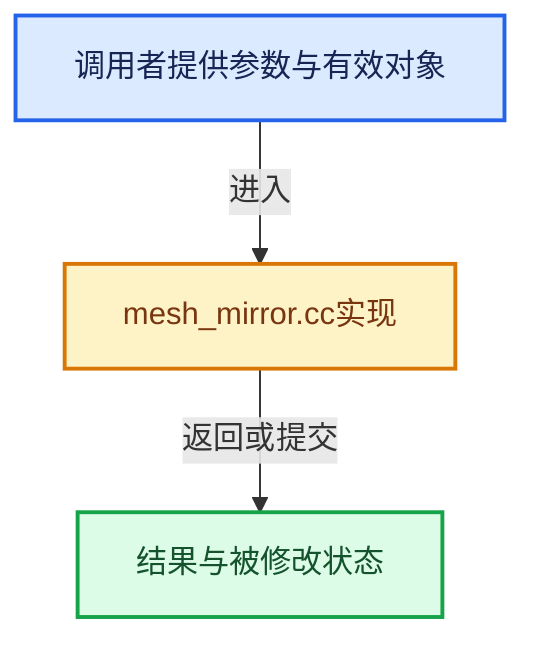

# 实现依赖专题：source/blender/blenkernel/intern/mesh_mirror.cc

[方向导航](README.md) · [符号索引](../%E7%AC%A6%E5%8F%B7%E4%BE%9D%E8%B5%96%E4%B8%8E%E5%AE%9E%E7%8E%B0%E7%B4%A2%E5%BC%95.md)

本专题从正文实际调用进入，集中保存共享实现。函数有稳定锚点，可从调用处直接跳到对应完整函数；递归与互相调用通过回链组织。

## 本文件的实现关系





## 完整成员与函数实现

<a id="f-66fef31f016720d0"></a>

### `blender::BKE_mesh_mirror_bisect_on_mirror_plane_for_modifier`

实现位置：[source/blender/blenkernel/intern/mesh_mirror.cc](../../../../../source/blender/blenkernel/intern/mesh_mirror.cc) · L32—L88。

接口参数：

- `MirrorModifierData *mmd`
- `const Mesh *mesh`
- `int axis`
- `const float plane_co[3]`
- `float plane_no[3]`

**教学注释版**

<!-- annotated:4ea1cce6b4a059 -->

```cpp
Mesh *BKE_mesh_mirror_bisect_on_mirror_plane_for_modifier(MirrorModifierData *mmd,
                                                          const Mesh *mesh,
                                                          int axis,
                                                          const float plane_co[3],
                                                          float plane_no[3])
{
  bool do_bisect_flip_axis = ((axis == 0 && mmd->flag & MOD_MIR_BISECT_FLIP_AXIS_X) ||
                              (axis == 1 && mmd->flag & MOD_MIR_BISECT_FLIP_AXIS_Y) ||
                              (axis == 2 && mmd->flag & MOD_MIR_BISECT_FLIP_AXIS_Z));

  const float bisect_distance = mmd->bisect_threshold;

  Mesh *result;
  BMesh *bm;
  BMIter viter;
  BMVert *v, *v_next;

  BMeshCreateParams bmesh_create_params{false};

  BMeshFromMeshParams bmesh_from_mesh_params{};
  bmesh_from_mesh_params.calc_face_normal = true;
  bmesh_from_mesh_params.calc_vert_normal = true;
  bmesh_from_mesh_params.cd_mask_extra.vmask = CD_MASK_ORIGINDEX;
  bmesh_from_mesh_params.cd_mask_extra.emask = CD_MASK_ORIGINDEX;
  bmesh_from_mesh_params.cd_mask_extra.pmask = CD_MASK_ORIGINDEX;

  bm = BKE_mesh_to_bmesh_ex(mesh, &bmesh_create_params, &bmesh_from_mesh_params);

  /* Define bisecting plane (aka mirror plane). */
  float plane[4];
  if (!do_bisect_flip_axis) {
    /* That reversed condition is a little weird, but for some reason that's how you keep
     * the part of the mesh which is on the non-mirrored side when flip option is disabled.
     * I think this is the expected behavior. */
    negate_v3(plane_no);
  }
  plane_from_point_normal_v3(plane, plane_co, plane_no);

  BM_mesh_bisect_plane(bm, plane, true, false, 0, 0, bisect_distance);

  /* Plane definitions for vert killing. */
  float plane_offset[4];
  copy_v3_v3(plane_offset, plane);
  plane_offset[3] = plane[3] - bisect_distance;

  /* Delete verts across the mirror plane. */
  BM_ITER_MESH_MUTABLE (v, v_next, &viter, bm, BM_VERTS_OF_MESH) {
    if (plane_point_side_v3(plane_offset, v->co) > 0.0f) {
      BM_vert_kill(bm, v);
    }
  }

  result = BKE_mesh_from_bmesh_for_eval_nomain(bm, nullptr, mesh);
  BM_mesh_free(bm);

  return result;
}
```

<details>
<summary>核对原始源码：source/blender/blenkernel/intern/mesh_mirror.cc · L32—L88</summary>

<!-- original:4ea1cce6b4a059:source/blender/blenkernel/intern/mesh_mirror.cc:32:88 -->

```cpp
Mesh *BKE_mesh_mirror_bisect_on_mirror_plane_for_modifier(MirrorModifierData *mmd,
                                                          const Mesh *mesh,
                                                          int axis,
                                                          const float plane_co[3],
                                                          float plane_no[3])
{
  bool do_bisect_flip_axis = ((axis == 0 && mmd->flag & MOD_MIR_BISECT_FLIP_AXIS_X) ||
                              (axis == 1 && mmd->flag & MOD_MIR_BISECT_FLIP_AXIS_Y) ||
                              (axis == 2 && mmd->flag & MOD_MIR_BISECT_FLIP_AXIS_Z));

  const float bisect_distance = mmd->bisect_threshold;

  Mesh *result;
  BMesh *bm;
  BMIter viter;
  BMVert *v, *v_next;

  BMeshCreateParams bmesh_create_params{false};

  BMeshFromMeshParams bmesh_from_mesh_params{};
  bmesh_from_mesh_params.calc_face_normal = true;
  bmesh_from_mesh_params.calc_vert_normal = true;
  bmesh_from_mesh_params.cd_mask_extra.vmask = CD_MASK_ORIGINDEX;
  bmesh_from_mesh_params.cd_mask_extra.emask = CD_MASK_ORIGINDEX;
  bmesh_from_mesh_params.cd_mask_extra.pmask = CD_MASK_ORIGINDEX;

  bm = BKE_mesh_to_bmesh_ex(mesh, &bmesh_create_params, &bmesh_from_mesh_params);

  /* Define bisecting plane (aka mirror plane). */
  float plane[4];
  if (!do_bisect_flip_axis) {
    /* That reversed condition is a little weird, but for some reason that's how you keep
     * the part of the mesh which is on the non-mirrored side when flip option is disabled.
     * I think this is the expected behavior. */
    negate_v3(plane_no);
  }
  plane_from_point_normal_v3(plane, plane_co, plane_no);

  BM_mesh_bisect_plane(bm, plane, true, false, 0, 0, bisect_distance);

  /* Plane definitions for vert killing. */
  float plane_offset[4];
  copy_v3_v3(plane_offset, plane);
  plane_offset[3] = plane[3] - bisect_distance;

  /* Delete verts across the mirror plane. */
  BM_ITER_MESH_MUTABLE (v, v_next, &viter, bm, BM_VERTS_OF_MESH) {
    if (plane_point_side_v3(plane_offset, v->co) > 0.0f) {
      BM_vert_kill(bm, v);
    }
  }

  result = BKE_mesh_from_bmesh_for_eval_nomain(bm, nullptr, mesh);
  BM_mesh_free(bm);

  return result;
}
```

</details>

**沿实际写入检查状态**

- `bmesh_from_mesh_params.calc_face_normal = true;`
- `bmesh_from_mesh_params.calc_vert_normal = true;`
- `bmesh_from_mesh_params.cd_mask_extra.vmask = CD_MASK_ORIGINDEX;`
- `bmesh_from_mesh_params.cd_mask_extra.emask = CD_MASK_ORIGINDEX;`
- `bmesh_from_mesh_params.cd_mask_extra.pmask = CD_MASK_ORIGINDEX;`
- `bm = BKE_mesh_to_bmesh_ex(mesh, &bmesh_create_params, &bmesh_from_mesh_params);`
- `plane_offset[3] = plane[3] - bisect_distance;`
- `result = BKE_mesh_from_bmesh_for_eval_nomain(bm, nullptr, mesh);`

**结果出口**

- `return result;`

**继续追踪实现**

- `BKE_mesh_to_bmesh_ex` → [BKE_mesh_to_bmesh_ex · L1583](03-MPoly%E8%BF%81%E7%A7%BB%E4%B8%8E%E5%85%BC%E5%AE%B9.md#f-dd2f413684da0188)。
- `negate_v3` → [blender::negate_v3 · L571](../12-%E7%A9%BA%E9%97%B4%E6%95%B0%E6%8D%AE%E7%BB%93%E6%9E%84%E4%B8%8E%E5%87%A0%E4%BD%95%E7%AE%97%E6%B3%95/%E4%BE%9D%E8%B5%96-math_vector_inline-0c8541.md#f-10baf09f690bcba8)。
- `plane_from_point_normal_v3` → [blender::plane_from_point_normal_v3 · L225](../12-%E7%A9%BA%E9%97%B4%E6%95%B0%E6%8D%AE%E7%BB%93%E6%9E%84%E4%B8%8E%E5%87%A0%E4%BD%95%E7%AE%97%E6%B3%95/%E4%BE%9D%E8%B5%96-math_geom-8d91a3.md#f-bf2050728f0916e7)。
- `BM_mesh_bisect_plane` → [blender::BM_mesh_bisect_plane · L381](%E4%BE%9D%E8%B5%96-bmesh_bisect_plane-82e72c.md#f-e024189daf678734)。
- `copy_v3_v3` → [blender::copy_v3_v3 · L47](../12-%E7%A9%BA%E9%97%B4%E6%95%B0%E6%8D%AE%E7%BB%93%E6%9E%84%E4%B8%8E%E5%87%A0%E4%BD%95%E7%AE%97%E6%B3%95/%E4%BE%9D%E8%B5%96-math_vector_inline-0c8541.md#f-037a0d5fa5060bd6)。
- `BM_ITER_MESH_MUTABLE` → [BM_ITER_MESH_MUTABLE · L83](%E4%BE%9D%E8%B5%96-bmesh_iterators-13971c.md#m-2887500f7f76)；[BM_ITER_MESH_MUTABLE · L91](%E4%BE%9D%E8%B5%96-bmesh_iterators-13971c.md#m-de2c06ab3bfc)。宏定义由构建条件选择。
- `plane_point_side_v3` → [blender::plane_point_side_v3 · L124](../12-%E7%A9%BA%E9%97%B4%E6%95%B0%E6%8D%AE%E7%BB%93%E6%9E%84%E4%B8%8E%E5%87%A0%E4%BD%95%E7%AE%97%E6%B3%95/%E4%BE%9D%E8%B5%96-math_geom_inline-672303.md#f-172f6a5bd676a757)。
- `BM_vert_kill` → [blender::BM_vert_kill · L1068](%E4%BE%9D%E8%B5%96-bmesh_core-9fd9f8.md#f-0895632efe77ce45)。
- `BKE_mesh_from_bmesh_for_eval_nomain` → [BKE_mesh_from_bmesh_for_eval_nomain · L1620](03-MPoly%E8%BF%81%E7%A7%BB%E4%B8%8E%E5%85%BC%E5%AE%B9.md#f-92b713674a1be50c)。
- `BM_mesh_free` → [blender::BM_mesh_free · L264](%E4%BE%9D%E8%B5%96-bmesh_mesh-283e2d.md#f-3871ddd58daba48c)。

<a id="f-4c6e6b5a681aa438"></a>

### `blender::BKE_mesh_mirror_apply_mirror_on_axis_for_modifier`

实现位置：[source/blender/blenkernel/intern/mesh_mirror.cc](../../../../../source/blender/blenkernel/intern/mesh_mirror.cc) · L118—L448。

接口参数：

- `MirrorModifierData *mmd`
- `Object *ob`
- `const Mesh *mesh`
- `const int axis`
- `const bool use_correct_order_on_merge`
- `int **r_vert_merge_map`
- `int *r_vert_merge_map_len`

**教学注释版**

<!-- annotated:ad796a99e2652c -->

```cpp
Mesh *BKE_mesh_mirror_apply_mirror_on_axis_for_modifier(MirrorModifierData *mmd,
                                                        Object *ob,
                                                        const Mesh *mesh,
                                                        const int axis,
                                                        const bool use_correct_order_on_merge,
                                                        int **r_vert_merge_map,
                                                        int *r_vert_merge_map_len)
{
  using namespace blender::bke;
  const float tolerance_sq = mmd->tolerance * mmd->tolerance;
  const bool do_vtargetmap = (mmd->flag & MOD_MIR_NO_MERGE) == 0 && r_vert_merge_map != nullptr;

  const bool do_bisect = ((axis == 0 && mmd->flag & MOD_MIR_BISECT_AXIS_X) ||
                          (axis == 1 && mmd->flag & MOD_MIR_BISECT_AXIS_Y) ||
                          (axis == 2 && mmd->flag & MOD_MIR_BISECT_AXIS_Z));

  float mtx[4][4];
  float plane_co[3], plane_no[3];
  int a, totshape;
  int *vtmap_a = nullptr, *vtmap_b = nullptr;

  /* mtx is the mirror transformation */
  unit_m4(mtx);
  mtx[axis][axis] = -1.0f;

  Object *mirror_ob = mmd->mirror_ob;
  if (mirror_ob != nullptr) {
    float tmp[4][4];
    float itmp[4][4];

    /* tmp is a transform from coords relative to the object's own origin,
     * to coords relative to the mirror object origin */
    invert_m4_m4(tmp, mirror_ob->object_to_world().ptr());
    mul_m4_m4m4(tmp, tmp, ob->object_to_world().ptr());

    /* itmp is the reverse transform back to origin-relative coordinates */
    invert_m4_m4(itmp, tmp);

    /* combine matrices to get a single matrix that translates coordinates into
     * mirror-object-relative space, does the mirror, and translates back to
     * origin-relative space */
    mul_m4_series(mtx, itmp, mtx, tmp);

    if (do_bisect) {
      copy_v3_v3(plane_co, itmp[3]);
      copy_v3_v3(plane_no, itmp[axis]);

      /* Account for non-uniform scale in `ob`, see: #87592. */
      float ob_scale[3] = {
          len_squared_v3(ob->object_to_world().ptr()[0]),
          len_squared_v3(ob->object_to_world().ptr()[1]),
          len_squared_v3(ob->object_to_world().ptr()[2]),
      };
      /* Scale to avoid precision loss with extreme values. */
      // [讲解] std::max：按比较关系选取较大值。本讲解中的增长公式同时满足最低请求和几何增长；若保存返回引用，还需注意实参寿命。
      const float ob_scale_max = std::max({UNPACK3(ob_scale)});
      if (ob_scale_max != 0.0f) [[likely]] {
        mul_v3_fl(ob_scale, 1.0f / ob_scale_max);
        mul_v3_v3(plane_no, ob_scale);
      }
    }
  }
  else if (do_bisect) {
    copy_v3_v3(plane_co, mtx[3]);
    /* Need to negate here, since that axis is inverted (for mirror transform). */
    negate_v3_v3(plane_no, mtx[axis]);
  }

  Mesh *mesh_bisect = nullptr;
  if (do_bisect) {
    mesh_bisect = BKE_mesh_mirror_bisect_on_mirror_plane_for_modifier(
        mmd, mesh, axis, plane_co, plane_no);
    mesh = mesh_bisect;
  }

  const int src_verts_num = mesh->verts_num;
  const int src_edges_num = mesh->edges_num;
  const OffsetIndices src_faces = mesh->faces();
  const int src_loops_num = mesh->corners_num;

  Mesh *result = BKE_mesh_new_nomain_from_template(
      // [讲解] src_faces.size：读取连续区间或分组的边界信息。
      mesh, src_verts_num * 2, src_edges_num * 2, src_faces.size() * 2, src_loops_num * 2);

  LegacyMeshInterpolator vert_interp(*mesh, *result, AttrDomain::Point);
  LegacyMeshInterpolator edge_interp(*mesh, *result, AttrDomain::Edge);
  LegacyMeshInterpolator face_interp(*mesh, *result, AttrDomain::Face);
  LegacyMeshInterpolator corner_interp(*mesh, *result, AttrDomain::Corner);

  /* Copy custom-data to original geometry. */

  vert_interp.copy(0, 0, src_verts_num);
  edge_interp.copy(0, 0, src_edges_num);
  face_interp.copy(0, 0, src_faces.size());
  corner_interp.copy(0, 0, src_loops_num);

  /* Copy custom data to mirrored geometry. */
  vert_interp.copy(0, src_verts_num, src_verts_num);
  edge_interp.copy(0, src_edges_num, src_edges_num);
  face_interp.copy(0, src_faces.size(), src_faces.size());
  corner_interp.copy(0, src_loops_num, src_loops_num);

  if (do_vtargetmap) {
    /* second half is filled with -1 */
    *r_vert_merge_map = MEM_new_array_uninitialized<int>(2 * size_t(src_verts_num),
                                                         "MOD_mirror tarmap");

    vtmap_a = *r_vert_merge_map;
    vtmap_b = *r_vert_merge_map + src_verts_num;

    *r_vert_merge_map_len = 0;
  }

  /* mirror vertex coordinates */
  MutableSpan<float3> positions = result->vert_positions_for_write();
  for (int i = 0; i < src_verts_num; i++) {
    const int vert_index_prev = i;
    const int vert_index = src_verts_num + i;
    mul_m4_v3(mtx, positions[vert_index]);

    if (do_vtargetmap) {
      /* Compare location of the original and mirrored vertex,
       * to see if they should be mapped for merging.
       *
       * Always merge from the copied into the original vertices so it's possible to
       * generate a 1:1 mapping by scanning vertices from the beginning of the array
       * as is done in #BKE_editmesh_vert_coords_when_deformed. Without this,
       * the coordinates returned will sometimes point to the copied vertex locations, see:
       * #91444.
       *
       * However, such a change also affects non-versionable things like some modifiers binding, so
       * we cannot enforce that behavior on existing modifiers, in which case we keep using the
       * old, incorrect behavior of merging the source vertex into its copy.
       */
      const bool merge = len_squared_v3v3(positions[vert_index_prev], positions[vert_index]) <
                         tolerance_sq;
      if (merge) [[unlikely]] {
        (*r_vert_merge_map_len)++;

        /* average location */
        mid_v3_v3v3(positions[vert_index], positions[vert_index_prev], positions[vert_index]);
        copy_v3_v3(positions[vert_index_prev], positions[vert_index]);

        const int target = use_correct_order_on_merge ? vert_index_prev : vert_index;
        *vtmap_a = target;
        /* Fill here to avoid 2x loops. */
        *vtmap_b = target;
      }
      else {
        /* Vertices that aren't merged point at themselves. */
        *vtmap_a = vert_index_prev;
        *vtmap_b = vert_index;
      }

      vtmap_a++;
      vtmap_b++;
    }
  }

  /* handle shape keys */
  totshape = CustomData_number_of_layers(&result->vert_data, CD_SHAPEKEY);
  for (a = 0; a < totshape; a++) {
    float (*cos)[3] = static_cast<float (*)[3]>(
        CustomData_get_layer_n_for_write(&result->vert_data, CD_SHAPEKEY, a, result->verts_num));
    for (int i = src_verts_num; i < result->verts_num; i++) {
      mul_m4_v3(mtx, cos[i]);
    }
  }

  MutableSpan<int2> result_edges = result->edges_for_write();
  MutableSpan<int> result_face_offsets = result->face_offsets_for_write();
  MutableSpan<int> result_corner_verts = result->corner_verts_for_write();
  MutableSpan<int> result_corner_edges = result->corner_edges_for_write();

  /* adjust mirrored edge vertex indices */
  // [讲解] result_edges.index_range：查询视图长度或生成对应有效索引区间。
  for (const int i : result_edges.index_range().drop_front(src_edges_num)) {
    result_edges[i] += src_verts_num;
  }

  // [讲解] result_face_offsets.take_front：从两端裁去或选取一定数量元素形成新视图。
  result_face_offsets.take_front(src_faces.size()).copy_from(mesh->face_offsets().drop_back(1));
  for (const int i : src_faces.index_range()) {
    result_face_offsets[src_faces.size() + i] = src_faces[i].start() + src_loops_num;
  }
  const OffsetIndices result_faces = result->faces();

  /* adjust mirrored loop vertex and edge indices */
  for (const int i : result_corner_verts.index_range().drop_front(src_loops_num)) {
    result_corner_verts[i] += src_verts_num;
  }
  for (const int i : result_corner_edges.index_range().drop_front(src_loops_num)) {
    result_corner_edges[i] += src_edges_num;
  }

  bke::mesh_flip_faces(*result, result_faces.index_range().drop_front(src_faces.size()));

  if (!mesh->runtime->subsurf_optimal_display_edges.is_empty()) {
    const BoundedBitSpan src = mesh->runtime->subsurf_optimal_display_edges;
    result->runtime->subsurf_optimal_display_edges.resize(result->edges_num);
    MutableBoundedBitSpan dst = result->runtime->subsurf_optimal_display_edges;
    dst.take_front(src.size()).copy_from(src);
    dst.take_back(src.size()).copy_from(src);
  }

  bke::MutableAttributeAccessor attributes = result->attributes_for_write();

  /* handle uvs,
   * let tessface recalc handle updating the MTFace data */
  if (mmd->flag & (MOD_MIR_MIRROR_U | MOD_MIR_MIRROR_V) ||
      (is_zero_v2(mmd->uv_offset_copy) == false))
  {
    const bool do_mirr_u = (mmd->flag & MOD_MIR_MIRROR_U) != 0;
    const bool do_mirr_v = (mmd->flag & MOD_MIR_MIRROR_V) != 0;
    /* If set, flip around center of each tile. */
    const bool do_mirr_udim = (mmd->flag & MOD_MIR_MIRROR_UDIM) != 0;

    for (const StringRef name : result->uv_map_names()) {
      bke::SpanAttributeWriter uv_map_attr = attributes.lookup_for_write_span<float2>(name);
      float (*uv_map)[2] = reinterpret_cast<float (*)[2]>(uv_map_attr.span.data());
      int j = src_loops_num;
      uv_map += j; /* second set of loops only */
      for (; j-- > 0; uv_map++) {
        if (do_mirr_u) {
          float u = (*uv_map)[0];
          if (do_mirr_udim) {
            (*uv_map)[0] = ceilf(u) - fmodf(u, 1.0f) + mmd->uv_offset[0];
          }
          else {
            (*uv_map)[0] = 1.0f - u + mmd->uv_offset[0];
          }
        }
        if (do_mirr_v) {
          float v = (*uv_map)[1];
          if (do_mirr_udim) {
            (*uv_map)[1] = ceilf(v) - fmodf(v, 1.0f) + mmd->uv_offset[1];
          }
          else {
            (*uv_map)[1] = 1.0f - v + mmd->uv_offset[1];
          }
        }
        (*uv_map)[0] += mmd->uv_offset_copy[0];
        (*uv_map)[1] += mmd->uv_offset_copy[1];
      }
      uv_map_attr.finish();
    }
  }

  /* handle custom normals */
  bke::GAttributeWriter custom_normals = attributes.lookup_for_write("custom_normal");
  if (ob->type == OB_MESH && custom_normals && custom_normals.domain == bke::AttrDomain::Corner &&
      custom_normals.varray.type().is<short2>() && result->faces_num > 0)
  {
    Array<float3> corner_normals(result_corner_verts.size());
    MutableVArraySpan clnors(custom_normals.varray.typed<short2>());
    bke::mesh::CornerNormalSpaceArray lnors_spacearr;

    /* The transform matrix of a normal must be
     * the transpose of inverse of transform matrix of the geometry... */
    float mtx_nor[4][4];
    invert_m4_m4(mtx_nor, mtx);
    transpose_m4(mtx_nor);

    /* calculate custom normals into corner_normals, then mirror first half into second half */
    const VArraySpan sharp_edges = *attributes.lookup<bool>("sharp_edge", AttrDomain::Edge);
    const VArraySpan sharp_faces = *attributes.lookup<bool>("sharp_face", AttrDomain::Face);
    bke::mesh::normals_calc_corners(result->vert_positions(),
                                    result_faces,
                                    result_corner_verts,
                                    result_corner_edges,
                                    result->vert_to_face_map(),
                                    result->face_normals_true(),
                                    sharp_edges,
                                    sharp_faces,
                                    clnors,
                                    &lnors_spacearr,
                                    corner_normals);

    /* mirroring has to account for loops being reversed in faces in second half */
    for (const int i : src_faces.index_range()) {
      const IndexRange src_face = src_faces[i];
      const int mirror_i = src_faces.size() + i;

      for (const int j : src_face) {
        int mirrorj = result_faces[mirror_i].start();
        // [讲解] src_face.start：读取连续区间或分组的边界信息。
        if (j > src_face.start()) {
          mirrorj += result_faces[mirror_i].size() - (j - src_face.start());
        }

        copy_v3_v3(corner_normals[mirrorj], corner_normals[j]);
        mul_m4_v3(mtx_nor, corner_normals[mirrorj]);

        const int space_index = lnors_spacearr.corner_space_indices[mirrorj];
        clnors[mirrorj] = bke::mesh::corner_space_custom_normal_to_data(
            lnors_spacearr.spaces[space_index], corner_normals[mirrorj]);
      }
    }

    clnors.save();
  }
  custom_normals.finish();

  /* handle vgroup stuff */
  if (BKE_object_supports_vertex_groups(ob)) {
    if ((mmd->flag & MOD_MIR_VGROUP) && !result->deform_verts().is_empty()) {
      MDeformVert *dvert = result->deform_verts_for_write().data() + src_verts_num;
      int flip_map_len = 0;
      int *flip_map = BKE_object_defgroup_flip_map(ob, false, &flip_map_len);
      if (flip_map) {
        for (int i = 0; i < src_verts_num; dvert++, i++) {
          /* merged vertices get both groups, others get flipped */
          /* A vertex that isn't merged points at itself. */
          if (use_correct_order_on_merge && do_vtargetmap &&
              ((*r_vert_merge_map)[i + src_verts_num] != i + src_verts_num))
          {
            BKE_defvert_flip_merged(dvert - src_verts_num, flip_map, flip_map_len);
          }
          else if (!use_correct_order_on_merge && do_vtargetmap && ((*r_vert_merge_map)[i] != i)) {
            BKE_defvert_flip_merged(dvert, flip_map, flip_map_len);
          }
          else {
            BKE_defvert_flip(dvert, flip_map, flip_map_len);
          }
        }

        MEM_delete(flip_map);
      }
    }
  }

  if (mesh_bisect != nullptr) {
    BKE_id_free(nullptr, mesh_bisect);
  }
  return result;
}
```

<details>
<summary>核对原始源码：source/blender/blenkernel/intern/mesh_mirror.cc · L118—L448</summary>

<!-- original:ad796a99e2652c:source/blender/blenkernel/intern/mesh_mirror.cc:118:448 -->

```cpp
Mesh *BKE_mesh_mirror_apply_mirror_on_axis_for_modifier(MirrorModifierData *mmd,
                                                        Object *ob,
                                                        const Mesh *mesh,
                                                        const int axis,
                                                        const bool use_correct_order_on_merge,
                                                        int **r_vert_merge_map,
                                                        int *r_vert_merge_map_len)
{
  using namespace blender::bke;
  const float tolerance_sq = mmd->tolerance * mmd->tolerance;
  const bool do_vtargetmap = (mmd->flag & MOD_MIR_NO_MERGE) == 0 && r_vert_merge_map != nullptr;

  const bool do_bisect = ((axis == 0 && mmd->flag & MOD_MIR_BISECT_AXIS_X) ||
                          (axis == 1 && mmd->flag & MOD_MIR_BISECT_AXIS_Y) ||
                          (axis == 2 && mmd->flag & MOD_MIR_BISECT_AXIS_Z));

  float mtx[4][4];
  float plane_co[3], plane_no[3];
  int a, totshape;
  int *vtmap_a = nullptr, *vtmap_b = nullptr;

  /* mtx is the mirror transformation */
  unit_m4(mtx);
  mtx[axis][axis] = -1.0f;

  Object *mirror_ob = mmd->mirror_ob;
  if (mirror_ob != nullptr) {
    float tmp[4][4];
    float itmp[4][4];

    /* tmp is a transform from coords relative to the object's own origin,
     * to coords relative to the mirror object origin */
    invert_m4_m4(tmp, mirror_ob->object_to_world().ptr());
    mul_m4_m4m4(tmp, tmp, ob->object_to_world().ptr());

    /* itmp is the reverse transform back to origin-relative coordinates */
    invert_m4_m4(itmp, tmp);

    /* combine matrices to get a single matrix that translates coordinates into
     * mirror-object-relative space, does the mirror, and translates back to
     * origin-relative space */
    mul_m4_series(mtx, itmp, mtx, tmp);

    if (do_bisect) {
      copy_v3_v3(plane_co, itmp[3]);
      copy_v3_v3(plane_no, itmp[axis]);

      /* Account for non-uniform scale in `ob`, see: #87592. */
      float ob_scale[3] = {
          len_squared_v3(ob->object_to_world().ptr()[0]),
          len_squared_v3(ob->object_to_world().ptr()[1]),
          len_squared_v3(ob->object_to_world().ptr()[2]),
      };
      /* Scale to avoid precision loss with extreme values. */
      const float ob_scale_max = std::max({UNPACK3(ob_scale)});
      if (ob_scale_max != 0.0f) [[likely]] {
        mul_v3_fl(ob_scale, 1.0f / ob_scale_max);
        mul_v3_v3(plane_no, ob_scale);
      }
    }
  }
  else if (do_bisect) {
    copy_v3_v3(plane_co, mtx[3]);
    /* Need to negate here, since that axis is inverted (for mirror transform). */
    negate_v3_v3(plane_no, mtx[axis]);
  }

  Mesh *mesh_bisect = nullptr;
  if (do_bisect) {
    mesh_bisect = BKE_mesh_mirror_bisect_on_mirror_plane_for_modifier(
        mmd, mesh, axis, plane_co, plane_no);
    mesh = mesh_bisect;
  }

  const int src_verts_num = mesh->verts_num;
  const int src_edges_num = mesh->edges_num;
  const OffsetIndices src_faces = mesh->faces();
  const int src_loops_num = mesh->corners_num;

  Mesh *result = BKE_mesh_new_nomain_from_template(
      mesh, src_verts_num * 2, src_edges_num * 2, src_faces.size() * 2, src_loops_num * 2);

  LegacyMeshInterpolator vert_interp(*mesh, *result, AttrDomain::Point);
  LegacyMeshInterpolator edge_interp(*mesh, *result, AttrDomain::Edge);
  LegacyMeshInterpolator face_interp(*mesh, *result, AttrDomain::Face);
  LegacyMeshInterpolator corner_interp(*mesh, *result, AttrDomain::Corner);

  /* Copy custom-data to original geometry. */

  vert_interp.copy(0, 0, src_verts_num);
  edge_interp.copy(0, 0, src_edges_num);
  face_interp.copy(0, 0, src_faces.size());
  corner_interp.copy(0, 0, src_loops_num);

  /* Copy custom data to mirrored geometry. */
  vert_interp.copy(0, src_verts_num, src_verts_num);
  edge_interp.copy(0, src_edges_num, src_edges_num);
  face_interp.copy(0, src_faces.size(), src_faces.size());
  corner_interp.copy(0, src_loops_num, src_loops_num);

  if (do_vtargetmap) {
    /* second half is filled with -1 */
    *r_vert_merge_map = MEM_new_array_uninitialized<int>(2 * size_t(src_verts_num),
                                                         "MOD_mirror tarmap");

    vtmap_a = *r_vert_merge_map;
    vtmap_b = *r_vert_merge_map + src_verts_num;

    *r_vert_merge_map_len = 0;
  }

  /* mirror vertex coordinates */
  MutableSpan<float3> positions = result->vert_positions_for_write();
  for (int i = 0; i < src_verts_num; i++) {
    const int vert_index_prev = i;
    const int vert_index = src_verts_num + i;
    mul_m4_v3(mtx, positions[vert_index]);

    if (do_vtargetmap) {
      /* Compare location of the original and mirrored vertex,
       * to see if they should be mapped for merging.
       *
       * Always merge from the copied into the original vertices so it's possible to
       * generate a 1:1 mapping by scanning vertices from the beginning of the array
       * as is done in #BKE_editmesh_vert_coords_when_deformed. Without this,
       * the coordinates returned will sometimes point to the copied vertex locations, see:
       * #91444.
       *
       * However, such a change also affects non-versionable things like some modifiers binding, so
       * we cannot enforce that behavior on existing modifiers, in which case we keep using the
       * old, incorrect behavior of merging the source vertex into its copy.
       */
      const bool merge = len_squared_v3v3(positions[vert_index_prev], positions[vert_index]) <
                         tolerance_sq;
      if (merge) [[unlikely]] {
        (*r_vert_merge_map_len)++;

        /* average location */
        mid_v3_v3v3(positions[vert_index], positions[vert_index_prev], positions[vert_index]);
        copy_v3_v3(positions[vert_index_prev], positions[vert_index]);

        const int target = use_correct_order_on_merge ? vert_index_prev : vert_index;
        *vtmap_a = target;
        /* Fill here to avoid 2x loops. */
        *vtmap_b = target;
      }
      else {
        /* Vertices that aren't merged point at themselves. */
        *vtmap_a = vert_index_prev;
        *vtmap_b = vert_index;
      }

      vtmap_a++;
      vtmap_b++;
    }
  }

  /* handle shape keys */
  totshape = CustomData_number_of_layers(&result->vert_data, CD_SHAPEKEY);
  for (a = 0; a < totshape; a++) {
    float (*cos)[3] = static_cast<float (*)[3]>(
        CustomData_get_layer_n_for_write(&result->vert_data, CD_SHAPEKEY, a, result->verts_num));
    for (int i = src_verts_num; i < result->verts_num; i++) {
      mul_m4_v3(mtx, cos[i]);
    }
  }

  MutableSpan<int2> result_edges = result->edges_for_write();
  MutableSpan<int> result_face_offsets = result->face_offsets_for_write();
  MutableSpan<int> result_corner_verts = result->corner_verts_for_write();
  MutableSpan<int> result_corner_edges = result->corner_edges_for_write();

  /* adjust mirrored edge vertex indices */
  for (const int i : result_edges.index_range().drop_front(src_edges_num)) {
    result_edges[i] += src_verts_num;
  }

  result_face_offsets.take_front(src_faces.size()).copy_from(mesh->face_offsets().drop_back(1));
  for (const int i : src_faces.index_range()) {
    result_face_offsets[src_faces.size() + i] = src_faces[i].start() + src_loops_num;
  }
  const OffsetIndices result_faces = result->faces();

  /* adjust mirrored loop vertex and edge indices */
  for (const int i : result_corner_verts.index_range().drop_front(src_loops_num)) {
    result_corner_verts[i] += src_verts_num;
  }
  for (const int i : result_corner_edges.index_range().drop_front(src_loops_num)) {
    result_corner_edges[i] += src_edges_num;
  }

  bke::mesh_flip_faces(*result, result_faces.index_range().drop_front(src_faces.size()));

  if (!mesh->runtime->subsurf_optimal_display_edges.is_empty()) {
    const BoundedBitSpan src = mesh->runtime->subsurf_optimal_display_edges;
    result->runtime->subsurf_optimal_display_edges.resize(result->edges_num);
    MutableBoundedBitSpan dst = result->runtime->subsurf_optimal_display_edges;
    dst.take_front(src.size()).copy_from(src);
    dst.take_back(src.size()).copy_from(src);
  }

  bke::MutableAttributeAccessor attributes = result->attributes_for_write();

  /* handle uvs,
   * let tessface recalc handle updating the MTFace data */
  if (mmd->flag & (MOD_MIR_MIRROR_U | MOD_MIR_MIRROR_V) ||
      (is_zero_v2(mmd->uv_offset_copy) == false))
  {
    const bool do_mirr_u = (mmd->flag & MOD_MIR_MIRROR_U) != 0;
    const bool do_mirr_v = (mmd->flag & MOD_MIR_MIRROR_V) != 0;
    /* If set, flip around center of each tile. */
    const bool do_mirr_udim = (mmd->flag & MOD_MIR_MIRROR_UDIM) != 0;

    for (const StringRef name : result->uv_map_names()) {
      bke::SpanAttributeWriter uv_map_attr = attributes.lookup_for_write_span<float2>(name);
      float (*uv_map)[2] = reinterpret_cast<float (*)[2]>(uv_map_attr.span.data());
      int j = src_loops_num;
      uv_map += j; /* second set of loops only */
      for (; j-- > 0; uv_map++) {
        if (do_mirr_u) {
          float u = (*uv_map)[0];
          if (do_mirr_udim) {
            (*uv_map)[0] = ceilf(u) - fmodf(u, 1.0f) + mmd->uv_offset[0];
          }
          else {
            (*uv_map)[0] = 1.0f - u + mmd->uv_offset[0];
          }
        }
        if (do_mirr_v) {
          float v = (*uv_map)[1];
          if (do_mirr_udim) {
            (*uv_map)[1] = ceilf(v) - fmodf(v, 1.0f) + mmd->uv_offset[1];
          }
          else {
            (*uv_map)[1] = 1.0f - v + mmd->uv_offset[1];
          }
        }
        (*uv_map)[0] += mmd->uv_offset_copy[0];
        (*uv_map)[1] += mmd->uv_offset_copy[1];
      }
      uv_map_attr.finish();
    }
  }

  /* handle custom normals */
  bke::GAttributeWriter custom_normals = attributes.lookup_for_write("custom_normal");
  if (ob->type == OB_MESH && custom_normals && custom_normals.domain == bke::AttrDomain::Corner &&
      custom_normals.varray.type().is<short2>() && result->faces_num > 0)
  {
    Array<float3> corner_normals(result_corner_verts.size());
    MutableVArraySpan clnors(custom_normals.varray.typed<short2>());
    bke::mesh::CornerNormalSpaceArray lnors_spacearr;

    /* The transform matrix of a normal must be
     * the transpose of inverse of transform matrix of the geometry... */
    float mtx_nor[4][4];
    invert_m4_m4(mtx_nor, mtx);
    transpose_m4(mtx_nor);

    /* calculate custom normals into corner_normals, then mirror first half into second half */
    const VArraySpan sharp_edges = *attributes.lookup<bool>("sharp_edge", AttrDomain::Edge);
    const VArraySpan sharp_faces = *attributes.lookup<bool>("sharp_face", AttrDomain::Face);
    bke::mesh::normals_calc_corners(result->vert_positions(),
                                    result_faces,
                                    result_corner_verts,
                                    result_corner_edges,
                                    result->vert_to_face_map(),
                                    result->face_normals_true(),
                                    sharp_edges,
                                    sharp_faces,
                                    clnors,
                                    &lnors_spacearr,
                                    corner_normals);

    /* mirroring has to account for loops being reversed in faces in second half */
    for (const int i : src_faces.index_range()) {
      const IndexRange src_face = src_faces[i];
      const int mirror_i = src_faces.size() + i;

      for (const int j : src_face) {
        int mirrorj = result_faces[mirror_i].start();
        if (j > src_face.start()) {
          mirrorj += result_faces[mirror_i].size() - (j - src_face.start());
        }

        copy_v3_v3(corner_normals[mirrorj], corner_normals[j]);
        mul_m4_v3(mtx_nor, corner_normals[mirrorj]);

        const int space_index = lnors_spacearr.corner_space_indices[mirrorj];
        clnors[mirrorj] = bke::mesh::corner_space_custom_normal_to_data(
            lnors_spacearr.spaces[space_index], corner_normals[mirrorj]);
      }
    }

    clnors.save();
  }
  custom_normals.finish();

  /* handle vgroup stuff */
  if (BKE_object_supports_vertex_groups(ob)) {
    if ((mmd->flag & MOD_MIR_VGROUP) && !result->deform_verts().is_empty()) {
      MDeformVert *dvert = result->deform_verts_for_write().data() + src_verts_num;
      int flip_map_len = 0;
      int *flip_map = BKE_object_defgroup_flip_map(ob, false, &flip_map_len);
      if (flip_map) {
        for (int i = 0; i < src_verts_num; dvert++, i++) {
          /* merged vertices get both groups, others get flipped */
          /* A vertex that isn't merged points at itself. */
          if (use_correct_order_on_merge && do_vtargetmap &&
              ((*r_vert_merge_map)[i + src_verts_num] != i + src_verts_num))
          {
            BKE_defvert_flip_merged(dvert - src_verts_num, flip_map, flip_map_len);
          }
          else if (!use_correct_order_on_merge && do_vtargetmap && ((*r_vert_merge_map)[i] != i)) {
            BKE_defvert_flip_merged(dvert, flip_map, flip_map_len);
          }
          else {
            BKE_defvert_flip(dvert, flip_map, flip_map_len);
          }
        }

        MEM_delete(flip_map);
      }
    }
  }

  if (mesh_bisect != nullptr) {
    BKE_id_free(nullptr, mesh_bisect);
  }
  return result;
}
```

</details>

**沿实际写入检查状态**

- `mtx[axis][axis] = -1.0f;`
- `mesh_bisect = BKE_mesh_mirror_bisect_on_mirror_plane_for_modifier(`
- `mesh = mesh_bisect;`
- `vtmap_a = *r_vert_merge_map;`
- `vtmap_b = *r_vert_merge_map + src_verts_num;`
- `totshape = CustomData_number_of_layers(&result->vert_data, CD_SHAPEKEY);`
- `result_edges[i] += src_verts_num;`
- `result_corner_verts[i] += src_verts_num;`
- `result_corner_edges[i] += src_edges_num;`
- `uv_map += j; /* second set of loops only */`
- `mirrorj += result_faces[mirror_i].size() - (j - src_face.start());`
- `clnors[mirrorj] = bke::mesh::corner_space_custom_normal_to_data(`

**结果出口**

- `return result;`

**继续追踪实现**

- `unit_m4` → [blender::unit_m4 · L55](../12-%E7%A9%BA%E9%97%B4%E6%95%B0%E6%8D%AE%E7%BB%93%E6%9E%84%E4%B8%8E%E5%87%A0%E4%BD%95%E7%AE%97%E6%B3%95/%E4%BE%9D%E8%B5%96-math_matrix_c-004123.md#f-e6cd812aae119176)。
- `invert_m4_m4` → [blender::invert_m4_m4 · L1150](../12-%E7%A9%BA%E9%97%B4%E6%95%B0%E6%8D%AE%E7%BB%93%E6%9E%84%E4%B8%8E%E5%87%A0%E4%BD%95%E7%AE%97%E6%B3%95/%E4%BE%9D%E8%B5%96-math_matrix_c-004123.md#f-c75789f10cdd5b92)。
- `mirror_ob->object_to_world().ptr` → [调用协议](../%E6%A8%A1%E6%9D%BF%E5%AE%8F%E4%B8%8E%E5%8A%A8%E6%80%81%E5%88%86%E6%B4%BE%E5%8D%8F%E8%AE%AE.md)：接收对象类型依赖auto、返回值或模板实例；不按同名猜测目标。调用位置L150。
- `mirror_ob->object_to_world` → [blender::Object::object_to_world · L5761](%E4%BE%9D%E8%B5%96-object-843689.md#f-12fc20026327d50c)。
- `mul_m4_m4m4` → [blender::mul_m4_m4m4 · L217](../12-%E7%A9%BA%E9%97%B4%E6%95%B0%E6%8D%AE%E7%BB%93%E6%9E%84%E4%B8%8E%E5%87%A0%E4%BD%95%E7%AE%97%E6%B3%95/%E4%BE%9D%E8%B5%96-math_matrix_c-004123.md#f-b5272136b543b73b)。
- `ob->object_to_world().ptr` → [调用协议](../%E6%A8%A1%E6%9D%BF%E5%AE%8F%E4%B8%8E%E5%8A%A8%E6%80%81%E5%88%86%E6%B4%BE%E5%8D%8F%E8%AE%AE.md)：接收对象类型依赖auto、返回值或模板实例；不按同名猜测目标。调用位置L151。
- `ob->object_to_world` → [blender::Object::object_to_world · L5761](%E4%BE%9D%E8%B5%96-object-843689.md#f-12fc20026327d50c)。
- `mul_m4_series` → [mul_m4_series · L175](../12-%E7%A9%BA%E9%97%B4%E6%95%B0%E6%8D%AE%E7%BB%93%E6%9E%84%E4%B8%8E%E5%87%A0%E4%BD%95%E7%AE%97%E6%B3%95/%E4%BE%9D%E8%B5%96-BLI_math_matrix_c-8ca9e4.md#m-5c76fa91d8c7)。宏定义由构建条件选择。
- `copy_v3_v3` → [blender::copy_v3_v3 · L47](../12-%E7%A9%BA%E9%97%B4%E6%95%B0%E6%8D%AE%E7%BB%93%E6%9E%84%E4%B8%8E%E5%87%A0%E4%BD%95%E7%AE%97%E6%B3%95/%E4%BE%9D%E8%B5%96-math_vector_inline-0c8541.md#f-037a0d5fa5060bd6)。
- `len_squared_v3` → [blender::len_squared_v3 · L724](../12-%E7%A9%BA%E9%97%B4%E6%95%B0%E6%8D%AE%E7%BB%93%E6%9E%84%E4%B8%8E%E5%87%A0%E4%BD%95%E7%AE%97%E6%B3%95/%E4%BE%9D%E8%B5%96-math_vector_inline-0c8541.md#f-089409f6f09f82ef)。
- `std::max` → [外部契约](https://eel.is/c++draft/alg.min.max)：按比较关系选取较大值。本讲解中的增长公式同时满足最低请求和几何增长；若保存返回引用，还需注意实参寿命。
- `UNPACK3` → [UNPACK3 · L23](%E4%BE%9D%E8%B5%96-GHOST_utildefines-34b996.md#m-f882324eb80a)；[UNPACK3 · L235](../01-%E5%9F%BA%E7%A1%80%E5%AE%B9%E5%99%A8%E4%B8%8E%E7%8E%B0%E4%BB%A3CPP/%E4%BE%9D%E8%B5%96-BLI_utildefines-293a0a.md#m-bbbbdcf09d3b)；[UNPACK3 · L14](%E4%BE%9D%E8%B5%96-gpu_shader_utildefines.bsl-e9f199.md#m-b4e3357a0310)。宏定义由构建条件选择。
- `mul_v3_fl` → [blender::mul_v3_fl · L414](../12-%E7%A9%BA%E9%97%B4%E6%95%B0%E6%8D%AE%E7%BB%93%E6%9E%84%E4%B8%8E%E5%87%A0%E4%BD%95%E7%AE%97%E6%B3%95/%E4%BE%9D%E8%B5%96-math_vector_inline-0c8541.md#f-00165156a06d1224)。
- `mul_v3_v3` → [blender::mul_v3_v3 · L441](../12-%E7%A9%BA%E9%97%B4%E6%95%B0%E6%8D%AE%E7%BB%93%E6%9E%84%E4%B8%8E%E5%87%A0%E4%BD%95%E7%AE%97%E6%B3%95/%E4%BE%9D%E8%B5%96-math_vector_inline-0c8541.md#f-7c71ba13f60a806a)。
- `negate_v3_v3` → [blender::negate_v3_v3 · L578](../12-%E7%A9%BA%E9%97%B4%E6%95%B0%E6%8D%AE%E7%BB%93%E6%9E%84%E4%B8%8E%E5%87%A0%E4%BD%95%E7%AE%97%E6%B3%95/%E4%BE%9D%E8%B5%96-math_vector_inline-0c8541.md#f-b680e10c32373391)。
- `BKE_mesh_mirror_bisect_on_mirror_plane_for_modifier` → [blender::BKE_mesh_mirror_bisect_on_mirror_plane_for_modifier · L32](%E4%BE%9D%E8%B5%96-mesh_mirror-fdab9a.md#f-66fef31f016720d0)。
- `mesh->faces` → [Mesh::faces · L1217](03-MPoly%E8%BF%81%E7%A7%BB%E4%B8%8E%E5%85%BC%E5%AE%B9.md#f-ea444760154e17b2)。
- `BKE_mesh_new_nomain_from_template` → [BKE_mesh_new_nomain_from_template · L1567](03-MPoly%E8%BF%81%E7%A7%BB%E4%B8%8E%E5%85%BC%E5%AE%B9.md#f-ec9d18994432323b)。
- `src_faces.size` → [blender::offset_indices::OffsetIndices::size · L67](02-OffsetIndices%E5%AE%8C%E6%95%B4%E6%8E%A5%E5%8F%A3.md#f-e238abc62ed42abd)。
- `vert_interp.copy` → [blender::bke::LegacyMeshInterpolator::copy · L348](%E4%BE%9D%E8%B5%96-attribute_legacy_convert-5c03a1.md#f-4e462b4a9febc9f7)。
- `edge_interp.copy` → [blender::bke::LegacyMeshInterpolator::copy · L348](%E4%BE%9D%E8%B5%96-attribute_legacy_convert-5c03a1.md#f-4e462b4a9febc9f7)。
- `face_interp.copy` → [blender::bke::LegacyMeshInterpolator::copy · L348](%E4%BE%9D%E8%B5%96-attribute_legacy_convert-5c03a1.md#f-4e462b4a9febc9f7)。
- `corner_interp.copy` → [blender::bke::LegacyMeshInterpolator::copy · L348](%E4%BE%9D%E8%B5%96-attribute_legacy_convert-5c03a1.md#f-4e462b4a9febc9f7)。
- `MEM_new_array_uninitialized<int>` → [MEM_new_array_uninitialized · L608](../03-%E5%86%85%E5%AD%98%E5%88%86%E9%85%8D%E4%B8%8E%E8%BF%90%E8%A1%8C%E6%97%B6%E7%B1%BB%E5%9E%8B/%E4%BE%9D%E8%B5%96-MEM_guardedalloc-b54eca.md#f-b7103eae8eb57b05)；[MEM_new_array_uninitialized · L129](../03-%E5%86%85%E5%AD%98%E5%88%86%E9%85%8D%E4%B8%8E%E8%BF%90%E8%A1%8C%E6%97%B6%E7%B1%BB%E5%9E%8B/%E4%BE%9D%E8%B5%96-mallocn-afdcd4.md#f-bf6ef4ddcfb6e5df)。同名重载需按实参类型选择。
- `result->vert_positions_for_write` → [Mesh::vert_positions_for_write · L1199](03-MPoly%E8%BF%81%E7%A7%BB%E4%B8%8E%E5%85%BC%E5%AE%B9.md#f-ae8d77205112d843)。
- `mul_m4_v3` → [blender::mul_m4_v3 · L677](../12-%E7%A9%BA%E9%97%B4%E6%95%B0%E6%8D%AE%E7%BB%93%E6%9E%84%E4%B8%8E%E5%87%A0%E4%BD%95%E7%AE%97%E6%B3%95/%E4%BE%9D%E8%B5%96-math_matrix_c-004123.md#f-14a8c267710d47a3)。
- `len_squared_v3v3` → [blender::len_squared_v3v3 · L794](../12-%E7%A9%BA%E9%97%B4%E6%95%B0%E6%8D%AE%E7%BB%93%E6%9E%84%E4%B8%8E%E5%87%A0%E4%BD%95%E7%AE%97%E6%B3%95/%E4%BE%9D%E8%B5%96-math_vector_inline-0c8541.md#f-ae487ac3ef64aa87)。
- `mid_v3_v3v3` → [blender::mid_v3_v3v3 · L183](../12-%E7%A9%BA%E9%97%B4%E6%95%B0%E6%8D%AE%E7%BB%93%E6%9E%84%E4%B8%8E%E5%87%A0%E4%BD%95%E7%AE%97%E6%B3%95/%E4%BE%9D%E8%B5%96-math_vector-5f35fa.md#f-b748c1b0b472ad9b)。
- `CustomData_number_of_layers` → [blender::CustomData_number_of_layers · L3010](%E4%BE%9D%E8%B5%96-customdata-2eef81.md#f-32d0d8916c76103d)。
- `CustomData_get_layer_n_for_write` → [blender::CustomData_get_layer_n_for_write · L3340](%E4%BE%9D%E8%B5%96-customdata-2eef81.md#f-5008e6a9e9497c36)。
- `result->edges_for_write` → [Mesh::edges_for_write · L1211](03-MPoly%E8%BF%81%E7%A7%BB%E4%B8%8E%E5%85%BC%E5%AE%B9.md#f-a4c919c44eeede7c)。
- `result->face_offsets_for_write` → [Mesh::face_offsets_for_write · L1228](03-MPoly%E8%BF%81%E7%A7%BB%E4%B8%8E%E5%85%BC%E5%AE%B9.md#f-483f42747ab436a2)。
- `result->corner_verts_for_write` → [Mesh::corner_verts_for_write · L1246](03-MPoly%E8%BF%81%E7%A7%BB%E4%B8%8E%E5%85%BC%E5%AE%B9.md#f-6dfaf316a81ba215)。
- `result->corner_edges_for_write` → [Mesh::corner_edges_for_write · L1260](03-MPoly%E8%BF%81%E7%A7%BB%E4%B8%8E%E5%85%BC%E5%AE%B9.md#f-51e939a4353adb83)。
- `result_edges.index_range().drop_front` → [调用协议](../%E6%A8%A1%E6%9D%BF%E5%AE%8F%E4%B8%8E%E5%8A%A8%E6%80%81%E5%88%86%E6%B4%BE%E5%8D%8F%E8%AE%AE.md)：接收对象类型依赖auto、返回值或模板实例；不按同名猜测目标。调用位置L291。
- `result_edges.index_range` → [blender::MutableSpan::index_range · L676](../01-%E5%9F%BA%E7%A1%80%E5%AE%B9%E5%99%A8%E4%B8%8E%E7%8E%B0%E4%BB%A3CPP/06-MutableSpan%E5%8F%AF%E5%86%99%E8%A7%86%E5%9B%BE.md#f-f9a9d59a69ca64b5)。
- `result_face_offsets.take_front(src_faces.size()).copy_from` → [调用协议](../%E6%A8%A1%E6%9D%BF%E5%AE%8F%E4%B8%8E%E5%8A%A8%E6%80%81%E5%88%86%E6%B4%BE%E5%8D%8F%E8%AE%AE.md)：接收对象类型依赖auto、返回值或模板实例；不按同名猜测目标。调用位置L295。
- `result_face_offsets.take_front` → [blender::MutableSpan::take_front · L635](../01-%E5%9F%BA%E7%A1%80%E5%AE%B9%E5%99%A8%E4%B8%8E%E7%8E%B0%E4%BB%A3CPP/06-MutableSpan%E5%8F%AF%E5%86%99%E8%A7%86%E5%9B%BE.md#f-0a0235d84ddc265d)。
- `mesh->face_offsets().drop_back` → [调用协议](../%E6%A8%A1%E6%9D%BF%E5%AE%8F%E4%B8%8E%E5%8A%A8%E6%80%81%E5%88%86%E6%B4%BE%E5%8D%8F%E8%AE%AE.md)：接收对象类型依赖auto、返回值或模板实例；不按同名猜测目标。调用位置L295。
- `mesh->face_offsets` → [Mesh::face_offsets · L1221](03-MPoly%E8%BF%81%E7%A7%BB%E4%B8%8E%E5%85%BC%E5%AE%B9.md#f-49a5e24b1b5e8989)。
- `src_faces.index_range` → [blender::offset_indices::OffsetIndices::index_range · L77](02-OffsetIndices%E5%AE%8C%E6%95%B4%E6%8E%A5%E5%8F%A3.md#f-19b5ca1456de007d)。
- `src_faces[i].start` → [调用协议](../%E6%A8%A1%E6%9D%BF%E5%AE%8F%E4%B8%8E%E5%8A%A8%E6%80%81%E5%88%86%E6%B4%BE%E5%8D%8F%E8%AE%AE.md)：接收对象类型依赖auto、返回值或模板实例；不按同名猜测目标。调用位置L297。
- `result->faces` → [Mesh::faces · L1217](03-MPoly%E8%BF%81%E7%A7%BB%E4%B8%8E%E5%85%BC%E5%AE%B9.md#f-ea444760154e17b2)。
- `result_corner_verts.index_range().drop_front` → [调用协议](../%E6%A8%A1%E6%9D%BF%E5%AE%8F%E4%B8%8E%E5%8A%A8%E6%80%81%E5%88%86%E6%B4%BE%E5%8D%8F%E8%AE%AE.md)：接收对象类型依赖auto、返回值或模板实例；不按同名猜测目标。调用位置L302。
- `result_corner_verts.index_range` → [blender::MutableSpan::index_range · L676](../01-%E5%9F%BA%E7%A1%80%E5%AE%B9%E5%99%A8%E4%B8%8E%E7%8E%B0%E4%BB%A3CPP/06-MutableSpan%E5%8F%AF%E5%86%99%E8%A7%86%E5%9B%BE.md#f-f9a9d59a69ca64b5)。
- `result_corner_edges.index_range().drop_front` → [调用协议](../%E6%A8%A1%E6%9D%BF%E5%AE%8F%E4%B8%8E%E5%8A%A8%E6%80%81%E5%88%86%E6%B4%BE%E5%8D%8F%E8%AE%AE.md)：接收对象类型依赖auto、返回值或模板实例；不按同名猜测目标。调用位置L305。
- `result_corner_edges.index_range` → [blender::MutableSpan::index_range · L676](../01-%E5%9F%BA%E7%A1%80%E5%AE%B9%E5%99%A8%E4%B8%8E%E7%8E%B0%E4%BB%A3CPP/06-MutableSpan%E5%8F%AF%E5%86%99%E8%A7%86%E5%9B%BE.md#f-f9a9d59a69ca64b5)。
- `bke::mesh_flip_faces` → [blender::bke::mesh_flip_faces · L44](%E4%BE%9D%E8%B5%96-mesh_flip_faces-227102.md#f-1927c93904e9c37f)。
- `result_faces.index_range().drop_front` → [调用协议](../%E6%A8%A1%E6%9D%BF%E5%AE%8F%E4%B8%8E%E5%8A%A8%E6%80%81%E5%88%86%E6%B4%BE%E5%8D%8F%E8%AE%AE.md)：接收对象类型依赖auto、返回值或模板实例；不按同名猜测目标。调用位置L309。
- `result_faces.index_range` → [blender::offset_indices::OffsetIndices::index_range · L77](02-OffsetIndices%E5%AE%8C%E6%95%B4%E6%8E%A5%E5%8F%A3.md#f-19b5ca1456de007d)。
- `mesh->runtime->subsurf_optimal_display_edges.is_empty` → [调用协议](../%E6%A8%A1%E6%9D%BF%E5%AE%8F%E4%B8%8E%E5%8A%A8%E6%80%81%E5%88%86%E6%B4%BE%E5%8D%8F%E8%AE%AE.md)：接收对象类型依赖auto、返回值或模板实例；不按同名猜测目标。调用位置L311。
- `result->runtime->subsurf_optimal_display_edges.resize` → [调用协议](../%E6%A8%A1%E6%9D%BF%E5%AE%8F%E4%B8%8E%E5%8A%A8%E6%80%81%E5%88%86%E6%B4%BE%E5%8D%8F%E8%AE%AE.md)：接收对象类型依赖auto、返回值或模板实例；不按同名猜测目标。调用位置L313。
- `dst.take_front(src.size()).copy_from` → [调用协议](../%E6%A8%A1%E6%9D%BF%E5%AE%8F%E4%B8%8E%E5%8A%A8%E6%80%81%E5%88%86%E6%B4%BE%E5%8D%8F%E8%AE%AE.md)：接收对象类型依赖auto、返回值或模板实例；不按同名猜测目标。调用位置L315。
- `dst.take_front` → [blender::bits::MutableBoundedBitSpan::take_front · L434](../01-%E5%9F%BA%E7%A1%80%E5%AE%B9%E5%99%A8%E4%B8%8E%E7%8E%B0%E4%BB%A3CPP/19-BitSpan%E4%B8%8EBitVector.md#f-f5930953c2d9944e)。
- `src.size` → [blender::MainAllIDsIterator::size · L1291](%E4%BE%9D%E8%B5%96-main-ffa8b3.md#f-520d1311c646452f)。
- `dst.take_back(src.size()).copy_from` → [调用协议](../%E6%A8%A1%E6%9D%BF%E5%AE%8F%E4%B8%8E%E5%8A%A8%E6%80%81%E5%88%86%E6%B4%BE%E5%8D%8F%E8%AE%AE.md)：接收对象类型依赖auto、返回值或模板实例；不按同名猜测目标。调用位置L316。
- `dst.take_back` → [调用协议](../%E6%A8%A1%E6%9D%BF%E5%AE%8F%E4%B8%8E%E5%8A%A8%E6%80%81%E5%88%86%E6%B4%BE%E5%8D%8F%E8%AE%AE.md)：由接收对象具体类型或运行时策略提供实现。调用位置L316。
- `result->attributes_for_write` → [Mesh::attributes_for_write · L1303](03-MPoly%E8%BF%81%E7%A7%BB%E4%B8%8E%E5%85%BC%E5%AE%B9.md#f-ca7af2f1a15f0bc4)。
- `is_zero_v2` → [blender::is_zero_v2 · L958](../12-%E7%A9%BA%E9%97%B4%E6%95%B0%E6%8D%AE%E7%BB%93%E6%9E%84%E4%B8%8E%E5%87%A0%E4%BD%95%E7%AE%97%E6%B3%95/%E4%BE%9D%E8%B5%96-math_vector_inline-0c8541.md#f-bf045935d051b884)。
- `result->uv_map_names` → [Mesh::uv_map_names · L1308](03-MPoly%E8%BF%81%E7%A7%BB%E4%B8%8E%E5%85%BC%E5%AE%B9.md#f-6f71b15466566fad)。
- `attributes.lookup_for_write_span<float2>` → [blender::bke::MutableAttributeAccessor::lookup_for_write_span · L505](%E4%BE%9D%E8%B5%96-attribute_access-bceef3.md#f-eac5b5d8814ff900)。
- `uv_map_attr.span.data` → [调用协议](../%E6%A8%A1%E6%9D%BF%E5%AE%8F%E4%B8%8E%E5%8A%A8%E6%80%81%E5%88%86%E6%B4%BE%E5%8D%8F%E8%AE%AE.md)：接收对象类型依赖auto、返回值或模板实例；不按同名猜测目标。调用位置L333。
- `ceilf` → [ceilf · L19](%E4%BE%9D%E8%B5%96-radial_tiling_shared-98abf9.md#m-30f54371dd32)；[ceilf · L41](%E4%BE%9D%E8%B5%96-radial_tiling_shared-98abf9.md#m-227f233ea8b8)；[ceilf · L72](%E4%BE%9D%E8%B5%96-radial_tiling_shared-98abf9.md#m-093dc1c96d76)；[ceilf · L23](../01-%E5%9F%BA%E7%A1%80%E5%AE%B9%E5%99%A8%E4%B8%8E%E7%8E%B0%E4%BB%A3CPP/%E4%BE%9D%E8%B5%96-radial_tiling_shared-7989a4.md#m-d2cb70ab3380)；[ceilf · L45](../01-%E5%9F%BA%E7%A1%80%E5%AE%B9%E5%99%A8%E4%B8%8E%E7%8E%B0%E4%BB%A3CPP/%E4%BE%9D%E8%B5%96-radial_tiling_shared-7989a4.md#m-e7bc3f4e92a8)；[ceilf · L76](../01-%E5%9F%BA%E7%A1%80%E5%AE%B9%E5%99%A8%E4%B8%8E%E7%8E%B0%E4%BB%A3CPP/%E4%BE%9D%E8%B5%96-radial_tiling_shared-7989a4.md#m-3815d2ca4ed1)；[ceilf · L19](%E4%BE%9D%E8%B5%96-node_radial_tiling_shared-b14bc2.md#m-392d4a61825d)；[ceilf · L41](%E4%BE%9D%E8%B5%96-node_radial_tiling_shared-b14bc2.md#m-6bc83db21146)；[ceilf · L72](%E4%BE%9D%E8%B5%96-node_radial_tiling_shared-b14bc2.md#m-3cb77b1f59b4)；[ceilf · L173](%E4%BE%9D%E8%B5%96-compat-56205c.md#m-8b19a4af8ed1)；[ceilf · L271](%E4%BE%9D%E8%B5%96-compat-efe0e9.md#m-95cb074a923c)；[ceilf · L50](%E4%BE%9D%E8%B5%96-GPU_shader_shared_utils-0adda3.md#m-9a3148f04496)；[ceilf · L71](%E4%BE%9D%E8%B5%96-GPU_shader_shared_utils-0adda3.md#m-a5269177f54f)。宏定义由构建条件选择。
- `fmodf` → [fmodf · L182](%E4%BE%9D%E8%B5%96-compat-56205c.md#m-56e5993ab048)；[fmodf · L277](%E4%BE%9D%E8%B5%96-compat-efe0e9.md#m-d7e7e2616aed)。宏定义由构建条件选择。
- `uv_map_attr.finish` → [blender::bke::SpanAttributeWriter::finish · L279](08-AttributeAccessor%E6%8E%A5%E5%8F%A3.md#f-585970a3b1bd4da4)。
- `attributes.lookup_for_write` → [blender::bke::MutableAttributeAccessor::lookup_for_write · L485](%E4%BE%9D%E8%B5%96-attribute_access-bceef3.md#f-626a06b469b879d0)。
- `custom_normals.varray.type().is<short2>` → [调用协议](../%E6%A8%A1%E6%9D%BF%E5%AE%8F%E4%B8%8E%E5%8A%A8%E6%80%81%E5%88%86%E6%B4%BE%E5%8D%8F%E8%AE%AE.md)：接收对象类型依赖auto、返回值或模板实例；不按同名猜测目标。调用位置L365。
- `custom_normals.varray.type` → [调用协议](../%E6%A8%A1%E6%9D%BF%E5%AE%8F%E4%B8%8E%E5%8A%A8%E6%80%81%E5%88%86%E6%B4%BE%E5%8D%8F%E8%AE%AE.md)：接收对象类型依赖auto、返回值或模板实例；不按同名猜测目标。调用位置L365。
- `result_corner_verts.size` → [blender::MutableSpan::size · L499](../01-%E5%9F%BA%E7%A1%80%E5%AE%B9%E5%99%A8%E4%B8%8E%E7%8E%B0%E4%BB%A3CPP/06-MutableSpan%E5%8F%AF%E5%86%99%E8%A7%86%E5%9B%BE.md#f-1de6a66839c304a8)；[blender::gpu::shader::parser::MutableSpan::size · L87](%E4%BE%9D%E8%B5%96-utils-06433d.md#f-5e684af6ee7990e9)。同名重载需按实参类型选择。
- `custom_normals.varray.typed<short2>` → [调用协议](../%E6%A8%A1%E6%9D%BF%E5%AE%8F%E4%B8%8E%E5%8A%A8%E6%80%81%E5%88%86%E6%B4%BE%E5%8D%8F%E8%AE%AE.md)：接收对象类型依赖auto、返回值或模板实例；不按同名猜测目标。调用位置L368。
- `transpose_m4` → [blender::transpose_m4 · L1244](../12-%E7%A9%BA%E9%97%B4%E6%95%B0%E6%8D%AE%E7%BB%93%E6%9E%84%E4%B8%8E%E5%87%A0%E4%BD%95%E7%AE%97%E6%B3%95/%E4%BE%9D%E8%B5%96-math_matrix_c-004123.md#f-21ae38279292b2d6)。
- `attributes.lookup<bool>` → [blender::GLVaoCache::lookup · L182](%E4%BE%9D%E8%B5%96-gl_batch-d8877a.md#f-e4f56cc3d9a969de)。
- `bke::mesh::normals_calc_corners` → [blender::bke::mesh::normals_calc_corners · L1239](../06-%E9%9A%90%E5%BC%8F%E5%85%B1%E4%BA%AB%E4%B8%8E%E7%BC%93%E5%AD%98%E7%B3%BB%E7%BB%9F/08-%E6%B3%95%E7%BA%BF%E7%BC%93%E5%AD%98%E7%9A%84%E7%9C%9F%E5%AE%9E%E4%BE%9D%E8%B5%96.md#f-be88fbe319bfb500)。
- `result->vert_positions` → [Mesh::vert_positions · L1193](03-MPoly%E8%BF%81%E7%A7%BB%E4%B8%8E%E5%85%BC%E5%AE%B9.md#f-ae4177e5c5f2b371)。
- `result->vert_to_face_map` → [blender::Mesh::vert_to_face_map · L119](../06-%E9%9A%90%E5%BC%8F%E5%85%B1%E4%BA%AB%E4%B8%8E%E7%BC%93%E5%AD%98%E7%B3%BB%E7%BB%9F/10-%E5%B1%80%E9%83%A8%E6%9B%B4%E6%96%B0%E4%B8%8E%E5%A4%B1%E6%95%88%E4%BF%AE%E5%A4%8D.md#f-343af7b6eb5a9239)。
- `result->face_normals_true` → [blender::Mesh::face_normals_true · L458](../06-%E9%9A%90%E5%BC%8F%E5%85%B1%E4%BA%AB%E4%B8%8E%E7%BC%93%E5%AD%98%E7%B3%BB%E7%BB%9F/08-%E6%B3%95%E7%BA%BF%E7%BC%93%E5%AD%98%E7%9A%84%E7%9C%9F%E5%AE%9E%E4%BE%9D%E8%B5%96.md#f-fe50f8ea920f5198)。
- `result_faces[mirror_i].start` → [调用协议](../%E6%A8%A1%E6%9D%BF%E5%AE%8F%E4%B8%8E%E5%8A%A8%E6%80%81%E5%88%86%E6%B4%BE%E5%8D%8F%E8%AE%AE.md)：接收对象类型依赖auto、返回值或模板实例；不按同名猜测目标。调用位置L398。
- `src_face.start` → [blender::IndexRange::start · L243](../01-%E5%9F%BA%E7%A1%80%E5%AE%B9%E5%99%A8%E4%B8%8E%E7%8E%B0%E4%BB%A3CPP/04-IndexRange%E8%BF%9E%E7%BB%AD%E6%95%B4%E6%95%B0%E5%8C%BA%E9%97%B4.md#f-99d2195bd9cfd1f0)。
- `result_faces[mirror_i].size` → [调用协议](../%E6%A8%A1%E6%9D%BF%E5%AE%8F%E4%B8%8E%E5%8A%A8%E6%80%81%E5%88%86%E6%B4%BE%E5%8D%8F%E8%AE%AE.md)：接收对象类型依赖auto、返回值或模板实例；不按同名猜测目标。调用位置L400。
- `bke::mesh::corner_space_custom_normal_to_data` → [blender::bke::mesh::corner_space_custom_normal_to_data · L763](../06-%E9%9A%90%E5%BC%8F%E5%85%B1%E4%BA%AB%E4%B8%8E%E7%BC%93%E5%AD%98%E7%B3%BB%E7%BB%9F/08-%E6%B3%95%E7%BA%BF%E7%BC%93%E5%AD%98%E7%9A%84%E7%9C%9F%E5%AE%9E%E4%BE%9D%E8%B5%96.md#f-93f6ee1fb21a1368)。
- `clnors.save` → [blender::MutableVArraySpan::save · L1101](../04-%E8%99%9A%E6%8B%9F%E6%95%B0%E7%BB%84%E4%B8%8E%E7%B4%A2%E5%BC%95%E9%80%89%E6%8B%A9/04-%E6%89%80%E6%9C%89%E6%9D%83%E4%B8%8E%E5%B0%8F%E5%AF%B9%E8%B1%A1%E4%BC%98%E5%8C%96.md#f-f8d37593880473b7)。
- `custom_normals.finish` → [blender::bke::GAttributeWriter::finish · L337](08-AttributeAccessor%E6%8E%A5%E5%8F%A3.md#f-4e0dccfd8696c6ac)。
- `BKE_object_supports_vertex_groups` → [blender::BKE_object_supports_vertex_groups · L465](%E4%BE%9D%E8%B5%96-deform-6949f4.md#f-ad12b3e8aa234a36)。
- `result->deform_verts().is_empty` → [调用协议](../%E6%A8%A1%E6%9D%BF%E5%AE%8F%E4%B8%8E%E5%8A%A8%E6%80%81%E5%88%86%E6%B4%BE%E5%8D%8F%E8%AE%AE.md)：接收对象类型依赖auto、返回值或模板实例；不按同名猜测目标。调用位置L418。
- `result->deform_verts` → [Mesh::deform_verts · L1266](03-MPoly%E8%BF%81%E7%A7%BB%E4%B8%8E%E5%85%BC%E5%AE%B9.md#f-4c0433aad24aa301)。
- `result->deform_verts_for_write().data` → [调用协议](../%E6%A8%A1%E6%9D%BF%E5%AE%8F%E4%B8%8E%E5%8A%A8%E6%80%81%E5%88%86%E6%B4%BE%E5%8D%8F%E8%AE%AE.md)：接收对象类型依赖auto、返回值或模板实例；不按同名猜测目标。调用位置L419。
- `result->deform_verts_for_write` → [Mesh::deform_verts_for_write · L1275](03-MPoly%E8%BF%81%E7%A7%BB%E4%B8%8E%E5%85%BC%E5%AE%B9.md#f-7f671db4897482dc)。
- `BKE_object_defgroup_flip_map` → [blender::BKE_object_defgroup_flip_map · L673](%E4%BE%9D%E8%B5%96-deform-6949f4.md#f-14dfd255d46d3504)。
- `BKE_defvert_flip_merged` → [blender::BKE_defvert_flip_merged · L432](%E4%BE%9D%E8%B5%96-deform-6949f4.md#f-9001792aeddc65a9)。
- `BKE_defvert_flip` → [blender::BKE_defvert_flip · L418](%E4%BE%9D%E8%B5%96-deform-6949f4.md#f-b853a8c083362f43)。
- `MEM_delete` → [MEM_delete · L400](../03-%E5%86%85%E5%AD%98%E5%88%86%E9%85%8D%E4%B8%8E%E8%BF%90%E8%A1%8C%E6%97%B6%E7%B1%BB%E5%9E%8B/%E4%BE%9D%E8%B5%96-MEM_guardedalloc-b54eca.md#f-9049ffdd1682887c)。
- `BKE_id_free` → [blender::BKE_id_free · L224](%E4%BE%9D%E8%B5%96-lib_id_delete-0cb33f.md#f-28ed02c41d0f2d5b)。
