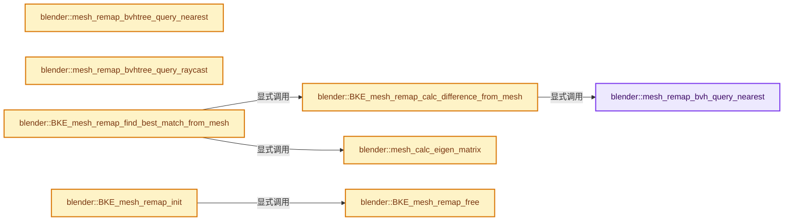
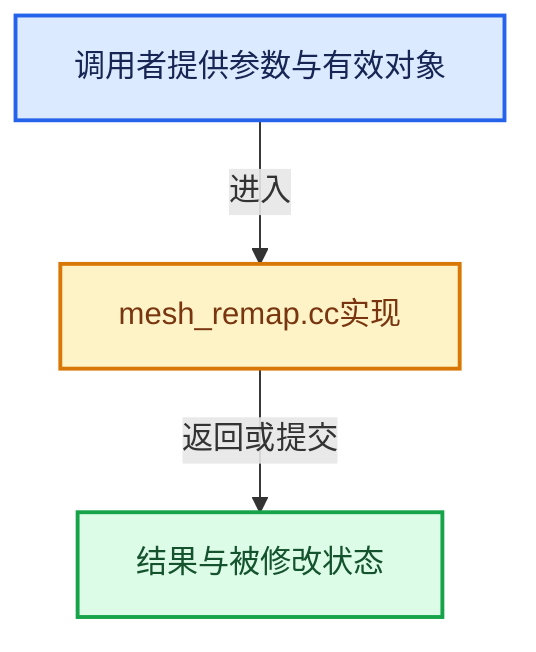

# 实现依赖专题：source/blender/blenkernel/intern/mesh_remap.cc

[方向导航](README.md) · [符号索引](../%E7%AC%A6%E5%8F%B7%E4%BE%9D%E8%B5%96%E4%B8%8E%E5%AE%9E%E7%8E%B0%E7%B4%A2%E5%BC%95.md)

本专题从正文实际调用进入，集中保存共享实现。函数有稳定锚点，可从调用处直接跳到对应完整函数；递归与互相调用通过回链组织。

## 本文件的实现关系






## 完整成员与函数实现

<a id="f-a9876623a85f2688"></a>

### `blender::mesh_remap_bvh_query_nearest`

实现位置：[source/blender/blenkernel/intern/mesh_remap.cc](../../../../../source/blender/blenkernel/intern/mesh_remap.cc) · L52—L65。

接口参数：

- `const bke::bvh::Tree &tree`
- `const float3 &co`
- `const float max_dist`
- `int *r_index`
- `float *r_hit_dist`

**教学注释版**

<!-- annotated:24045513e00b62 -->

```cpp
static bool mesh_remap_bvh_query_nearest(const bke::bvh::Tree &tree,
                                         const float3 &co,
                                         const float max_dist,
                                         int *r_index,
                                         float *r_hit_dist)
{
  const std::optional<bke::bvh::ClosestPointResult> nearest = tree.closest_point(co, max_dist);
  if (!nearest) {
    return false;
  }
  *r_index = int(nearest->index);
  *r_hit_dist = math::distance(co, nearest->position);
  return true;
}
```

<details>
<summary>核对原始源码：source/blender/blenkernel/intern/mesh_remap.cc · L52—L65</summary>

<!-- original:24045513e00b62:source/blender/blenkernel/intern/mesh_remap.cc:52:65 -->

```cpp
static bool mesh_remap_bvh_query_nearest(const bke::bvh::Tree &tree,
                                         const float3 &co,
                                         const float max_dist,
                                         int *r_index,
                                         float *r_hit_dist)
{
  const std::optional<bke::bvh::ClosestPointResult> nearest = tree.closest_point(co, max_dist);
  if (!nearest) {
    return false;
  }
  *r_index = int(nearest->index);
  *r_hit_dist = math::distance(co, nearest->position);
  return true;
}
```

</details>

**结果出口**

- `return false;`
- `return true;`

**继续追踪实现**

- `tree.closest_point` → [blender::bke::bvh::Tree::closest_point · L709](%E4%BE%9D%E8%B5%96-bvh-718c1e.md#f-b93306af3017419b)。
- `math::distance` → [blender::math::distance · L485](../12-%E7%A9%BA%E9%97%B4%E6%95%B0%E6%8D%AE%E7%BB%93%E6%9E%84%E4%B8%8E%E5%87%A0%E4%BD%95%E7%AE%97%E6%B3%95/%E4%BE%9D%E8%B5%96-BLI_math_vector-906a87.md#f-0a0df9b41ececd7b)；[blender::math::distance · L143](../12-%E7%A9%BA%E9%97%B4%E6%95%B0%E6%8D%AE%E7%BB%93%E6%9E%84%E4%B8%8E%E5%87%A0%E4%BD%95%E7%AE%97%E6%B3%95/%E4%BE%9D%E8%B5%96-BLI_math_base-0728eb.md#f-45db793191057701)。同名重载需按实参类型选择。

<a id="f-3217d3384e68a640"></a>

### `blender::mesh_remap_bvhtree_query_nearest`

实现位置：[source/blender/blenkernel/intern/mesh_remap.cc](../../../../../source/blender/blenkernel/intern/mesh_remap.cc) · L67—L94。

接口参数：

- `bke::BVHTreeFromMesh *treedata`
- `BVHTreeNearest *nearest`
- `const float co[3]`
- `const float max_dist_sq`
- `float *r_hit_dist`

**教学注释版**

<!-- annotated:da04e949a0b6a6 -->

```cpp
static bool mesh_remap_bvhtree_query_nearest(bke::BVHTreeFromMesh *treedata,
                                             BVHTreeNearest *nearest,
                                             const float co[3],
                                             const float max_dist_sq,
                                             float *r_hit_dist)
{
  /* Use local proximity heuristics (to reduce the nearest search). */
  if (nearest->index != -1) {
    nearest->dist_sq = len_squared_v3v3(co, nearest->co);
    if (nearest->dist_sq > max_dist_sq) {
      /* The previous valid index is too far away and not valid for this check. */
      nearest->dist_sq = max_dist_sq;
      nearest->index = -1;
    }
  }
  else {
    nearest->dist_sq = max_dist_sq;
  }
  /* Compute and store result. If invalid (-1 index), keep FLT_MAX dist. */
  BLI_bvhtree_find_nearest(treedata->tree, co, nearest, treedata->nearest_callback, treedata);

  if ((nearest->index != -1) && (nearest->dist_sq <= max_dist_sq)) {
    *r_hit_dist = sqrtf(nearest->dist_sq);
    return true;
  }

  return false;
}
```

<details>
<summary>核对原始源码：source/blender/blenkernel/intern/mesh_remap.cc · L67—L94</summary>

<!-- original:da04e949a0b6a6:source/blender/blenkernel/intern/mesh_remap.cc:67:94 -->

```cpp
static bool mesh_remap_bvhtree_query_nearest(bke::BVHTreeFromMesh *treedata,
                                             BVHTreeNearest *nearest,
                                             const float co[3],
                                             const float max_dist_sq,
                                             float *r_hit_dist)
{
  /* Use local proximity heuristics (to reduce the nearest search). */
  if (nearest->index != -1) {
    nearest->dist_sq = len_squared_v3v3(co, nearest->co);
    if (nearest->dist_sq > max_dist_sq) {
      /* The previous valid index is too far away and not valid for this check. */
      nearest->dist_sq = max_dist_sq;
      nearest->index = -1;
    }
  }
  else {
    nearest->dist_sq = max_dist_sq;
  }
  /* Compute and store result. If invalid (-1 index), keep FLT_MAX dist. */
  BLI_bvhtree_find_nearest(treedata->tree, co, nearest, treedata->nearest_callback, treedata);

  if ((nearest->index != -1) && (nearest->dist_sq <= max_dist_sq)) {
    *r_hit_dist = sqrtf(nearest->dist_sq);
    return true;
  }

  return false;
}
```

</details>

**沿实际写入检查状态**

- `nearest->dist_sq = len_squared_v3v3(co, nearest->co);`
- `nearest->dist_sq = max_dist_sq;`
- `nearest->index = -1;`

**结果出口**

- `return true;`
- `return false;`

**继续追踪实现**

- `len_squared_v3v3` → [blender::len_squared_v3v3 · L794](../12-%E7%A9%BA%E9%97%B4%E6%95%B0%E6%8D%AE%E7%BB%93%E6%9E%84%E4%B8%8E%E5%87%A0%E4%BD%95%E7%AE%97%E6%B3%95/%E4%BE%9D%E8%B5%96-math_vector_inline-0c8541.md#f-ae487ac3ef64aa87)。
- `BLI_bvhtree_find_nearest` → [blender::BLI_bvhtree_find_nearest · L1702](../12-%E7%A9%BA%E9%97%B4%E6%95%B0%E6%8D%AE%E7%BB%93%E6%9E%84%E4%B8%8E%E5%87%A0%E4%BD%95%E7%AE%97%E6%B3%95/%E4%BE%9D%E8%B5%96-BLI_kdopbvh-9f4bb8.md#f-2f91a6b71b29b922)。
- `sqrtf` → [外部契约](https://eel.is/c++draft/)：这个边界按实际表达式及所属类型核对参数、返回值、寿命与失败行为。这里提供接口入口，不声称已解释该第三方版本的内部实现。

<a id="f-487553509613dc38"></a>

### `blender::mesh_remap_bvhtree_query_raycast`

实现位置：[source/blender/blenkernel/intern/mesh_remap.cc](../../../../../source/blender/blenkernel/intern/mesh_remap.cc) · L96—L127。

接口参数：

- `bke::BVHTreeFromMesh *treedata`
- `BVHTreeRayHit *rayhit`
- `const float co[3]`
- `const float no[3]`
- `const float radius`
- `const float max_dist`
- `float *r_hit_dist`

**教学注释版**

<!-- annotated:63f605f36cb9c0 -->

```cpp
static bool mesh_remap_bvhtree_query_raycast(bke::BVHTreeFromMesh *treedata,
                                             BVHTreeRayHit *rayhit,
                                             const float co[3],
                                             const float no[3],
                                             const float radius,
                                             const float max_dist,
                                             float *r_hit_dist)
{
  BVHTreeRayHit rayhit_tmp;
  float inv_no[3];

  rayhit->index = -1;
  rayhit->dist = max_dist;
  BLI_bvhtree_ray_cast(
      treedata->tree, co, no, radius, rayhit, treedata->raycast_callback, treedata);

  /* Also cast in the other direction! */
  rayhit_tmp = *rayhit;
  negate_v3_v3(inv_no, no);
  BLI_bvhtree_ray_cast(
      treedata->tree, co, inv_no, radius, &rayhit_tmp, treedata->raycast_callback, treedata);
  if (rayhit_tmp.dist < rayhit->dist) {
    *rayhit = rayhit_tmp;
  }

  if ((rayhit->index != -1) && (rayhit->dist <= max_dist)) {
    *r_hit_dist = rayhit->dist;
    return true;
  }

  return false;
}
```

<details>
<summary>核对原始源码：source/blender/blenkernel/intern/mesh_remap.cc · L96—L127</summary>

<!-- original:63f605f36cb9c0:source/blender/blenkernel/intern/mesh_remap.cc:96:127 -->

```cpp
static bool mesh_remap_bvhtree_query_raycast(bke::BVHTreeFromMesh *treedata,
                                             BVHTreeRayHit *rayhit,
                                             const float co[3],
                                             const float no[3],
                                             const float radius,
                                             const float max_dist,
                                             float *r_hit_dist)
{
  BVHTreeRayHit rayhit_tmp;
  float inv_no[3];

  rayhit->index = -1;
  rayhit->dist = max_dist;
  BLI_bvhtree_ray_cast(
      treedata->tree, co, no, radius, rayhit, treedata->raycast_callback, treedata);

  /* Also cast in the other direction! */
  rayhit_tmp = *rayhit;
  negate_v3_v3(inv_no, no);
  BLI_bvhtree_ray_cast(
      treedata->tree, co, inv_no, radius, &rayhit_tmp, treedata->raycast_callback, treedata);
  if (rayhit_tmp.dist < rayhit->dist) {
    *rayhit = rayhit_tmp;
  }

  if ((rayhit->index != -1) && (rayhit->dist <= max_dist)) {
    *r_hit_dist = rayhit->dist;
    return true;
  }

  return false;
}
```

</details>

**沿实际写入检查状态**

- `rayhit->index = -1;`
- `rayhit->dist = max_dist;`
- `rayhit_tmp = *rayhit;`

**结果出口**

- `return true;`
- `return false;`

**继续追踪实现**

- `BLI_bvhtree_ray_cast` → [blender::BLI_bvhtree_ray_cast · L2024](../12-%E7%A9%BA%E9%97%B4%E6%95%B0%E6%8D%AE%E7%BB%93%E6%9E%84%E4%B8%8E%E5%87%A0%E4%BD%95%E7%AE%97%E6%B3%95/%E4%BE%9D%E8%B5%96-BLI_kdopbvh-9f4bb8.md#f-08a730292e373fbd)。
- `negate_v3_v3` → [blender::negate_v3_v3 · L578](../12-%E7%A9%BA%E9%97%B4%E6%95%B0%E6%8D%AE%E7%BB%93%E6%9E%84%E4%B8%8E%E5%87%A0%E4%BD%95%E7%AE%97%E6%B3%95/%E4%BE%9D%E8%B5%96-math_vector_inline-0c8541.md#f-b680e10c32373391)。

<a id="f-c20490c15cced227"></a>

### `blender::BKE_mesh_remap_calc_difference_from_mesh`

实现位置：[source/blender/blenkernel/intern/mesh_remap.cc](../../../../../source/blender/blenkernel/intern/mesh_remap.cc) · L137—L173。

接口参数：

- `const SpaceTransform *space_transform`
- `const Span<float3> vert_positions_dst`
- `const Mesh *me_src`

**教学注释版**

<!-- annotated:a08183babea5a8 -->

```cpp
float BKE_mesh_remap_calc_difference_from_mesh(const SpaceTransform *space_transform,
                                               const Span<float3> vert_positions_dst,
                                               const Mesh *me_src)
{
  float hit_dist;

  float result = 0.0f;
  int i;

  const bke::bvh::Tree &tree = me_src->bvh_verts();

  // [讲解] vert_positions_dst.size：查询视图长度或生成对应有效索引区间。
  for (i = 0; i < vert_positions_dst.size(); i++) {
    float3 tmp_co = vert_positions_dst[i];

    /* Convert the vertex to tree coordinates, if needed. */
    if (space_transform) {
      BLI_space_transform_apply(space_transform, tmp_co);
    }

    int index;
    if (mesh_remap_bvh_query_nearest(tree, tmp_co, FLT_MAX, &index, &hit_dist)) {
      result += 1.0f / (hit_dist + 1.0f);
    }
    else {
      /* No source for this dest vertex! */
      result += 1e-18f;
    }
  }

  result = (float(vert_positions_dst.size()) / result) - 1.0f;

#if 0
  printf("%s: Computed difference between meshes (the lower the better): %f\n", __func__, result);
#endif

  return result;
}
```

<details>
<summary>核对原始源码：source/blender/blenkernel/intern/mesh_remap.cc · L137—L173</summary>

<!-- original:a08183babea5a8:source/blender/blenkernel/intern/mesh_remap.cc:137:173 -->

```cpp
float BKE_mesh_remap_calc_difference_from_mesh(const SpaceTransform *space_transform,
                                               const Span<float3> vert_positions_dst,
                                               const Mesh *me_src)
{
  float hit_dist;

  float result = 0.0f;
  int i;

  const bke::bvh::Tree &tree = me_src->bvh_verts();

  for (i = 0; i < vert_positions_dst.size(); i++) {
    float3 tmp_co = vert_positions_dst[i];

    /* Convert the vertex to tree coordinates, if needed. */
    if (space_transform) {
      BLI_space_transform_apply(space_transform, tmp_co);
    }

    int index;
    if (mesh_remap_bvh_query_nearest(tree, tmp_co, FLT_MAX, &index, &hit_dist)) {
      result += 1.0f / (hit_dist + 1.0f);
    }
    else {
      /* No source for this dest vertex! */
      result += 1e-18f;
    }
  }

  result = (float(vert_positions_dst.size()) / result) - 1.0f;

#if 0
  printf("%s: Computed difference between meshes (the lower the better): %f\n", __func__, result);
#endif

  return result;
}
```

</details>

**沿实际写入检查状态**

- `result += 1.0f / (hit_dist + 1.0f);`
- `result += 1e-18f;`
- `result = (float(vert_positions_dst.size()) / result) - 1.0f;`

**结果出口**

- `return result;`

**继续追踪实现**

- `me_src->bvh_verts` → [blender::Mesh::bvh_verts · L674](../06-%E9%9A%90%E5%BC%8F%E5%85%B1%E4%BA%AB%E4%B8%8E%E7%BC%93%E5%AD%98%E7%B3%BB%E7%BB%9F/09-BVH%E5%85%B1%E4%BA%AB%E4%B8%8E%E8%BF%90%E8%A1%8C%E6%97%B6%E6%95%B0%E6%8D%AE.md#f-31dc9b32b0d4da34)。
- `vert_positions_dst.size` → [blender::Span::size · L256](../01-%E5%9F%BA%E7%A1%80%E5%AE%B9%E5%99%A8%E4%B8%8E%E7%8E%B0%E4%BB%A3CPP/05-Span%E5%8F%AA%E8%AF%BB%E8%BF%9E%E7%BB%AD%E8%A7%86%E5%9B%BE.md#f-5f80fa006089c998)。
- `BLI_space_transform_apply` → [blender::BLI_space_transform_apply · L2991](../12-%E7%A9%BA%E9%97%B4%E6%95%B0%E6%8D%AE%E7%BB%93%E6%9E%84%E4%B8%8E%E5%87%A0%E4%BD%95%E7%AE%97%E6%B3%95/%E4%BE%9D%E8%B5%96-math_matrix_c-004123.md#f-1fc98857c1302945)。
- `mesh_remap_bvh_query_nearest` → [blender::mesh_remap_bvh_query_nearest · L52](%E4%BE%9D%E8%B5%96-mesh_remap-b14c80.md#f-a9876623a85f2688)。
- `printf` → [外部契约](https://eel.is/c++draft/)：这个边界按实际表达式及所属类型核对参数、返回值、寿命与失败行为。这里提供接口入口，不声称已解释该第三方版本的内部实现。

<a id="f-0b640ecd39c5393c"></a>

### `blender::mesh_calc_eigen_matrix`

实现位置：[source/blender/blenkernel/intern/mesh_remap.cc](../../../../../source/blender/blenkernel/intern/mesh_remap.cc) · L187—L248。

接口参数：

- `const Span<float3> positions`
- `float r_mat[4][4]`

**教学注释版**

<!-- annotated:9cd102b685cf72 -->

```cpp
static void mesh_calc_eigen_matrix(const Span<float3> positions, float r_mat[4][4])
{
  float center[3], covmat[3][3];
  float eigen_val[3], eigen_vec[3][3];

  bool eigen_success;
  int i;

  unit_m4(r_mat);

  /* NOTE: here we apply sample correction to covariance matrix, since we consider the vertices
   *       as a sample of the whole 'surface' population of our mesh. */
  // [讲解] positions.data：返回借用范围的地址。
  BLI_covariance_m3_v3n(reinterpret_cast<const float (*)[3]>(positions.data()),
                        // [讲解] positions.size：查询视图长度或生成对应有效索引区间。
                        int(positions.size()),
                        true,
                        covmat,
                        center);

  eigen_success = BLI_eigen_solve_selfadjoint_m3(
      const_cast<const float (*)[3]>(covmat), eigen_val, eigen_vec);
  BLI_assert(eigen_success);
  UNUSED_VARS_NDEBUG(eigen_success);

  /* Special handling of cases where some eigen values are (nearly) identical. */
  if (compare_ff_relative(eigen_val[0], eigen_val[1], FLT_EPSILON, 64)) {
    if (compare_ff_relative(eigen_val[0], eigen_val[2], FLT_EPSILON, 64)) {
      /* No preferred direction, that set of vertices has a spherical average,
       * so we simply returned scaled/translated identity matrix (with no rotation). */
      unit_m3(eigen_vec);
    }
    else {
      /* Ellipsoid defined by eigen values/vectors has a spherical section,
       * we can only define one axis from eigen_vec[2] (two others computed eigen vecs
       * are not so nice for us here, they tend to 'randomly' rotate around valid one).
       * Note that eigen vectors as returned by BLI_eigen_solve_selfadjoint_m3() are normalized. */
      ortho_basis_v3v3_v3(eigen_vec[0], eigen_vec[1], eigen_vec[2]);
    }
  }
  else if (compare_ff_relative(eigen_val[0], eigen_val[2], FLT_EPSILON, 64)) {
    /* Same as above, but with eigen_vec[1] as valid axis. */
    ortho_basis_v3v3_v3(eigen_vec[2], eigen_vec[0], eigen_vec[1]);
  }
  else if (compare_ff_relative(eigen_val[1], eigen_val[2], FLT_EPSILON, 64)) {
    /* Same as above, but with eigen_vec[0] as valid axis. */
    ortho_basis_v3v3_v3(eigen_vec[1], eigen_vec[2], eigen_vec[0]);
  }

  for (i = 0; i < 3; i++) {
    float evi = eigen_val[i];

    /* Protect against 1D/2D degenerated cases! */
    /* NOTE: not sure why we need square root of eigen values here
     * (which are equivalent to singular values, as far as I have understood),
     * but it seems to heavily reduce (if not completely nullify)
     * the error due to non-uniform scalings... */
    evi = (evi < 1e-6f && evi > -1e-6f) ? ((evi < 0.0f) ? -1e-3f : 1e-3f) : sqrtf_signed(evi);
    mul_v3_fl(eigen_vec[i], evi);
  }

  copy_m4_m3(r_mat, eigen_vec);
  copy_v3_v3(r_mat[3], center);
}
```

<details>
<summary>核对原始源码：source/blender/blenkernel/intern/mesh_remap.cc · L187—L248</summary>

<!-- original:9cd102b685cf72:source/blender/blenkernel/intern/mesh_remap.cc:187:248 -->

```cpp
static void mesh_calc_eigen_matrix(const Span<float3> positions, float r_mat[4][4])
{
  float center[3], covmat[3][3];
  float eigen_val[3], eigen_vec[3][3];

  bool eigen_success;
  int i;

  unit_m4(r_mat);

  /* NOTE: here we apply sample correction to covariance matrix, since we consider the vertices
   *       as a sample of the whole 'surface' population of our mesh. */
  BLI_covariance_m3_v3n(reinterpret_cast<const float (*)[3]>(positions.data()),
                        int(positions.size()),
                        true,
                        covmat,
                        center);

  eigen_success = BLI_eigen_solve_selfadjoint_m3(
      const_cast<const float (*)[3]>(covmat), eigen_val, eigen_vec);
  BLI_assert(eigen_success);
  UNUSED_VARS_NDEBUG(eigen_success);

  /* Special handling of cases where some eigen values are (nearly) identical. */
  if (compare_ff_relative(eigen_val[0], eigen_val[1], FLT_EPSILON, 64)) {
    if (compare_ff_relative(eigen_val[0], eigen_val[2], FLT_EPSILON, 64)) {
      /* No preferred direction, that set of vertices has a spherical average,
       * so we simply returned scaled/translated identity matrix (with no rotation). */
      unit_m3(eigen_vec);
    }
    else {
      /* Ellipsoid defined by eigen values/vectors has a spherical section,
       * we can only define one axis from eigen_vec[2] (two others computed eigen vecs
       * are not so nice for us here, they tend to 'randomly' rotate around valid one).
       * Note that eigen vectors as returned by BLI_eigen_solve_selfadjoint_m3() are normalized. */
      ortho_basis_v3v3_v3(eigen_vec[0], eigen_vec[1], eigen_vec[2]);
    }
  }
  else if (compare_ff_relative(eigen_val[0], eigen_val[2], FLT_EPSILON, 64)) {
    /* Same as above, but with eigen_vec[1] as valid axis. */
    ortho_basis_v3v3_v3(eigen_vec[2], eigen_vec[0], eigen_vec[1]);
  }
  else if (compare_ff_relative(eigen_val[1], eigen_val[2], FLT_EPSILON, 64)) {
    /* Same as above, but with eigen_vec[0] as valid axis. */
    ortho_basis_v3v3_v3(eigen_vec[1], eigen_vec[2], eigen_vec[0]);
  }

  for (i = 0; i < 3; i++) {
    float evi = eigen_val[i];

    /* Protect against 1D/2D degenerated cases! */
    /* NOTE: not sure why we need square root of eigen values here
     * (which are equivalent to singular values, as far as I have understood),
     * but it seems to heavily reduce (if not completely nullify)
     * the error due to non-uniform scalings... */
    evi = (evi < 1e-6f && evi > -1e-6f) ? ((evi < 0.0f) ? -1e-3f : 1e-3f) : sqrtf_signed(evi);
    mul_v3_fl(eigen_vec[i], evi);
  }

  copy_m4_m3(r_mat, eigen_vec);
  copy_v3_v3(r_mat[3], center);
}
```

</details>

**沿实际写入检查状态**

- `eigen_success = BLI_eigen_solve_selfadjoint_m3(`
- `evi = (evi < 1e-6f && evi > -1e-6f) ? ((evi < 0.0f) ? -1e-3f : 1e-3f) : sqrtf_signed(evi);`

**继续追踪实现**

- `unit_m4` → [blender::unit_m4 · L55](../12-%E7%A9%BA%E9%97%B4%E6%95%B0%E6%8D%AE%E7%BB%93%E6%9E%84%E4%B8%8E%E5%87%A0%E4%BD%95%E7%AE%97%E6%B3%95/%E4%BE%9D%E8%B5%96-math_matrix_c-004123.md#f-e6cd812aae119176)。
- `BLI_covariance_m3_v3n` → [blender::BLI_covariance_m3_v3n · L107](../12-%E7%A9%BA%E9%97%B4%E6%95%B0%E6%8D%AE%E7%BB%93%E6%9E%84%E4%B8%8E%E5%87%A0%E4%BD%95%E7%AE%97%E6%B3%95/%E4%BE%9D%E8%B5%96-math_statistics-e129ca.md#f-de80a92b365e8484)。
- `positions.data` → [blender::Span::data · L219](../01-%E5%9F%BA%E7%A1%80%E5%AE%B9%E5%99%A8%E4%B8%8E%E7%8E%B0%E4%BB%A3CPP/05-Span%E5%8F%AA%E8%AF%BB%E8%BF%9E%E7%BB%AD%E8%A7%86%E5%9B%BE.md#f-10c5889198935800)。
- `positions.size` → [blender::Span::size · L256](../01-%E5%9F%BA%E7%A1%80%E5%AE%B9%E5%99%A8%E4%B8%8E%E7%8E%B0%E4%BB%A3CPP/05-Span%E5%8F%AA%E8%AF%BB%E8%BF%9E%E7%BB%AD%E8%A7%86%E5%9B%BE.md#f-5f80fa006089c998)。
- `BLI_eigen_solve_selfadjoint_m3` → [blender::BLI_eigen_solve_selfadjoint_m3 · L29](../12-%E7%A9%BA%E9%97%B4%E6%95%B0%E6%8D%AE%E7%BB%93%E6%9E%84%E4%B8%8E%E5%87%A0%E4%BD%95%E7%AE%97%E6%B3%95/%E4%BE%9D%E8%B5%96-math_solvers-f0737f.md#f-8ddf24177323925c)。
- `BLI_assert` → [BLI_assert · L48](../01-%E5%9F%BA%E7%A1%80%E5%AE%B9%E5%99%A8%E4%B8%8E%E7%8E%B0%E4%BB%A3CPP/%E4%BE%9D%E8%B5%96-BLI_assert-cc98e8.md#m-57a88495704d)；[BLI_assert · L63](../01-%E5%9F%BA%E7%A1%80%E5%AE%B9%E5%99%A8%E4%B8%8E%E7%8E%B0%E4%BB%A3CPP/%E4%BE%9D%E8%B5%96-BLI_assert-cc98e8.md#m-d07050020cb5)。宏定义由构建条件选择。
- `UNUSED_VARS_NDEBUG` → [UNUSED_VARS_NDEBUG · L526](../01-%E5%9F%BA%E7%A1%80%E5%AE%B9%E5%99%A8%E4%B8%8E%E7%8E%B0%E4%BB%A3CPP/%E4%BE%9D%E8%B5%96-BLI_utildefines-293a0a.md#m-fea439f7d366)；[UNUSED_VARS_NDEBUG · L528](../01-%E5%9F%BA%E7%A1%80%E5%AE%B9%E5%99%A8%E4%B8%8E%E7%8E%B0%E4%BB%A3CPP/%E4%BE%9D%E8%B5%96-BLI_utildefines-293a0a.md#m-a8f8cfac06c0)。宏定义由构建条件选择。
- `compare_ff_relative` → [blender::compare_ff_relative · L452](../12-%E7%A9%BA%E9%97%B4%E6%95%B0%E6%8D%AE%E7%BB%93%E6%9E%84%E4%B8%8E%E5%87%A0%E4%BD%95%E7%AE%97%E6%B3%95/%E4%BE%9D%E8%B5%96-math_base_inline-546b00.md#f-5b29e5b24e8dd45d)。
- `unit_m3` → [blender::unit_m3 · L47](../12-%E7%A9%BA%E9%97%B4%E6%95%B0%E6%8D%AE%E7%BB%93%E6%9E%84%E4%B8%8E%E5%87%A0%E4%BD%95%E7%AE%97%E6%B3%95/%E4%BE%9D%E8%B5%96-math_matrix_c-004123.md#f-85e0073adca4ccff)。
- `ortho_basis_v3v3_v3` → [blender::ortho_basis_v3v3_v3 · L568](../12-%E7%A9%BA%E9%97%B4%E6%95%B0%E6%8D%AE%E7%BB%93%E6%9E%84%E4%B8%8E%E5%87%A0%E4%BD%95%E7%AE%97%E6%B3%95/%E4%BE%9D%E8%B5%96-math_vector-5f35fa.md#f-1e18958d69394164)。
- `sqrtf_signed` → [blender::sqrtf_signed · L73](../12-%E7%A9%BA%E9%97%B4%E6%95%B0%E6%8D%AE%E7%BB%93%E6%9E%84%E4%B8%8E%E5%87%A0%E4%BD%95%E7%AE%97%E6%B3%95/%E4%BE%9D%E8%B5%96-math_base_inline-546b00.md#f-5a25259b81b9306a)。
- `mul_v3_fl` → [blender::mul_v3_fl · L414](../12-%E7%A9%BA%E9%97%B4%E6%95%B0%E6%8D%AE%E7%BB%93%E6%9E%84%E4%B8%8E%E5%87%A0%E4%BD%95%E7%AE%97%E6%B3%95/%E4%BE%9D%E8%B5%96-math_vector_inline-0c8541.md#f-00165156a06d1224)。
- `copy_m4_m3` → [blender::copy_m4_m3 · L109](../12-%E7%A9%BA%E9%97%B4%E6%95%B0%E6%8D%AE%E7%BB%93%E6%9E%84%E4%B8%8E%E5%87%A0%E4%BD%95%E7%AE%97%E6%B3%95/%E4%BE%9D%E8%B5%96-math_matrix_c-004123.md#f-6915e4040afabeb8)。
- `copy_v3_v3` → [blender::copy_v3_v3 · L47](../12-%E7%A9%BA%E9%97%B4%E6%95%B0%E6%8D%AE%E7%BB%93%E6%9E%84%E4%B8%8E%E5%87%A0%E4%BD%95%E7%AE%97%E6%B3%95/%E4%BE%9D%E8%B5%96-math_vector_inline-0c8541.md#f-037a0d5fa5060bd6)。

<a id="f-b72a525f511dc419"></a>

### `blender::BKE_mesh_remap_find_best_match_from_mesh`

实现位置：[source/blender/blenkernel/intern/mesh_remap.cc](../../../../../source/blender/blenkernel/intern/mesh_remap.cc) · L250—L296。

接口参数：

- `const Span<float3> vert_positions_dst`
- `const Mesh *me_src`
- `SpaceTransform *r_space_transform`

**教学注释版**

<!-- annotated:1a90bd8a5f95bb -->

```cpp
void BKE_mesh_remap_find_best_match_from_mesh(const Span<float3> vert_positions_dst,
                                              const Mesh *me_src,
                                              SpaceTransform *r_space_transform)
{
  /* Note that those are done so that we successively get actual mirror matrix
   * (by multiplication of columns). */
  const float mirrors[][3] = {
      {-1.0f, 1.0f, 1.0f}, /* -> -1,  1,  1 */
      {1.0f, -1.0f, 1.0f}, /* -> -1, -1,  1 */
      {1.0f, 1.0f, -1.0f}, /* -> -1, -1, -1 */
      {1.0f, -1.0f, 1.0f}, /* -> -1,  1, -1 */
      {-1.0f, 1.0f, 1.0f}, /* ->  1,  1, -1 */
      {1.0f, -1.0f, 1.0f}, /* ->  1, -1, -1 */
      {1.0f, 1.0f, -1.0f}, /* ->  1, -1,  1 */
      {0.0f, 0.0f, 0.0f},
  };
  const float (*mirr)[3];

  float mat_src[4][4], mat_dst[4][4], best_mat_dst[4][4];
  float best_match = FLT_MAX, match;

  const Span<float3> positions_src = me_src->vert_positions();
  mesh_calc_eigen_matrix(positions_src, mat_src);
  mesh_calc_eigen_matrix(vert_positions_dst, mat_dst);

  BLI_space_transform_global_from_matrices(r_space_transform, mat_dst, mat_src);
  match = BKE_mesh_remap_calc_difference_from_mesh(r_space_transform, vert_positions_dst, me_src);
  best_match = match;
  copy_m4_m4(best_mat_dst, mat_dst);

  /* And now, we have to check the other sixth possible mirrored versions... */
  for (mirr = mirrors; (*mirr)[0]; mirr++) {
    mul_v3_fl(mat_dst[0], (*mirr)[0]);
    mul_v3_fl(mat_dst[1], (*mirr)[1]);
    mul_v3_fl(mat_dst[2], (*mirr)[2]);

    BLI_space_transform_global_from_matrices(r_space_transform, mat_dst, mat_src);
    match = BKE_mesh_remap_calc_difference_from_mesh(
        r_space_transform, vert_positions_dst, me_src);
    if (match < best_match) {
      best_match = match;
      copy_m4_m4(best_mat_dst, mat_dst);
    }
  }

  BLI_space_transform_global_from_matrices(r_space_transform, best_mat_dst, mat_src);
}
```

<details>
<summary>核对原始源码：source/blender/blenkernel/intern/mesh_remap.cc · L250—L296</summary>

<!-- original:1a90bd8a5f95bb:source/blender/blenkernel/intern/mesh_remap.cc:250:296 -->

```cpp
void BKE_mesh_remap_find_best_match_from_mesh(const Span<float3> vert_positions_dst,
                                              const Mesh *me_src,
                                              SpaceTransform *r_space_transform)
{
  /* Note that those are done so that we successively get actual mirror matrix
   * (by multiplication of columns). */
  const float mirrors[][3] = {
      {-1.0f, 1.0f, 1.0f}, /* -> -1,  1,  1 */
      {1.0f, -1.0f, 1.0f}, /* -> -1, -1,  1 */
      {1.0f, 1.0f, -1.0f}, /* -> -1, -1, -1 */
      {1.0f, -1.0f, 1.0f}, /* -> -1,  1, -1 */
      {-1.0f, 1.0f, 1.0f}, /* ->  1,  1, -1 */
      {1.0f, -1.0f, 1.0f}, /* ->  1, -1, -1 */
      {1.0f, 1.0f, -1.0f}, /* ->  1, -1,  1 */
      {0.0f, 0.0f, 0.0f},
  };
  const float (*mirr)[3];

  float mat_src[4][4], mat_dst[4][4], best_mat_dst[4][4];
  float best_match = FLT_MAX, match;

  const Span<float3> positions_src = me_src->vert_positions();
  mesh_calc_eigen_matrix(positions_src, mat_src);
  mesh_calc_eigen_matrix(vert_positions_dst, mat_dst);

  BLI_space_transform_global_from_matrices(r_space_transform, mat_dst, mat_src);
  match = BKE_mesh_remap_calc_difference_from_mesh(r_space_transform, vert_positions_dst, me_src);
  best_match = match;
  copy_m4_m4(best_mat_dst, mat_dst);

  /* And now, we have to check the other sixth possible mirrored versions... */
  for (mirr = mirrors; (*mirr)[0]; mirr++) {
    mul_v3_fl(mat_dst[0], (*mirr)[0]);
    mul_v3_fl(mat_dst[1], (*mirr)[1]);
    mul_v3_fl(mat_dst[2], (*mirr)[2]);

    BLI_space_transform_global_from_matrices(r_space_transform, mat_dst, mat_src);
    match = BKE_mesh_remap_calc_difference_from_mesh(
        r_space_transform, vert_positions_dst, me_src);
    if (match < best_match) {
      best_match = match;
      copy_m4_m4(best_mat_dst, mat_dst);
    }
  }

  BLI_space_transform_global_from_matrices(r_space_transform, best_mat_dst, mat_src);
}
```

</details>

**沿实际写入检查状态**

- `match = BKE_mesh_remap_calc_difference_from_mesh(r_space_transform, vert_positions_dst, me_src);`
- `best_match = match;`
- `match = BKE_mesh_remap_calc_difference_from_mesh(`

**继续追踪实现**

- `me_src->vert_positions` → [Mesh::vert_positions · L1193](03-MPoly%E8%BF%81%E7%A7%BB%E4%B8%8E%E5%85%BC%E5%AE%B9.md#f-ae4177e5c5f2b371)。
- `mesh_calc_eigen_matrix` → [blender::mesh_calc_eigen_matrix · L187](%E4%BE%9D%E8%B5%96-mesh_remap-b14c80.md#f-0b640ecd39c5393c)。
- `BLI_space_transform_global_from_matrices` → [blender::BLI_space_transform_global_from_matrices · L2981](../12-%E7%A9%BA%E9%97%B4%E6%95%B0%E6%8D%AE%E7%BB%93%E6%9E%84%E4%B8%8E%E5%87%A0%E4%BD%95%E7%AE%97%E6%B3%95/%E4%BE%9D%E8%B5%96-math_matrix_c-004123.md#f-361089e419f620f8)。
- `BKE_mesh_remap_calc_difference_from_mesh` → [blender::BKE_mesh_remap_calc_difference_from_mesh · L137](%E4%BE%9D%E8%B5%96-mesh_remap-b14c80.md#f-c20490c15cced227)。
- `copy_m4_m4` → [blender::copy_m4_m4 · L84](../12-%E7%A9%BA%E9%97%B4%E6%95%B0%E6%8D%AE%E7%BB%93%E6%9E%84%E4%B8%8E%E5%87%A0%E4%BD%95%E7%AE%97%E6%B3%95/%E4%BE%9D%E8%B5%96-math_matrix_c-004123.md#f-b4390cf8c94710f5)。
- `mul_v3_fl` → [blender::mul_v3_fl · L414](../12-%E7%A9%BA%E9%97%B4%E6%95%B0%E6%8D%AE%E7%BB%93%E6%9E%84%E4%B8%8E%E5%87%A0%E4%BD%95%E7%AE%97%E6%B3%95/%E4%BE%9D%E8%B5%96-math_vector_inline-0c8541.md#f-00165156a06d1224)。

<a id="f-f380d22a07193481"></a>

### `blender::BKE_mesh_remap_init`

实现位置：[source/blender/blenkernel/intern/mesh_remap.cc](../../../../../source/blender/blenkernel/intern/mesh_remap.cc) · L304—L315。

接口参数：

- `MeshPairRemap *map`
- `const int items_num`

**教学注释版**

<!-- annotated:90225de93a520a -->

```cpp
void BKE_mesh_remap_init(MeshPairRemap *map, const int items_num)
{
  MemArena *mem = BLI_memarena_new(BLI_MEMARENA_STD_BUFSIZE, __func__);

  BKE_mesh_remap_free(map);

  map->items = static_cast<MeshPairRemapItem *>(
      BLI_memarena_alloc(mem, sizeof(*map->items) * size_t(items_num)));
  map->items_num = items_num;

  map->mem = mem;
}
```

<details>
<summary>核对原始源码：source/blender/blenkernel/intern/mesh_remap.cc · L304—L315</summary>

<!-- original:90225de93a520a:source/blender/blenkernel/intern/mesh_remap.cc:304:315 -->

```cpp
void BKE_mesh_remap_init(MeshPairRemap *map, const int items_num)
{
  MemArena *mem = BLI_memarena_new(BLI_MEMARENA_STD_BUFSIZE, __func__);

  BKE_mesh_remap_free(map);

  map->items = static_cast<MeshPairRemapItem *>(
      BLI_memarena_alloc(mem, sizeof(*map->items) * size_t(items_num)));
  map->items_num = items_num;

  map->mem = mem;
}
```

</details>

**沿实际写入检查状态**

- `map->items = static_cast<MeshPairRemapItem *>(`
- `map->items_num = items_num;`
- `map->mem = mem;`

**继续追踪实现**

- `BLI_memarena_new` → [blender::BLI_memarena_new · L73](../01-%E5%9F%BA%E7%A1%80%E5%AE%B9%E5%99%A8%E4%B8%8E%E7%8E%B0%E4%BB%A3CPP/%E4%BE%9D%E8%B5%96-BLI_memarena-aea32a.md#f-590ef4f6ab548c98)。
- `BKE_mesh_remap_free` → [blender::BKE_mesh_remap_free · L317](%E4%BE%9D%E8%B5%96-mesh_remap-b14c80.md#f-c1d81dbd52fee27b)。
- `BLI_memarena_alloc` → [blender::BLI_memarena_alloc · L125](../01-%E5%9F%BA%E7%A1%80%E5%AE%B9%E5%99%A8%E4%B8%8E%E7%8E%B0%E4%BB%A3CPP/%E4%BE%9D%E8%B5%96-BLI_memarena-aea32a.md#f-ae79828c3629e134)；[blender::BLI_memarena_alloc · L43](../01-%E5%9F%BA%E7%A1%80%E5%AE%B9%E5%99%A8%E4%B8%8E%E7%8E%B0%E4%BB%A3CPP/%E4%BE%9D%E8%B5%96-BLI_memarena-d0ed90.md#f-3c7ccf0d8384021b)。同名重载需按实参类型选择。

<a id="f-c1d81dbd52fee27b"></a>

### `blender::BKE_mesh_remap_free`

实现位置：[source/blender/blenkernel/intern/mesh_remap.cc](../../../../../source/blender/blenkernel/intern/mesh_remap.cc) · L317—L326。

接口参数：

- `MeshPairRemap *map`

**教学注释版**

<!-- annotated:e2b48ce5564643 -->

```cpp
void BKE_mesh_remap_free(MeshPairRemap *map)
{
  if (map->mem) {
    BLI_memarena_free(map->mem);
  }

  map->items_num = 0;
  map->items = nullptr;
  map->mem = nullptr;
}
```

<details>
<summary>核对原始源码：source/blender/blenkernel/intern/mesh_remap.cc · L317—L326</summary>

<!-- original:e2b48ce5564643:source/blender/blenkernel/intern/mesh_remap.cc:317:326 -->

```cpp
void BKE_mesh_remap_free(MeshPairRemap *map)
{
  if (map->mem) {
    BLI_memarena_free(map->mem);
  }

  map->items_num = 0;
  map->items = nullptr;
  map->mem = nullptr;
}
```

</details>

**沿实际写入检查状态**

- `map->items_num = 0;`
- `map->items = nullptr;`
- `map->mem = nullptr;`

**继续追踪实现**

- `BLI_memarena_free` → [blender::BLI_memarena_free · L103](../01-%E5%9F%BA%E7%A1%80%E5%AE%B9%E5%99%A8%E4%B8%8E%E7%8E%B0%E4%BB%A3CPP/%E4%BE%9D%E8%B5%96-BLI_memarena-aea32a.md#f-a655794ad41d1bdf)。

<a id="f-60259c67e4094c7e"></a>

### `blender::mesh_remap_item_define`

实现位置：[source/blender/blenkernel/intern/mesh_remap.cc](../../../../../source/blender/blenkernel/intern/mesh_remap.cc) · L328—L355。

接口参数：

- `MeshPairRemap *map`
- `const int index`
- `const float`
- `const int island`
- `const int sources_num`
- `const int *indices_src`
- `const float *weights_src`

**教学注释版**

<!-- annotated:d4571d69ee860e -->

```cpp
static void mesh_remap_item_define(MeshPairRemap *map,
                                   const int index,
                                   const float /*hit_dist*/,
                                   const int island,
                                   const int sources_num,
                                   const int *indices_src,
                                   const float *weights_src)
{
  MeshPairRemapItem *mapit = &map->items[index];
  MemArena *mem = map->mem;

  if (sources_num) {
    mapit->sources_num = sources_num;
    mapit->indices_src = static_cast<int *>(
        BLI_memarena_alloc(mem, sizeof(*mapit->indices_src) * size_t(sources_num)));
    // [讲解] memcpy：复制字节，源与目标不应重叠。类型生命周期、对齐和可复制表示须由调用者证明，不是任意对象的复制构造。
    memcpy(mapit->indices_src, indices_src, sizeof(*mapit->indices_src) * size_t(sources_num));
    mapit->weights_src = static_cast<float *>(
        BLI_memarena_alloc(mem, sizeof(*mapit->weights_src) * size_t(sources_num)));
    memcpy(mapit->weights_src, weights_src, sizeof(*mapit->weights_src) * size_t(sources_num));
  }
  else {
    mapit->sources_num = 0;
    mapit->indices_src = nullptr;
    mapit->weights_src = nullptr;
  }
  // mapit->hit_dist = hit_dist;
  mapit->island = island;
}
```

<details>
<summary>核对原始源码：source/blender/blenkernel/intern/mesh_remap.cc · L328—L355</summary>

<!-- original:d4571d69ee860e:source/blender/blenkernel/intern/mesh_remap.cc:328:355 -->

```cpp
static void mesh_remap_item_define(MeshPairRemap *map,
                                   const int index,
                                   const float /*hit_dist*/,
                                   const int island,
                                   const int sources_num,
                                   const int *indices_src,
                                   const float *weights_src)
{
  MeshPairRemapItem *mapit = &map->items[index];
  MemArena *mem = map->mem;

  if (sources_num) {
    mapit->sources_num = sources_num;
    mapit->indices_src = static_cast<int *>(
        BLI_memarena_alloc(mem, sizeof(*mapit->indices_src) * size_t(sources_num)));
    memcpy(mapit->indices_src, indices_src, sizeof(*mapit->indices_src) * size_t(sources_num));
    mapit->weights_src = static_cast<float *>(
        BLI_memarena_alloc(mem, sizeof(*mapit->weights_src) * size_t(sources_num)));
    memcpy(mapit->weights_src, weights_src, sizeof(*mapit->weights_src) * size_t(sources_num));
  }
  else {
    mapit->sources_num = 0;
    mapit->indices_src = nullptr;
    mapit->weights_src = nullptr;
  }
  // mapit->hit_dist = hit_dist;
  mapit->island = island;
}
```

</details>

**沿实际写入检查状态**

- `mapit->sources_num = sources_num;`
- `mapit->indices_src = static_cast<int *>(`
- `mapit->weights_src = static_cast<float *>(`
- `mapit->sources_num = 0;`
- `mapit->indices_src = nullptr;`
- `mapit->weights_src = nullptr;`
- `mapit->island = island;`

**继续追踪实现**

- `BLI_memarena_alloc` → [blender::BLI_memarena_alloc · L125](../01-%E5%9F%BA%E7%A1%80%E5%AE%B9%E5%99%A8%E4%B8%8E%E7%8E%B0%E4%BB%A3CPP/%E4%BE%9D%E8%B5%96-BLI_memarena-aea32a.md#f-ae79828c3629e134)；[blender::BLI_memarena_alloc · L43](../01-%E5%9F%BA%E7%A1%80%E5%AE%B9%E5%99%A8%E4%B8%8E%E7%8E%B0%E4%BB%A3CPP/%E4%BE%9D%E8%B5%96-BLI_memarena-d0ed90.md#f-3c7ccf0d8384021b)。同名重载需按实参类型选择。
- `memcpy` → [外部契约](https://eel.is/c++draft/cstring.syn)：复制字节，源与目标不应重叠。类型生命周期、对齐和可复制表示须由调用者证明，不是任意对象的复制构造。

<a id="f-3989cbcab2ddfb97"></a>

### `blender::BKE_mesh_remap_item_define_invalid`

实现位置：[source/blender/blenkernel/intern/mesh_remap.cc](../../../../../source/blender/blenkernel/intern/mesh_remap.cc) · L357—L360。

接口参数：

- `MeshPairRemap *map`
- `const int index`

**教学注释版**

<!-- annotated:b72f7118278683 -->

```cpp
void BKE_mesh_remap_item_define_invalid(MeshPairRemap *map, const int index)
{
  mesh_remap_item_define(map, index, FLT_MAX, 0, 0, nullptr, nullptr);
}
```

<details>
<summary>核对原始源码：source/blender/blenkernel/intern/mesh_remap.cc · L357—L360</summary>

<!-- original:b72f7118278683:source/blender/blenkernel/intern/mesh_remap.cc:357:360 -->

```cpp
void BKE_mesh_remap_item_define_invalid(MeshPairRemap *map, const int index)
{
  mesh_remap_item_define(map, index, FLT_MAX, 0, 0, nullptr, nullptr);
}
```

</details>

**继续追踪实现**

- `mesh_remap_item_define` → [blender::mesh_remap_item_define · L328](%E4%BE%9D%E8%B5%96-mesh_remap-b14c80.md#f-60259c67e4094c7e)。

<a id="f-81d62ec111ab643d"></a>

### `blender::mesh_remap_interp_face_data_get`

实现位置：[source/blender/blenkernel/intern/mesh_remap.cc](../../../../../source/blender/blenkernel/intern/mesh_remap.cc) · L362—L411。

接口参数：

- `const IndexRange face`
- `const Span<int> corner_verts`
- `const Span<float3> positions_src`
- `const float point[3]`
- `size_t *buff_size`
- `float (**vcos)[3]`
- `const bool use_loops`
- `int **indices`
- `float **weights`
- `const bool do_weights`
- `int *r_closest_index`

**教学注释版**

<!-- annotated:03c87e7a58e6a1 -->

```cpp
static int mesh_remap_interp_face_data_get(const IndexRange face,
                                           const Span<int> corner_verts,
                                           const Span<float3> positions_src,
                                           const float point[3],
                                           size_t *buff_size,
                                           float (**vcos)[3],
                                           const bool use_loops,
                                           int **indices,
                                           float **weights,
                                           const bool do_weights,
                                           int *r_closest_index)
{
  float (*vco)[3];
  float ref_dist_sq = FLT_MAX;
  int *index;
  // [讲解] face.size：读取连续区间或分组的边界信息。
  const int sources_num = int(face.size());
  int i;

  if (size_t(sources_num) > *buff_size) {
    *buff_size = size_t(sources_num);
    *vcos = static_cast<float (*)[3]>(
        MEM_realloc_uninitialized(*vcos, sizeof(**vcos) * *buff_size));
    *indices = static_cast<int *>(
        MEM_realloc_uninitialized(*indices, sizeof(**indices) * *buff_size));
    if (do_weights) {
      *weights = static_cast<float *>(
          MEM_realloc_uninitialized(*weights, sizeof(**weights) * *buff_size));
    }
  }

  for (i = 0, vco = *vcos, index = *indices; i < sources_num; i++, vco++, index++) {
    const int vert = corner_verts[face[i]];
    *index = use_loops ? int(face[i]) : vert;
    copy_v3_v3(*vco, positions_src[vert]);
    if (r_closest_index) {
      /* Find closest vert/loop in this case. */
      const float dist_sq = len_squared_v3v3(point, *vco);
      if (dist_sq < ref_dist_sq) {
        ref_dist_sq = dist_sq;
        *r_closest_index = *index;
      }
    }
  }

  if (do_weights) {
    interp_weights_poly_v3(*weights, *vcos, sources_num, point);
  }

  return sources_num;
}
```

<details>
<summary>核对原始源码：source/blender/blenkernel/intern/mesh_remap.cc · L362—L411</summary>

<!-- original:03c87e7a58e6a1:source/blender/blenkernel/intern/mesh_remap.cc:362:411 -->

```cpp
static int mesh_remap_interp_face_data_get(const IndexRange face,
                                           const Span<int> corner_verts,
                                           const Span<float3> positions_src,
                                           const float point[3],
                                           size_t *buff_size,
                                           float (**vcos)[3],
                                           const bool use_loops,
                                           int **indices,
                                           float **weights,
                                           const bool do_weights,
                                           int *r_closest_index)
{
  float (*vco)[3];
  float ref_dist_sq = FLT_MAX;
  int *index;
  const int sources_num = int(face.size());
  int i;

  if (size_t(sources_num) > *buff_size) {
    *buff_size = size_t(sources_num);
    *vcos = static_cast<float (*)[3]>(
        MEM_realloc_uninitialized(*vcos, sizeof(**vcos) * *buff_size));
    *indices = static_cast<int *>(
        MEM_realloc_uninitialized(*indices, sizeof(**indices) * *buff_size));
    if (do_weights) {
      *weights = static_cast<float *>(
          MEM_realloc_uninitialized(*weights, sizeof(**weights) * *buff_size));
    }
  }

  for (i = 0, vco = *vcos, index = *indices; i < sources_num; i++, vco++, index++) {
    const int vert = corner_verts[face[i]];
    *index = use_loops ? int(face[i]) : vert;
    copy_v3_v3(*vco, positions_src[vert]);
    if (r_closest_index) {
      /* Find closest vert/loop in this case. */
      const float dist_sq = len_squared_v3v3(point, *vco);
      if (dist_sq < ref_dist_sq) {
        ref_dist_sq = dist_sq;
        *r_closest_index = *index;
      }
    }
  }

  if (do_weights) {
    interp_weights_poly_v3(*weights, *vcos, sources_num, point);
  }

  return sources_num;
}
```

</details>

**沿实际写入检查状态**

- `ref_dist_sq = dist_sq;`

**结果出口**

- `return sources_num;`

**继续追踪实现**

- `face.size` → [blender::IndexRange::size · L156](../01-%E5%9F%BA%E7%A1%80%E5%AE%B9%E5%99%A8%E4%B8%8E%E7%8E%B0%E4%BB%A3CPP/04-IndexRange%E8%BF%9E%E7%BB%AD%E6%95%B4%E6%95%B0%E5%8C%BA%E9%97%B4.md#f-05f66c3ebb2fdfec)。
- `MEM_realloc_uninitialized` → [MEM_realloc_uninitialized · L118](../03-%E5%86%85%E5%AD%98%E5%88%86%E9%85%8D%E4%B8%8E%E8%BF%90%E8%A1%8C%E6%97%B6%E7%B1%BB%E5%9E%8B/%E4%BE%9D%E8%B5%96-MEM_guardedalloc-b54eca.md#m-813b7cd3fcff)。宏定义由构建条件选择。
- `copy_v3_v3` → [blender::copy_v3_v3 · L47](../12-%E7%A9%BA%E9%97%B4%E6%95%B0%E6%8D%AE%E7%BB%93%E6%9E%84%E4%B8%8E%E5%87%A0%E4%BD%95%E7%AE%97%E6%B3%95/%E4%BE%9D%E8%B5%96-math_vector_inline-0c8541.md#f-037a0d5fa5060bd6)。
- `len_squared_v3v3` → [blender::len_squared_v3v3 · L794](../12-%E7%A9%BA%E9%97%B4%E6%95%B0%E6%8D%AE%E7%BB%93%E6%9E%84%E4%B8%8E%E5%87%A0%E4%BD%95%E7%AE%97%E6%B3%95/%E4%BE%9D%E8%B5%96-math_vector_inline-0c8541.md#f-ae487ac3ef64aa87)。
- `interp_weights_poly_v3` → [blender::interp_weights_poly_v3 · L4265](../12-%E7%A9%BA%E9%97%B4%E6%95%B0%E6%8D%AE%E7%BB%93%E6%9E%84%E4%B8%8E%E5%87%A0%E4%BD%95%E7%AE%97%E6%B3%95/%E4%BE%9D%E8%B5%96-math_geom-8d91a3.md#f-784eb6b0f217c7ff)。

<a id="f-c42e6bd234136d13"></a>

### `blender::BKE_mesh_remap_calc_verts_from_mesh`

实现位置：[source/blender/blenkernel/intern/mesh_remap.cc](../../../../../source/blender/blenkernel/intern/mesh_remap.cc) · L453—L668。

接口参数：

- `const int mode`
- `const SpaceTransform *space_transform`
- `const float max_dist`
- `const float ray_radius`
- `const Span<float3> vert_positions_dst`
- `const Mesh *me_src`
- `Mesh *me_dst`
- `MeshPairRemap *r_map`

**教学注释版**

<!-- annotated:8ca76b28685c57 -->

```cpp
void BKE_mesh_remap_calc_verts_from_mesh(const int mode,
                                         const SpaceTransform *space_transform,
                                         const float max_dist,
                                         const float ray_radius,
                                         const Span<float3> vert_positions_dst,
                                         const Mesh *me_src,
                                         Mesh *me_dst,
                                         MeshPairRemap *r_map)
{
  const float full_weight = 1.0f;
  const float max_dist_sq = max_dist * max_dist;
  int i;

  BLI_assert(mode & MREMAP_MODE_VERT);

  // [讲解] vert_positions_dst.size：查询视图长度或生成对应有效索引区间。
  BKE_mesh_remap_init(r_map, int(vert_positions_dst.size()));

  if (mode == MREMAP_MODE_TOPOLOGY) {
    BLI_assert(vert_positions_dst.size() == me_src->verts_num);
    for (i = 0; i < vert_positions_dst.size(); i++) {
      mesh_remap_item_define(r_map, i, FLT_MAX, 0, 1, &i, &full_weight);
    }
  }
  else {
    bke::BVHTreeFromMesh treedata{};
    BVHTreeNearest nearest = {0};
    BVHTreeRayHit rayhit = {0};
    float hit_dist;
    float tmp_co[3], tmp_no[3];

    if (mode == MREMAP_MODE_VERT_NEAREST) {
      const bke::bvh::Tree &tree = me_src->bvh_verts();

      for (i = 0; i < vert_positions_dst.size(); i++) {
        float3 co = vert_positions_dst[i];

        /* Convert the vertex to tree coordinates, if needed. */
        if (space_transform) {
          BLI_space_transform_apply(space_transform, co);
        }

        int index;
        if (mesh_remap_bvh_query_nearest(tree, co, max_dist, &index, &hit_dist)) {
          mesh_remap_item_define(r_map, i, hit_dist, 0, 1, &index, &full_weight);
        }
        else {
          /* No source for this dest vertex! */
          BKE_mesh_remap_item_define_invalid(r_map, i);
        }
      }
    }
    else if (ELEM(mode, MREMAP_MODE_VERT_EDGE_NEAREST, MREMAP_MODE_VERT_EDGEINTERP_NEAREST)) {
      const Span<int2> edges_src = me_src->edges();
      const Span<float3> positions_src = me_src->vert_positions();

      const bke::bvh::Tree &tree = me_src->bvh_edges();

      for (i = 0; i < vert_positions_dst.size(); i++) {
        float3 co = vert_positions_dst[i];

        /* Convert the vertex to tree coordinates, if needed. */
        if (space_transform) {
          BLI_space_transform_apply(space_transform, co);
        }

        int edge_index;
        if (mesh_remap_bvh_query_nearest(tree, co, max_dist, &edge_index, &hit_dist)) {
          const int2 &edge = edges_src[edge_index];
          const float *v1cos = positions_src[edge[0]];
          const float *v2cos = positions_src[edge[1]];

          if (mode == MREMAP_MODE_VERT_EDGE_NEAREST) {
            const float dist_v1 = len_squared_v3v3(co, v1cos);
            const float dist_v2 = len_squared_v3v3(co, v2cos);
            const int index = (dist_v1 > dist_v2) ? edge[1] : edge[0];
            mesh_remap_item_define(r_map, i, hit_dist, 0, 1, &index, &full_weight);
          }
          else if (mode == MREMAP_MODE_VERT_EDGEINTERP_NEAREST) {
            int indices[2];
            float weights[2];

            indices[0] = edge[0];
            indices[1] = edge[1];

            /* Weight is inverse of point factor here... */
            weights[0] = line_point_factor_v3(co, v2cos, v1cos);
            CLAMP(weights[0], 0.0f, 1.0f);
            weights[1] = 1.0f - weights[0];

            mesh_remap_item_define(r_map, i, hit_dist, 0, 2, indices, weights);
          }
        }
        else {
          /* No source for this dest vertex! */
          BKE_mesh_remap_item_define_invalid(r_map, i);
        }
      }
    }
    else if (ELEM(mode,
                  MREMAP_MODE_VERT_FACE_NEAREST,
                  MREMAP_MODE_VERT_POLYINTERP_NEAREST,
                  MREMAP_MODE_VERT_POLYINTERP_VNORPROJ))
    {
      const OffsetIndices faces_src = me_src->faces();
      const Span<int> corner_verts_src = me_src->corner_verts();
      const Span<float3> positions_src = me_src->vert_positions();
      const Span<float3> vert_normals_dst = me_dst->vert_normals();
      const Span<int> tri_faces = me_src->corner_tri_faces();

      size_t tmp_buff_size = MREMAP_DEFAULT_BUFSIZE;
      float (*vcos)[3] = MEM_new_array_uninitialized<float[3]>(tmp_buff_size, __func__);
      int *indices = MEM_new_array_uninitialized<int>(tmp_buff_size, __func__);
      float *weights = MEM_new_array_uninitialized<float>(tmp_buff_size, __func__);

      treedata = me_src->bvh_corner_tris();

      if (mode == MREMAP_MODE_VERT_POLYINTERP_VNORPROJ) {
        for (i = 0; i < vert_positions_dst.size(); i++) {
          copy_v3_v3(tmp_co, vert_positions_dst[i]);
          copy_v3_v3(tmp_no, vert_normals_dst[i]);

          /* Convert the vertex to tree coordinates, if needed. */
          if (space_transform) {
            BLI_space_transform_apply(space_transform, tmp_co);
            BLI_space_transform_apply_normal(space_transform, tmp_no);
          }

          if (mesh_remap_bvhtree_query_raycast(
                  &treedata, &rayhit, tmp_co, tmp_no, ray_radius, max_dist, &hit_dist))
          {
            const int face_index = tri_faces[rayhit.index];
            const int sources_num = mesh_remap_interp_face_data_get(faces_src[face_index],
                                                                    corner_verts_src,
                                                                    positions_src,
                                                                    rayhit.co,
                                                                    &tmp_buff_size,
                                                                    &vcos,
                                                                    false,
                                                                    &indices,
                                                                    &weights,
                                                                    true,
                                                                    nullptr);

            mesh_remap_item_define(r_map, i, hit_dist, 0, sources_num, indices, weights);
          }
          else {
            /* No source for this dest vertex! */
            BKE_mesh_remap_item_define_invalid(r_map, i);
          }
        }
      }
      else {
        nearest.index = -1;

        for (i = 0; i < vert_positions_dst.size(); i++) {
          copy_v3_v3(tmp_co, vert_positions_dst[i]);

          /* Convert the vertex to tree coordinates, if needed. */
          if (space_transform) {
            BLI_space_transform_apply(space_transform, tmp_co);
          }

          if (mesh_remap_bvhtree_query_nearest(
                  &treedata, &nearest, tmp_co, max_dist_sq, &hit_dist))
          {
            const int face_index = tri_faces[nearest.index];

            if (mode == MREMAP_MODE_VERT_FACE_NEAREST) {
              int index;
              mesh_remap_interp_face_data_get(faces_src[face_index],
                                              corner_verts_src,
                                              positions_src,
                                              nearest.co,
                                              &tmp_buff_size,
                                              &vcos,
                                              false,
                                              &indices,
                                              &weights,
                                              false,
                                              &index);

              mesh_remap_item_define(r_map, i, hit_dist, 0, 1, &index, &full_weight);
            }
            else if (mode == MREMAP_MODE_VERT_POLYINTERP_NEAREST) {
              const int sources_num = mesh_remap_interp_face_data_get(faces_src[face_index],
                                                                      corner_verts_src,
                                                                      positions_src,
                                                                      nearest.co,
                                                                      &tmp_buff_size,
                                                                      &vcos,
                                                                      false,
                                                                      &indices,
                                                                      &weights,
                                                                      true,
                                                                      nullptr);

              mesh_remap_item_define(r_map, i, hit_dist, 0, sources_num, indices, weights);
            }
          }
          else {
            /* No source for this dest vertex! */
            BKE_mesh_remap_item_define_invalid(r_map, i);
          }
        }
      }

      MEM_delete(vcos);
      MEM_delete(indices);
      MEM_delete(weights);
    }
    else {
      CLOG_WARN(&LOG, "Unsupported mesh-to-mesh vertex mapping mode (%d)!", mode);
      // [讲解] memset：填充字节，不调用T构造函数，也不保证任意类型的全零表示是合法或期望值。
      memset(r_map->items, 0, sizeof(*r_map->items) * size_t(vert_positions_dst.size()));
    }
  }
}
```

<details>
<summary>核对原始源码：source/blender/blenkernel/intern/mesh_remap.cc · L453—L668</summary>

<!-- original:8ca76b28685c57:source/blender/blenkernel/intern/mesh_remap.cc:453:668 -->

```cpp
void BKE_mesh_remap_calc_verts_from_mesh(const int mode,
                                         const SpaceTransform *space_transform,
                                         const float max_dist,
                                         const float ray_radius,
                                         const Span<float3> vert_positions_dst,
                                         const Mesh *me_src,
                                         Mesh *me_dst,
                                         MeshPairRemap *r_map)
{
  const float full_weight = 1.0f;
  const float max_dist_sq = max_dist * max_dist;
  int i;

  BLI_assert(mode & MREMAP_MODE_VERT);

  BKE_mesh_remap_init(r_map, int(vert_positions_dst.size()));

  if (mode == MREMAP_MODE_TOPOLOGY) {
    BLI_assert(vert_positions_dst.size() == me_src->verts_num);
    for (i = 0; i < vert_positions_dst.size(); i++) {
      mesh_remap_item_define(r_map, i, FLT_MAX, 0, 1, &i, &full_weight);
    }
  }
  else {
    bke::BVHTreeFromMesh treedata{};
    BVHTreeNearest nearest = {0};
    BVHTreeRayHit rayhit = {0};
    float hit_dist;
    float tmp_co[3], tmp_no[3];

    if (mode == MREMAP_MODE_VERT_NEAREST) {
      const bke::bvh::Tree &tree = me_src->bvh_verts();

      for (i = 0; i < vert_positions_dst.size(); i++) {
        float3 co = vert_positions_dst[i];

        /* Convert the vertex to tree coordinates, if needed. */
        if (space_transform) {
          BLI_space_transform_apply(space_transform, co);
        }

        int index;
        if (mesh_remap_bvh_query_nearest(tree, co, max_dist, &index, &hit_dist)) {
          mesh_remap_item_define(r_map, i, hit_dist, 0, 1, &index, &full_weight);
        }
        else {
          /* No source for this dest vertex! */
          BKE_mesh_remap_item_define_invalid(r_map, i);
        }
      }
    }
    else if (ELEM(mode, MREMAP_MODE_VERT_EDGE_NEAREST, MREMAP_MODE_VERT_EDGEINTERP_NEAREST)) {
      const Span<int2> edges_src = me_src->edges();
      const Span<float3> positions_src = me_src->vert_positions();

      const bke::bvh::Tree &tree = me_src->bvh_edges();

      for (i = 0; i < vert_positions_dst.size(); i++) {
        float3 co = vert_positions_dst[i];

        /* Convert the vertex to tree coordinates, if needed. */
        if (space_transform) {
          BLI_space_transform_apply(space_transform, co);
        }

        int edge_index;
        if (mesh_remap_bvh_query_nearest(tree, co, max_dist, &edge_index, &hit_dist)) {
          const int2 &edge = edges_src[edge_index];
          const float *v1cos = positions_src[edge[0]];
          const float *v2cos = positions_src[edge[1]];

          if (mode == MREMAP_MODE_VERT_EDGE_NEAREST) {
            const float dist_v1 = len_squared_v3v3(co, v1cos);
            const float dist_v2 = len_squared_v3v3(co, v2cos);
            const int index = (dist_v1 > dist_v2) ? edge[1] : edge[0];
            mesh_remap_item_define(r_map, i, hit_dist, 0, 1, &index, &full_weight);
          }
          else if (mode == MREMAP_MODE_VERT_EDGEINTERP_NEAREST) {
            int indices[2];
            float weights[2];

            indices[0] = edge[0];
            indices[1] = edge[1];

            /* Weight is inverse of point factor here... */
            weights[0] = line_point_factor_v3(co, v2cos, v1cos);
            CLAMP(weights[0], 0.0f, 1.0f);
            weights[1] = 1.0f - weights[0];

            mesh_remap_item_define(r_map, i, hit_dist, 0, 2, indices, weights);
          }
        }
        else {
          /* No source for this dest vertex! */
          BKE_mesh_remap_item_define_invalid(r_map, i);
        }
      }
    }
    else if (ELEM(mode,
                  MREMAP_MODE_VERT_FACE_NEAREST,
                  MREMAP_MODE_VERT_POLYINTERP_NEAREST,
                  MREMAP_MODE_VERT_POLYINTERP_VNORPROJ))
    {
      const OffsetIndices faces_src = me_src->faces();
      const Span<int> corner_verts_src = me_src->corner_verts();
      const Span<float3> positions_src = me_src->vert_positions();
      const Span<float3> vert_normals_dst = me_dst->vert_normals();
      const Span<int> tri_faces = me_src->corner_tri_faces();

      size_t tmp_buff_size = MREMAP_DEFAULT_BUFSIZE;
      float (*vcos)[3] = MEM_new_array_uninitialized<float[3]>(tmp_buff_size, __func__);
      int *indices = MEM_new_array_uninitialized<int>(tmp_buff_size, __func__);
      float *weights = MEM_new_array_uninitialized<float>(tmp_buff_size, __func__);

      treedata = me_src->bvh_corner_tris();

      if (mode == MREMAP_MODE_VERT_POLYINTERP_VNORPROJ) {
        for (i = 0; i < vert_positions_dst.size(); i++) {
          copy_v3_v3(tmp_co, vert_positions_dst[i]);
          copy_v3_v3(tmp_no, vert_normals_dst[i]);

          /* Convert the vertex to tree coordinates, if needed. */
          if (space_transform) {
            BLI_space_transform_apply(space_transform, tmp_co);
            BLI_space_transform_apply_normal(space_transform, tmp_no);
          }

          if (mesh_remap_bvhtree_query_raycast(
                  &treedata, &rayhit, tmp_co, tmp_no, ray_radius, max_dist, &hit_dist))
          {
            const int face_index = tri_faces[rayhit.index];
            const int sources_num = mesh_remap_interp_face_data_get(faces_src[face_index],
                                                                    corner_verts_src,
                                                                    positions_src,
                                                                    rayhit.co,
                                                                    &tmp_buff_size,
                                                                    &vcos,
                                                                    false,
                                                                    &indices,
                                                                    &weights,
                                                                    true,
                                                                    nullptr);

            mesh_remap_item_define(r_map, i, hit_dist, 0, sources_num, indices, weights);
          }
          else {
            /* No source for this dest vertex! */
            BKE_mesh_remap_item_define_invalid(r_map, i);
          }
        }
      }
      else {
        nearest.index = -1;

        for (i = 0; i < vert_positions_dst.size(); i++) {
          copy_v3_v3(tmp_co, vert_positions_dst[i]);

          /* Convert the vertex to tree coordinates, if needed. */
          if (space_transform) {
            BLI_space_transform_apply(space_transform, tmp_co);
          }

          if (mesh_remap_bvhtree_query_nearest(
                  &treedata, &nearest, tmp_co, max_dist_sq, &hit_dist))
          {
            const int face_index = tri_faces[nearest.index];

            if (mode == MREMAP_MODE_VERT_FACE_NEAREST) {
              int index;
              mesh_remap_interp_face_data_get(faces_src[face_index],
                                              corner_verts_src,
                                              positions_src,
                                              nearest.co,
                                              &tmp_buff_size,
                                              &vcos,
                                              false,
                                              &indices,
                                              &weights,
                                              false,
                                              &index);

              mesh_remap_item_define(r_map, i, hit_dist, 0, 1, &index, &full_weight);
            }
            else if (mode == MREMAP_MODE_VERT_POLYINTERP_NEAREST) {
              const int sources_num = mesh_remap_interp_face_data_get(faces_src[face_index],
                                                                      corner_verts_src,
                                                                      positions_src,
                                                                      nearest.co,
                                                                      &tmp_buff_size,
                                                                      &vcos,
                                                                      false,
                                                                      &indices,
                                                                      &weights,
                                                                      true,
                                                                      nullptr);

              mesh_remap_item_define(r_map, i, hit_dist, 0, sources_num, indices, weights);
            }
          }
          else {
            /* No source for this dest vertex! */
            BKE_mesh_remap_item_define_invalid(r_map, i);
          }
        }
      }

      MEM_delete(vcos);
      MEM_delete(indices);
      MEM_delete(weights);
    }
    else {
      CLOG_WARN(&LOG, "Unsupported mesh-to-mesh vertex mapping mode (%d)!", mode);
      memset(r_map->items, 0, sizeof(*r_map->items) * size_t(vert_positions_dst.size()));
    }
  }
}
```

</details>

**沿实际写入检查状态**

- `indices[0] = edge[0];`
- `indices[1] = edge[1];`
- `weights[0] = line_point_factor_v3(co, v2cos, v1cos);`
- `weights[1] = 1.0f - weights[0];`
- `treedata = me_src->bvh_corner_tris();`
- `nearest.index = -1;`

**继续追踪实现**

- `BLI_assert` → [BLI_assert · L48](../01-%E5%9F%BA%E7%A1%80%E5%AE%B9%E5%99%A8%E4%B8%8E%E7%8E%B0%E4%BB%A3CPP/%E4%BE%9D%E8%B5%96-BLI_assert-cc98e8.md#m-57a88495704d)；[BLI_assert · L63](../01-%E5%9F%BA%E7%A1%80%E5%AE%B9%E5%99%A8%E4%B8%8E%E7%8E%B0%E4%BB%A3CPP/%E4%BE%9D%E8%B5%96-BLI_assert-cc98e8.md#m-d07050020cb5)。宏定义由构建条件选择。
- `BKE_mesh_remap_init` → [blender::BKE_mesh_remap_init · L304](%E4%BE%9D%E8%B5%96-mesh_remap-b14c80.md#f-f380d22a07193481)。
- `vert_positions_dst.size` → [blender::Span::size · L256](../01-%E5%9F%BA%E7%A1%80%E5%AE%B9%E5%99%A8%E4%B8%8E%E7%8E%B0%E4%BB%A3CPP/05-Span%E5%8F%AA%E8%AF%BB%E8%BF%9E%E7%BB%AD%E8%A7%86%E5%9B%BE.md#f-5f80fa006089c998)。
- `mesh_remap_item_define` → [blender::mesh_remap_item_define · L328](%E4%BE%9D%E8%B5%96-mesh_remap-b14c80.md#f-60259c67e4094c7e)。
- `me_src->bvh_verts` → [blender::Mesh::bvh_verts · L674](../06-%E9%9A%90%E5%BC%8F%E5%85%B1%E4%BA%AB%E4%B8%8E%E7%BC%93%E5%AD%98%E7%B3%BB%E7%BB%9F/09-BVH%E5%85%B1%E4%BA%AB%E4%B8%8E%E8%BF%90%E8%A1%8C%E6%97%B6%E6%95%B0%E6%8D%AE.md#f-31dc9b32b0d4da34)。
- `BLI_space_transform_apply` → [blender::BLI_space_transform_apply · L2991](../12-%E7%A9%BA%E9%97%B4%E6%95%B0%E6%8D%AE%E7%BB%93%E6%9E%84%E4%B8%8E%E5%87%A0%E4%BD%95%E7%AE%97%E6%B3%95/%E4%BE%9D%E8%B5%96-math_matrix_c-004123.md#f-1fc98857c1302945)。
- `mesh_remap_bvh_query_nearest` → [blender::mesh_remap_bvh_query_nearest · L52](%E4%BE%9D%E8%B5%96-mesh_remap-b14c80.md#f-a9876623a85f2688)。
- `BKE_mesh_remap_item_define_invalid` → [blender::BKE_mesh_remap_item_define_invalid · L357](%E4%BE%9D%E8%B5%96-mesh_remap-b14c80.md#f-3989cbcab2ddfb97)。
- `ELEM` → [ELEM · L88](%E4%BE%9D%E8%B5%96-GHOST_utildefines-34b996.md#m-d28724a15928)；[ELEM · L135](../01-%E5%9F%BA%E7%A1%80%E5%AE%B9%E5%99%A8%E4%B8%8E%E7%8E%B0%E4%BB%A3CPP/%E4%BE%9D%E8%B5%96-BLI_utildefines-293a0a.md#m-d6572de7cae0)。宏定义由构建条件选择。
- `me_src->edges` → [Mesh::edges · L1205](03-MPoly%E8%BF%81%E7%A7%BB%E4%B8%8E%E5%85%BC%E5%AE%B9.md#f-7232f6756b674d12)。
- `me_src->vert_positions` → [Mesh::vert_positions · L1193](03-MPoly%E8%BF%81%E7%A7%BB%E4%B8%8E%E5%85%BC%E5%AE%B9.md#f-ae4177e5c5f2b371)。
- `me_src->bvh_edges` → [blender::Mesh::bvh_edges · L711](../06-%E9%9A%90%E5%BC%8F%E5%85%B1%E4%BA%AB%E4%B8%8E%E7%BC%93%E5%AD%98%E7%B3%BB%E7%BB%9F/09-BVH%E5%85%B1%E4%BA%AB%E4%B8%8E%E8%BF%90%E8%A1%8C%E6%97%B6%E6%95%B0%E6%8D%AE.md#f-65395be9217c5e97)。
- `len_squared_v3v3` → [blender::len_squared_v3v3 · L794](../12-%E7%A9%BA%E9%97%B4%E6%95%B0%E6%8D%AE%E7%BB%93%E6%9E%84%E4%B8%8E%E5%87%A0%E4%BD%95%E7%AE%97%E6%B3%95/%E4%BE%9D%E8%B5%96-math_vector_inline-0c8541.md#f-ae487ac3ef64aa87)。
- `line_point_factor_v3` → [blender::line_point_factor_v3 · L3425](../12-%E7%A9%BA%E9%97%B4%E6%95%B0%E6%8D%AE%E7%BB%93%E6%9E%84%E4%B8%8E%E5%87%A0%E4%BD%95%E7%AE%97%E6%B3%95/%E4%BE%9D%E8%B5%96-math_geom-8d91a3.md#f-8007e153e8d379bc)。
- `CLAMP` → [CLAMP · L200](../01-%E5%9F%BA%E7%A1%80%E5%AE%B9%E5%99%A8%E4%B8%8E%E7%8E%B0%E4%BB%A3CPP/%E4%BE%9D%E8%B5%96-BLI_utildefines-293a0a.md#m-69703e497120)。宏定义由构建条件选择。
- `me_src->faces` → [Mesh::faces · L1217](03-MPoly%E8%BF%81%E7%A7%BB%E4%B8%8E%E5%85%BC%E5%AE%B9.md#f-ea444760154e17b2)。
- `me_src->corner_verts` → [Mesh::corner_verts · L1238](03-MPoly%E8%BF%81%E7%A7%BB%E4%B8%8E%E5%85%BC%E5%AE%B9.md#f-a59c61f583b64bc4)。
- `me_dst->vert_normals` → [blender::Mesh::vert_normals · L349](../06-%E9%9A%90%E5%BC%8F%E5%85%B1%E4%BA%AB%E4%B8%8E%E7%BC%93%E5%AD%98%E7%B3%BB%E7%BB%9F/08-%E6%B3%95%E7%BA%BF%E7%BC%93%E5%AD%98%E7%9A%84%E7%9C%9F%E5%AE%9E%E4%BE%9D%E8%B5%96.md#f-e9a9d50dc8e15fba)。
- `me_src->corner_tri_faces` → [blender::Mesh::corner_tri_faces · L285](../06-%E9%9A%90%E5%BC%8F%E5%85%B1%E4%BA%AB%E4%B8%8E%E7%BC%93%E5%AD%98%E7%B3%BB%E7%BB%9F/10-%E5%B1%80%E9%83%A8%E6%9B%B4%E6%96%B0%E4%B8%8E%E5%A4%B1%E6%95%88%E4%BF%AE%E5%A4%8D.md#f-94cfee90bf521ed4)。
- `MEM_new_array_uninitialized<float[3]>` → [MEM_new_array_uninitialized · L608](../03-%E5%86%85%E5%AD%98%E5%88%86%E9%85%8D%E4%B8%8E%E8%BF%90%E8%A1%8C%E6%97%B6%E7%B1%BB%E5%9E%8B/%E4%BE%9D%E8%B5%96-MEM_guardedalloc-b54eca.md#f-b7103eae8eb57b05)；[MEM_new_array_uninitialized · L129](../03-%E5%86%85%E5%AD%98%E5%88%86%E9%85%8D%E4%B8%8E%E8%BF%90%E8%A1%8C%E6%97%B6%E7%B1%BB%E5%9E%8B/%E4%BE%9D%E8%B5%96-mallocn-afdcd4.md#f-bf6ef4ddcfb6e5df)。同名重载需按实参类型选择。
- `MEM_new_array_uninitialized<int>` → [MEM_new_array_uninitialized · L608](../03-%E5%86%85%E5%AD%98%E5%88%86%E9%85%8D%E4%B8%8E%E8%BF%90%E8%A1%8C%E6%97%B6%E7%B1%BB%E5%9E%8B/%E4%BE%9D%E8%B5%96-MEM_guardedalloc-b54eca.md#f-b7103eae8eb57b05)；[MEM_new_array_uninitialized · L129](../03-%E5%86%85%E5%AD%98%E5%88%86%E9%85%8D%E4%B8%8E%E8%BF%90%E8%A1%8C%E6%97%B6%E7%B1%BB%E5%9E%8B/%E4%BE%9D%E8%B5%96-mallocn-afdcd4.md#f-bf6ef4ddcfb6e5df)。同名重载需按实参类型选择。
- `MEM_new_array_uninitialized<float>` → [MEM_new_array_uninitialized · L608](../03-%E5%86%85%E5%AD%98%E5%88%86%E9%85%8D%E4%B8%8E%E8%BF%90%E8%A1%8C%E6%97%B6%E7%B1%BB%E5%9E%8B/%E4%BE%9D%E8%B5%96-MEM_guardedalloc-b54eca.md#f-b7103eae8eb57b05)；[MEM_new_array_uninitialized · L129](../03-%E5%86%85%E5%AD%98%E5%88%86%E9%85%8D%E4%B8%8E%E8%BF%90%E8%A1%8C%E6%97%B6%E7%B1%BB%E5%9E%8B/%E4%BE%9D%E8%B5%96-mallocn-afdcd4.md#f-bf6ef4ddcfb6e5df)。同名重载需按实参类型选择。
- `me_src->bvh_corner_tris` → [blender::Mesh::bvh_corner_tris · L773](../06-%E9%9A%90%E5%BC%8F%E5%85%B1%E4%BA%AB%E4%B8%8E%E7%BC%93%E5%AD%98%E7%B3%BB%E7%BB%9F/09-BVH%E5%85%B1%E4%BA%AB%E4%B8%8E%E8%BF%90%E8%A1%8C%E6%97%B6%E6%95%B0%E6%8D%AE.md#f-9c8110cd438d92e1)。
- `copy_v3_v3` → [blender::copy_v3_v3 · L47](../12-%E7%A9%BA%E9%97%B4%E6%95%B0%E6%8D%AE%E7%BB%93%E6%9E%84%E4%B8%8E%E5%87%A0%E4%BD%95%E7%AE%97%E6%B3%95/%E4%BE%9D%E8%B5%96-math_vector_inline-0c8541.md#f-037a0d5fa5060bd6)。
- `BLI_space_transform_apply_normal` → [blender::BLI_space_transform_apply_normal · L3001](../12-%E7%A9%BA%E9%97%B4%E6%95%B0%E6%8D%AE%E7%BB%93%E6%9E%84%E4%B8%8E%E5%87%A0%E4%BD%95%E7%AE%97%E6%B3%95/%E4%BE%9D%E8%B5%96-math_matrix_c-004123.md#f-c751636d12aa32cd)。
- `mesh_remap_bvhtree_query_raycast` → [blender::mesh_remap_bvhtree_query_raycast · L96](%E4%BE%9D%E8%B5%96-mesh_remap-b14c80.md#f-487553509613dc38)。
- `mesh_remap_interp_face_data_get` → [blender::mesh_remap_interp_face_data_get · L362](%E4%BE%9D%E8%B5%96-mesh_remap-b14c80.md#f-81d62ec111ab643d)。
- `mesh_remap_bvhtree_query_nearest` → [blender::mesh_remap_bvhtree_query_nearest · L67](%E4%BE%9D%E8%B5%96-mesh_remap-b14c80.md#f-3217d3384e68a640)。
- `MEM_delete` → [MEM_delete · L400](../03-%E5%86%85%E5%AD%98%E5%88%86%E9%85%8D%E4%B8%8E%E8%BF%90%E8%A1%8C%E6%97%B6%E7%B1%BB%E5%9E%8B/%E4%BE%9D%E8%B5%96-MEM_guardedalloc-b54eca.md#f-9049ffdd1682887c)。
- `CLOG_WARN` → [CLOG_WARN · L189](%E4%BE%9D%E8%B5%96-CLG_log-e9051b.md#m-9da21a06cdbe)。宏定义由构建条件选择。
- `memset` → [外部契约](https://eel.is/c++draft/cstring.syn)：填充字节，不调用T构造函数，也不保证任意类型的全零表示是合法或期望值。

<a id="f-a6a67e842b49a1e9"></a>

### `blender::BKE_mesh_remap_calc_edges_from_mesh`

实现位置：[source/blender/blenkernel/intern/mesh_remap.cc](../../../../../source/blender/blenkernel/intern/mesh_remap.cc) · L670—L1006。

接口参数：

- `const int mode`
- `const SpaceTransform *space_transform`
- `const float max_dist`
- `const float ray_radius`
- `const Span<float3> vert_positions_dst`
- `const Span<int2> edges_dst`
- `const Mesh *me_src`
- `Mesh *me_dst`
- `MeshPairRemap *r_map`

**教学注释版**

<!-- annotated:9e6825f02946c1 -->

```cpp
void BKE_mesh_remap_calc_edges_from_mesh(const int mode,
                                         const SpaceTransform *space_transform,
                                         const float max_dist,
                                         const float ray_radius,
                                         const Span<float3> vert_positions_dst,
                                         const Span<int2> edges_dst,
                                         const Mesh *me_src,
                                         Mesh *me_dst,
                                         MeshPairRemap *r_map)
{
  const float full_weight = 1.0f;
  const float max_dist_sq = max_dist * max_dist;
  int i;

  BLI_assert(mode & MREMAP_MODE_EDGE);

  // [讲解] edges_dst.size：查询视图长度或生成对应有效索引区间。
  BKE_mesh_remap_init(r_map, int(edges_dst.size()));

  if (mode == MREMAP_MODE_TOPOLOGY) {
    BLI_assert(edges_dst.size() == me_src->edges_num);
    for (i = 0; i < edges_dst.size(); i++) {
      mesh_remap_item_define(r_map, i, FLT_MAX, 0, 1, &i, &full_weight);
    }
  }
  else {
    bke::BVHTreeFromMesh treedata{};
    BVHTreeNearest nearest = {0};
    BVHTreeRayHit rayhit = {0};
    float hit_dist;
    float tmp_co[3], tmp_no[3];

    if (mode == MREMAP_MODE_EDGE_VERT_NEAREST) {
      const int num_verts_src = me_src->verts_num;
      const Span<int2> edges_src = me_src->edges();
      const Span<float3> positions_src = me_src->vert_positions();

      struct HitData {
        float hit_dist;
        int index;
      };
      HitData *v_dst_to_src_map = MEM_new_array_uninitialized<HitData>(
          size_t(vert_positions_dst.size()), __func__);

      for (i = 0; i < vert_positions_dst.size(); i++) {
        v_dst_to_src_map[i].hit_dist = -1.0f;
      }

      Array<int> vert_to_edge_src_offsets;
      Array<int> vert_to_edge_src_indices;
      const GroupedSpan<int> vert_to_edge_src_map = bke::mesh::build_vert_to_edge_map(
          edges_src, num_verts_src, vert_to_edge_src_offsets, vert_to_edge_src_indices);

      const bke::bvh::Tree &tree = me_src->bvh_verts();

      for (i = 0; i < edges_dst.size(); i++) {
        const int2 &e_dst = edges_dst[i];
        float best_totdist = FLT_MAX;
        int best_eidx_src = -1;
        int j = 2;

        while (j--) {
          const int vidx_dst = j ? e_dst[0] : e_dst[1];

          /* Compute closest verts only once! */
          if (v_dst_to_src_map[vidx_dst].hit_dist == -1.0f) {
            float3 co = vert_positions_dst[vidx_dst];

            /* Convert the vertex to tree coordinates, if needed. */
            if (space_transform) {
              BLI_space_transform_apply(space_transform, co);
            }

            int index;
            if (mesh_remap_bvh_query_nearest(tree, co, max_dist, &index, &hit_dist)) {
              v_dst_to_src_map[vidx_dst].hit_dist = hit_dist;
              v_dst_to_src_map[vidx_dst].index = index;
            }
            else {
              /* No source for this dest vert! */
              v_dst_to_src_map[vidx_dst].hit_dist = FLT_MAX;
            }
          }
        }

        /* Now, check all source edges of closest sources vertices,
         * and select the one giving the smallest total verts-to-verts distance. */
        for (j = 2; j--;) {
          const int vidx_dst = j ? e_dst[0] : e_dst[1];
          const float first_dist = v_dst_to_src_map[vidx_dst].hit_dist;
          const int vidx_src = v_dst_to_src_map[vidx_dst].index;
          const int *eidx_src;
          int k;

          if (vidx_src < 0) {
            continue;
          }

          eidx_src = vert_to_edge_src_map[vidx_src].data();
          k = int(vert_to_edge_src_map[vidx_src].size());

          for (; k--; eidx_src++) {
            const int2 &edge_src = edges_src[*eidx_src];
            const float *other_co_src =
                positions_src[bke::mesh::edge_other_vert(edge_src, vidx_src)];
            const float *other_co_dst =
                vert_positions_dst[bke::mesh::edge_other_vert(e_dst, int(vidx_dst))];
            const float totdist = first_dist + len_v3v3(other_co_src, other_co_dst);

            if (totdist < best_totdist) {
              best_totdist = totdist;
              best_eidx_src = *eidx_src;
            }
          }
        }

        if (best_eidx_src >= 0) {
          const float *co1_src = positions_src[edges_src[best_eidx_src][0]];
          const float *co2_src = positions_src[edges_src[best_eidx_src][1]];
          const float *co1_dst = vert_positions_dst[e_dst[0]];
          const float *co2_dst = vert_positions_dst[e_dst[1]];
          float co_src[3], co_dst[3];

          /* TODO: would need an isect_seg_seg_v3(), actually! */
          const int isect_type = isect_line_line_v3(
              co1_src, co2_src, co1_dst, co2_dst, co_src, co_dst);
          if (isect_type != 0) {
            const float fac_src = line_point_factor_v3(co_src, co1_src, co2_src);
            const float fac_dst = line_point_factor_v3(co_dst, co1_dst, co2_dst);
            if (fac_src < 0.0f) {
              copy_v3_v3(co_src, co1_src);
            }
            else if (fac_src > 1.0f) {
              copy_v3_v3(co_src, co2_src);
            }
            if (fac_dst < 0.0f) {
              copy_v3_v3(co_dst, co1_dst);
            }
            else if (fac_dst > 1.0f) {
              copy_v3_v3(co_dst, co2_dst);
            }
          }
          hit_dist = len_v3v3(co_dst, co_src);
          mesh_remap_item_define(r_map, i, hit_dist, 0, 1, &best_eidx_src, &full_weight);
        }
        else {
          /* No source for this dest edge! */
          BKE_mesh_remap_item_define_invalid(r_map, i);
        }
      }

      MEM_delete(v_dst_to_src_map);
    }
    else if (mode == MREMAP_MODE_EDGE_NEAREST) {
      const bke::bvh::Tree &tree = me_src->bvh_edges();

      for (i = 0; i < edges_dst.size(); i++) {
        float3 co = math::midpoint(vert_positions_dst[edges_dst[i][0]],
                                   vert_positions_dst[edges_dst[i][1]]);

        /* Convert the vertex to tree coordinates, if needed. */
        if (space_transform) {
          BLI_space_transform_apply(space_transform, co);
        }

        int index;
        if (mesh_remap_bvh_query_nearest(tree, co, max_dist, &index, &hit_dist)) {
          mesh_remap_item_define(r_map, i, hit_dist, 0, 1, &index, &full_weight);
        }
        else {
          /* No source for this dest edge! */
          BKE_mesh_remap_item_define_invalid(r_map, i);
        }
      }
    }
    else if (mode == MREMAP_MODE_EDGE_POLY_NEAREST) {
      const Span<int2> edges_src = me_src->edges();
      const OffsetIndices faces_src = me_src->faces();
      const Span<int> corner_edges_src = me_src->corner_edges();
      const Span<float3> positions_src = me_src->vert_positions();
      const Span<int> tri_faces = me_src->corner_tri_faces();

      treedata = me_src->bvh_corner_tris();

      for (i = 0; i < edges_dst.size(); i++) {
        interp_v3_v3v3(tmp_co,
                       vert_positions_dst[edges_dst[i][0]],
                       vert_positions_dst[edges_dst[i][1]],
                       0.5f);

        /* Convert the vertex to tree coordinates, if needed. */
        if (space_transform) {
          BLI_space_transform_apply(space_transform, tmp_co);
        }

        if (mesh_remap_bvhtree_query_nearest(&treedata, &nearest, tmp_co, max_dist_sq, &hit_dist))
        {
          const int face_index = tri_faces[nearest.index];
          const IndexRange face_src = faces_src[face_index];
          // [讲解] face_src.start：读取连续区间或分组的边界信息。
          const int *corner_edge_src = &corner_edges_src[face_src.start()];
          int nloops = int(face_src.size());
          float best_dist_sq = FLT_MAX;
          int best_eidx_src = -1;

          for (; nloops--; corner_edge_src++) {
            const int2 &edge_src = edges_src[*corner_edge_src];
            const float *co1_src = positions_src[edge_src[0]];
            const float *co2_src = positions_src[edge_src[1]];
            float co_src[3];
            float dist_sq;

            interp_v3_v3v3(co_src, co1_src, co2_src, 0.5f);
            dist_sq = len_squared_v3v3(tmp_co, co_src);
            if (dist_sq < best_dist_sq) {
              best_dist_sq = dist_sq;
              best_eidx_src = *corner_edge_src;
            }
          }
          if (best_eidx_src >= 0) {
            mesh_remap_item_define(r_map, i, hit_dist, 0, 1, &best_eidx_src, &full_weight);
          }
        }
        else {
          /* No source for this dest edge! */
          BKE_mesh_remap_item_define_invalid(r_map, i);
        }
      }
    }
    else if (mode == MREMAP_MODE_EDGE_EDGEINTERP_VNORPROJ) {
      const int num_rays_min = 5, num_rays_max = 100;
      const int numedges_src = me_src->edges_num;

      /* Subtleness - this one we can allocate only max number of cast rays per edges! */
      int *indices = MEM_new_array_uninitialized<int>(size_t(min_ii(numedges_src, num_rays_max)),
                                                      __func__);
      /* Here it's simpler to just allocate for all edges :/ */
      float *weights = MEM_new_array_uninitialized<float>(size_t(numedges_src), __func__);

      /* This mode casts rays against the edges, which #Mesh::bvh_edges() doesn't yet support. */
      treedata = me_src->bvh_edges_legacy();

      const Span<float3> vert_normals_dst = me_dst->vert_normals();

      for (i = 0; i < edges_dst.size(); i++) {
        /* For each dst edge, we sample some rays from it (interpolated from its vertices)
         * and use their hits to interpolate from source edges. */
        const int2 &edge = edges_dst[i];
        float v1_co[3], v2_co[3];
        float v1_no[3], v2_no[3];

        int grid_size;
        float edge_dst_len;
        float grid_step;

        float totweights = 0.0f;
        float hit_dist_accum = 0.0f;
        int sources_num = 0;
        int j;

        copy_v3_v3(v1_co, vert_positions_dst[edge[0]]);
        copy_v3_v3(v2_co, vert_positions_dst[edge[1]]);

        copy_v3_v3(v1_no, vert_normals_dst[edge[0]]);
        copy_v3_v3(v2_no, vert_normals_dst[edge[1]]);

        /* We do our transform here, allows to interpolate from normals already in src space. */
        if (space_transform) {
          BLI_space_transform_apply(space_transform, v1_co);
          BLI_space_transform_apply(space_transform, v2_co);
          BLI_space_transform_apply_normal(space_transform, v1_no);
          BLI_space_transform_apply_normal(space_transform, v2_no);
        }

        std::fill_n(weights, int(numedges_src), 0.0f);

        /* We adjust our ray-casting grid to ray_radius (the smaller, the more rays are cast),
         * with lower/upper bounds. */
        edge_dst_len = len_v3v3(v1_co, v2_co);

        grid_size = int((edge_dst_len / ray_radius) + 0.5f);
        CLAMP(grid_size, num_rays_min, num_rays_max); /* min 5 rays/edge, max 100. */

        /* Not actual distance here, rather an interp fac... */
        grid_step = 1.0f / float(grid_size);

        /* And now we can cast all our rays, and see what we get! */
        for (j = 0; j < grid_size; j++) {
          const float fac = grid_step * float(j);

          int n = (ray_radius > 0.0f) ? MREMAP_RAYCAST_APPROXIMATE_NR : 1;
          float w = 1.0f;

          interp_v3_v3v3(tmp_co, v1_co, v2_co, fac);
          interp_v3_v3v3_slerp_safe(tmp_no, v1_no, v2_no, fac);

          while (n--) {
            if (mesh_remap_bvhtree_query_raycast(
                    &treedata, &rayhit, tmp_co, tmp_no, ray_radius / w, max_dist, &hit_dist))
            {
              weights[rayhit.index] += w;
              totweights += w;
              hit_dist_accum += hit_dist;
              break;
            }
            /* Next iteration will get bigger radius but smaller weight! */
            w /= MREMAP_RAYCAST_APPROXIMATE_FAC;
          }
        }
        /* A sampling is valid (as in, its result can be considered as valid sources)
         * only if at least half of the rays found a source! */
        if (totweights > (float(grid_size) / 2.0f)) {
          for (j = 0; j < int(numedges_src); j++) {
            if (!weights[j]) {
              continue;
            }
            /* NOTE: sources_num is always <= j! */
            weights[sources_num] = weights[j] / totweights;
            indices[sources_num] = j;
            sources_num++;
          }
          mesh_remap_item_define(
              r_map, i, hit_dist_accum / totweights, 0, sources_num, indices, weights);
        }
        else {
          /* No source for this dest edge! */
          BKE_mesh_remap_item_define_invalid(r_map, i);
        }
      }

      MEM_delete(indices);
      MEM_delete(weights);
    }
    else {
      CLOG_WARN(&LOG, "Unsupported mesh-to-mesh edge mapping mode (%d)!", mode);
      // [讲解] memset：填充字节，不调用T构造函数，也不保证任意类型的全零表示是合法或期望值。
      memset(r_map->items, 0, sizeof(*r_map->items) * size_t(edges_dst.size()));
    }
  }
}
```

<details>
<summary>核对原始源码：source/blender/blenkernel/intern/mesh_remap.cc · L670—L1006</summary>

<!-- original:9e6825f02946c1:source/blender/blenkernel/intern/mesh_remap.cc:670:1006 -->

```cpp
void BKE_mesh_remap_calc_edges_from_mesh(const int mode,
                                         const SpaceTransform *space_transform,
                                         const float max_dist,
                                         const float ray_radius,
                                         const Span<float3> vert_positions_dst,
                                         const Span<int2> edges_dst,
                                         const Mesh *me_src,
                                         Mesh *me_dst,
                                         MeshPairRemap *r_map)
{
  const float full_weight = 1.0f;
  const float max_dist_sq = max_dist * max_dist;
  int i;

  BLI_assert(mode & MREMAP_MODE_EDGE);

  BKE_mesh_remap_init(r_map, int(edges_dst.size()));

  if (mode == MREMAP_MODE_TOPOLOGY) {
    BLI_assert(edges_dst.size() == me_src->edges_num);
    for (i = 0; i < edges_dst.size(); i++) {
      mesh_remap_item_define(r_map, i, FLT_MAX, 0, 1, &i, &full_weight);
    }
  }
  else {
    bke::BVHTreeFromMesh treedata{};
    BVHTreeNearest nearest = {0};
    BVHTreeRayHit rayhit = {0};
    float hit_dist;
    float tmp_co[3], tmp_no[3];

    if (mode == MREMAP_MODE_EDGE_VERT_NEAREST) {
      const int num_verts_src = me_src->verts_num;
      const Span<int2> edges_src = me_src->edges();
      const Span<float3> positions_src = me_src->vert_positions();

      struct HitData {
        float hit_dist;
        int index;
      };
      HitData *v_dst_to_src_map = MEM_new_array_uninitialized<HitData>(
          size_t(vert_positions_dst.size()), __func__);

      for (i = 0; i < vert_positions_dst.size(); i++) {
        v_dst_to_src_map[i].hit_dist = -1.0f;
      }

      Array<int> vert_to_edge_src_offsets;
      Array<int> vert_to_edge_src_indices;
      const GroupedSpan<int> vert_to_edge_src_map = bke::mesh::build_vert_to_edge_map(
          edges_src, num_verts_src, vert_to_edge_src_offsets, vert_to_edge_src_indices);

      const bke::bvh::Tree &tree = me_src->bvh_verts();

      for (i = 0; i < edges_dst.size(); i++) {
        const int2 &e_dst = edges_dst[i];
        float best_totdist = FLT_MAX;
        int best_eidx_src = -1;
        int j = 2;

        while (j--) {
          const int vidx_dst = j ? e_dst[0] : e_dst[1];

          /* Compute closest verts only once! */
          if (v_dst_to_src_map[vidx_dst].hit_dist == -1.0f) {
            float3 co = vert_positions_dst[vidx_dst];

            /* Convert the vertex to tree coordinates, if needed. */
            if (space_transform) {
              BLI_space_transform_apply(space_transform, co);
            }

            int index;
            if (mesh_remap_bvh_query_nearest(tree, co, max_dist, &index, &hit_dist)) {
              v_dst_to_src_map[vidx_dst].hit_dist = hit_dist;
              v_dst_to_src_map[vidx_dst].index = index;
            }
            else {
              /* No source for this dest vert! */
              v_dst_to_src_map[vidx_dst].hit_dist = FLT_MAX;
            }
          }
        }

        /* Now, check all source edges of closest sources vertices,
         * and select the one giving the smallest total verts-to-verts distance. */
        for (j = 2; j--;) {
          const int vidx_dst = j ? e_dst[0] : e_dst[1];
          const float first_dist = v_dst_to_src_map[vidx_dst].hit_dist;
          const int vidx_src = v_dst_to_src_map[vidx_dst].index;
          const int *eidx_src;
          int k;

          if (vidx_src < 0) {
            continue;
          }

          eidx_src = vert_to_edge_src_map[vidx_src].data();
          k = int(vert_to_edge_src_map[vidx_src].size());

          for (; k--; eidx_src++) {
            const int2 &edge_src = edges_src[*eidx_src];
            const float *other_co_src =
                positions_src[bke::mesh::edge_other_vert(edge_src, vidx_src)];
            const float *other_co_dst =
                vert_positions_dst[bke::mesh::edge_other_vert(e_dst, int(vidx_dst))];
            const float totdist = first_dist + len_v3v3(other_co_src, other_co_dst);

            if (totdist < best_totdist) {
              best_totdist = totdist;
              best_eidx_src = *eidx_src;
            }
          }
        }

        if (best_eidx_src >= 0) {
          const float *co1_src = positions_src[edges_src[best_eidx_src][0]];
          const float *co2_src = positions_src[edges_src[best_eidx_src][1]];
          const float *co1_dst = vert_positions_dst[e_dst[0]];
          const float *co2_dst = vert_positions_dst[e_dst[1]];
          float co_src[3], co_dst[3];

          /* TODO: would need an isect_seg_seg_v3(), actually! */
          const int isect_type = isect_line_line_v3(
              co1_src, co2_src, co1_dst, co2_dst, co_src, co_dst);
          if (isect_type != 0) {
            const float fac_src = line_point_factor_v3(co_src, co1_src, co2_src);
            const float fac_dst = line_point_factor_v3(co_dst, co1_dst, co2_dst);
            if (fac_src < 0.0f) {
              copy_v3_v3(co_src, co1_src);
            }
            else if (fac_src > 1.0f) {
              copy_v3_v3(co_src, co2_src);
            }
            if (fac_dst < 0.0f) {
              copy_v3_v3(co_dst, co1_dst);
            }
            else if (fac_dst > 1.0f) {
              copy_v3_v3(co_dst, co2_dst);
            }
          }
          hit_dist = len_v3v3(co_dst, co_src);
          mesh_remap_item_define(r_map, i, hit_dist, 0, 1, &best_eidx_src, &full_weight);
        }
        else {
          /* No source for this dest edge! */
          BKE_mesh_remap_item_define_invalid(r_map, i);
        }
      }

      MEM_delete(v_dst_to_src_map);
    }
    else if (mode == MREMAP_MODE_EDGE_NEAREST) {
      const bke::bvh::Tree &tree = me_src->bvh_edges();

      for (i = 0; i < edges_dst.size(); i++) {
        float3 co = math::midpoint(vert_positions_dst[edges_dst[i][0]],
                                   vert_positions_dst[edges_dst[i][1]]);

        /* Convert the vertex to tree coordinates, if needed. */
        if (space_transform) {
          BLI_space_transform_apply(space_transform, co);
        }

        int index;
        if (mesh_remap_bvh_query_nearest(tree, co, max_dist, &index, &hit_dist)) {
          mesh_remap_item_define(r_map, i, hit_dist, 0, 1, &index, &full_weight);
        }
        else {
          /* No source for this dest edge! */
          BKE_mesh_remap_item_define_invalid(r_map, i);
        }
      }
    }
    else if (mode == MREMAP_MODE_EDGE_POLY_NEAREST) {
      const Span<int2> edges_src = me_src->edges();
      const OffsetIndices faces_src = me_src->faces();
      const Span<int> corner_edges_src = me_src->corner_edges();
      const Span<float3> positions_src = me_src->vert_positions();
      const Span<int> tri_faces = me_src->corner_tri_faces();

      treedata = me_src->bvh_corner_tris();

      for (i = 0; i < edges_dst.size(); i++) {
        interp_v3_v3v3(tmp_co,
                       vert_positions_dst[edges_dst[i][0]],
                       vert_positions_dst[edges_dst[i][1]],
                       0.5f);

        /* Convert the vertex to tree coordinates, if needed. */
        if (space_transform) {
          BLI_space_transform_apply(space_transform, tmp_co);
        }

        if (mesh_remap_bvhtree_query_nearest(&treedata, &nearest, tmp_co, max_dist_sq, &hit_dist))
        {
          const int face_index = tri_faces[nearest.index];
          const IndexRange face_src = faces_src[face_index];
          const int *corner_edge_src = &corner_edges_src[face_src.start()];
          int nloops = int(face_src.size());
          float best_dist_sq = FLT_MAX;
          int best_eidx_src = -1;

          for (; nloops--; corner_edge_src++) {
            const int2 &edge_src = edges_src[*corner_edge_src];
            const float *co1_src = positions_src[edge_src[0]];
            const float *co2_src = positions_src[edge_src[1]];
            float co_src[3];
            float dist_sq;

            interp_v3_v3v3(co_src, co1_src, co2_src, 0.5f);
            dist_sq = len_squared_v3v3(tmp_co, co_src);
            if (dist_sq < best_dist_sq) {
              best_dist_sq = dist_sq;
              best_eidx_src = *corner_edge_src;
            }
          }
          if (best_eidx_src >= 0) {
            mesh_remap_item_define(r_map, i, hit_dist, 0, 1, &best_eidx_src, &full_weight);
          }
        }
        else {
          /* No source for this dest edge! */
          BKE_mesh_remap_item_define_invalid(r_map, i);
        }
      }
    }
    else if (mode == MREMAP_MODE_EDGE_EDGEINTERP_VNORPROJ) {
      const int num_rays_min = 5, num_rays_max = 100;
      const int numedges_src = me_src->edges_num;

      /* Subtleness - this one we can allocate only max number of cast rays per edges! */
      int *indices = MEM_new_array_uninitialized<int>(size_t(min_ii(numedges_src, num_rays_max)),
                                                      __func__);
      /* Here it's simpler to just allocate for all edges :/ */
      float *weights = MEM_new_array_uninitialized<float>(size_t(numedges_src), __func__);

      /* This mode casts rays against the edges, which #Mesh::bvh_edges() doesn't yet support. */
      treedata = me_src->bvh_edges_legacy();

      const Span<float3> vert_normals_dst = me_dst->vert_normals();

      for (i = 0; i < edges_dst.size(); i++) {
        /* For each dst edge, we sample some rays from it (interpolated from its vertices)
         * and use their hits to interpolate from source edges. */
        const int2 &edge = edges_dst[i];
        float v1_co[3], v2_co[3];
        float v1_no[3], v2_no[3];

        int grid_size;
        float edge_dst_len;
        float grid_step;

        float totweights = 0.0f;
        float hit_dist_accum = 0.0f;
        int sources_num = 0;
        int j;

        copy_v3_v3(v1_co, vert_positions_dst[edge[0]]);
        copy_v3_v3(v2_co, vert_positions_dst[edge[1]]);

        copy_v3_v3(v1_no, vert_normals_dst[edge[0]]);
        copy_v3_v3(v2_no, vert_normals_dst[edge[1]]);

        /* We do our transform here, allows to interpolate from normals already in src space. */
        if (space_transform) {
          BLI_space_transform_apply(space_transform, v1_co);
          BLI_space_transform_apply(space_transform, v2_co);
          BLI_space_transform_apply_normal(space_transform, v1_no);
          BLI_space_transform_apply_normal(space_transform, v2_no);
        }

        std::fill_n(weights, int(numedges_src), 0.0f);

        /* We adjust our ray-casting grid to ray_radius (the smaller, the more rays are cast),
         * with lower/upper bounds. */
        edge_dst_len = len_v3v3(v1_co, v2_co);

        grid_size = int((edge_dst_len / ray_radius) + 0.5f);
        CLAMP(grid_size, num_rays_min, num_rays_max); /* min 5 rays/edge, max 100. */

        /* Not actual distance here, rather an interp fac... */
        grid_step = 1.0f / float(grid_size);

        /* And now we can cast all our rays, and see what we get! */
        for (j = 0; j < grid_size; j++) {
          const float fac = grid_step * float(j);

          int n = (ray_radius > 0.0f) ? MREMAP_RAYCAST_APPROXIMATE_NR : 1;
          float w = 1.0f;

          interp_v3_v3v3(tmp_co, v1_co, v2_co, fac);
          interp_v3_v3v3_slerp_safe(tmp_no, v1_no, v2_no, fac);

          while (n--) {
            if (mesh_remap_bvhtree_query_raycast(
                    &treedata, &rayhit, tmp_co, tmp_no, ray_radius / w, max_dist, &hit_dist))
            {
              weights[rayhit.index] += w;
              totweights += w;
              hit_dist_accum += hit_dist;
              break;
            }
            /* Next iteration will get bigger radius but smaller weight! */
            w /= MREMAP_RAYCAST_APPROXIMATE_FAC;
          }
        }
        /* A sampling is valid (as in, its result can be considered as valid sources)
         * only if at least half of the rays found a source! */
        if (totweights > (float(grid_size) / 2.0f)) {
          for (j = 0; j < int(numedges_src); j++) {
            if (!weights[j]) {
              continue;
            }
            /* NOTE: sources_num is always <= j! */
            weights[sources_num] = weights[j] / totweights;
            indices[sources_num] = j;
            sources_num++;
          }
          mesh_remap_item_define(
              r_map, i, hit_dist_accum / totweights, 0, sources_num, indices, weights);
        }
        else {
          /* No source for this dest edge! */
          BKE_mesh_remap_item_define_invalid(r_map, i);
        }
      }

      MEM_delete(indices);
      MEM_delete(weights);
    }
    else {
      CLOG_WARN(&LOG, "Unsupported mesh-to-mesh edge mapping mode (%d)!", mode);
      memset(r_map->items, 0, sizeof(*r_map->items) * size_t(edges_dst.size()));
    }
  }
}
```

</details>

**沿实际写入检查状态**

- `v_dst_to_src_map[i].hit_dist = -1.0f;`
- `v_dst_to_src_map[vidx_dst].hit_dist = hit_dist;`
- `v_dst_to_src_map[vidx_dst].index = index;`
- `v_dst_to_src_map[vidx_dst].hit_dist = FLT_MAX;`
- `eidx_src = vert_to_edge_src_map[vidx_src].data();`
- `k = int(vert_to_edge_src_map[vidx_src].size());`
- `best_totdist = totdist;`
- `best_eidx_src = *eidx_src;`
- `hit_dist = len_v3v3(co_dst, co_src);`
- `treedata = me_src->bvh_corner_tris();`
- `dist_sq = len_squared_v3v3(tmp_co, co_src);`
- `best_dist_sq = dist_sq;`
- `best_eidx_src = *corner_edge_src;`
- `treedata = me_src->bvh_edges_legacy();`
- `edge_dst_len = len_v3v3(v1_co, v2_co);`
- `grid_size = int((edge_dst_len / ray_radius) + 0.5f);`
- `grid_step = 1.0f / float(grid_size);`
- `weights[rayhit.index] += w;`
- `totweights += w;`
- `hit_dist_accum += hit_dist;`
- `weights[sources_num] = weights[j] / totweights;`
- `indices[sources_num] = j;`

**继续追踪实现**

- `BLI_assert` → [BLI_assert · L48](../01-%E5%9F%BA%E7%A1%80%E5%AE%B9%E5%99%A8%E4%B8%8E%E7%8E%B0%E4%BB%A3CPP/%E4%BE%9D%E8%B5%96-BLI_assert-cc98e8.md#m-57a88495704d)；[BLI_assert · L63](../01-%E5%9F%BA%E7%A1%80%E5%AE%B9%E5%99%A8%E4%B8%8E%E7%8E%B0%E4%BB%A3CPP/%E4%BE%9D%E8%B5%96-BLI_assert-cc98e8.md#m-d07050020cb5)。宏定义由构建条件选择。
- `BKE_mesh_remap_init` → [blender::BKE_mesh_remap_init · L304](%E4%BE%9D%E8%B5%96-mesh_remap-b14c80.md#f-f380d22a07193481)。
- `edges_dst.size` → [blender::Span::size · L256](../01-%E5%9F%BA%E7%A1%80%E5%AE%B9%E5%99%A8%E4%B8%8E%E7%8E%B0%E4%BB%A3CPP/05-Span%E5%8F%AA%E8%AF%BB%E8%BF%9E%E7%BB%AD%E8%A7%86%E5%9B%BE.md#f-5f80fa006089c998)。
- `mesh_remap_item_define` → [blender::mesh_remap_item_define · L328](%E4%BE%9D%E8%B5%96-mesh_remap-b14c80.md#f-60259c67e4094c7e)。
- `me_src->edges` → [Mesh::edges · L1205](03-MPoly%E8%BF%81%E7%A7%BB%E4%B8%8E%E5%85%BC%E5%AE%B9.md#f-7232f6756b674d12)。
- `me_src->vert_positions` → [Mesh::vert_positions · L1193](03-MPoly%E8%BF%81%E7%A7%BB%E4%B8%8E%E5%85%BC%E5%AE%B9.md#f-ae4177e5c5f2b371)。
- `MEM_new_array_uninitialized<HitData>` → [MEM_new_array_uninitialized · L608](../03-%E5%86%85%E5%AD%98%E5%88%86%E9%85%8D%E4%B8%8E%E8%BF%90%E8%A1%8C%E6%97%B6%E7%B1%BB%E5%9E%8B/%E4%BE%9D%E8%B5%96-MEM_guardedalloc-b54eca.md#f-b7103eae8eb57b05)；[MEM_new_array_uninitialized · L129](../03-%E5%86%85%E5%AD%98%E5%88%86%E9%85%8D%E4%B8%8E%E8%BF%90%E8%A1%8C%E6%97%B6%E7%B1%BB%E5%9E%8B/%E4%BE%9D%E8%B5%96-mallocn-afdcd4.md#f-bf6ef4ddcfb6e5df)。同名重载需按实参类型选择。
- `vert_positions_dst.size` → [blender::Span::size · L256](../01-%E5%9F%BA%E7%A1%80%E5%AE%B9%E5%99%A8%E4%B8%8E%E7%8E%B0%E4%BB%A3CPP/05-Span%E5%8F%AA%E8%AF%BB%E8%BF%9E%E7%BB%AD%E8%A7%86%E5%9B%BE.md#f-5f80fa006089c998)。
- `bke::mesh::build_vert_to_edge_map` → [blender::bke::mesh::build_vert_to_edge_map · L278](06-%E6%8B%93%E6%89%91%E6%98%A0%E5%B0%84%E6%9E%84%E5%BB%BA.md#f-066f7f6eb05684e1)。
- `me_src->bvh_verts` → [blender::Mesh::bvh_verts · L674](../06-%E9%9A%90%E5%BC%8F%E5%85%B1%E4%BA%AB%E4%B8%8E%E7%BC%93%E5%AD%98%E7%B3%BB%E7%BB%9F/09-BVH%E5%85%B1%E4%BA%AB%E4%B8%8E%E8%BF%90%E8%A1%8C%E6%97%B6%E6%95%B0%E6%8D%AE.md#f-31dc9b32b0d4da34)。
- `BLI_space_transform_apply` → [blender::BLI_space_transform_apply · L2991](../12-%E7%A9%BA%E9%97%B4%E6%95%B0%E6%8D%AE%E7%BB%93%E6%9E%84%E4%B8%8E%E5%87%A0%E4%BD%95%E7%AE%97%E6%B3%95/%E4%BE%9D%E8%B5%96-math_matrix_c-004123.md#f-1fc98857c1302945)。
- `mesh_remap_bvh_query_nearest` → [blender::mesh_remap_bvh_query_nearest · L52](%E4%BE%9D%E8%B5%96-mesh_remap-b14c80.md#f-a9876623a85f2688)。
- `vert_to_edge_src_map[vidx_src].data` → [调用协议](../%E6%A8%A1%E6%9D%BF%E5%AE%8F%E4%B8%8E%E5%8A%A8%E6%80%81%E5%88%86%E6%B4%BE%E5%8D%8F%E8%AE%AE.md)：接收对象类型依赖auto、返回值或模板实例；不按同名猜测目标。调用位置L767。
- `vert_to_edge_src_map[vidx_src].size` → [调用协议](../%E6%A8%A1%E6%9D%BF%E5%AE%8F%E4%B8%8E%E5%8A%A8%E6%80%81%E5%88%86%E6%B4%BE%E5%8D%8F%E8%AE%AE.md)：接收对象类型依赖auto、返回值或模板实例；不按同名猜测目标。调用位置L768。
- `bke::mesh::edge_other_vert` → [blender::bke::mesh::edge_other_vert · L370](01-Mesh%E9%A1%B6%E7%82%B9%E8%BE%B9%E9%9D%A2%E8%A7%92%E7%82%B9.md#f-1490bc33956b55a1)。
- `len_v3v3` → [blender::len_v3v3 · L826](../12-%E7%A9%BA%E9%97%B4%E6%95%B0%E6%8D%AE%E7%BB%93%E6%9E%84%E4%B8%8E%E5%87%A0%E4%BD%95%E7%AE%97%E6%B3%95/%E4%BE%9D%E8%B5%96-math_vector_inline-0c8541.md#f-c873370566848169)。
- `isect_line_line_v3` → [blender::isect_line_line_v3 · L3113](../12-%E7%A9%BA%E9%97%B4%E6%95%B0%E6%8D%AE%E7%BB%93%E6%9E%84%E4%B8%8E%E5%87%A0%E4%BD%95%E7%AE%97%E6%B3%95/%E4%BE%9D%E8%B5%96-math_geom-8d91a3.md#f-527fc62f3440b4a6)。
- `line_point_factor_v3` → [blender::line_point_factor_v3 · L3425](../12-%E7%A9%BA%E9%97%B4%E6%95%B0%E6%8D%AE%E7%BB%93%E6%9E%84%E4%B8%8E%E5%87%A0%E4%BD%95%E7%AE%97%E6%B3%95/%E4%BE%9D%E8%B5%96-math_geom-8d91a3.md#f-8007e153e8d379bc)。
- `copy_v3_v3` → [blender::copy_v3_v3 · L47](../12-%E7%A9%BA%E9%97%B4%E6%95%B0%E6%8D%AE%E7%BB%93%E6%9E%84%E4%B8%8E%E5%87%A0%E4%BD%95%E7%AE%97%E6%B3%95/%E4%BE%9D%E8%B5%96-math_vector_inline-0c8541.md#f-037a0d5fa5060bd6)。
- `BKE_mesh_remap_item_define_invalid` → [blender::BKE_mesh_remap_item_define_invalid · L357](%E4%BE%9D%E8%B5%96-mesh_remap-b14c80.md#f-3989cbcab2ddfb97)。
- `MEM_delete` → [MEM_delete · L400](../03-%E5%86%85%E5%AD%98%E5%88%86%E9%85%8D%E4%B8%8E%E8%BF%90%E8%A1%8C%E6%97%B6%E7%B1%BB%E5%9E%8B/%E4%BE%9D%E8%B5%96-MEM_guardedalloc-b54eca.md#f-9049ffdd1682887c)。
- `me_src->bvh_edges` → [blender::Mesh::bvh_edges · L711](../06-%E9%9A%90%E5%BC%8F%E5%85%B1%E4%BA%AB%E4%B8%8E%E7%BC%93%E5%AD%98%E7%B3%BB%E7%BB%9F/09-BVH%E5%85%B1%E4%BA%AB%E4%B8%8E%E8%BF%90%E8%A1%8C%E6%97%B6%E6%95%B0%E6%8D%AE.md#f-65395be9217c5e97)。
- `math::midpoint` → [blender::math::midpoint · L647](../12-%E7%A9%BA%E9%97%B4%E6%95%B0%E6%8D%AE%E7%BB%93%E6%9E%84%E4%B8%8E%E5%87%A0%E4%BD%95%E7%AE%97%E6%B3%95/%E4%BE%9D%E8%B5%96-BLI_math_vector-906a87.md#f-383eeed0051cc8bd)；[blender::math::midpoint · L288](../12-%E7%A9%BA%E9%97%B4%E6%95%B0%E6%8D%AE%E7%BB%93%E6%9E%84%E4%B8%8E%E5%87%A0%E4%BD%95%E7%AE%97%E6%B3%95/%E4%BE%9D%E8%B5%96-BLI_math_base-0728eb.md#f-1a01baa0be6c0b84)。同名重载需按实参类型选择。
- `me_src->faces` → [Mesh::faces · L1217](03-MPoly%E8%BF%81%E7%A7%BB%E4%B8%8E%E5%85%BC%E5%AE%B9.md#f-ea444760154e17b2)。
- `me_src->corner_edges` → [Mesh::corner_edges · L1252](03-MPoly%E8%BF%81%E7%A7%BB%E4%B8%8E%E5%85%BC%E5%AE%B9.md#f-687b790868e7f257)。
- `me_src->corner_tri_faces` → [blender::Mesh::corner_tri_faces · L285](../06-%E9%9A%90%E5%BC%8F%E5%85%B1%E4%BA%AB%E4%B8%8E%E7%BC%93%E5%AD%98%E7%B3%BB%E7%BB%9F/10-%E5%B1%80%E9%83%A8%E6%9B%B4%E6%96%B0%E4%B8%8E%E5%A4%B1%E6%95%88%E4%BF%AE%E5%A4%8D.md#f-94cfee90bf521ed4)。
- `me_src->bvh_corner_tris` → [blender::Mesh::bvh_corner_tris · L773](../06-%E9%9A%90%E5%BC%8F%E5%85%B1%E4%BA%AB%E4%B8%8E%E7%BC%93%E5%AD%98%E7%B3%BB%E7%BB%9F/09-BVH%E5%85%B1%E4%BA%AB%E4%B8%8E%E8%BF%90%E8%A1%8C%E6%97%B6%E6%95%B0%E6%8D%AE.md#f-9c8110cd438d92e1)。
- `interp_v3_v3v3` → [blender::interp_v3_v3v3 · L41](../12-%E7%A9%BA%E9%97%B4%E6%95%B0%E6%8D%AE%E7%BB%93%E6%9E%84%E4%B8%8E%E5%87%A0%E4%BD%95%E7%AE%97%E6%B3%95/%E4%BE%9D%E8%B5%96-math_vector-5f35fa.md#f-18251c70c00824d7)。
- `mesh_remap_bvhtree_query_nearest` → [blender::mesh_remap_bvhtree_query_nearest · L67](%E4%BE%9D%E8%B5%96-mesh_remap-b14c80.md#f-3217d3384e68a640)。
- `face_src.start` → [blender::IndexRange::start · L243](../01-%E5%9F%BA%E7%A1%80%E5%AE%B9%E5%99%A8%E4%B8%8E%E7%8E%B0%E4%BB%A3CPP/04-IndexRange%E8%BF%9E%E7%BB%AD%E6%95%B4%E6%95%B0%E5%8C%BA%E9%97%B4.md#f-99d2195bd9cfd1f0)。
- `face_src.size` → [blender::IndexRange::size · L156](../01-%E5%9F%BA%E7%A1%80%E5%AE%B9%E5%99%A8%E4%B8%8E%E7%8E%B0%E4%BB%A3CPP/04-IndexRange%E8%BF%9E%E7%BB%AD%E6%95%B4%E6%95%B0%E5%8C%BA%E9%97%B4.md#f-05f66c3ebb2fdfec)。
- `len_squared_v3v3` → [blender::len_squared_v3v3 · L794](../12-%E7%A9%BA%E9%97%B4%E6%95%B0%E6%8D%AE%E7%BB%93%E6%9E%84%E4%B8%8E%E5%87%A0%E4%BD%95%E7%AE%97%E6%B3%95/%E4%BE%9D%E8%B5%96-math_vector_inline-0c8541.md#f-ae487ac3ef64aa87)。
- `MEM_new_array_uninitialized<int>` → [MEM_new_array_uninitialized · L608](../03-%E5%86%85%E5%AD%98%E5%88%86%E9%85%8D%E4%B8%8E%E8%BF%90%E8%A1%8C%E6%97%B6%E7%B1%BB%E5%9E%8B/%E4%BE%9D%E8%B5%96-MEM_guardedalloc-b54eca.md#f-b7103eae8eb57b05)；[MEM_new_array_uninitialized · L129](../03-%E5%86%85%E5%AD%98%E5%88%86%E9%85%8D%E4%B8%8E%E8%BF%90%E8%A1%8C%E6%97%B6%E7%B1%BB%E5%9E%8B/%E4%BE%9D%E8%B5%96-mallocn-afdcd4.md#f-bf6ef4ddcfb6e5df)。同名重载需按实参类型选择。
- `min_ii` → [blender::min_ii · L364](../12-%E7%A9%BA%E9%97%B4%E6%95%B0%E6%8D%AE%E7%BB%93%E6%9E%84%E4%B8%8E%E5%87%A0%E4%BD%95%E7%AE%97%E6%B3%95/%E4%BE%9D%E8%B5%96-math_base_inline-546b00.md#f-30336db35b2810b8)。
- `MEM_new_array_uninitialized<float>` → [MEM_new_array_uninitialized · L608](../03-%E5%86%85%E5%AD%98%E5%88%86%E9%85%8D%E4%B8%8E%E8%BF%90%E8%A1%8C%E6%97%B6%E7%B1%BB%E5%9E%8B/%E4%BE%9D%E8%B5%96-MEM_guardedalloc-b54eca.md#f-b7103eae8eb57b05)；[MEM_new_array_uninitialized · L129](../03-%E5%86%85%E5%AD%98%E5%88%86%E9%85%8D%E4%B8%8E%E8%BF%90%E8%A1%8C%E6%97%B6%E7%B1%BB%E5%9E%8B/%E4%BE%9D%E8%B5%96-mallocn-afdcd4.md#f-bf6ef4ddcfb6e5df)。同名重载需按实参类型选择。
- `me_src->bvh_edges_legacy` → [blender::Mesh::bvh_edges_legacy · L721](../06-%E9%9A%90%E5%BC%8F%E5%85%B1%E4%BA%AB%E4%B8%8E%E7%BC%93%E5%AD%98%E7%B3%BB%E7%BB%9F/09-BVH%E5%85%B1%E4%BA%AB%E4%B8%8E%E8%BF%90%E8%A1%8C%E6%97%B6%E6%95%B0%E6%8D%AE.md#f-37bb1c5842bdc8e7)。
- `me_dst->vert_normals` → [blender::Mesh::vert_normals · L349](../06-%E9%9A%90%E5%BC%8F%E5%85%B1%E4%BA%AB%E4%B8%8E%E7%BC%93%E5%AD%98%E7%B3%BB%E7%BB%9F/08-%E6%B3%95%E7%BA%BF%E7%BC%93%E5%AD%98%E7%9A%84%E7%9C%9F%E5%AE%9E%E4%BE%9D%E8%B5%96.md#f-e9a9d50dc8e15fba)。
- `BLI_space_transform_apply_normal` → [blender::BLI_space_transform_apply_normal · L3001](../12-%E7%A9%BA%E9%97%B4%E6%95%B0%E6%8D%AE%E7%BB%93%E6%9E%84%E4%B8%8E%E5%87%A0%E4%BD%95%E7%AE%97%E6%B3%95/%E4%BE%9D%E8%B5%96-math_matrix_c-004123.md#f-c751636d12aa32cd)。
- `std::fill_n` → [外部契约](https://eel.is/c++draft/)：这个边界按实际表达式及所属类型核对参数、返回值、寿命与失败行为。这里提供接口入口，不声称已解释该第三方版本的内部实现。
- `CLAMP` → [CLAMP · L200](../01-%E5%9F%BA%E7%A1%80%E5%AE%B9%E5%99%A8%E4%B8%8E%E7%8E%B0%E4%BB%A3CPP/%E4%BE%9D%E8%B5%96-BLI_utildefines-293a0a.md#m-69703e497120)。宏定义由构建条件选择。
- `interp_v3_v3v3_slerp_safe` → [blender::interp_v3_v3v3_slerp_safe · L83](../12-%E7%A9%BA%E9%97%B4%E6%95%B0%E6%8D%AE%E7%BB%93%E6%9E%84%E4%B8%8E%E5%87%A0%E4%BD%95%E7%AE%97%E6%B3%95/%E4%BE%9D%E8%B5%96-math_vector-5f35fa.md#f-34fc9501dccd76ff)。
- `mesh_remap_bvhtree_query_raycast` → [blender::mesh_remap_bvhtree_query_raycast · L96](%E4%BE%9D%E8%B5%96-mesh_remap-b14c80.md#f-487553509613dc38)。
- `CLOG_WARN` → [CLOG_WARN · L189](%E4%BE%9D%E8%B5%96-CLG_log-e9051b.md#m-9da21a06cdbe)。宏定义由构建条件选择。
- `memset` → [外部契约](https://eel.is/c++draft/cstring.syn)：填充字节，不调用T构造函数，也不保证任意类型的全零表示是合法或期望值。

<a id="f-a229d3a3d1d22015"></a>

### `blender::mesh_island_to_astar_graph_edge_process`

实现位置：[source/blender/blenkernel/intern/mesh_remap.cc](../../../../../source/blender/blenkernel/intern/mesh_remap.cc) · L1012—L1069。

接口参数：

- `MeshIslandStore *islands`
- `const int island_index`
- `BLI_AStarGraph *as_graph`
- `const Span<float3> positions`
- `const OffsetIndices<int> faces`
- `const Span<int> corner_verts`
- `const int edge_idx`
- `BLI_bitmap *done_edges`
- `const GroupedSpan<int> edge_to_face_map`
- `const bool is_edge_innercut`
- `const int *face_island_index_map`
- `float (*face_centers)[3]`
- `uchar *face_status`

**教学注释版**

<!-- annotated:b7f1ccec8c53db -->

```cpp
static void mesh_island_to_astar_graph_edge_process(MeshIslandStore *islands,
                                                    const int island_index,
                                                    BLI_AStarGraph *as_graph,
                                                    const Span<float3> positions,
                                                    const OffsetIndices<int> faces,
                                                    const Span<int> corner_verts,
                                                    const int edge_idx,
                                                    BLI_bitmap *done_edges,
                                                    const GroupedSpan<int> edge_to_face_map,
                                                    const bool is_edge_innercut,
                                                    const int *face_island_index_map,
                                                    float (*face_centers)[3],
                                                    uchar *face_status)
{
  Array<int, 16> face_island_indices(edge_to_face_map[edge_idx].size());
  int i, j;

  for (i = 0; i < edge_to_face_map[edge_idx].size(); i++) {
    const int pidx = edge_to_face_map[edge_idx][i];
    const IndexRange face = faces[pidx];
    const int pidx_isld = islands ? face_island_index_map[pidx] : pidx;
    void *custom_data = is_edge_innercut ? POINTER_FROM_INT(edge_idx) : POINTER_FROM_INT(-1);

    // [讲解] face.start：读取连续区间或分组的边界信息。
    if (islands && (islands->items_to_islands[face.start()] != island_index)) [[unlikely]] {
      /* face not in current island, happens with border edges... */
      face_island_indices[i] = -1;
      continue;
    }

    if (face_status[pidx_isld] == POLY_COMPLETE) {
      face_island_indices[i] = pidx_isld;
      continue;
    }

    if (face_status[pidx_isld] == POLY_UNSET) {
      copy_v3_v3(face_centers[pidx_isld],
                 // [讲解] corner_verts.slice：建立原连续范围的子视图。
                 bke::mesh::face_center_calc(positions, corner_verts.slice(face)));
      BLI_astar_node_init(as_graph, pidx_isld, face_centers[pidx_isld]);
      face_status[pidx_isld] = POLY_CENTER_INIT;
    }

    for (j = i; j--;) {
      float dist_cost;
      const int pidx_isld_other = face_island_indices[j];

      if (pidx_isld_other == -1 || face_status[pidx_isld_other] == POLY_COMPLETE) {
        /* If the other face is complete, that link has already been added! */
        continue;
      }
      dist_cost = len_v3v3(face_centers[pidx_isld_other], face_centers[pidx_isld]);
      BLI_astar_node_link_add(as_graph, pidx_isld_other, pidx_isld, dist_cost, custom_data);
    }

    face_island_indices[i] = pidx_isld;
  }

  BLI_BITMAP_ENABLE(done_edges, edge_idx);
}
```

<details>
<summary>核对原始源码：source/blender/blenkernel/intern/mesh_remap.cc · L1012—L1069</summary>

<!-- original:b7f1ccec8c53db:source/blender/blenkernel/intern/mesh_remap.cc:1012:1069 -->

```cpp
static void mesh_island_to_astar_graph_edge_process(MeshIslandStore *islands,
                                                    const int island_index,
                                                    BLI_AStarGraph *as_graph,
                                                    const Span<float3> positions,
                                                    const OffsetIndices<int> faces,
                                                    const Span<int> corner_verts,
                                                    const int edge_idx,
                                                    BLI_bitmap *done_edges,
                                                    const GroupedSpan<int> edge_to_face_map,
                                                    const bool is_edge_innercut,
                                                    const int *face_island_index_map,
                                                    float (*face_centers)[3],
                                                    uchar *face_status)
{
  Array<int, 16> face_island_indices(edge_to_face_map[edge_idx].size());
  int i, j;

  for (i = 0; i < edge_to_face_map[edge_idx].size(); i++) {
    const int pidx = edge_to_face_map[edge_idx][i];
    const IndexRange face = faces[pidx];
    const int pidx_isld = islands ? face_island_index_map[pidx] : pidx;
    void *custom_data = is_edge_innercut ? POINTER_FROM_INT(edge_idx) : POINTER_FROM_INT(-1);

    if (islands && (islands->items_to_islands[face.start()] != island_index)) [[unlikely]] {
      /* face not in current island, happens with border edges... */
      face_island_indices[i] = -1;
      continue;
    }

    if (face_status[pidx_isld] == POLY_COMPLETE) {
      face_island_indices[i] = pidx_isld;
      continue;
    }

    if (face_status[pidx_isld] == POLY_UNSET) {
      copy_v3_v3(face_centers[pidx_isld],
                 bke::mesh::face_center_calc(positions, corner_verts.slice(face)));
      BLI_astar_node_init(as_graph, pidx_isld, face_centers[pidx_isld]);
      face_status[pidx_isld] = POLY_CENTER_INIT;
    }

    for (j = i; j--;) {
      float dist_cost;
      const int pidx_isld_other = face_island_indices[j];

      if (pidx_isld_other == -1 || face_status[pidx_isld_other] == POLY_COMPLETE) {
        /* If the other face is complete, that link has already been added! */
        continue;
      }
      dist_cost = len_v3v3(face_centers[pidx_isld_other], face_centers[pidx_isld]);
      BLI_astar_node_link_add(as_graph, pidx_isld_other, pidx_isld, dist_cost, custom_data);
    }

    face_island_indices[i] = pidx_isld;
  }

  BLI_BITMAP_ENABLE(done_edges, edge_idx);
}
```

</details>

**沿实际写入检查状态**

- `face_island_indices[i] = -1;`
- `face_island_indices[i] = pidx_isld;`
- `face_status[pidx_isld] = POLY_CENTER_INIT;`
- `dist_cost = len_v3v3(face_centers[pidx_isld_other], face_centers[pidx_isld]);`

**继续追踪实现**

- `edge_to_face_map[edge_idx].size` → [调用协议](../%E6%A8%A1%E6%9D%BF%E5%AE%8F%E4%B8%8E%E5%8A%A8%E6%80%81%E5%88%86%E6%B4%BE%E5%8D%8F%E8%AE%AE.md)：接收对象类型依赖auto、返回值或模板实例；不按同名猜测目标。调用位置L1026。
- `POINTER_FROM_INT` → [POINTER_FROM_INT · L321](../01-%E5%9F%BA%E7%A1%80%E5%AE%B9%E5%99%A8%E4%B8%8E%E7%8E%B0%E4%BB%A3CPP/%E4%BE%9D%E8%B5%96-BLI_utildefines-293a0a.md#m-17841357bb5a)。宏定义由构建条件选择。
- `face.start` → [blender::IndexRange::start · L243](../01-%E5%9F%BA%E7%A1%80%E5%AE%B9%E5%99%A8%E4%B8%8E%E7%8E%B0%E4%BB%A3CPP/04-IndexRange%E8%BF%9E%E7%BB%AD%E6%95%B4%E6%95%B0%E5%8C%BA%E9%97%B4.md#f-99d2195bd9cfd1f0)。
- `copy_v3_v3` → [blender::copy_v3_v3 · L47](../12-%E7%A9%BA%E9%97%B4%E6%95%B0%E6%8D%AE%E7%BB%93%E6%9E%84%E4%B8%8E%E5%87%A0%E4%BD%95%E7%AE%97%E6%B3%95/%E4%BE%9D%E8%B5%96-math_vector_inline-0c8541.md#f-037a0d5fa5060bd6)。
- `bke::mesh::face_center_calc` → [blender::bke::mesh::face_center_calc · L45](%E4%BE%9D%E8%B5%96-mesh_evaluate-427cfd.md#f-b983d3456bc87786)。
- `corner_verts.slice` → [blender::Span::slice · L141](../01-%E5%9F%BA%E7%A1%80%E5%AE%B9%E5%99%A8%E4%B8%8E%E7%8E%B0%E4%BB%A3CPP/05-Span%E5%8F%AA%E8%AF%BB%E8%BF%9E%E7%BB%AD%E8%A7%86%E5%9B%BE.md#f-380a0e8fdcbd53cc)；[blender::Span::slice · L149](../01-%E5%9F%BA%E7%A1%80%E5%AE%B9%E5%99%A8%E4%B8%8E%E7%8E%B0%E4%BB%A3CPP/05-Span%E5%8F%AA%E8%AF%BB%E8%BF%9E%E7%BB%AD%E8%A7%86%E5%9B%BE.md#f-9b9c15e78dd54eec)。同名重载需按实参类型选择。
- `BLI_astar_node_init` → [blender::BLI_astar_node_init · L40](../01-%E5%9F%BA%E7%A1%80%E5%AE%B9%E5%99%A8%E4%B8%8E%E7%8E%B0%E4%BB%A3CPP/%E4%BE%9D%E8%B5%96-astar-648a4a.md#f-36a5b8986def42d6)。
- `len_v3v3` → [blender::len_v3v3 · L826](../12-%E7%A9%BA%E9%97%B4%E6%95%B0%E6%8D%AE%E7%BB%93%E6%9E%84%E4%B8%8E%E5%87%A0%E4%BD%95%E7%AE%97%E6%B3%95/%E4%BE%9D%E8%B5%96-math_vector_inline-0c8541.md#f-c873370566848169)。
- `BLI_astar_node_link_add` → [blender::BLI_astar_node_link_add · L45](../01-%E5%9F%BA%E7%A1%80%E5%AE%B9%E5%99%A8%E4%B8%8E%E7%8E%B0%E4%BB%A3CPP/%E4%BE%9D%E8%B5%96-astar-648a4a.md#f-2303e6d509029f50)。
- `BLI_BITMAP_ENABLE` → [BLI_BITMAP_ENABLE · L80](../02-%E5%93%88%E5%B8%8C%E8%A1%A8%E4%B8%8E%E5%85%B3%E8%81%94%E6%95%B0%E6%8D%AE%E7%BB%93%E6%9E%84/%E4%BE%9D%E8%B5%96-BLI_bitmap-693b86.md#m-6b0abc936749)。宏定义由构建条件选择。

<a id="f-734c9f9030d2ad8c"></a>

### `blender::mesh_island_to_astar_graph`

实现位置：[source/blender/blenkernel/intern/mesh_remap.cc](../../../../../source/blender/blenkernel/intern/mesh_remap.cc) · L1071—L1157。

接口参数：

- `MeshIslandStore *islands`
- `const int island_index`
- `const Span<float3> positions`
- `const GroupedSpan<int> edge_to_face_map`
- `const int numedges`
- `const OffsetIndices<int> faces`
- `const Span<int> corner_verts`
- `const Span<int> corner_edges`
- `BLI_AStarGraph *r_as_graph`

**教学注释版**

<!-- annotated:b5780dc36c63e9 -->

```cpp
static void mesh_island_to_astar_graph(MeshIslandStore *islands,
                                       const int island_index,
                                       const Span<float3> positions,
                                       const GroupedSpan<int> edge_to_face_map,
                                       const int numedges,
                                       const OffsetIndices<int> faces,
                                       const Span<int> corner_verts,
                                       const Span<int> corner_edges,
                                       BLI_AStarGraph *r_as_graph)
{
  MeshElemMap *island_face_map = islands ? islands->islands[island_index] : nullptr;
  MeshElemMap *island_einnercut_map = islands ? islands->innercuts[island_index] : nullptr;

  int *face_island_index_map = nullptr;
  BLI_bitmap *done_edges = BLI_BITMAP_NEW(numedges, __func__);

  // [讲解] faces.size：读取连续区间或分组的边界信息。
  const int node_num = islands ? island_face_map->count : int(faces.size());
  uchar *face_status = MEM_new_array_zeroed<uchar>(size_t(node_num), __func__);
  float (*face_centers)[3];

  int pidx_isld;
  int i;

  BLI_astar_graph_init(r_as_graph, node_num, nullptr);
  /* face_centers is owned by graph memarena. */
  face_centers = static_cast<float (*)[3]>(
      BLI_memarena_calloc(r_as_graph->mem, sizeof(*face_centers) * size_t(node_num)));

  if (islands) {
    /* face_island_index_map is owned by graph memarena. */
    face_island_index_map = static_cast<int *>(BLI_memarena_calloc(
        r_as_graph->mem, sizeof(*face_island_index_map) * size_t(faces.size())));
    for (i = island_face_map->count; i--;) {
      face_island_index_map[island_face_map->indices[i]] = i;
    }

    r_as_graph->custom_data = face_island_index_map;

    for (i = island_einnercut_map->count; i--;) {
      mesh_island_to_astar_graph_edge_process(islands,
                                              island_index,
                                              r_as_graph,
                                              positions,
                                              faces,
                                              corner_verts,
                                              island_einnercut_map->indices[i],
                                              done_edges,
                                              edge_to_face_map,
                                              true,
                                              face_island_index_map,
                                              face_centers,
                                              face_status);
    }
  }

  for (pidx_isld = node_num; pidx_isld--;) {
    const int pidx = islands ? island_face_map->indices[pidx_isld] : pidx_isld;

    if (face_status[pidx_isld] == POLY_COMPLETE) {
      continue;
    }

    // [讲解] corner_edges.slice：建立原连续范围的子视图。
    for (const int edge : corner_edges.slice(faces[pidx])) {
      if (BLI_BITMAP_TEST(done_edges, edge)) {
        continue;
      }

      mesh_island_to_astar_graph_edge_process(islands,
                                              island_index,
                                              r_as_graph,
                                              positions,
                                              faces,
                                              corner_verts,
                                              edge,
                                              done_edges,
                                              edge_to_face_map,
                                              false,
                                              face_island_index_map,
                                              face_centers,
                                              face_status);
    }
    face_status[pidx_isld] = POLY_COMPLETE;
  }

  MEM_delete(done_edges);
  MEM_delete(face_status);
}
```

<details>
<summary>核对原始源码：source/blender/blenkernel/intern/mesh_remap.cc · L1071—L1157</summary>

<!-- original:b5780dc36c63e9:source/blender/blenkernel/intern/mesh_remap.cc:1071:1157 -->

```cpp
static void mesh_island_to_astar_graph(MeshIslandStore *islands,
                                       const int island_index,
                                       const Span<float3> positions,
                                       const GroupedSpan<int> edge_to_face_map,
                                       const int numedges,
                                       const OffsetIndices<int> faces,
                                       const Span<int> corner_verts,
                                       const Span<int> corner_edges,
                                       BLI_AStarGraph *r_as_graph)
{
  MeshElemMap *island_face_map = islands ? islands->islands[island_index] : nullptr;
  MeshElemMap *island_einnercut_map = islands ? islands->innercuts[island_index] : nullptr;

  int *face_island_index_map = nullptr;
  BLI_bitmap *done_edges = BLI_BITMAP_NEW(numedges, __func__);

  const int node_num = islands ? island_face_map->count : int(faces.size());
  uchar *face_status = MEM_new_array_zeroed<uchar>(size_t(node_num), __func__);
  float (*face_centers)[3];

  int pidx_isld;
  int i;

  BLI_astar_graph_init(r_as_graph, node_num, nullptr);
  /* face_centers is owned by graph memarena. */
  face_centers = static_cast<float (*)[3]>(
      BLI_memarena_calloc(r_as_graph->mem, sizeof(*face_centers) * size_t(node_num)));

  if (islands) {
    /* face_island_index_map is owned by graph memarena. */
    face_island_index_map = static_cast<int *>(BLI_memarena_calloc(
        r_as_graph->mem, sizeof(*face_island_index_map) * size_t(faces.size())));
    for (i = island_face_map->count; i--;) {
      face_island_index_map[island_face_map->indices[i]] = i;
    }

    r_as_graph->custom_data = face_island_index_map;

    for (i = island_einnercut_map->count; i--;) {
      mesh_island_to_astar_graph_edge_process(islands,
                                              island_index,
                                              r_as_graph,
                                              positions,
                                              faces,
                                              corner_verts,
                                              island_einnercut_map->indices[i],
                                              done_edges,
                                              edge_to_face_map,
                                              true,
                                              face_island_index_map,
                                              face_centers,
                                              face_status);
    }
  }

  for (pidx_isld = node_num; pidx_isld--;) {
    const int pidx = islands ? island_face_map->indices[pidx_isld] : pidx_isld;

    if (face_status[pidx_isld] == POLY_COMPLETE) {
      continue;
    }

    for (const int edge : corner_edges.slice(faces[pidx])) {
      if (BLI_BITMAP_TEST(done_edges, edge)) {
        continue;
      }

      mesh_island_to_astar_graph_edge_process(islands,
                                              island_index,
                                              r_as_graph,
                                              positions,
                                              faces,
                                              corner_verts,
                                              edge,
                                              done_edges,
                                              edge_to_face_map,
                                              false,
                                              face_island_index_map,
                                              face_centers,
                                              face_status);
    }
    face_status[pidx_isld] = POLY_COMPLETE;
  }

  MEM_delete(done_edges);
  MEM_delete(face_status);
}
```

</details>

**沿实际写入检查状态**

- `face_centers = static_cast<float (*)[3]>(`
- `face_island_index_map = static_cast<int *>(BLI_memarena_calloc(`
- `face_island_index_map[island_face_map->indices[i]] = i;`
- `r_as_graph->custom_data = face_island_index_map;`
- `face_status[pidx_isld] = POLY_COMPLETE;`

**继续追踪实现**

- `BLI_BITMAP_NEW` → [BLI_BITMAP_NEW · L39](../02-%E5%93%88%E5%B8%8C%E8%A1%A8%E4%B8%8E%E5%85%B3%E8%81%94%E6%95%B0%E6%8D%AE%E7%BB%93%E6%9E%84/%E4%BE%9D%E8%B5%96-BLI_bitmap-693b86.md#m-77dce9cd8859)。宏定义由构建条件选择。
- `faces.size` → [blender::offset_indices::OffsetIndices::size · L67](02-OffsetIndices%E5%AE%8C%E6%95%B4%E6%8E%A5%E5%8F%A3.md#f-e238abc62ed42abd)。
- `MEM_new_array_zeroed<uchar>` → [MEM_new_array_zeroed · L566](../03-%E5%86%85%E5%AD%98%E5%88%86%E9%85%8D%E4%B8%8E%E8%BF%90%E8%A1%8C%E6%97%B6%E7%B1%BB%E5%9E%8B/%E4%BE%9D%E8%B5%96-MEM_guardedalloc-b54eca.md#f-3a0cf63fb5216500)；[MEM_new_array_zeroed · L119](../03-%E5%86%85%E5%AD%98%E5%88%86%E9%85%8D%E4%B8%8E%E8%BF%90%E8%A1%8C%E6%97%B6%E7%B1%BB%E5%9E%8B/%E4%BE%9D%E8%B5%96-mallocn-afdcd4.md#f-6825557da566fdbe)。同名重载需按实参类型选择。
- `BLI_astar_graph_init` → [blender::BLI_astar_graph_init · L120](../01-%E5%9F%BA%E7%A1%80%E5%AE%B9%E5%99%A8%E4%B8%8E%E7%8E%B0%E4%BB%A3CPP/%E4%BE%9D%E8%B5%96-astar-648a4a.md#f-68ec2cb47a25fec2)。
- `BLI_memarena_calloc` → [blender::BLI_memarena_calloc · L170](../01-%E5%9F%BA%E7%A1%80%E5%AE%B9%E5%99%A8%E4%B8%8E%E7%8E%B0%E4%BB%A3CPP/%E4%BE%9D%E8%B5%96-BLI_memarena-aea32a.md#f-3bb0d5bc840ed647)；[blender::BLI_memarena_calloc · L51](../01-%E5%9F%BA%E7%A1%80%E5%AE%B9%E5%99%A8%E4%B8%8E%E7%8E%B0%E4%BB%A3CPP/%E4%BE%9D%E8%B5%96-BLI_memarena-d0ed90.md#f-c1d2e662fc2ae3ef)。同名重载需按实参类型选择。
- `mesh_island_to_astar_graph_edge_process` → [blender::mesh_island_to_astar_graph_edge_process · L1012](%E4%BE%9D%E8%B5%96-mesh_remap-b14c80.md#f-a229d3a3d1d22015)。
- `corner_edges.slice` → [blender::Span::slice · L141](../01-%E5%9F%BA%E7%A1%80%E5%AE%B9%E5%99%A8%E4%B8%8E%E7%8E%B0%E4%BB%A3CPP/05-Span%E5%8F%AA%E8%AF%BB%E8%BF%9E%E7%BB%AD%E8%A7%86%E5%9B%BE.md#f-380a0e8fdcbd53cc)；[blender::Span::slice · L149](../01-%E5%9F%BA%E7%A1%80%E5%AE%B9%E5%99%A8%E4%B8%8E%E7%8E%B0%E4%BB%A3CPP/05-Span%E5%8F%AA%E8%AF%BB%E8%BF%9E%E7%BB%AD%E8%A7%86%E5%9B%BE.md#f-9b9c15e78dd54eec)。同名重载需按实参类型选择。
- `BLI_BITMAP_TEST` → [BLI_BITMAP_TEST · L63](../02-%E5%93%88%E5%B8%8C%E8%A1%A8%E4%B8%8E%E5%85%B3%E8%81%94%E6%95%B0%E6%8D%AE%E7%BB%93%E6%9E%84/%E4%BE%9D%E8%B5%96-BLI_bitmap-693b86.md#m-631c4702a77d)。宏定义由构建条件选择。
- `MEM_delete` → [MEM_delete · L400](../03-%E5%86%85%E5%AD%98%E5%88%86%E9%85%8D%E4%B8%8E%E8%BF%90%E8%A1%8C%E6%97%B6%E7%B1%BB%E5%9E%8B/%E4%BE%9D%E8%B5%96-MEM_guardedalloc-b54eca.md#f-9049ffdd1682887c)。

<a id="f-e88b2be59050edfc"></a>

### `blender::BKE_mesh_remap_calc_loops_from_mesh`

实现位置：[source/blender/blenkernel/intern/mesh_remap.cc](../../../../../source/blender/blenkernel/intern/mesh_remap.cc) · L1195—L2002。

接口参数：

- `const int mode`
- `const SpaceTransform *space_transform`
- `const float max_dist`
- `const float ray_radius`
- `const Mesh *mesh_dst`
- `const Span<float3> vert_positions_dst`
- `const Span<int> corner_verts_dst`
- `const OffsetIndices<int> faces_dst`
- `const Mesh *me_src`
- `MeshRemapIslandsCalc gen_islands_src`
- `const float islands_precision_src`
- `MeshPairRemap *r_map`

**教学注释版**

<!-- annotated:0d86ceb4f5a510 -->

```cpp
void BKE_mesh_remap_calc_loops_from_mesh(const int mode,
                                         const SpaceTransform *space_transform,
                                         const float max_dist,
                                         const float ray_radius,
                                         const Mesh *mesh_dst,
                                         const Span<float3> vert_positions_dst,
                                         const Span<int> corner_verts_dst,
                                         const OffsetIndices<int> faces_dst,
                                         const Mesh *me_src,
                                         MeshRemapIslandsCalc gen_islands_src,
                                         const float islands_precision_src,
                                         MeshPairRemap *r_map)
{
  const float full_weight = 1.0f;
  const float max_dist_sq = max_dist * max_dist;

  BLI_assert(mode & MREMAP_MODE_LOOP);
  BLI_assert((islands_precision_src >= 0.0f) && (islands_precision_src <= 1.0f));

  // [讲解] corner_verts_dst.size：查询视图长度或生成对应有效索引区间。
  BKE_mesh_remap_init(r_map, int(corner_verts_dst.size()));

  if (mode == MREMAP_MODE_TOPOLOGY) {
    /* In topology mapping, we assume meshes are identical, islands included! */
    BLI_assert(corner_verts_dst.size() == me_src->corners_num);
    for (int i = 0; i < corner_verts_dst.size(); i++) {
      mesh_remap_item_define(r_map, i, FLT_MAX, 0, 1, &i, &full_weight);
    }
  }
  else {
    Array<bke::BVHTreeFromMesh> treedata;
    /** Trees owned for each island, referenced by #vert_trees. */
    Array<bke::bvh::Tree> island_vert_trees;
    Array<const bke::bvh::Tree *> vert_trees;
    BVHTreeNearest nearest = {0};
    BVHTreeRayHit rayhit = {0};
    int num_trees = 0;
    float hit_dist;
    float tmp_co[3], tmp_no[3];

    const bool use_from_vert = (mode & MREMAP_USE_VERT);

    MeshIslandStore island_store = {0};
    bool use_islands = false;

    BLI_AStarGraph *as_graphdata = nullptr;
    BLI_AStarSolution as_solution = {0};
    const int isld_steps_src = (islands_precision_src ?
                                    max_ii(int(ASTAR_STEPS_MAX * islands_precision_src + 0.499f),
                                           1) :
                                    0);

    Span<float3> face_normals_src;
    Span<float3> loop_normals_src;

    Span<float3> face_normals_dst;
    Span<float3> loop_normals_dst;

    Array<float3> face_cents_src;

    GroupedSpan<int> vert_to_corner_map_src;
    GroupedSpan<int> vert_to_face_map_src;

    Array<int> edge_to_face_src_offsets;
    Array<int> edge_to_face_src_indices;
    GroupedSpan<int> edge_to_face_map_src;

    MeshElemMap *face_to_corner_tri_map_src = nullptr;
    int *face_to_corner_tri_map_src_buff = nullptr;

    /* Unlike above, those are one-to-one mappings, simpler! */
    Span<int> loop_to_face_map_src;

    const Span<float3> positions_src = me_src->vert_positions();
    const int num_verts_src = me_src->verts_num;
    const Span<int2> edges_src = me_src->edges();
    const OffsetIndices faces_src = me_src->faces();
    const Span<int> corner_verts_src = me_src->corner_verts();
    const Span<int> corner_edges_src = me_src->corner_edges();
    Span<int3> corner_tris_src;
    Span<int> tri_faces_src;

    size_t buff_size_interp = MREMAP_DEFAULT_BUFSIZE;
    float (*vcos_interp)[3] = nullptr;
    int *indices_interp = nullptr;
    float *weights_interp = nullptr;

    int tindex, pidx_dst, lidx_dst, plidx_dst, pidx_src, lidx_src, plidx_src;

    IslandResult **islands_res;
    size_t islands_res_buff_size = MREMAP_DEFAULT_BUFSIZE;

    if (!use_from_vert) {
      vcos_interp = MEM_new_array_uninitialized<float[3]>(buff_size_interp, __func__);
      indices_interp = MEM_new_array_uninitialized<int>(buff_size_interp, __func__);
      weights_interp = MEM_new_array_uninitialized<float>(buff_size_interp, __func__);
    }

    {
      const bool need_lnors_src = (mode & MREMAP_USE_LOOP) && (mode & MREMAP_USE_NORMAL);
      const bool need_lnors_dst = need_lnors_src || (mode & MREMAP_USE_NORPROJ);
      const bool need_pnors_src = need_lnors_src ||
                                  ((mode & MREMAP_USE_POLY) && (mode & MREMAP_USE_NORMAL));
      const bool need_pnors_dst = need_lnors_dst || need_pnors_src;

      if (need_pnors_dst) {
        face_normals_dst = mesh_dst->face_normals();
      }
      if (need_lnors_dst) {
        loop_normals_dst = mesh_dst->corner_normals();
      }
      if (need_pnors_src) {
        face_normals_src = me_src->face_normals();
      }
      if (need_lnors_src) {
        loop_normals_src = me_src->corner_normals();
      }
    }

    if (use_from_vert) {
      vert_to_corner_map_src = me_src->vert_to_corner_map();
      if (mode & MREMAP_USE_POLY) {
        vert_to_face_map_src = me_src->vert_to_face_map();
      }
    }

    /* Needed for islands (or plain mesh) to AStar graph conversion. */
    edge_to_face_map_src = bke::mesh::build_edge_to_face_map(faces_src,
                                                             corner_edges_src,
                                                             int(edges_src.size()),
                                                             edge_to_face_src_offsets,
                                                             edge_to_face_src_indices);

    if (use_from_vert) {
      loop_to_face_map_src = me_src->corner_to_face_map();
      // [讲解] face_cents_src.reinitialize：以新长度重建数组。
      face_cents_src.reinitialize(faces_src.size());
      for (const int64_t i : faces_src.index_range()) {
        face_cents_src[i] = bke::mesh::face_center_calc(positions_src,
                                                        // [讲解] corner_verts_src.slice：建立原连续范围的子视图。
                                                        corner_verts_src.slice(faces_src[i]));
      }
    }

    /* Island makes things slightly more complex here.
     * Basically, we:
     *     * Make one treedata for each island's elements.
     *     * Check all loops of a same dest face against all treedata.
     *     * Choose the island's elements giving the best results.
     */

    /* First, generate the islands, if possible. */
    if (gen_islands_src) {
      const bke::AttributeAccessor attributes = me_src->attributes();
      const VArraySpan uv_seams = *attributes.lookup<bool>("uv_seam", bke::AttrDomain::Edge);
      use_islands = gen_islands_src(positions_src,
                                    edges_src,
                                    uv_seams,
                                    faces_src,
                                    corner_verts_src,
                                    corner_edges_src,
                                    &island_store);

      num_trees = use_islands ? island_store.islands_num : 1;
      treedata.reinitialize(num_trees);
      if (isld_steps_src) {
        as_graphdata = MEM_new_array_zeroed<BLI_AStarGraph>(size_t(num_trees), __func__);
      }

      if (use_islands) {
        /* We expect our islands to contain face indices, with edge indices of 'inner cuts',
         * and a mapping loops -> islands indices.
         * This implies all loops of a same face are in the same island. */
        BLI_assert((island_store.item_type == MISLAND_TYPE_LOOP) &&
                   (island_store.island_type == MISLAND_TYPE_POLY) &&
                   (island_store.innercut_type == MISLAND_TYPE_EDGE));
      }
    }
    else {
      num_trees = 1;
      treedata.reinitialize(1);
      if (isld_steps_src) {
        as_graphdata = MEM_new_zeroed<BLI_AStarGraph>(__func__);
      }
    }

    /* Build our AStar graphs. */
    if (isld_steps_src) {
      for (tindex = 0; tindex < num_trees; tindex++) {
        mesh_island_to_astar_graph(use_islands ? &island_store : nullptr,
                                   tindex,
                                   positions_src,
                                   edge_to_face_map_src,
                                   int(edges_src.size()),
                                   faces_src,
                                   corner_verts_src,
                                   corner_edges_src,
                                   &as_graphdata[tindex]);
      }
    }

    /* Build our BVHtrees, either from verts or tessfaces. */
    if (use_from_vert) {
      vert_trees.reinitialize(num_trees);
      if (use_islands) {
        island_vert_trees.reinitialize(num_trees);
        BitVector<> verts_active(num_verts_src);

        for (tindex = 0; tindex < num_trees; tindex++) {
          MeshElemMap *isld = island_store.islands[tindex];
          verts_active.fill(false);
          for (int i = 0; i < isld->count; i++) {
            for (const int vidx_src : corner_verts_src.slice(faces_src[isld->indices[i]])) {
              if (!verts_active[vidx_src]) {
                verts_active[vidx_src].set();
              }
            }
          }
          IndexMaskMemory memory;
          island_vert_trees[tindex] = bke::bvh::Tree::from_points(
              positions_src, IndexMask::from_bits(verts_active, memory));
          vert_trees[tindex] = &island_vert_trees[tindex];
        }
      }
      else {
        BLI_assert(num_trees == 1);
        vert_trees[0] = &me_src->bvh_verts();
      }
    }
    else { /* We use faces. */
      if (use_islands) {
        corner_tris_src = me_src->corner_tris();
        tri_faces_src = me_src->corner_tri_faces();
        BitVector<> faces_active(corner_tris_src.size());

        for (tindex = 0; tindex < num_trees; tindex++) {
          faces_active.fill(false);
          for (const int64_t i : faces_src.index_range()) {
            const IndexRange face = faces_src[i];
            // [讲解] face.start：读取连续区间或分组的边界信息。
            if (island_store.items_to_islands[face.start()] == tindex) {
              faces_active[i].set();
            }
          }
          IndexMaskMemory memory;
          treedata[tindex] = bke::bvhtree_from_mesh_corner_tris_ex(
              positions_src,
              faces_src,
              corner_verts_src,
              corner_tris_src,
              IndexMask::from_bits(faces_active, memory));
        }
      }
      else {
        BLI_assert(num_trees == 1);
        treedata[0] = me_src->bvh_corner_tris();
      }
    }

    /* And check each dest face! */
    islands_res = MEM_new_array_uninitialized<IslandResult *>(size_t(num_trees), __func__);
    for (tindex = 0; tindex < num_trees; tindex++) {
      islands_res[tindex] = MEM_new_array_uninitialized<IslandResult>(islands_res_buff_size,
                                                                      __func__);
    }
    const Span<int> tri_faces = me_src->corner_tri_faces();

    for (pidx_dst = 0; pidx_dst < faces_dst.size(); pidx_dst++) {
      const IndexRange face_dst = faces_dst[pidx_dst];
      float pnor_dst[3];

      /* Only in use_from_vert case, we may need faces' centers as fallback
       * in case we cannot decide which corner to use from normals only. */
      float3 pcent_dst;
      bool pcent_dst_valid = false;

      if (mode == MREMAP_MODE_LOOP_NEAREST_POLYNOR) {
        copy_v3_v3(pnor_dst, face_normals_dst[pidx_dst]);
        if (space_transform) {
          BLI_space_transform_apply_normal(space_transform, pnor_dst);
        }
      }

      if (size_t(face_dst.size()) > islands_res_buff_size) {
        islands_res_buff_size = size_t(face_dst.size()) + MREMAP_DEFAULT_BUFSIZE;
        for (tindex = 0; tindex < num_trees; tindex++) {
          islands_res[tindex] = static_cast<IslandResult *>(MEM_realloc_uninitialized(
              islands_res[tindex], sizeof(**islands_res) * islands_res_buff_size));
        }
      }

      for (tindex = 0; tindex < num_trees; tindex++) {
        bke::BVHTreeFromMesh *tdata = &treedata[tindex];

        for (plidx_dst = 0; plidx_dst < face_dst.size(); plidx_dst++) {
          const int vert_dst = corner_verts_dst[face_dst.start() + plidx_dst];
          if (use_from_vert) {
            Span<int> vert_to_refelem_map_src;

            float3 co = vert_positions_dst[vert_dst];

            /* Convert the vertex to tree coordinates, if needed. */
            if (space_transform) {
              BLI_space_transform_apply(space_transform, co);
            }

            int nearest_vert_src;
            if (mesh_remap_bvh_query_nearest(
                    *vert_trees[tindex], co, max_dist, &nearest_vert_src, &hit_dist))
            {
              float (*nor_dst)[3];
              Span<float3> nors_src;
              float best_nor_dot = -2.0f;
              float best_sqdist_fallback = FLT_MAX;
              int best_index_src = -1;

              if (mode == MREMAP_MODE_LOOP_NEAREST_LOOPNOR) {
                copy_v3_v3(tmp_no, loop_normals_dst[plidx_dst + face_dst.start()]);
                if (space_transform) {
                  BLI_space_transform_apply_normal(space_transform, tmp_no);
                }
                nor_dst = &tmp_no;
                nors_src = loop_normals_src;
                vert_to_refelem_map_src = vert_to_corner_map_src[nearest_vert_src];
              }
              else { /* `mode == MREMAP_MODE_LOOP_NEAREST_POLYNOR` */
                nor_dst = &pnor_dst;
                nors_src = face_normals_src;
                vert_to_refelem_map_src = vert_to_face_map_src[nearest_vert_src];
              }

              for (const int index_src : vert_to_refelem_map_src) {
                BLI_assert(index_src != -1);
                const float dot = dot_v3v3(nors_src[index_src], *nor_dst);

                pidx_src = ((mode == MREMAP_MODE_LOOP_NEAREST_LOOPNOR) ?
                                loop_to_face_map_src[index_src] :
                                index_src);
                /* WARNING! This is not the *real* lidx_src in case of POLYNOR, we only use it
                 *          to check we stay on current island (all loops from a given face are
                 *          on same island!). */
                lidx_src = ((mode == MREMAP_MODE_LOOP_NEAREST_LOOPNOR) ?
                                index_src :
                                int(faces_src[pidx_src].start()));

                /* A same vert may be at the boundary of several islands! Hence, we have to ensure
                 * face/loop we are currently considering *belongs* to current island! */
                if (use_islands && island_store.items_to_islands[lidx_src] != tindex) {
                  continue;
                }

                if (dot > best_nor_dot - 1e-6f) {
                  /* We need something as fallback decision in case dest normal matches several
                   * source normals (see #44522), using distance between faces' centers here. */
                  float *pcent_src;
                  float sqdist;

                  if (!pcent_dst_valid) {
                    pcent_dst = bke::mesh::face_center_calc(vert_positions_dst,
                                                            corner_verts_dst.slice(face_dst));
                    pcent_dst_valid = true;
                  }
                  pcent_src = face_cents_src[pidx_src];
                  sqdist = len_squared_v3v3(pcent_dst, pcent_src);

                  if ((dot > best_nor_dot + 1e-6f) || (sqdist < best_sqdist_fallback)) {
                    best_nor_dot = dot;
                    best_sqdist_fallback = sqdist;
                    best_index_src = index_src;
                  }
                }
              }
              if (best_index_src == -1) {
                /* We found no item to map back from closest vertex... */
                best_nor_dot = -1.0f;
                hit_dist = FLT_MAX;
              }
              else if (mode == MREMAP_MODE_LOOP_NEAREST_POLYNOR) {
                /* Our best_index_src is a face one for now!
                 * Have to find its loop matching our closest vertex. */
                const IndexRange face_src = faces_src[best_index_src];
                for (plidx_src = 0; plidx_src < face_src.size(); plidx_src++) {
                  const int vert_src = corner_verts_src[face_src.start() + plidx_src];
                  if (vert_src == nearest_vert_src) {
                    best_index_src = plidx_src + int(face_src.start());
                    break;
                  }
                }
              }
              best_nor_dot = (best_nor_dot + 1.0f) * 0.5f;
              islands_res[tindex][plidx_dst].factor = hit_dist ? (best_nor_dot / hit_dist) : 1e18f;
              islands_res[tindex][plidx_dst].hit_dist = hit_dist;
              islands_res[tindex][plidx_dst].index_src = best_index_src;
            }
            else {
              /* No source for this dest loop! */
              islands_res[tindex][plidx_dst].factor = 0.0f;
              islands_res[tindex][plidx_dst].hit_dist = FLT_MAX;
              islands_res[tindex][plidx_dst].index_src = -1;
            }
          }
          else if (mode & MREMAP_USE_NORPROJ) {
            int n = (ray_radius > 0.0f) ? MREMAP_RAYCAST_APPROXIMATE_NR : 1;
            float w = 1.0f;

            copy_v3_v3(tmp_co, vert_positions_dst[vert_dst]);
            copy_v3_v3(tmp_no, loop_normals_dst[plidx_dst + face_dst.start()]);

            /* We do our transform here, since we may do several raycast/nearest queries. */
            if (space_transform) {
              BLI_space_transform_apply(space_transform, tmp_co);
              BLI_space_transform_apply_normal(space_transform, tmp_no);
            }

            while (n--) {
              if (mesh_remap_bvhtree_query_raycast(
                      tdata, &rayhit, tmp_co, tmp_no, ray_radius / w, max_dist, &hit_dist))
              {
                islands_res[tindex][plidx_dst].factor = (hit_dist ? (1.0f / hit_dist) : 1e18f) * w;
                islands_res[tindex][plidx_dst].hit_dist = hit_dist;
                islands_res[tindex][plidx_dst].index_src = tri_faces[rayhit.index];
                copy_v3_v3(islands_res[tindex][plidx_dst].hit_point, rayhit.co);
                break;
              }
              /* Next iteration will get bigger radius but smaller weight! */
              w /= MREMAP_RAYCAST_APPROXIMATE_FAC;
            }
            if (n == -1) {
              /* Fall back to 'nearest' hit here, loops usually comes in 'face group', not good to
               * have only part of one dest face's loops to map to source.
               * Note that since we give this a null weight, if whole weight for a given face
               * is null, it means none of its loop mapped to this source island,
               * hence we can skip it later.
               */
              copy_v3_v3(tmp_co, vert_positions_dst[vert_dst]);
              nearest.index = -1;

              /* Convert the vertex to tree coordinates, if needed. */
              if (space_transform) {
                BLI_space_transform_apply(space_transform, tmp_co);
              }

              /* In any case, this fallback nearest hit should have no weight at all
               * in 'best island' decision! */
              islands_res[tindex][plidx_dst].factor = 0.0f;

              if (mesh_remap_bvhtree_query_nearest(
                      tdata, &nearest, tmp_co, max_dist_sq, &hit_dist))
              {
                islands_res[tindex][plidx_dst].hit_dist = hit_dist;
                islands_res[tindex][plidx_dst].index_src = tri_faces[nearest.index];
                copy_v3_v3(islands_res[tindex][plidx_dst].hit_point, nearest.co);
              }
              else {
                /* No source for this dest loop! */
                islands_res[tindex][plidx_dst].hit_dist = FLT_MAX;
                islands_res[tindex][plidx_dst].index_src = -1;
              }
            }
          }
          else { /* Nearest face either to use all its loops/verts or just closest one. */
            copy_v3_v3(tmp_co, vert_positions_dst[vert_dst]);
            nearest.index = -1;

            /* Convert the vertex to tree coordinates, if needed. */
            if (space_transform) {
              BLI_space_transform_apply(space_transform, tmp_co);
            }

            if (mesh_remap_bvhtree_query_nearest(tdata, &nearest, tmp_co, max_dist_sq, &hit_dist))
            {
              islands_res[tindex][plidx_dst].factor = hit_dist ? (1.0f / hit_dist) : 1e18f;
              islands_res[tindex][plidx_dst].hit_dist = hit_dist;
              islands_res[tindex][plidx_dst].index_src = tri_faces[nearest.index];
              copy_v3_v3(islands_res[tindex][plidx_dst].hit_point, nearest.co);
            }
            else {
              /* No source for this dest loop! */
              islands_res[tindex][plidx_dst].factor = 0.0f;
              islands_res[tindex][plidx_dst].hit_dist = FLT_MAX;
              islands_res[tindex][plidx_dst].index_src = -1;
            }
          }
        }
      }

      /* And now, find best island to use! */
      /* We have to first select the 'best source island' for given dst face and its loops.
       * Then, we have to check that face does not 'spread' across some island's limits
       * (like inner seams for UVs, etc.).
       * Note we only still partially support that kind of situation here, i.e.
       * Faces spreading over actual cracks
       * (like a narrow space without faces on src, splitting a 'tube-like' geometry).
       * That kind of situation should be relatively rare, though.
       */
      /* XXX This block in itself is big and complex enough to be a separate function but...
       *     it uses a bunch of locale vars.
       *     Not worth sending all that through parameters (for now at least). */
      {
        BLI_AStarGraph *as_graph = nullptr;
        int *face_island_index_map = nullptr;
        int pidx_src_prev = -1;

        MeshElemMap *best_island = nullptr;
        float best_island_fac = 0.0f;
        int best_island_index = -1;

        for (tindex = 0; tindex < num_trees; tindex++) {
          float island_fac = 0.0f;

          for (plidx_dst = 0; plidx_dst < face_dst.size(); plidx_dst++) {
            island_fac += islands_res[tindex][plidx_dst].factor;
          }
          island_fac /= float(face_dst.size());

          if (island_fac > best_island_fac) {
            best_island_fac = island_fac;
            best_island_index = tindex;
          }
        }

        if (best_island_index != -1 && isld_steps_src) {
          best_island = use_islands ? island_store.islands[best_island_index] : nullptr;
          as_graph = &as_graphdata[best_island_index];
          face_island_index_map = static_cast<int *>(as_graph->custom_data);
          BLI_astar_solution_init(as_graph, &as_solution, nullptr);
        }

        for (plidx_dst = 0; plidx_dst < face_dst.size(); plidx_dst++) {
          IslandResult *isld_res;
          lidx_dst = plidx_dst + int(face_dst.start());

          if (best_island_index == -1) {
            /* No source for any loops of our dest face in any source islands. */
            BKE_mesh_remap_item_define_invalid(r_map, lidx_dst);
            continue;
          }

          as_solution.custom_data = POINTER_FROM_INT(false);

          isld_res = &islands_res[best_island_index][plidx_dst];
          if (use_from_vert) {
            /* Indices stored in islands_res are those of loops, one per dest loop. */
            lidx_src = isld_res->index_src;
            if (lidx_src >= 0) {
              pidx_src = loop_to_face_map_src[lidx_src];
              /* If prev and curr face are the same, no need to do anything more!!! */
              if (!ELEM(pidx_src_prev, -1, pidx_src) && isld_steps_src) {
                int pidx_isld_src, pidx_isld_src_prev;
                if (face_island_index_map) {
                  pidx_isld_src = face_island_index_map[pidx_src];
                  pidx_isld_src_prev = face_island_index_map[pidx_src_prev];
                }
                else {
                  pidx_isld_src = pidx_src;
                  pidx_isld_src_prev = pidx_src_prev;
                }

                BLI_astar_graph_solve(as_graph,
                                      pidx_isld_src_prev,
                                      pidx_isld_src,
                                      mesh_remap_calc_loops_astar_f_cost,
                                      &as_solution,
                                      isld_steps_src);
                if (POINTER_AS_INT(as_solution.custom_data) && (as_solution.steps > 0)) {
                  /* Find first 'cutting edge' on path, and bring back lidx_src on face just
                   * before that edge.
                   * Note we could try to be much smarter, g.g. Storing a whole face's indices,
                   * and making decision (on which side of cutting edge(s!) to be) on the end,
                   * but this is one more level of complexity, better to first see if
                   * simple solution works!
                   */
                  int last_valid_pidx_isld_src = -1;
                  /* Note we go backward here, from dest to src face. */
                  for (int i = as_solution.steps - 1; i--;) {
                    BLI_AStarGNLink *as_link = as_solution.prev_links[pidx_isld_src];
                    const int eidx = POINTER_AS_INT(as_link->custom_data);
                    pidx_isld_src = as_solution.prev_nodes[pidx_isld_src];
                    BLI_assert(pidx_isld_src != -1);
                    if (eidx != -1) {
                      /* we are 'crossing' a cutting edge. */
                      last_valid_pidx_isld_src = pidx_isld_src;
                    }
                  }
                  if (last_valid_pidx_isld_src != -1) {
                    /* Find a new valid loop in that new face (nearest one for now).
                     * Note we could be much more subtle here, again that's for later... */
                    float best_dist_sq = FLT_MAX;

                    copy_v3_v3(tmp_co, vert_positions_dst[corner_verts_dst[lidx_dst]]);

                    /* We do our transform here,
                     * since we may do several raycast/nearest queries. */
                    if (space_transform) {
                      BLI_space_transform_apply(space_transform, tmp_co);
                    }

                    pidx_src = (use_islands ? best_island->indices[last_valid_pidx_isld_src] :
                                              last_valid_pidx_isld_src);
                    const IndexRange face_src = faces_src[pidx_src];
                    for (const int64_t corner : face_src) {
                      const int vert_src = corner_verts_src[corner];
                      const float dist_sq = len_squared_v3v3(positions_src[vert_src], tmp_co);
                      if (dist_sq < best_dist_sq) {
                        best_dist_sq = dist_sq;
                        lidx_src = int(corner);
                      }
                    }
                  }
                }
              }
              mesh_remap_item_define(r_map,
                                     lidx_dst,
                                     isld_res->hit_dist,
                                     best_island_index,
                                     1,
                                     &lidx_src,
                                     &full_weight);
              pidx_src_prev = pidx_src;
            }
            else {
              /* No source for this loop in this island. */
              /* TODO: would probably be better to get a source
               * at all cost in best island anyway? */
              mesh_remap_item_define(
                  r_map, lidx_dst, FLT_MAX, best_island_index, 0, nullptr, nullptr);
            }
          }
          else {
            /* Else, we use source face, indices stored in islands_res are those of faces. */
            pidx_src = isld_res->index_src;
            if (pidx_src >= 0) {
              float *hit_co = isld_res->hit_point;
              int best_loop_index_src;

              const IndexRange face_src = faces_src[pidx_src];
              /* If prev and curr face are the same, no need to do anything more!!! */
              if (!ELEM(pidx_src_prev, -1, pidx_src) && isld_steps_src) {
                int pidx_isld_src, pidx_isld_src_prev;
                if (face_island_index_map) {
                  pidx_isld_src = face_island_index_map[pidx_src];
                  pidx_isld_src_prev = face_island_index_map[pidx_src_prev];
                }
                else {
                  pidx_isld_src = pidx_src;
                  pidx_isld_src_prev = pidx_src_prev;
                }

                BLI_astar_graph_solve(as_graph,
                                      pidx_isld_src_prev,
                                      pidx_isld_src,
                                      mesh_remap_calc_loops_astar_f_cost,
                                      &as_solution,
                                      isld_steps_src);
                if (POINTER_AS_INT(as_solution.custom_data) && (as_solution.steps > 0)) {
                  /* Find first 'cutting edge' on path, and bring back lidx_src on face just
                   * before that edge.
                   * Note we could try to be much smarter: e.g. Storing a whole face's indices,
                   * and making decision (one which side of cutting edge(s)!) to be on the end,
                   * but this is one more level of complexity, better to first see if
                   * simple solution works!
                   */
                  int last_valid_pidx_isld_src = -1;
                  /* Note we go backward here, from dest to src face. */
                  for (int i = as_solution.steps - 1; i--;) {
                    BLI_AStarGNLink *as_link = as_solution.prev_links[pidx_isld_src];
                    int eidx = POINTER_AS_INT(as_link->custom_data);

                    pidx_isld_src = as_solution.prev_nodes[pidx_isld_src];
                    BLI_assert(pidx_isld_src != -1);
                    if (eidx != -1) {
                      /* we are 'crossing' a cutting edge. */
                      last_valid_pidx_isld_src = pidx_isld_src;
                    }
                  }
                  if (last_valid_pidx_isld_src != -1) {
                    /* Find a new valid loop in that new face (nearest point on face for now).
                     * Note we could be much more subtle here, again that's for later... */
                    float best_dist_sq = FLT_MAX;
                    int j;

                    const int vert_dst = corner_verts_dst[lidx_dst];
                    copy_v3_v3(tmp_co, vert_positions_dst[vert_dst]);

                    /* We do our transform here,
                     * since we may do several raycast/nearest queries. */
                    if (space_transform) {
                      BLI_space_transform_apply(space_transform, tmp_co);
                    }

                    pidx_src = (use_islands ? best_island->indices[last_valid_pidx_isld_src] :
                                              last_valid_pidx_isld_src);

                    /* Create that one on demand. */
                    if (face_to_corner_tri_map_src == nullptr) {
                      BKE_mesh_origindex_map_create_corner_tri(&face_to_corner_tri_map_src,
                                                               &face_to_corner_tri_map_src_buff,
                                                               faces_src,
                                                               // [讲解] tri_faces_src.data：返回借用范围的地址。
                                                               tri_faces_src.data(),
                                                               int(tri_faces_src.size()));
                    }

                    for (j = face_to_corner_tri_map_src[pidx_src].count; j--;) {
                      float h[3];
                      const int3 &tri =
                          corner_tris_src[face_to_corner_tri_map_src[pidx_src].indices[j]];
                      float dist_sq;

                      closest_on_tri_to_point_v3(h,
                                                 tmp_co,
                                                 positions_src[corner_verts_src[tri[0]]],
                                                 positions_src[corner_verts_src[tri[1]]],
                                                 positions_src[corner_verts_src[tri[2]]]);
                      dist_sq = len_squared_v3v3(tmp_co, h);
                      if (dist_sq < best_dist_sq) {
                        copy_v3_v3(hit_co, h);
                        best_dist_sq = dist_sq;
                      }
                    }
                  }
                }
              }

              if (mode == MREMAP_MODE_LOOP_POLY_NEAREST) {
                mesh_remap_interp_face_data_get(face_src,
                                                corner_verts_src,
                                                positions_src,
                                                hit_co,
                                                &buff_size_interp,
                                                &vcos_interp,
                                                true,
                                                &indices_interp,
                                                &weights_interp,
                                                false,
                                                &best_loop_index_src);

                mesh_remap_item_define(r_map,
                                       lidx_dst,
                                       isld_res->hit_dist,
                                       best_island_index,
                                       1,
                                       &best_loop_index_src,
                                       &full_weight);
              }
              else {
                const int sources_num = mesh_remap_interp_face_data_get(face_src,
                                                                        corner_verts_src,
                                                                        positions_src,
                                                                        hit_co,
                                                                        &buff_size_interp,
                                                                        &vcos_interp,
                                                                        true,
                                                                        &indices_interp,
                                                                        &weights_interp,
                                                                        true,
                                                                        nullptr);

                mesh_remap_item_define(r_map,
                                       lidx_dst,
                                       isld_res->hit_dist,
                                       best_island_index,
                                       sources_num,
                                       indices_interp,
                                       weights_interp);
              }

              pidx_src_prev = pidx_src;
            }
            else {
              /* No source for this loop in this island. */
              /* TODO: would probably be better to get a source
               * at all cost in best island anyway? */
              mesh_remap_item_define(
                  r_map, lidx_dst, FLT_MAX, best_island_index, 0, nullptr, nullptr);
            }
          }
        }

        BLI_astar_solution_clear(&as_solution);
      }
    }

    for (tindex = 0; tindex < num_trees; tindex++) {
      MEM_delete(islands_res[tindex]);
      if (isld_steps_src) {
        BLI_astar_graph_free(&as_graphdata[tindex]);
      }
    }
    MEM_delete(islands_res);
    BKE_mesh_loop_islands_free(&island_store);
    if (isld_steps_src) {
      MEM_delete(as_graphdata);
      BLI_astar_solution_free(&as_solution);
    }

    if (face_to_corner_tri_map_src) {
      MEM_delete(face_to_corner_tri_map_src);
    }
    if (face_to_corner_tri_map_src_buff) {
      MEM_delete(face_to_corner_tri_map_src_buff);
    }
    if (vcos_interp) {
      MEM_delete(vcos_interp);
    }
    if (indices_interp) {
      MEM_delete(indices_interp);
    }
    if (weights_interp) {
      MEM_delete(weights_interp);
    }
  }
}
```

<details>
<summary>核对原始源码：source/blender/blenkernel/intern/mesh_remap.cc · L1195—L2002</summary>

<!-- original:0d86ceb4f5a510:source/blender/blenkernel/intern/mesh_remap.cc:1195:2002 -->

```cpp
void BKE_mesh_remap_calc_loops_from_mesh(const int mode,
                                         const SpaceTransform *space_transform,
                                         const float max_dist,
                                         const float ray_radius,
                                         const Mesh *mesh_dst,
                                         const Span<float3> vert_positions_dst,
                                         const Span<int> corner_verts_dst,
                                         const OffsetIndices<int> faces_dst,
                                         const Mesh *me_src,
                                         MeshRemapIslandsCalc gen_islands_src,
                                         const float islands_precision_src,
                                         MeshPairRemap *r_map)
{
  const float full_weight = 1.0f;
  const float max_dist_sq = max_dist * max_dist;

  BLI_assert(mode & MREMAP_MODE_LOOP);
  BLI_assert((islands_precision_src >= 0.0f) && (islands_precision_src <= 1.0f));

  BKE_mesh_remap_init(r_map, int(corner_verts_dst.size()));

  if (mode == MREMAP_MODE_TOPOLOGY) {
    /* In topology mapping, we assume meshes are identical, islands included! */
    BLI_assert(corner_verts_dst.size() == me_src->corners_num);
    for (int i = 0; i < corner_verts_dst.size(); i++) {
      mesh_remap_item_define(r_map, i, FLT_MAX, 0, 1, &i, &full_weight);
    }
  }
  else {
    Array<bke::BVHTreeFromMesh> treedata;
    /** Trees owned for each island, referenced by #vert_trees. */
    Array<bke::bvh::Tree> island_vert_trees;
    Array<const bke::bvh::Tree *> vert_trees;
    BVHTreeNearest nearest = {0};
    BVHTreeRayHit rayhit = {0};
    int num_trees = 0;
    float hit_dist;
    float tmp_co[3], tmp_no[3];

    const bool use_from_vert = (mode & MREMAP_USE_VERT);

    MeshIslandStore island_store = {0};
    bool use_islands = false;

    BLI_AStarGraph *as_graphdata = nullptr;
    BLI_AStarSolution as_solution = {0};
    const int isld_steps_src = (islands_precision_src ?
                                    max_ii(int(ASTAR_STEPS_MAX * islands_precision_src + 0.499f),
                                           1) :
                                    0);

    Span<float3> face_normals_src;
    Span<float3> loop_normals_src;

    Span<float3> face_normals_dst;
    Span<float3> loop_normals_dst;

    Array<float3> face_cents_src;

    GroupedSpan<int> vert_to_corner_map_src;
    GroupedSpan<int> vert_to_face_map_src;

    Array<int> edge_to_face_src_offsets;
    Array<int> edge_to_face_src_indices;
    GroupedSpan<int> edge_to_face_map_src;

    MeshElemMap *face_to_corner_tri_map_src = nullptr;
    int *face_to_corner_tri_map_src_buff = nullptr;

    /* Unlike above, those are one-to-one mappings, simpler! */
    Span<int> loop_to_face_map_src;

    const Span<float3> positions_src = me_src->vert_positions();
    const int num_verts_src = me_src->verts_num;
    const Span<int2> edges_src = me_src->edges();
    const OffsetIndices faces_src = me_src->faces();
    const Span<int> corner_verts_src = me_src->corner_verts();
    const Span<int> corner_edges_src = me_src->corner_edges();
    Span<int3> corner_tris_src;
    Span<int> tri_faces_src;

    size_t buff_size_interp = MREMAP_DEFAULT_BUFSIZE;
    float (*vcos_interp)[3] = nullptr;
    int *indices_interp = nullptr;
    float *weights_interp = nullptr;

    int tindex, pidx_dst, lidx_dst, plidx_dst, pidx_src, lidx_src, plidx_src;

    IslandResult **islands_res;
    size_t islands_res_buff_size = MREMAP_DEFAULT_BUFSIZE;

    if (!use_from_vert) {
      vcos_interp = MEM_new_array_uninitialized<float[3]>(buff_size_interp, __func__);
      indices_interp = MEM_new_array_uninitialized<int>(buff_size_interp, __func__);
      weights_interp = MEM_new_array_uninitialized<float>(buff_size_interp, __func__);
    }

    {
      const bool need_lnors_src = (mode & MREMAP_USE_LOOP) && (mode & MREMAP_USE_NORMAL);
      const bool need_lnors_dst = need_lnors_src || (mode & MREMAP_USE_NORPROJ);
      const bool need_pnors_src = need_lnors_src ||
                                  ((mode & MREMAP_USE_POLY) && (mode & MREMAP_USE_NORMAL));
      const bool need_pnors_dst = need_lnors_dst || need_pnors_src;

      if (need_pnors_dst) {
        face_normals_dst = mesh_dst->face_normals();
      }
      if (need_lnors_dst) {
        loop_normals_dst = mesh_dst->corner_normals();
      }
      if (need_pnors_src) {
        face_normals_src = me_src->face_normals();
      }
      if (need_lnors_src) {
        loop_normals_src = me_src->corner_normals();
      }
    }

    if (use_from_vert) {
      vert_to_corner_map_src = me_src->vert_to_corner_map();
      if (mode & MREMAP_USE_POLY) {
        vert_to_face_map_src = me_src->vert_to_face_map();
      }
    }

    /* Needed for islands (or plain mesh) to AStar graph conversion. */
    edge_to_face_map_src = bke::mesh::build_edge_to_face_map(faces_src,
                                                             corner_edges_src,
                                                             int(edges_src.size()),
                                                             edge_to_face_src_offsets,
                                                             edge_to_face_src_indices);

    if (use_from_vert) {
      loop_to_face_map_src = me_src->corner_to_face_map();
      face_cents_src.reinitialize(faces_src.size());
      for (const int64_t i : faces_src.index_range()) {
        face_cents_src[i] = bke::mesh::face_center_calc(positions_src,
                                                        corner_verts_src.slice(faces_src[i]));
      }
    }

    /* Island makes things slightly more complex here.
     * Basically, we:
     *     * Make one treedata for each island's elements.
     *     * Check all loops of a same dest face against all treedata.
     *     * Choose the island's elements giving the best results.
     */

    /* First, generate the islands, if possible. */
    if (gen_islands_src) {
      const bke::AttributeAccessor attributes = me_src->attributes();
      const VArraySpan uv_seams = *attributes.lookup<bool>("uv_seam", bke::AttrDomain::Edge);
      use_islands = gen_islands_src(positions_src,
                                    edges_src,
                                    uv_seams,
                                    faces_src,
                                    corner_verts_src,
                                    corner_edges_src,
                                    &island_store);

      num_trees = use_islands ? island_store.islands_num : 1;
      treedata.reinitialize(num_trees);
      if (isld_steps_src) {
        as_graphdata = MEM_new_array_zeroed<BLI_AStarGraph>(size_t(num_trees), __func__);
      }

      if (use_islands) {
        /* We expect our islands to contain face indices, with edge indices of 'inner cuts',
         * and a mapping loops -> islands indices.
         * This implies all loops of a same face are in the same island. */
        BLI_assert((island_store.item_type == MISLAND_TYPE_LOOP) &&
                   (island_store.island_type == MISLAND_TYPE_POLY) &&
                   (island_store.innercut_type == MISLAND_TYPE_EDGE));
      }
    }
    else {
      num_trees = 1;
      treedata.reinitialize(1);
      if (isld_steps_src) {
        as_graphdata = MEM_new_zeroed<BLI_AStarGraph>(__func__);
      }
    }

    /* Build our AStar graphs. */
    if (isld_steps_src) {
      for (tindex = 0; tindex < num_trees; tindex++) {
        mesh_island_to_astar_graph(use_islands ? &island_store : nullptr,
                                   tindex,
                                   positions_src,
                                   edge_to_face_map_src,
                                   int(edges_src.size()),
                                   faces_src,
                                   corner_verts_src,
                                   corner_edges_src,
                                   &as_graphdata[tindex]);
      }
    }

    /* Build our BVHtrees, either from verts or tessfaces. */
    if (use_from_vert) {
      vert_trees.reinitialize(num_trees);
      if (use_islands) {
        island_vert_trees.reinitialize(num_trees);
        BitVector<> verts_active(num_verts_src);

        for (tindex = 0; tindex < num_trees; tindex++) {
          MeshElemMap *isld = island_store.islands[tindex];
          verts_active.fill(false);
          for (int i = 0; i < isld->count; i++) {
            for (const int vidx_src : corner_verts_src.slice(faces_src[isld->indices[i]])) {
              if (!verts_active[vidx_src]) {
                verts_active[vidx_src].set();
              }
            }
          }
          IndexMaskMemory memory;
          island_vert_trees[tindex] = bke::bvh::Tree::from_points(
              positions_src, IndexMask::from_bits(verts_active, memory));
          vert_trees[tindex] = &island_vert_trees[tindex];
        }
      }
      else {
        BLI_assert(num_trees == 1);
        vert_trees[0] = &me_src->bvh_verts();
      }
    }
    else { /* We use faces. */
      if (use_islands) {
        corner_tris_src = me_src->corner_tris();
        tri_faces_src = me_src->corner_tri_faces();
        BitVector<> faces_active(corner_tris_src.size());

        for (tindex = 0; tindex < num_trees; tindex++) {
          faces_active.fill(false);
          for (const int64_t i : faces_src.index_range()) {
            const IndexRange face = faces_src[i];
            if (island_store.items_to_islands[face.start()] == tindex) {
              faces_active[i].set();
            }
          }
          IndexMaskMemory memory;
          treedata[tindex] = bke::bvhtree_from_mesh_corner_tris_ex(
              positions_src,
              faces_src,
              corner_verts_src,
              corner_tris_src,
              IndexMask::from_bits(faces_active, memory));
        }
      }
      else {
        BLI_assert(num_trees == 1);
        treedata[0] = me_src->bvh_corner_tris();
      }
    }

    /* And check each dest face! */
    islands_res = MEM_new_array_uninitialized<IslandResult *>(size_t(num_trees), __func__);
    for (tindex = 0; tindex < num_trees; tindex++) {
      islands_res[tindex] = MEM_new_array_uninitialized<IslandResult>(islands_res_buff_size,
                                                                      __func__);
    }
    const Span<int> tri_faces = me_src->corner_tri_faces();

    for (pidx_dst = 0; pidx_dst < faces_dst.size(); pidx_dst++) {
      const IndexRange face_dst = faces_dst[pidx_dst];
      float pnor_dst[3];

      /* Only in use_from_vert case, we may need faces' centers as fallback
       * in case we cannot decide which corner to use from normals only. */
      float3 pcent_dst;
      bool pcent_dst_valid = false;

      if (mode == MREMAP_MODE_LOOP_NEAREST_POLYNOR) {
        copy_v3_v3(pnor_dst, face_normals_dst[pidx_dst]);
        if (space_transform) {
          BLI_space_transform_apply_normal(space_transform, pnor_dst);
        }
      }

      if (size_t(face_dst.size()) > islands_res_buff_size) {
        islands_res_buff_size = size_t(face_dst.size()) + MREMAP_DEFAULT_BUFSIZE;
        for (tindex = 0; tindex < num_trees; tindex++) {
          islands_res[tindex] = static_cast<IslandResult *>(MEM_realloc_uninitialized(
              islands_res[tindex], sizeof(**islands_res) * islands_res_buff_size));
        }
      }

      for (tindex = 0; tindex < num_trees; tindex++) {
        bke::BVHTreeFromMesh *tdata = &treedata[tindex];

        for (plidx_dst = 0; plidx_dst < face_dst.size(); plidx_dst++) {
          const int vert_dst = corner_verts_dst[face_dst.start() + plidx_dst];
          if (use_from_vert) {
            Span<int> vert_to_refelem_map_src;

            float3 co = vert_positions_dst[vert_dst];

            /* Convert the vertex to tree coordinates, if needed. */
            if (space_transform) {
              BLI_space_transform_apply(space_transform, co);
            }

            int nearest_vert_src;
            if (mesh_remap_bvh_query_nearest(
                    *vert_trees[tindex], co, max_dist, &nearest_vert_src, &hit_dist))
            {
              float (*nor_dst)[3];
              Span<float3> nors_src;
              float best_nor_dot = -2.0f;
              float best_sqdist_fallback = FLT_MAX;
              int best_index_src = -1;

              if (mode == MREMAP_MODE_LOOP_NEAREST_LOOPNOR) {
                copy_v3_v3(tmp_no, loop_normals_dst[plidx_dst + face_dst.start()]);
                if (space_transform) {
                  BLI_space_transform_apply_normal(space_transform, tmp_no);
                }
                nor_dst = &tmp_no;
                nors_src = loop_normals_src;
                vert_to_refelem_map_src = vert_to_corner_map_src[nearest_vert_src];
              }
              else { /* `mode == MREMAP_MODE_LOOP_NEAREST_POLYNOR` */
                nor_dst = &pnor_dst;
                nors_src = face_normals_src;
                vert_to_refelem_map_src = vert_to_face_map_src[nearest_vert_src];
              }

              for (const int index_src : vert_to_refelem_map_src) {
                BLI_assert(index_src != -1);
                const float dot = dot_v3v3(nors_src[index_src], *nor_dst);

                pidx_src = ((mode == MREMAP_MODE_LOOP_NEAREST_LOOPNOR) ?
                                loop_to_face_map_src[index_src] :
                                index_src);
                /* WARNING! This is not the *real* lidx_src in case of POLYNOR, we only use it
                 *          to check we stay on current island (all loops from a given face are
                 *          on same island!). */
                lidx_src = ((mode == MREMAP_MODE_LOOP_NEAREST_LOOPNOR) ?
                                index_src :
                                int(faces_src[pidx_src].start()));

                /* A same vert may be at the boundary of several islands! Hence, we have to ensure
                 * face/loop we are currently considering *belongs* to current island! */
                if (use_islands && island_store.items_to_islands[lidx_src] != tindex) {
                  continue;
                }

                if (dot > best_nor_dot - 1e-6f) {
                  /* We need something as fallback decision in case dest normal matches several
                   * source normals (see #44522), using distance between faces' centers here. */
                  float *pcent_src;
                  float sqdist;

                  if (!pcent_dst_valid) {
                    pcent_dst = bke::mesh::face_center_calc(vert_positions_dst,
                                                            corner_verts_dst.slice(face_dst));
                    pcent_dst_valid = true;
                  }
                  pcent_src = face_cents_src[pidx_src];
                  sqdist = len_squared_v3v3(pcent_dst, pcent_src);

                  if ((dot > best_nor_dot + 1e-6f) || (sqdist < best_sqdist_fallback)) {
                    best_nor_dot = dot;
                    best_sqdist_fallback = sqdist;
                    best_index_src = index_src;
                  }
                }
              }
              if (best_index_src == -1) {
                /* We found no item to map back from closest vertex... */
                best_nor_dot = -1.0f;
                hit_dist = FLT_MAX;
              }
              else if (mode == MREMAP_MODE_LOOP_NEAREST_POLYNOR) {
                /* Our best_index_src is a face one for now!
                 * Have to find its loop matching our closest vertex. */
                const IndexRange face_src = faces_src[best_index_src];
                for (plidx_src = 0; plidx_src < face_src.size(); plidx_src++) {
                  const int vert_src = corner_verts_src[face_src.start() + plidx_src];
                  if (vert_src == nearest_vert_src) {
                    best_index_src = plidx_src + int(face_src.start());
                    break;
                  }
                }
              }
              best_nor_dot = (best_nor_dot + 1.0f) * 0.5f;
              islands_res[tindex][plidx_dst].factor = hit_dist ? (best_nor_dot / hit_dist) : 1e18f;
              islands_res[tindex][plidx_dst].hit_dist = hit_dist;
              islands_res[tindex][plidx_dst].index_src = best_index_src;
            }
            else {
              /* No source for this dest loop! */
              islands_res[tindex][plidx_dst].factor = 0.0f;
              islands_res[tindex][plidx_dst].hit_dist = FLT_MAX;
              islands_res[tindex][plidx_dst].index_src = -1;
            }
          }
          else if (mode & MREMAP_USE_NORPROJ) {
            int n = (ray_radius > 0.0f) ? MREMAP_RAYCAST_APPROXIMATE_NR : 1;
            float w = 1.0f;

            copy_v3_v3(tmp_co, vert_positions_dst[vert_dst]);
            copy_v3_v3(tmp_no, loop_normals_dst[plidx_dst + face_dst.start()]);

            /* We do our transform here, since we may do several raycast/nearest queries. */
            if (space_transform) {
              BLI_space_transform_apply(space_transform, tmp_co);
              BLI_space_transform_apply_normal(space_transform, tmp_no);
            }

            while (n--) {
              if (mesh_remap_bvhtree_query_raycast(
                      tdata, &rayhit, tmp_co, tmp_no, ray_radius / w, max_dist, &hit_dist))
              {
                islands_res[tindex][plidx_dst].factor = (hit_dist ? (1.0f / hit_dist) : 1e18f) * w;
                islands_res[tindex][plidx_dst].hit_dist = hit_dist;
                islands_res[tindex][plidx_dst].index_src = tri_faces[rayhit.index];
                copy_v3_v3(islands_res[tindex][plidx_dst].hit_point, rayhit.co);
                break;
              }
              /* Next iteration will get bigger radius but smaller weight! */
              w /= MREMAP_RAYCAST_APPROXIMATE_FAC;
            }
            if (n == -1) {
              /* Fall back to 'nearest' hit here, loops usually comes in 'face group', not good to
               * have only part of one dest face's loops to map to source.
               * Note that since we give this a null weight, if whole weight for a given face
               * is null, it means none of its loop mapped to this source island,
               * hence we can skip it later.
               */
              copy_v3_v3(tmp_co, vert_positions_dst[vert_dst]);
              nearest.index = -1;

              /* Convert the vertex to tree coordinates, if needed. */
              if (space_transform) {
                BLI_space_transform_apply(space_transform, tmp_co);
              }

              /* In any case, this fallback nearest hit should have no weight at all
               * in 'best island' decision! */
              islands_res[tindex][plidx_dst].factor = 0.0f;

              if (mesh_remap_bvhtree_query_nearest(
                      tdata, &nearest, tmp_co, max_dist_sq, &hit_dist))
              {
                islands_res[tindex][plidx_dst].hit_dist = hit_dist;
                islands_res[tindex][plidx_dst].index_src = tri_faces[nearest.index];
                copy_v3_v3(islands_res[tindex][plidx_dst].hit_point, nearest.co);
              }
              else {
                /* No source for this dest loop! */
                islands_res[tindex][plidx_dst].hit_dist = FLT_MAX;
                islands_res[tindex][plidx_dst].index_src = -1;
              }
            }
          }
          else { /* Nearest face either to use all its loops/verts or just closest one. */
            copy_v3_v3(tmp_co, vert_positions_dst[vert_dst]);
            nearest.index = -1;

            /* Convert the vertex to tree coordinates, if needed. */
            if (space_transform) {
              BLI_space_transform_apply(space_transform, tmp_co);
            }

            if (mesh_remap_bvhtree_query_nearest(tdata, &nearest, tmp_co, max_dist_sq, &hit_dist))
            {
              islands_res[tindex][plidx_dst].factor = hit_dist ? (1.0f / hit_dist) : 1e18f;
              islands_res[tindex][plidx_dst].hit_dist = hit_dist;
              islands_res[tindex][plidx_dst].index_src = tri_faces[nearest.index];
              copy_v3_v3(islands_res[tindex][plidx_dst].hit_point, nearest.co);
            }
            else {
              /* No source for this dest loop! */
              islands_res[tindex][plidx_dst].factor = 0.0f;
              islands_res[tindex][plidx_dst].hit_dist = FLT_MAX;
              islands_res[tindex][plidx_dst].index_src = -1;
            }
          }
        }
      }

      /* And now, find best island to use! */
      /* We have to first select the 'best source island' for given dst face and its loops.
       * Then, we have to check that face does not 'spread' across some island's limits
       * (like inner seams for UVs, etc.).
       * Note we only still partially support that kind of situation here, i.e.
       * Faces spreading over actual cracks
       * (like a narrow space without faces on src, splitting a 'tube-like' geometry).
       * That kind of situation should be relatively rare, though.
       */
      /* XXX This block in itself is big and complex enough to be a separate function but...
       *     it uses a bunch of locale vars.
       *     Not worth sending all that through parameters (for now at least). */
      {
        BLI_AStarGraph *as_graph = nullptr;
        int *face_island_index_map = nullptr;
        int pidx_src_prev = -1;

        MeshElemMap *best_island = nullptr;
        float best_island_fac = 0.0f;
        int best_island_index = -1;

        for (tindex = 0; tindex < num_trees; tindex++) {
          float island_fac = 0.0f;

          for (plidx_dst = 0; plidx_dst < face_dst.size(); plidx_dst++) {
            island_fac += islands_res[tindex][plidx_dst].factor;
          }
          island_fac /= float(face_dst.size());

          if (island_fac > best_island_fac) {
            best_island_fac = island_fac;
            best_island_index = tindex;
          }
        }

        if (best_island_index != -1 && isld_steps_src) {
          best_island = use_islands ? island_store.islands[best_island_index] : nullptr;
          as_graph = &as_graphdata[best_island_index];
          face_island_index_map = static_cast<int *>(as_graph->custom_data);
          BLI_astar_solution_init(as_graph, &as_solution, nullptr);
        }

        for (plidx_dst = 0; plidx_dst < face_dst.size(); plidx_dst++) {
          IslandResult *isld_res;
          lidx_dst = plidx_dst + int(face_dst.start());

          if (best_island_index == -1) {
            /* No source for any loops of our dest face in any source islands. */
            BKE_mesh_remap_item_define_invalid(r_map, lidx_dst);
            continue;
          }

          as_solution.custom_data = POINTER_FROM_INT(false);

          isld_res = &islands_res[best_island_index][plidx_dst];
          if (use_from_vert) {
            /* Indices stored in islands_res are those of loops, one per dest loop. */
            lidx_src = isld_res->index_src;
            if (lidx_src >= 0) {
              pidx_src = loop_to_face_map_src[lidx_src];
              /* If prev and curr face are the same, no need to do anything more!!! */
              if (!ELEM(pidx_src_prev, -1, pidx_src) && isld_steps_src) {
                int pidx_isld_src, pidx_isld_src_prev;
                if (face_island_index_map) {
                  pidx_isld_src = face_island_index_map[pidx_src];
                  pidx_isld_src_prev = face_island_index_map[pidx_src_prev];
                }
                else {
                  pidx_isld_src = pidx_src;
                  pidx_isld_src_prev = pidx_src_prev;
                }

                BLI_astar_graph_solve(as_graph,
                                      pidx_isld_src_prev,
                                      pidx_isld_src,
                                      mesh_remap_calc_loops_astar_f_cost,
                                      &as_solution,
                                      isld_steps_src);
                if (POINTER_AS_INT(as_solution.custom_data) && (as_solution.steps > 0)) {
                  /* Find first 'cutting edge' on path, and bring back lidx_src on face just
                   * before that edge.
                   * Note we could try to be much smarter, g.g. Storing a whole face's indices,
                   * and making decision (on which side of cutting edge(s!) to be) on the end,
                   * but this is one more level of complexity, better to first see if
                   * simple solution works!
                   */
                  int last_valid_pidx_isld_src = -1;
                  /* Note we go backward here, from dest to src face. */
                  for (int i = as_solution.steps - 1; i--;) {
                    BLI_AStarGNLink *as_link = as_solution.prev_links[pidx_isld_src];
                    const int eidx = POINTER_AS_INT(as_link->custom_data);
                    pidx_isld_src = as_solution.prev_nodes[pidx_isld_src];
                    BLI_assert(pidx_isld_src != -1);
                    if (eidx != -1) {
                      /* we are 'crossing' a cutting edge. */
                      last_valid_pidx_isld_src = pidx_isld_src;
                    }
                  }
                  if (last_valid_pidx_isld_src != -1) {
                    /* Find a new valid loop in that new face (nearest one for now).
                     * Note we could be much more subtle here, again that's for later... */
                    float best_dist_sq = FLT_MAX;

                    copy_v3_v3(tmp_co, vert_positions_dst[corner_verts_dst[lidx_dst]]);

                    /* We do our transform here,
                     * since we may do several raycast/nearest queries. */
                    if (space_transform) {
                      BLI_space_transform_apply(space_transform, tmp_co);
                    }

                    pidx_src = (use_islands ? best_island->indices[last_valid_pidx_isld_src] :
                                              last_valid_pidx_isld_src);
                    const IndexRange face_src = faces_src[pidx_src];
                    for (const int64_t corner : face_src) {
                      const int vert_src = corner_verts_src[corner];
                      const float dist_sq = len_squared_v3v3(positions_src[vert_src], tmp_co);
                      if (dist_sq < best_dist_sq) {
                        best_dist_sq = dist_sq;
                        lidx_src = int(corner);
                      }
                    }
                  }
                }
              }
              mesh_remap_item_define(r_map,
                                     lidx_dst,
                                     isld_res->hit_dist,
                                     best_island_index,
                                     1,
                                     &lidx_src,
                                     &full_weight);
              pidx_src_prev = pidx_src;
            }
            else {
              /* No source for this loop in this island. */
              /* TODO: would probably be better to get a source
               * at all cost in best island anyway? */
              mesh_remap_item_define(
                  r_map, lidx_dst, FLT_MAX, best_island_index, 0, nullptr, nullptr);
            }
          }
          else {
            /* Else, we use source face, indices stored in islands_res are those of faces. */
            pidx_src = isld_res->index_src;
            if (pidx_src >= 0) {
              float *hit_co = isld_res->hit_point;
              int best_loop_index_src;

              const IndexRange face_src = faces_src[pidx_src];
              /* If prev and curr face are the same, no need to do anything more!!! */
              if (!ELEM(pidx_src_prev, -1, pidx_src) && isld_steps_src) {
                int pidx_isld_src, pidx_isld_src_prev;
                if (face_island_index_map) {
                  pidx_isld_src = face_island_index_map[pidx_src];
                  pidx_isld_src_prev = face_island_index_map[pidx_src_prev];
                }
                else {
                  pidx_isld_src = pidx_src;
                  pidx_isld_src_prev = pidx_src_prev;
                }

                BLI_astar_graph_solve(as_graph,
                                      pidx_isld_src_prev,
                                      pidx_isld_src,
                                      mesh_remap_calc_loops_astar_f_cost,
                                      &as_solution,
                                      isld_steps_src);
                if (POINTER_AS_INT(as_solution.custom_data) && (as_solution.steps > 0)) {
                  /* Find first 'cutting edge' on path, and bring back lidx_src on face just
                   * before that edge.
                   * Note we could try to be much smarter: e.g. Storing a whole face's indices,
                   * and making decision (one which side of cutting edge(s)!) to be on the end,
                   * but this is one more level of complexity, better to first see if
                   * simple solution works!
                   */
                  int last_valid_pidx_isld_src = -1;
                  /* Note we go backward here, from dest to src face. */
                  for (int i = as_solution.steps - 1; i--;) {
                    BLI_AStarGNLink *as_link = as_solution.prev_links[pidx_isld_src];
                    int eidx = POINTER_AS_INT(as_link->custom_data);

                    pidx_isld_src = as_solution.prev_nodes[pidx_isld_src];
                    BLI_assert(pidx_isld_src != -1);
                    if (eidx != -1) {
                      /* we are 'crossing' a cutting edge. */
                      last_valid_pidx_isld_src = pidx_isld_src;
                    }
                  }
                  if (last_valid_pidx_isld_src != -1) {
                    /* Find a new valid loop in that new face (nearest point on face for now).
                     * Note we could be much more subtle here, again that's for later... */
                    float best_dist_sq = FLT_MAX;
                    int j;

                    const int vert_dst = corner_verts_dst[lidx_dst];
                    copy_v3_v3(tmp_co, vert_positions_dst[vert_dst]);

                    /* We do our transform here,
                     * since we may do several raycast/nearest queries. */
                    if (space_transform) {
                      BLI_space_transform_apply(space_transform, tmp_co);
                    }

                    pidx_src = (use_islands ? best_island->indices[last_valid_pidx_isld_src] :
                                              last_valid_pidx_isld_src);

                    /* Create that one on demand. */
                    if (face_to_corner_tri_map_src == nullptr) {
                      BKE_mesh_origindex_map_create_corner_tri(&face_to_corner_tri_map_src,
                                                               &face_to_corner_tri_map_src_buff,
                                                               faces_src,
                                                               tri_faces_src.data(),
                                                               int(tri_faces_src.size()));
                    }

                    for (j = face_to_corner_tri_map_src[pidx_src].count; j--;) {
                      float h[3];
                      const int3 &tri =
                          corner_tris_src[face_to_corner_tri_map_src[pidx_src].indices[j]];
                      float dist_sq;

                      closest_on_tri_to_point_v3(h,
                                                 tmp_co,
                                                 positions_src[corner_verts_src[tri[0]]],
                                                 positions_src[corner_verts_src[tri[1]]],
                                                 positions_src[corner_verts_src[tri[2]]]);
                      dist_sq = len_squared_v3v3(tmp_co, h);
                      if (dist_sq < best_dist_sq) {
                        copy_v3_v3(hit_co, h);
                        best_dist_sq = dist_sq;
                      }
                    }
                  }
                }
              }

              if (mode == MREMAP_MODE_LOOP_POLY_NEAREST) {
                mesh_remap_interp_face_data_get(face_src,
                                                corner_verts_src,
                                                positions_src,
                                                hit_co,
                                                &buff_size_interp,
                                                &vcos_interp,
                                                true,
                                                &indices_interp,
                                                &weights_interp,
                                                false,
                                                &best_loop_index_src);

                mesh_remap_item_define(r_map,
                                       lidx_dst,
                                       isld_res->hit_dist,
                                       best_island_index,
                                       1,
                                       &best_loop_index_src,
                                       &full_weight);
              }
              else {
                const int sources_num = mesh_remap_interp_face_data_get(face_src,
                                                                        corner_verts_src,
                                                                        positions_src,
                                                                        hit_co,
                                                                        &buff_size_interp,
                                                                        &vcos_interp,
                                                                        true,
                                                                        &indices_interp,
                                                                        &weights_interp,
                                                                        true,
                                                                        nullptr);

                mesh_remap_item_define(r_map,
                                       lidx_dst,
                                       isld_res->hit_dist,
                                       best_island_index,
                                       sources_num,
                                       indices_interp,
                                       weights_interp);
              }

              pidx_src_prev = pidx_src;
            }
            else {
              /* No source for this loop in this island. */
              /* TODO: would probably be better to get a source
               * at all cost in best island anyway? */
              mesh_remap_item_define(
                  r_map, lidx_dst, FLT_MAX, best_island_index, 0, nullptr, nullptr);
            }
          }
        }

        BLI_astar_solution_clear(&as_solution);
      }
    }

    for (tindex = 0; tindex < num_trees; tindex++) {
      MEM_delete(islands_res[tindex]);
      if (isld_steps_src) {
        BLI_astar_graph_free(&as_graphdata[tindex]);
      }
    }
    MEM_delete(islands_res);
    BKE_mesh_loop_islands_free(&island_store);
    if (isld_steps_src) {
      MEM_delete(as_graphdata);
      BLI_astar_solution_free(&as_solution);
    }

    if (face_to_corner_tri_map_src) {
      MEM_delete(face_to_corner_tri_map_src);
    }
    if (face_to_corner_tri_map_src_buff) {
      MEM_delete(face_to_corner_tri_map_src_buff);
    }
    if (vcos_interp) {
      MEM_delete(vcos_interp);
    }
    if (indices_interp) {
      MEM_delete(indices_interp);
    }
    if (weights_interp) {
      MEM_delete(weights_interp);
    }
  }
}
```

</details>

**沿实际写入检查状态**

- `vcos_interp = MEM_new_array_uninitialized<float[3]>(buff_size_interp, __func__);`
- `indices_interp = MEM_new_array_uninitialized<int>(buff_size_interp, __func__);`
- `weights_interp = MEM_new_array_uninitialized<float>(buff_size_interp, __func__);`
- `face_normals_dst = mesh_dst->face_normals();`
- `loop_normals_dst = mesh_dst->corner_normals();`
- `face_normals_src = me_src->face_normals();`
- `loop_normals_src = me_src->corner_normals();`
- `vert_to_corner_map_src = me_src->vert_to_corner_map();`
- `vert_to_face_map_src = me_src->vert_to_face_map();`
- `edge_to_face_map_src = bke::mesh::build_edge_to_face_map(faces_src,`
- `loop_to_face_map_src = me_src->corner_to_face_map();`
- `face_cents_src[i] = bke::mesh::face_center_calc(positions_src,`
- `use_islands = gen_islands_src(positions_src,`
- `num_trees = use_islands ? island_store.islands_num : 1;`
- `as_graphdata = MEM_new_array_zeroed<BLI_AStarGraph>(size_t(num_trees), __func__);`
- `num_trees = 1;`
- `as_graphdata = MEM_new_zeroed<BLI_AStarGraph>(__func__);`
- `island_vert_trees[tindex] = bke::bvh::Tree::from_points(`
- `vert_trees[tindex] = &island_vert_trees[tindex];`
- `vert_trees[0] = &me_src->bvh_verts();`
- `corner_tris_src = me_src->corner_tris();`
- `tri_faces_src = me_src->corner_tri_faces();`
- `treedata[tindex] = bke::bvhtree_from_mesh_corner_tris_ex(`
- `treedata[0] = me_src->bvh_corner_tris();`
- `islands_res = MEM_new_array_uninitialized<IslandResult *>(size_t(num_trees), __func__);`
- `islands_res[tindex] = MEM_new_array_uninitialized<IslandResult>(islands_res_buff_size,`
- `islands_res_buff_size = size_t(face_dst.size()) + MREMAP_DEFAULT_BUFSIZE;`
- `islands_res[tindex] = static_cast<IslandResult *>(MEM_realloc_uninitialized(`
- `nor_dst = &tmp_no;`
- `nors_src = loop_normals_src;`
- `vert_to_refelem_map_src = vert_to_corner_map_src[nearest_vert_src];`
- `nor_dst = &pnor_dst;`
- `nors_src = face_normals_src;`
- `vert_to_refelem_map_src = vert_to_face_map_src[nearest_vert_src];`
- `pidx_src = ((mode == MREMAP_MODE_LOOP_NEAREST_LOOPNOR) ?`
- `lidx_src = ((mode == MREMAP_MODE_LOOP_NEAREST_LOOPNOR) ?`
- `pcent_dst = bke::mesh::face_center_calc(vert_positions_dst,`
- `pcent_dst_valid = true;`
- `pcent_src = face_cents_src[pidx_src];`
- `sqdist = len_squared_v3v3(pcent_dst, pcent_src);`
- `best_nor_dot = dot;`
- `best_sqdist_fallback = sqdist;`
- `best_index_src = index_src;`
- `best_nor_dot = -1.0f;`
- `hit_dist = FLT_MAX;`
- `best_index_src = plidx_src + int(face_src.start());`
- `best_nor_dot = (best_nor_dot + 1.0f) * 0.5f;`
- `islands_res[tindex][plidx_dst].factor = hit_dist ? (best_nor_dot / hit_dist) : 1e18f;`
- `islands_res[tindex][plidx_dst].hit_dist = hit_dist;`
- `islands_res[tindex][plidx_dst].index_src = best_index_src;`
- `islands_res[tindex][plidx_dst].factor = 0.0f;`
- `islands_res[tindex][plidx_dst].hit_dist = FLT_MAX;`
- `islands_res[tindex][plidx_dst].index_src = -1;`
- `islands_res[tindex][plidx_dst].factor = (hit_dist ? (1.0f / hit_dist) : 1e18f) * w;`
- `islands_res[tindex][plidx_dst].index_src = tri_faces[rayhit.index];`
- `nearest.index = -1;`
- `islands_res[tindex][plidx_dst].index_src = tri_faces[nearest.index];`
- `islands_res[tindex][plidx_dst].factor = hit_dist ? (1.0f / hit_dist) : 1e18f;`
- `island_fac += islands_res[tindex][plidx_dst].factor;`
- `best_island_fac = island_fac;`
- `best_island_index = tindex;`
- `best_island = use_islands ? island_store.islands[best_island_index] : nullptr;`
- `as_graph = &as_graphdata[best_island_index];`
- `face_island_index_map = static_cast<int *>(as_graph->custom_data);`
- `lidx_dst = plidx_dst + int(face_dst.start());`
- `as_solution.custom_data = POINTER_FROM_INT(false);`
- `isld_res = &islands_res[best_island_index][plidx_dst];`
- `lidx_src = isld_res->index_src;`
- `pidx_src = loop_to_face_map_src[lidx_src];`
- `pidx_isld_src = face_island_index_map[pidx_src];`
- `pidx_isld_src_prev = face_island_index_map[pidx_src_prev];`
- `pidx_isld_src = pidx_src;`
- `pidx_isld_src_prev = pidx_src_prev;`
- `pidx_isld_src = as_solution.prev_nodes[pidx_isld_src];`
- `last_valid_pidx_isld_src = pidx_isld_src;`
- `pidx_src = (use_islands ? best_island->indices[last_valid_pidx_isld_src] :`
- `best_dist_sq = dist_sq;`
- `lidx_src = int(corner);`
- `pidx_src_prev = pidx_src;`
- `pidx_src = isld_res->index_src;`
- `dist_sq = len_squared_v3v3(tmp_co, h);`

**继续追踪实现**

- `BLI_assert` → [BLI_assert · L48](../01-%E5%9F%BA%E7%A1%80%E5%AE%B9%E5%99%A8%E4%B8%8E%E7%8E%B0%E4%BB%A3CPP/%E4%BE%9D%E8%B5%96-BLI_assert-cc98e8.md#m-57a88495704d)；[BLI_assert · L63](../01-%E5%9F%BA%E7%A1%80%E5%AE%B9%E5%99%A8%E4%B8%8E%E7%8E%B0%E4%BB%A3CPP/%E4%BE%9D%E8%B5%96-BLI_assert-cc98e8.md#m-d07050020cb5)。宏定义由构建条件选择。
- `BKE_mesh_remap_init` → [blender::BKE_mesh_remap_init · L304](%E4%BE%9D%E8%B5%96-mesh_remap-b14c80.md#f-f380d22a07193481)。
- `corner_verts_dst.size` → [blender::Span::size · L256](../01-%E5%9F%BA%E7%A1%80%E5%AE%B9%E5%99%A8%E4%B8%8E%E7%8E%B0%E4%BB%A3CPP/05-Span%E5%8F%AA%E8%AF%BB%E8%BF%9E%E7%BB%AD%E8%A7%86%E5%9B%BE.md#f-5f80fa006089c998)。
- `mesh_remap_item_define` → [blender::mesh_remap_item_define · L328](%E4%BE%9D%E8%B5%96-mesh_remap-b14c80.md#f-60259c67e4094c7e)。
- `max_ii` → [blender::max_ii · L368](../12-%E7%A9%BA%E9%97%B4%E6%95%B0%E6%8D%AE%E7%BB%93%E6%9E%84%E4%B8%8E%E5%87%A0%E4%BD%95%E7%AE%97%E6%B3%95/%E4%BE%9D%E8%B5%96-math_base_inline-546b00.md#f-c45aa7b373adb94c)。
- `me_src->vert_positions` → [Mesh::vert_positions · L1193](03-MPoly%E8%BF%81%E7%A7%BB%E4%B8%8E%E5%85%BC%E5%AE%B9.md#f-ae4177e5c5f2b371)。
- `me_src->edges` → [Mesh::edges · L1205](03-MPoly%E8%BF%81%E7%A7%BB%E4%B8%8E%E5%85%BC%E5%AE%B9.md#f-7232f6756b674d12)。
- `me_src->faces` → [Mesh::faces · L1217](03-MPoly%E8%BF%81%E7%A7%BB%E4%B8%8E%E5%85%BC%E5%AE%B9.md#f-ea444760154e17b2)。
- `me_src->corner_verts` → [Mesh::corner_verts · L1238](03-MPoly%E8%BF%81%E7%A7%BB%E4%B8%8E%E5%85%BC%E5%AE%B9.md#f-a59c61f583b64bc4)。
- `me_src->corner_edges` → [Mesh::corner_edges · L1252](03-MPoly%E8%BF%81%E7%A7%BB%E4%B8%8E%E5%85%BC%E5%AE%B9.md#f-687b790868e7f257)。
- `MEM_new_array_uninitialized<float[3]>` → [MEM_new_array_uninitialized · L608](../03-%E5%86%85%E5%AD%98%E5%88%86%E9%85%8D%E4%B8%8E%E8%BF%90%E8%A1%8C%E6%97%B6%E7%B1%BB%E5%9E%8B/%E4%BE%9D%E8%B5%96-MEM_guardedalloc-b54eca.md#f-b7103eae8eb57b05)；[MEM_new_array_uninitialized · L129](../03-%E5%86%85%E5%AD%98%E5%88%86%E9%85%8D%E4%B8%8E%E8%BF%90%E8%A1%8C%E6%97%B6%E7%B1%BB%E5%9E%8B/%E4%BE%9D%E8%B5%96-mallocn-afdcd4.md#f-bf6ef4ddcfb6e5df)。同名重载需按实参类型选择。
- `MEM_new_array_uninitialized<int>` → [MEM_new_array_uninitialized · L608](../03-%E5%86%85%E5%AD%98%E5%88%86%E9%85%8D%E4%B8%8E%E8%BF%90%E8%A1%8C%E6%97%B6%E7%B1%BB%E5%9E%8B/%E4%BE%9D%E8%B5%96-MEM_guardedalloc-b54eca.md#f-b7103eae8eb57b05)；[MEM_new_array_uninitialized · L129](../03-%E5%86%85%E5%AD%98%E5%88%86%E9%85%8D%E4%B8%8E%E8%BF%90%E8%A1%8C%E6%97%B6%E7%B1%BB%E5%9E%8B/%E4%BE%9D%E8%B5%96-mallocn-afdcd4.md#f-bf6ef4ddcfb6e5df)。同名重载需按实参类型选择。
- `MEM_new_array_uninitialized<float>` → [MEM_new_array_uninitialized · L608](../03-%E5%86%85%E5%AD%98%E5%88%86%E9%85%8D%E4%B8%8E%E8%BF%90%E8%A1%8C%E6%97%B6%E7%B1%BB%E5%9E%8B/%E4%BE%9D%E8%B5%96-MEM_guardedalloc-b54eca.md#f-b7103eae8eb57b05)；[MEM_new_array_uninitialized · L129](../03-%E5%86%85%E5%AD%98%E5%88%86%E9%85%8D%E4%B8%8E%E8%BF%90%E8%A1%8C%E6%97%B6%E7%B1%BB%E5%9E%8B/%E4%BE%9D%E8%B5%96-mallocn-afdcd4.md#f-bf6ef4ddcfb6e5df)。同名重载需按实参类型选择。
- `mesh_dst->face_normals` → [blender::Mesh::face_normals · L415](../06-%E9%9A%90%E5%BC%8F%E5%85%B1%E4%BA%AB%E4%B8%8E%E7%BC%93%E5%AD%98%E7%B3%BB%E7%BB%9F/08-%E6%B3%95%E7%BA%BF%E7%BC%93%E5%AD%98%E7%9A%84%E7%9C%9F%E5%AE%9E%E4%BE%9D%E8%B5%96.md#f-65ff7730b863cee0)。
- `mesh_dst->corner_normals` → [blender::Mesh::corner_normals · L468](../06-%E9%9A%90%E5%BC%8F%E5%85%B1%E4%BA%AB%E4%B8%8E%E7%BC%93%E5%AD%98%E7%B3%BB%E7%BB%9F/08-%E6%B3%95%E7%BA%BF%E7%BC%93%E5%AD%98%E7%9A%84%E7%9C%9F%E5%AE%9E%E4%BE%9D%E8%B5%96.md#f-91d46c2a581e44bc)。
- `me_src->face_normals` → [blender::Mesh::face_normals · L415](../06-%E9%9A%90%E5%BC%8F%E5%85%B1%E4%BA%AB%E4%B8%8E%E7%BC%93%E5%AD%98%E7%B3%BB%E7%BB%9F/08-%E6%B3%95%E7%BA%BF%E7%BC%93%E5%AD%98%E7%9A%84%E7%9C%9F%E5%AE%9E%E4%BE%9D%E8%B5%96.md#f-65ff7730b863cee0)。
- `me_src->corner_normals` → [blender::Mesh::corner_normals · L468](../06-%E9%9A%90%E5%BC%8F%E5%85%B1%E4%BA%AB%E4%B8%8E%E7%BC%93%E5%AD%98%E7%B3%BB%E7%BB%9F/08-%E6%B3%95%E7%BA%BF%E7%BC%93%E5%AD%98%E7%9A%84%E7%9C%9F%E5%AE%9E%E4%BE%9D%E8%B5%96.md#f-91d46c2a581e44bc)。
- `me_src->vert_to_corner_map` → [blender::Mesh::vert_to_corner_map · L140](../06-%E9%9A%90%E5%BC%8F%E5%85%B1%E4%BA%AB%E4%B8%8E%E7%BC%93%E5%AD%98%E7%B3%BB%E7%BB%9F/10-%E5%B1%80%E9%83%A8%E6%9B%B4%E6%96%B0%E4%B8%8E%E5%A4%B1%E6%95%88%E4%BF%AE%E5%A4%8D.md#f-c0845a9b3fbd56eb)。
- `me_src->vert_to_face_map` → [blender::Mesh::vert_to_face_map · L119](../06-%E9%9A%90%E5%BC%8F%E5%85%B1%E4%BA%AB%E4%B8%8E%E7%BC%93%E5%AD%98%E7%B3%BB%E7%BB%9F/10-%E5%B1%80%E9%83%A8%E6%9B%B4%E6%96%B0%E4%B8%8E%E5%A4%B1%E6%95%88%E4%BF%AE%E5%A4%8D.md#f-343af7b6eb5a9239)。
- `bke::mesh::build_edge_to_face_map` → [blender::bke::mesh::build_edge_to_face_map · L338](06-%E6%8B%93%E6%89%91%E6%98%A0%E5%B0%84%E6%9E%84%E5%BB%BA.md#f-f873db1fb4f85999)。
- `edges_src.size` → [blender::Span::size · L256](../01-%E5%9F%BA%E7%A1%80%E5%AE%B9%E5%99%A8%E4%B8%8E%E7%8E%B0%E4%BB%A3CPP/05-Span%E5%8F%AA%E8%AF%BB%E8%BF%9E%E7%BB%AD%E8%A7%86%E5%9B%BE.md#f-5f80fa006089c998)。
- `me_src->corner_to_face_map` → [blender::Mesh::corner_to_face_map · L101](../06-%E9%9A%90%E5%BC%8F%E5%85%B1%E4%BA%AB%E4%B8%8E%E7%BC%93%E5%AD%98%E7%B3%BB%E7%BB%9F/10-%E5%B1%80%E9%83%A8%E6%9B%B4%E6%96%B0%E4%B8%8E%E5%A4%B1%E6%95%88%E4%BF%AE%E5%A4%8D.md#f-43907d9811e2baa7)。
- `face_cents_src.reinitialize` → [blender::Array::reinitialize · L430](../01-%E5%9F%BA%E7%A1%80%E5%AE%B9%E5%99%A8%E4%B8%8E%E7%8E%B0%E4%BB%A3CPP/08-Array%E5%A4%8D%E5%88%B6%E7%A7%BB%E5%8A%A8%E4%B8%8E%E9%94%80%E6%AF%81.md#f-3414f619e246b688)。
- `faces_src.size` → [blender::offset_indices::OffsetIndices::size · L67](02-OffsetIndices%E5%AE%8C%E6%95%B4%E6%8E%A5%E5%8F%A3.md#f-e238abc62ed42abd)。
- `faces_src.index_range` → [blender::offset_indices::OffsetIndices::index_range · L77](02-OffsetIndices%E5%AE%8C%E6%95%B4%E6%8E%A5%E5%8F%A3.md#f-19b5ca1456de007d)。
- `bke::mesh::face_center_calc` → [blender::bke::mesh::face_center_calc · L45](%E4%BE%9D%E8%B5%96-mesh_evaluate-427cfd.md#f-b983d3456bc87786)。
- `corner_verts_src.slice` → [blender::Span::slice · L141](../01-%E5%9F%BA%E7%A1%80%E5%AE%B9%E5%99%A8%E4%B8%8E%E7%8E%B0%E4%BB%A3CPP/05-Span%E5%8F%AA%E8%AF%BB%E8%BF%9E%E7%BB%AD%E8%A7%86%E5%9B%BE.md#f-380a0e8fdcbd53cc)；[blender::Span::slice · L149](../01-%E5%9F%BA%E7%A1%80%E5%AE%B9%E5%99%A8%E4%B8%8E%E7%8E%B0%E4%BB%A3CPP/05-Span%E5%8F%AA%E8%AF%BB%E8%BF%9E%E7%BB%AD%E8%A7%86%E5%9B%BE.md#f-9b9c15e78dd54eec)。同名重载需按实参类型选择。
- `me_src->attributes` → [Mesh::attributes · L1298](03-MPoly%E8%BF%81%E7%A7%BB%E4%B8%8E%E5%85%BC%E5%AE%B9.md#f-607bbfe3e57cfc7f)。
- `attributes.lookup<bool>` → [blender::bke::AttributeAccessor::lookup · L401](%E4%BE%9D%E8%B5%96-attribute_access-bceef3.md#f-4673351b7bb3b651)。
- `gen_islands_src` → [调用协议](../%E6%A8%A1%E6%9D%BF%E5%AE%8F%E4%B8%8E%E5%8A%A8%E6%80%81%E5%88%86%E6%B4%BE%E5%8D%8F%E8%AE%AE.md)：局部可调用对象，须结合其初始化与捕获环境。调用位置L1347。
- `treedata.reinitialize` → [blender::Array::reinitialize · L430](../01-%E5%9F%BA%E7%A1%80%E5%AE%B9%E5%99%A8%E4%B8%8E%E7%8E%B0%E4%BB%A3CPP/08-Array%E5%A4%8D%E5%88%B6%E7%A7%BB%E5%8A%A8%E4%B8%8E%E9%94%80%E6%AF%81.md#f-3414f619e246b688)。
- `MEM_new_array_zeroed<BLI_AStarGraph>` → [MEM_new_array_zeroed · L566](../03-%E5%86%85%E5%AD%98%E5%88%86%E9%85%8D%E4%B8%8E%E8%BF%90%E8%A1%8C%E6%97%B6%E7%B1%BB%E5%9E%8B/%E4%BE%9D%E8%B5%96-MEM_guardedalloc-b54eca.md#f-3a0cf63fb5216500)；[MEM_new_array_zeroed · L119](../03-%E5%86%85%E5%AD%98%E5%88%86%E9%85%8D%E4%B8%8E%E8%BF%90%E8%A1%8C%E6%97%B6%E7%B1%BB%E5%9E%8B/%E4%BE%9D%E8%B5%96-mallocn-afdcd4.md#f-6825557da566fdbe)。同名重载需按实参类型选择。
- `MEM_new_zeroed<BLI_AStarGraph>` → [MEM_new_zeroed · L550](../03-%E5%86%85%E5%AD%98%E5%88%86%E9%85%8D%E4%B8%8E%E8%BF%90%E8%A1%8C%E6%97%B6%E7%B1%BB%E5%9E%8B/%E4%BE%9D%E8%B5%96-MEM_guardedalloc-b54eca.md#f-eeb1e2a7f57dd231)；[MEM_new_zeroed · L114](../03-%E5%86%85%E5%AD%98%E5%88%86%E9%85%8D%E4%B8%8E%E8%BF%90%E8%A1%8C%E6%97%B6%E7%B1%BB%E5%9E%8B/%E4%BE%9D%E8%B5%96-mallocn-afdcd4.md#f-e04cf01c64c8b180)。同名重载需按实参类型选择。
- `mesh_island_to_astar_graph` → [blender::mesh_island_to_astar_graph · L1071](%E4%BE%9D%E8%B5%96-mesh_remap-b14c80.md#f-734c9f9030d2ad8c)。
- `vert_trees.reinitialize` → [blender::Array::reinitialize · L430](../01-%E5%9F%BA%E7%A1%80%E5%AE%B9%E5%99%A8%E4%B8%8E%E7%8E%B0%E4%BB%A3CPP/08-Array%E5%A4%8D%E5%88%B6%E7%A7%BB%E5%8A%A8%E4%B8%8E%E9%94%80%E6%AF%81.md#f-3414f619e246b688)。
- `island_vert_trees.reinitialize` → [blender::Array::reinitialize · L430](../01-%E5%9F%BA%E7%A1%80%E5%AE%B9%E5%99%A8%E4%B8%8E%E7%8E%B0%E4%BB%A3CPP/08-Array%E5%A4%8D%E5%88%B6%E7%A7%BB%E5%8A%A8%E4%B8%8E%E9%94%80%E6%AF%81.md#f-3414f619e246b688)。
- `verts_active.fill` → [blender::bits::BitVector::fill · L303](../01-%E5%9F%BA%E7%A1%80%E5%AE%B9%E5%99%A8%E4%B8%8E%E7%8E%B0%E4%BB%A3CPP/19-BitSpan%E4%B8%8EBitVector.md#f-ebe084fd083316a3)。
- `verts_active[vidx_src].set` → [调用协议](../%E6%A8%A1%E6%9D%BF%E5%AE%8F%E4%B8%8E%E5%8A%A8%E6%80%81%E5%88%86%E6%B4%BE%E5%8D%8F%E8%AE%AE.md)：接收对象类型依赖auto、返回值或模板实例；不按同名猜测目标。调用位置L1406。
- `bke::bvh::Tree::from_points` → [blender::bke::bvh::Tree::from_points · L391](%E4%BE%9D%E8%B5%96-bvh-718c1e.md#f-f582c23cfd1cfc7e)。
- `IndexMask::from_bits` → [blender::index_mask::IndexMask::from_bits · L452](../04-%E8%99%9A%E6%8B%9F%E6%95%B0%E7%BB%84%E4%B8%8E%E7%B4%A2%E5%BC%95%E9%80%89%E6%8B%A9/10-IndexMask%E6%9E%84%E5%BB%BA%E4%B8%8E%E5%B9%B6%E8%A1%8C.md#f-793d0ba2aa866e11)；[blender::index_mask::IndexMask::from_bits · L485](../04-%E8%99%9A%E6%8B%9F%E6%95%B0%E7%BB%84%E4%B8%8E%E7%B4%A2%E5%BC%95%E9%80%89%E6%8B%A9/10-IndexMask%E6%9E%84%E5%BB%BA%E4%B8%8E%E5%B9%B6%E8%A1%8C.md#f-c64648e6798fe52e)。同名重载需按实参类型选择。
- `me_src->bvh_verts` → [blender::Mesh::bvh_verts · L674](../06-%E9%9A%90%E5%BC%8F%E5%85%B1%E4%BA%AB%E4%B8%8E%E7%BC%93%E5%AD%98%E7%B3%BB%E7%BB%9F/09-BVH%E5%85%B1%E4%BA%AB%E4%B8%8E%E8%BF%90%E8%A1%8C%E6%97%B6%E6%95%B0%E6%8D%AE.md#f-31dc9b32b0d4da34)。
- `me_src->corner_tris` → [blender::Mesh::corner_tris · L264](../06-%E9%9A%90%E5%BC%8F%E5%85%B1%E4%BA%AB%E4%B8%8E%E7%BC%93%E5%AD%98%E7%B3%BB%E7%BB%9F/10-%E5%B1%80%E9%83%A8%E6%9B%B4%E6%96%B0%E4%B8%8E%E5%A4%B1%E6%95%88%E4%BF%AE%E5%A4%8D.md#f-9bb421790000fc20)。
- `me_src->corner_tri_faces` → [blender::Mesh::corner_tri_faces · L285](../06-%E9%9A%90%E5%BC%8F%E5%85%B1%E4%BA%AB%E4%B8%8E%E7%BC%93%E5%AD%98%E7%B3%BB%E7%BB%9F/10-%E5%B1%80%E9%83%A8%E6%9B%B4%E6%96%B0%E4%B8%8E%E5%A4%B1%E6%95%88%E4%BF%AE%E5%A4%8D.md#f-94cfee90bf521ed4)。
- `corner_tris_src.size` → [blender::Span::size · L256](../01-%E5%9F%BA%E7%A1%80%E5%AE%B9%E5%99%A8%E4%B8%8E%E7%8E%B0%E4%BB%A3CPP/05-Span%E5%8F%AA%E8%AF%BB%E8%BF%9E%E7%BB%AD%E8%A7%86%E5%9B%BE.md#f-5f80fa006089c998)。
- `faces_active.fill` → [blender::bits::BitVector::fill · L303](../01-%E5%9F%BA%E7%A1%80%E5%AE%B9%E5%99%A8%E4%B8%8E%E7%8E%B0%E4%BB%A3CPP/19-BitSpan%E4%B8%8EBitVector.md#f-ebe084fd083316a3)。
- `face.start` → [blender::IndexRange::start · L243](../01-%E5%9F%BA%E7%A1%80%E5%AE%B9%E5%99%A8%E4%B8%8E%E7%8E%B0%E4%BB%A3CPP/04-IndexRange%E8%BF%9E%E7%BB%AD%E6%95%B4%E6%95%B0%E5%8C%BA%E9%97%B4.md#f-99d2195bd9cfd1f0)。
- `faces_active[i].set` → [调用协议](../%E6%A8%A1%E6%9D%BF%E5%AE%8F%E4%B8%8E%E5%8A%A8%E6%80%81%E5%88%86%E6%B4%BE%E5%8D%8F%E8%AE%AE.md)：接收对象类型依赖auto、返回值或模板实例；不按同名猜测目标。调用位置L1432。
- `bke::bvhtree_from_mesh_corner_tris_ex` → [blender::bke::bvhtree_from_mesh_corner_tris_ex · L562](../06-%E9%9A%90%E5%BC%8F%E5%85%B1%E4%BA%AB%E4%B8%8E%E7%BC%93%E5%AD%98%E7%B3%BB%E7%BB%9F/09-BVH%E5%85%B1%E4%BA%AB%E4%B8%8E%E8%BF%90%E8%A1%8C%E6%97%B6%E6%95%B0%E6%8D%AE.md#f-85e4392d08db9a08)。
- `me_src->bvh_corner_tris` → [blender::Mesh::bvh_corner_tris · L773](../06-%E9%9A%90%E5%BC%8F%E5%85%B1%E4%BA%AB%E4%B8%8E%E7%BC%93%E5%AD%98%E7%B3%BB%E7%BB%9F/09-BVH%E5%85%B1%E4%BA%AB%E4%B8%8E%E8%BF%90%E8%A1%8C%E6%97%B6%E6%95%B0%E6%8D%AE.md#f-9c8110cd438d92e1)。
- `MEM_new_array_uninitialized<IslandResult *>` → [MEM_new_array_uninitialized · L608](../03-%E5%86%85%E5%AD%98%E5%88%86%E9%85%8D%E4%B8%8E%E8%BF%90%E8%A1%8C%E6%97%B6%E7%B1%BB%E5%9E%8B/%E4%BE%9D%E8%B5%96-MEM_guardedalloc-b54eca.md#f-b7103eae8eb57b05)；[MEM_new_array_uninitialized · L129](../03-%E5%86%85%E5%AD%98%E5%88%86%E9%85%8D%E4%B8%8E%E8%BF%90%E8%A1%8C%E6%97%B6%E7%B1%BB%E5%9E%8B/%E4%BE%9D%E8%B5%96-mallocn-afdcd4.md#f-bf6ef4ddcfb6e5df)。同名重载需按实参类型选择。
- `MEM_new_array_uninitialized<IslandResult>` → [MEM_new_array_uninitialized · L608](../03-%E5%86%85%E5%AD%98%E5%88%86%E9%85%8D%E4%B8%8E%E8%BF%90%E8%A1%8C%E6%97%B6%E7%B1%BB%E5%9E%8B/%E4%BE%9D%E8%B5%96-MEM_guardedalloc-b54eca.md#f-b7103eae8eb57b05)；[MEM_new_array_uninitialized · L129](../03-%E5%86%85%E5%AD%98%E5%88%86%E9%85%8D%E4%B8%8E%E8%BF%90%E8%A1%8C%E6%97%B6%E7%B1%BB%E5%9E%8B/%E4%BE%9D%E8%B5%96-mallocn-afdcd4.md#f-bf6ef4ddcfb6e5df)。同名重载需按实参类型选择。
- `faces_dst.size` → [blender::offset_indices::OffsetIndices::size · L67](02-OffsetIndices%E5%AE%8C%E6%95%B4%E6%8E%A5%E5%8F%A3.md#f-e238abc62ed42abd)。
- `copy_v3_v3` → [blender::copy_v3_v3 · L47](../12-%E7%A9%BA%E9%97%B4%E6%95%B0%E6%8D%AE%E7%BB%93%E6%9E%84%E4%B8%8E%E5%87%A0%E4%BD%95%E7%AE%97%E6%B3%95/%E4%BE%9D%E8%B5%96-math_vector_inline-0c8541.md#f-037a0d5fa5060bd6)。
- `BLI_space_transform_apply_normal` → [blender::BLI_space_transform_apply_normal · L3001](../12-%E7%A9%BA%E9%97%B4%E6%95%B0%E6%8D%AE%E7%BB%93%E6%9E%84%E4%B8%8E%E5%87%A0%E4%BD%95%E7%AE%97%E6%B3%95/%E4%BE%9D%E8%B5%96-math_matrix_c-004123.md#f-c751636d12aa32cd)。
- `face_dst.size` → [blender::IndexRange::size · L156](../01-%E5%9F%BA%E7%A1%80%E5%AE%B9%E5%99%A8%E4%B8%8E%E7%8E%B0%E4%BB%A3CPP/04-IndexRange%E8%BF%9E%E7%BB%AD%E6%95%B4%E6%95%B0%E5%8C%BA%E9%97%B4.md#f-05f66c3ebb2fdfec)。
- `MEM_realloc_uninitialized` → [MEM_realloc_uninitialized · L118](../03-%E5%86%85%E5%AD%98%E5%88%86%E9%85%8D%E4%B8%8E%E8%BF%90%E8%A1%8C%E6%97%B6%E7%B1%BB%E5%9E%8B/%E4%BE%9D%E8%B5%96-MEM_guardedalloc-b54eca.md#m-813b7cd3fcff)。宏定义由构建条件选择。
- `face_dst.start` → [blender::IndexRange::start · L243](../01-%E5%9F%BA%E7%A1%80%E5%AE%B9%E5%99%A8%E4%B8%8E%E7%8E%B0%E4%BB%A3CPP/04-IndexRange%E8%BF%9E%E7%BB%AD%E6%95%B4%E6%95%B0%E5%8C%BA%E9%97%B4.md#f-99d2195bd9cfd1f0)。
- `BLI_space_transform_apply` → [blender::BLI_space_transform_apply · L2991](../12-%E7%A9%BA%E9%97%B4%E6%95%B0%E6%8D%AE%E7%BB%93%E6%9E%84%E4%B8%8E%E5%87%A0%E4%BD%95%E7%AE%97%E6%B3%95/%E4%BE%9D%E8%B5%96-math_matrix_c-004123.md#f-1fc98857c1302945)。
- `mesh_remap_bvh_query_nearest` → [blender::mesh_remap_bvh_query_nearest · L52](%E4%BE%9D%E8%B5%96-mesh_remap-b14c80.md#f-a9876623a85f2688)。
- `dot_v3v3` → [blender::dot_v3v3 · L646](../12-%E7%A9%BA%E9%97%B4%E6%95%B0%E6%8D%AE%E7%BB%93%E6%9E%84%E4%B8%8E%E5%87%A0%E4%BD%95%E7%AE%97%E6%B3%95/%E4%BE%9D%E8%B5%96-math_vector_inline-0c8541.md#f-c88befa67d07591a)。
- `faces_src[pidx_src].start` → [调用协议](../%E6%A8%A1%E6%9D%BF%E5%AE%8F%E4%B8%8E%E5%8A%A8%E6%80%81%E5%88%86%E6%B4%BE%E5%8D%8F%E8%AE%AE.md)：接收对象类型依赖auto、返回值或模板实例；不按同名猜测目标。调用位置L1534。
- `corner_verts_dst.slice` → [blender::Span::slice · L141](../01-%E5%9F%BA%E7%A1%80%E5%AE%B9%E5%99%A8%E4%B8%8E%E7%8E%B0%E4%BB%A3CPP/05-Span%E5%8F%AA%E8%AF%BB%E8%BF%9E%E7%BB%AD%E8%A7%86%E5%9B%BE.md#f-380a0e8fdcbd53cc)；[blender::Span::slice · L149](../01-%E5%9F%BA%E7%A1%80%E5%AE%B9%E5%99%A8%E4%B8%8E%E7%8E%B0%E4%BB%A3CPP/05-Span%E5%8F%AA%E8%AF%BB%E8%BF%9E%E7%BB%AD%E8%A7%86%E5%9B%BE.md#f-9b9c15e78dd54eec)。同名重载需按实参类型选择。
- `len_squared_v3v3` → [blender::len_squared_v3v3 · L794](../12-%E7%A9%BA%E9%97%B4%E6%95%B0%E6%8D%AE%E7%BB%93%E6%9E%84%E4%B8%8E%E5%87%A0%E4%BD%95%E7%AE%97%E6%B3%95/%E4%BE%9D%E8%B5%96-math_vector_inline-0c8541.md#f-ae487ac3ef64aa87)。
- `face_src.size` → [blender::IndexRange::size · L156](../01-%E5%9F%BA%E7%A1%80%E5%AE%B9%E5%99%A8%E4%B8%8E%E7%8E%B0%E4%BB%A3CPP/04-IndexRange%E8%BF%9E%E7%BB%AD%E6%95%B4%E6%95%B0%E5%8C%BA%E9%97%B4.md#f-05f66c3ebb2fdfec)。
- `face_src.start` → [blender::IndexRange::start · L243](../01-%E5%9F%BA%E7%A1%80%E5%AE%B9%E5%99%A8%E4%B8%8E%E7%8E%B0%E4%BB%A3CPP/04-IndexRange%E8%BF%9E%E7%BB%AD%E6%95%B4%E6%95%B0%E5%8C%BA%E9%97%B4.md#f-99d2195bd9cfd1f0)。
- `mesh_remap_bvhtree_query_raycast` → [blender::mesh_remap_bvhtree_query_raycast · L96](%E4%BE%9D%E8%B5%96-mesh_remap-b14c80.md#f-487553509613dc38)。
- `mesh_remap_bvhtree_query_nearest` → [blender::mesh_remap_bvhtree_query_nearest · L67](%E4%BE%9D%E8%B5%96-mesh_remap-b14c80.md#f-3217d3384e68a640)。
- `BLI_astar_solution_init` → [blender::BLI_astar_solution_init · L71](../01-%E5%9F%BA%E7%A1%80%E5%AE%B9%E5%99%A8%E4%B8%8E%E7%8E%B0%E4%BB%A3CPP/%E4%BE%9D%E8%B5%96-astar-648a4a.md#f-652a518491b00bfc)。
- `BKE_mesh_remap_item_define_invalid` → [blender::BKE_mesh_remap_item_define_invalid · L357](%E4%BE%9D%E8%B5%96-mesh_remap-b14c80.md#f-3989cbcab2ddfb97)。
- `POINTER_FROM_INT` → [POINTER_FROM_INT · L321](../01-%E5%9F%BA%E7%A1%80%E5%AE%B9%E5%99%A8%E4%B8%8E%E7%8E%B0%E4%BB%A3CPP/%E4%BE%9D%E8%B5%96-BLI_utildefines-293a0a.md#m-17841357bb5a)。宏定义由构建条件选择。
- `ELEM` → [ELEM · L88](%E4%BE%9D%E8%B5%96-GHOST_utildefines-34b996.md#m-d28724a15928)；[ELEM · L135](../01-%E5%9F%BA%E7%A1%80%E5%AE%B9%E5%99%A8%E4%B8%8E%E7%8E%B0%E4%BB%A3CPP/%E4%BE%9D%E8%B5%96-BLI_utildefines-293a0a.md#m-d6572de7cae0)。宏定义由构建条件选择。
- `BLI_astar_graph_solve` → [blender::BLI_astar_graph_solve · L144](../01-%E5%9F%BA%E7%A1%80%E5%AE%B9%E5%99%A8%E4%B8%8E%E7%8E%B0%E4%BB%A3CPP/%E4%BE%9D%E8%B5%96-astar-648a4a.md#f-1c57c1a827e43725)。
- `POINTER_AS_INT` → [POINTER_AS_INT · L322](../01-%E5%9F%BA%E7%A1%80%E5%AE%B9%E5%99%A8%E4%B8%8E%E7%8E%B0%E4%BB%A3CPP/%E4%BE%9D%E8%B5%96-BLI_utildefines-293a0a.md#m-5c041fdc2f74)。宏定义由构建条件选择。
- `BKE_mesh_origindex_map_create_corner_tri` → [blender::BKE_mesh_origindex_map_create_corner_tri · L235](06-%E6%8B%93%E6%89%91%E6%98%A0%E5%B0%84%E6%9E%84%E5%BB%BA.md#f-acb4c21b53c6be92)。
- `tri_faces_src.data` → [blender::Span::data · L219](../01-%E5%9F%BA%E7%A1%80%E5%AE%B9%E5%99%A8%E4%B8%8E%E7%8E%B0%E4%BB%A3CPP/05-Span%E5%8F%AA%E8%AF%BB%E8%BF%9E%E7%BB%AD%E8%A7%86%E5%9B%BE.md#f-10c5889198935800)。
- `tri_faces_src.size` → [blender::Span::size · L256](../01-%E5%9F%BA%E7%A1%80%E5%AE%B9%E5%99%A8%E4%B8%8E%E7%8E%B0%E4%BB%A3CPP/05-Span%E5%8F%AA%E8%AF%BB%E8%BF%9E%E7%BB%AD%E8%A7%86%E5%9B%BE.md#f-5f80fa006089c998)。
- `closest_on_tri_to_point_v3` → [blender::closest_on_tri_to_point_v3 · L1045](../12-%E7%A9%BA%E9%97%B4%E6%95%B0%E6%8D%AE%E7%BB%93%E6%9E%84%E4%B8%8E%E5%87%A0%E4%BD%95%E7%AE%97%E6%B3%95/%E4%BE%9D%E8%B5%96-math_geom-8d91a3.md#f-1cbb0122e4eceb5a)；[blender::closest_on_tri_to_point_v3 · L1174](../12-%E7%A9%BA%E9%97%B4%E6%95%B0%E6%8D%AE%E7%BB%93%E6%9E%84%E4%B8%8E%E5%87%A0%E4%BD%95%E7%AE%97%E6%B3%95/%E4%BE%9D%E8%B5%96-math_geom-8d91a3.md#f-6f3923afbf23e1a4)。同名重载需按实参类型选择。
- `mesh_remap_interp_face_data_get` → [blender::mesh_remap_interp_face_data_get · L362](%E4%BE%9D%E8%B5%96-mesh_remap-b14c80.md#f-81d62ec111ab643d)。
- `BLI_astar_solution_clear` → [blender::BLI_astar_solution_clear · L95](../01-%E5%9F%BA%E7%A1%80%E5%AE%B9%E5%99%A8%E4%B8%8E%E7%8E%B0%E4%BB%A3CPP/%E4%BE%9D%E8%B5%96-astar-648a4a.md#f-ea07ce2674f40292)。
- `MEM_delete` → [MEM_delete · L400](../03-%E5%86%85%E5%AD%98%E5%88%86%E9%85%8D%E4%B8%8E%E8%BF%90%E8%A1%8C%E6%97%B6%E7%B1%BB%E5%9E%8B/%E4%BE%9D%E8%B5%96-MEM_guardedalloc-b54eca.md#f-9049ffdd1682887c)。
- `BLI_astar_graph_free` → [blender::BLI_astar_graph_free · L136](../01-%E5%9F%BA%E7%A1%80%E5%AE%B9%E5%99%A8%E4%B8%8E%E7%8E%B0%E4%BB%A3CPP/%E4%BE%9D%E8%B5%96-astar-648a4a.md#f-1241ab9f8cdcb71d)。
- `BKE_mesh_loop_islands_free` → [blender::BKE_mesh_loop_islands_free · L755](06-%E6%8B%93%E6%89%91%E6%98%A0%E5%B0%84%E6%9E%84%E5%BB%BA.md#f-7c52daa1bcc34c55)。
- `BLI_astar_solution_free` → [blender::BLI_astar_solution_free · L112](../01-%E5%9F%BA%E7%A1%80%E5%AE%B9%E5%99%A8%E4%B8%8E%E7%8E%B0%E4%BB%A3CPP/%E4%BE%9D%E8%B5%96-astar-648a4a.md#f-cd554a983e34fd1c)。

<a id="f-2baac3769d87fc06"></a>

### `blender::BKE_mesh_remap_calc_faces_from_mesh`

实现位置：[source/blender/blenkernel/intern/mesh_remap.cc](../../../../../source/blender/blenkernel/intern/mesh_remap.cc) · L2004—L2273。

接口参数：

- `const int mode`
- `const SpaceTransform *space_transform`
- `const float max_dist`
- `const float ray_radius`
- `const Mesh *mesh_dst`
- `const Span<float3> vert_positions_dst`
- `const Span<int> corner_verts_dst`
- `const OffsetIndices<int> faces_dst`
- `const Mesh *me_src`
- `MeshPairRemap *r_map`

**教学注释版**

<!-- annotated:669146c32f8044 -->

```cpp
void BKE_mesh_remap_calc_faces_from_mesh(const int mode,
                                         const SpaceTransform *space_transform,
                                         const float max_dist,
                                         const float ray_radius,
                                         const Mesh *mesh_dst,
                                         const Span<float3> vert_positions_dst,
                                         const Span<int> corner_verts_dst,
                                         const OffsetIndices<int> faces_dst,
                                         const Mesh *me_src,
                                         MeshPairRemap *r_map)
{
  const float full_weight = 1.0f;
  const float max_dist_sq = max_dist * max_dist;
  Span<float3> face_normals_dst;
  float3 tmp_co, tmp_no;

  BLI_assert(mode & MREMAP_MODE_POLY);

  if (mode & (MREMAP_USE_NORMAL | MREMAP_USE_NORPROJ)) {
    face_normals_dst = mesh_dst->face_normals();
  }

  // [讲解] faces_dst.size：读取连续区间或分组的边界信息。
  BKE_mesh_remap_init(r_map, int(faces_dst.size()));

  if (mode == MREMAP_MODE_TOPOLOGY) {
    BLI_assert(faces_dst.size() == me_src->faces_num);
    for (const int64_t i : faces_dst.index_range()) {
      const int index = int(i);
      mesh_remap_item_define(r_map, int(i), FLT_MAX, 0, 1, &index, &full_weight);
    }
  }
  else {
    BVHTreeNearest nearest = {0};
    BVHTreeRayHit rayhit = {0};
    float hit_dist;
    const Span<int> tri_faces = me_src->corner_tri_faces();

    bke::BVHTreeFromMesh treedata = me_src->bvh_corner_tris();

    if (mode == MREMAP_MODE_POLY_NEAREST) {
      nearest.index = -1;

      for (const int64_t i : faces_dst.index_range()) {
        const IndexRange face = faces_dst[i];
        // [讲解] corner_verts_dst.slice：建立原连续范围的子视图。
        tmp_co = bke::mesh::face_center_calc(vert_positions_dst, corner_verts_dst.slice(face));

        /* Convert the vertex to tree coordinates, if needed. */
        if (space_transform) {
          BLI_space_transform_apply(space_transform, tmp_co);
        }

        if (mesh_remap_bvhtree_query_nearest(&treedata, &nearest, tmp_co, max_dist_sq, &hit_dist))
        {
          const int face_index = tri_faces[nearest.index];
          mesh_remap_item_define(r_map, int(i), hit_dist, 0, 1, &face_index, &full_weight);
        }
        else {
          /* No source for this dest face! */
          BKE_mesh_remap_item_define_invalid(r_map, int(i));
        }
      }
    }
    else if (mode == MREMAP_MODE_POLY_NOR) {
      for (const int64_t i : faces_dst.index_range()) {
        const IndexRange face = faces_dst[i];

        tmp_co = bke::mesh::face_center_calc(vert_positions_dst, corner_verts_dst.slice(face));
        copy_v3_v3(tmp_no, face_normals_dst[i]);

        /* Convert the vertex to tree coordinates, if needed. */
        if (space_transform) {
          BLI_space_transform_apply(space_transform, tmp_co);
          BLI_space_transform_apply_normal(space_transform, tmp_no);
        }

        if (mesh_remap_bvhtree_query_raycast(
                &treedata, &rayhit, tmp_co, tmp_no, ray_radius, max_dist, &hit_dist))
        {
          const int face_index = tri_faces[rayhit.index];
          mesh_remap_item_define(r_map, int(i), hit_dist, 0, 1, &face_index, &full_weight);
        }
        else {
          /* No source for this dest face! */
          BKE_mesh_remap_item_define_invalid(r_map, int(i));
        }
      }
    }
    else if (mode == MREMAP_MODE_POLY_POLYINTERP_PNORPROJ) {
      /* We cast our rays randomly, with a pseudo-even distribution
       * (since we spread across tessellated triangles,
       * with additional weighting based on each triangle's relative area). */
      RNG *rng = BLI_rng_new(0);

      const size_t numfaces_src = size_t(me_src->faces_num);

      /* Here it's simpler to just allocate for all faces :/ */
      int *indices = MEM_new_array_uninitialized<int>(numfaces_src, __func__);
      float *weights = MEM_new_array_uninitialized<float>(numfaces_src, __func__);

      size_t tmp_face_size = MREMAP_DEFAULT_BUFSIZE;
      float (*face_vcos_2d)[2] = MEM_new_array_uninitialized<float[2]>(tmp_face_size, __func__);
      /* Tessellated 2D face, always (num_loops - 2) triangles. */
      int (*tri_vidx_2d)[3] = MEM_new_array_uninitialized<int[3]>(tmp_face_size - 2, __func__);

      for (const int64_t i : faces_dst.index_range()) {
        /* For each dst face, we sample some rays from it (2D grid in pnor space)
         * and use their hits to interpolate from source faces. */
        /* NOTE: dst face is early-converted into src space! */
        const IndexRange face = faces_dst[i];

        int tot_rays, done_rays = 0;
        float face_area_2d_inv, done_area = 0.0f;

        float3 pcent_dst;
        float to_pnor_2d_mat[3][3], from_pnor_2d_mat[3][3];
        float faces_dst_2d_min[2], faces_dst_2d_max[2], faces_dst_2d_z;
        float faces_dst_2d_size[2];

        float totweights = 0.0f;
        float hit_dist_accum = 0.0f;
        int sources_num = 0;
        const int tris_num = int(face.size()) - 2;
        int j;

        pcent_dst = bke::mesh::face_center_calc(vert_positions_dst, corner_verts_dst.slice(face));

        copy_v3_v3(tmp_no, face_normals_dst[i]);

        /* We do our transform here, else it'd be redone by raycast helper for each ray, ugh! */
        if (space_transform) {
          BLI_space_transform_apply(space_transform, pcent_dst);
          BLI_space_transform_apply_normal(space_transform, tmp_no);
        }

        std::fill_n(weights, int(numfaces_src), 0.0f);

        if (size_t(face.size()) > tmp_face_size) [[unlikely]] {
          tmp_face_size = size_t(face.size());
          face_vcos_2d = static_cast<float (*)[2]>(
              MEM_realloc_uninitialized(face_vcos_2d, sizeof(*face_vcos_2d) * tmp_face_size));
          tri_vidx_2d = static_cast<int (*)[3]>(
              MEM_realloc_uninitialized(tri_vidx_2d, sizeof(*tri_vidx_2d) * (tmp_face_size - 2)));
        }

        axis_dominant_v3_to_m3(to_pnor_2d_mat, tmp_no);
        invert_m3_m3(from_pnor_2d_mat, to_pnor_2d_mat);

        mul_m3_v3(to_pnor_2d_mat, pcent_dst);
        faces_dst_2d_z = pcent_dst[2];

        /* Get (2D) bounding square of our face. */
        INIT_MINMAX2(faces_dst_2d_min, faces_dst_2d_max);

        for (j = 0; j < face.size(); j++) {
          const int vert = corner_verts_dst[face[j]];
          copy_v3_v3(tmp_co, vert_positions_dst[vert]);
          if (space_transform) {
            BLI_space_transform_apply(space_transform, tmp_co);
          }
          mul_v2_m3v3(face_vcos_2d[j], to_pnor_2d_mat, tmp_co);
          minmax_v2v2_v2(faces_dst_2d_min, faces_dst_2d_max, face_vcos_2d[j]);
        }

        /* We adjust our ray-casting grid to ray_radius (the smaller, the more rays are cast),
         * with lower/upper bounds. */
        sub_v2_v2v2(faces_dst_2d_size, faces_dst_2d_max, faces_dst_2d_min);

        if (ray_radius) {
          tot_rays = int((max_ff(faces_dst_2d_size[0], faces_dst_2d_size[1]) / ray_radius) + 0.5f);
          CLAMP(tot_rays, MREMAP_RAYCAST_TRI_SAMPLES_MIN, MREMAP_RAYCAST_TRI_SAMPLES_MAX);
        }
        else {
          /* If no radius (pure rays), give max number of rays! */
          tot_rays = MREMAP_RAYCAST_TRI_SAMPLES_MIN;
        }
        tot_rays *= tot_rays;

        face_area_2d_inv = area_poly_v2(face_vcos_2d, uint(face.size()));
        /* In case we have a null-area degenerated face... */
        face_area_2d_inv = 1.0f / max_ff(face_area_2d_inv, 1e-9f);

        /* Tessellate our face. */
        if (face.size() == 3) {
          tri_vidx_2d[0][0] = 0;
          tri_vidx_2d[0][1] = 1;
          tri_vidx_2d[0][2] = 2;
        }
        if (face.size() == 4) {
          tri_vidx_2d[0][0] = 0;
          tri_vidx_2d[0][1] = 1;
          tri_vidx_2d[0][2] = 2;
          tri_vidx_2d[1][0] = 0;
          tri_vidx_2d[1][1] = 2;
          tri_vidx_2d[1][2] = 3;
        }
        else {
          BLI_polyfill_calc(
              face_vcos_2d, uint(face.size()), -1, reinterpret_cast<uint(*)[3]>(tri_vidx_2d));
        }

        for (j = 0; j < tris_num; j++) {
          float *v1 = face_vcos_2d[tri_vidx_2d[j][0]];
          float *v2 = face_vcos_2d[tri_vidx_2d[j][1]];
          float *v3 = face_vcos_2d[tri_vidx_2d[j][2]];
          int rays_num;

          /* All this allows us to get 'absolute' number of rays for each tri,
           * avoiding accumulating errors over iterations, and helping better even distribution. */
          done_area += area_tri_v2(v1, v2, v3);
          rays_num = max_ii(int(float(tot_rays) * done_area * face_area_2d_inv + 0.5f) - done_rays,
                            0);
          done_rays += rays_num;

          while (rays_num--) {
            int n = (ray_radius > 0.0f) ? MREMAP_RAYCAST_APPROXIMATE_NR : 1;
            float w = 1.0f;

            BLI_rng_get_tri_sample_float_v2(rng, v1, v2, v3, tmp_co);

            tmp_co[2] = faces_dst_2d_z;
            mul_m3_v3(from_pnor_2d_mat, tmp_co);

            /* At this point, tmp_co is a point on our face surface, in mesh_src space! */
            while (n--) {
              if (mesh_remap_bvhtree_query_raycast(
                      &treedata, &rayhit, tmp_co, tmp_no, ray_radius / w, max_dist, &hit_dist))
              {
                const int face_index = tri_faces[rayhit.index];
                weights[face_index] += w;
                totweights += w;
                hit_dist_accum += hit_dist;
                break;
              }
              /* Next iteration will get bigger radius but smaller weight! */
              w /= MREMAP_RAYCAST_APPROXIMATE_FAC;
            }
          }
        }

        if (totweights > 0.0f) {
          for (j = 0; j < int(numfaces_src); j++) {
            if (!weights[j]) {
              continue;
            }
            /* NOTE: sources_num is always <= j! */
            weights[sources_num] = weights[j] / totweights;
            indices[sources_num] = j;
            sources_num++;
          }
          mesh_remap_item_define(
              r_map, int(i), hit_dist_accum / totweights, 0, sources_num, indices, weights);
        }
        else {
          /* No source for this dest face! */
          BKE_mesh_remap_item_define_invalid(r_map, int(i));
        }
      }

      MEM_delete(tri_vidx_2d);
      MEM_delete(face_vcos_2d);
      MEM_delete(indices);
      MEM_delete(weights);
      BLI_rng_free(rng);
    }
    else {
      CLOG_WARN(&LOG, "Unsupported mesh-to-mesh face mapping mode (%d)!", mode);
      // [讲解] memset：填充字节，不调用T构造函数，也不保证任意类型的全零表示是合法或期望值。
      memset(r_map->items, 0, sizeof(*r_map->items) * size_t(faces_dst.size()));
    }
  }
}
```

<details>
<summary>核对原始源码：source/blender/blenkernel/intern/mesh_remap.cc · L2004—L2273</summary>

<!-- original:669146c32f8044:source/blender/blenkernel/intern/mesh_remap.cc:2004:2273 -->

```cpp
void BKE_mesh_remap_calc_faces_from_mesh(const int mode,
                                         const SpaceTransform *space_transform,
                                         const float max_dist,
                                         const float ray_radius,
                                         const Mesh *mesh_dst,
                                         const Span<float3> vert_positions_dst,
                                         const Span<int> corner_verts_dst,
                                         const OffsetIndices<int> faces_dst,
                                         const Mesh *me_src,
                                         MeshPairRemap *r_map)
{
  const float full_weight = 1.0f;
  const float max_dist_sq = max_dist * max_dist;
  Span<float3> face_normals_dst;
  float3 tmp_co, tmp_no;

  BLI_assert(mode & MREMAP_MODE_POLY);

  if (mode & (MREMAP_USE_NORMAL | MREMAP_USE_NORPROJ)) {
    face_normals_dst = mesh_dst->face_normals();
  }

  BKE_mesh_remap_init(r_map, int(faces_dst.size()));

  if (mode == MREMAP_MODE_TOPOLOGY) {
    BLI_assert(faces_dst.size() == me_src->faces_num);
    for (const int64_t i : faces_dst.index_range()) {
      const int index = int(i);
      mesh_remap_item_define(r_map, int(i), FLT_MAX, 0, 1, &index, &full_weight);
    }
  }
  else {
    BVHTreeNearest nearest = {0};
    BVHTreeRayHit rayhit = {0};
    float hit_dist;
    const Span<int> tri_faces = me_src->corner_tri_faces();

    bke::BVHTreeFromMesh treedata = me_src->bvh_corner_tris();

    if (mode == MREMAP_MODE_POLY_NEAREST) {
      nearest.index = -1;

      for (const int64_t i : faces_dst.index_range()) {
        const IndexRange face = faces_dst[i];
        tmp_co = bke::mesh::face_center_calc(vert_positions_dst, corner_verts_dst.slice(face));

        /* Convert the vertex to tree coordinates, if needed. */
        if (space_transform) {
          BLI_space_transform_apply(space_transform, tmp_co);
        }

        if (mesh_remap_bvhtree_query_nearest(&treedata, &nearest, tmp_co, max_dist_sq, &hit_dist))
        {
          const int face_index = tri_faces[nearest.index];
          mesh_remap_item_define(r_map, int(i), hit_dist, 0, 1, &face_index, &full_weight);
        }
        else {
          /* No source for this dest face! */
          BKE_mesh_remap_item_define_invalid(r_map, int(i));
        }
      }
    }
    else if (mode == MREMAP_MODE_POLY_NOR) {
      for (const int64_t i : faces_dst.index_range()) {
        const IndexRange face = faces_dst[i];

        tmp_co = bke::mesh::face_center_calc(vert_positions_dst, corner_verts_dst.slice(face));
        copy_v3_v3(tmp_no, face_normals_dst[i]);

        /* Convert the vertex to tree coordinates, if needed. */
        if (space_transform) {
          BLI_space_transform_apply(space_transform, tmp_co);
          BLI_space_transform_apply_normal(space_transform, tmp_no);
        }

        if (mesh_remap_bvhtree_query_raycast(
                &treedata, &rayhit, tmp_co, tmp_no, ray_radius, max_dist, &hit_dist))
        {
          const int face_index = tri_faces[rayhit.index];
          mesh_remap_item_define(r_map, int(i), hit_dist, 0, 1, &face_index, &full_weight);
        }
        else {
          /* No source for this dest face! */
          BKE_mesh_remap_item_define_invalid(r_map, int(i));
        }
      }
    }
    else if (mode == MREMAP_MODE_POLY_POLYINTERP_PNORPROJ) {
      /* We cast our rays randomly, with a pseudo-even distribution
       * (since we spread across tessellated triangles,
       * with additional weighting based on each triangle's relative area). */
      RNG *rng = BLI_rng_new(0);

      const size_t numfaces_src = size_t(me_src->faces_num);

      /* Here it's simpler to just allocate for all faces :/ */
      int *indices = MEM_new_array_uninitialized<int>(numfaces_src, __func__);
      float *weights = MEM_new_array_uninitialized<float>(numfaces_src, __func__);

      size_t tmp_face_size = MREMAP_DEFAULT_BUFSIZE;
      float (*face_vcos_2d)[2] = MEM_new_array_uninitialized<float[2]>(tmp_face_size, __func__);
      /* Tessellated 2D face, always (num_loops - 2) triangles. */
      int (*tri_vidx_2d)[3] = MEM_new_array_uninitialized<int[3]>(tmp_face_size - 2, __func__);

      for (const int64_t i : faces_dst.index_range()) {
        /* For each dst face, we sample some rays from it (2D grid in pnor space)
         * and use their hits to interpolate from source faces. */
        /* NOTE: dst face is early-converted into src space! */
        const IndexRange face = faces_dst[i];

        int tot_rays, done_rays = 0;
        float face_area_2d_inv, done_area = 0.0f;

        float3 pcent_dst;
        float to_pnor_2d_mat[3][3], from_pnor_2d_mat[3][3];
        float faces_dst_2d_min[2], faces_dst_2d_max[2], faces_dst_2d_z;
        float faces_dst_2d_size[2];

        float totweights = 0.0f;
        float hit_dist_accum = 0.0f;
        int sources_num = 0;
        const int tris_num = int(face.size()) - 2;
        int j;

        pcent_dst = bke::mesh::face_center_calc(vert_positions_dst, corner_verts_dst.slice(face));

        copy_v3_v3(tmp_no, face_normals_dst[i]);

        /* We do our transform here, else it'd be redone by raycast helper for each ray, ugh! */
        if (space_transform) {
          BLI_space_transform_apply(space_transform, pcent_dst);
          BLI_space_transform_apply_normal(space_transform, tmp_no);
        }

        std::fill_n(weights, int(numfaces_src), 0.0f);

        if (size_t(face.size()) > tmp_face_size) [[unlikely]] {
          tmp_face_size = size_t(face.size());
          face_vcos_2d = static_cast<float (*)[2]>(
              MEM_realloc_uninitialized(face_vcos_2d, sizeof(*face_vcos_2d) * tmp_face_size));
          tri_vidx_2d = static_cast<int (*)[3]>(
              MEM_realloc_uninitialized(tri_vidx_2d, sizeof(*tri_vidx_2d) * (tmp_face_size - 2)));
        }

        axis_dominant_v3_to_m3(to_pnor_2d_mat, tmp_no);
        invert_m3_m3(from_pnor_2d_mat, to_pnor_2d_mat);

        mul_m3_v3(to_pnor_2d_mat, pcent_dst);
        faces_dst_2d_z = pcent_dst[2];

        /* Get (2D) bounding square of our face. */
        INIT_MINMAX2(faces_dst_2d_min, faces_dst_2d_max);

        for (j = 0; j < face.size(); j++) {
          const int vert = corner_verts_dst[face[j]];
          copy_v3_v3(tmp_co, vert_positions_dst[vert]);
          if (space_transform) {
            BLI_space_transform_apply(space_transform, tmp_co);
          }
          mul_v2_m3v3(face_vcos_2d[j], to_pnor_2d_mat, tmp_co);
          minmax_v2v2_v2(faces_dst_2d_min, faces_dst_2d_max, face_vcos_2d[j]);
        }

        /* We adjust our ray-casting grid to ray_radius (the smaller, the more rays are cast),
         * with lower/upper bounds. */
        sub_v2_v2v2(faces_dst_2d_size, faces_dst_2d_max, faces_dst_2d_min);

        if (ray_radius) {
          tot_rays = int((max_ff(faces_dst_2d_size[0], faces_dst_2d_size[1]) / ray_radius) + 0.5f);
          CLAMP(tot_rays, MREMAP_RAYCAST_TRI_SAMPLES_MIN, MREMAP_RAYCAST_TRI_SAMPLES_MAX);
        }
        else {
          /* If no radius (pure rays), give max number of rays! */
          tot_rays = MREMAP_RAYCAST_TRI_SAMPLES_MIN;
        }
        tot_rays *= tot_rays;

        face_area_2d_inv = area_poly_v2(face_vcos_2d, uint(face.size()));
        /* In case we have a null-area degenerated face... */
        face_area_2d_inv = 1.0f / max_ff(face_area_2d_inv, 1e-9f);

        /* Tessellate our face. */
        if (face.size() == 3) {
          tri_vidx_2d[0][0] = 0;
          tri_vidx_2d[0][1] = 1;
          tri_vidx_2d[0][2] = 2;
        }
        if (face.size() == 4) {
          tri_vidx_2d[0][0] = 0;
          tri_vidx_2d[0][1] = 1;
          tri_vidx_2d[0][2] = 2;
          tri_vidx_2d[1][0] = 0;
          tri_vidx_2d[1][1] = 2;
          tri_vidx_2d[1][2] = 3;
        }
        else {
          BLI_polyfill_calc(
              face_vcos_2d, uint(face.size()), -1, reinterpret_cast<uint(*)[3]>(tri_vidx_2d));
        }

        for (j = 0; j < tris_num; j++) {
          float *v1 = face_vcos_2d[tri_vidx_2d[j][0]];
          float *v2 = face_vcos_2d[tri_vidx_2d[j][1]];
          float *v3 = face_vcos_2d[tri_vidx_2d[j][2]];
          int rays_num;

          /* All this allows us to get 'absolute' number of rays for each tri,
           * avoiding accumulating errors over iterations, and helping better even distribution. */
          done_area += area_tri_v2(v1, v2, v3);
          rays_num = max_ii(int(float(tot_rays) * done_area * face_area_2d_inv + 0.5f) - done_rays,
                            0);
          done_rays += rays_num;

          while (rays_num--) {
            int n = (ray_radius > 0.0f) ? MREMAP_RAYCAST_APPROXIMATE_NR : 1;
            float w = 1.0f;

            BLI_rng_get_tri_sample_float_v2(rng, v1, v2, v3, tmp_co);

            tmp_co[2] = faces_dst_2d_z;
            mul_m3_v3(from_pnor_2d_mat, tmp_co);

            /* At this point, tmp_co is a point on our face surface, in mesh_src space! */
            while (n--) {
              if (mesh_remap_bvhtree_query_raycast(
                      &treedata, &rayhit, tmp_co, tmp_no, ray_radius / w, max_dist, &hit_dist))
              {
                const int face_index = tri_faces[rayhit.index];
                weights[face_index] += w;
                totweights += w;
                hit_dist_accum += hit_dist;
                break;
              }
              /* Next iteration will get bigger radius but smaller weight! */
              w /= MREMAP_RAYCAST_APPROXIMATE_FAC;
            }
          }
        }

        if (totweights > 0.0f) {
          for (j = 0; j < int(numfaces_src); j++) {
            if (!weights[j]) {
              continue;
            }
            /* NOTE: sources_num is always <= j! */
            weights[sources_num] = weights[j] / totweights;
            indices[sources_num] = j;
            sources_num++;
          }
          mesh_remap_item_define(
              r_map, int(i), hit_dist_accum / totweights, 0, sources_num, indices, weights);
        }
        else {
          /* No source for this dest face! */
          BKE_mesh_remap_item_define_invalid(r_map, int(i));
        }
      }

      MEM_delete(tri_vidx_2d);
      MEM_delete(face_vcos_2d);
      MEM_delete(indices);
      MEM_delete(weights);
      BLI_rng_free(rng);
    }
    else {
      CLOG_WARN(&LOG, "Unsupported mesh-to-mesh face mapping mode (%d)!", mode);
      memset(r_map->items, 0, sizeof(*r_map->items) * size_t(faces_dst.size()));
    }
  }
}
```

</details>

**沿实际写入检查状态**

- `face_normals_dst = mesh_dst->face_normals();`
- `nearest.index = -1;`
- `tmp_co = bke::mesh::face_center_calc(vert_positions_dst, corner_verts_dst.slice(face));`
- `pcent_dst = bke::mesh::face_center_calc(vert_positions_dst, corner_verts_dst.slice(face));`
- `tmp_face_size = size_t(face.size());`
- `face_vcos_2d = static_cast<float (*)[2]>(`
- `tri_vidx_2d = static_cast<int (*)[3]>(`
- `faces_dst_2d_z = pcent_dst[2];`
- `tot_rays = int((max_ff(faces_dst_2d_size[0], faces_dst_2d_size[1]) / ray_radius) + 0.5f);`
- `tot_rays = MREMAP_RAYCAST_TRI_SAMPLES_MIN;`
- `tot_rays *= tot_rays;`
- `face_area_2d_inv = area_poly_v2(face_vcos_2d, uint(face.size()));`
- `face_area_2d_inv = 1.0f / max_ff(face_area_2d_inv, 1e-9f);`
- `tri_vidx_2d[0][0] = 0;`
- `tri_vidx_2d[0][1] = 1;`
- `tri_vidx_2d[0][2] = 2;`
- `tri_vidx_2d[1][0] = 0;`
- `tri_vidx_2d[1][1] = 2;`
- `tri_vidx_2d[1][2] = 3;`
- `done_area += area_tri_v2(v1, v2, v3);`
- `rays_num = max_ii(int(float(tot_rays) * done_area * face_area_2d_inv + 0.5f) - done_rays,`
- `done_rays += rays_num;`
- `tmp_co[2] = faces_dst_2d_z;`
- `weights[face_index] += w;`
- `totweights += w;`
- `hit_dist_accum += hit_dist;`
- `weights[sources_num] = weights[j] / totweights;`
- `indices[sources_num] = j;`

**继续追踪实现**

- `BLI_assert` → [BLI_assert · L48](../01-%E5%9F%BA%E7%A1%80%E5%AE%B9%E5%99%A8%E4%B8%8E%E7%8E%B0%E4%BB%A3CPP/%E4%BE%9D%E8%B5%96-BLI_assert-cc98e8.md#m-57a88495704d)；[BLI_assert · L63](../01-%E5%9F%BA%E7%A1%80%E5%AE%B9%E5%99%A8%E4%B8%8E%E7%8E%B0%E4%BB%A3CPP/%E4%BE%9D%E8%B5%96-BLI_assert-cc98e8.md#m-d07050020cb5)。宏定义由构建条件选择。
- `mesh_dst->face_normals` → [blender::Mesh::face_normals · L415](../06-%E9%9A%90%E5%BC%8F%E5%85%B1%E4%BA%AB%E4%B8%8E%E7%BC%93%E5%AD%98%E7%B3%BB%E7%BB%9F/08-%E6%B3%95%E7%BA%BF%E7%BC%93%E5%AD%98%E7%9A%84%E7%9C%9F%E5%AE%9E%E4%BE%9D%E8%B5%96.md#f-65ff7730b863cee0)。
- `BKE_mesh_remap_init` → [blender::BKE_mesh_remap_init · L304](%E4%BE%9D%E8%B5%96-mesh_remap-b14c80.md#f-f380d22a07193481)。
- `faces_dst.size` → [blender::offset_indices::OffsetIndices::size · L67](02-OffsetIndices%E5%AE%8C%E6%95%B4%E6%8E%A5%E5%8F%A3.md#f-e238abc62ed42abd)。
- `faces_dst.index_range` → [blender::offset_indices::OffsetIndices::index_range · L77](02-OffsetIndices%E5%AE%8C%E6%95%B4%E6%8E%A5%E5%8F%A3.md#f-19b5ca1456de007d)。
- `mesh_remap_item_define` → [blender::mesh_remap_item_define · L328](%E4%BE%9D%E8%B5%96-mesh_remap-b14c80.md#f-60259c67e4094c7e)。
- `me_src->corner_tri_faces` → [blender::Mesh::corner_tri_faces · L285](../06-%E9%9A%90%E5%BC%8F%E5%85%B1%E4%BA%AB%E4%B8%8E%E7%BC%93%E5%AD%98%E7%B3%BB%E7%BB%9F/10-%E5%B1%80%E9%83%A8%E6%9B%B4%E6%96%B0%E4%B8%8E%E5%A4%B1%E6%95%88%E4%BF%AE%E5%A4%8D.md#f-94cfee90bf521ed4)。
- `me_src->bvh_corner_tris` → [blender::Mesh::bvh_corner_tris · L773](../06-%E9%9A%90%E5%BC%8F%E5%85%B1%E4%BA%AB%E4%B8%8E%E7%BC%93%E5%AD%98%E7%B3%BB%E7%BB%9F/09-BVH%E5%85%B1%E4%BA%AB%E4%B8%8E%E8%BF%90%E8%A1%8C%E6%97%B6%E6%95%B0%E6%8D%AE.md#f-9c8110cd438d92e1)。
- `bke::mesh::face_center_calc` → [blender::bke::mesh::face_center_calc · L45](%E4%BE%9D%E8%B5%96-mesh_evaluate-427cfd.md#f-b983d3456bc87786)。
- `corner_verts_dst.slice` → [blender::Span::slice · L141](../01-%E5%9F%BA%E7%A1%80%E5%AE%B9%E5%99%A8%E4%B8%8E%E7%8E%B0%E4%BB%A3CPP/05-Span%E5%8F%AA%E8%AF%BB%E8%BF%9E%E7%BB%AD%E8%A7%86%E5%9B%BE.md#f-380a0e8fdcbd53cc)；[blender::Span::slice · L149](../01-%E5%9F%BA%E7%A1%80%E5%AE%B9%E5%99%A8%E4%B8%8E%E7%8E%B0%E4%BB%A3CPP/05-Span%E5%8F%AA%E8%AF%BB%E8%BF%9E%E7%BB%AD%E8%A7%86%E5%9B%BE.md#f-9b9c15e78dd54eec)。同名重载需按实参类型选择。
- `BLI_space_transform_apply` → [blender::BLI_space_transform_apply · L2991](../12-%E7%A9%BA%E9%97%B4%E6%95%B0%E6%8D%AE%E7%BB%93%E6%9E%84%E4%B8%8E%E5%87%A0%E4%BD%95%E7%AE%97%E6%B3%95/%E4%BE%9D%E8%B5%96-math_matrix_c-004123.md#f-1fc98857c1302945)。
- `mesh_remap_bvhtree_query_nearest` → [blender::mesh_remap_bvhtree_query_nearest · L67](%E4%BE%9D%E8%B5%96-mesh_remap-b14c80.md#f-3217d3384e68a640)。
- `BKE_mesh_remap_item_define_invalid` → [blender::BKE_mesh_remap_item_define_invalid · L357](%E4%BE%9D%E8%B5%96-mesh_remap-b14c80.md#f-3989cbcab2ddfb97)。
- `copy_v3_v3` → [blender::copy_v3_v3 · L47](../12-%E7%A9%BA%E9%97%B4%E6%95%B0%E6%8D%AE%E7%BB%93%E6%9E%84%E4%B8%8E%E5%87%A0%E4%BD%95%E7%AE%97%E6%B3%95/%E4%BE%9D%E8%B5%96-math_vector_inline-0c8541.md#f-037a0d5fa5060bd6)。
- `BLI_space_transform_apply_normal` → [blender::BLI_space_transform_apply_normal · L3001](../12-%E7%A9%BA%E9%97%B4%E6%95%B0%E6%8D%AE%E7%BB%93%E6%9E%84%E4%B8%8E%E5%87%A0%E4%BD%95%E7%AE%97%E6%B3%95/%E4%BE%9D%E8%B5%96-math_matrix_c-004123.md#f-c751636d12aa32cd)。
- `mesh_remap_bvhtree_query_raycast` → [blender::mesh_remap_bvhtree_query_raycast · L96](%E4%BE%9D%E8%B5%96-mesh_remap-b14c80.md#f-487553509613dc38)。
- `BLI_rng_new` → [调用协议](../%E6%A8%A1%E6%9D%BF%E5%AE%8F%E4%B8%8E%E5%8A%A8%E6%80%81%E5%88%86%E6%B4%BE%E5%8D%8F%E8%AE%AE.md)：函数指针、局部可调用对象或未展开的宏；必须结合调用者环境。调用位置L2095。
- `MEM_new_array_uninitialized<int>` → [MEM_new_array_uninitialized · L608](../03-%E5%86%85%E5%AD%98%E5%88%86%E9%85%8D%E4%B8%8E%E8%BF%90%E8%A1%8C%E6%97%B6%E7%B1%BB%E5%9E%8B/%E4%BE%9D%E8%B5%96-MEM_guardedalloc-b54eca.md#f-b7103eae8eb57b05)；[MEM_new_array_uninitialized · L129](../03-%E5%86%85%E5%AD%98%E5%88%86%E9%85%8D%E4%B8%8E%E8%BF%90%E8%A1%8C%E6%97%B6%E7%B1%BB%E5%9E%8B/%E4%BE%9D%E8%B5%96-mallocn-afdcd4.md#f-bf6ef4ddcfb6e5df)。同名重载需按实参类型选择。
- `MEM_new_array_uninitialized<float>` → [MEM_new_array_uninitialized · L608](../03-%E5%86%85%E5%AD%98%E5%88%86%E9%85%8D%E4%B8%8E%E8%BF%90%E8%A1%8C%E6%97%B6%E7%B1%BB%E5%9E%8B/%E4%BE%9D%E8%B5%96-MEM_guardedalloc-b54eca.md#f-b7103eae8eb57b05)；[MEM_new_array_uninitialized · L129](../03-%E5%86%85%E5%AD%98%E5%88%86%E9%85%8D%E4%B8%8E%E8%BF%90%E8%A1%8C%E6%97%B6%E7%B1%BB%E5%9E%8B/%E4%BE%9D%E8%B5%96-mallocn-afdcd4.md#f-bf6ef4ddcfb6e5df)。同名重载需按实参类型选择。
- `MEM_new_array_uninitialized<float[2]>` → [MEM_new_array_uninitialized · L608](../03-%E5%86%85%E5%AD%98%E5%88%86%E9%85%8D%E4%B8%8E%E8%BF%90%E8%A1%8C%E6%97%B6%E7%B1%BB%E5%9E%8B/%E4%BE%9D%E8%B5%96-MEM_guardedalloc-b54eca.md#f-b7103eae8eb57b05)；[MEM_new_array_uninitialized · L129](../03-%E5%86%85%E5%AD%98%E5%88%86%E9%85%8D%E4%B8%8E%E8%BF%90%E8%A1%8C%E6%97%B6%E7%B1%BB%E5%9E%8B/%E4%BE%9D%E8%B5%96-mallocn-afdcd4.md#f-bf6ef4ddcfb6e5df)。同名重载需按实参类型选择。
- `MEM_new_array_uninitialized<int[3]>` → [MEM_new_array_uninitialized · L608](../03-%E5%86%85%E5%AD%98%E5%88%86%E9%85%8D%E4%B8%8E%E8%BF%90%E8%A1%8C%E6%97%B6%E7%B1%BB%E5%9E%8B/%E4%BE%9D%E8%B5%96-MEM_guardedalloc-b54eca.md#f-b7103eae8eb57b05)；[MEM_new_array_uninitialized · L129](../03-%E5%86%85%E5%AD%98%E5%88%86%E9%85%8D%E4%B8%8E%E8%BF%90%E8%A1%8C%E6%97%B6%E7%B1%BB%E5%9E%8B/%E4%BE%9D%E8%B5%96-mallocn-afdcd4.md#f-bf6ef4ddcfb6e5df)。同名重载需按实参类型选择。
- `face.size` → [blender::IndexRange::size · L156](../01-%E5%9F%BA%E7%A1%80%E5%AE%B9%E5%99%A8%E4%B8%8E%E7%8E%B0%E4%BB%A3CPP/04-IndexRange%E8%BF%9E%E7%BB%AD%E6%95%B4%E6%95%B0%E5%8C%BA%E9%97%B4.md#f-05f66c3ebb2fdfec)。
- `std::fill_n` → [外部契约](https://eel.is/c++draft/)：这个边界按实际表达式及所属类型核对参数、返回值、寿命与失败行为。这里提供接口入口，不声称已解释该第三方版本的内部实现。
- `MEM_realloc_uninitialized` → [MEM_realloc_uninitialized · L118](../03-%E5%86%85%E5%AD%98%E5%88%86%E9%85%8D%E4%B8%8E%E8%BF%90%E8%A1%8C%E6%97%B6%E7%B1%BB%E5%9E%8B/%E4%BE%9D%E8%B5%96-MEM_guardedalloc-b54eca.md#m-813b7cd3fcff)。宏定义由构建条件选择。
- `axis_dominant_v3_to_m3` → [blender::axis_dominant_v3_to_m3 · L3702](../12-%E7%A9%BA%E9%97%B4%E6%95%B0%E6%8D%AE%E7%BB%93%E6%9E%84%E4%B8%8E%E5%87%A0%E4%BD%95%E7%AE%97%E6%B3%95/%E4%BE%9D%E8%B5%96-math_geom-8d91a3.md#f-3e28943552d479d7)。
- `invert_m3_m3` → [blender::invert_m3_m3 · L1043](../12-%E7%A9%BA%E9%97%B4%E6%95%B0%E6%8D%AE%E7%BB%93%E6%9E%84%E4%B8%8E%E5%87%A0%E4%BD%95%E7%AE%97%E6%B3%95/%E4%BE%9D%E8%B5%96-math_matrix_c-004123.md#f-3807bacd2e4afbad)。
- `mul_m3_v3` → [blender::mul_m3_v3 · L853](../12-%E7%A9%BA%E9%97%B4%E6%95%B0%E6%8D%AE%E7%BB%93%E6%9E%84%E4%B8%8E%E5%87%A0%E4%BD%95%E7%AE%97%E6%B3%95/%E4%BE%9D%E8%B5%96-math_matrix_c-004123.md#f-8dbb02b9a9a2d195)。
- `INIT_MINMAX2` → [INIT_MINMAX2 · L37](../01-%E5%9F%BA%E7%A1%80%E5%AE%B9%E5%99%A8%E4%B8%8E%E7%8E%B0%E4%BB%A3CPP/%E4%BE%9D%E8%B5%96-BLI_utildefines-293a0a.md#m-6dd18722bafc)。宏定义由构建条件选择。
- `mul_v2_m3v3` → [blender::mul_v2_m3v3 · L844](../12-%E7%A9%BA%E9%97%B4%E6%95%B0%E6%8D%AE%E7%BB%93%E6%9E%84%E4%B8%8E%E5%87%A0%E4%BD%95%E7%AE%97%E6%B3%95/%E4%BE%9D%E8%B5%96-math_matrix_c-004123.md#f-2550a487d003ca6b)。
- `minmax_v2v2_v2` → [blender::minmax_v2v2_v2 · L727](../12-%E7%A9%BA%E9%97%B4%E6%95%B0%E6%8D%AE%E7%BB%93%E6%9E%84%E4%B8%8E%E5%87%A0%E4%BD%95%E7%AE%97%E6%B3%95/%E4%BE%9D%E8%B5%96-math_vector-5f35fa.md#f-425b379ea6c0cd63)。
- `sub_v2_v2v2` → [blender::sub_v2_v2v2 · L335](../12-%E7%A9%BA%E9%97%B4%E6%95%B0%E6%8D%AE%E7%BB%93%E6%9E%84%E4%B8%8E%E5%87%A0%E4%BD%95%E7%AE%97%E6%B3%95/%E4%BE%9D%E8%B5%96-math_vector_inline-0c8541.md#f-f37d18ab53de26ca)。
- `max_ff` → [blender::max_ff · L325](../12-%E7%A9%BA%E9%97%B4%E6%95%B0%E6%8D%AE%E7%BB%93%E6%9E%84%E4%B8%8E%E5%87%A0%E4%BD%95%E7%AE%97%E6%B3%95/%E4%BE%9D%E8%B5%96-math_base_inline-546b00.md#f-05a351a3afd7dc2a)。
- `CLAMP` → [CLAMP · L200](../01-%E5%9F%BA%E7%A1%80%E5%AE%B9%E5%99%A8%E4%B8%8E%E7%8E%B0%E4%BB%A3CPP/%E4%BE%9D%E8%B5%96-BLI_utildefines-293a0a.md#m-69703e497120)。宏定义由构建条件选择。
- `area_poly_v2` → [blender::area_poly_v2 · L186](../12-%E7%A9%BA%E9%97%B4%E6%95%B0%E6%8D%AE%E7%BB%93%E6%9E%84%E4%B8%8E%E5%87%A0%E4%BD%95%E7%AE%97%E6%B3%95/%E4%BE%9D%E8%B5%96-math_geom-8d91a3.md#f-10e5cd7992ac6839)。
- `BLI_polyfill_calc` → [blender::BLI_polyfill_calc · L1112](../01-%E5%9F%BA%E7%A1%80%E5%AE%B9%E5%99%A8%E4%B8%8E%E7%8E%B0%E4%BB%A3CPP/%E4%BE%9D%E8%B5%96-polyfill_2d-89228d.md#f-88f1e5fb26ac2298)。
- `area_tri_v2` → [blender::area_tri_v2 · L34](../12-%E7%A9%BA%E9%97%B4%E6%95%B0%E6%8D%AE%E7%BB%93%E6%9E%84%E4%B8%8E%E5%87%A0%E4%BD%95%E7%AE%97%E6%B3%95/%E4%BE%9D%E8%B5%96-math_geom_inline-672303.md#f-00e5e57a37aed2d1)。
- `max_ii` → [blender::max_ii · L368](../12-%E7%A9%BA%E9%97%B4%E6%95%B0%E6%8D%AE%E7%BB%93%E6%9E%84%E4%B8%8E%E5%87%A0%E4%BD%95%E7%AE%97%E6%B3%95/%E4%BE%9D%E8%B5%96-math_base_inline-546b00.md#f-c45aa7b373adb94c)。
- `BLI_rng_get_tri_sample_float_v2` → [RNG::BLI_rng_get_tri_sample_float_v2 · L95](../01-%E5%9F%BA%E7%A1%80%E5%AE%B9%E5%99%A8%E4%B8%8E%E7%8E%B0%E4%BB%A3CPP/%E4%BE%9D%E8%B5%96-rand-171ca2.md#f-c649171fba0f8ad2)。
- `MEM_delete` → [MEM_delete · L400](../03-%E5%86%85%E5%AD%98%E5%88%86%E9%85%8D%E4%B8%8E%E8%BF%90%E8%A1%8C%E6%97%B6%E7%B1%BB%E5%9E%8B/%E4%BE%9D%E8%B5%96-MEM_guardedalloc-b54eca.md#f-9049ffdd1682887c)。
- `BLI_rng_free` → [RNG::BLI_rng_free · L55](../01-%E5%9F%BA%E7%A1%80%E5%AE%B9%E5%99%A8%E4%B8%8E%E7%8E%B0%E4%BB%A3CPP/%E4%BE%9D%E8%B5%96-rand-171ca2.md#f-366aa1dd842611e9)。
- `CLOG_WARN` → [CLOG_WARN · L189](%E4%BE%9D%E8%B5%96-CLG_log-e9051b.md#m-9da21a06cdbe)。宏定义由构建条件选择。
- `memset` → [外部契约](https://eel.is/c++draft/cstring.syn)：填充字节，不调用T构造函数，也不保证任意类型的全零表示是合法或期望值。
