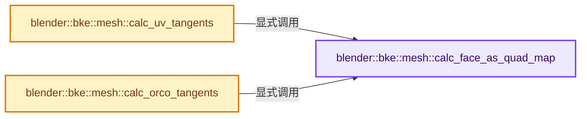
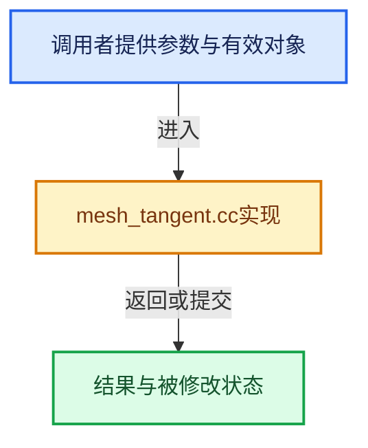

# 实现依赖专题：source/blender/blenkernel/intern/mesh_tangent.cc

[方向导航](README.md) · [符号索引](../%E7%AC%A6%E5%8F%B7%E4%BE%9D%E8%B5%96%E4%B8%8E%E5%AE%9E%E7%8E%B0%E7%B4%A2%E5%BC%95.md)

本专题从正文实际调用进入，集中保存共享实现。函数有稳定锚点，可从调用处直接跳到对应完整函数；递归与互相调用通过回链组织。

## 本文件的实现关系






## 完整成员与函数实现

<a id="f-68eaf3a694b4ad6d"></a>

### `blender::bke::mesh::calc_face_as_quad_map`

实现位置：[source/blender/blenkernel/intern/mesh_tangent.cc](../../../../../source/blender/blenkernel/intern/mesh_tangent.cc) · L267—L296。

接口参数：

- `const OffsetIndices<int> faces`
- `const Span<int3> corner_tris`
- `const Span<int> corner_tri_faces`
- `int &num_face_as_quad_map`
- `int *&face_as_quad_map`

**教学注释版**

<!-- annotated:ee39966bbc4bef -->

```cpp
static void calc_face_as_quad_map(const OffsetIndices<int> faces,
                                  const Span<int3> corner_tris,
                                  const Span<int> corner_tri_faces,
                                  int &num_face_as_quad_map,
                                  int *&face_as_quad_map)
{
#ifdef USE_TRI_DETECT_QUADS
  // [讲解] corner_tris.size：查询视图长度或生成对应有效索引区间。
  if (corner_tris.size() != faces.size()) {
    /* Over allocate, since we don't know how many ngon or quads we have. */

    /* Map fake face index to corner_tris. */
    face_as_quad_map = MEM_new_array_uninitialized<int>(size_t(corner_tris.size()), __func__);
    int k, j;
    for (k = 0, j = 0; j < int(corner_tris.size()); k++, j++) {
      face_as_quad_map[k] = j;
      /* step over all quads */
      if (faces[corner_tri_faces[j]].size() == 4) {
        j++; /* Skips the next corner_tri. */
      }
    }
    num_face_as_quad_map = k;
  }
  else {
    num_face_as_quad_map = int(corner_tris.size());
  }
#else
  num_face_as_quad_map = 0;
  face_as_quad_map = nullptr;
#endif
}
```

<details>
<summary>核对原始源码：source/blender/blenkernel/intern/mesh_tangent.cc · L267—L296</summary>

<!-- original:ee39966bbc4bef:source/blender/blenkernel/intern/mesh_tangent.cc:267:296 -->

```cpp
static void calc_face_as_quad_map(const OffsetIndices<int> faces,
                                  const Span<int3> corner_tris,
                                  const Span<int> corner_tri_faces,
                                  int &num_face_as_quad_map,
                                  int *&face_as_quad_map)
{
#ifdef USE_TRI_DETECT_QUADS
  if (corner_tris.size() != faces.size()) {
    /* Over allocate, since we don't know how many ngon or quads we have. */

    /* Map fake face index to corner_tris. */
    face_as_quad_map = MEM_new_array_uninitialized<int>(size_t(corner_tris.size()), __func__);
    int k, j;
    for (k = 0, j = 0; j < int(corner_tris.size()); k++, j++) {
      face_as_quad_map[k] = j;
      /* step over all quads */
      if (faces[corner_tri_faces[j]].size() == 4) {
        j++; /* Skips the next corner_tri. */
      }
    }
    num_face_as_quad_map = k;
  }
  else {
    num_face_as_quad_map = int(corner_tris.size());
  }
#else
  num_face_as_quad_map = 0;
  face_as_quad_map = nullptr;
#endif
}
```

</details>

**沿实际写入检查状态**

- `face_as_quad_map = MEM_new_array_uninitialized<int>(size_t(corner_tris.size()), __func__);`
- `face_as_quad_map[k] = j;`
- `num_face_as_quad_map = k;`
- `num_face_as_quad_map = int(corner_tris.size());`
- `num_face_as_quad_map = 0;`
- `face_as_quad_map = nullptr;`

**继续追踪实现**

- `corner_tris.size` → [blender::Span::size · L256](../01-%E5%9F%BA%E7%A1%80%E5%AE%B9%E5%99%A8%E4%B8%8E%E7%8E%B0%E4%BB%A3CPP/05-Span%E5%8F%AA%E8%AF%BB%E8%BF%9E%E7%BB%AD%E8%A7%86%E5%9B%BE.md#f-5f80fa006089c998)。
- `faces.size` → [blender::offset_indices::OffsetIndices::size · L67](02-OffsetIndices%E5%AE%8C%E6%95%B4%E6%8E%A5%E5%8F%A3.md#f-e238abc62ed42abd)。
- `MEM_new_array_uninitialized<int>` → [MEM_new_array_uninitialized · L608](../03-%E5%86%85%E5%AD%98%E5%88%86%E9%85%8D%E4%B8%8E%E8%BF%90%E8%A1%8C%E6%97%B6%E7%B1%BB%E5%9E%8B/%E4%BE%9D%E8%B5%96-MEM_guardedalloc-b54eca.md#f-b7103eae8eb57b05)；[MEM_new_array_uninitialized · L129](../03-%E5%86%85%E5%AD%98%E5%88%86%E9%85%8D%E4%B8%8E%E8%BF%90%E8%A1%8C%E6%97%B6%E7%B1%BB%E5%9E%8B/%E4%BE%9D%E8%B5%96-mallocn-afdcd4.md#f-bf6ef4ddcfb6e5df)。同名重载需按实参类型选择。
- `faces[corner_tri_faces[j]].size` → [调用协议](../%E6%A8%A1%E6%9D%BF%E5%AE%8F%E4%B8%8E%E5%8A%A8%E6%80%81%E5%88%86%E6%B4%BE%E5%8D%8F%E8%AE%AE.md)：接收对象类型依赖auto、返回值或模板实例；不按同名猜测目标。调用位置L283。

<a id="f-c9090db32017b89e"></a>

### `blender::bke::mesh::calc_uv_tangents`

实现位置：[source/blender/blenkernel/intern/mesh_tangent.cc](../../../../../source/blender/blenkernel/intern/mesh_tangent.cc) · L298—L348。

接口参数：

- `const Span<float3> vert_positions`
- `const OffsetIndices<int> faces`
- `const Span<int> corner_verts`
- `const Span<int3> corner_tris`
- `const Span<int> corner_tri_faces`
- `const Span<bool> sharp_faces`
- `const Span<float3> vert_normals`
- `const Span<float3> face_normals`
- `const Span<float3> corner_normals`
- `const Span<Span<float2>> uv_maps`

**教学注释版**

<!-- annotated:4bf18f0545fabb -->

```cpp
Array<Array<float4>> calc_uv_tangents(const Span<float3> vert_positions,
                                      const OffsetIndices<int> faces,
                                      const Span<int> corner_verts,
                                      const Span<int3> corner_tris,
                                      const Span<int> corner_tri_faces,
                                      const Span<bool> sharp_faces,
                                      const Span<float3> vert_normals,
                                      const Span<float3> face_normals,
                                      const Span<float3> corner_normals,
                                      const Span<Span<float2>> uv_maps)
{
  // [讲解] corner_tris.is_empty：查询视图长度或生成对应有效索引区间。
  if (corner_tris.is_empty()) {
    return {};
  }

  int num_face_as_quad_map;
  int *face_as_quad_map = nullptr;
  calc_face_as_quad_map(
      faces, corner_tris, corner_tri_faces, num_face_as_quad_map, face_as_quad_map);

  // [讲解] uv_maps.size：查询视图长度或生成对应有效索引区间。
  Array<Array<float4>> results(uv_maps.size());
  // [讲解] uv_maps.index_range：查询视图长度或生成对应有效索引区间。
  threading::parallel_for(uv_maps.index_range(), 1, [&](const IndexRange range) {
    for (const int64_t i : range) {
      SGLSLMeshToTangent mesh2tangent{};
      mesh2tangent.positions = vert_positions;
      mesh2tangent.faces = faces;
      mesh2tangent.corner_verts = corner_verts;
      mesh2tangent.corner_tris = corner_tris;
      mesh2tangent.tri_faces = corner_tri_faces;
      mesh2tangent.sharp_faces = sharp_faces;
      mesh2tangent.vert_normals = vert_normals;
      mesh2tangent.face_normals = face_normals;
      mesh2tangent.corner_normals = corner_normals;
      mesh2tangent.uv_map = uv_maps[i];
      mesh2tangent.orco = vert_positions;

      mesh2tangent.face_as_quad_map = face_as_quad_map;
      mesh2tangent.num_face_as_quad_map = num_face_as_quad_map;

      results[i].reinitialize(corner_verts.size());
      mesh2tangent.tangents = results[i];

      mikk::Mikktspace<SGLSLMeshToTangent> mikk(mesh2tangent);
      mikk.genTangSpace();
    }
  });

  MEM_SAFE_DELETE(face_as_quad_map);

  return results;
}
```

<details>
<summary>核对原始源码：source/blender/blenkernel/intern/mesh_tangent.cc · L298—L348</summary>

<!-- original:4bf18f0545fabb:source/blender/blenkernel/intern/mesh_tangent.cc:298:348 -->

```cpp
Array<Array<float4>> calc_uv_tangents(const Span<float3> vert_positions,
                                      const OffsetIndices<int> faces,
                                      const Span<int> corner_verts,
                                      const Span<int3> corner_tris,
                                      const Span<int> corner_tri_faces,
                                      const Span<bool> sharp_faces,
                                      const Span<float3> vert_normals,
                                      const Span<float3> face_normals,
                                      const Span<float3> corner_normals,
                                      const Span<Span<float2>> uv_maps)
{
  if (corner_tris.is_empty()) {
    return {};
  }

  int num_face_as_quad_map;
  int *face_as_quad_map = nullptr;
  calc_face_as_quad_map(
      faces, corner_tris, corner_tri_faces, num_face_as_quad_map, face_as_quad_map);

  Array<Array<float4>> results(uv_maps.size());
  threading::parallel_for(uv_maps.index_range(), 1, [&](const IndexRange range) {
    for (const int64_t i : range) {
      SGLSLMeshToTangent mesh2tangent{};
      mesh2tangent.positions = vert_positions;
      mesh2tangent.faces = faces;
      mesh2tangent.corner_verts = corner_verts;
      mesh2tangent.corner_tris = corner_tris;
      mesh2tangent.tri_faces = corner_tri_faces;
      mesh2tangent.sharp_faces = sharp_faces;
      mesh2tangent.vert_normals = vert_normals;
      mesh2tangent.face_normals = face_normals;
      mesh2tangent.corner_normals = corner_normals;
      mesh2tangent.uv_map = uv_maps[i];
      mesh2tangent.orco = vert_positions;

      mesh2tangent.face_as_quad_map = face_as_quad_map;
      mesh2tangent.num_face_as_quad_map = num_face_as_quad_map;

      results[i].reinitialize(corner_verts.size());
      mesh2tangent.tangents = results[i];

      mikk::Mikktspace<SGLSLMeshToTangent> mikk(mesh2tangent);
      mikk.genTangSpace();
    }
  });

  MEM_SAFE_DELETE(face_as_quad_map);

  return results;
}
```

</details>

**沿实际写入检查状态**

- `mesh2tangent.positions = vert_positions;`
- `mesh2tangent.faces = faces;`
- `mesh2tangent.corner_verts = corner_verts;`
- `mesh2tangent.corner_tris = corner_tris;`
- `mesh2tangent.tri_faces = corner_tri_faces;`
- `mesh2tangent.sharp_faces = sharp_faces;`
- `mesh2tangent.vert_normals = vert_normals;`
- `mesh2tangent.face_normals = face_normals;`
- `mesh2tangent.corner_normals = corner_normals;`
- `mesh2tangent.uv_map = uv_maps[i];`
- `mesh2tangent.orco = vert_positions;`
- `mesh2tangent.face_as_quad_map = face_as_quad_map;`
- `mesh2tangent.num_face_as_quad_map = num_face_as_quad_map;`
- `mesh2tangent.tangents = results[i];`

**结果出口**

- `return {};`
- `return results;`

**继续追踪实现**

- `corner_tris.is_empty` → [blender::Span::is_empty · L264](../01-%E5%9F%BA%E7%A1%80%E5%AE%B9%E5%99%A8%E4%B8%8E%E7%8E%B0%E4%BB%A3CPP/05-Span%E5%8F%AA%E8%AF%BB%E8%BF%9E%E7%BB%AD%E8%A7%86%E5%9B%BE.md#f-8cc1d7ba8feb50e6)。
- `calc_face_as_quad_map` → [blender::bke::mesh::calc_face_as_quad_map · L267](%E4%BE%9D%E8%B5%96-mesh_tangent-70e398.md#f-68eaf3a694b4ad6d)。
- `uv_maps.size` → [blender::Span::size · L256](../01-%E5%9F%BA%E7%A1%80%E5%AE%B9%E5%99%A8%E4%B8%8E%E7%8E%B0%E4%BB%A3CPP/05-Span%E5%8F%AA%E8%AF%BB%E8%BF%9E%E7%BB%AD%E8%A7%86%E5%9B%BE.md#f-5f80fa006089c998)。
- `threading::parallel_for` → [blender::threading::parallel_for · L68](../11-Depsgraph%E4%B8%8E%E5%B9%B6%E8%A1%8C%E4%BB%BB%E5%8A%A1%E7%B3%BB%E7%BB%9F/07-%E4%BB%BB%E5%8A%A1%E6%B1%A0%E4%B8%8ETBB%E6%8E%A5%E5%85%A5.md#f-838294754c24426c)。
- `uv_maps.index_range` → [blender::Span::index_range · L405](../01-%E5%9F%BA%E7%A1%80%E5%AE%B9%E5%99%A8%E4%B8%8E%E7%8E%B0%E4%BB%A3CPP/05-Span%E5%8F%AA%E8%AF%BB%E8%BF%9E%E7%BB%AD%E8%A7%86%E5%9B%BE.md#f-caaa9b06e13e53e0)。
- `results[i].reinitialize` → [调用协议](../%E6%A8%A1%E6%9D%BF%E5%AE%8F%E4%B8%8E%E5%8A%A8%E6%80%81%E5%88%86%E6%B4%BE%E5%8D%8F%E8%AE%AE.md)：接收对象类型依赖auto、返回值或模板实例；不按同名猜测目标。调用位置L337。
- `corner_verts.size` → [blender::Span::size · L256](../01-%E5%9F%BA%E7%A1%80%E5%AE%B9%E5%99%A8%E4%B8%8E%E7%8E%B0%E4%BB%A3CPP/05-Span%E5%8F%AA%E8%AF%BB%E8%BF%9E%E7%BB%AD%E8%A7%86%E5%9B%BE.md#f-5f80fa006089c998)。
- `mikk.genTangSpace` → [mikk::Mikktspace::genTangSpace · L147](%E4%BE%9D%E8%B5%96-mikktspace-9523a0.md#f-5bcf7b1a910d5339)。
- `MEM_SAFE_DELETE` → [MEM_SAFE_DELETE · L436](../03-%E5%86%85%E5%AD%98%E5%88%86%E9%85%8D%E4%B8%8E%E8%BF%90%E8%A1%8C%E6%97%B6%E7%B1%BB%E5%9E%8B/%E4%BE%9D%E8%B5%96-MEM_guardedalloc-b54eca.md#m-eadb3bc5b902)。宏定义由构建条件选择。

<a id="f-c5a261f7fac29262"></a>

### `blender::bke::mesh::calc_orco_tangents`

实现位置：[source/blender/blenkernel/intern/mesh_tangent.cc](../../../../../source/blender/blenkernel/intern/mesh_tangent.cc) · L350—L394。

接口参数：

- `const Span<float3> vert_positions`
- `const OffsetIndices<int> faces`
- `const Span<int> corner_verts`
- `const Span<int3> corner_tris`
- `const Span<int> corner_tri_faces`
- `const Span<bool> sharp_faces`
- `const Span<float3> vert_normals`
- `const Span<float3> face_normals`
- `const Span<float3> corner_normals`
- `const Span<float3> vert_orco`

**教学注释版**

<!-- annotated:4c20b36d36c457 -->

```cpp
Array<float4> calc_orco_tangents(const Span<float3> vert_positions,
                                 const OffsetIndices<int> faces,
                                 const Span<int> corner_verts,
                                 const Span<int3> corner_tris,
                                 const Span<int> corner_tri_faces,
                                 const Span<bool> sharp_faces,
                                 const Span<float3> vert_normals,
                                 const Span<float3> face_normals,
                                 const Span<float3> corner_normals,
                                 const Span<float3> vert_orco)
{
  // [讲解] corner_tris.is_empty：查询视图长度或生成对应有效索引区间。
  if (corner_tris.is_empty()) {
    return {};
  }

  int num_face_as_quad_map;
  int *face_as_quad_map = nullptr;
  calc_face_as_quad_map(
      faces, corner_tris, corner_tri_faces, num_face_as_quad_map, face_as_quad_map);

  // [讲解] corner_verts.size：查询视图长度或生成对应有效索引区间。
  Array<float4> results(corner_verts.size());
  SGLSLMeshToTangent mesh2tangent{};
  mesh2tangent.positions = vert_positions;
  mesh2tangent.faces = faces;
  mesh2tangent.corner_verts = corner_verts;
  mesh2tangent.corner_tris = corner_tris;
  mesh2tangent.tri_faces = corner_tri_faces;
  mesh2tangent.vert_normals = vert_normals;
  mesh2tangent.face_normals = face_normals;
  mesh2tangent.corner_normals = corner_normals;
  mesh2tangent.sharp_faces = sharp_faces;
  mesh2tangent.orco = vert_orco;

  mesh2tangent.face_as_quad_map = face_as_quad_map;
  mesh2tangent.num_face_as_quad_map = num_face_as_quad_map;

  mesh2tangent.tangents = results;

  mikk::Mikktspace<SGLSLMeshToTangent> mikk(mesh2tangent);
  mikk.genTangSpace();

  MEM_SAFE_DELETE(face_as_quad_map);

  return results;
}
```

<details>
<summary>核对原始源码：source/blender/blenkernel/intern/mesh_tangent.cc · L350—L394</summary>

<!-- original:4c20b36d36c457:source/blender/blenkernel/intern/mesh_tangent.cc:350:394 -->

```cpp
Array<float4> calc_orco_tangents(const Span<float3> vert_positions,
                                 const OffsetIndices<int> faces,
                                 const Span<int> corner_verts,
                                 const Span<int3> corner_tris,
                                 const Span<int> corner_tri_faces,
                                 const Span<bool> sharp_faces,
                                 const Span<float3> vert_normals,
                                 const Span<float3> face_normals,
                                 const Span<float3> corner_normals,
                                 const Span<float3> vert_orco)
{
  if (corner_tris.is_empty()) {
    return {};
  }

  int num_face_as_quad_map;
  int *face_as_quad_map = nullptr;
  calc_face_as_quad_map(
      faces, corner_tris, corner_tri_faces, num_face_as_quad_map, face_as_quad_map);

  Array<float4> results(corner_verts.size());
  SGLSLMeshToTangent mesh2tangent{};
  mesh2tangent.positions = vert_positions;
  mesh2tangent.faces = faces;
  mesh2tangent.corner_verts = corner_verts;
  mesh2tangent.corner_tris = corner_tris;
  mesh2tangent.tri_faces = corner_tri_faces;
  mesh2tangent.vert_normals = vert_normals;
  mesh2tangent.face_normals = face_normals;
  mesh2tangent.corner_normals = corner_normals;
  mesh2tangent.sharp_faces = sharp_faces;
  mesh2tangent.orco = vert_orco;

  mesh2tangent.face_as_quad_map = face_as_quad_map;
  mesh2tangent.num_face_as_quad_map = num_face_as_quad_map;

  mesh2tangent.tangents = results;

  mikk::Mikktspace<SGLSLMeshToTangent> mikk(mesh2tangent);
  mikk.genTangSpace();

  MEM_SAFE_DELETE(face_as_quad_map);

  return results;
}
```

</details>

**沿实际写入检查状态**

- `mesh2tangent.positions = vert_positions;`
- `mesh2tangent.faces = faces;`
- `mesh2tangent.corner_verts = corner_verts;`
- `mesh2tangent.corner_tris = corner_tris;`
- `mesh2tangent.tri_faces = corner_tri_faces;`
- `mesh2tangent.vert_normals = vert_normals;`
- `mesh2tangent.face_normals = face_normals;`
- `mesh2tangent.corner_normals = corner_normals;`
- `mesh2tangent.sharp_faces = sharp_faces;`
- `mesh2tangent.orco = vert_orco;`
- `mesh2tangent.face_as_quad_map = face_as_quad_map;`
- `mesh2tangent.num_face_as_quad_map = num_face_as_quad_map;`
- `mesh2tangent.tangents = results;`

**结果出口**

- `return {};`
- `return results;`

**继续追踪实现**

- `corner_tris.is_empty` → [blender::Span::is_empty · L264](../01-%E5%9F%BA%E7%A1%80%E5%AE%B9%E5%99%A8%E4%B8%8E%E7%8E%B0%E4%BB%A3CPP/05-Span%E5%8F%AA%E8%AF%BB%E8%BF%9E%E7%BB%AD%E8%A7%86%E5%9B%BE.md#f-8cc1d7ba8feb50e6)。
- `calc_face_as_quad_map` → [blender::bke::mesh::calc_face_as_quad_map · L267](%E4%BE%9D%E8%B5%96-mesh_tangent-70e398.md#f-68eaf3a694b4ad6d)。
- `corner_verts.size` → [blender::Span::size · L256](../01-%E5%9F%BA%E7%A1%80%E5%AE%B9%E5%99%A8%E4%B8%8E%E7%8E%B0%E4%BB%A3CPP/05-Span%E5%8F%AA%E8%AF%BB%E8%BF%9E%E7%BB%AD%E8%A7%86%E5%9B%BE.md#f-5f80fa006089c998)。
- `mikk.genTangSpace` → [mikk::Mikktspace::genTangSpace · L147](%E4%BE%9D%E8%B5%96-mikktspace-9523a0.md#f-5bcf7b1a910d5339)。
- `MEM_SAFE_DELETE` → [MEM_SAFE_DELETE · L436](../03-%E5%86%85%E5%AD%98%E5%88%86%E9%85%8D%E4%B8%8E%E8%BF%90%E8%A1%8C%E6%97%B6%E7%B1%BB%E5%9E%8B/%E4%BE%9D%E8%B5%96-MEM_guardedalloc-b54eca.md#m-eadb3bc5b902)。宏定义由构建条件选择。
